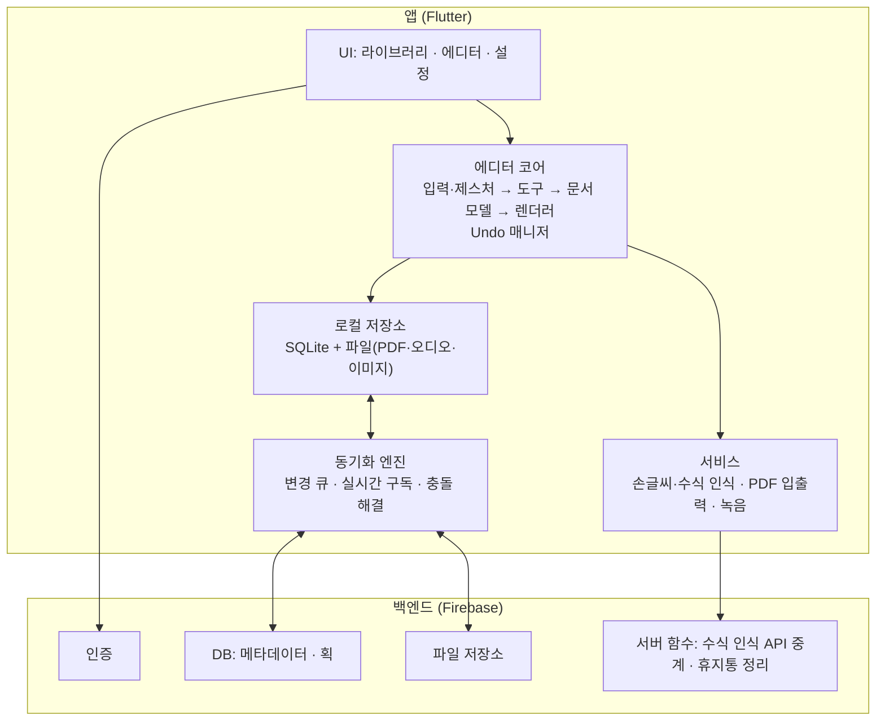

# 필기노트 앱 기획서 (v1.1)

> 최종 수정: 2026-11-12 (10장 진행 표시 — 2차 통합 뒤) · 상태: 확정 (1단계: 개인 사용)
> 진행 상황은 [10장 개발 로드맵](#10-개발-로드맵)의 체크리스트로 관리한다.

---

## 목차

1. [개요](#1-개요)
2. [확정된 결정](#2-확정된-결정)
3. [요청 기능 요약](#3-요청-기능-요약)
4. [요청 기능 상세 명세](#4-요청-기능-상세-명세)
5. [추가 기능](#5-추가-기능)
6. [기술 스택](#6-기술-스택)
7. [아키텍처](#7-아키텍처)
8. [화면 구성 (IA)](#8-화면-구성-ia)
9. [협업 방식 (사용자 + Claude)](#9-협업-방식-사용자--claude)
10. [개발 로드맵](#10-개발-로드맵)
11. [남은 확인 사항](#11-남은-확인-사항)
12. [리스크와 대응](#12-리스크와-대응)

---

## 1. 개요

### 1.1 목표

태블릿과 스타일러스로 종이 노트를 대체하는 필기 앱을 만든다. 핵심 가치는 다음 네 가지다.

- **고품질 필기**: 다양한 펜, 필압 반응, 지연 없는 필기감
- **PDF 중심 학습/업무**: 강의자료·문서를 불러와 필기하고 다시 PDF로 저장
- **어디서나 이어 쓰기**: 내 기기들 사이 실시간 동기화, 오프라인에서도 동작
- **똑똑한 필기**: 손글씨→텍스트, 손글씨 수식→LaTeX, 녹음과 필기 연동

### 1.2 개발 방침

- **1단계: 개인용** — 직접 쓰면서 피드백 → 개선을 반복해 완성도를 높인다.
- **2단계: 공개 출시·수익화** — 충분히 다듬어진 뒤 스토어 출시와 수익 모델을 붙인다.
- 지금은 1단계 기능에 집중한다. 단, 2단계에서 다시 만들 일이 없도록 계정별 데이터 분리 같은 구조는 처음부터 갖춘다 (7.6).

### 1.3 대상 기기

- **iPad** (Apple Pencil) + **안드로이드 태블릿** (S펜 등 스타일러스)
- **주 테스트 기기: iPad Pro 13인치**
  - 120Hz 화면 → 필기 지연 목표(20ms)의 기준 기기
  - Apple Pencil Pro를 쓰면 스퀴즈(도구 팔레트), 배럴 롤(캘리그래피 펜 각도), 호버(펜이 닿기 전 위치·굵기 미리보기)까지 지원
  - Apple Pencil (USB-C)은 필압을 지원하지 않음 → 펜슬 종류 확인 필요 (11장)
- 스마트폰 · PC: 2단계 이후 검토
- 웹: 출시 대상은 아니지만 개발 초기 테스트 용도로 사용 (9.5)

---

## 2. 확정된 결정

| 항목 | 결정 | 계획에 미친 영향 |
|---|---|---|
| 대상 기기 | iPad + 안드로이드 태블릿 | Flutter로 코드 하나로 개발 (6장) |
| 동기화 범위 | 내 기기들끼리 | 다른 사람과 공동 편집은 제외 → 동기화 구조 단순화 |
| 사용 목적 | 개인 사용 → 피드백으로 개선 → 나중에 수익화 | 스토어 출시 요건·수익 기능은 2단계로. 유료 엔진은 개인 사용량 기준으로 비교 |
| 개발 인원 | 사용자 + Claude | 짧은 마일스톤마다 실기기에서 써보고 피드백 (9장) |
| 노트 방식 | 페이지 방식 | 무한 캔버스 없음. 모든 필기는 정해진 크기의 페이지 위에 |
| 테스트 기기 | iPad Pro 13인치 | 필기 품질 기준 기기. 안드로이드 태블릿 보유 여부는 확인 필요 (11장) |
| 개발 환경 | Mac 없음, 사용자 PC에 개발 환경 없음 | 모든 빌드는 GitHub Actions(클라우드)에서. 초기에는 웹 버전으로 iPad에서 테스트 (9.5) |
| Apple 개발자 계정 | 나중에 가입 | 가입 전에는 iPad에 앱 설치 불가 → '네이티브 전환'(M3 전)에 가입 (10장) |

---

## 3. 요청 기능 요약

우선순위: **P0** = 실사용 시작에 필요 · **P1** = 개인용 완성 · **P2** = 공개 출시 시점

| ID | 기능 | 우선순위 | 마일스톤 |
|---|---|---|---|
| F-01 | 폴더 구조 / 폴더 관리 | P0 | M2 |
| F-02 | PDF 불러오기 | P0 | M3 |
| F-03 | 다양한 펜 종류, 높은 필기 품질 | P0 (기본 5종) / P1 (추가 펜) | M0·M1 / M5 |
| F-04 | 색·굵기 연속 선택 | P0 | M1 |
| F-05 | 자주 쓰는 펜 저장 (프리셋) | P0 | M1 |
| F-06 | 아이디(계정) 연동 | P0 (Google 로그인) / P2 (그 외) | M4 / 2단계 |
| F-07 | 실시간 동기화 (내 기기 간) | P0 | M4 |
| F-08 | 되돌리기 / 다시 실행 100회 | P0 | M1 |
| F-09 | 일반(부분) 지우개, 획 단위 지우개 | P0 | M1 |
| F-10 | 손글씨 → 텍스트 변환 | P1 | M7 |
| F-11 | 도형 그리기 | P1 | M5 |
| F-12 | 터치 모드 / 제스처 설정 | P0 (기본) / P1 (사용자 지정) | M1 / M5 |
| F-13 | 페이지 삽입 | P0 | M1 (빈·속지) / M3 (PDF) |
| F-14 | 손글씨 수식 입력 | P1 | M7 |
| F-15 | PDF로 저장 (내보내기) | P0 | M3 |
| F-16 | 음성 녹음 + 필기 녹음 연동 | P1 | M6 |

---

## 4. 요청 기능 상세 명세

### F-01. 폴더 구조 / 폴더 관리

- 폴더 안에 폴더를 만들 수 있는 **트리 구조** (깊이 제한 없음)
- 폴더·노트: 생성, 이름 변경, **드래그 앤 드롭 이동**, 복사, 삭제
- **다중 선택** 후 일괄 이동 / 삭제 / 내보내기
- 정렬: 이름 · 생성일 · 수정일 · 사용자 지정 순서
- 보기: 그리드(표지 썸네일) / 리스트
- 폴더 색상·아이콘, 노트 표지 선택
- 상단 경로 표시(브레드크럼)로 상위 폴더 빠른 이동
- 사이드바에 폴더 트리 고정 표시 (태블릿 가로 모드)

### F-02. PDF 불러오기

- 가져오기 경로: 파일 앱 / 기기 저장소, 다른 앱의 '공유' · '다음으로 열기', 클라우드 드라이브
- 가져오는 방식: **새 노트로 만들기** 또는 **기존 노트에 페이지로 삽입**
- PDF 페이지를 노트 페이지 배경으로 사용 — 벡터로 렌더링해 확대해도 선명
- 대용량(수백 페이지) 대응: 화면에 보이는 페이지만 렌더링, 썸네일 캐시
- PDF 텍스트 선택·복사·검색, 목차(아웃라인)·내부 링크 이동 (P1)
- 암호 걸린 PDF 열기
- (P1) 이미지(JPG/PNG) 가져오기, (P2) PPT·Word 문서를 PDF로 변환해 가져오기

### F-03. 펜 종류 및 필기 품질

**펜 종류**

| 펜 | 특징 | 우선순위 |
|---|---|---|
| 볼펜 | 균일한 굵기, 필압에 약하게 반응 | P0 |
| 만년필 | 필압·속도에 따라 굵기 변화 | P0 |
| 형광펜 | 반투명, 겹쳐도 진해지지 않음, 글자 아래 레이어, 직선 보정 옵션 | P0 |
| 연필 | 종이 질감 텍스처, 기울이면 넓고 옅게 | P0 |
| 마커 | 불투명하고 굵은 선 | P0 |
| 붓펜 | 필압 민감도 큼, 획 끝이 가늘어짐 | P1 |
| 캘리그래피 펜 | 펜촉 각도에 따라 굵기 변화 (Apple Pencil Pro는 배럴 롤로 각도 조절) | P1 |
| 점선 / 파선 펜 | 선 스타일 | P1 |
| 레이저 포인터 | 잠시 후 사라지는 선 (발표용) | P1 |
| 암기 테이프 | 내용을 가렸다가 탭하면 보임 (학습용) | P1 |

**품질 요구사항**

- 필압(pressure), 기울기(tilt), 방위각(azimuth) 반영
- **입력 지연 최소화**: 펜 입력 → 화면 표시 20ms 이내 목표 (예측 입력 사용, 120Hz 화면 대응)
- 손떨림 보정(스무딩) 단계 조절, 필압 곡선 조절
- 획 끝 가늘어짐(taper), 안티앨리어싱
- 호버 미리보기: 펜이 화면에 닿기 전에 위치·굵기 표시 (지원 기기)
- **벡터 저장**: 아무리 확대해도 선명, PDF 내보내기 시에도 벡터 유지

### F-04. 색·굵기 연속 선택

- 색상
  - HSV 컬러 휠 / 사각 피커로 **연속 선택**
  - 투명도 슬라이더
  - HEX · RGB 직접 입력
  - 스포이드 (화면에서 색 추출)
  - 최근 사용 색상, 사용자 팔레트 저장
- 굵기
  - **연속 슬라이더** (예: 0.1pt ~ 30pt, 0.1 단위)
  - 슬라이더 옆에 실제 굵기 미리보기 획 표시
- 툴바의 펜 아이콘을 길게 눌러 바로 조절하는 빠른 팝업

### F-05. 자주 쓰는 펜 저장 (프리셋)

- 프리셋 = 펜 종류 + 색 + 굵기 + 투명도 + 필압 감도 + 스무딩
- 툴바에 고정, 드래그로 순서 변경, 이름 지정
- 프리셋 그룹 (예: '수업용', '시험공부용')
- **계정 동기화** → 다른 기기에서도 같은 펜 사용

### F-06. 아이디(계정) 연동

- **1단계 (개인용)**: Google 로그인 — iPad·안드로이드 모두 지원
- **2단계 (공개 출시)**
  - Apple 로그인 (iOS에서 소셜 로그인을 제공하면 Apple 로그인 또는 동등한 개인정보 보호 로그인 필요 — App Store 심사 지침)
  - 카카오 로그인, 이메일 로그인
  - 게스트 모드 (로그인 없이 사용 → 나중에 로그인하면 업로드)
  - 로그인된 기기 목록, 원격 로그아웃
  - **앱 내 회원 탈퇴 + 데이터 삭제** (App Store · Google Play 필수)
- 처음부터 모든 데이터를 사용자 ID 기준으로 저장 → 사용자가 늘어나도 구조 변경 없음

### F-07. 실시간 동기화 (내 기기 간)

- 범위: **한 사용자의 여러 기기 사이** (다른 사람과 공동 편집 없음)
- **로컬 우선(local-first)**: 모든 편집은 먼저 기기에 저장 → 백그라운드로 업로드. 오프라인에서도 모든 기능 동작
- 온라인일 때 다른 기기에 **2초 이내 반영** 목표
- 동기화 단위는 **획(stroke) 단위 변경분** → 데이터 사용량 절감
- 충돌 처리 (상세는 7.4)
  - 한 사람이 두 기기로 동시에 쓰는 일은 드물다. 충돌은 주로 '양쪽 기기에서 오프라인으로 고친 뒤 나중에 연결'할 때 생긴다.
  - 획·도형 등은 추가/삭제만 있는 집합으로 처리 → 양쪽에서 쓴 필기 모두 보존
  - 제목, 폴더 위치 등 속성은 마지막 수정 우선
- PDF · 녹음 · 이미지 같은 큰 파일은 별도 파일 저장소에 올리고, 다른 기기는 열 때 내려받기
- 동기화 상태 표시: 완료 / 진행 중 / 오프라인 / 오류

### F-08. 되돌리기 / 다시 실행 (100회)

- 노트 단위 히스토리, **최대 100단계**, 넘으면 가장 오래된 것부터 삭제
- 대상: 필기, 지우기, 선택 이동·크기·회전·색 변경, 도형, 텍스트, 이미지, 수식, 페이지 삽입·삭제·이동 등 **모든 편집**
- 펜을 한 번 대었다 뗀 동작 = 1단계 (부분 지우개로 여러 획이 잘려도 1단계)
- 새 편집을 하면 다시 실행 목록은 비움
- 그 기기에서 한 편집만 되돌림 (다른 기기에서 동기화로 들어온 변경은 대상 아님)
- 입력: 툴바 버튼, 제스처(F-12), 키보드 단축키 (Ctrl/⌘+Z, Ctrl/⌘+Shift+Z)

### F-09. 지우개

- **획 지우개**: 닿은 획 전체 삭제
- **일반(부분) 지우개**: 닿은 부분만 삭제 — 벡터 획을 잘라내는 방식으로 구현해 품질 유지
- 지우개 크기 연속 조절, 지우개 범위 원형 커서 표시
- 옵션
  - 형광펜만 지우기 / 형광펜 제외하고 지우기
  - 지운 뒤 이전 펜으로 자동 복귀
- 펜 버튼 · 펜 더블탭으로 지우개 전환 (F-12)
- 현재 페이지 전체 지우기

### F-10. 손글씨 → 텍스트

- 올가미로 선택한 손글씨를 텍스트로 변환 → 텍스트 상자로 바꾸거나 클립보드로 복사
- **한국어 + 영어 혼용 인식 필수**
- 인식 결과 수정: 후보 단어 선택, 직접 편집
- 엔진: Google ML Kit Digital Ink Recognition — 기기 안에서 동작, 무료, 한국어 지원 (부족하면 상용 엔진 검토)
- 같은 인식 결과로 **손글씨 검색** 색인 생성 (5장)

### F-11. 도형 그리기

- 도형 도구: 직선, 화살표, 사각형, 원·타원, 삼각형, 다각형, 별
- **자동 도형 보정**: 손으로 그리고 펜을 잠시 멈추면 반듯한 도형으로 바뀜
- 테두리 색·굵기·선 스타일, 채우기 색
- 편집 핸들: 크기, 회전, 꼭짓점 이동
- (P1) 그리드 스냅, 자(눈금자) 도구

### F-12. 터치 모드 / 제스처 설정

**입력 모드**

- 펜 전용 모드: 펜으로만 필기, 손가락은 스크롤·확대만
- 손가락 필기 허용 모드
- **팜 리젝션**: 손바닥이 화면에 닿아도 필기되지 않음

**제스처 매핑** (M1에서 기본값 제공, M5에서 각 항목 켜기/끄기·동작 변경 가능)

| 제스처 | 기본 동작 |
|---|---|
| 두 손가락 탭 | 되돌리기 |
| 세 손가락 탭 | 다시 실행 |
| 두 손가락 드래그 | 스크롤 |
| 핀치 | 확대 / 축소 |
| 손가락 길게 누르기 | 올가미 선택 / 붙여넣기 메뉴 |
| 펜 측면 버튼 (S펜) | 지우개 전환 |
| Apple Pencil 더블탭 / 스퀴즈 | 지우개 전환 / 도구 팔레트 |
| 한 손가락 드래그 (펜 전용 모드) | 스크롤 |

### F-13. 페이지 삽입

- 모든 노트는 **페이지 단위** (무한 캔버스 없음)
- 위치: 현재 페이지 앞 / 뒤, 맨 끝
- 종류: 빈 페이지, 속지 템플릿(줄, 모눈, 점, 코넬, 악보, 플래너), PDF 페이지, 이미지, 다른 노트의 페이지 복사
- 페이지 크기: A4, Letter, 16:9, 사용자 지정 / 가로·세로
- 속지 색상 (흰색, 미색, 검정 등)
- 페이지 넘김: 세로 연속 스크롤 / 좌우 한 장씩 넘기기 선택
- 페이지 삭제·복제·순서 변경·썸네일 보기도 함께 제공 (5.1)

### F-14. 손글씨 수식 입력

- 수식 입력 영역에 손으로 쓰면 → **LaTeX로 인식** → 깔끔한 수식으로 표시
- 지원 범위: 분수, 지수·첨자, 루트, 적분, 시그마, 극한, 행렬, 그리스 문자, 연립방정식
- 쓰는 중 실시간 미리보기, 잘못 인식된 부분 고쳐 쓰기, LaTeX 직접 편집
- 수식 객체: 이동, 크기·색 변경, 다시 편집
- LaTeX 복사 → 다른 문서에 붙여넣기
- 엔진 후보 (M7 착수 시 직접 손글씨로 비교해 결정)
  - Mathpix API — 수식 인식 전문, 사용량 기반 유료
  - MyScript iink SDK — 기기 안에서 실시간 인식, 라이선스 조건 확인 필요
  - 멀티모달 AI API — 손글씨 영역을 이미지로 보내 LaTeX로 변환
- 개인 사용량이면 비용 부담은 작을 것으로 예상. 인식 엔진은 교체 가능한 구조로 만들어 나중에 바꾸기 쉽게 한다.
- 외부 API 키는 앱에 넣지 않고 서버 함수를 거쳐 호출 (앱에서 키가 유출되는 것 방지)

### F-15. PDF로 저장 (내보내기)

- 범위: 노트 전체 / 선택한 페이지 / 현재 페이지
- 필기는 **벡터로 출력** (확대해도 선명), 원본 PDF의 텍스트는 그대로 유지(검색 가능)
- 옵션: 속지 포함 여부, 필기 포함 여부(원본만 내보내기)
- 공유 시트 (메일, 메신저, 드라이브 저장), 인쇄
- 대용량 노트는 백그라운드 생성 + 진행률 표시
- (P1) 이미지(PNG/JPG) 내보내기, 앱 전용 형식(편집 가능한 상태로 백업)

### F-16. 음성 녹음 + 필기 녹음 연동

- 노트 안에서 녹음 시작 / 일시정지 / 정지, 노트 하나에 여러 녹음 가능
- **백그라운드 녹음** (다른 앱으로 전환하거나 화면이 꺼져도 계속)
- **필기 연동**: 녹음 중 쓴 획마다 녹음 시점을 기록
  - 재생하면 그 시점에 쓴 필기가 순서대로 강조 표시
  - 필기를 탭하면 그 필기를 쓰던 시점부터 재생
- 재생 속도 0.5x ~ 2x, 10초 앞뒤 이동
- 녹음 파일 압축(AAC/Opus) 후 동기화, 용량 표시, 녹음만 따로 삭제
- 녹음 시작 시 '타인의 음성 녹음 시 동의 필요' 안내
- (P2) 음성 → 텍스트 변환, 강의 요약

---

## 5. 추가 기능

요청 목록에는 없지만 필기 앱에 필요한 기능이다.

### 5.1 반드시 필요 (P0)

| 기능 | 필요한 이유 | 마일스톤 |
|---|---|---|
| **올가미(선택) 도구** | 쓴 필기를 선택해 이동·크기 조절·회전·색 변경·복사. 손글씨→텍스트, 수식 변환도 '선택'이 전제 | M1 (기본) / M5 (고급) |
| **팜 리젝션** | 손바닥 오입력 방지 | M1 |
| **확대/축소, 스크롤** | 핀치 줌, 페이지 너비 맞춤, 확대 상태에서 필기 | M1 |
| **페이지 삭제·복제·순서 변경, 썸네일** | 삽입만으로는 페이지 관리 불가 | M1 |
| **속지 템플릿** | 줄노트, 모눈, 점, 코넬 노트 등 | M1 |
| **자동 저장** | 저장 버튼 없이 즉시 저장. 강제 종료·배터리 방전에도 손실 없음 | M1 |
| **오프라인 사용** | 로컬 우선 구조라 처음부터 오프라인 동작, 연결되면 자동 동기화 | M1 / M4 |
| **휴지통** | 동기화로 다른 기기에서도 지워지므로 복구 수단 필수. 30일 보관 | M2 |
| **검색** | 노트 제목 → PDF 텍스트 → 손글씨 내용 순으로 확장 | M2 / M3 / M7 |
| **텍스트 상자** | 키보드로 타이핑 입력 | M5 |
| **이미지 삽입** | 사진·카메라 촬영·스크린샷 붙여넣기 | M5 |

### 5.2 개인용 완성도 (P1 — 실사용 피드백에 따라 순서 결정)

- **손글씨 검색** (M7)
- **버전 기록**: 노트를 과거 시점으로 복원
- **태그, 즐겨찾기(별표), 최근 노트** (즐겨찾기·최근은 M2)
- **탭 / 분할 화면**: 교재 PDF와 필기 노트를 나란히
- **노트 잠금**: 비밀번호, Face ID / 지문
- **자(눈금자)**, 레이저 포인터, **발표 모드**(외부 모니터에 필기만 표시)
- **키보드 단축키**
- **다크 모드** (UI + 페이지 색 반전 옵션)
- **암기 테이프** (M5)
- **요소(스티커) 저장**: 자주 쓰는 필기·도형을 저장해 재사용
- **링크**: 노트 간 링크, 웹 링크
- **전체 백업 / 복원**
- **페이지를 다른 노트로 이동**, 페이지 북마크

### 5.3 2단계 이후 (P2)

- 스마트폰 · PC · 웹 버전
- 공유 링크 (계정 없는 사람도 웹에서 읽기 전용으로 보기)
- AI 기능: 녹음 텍스트 변환·요약, 필기 요약, 복습 문제 생성
- 속지/스티커 마켓
- ~~다른 사용자와 실시간 공동 편집~~ — 계획 없음

### 5.4 비기능 요구사항

| 항목 | 목표 |
|---|---|
| 필기 지연 | 펜 입력 → 화면 표시 20ms 이내 (120Hz 기기 기준) |
| 성능 | 500페이지 PDF, 노트당 획 10만 개에서도 60fps 스크롤 |
| 앱 시작 | 2초 이내 라이브러리 표시 |
| 데이터 안전 | 크래시·강제 종료 시에도 마지막 획까지 보존 |
| 동기화 | 온라인 시 다른 기기 반영 2초 이내, 데이터 손실 0건 |
| 보안 | 전송 구간 암호화(TLS), 본인 데이터만 접근 가능한 서버 권한 규칙 |
| 저장 용량 | 획 데이터 압축, 같은 PDF는 한 번만 저장(중복 제거) |
| 측정 | 앱 안 '개발자 표시'로 프레임 시간·입력 지연·필압 값 확인 (9.4) |

---

## 6. 기술 스택

### 6.1 Flutter 선택 이유

- iPad와 안드로이드 태블릿을 **코드 하나로** 개발 — 2인 개발에서 코드가 둘이면 유지보수 부담이 2배
- 캔버스를 직접 그리는 방식이라 펜 표현을 자유롭게 구현 가능
- 오픈소스 Flutter 필기 앱(Saber) 사례가 있어 참고 가능
- 웹으로도 빌드 가능 → Mac·개발자 계정 없이도 iPad Safari에서 초기 기능 테스트 가능 (9.5)
- 리스크: 네이티브보다 필기 지연 튜닝이 필요 → **네이티브 전환 단계에서 iPad Pro로 검증**, 기준 미달 시 필기 렌더링 부분만 네이티브로 교체
- Apple Pencil 스퀴즈, S펜 버튼 같은 기기 전용 기능은 플랫폼 연동 코드로 처리

### 6.2 세부 스택 (착수 시 각 패키지 최신 상태 재확인)

| 영역 | 후보 |
|---|---|
| 상태 관리 | Riverpod |
| 필기 렌더링 | CustomPainter + 레이어 캐싱 (7.3) |
| 획 생성 알고리즘 | 필압 기반 외곽선 생성 (perfect-freehand 계열) + 스무딩 |
| 로컬 DB | SQLite (drift) |
| PDF 렌더링 | pdfrx (PDFium 기반) |
| PDF 내보내기 | 원본 PDF 페이지 위에 벡터 필기 합성 — PDFium 직접 사용 또는 syncfusion_flutter_pdf (라이선스 조건 확인) |
| 손글씨 인식 | google_mlkit_digital_ink_recognition (한국어 지원, 온디바이스) |
| 수식 인식 | M7에서 비교 결정 (F-14) |
| 수식 렌더링 | flutter_math_fork (KaTeX 기반) |
| 녹음 / 재생 | record / just_audio |
| 인증 · DB · 파일 · 서버 함수 | Firebase (Auth, Firestore, Storage, Cloud Functions) |
| CI | GitHub Actions (분석 · 테스트 · 웹/안드로이드/iOS 빌드) |
| 테스트용 웹 배포 | Firebase Hosting (비공개 저장소라 GitHub Pages 무료 사용 불가) |
| iOS 배포 | GitHub Actions macOS 빌드 → TestFlight (네이티브 전환 후) |

### 6.3 백엔드: Firebase

- 로그인, 실시간 구독, 오프라인 캐시, 파일 저장소를 한 번에 해결
- 개인 사용 규모는 대부분 무료 사용량 안에 들어갈 것으로 예상 (정확한 한도는 M0에서 프로젝트를 만들 때 확인)
- 파일 저장소·서버 함수는 종량제(Blaze) 요금제 등록이 필요할 수 있음 → **예산 알림을 소액으로 설정**해 예상치 못한 과금 방지
- Firestore는 쓰기 횟수로 과금 → 획 하나마다 쓰지 말고 페이지 단위로 0.5~1초 묶어서 업로드
- 문서 1개 최대 1MB 제한 → 페이지 획 데이터는 여러 덩어리(chunk)로 나눠 저장

---

## 7. 아키텍처

### 7.1 전체 구조



### 7.2 데이터 모델

```text
User        { id, email, displayName, settings, createdAt }
PenPreset   { id, ownerId, name, tool, color(ARGB), width, opacity,
              pressureCurve, smoothing, order, group }
Folder      { id, ownerId, parentId(null=최상위), name, color, icon,
              sortKey, updatedAt, deletedAt }
Note        { id, ownerId, folderId, title, cover, tags[],
              schemaVersion, createdAt, updatedAt, deletedAt }
Page        { id, noteId, sortKey, width, height,
              background { type: blank|template|pdf|image,
                           template, color, assetId, pdfPageIndex },
              updatedAt, deletedAt }
Stroke      { id, pageId, tool, color, width, opacity,
              points[{ x, y, pressure, tilt, azimuth, t }], bbox,
              recordingId?, recordingOffsetMs?, createdAt, deletedAt }
Shape       { id, pageId, kind, geometry, strokeStyle, fill, transform }
TextBox     { id, pageId, rect, content, style }
MathObject  { id, pageId, rect, latex, color }
ImageObject { id, pageId, rect, rotation, assetId }
Recording   { id, noteId, assetId, durationMs, startedAt }
Asset       { id(=내용 해시), ownerId, type: pdf|image|audio, size, storagePath }
```

- 좌표는 페이지 기준 논리 단위(pt) → 기기 해상도와 무관 (iPad ↔ 안드로이드 간 동일하게 표시)
- 획의 점 데이터는 델타 인코딩 + 바이너리로 압축 저장
- 모든 항목에 `deletedAt`(소프트 삭제) → 휴지통과 동기화 충돌 처리에 사용
- `sortKey`는 분수 인덱스(fractional index) → 두 기기에서 따로 페이지를 끼워 넣어도 순서 충돌 없음
- `Stroke.recordingOffsetMs` → 녹음 재생 시 필기 강조(F-16)
- M1부터 이 구조로 만들어 M4에서 동기화를 붙일 때 데이터 구조를 바꾸지 않도록 한다.

### 7.3 렌더링 전략

- 레이어 순서: 배경(속지·PDF) → 형광펜 → 일반 필기·도형·텍스트 → 선택 표시 · 쓰는 중인 획
- 다 쓴 획은 페이지 타일 이미지로 캐시하고, 확대 배율이 바뀌면 다시 생성
- **쓰는 중인 획만 매 프레임 그림** (+ 예측 입력으로 체감 지연 감소)
- 화면 밖 페이지는 메모리에서 해제 (가상화)
- 공간 색인(그리드 / R-tree)으로 지우개·올가미 판정 고속화

### 7.4 동기화 설계 (내 기기 간)

1. 모든 편집 → 로컬 DB 트랜잭션 + '보낼 변경' 큐에 기록
2. 온라인이면 큐를 묶어서 서버로 전송 (0.5~1초 디바운스)
3. 서버 변경은 실시간 구독으로 받아 로컬 DB에 반영 → 화면 갱신
4. 충돌 규칙
   - 획·도형 등 페이지 요소: ID 기반 추가 / 삭제 표시 → 양쪽에서 쓴 필기 모두 보존
   - 이동·색 변경 등 속성 수정: 요소별 마지막 수정 우선 (HLC 기준, 커서는 서버 시각)
   - 페이지 순서: 분수 인덱스로 충돌 회피
   - 폴더 이동: 순환 구조(A를 B 안에, B를 A 안에 이동) 검사 후 한쪽 취소
5. 큰 파일(PDF · 오디오 · 이미지): 내용 해시로 중복 없이 업로드, 다른 기기는 열 때 내려받음
6. 장시간 오프라인 후 연결: 마지막 동기화 시점 이후 변경분만 받아옴

### 7.5 되돌리기 설계

- 커맨드 패턴: 각 편집을 `{ 실행, 취소 }` 쌍으로 기록하며, 전체 상태가 아닌 **변경분만 저장** → 100단계도 메모리 부담 적음
  - 예: 획 추가, 획 삭제, 획 분할(부분 지우개), 선택 변형, 페이지 삽입·삭제·이동
- 최대 100개 원형 버퍼, 새 편집 시 다시 실행 목록 비움
- 되돌리기도 하나의 새 변경으로 동기화되어 다른 기기에 반영

### 7.6 나중의 수익화를 위해 지금 지켜둘 것

- 모든 데이터에 `ownerId`, 서버 권한 규칙은 처음부터 '본인 데이터만 접근'
- 유료가 될 수 있는 기능(수식 인식, 녹음 텍스트 변환 등)은 기능 스위치(feature flag)로 켜고 끌 수 있게
- `Asset.size` 기록 → 나중에 사용자별 저장 용량 계산·한도 적용 가능
- `schemaVersion` → 데이터 형식이 바뀌어도 예전 노트를 열 수 있게

---

## 8. 화면 구성 (IA)

```text
앱
├─ 로그인 (Google)                         ※ 게스트 시작·다른 로그인은 2단계
├─ 라이브러리 (홈)
│   ├─ 사이드바: 폴더 트리 · 최근 · 즐겨찾기 · 휴지통
│   ├─ 노트 목록 (그리드 / 리스트, 정렬)
│   ├─ 검색
│   └─ 새로 만들기: 노트 · 폴더 · PDF 가져오기
├─ 노트 에디터
│   ├─ 상단 툴바: 펜 · 지우개 · 올가미 · 도형 · 텍스트 · 이미지 · 수식 · 녹음 · 되돌리기/다시 실행
│   ├─ 펜 프리셋 바
│   ├─ 펜 설정 팝업: 종류 · 색 · 굵기 · 투명도
│   ├─ 페이지 썸네일 패널: 삽입 · 삭제 · 복제 · 순서 변경
│   ├─ 녹음 재생 바
│   └─ 더보기: PDF 내보내기 · 공유 · 인쇄 · 노트 정보
└─ 설정
    ├─ 계정 · 동기화 상태 · 저장 용량          ※ 기기 관리·회원 탈퇴는 2단계
    ├─ 입력: 펜 전용 모드 · 팜 리젝션 · 제스처 매핑
    ├─ 펜: 필압 곡선 · 손떨림 보정
    ├─ 일반: 테마 · 기본 속지 · 페이지 넘김 방식
    └─ 개발자 표시 (프레임 시간 · 입력 지연 · 필압)
```

---

## 9. 협업 방식 (사용자 + Claude)

### 9.1 역할

| 영역 | Claude | 사용자 |
|---|---|---|
| 설계·코드 | 설계, 코드 작성, 자동 테스트 작성, 이 문서 갱신 | 방향 결정, 우선순위 결정 |
| 실행·검증 | 정적 분석·자동 테스트 실행 (클라우드 작업 환경) | 실기기에 설치, 필기감·사용성 테스트 |
| 계정·콘솔 | 설정 방법 단계별 안내 | Firebase 프로젝트 생성, Apple 개발자 계정, API 키 발급 |
| 피드백 | 피드백을 작업 목록으로 정리 | 써보고 불편한 점 전달 |

### 9.2 진행 사이클

1. 마일스톤 작업 범위 확인
2. Claude가 구현 → 자동 테스트 → 작업 브랜치에 푸시
3. GitHub Actions가 자동으로 검사·빌드·배포 (네이티브 전환 전: 웹 테스트 주소 갱신 / 후: TestFlight 업로드)
4. 사용자가 iPad에서 열거나 설치해 써봄
5. 피드백 → 다음 작업에 반영
6. 마일스톤 완료 시 기본 브랜치에 합치고, 이 문서의 체크리스트 갱신

### 9.3 피드백 전달 방법

- 채팅으로 바로 말하기 (가장 간단)
- 또는 GitHub 이슈: 기기 · 무엇을 했는지 · 기대한 동작 · 실제 동작 · 스크린샷/화면 녹화
- 필기감은 구체적으로: "빠르게 쓰면 선이 늦게 따라옴", "획 끝이 뭉툭함", "형광펜이 겹치면 진해짐" 등

### 9.4 Claude의 한계와 보완

- **실제 기기와 펜을 만질 수 없음** → 필기감·지연·팜 리젝션은 사용자의 판단이 기준
  - 보완: 앱에 '개발자 표시'를 넣어 프레임 시간·입력 지연·필압 값을 수치로도 전달할 수 있게 한다
- **작업 세션은 매번 새로 시작됨** → 이 문서의 체크리스트, 커밋 기록, 이슈가 진행 상황을 기억하는 역할
- 획 분할(부분 지우개), 되돌리기 100단계, 동기화 충돌 병합 같은 핵심 로직은 **자동 테스트**로 검증

### 9.5 기기에서 테스트하는 방법

Mac과 Apple 개발자 계정이 없는 상태에서 시작하므로 두 단계로 나눈다.

**단계 A — 웹 버전 (M0 ~ M2, 계정·비용 없음)**

- 코드를 푸시하면 GitHub Actions가 웹 버전을 빌드해 테스트 주소(Firebase Hosting)에 자동 배포
- iPad Safari에서 주소를 열고 '홈 화면에 추가'해서 앱처럼 사용
- 테스트 가능: 화면 구성, 펜 종류·색·굵기, Apple Pencil 필압, 펜/손가락 구분(펜 전용 모드), 지우개, 되돌리기, 제스처, 페이지·폴더 관리
- 한계
  - **필기감(지연·부드러움)은 실제 앱보다 떨어짐** → 필기감 최종 판정은 단계 B에서
  - 손글씨 인식, 백그라운드 녹음, 펜슬 스퀴즈 등은 웹에서 동작하지 않음 (해당 기능은 M3 이후라 영향 없음)
  - Safari는 오래 쓰지 않은 사이트의 저장 데이터를 지울 수 있음 → **웹 버전은 테스트 전용, 중요한 노트는 쓰지 않기**
- M0~M2 동안은 웹에서도 돌아가도록 플랫폼 전용 기능을 분리해서 만든다

**단계 B — 네이티브 iPad 앱 (네이티브 전환 이후)**

- Apple 유료 개발자 계정(연 99달러) 가입 → GitHub Actions(macOS)에서 빌드 → **TestFlight 앱으로 iPad에 설치** (Mac 불필요)
- 가입 시점: M2 완료 후 '네이티브 전환' 단계 (늦어도 M3 실사용 시작 전)
- 비공개 저장소는 GitHub Actions 무료 사용 시간이 월 2,000분이고 macOS 빌드는 10배로 계산됨 → iOS 빌드는 마일스톤 단위로만 실행

**안드로이드**

- GitHub Actions가 만든 APK를 내려받아 태블릿에 바로 설치 (PC 없이 가능)
- 안드로이드 태블릿이 없으면 빌드만 유지하고, 기기가 생기면 테스트

---

## 10. 개발 로드맵

마일스톤마다 실기기에서 써볼 수 있는 결과물을 만든다. 기간보다 '써보고 합격'을 완료 기준으로 삼는다.

> **진행 (2026-11-12, 2차 통합 뒤)** — 1차(M0~M4 일부)에 이어 2차(M5 편집·M6 녹음·M7 인식)도 7개 영역을 동시에 개발해 통합 브랜치 `claude/note-app-planning-bk29xb`에 합쳤고, 컨테이너 검증 V1~V16을 통과했다([plans/m5-7/00-review.md '2차 통합 결과'](plans/m5-7/00-review.md#2차-통합-결과), 계약 [plans/m5-7/00-overview.md](plans/m5-7/00-overview.md) 7장 v2.7). 1차 결과는 [plans/00-review.md '1차 통합 결과'](plans/00-review.md#1차-통합-결과).
> - `[x]` = 코드와 자동 테스트로 끝난 항목. 괄호 안은 근거가 되는 영역 작업·테스트(1차는 [plans/](plans/) 각 계획서 8장, 2차는 [plans/m5-7/](plans/m5-7/) 각 계획서 8장, 진행 기록 [plans/progress/](plans/progress/) '## 2차').
> - `[ ]` + **사용자 확인 대기** = 사용자가 해야 할 일(계정·프로젝트 만들기)이나 실기기 확인이 남은 항목.
> - 각 마일스톤의 **완료 기준**(실기기 합격)은 아직 하나도 판정하지 않았다. Firebase Hosting 미리보기 뒤 iPad 체크리스트로 판정한다 — 1차는 각 계획서 9장·[안내서 04](guides/04-ipad-web-test.md), 2차는 [안내서 08 실기기 체크리스트](guides/08-device-checklist.md)(계약 7.8 A·B·C). 웹 빌드는 필기감 수치만 기록하고, 필기감 합격은 네이티브 전환에서 판정한다(9.5).

### M0. 개발 환경 & 웹 테스트 경로

- [x] Flutter 프로젝트 생성, 폴더 구조, 린트 규칙 (INFRA B1: Dart pub 워크스페이스 8개 멤버, 루트 `analysis_options.yaml`, `ws check` 규칙 R1~R15 위반 0, `flutter analyze --fatal-infos` 0)
- [ ] Firebase 프로젝트 생성 (사용자가 웹 콘솔에서 — 단계별 안내), 요금제 확인(예산 알림은 Blaze 전환 시) — **사용자 확인 대기** (안내서 [01](guides/01-firebase-project.md) · [02](guides/02-github-secrets.md) · [03](guides/03-budget-alert.md))
- [ ] GitHub Actions: 정적 분석 · 테스트 · 웹 빌드 → Firebase Hosting 자동 배포 · 안드로이드 APK 빌드 — 워크플로 작성 완료(INFRA I13·J15: `ci.yml` 5개 잡 `check`·`vm`·`chrome`·`heavy`·`web`, `android.yml` release APK·고정 키 분기, `functions.yml`, `ios-compile.yml`, `tool/test/workflows_test`). `functions.yml`은 GitHub에서 녹색(2회). `ci.yml`은 체크포인트 뒤 `check` 잡의 도구 시험 1건(러너 환경 변수 상속)에서 멈췄고 INFRA가 고쳤다 — 총괄 푸시 뒤 다섯 잡 실측으로 잡별 제한을 정한다. 웹 예산 한도는 계약 v2.7 C27-01로 다시 정했다. Hosting 배포는 Firebase 시크릿 등록 뒤 — **사용자 확인 대기**(Firebase 프로젝트(Spark·Hosting만으로 충분 — U24)·시크릿, `android.yml` Run workflow)
- [x] 필압을 반영하는 펜 1종으로 빈 페이지에 필기하는 프로토타입 (INK T03~T10 필압·모의 필압·획 생성·렌더 + EDITOR E-08 `EditorScreen`, 실제 INK·CORE 통합 E-21, 앱 스모크 V5·V6) — Apple Pencil 필압 반영은 iPad 확인(완료 기준)
- [x] 개발자 표시 (프레임 시간 · 입력 지연 · 필압) (INK T11 `InkDiagnostics` + EDITOR E-19 개발자 표시·메뉴, PDF 렌더 통계 섹션 연결 INFRA I10b)

**완료 기준**: iPad Safari에서 테스트 주소를 열어 Apple Pencil로 필기되고 필압이 굵기에 반영됨 — **사용자 확인 대기** (미리보기 배포 → [안내서 04](guides/04-ipad-web-test.md), 01-infra 9.3·03-ink 9.3)

### M1. 기본 필기

- [x] 문서 모델 · 로컬 DB · 자동 저장 (동기화를 고려한 구조, 7.2) (CORE T1~T19: drift SQLite·웹 IndexedDB, 쓰기 큐 재시도, 변경 기록(outbox)·HLC 필드 버전, 숨김 시 flush — INFRA I7·I10, 백업 내보내기 CORE T19 + INFRA I9)
- [x] 펜 5종 (볼펜 · 만년필 · 형광펜 · 연필 · 마커) (INK T02·T05~T08, 골든·픽셀 테스트 + EDITOR 선택 UI E-07·E-08)
- [x] 색 연속 선택 (컬러 휠 · 투명도 · HEX · 최근 색) / 굵기 연속 슬라이더 (EDITOR E-14·E-15)
- [x] 펜 프리셋 저장 · 툴바 고정 (CORE T12 + EDITOR E-16)
- [x] 획 지우개 · 부분 지우개 (INK T15·T16 + EDITOR E-09, 실제 INK·CORE E-21)
- [x] 되돌리기 / 다시 실행 100회 (CORE T5·T11 — 100단계 되돌리기 뒤 초기 상태 + EDITOR E-11, V5)
- [x] 확대·축소 · 스크롤 (EDITOR E-02~E-04 + INK T19 렌더 배율, 좌우 한 장씩 넘기기 E-18)
- [x] 펜 전용 모드 · 팜 리젝션 · 두 손가락 탭 되돌리기 · 세 손가락 탭 다시 실행 (EDITOR E-05 입력 분배 R1~R33·E-06·E-11) — 실제 손바닥·펜슬 판정은 iPad 확인(04-editor 9.2)
- [x] 올가미 기본 (선택 → 이동 · 크기 조절 · 삭제 · 복사) (INK T17·T18 + EDITOR E-10, E-21)
- [x] 페이지 추가 · 삭제 · 복제 · 순서 변경 · 썸네일, 속지 템플릿 (EDITOR E-17 페이지 패널 + INK T13·T13b 속지 6종·T20 썸네일 + CORE 페이지 명령)

**완료 기준**: 노트 하나에 여러 페이지를 필기·편집할 수 있고, 앱을 껐다 켜도 내용이 남아 있음 — 다시 열어 내용 유지는 자동 테스트로 확인(EDITOR E-21, INFRA V5·V6, CORE T16 웹 저장소 다시 열기). 실기기 합격은 **사용자 확인 대기** (04-editor 9.2 ★, 02-core 9.2)

### M2. 라이브러리

- [x] 폴더 트리 (생성 · 이름 변경 · 드래그 이동 · 삭제) (LIBRARY L5·L9·L12·L13·L15 + CORE T8 순환 거부)
- [x] 노트 목록 (그리드/리스트, 정렬, 다중 선택) (LIBRARY L3·L8·L10·L11 표지·L14)
- [x] 휴지통 (30일 보관) (CORE T9 자동 비우기 + LIBRARY L16)
- [x] 제목 검색, 최근 노트, 즐겨찾기 (LIBRARY L17 + CORE T8·T10, 실제 CORE L21)

**완료 기준**: 폴더로 노트를 정리할 수 있음 — **사용자 확인 대기** (05-library 9.2)

### ★ 네이티브 전환

- [ ] Apple 유료 개발자 계정 가입 (사용자) — **사용자 확인 대기**
- [ ] 앱 ID · 인증서 · App Store Connect API 키 설정 (사용자가 웹에서 — 단계별 안내) — 안내서 [06](guides/06-ios-testflight.md)은 초안
- [ ] GitHub Actions macOS 빌드 → TestFlight 자동 업로드 — 워크플로 초안만(INFRA I13 `ios-testflight.yml`, 계정 가입 뒤 검증). 계정 없이 할 수 있는 iOS 컴파일 확인 `ios-compile.yml`(Swift `pencil_bridge`·ML Kit pod)은 작성 완료, 1회 실행은 **사용자 확인 대기**(U19 — 무료 macOS 시간 약 150분)
- [ ] iPad Pro에서 네이티브 앱으로 **필기감 판정** (불합격이면 렌더링을 네이티브 코드로 교체)
- [ ] Apple Pencil 호버 · 스퀴즈 · 배럴 롤 연동 확인 — 코드 완료(2차 M5-9: INFRA J12·J13 `pencil_bridge` Swift·Dart 어댑터, EDITOR E2-18 더블탭·스퀴즈·롤 소비, INK 롤 캘리그래피). 확인은 TestFlight 뒤 — **사용자 확인 대기**(7.8 C-1)

**완료 기준**: TestFlight로 설치한 앱에서 필기감 합격

### M3. PDF — ★ 실사용 시작

- [x] PDF 가져오기 (새 노트 / 기존 노트에 삽입) (PDF T5·T6, 라이브러리·에디터 진입점 LIBRARY L18·EDITOR E-17, 연결 INFRA I10b, 실제 CORE·INK·PDFium `integration` 19개)
- [ ] 다른 앱에서 '공유'로 열기 — 이후(네이티브 전환 뒤, 지금은 `PdfIncomingFileSource` 인터페이스만)
- [x] 대용량 PDF 지연 렌더링 · 썸네일 캐시 (PDF T7~T10, 500쪽 성능 테스트 T18)
- [x] PDF 내보내기 (벡터 필기, 범위 선택), 공유 · 인쇄 (PDF T12~T16 + 다중 선택 일괄 내보내기 T15b, 웹: 공유 시트·다운로드) — 네이티브 공유·인쇄는 네이티브 전환 뒤
- [x] PDF 텍스트 검색 (노트 안 검색 PDF T11) + 라이브러리 전체 PDF 텍스트 검색(2차 M7-3: PDF T27 전역 색인기, CORE T33a·T33b 색인·질의, LIBRARY L2-01~L2-04 결과 UI, V10 VM·Chrome 같은 결과)

- [x] 네이티브 저장(파일 DB·파일 에셋) — 안드로이드 APK 실사용의 선행 조건 (2차 공통-1: CORE T35, INFRA J4 저장 경로, V7 v1 → v2 이주 VM·Chrome). 덮어 설치 뒤 노트 유지는 고정 서명 키(U20) 뒤 **사용자 확인 대기**(7.8 A-1)

**완료 기준**: 강의자료 PDF에 필기하고 PDF로 저장 — 이 시점부터 실제로 쓰면서 피드백 시작 — **사용자 확인 대기** (06-pdf 9.2 U1~U19, 1차 통합 V7 ①)

### M4. 계정 & 동기화

> **지금 된 것은 동기화 엔진 · 가짜 서버 · Firebase 어댑터 골격까지다** (SYNC T1~T17: 가짜 서버 시나리오, 실제 CORE 2개로 T16 `integration` 42개, Firebase 어댑터는 가짜 Firestore·Auth로만 시험). 앱 연결(INFRA `SyncModule`, 앱의 `sync_engine` 의존)·로그인 화면·Firebase 규칙 배포·실서버 확인은 **Firebase 프로젝트를 만든 뒤** M4 연결 계획에서 한다(plans/00-overview 7.8). 그래서 아래 항목은 아직 체크하지 않는다.
> 2차에서 더한 것(SYNC S2-1~S2-15): 새 엔티티 종류(페이지 객체·손글씨 결과·녹음 이름)의 코덱·병합, 모르는 종류 보류(S-13), 실제 CORE 2개 T16-v2(`integration` 66개 통과), 로그인 어댑터(`AuthService`) 준비. 2차 통합 뒤 '실연결 미니 라운드'(INFRA + SYNC — Firebase Blaze·로그인·두 번째 Google 계정 필요, 07-sync 6.10 SC-1~SC-8)에서 연결한다.

- [ ] Google 로그인 (M0에서 만든 Firebase 프로젝트 사용) — 인증 어댑터 골격만(SYNC T17 웹 팝업·리디렉트, 가짜로 시험). 로그인 화면·앱 연결은 Firebase 프로젝트 생성 뒤
- [ ] 변경 큐 · 업로드 · 실시간 수신 · 충돌 병합 — 엔진 완료(SYNC T4~T11, CORE T14 `SyncStore`, 실제 CORE T16). 앱 연결 대기
- [ ] PDF · 이미지 · 녹음 파일 동기화 — 에셋 파이프라인 엔진 완료(SYNC T12·T13 S09). 앱 연결 대기
- [ ] 동기화 상태 표시, 펜 프리셋 · 설정 동기화 — 배지 표시 UI 완료(LIBRARY L9·EDITOR E-13, 지금은 '이 기기에 저장'), 프리셋·설정 동기화는 엔진 완료(SYNC S15). 값 연결은 M4 연결 때

**완료 기준**: iPad에서 쓴 필기가 안드로이드 태블릿에 2초 안에 표시되고, 양쪽에서 오프라인으로 고친 뒤 연결해도 손실 없음 — Firebase 프로젝트 생성·M4 연결 뒤 **사용자 확인** (07-sync 9.2)

### M5. 편집 강화

> 2차 범위표: [plans/m5-7/00-overview.md 3.1](plans/m5-7/00-overview.md#31-기능별-범위)(M5-1~M5-12). 앱 전체 흐름은 INFRA **V5 v2**(VM — 획 → 텍스트 상자 → 사각형 → 이미지 → 올가미 → 90° 돌리기 → 색 → 잘라내기 → 붙여넣기 → 되돌리기 사슬 → 다시 열기)·**V6 v2**(Chrome 같은 흐름)·릴리스 빌드 Playwright(H7), EDITOR **E2-21**(실제 CORE + 실제 INK)로 확인했다.

- [x] 올가미 고급 (회전 · 색 변경 · 잘라내기 · 붙여넣기) (M5-1: EDITOR E2-06 혼합 선택·회전 15° 맞춤·E2-07a~c 클립보드·선택 메뉴·색 변경 + INK T37a 적중·올가미·선택·변형, V5 v2·E2-21) — 실기기 **사용자 확인 대기**(7.8 B-5)
- [x] 텍스트 상자, 이미지 삽입 (M5-2: EDITOR E2-01·E2-10·E2-10b + INK T34 렌더·`NoteSans` 지연 적재 / M5-3·M5-4: PDF T35a·T35b 이미지 가져오기·정규화, EDITOR E2-12 삽입 메뉴·붙여넣기·이미지 페이지, INK T35 이미지 캐시, PDF 내보내기 V11) — 한글 IME·사진 보관함·카메라는 iPad **사용자 확인 대기**(7.8 B-2·B-3·B-15). 웹 대체안 `textarea`(EDITOR E2-11)는 B-2 결과에 따라 — 미룸
- [x] 도형 도구 + 자동 도형 보정 (M5-5: EDITOR E2-08·E2-09 도형 7종·꼭짓점 편집 + INK T33 / M5-6: INK T39 멈춤 500 ms 감지·미리보기, LIBRARY L2-06 `GeometricShapeFitter` 합성 1,400개 V9, EDITOR E2-15, 통합 L2-I3 6/6·E2-21b·V5b) — 오인식 체감·문턱값은 실제 획으로 **사용자 확인 대기**(7.8 B-4, 표본은 개발자 메뉴에서 LIBRARY로)
- [x] 제스처 사용자 지정, 펜 버튼 (S펜 버튼 · Apple Pencil 더블탭/스퀴즈) (M5-7: EDITOR E2-04a·E2-04b·E2-05 동작 매핑·설정 UI / M5-8: S펜 측면 버튼 임시 지우개 E2-04a / M5-9: INFRA J12·J13 `pencil_bridge`, EDITOR E2-18) — **사용자 확인 대기**: 웹 제스처 7.8 B-7, S펜 7.8 A-2(안드로이드 기기 — U2), Pencil 더블탭·스퀴즈 7.8 C-1(TestFlight 뒤)
- [x] 추가 펜 (붓펜 · 캘리그래피 · 점선 · 레이저 포인터 · 암기 테이프) (M5-10~12: INK T27~T31, 골든·불변식 K-1·K-9, EDITOR E2-14 선택기 10종·테이프 탭, PDF 내보내기 점선·테이프 V11) — 필기감 **사용자 확인 대기**(7.8 B-6, 배럴 롤은 C-1)

**완료 기준**: iPad에서 텍스트·이미지·도형·올가미 편집을 섞어 쓰고 다시 열어도 그대로 — 자동 테스트로 확인(V5 v2·V6 v2·E2-21). 실기기 합격은 **사용자 확인 대기**(7.8 B-2~B-7·B-15, 안내서 08)

### M6. 녹음

- [x] 녹음 · 백그라운드 녹음 · 재생 바 (M6-1·M6-3: PDF T31a·T31b·T32a·T32b 웹 녹음기·T34 재생·T36a·T36b 녹음 패널, `media` 태그 V8 — Chrome 가짜 마이크 2초 녹음·일시정지·2배속·탐색 / M6-5: 웹 녹음 조각 저장·탭 닫힘 복구 CORE T31 + PDF V16 / M6-2: 네이티브 녹음기·안드로이드 포그라운드 서비스·iOS 오디오 세션 PDF T33, 네이티브 설정 V12) — **사용자 확인 대기**: iPad 30분 녹음·앱 전환 자동 일시정지·탭 닫기 복구(7.8 B-8·B-9·B-14), 안드로이드 백그라운드 5분(A-3), iOS 백그라운드(C-2, TestFlight 뒤)
- [x] 획별 녹음 시점 기록 → 재생 시 필기 강조, 필기를 탭하면 그 시점부터 재생 (M6-4: EDITOR E2-16·E2-17 녹음 연결·탭 재생, INK T40 층 4′ 재생 강조·`hitTestRecorded`(웹 안전 수 — 계약 C27-06), CORE `Recording` 저장소 T30, E2-21 녹음 연동 스모크, V5 v2·V6 v2 녹음 단계) — **사용자 확인 대기**(7.8 B-8·B-16, 시계 오차 A-5)

**완료 기준**: 강의를 녹음하며 필기하고, 나중에 필기를 눌러 그 대목을 다시 들음 — 자동 테스트로 흐름 확인(V5 v2·V8·V16). 실기기 합격은 **사용자 확인 대기**(7.8 B-8·B-14·B-16). 녹음 동기화(M6-6)는 실연결 뒤

### M7. 인식

- [x] 손글씨 → 텍스트 (한국어 + 영어) (M7-1: LIBRARY L2-07·L2-08 ML Kit 어댑터(`ko`·`en`)·L2-09 혼합 전략·L2-12·L2-15 변환 창, `groupIntoLines` 합성 정확도 100 % V9, 웹은 '이 기기에서는 쓸 수 없음' 안내) — 첫 판정은 안드로이드 APK: **사용자 확인 대기**(7.8 A-4, iPad는 TestFlight 뒤 C-3)
- [x] 손글씨 검색 색인 (M7-2·M7-3·M7-4: CORE T32·T33a·T33b·T34 색인 테이블·FTS5·질의·`searchLibrary` v2, LIBRARY L2-10a·L2-10b 손글씨 색인기·L2-01~L2-04 '노트 내용' 결과·위치로 열기, PDF T27 전역 PDF 색인기, INFRA J11 `?page=&focus=`, V10 5,000쪽 예산 C25-01·L2-I1·L2-I2) — 손글씨 색인 생성은 안드로이드(A-4)·검색 결과 열기는 iPad **사용자 확인 대기**(7.8 B-10)
- [ ] 수식 인식 엔진 비교 → 손글씨 수식 → LaTeX → 수식 렌더링 — **코드 완료**: 수식 객체 LaTeX 입력·렌더·LaTeX 복사·PDF 300 dpi 래스터(M7-5: INK T36, LIBRARY L2-13·L2-14, PDF T25b, V11), 엔진 포트·수식 패드·서버 함수(에뮬레이터 시험까지)·비교 도구(M7-6: LIBRARY L2-16·L2-17a·L2-17b, SYNC S2-10a~S2-13, V13). **엔진 비교·손글씨 수식 → LaTeX 실제 동작은 사용자 확인 대기**: Firebase Blaze·로그인·엔진 계정(U6)과 비용 확인 뒤 `npm run eval:math`. 수식 렌더·LaTeX 입력의 iPad 확인은 7.8 B-11

**완료 기준**: 손글씨·텍스트 상자·PDF·수식 내용으로 노트를 찾아 그 위치로 감 — 자동 테스트로 확인(V10·L2-I2·V5 v2 검색 단계). 실기기 합격은 **사용자 확인 대기**(7.8 A-4·B-10·B-11)

### M8 이후. 피드백 반영

- 실사용 피드백 우선 처리
- 5.2의 기능을 필요한 순서대로 추가

### 2단계. 공개 출시 준비 (나중에)

- [ ] 수익 모델 결정 (예: 무료 + 구독 — 클라우드 용량, 수식 인식, AI 기능)
- [ ] Apple 로그인 · 카카오 로그인 · 이메일 로그인 · 게스트 모드
- [ ] 앱 내 회원 탈퇴 · 데이터 삭제, 기기 관리
- [ ] 개인정보 처리방침 · 이용약관 · 권한 안내 문구
- [ ] 사용자별 클라우드 용량 한도, 크래시 리포트
- [ ] 오픈소스 라이선스 고지
- [ ] 스토어 심사 · 출시

---

## 11. 남은 확인 사항

| # | 질문 | 필요한 이유 | 언제까지 |
|---|---|---|---|
| 1 | Apple Pencil 종류는? (Pro / USB-C / 2세대) 그리고 iPad 정확한 모델명 (설정 → 일반 → 정보 → 모델 이름) | USB-C 펜슬은 필압이 없어 펜 품질 테스트 불가. 모델에 따라 호버·스퀴즈 지원 여부가 다름 | M0 |
| 2 | 안드로이드 태블릿이 있는가? | 없으면 안드로이드는 빌드만 유지 | M1 |
| 3 | Firebase 프로젝트 생성 (Google 계정만 있으면 됨, 웹 콘솔에서) | 테스트용 웹 주소 배포에 필요 | M0 |
| 4 | Apple 유료 개발자 계정 가입 | 네이티브 iPad 앱 설치에 필요 | 네이티브 전환 (M3 전) |

해결된 항목: Mac 없음 · 사용자 PC 개발 환경 없음 → 모든 빌드는 GitHub Actions, 초기 테스트는 웹 버전 (9.5)

현황 (2026-11-05, 1차 통합 뒤): 1~4 모두 답 대기 — 개발은 기본값으로 진행했다. 2는 태블릿이 있으면 개발 브랜치 푸시마다 만들어지는 APK(Actions 아티팩트, [안내서 05](guides/05-android-apk.md))로 확인할 수 있고, 3은 [안내서 01](guides/01-firebase-project.md)·[02](guides/02-github-secrets.md), 4는 [안내서 06](guides/06-ios-testflight.md)(초안)을 따른다. 1은 미리보기 배포 뒤 iPad 확인 때 함께 알려 주면 된다.

---

## 12. 리스크와 대응

| 리스크 | 영향 | 대응 |
|---|---|---|
| 필기 지연·품질 부족 (크로스플랫폼 한계) | 핵심 가치 훼손 | 네이티브 전환에서 iPad Pro로 판정, 미달 시 렌더링만 네이티브로 교체 |
| Claude가 실기기를 직접 테스트할 수 없음 | 필기감 문제 발견이 늦어짐 | 마일스톤마다 사용자 테스트, 개발자 표시로 수치 공유, 핵심 로직 자동 테스트 |
| 동기화 버그로 데이터 손실 | 노트 유실 | 로컬 우선 + 소프트 삭제 + 휴지통, 충돌 병합 자동 테스트, M4 전 백업 내보내기 |
| 수식 인식 정확도·비용 | 유료 API 비용 | M7에서 직접 손글씨로 엔진 비교, 교체 가능한 구조 |
| 클라우드 비용 (PDF·녹음 용량) | 예상치 못한 과금 | 예산 알림, 오디오 압축, 해시 중복 제거 |
| 대용량 PDF 메모리 부족 | 크래시 | 페이지 가상화, 타일 렌더링 |
| 한국어 손글씨 인식률 | 변환 결과 불만족 | 후보 단어 선택 UI, 필요 시 상용 엔진 검토 |
| Mac·개발자 계정 없음 | 네이티브 iPad 앱 테스트 불가 | M0~M2는 웹 버전으로 테스트, 네이티브 전환 시 계정 가입 + 클라우드 빌드 |
| 웹 버전 필기감이 실제 앱과 다름 | 필기감 문제를 늦게 발견 | 필기 엔진은 처음부터 네이티브 기준으로 설계, 판정은 네이티브 전환에서 |
| 웹 버전 저장 데이터 삭제 (Safari 정책) | 테스트 노트 유실 | 웹 버전은 테스트 전용으로 안내 |
