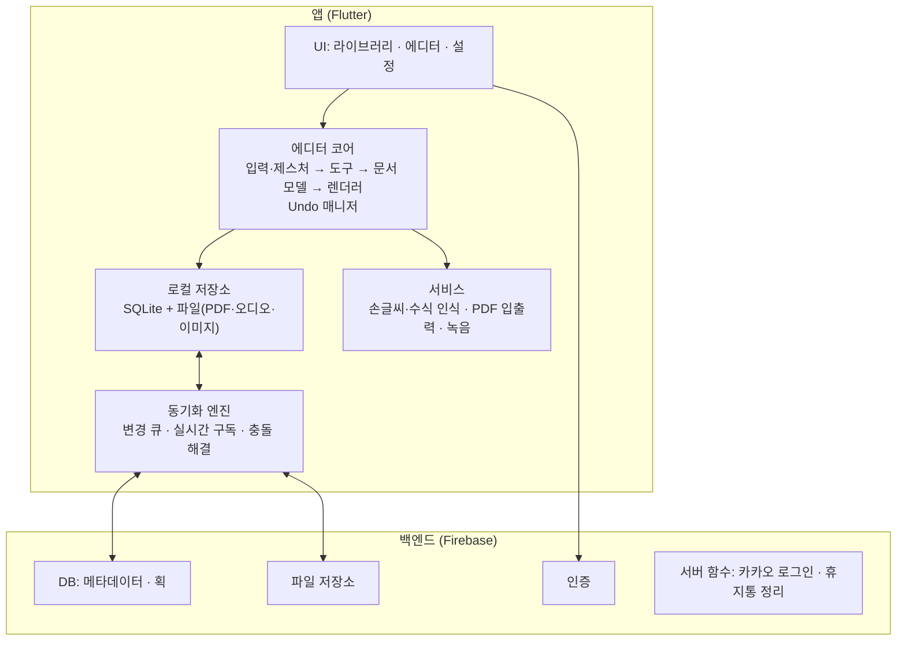

# 필기노트 앱 기획서 (v0.1 초안)

> 작성일: 2026-11-04 · 상태: 초안 (9장 '결정이 필요한 사항' 확정 후 v1.0으로 갱신)

---

## 목차

1. [개요](#1-개요)
2. [요청 기능 요약](#2-요청-기능-요약)
3. [요청 기능 상세 명세](#3-요청-기능-상세-명세)
4. [추가로 필요한 기능 (검토 결과)](#4-추가로-필요한-기능-검토-결과)
5. [기술 스택 제안](#5-기술-스택-제안)
6. [아키텍처](#6-아키텍처)
7. [화면 구성 (IA)](#7-화면-구성-ia)
8. [개발 로드맵](#8-개발-로드맵)
9. [결정이 필요한 사항](#9-결정이-필요한-사항)
10. [리스크와 대응](#10-리스크와-대응)

---

## 1. 개요

### 1.1 목표

태블릿과 스타일러스로 종이 노트를 대체하는 필기 앱을 만든다. 핵심 가치는 다음 네 가지다.

- **고품질 필기**: 다양한 펜, 필압 반응, 지연 없는 필기감
- **PDF 중심 학습/업무**: 강의자료·문서를 불러와 필기하고 다시 PDF로 저장
- **어디서나 이어 쓰기**: 계정 기반 실시간 동기화, 오프라인에서도 동작
- **똑똑한 필기**: 손글씨→텍스트, 손글씨 수식→LaTeX, 녹음과 필기 연동

### 1.2 타깃 사용자

| 사용자 | 주요 사용 장면 |
|---|---|
| 대학생 / 수험생 | 강의 PDF에 필기, 강의 녹음, 수식 필기, 암기 |
| 직장인 | 회의록, 문서 검토·서명, 아이디어 스케치 |
| 일반 사용자 | 다이어리, 플래너, 메모 |

### 1.3 타깃 플랫폼 (결정 필요 → 9장)

- 권장 1차: **iPad + 안드로이드 태블릿(갤럭시 탭)**
- 2차: 스마트폰(보기·간단 필기), Windows / 웹(뷰어)

---

## 2. 요청 기능 요약

우선순위: **P0** = 첫 출시(MVP) 필수 · **P1** = 출시 직후 · **P2** = 장기

| ID | 기능 | 우선순위 | 개발 단계 |
|---|---|---|---|
| F-01 | 폴더 구조 / 폴더 관리 | P0 | 2단계 |
| F-02 | PDF 불러오기 | P0 | 2단계 |
| F-03 | 다양한 펜 종류, 높은 필기 품질 | P0 (기본 5종) / P1 (추가 펜) | 1단계 |
| F-04 | 색·굵기 연속 선택 | P0 | 1단계 |
| F-05 | 자주 쓰는 펜 저장 (프리셋) | P0 | 1단계 |
| F-06 | 아이디(계정) 연동 | P0 | 3단계 |
| F-07 | 실시간 동기화 | P0 | 3단계 |
| F-08 | 되돌리기 / 다시 실행 100회 | P0 | 1단계 |
| F-09 | 일반(부분) 지우개, 획 단위 지우개 | P0 | 1단계 |
| F-10 | 손글씨 → 텍스트 변환 | P1 | 5단계 |
| F-11 | 도형 그리기 | P1 | 4단계 |
| F-12 | 터치 모드 / 제스처 설정 | P0 (기본) / P1 (사용자 지정) | 1·4단계 |
| F-13 | 페이지 삽입 | P0 | 1단계 |
| F-14 | 손글씨 수식 입력 | P1 | 5단계 |
| F-15 | PDF로 저장 (내보내기) | P0 | 2단계 |
| F-16 | 음성 녹음 + 필기 녹음 연동 | P1 | 4단계 |

---

## 3. 요청 기능 상세 명세

### F-01. 폴더 구조 / 폴더 관리

- 폴더 안에 폴더를 만들 수 있는 **트리 구조** (깊이 제한 없음)
- 폴더·노트: 생성, 이름 변경, **드래그 앤 드롭 이동**, 복사, 삭제
- **다중 선택** 후 일괄 이동 / 삭제 / 내보내기
- 정렬: 이름 · 생성일 · 수정일 · 사용자 지정 순서
- 보기: 그리드(표지 썸네일) / 리스트
- 폴더 색상·아이콘, 노트 표지 선택
- 상단 경로 표시(브레드크럼)로 상위 폴더 빠른 이동
- 사이드바에 폴더 트리 고정 표시 (태블릿 가로 모드)

### F-02. PDF 불러오기

- 가져오기 경로: 파일 앱 / 기기 저장소, 다른 앱의 '공유' · '다음으로 열기', 클라우드 드라이브
- 가져오는 방식: **새 노트로 만들기** 또는 **기존 노트에 페이지로 삽입**
- PDF 페이지를 노트 페이지 배경으로 사용 — 벡터로 렌더링해 확대해도 선명
- 대용량(수백 페이지) 대응: 화면에 보이는 페이지만 렌더링, 썸네일 캐시
- PDF 텍스트 선택·복사·검색, 목차(아웃라인)·내부 링크 이동 (P1)
- 암호 걸린 PDF 열기
- (P1) 이미지(JPG/PNG) 가져오기, (P2) PPT·Word 문서를 PDF로 변환해 가져오기

### F-03. 펜 종류 및 필기 품질

**펜 종류**

| 펜 | 특징 | 우선순위 |
|---|---|---|
| 볼펜 | 균일한 굵기, 필압에 약하게 반응 | P0 |
| 만년필 | 필압·속도에 따라 굵기 변화 | P0 |
| 형광펜 | 반투명, 겹쳐도 진해지지 않음, 글자 아래 레이어, 직선 보정 옵션 | P0 |
| 연필 | 종이 질감 텍스처, 기울이면 넓고 옅게 | P0 |
| 마커 | 불투명하고 굵은 선 | P0 |
| 붓펜 | 필압 민감도 큼, 획 끝이 가늘어짐 | P1 |
| 캘리그래피 펜 | 펜촉 각도에 따라 굵기 변화 | P1 |
| 점선 / 파선 펜 | 선 스타일 | P1 |
| 레이저 포인터 | 잠시 후 사라지는 선 (발표용) | P1 |
| 암기 테이프 | 내용을 가렸다가 탭하면 보임 (학습용) | P1 |

**품질 요구사항**

- 필압(pressure), 기울기(tilt), 방위각(azimuth) 반영
- **입력 지연 최소화**: 펜 입력 → 화면 표시 20ms 이내 목표 (예측 입력 사용, 120Hz 화면 대응)
- 손떨림 보정(스무딩) 단계 조절, 필압 곡선 조절
- 획 끝 가늘어짐(taper), 안티앨리어싱
- **벡터 저장**: 아무리 확대해도 선명, PDF 내보내기 시에도 벡터 유지

### F-04. 색·굵기 연속 선택

- 색상
  - HSV 컬러 휠 / 사각 피커로 **연속 선택**
  - 투명도 슬라이더
  - HEX · RGB 직접 입력
  - 스포이드 (화면에서 색 추출)
  - 최근 사용 색상, 사용자 팔레트 저장
- 굵기
  - **연속 슬라이더** (예: 0.1pt ~ 30pt, 0.1 단위)
  - 슬라이더 옆에 실제 굵기 미리보기 획 표시
- 툴바의 펜 아이콘을 길게 눌러 바로 조절하는 빠른 팝업

### F-05. 자주 쓰는 펜 저장 (프리셋)

- 프리셋 = 펜 종류 + 색 + 굵기 + 투명도 + 필압 감도 + 스무딩
- 툴바에 고정, 드래그로 순서 변경, 이름 지정
- 프리셋 그룹 (예: '수업용', '시험공부용')
- **계정 동기화** → 다른 기기에서도 같은 펜 사용

### F-06. 아이디(계정) 연동

- 로그인 방식: 이메일·비밀번호, Google, Apple, 카카오(국내 사용자)
  - iOS에서 소셜 로그인을 제공하면 Apple 로그인(또는 동등한 개인정보 보호 로그인)도 제공해야 함 — App Store 심사 지침
- 이메일 인증, 비밀번호 재설정
- **게스트 모드**: 로그인 없이 로컬로 사용 → 나중에 로그인하면 기존 노트 업로드
- 로그인된 기기 목록, 원격 로그아웃
- **회원 탈퇴 + 데이터 삭제** — App Store · Google Play 모두 앱 내 제공 필수

### F-07. 실시간 동기화

- **로컬 우선(local-first)**: 모든 편집은 먼저 기기에 저장 → 백그라운드로 업로드. 오프라인에서도 모든 기능 동작
- 온라인일 때 다른 기기에 **2초 이내 반영** 목표
- 동기화 단위는 **획(stroke) 단위 변경분** → 충돌 최소화, 데이터 사용량 절감
- 충돌 처리 (상세는 6.4)
  - 획·도형 등은 추가/삭제만 있는 집합으로 처리 → 두 기기에서 동시에 써도 둘 다 보존
  - 제목, 폴더 위치 등 속성은 마지막 수정 우선
- PDF · 녹음 · 이미지 같은 큰 파일은 별도 파일 저장소에 올리고, 다른 기기는 열 때 내려받기
- 동기화 상태 표시: 완료 / 진행 중 / 오프라인 / 오류
- 범위 결정 필요: 내 기기 간 동기화만? 다른 사람과 공동 편집까지? (9장)

### F-08. 되돌리기 / 다시 실행 (100회)

- 노트 단위 히스토리, **최대 100단계**, 넘으면 가장 오래된 것부터 삭제
- 대상: 필기, 지우기, 선택 이동·크기·회전·색 변경, 도형, 텍스트, 이미지, 수식, 페이지 삽입·삭제·이동 등 **모든 편집**
- 펜을 한 번 대었다 뗀 동작 = 1단계 (부분 지우개로 여러 획이 잘려도 1단계)
- 새 편집을 하면 다시 실행 목록은 비움
- 내 기기에서 한 편집만 되돌림 (다른 기기에서 동기화로 들어온 변경은 대상 아님)
- 입력: 툴바 버튼, 제스처(F-12), 키보드 단축키 (Ctrl/⌘+Z, Ctrl/⌘+Shift+Z)

### F-09. 지우개

- **획 지우개**: 닿은 획 전체 삭제
- **일반(부분) 지우개**: 닿은 부분만 삭제 — 벡터 획을 잘라내는 방식으로 구현해 품질 유지
- 지우개 크기 연속 조절, 지우개 범위 원형 커서 표시
- 옵션
  - 형광펜만 지우기 / 형광펜 제외하고 지우기
  - 지운 뒤 이전 펜으로 자동 복귀
- 펜 버튼 · 펜 더블탭으로 지우개 전환 (F-12)
- 현재 페이지 전체 지우기

### F-10. 손글씨 → 텍스트

- 올가미로 선택한 손글씨를 텍스트로 변환 → 텍스트 상자로 바꾸거나 클립보드로 복사
- **한국어 + 영어 혼용 인식 필수**
- 인식 결과 수정: 후보 단어 선택, 직접 편집
- 엔진 후보 (5장)
  - Google ML Kit Digital Ink Recognition — 기기 안에서 동작, 무료, 한국어 지원
  - MyScript iink SDK — 상용, 정확도 높음, 수식까지 지원
- 같은 인식 결과로 **손글씨 검색** 색인 생성 (4장 추가 기능)

### F-11. 도형 그리기

- 도형 도구: 직선, 화살표, 사각형, 원·타원, 삼각형, 다각형, 별
- **자동 도형 보정**: 손으로 그리고 펜을 잠시 멈추면 반듯한 도형으로 바뀜
- 테두리 색·굵기·선 스타일, 채우기 색
- 편집 핸들: 크기, 회전, 꼭짓점 이동
- (P1) 그리드 스냅, 자(눈금자) 도구

### F-12. 터치 모드 / 제스처 설정

**입력 모드**

- 펜 전용 모드: 펜으로만 필기, 손가락은 스크롤·확대만
- 손가락 필기 허용 모드 (스타일러스 없는 기기용)
- **팜 리젝션**: 손바닥이 화면에 닿아도 필기되지 않음

**제스처 매핑** (각 항목 켜기/끄기, 동작 변경 가능)

| 제스처 | 기본 동작 |
|---|---|
| 두 손가락 탭 | 되돌리기 |
| 세 손가락 탭 | 다시 실행 |
| 두 손가락 드래그 | 스크롤 |
| 핀치 | 확대 / 축소 |
| 손가락 길게 누르기 | 올가미 선택 / 붙여넣기 메뉴 |
| 펜 측면 버튼 (S펜) | 지우개 전환 |
| Apple Pencil 더블탭 / 스퀴즈 | 지우개 전환 / 도구 팔레트 |
| 한 손가락 드래그 (펜 전용 모드) | 스크롤 |

### F-13. 페이지 삽입

- 위치: 현재 페이지 앞 / 뒤, 맨 끝
- 종류: 빈 페이지, 속지 템플릿(줄, 모눈, 점, 코넬, 악보, 플래너), PDF 페이지, 이미지, 다른 노트의 페이지 복사
- 페이지 크기: A4, Letter, 16:9, 사용자 지정 / 가로·세로
- 속지 색상 (흰색, 미색, 검정 등)
- 페이지 관리 기능은 4장 참고 (삽입 외에 삭제·복제·순서 변경 필요)

### F-14. 손글씨 수식 입력

- 수식 입력 영역에 손으로 쓰면 → **LaTeX로 인식** → 깔끔한 수식으로 표시
- 지원 범위: 분수, 지수·첨자, 루트, 적분, 시그마, 극한, 행렬, 그리스 문자, 연립방정식
- 쓰는 중 실시간 미리보기, 잘못 인식된 부분 고쳐 쓰기, LaTeX 직접 편집
- 수식 객체: 이동, 크기·색 변경, 다시 편집
- LaTeX 복사 → 다른 문서에 붙여넣기
- 엔진 후보: MyScript iink SDK (Math), Mathpix API — **둘 다 유료**. 무료 온디바이스 엔진으로는 복잡한 수식 인식이 어려움 → 수익 모델과 함께 결정 (9장)

### F-15. PDF로 저장 (내보내기)

- 범위: 노트 전체 / 선택한 페이지 / 현재 페이지
- 필기는 **벡터로 출력** (확대해도 선명), 원본 PDF의 텍스트는 그대로 유지(검색 가능)
- 옵션: 속지 포함 여부, 필기 포함 여부(원본만 내보내기)
- 공유 시트 (메일, 메신저, 드라이브 저장), 인쇄
- 대용량 노트는 백그라운드 생성 + 진행률 표시
- (P1) 이미지(PNG/JPG) 내보내기, 앱 전용 형식(편집 가능한 상태로 백업·공유)

### F-16. 음성 녹음 + 필기 녹음 연동

- 노트 안에서 녹음 시작 / 일시정지 / 정지, 노트 하나에 여러 녹음 가능
- **백그라운드 녹음** (다른 앱으로 전환하거나 화면이 꺼져도 계속)
- **필기 연동**: 녹음 중 쓴 획마다 녹음 시점을 기록
  - 재생하면 그 시점에 쓴 필기가 순서대로 강조 표시
  - 필기를 탭하면 그 필기를 쓰던 시점부터 재생
- 재생 속도 0.5x ~ 2x, 10초 앞뒤 이동
- 녹음 파일 압축(AAC/Opus) 후 동기화, 용량 표시, 녹음만 따로 삭제
- 녹음 시작 시 '타인의 음성 녹음 시 동의 필요' 안내
- (P2) 음성 → 텍스트 변환, 강의 요약

---

## 4. 추가로 필요한 기능 (검토 결과)

요청 목록에서 빠져 있지만 필기 앱에 필요한 기능을 정리했다.

### 4.1 반드시 필요 (P0 — 없으면 사용성이 크게 떨어짐)

| 기능 | 필요한 이유 |
|---|---|
| **올가미(선택) 도구** | 쓴 필기를 선택해 이동·크기 조절·회전·색 변경·복사·잘라내기. 손글씨→텍스트, 수식 변환도 '선택'이 전제 |
| **팜 리젝션** | 손바닥 오입력 방지. 필기 앱의 기본 |
| **확대/축소, 스크롤** | 핀치 줌, 페이지 너비 맞춤, 확대 상태에서 필기 |
| **페이지 삭제·복제·순서 변경, 썸네일 보기** | 요청엔 '삽입'만 있음. 관리 기능이 함께 있어야 함 |
| **속지 템플릿** | 줄노트, 모눈, 점, 코넬 노트 등 |
| **자동 저장** | 저장 버튼 없이 모든 변경 즉시 저장. 앱 강제 종료·배터리 방전에도 손실 없음 |
| **오프라인 사용** | 실시간 동기화와 한 쌍. 인터넷 없이 필기하고 연결되면 자동 동기화 |
| **휴지통** | 삭제한 노트·폴더를 30일 보관 후 영구 삭제. 동기화로 다른 기기에서도 지워지므로 복구 수단 필수 |
| **검색** | 노트 제목, 폴더 이름, PDF 텍스트 (P1: 손글씨 내용) |
| **텍스트 상자** | 키보드로 타이핑 입력 |
| **이미지 삽입** | 사진·카메라 촬영·스크린샷 붙여넣기 |

### 4.2 있으면 경쟁력 상승 (P1)

- **손글씨 검색**: F-10 인식 결과로 필기 내용 검색
- **버전 기록**: 노트를 과거 시점으로 복원 (동기화 실수 대비)
- **태그, 즐겨찾기(별표), 최근 노트**: 폴더만으로 부족한 분류 보완
- **탭 / 분할 화면**: 교재 PDF와 필기 노트를 나란히
- **노트 잠금**: 비밀번호, Face ID / 지문
- **자(눈금자)**, 레이저 포인터, **발표 모드**(외부 모니터에 필기만 표시)
- **키보드 단축키**
- **다크 모드** (UI + 페이지 색 반전 옵션)
- **암기 테이프** (수험생 수요 높음)
- **요소(스티커) 저장**: 자주 쓰는 필기·도형을 저장해 재사용
- **링크**: 노트 간 링크, 웹 링크
- **전체 백업 / 복원** (계정 데이터 일괄 내보내기)
- **공유 링크**: 계정 없는 사람도 웹에서 읽기 전용으로 보기
- **페이지를 다른 노트로 이동**, 페이지 북마크

### 4.3 장기 (P2)

- 다른 사용자와 **실시간 공동 편집** (커서·필기 실시간 표시)
- AI 기능: 녹음 텍스트 변환·요약, 필기 요약, 복습 문제 생성
- 스마트폰 · PC · 웹 버전
- 속지/스티커 마켓

### 4.4 비기능 요구사항 (놓치기 쉬운 부분)

| 항목 | 목표 |
|---|---|
| 필기 지연 | 펜 입력 → 화면 표시 20ms 이내 (120Hz 기기 기준) |
| 성능 | 500페이지 PDF, 노트당 획 10만 개에서도 60fps 스크롤 |
| 앱 시작 | 2초 이내 라이브러리 표시 |
| 데이터 안전 | 크래시·강제 종료 시에도 마지막 획까지 보존 |
| 동기화 | 온라인 시 다른 기기 반영 2초 이내, 데이터 손실 0건 |
| 보안 | 전송 구간 암호화(TLS), 서버 저장 데이터 암호화, 본인 데이터만 접근 가능한 권한 규칙 |
| 저장 용량 | 획 데이터 압축, 같은 PDF는 한 번만 저장(중복 제거), 사용자별 클라우드 용량 한도 |
| 다국어 | 한국어 / 영어 UI |
| 접근성 | 글자 크기 확대, 색약 대응 팔레트 |

### 4.5 운영 · 법적 요건

- **개인정보 처리방침 · 이용약관** (스토어 심사 필수)
- **앱 내 회원 탈퇴 및 데이터 삭제** (App Store · Google Play 필수)
- 마이크 · 사진 · 파일 접근 권한 요청 문구
- 크래시 리포트, 사용 통계 (Firebase Crashlytics / Sentry)
- 오픈소스 라이선스 고지 (PDFium 등)
- **수익 모델**: 수식 인식(유료 SDK/API)과 클라우드 저장 비용을 감당할 구조 필요
  - 예: 무료(로컬 + 제한된 클라우드 용량) / 구독(용량 확대, 수식 인식, 녹음 텍스트 변환, AI 기능)

---

## 5. 기술 스택 제안

### 5.1 개발 방식 비교

| 방식 | 장점 | 단점 |
|---|---|---|
| **A. Flutter** (iPad + 안드로이드 + 추후 PC/웹) | 코드 하나로 여러 플랫폼, 캔버스 직접 렌더링으로 펜 표현 자유도 높음. 오픈소스 Flutter 필기 앱(Saber) 사례 있음 | 네이티브보다 필기 지연 튜닝 필요, 일부 펜 기능(Apple Pencil 스퀴즈, S펜 버튼)은 네이티브 연동 코드 필요 |
| B. 네이티브 각각 (Swift + Kotlin) | 최저 지연, PencilKit · Jetpack Ink 등 OS 기능 활용 | 개발량 약 2배 |
| C. 공통 C++ 잉크 엔진 + 네이티브 UI | 상용 앱 수준 품질·성능 | 난이도와 기간이 가장 큼 |

**권장: A (Flutter)**. 소규모 팀으로 iPad와 갤럭시 탭에 동시 출시할 수 있다. 단, 0단계 PoC에서 필기 지연을 측정해 목표(20ms)에 못 미치면 렌더링 부분만 네이티브로 바꾸는 방안을 둔다.
타깃이 **iPad 하나뿐이라면 B(Swift + Metal)** 가 더 낫다.

### 5.2 세부 스택 (Flutter 기준, 착수 시 각 패키지 최신 상태 재확인)

| 영역 | 후보 |
|---|---|
| 상태 관리 | Riverpod |
| 필기 렌더링 | CustomPainter + 레이어 캐싱 (6.3) |
| 획 생성 알고리즘 | 필압 기반 외곽선 생성 (perfect-freehand 계열) + 스무딩 |
| 로컬 DB | SQLite (drift) |
| PDF 렌더링 | pdfrx (PDFium 기반) |
| PDF 내보내기 | 원본 PDF 페이지 위에 벡터 필기 합성 — PDFium 직접 사용 또는 syncfusion_flutter_pdf (라이선스 조건 확인) |
| 손글씨 인식 | google_mlkit_digital_ink_recognition (한국어 지원, 온디바이스) |
| 수식 인식 | MyScript iink SDK 또는 Mathpix API (유료) |
| 수식 렌더링 | flutter_math_fork (KaTeX 기반) |
| 녹음 / 재생 | record / just_audio |
| 인증 · DB · 파일 · 서버 함수 | Firebase (Auth, Firestore, Storage, Cloud Functions) |
| 모니터링 | Firebase Crashlytics |

### 5.3 백엔드: Firebase 권장 (대안: Supabase)

- 로그인(Google · Apple · 이메일), 실시간 구독, 오프라인 캐시, 파일 저장소를 한 번에 해결 → MVP 개발 속도 최우선
- 카카오 로그인은 Cloud Functions에서 Firebase 커스텀 토큰을 발급해 연동
- **비용 주의**: Firestore는 쓰기 횟수로 과금 → 획 하나마다 쓰지 말고 페이지 단위로 0.5~1초 묶어서 업로드
- 문서 1개 최대 1MB 제한 → 페이지 획 데이터는 여러 덩어리(chunk)로 나눠 저장

---

## 6. 아키텍처

### 6.1 전체 구조



### 6.2 데이터 모델

```text
User        { id, email, displayName, settings, createdAt }
PenPreset   { id, userId, name, tool, color(ARGB), width, opacity,
              pressureCurve, smoothing, order, group }
Folder      { id, ownerId, parentId(null=최상위), name, color, icon,
              sortKey, updatedAt, deletedAt }
Note        { id, ownerId, folderId, title, cover, tags[],
              createdAt, updatedAt, deletedAt }
Page        { id, noteId, sortKey, width, height,
              background { type: blank|template|pdf|image,
                           template, color, assetId, pdfPageIndex },
              updatedAt, deletedAt }
Stroke      { id, pageId, tool, color, width, opacity,
              points[{ x, y, pressure, tilt, azimuth, t }], bbox,
              recordingId?, recordingOffsetMs?, createdAt, deletedAt }
Shape       { id, pageId, kind, geometry, strokeStyle, fill, transform }
TextBox     { id, pageId, rect, content, style }
MathObject  { id, pageId, rect, latex, color }
ImageObject { id, pageId, rect, rotation, assetId }
Recording   { id, noteId, assetId, durationMs, startedAt }
Asset       { id(=내용 해시), type: pdf|image|audio, size, storagePath }
```

- 좌표는 페이지 기준 논리 단위(pt) → 기기 해상도와 무관
- 획의 점 데이터는 델타 인코딩 + 바이너리로 압축 저장
- 모든 항목에 `deletedAt`(소프트 삭제) → 휴지통과 동기화 충돌 처리에 사용
- `sortKey`는 분수 인덱스(fractional index) → 두 기기에서 동시에 페이지를 끼워 넣어도 순서 충돌 없음
- `Stroke.recordingOffsetMs` → 녹음 재생 시 필기 강조(F-16)

### 6.3 렌더링 전략

- 레이어 순서: 배경(속지·PDF) → 형광펜 → 일반 필기·도형·텍스트 → 선택 표시 · 쓰는 중인 획
- 다 쓴 획은 페이지 타일 이미지로 캐시하고, 확대 배율이 바뀌면 다시 생성
- **쓰는 중인 획만 매 프레임 그림** (+ 예측 입력으로 체감 지연 감소)
- 화면 밖 페이지는 메모리에서 해제 (가상화)
- 공간 색인(그리드 / R-tree)으로 지우개·올가미 판정 고속화

### 6.4 동기화 설계

1. 모든 편집 → 로컬 DB 트랜잭션 + '보낼 변경' 큐에 기록
2. 온라인이면 큐를 묶어서 서버로 전송 (0.5~1초 디바운스)
3. 서버 변경은 실시간 구독으로 받아 로컬 DB에 반영 → 화면 갱신
4. 충돌 규칙
   - 획·도형 등 페이지 요소: ID 기반 추가 / 삭제 표시 → 동시에 써도 모두 보존
   - 이동·색 변경 등 속성 수정: 요소별 마지막 수정 우선 (서버 시간 기준)
   - 페이지 순서: 분수 인덱스로 충돌 회피
   - 폴더 이동: 순환 구조(A를 B 안에, B를 A 안에 동시 이동) 검사 후 한쪽 취소
5. 큰 파일(PDF · 오디오 · 이미지): 내용 해시로 중복 없이 업로드, 다른 기기는 열 때 내려받음
6. 앱 첫 실행 · 장시간 오프라인 후: 마지막 동기화 시점 이후 변경분만 받아옴

### 6.5 되돌리기 설계

- 커맨드 패턴: 각 편집을 `{ 실행, 취소 }` 쌍으로 기록하며, 전체 상태가 아닌 **변경분만 저장** → 100단계도 메모리 부담 적음
  - 예: 획 추가, 획 삭제, 획 분할(부분 지우개), 선택 변형, 페이지 삽입·삭제·이동
- 최대 100개 원형 버퍼, 새 편집 시 다시 실행 목록 비움
- 되돌리기도 하나의 새 변경으로 동기화되어 다른 기기에 반영

---

## 7. 화면 구성 (IA)

```text
앱
├─ 로그인 / 회원가입 / 게스트로 시작
├─ 라이브러리 (홈)
│   ├─ 사이드바: 폴더 트리 · 최근 · 즐겨찾기 · 휴지통
│   ├─ 노트 목록 (그리드 / 리스트, 정렬)
│   ├─ 검색
│   └─ 새로 만들기: 노트 · 폴더 · PDF 가져오기
├─ 노트 에디터
│   ├─ 상단 툴바: 펜 · 지우개 · 올가미 · 도형 · 텍스트 · 이미지 · 수식 · 녹음 · 되돌리기/다시 실행
│   ├─ 펜 프리셋 바
│   ├─ 펜 설정 팝업: 종류 · 색 · 굵기 · 투명도
│   ├─ 페이지 썸네일 패널: 삽입 · 삭제 · 복제 · 순서 변경
│   ├─ 녹음 재생 바
│   └─ 더보기: PDF 내보내기 · 공유 · 인쇄 · 노트 정보
└─ 설정
    ├─ 계정 · 기기 관리 · 동기화 상태 · 저장 용량 · 회원 탈퇴
    ├─ 입력: 펜 전용 모드 · 팜 리젝션 · 제스처 매핑
    ├─ 펜: 필압 곡선 · 손떨림 보정
    └─ 일반: 테마 · 기본 속지 · 언어
```

---

## 8. 개발 로드맵

1~2인 개발 기준 예상치. 인원과 플랫폼 결정(9장)에 따라 조정한다.

| 단계 | 기간 | 내용 | 완료 기준 |
|---|---|---|---|
| **0. 기술 검증 (PoC)** | 2~3주 | 필기 지연·필압 렌더링, 대용량 PDF 렌더링, 손글씨·수식 인식 엔진 비교 | 지연 20ms 목표 충족 여부 판정, 엔진 선정 |
| **1. 코어 에디터** | 6~8주 | 펜 5종, 색·굵기 연속 선택, 프리셋, 지우개 2종, 되돌리기 100회, 올가미, 확대·스크롤, 팜 리젝션, 기본 제스처, 페이지 삽입·삭제·순서 변경, 속지, 자동 저장 | 기기 안에서 노트 필기 완결 |
| **2. 라이브러리 & PDF** | 4주 | 폴더 관리, 휴지통, PDF 가져오기·내보내기, 제목 검색 | PDF 필기 후 PDF로 저장 가능 |
| **3. 계정 & 동기화** | 5~6주 | 로그인, 게스트→계정 전환, 로컬 우선 동기화, 파일 동기화, 충돌 처리, 회원 탈퇴 | 두 기기 동시 편집·오프라인 테스트 통과 |
| ── **MVP 내부 출시** ── | | 0~3단계 (약 4~5개월) | |
| **4. 고급 편집** | 5~6주 | 도형(도구 + 자동 보정), 제스처 사용자 지정, 녹음 + 필기 연동, 텍스트 상자, 이미지 | |
| **5. 인식 기능** | 4~6주 | 손글씨→텍스트, 손글씨 수식→LaTeX, 손글씨 검색 | |
| **6. 베타 & 출시** | 4주 | TestFlight · Play 내부 테스트, 성능 최적화, 개인정보 처리방침, 스토어 심사 | 스토어 정식 출시 |

**총 예상: 약 7~9개월**

---

## 9. 결정이 필요한 사항

| # | 질문 | 영향 |
|---|---|---|
| 1 | **타깃 플랫폼**: iPad만? 갤럭시 탭 포함? PC·웹도? | 개발 방식(Flutter vs 네이티브) 결정 |
| 2 | **'실시간 동기화'의 범위**: 내 기기끼리만? 다른 사람과 공동 편집까지? | 공동 편집이면 동기화 설계 난이도·기간 크게 증가 |
| 3 | **수익 모델**: 무료 / 일회성 구매 / 구독? | 유료 수식 인식 엔진, 클라우드 비용 감당 가능 여부 |
| 4 | **개발 인원과 목표 출시일** | 로드맵 범위 조정 |
| 5 | **페이지 방식 vs 무한 캔버스** (둘 다 지원?) | 데이터 모델, 렌더링 구조 |
| 6 | **백엔드**: Firebase / Supabase / 자체 서버 | 비용 구조, 확장성 |
| 7 | 한국어 손글씨 인식 최소 정확도 기준 | 인식 엔진 선정 |

---

## 10. 리스크와 대응

| 리스크 | 영향 | 대응 |
|---|---|---|
| 필기 지연·품질 부족 (크로스플랫폼 한계) | 핵심 가치 훼손 | 0단계에서 실측 검증, 미달 시 렌더링만 네이티브로 교체 |
| 수식 인식 정확도·비용 | 유료 SDK/API 비용 발생 | PoC에서 엔진 비교, 구독 기능으로 묶기 |
| 동기화 버그로 데이터 손실 | 사용자 신뢰 치명적 손상 | 로컬 우선 + 소프트 삭제 + 버전 기록, 동기화 자동화 테스트 |
| 클라우드 비용 증가 (PDF·녹음 용량) | 운영비 부담 | 사용자별 용량 한도, 오디오 압축, 해시 중복 제거 |
| 대용량 PDF 메모리 부족 | 크래시 | 페이지 가상화, 타일 렌더링 |
| 한국어 손글씨 인식률 | 사용자 불만 | 후보 단어 선택 UI, 엔진 비교 |
| 스토어 심사 거절 | 출시 지연 | Apple 로그인, 회원 탈퇴, 개인정보 처리방침 사전 준비 |
