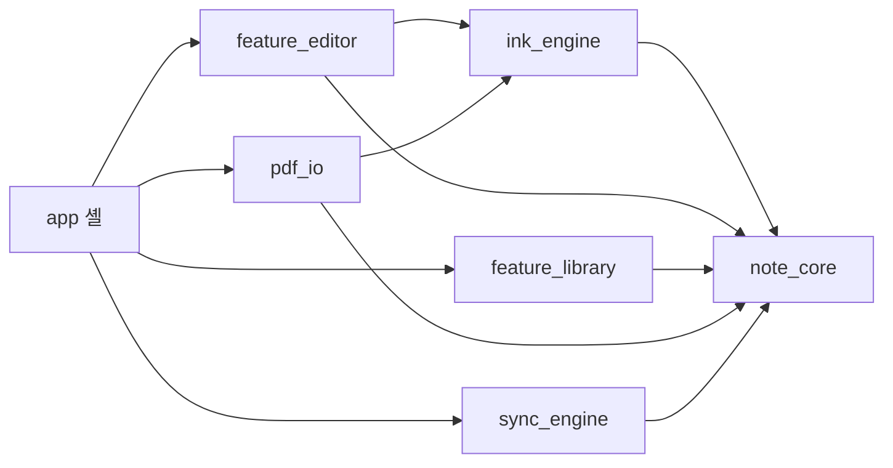

# 동시 개발 영역 개요

> 상태: 초안 (총괄 관리자 검토 전) · 마스터 기획서: [docs/PLAN.md](../PLAN.md) v1.1

## 1. 목적

`docs/PLAN.md`의 M0~M2 전체와 M3(PDF) · M4(동기화)의 핵심 로직을 여러 영역으로 나눠 **동시에** 개발한다.

진행 순서:

1. 영역마다 상세 계획서(`docs/plans/NN-*.md`) 작성
2. 총괄 관리자가 모든 계획서를 읽고 피드백 (`00-review.md`), 영역 간 공통 결정을 이 문서 '통합 계약'(7장)에 확정
3. 각 영역이 피드백대로 계획서 수정 → 총괄 관리자 승인
4. 기반 단계: 워크스페이스 · 패키지 골격 · 계약 타입 · 자리표시 화면을 먼저 만들어 커밋
5. 영역별로 동시에 개발 (영역마다 별도 git worktree)
6. 통합: 합친 뒤 분석 · 테스트 · 웹 빌드 통과까지 맞춤

## 2. 영역 지도

| ID | 영역 | 계획서 | 소유 경로 | 이번 범위 |
|---|---|---|---|---|
| INFRA | 기반 · 빌드 · 배포 | `01-infra.md` | 루트 `pubspec.yaml`(워크스페이스), `analysis_options.yaml`, `app/`, `.github/`, `tool/`, `docs/guides/` | M0 기반, 앱 셸(라우팅·의존성 연결), CI, 웹 배포, 사용자 안내서 |
| CORE | 문서 모델 · 저장 · 되돌리기 | `02-core.md` | `packages/note_core/` | 데이터 모델, 로컬 DB, 자동 저장, 되돌리기 100회, 폴더·휴지통·검색 데이터, 동기화용 변경 기록 |
| INK | 필기 엔진 | `03-ink.md` | `packages/ink_engine/` | 획 생성·렌더링, 펜 5종, 지우개 2종·올가미 기하 계산, 속지 렌더링 |
| EDITOR | 에디터 화면 | `04-editor.md` | `packages/feature_editor/` | 필기 화면, 입력·제스처 분배, 툴바, 펜 설정·프리셋, 페이지 패널, 개발자 표시 |
| LIBRARY | 라이브러리 화면 | `05-library.md` | `packages/feature_library/` | 폴더 트리, 노트 목록, 휴지통, 검색, 새 노트·폴더 만들기 |
| PDF | PDF 입출력 | `06-pdf.md` | `packages/pdf_io/` | PDF 가져오기, 배경 렌더링, PDF 내보내기 (M3 선개발) |
| SYNC | 계정 · 동기화 | `07-sync.md` | `packages/sync_engine/` | 동기화 엔진 핵심 로직 + 가짜 백엔드 테스트, Firebase 어댑터 골격 (M4 선개발) |

### 의존 방향 (초안)

## 3. 이번 범위에서 제외 (후속 영역)

- **M5 편집 강화** (도형, 텍스트 상자, 이미지, 제스처 사용자 지정, 추가 펜): EDITOR · INK가 안정된 뒤 진행
- **M6 녹음, M7 인식**: 웹·클라우드 환경에서 검증이 어려워 네이티브 전환 후 진행. 단, 데이터 모델에는 녹음 시점 필드(`recordingId`, `recordingOffsetMs`)를 미리 둔다
- **네이티브 전환 (TestFlight)**: Apple 개발자 계정 필요. INFRA는 워크플로 초안만 작성

## 4. 동시 개발 방식 (모든 계획서의 전제)

1. **계약 우선**: 영역 사이에 공유하는 타입 · 인터페이스는 개발 시작 전에 '계약'으로 고정한다. 공유 데이터 타입은 원칙적으로 CORE가 소유한다.
2. **소유 경로만 수정**: 각 영역은 별도 git worktree에서 자기 소유 경로만 고친다. 다른 영역 경로나 공용 파일 변경이 필요하면 직접 고치지 않고 결과 보고에 '변경 요청'으로 남긴다.
3. **가짜 구현으로 테스트**: 다른 영역 구현은 동시에 만들어지므로, 계약 인터페이스의 가짜(fake) 구현으로 자기 영역을 테스트한다.
4. **기반 단계 먼저**: 동시 개발 전에 워크스페이스, 각 패키지 골격, 계약 타입, 자리표시 화면을 만들어 커밋한다. 이 상태에서 `flutter analyze`와 웹 빌드가 통과해야 한다.
5. **통합 단계**: 모든 영역을 합친 뒤 분석 · 테스트 · 웹 빌드가 통과하도록 맞춘다.

## 5. 개발 환경 제약

- Flutter **3.47.9** (Dart **3.13.7**), 리눅스 클라우드 컨테이너 (CPU 4, 메모리 15GB)
- iOS · 안드로이드 기기와 에뮬레이터 없음 → 검증 수단은 `flutter analyze`, `flutter test`(단위·위젯·골든), `flutter build web`
- 사용자 상황
  - Mac 없음, PC 개발 환경 없음, Apple 개발자 계정은 나중에
  - iPad Pro 13인치. 펜슬 종류 미확인 → **필압이 없는 펜슬(Apple Pencil USB-C)이나 손가락에서도 정상 동작**해야 함
  - 안드로이드 태블릿 보유 여부 미확인
- M0~M2는 **웹 빌드를 iPad Safari에서** 테스트 → 이번 범위 코드는 웹에서 동작해야 함
  - `dart:io` 직접 사용 금지. 플랫폼별 기능은 조건부 import나 인터페이스로 분리
- 비공개 GitHub 저장소. Firebase 프로젝트는 아직 없음
- 외부 패키지는 pub.dev에서 Dart 3.13 호환 · 웹 지원 · 라이선스를 확인하고 버전을 고정

## 6. 계획서 공통 목차

모든 영역 계획서는 아래 목차를 따른다.

1. 목적과 범위 — 이번 동시 개발 범위 / 이후 범위 / 제외
2. PLAN.md 요구사항 대응표 — 기능 ID · 로드맵 체크리스트 항목 → 이 계획서의 작업
3. 소유 경로와 패키지 구조 — 디렉터리 트리
4. 공개 API — 다른 영역이 쓰는 것. Dart 시그니처로
5. 사용하는 다른 영역의 계약 — 가정한 시그니처, 테스트용 가짜 구현
6. 설계 상세 — 알고리즘, 데이터 흐름, 상태 관리
7. 외부 패키지 — 이름 · 버전 · 웹 지원 · 라이선스
8. 작업 분해 — 순서, 작업별 완료 조건
9. 테스트 계획 — 컨테이너에서 자동 실행할 것 / 사용자가 iPad에서 확인할 것
10. 완료 기준
11. 리스크와 대응
12. 총괄 관리자에게 묻는 질문 — 다른 영역과 조율이 필요한 사항

## 7. 통합 계약

(총괄 관리자 검토 후 확정)
