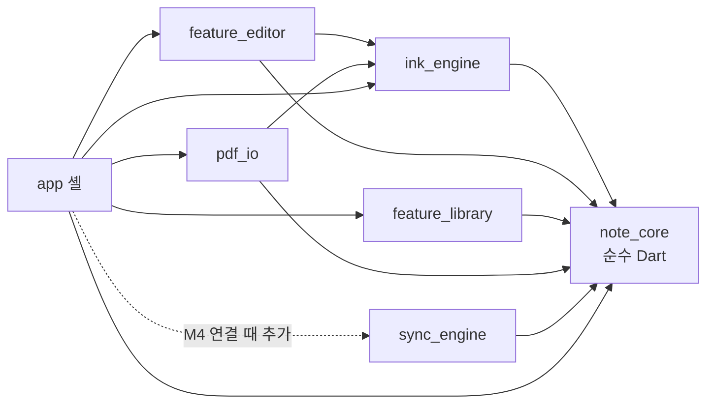

# 동시 개발 영역 개요

> 상태: **1차 통합 완료(V1~V6) — V7 사용자 기기 확인 대기** (통합 계약 v1.5, 2026-11-05 · 4차 승인 검토 · 최종 승인 2026-11-05 — 7개 영역 계획서 01~07 모두 승인) · 마스터 기획서: [docs/PLAN.md](../PLAN.md) v1.1 · 검토 결과: [00-review.md](00-review.md) ('최종 승인' 절에 개발 중 주의할 점, ['1차 통합 결과'](00-review.md#1차-통합-결과) 절에 통합 결과와 남은 일)

## 1. 목적

`docs/PLAN.md`의 M0~M2 전체와 M3(PDF) · M4(동기화)의 핵심 로직을 여러 영역으로 나눠 **동시에** 개발한다.

진행 순서:

1. 영역마다 상세 계획서(`docs/plans/NN-*.md`) 작성
2. 총괄 관리자가 모든 계획서를 읽고 피드백 (`00-review.md`), 영역 간 공통 결정을 이 문서 '통합 계약'(7장)에 확정
3. 각 영역이 피드백대로 계획서 수정 → 총괄 관리자 승인
4. 기반 단계: 워크스페이스 · 패키지 골격 · 계약 타입 · 자리표시 화면을 먼저 만들어 커밋
5. 영역별로 동시에 개발 (영역마다 별도 git worktree)
6. 통합: 합친 뒤 분석 · 테스트 · 웹 빌드 통과까지 맞춤

## 2. 영역 지도

| ID | 영역 | 계획서 | 소유 경로 | 이번 범위 |
|---|---|---|---|---|
| INFRA | 기반 · 빌드 · 배포 | `01-infra.md` | 루트 `pubspec.yaml`(워크스페이스), `pubspec.lock`, `analysis_options.yaml`, `.gitignore`, `.gitattributes`, `app/`, `.github/`, `tool/`, `docs/guides/` | M0 기반, 앱 셸(라우팅·의존성 연결·설정 화면 틀), CI, 웹 배포, 사용자 안내서 |
| CORE | 문서 모델 · 저장 · 되돌리기 | `02-core.md` | `packages/note_core/` | 데이터 모델, 로컬 DB, 자동 저장, 되돌리기 100회, 폴더·휴지통·검색 데이터, 동기화용 변경 기록 |
| INK | 필기 엔진 | `03-ink.md` | `packages/ink_engine/` | 획 생성·렌더링, 펜 5종, 지우개 2종·올가미 기하 계산, 속지 렌더링(6종), 썸네일 렌더러 |
| EDITOR | 에디터 화면 | `04-editor.md` | `packages/feature_editor/` | 필기 화면, 입력·제스처 분배, 툴바, 펜 설정·프리셋, 페이지 패널, 개발자 표시 |
| LIBRARY | 라이브러리 화면 | `05-library.md` | `packages/feature_library/` | 폴더 트리, 노트 목록, 휴지통, 검색, 새 노트·폴더 만들기, 표지 썸네일 예약 |
| PDF | PDF 입출력 | `06-pdf.md` | `packages/pdf_io/` | PDF 가져오기, 배경 렌더링, PDF 내보내기 (M3 선개발) |
| SYNC | 계정 · 동기화 | `07-sync.md` | `packages/sync_engine/` | 동기화 엔진 핵심 로직 + 가짜 백엔드 테스트, Firebase 어댑터 골격 (M4 선개발) |

### 의존 방향 (확정 — 7.1)



## 3. 이번 범위에서 제외 (후속 영역)

- **M5 편집 강화** (도형, 텍스트 상자, 이미지, 제스처 사용자 지정, 추가 펜): EDITOR · INK가 안정된 뒤 진행
- **M6 녹음, M7 인식**: 웹·클라우드 환경에서 검증이 어려워 네이티브 전환 후 진행. 단, 데이터 모델에는 녹음 시점 필드(`recordingId`, `recordingOffsetMs`)를 미리 둔다
- **네이티브 전환 (TestFlight)**: Apple 개발자 계정 필요. INFRA는 워크플로 초안만 작성

## 4. 동시 개발 방식 (모든 계획서의 전제)

1. **계약 우선**: 영역 사이에 공유하는 타입 · 인터페이스는 개발 시작 전에 '계약'으로 고정한다. 공유 데이터 타입은 원칙적으로 CORE가 소유한다.
2. **소유 경로만 수정**: 각 영역은 별도 git worktree에서 자기 소유 경로만 고친다. 다른 영역 경로나 공용 파일 변경이 필요하면 직접 고치지 않고 결과 보고에 '변경 요청'으로 남긴다.
3. **가짜 구현으로 테스트**: 다른 영역 구현은 동시에 만들어지므로, 계약 인터페이스의 가짜(fake) 구현으로 자기 영역을 테스트한다.
4. **기반 단계 먼저**: 동시 개발 전에 워크스페이스, 각 패키지 골격, 계약 타입, 자리표시 화면을 만들어 커밋한다. 이 상태에서 `flutter analyze`와 웹 빌드가 통과해야 한다.
5. **통합 단계**: 모든 영역을 합친 뒤 분석 · 테스트 · 웹 빌드가 통과하도록 맞춘다.

## 5. 개발 환경 제약

- Flutter **3.47.9** (Dart **3.13.7**), 리눅스 클라우드 컨테이너 (CPU 4, 메모리 15GB)
- iOS · 안드로이드 기기와 에뮬레이터 없음 → 검증 수단은 `flutter analyze`, `flutter test`(단위·위젯·골든), `flutter build web`
- 사용자 상황
  - Mac 없음, PC 개발 환경 없음, Apple 개발자 계정은 나중에
  - iPad Pro 13인치. 펜슬 종류 미확인 → **필압이 없는 펜슬(Apple Pencil USB-C)이나 손가락에서도 정상 동작**해야 함
  - 안드로이드 태블릿 보유 여부 미확인
- M0~M2는 **웹 빌드를 iPad Safari에서** 테스트 → 이번 범위 코드는 웹에서 동작해야 함
  - `dart:io` 직접 사용 금지. 플랫폼별 기능은 조건부 import나 인터페이스로 분리
- 비공개 GitHub 저장소. Firebase 프로젝트는 아직 없음
- 외부 패키지는 pub.dev에서 Dart 3.13 호환 · 웹 지원 · 라이선스를 확인하고 버전을 고정

## 6. 계획서 공통 목차

모든 영역 계획서는 아래 목차를 따른다.

1. 목적과 범위 — 이번 동시 개발 범위 / 이후 범위 / 제외
2. PLAN.md 요구사항 대응표 — 기능 ID · 로드맵 체크리스트 항목 → 이 계획서의 작업
3. 소유 경로와 패키지 구조 — 디렉터리 트리
4. 공개 API — 다른 영역이 쓰는 것. Dart 시그니처로
5. 사용하는 다른 영역의 계약 — 가정한 시그니처, 테스트용 가짜 구현
6. 설계 상세 — 알고리즘, 데이터 흐름, 상태 관리
7. 외부 패키지 — 이름 · 버전 · 웹 지원 · 라이선스
8. 작업 분해 — 순서, 작업별 완료 조건
9. 테스트 계획 — 컨테이너에서 자동 실행할 것 / 사용자가 iPad에서 확인할 것
10. 완료 기준
11. 리스크와 대응
12. 총괄 관리자에게 묻는 질문 — 다른 영역과 조율이 필요한 사항

## 7. 통합 계약

> **계약 v1.5** (2026-11-05, 1차 통합 반영 — 바뀐 곳은 [7.9 변경 이력](#79-계약-변경-이력), v1.5는 C15-01~08, v1.4는 C14-01~02, v1.3은 C13-01~05, v1.2는 C12-01~09. v1.2 이후 시그니처 변경 없음). 7개 영역 개발자가 따르는 단일 기준이다. 바꿀 때는 7.4.12 절차.
> - 이 장과 각 계획서 4·5절이 다르면 **이 장이 우선**한다. 각 계획서 5절의 '가정한 시그니처'는 모두 폐기하고 이 장의 이름·형태를 쓴다.
> - 코드 블록은 시그니처 계약이다(본문 생략). 여기서 "CORE 4.x 승인"이라고 적은 타입은 `02-core.md` 해당 절의 정의가 그대로 계약이며, 이 장에 적은 변경분이 그 위에 덮어쓴다.
> - 근거와 영역별 수정 지시는 [00-review.md](00-review.md). 계약 변경 절차는 7.4.12.

### 7.1 패키지 구조와 의존 방향

| 패키지 | 소유 | 종류 | 허용 의존(형제) | 공개 진입점 (`lib/` 최상위) |
|---|---|---|---|---|
| `note_core` | CORE | **순수 Dart**(Flutter 의존 없음) | — | `note_core.dart`(웹 안전), `testing.dart`(웹 안전, 테스트 전용), `testing_vm.dart`(VM 테스트 전용), `dev_tools.dart`(웹 안전, 개발자 메뉴용) |
| `ink_engine` | INK | Flutter 패키지 | `note_core` | `ink_engine.dart`, `testing.dart`(테스트 전용), `dev_tools.dart`(개발자 메뉴용) |
| `feature_editor` | EDITOR | Flutter 패키지 | `note_core`, `ink_engine` | `feature_editor.dart` |
| `feature_library` | LIBRARY | Flutter 패키지 | `note_core` | `feature_library.dart` |
| `pdf_io` | PDF | Flutter 패키지 | `note_core`, `ink_engine` | `pdf_io.dart`, `testing.dart`(테스트 전용) |
| `sync_engine` | SYNC | Flutter 패키지. 단 `sync_engine.dart`·`testing.dart`와 그 전이 import는 **순수 Dart** | `note_core` | `sync_engine.dart`, `testing.dart`, `firebase.dart`, `platform.dart` |
| `noteapp` (`app/`) | INFRA | Flutter 앱 | 위 전부 허용. **이번 범위의 `app/pubspec.yaml`은 `sync_engine`에 의존하지 않는다**(M4 연결 때 추가 — Firebase 플러그인이 웹·안드로이드 빌드에 들어가지 않게) | — |
| `ink_lab` (`packages/ink_engine/example`) | INK | Flutter 앱(ink lab). **워크스페이스 멤버**(v1.5 — 통합 단계 INFRA-O1에서 등록) | `note_core`, `ink_engine` | — (앱이라 R14 비교 대상 아님 — `workspace_rules.yaml` `app_members`. `lib/`이 `testing.dart` 가짜를 써서 R4 예외, 7.4.2) |

규칙

1. 피처 패키지(`feature_editor`, `feature_library`, `pdf_io`, `sync_engine`)끼리는 서로 import하지 않는다. 피처 사이 연결은 ① CORE에 둔 인터페이스, 또는 ② **소비하는 쪽**이 정의한 provider 자리(slot)를 앱 셸이 덮어써서 한다(7.3.3).
2. 다른 패키지의 `src/`를 import하지 않는다. 위 진입점만 쓴다. `testing.dart`·`testing_vm.dart`는 `test/`에서만 import한다(예외: 개발용 앱 ink lab의 `lib/` — v1.5, 7.4.2 R4 예외 목록).
3. 의존 방향은 INFRA `tool/workspace_rules.yaml`의 `allowed_dependencies`(R8)로 강제한다. 위 표와 같아야 한다.

### 7.2 공유 타입 소유표와 최종 정의

#### 7.2.0 소유 원칙 — 한 개념은 한 패키지만 정의·export한다

- 여러 패키지가 같은 개념을 따로 정의하지 않는다. 6개 패키지 공개 진입점이 export하는 이름은 서로 겹치지 않아야 한다(통합 시 INFRA 검사, 7.4.2 R14).
- 이번 검토에서 정리한 중복 (← 삭제·이름 변경하는 쪽):

| 개념 | 최종 소유 · 이름 | 삭제 / 바꾸는 쪽 |
|---|---|---|
| 펜 스타일 | CORE `StrokeStyle`, `PenTool`, `PressureCurve` | INK `PenStyle`·`InkTool`(공개 API에서)·`PressureCurve`, EDITOR 가정 `PenStyle`·`StrokeTool` |
| 획·점 | CORE `Stroke`, `StrokePoint`, `StrokePoints` | INK·EDITOR 가정 `Stroke`·`BoundingBox`·`StrokeBounds`·`List<StrokePoint>` |
| 배경·속지 | CORE `PageBackground`, `PageTemplate`, `PageTemplateKind`, `PaperColors` | INK `PageTemplateKind`·`PaperColors`·공개 `PageTemplateSpec`, EDITOR `PageTemplate` enum·`PageBackgroundType`·`PageColorPresets` |
| 페이지 크기 프리셋·한계 | CORE `PageSizePreset`, `PageSizeLimits` | EDITOR `PageSizePreset`·`PageSizeLimits`, LIBRARY `minCustomMm/maxCustomMm`(범위 값) |
| 편집 명령 | CORE `EditCommand` 계열 | INK 가정 `Command`·`AddStrokesCommand`·`ReplaceStrokesCommand`·`UpdateStrokesCommand`, EDITOR `NoteEditSession` 메서드 |
| 부분 지우개 누적 | INK `EraserSession` | CORE `StrokeEraseSession`, EDITOR `StrokeEraseSession` |
| 지우개 필터 | CORE `StrokeFilter` | INK `EraserFilter`, EDITOR `EraserTarget` |
| 지우개 모드 | INK `EraserMode` | EDITOR `EraserMode` |
| 필압 모드·감지 | INK `PressureMode`, `PressureCapability`, `pressureModeProvider`, `pressureCapabilityProvider` | EDITOR `PressureMode`·`PressureCapability`·`PressureCapabilityDetector`·`PointerNormalizer`·`pressureCapabilityProvider` |
| 선택 변형 수학 | INK `SelectionGeometry`, `SelectionHandle` | EDITOR `SelectionMath`의 변형 계산·`SelectionHandle`(핸들 적중 판정만 EDITOR에 남김) |
| 노트 세션 | CORE `NoteSession`, `noteSessionProvider` | EDITOR `NoteEditSession`·`NoteEditSessionFactory`·`PageContentHandle`·`NotePage`·`noteEditSessionFactoryProvider` |
| 프리셋 저장소 provider | CORE `penPresetRepositoryProvider`, `penPresetsProvider` | EDITOR 같은 이름 provider |
| 되돌리기 상태 provider | CORE `historyStateProvider` | EDITOR 같은 이름 provider (노트별 브리지가 필요하면 `editorHistoryProvider`) |
| 배경 확장 지점 | INK `PageBackgroundLayerBuilder`, `pageBackgroundBuildersProvider` | EDITOR `PageBackgroundBuilder`·`PageBackgroundRequest`·`pageBackgroundBuilderProvider` |
| 페이지 썸네일 데이터 | CORE `PageThumbnail` | EDITOR 위젯 `PageThumbnail` → `PagePanelThumbnail` |
| 화면용 동기화 상태 | CORE `SyncDisplayState`, `SyncBadge`, `syncBadgeProvider` | LIBRARY 제안 `SyncStatus`·`SyncPhase`·`syncStatusProvider`(CORE안), SYNC의 `SyncDisplayState` 정의 |
| 설정 저장 | CORE `SettingsRepository`, `SettingKey` | EDITOR `EditorPreferencesStore`·`editorPreferencesStoreProvider` |
| 에디터 경로 | INFRA `AppRoutes.note()` (`/notes/:noteId`) | EDITOR `EditorRoute` |
| 지연 측정 | INK `InkDiagnostics` | EDITOR `DevMetrics`의 지연 계산 |

#### 7.2.1 소유표

| 타입 · 인터페이스 | 소유 패키지 | 사용 영역 | 정의 |
|---|---|---|---|
| ID 타입, `IdGenerator`, `isValidEntityId`, `PageRect`, `Affine2`, `Hlc`, `HlcClock`, `SortKeys`, 예외 | note_core | 전 영역 | 7.2.2 |
| `StrokePoint`, `StrokePoints`, `StrokePointsBuilder`, `StrokePointsCodec`, `Stroke`, `PageElement` | note_core | INK, EDITOR, PDF, SYNC(JSON) | 7.2.3 |
| `PenTool`, `PressureCurve`, `StrokeStyle`, `StrokeStylePatch` | note_core | INK, EDITOR, PDF | 7.2.4 |
| `PageSize`, `PageSizePreset`, `PageSizeLimits`, `PageTemplateKind`, `PageTemplate`, `TemplateExtrasKeys`, `PaperColors`, `PageBackground` 4종, `Page` | note_core | INK, EDITOR, LIBRARY, PDF | 7.2.5 |
| `Folder`, `Note`, `NoteCover` 3종, `PenPreset`, `Asset`, `AssetType`, `Recording`, `SettingValue`, `SyncEntity`, `EntityKind`, `EntityJson` | note_core | LIBRARY, EDITOR, PDF, SYNC | 7.2.6 |
| `PagePosition`, `PageDraft`, `StrokeFilter`, `EditCommand` 13종, `AppliedEdit`, `EntityDelta`, `CommandReceipt`, `HistoryLimits`, `HistoryState`, `UndoRedoResult` | note_core | EDITOR, INK, PDF | 7.2.7 |
| `NoteSession`, `PageContent`, `PageContentChange`, `ChangeOrigin`, `NoteSessionOptions` | note_core | EDITOR, PDF | 7.2.8 |
| `LibraryRepository`, `FolderTree`, `LibraryQuery`·`LibraryListing`·`LibraryItemRef`·`LibrarySearchResult`, `TrashRepository`·`TrashItem`, `PenPresetRepository`, `SettingsRepository`·`SettingKey`·`SettingsSnapshot`·`SettingScope`, `NoteContentReader` | note_core | LIBRARY, EDITOR, PDF, SYNC | 7.2.9 |
| `SyncStore`, outbox 타입, `EntityFieldVersions`, `VersionedEntity`, `RemoteChange`, `MergeDecision`, `RemoteMergePolicy`, `ChangeBatch`·`EntityChange` | note_core | SYNC | 7.2.10 |
| `AssetStore`, `ThumbnailCache`, `PageThumbnail`, `PageThumbnailRenderer`, `RemoteAssetFetcher` | note_core | PDF, LIBRARY, INK(구현), SYNC(구현) | 7.2.11 |
| `NoteStore`, `NoteStoreConfig`, `openNoteStore`, `deleteLocalNoteData`, `PersistenceStatus`, `StorageInfo`, `storageWarningOf` | note_core | INFRA, EDITOR, LIBRARY | 7.2.12 |
| `SyncDisplayState`, `SyncBadge`, `syncBadgeProvider` | note_core | LIBRARY, EDITOR(표시), SYNC·INFRA(공급, M4) | 7.2.13 |
| CORE provider 일체 | note_core | 전 영역 | 7.2.14 |
| `InkSample`, `InkSampleAdapter`, `PressureMode`, `PressureCapability`, 필압 provider | ink_engine | EDITOR | 7.2.15 |
| `InkPageController`, `InkPageView`, 세션 3종, `InkSelection`, `InkEdit`, `InkPageContent`, `InkDiagnostics`, `StrokeStyleInk` 확장 | ink_engine | EDITOR, PDF | 7.2.15 |
| `InkBackgroundSpec`, `PageBackgroundContext`, `PageBackgroundLayerBuilder`, `PageBackgroundStillRenderer`, `TemplateBackgroundLayerBuilder`, `TemplateVectors`, `InkVectorExport`, `InkPageThumbnailRenderer` | ink_engine | PDF(구현·사용), EDITOR, INFRA(연결) | 7.2.16 |
| `EditorScreen`, `EditorExtensions`·`EditorMenuItem`·`EditorMenuContext`, `DevOverlaySection`, `editorSettingsProvider`, 설정 섹션 위젯 4종 | feature_editor | INFRA, PDF(INFRA 경유) | 7.2.17 |
| `LibraryScreen`, `LibraryPdfImportAction`·`LibraryPdfExportAction` 자리, `LibrarySettingsSection`, `FolderIcons`·`FolderPalette`·`CoverPalette` | feature_library | INFRA, PDF(INFRA 경유) | 7.2.18 |
| `initializePdfIo`, `pdfIoOverrides`, `importPdfAsNewNote`, `exportNotesAsPdf`, `PdfMenuAction`·`PdfMenuInvocation`, `pdfRenderStatsProvider` | pdf_io | INFRA | 7.2.19 |
| `SyncEngine`·`SyncStatus`·`AuthService` 등, `syncBadgeOf`, `SyncRemoteAssetFetcher` | sync_engine | INFRA(M4) | 7.2.20 |
| 앱 셸 내부 API(`AppModule`, `AppRoutes`, 설정 화면 틀 …) | app (INFRA) | INFRA만 | 01-infra.md 4.5 (7.3.3의 연결 규칙 반영) |

#### 7.2.2 기초 타입 (note_core)

```dart
// CORE 4.1 승인. 변경: NoteStoreOpenException 추가, StorageUnavailableException 삭제.
typedef FolderId = String;  typedef NoteId = String;   typedef PageId = String;
typedef ElementId = String; typedef PresetId = String; typedef RecordingId = String;
typedef AssetId = String;   // lowercase hex SHA-256 of the bytes (64 chars)
typedef OwnerId = String;   typedef EpochMillis = int; // UTC ms since epoch

const OwnerId kLocalOwnerId = 'local';

abstract interface class IdGenerator { String newId(); }     // production: UUIDv7 (36 chars)
final class UuidV7IdGenerator implements IdGenerator { UuidV7IdGenerator({Clock clock = const Clock()}); }
final class SequentialIdGenerator implements IdGenerator { SequentialIdGenerator({String prefix = 'id'}); }
bool isValidEntityId(String id);                               // ^[0-9A-Za-z_-]{1,64}$

final class PageRect { /* CORE 4.1 */ }
final class Affine2 { /* CORE 4.1: x' = a*x + c*y + tx, y' = b*x + d*y + ty */ }
final class Hlc implements Comparable<Hlc> { /* CORE 4.1, fixed-width text, zero, maxCounter */ }
final class HlcClock { /* CORE 4.1, maxForwardDrift = 24 h */ }
String generateNodeId([Random? random]);
abstract final class SortKeys { /* CORE 4.1 — npm fractional-indexing 3.2.0 compatible */ }
int compareSortKeyThenId(String keyA, String idA, String keyB, String idB);

sealed class NoteCoreException implements Exception {
  const NoteCoreException(this.message);
  final String message;
}
// EntityNotFoundException, FolderCycleException, ReadOnlyNoteException, PageNotOpenException,
// LastPageDeletionException, SessionClosedException, AssetHashMismatchException — CORE 4.1
enum NoteStoreOpenFailure { storageUnavailable, migrationFailed, corrupted, newerSchema, unknown }
final class NoteStoreOpenException extends NoteCoreException {
  const NoteStoreOpenException(this.reason, super.message, {this.cause});
  final NoteStoreOpenFailure reason;
  final Object? cause;
}
```

#### 7.2.3 획과 점 (note_core) — 점의 두 번째 채널은 '굽힌 굵기 계수'

결정: 점에 **원시 필압을 저장하지 않는다.** INK가 입력 시점에 필압 곡선·가상 필압·속도 가늘어짐·연필 기울기·taper를 모두 반영한 최종 굵기 배율 `f`를 구해 `widthQ = f / 4`로 저장한다(보이는 그대로 저장, 03-ink 6.7). 스무딩도 입력 시점에 적용된 점이 저장된다. 렌더 반지름은 `r = 2 · style.width · widthQ`. 원시 필압은 개발자 표시에서만 본다.

```dart
// lib/src/model/stroke_points.dart
const double kMaxWidthFactor = 4.0;   // f in (0, 4]; widthQ = f / kMaxWidthFactor
const double kNominalWidthQ = 0.25;   // f = 1.0 → rendered radius = width / 2

@immutable
final class StrokePoint {
  const StrokePoint(this.x, this.y,
      {this.widthQ = kNominalWidthQ, this.tilt = 0, this.azimuth = 0, this.t = 0});
  final double x, y;     // pt, page coordinates, clamped to [-32000, 32000]
  final double widthQ;   // [0, 1], quantized 0.001
  final double tilt;     // rad [0, pi/2], 0 = perpendicular (web: |signed tilt|)
  final double azimuth;  // rad (-pi, pi], 0 when unknown (always 0 on web)
  final double t;        // ms since Stroke.createdAt, [0, 500000]; fragments keep t (no rebase)
}

@immutable
final class StrokePoints {
  /// Values are quantized on build so in-memory values == decoded values (CORE 6.2.4).
  factory StrokePoints.fromList(List<StrokePoint> points,
      {bool hasTilt = false, bool hasAzimuth = false});
  /// Copies interleaved [data] (stride 6: x, y, widthQ, tilt, azimuth, t) and quantizes.
  /// INK hands finished strokes to CORE with this; INK then renders the quantized result.
  factory StrokePoints.fromInterleaved(Float32List data,
      {bool hasTilt = false, bool hasAzimuth = false});
  static const int stride = 6;
  static const int maxLength = 100000;
  int get length;
  bool get isEmpty;
  bool get hasTilt;
  bool get hasAzimuth;
  double x(int i);
  double y(int i);
  double widthQ(int i);
  double tilt(int i);      // 0 when !hasTilt
  double azimuth(int i);   // 0 when !hasAzimuth
  double t(int i);
  StrokePoint operator [](int i);
  Iterable<StrokePoint> get points;
  PageRect get pointBounds;          // centerline only, cached
  double get maxWidthQ;              // cached
  StrokePoints sublist(int start, [int? end]);
  StrokePoints transformed(Affine2 m);   // azimuth += m.rotation, re-quantized
  /// Read-only interleaved view, stride 6 [x, y, widthQ, tilt, azimuth, t]. Never mutate.
  /// INK wraps it without copying (InkPoints.fromRaw).
  Float32List get rawData;
  bool contentEquals(StrokePoints other);
}

final class StrokePointsBuilder {
  StrokePointsBuilder({this.hasTilt = false, this.hasAzimuth = false, int initialCapacity = 256});
  final bool hasTilt, hasAzimuth;
  void add(double x, double y,
      {double widthQ = kNominalWidthQ, double tilt = 0, double azimuth = 0, required double t});
  // addPoint, length, isFull, removeLast, build — CORE 4.2
}

/// Binary format v1 = CORE 6.2.4 with ONE change: flags bit0 means "hasWidthQ" (was
/// hasPressure). Writers always set bit0. A reader seeing bit0 == 0 returns kNominalWidthQ.
abstract final class StrokePointsCodec {
  static Uint8List encode(StrokePoints points);
  static StrokePoints decode(Uint8List bytes);        // throws FormatException
  static String encodeBase64(StrokePoints points);
  static StrokePoints decodeBase64(String text);
}
```

```dart
// lib/src/model/stroke.dart — CORE 4.2 승인, 아래 변경분 적용
final class Stroke extends PageElement {
  Stroke({required this.id, required this.pageId, required this.style, required this.points,
      this.recordingId, this.recordingOffsetMs, required this.createdAt, int? updatedAt,
      this.deletedAt, this.version});
  /// Wall-clock ms of the first input sample (INK InkCoreServices.nowMillis at pen down).
  @override final EpochMillis createdAt;
  /// Derived, never serialized, identical on every device:
  ///   points.pointBounds.inflate(style.width * max(2 * points.maxWidthQ, 0.75))
  /// (0.75 covers highlighter square caps: width/2 * sqrt(2)). INK guarantees that every
  /// rendered pixel of the stroke lies inside it (7.3.2 K-1).
  @override PageRect get bounds;
  /// Z-order: createdAt ascending, then id ascending (later = on top).
  static int compareOrder(PageElement a, PageElement b);
  /// Partial-eraser piece: new id; same style, createdAt, recordingId/Offset; points keep t.
  Stroke fragment({required ElementId id, required StrokePoints points});
  /// Points transformed; if scaleWidth: width = clamp(width * m.uniformScale, 0.1, 30.0).
  Stroke transformed(Affine2 m, {bool scaleWidth = true});
  /// `id` parameter added (paste / duplicate).
  Stroke copyWith({ElementId? id, PageId? pageId, StrokeStyle? style, StrokePoints? points,
      RecordingId? recordingId, int? recordingOffsetMs, EpochMillis? createdAt,
      EpochMillis? updatedAt, EpochMillis? deletedAt, bool clearDeletedAt = false, Hlc? version});
  // id, pageId, style, points, recordingId, recordingOffsetMs, updatedAt, deletedAt, version,
  // kind, isDeleted, estimatedBytes, toJson / fromJson — CORE 4.2
}
// Removed: kDefaultPressure, StrokePoint.pressure, StrokePoints.hasPressure/pressure(i),
//          Stroke.boundsInflationPerWidth.
```

#### 7.2.4 펜 스타일 (note_core) — INK가 렌더 의미를 정하고 CORE가 저장한다

```dart
enum PenTool {
  ballpoint, fountain, highlighter, pencil, marker,          // P0 (M1)
  brush, calligraphy, dashed, laser, tape;                    // P1 reserved (INK renders as ballpoint)
  bool get isP0;
  String get wireName;                                        // == name
  static PenTool fromWireName(String name);                   // throws FormatException
}

@immutable
final class PressureCurve {     // CSS cubic-bezier from (0,0) to (1,1); x = raw pressure
  const PressureCurve({this.x1 = 0.25, this.y1 = 0.25, this.x2 = 0.75, this.y2 = 0.75});
  static const PressureCurve linear = PressureCurve();
  static const PressureCurve soft = PressureCurve(x1: 0.15, y1: 0.45, x2: 0.45, y2: 0.95);
  static const PressureCurve firm = PressureCurve(x1: 0.55, y1: 0.05, x2: 0.85, y2: 0.55);
  final double x1, y1, x2, y2;
  double evaluate(double x);    // CORE 6.2.3: monotonic, evaluate(0)=0, evaluate(1)=1, |err|<1e-6
  List<double> toJson();
  factory PressureCurve.fromJson(List<Object?> json);
}

@immutable
final class StrokeStyle {
  const StrokeStyle({required this.tool, required this.colorArgb, required this.width,
      this.opacity = 1.0, this.pressureSensitivity = 1.0, this.pressureCurve = PressureCurve.linear,
      this.smoothing = 0.5, this.extras = const {}});
  factory StrokeStyle.defaultsFor(PenTool tool);     // table below
  static const double minWidth = 0.1, maxWidth = 30.0;   // pt
  static const double minOpacity = 0.05;
  final PenTool tool;
  final int colorArgb;               // alpha forced to 0xFF by normalized(); transparency = opacity
  final double width;                // pt, nominal diameter at width factor 1.0
  final double opacity;              // [0.05, 1]
  final double pressureSensitivity;  // [0, 1]; multiplies INK PenProfile.pressureGain (1 = full)
  final PressureCurve pressureCurve; // applied by INK at input time to real pressure only
  final double smoothing;            // [0, 1]; INK 1-euro filter strength, input time
  final Map<String, Object?> extras; // JSON-safe; keys owned by INK (InkStyleExtras)
  double get effectiveAlpha;         // == opacity once normalized
  StrokeStyle normalized();          // clamps every range above, color alpha := 0xFF
  StrokeStyle copyWith({PenTool? tool, int? colorArgb, double? width, double? opacity,
      double? pressureSensitivity, PressureCurve? pressureCurve, double? smoothing,
      Map<String, Object?>? extras});
  Map<String, Object?> toJson();
  factory StrokeStyle.fromJson(Map<String, Object?> json);
}
final class StrokeStylePatch { /* CORE 4.2 */ }
```

`StrokeStyle.defaultsFor` (= 기본 프리셋 5종, 값의 출처는 03-ink 6.9 — CORE 6.2.2 표를 대체):

| tool | colorArgb | width | opacity | pressureSensitivity | smoothing | extras |
|---|---|---|---|---|---|---|
| ballpoint | `0xFF1A1A1A` | 1.6 | 1.0 | 1.0 | 0.5 | — |
| fountain | `0xFF1B2A6B` | 2.2 | 1.0 | 1.0 | 0.55 | — |
| highlighter | `0xFFFFE600` | 12.0 | 0.35 | 1.0 (gain 0) | 0.3 | `{'hlStraight': 'off'}` |
| pencil | `0xFF3C3C3C` | 1.4 | 0.9 | 1.0 | 0.4 | — |
| marker | `0xFF1A1A1A` | 5.0 | 1.0 | 1.0 | 0.5 | — |
| P1 5종 | CORE 6.2.2 값 유지 | | | 1.0 | | |

- 모든 곡선 기본값은 `linear`.
- 기본 프리셋(`ensureDefaults`): ID `preset-default-<wireName>`, 이름 `볼펜`·`만년필`·`형광펜`·`연필`·`마커`(CORE가 넣음), `sortKey` `a0`~`a4`, `pinned: true`, `group: null`, 버전·필드 버전 모두 `Hlc(1, 0, '0000000000000000')` → 두 기기가 각각 만들어도 하나로 합쳐지고 사용자 편집이 항상 이긴다.
- 프리셋 이름: CORE 저장 한도 1~60자, EDITOR 입력 UI 한도 1~20자.
- 전역 '필압 곡선 · 손떨림 보정' 설정은 따로 두지 않는다. 획에는 **지금 활성 펜 스타일**의 값이 쓰이고, 프리셋 적용은 스타일 전체를 바꾼다(EDITOR가 펜 팝업 '고급'과 설정 > 펜에서 활성 펜 종류의 값을 편집).

#### 7.2.5 페이지 · 배경 · 속지 (note_core)

```dart
@immutable final class PageSize { /* CORE 4.2: each side in [72, 14400] (storage / PDF import) */ }

enum PageSizePreset {
  a4, letter, widescreen16x9;
  /// a4 595.2756×841.8898, letter 612×792, widescreen16x9 540×960 (portrait form).
  PageSize get portrait;
  /// Either orientation within ±0.5 pt; null = custom.
  static PageSizePreset? match(PageSize size);
}

abstract final class PageSizeLimits {
  /// Custom sizes typed by the user (EDITOR add-page sheet, LIBRARY new-note dialog).
  /// LIBRARY shows mm: 100 pt ≈ 35.3 mm, 3000 pt ≈ 1058.3 mm.
  static const double userMinSidePt = 100;
  static const double userMaxSidePt = 3000;
}

enum PageTemplateKind { lined, grid, dotted, cornell, music, planner }  // INK draws all six

@immutable
final class PageTemplate {
  const PageTemplate({required this.kind, this.spacing, this.lineColorArgb, this.lineWidth,
      this.extras = const {}});
  /// All parameters null → INK defaults (03-ink 6.16 is the single source of default values).
  factory PageTemplate.defaults(PageTemplateKind kind) => PageTemplate(kind: kind);
  final PageTemplateKind kind;
  final double? spacing;        // pt; null = INK default
  final int? lineColorArgb;     // null = INK picks by paper luminance (dark paper → light lines)
  final double? lineWidth;      // pt; null = INK default
  final Map<String, Object?> extras;   // keys: TemplateExtrasKeys
  Map<String, Object?> toJson();
  factory PageTemplate.fromJson(Map<String, Object?> json);
}

abstract final class TemplateExtrasKeys {
  static const String marginTop = 'marginTop', marginLeft = 'marginLeft';
  static const String showMarginLine = 'showMarginLine';
  static const String headerHeight = 'headerHeight', cueColumnWidth = 'cueColumnWidth';
  static const String summaryHeight = 'summaryHeight';        // cornell
  static const String staffGap = 'staffGap';                  // music
  static const String plannerLayout = 'layout';               // planner: 'weekly'
}

abstract final class PaperColors {
  static const int white = 0xFFFFFFFF;
  static const int ivory = 0xFFFBF7EC;   // 미색
  static const int gray = 0xFFF1F3F4;
  static const int black = 0xFF202124;
  static const List<int> all = [white, ivory, gray, black];
  static double luminance(int argb);     // WCAG relative luminance, no bit ops
  static bool isDark(int argb);          // luminance < 0.5
}

sealed class PageBackground { /* CORE 4.2: paperColorArgb, referencedAssets, toJson/fromJson */ }
final class BlankBackground extends PageBackground { /* CORE 4.2 */ }
final class TemplateBackground extends PageBackground { /* CORE 4.2: final PageTemplate template */ }
final class PdfBackground extends PageBackground { /* CORE 4.2: assetId, pdfPageIndex (0-based) */ }
final class ImageBackground extends PageBackground { /* CORE 4.2, used from M5 */ }
@immutable final class Page implements SyncEntity { /* CORE 4.2, contentRevision local only */ }
```

#### 7.2.6 라이브러리 엔티티 (note_core)

`Folder`, `NoteCover`(`FirstPageCover`·`ColorCover`·`AssetCover`), `Note`, `PenPreset`, `AssetType`, `Asset`, `Recording`, `SettingValue`, `SyncEntity`, `EntityKind`, `EntityJson`, `kNoteSchemaVersion`, `kDatabaseSchemaVersion`, `kStrokePointsFormatVersion`는 **CORE 4.2 승인**(필드·범위 그대로). 보충 규칙:

- `Folder.icon`은 LIBRARY `FolderIcons` 키(≤ 32자). 모르는 키는 기본 아이콘으로 표시.
- `Note.lastOpenedAt`·`pageCount`·`firstPageId`, `Page.contentRevision`, `Asset.hasLocalBytes`는 기기 로컬(동기화·JSON 제외).
- 이름·제목 규칙: 앞뒤 공백 제거 후 1~200자(`String.length`). 기본 이름·복사 접미사(`' 사본'`)는 LIBRARY가 정해 넘긴다. CORE `copyItems`는 이름 + 접미사가 200자를 넘으면 원래 이름 쪽을 자른다.
- 노트는 활성 페이지가 항상 1장 이상(`LastPageDeletionException`). EDITOR는 마지막 페이지 삭제 버튼을 비활성화한다.

#### 7.2.7 편집 명령 · 되돌리기 (note_core)

```dart
// CORE 4.3 승인. 변경: StrokeEraseSession 삭제(INK EraserSession이 한 제스처를 한 명령으로 만든다).
sealed class PagePosition {}   // PageAtStart, PageAtEnd, PageBefore(pageId), PageAfter(pageId)
final class PageDraft { /* CORE 4.3: id?, size, background, strokes; blankA4; PageDraft.copyOf */ }
enum StrokeFilter { all, highlighterOnly, exceptHighlighter }
sealed class EditCommand { String get label; }
// AddStrokes(pageId, strokes)                 — strokes.version == null
// RemoveStrokes(pageId, strokeIds)            — unknown / already deleted ids ignored
// SplitStrokes(pageId, removedIds, added)     — partial eraser, added = Stroke.fragment(...)
// TransformElements(pageId, elementIds, transform: Affine2, scaleStrokeWidth = true) — ids kept
// RestyleStrokes(pageId, strokeIds, patch)
// ClearPage(pageId, filter = StrokeFilter.all)
// InsertPages(drafts, position) · DeletePages(pageIds) · DuplicatePages(pageIds)
// MovePages(pageIds, position) · SetPageBackground(pageIds, background) · ResizePages(pageIds, size)
// CompositeCommand(commands, {label})
final class EntityDelta { /* CORE 4.3 */ }
final class AppliedEdit { /* CORE 4.3: insertedPageIds, insertedElementIds, affectedPageIds */ }
final class CommandReceipt { final AppliedEdit edit; final Future<void> persisted; }
final class HistoryLimits {
  const HistoryLimits({this.maxSteps = 100, this.maxBytes = 64 * 1024 * 1024});
  /// CORE uses 32 MiB on web (bool.fromEnvironment('dart.library.js_interop')).
  static const HistoryLimits platformDefault;
}
final class HistoryState { /* CORE 4.3 */ }
final class UndoRedoResult { /* CORE 4.3: applied, edit, affectedPageIds */ }
```

- 사용자 제스처 1회 = `execute` 1회 = 되돌리기 1단계. 페이지 삽입·삭제·복제·이동, 페이지 전체 지우기도 각각 1단계.
- 되돌리기는 이 기기의 편집만 대상(원격 변경은 히스토리 밖, CORE 6.7.3).

#### 7.2.8 노트 세션 (note_core)

`PageContent`, `ChangeOrigin { load, local, undo, redo, remote }`, `PageContentChange`, `NoteSessionOptions`, `NoteSession`은 **CORE 4.4 승인**. 다음 의미를 계약으로 고정한다.

| # | 보장 |
|---|---|
| N-1 | `execute(command)`는 메모리 상태를 **동기적으로** 바꾸고, 그 안에서 `pageChanges`·`pagesStream`·`historyStream`·`noteStream` 이벤트를 **동기 broadcast 컨트롤러**로 전달한 뒤 반환한다. 반환 시점에 `pageIfLoaded`·`pages`·`history`는 새 상태다. 저장은 `receipt.persisted`로 비동기. `pagesStream`은 활성 페이지 목록 또는 그 안의 `Page` 값(로컬 `contentRevision` 포함)이 바뀔 때마다 내보낸다(v1.1 — 레이아웃만 필요한 쪽은 id·크기·배경으로 걸러 쓴다). |
| N-2 | 명령은 호출 순서대로 적용된다(단일 스레드, 큐잉 없음). **재진입 금지**(v1.1): 세션 스트림 리스너 안에서 `execute()`를 부르면 `StateError`(동기 broadcast 전달 중에는 다시 전달할 수 없다). 리스너에서 명령이 필요하면 `scheduleMicrotask`로 미룬다. `executeAsync`·`undo`·`redo`는 첫 `await` 뒤에 적용된다. |
| N-3 | 획 명령의 대상 페이지가 로드되지 않았으면 `PageNotOpenException`. 페이지 명령(`DuplicatePages` 등)은 `executeAsync`로 필요한 페이지를 먼저 연다. |
| N-4 | `isReadOnly`(휴지통 노트·새 스키마 노트)이면 `execute`·`executeAsync`·`undo`·`redo`가 `ReadOnlyNoteException`(v1.1: `undo`·`redo` 추가 — 읽기 전용 노트에 쓰기가 생기지 않는다). EDITOR는 읽기 전용 안내를 띄우고 도구를 끈다. |
| N-5 | 한 노트의 세션은 하나이며 참조 계수로 공유된다(`NoteStore.openSession` 두 번 = 같은 인스턴스, `close()` 한 번 = 참조 1 감소). EDITOR는 `noteSessionProvider`, PDF는 `openSession`/`close`를 쓴다. |
| N-6 | `openSession`은 `markOpened(noteId)`를 호출한다 → '최근' 기록의 유일한 주체는 CORE. LIBRARY·EDITOR는 따로 부르지 않는다. 없는 노트·영구 삭제된 노트는 `EntityNotFoundException`. |
| N-7 | 원격 변경은 열린 세션의 로드된 페이지에 `PageContentChange(origin: remote)`로 들어온다. |

#### 7.2.9 저장소 (note_core)

`LibraryItemRef`(`FolderRef`·`NoteRef`), `LibrarySortField`, `LibraryQuery`, `LibraryListing`, `LibrarySearchResult`, `FolderTree`, `LibraryRepository`, `TrashItem`(`TrashedFolder`·`TrashedNote`), `TrashRepository`, `PenPresetRepository`, `SettingScope`, `SettingKey`, `SettingsSnapshot`, `SettingsRepository`, `NoteContentReader`는 **CORE 4.5 승인** + 아래 추가.

```dart
abstract interface class LibraryRepository {
  // ... CORE 4.5 ...
  /// Custom order for several items of the same parent and kind, ONE commit, keeps their
  /// relative order. Throws ArgumentError for mixed parents/kinds.
  Future<void> reorderItems(List<LibraryItemRef> items, {LibraryItemRef? after, LibraryItemRef? before});
}
final class FolderTree {
  // ... CORE 4.5 ...
  Iterable<Folder> get folders;   // every active folder, including ones caught in a sync cycle
}
abstract interface class PenPresetRepository {
  // ... CORE 4.5 (watchPresets, getPresets, createPreset, updatePreset, reorderPreset,
  //     deletePreset, ensureDefaults) ...
  /// Rewrites sortKeys so active presets follow [orderedIds]; unknown ids ignored,
  /// active presets not listed keep their relative order after the listed ones. ONE commit.
  Future<void> reorderPresets(List<PresetId> orderedIds);
}
final class SettingKey<T> {
  // ... CORE 4.5 (boolean, integer, number, string, intList) ...
  static SettingKey<List<String>> stringList(String name, List<String> defaultValue,
      {SettingScope scope = SettingScope.synced});
  static SettingKey<Map<String, Object?>> jsonMap(String name,
      {Map<String, Object?> defaultValue = const {}, SettingScope scope = SettingScope.synced});
}
abstract interface class NoteContentReader {
  Future<List<Page>> pagesOf(NoteId noteId);   // active, ordered
  Future<PageContent> loadPage(PageId pageId); // committed state (call NoteStore.flush() first)
  Future<Page?> getPage(PageId pageId);        // active page or null — cheap staleness check
}
```

LIBRARY 5.1.1의 C-1~C-10은 CORE 동작 계약으로 승인한다(특히 C-3: `getFolder`/`getNote`는 휴지통 항목도 돌려줌, C-5: 복사 이름 200자 자르기). 설정 키 이름은 각 영역이 자기 패키지에 `<영역>.` 접두사로 선언한다(`editor.*`, `library.*`, `sync.*`는 메타 KV용이라 설정 키로 쓰지 않음).

쓰기 `Future`의 완료 시점(v1.2 — CORE 4.5 머리말이 계약, 여기는 요약):

- 저장소 변경 메서드(`LibraryRepository`·`TrashRepository`·`PenPresetRepository`·`SettingsRepository`의 쓰기, `createNote` 포함)는 **DB 커밋 뒤** 완료된다. 커밋이 실패하면 CORE `WriteQueue`가 무한 재시도(02-core 6.9: 100 ms → 400 ms → 1.6 s → 5 s 간격)하므로 그동안 **완료되지도, 오류로 끝나지도 않는다**. 원인은 `PersistenceStatus`·`storageWarningOf`(`writeFailing`)로만 보인다. `NoteStore.flush()`·`NoteSession.flush()`도 같다(앞에 쌓인 쓰기가 재시도 중이면 그 뒤).
- 재시도 없이 오류로 끝나는 것: 인자 오류(`ArgumentError`)는 큐에 넣기 전에 바로, 현재 상태에 따른 오류(`FolderCycleException`·`EntityNotFoundException`)는 그 변경의 트랜잭션 안에서(앞에 쌓인 쓰기 뒤) 판정된다. 둘 다 아무것도 바꾸지 않는다.
- (v1.3) 같은 규칙이 `SyncStore`의 쓰기(`acknowledge`·`applyRemote`·`commitRepairs`·`writeMeta`·`reassignOwner`·`duplicateNoteForRecovery`)와 `AssetStore.markUploaded`·`putDownloadedBytes`의 메타 커밋에도 적용된다. 이 경로에서 재시도 없이 오류로 끝나는 것은 인자·상태 오류, `applyRemote` 정책 예외(롤백 후 그대로 던짐), `putDownloadedBytes`의 해시 불일치·청크 쓰기 실패뿐이다(7.2.10·7.2.11 주석).
- 소비하는 쪽은 저장 실패를 예외로 기대하지 않는다(대기가 끝나지 않을 수 있음). 기다리는 화면의 처리는 각 영역이 정한다: PDF 가져오기·내보내기 진행 창은 `writeFailing`이면 지연 문구 + 닫기·취소(06-pdf), EDITOR 뒤로가기는 '저장하는 중…'을 띄우고 계속 기다림(04-editor 6.17.4). 어느 경우든 메모리 상태와 쓰기 큐는 그대로 남아 계속 재시도된다.

#### 7.2.10 변경 기록 · 동기화 창구 (note_core ↔ sync_engine)

SYNC 계획서 5.1.2의 R1~R12를 모두 받아들인다. CORE 4.6을 아래로 **교체**한다.

```dart
enum OutboxOp { upsert, purge }
const String kAllFields = '*';
final class EntityRef { const EntityRef(this.kind, this.id); final EntityKind kind; final String id; }
/// CORE 4.6. noteId is ALWAYS set for page / stroke / recording; pageId ALWAYS for stroke.
final class OutboxEntry { /* seq, rev, kind, entityId, noteId, pageId, op, changedFields, hlc,
                             enqueuedAt, ack, ref */ }
final class OutboxAck { const OutboxAck(this.seq, this.rev); final int seq, rev; }

/// Per-field HLC of the last write. Fields without an override carry [base].
@immutable
final class EntityFieldVersions {
  const EntityFieldVersions(this.base, [this.overrides = const {}]);  // overrides only > base
  final Hlc base;
  final Map<String, Hlc> overrides;
  Hlc of(String field);
  Hlc get max;
  /// {"b": "<hlc>", "o": {"<field>": "<hlc>"}} — "o" omitted when empty, keys sorted.
  Map<String, Object?> toJson();
  factory EntityFieldVersions.fromJson(Map<String, Object?> json);   // throws FormatException
}

@immutable
final class VersionedEntity {
  const VersionedEntity(this.entity, this.versions);   // invariant: entity.version == versions.max
  final SyncEntity entity;
  final EntityFieldVersions versions;
}

sealed class RemoteChange { EntityKind get kind; String get id; }
final class RemoteUpsert extends RemoteChange {
  const RemoteUpsert(this.entity, this.versions);
  final SyncEntity entity;
  final EntityFieldVersions versions;
}
final class RemotePurge extends RemoteChange { const RemotePurge(this.kind, this.id); /* ... */ }

sealed class MergeDecision { const MergeDecision(); }
final class KeepLocal extends MergeDecision { const KeepLocal(); }
final class TakeRemote extends MergeDecision {
  const TakeRemote({this.dropPendingLocal = true});   // writes remote entity + remote versions
  /// (v1.3) A pending purge entry is deleted whatever dropPendingLocal says (the row exists again).
  final bool dropPendingLocal;
}
final class WriteMerged extends MergeDecision {
  const WriteMerged(this.entity, this.versions, {required this.fieldsToUpload});
  final SyncEntity entity;            // its version must equal versions.max
  final EntityFieldVersions versions;
  /// The entity's outbox entry fields become EXACTLY this set (empty → entry deleted),
  /// rev bumped, seq kept. (v1.3) A pending purge entry becomes an upsert entry of this set.
  final Set<String> fieldsToUpload;
}
/// SYNC provides the rule; CORE calls it inside the apply transaction.
/// pendingLocalFields = changedFields of the entity's pending outbox entry, null if none.
/// (v1.1) An entry with op == purge (row already gone, so local == null) passes {kAllFields}.
typedef RemoteMergePolicy = MergeDecision Function(
    VersionedEntity? local, VersionedEntity remote, Set<String>? pendingLocalFields);

final class RemoteApplyReport { /* CORE 4.6: taken, kept, merged, purged, affectedNoteIds */ }
typedef RepairWrite = ({SyncEntity entity, Set<String> fields});

/// (v1.3) Writes (acknowledge, applyRemote, commitRepairs, writeMeta, reassignOwner,
/// duplicateNoteForRecovery) follow the write-Future rule of 7.2.9: they complete after the
/// commit and stay pending (no error) while the write queue retries a failed commit. Only
/// errors decided without retry complete with an error, and they change nothing:
/// ArgumentError, state errors (StateError for a WriteMerged invariant, NoteCoreException),
/// and a policy exception (applyRemote rolls back — metaUpdates included — and rethrows it).
abstract interface class SyncStore {
  String get deviceNodeId;                   // 16 hex, HLC node of local writes
  OwnerId get ownerId;
  Future<List<OutboxEntry>> pendingChanges({int limit = 500, int? afterSeq});  // seq order
  Stream<int> watchPendingCount();
  /// Deletes entries whose (seq, rev) still match; newer revs stay pending.
  Future<void> acknowledge(List<OutboxAck> acks);
  /// Snapshots + field versions, including soft-deleted; null = purged or unknown.
  Future<List<VersionedEntity?>> readVersioned(List<EntityRef> refs);
  /// ONE transaction: merge via [policy], write without outbox (except WriteMerged
  /// .fieldsToUpload), advance HLC with receive(max version), store [metaUpdates],
  /// publish ChangeBatch(origin: remote). Remote writes never enter undo history.
  /// Bumps the local Note.updatedAt of affected notes to max(current, applied updatedAt)
  /// without outbox. Purges the trash group for RemotePurge.
  /// (v1.1) Device-local fields of the handed-over entities (TakeRemote: remote entity,
  /// WriteMerged: merged entity — both decoded from JSON, so they hold defaults) are IGNORED:
  ///   Note.lastOpenedAt              = current row value (new row: null)
  ///   Note.pageCount / firstPageId   = recomputed
  ///   Page.contentRevision           = current + 1 when the page row or its strokes were
  ///                                    written (new row: 0)
  ///   Asset.hasLocalBytes (+ CORE's local storage columns) = current row value
  ///                                    (new row: whether the blob store holds the bytes)
  Future<RemoteApplyReport> applyRemote(List<RemoteChange> changes,
      {required RemoteMergePolicy policy, Map<String, String> metaUpdates = const {}});
  /// ONE transaction: stamp EXACTLY [fields] of each entity with one fresh local HLC (SYNC
  /// passes whole merge units), queue them in the outbox, publish ChangeBatch(origin: remote),
  /// not added to undo history. (v1.1) Same device-local field rule as applyRemote: only
  /// [fields] are taken from [RepairWrite.entity]; local-only values are kept / recomputed.
  Future<void> commitRepairs(List<RepairWrite> repairs);
  /// SYNC meta KV: keys start with 'sync.', values ≤ 256 KiB.
  Future<String?> readMeta(String key);
  Future<void> writeMeta(Map<String, String> updates);
  /// First login: every row with ownerId == from gets to; the store's ownerId switches at
  /// runtime and is persisted (next openNoteStore uses it). Existing outbox entries stay.
  /// (v1.1) Publishes ChangeBatch(origin: remote) — no outbox change, so no push is scheduled.
  Future<void> reassignOwner({required OwnerId from, required OwnerId to});
  /// Copies a (possibly trashed) note with its active pages and strokes under new ids,
  /// active, same folder (or top level), title + suffix. null if the note row is gone.
  /// (v1.1) New entities go to the outbox ('*') and ChangeBatch(origin: local) is published.
  Future<NoteId?> duplicateNoteForRecovery(NoteId noteId, {required String titleSuffix});
}
// Removed: readEntities, readCursor, applyRemote(cursorUpdates:), unversioned RemoteMergePolicy.

/// CORE 4.8. (v1.1) Same hints as OutboxEntry: noteId ALWAYS set for page / stroke /
/// recording (for kind == note use id), pageId ALWAYS for stroke.
/// (v1.2) A remote orphan stroke (its page row not here yet) is listed in the batch of the
/// commit that brings its page row (applyRemote, or commitRepairs creating the row), with
/// noteId / pageId — not in the batch of its own commit.
final class EntityChange { /* CORE 4.8 */ }
final class ChangeBatch { /* CORE 4.8: origin, changes, committedAt */ }
```

- 저장: 엔티티 행의 `version` 열 = `versions.max`, 새 `field_versions` JSON 열(덮어쓴 필드가 없으면 NULL = 전체가 `version`). 로컬 쓰기는 `changedFields`의 필드만 새 HLC로 찍는다(`*` = 전체 초기화).
- outbox 병합 규칙(엔티티당 1건, seq 유지·rev 증가·필드 합집합·purge 우선), `(seq, rev)` ack, 커서·메타 원자 저장, 고아 허용, 로그인 전 쓰기도 모두 outbox — CORE 6.10 + SYNC 5.1.1 S-1~S-5 승인.
- `markUploaded(id, storagePath)`는 outbox에 `{storagePath}`를 기록하고 `ChangeBatch(origin: local)`을 낸다(v1.1 — SYNC `localChanges`가 바로 보내기를 예약).
- `ChangeBatch.origin` 정리(v1.1): 로컬 편집·저장소 명령·`markUploaded`·`duplicateNoteForRecovery` = `local`(되돌리기는 `undo`/`redo`), `applyRemote`·`commitRepairs`·`reassignOwner` = `remote`. SYNC는 `local`/`undo`/`redo`만 보내기 예약 트리거로 쓴다.
- C-9(첫 페이지 내용이 바뀌면 노트 `updatedAt`이 오름)는 **로컬 편집**의 규칙이다. 원격 적용은 위 주석대로 `max(현재, 적용값)`이라 원격 획 변경 뒤에도 `Note.updatedAt`이 그대로일 수 있다. 원격 내용 변경을 알아야 하는 쪽(LIBRARY 표지 예약기 등)은 `NoteStore.changes`의 `ChangeBatch(origin: remote)`와 `EntityChange.noteId`를 본다(v1.1).
- 충돌 판정: **필드 단위 LWW는 HLC**, 증분 동기화 커서는 서버 타임스탬프(SYNC D3). PLAN 7.4 '서버 시간 기준' 문구는 총괄이 PLAN 갱신 때 'HLC 기준(커서는 서버 시각)'으로 고친다.
- 시계 오차 상한(v1.1 개정): CORE `HlcClock.receive`는 **받는 기기 벽시계** + 24시간을 넘는 원격 값으로 시계를 올리지 않는다(유지). 그래서 SYNC는 `HLC millis > min(청크 serverTime, 받는 기기 벽시계) + 24 h`인 기록을 **적용하지 않고 보류**하며(`clockSkew` 차단 문제, 해제 조건도 `min(serverNow, 벽시계) ≥ releaseAt`), 자기 기기의 측정 오차가 24시간을 넘으면 **업로드와 원격 적용(받기)을 모두** 멈춘다. 2분~24시간 오차는 적용 + 경고(`clockSkewWarning`).

#### 7.2.11 에셋 · 썸네일 · 원격 에셋 (note_core)

```dart
abstract interface class AssetStore {
  // ... CORE 4.7 (put, getAsset, readBytes, hasBytes, putDownloadedBytes, listAssets,
  //     markUploaded, usage) ...
  /// (v1.2) put(): a failed byte-chunk write (blob store) completes the Future with that
  /// error at once, no retry, no metadata row (orphan chunks only). The metadata commit
  /// follows the write-Future rule of 7.2.9 (pending while the write queue retries).
  /// (v1.3) putDownloadedBytes(): a hash mismatch (AssetHashMismatchException) or a failed
  /// byte-chunk write completes with that error at once, no retry, metadata unchanged; its
  /// metadata commit (hasLocalBytes) and markUploaded() follow the write-Future rule of 7.2.9.
  /// Emits the id after put() stored new bytes or putDownloadedBytes() succeeded.
  Stream<AssetId> get bytesArrived;
}

final class PageThumbnail { /* CORE 4.7: pageId, contentRevision, width, height, mimeType,
                               bytes, isStaleFor(Page) */ }
abstract interface class ThumbnailCache { /* CORE 4.7: read, write, delete, updates */ }

/// Renders one page (paper + template / PDF background + committed strokes) to an encoded
/// image. Implemented by ink_engine (InkPageThumbnailRenderer), injected by the app shell.
abstract interface class PageThumbnailRenderer {
  /// PNG, long side ≤ maxSidePx; result.pageId == content.page.id and result.contentRevision
  /// == content.page.contentRevision. null when it cannot render now (e.g. PDF bytes missing).
  Future<PageThumbnail?> render(PageContent content, {int maxSidePx = 512});
}

enum RemoteAssetState { local, downloading, waiting, offline, failed, unavailable }
@immutable
final class RemoteAssetProgress {
  const RemoteAssetProgress(this.state, {this.received, this.total});
  final RemoteAssetState state;
  final int? received, total;
}
/// Download hook so PDF/EDITOR need not depend on sync_engine. Implemented by SYNC
/// (SyncRemoteAssetFetcher), injected by the app shell from M4. null before that.
abstract interface class RemoteAssetFetcher {
  Future<bool> ensureLocal(AssetId id);          // true when bytes are local
  Stream<RemoteAssetProgress> watch(AssetId id);
}
```

썸네일 경로(확정)

| 단계 | 담당 |
|---|---|
| 저장 | CORE `ThumbnailCache`(키 = pageId, `contentRevision`으로 신선도, 기기 로컬) |
| 그리기 | INK `InkPageThumbnailRenderer implements PageThumbnailRenderer`(PDF·이미지 배경은 `PageBackgroundStillRenderer`로 합성) |
| 주입 | INFRA: `pageThumbnailRendererProvider`를 INK 구현으로 override(7.3.3) |
| 노트 표지 예약 생성 | LIBRARY `CoverThumbnailScheduler`(첫 페이지만, 화면에 보이는 타일) |
| 가져오기 직후 표지 | PDF(새 노트 첫 페이지, `contentRevision`과 함께) |
| 페이지 패널 썸네일 | EDITOR(INK `InkPageThumbnail` 위젯 또는 신선한 캐시 이미지). EDITOR의 캐시 쓰기는 **선택** |

#### 7.2.12 저장소 묶음 · 상태 · 열기 (note_core)

```dart
final class PersistenceStatus { /* CORE 4.8 */ }
enum StorageBackend { /* CORE 4.8 */ }
final class StorageInfo { /* CORE 4.8: backend, isDurable, isMultiTabSafe, missingBrowserFeatures,
                             persistGranted, usageBytes, quotaBytes */ }

enum StorageWarning { writeFailing, notDurable }
/// writeFailing when status.consecutiveFailures >= 3, else notDurable when !info.isDurable,
/// else null. LIBRARY (library screen) and EDITOR (editor screen) show the same banner text.
StorageWarning? storageWarningOf(StorageInfo info, PersistenceStatus status);

final class WebStorageConfig {
  /* CORE 4.8: sqlite3.wasm, drift_worker.js, blob DB name.
     (v1.1) Paths are resolved with Uri.base.resolve(path), so an absolute URL is used as is.
     In production the app shell ALWAYS passes absolute URLs resolved against
     document.baseURI (01-infra 6.4) — dart2js Uri.base is location.href, which breaks
     relative paths on deep links such as /notes/<id>. Relative paths are for tests only. */
}
final class NoteStoreConfig {
  /* CORE 4.8. ownerId is used only when a new database is created; a persisted owner
     (after reassignOwner) wins. requestPersistentStorage: web persist() is called during
     open and awaited at most 1 s; the result goes to StorageInfo.persistGranted.
     (v1.1) inMemory: true reports StorageBackend.nativeMemory → isDurable == false →
     storageWarningOf == notDurable, i.e. the storage banner shows (tests expect it). */
}

abstract interface class NoteStore {
  // ... CORE 4.8 (ownerId, library, trash, penPresets, settings, content, assets,
  //     thumbnails, sync, changes, persistenceStatus, storageInfo, openSession,
  //     flush, close) ...
  /// (v1.1) Emits the current persistenceStatus ONCE right after each listen, then on every
  /// change (same rule as the watch streams, LIBRARY C-1). The fake store does the same.
  Stream<PersistenceStatus> get persistenceStatusStream;
  IdGenerator get ids;                  // the store's generator (UUIDv7 in production)
  Clock get clock;                      // package:clock
  Future<StorageInfo> refreshStorageInfo();   // re-query persisted() / estimate()
  /// (v1.1) Backup (7.8, CORE 6.17): every active and trashed entity as CORE 6.3 JSON with
  /// field versions + asset metadata, NO asset bytes, no device settings / sync meta /
  /// thumbnails. One UTF-8 JSON document, deterministic order. Flushes first.
  Future<Uint8List> exportBackupJson();
}

/// Opens (and migrates) the database. Throws NoteStoreOpenException.
Future<NoteStore> openNoteStore(NoteStoreConfig config);
/// Drops the SQLite DB and the blob IndexedDB of [config] (startup error screen reset).
Future<void> deleteLocalNoteData(NoteStoreConfig config);
```

- 웹 `navigator.storage.persist()`·`estimate()` 호출은 **CORE만** 한다. INFRA 앱 정보·진단은 `storageInfoProvider`/`refreshStorageInfo()` 값을 표시한다.
- `storageInfoProvider`는 plain `Provider`라 자동으로 다시 읽지 않는다(v1.1). `refreshStorageInfo()`를 부른 쪽은 끝난 뒤 `ref.invalidate(storageInfoProvider)`를 불러 다른 화면(LIBRARY·EDITOR 배너, 진단)이 새 `persistGranted`·사용량을 보게 한다. 부른 화면 자신은 반환값을 바로 써도 된다. `backend`·`isDurable`은 실행 중 바뀌지 않으므로 `storageWarningOf`의 `notDurable` 판정에는 영향이 없다.

#### 7.2.13 화면용 동기화 상태 (note_core)

```dart
enum SyncDisplayState { off, done, inProgress, offline, error }   // PLAN F-07 + off

@immutable
final class SyncBadge {
  const SyncBadge({required this.display, this.pendingChanges = 0, this.lastSyncedAt, this.issueCode});
  static const SyncBadge off = SyncBadge(display: SyncDisplayState.off);
  final SyncDisplayState display;
  final int pendingChanges;          // local changes not yet acknowledged
  final EpochMillis? lastSyncedAt;
  final String? issueCode;           // SYNC SyncIssueCode.name of the first blocking issue
  /// (v1.1) Value equality over all four fields (7.4.4) — the M4 override uses .distinct().
  @override bool operator ==(Object other);
  @override int get hashCode;
}

/// Default: off ("이 기기에 저장"). From M4 the app shell overrides it with SYNC's status.
final syncBadgeProvider = StreamProvider<SyncBadge>(
    (ref) => Stream<SyncBadge>.value(SyncBadge.off), name: 'syncBadgeProvider');
```

LIBRARY는 사이드바에, EDITOR는 툴바에 작은 아이콘으로(`off`이면 숨김) 직접 그린다. 문구는 각 화면 영역 소유(한국어 해요체).

#### 7.2.14 CORE provider (`package:riverpod` 3.4.3)

CORE 4.9의 provider 전부를 승인하고 아래를 추가한다. 이름은 전 워크스페이스에서 유일하다.

```dart
final idGeneratorProvider = Provider<IdGenerator>(
    (ref) => ref.watch(noteStoreProvider).ids, name: 'idGeneratorProvider');
final clockProvider = Provider<Clock>(
    (ref) => ref.watch(noteStoreProvider).clock, name: 'clockProvider');
final pageThumbnailRendererProvider = Provider<PageThumbnailRenderer?>(
    (ref) => null, name: 'pageThumbnailRendererProvider');
final remoteAssetFetcherProvider = Provider<RemoteAssetFetcher?>(
    (ref) => null, name: 'remoteAssetFetcherProvider');
// syncBadgeProvider — 7.2.13
```

승인된 CORE provider: `noteStoreProvider`(앱 셸 override 필수, 기본 `UnimplementedError`), `libraryRepositoryProvider`, `trashRepositoryProvider`, `penPresetRepositoryProvider`, `settingsRepositoryProvider`, `noteContentReaderProvider`, `assetStoreProvider`, `thumbnailCacheProvider`, `syncStoreProvider`, `folderTreeProvider`, `libraryListingProvider`, `noteProvider`, `recentNotesProvider`, `favoriteNotesProvider`, `librarySearchProvider`, `trashItemsProvider`, `noteSessionProvider`, `notePagesProvider`, `pageContentProvider`, `historyStateProvider`, `penPresetsProvider`, `settingsSnapshotProvider`, `pageThumbnailProvider`, `persistenceStatusProvider`, `storageInfoProvider`, `syncPendingCountProvider`, `noRetry`.

#### 7.2.15 INK 입력 · 페이지 · 편집 API (ink_engine)

INK 4.3~4.9·4.12~4.14를 승인하되 CORE 타입을 쓰도록 바꾼다. 공개 API에서 `PenStyle`, `InkTool`, `PressureCurve`, `PaperColors`, `PageTemplateKind`, `EraserFilter`, `inkParamsToJson`/`fromPreset`, `InkPageController.clearPage`를 뺀다.

```dart
// --- style helpers on the CORE type ---
enum HighlighterStraightening { off, snapOnLift, alwaysStraight }
abstract final class InkStyleExtras { static const String highlighterStraightening = 'hlStraight'; }
extension StrokeStyleInk on core.StrokeStyle {
  PenProfile get profile;                    // PenProfile.of(tool); P1 tools → ballpoint profile
  double get previewRadius;                  // radius at width factor 1 (hover / size preview)
  HighlighterStraightening get highlighterStraightening;
  core.StrokeStyle withHighlighterStraightening(HighlighterStraightening value);
}
final class PenProfile { /* INK 4.2, static PenProfile of(core.PenTool tool) */ }

// --- input ---
final class InkSample { /* INK 4.3 */ }
abstract final class InkSampleAdapter {
  static InkSample fromPointerEvent(PointerEvent event, {required Offset pagePosition});
}
enum PressureMode { auto, alwaysReal, alwaysSimulated }
enum PressureCapability { unknown, supported, unsupported }
enum PressureSource { pending, real, simulated }
/// Set by EDITOR from its persisted settings (no override needed).
class PressureModeNotifier extends Notifier<PressureMode> {
  @override PressureMode build();            // PressureMode.auto
  void set(PressureMode mode);
}
final pressureModeProvider =
    NotifierProvider<PressureModeNotifier, PressureMode>(PressureModeNotifier.new, name: 'pressureModeProvider');
final pressureCapabilityProvider =
    NotifierProvider<PressureCapabilityNotifier, PressureCapabilityState>(PressureCapabilityNotifier.new,
        name: 'pressureCapabilityProvider');   // detection rule = INK 6.4 only

// --- page controller ---
@immutable
final class InkCoreServices {
  const InkCoreServices({required this.newStrokeId, required this.nowMillis});
  final String Function() newStrokeId;           // from core.idGeneratorProvider
  final core.EpochMillis Function() nowMillis;   // from core.clockProvider
}
final class InkPageContent {
  /// (v1.1) The ONLY constructor. Previews build a core.Page first, e.g.
  /// InkPageContent.fromCore(page: current.copyWith(size: s, background: b),
  ///     strokes: const [], revision: 0).
  factory InkPageContent.fromCore({required core.Page page, required List<core.Stroke> strokes,
      required int revision});                   // order = core.Stroke.compareOrder
  /* INK 4.8 */
}
final class InkPageController extends ChangeNotifier {
  /* INK 4.8, with: */
  void updateContent(InkPageContent content);
  /// (v1.1) viewScale (all three sessions) = logical px per page pt at gesture start
  /// (no devicePixelRatio, no ancestor transform). INK's screen-distance thresholds use it.
  StrokeSession beginStroke(InkSample first, {required core.StrokeStyle style,
      required double viewScale, InkStrokeMeta meta = const InkStrokeMeta()});
  EraserSession beginErase(InkSample first, {required EraserSpec spec, required double viewScale});
  LassoSession beginLasso(Offset firstPagePoint, {required double viewScale,
      LassoOptions options = const LassoOptions()});
  InkSelection select(Set<String> strokeIds);
  InkStroke? hitTest(Offset pagePoint, {double tolerance = 4.0, core.StrokeFilter filter = core.StrokeFilter.all});
  // pendingIds / discardPending / discardEdit / layerRepaint / renderStats — INK 4.8
  /// (v1.1) Called ONLY by InkPageView from its own arguments (visiblePageRect, isScaling,
  /// deviceScale = viewScale × ancestorScale × devicePixelRatio). EDITOR never calls it;
  /// it passes ancestorScale / isScaling / visiblePageRect to InkPageView.
  void setViewport({Rect? visiblePageRect, required double deviceScale, required bool isScaling});
}
enum EraserMode { stroke, partial }
@immutable
final class EraserSpec {
  const EraserSpec({required this.mode, required this.radius, this.filter = core.StrokeFilter.all});
  final EraserMode mode;
  final double radius;                 // pt (EDITOR stores the eraser size in pt)
  final core.StrokeFilter filter;
}
// StrokeSession / EraserSession / LassoSession / InkSelection — INK 4.8 (end() → InkEdit?)
// LassoOptions — INK 4.7; its doc comment (inclusion rule) is a CONTRACT. (v1.5) Degenerate rule:
//   fewer than 3 vertices or ∫|winding| dA < minAreaPt2 (= shoelace |area| for simple polygons;
//   a figure 8 adds its loops) → degenerate → no selection (EDITOR: tap).
// SelectionGeometry / SelectionHandle — INK 4.7 (EDITOR uses these; width clamp [0.1, 30])
final inkPageControllerProvider =
    Provider.autoDispose.family<InkPageController, String>(/* INK 4.13 */);

// --- edit result: one gesture = one InkEdit = one CORE command ---
enum InkEditKind { addStroke, eraseStrokes, splitStrokes, transformStrokes, recolorStrokes,
  deleteStrokes, duplicateStrokes }
@immutable
final class InkEdit {
  const InkEdit({required this.pageId, required this.kind, this.added = const [],
      this.removedIds = const {}, this.targetIds = const {}, this.transform, this.colorArgb});
  final String pageId;
  final InkEditKind kind;
  final List<core.Stroke> added;       // new strokes / fragments / duplicates (version == null)
  final Set<String> removedIds;        // erased / deleted / split originals
  final Set<String> targetIds;         // transformStrokes / recolorStrokes
  final core.Affine2? transform;       // transformStrokes
  final int? colorArgb;                // recolorStrokes
  bool get isEmpty;
  core.EditCommand toCommand();
}
```

| `InkEditKind` | `toCommand()` |
|---|---|
| `addStroke`, `duplicateStrokes` | `core.AddStrokes(pageId, added)` (복제는 새 id·새 `createdAt`) |
| `eraseStrokes`, `deleteStrokes` | `core.RemoveStrokes(pageId, removedIds)` |
| `splitStrokes` | 남는 조각이 있으면 `core.SplitStrokes(pageId, removedIds, added)`(조각 = `Stroke.fragment`), 없으면 `core.RemoveStrokes` |
| `transformStrokes` | `core.TransformElements(pageId, targetIds, transform, scaleStrokeWidth: true)` |
| `recolorStrokes` | `core.RestyleStrokes(pageId, targetIds, StrokeStylePatch(colorArgb: colorArgb))` |

- '현재 페이지 전체 지우기'는 EDITOR가 `core.ClearPage(pageId, filter)`를 직접 실행한다.
- 선택 변형 미리보기는 INK 근사이고 최종 좌표는 CORE `Stroke.transformed`가 정한다(차이 ≤ 0.01pt — 양자화).
- 커밋 인계: EDITOR가 `session.execute(edit.toCommand())`를 부르면 N-1에 따라 같은 호출 안에서 `pageChanges` → `controller.updateContent(...)`가 실행되어 INK의 대기(pending) 표시가 같은 프레임에 정리된다. EDITOR는 별도의 낙관적 표시층을 두지 않는다.
- 커밋 실패(v1.1): `execute`가 던지면(`ReadOnlyNoteException` 등) EDITOR는 **`controller.discardEdit(edit)`**를 부른다(`added`뿐 아니라 `removedIds`·`targetIds`의 대기 표시까지 지움 → 지운 획이 바로 다시 보임). `discardPending(id)`는 id 하나만 지울 때만 쓴다.

진단·개발 도구

```dart
class InkDiagnostics extends ChangeNotifier { /* INK 4.12 — the ONLY latency / input-rate source */ }
final inkDiagnosticsProvider = Provider<InkDiagnostics>(/* INK 4.13 */);
// package:ink_engine/dev_tools.dart (web-safe, may be imported by production code)
abstract final class InkDevTools {
  /// Deterministic handwriting-like CORE strokes for load tests (EDITOR developer menu).
  static List<core.Stroke> syntheticStrokes({required String pageId, required core.PageSize pageSize,
      required int count, required String Function() newId, required core.EpochMillis createdAt,
      int seed = 1, core.PenTool tool = core.PenTool.ballpoint});
}
```

#### 7.2.16 배경 확장 지점 · 벡터 · 썸네일 렌더러 (ink_engine)

```dart
enum InkBackgroundKind { blank, template, pdf, image, unknown }
@immutable
final class InkBackgroundSpec {
  const InkBackgroundSpec({required this.kind, this.paperColorArgb = core.PaperColors.white,
      this.template, this.assetId, this.pdfPageIndex});
  factory InkBackgroundSpec.fromCore(core.PageBackground background);
  final InkBackgroundKind kind;
  final int paperColorArgb;
  final core.PageTemplate? template;   // kind == template
  final String? assetId;               // pdf / image
  final int? pdfPageIndex;             // pdf, 0-based
  bool get isDarkPaper;
}

@immutable
final class PageBackgroundContext {
  /* INK 4.10: pageId, pageSize (pt), background, viewScale, ancestorScale, devicePixelRatio,
     isScaling, visiblePageRect (pt), deviceScale */
  /// (v1.1) viewScale = logical px per pt (layout). ancestorScale = scale of ancestor
  /// Transforms (pinch preview) — already applied on screen. deviceScale = viewScale ×
  /// ancestorScale × devicePixelRatio (render resolution only).
  final bool isThumbnail;              // added: page panel / thumbnail rendering
}

/// THE extension point for page backgrounds (PDF implements it for InkBackgroundKind.pdf).
abstract interface class PageBackgroundLayerBuilder {
  bool handles(InkBackgroundSpec background);
  /// Widget filling pageSize * viewScale; must paint opaque paper; no pointer handling.
  /// (v1.1) Layout size / painter scale use ctx.viewScale ONLY; ancestorScale enters only
  /// through ctx.deviceScale (resolution / bucket choice). Multiplying the layout by
  /// ancestorScale would double the pinch zoom.
  Widget build(BuildContext context, PageBackgroundContext ctx);
}
/// Optional second interface for offscreen thumbnails (checked with `is`).
abstract interface class PageBackgroundStillRenderer {
  Future<ui.Image?> renderStill(InkBackgroundSpec background,
      {required Size pageSize, required Size pixelSize});
      // (v1.1) null → cannot render now (InkPageThumbnailRenderer returns null)
}
final class TemplateBackgroundLayerBuilder
    implements PageBackgroundLayerBuilder, PageBackgroundStillRenderer {
  const TemplateBackgroundLayerBuilder();   // blank + all six template kinds; fallback = paper
}
/// (v1.2) Read by inkPageControllerProvider and inkPageThumbnailRendererProvider; callers of
/// InkPageThumbnail pass its value (the widget reads no provider).
/// Overridden ONLY through pdf_io's pdfIoOverrides() (7.3.3).
final pageBackgroundBuildersProvider = Provider<List<PageBackgroundLayerBuilder>>(
    (ref) => const [TemplateBackgroundLayerBuilder()], name: 'pageBackgroundBuildersProvider');

abstract final class TemplateVectors {
  /// Lines / dots (no paper fill) in page pt, y down. Used by the painter and PDF export.
  static List<TemplateVectorItem> build(core.PageTemplate template,
      {required Size pageSize, required int paperColorArgb, Rect? clip});
}
// TemplateVectorItem / TemplateLine / TemplateDot — INK 4.10
// InkVectorExport / InkPageVectors / InkHighlighterGroup / InkFillShape / InkVectorPath /
// InkExportOptions — INK 4.5, 4.11 (approved)

/// (v1.1) INK 4.9. ink_engine does not depend on flutter_riverpod, so the widget reads no
/// provider: the CALLER passes ref.watch(pageBackgroundBuildersProvider) and
/// ref.watch(pencilGrainProvider).
class InkPageThumbnail extends StatefulWidget {
  const InkPageThumbnail({super.key, required this.content, required this.width,
      required this.backgroundBuilders, this.pencilGrain});
  final InkPageContent content;
  final double width;                                  // logical px; height = page aspect
  final List<PageBackgroundLayerBuilder> backgroundBuilders;
  final PencilGrain? pencilGrain;
}
/// PenPreviewPainter(style:, shape:, paperColorArgb:, pencilGrain:) — INK 4.9.
/// (v1.1) pencilGrain is the PencilGrain itself (ref.watch(pencilGrainProvider)), not its
/// ui.Image; the painter repaints on it (repaint: pencilGrain).
final class InkPageThumbnailRenderer implements core.PageThumbnailRenderer {
  InkPageThumbnailRenderer({required List<PageBackgroundLayerBuilder> backgroundBuilders,
      PencilGrain? pencilGrain});
  /// Paper + background (first builder that handles it AND is a PageBackgroundStillRenderer)
  /// + committed strokes → PNG via Picture.toImage + toByteData(png). Web (CanvasKit) safe.
  /// Returns null when the background still renderer returns null (e.g. PDF bytes missing).
  /// (v1.1) Also null for pdf / image backgrounds when no listed builder is a still renderer
  /// that handles them. Callers never cache a null result and retry later (LIBRARY 6.15.3).
  @override
  Future<core.PageThumbnail?> render(core.PageContent content, {int maxSidePx = 512});
}
final inkPageThumbnailRendererProvider = Provider<core.PageThumbnailRenderer>(
    (ref) => InkPageThumbnailRenderer(backgroundBuilders: ref.watch(pageBackgroundBuildersProvider),
        pencilGrain: ref.watch(pencilGrainProvider)),
    name: 'inkPageThumbnailRendererProvider');
```

#### 7.2.17 에디터 진입 화면 · 확장 지점 (feature_editor)

```dart
class EditorScreen extends ConsumerStatefulWidget {
  const EditorScreen({super.key, required this.noteId, this.initialPageId, required this.onClose,
      this.onOpenSettings});
  final String noteId;
  /// null → last viewed position of this note, else page 0 at fit width.
  final String? initialPageId;
  /// Back button / system back, called AFTER session.flush(). A missing note shows a
  /// message with a button that calls this.
  final VoidCallback onClose;
  /// "설정" in the more menu (hidden when null).
  final VoidCallback? onOpenSettings;
}
List<Override> featureEditorOverrides() => const <Override>[];

@immutable
class EditorMenuContext {
  const EditorMenuContext({required this.noteId, required this.pageIds,
      required this.currentPageIndex, this.selectedPageIds = const [], required this.navigateToPage});
  final String noteId;
  final List<String> pageIds;                 // note order
  final int currentPageIndex;
  final List<String> selectedPageIds;         // page panel multi-select, note order
  /// Jump/scroll to the page; when focusRectPt is given, bring that page rect into view.
  /// (v1.1) focusRectPt is in displayed page coordinates: pt of the note's Page.size,
  /// origin top-left, y down — same as core.Stroke points (PDF converts its search hits).
  final void Function(String pageId, Rect? focusRectPt) navigateToPage;
  String? get currentPageId;
}
@immutable
class EditorMenuItem { /* EDITOR 4.5: id, label, icon, onSelected(context, menu), isEnabled */ }
@immutable
class EditorExtensions {
  const EditorExtensions({this.moreMenuItems = const [], this.addPageSources = const [],
      this.appBarTrailing});
  final List<EditorMenuItem> moreMenuItems;   // PDF: export, share, print, search
  final List<EditorMenuItem> addPageSources;  // PDF: insert pages from PDF
  final WidgetBuilder? appBarTrailing;        // reserved, unused in this scope
}
final editorExtensionsProvider = Provider<EditorExtensions>(
    (ref) => const EditorExtensions(), name: 'editorExtensionsProvider');

@immutable
class DevOverlaySection {
  const DevOverlaySection({required this.id, required this.title, required this.lines});
  final String id;
  final String title;
  final ValueListenable<List<String>> lines;  // short text lines, updated ≤ 4 Hz
}
/// Extra developer-overlay blocks from other areas (INFRA wires PDF render stats).
final devOverlaySectionsProvider = Provider<List<DevOverlaySection>>(
    (ref) => const [], name: 'devOverlaySectionsProvider');

// EditorSettings / InputMode / PageFlipMode / PalmRejectionSettings / GestureSettings
// — EDITOR 4.8, with `final ink.PressureMode pressureMode` (EDITOR's own enum removed).
final editorSettingsProvider =
    NotifierProvider<EditorSettingsNotifier, EditorSettings>(EditorSettingsNotifier.new,
        name: 'editorSettingsProvider');
// Settings sections (Column only, no Scaffold): EditorInputSettingsSection,
// EditorPenSettingsSection, EditorPageSettingsSection, EditorDeveloperSettingsSection.
// StylusExtrasSource / stylusExtrasProvider — EDITOR 4.7 (unchanged, default NoStylusExtras).
```

EDITOR 공개 API에서 빼는 것: `EditorRoute`, `noteEditSessionFactoryProvider`, `penPresetRepositoryProvider`, `editorPreferencesStoreProvider`, `inkAdapterProvider`, `pageBackgroundBuilderProvider`, `EditorPreferencesStore`, `InMemoryEditorPreferencesStore`, `PageBackgroundBuilder`, `PageBackgroundRequest`, `InkAdapter`, `LiveStrokeHandle`, `StrokeEraseSession`, `EraserMode`, `EraserTarget`, `testing.dart`의 `FakeNoteEditSession`·`FakeInkAdapter`·`FakePenPresetRepository`.

#### 7.2.18 라이브러리 진입 화면 · 자리 (feature_library)

```dart
class LibraryScreen extends ConsumerStatefulWidget {
  const LibraryScreen({super.key, this.folderId, required this.onOpenFolder,
      required this.onOpenNote, required this.onOpenSettings});
  final String? folderId;                     // null = 홈; unknown id → 'folder missing' view
  final ValueChanged<String?> onOpenFolder;   // null = 홈
  final ValueChanged<String> onOpenNote;      // also right after creating / importing a note
  final VoidCallback onOpenSettings;
}
List<Override> featureLibraryOverrides() => const <Override>[];

/// PDF import flow owned by pdf_io; returns the created note id or null (cancel / handled error).
typedef LibraryPdfImportAction = Future<String?> Function(BuildContext context, {String? folderId});
final libraryPdfImportActionProvider = Provider<LibraryPdfImportAction?>(
    (ref) => null, name: 'libraryPdfImportActionProvider');   // null → menu disabled '준비 중'

/// Multi-select bulk export (F-01) owned by pdf_io; null → button hidden.
typedef LibraryPdfExportAction = Future<void> Function(BuildContext context, List<String> noteIds);
final libraryPdfExportActionProvider = Provider<LibraryPdfExportAction?>(
    (ref) => null, name: 'libraryPdfExportActionProvider');

class LibrarySettingsSection extends ConsumerWidget { const LibrarySettingsSection({super.key}); }
// FolderIcons, FolderPalette, CoverPalette, coverForegroundFor — LIBRARY 4.4 (approved)
```

#### 7.2.19 PDF 공개 함수 (pdf_io)

```dart
Future<void> initializePdfIo({PdfIoConfig config = const PdfIoConfig()});   // idempotent, < 10 ms
/// The ONLY override of ink.pageBackgroundBuildersProvider:
///   [pdfBackgroundLayerBuilder, const ink.TemplateBackgroundLayerBuilder()] (+ pdfIoConfigProvider).
List<Override> pdfIoOverrides({PdfIoConfig? config});
/// LibraryPdfImportAction shape.
Future<String?> importPdfAsNewNote(BuildContext context, {String? folderId});
/// LibraryPdfExportAction shape: one PDF per note, then the result sheet (share all / download).
Future<void> exportNotesAsPdf(BuildContext context, List<String> noteIds);
List<PdfMenuAction> pdfEditorMoreMenuActions();   // pdf.export, pdf.share, pdf.print, pdf.search
List<PdfMenuAction> pdfEditorAddPageSources();    // pdf.insert
final class PdfMenuAction { /* PDF 4.11 */ }
final class PdfMenuInvocation { /* PDF 4.11: noteId, currentPageId, selectedPageIds, onNavigate */ }
final pdfRenderStatsProvider = Provider<ValueListenable<PdfRenderStats>>(/* PDF 4.12 */);
// PdfBackgroundLayerBuilder implements ink.PageBackgroundLayerBuilder, ink.PageBackgroundStillRenderer
```

#### 7.2.20 동기화 엔진 연결 (sync_engine, M4)

SYNC 4장의 공개 API를 승인한다(`SyncEngine`, `SyncStatus`, `SyncPhase`, `SyncIssue`, `SyncNotice`, `AuthService`, `AuthState`, `SyncAssetService`, `SyncConfig`, provider 일체, `firebase.dart`, `platform.dart`, `testing.dart`). 변경: `SyncDisplayState`는 CORE 것을 쓰고 다시 정의·export하지 않는다.

v1.1 표면 갱신(SYNC 1차 수정본 07-sync 4장 기준 — SYNC-CP0):

| 구분 | 이름 |
|---|---|
| 삭제(CORE에 같은 개념) | `SyncDisplayState`, `syncDisplayStateProvider`, `syncClockProvider`(→ CORE `clockProvider`), `FieldVersions`, `LocalRecord`, `AssetMeta`, `SyncMergeFn`, `MergeOutcome`·`KeepLocalOutcome`·`TakeRemoteOutcome`·`WriteMergedOutcome`, `LocalApplyReport`·`ApplyOutcomeKind`, 포트 `RepairWrite`·`RepairReason`(CORE `typedef RepairWrite`를 그대로 씀) |
| 변경 | `SyncLocalStore`(= `sync`·`assets`·`localChanges`), `SyncBackend.upsertDevice`가 `ServerCursor` 반환, `SyncBackend.getChunks` 추가, `SyncIssueCode.clockSkew`는 차단 문제·`clockSkewWarning` 추가, `SyncIssue.nodeId`, `SyncConfig` 시계 필드 4개, `SyncEngine(stopwatch:)`, `SyncEngineDebug.heldChunks` |
| 추가 | `SyncMergePolicy`, `FakeLocalWrite`, `FakeSyncServer.commitRaw`, `TestDevice.clockOffset` |
| `testing.dart` 정리 | `lib/`에서 `package:fake_async`·`package:test`·matcher를 쓰지 않는다(순수 Dart·`depend_on_referenced_packages`). `SyncTestHarness`는 `Clock`과 시간 진행 콜백(`elapse`·`flushMicrotasks`)을 받고, `syncScenario`(`test()`·`fakeAsync` 감쌈)는 `test/` 지원 파일로 옮긴다. 수렴 검사는 matcher 없이 차이를 담은 예외를 던지는 `checkConverged`(또는 `test/` 지원 파일의 `expectConverged`) |
| 값 동등 | `SyncStatus`, `SyncIssue`, `AuthState`, **`AuthUser`**(v1.2 — `AuthState.user`·`SyncStatus.user`의 타입), `AssetAvailability`, `AssetTransferSummary`, `InitialSyncProgress`는 `==`/`hashCode`(컬렉션은 `collection` Equality, 7.4.4) |

다른 영역이 쓰는 이름(7.3.1 X16·X17, 7.3.3의 provider 4개·`syncEngineProvider`·`authServiceProvider`·`syncNoticesProvider`·`FirebaseSyncBindings`·`syncBadgeOf`·`SyncRemoteAssetFetcher`)은 그대로다. 추가:

```dart
/// For the app shell's syncBadgeProvider override (M4).
core.SyncBadge syncBadgeOf(SyncStatus status);
/// core.RemoteAssetFetcher over SyncAssetService (M4 wiring by INFRA).
final class SyncRemoteAssetFetcher implements core.RemoteAssetFetcher {
  SyncRemoteAssetFetcher(SyncAssetService service);
}
```

### 7.3 영역 간 인터페이스 목록

#### 7.3.1 제공 → 소비

| # | 제공 | 소비 | 인터페이스 | 핵심 규칙 |
|---|---|---|---|---|
| X1 | CORE | INFRA | `openNoteStore`, `NoteStoreOpenException`, `deleteLocalNoteData`, `NoteStore.flush/close`, `noteStoreProvider` | 앱 셸이 시작 시 열고 루트에서 한 번 override. 숨김 시 `flush()`(500ms 제한), 종료 시 `close()` |
| X2 | CORE | EDITOR | `noteSessionProvider`, `NoteSession`, `EditCommand`, `historyStateProvider`, `pageContentProvider`/`pageChanges` | 7.2.8 N-1~N-7. EDITOR 명령 매핑은 04-editor 5.1에 표로 |
| X3 | CORE | EDITOR | `penPresetRepositoryProvider`, `penPresetsProvider`, `reorderPresets` | 프리셋 바는 CORE 저장소를 직접 사용 |
| X4 | CORE | EDITOR, LIBRARY | `settingsRepositoryProvider`, `SettingKey`, `settingsSnapshotProvider` | 각 영역 키 선언, scope 규칙 7.4.6 |
| X5 | CORE | LIBRARY | `LibraryRepository`, `TrashRepository`, 라이브러리 provider, `NoteContentReader`, `ThumbnailCache` | C-1~C-10 |
| X6 | CORE | PDF | `AssetStore.put/readBytes/bytesArrived`, `createNote(pages:)`, `openSession`+`InsertPages`, `NoteContentReader`, `ThumbnailCache.write` | PDF C-1~C-8 승인. `createNote`는 최대 2000장 한 트랜잭션 |
| X7 | CORE | SYNC | `SyncStore`(7.2.10), `NoteStore.changes`, `AssetStore` | SYNC S-1~S-5, R1~R12 |
| X8 | CORE | INK | `Stroke`, `StrokePoints.rawData/fromInterleaved`, `StrokeStyle`, `Page`, `PageBackground`, `PageTemplate`, `idGeneratorProvider`, `clockProvider` | INK는 CORE 데이터를 읽기만 하고 명령은 만들기만 한다(실행은 EDITOR) |
| X9 | INK | EDITOR | `inkPageControllerProvider`, `InkPageView`, `InkSampleAdapter`, 세션 3종, `InkSelection`, `SelectionGeometry`, `InkEdit.toCommand`, `pressureModeProvider`·`pressureCapabilityProvider`, `inkDiagnosticsProvider`, `PenPreviewPainter`, `InkPageThumbnail`, `InkDevTools` | 03-ink 5.3 호출 규약 승인(지우개 반지름은 pt) |
| X10 | INK | PDF | `PageBackgroundLayerBuilder`·`PageBackgroundStillRenderer`·`PageBackgroundContext`, `InkBackgroundSpec`, `InkVectorExport`, `TemplateVectors`, `InkPageContent.fromCore` | PDF K-1~K-7 승인 |
| X11 | INK | INFRA | `inkPageThumbnailRendererProvider` | `pageThumbnailRendererProvider` override에 사용 |
| X12 | PDF | INFRA → INK | `pdfIoOverrides()` | `pageBackgroundBuildersProvider`의 유일한 override |
| X13 | PDF | INFRA → LIBRARY | `importPdfAsNewNote`, `exportNotesAsPdf` | LIBRARY 자리 함수 모양과 같음 |
| X14 | PDF | INFRA → EDITOR | `pdfEditorMoreMenuActions`, `pdfEditorAddPageSources`, `pdfRenderStatsProvider` | INFRA가 `EditorMenuItem`·`DevOverlaySection`으로 감쌈 |
| X15 | EDITOR, LIBRARY | INFRA | `EditorScreen`, `LibraryScreen`, 설정 섹션 위젯, `feature*Overrides()` | 화면은 go_router를 모르고 콜백만 호출 |
| X16 | SYNC | INFRA (M4) | `syncEngineProvider`·`authServiceProvider`·`syncNoticesProvider`·`FirebaseSyncBindings`·`syncBadgeOf`·`SyncRemoteAssetFetcher` | 엔진 즉시 시작, 수명 주기 전달(SYNC 5.2 I-1~I-7) |
| X17 | SYNC | CORE (구현) | `SyncRemoteAssetFetcher implements RemoteAssetFetcher` | M4에 INFRA가 주입 |

#### 7.3.2 동작 보장 (요약)

| # | 주체 | 보장 |
|---|---|---|
| K-1 | INK | 모든 펜·최대 필압·최대 기울기에서 렌더 외곽 ⊆ CORE `Stroke.bounds`(INK 불변식 테스트). 근거(v1.1): 팽창 = `width · max(2·maxWidthQ, 0.75)` ≥ 0.75 × `StrokeStyle.minWidth` = 0.075pt ≥ INK 렌더 반지름 하한 `minRadiusPt` 0.05(굵기는 `normalized()`·`transformed`가 항상 0.1 이상으로 자름), 형광펜 사각 캡 모서리 0.7071·w ≤ 0.75·w → 공식 그대로 성립(CORE CP-3 기각) |
| K-2 | INK | `StrokePoints.rawData`를 수정하지 않는다. 획은 불변, 변경 = 새 객체 |
| K-3 | INK | 그리기 순서 = `PageContent.strokes`(= `compareOrder`). 형광펜 레이어 아래 그리기는 INK 내부 |
| K-4 | INK | 공간 색인은 `updateContent`의 diff로 갱신(같은 id·같은 객체 = 변화 없음) |
| K-5 | INK | 색 알파는 항상 0xFF, 투명도는 `opacity`만 |
| E-1 | EDITOR | 제스처 1회 = `execute` 1회. 모든 `PointerMove`(coalesced 포함)를 `InkSampleAdapter`로 넘기고 `resamplingEnabled`를 켜지 않는다 |
| E-2 | EDITOR | 보이는 페이지(±1, 최대 8장)만 `openPage`/INK 컨트롤러 유지, 벗어나면 해제 |
| E-3 | EDITOR | 레이저 포인터 획(M5)은 저장하지 않는다 |
| L-1 | LIBRARY | 정렬·검색·휴지통 규칙은 CORE 결과를 그대로 표시(재정렬 금지, 사이드바 트리 이름순만 예외) |
| P-1 | PDF | PDF 페이지 크기는 pt 그대로(범위 밖은 비율 유지 변환 후 `PageSize`) |
| P-2 | PDF | 원본 없는 페이지: `assetMissing` 자리표시 + `remoteAssetFetcherProvider`가 있으면 `ensureLocal`, `bytesArrived`로 다시 시도 |
| S-1 | SYNC | outbox를 seq 순서로 읽고 `(seq, rev)`로 ack, 내용은 보낼 때 `readVersioned` |
| S-2 | SYNC | 병합 정책은 순수 함수, CORE 트랜잭션 안에서 호출됨(I/O 금지) |

#### 7.3.3 앱 셸 연결(override) 소유표

루트 `ProviderScope.overrides`는 INFRA 부트스트랩이 **한 번** 만든다. 아래 표에 없는 provider를 앱 코드에서 override하지 않는다(테스트 제외). 같은 provider를 두 번 override하면 통합 스모크 테스트가 실패해야 한다.

| provider (정의) | override 주체 (INFRA 모듈) | 값 | 시점 |
|---|---|---|---|
| `noteStoreProvider` (CORE) | `CoreModule` | `overrideWithValue(store)` | 이번 |
| `ink.pageBackgroundBuildersProvider`, `pdfIoConfigProvider` (INK, PDF) | `PdfModule` → `pdfIoOverrides()` | PDF 빌더 + 속지 빌더. PDF 시작 실패 시 override 없음(기본 = 속지만) | 이번 |
| `pageThumbnailRendererProvider` (CORE) | `FeatureWiringModule` | `overrideWith((ref) => ref.watch(ink.inkPageThumbnailRendererProvider))` | 이번 |
| `libraryPdfImportActionProvider` (LIBRARY) | `FeatureWiringModule` | `overrideWithValue(importPdfAsNewNote)` (PDF 시작 실패 시 생략) | 이번 |
| `libraryPdfExportActionProvider` (LIBRARY) | `FeatureWiringModule` | `overrideWithValue(exportNotesAsPdf)` (PDF 시작 실패 시 생략) | 이번 |
| `editorExtensionsProvider` (EDITOR) | `FeatureWiringModule` | `PdfMenuAction` → `EditorMenuItem` 변환(06-pdf 5.5 예시) | 이번 |
| `devOverlaySectionsProvider` (EDITOR) | `FeatureWiringModule` | PDF 렌더 통계 섹션 | 이번 |
| `featureEditorOverrides()`·`featureLibraryOverrides()`(7.2.17·7.2.18)가 돌려주는 항목 (EDITOR, LIBRARY) (v1.5) | `FeatureWiringModule` | 패키지가 정한 값 그대로(지금 둘 다 빈 목록). 패키지가 이 목록에 provider를 더하면 7.4.12 절차로 이 표에 그 이름을 적는다 — 중복 검사 대상 | 이번 |
| 셸 provider(`buildInfoProvider` 등) (INFRA) | `BootstrapApp` | 01-infra 6.4 | 이번 |
| `syncBadgeProvider`, `remoteAssetFetcherProvider` (CORE) | `SyncModule` | `syncEngine.statusStream.map(syncBadgeOf).distinct()`(v1.1 — `SyncBadge` 값 동등), `SyncRemoteAssetFetcher` | M4 |
| `syncConfigProvider`, `authBackendProvider`, `syncBackendFactoryProvider`, `connectivitySignalProvider` (SYNC) | `SyncModule` | SYNC 5.2 | M4 |

override가 아닌 연결: `ink.pressureModeProvider`는 EDITOR가 설정을 읽을 때·바꿀 때 `notifier.set()`으로 값을 넣는다. 패키지 안의 하위 `ProviderScope`(EDITOR 노트별 scope)는 **자기 패키지 provider만** override한다.

모듈 순서: `core` → `pdf`(비필수) → `featureWiring`(정적) → (M4) `sync`.

### 7.4 공통 규칙

#### 7.4.1 워크스페이스 · pubspec

- Dart pub workspace(melos 없음), 루트 `pubspec.lock` 하나(INFRA 소유, 생성 파일 — 손으로 고치지 않음, 병합 충돌 시 재생성), CI는 `flutter pub get --enforce-lockfile`.
- 모든 멤버 pubspec:

```yaml
name: <name>
publish_to: none
resolution: workspace
environment:
  sdk: ^3.13.0
  flutter: 3.47.9          # pure Dart members too (R2)
dependencies:
  # workspace siblings: `any` (never path:) ; external: EXACT version from 7.5
dev_dependencies:
  # flutter_test: {sdk: flutter} for Flutter packages; pure Dart uses test: 1.31.1
```

- 순수 Dart 패키지(`note_core`)는 `flutter` 의존이 없지만 테스트는 패키지 디렉터리에서 `flutter test`로 돈다(`ws test`가 처리, 확인함).
- 패키지 안에 `analysis_options.yaml`을 두지 않는다(루트가 적용). 패키지별 `.gitignore`는 소유 영역이 둘 수 있다(준비 스크립트가 복사한 테스트 자산용).
- 기반 단계에서 7.5의 모든 외부 의존을 각 pubspec에 미리 넣고 lock을 만든다. 동시 개발 중 추가는 결과 보고에 '의존성 추가'로 남기고 통합 때 INFRA가 lock을 다시 만든다.

#### 7.4.2 린트 · 포맷 · 검사

- 루트 `analysis_options.yaml` = 01-infra 6.2 표(flutter_lints 6.0.0 + strict-casts/inference/raw-types + 선별 lint 18개). CI는 `flutter analyze --fatal-infos`(info도 실패). `dart format`(page width 80) 변경 없음.
- `tool/ws.dart check` 규칙 R1~R13·R15(01-infra 6.2) + 보완:
  - **R15(v1.2, 기반 단계 B1부터 위반 = 종료 코드 1)**: 멤버의 테스트가 쓰는 태그(`@Tags([...])`, `test`/`testWidgets`/`group`의 `tags:`)는 모두 그 멤버 `dart_test.yaml`의 `tags:`에 선언되어 있고, `integration`·`perf`는 그 선언에 `skip:`이 있다(7.4.8). 태그를 쓰지 않는 멤버는 `dart_test.yaml`이 없어도 된다.
  - R2: 순수 Dart 멤버도 `environment.flutter: 3.47.9`.
  - R4 예외 목록(`workspace_rules.yaml` `lib_exceptions`): `packages/note_core/lib/testing_vm.dart`(VM 테스트 전용, `test/`에서만 import), (v1.5) `packages/ink_engine/example/lib/`(디렉터리 — 개발용 앱 ink lab이 `testing.dart` 가짜를 씀).
  - R6은 `lib/` 안의 import·export에만 적용. (v1.5 해석) ① 플랫폼 파일 안에서는 **같은 플랫폼**의 플랫폼 파일(`*_native.dart`·`*_io.dart`끼리, `*_browser.dart`끼리)을 조건 없이 불러와도 된다 — 그 파일 자체가 조건부 절로만 불러와지므로 안전하다. ② 패키지 진입점 `lib/<패키지>.dart`는 이름이 `_io.dart`로 끝나도(`pdf_io.dart`) 플랫폼 파일이 아니다(R4·R5·R6 접미사 판정 공통). 다른 플랫폼 파일(네이티브 → 브라우저 등)은 여전히 조건부 절로만.
  - R9 `pinned_external`에 7.5 표의 모든 외부 패키지.
  - **R14(통합 단계 G3에서 추가 — v1.5 완료)**: 6개 패키지 공개 진입점의 export 이름 교집합이 비어 있음(`package:analyzer`로 export namespace 비교, 예외 목록 없음). 앱 멤버(`app_members`: `noteapp`·`ink_lab`)는 비교하지 않고, 같은 패키지 진입점끼리도 비교하지 않는다. 해석기는 별도 프로세스(`tool/export_names.dart`)로 돌고 `ws check --no-exports`로 건너뛸 수 있다. G3 결과: 진입점 15개, 겹치는 이름 0.
- `@Deprecated` API 사용 금지. 꼭 필요하면 그 줄에 `// ignore: deprecated_member_use` + 사유 주석, INFRA 승인. 이번 범위에서 `MaterialUiCompatibilityBridge`는 쓰지 않는다(deprecated 확인, SDK Material을 쓰는 외부 패키지가 없음).

#### 7.4.3 import · 플랫폼 · 웹 호환

- Material은 **`package:material_ui/material_ui.dart`만** 사용. `package:flutter/material.dart`·`cupertino.dart` 금지(lib·test 모두, R7). 위젯 테스트의 `MaterialApp`도 material_ui 것.
- `lib/`에서 `dart:io`·`dart:ffi`·`dart:html`·`dart:js`·`dart:js_util`·`package:js` 금지. 네이티브 전용 파일은 `*_native.dart`(또는 `*_io.dart`), 웹 전용(`dart:js_interop`, `package:web`)은 `*_browser.dart`, 그리고 **조건부 import/export로만** 불러온다:
  `import 'x_stub.dart' if (dart.library.js_interop) 'x_browser.dart' if (dart.library.ffi) 'x_native.dart';`
  (v1.5) 예외: 플랫폼 파일끼리 같은 플랫폼이면 조건 없이 불러와도 되고, 패키지 진입점 `<패키지>.dart`는 이름과 상관없이 플랫폼 파일이 아니다(7.4.2 R6 해석).
- 이 규칙에 맞게 바꿀 파일: CORE `connect_web.dart`→`connect_browser.dart`, `persistence_web.dart`→`persistence_browser.dart`, `content_hasher_web/_vm`→`content_hasher_browser/_native`; INK `ink_clock_web.dart`→`ink_clock_browser.dart`; SYNC `display_mode_web.dart`→`display_mode_browser.dart`.
- 웹 안전 수치: 64비트 정수 연산·`ByteData.getInt64` 금지, 비트 연산 대신 산술(색 성분 포함), 정수는 2^53 미만.
- 정적 파일·에셋 URL(v1.1): 어떤 패키지도 정적 파일·에셋 주소를 `Uri.base` 상대로 만들지 않는다(dart2js `Uri.base` = `location.href` → 경로 URL 전략에서 `/notes/<id>`를 새로고침하면 Hosting `**` 재작성이 `index.html`을 돌려준다). 브라우저 기본인 `document.baseURI` 기준으로 해석한다. 앱 셸은 CORE `WebStorageConfig`에 `document.baseURI`로 해석한 절대 URL을 넘긴다(7.2.12, 01-infra 6.4). 상대 경로는 테스트에서만. 주소 질의 읽기(EDITOR `?dev=1` 등 `Uri.base.queryParameters`)는 이 규칙 대상이 아니다.
- 빌드 기본은 dart2js + CanvasKit(iPad Safari는 `--wasm`이어도 CanvasKit). 렌더 최적화 기준은 CanvasKit.

#### 7.4.4 상태 관리 · provider

- Riverpod **3.4.3**, 코드 생성 없음. 순수 Dart 패키지(`note_core`, `ink_engine`, `sync_engine` 주 라이브러리)는 `package:riverpod`, Flutter UI 패키지는 `package:flutter_riverpod`. `Override` 타입은 `package:riverpod/misc.dart`/`package:flutter_riverpod/misc.dart`에서 import.
- 이름: 최상위 `final <camelCase>Provider`, `name:` 인자에 같은 이름. 이름은 워크스페이스 전체에서 유일(7.2.0).
- 앱이 반드시 주입할 provider: 기본 `throw UnimplementedError('<name> must be overridden by the app shell')`. 선택 자리: `Provider<T?>((ref) => null)`.
- 루트 override는 INFRA 부트스트랩이 시작 시 한 번(7.3.3). 실행 중 교체 없음. 패키지 내부의 하위 `ProviderScope`는 자기 패키지의 scoped provider(`dependencies` 선언)만 override할 수 있다.
- 저장소·네트워크 스트림 provider는 `retry: noRetry`(CORE). 포인터 이동·카메라 같은 고빈도 경로는 provider 상태를 바꾸지 않고 `Listenable`로 painter를 다시 그린다.
- provider 상태 클래스는 불변 + `==`/`hashCode`(컬렉션은 `collection`의 Equality). family 키는 값 동등.

#### 7.4.5 오류 처리 · 문구

- 복구 가능한 오류는 삼키지 않는다. Flutter 패키지는 `FlutterError.reportError(FlutterErrorDetails(exception:, stack:, library: '<package>'))`로 보고(앱 셸이 `AppErrorLog`에 수집). 순수 Dart 패키지(CORE·SYNC)는 상태 스트림(`PersistenceStatus`, `SyncStatus.issues`)과 로그 콜백으로 알리고, INFRA 어댑터가 `AppErrorLog`로 넘긴다.
- 예외 타입: CORE `NoteCoreException` 계열, PDF `PdfIoException`, SYNC `SyncBackendException`·`SignInException`. 잘못된 인자 `ArgumentError`, 상태 위반 `StateError`.
- 사용자 문구는 한국어 **해요체**(예: '옮겼어요', '저장하지 못했어요'), 각 영역의 문구 상수 파일에 모은다(`intl` 미사용). 개발자용 세부·로그는 영어.
- 저장 경고 배너: 조건은 `storageWarningOf`(7.2.12) 하나. 라이브러리 화면은 LIBRARY, 에디터 화면은 EDITOR가 같은 문구로 표시. 동기화 알림 스낵바(M4)는 INFRA가 루트 `ScaffoldMessenger`에서 `syncNoticesProvider`로.
  - 문구(v1.1 고정): `writeFailing` → "저장에 계속 실패하고 있어요. 브라우저 저장 공간을 확인해 주세요." / `notDurable` → "이 브라우저에서는 노트가 임시로만 저장돼요. 테스트 용도로만 사용하세요." 바꿀 때는 7.4.12 절차.
  - 대조(v1.1): 피처 패키지끼리는 test에서도 import할 수 없으므로(7.1 규칙 1) LIBRARY·EDITOR는 각자 자기 문구 상수를 위 고정 문장과 비교하는 테스트를 둔다. 두 화면이 실제로 같은 문장을 보이는지는 INFRA 통합 스모크(V5, 메모리 CORE = `nativeMemory` → `notDurable` 배너)가 `find.text`로 확인한다.

#### 7.4.6 직렬화 · 시간 · ID · 설정 키

- 동기화·백업 형식 = CORE 6.3 JSON(camelCase, 시간·색은 정수, `version`은 HLC 문자열, 점은 코덱 v1 base64, 로컬 전용·파생 필드 제외, 모르는 키 무시).
- `fromJson`은 실수 필드에 정수도 받는다(`(v as num).toDouble()`) — 웹 `jsonEncode(1.0)`이 `1`을 낸다(확인함). JSON 골든(바이트 비교)은 VM 전용(`@TestOn('vm')`), 웹 형식 입력 디코드 테스트는 VM·Chrome 둘 다.
- 시간: 저장 값은 `EpochMillis`(UTC ms). 순수 Dart는 `package:clock` 주입, 테스트는 `fake_async`/가짜 시계, 실제 대기 금지. 입력 샘플·지연 측정 시각은 INK `InkClock`(µs, 단조).
- ID: 엔티티는 UUIDv7(`idGeneratorProvider`), 에셋은 SHA-256 hex, 기본 프리셋은 `preset-default-<tool>`. ID를 만드는 다른 방법을 쓰지 않는다.
- 설정 키 scope: **기기마다 다른 값은 `device`**(입력 모드·팜 리젝션·필압 모드·`stylusSeen`·개발자 표시·뷰포트 위치·프리셋 바 필터·라이브러리 보기/정렬/펼침·**현재 도구·펜 종류 선택**(`editor.toolSelection`, v1.1)), **사용자 취향은 `synced`**(펜 종류별 스타일·지우개 설정·최근 색·팔레트·제스처·페이지 넘김 방식·새 노트 기본값). `device` 키는 outbox에 기록되지 않는다.

#### 7.4.7 코드 생성

- drift(`build_runner` + `drift_dev`)만 쓴다(CORE). 생성 파일(`*.g.dart`, `schema_versions.dart`, `drift_schemas/`)은 커밋한다. 다른 영역·CI는 build_runner를 돌리지 않는다. Riverpod·freezed·json_serializable 코드 생성은 쓰지 않는다.

#### 7.4.8 테스트

| 항목 | 규칙 |
|---|---|
| 실행 | 각 멤버 디렉터리에서 `flutter test`. 워크스페이스 전체는 `dart run tool/ws.dart test [--platform chrome]`. (v1.5) 멤버 실행마다 시간 제한: chrome 기본 15분, vm 없음(`--member-timeout <분>`, 0 = 없음). 넘으면 그 멤버의 프로세스 트리를 끝내고 1회 다시 실행(두 번 넘으면 실패, 다음 멤버 진행). 밖에서 온 SIGINT·SIGTERM은 자식 트리까지 끝내고 남은 멤버를 실행하지 않는다(130·143) — 헤드리스 Chrome CanvasKit 초기화가 멈춘 경우 대비(원인 미확정) |
| VM 테스트 | `test/` 아래(`test/web/` 제외). 네트워크 금지, 실제 시간 대기 금지(`fake_async`·`tester.pump`) |
| 브라우저 테스트 | **`test/web/` 한 곳**, 파일 첫 줄 `@TestOn('browser')`. 준비가 필요한 패키지는 `tool/prepare_web_test.dart`를 두고, `ws test --platform chrome`이 먼저 실행한다(CORE: `sqlite3.wasm`·`drift_worker.js`, PDF: pdfrx wasm 자산 + 합성 확장 JS → `test/web/pdfium/`). 복사된 자산은 패키지 `.gitignore`로 제외. VM과 Chrome 양쪽에서 돌려야 할 단위 테스트는 `test/web/`에 감싸 둔다 |
| 다운로드 | 테스트 코드의 네트워크 접근은 금지. 빌드 훅(sqlite3 미리 빌드 라이브러리, pdfium_dart의 PDFium 바이너리·gcc)과 준비 스크립트의 다운로드는 허용하고 CI에서 캐시한다 |
| 태그 | `golden`, `perf`(기본 skip), `bench`(기본 제외), `pdfium`(실 PDFium VM), `integration`(통합 단계에서만, 기본 skip), `scenario`(SYNC). v1.1: 태그를 쓰는 패키지는 **패키지 `dart_test.yaml`의 `tags:`에 선언**하고, `integration`·`perf`는 거기서 `skip: "<사유>"`로 기본 건너뛴다(`ws test`의 기본 제외는 `-x bench`뿐이라, 선언이 없으면 동시 개발 중 B2 상태 CORE로 통합 테스트가 돌아 실패한다). v1.2: `ws check` R15가 B1부터 이 규칙을 검사한다(7.4.2). R15 스캐너는 **문자열 리터럴 태그만** 인식하므로 태그는 `@Tags(['integration'])`·`tags: ['golden']`처럼 리터럴로 쓴다(변수·상수로 넘기지 않는다). `dart_test.yaml`은 그 패키지에서 태그를 쓰는 첫 테스트보다 먼저(보통 골격 작업에서) 만든다 |
| 골든 | `test/goldens/` 아래, `@Tags(['golden'])` + `@TestOn('vm')`. 리눅스 컨테이너에서 만들고 CI(ubuntu)에서 비교. 글자 없는 화면이나 Ahem 글꼴만. 허용 오차 비교기(≤ 0.5%)는 패키지가 `test/flutter_test_config.dart`로 둘 수 있다. 정확한 성질(겹침 비진해짐 등)은 골든이 아니라 픽셀 단언으로. 골든 갱신은 별도 커밋 |
| 화면 크기 | iPad Pro 13" 기준 논리 크기(DPR 2): 세로 **1032×1376**, 가로 **1376×1032**. Safari 탭(주소창) 가로 1376×940(보수값). 12.9"·11"·분할 화면은 LIBRARY 05-library 9.1 값을 따른다 |
| 가짜 | CORE `createFakeNoteStore()`(메모리, 기반 단계에 포함)가 공용 가짜. 영역 자체 가짜를 써도 되지만 CORE 값 타입을 그대로 쓰고, 통합 단계에 실제 CORE(`openTestNoteStore`)로 같은 시나리오를 한 번 더 돌린다. 두 도우미의 시그니처는 7.6 'B2 테스트 도우미'가 계약이다(v1.1). 실제 CORE를 위젯 테스트에서 쓸 때의 주의는 7.6 bullet(v1.5) |
| 접근성 | 누를 수 있는 요소 44×44 이상(`iOSTapTargetGuideline`) |

#### 7.4.9 웹 배포 설정 (INFRA)

- 헤더: 모든 경로 `Cache-Control: no-cache`, **COOP/COEP 없음**(M0~M3 기본 채널). drift는 Safari에서 `sharedIndexedDb`로 동작, pdfrx는 격리 불필요(PDF V13), Firebase Auth 팝업도 가능. OPFS가 필요해지면 `web-experiment` 채널에서만 격리 헤더 + CanvasKit 자체 호스팅으로 실험.
- `app/web/` 정적 파일: `sqlite3.wasm`(sqlite3-3.8.0 릴리스, 758,619 B, sha256 `efd308be92a34f3aa15f289a37f213b0230fd80888a1364326ee29579d892d37`), `drift_worker.js`(drift 2.35.3, 361,829 B, sha256 `a54b81412d4c4ab56653bb9e4c02912b0820bb37e2bba00722ddef4d78083d4a`) — `tool/web_assets.yaml`로 관리. pdfrx·pdf_io 자산은 Flutter 에셋으로 자동 포함(추가 없음). `.wasm`은 `application/wasm`. `<base href>` 유지. CSP는 두지 않는다.
- 서비스 워커 없음, 새 버전 배너(01-infra 6.11). Safari 확대·길게 누르기 방지는 01-infra 6.9. `BrowserContextMenu.disableContextMenu()`는 쓰지 않는다(텍스트 입력의 브라우저 메뉴까지 끄고 프레임워크가 자체 선택 메뉴로 바뀜). iPad 길게 누르기 콜아웃·선택은 CSS(엔진 `user-select:none` + index.html `-webkit-touch-callout:none`)로, 우클릭 메뉴는 index.html이 입력 요소 밖에서만 `contextmenu`를 `preventDefault`해 막는다(v1.1 근거 정정 — Flutter 3.47.9 엔진 `mouse/context_menu.dart`는 `_enabled = true`로 시작하고 `disable()`에서만 리스너를 단다. 총괄 확인).
- 미리보기 채널 주소는 출처가 달라 데이터·홈 화면 앱·로그인이 따로다(안내서에 '임시 데이터'로 명시, 로그인 확인은 live 채널에서).

#### 7.4.10 성능 · 메모리 예산 (iPad Safari 한 탭)

| 영역 | 항목 | 웹 기본 예산 |
|---|---|---|
| INK | 외곽선 캐시 / 래스터 타일 | 32 MB / 96 MB (웹 타일 ≤ 512 px: `chunkSizePt` 128) |
| PDF | 미리보기 / 타일 / 썸네일 | 32 / 64 / 16 MB (`PdfRenderBudget.web()`) |
| CORE | 되돌리기 히스토리 | 32 MiB (`HistoryLimits.platformDefault`) |
| LIBRARY | 표지 이미지 | 타일 크기로 디코드(`cacheWidth`), 화면 밖 해제 |
| 합계 | 앱이 관리하는 캐시 | **≤ 300 MB** (DB 메모리 사본·CanvasKit·wasm 힙 별도) |

- 각 영역은 사용량을 개발자 표시에 낸다(INK `InkCacheStats`, PDF `PdfRenderStats`, CORE `StorageInfo`·`PersistenceStatus.lastCommitLatency`).
- 목표 수치는 PLAN 5.4(필기 지연 20ms는 네이티브 전환에서 판정, 웹은 수치 기록), 앱 시작 2초, 500쪽 PDF·노트당 획 10만 개 60fps 스크롤.

#### 7.4.11 UX 공통

- 테마: (v2.14-ui에서 바뀜 — [m5-7/00-overview.md 7.9 v2.14-ui](m5-7/00-overview.md) C214U-03·C214U-04: 스타일 토큰 테마, 패키지는 `colorScheme`·`StyleTokens.of`) 1차: `buildAppTheme()`(Material 3, seed `0xFF3949AB`). 패키지는 `Theme.of(context).colorScheme`만 쓰고 자체 `MaterialApp`·`ProviderScope`를 만들지 않는다(테스트 제외). 색 하드코딩 금지(폴더·표지·종이 팔레트 제외). v1.2: PDF 검색 하이라이트(종이 위에 겹쳐 그리는 표시 색 — UI 테마가 아니라 종이와의 대비가 기준)도 예외이며, 상수는 `pdf_io`의 튜닝 상수 한 곳(`PdfTuning`)에만 둔다. v1.3: INK 올가미 경로 오버레이(선 `lassoPathArgb`·내부 `lassoFillArgb` — 같은 이유이고, INK는 Material 비의존(7.1)이라 `colorScheme`을 읽을 수 없음)도 예외이며, 상수는 `ink_engine`의 `InkTuning` 한 곳에만 둔다. 예외 색은 어느 패키지든 painter·위젯에 리터럴로 쓰지 않고 그 상수를 참조한다.
- 펜·손가락: 라이브러리는 펜·손가락 동일 조작, 펜 전용 모드는 에디터 필기에만 적용.
- 설정 화면(`/settings`)은 INFRA 틀 + 섹션 조립: 계정·동기화(M4, INFRA가 SYNC API로) · 입력 · 펜 · 페이지 넘김 · 개발자 표시(EDITOR 4종) · 일반 › 새 노트 기본값/기본 속지(LIBRARY) · 저장 공간·앱 정보(INFRA, CORE `StorageInfo`). 로그인 화면(`/login`, M4)도 INFRA.

#### 7.4.12 계약 변경 절차 · 브랜치

- 계약(이 장) 변경은 영역 결과 보고의 '변경 요청' → 총괄 승인 → 이 장 수정 + 버전(`v1.x`) 올림 → 영향받는 영역에 공지. 승인 전에는 계약 이름을 그대로 쓴다.
- 영역 작업은 별도 worktree·브랜치(`area/<id>`)에서 하고, GitHub 푸시는 체크포인트·통합 때만(Actions 무료 시간 보호).

### 7.5 공통 외부 패키지 버전 고정표

확인: 2026-11-04 pub.dev, 그리고 아래 표 그대로의 7개 멤버 + 루트 pubspec으로 `flutter pub get` 해석 성공(Flutter 3.47.9, 총괄 scratch `/tmp/claude-0/plan-scratch/lead/ws`). v1.1 추가 3건(feature_library `collection`·dev `clock`, 루트 dev `crypto`)도 같은 구성에 넣어 `flutter pub get --offline` 해석 성공, 해석된 버전 변화 없음(`/tmp/claude-0/plan-scratch/lead/ws-v11` — lock은 `crypto`의 `dependency:` 표기만 `direct dev`로 바뀜). 모든 외부 의존은 **정확한 버전**으로 쓴다.

| 패키지 | 버전 | 쓰는 멤버 | 비고 |
|---|---|---|---|
| `flutter_riverpod` | 3.4.3 | app, feature_editor, feature_library, pdf_io | pub.dev 웹 태그 없음 → 웹 빌드·Chrome 테스트 확인됨(INFRA·INK·EDITOR·LIBRARY 실험) |
| `riverpod` | 3.4.3 | note_core, ink_engine, sync_engine, **ink_lab**(v1.5) | |
| `material_ui` | 1.10.0 | app, feature_editor, feature_library, pdf_io, **ink_lab**(v1.5) | 주간 릴리스 — 올리는 것은 INFRA 단독 작업 |
| `go_router` | 18.1.2 | app | 18.1.3(2026-11-04)은 채택하지 않음 |
| `cupertino_icons` | 2.0.0 | app | |
| `web` | 1.1.2 | app, note_core, pdf_io, sync_engine | `*_browser.dart`에서만 |
| `meta` | 1.19.0 | note_core, ink_engine, feature_editor, pdf_io, sync_engine | |
| `collection` | 1.19.1 | note_core, feature_editor, **feature_library**(v1.1), pdf_io, sync_engine | |
| `clock` | 1.1.3 | note_core, sync_engine, **feature_library(dev)**(v1.1) | feature_library는 테스트 시계용 dev 의존만(프로덕션 코드는 `clockProvider`) |
| `crypto` | 3.0.8 | note_core, pdf_io, sync_engine, **루트(`tool/`, dev)**(v1.1) | 루트는 `ws web-assets` sha256 계산용 |
| `drift` | 2.35.3 | note_core | `drift_worker.js`와 같은 버전 |
| `sqlite3` | 3.8.0 | note_core | `sqlite3.wasm`과 같은 버전 |
| `idb_shim` | 2.11.2 | note_core | |
| `uuid` | 4.6.0 | note_core | |
| `pdfrx` | 2.11.0 | pdf_io | 합성 확장 JS가 내부에 기대므로 버전 고정 필수 |
| `pdfium_dart` | 0.4.1 | pdf_io | `*_native.dart`에서만 |
| `ffi` | 2.2.0 | pdf_io | `*_native.dart`에서만 |
| `file_picker` | 13.3.2 | pdf_io | |
| `firebase_core` | 5.1.0 | sync_engine | |
| `firebase_auth` | 7.0.1 | sync_engine | |
| `cloud_firestore` | 7.1.0 | sync_engine | |
| `firebase_storage` | 14.0.1 | sync_engine | |
| `connectivity_plus` | 7.3.2 | sync_engine | `platform.dart`에서만 |
| dev `test` | 1.31.1 | 루트, note_core | Flutter `test_api 0.7.12` 고정과 호환되는 최신. 1.33.0은 해석 실패 |
| dev `build_runner` | 2.16.1 | note_core | 2.17.1은 `test 1.31.1`과 analyzer 범위 충돌(해석 결과 analyzer 13.3.0) |
| dev `drift_dev` | 2.35.2 | note_core | |
| dev `fake_async` | 1.3.3 | 필요한 모든 멤버 | |
| dev `perfect_freehand` | 2.5.2+1 | ink_engine | 패리티 테스트 전용 |
| dev `fake_cloud_firestore` | 4.5.0 | sync_engine | |
| dev `firebase_auth_mocks` | 0.16.0 | sync_engine | |
| dev `flutter_lints` / `yaml` / `args` / `path` / `image` | 6.0.0 / 3.1.4 / 2.7.0 / 1.9.1 / 4.12.0 | 루트(`tool/`) | |
| dev `analyzer` | 13.3.0 | 루트(`tool/`) | 통합 단계 G3에서 R14 검사와 함께 추가(v1.5 — 해석된 버전 그대로, lock은 `dependency:` 표기만 `direct dev`로) |
| SDK `flutter`, `flutter_test`, `flutter_web_plugins` | 3.47.9 | — | |

해석된 주요 간접 의존(참고, 직접 쓰지 않음): `analyzer 13.3.0`, `test_api 0.7.12`, `vector_math 2.4.4`, `pdfrx_engine 0.9.0`, `pdfium_flutter 0.4.1`, `cupertino_ui 1.1.6`, `intl 0.20.3`. 도구: Flutter 3.47.9 stable, `firebase-tools 15.34.2`, GitHub Actions 태그는 01-infra 7.3.

### 7.6 기반 단계 (동시 개발 시작 전 main에 커밋)

순서대로 각 단계 담당이 자기 경로만 커밋하고, 마지막에 INFRA가 전체 확인한다. 모든 단계 후 `ws check`·`flutter analyze --fatal-infos`·`ws test`가 통과해야 다음 단계로 간다.

| 단계 | 담당 | 경로 | 내용 | 완료 조건 |
|---|---|---|---|---|
| B1 | INFRA | 루트 `pubspec.yaml`·`pubspec.lock`·`analysis_options.yaml`·`.gitignore`·`.gitattributes`, `packages/*/pubspec.yaml`·`README.md`·`lib/<name>.dart`(빈 barrel)·`test/<name>_smoke_test.dart`, `tool/ws.dart`(list·test·check R1–R3·R7–R9·**R15**(v1.2))·`tool/workspace_rules.yaml`(`skip_by_default_tags` 포함)·`tool/test/`(`test_tags_test.dart` 포함), `.github/workflows/ci.yml`(검사·분석·테스트·웹 빌드, 배포 없음) | 7.5의 **모든** 외부 의존을 7.1·7.4.1 형식으로 미리 넣음. `app/`은 `flutter create --platforms=web,android,ios --org dev.noteapp --project-name noteapp` 후 최소 `main.dart` | `flutter pub get --enforce-lockfile`, `ws check`, `ws test`, `dart test tool/test`(v1.3 — 루트 `tool/`은 워크스페이스 멤버가 아니라 `ws test`가 돌리지 않음) |
| B2 | CORE | `packages/note_core/lib/**`, `test/**` | 7.2.2~7.2.14의 계약 파일. **동작 구현 포함**: 기초 타입(`Hlc`·`HlcClock`·`SortKeys`·`Affine2`·`PageRect`·ID·예외), 엔티티 전체 + JSON + 점 코덱, 명령·`AppliedEdit` 데이터 타입, `FolderTree`, `PageThumbnail.isStaleFor`, `SettingKey`·`SettingsSnapshot`, `storageWarningOf`, `EntityFieldVersions`. 인터페이스(세션·저장소·`SyncStore`·`AssetStore` 등)와 provider 선언. `openNoteStore`는 `UnimplementedError` 허용. `testing.dart`: **`createFakeNoteStore()`**(메모리: 라이브러리·휴지통·프리셋·설정·세션 execute/undo/redo·썸네일 캐시·에셋), `StrokeFixtures`, `newerVersionWinsPolicy`. v1.1: `dev_tools.dart` `seedSyntheticNote`(동작), `testing_vm.dart` `openTestNoteStore`(시그니처, 본문 `UnimplementedError` 허용)도 B2에 포함 — 아래 'B2 테스트·개발 도우미' | CORE T1~T5 테스트 통과, `api_surface_test`(진입점 4개 `note_core.dart`·`testing.dart`·`testing_vm.dart`·`dev_tools.dart`) |
| B3 | INK | `packages/ink_engine/lib/**`, `test/**` | 7.2.15·7.2.16 공개 표면 전부를 **단순하지만 동작하는 구현**으로: 값 타입 실제 구현, `InkSampleAdapter` 실제 구현, `StrokeSession.end()`는 샘플을 그대로(스무딩 없이, `widthQ` 0.25) 획으로 만든 `InkEdit`, `EraserSession`(획 모드: bounds 겹침, 부분 모드: 획 모드와 같게), `LassoSession`(bounds 중심 포함), `InkPageView`(배경 + 폴리라인), `TemplateBackgroundLayerBuilder`(종이 색), `InkPageThumbnailRenderer`(종이 색 PNG), provider 전부, `testing.dart`·`dev_tools.dart` | 스모크 테스트 + 다른 영역이 컴파일·기본 동작 가능 |
| B4 | PDF | `packages/pdf_io/lib/**`, `test/**`, `dart_test.yaml`(v1.2) | PDF T0: 7.2.19 공개 함수·타입(본문 `UnimplementedError` 허용). `initializePdfIo`는 아무것도 안 함, `pdfIoOverrides()`는 종이만 칠하는 자리표시 PDF 빌더 + 속지 빌더, `importPdfAsNewNote`는 `null`, `exportNotesAsPdf`는 아무것도 안 함, 메뉴 함수는 빈 목록. v1.2: 다른 영역이 기반 단계·동시 개발 중 읽는 provider는 **예외 없이 만들어진다** — `pdfIoOverrides()`가 override하는 provider(자리표시 빌더는 렌더 사슬을 watch하지 않음)와 `pdfRenderStatsProvider`(B4 본문 = `ValueNotifier(PdfRenderStats.zero)`, INFRA `pdfRenderStatsSection`이 읽음). 본문 `UnimplementedError` 허용은 그 밖의 멤버에만 | `api_surface_test`, 두 provider를 `pdfIoOverrides()`만 넣은 컨테이너에서 read → 예외 없음(PDF T0 `init_test`), 웹 빌드에 포함 가능 |
| B5 | EDITOR | `packages/feature_editor/lib/**` | 7.2.17 공개 표면: `EditorScreen` 자리표시(최종 생성자, 본문은 제목 + 닫기 버튼), `featureEditorOverrides`, `EditorExtensions`·`EditorMenuItem`·`EditorMenuContext`·`editorExtensionsProvider`, `DevOverlaySection`·`devOverlaySectionsProvider`, `EditorSettings` 모델·`editorSettingsProvider`(메모리), 설정 섹션 4종 자리표시 | 스모크 위젯 테스트 |
| B6 | LIBRARY | `packages/feature_library/lib/**` | 7.2.18 공개 표면: `LibraryScreen` 자리표시(최종 생성자, 본문은 '새 노트' 버튼 → `createNote` → `onOpenNote`), `featureLibraryOverrides`, 두 자리 provider·typedef, `LibrarySettingsSection` 자리표시, 외형 레지스트리 | 스모크 위젯 테스트 |
| B7 | SYNC | `packages/sync_engine/lib/**` | 공개 진입점 4개의 빈 틀(`sync_engine.dart`는 순수 Dart). 엔진 구현은 동시 개발에서 | `no_dart_io_test` |
| B8 | INFRA | `app/lib/**`, `app/test/**` | 최소 go_router(`/`, `/folders/:folderId`, `/notes/:noteId`, `/settings`) + 자리표시 화면 연결, `foundation_routing_test`(라이브러리 → 노트 열기 → 닫기) | 전체: `ws check` 0, `flutter analyze --fatal-infos` 0, `ws test`, `ws test --platform chrome`, `dart test tool/test`(v1.3), `cd app && flutter build web --release` 성공. **CI 1회 실행 시간·`main.dart.js` 크기·Chrome 첫 `openNoteStore` 시간(가능하면)을 기록**해 01-infra 6.13 예산표 갱신 |

B2 테스트·개발 도우미 (v1.1 — CORE 4.10 원문을 계약으로 올림. 바꿀 때는 7.4.12 절차)

```dart
// package:note_core/testing.dart — web-safe, test/ only
NoteStore createFakeNoteStore({Clock? clock, IdGenerator? ids, OwnerId ownerId = kLocalOwnerId,
    bool seedDefaultPenPresets = true,
    StorageInfo storageInfo = const StorageInfo(backend: StorageBackend.nativeFile),
    FakeNoteStoreFaults? faults});
/// Failure / latency injection for other areas' tests.
final class FakeNoteStoreFaults {
  FakeNoteStoreFaults();
  /// The next [count] commits fail with [error]; PersistenceStatus reports them and the
  /// in-memory state is kept (like the real WriteQueue retry).
  void failNextCommits(int count, {Object error = const FormatException('injected')});
  /// Every commit completes after [delay] (use with fake_async).
  Duration commitDelay = Duration.zero;
}
// StrokeFixtures, newerVersionWinsPolicy — CORE 4.10

// package:note_core/testing_vm.dart — VM tests only (lib_exceptions, 7.4.2)
/// Real CORE on NativeDatabase (filePath null = in-memory). deviceNodeId fixes the HLC node.
/// storageInfo: value reported by NoteStore.storageInfo; null = the real backend
/// (in-memory → nativeMemory → notDurable banner).
Future<NoteStore> openTestNoteStore({Clock? clock, IdGenerator? ids,
    OwnerId ownerId = kLocalOwnerId, String? filePath, String? deviceNodeId,
    bool seedDefaultPenPresets = true, StorageInfo? storageInfo});

// package:note_core/dev_tools.dart — web-safe, production code may import (EDITOR dev menu)
Future<NoteId> seedSyntheticNote(NoteStore store,
    {String title = 'perf-test', int pages = 50, int strokesPerPage = 300,
     int pointsPerStroke = 100, int seed = 1});
```

- `createFakeNoteStore` 동작 범위: 라이브러리(C-1~C-10)·휴지통·프리셋(`ensureDefaults`)·설정·세션(N-1~N-6, N-7은 원격 경로가 없어 해당 없음)·썸네일 캐시·에셋(+`bytesArrived`)·`ids`(기본 `SequentialIdGenerator`)·`clock`·`storageInfo`(기본 `nativeFile` = 배너 없음, `webInMemory`를 넘기면 `notDurable`)·`persistenceStatusStream`(구독 즉시 1회, 7.2.12). `SyncStore`는 `ownerId`·`deviceNodeId`가 값을 돌려주고 `pendingChanges()` = 빈 목록, `watchPendingCount()` = 0, **그 밖의 멤버는 전부 `UnsupportedError`**(SYNC 계약 테스트는 `openTestNoteStore`로).
- B2 단계 값: `seedSyntheticNote`는 `NoteStore` 인터페이스(`library.createNote` + 세션 `AddStrokes`)만으로 구현하므로 B2부터 가짜 저장소에서 동작한다. `openTestNoteStore`는 CORE T6 전까지 `UnimplementedError`. 가짜 저장소의 `exportBackupJson`은 B2에서 `UnimplementedError`, CORE T19에서 실제와 같은 형식으로 구현.
- (v1.5, 시그니처 변경 없음 — 1차 통합에서 다른 영역이 기댄 `openTestNoteStore` 성질. ①②는 CORE가 `testing_vm.dart` 문서 주석·테스트로 고정했다(c4966ce), ③은 통합 테스트 작성 규칙) ① 파일 DB(`filePath`)는 SQLite 기본 **롤백 저널**(WAL 아님 — `openNoteStore`와 다름). 열린 파일을 옮기면 커밋이 실패해 6.9 재시도에 들어가고 쓰기 `Future`는 미완료, 되돌리면 커밋된다(SYNC S-20 실제 CORE 테스트가 이 방법으로 커밋 실패를 만든다). ② 한 isolate에서 여러 개를 동시에 열어도 된다(두 기기). 호출마다 executor가 따로라 drift 다중 DB 경고를 끈다. ③ DB는 테스트 isolate에서 돌아 라이브러리·세션 쓰기는 마이크로태스크만 쓰지만, 에셋 청크·썸네일 캐시는 idb_shim 메모리 IndexedDB(0·0.1 ms 타이머)라 fake_async·위젯 테스트에서는 시간을 진행해야 끝난다. `store.close()`는 진행 중인 캐시 작업을 기다리므로, 화면이 가짜 시간 영역에서 썸네일을 읽었다면 닫기를 테스트 영역에서 시작하고 `pump(1ms)`·`runAsync(Future.delayed(1ms))`를 번갈아 진행한다(`runAsync(store.close)`만으로는 끝나지 않음 — LIBRARY L21·EDITOR E-21·INFRA V5). ④ 실제 저장소용 커밋 실패 주입 **공개 훅은 두지 않는다**(SYNC 요청 — `openTestNoteStore(faults:)` 안은 보류). WAL 테스트 DB나 가짜·실제 공용 주입 타입이 필요해지면 7.4.12 절차로 다시 제안한다.
- B2가 가장 긴 경로다. B3~B7은 B2 계약 파일이 커밋되면 병렬로 할 수 있다(B4는 B3 이후). v1.2 풀이: 각 영역은 CORE T4(계약 타입 고정) 커밋 뒤 자기 작업 트리에서 코드 작성을 시작해도 되지만, B3~B7의 **main 커밋과 완료 조건(스모크 테스트)은 B2 완료(T1~T5 통과 — `createFakeNoteStore`는 T5) 뒤**다. `ink_engine` 타입을 쓰는 B4·B5는 B3 커밋 뒤.
- 기반 단계가 끝나면 각 영역 계획서 5절의 '가정' 블록을 기반 단계 실제 타입으로 바꾼 뒤 동시 개발을 시작한다. (v1.3) 같은 때 각 영역은 계획서 머리 상태 줄을 '승인'으로, 계약 인용·발췌를 v1.3으로 맞추고 [00-review.md '최종 승인'](00-review.md#최종-승인)의 자기 영역 '개발 중 반영' 항목을 처리한다(자기 소유 경로 커밋과 함께, 계약과 다르게 쓰지 않는다).

### 7.7 통합 순서와 검증 기준

순서

1. **CORE** 병합 → lock 재생성 → `ws check`·`analyze`·`ws test`
2. **INK** 병합 → 같은 검사 + INK 골든
3. **EDITOR · LIBRARY · PDF · SYNC** (순서 무관, 하나씩 병합하고 매번 같은 검사)
4. **INFRA** 병합 → `AppScreenBuilders.production()`·`CoreModule`·`PdfModule`·`FeatureWiringModule`을 실제 구현에 연결
5. **통합 태그 테스트**(`ws test --run-skipped -t integration`): LIBRARY L21(`core_contract_test`), PDF `integration`(CORE 게이트웨이·INK 벡터화), SYNC T16(태그 `integration`: 실제 CORE 2개로 S01·S02·S05·S15 + JSON 키 대조 + **SyncStore 계약 스위트 C-01~C-25**(`CoreSyncLocalStore(openTestNoteStore)`) + 폴더 순환 판정 대조(`FolderTree.findCycles()`) — v1.2), EDITOR E-21(실제 INK + 실제 CORE 메모리 저장소), INFRA G2 스모크(저장 경고 배너 문구가 라이브러리·에디터 두 화면에서 같은지도 확인 — 7.4.5). Chrome 쪽 통합 태그(INFRA V6)는 `ws test --platform chrome --run-skipped -t integration`(v1.5)
6. 미리보기 배포 → 사용자 iPad 확인 → PLAN.md 체크리스트 갱신(총괄)

통합 검증 기준 (전부 통과해야 '통합 완료')

| # | 기준 |
|---|---|
| V1 | `flutter pub get --enforce-lockfile`, `ws check`(R1~R15, v1.2) 위반 0 |
| V2 | 루트 `flutter analyze --fatal-infos` 0건, `dart format` 변경 없음 |
| V3 | `ws test`(VM, 골든 포함) · `ws test --platform chrome` · `dart test tool/test` 전부 통과, 통합 태그 테스트(위 5) 통과 |
| V4 | `cd app && flutter build web --release` 성공, `web-assets verify` 통과 |
| V5 | INFRA 스모크(`app/test/integration/app_smoke_test.dart`): 실제 모듈(메모리 CORE) → 라이브러리 → 새 노트 → 에디터에서 합성 포인터로 획 1개 → 되돌리기 → 빈 페이지 → 다시 실행 → 닫기 → 다시 열어 같은 획 1개 유지(새 세션은 되돌리기 없음 — v1.5: 히스토리는 세션과 함께 닫힘, 02-core 6.16). 7.3.3 표의 override가 모두 실제 구현이고 중복이 없음 |
| V6 | 같은 스모크를 `test/web/`에서 Chrome으로(웹 런타임에 `dart:io` 사용 없음 확인) |
| V7 | 통합 iPad 체크리스트(각 계획서 9.3·9.2 + 아래 복합 항목) 사용자 확인: ① PDF 500쪽 노트 + 획 3,000개 페이지에서 스크롤·필기·내보내기를 한 번에 → 탭 재로드 없음, 개발자 표시 캐시 합계 ≤ 300MB ② 필기 직후 앱 전환 → 마지막 획 보존 ③ 홈 화면 앱 재실행 → 데이터·도구·위치 유지 |

1차 통합 결과(v1.5, 2026-11-05): V1~V6 컨테이너에서 통과, V7은 미리보기 배포 뒤 사용자 확인 대기. 결과·명령·수치와 남은 일(GitHub CI 녹색·배포는 G5)은 [00-review.md '1차 통합 결과'](00-review.md#1차-통합-결과).

### 7.8 범위 결정 (이번 동시 개발)

| 항목 | 결정 |
|---|---|
| 악보·플래너 속지 (F-13 P0) | **이번 범위**: INK가 6종 모두 그린다(화면·썸네일·PDF 벡터). LIBRARY·EDITOR 선택지는 6종 + 빈 페이지 |
| 다중 선택 일괄 PDF 내보내기 (F-01) | **이번 범위**: PDF `exportNotesAsPdf` + LIBRARY 자리 + INFRA 연결 |
| PDF 텍스트 검색 (M3) | 이번은 **노트 안 검색**(PDF). 라이브러리 전역 PDF 텍스트 검색·색인(CORE 테이블 + FTS)은 이후 |
| 좌우 한 장씩 넘기기 (F-13) | 이번 범위(EDITOR E-18, 마지막 순위). M1 합격 전까지 완료 |
| 올가미 회전·색 변경 계산 | INK 계산 API는 이번에 둔다. EDITOR UI는 M5 |
| 제스처 켜기/끄기 | EDITOR 탭 제스처 3종 켜기/끄기만 이번(비용 작음). 동작 변경은 M5 |
| 다른 노트 페이지 복사, 이미지 페이지 (F-13) | 이후(CORE `PageDraft.copyOf`는 이미 있음) |
| 백업 내보내기 (PLAN 12장) | CORE `exportBackupJson()` + INFRA 앱 정보 버튼을 권장 작업으로. **M4 실제 연결 전 선행 조건** |
| 동기화 실연결 | 이번은 엔진 + 가짜 서버 + 어댑터 골격. 앱 연결·Firebase 배포·로그인 화면은 M4(Firebase 프로젝트 생성 후) |
| 다중 탭 리더 선출, tombstone 정리, 고아 에셋 GC | 이후(SYNC 12절 Q15 방향 승인: 기기 커서 최솟값 기준, 90일 미접속 기기 제외) |

### 7.9 계약 변경 이력

#### v1.5 (2026-11-05, 1차 통합 — 근거: [00-review.md '1차 통합 결과'](00-review.md#1차-통합-결과))

시그니처 변경 없음. 통합 단계 결과 보고·진행 기록 '통합 단계' 절의 변경 요청과, 통합 중 실제로 정해진 규칙을 계약 문구에 옮겼다. 코드 동작은 이미 이 뜻이라 어느 영역도 동작을 바꿀 일이 없고, 남은 것은 문구 맞추기뿐이다(C15-01 INK 주석·계획서, C15-02 INFRA 계획서, C15-04 EDITOR 계획서).

| # | 절 | 변경 | 출처 | 반영할 영역 |
|---|---|---|---|---|
| C15-01 | 7.2.15 (`LassoOptions` 주석, 03-ink 4.7) | 퇴화 기준 '\|area\| < minAreaPt2' → '∫\|winding\| dA < minAreaPt2 (= shoelace \|area\| for simple polygons; a figure 8 adds its loops)'. 신발끈 부호 면적으로 읽으면 대칭 8자(면적 0)가 퇴화 = 선택 없음이 되어 같은 주석의 '8자 올가미는 두 고리 모두 선택'과 모순 | INK T17(진행 기록 '총괄에게 넘길 결정' 1) | INK(4.7·6.21 L2 표·`lib/src/edit/lasso_options.dart` 주석을 한 커밋으로 — 구현 `LassoPolygon.isDegenerate`·테스트 `unit/edit/lasso_test.dart`는 이미 이 뜻). EDITOR 영향 없음(퇴화 = 탭 처리 그대로) |
| C15-02 | 7.4.2 R6, 7.4.3 | R6 해석 완화를 **계약에 반영하기로 결정**: 같은 플랫폼 파일끼리는 조건 없이 import 가능, 패키지 진입점 `<pkg>.dart`(`pdf_io.dart`)는 플랫폼 파일 아님(R4·R5·R6 공통). 근거: 플랫폼 파일 자체가 조건부 절로만 불러와져 안전하고, 진입점 판정은 `pdf_io.dart`의 오탐을 없앤다. 다른 플랫폼 파일은 여전히 조건부 절로만 | INFRA I1('계획과 다르게 한 점' — `ws check`는 I1부터 이 규칙) | INFRA(01-infra 6.2 R6 행 문구만). 나머지 영역 없음(1차 통합 `ws check` 0) |
| C15-03 | 7.1 표·규칙 2, 7.4.2 R4·R14, 7.5 | ink lab(`packages/ink_engine/example`, 멤버 이름 `ink_lab`)을 워크스페이스 멤버로: 허용 의존 `note_core`·`ink_engine`(R8), `lib/` R4 예외(`testing.dart` 가짜), R14 비교 대상 아님(`app_members`), 7.5 '쓰는 멤버'에 `riverpod`·`material_ui`(새 패키지·버전 변경 없음) | INK T23 요청 → INFRA-O1(52de08c) | 완료 — INFRA(루트 `workspace:`·`workspace_rules.yaml`·`web-experiment.yml` `target: ink_lab` → 채널 `exp-ink-lab`), INK(`example/README.md`, 1689f7e) |
| C15-04 | 7.7 V5 | 순서를 '획 1개 → 되돌리기 → 빈 페이지 → 다시 실행 → 닫기 → 다시 열어 같은 획 1개 유지(새 세션은 되돌리기 없음)'로. 옛 순서(닫기 → 다시 열기 → 되돌리기)는 CORE 승인 설계(02-core 6.16 — `noteSessionProvider` autoDispose, 재진입 시 빈 히스토리)와 함께 성립하지 않는다(실제 CORE로 확인: 다시 연 뒤 되돌리기 버튼 비활성) | INFRA G2 변경 요청 | INFRA(이미 이 순서로 모든 끝 상태를 단언 — 01-infra 8.3 'G2 실행 순서'), EDITOR(04-editor 10장 7의 같은 문구만 — 계약이 우선이라 다음 EDITOR 문서 작업 때) |
| C15-05 | 7.3.3 | `featureEditorOverrides()`·`featureLibraryOverrides()`가 돌려주는 항목을 표에 한 행으로(주체 `FeatureWiringModule`, 지금 빈 목록). 패키지가 목록에 provider를 더하면 7.4.12 절차로 표에 이름을 적는다 | 총괄(INFRA G2의 '실제 구현·중복 없음' 판정 기준 = 7.3.3 '이번' 8개 + 셸 6개 + 이 두 목록 — 01-infra 7.3.3 사본에는 이미 있던 행) | 없음(INFRA V5·V6 `expectContractOverrides`가 이미 이 기준) |
| C15-06 | 7.6, 7.4.8 '가짜' | `openTestNoteStore`가 1차 통합에서 기댄 성질을 계약 bullet로: 파일 DB 롤백 저널, 여러 개 동시에 열기(drift 다중 DB 경고 끔), idb_shim 타이머와 `store.close()` 닫는 방법. SYNC 요청 1(실제 저장소 커밋 실패 공개 훅 — 7.6 시그니처 추가)은 **채택하지 않음**(보류): CORE 권장대로 롤백 저널 성질을 CORE 문서·테스트로 고정한 것(안 B)으로 충분하고, S-20이 실제 CORE 재시도 경로를 그대로 지난다 | SYNC 통합 변경 요청 2건 → CORE 처리(c4966ce), LIBRARY L21·EDITOR E-21 메모 | 완료 — CORE(`testing_vm.dart` 주석·`open_test_store_test`·`open_test_store_drift_warning_test`). SYNC 없음(`CoreTestStore.failCommits` 그대로) |
| C15-07 | 7.4.2 R14, 7.5 `analyzer` | R14 구현 완료 기록(진입점 15개, 겹침 0, 별도 프로세스, `--no-exports`), 루트 dev `analyzer: 13.3.0` 추가 | INFRA G3(52de08c) | 완료 |
| C15-08 | 7.4.8 '실행' | `ws test` 멤버 시간 제한(chrome 기본 15분 + 1회 재시도, `--member-timeout`), 신호 받으면 자식 트리 종료·남은 멤버 미실행 | INFRA 통합 1/2(5adf710) — 전체 Chrome 실행 멈춤(재현 안 됨) 대비 | 완료. CI 잡 시간 예산(25분)은 G5 첫 녹색 실행에서 확인 |

보류 유지: SYNC-CP7(`syncLogSinkProvider`) — M4 연결 계획 때. 채택하지 않음: SYNC 요청 1의 공개 훅 안 A(C15-06). 기각: 없음.

#### v1.4 (2026-11-05, 기반 단계 B1~B8 완료 후 — 총괄)

시그니처 변경 없음. 기반 단계 결과 보고의 변경 요청 2건을 처리했다.

| # | 절 | 변경 | 출처 | 반영할 영역 (개발 중) |
|---|---|---|---|---|
| C14-01 | 7.2.15, 7.4 | INK 계약 이름 `SelectionGeometry`는 Flutter `package:flutter/rendering.dart`의 같은 이름과 겹친다. 이름은 **유지**하고, `rendering.dart`(또는 그것을 다시 내보내는 `package:flutter/widgets.dart` 이외 파일)를 함께 가져오는 파일은 `import 'package:flutter/rendering.dart' hide SelectionGeometry;` 또는 `import 'package:ink_engine/ink_engine.dart' as ink;`로 가져온다. `widgets.dart`·`material_ui`는 Flutter 쪽 이름을 내보내지 않으므로 대부분의 파일은 영향 없음 | INK B3 | EDITOR·PDF(해당 파일에서만), INK(README 한 줄) |
| C14-02 | 7.4.8 (R15) | R15 리터럴 태그 검사는 `test(`·`testWidgets(`·`group(` 호출의 `tags:` 인자와 `@Tags([...])`만 센다(데이터 생성자 `Note(tags: [...])`는 대상 아님) — B8에서 `tool/src/test_tags.dart` 수정 완료 | CORE B2 | 없음(완료). CORE는 `kSampleTags` 우회를 그대로 둬도 됨 |

#### v1.3 (2026-11-05, 4차 승인 검토(최종) — 근거: [00-review.md '4차 검토'](00-review.md#4차-검토-승인-검토))

시그니처 변경은 없다. 모두 주석·규칙 문구이며, 이미 해당 계획서에 있는 동작·기준을 계약에 적은 것이다(C13-01~04). 그래서 어느 영역도 재승인이 필요하지 않고, 계획서의 인용·결정 칸은 개발 착수 때 맞춘다(C13-05, 00-review '최종 승인').

| # | 절 | 변경 | 출처 | 반영할 영역 (개발 중) |
|---|---|---|---|---|
| C13-01 | 7.6 B1·B8 | 완료 조건에 `dart test tool/test`(루트 `tool/`은 멤버가 아니라 `ws test`가 돌리지 않음 — R15 검사기 테스트가 B1·B8 판정에서 빠지던 틈). V3과 같은 명령 | INFRA P6 | INFRA(12.3 P6 결정 칸만 — 8.1 B1 완료·B8-2에 이미 있음) |
| C13-02 | 7.2.10 `TakeRemote`·`WriteMerged` 주석 | purge 대기 + `TakeRemote` → purge 항목 삭제(`dropPendingLocal` 값과 무관 — 행이 되살아남), purge 대기 + `WriteMerged` → purge 항목이 `fieldsToUpload`의 upsert 항목으로(비면 삭제) | CORE CP-8(+ 총괄 보충: `WriteMerged` 쪽도 명시 — 3차 총괄 결정 CORE-3-3 그대로) | CORE(4.6 주석 옮김 — 6.10.3·9.1 이미 맞음), SYNC(`FakeLocalStore`·C-11에 purge 대기 경우 — T6) |
| C13-03 | 7.4.11 | 색 하드코딩 예외에 INK 올가미 경로 오버레이(`InkTuning.lassoPathArgb`·`lassoFillArgb` 한 곳). 예외 색은 painter·위젯에 리터럴 없이 상수 참조 | INK P5 | INK(12.1 P5 결정 칸·6.12 R8 인용만 — 설계 그대로), PDF 확인(이미 `PdfTuning`만) |
| C13-04 | 7.2.9, 7.2.10 `SyncStore`, 7.2.11 `AssetStore` | `SyncStore` 쓰기 6종·`markUploaded`·`putDownloadedBytes` 메타 커밋도 7.2.9 쓰기 `Future` 규칙(재시도 중 미완료·오류 아님). 재시도 없는 오류 = 인자·상태 오류, `applyRemote` 정책 예외(롤백 후 던짐), `putDownloadedBytes` 해시 불일치·청크 쓰기 실패(= `put`과 같음) | SYNC-CP8(+ 총괄 보충: `putDownloadedBytes` 청크 쓰기 실패 — SYNC S-20이 '계약에 없음'으로 적은 틈) | CORE(4.6·4.7 주석 옮김, 6.13 `putDownloadedBytes` bullet 한 줄 — 구현 변경 없음: `put` ③과 같은 BlobStore 경로), SYNC(12.2 CP8 결정 칸, 5.1.1 블록을 v1.3 원문으로 — S-20 이미 맞음) |
| C13-05 | 7.6 마지막 bullet | 기반 단계 뒤 '가정' 블록 교체 때 각 영역이 상태 줄('승인')·계약 인용(v1.3)을 맞추고 00-review '최종 승인'의 자기 영역 항목을 처리 | 총괄(최종 승인 절차) | 전 영역 |

보류 유지: SYNC-CP7(`syncLogSinkProvider`) — v1.2 보류 그대로(방향 승인, 7.3.3 반영은 M4 연결 계획 때). 이미 수용: PDF P1(= v1.1 C11-18, 할 일 없음). 기각: 없음.

#### v1.2 (2026-11-05, 3차 승인 검토 — 근거: [00-review.md '3차 검토'](00-review.md#3차-검토-승인-검토))

시그니처 변경은 없다. 모두 주석·규칙 문구이며, 기존 동작을 계약에 적거나(C12-02·04·05·09) 기반 단계·검사 시점을 정한 것이다(C12-01·06·08).

| # | 절 | 변경 | 출처 | 반영할 영역 |
|---|---|---|---|---|
| C12-01 | 7.4.2, 7.4.8, 7.6 B1, 7.7 V1 | `ws check` R15(태그 선언·`integration`·`perf` skip)를 **B1부터** 위반으로 검사, V1 = R1~R15. 태그는 문자열 리터럴로 쓰고, `dart_test.yaml`은 태그를 쓰는 첫 테스트보다 먼저 만든다 | INFRA P5 | INFRA(B1-4·I1·6.2·10절), PDF(T0에 `dart_test.yaml`, 10절), INK(10절 표기). CORE·EDITOR·LIBRARY·SYNC는 이미 맞음(골격 작업에서 선언, 리터럴 태그 — 총괄 확인) |
| C12-02 | 7.2.10 `EntityChange` | 원격 고아 획은 그 페이지 행을 가져오는 커밋(`applyRemote`, 또는 그 행을 만드는 `commitRepairs`)의 batch에 `noteId`·`pageId`와 함께 실린다 | CORE CP-7 | CORE(6.10.4 `commitRepairs`), LIBRARY·SYNC 확인(변경 없음) |
| C12-03 | 7.2.16 `pageBackgroundBuildersProvider` 주석 | 'Read by INK controllers, INK thumbnails …' → 'Read by inkPageControllerProvider and inkPageThumbnailRendererProvider; callers of InkPageThumbnail pass its value (the widget reads no provider)' | INK P4 | INK(4.13), PDF(5.2 발췌), EDITOR 확인(이미 값을 넘김) |
| C12-04 | 7.2.20 '값 동등' | `AuthUser` 추가(7종) | SYNC-CP5 | SYNC(12.2·10절), INFRA 확인 |
| C12-05 | 7.7 5단계 | SYNC T16 설명에 SyncStore 계약 스위트 C-01~C-25 + 폴더 순환 판정 대조 | SYNC-CP6 | SYNC(12.2), CORE(10절 7 인용), INFRA 확인(명령 같음) |
| C12-06 | 7.6 B4 | 다른 영역이 읽는 PDF provider(`pdfIoOverrides()` 대상, `pdfRenderStatsProvider`)는 B4에서도 예외 없이 만들어짐, `pdfRenderStatsProvider` B4 본문 = `ValueNotifier(PdfRenderStats.zero)` | 총괄(PDF 담당 PDF-3-3 + INFRA 담당 권장 1 — 같은 결함) | PDF(T0·4.12·`init_test`), INFRA(4.5.9·5.7·9.1) |
| C12-07 | 7.4.11 | 색 하드코딩 예외에 PDF 검색 하이라이트(종이 위 표시 색, `PdfTuning` 한 곳) | 총괄(PDF 담당 PDF-3-5의 두 안 중 결정) | PDF(3절 원칙·4.13 인용) |
| C12-08 | 7.6 B3~B7 시점 | T4 뒤 작업 트리에서 미리 작성 가능, main 커밋·완료 조건은 B2(T1~T5) 완료 뒤, B4·B5는 B3 뒤 | 총괄(CORE 담당 권장) | CORE(8.1 순서 메모) |
| C12-09 | 7.2.9, 7.2.11 | 쓰기 `Future` 완료 시점 요약(커밋 뒤 완료, 재시도 중 미완료·오류 아님, 인자·상태 오류만 재시도 없이 오류) + `AssetStore.put` 청크 쓰기 실패는 즉시 오류 | 총괄(PDF 담당 PDF-3-1의 근거를 계약에, CORE 담당 권장) | CORE(4.5 문구 통일·4.7 `put` 주석), PDF(PDF-3-1), INFRA(백업 대기 — 권장), EDITOR·LIBRARY 확인(이미 맞음) |

보류: SYNC 담당이 제안한 SYNC-CP7(`SyncLogSink`를 앱 셸이 넣을 provider 자리) — 이번 범위 동작에 영향 없음. 방향(SYNC 소유 선택 자리 `syncLogSinkProvider`, 기본 `null`, INFRA `SyncModule`이 override)은 승인하고, 7.3.3 표 반영은 M4 연결 계획 때.

#### v1.1 (2026-11-04, 2차 승인 검토 — 근거: [00-review.md '2차 검토'](00-review.md#2차-검토-승인-검토))

| # | 절 | 변경 | 출처 | 반영할 영역 |
|---|---|---|---|---|
| C11-01 | 7.2.8 N-2·N-4 | 리스너 안 `execute` = `StateError`(재진입 금지), `executeAsync`·`undo`·`redo`는 첫 `await` 뒤 적용, 읽기 전용이면 `undo`·`redo`도 `ReadOnlyNoteException` | CORE CP-1 | CORE, EDITOR, INK, PDF |
| C11-02 | 7.2.8 N-1 | `pagesStream`은 `Page` 값(로컬 `contentRevision` 포함)이 바뀔 때도 내보냄 | EDITOR Q-E1 답 | CORE, EDITOR |
| C11-03 | 7.2.10 | `applyRemote`·`commitRepairs`의 기기 로컬 필드 규칙(받은 값 무시, 유지·재계산) | SYNC-CP2, CORE 승인 검토 | CORE, SYNC |
| C11-04 | 7.2.10 | `ChangeBatch.origin`: `markUploaded`·`duplicateNoteForRecovery` = local, `reassignOwner` = remote | CORE CP-5 | CORE, SYNC |
| C11-05 | 7.2.10 | `RemoteMergePolicy`의 `pendingLocalFields`: purge 대기 항목은 `{'*'}` | SYNC 승인 검토(purge 되살림) | CORE, SYNC |
| C11-06 | 7.2.10 | `EntityChange.noteId`/`pageId` 힌트 항상(outbox와 같음), C-9는 로컬 편집 규칙·원격은 `ChangeBatch(origin: remote)`로 알 것 | LIBRARY 승인 검토(표지 갱신) | CORE, LIBRARY |
| C11-07 | 7.2.10 | 시계: 보류 조건 `min(청크 serverTime, 받는 기기 벽시계) + 24 h`, 해제도 같은 기준, 자기 오차 > 24 h면 업로드·받기 모두 멈춤 | SYNC-CP1, SYNC Q-N2 | SYNC, CORE(인용문) |
| C11-08 | 7.2.12 | `NoteStore.exportBackupJson()` 시그니처 | INFRA P2 = CORE CP-2 | CORE, INFRA |
| C11-09 | 7.2.12 | `persistenceStatusStream` 구독 즉시 현재 값 1회 | LIBRARY CP-L2 | CORE, LIBRARY, EDITOR |
| C11-10 | 7.2.12 | `refreshStorageInfo()` 뒤 `ref.invalidate(storageInfoProvider)` | CORE CP-6 | CORE, INFRA, LIBRARY, EDITOR |
| C11-11 | 7.2.12, 7.4.3 | 정적 파일 URL: 운영은 `document.baseURI` 기준 절대 URL, `Uri.base` 상대 금지(질의 읽기는 예외) | INFRA P3(수정 채택) | INFRA, CORE, PDF·EDITOR(확인) |
| C11-12 | 7.2.12, 7.6 | `inMemory`/`openTestNoteStore` → `nativeMemory` → `notDurable` 배너, `openTestNoteStore(storageInfo:)` 추가 | CORE 승인 검토 | CORE, INFRA, EDITOR, LIBRARY, SYNC |
| C11-13 | 7.2.13, 7.3.3 | `SyncBadge` `==`/`hashCode`, M4 override에 `.distinct()` | SYNC-CP3 | CORE, SYNC, INFRA, LIBRARY, PDF(사본 표) |
| C11-14 | 7.2.15 | `viewScale` = 논리 px/pt(DPR 없음) | EDITOR CP-E3 | INK, EDITOR |
| C11-15 | 7.2.15 | `setViewport`는 `InkPageView`만 부름, EDITOR는 부르지 않음 | INK·EDITOR 승인 검토 | INK, EDITOR |
| C11-16 | 7.2.15 | 커밋 실패 시 `discardEdit(edit)`, `discardEdit`를 계약 멤버로 | INK 5.3 #5 · EDITOR 승인 검토 | EDITOR, INK |
| C11-17 | 7.2.15 | `InkPageContent.fromCore`가 유일한 생성자(미리보기는 `core.Page`를 만들어 넘김) | INK·EDITOR 승인 검토 | INK, EDITOR |
| C11-18 | 7.2.16 | `renderStill` null = 지금 그릴 수 없음, 렌더러 null 보충 문장, 호출자는 null을 캐시하지 않음 | INK P1 = PDF P1 | INK, PDF, LIBRARY |
| C11-19 | 7.2.16 | `InkPageThumbnail` 시그니처(`backgroundBuilders` 필수 — 호출자가 provider 값을 넘김), `PenPreviewPainter.pencilGrain` = `PencilGrain` | INK 승인 검토(P3 요청을 총괄이 직접 채택) | INK, EDITOR |
| C11-20 | 7.2.16 | 배경 위젯 레이아웃은 `viewScale`만, `ancestorScale`은 `deviceScale`로만 | PDF 승인 검토 | PDF, INK |
| C11-21 | 7.2.17 | `focusRectPt` = 표시 페이지 pt(노트 `Page.size`), 왼쪽 위 원점, y 아래 | EDITOR CP-E1 | EDITOR, PDF, INFRA(전달만) |
| C11-22 | 7.2.20 | SYNC 공개 표면 갱신(삭제·변경·추가, `testing.dart`에서 `fake_async`·matcher 제거), SYNC 상태 값 클래스 값 동등 | SYNC-CP0 + SYNC 승인 검토 | SYNC, INFRA(확인) |
| C11-23 | 7.3.2 K-1 | 근거 한 줄(`minRadiusPt` 0.05 ≤ 0.075). CORE CP-3 기각 | INK P2 | CORE, INK |
| C11-24 | 7.4.5 | 저장 경고 문구 고정, 대조 방법(영역별 고정 문장 테스트 + INFRA 스모크) | EDITOR 승인 검토 | EDITOR, LIBRARY, INFRA |
| C11-25 | 7.4.6 | `device` 목록에 현재 도구·펜 종류 선택(`editor.toolSelection`) | EDITOR CP-E2 | EDITOR, CORE(5.3 문구) |
| C11-26 | 7.4.8 | 태그를 쓰는 패키지는 `dart_test.yaml`에 선언, `integration`·`perf`는 skip | LIBRARY 승인 검토 + 총괄(EDITOR 누락 발견) | LIBRARY, EDITOR(필수), 전 영역(확인) |
| C11-27 | 7.4.8, 7.6 | B2 테스트·개발 도우미 시그니처(`createFakeNoteStore`·`FakeNoteStoreFaults`·`openTestNoteStore`·`seedSyntheticNote`)와 B2 단계 동작 | LIBRARY CP-L3 + CORE 승인 검토 | CORE, 전 영역(테스트) |
| C11-28 | 7.4.9 | `disableContextMenu()` 미사용 근거 정정(엔진 기본은 막지 않음) | INFRA P1 | INFRA |
| C11-29 | 7.5 | `collection`·dev `clock`에 feature_library, `crypto`에 루트 dev | LIBRARY CP-L1, INFRA P4 | INFRA(B1 pubspec·3.3 표), LIBRARY |
| C11-30 | 7.7 | T16 태그 `integration`, INFRA 스모크에 배너 문구 대조 | SYNC-CP4 | SYNC, INFRA |

기각: CORE CP-3(팽창 하한 — 반례 계산 오류, K-1은 현 공식으로 성립), CORE CP-4(SYNC 포트 `RepairWrite` 이름 변경 — SYNC가 포트를 지워 불필요).
