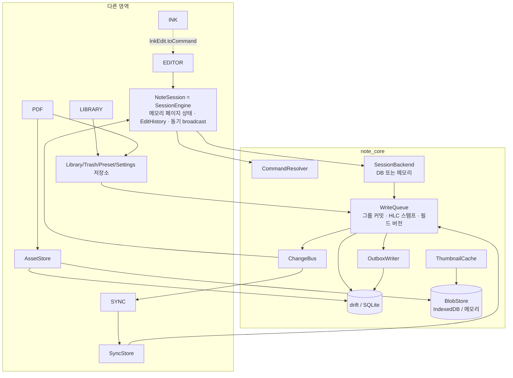

# 02 · CORE — 문서 모델 · 저장 · 되돌리기

> 상태: **3차 수정본** (총괄 3차 승인 검토 반영, 재승인 대기) · 작성 2026-11-04 · 1차 수정 2026-11-04 · 2차 수정 2026-11-05 · 3차 수정 2026-11-05
> 기준: [00-overview.md 7장 '통합 계약' v1.2](00-overview.md#7-통합-계약) — **이 문서와 7장이 다르면 7장이 우선** · 검토: [00-review.md](00-review.md) 3.2(1차)·2.4.2(2차, 지시 번호 `CORE-2-n`)·'3차 검토' 3.4.2(3차, 지시 번호 `CORE-3-n`) · 마스터 기획서: [docs/PLAN.md](../PLAN.md) v1.1
> 소유 경로: `packages/note_core/` · 패키지 이름: `note_core` (순수 Dart 패키지, Flutter SDK 의존 없음)

이 문서만 보고 별도 git worktree에서 CORE를 구현할 수 있게 쓴다. 코드 블록의 Dart 시그니처는 **계약**이다. 7장(통합 계약)에 시그니처가 적힌 공유 타입·인터페이스는 7장과 글자 그대로 같게 썼고, 7장이 "CORE 4.x 승인"으로 위임한 부분은 이 문서의 정의가 계약이다. 이름·타입을 바꾸려면 7.4.12 절차(결과 보고의 '변경 요청' → 총괄 승인)를 거친다. CORE가 보기에 계약을 고칠 필요가 있는 곳은 12.2 '계약 변경 제안'에 모았고, 승인 전까지는 계약 그대로 구현한다. 구현 본문(`...`)은 개발자가 채운다. 총괄 피드백 반영 내역은 13절.

---

## 1. 목적과 범위

### 1.1 목적

CORE는 다른 6개 영역이 함께 쓰는 **데이터의 단일 출처**다(7.2.0 소유 원칙: 공유 데이터 타입은 CORE가 정의·export).

- 공유 데이터 타입(획·점·펜 스타일·속지·페이지 크기·페이지·노트·폴더·프리셋·에셋·편집 명령·세션)과 영역 사이 연결 인터페이스(썸네일 렌더러, 원격 에셋, 화면용 동기화 상태)를 정의한다.
- 모든 편집을 기기에 즉시 저장한다(로컬 우선, 자동 저장).
- 노트 단위 되돌리기/다시 실행 100단계를 제공한다.
- 라이브러리(폴더·노트·휴지통·검색) 데이터 질의와 변경을 제공한다.
- 동기화 엔진(SYNC)이 소비할 변경 기록(outbox)·필드별 버전·원격 변경 적용 창구를 제공한다.

### 1.2 이번 동시 개발 범위

| 구분 | 내용 |
|---|---|
| 기반 단계(B2) | 7.6 B2 = 8절 T1~T5: 계약 타입·인터페이스·provider **동작 구현**, `createFakeNoteStore()`, `seedSyntheticNote`(동작), `openTestNoteStore`(시그니처, 본문은 T6 전까지 `UnimplementedError`). 동시 개발 시작 전에 main에 커밋 |
| 데이터 모델 | PLAN 7.2 엔티티 전체의 불변 Dart 클래스 + JSON 직렬화(웹 형식 호환), 획 점 바이너리 코덱 v1(델타+varint, 두 번째 채널 = 굽힌 굵기 계수 `widthQ`), UUIDv7 ID, 분수 인덱스 `sortKey`, HLC 버전 + 필드별 버전, `schemaVersion` |
| 속지 · 페이지 크기 · 종이 색 | `PageTemplate`(매개변수 nullable → INK 기본값), `TemplateExtrasKeys`, `PaperColors`(4색 + 밝기), `PageSizePreset`, `PageSizeLimits` |
| 편집·되돌리기 | 편집 명령 12종 + 복합 명령(= `EditCommand` 13종), 노트 단위 히스토리(100단계, 바이트 상한 네이티브 64 MiB · 웹 32 MiB), 원격 변경과의 충돌 규칙. 부분 지우개 누적은 INK `EraserSession`(7.2.7) |
| 노트 세션 | 페이지 단위 지연 로딩, 메모리 상태 **동기 반영 + 동기 스트림 전달**(7.2.8 N-1~N-7) + 비동기 저장 |
| 저장소 | drift(SQLite) 스키마(엔티티 행마다 `field_versions` 열)·마이그레이션 체계, 웹(sqlite3 WASM + IndexedDB) 연결, VM 테스트용 연결 |
| 자동 저장 | 단일 쓰기 큐 + 그룹 커밋, 실패 재시도, `flush()`, 손실 범위 측정값 노출 |
| 라이브러리 데이터 | 폴더 트리, 목록 정렬(이름·생성일·수정일·사용자 지정, 여러 항목 한 번에 순서 변경), 이동·복사·이름 변경, 휴지통(30일), 제목 검색(한글 조합형 자모 합성 포함), 최근·즐겨찾기 |
| 펜 프리셋·설정 | 프리셋 저장소(결정적 ID 기본 5종, 전체 순서 다시 매기기), 범용 설정 저장소(키는 각 영역이 정의, `stringList`·`jsonMap` 포함) |
| 에셋 · 썸네일 | 내용 해시(SHA-256) 기반 `AssetStore`(+ `bytesArrived`), 웹 구현(IndexedDB, 4 MiB 청크), 페이지 썸네일 캐시, 썸네일 렌더러·원격 에셋 인터페이스(구현은 INK·SYNC) |
| 동기화 창구 | outbox(엔티티당 1건·병합·`(seq, rev)` ack·`afterSeq`), `readVersioned`, 버전 포함 병합 정책을 받는 `applyRemote(metaUpdates:)`, `commitRepairs`, 메타 KV, `reassignOwner`(**이번 범위에 구현**, 런타임 전환), `duplicateNoteForRecovery`, `markUploaded`의 `{storagePath}` 기록 |
| 화면용 동기화 상태 | `SyncDisplayState`, `SyncBadge`, `syncBadgeProvider`(기본 `off`, M4에 INFRA가 SYNC 값으로 override) |
| 앱 시작 · 웹 저장 | `openNoteStore` 오류 분류(`NoteStoreOpenException`), `deleteLocalNoteData`, `navigator.storage.persist()`(최대 1초 대기)·`estimate()` 단독 소유, `StorageInfo`·`refreshStorageInfo()`, 저장 경고 조건 `storageWarningOf` |
| 백업 내보내기 | `NoteStore.exportBackupJson()`(활성·휴지통 엔티티 전체 JSON + 에셋 메타, 바이트 제외). **M4 실연결 전 선행 조건**(PLAN 12장, 7.8) |
| 상태 관리 | Riverpod(`package:riverpod` 3.4.3) provider 일체(이름 = `name:` 인자, 저장소 스트림은 `retry: noRetry`) |

### 1.3 이후 범위 (인터페이스·필드만 지금 준비)

- 네이티브(iOS/Android) 파일 기반 에셋 저장소, 네이티브 DB 경로 결정(path_provider) → 네이티브 전환 시. 연결 코드는 조건부 import 자리만 둔다(VM 테스트용 파일 DB는 이번에 구현).
- 녹음(M6): `Recording` 엔티티·테이블과 `Stroke.recordingId/recordingOffsetMs` 필드는 지금 만든다. 녹음 전용 질의 API는 M6.
- 도형·텍스트 상자·수식·이미지 요소(M5·M7): `PageElement`를 `sealed`로 두고 지금은 `Stroke`만 구현.
- 라이브러리 전역 PDF 텍스트 검색 색인(CORE 테이블 + FTS5, `sqlite3.wasm`의 FTS5 포함 여부 먼저 확인 — 7.8), 손글씨 검색 색인(M7), 버전 기록·노트 잠금·페이지 다른 노트로 이동(5.2).
- 백업 **복원**(가져오기). 내보내기는 이번 범위(T19).
- 삭제 표시(tombstone) 정리, 고아 에셋 정리(GC), 다중 탭 리더 선출 — 방향은 총괄 Q8 답(모든 기기 커서 최솟값 기준, 90일 미접속 기기 제외).
- 되돌리기의 필드 단위 충돌 판정(되돌리려는 필드와 원격이 바꾼 필드가 겹칠 때만 건너뛰기, SYNC-S4) — 이번엔 엔티티 단위(6.7.3).

### 1.4 제외 (다른 영역 책임)

- 획 외곽선 생성·렌더링·필압 곡선/감도 적용(입력 시점)·굵기 계수 굽기·공간 색인·지우개/올가미 기하 판정·부분 지우개 누적(`EraserSession`) → INK
- 페이지 썸네일 그리기(`InkPageThumbnailRenderer implements PageThumbnailRenderer`) → INK, 주입 → INFRA, 표지 예약 생성 → LIBRARY
- 입력·제스처·툴바·저장 경고 배너(에디터 화면) → EDITOR / 라이브러리 화면·기본 이름 문구·저장 경고 배너(라이브러리 화면) → LIBRARY
- PDF 파싱·렌더링·내보내기 → PDF
- 병합 규칙 자체·서버 통신·폴더 순환 복구 판단·원격 에셋 내려받기(`SyncRemoteAssetFetcher`)·`SyncBadge` 계산(`syncBadgeOf`) → SYNC
- 웹 자산 배치(`sqlite3.wasm`, `drift_worker.js`)·앱 셸(시작 오류 화면, 백업 버튼)·CI·`tool/workspace_rules.yaml` → INFRA

---

## 2. PLAN.md 요구사항 대응표

범위 표기: **이번** = 이번 동시 개발에서 구현 · **이후** = 데이터 구조만 준비하고 나중 · **타 영역** = CORE 작업 없음(괄호 안 영역 소유)

### 2.1 기능 명세 (4장)

| PLAN 항목 | 요구 내용 | CORE 작업 | 범위 |
|---|---|---|---|
| F-01 | 폴더 트리(깊이 무제한) | `Folder.parentId`, `FolderTree`(+ `folders`), `watchFolderTree()` (T4, T8) | 이번 |
| F-01 | 폴더·노트 생성·이름 변경·이동·복사·삭제 | `LibraryRepository` create/rename/`moveItems`/`copyItems`/`trashItems`, 순환 이동 차단, C-1~C-10 (T8, T9) | 이번 |
| F-01 | 다중 선택 일괄 이동·삭제 | `List<LibraryItemRef>` 일괄 API (T8, T9) | 이번 |
| F-01 | 다중 선택 일괄 내보내기 | `NoteContentReader`(읽기) | 이번(읽기) / 흐름은 타 영역(PDF·LIBRARY) |
| F-01 | 정렬: 이름·생성일·수정일·사용자 지정 | `LibraryQuery.sort`, `sortKey` + `reorderItem`·`reorderItems` (T8) | 이번 |
| F-01 | 그리드/리스트 보기 | — | 타 영역(LIBRARY) |
| F-01 | 폴더 색상·아이콘, 노트 표지 | `Folder.colorArgb/icon`, `NoteCover`, `setFolderAppearance`, `setCover`, 표지 썸네일 경로(`ThumbnailCache` + `PageThumbnailRenderer` 자리) (T3, T4, T8) | 이번 / 그리기는 INK, 예약은 LIBRARY |
| F-01 | 브레드크럼 | `FolderTree.pathTo()` (T4) | 이번 |
| F-01 | 사이드바 폴더 트리 | `folderTreeProvider` (T4) | 이번 |
| F-02 | 새 노트로 / 기존 노트에 페이지로 가져오기 | `createNote(pages:)`(최대 2000장 한 트랜잭션), `InsertPages`, `PdfBackground` (T3, T8, T10) | 이번(데이터) / 파싱은 타 영역(PDF) |
| F-02 | PDF 페이지를 배경으로 | `PdfBackground(assetId, pdfPageIndex)` (T3) | 이번 |
| F-02 | 대용량 PDF: 썸네일 캐시 | `ThumbnailCache` 저장소 (T13) | 이번(저장) / 생성은 타 영역 |
| F-02 | 같은 PDF는 한 번만 저장 | `Asset.id` = SHA-256, `AssetStore.put` 중복 제거 (T13) | 이번 |
| F-02 | 암호 PDF, 텍스트 선택, 목차 | — | 타 영역(PDF) |
| F-02 | (P1) 이미지 가져오기 | `ImageBackground`, `AssetType.image` 타입만 | 이후 |
| F-03 | 펜 5종(P0) + 추가 펜(P1) | `PenTool` 10종(P1은 예약, INK가 볼펜으로 대체 렌더), 기본 스타일 표 = INK 6.9 값 (T2) | 이번(데이터) |
| F-03 | 필압·기울기·방위각 반영 | `StrokePoint.widthQ`(INK가 필압 곡선·감도·속도·기울기·taper를 굽힌 굵기 계수 `f/4`)·`tilt`·`azimuth` (T2) | 이번(저장) / 적용은 INK |
| F-03 | 손떨림 보정·필압 곡선 조절 | `StrokeStyle.smoothing`·`pressureSensitivity`(INK 게인 배율)·`pressureCurve`(`linear`·`soft`·`firm` = INK 값) (T2) | 이번(데이터) / 적용(입력 시점)은 INK |
| F-03 | 벡터 저장 | 점 데이터 보존(0.01pt 양자화, 메모리 값 = 저장 값) (T2) | 이번 |
| F-03 | 렌더링 품질·지연·호버 | — | 타 영역(INK, EDITOR) |
| F-04 | 색 연속 선택, 투명도, HEX | `StrokeStyle.colorArgb`(알파 0xFF 고정)·`opacity`(0.05~1) (T2) | 이번(데이터) / UI는 EDITOR |
| F-04 | 굵기 0.1~30pt, 0.1 단위 | `StrokeStyle.minWidth/maxWidth`, `normalized()` (T2) | 이번 |
| F-04 | 최근 색·사용자 팔레트 저장 | `SettingsRepository` + EDITOR가 정의하는 `SettingKey`(`intList`·`jsonMap`) (T4, T12) | 이번(저장) |
| F-05 | 프리셋 = 종류+색+굵기+투명도+필압 감도+스무딩 | `PenPreset.style: StrokeStyle` (T3) | 이번 |
| F-05 | 툴바 고정·순서 변경·이름·그룹 | `PenPreset.pinned/sortKey/name/group`, `reorderPreset`·`reorderPresets(orderedIds)` (T12) | 이번 |
| F-05 | 계정 동기화 | outbox 대상(`EntityKind.penPreset`), 기본 5종 결정적 ID·시드 HLC(두 기기가 각각 만들어도 하나) (T7, T12, T14) | 이번(기록) / 전송은 SYNC |
| F-06 | 모든 데이터 사용자 ID 기준 | `ownerId`(로그인 전 `'local'`), 모든 질의 소유자 필터, `reassignOwner`(런타임 전환·영속) (T3, T8, T14) | 이번 |
| F-06 | 로그인 UI·인증 | — | 타 영역(SYNC, INFRA) |
| F-07 | 로컬 우선, 오프라인 동작 | 모든 편집 로컬 트랜잭션, 로그인 전 쓰기도 outbox (T7) | 이번 |
| F-07 | 획 단위 변경분 동기화 | outbox 단위 = 엔티티(획 1개), `noteId`·`pageId` 힌트 항상 (T7) | 이번 |
| F-07 | 획은 추가/삭제 집합, 속성은 마지막 수정 우선 | 소프트 삭제, 엔티티 `version` + **필드별 HLC**(`EntityFieldVersions`), 버전 포함 병합 정책 주입점 (T3, T7, T14) | 이번(데이터) / 규칙은 SYNC |
| F-07 | 큰 파일은 별도 저장소, 열 때 내려받기 | `AssetStore` 메타/바이트 분리, `listAssets`, `markUploaded`(`{storagePath}`), `bytesArrived`, `RemoteAssetFetcher` 자리 (T4, T13) | 이번 / 내려받기 구현은 SYNC(M4) |
| F-07 | 동기화 상태 표시(완료·진행 중·오프라인·오류) | `SyncDisplayState`·`SyncBadge`·`syncBadgeProvider`(기본 off), `watchPendingCount()` (T4, T14) | 이번(타입·자리) / 값은 SYNC, 그리기는 LIBRARY·EDITOR |
| F-08 | 노트 단위, 최대 100단계, 오래된 것부터 삭제 | `EditHistory` + `HistoryLimits.platformDefault` (T5) | 이번 |
| F-08 | 모든 편집 대상 | 명령 12종 + `CompositeCommand` (T4, T5, T10) | 이번(M1 대상) / 도형·텍스트 등 명령은 이후 |
| F-08 | 펜 1회 = 1단계 (부분 지우개로 여러 획이 잘려도) | INK `EraserSession`이 제스처 1회를 `SplitStrokes`/`RemoveStrokes` 1개로 → `execute` 1회 = 1단계 (T5, `undo_chain_test`) | 이번 |
| F-08 | 새 편집 시 다시 실행 목록 비움 | `EditHistory.push` 규칙 (T5) | 이번 |
| F-08 | 이 기기 편집만 되돌림 | 원격 변경은 히스토리 미기록 + 버전 검사로 건너뜀 (T5, T11) | 이번 |
| F-08 | 툴바·제스처·단축키 입력 | — | 타 영역(EDITOR) |
| F-09 | 획 지우개 | `RemoveStrokes` (T4, T5) | 이번 |
| F-09 | 부분 지우개(벡터 절단) | `SplitStrokes`, `Stroke.fragment()`(createdAt·`t` 유지) (T3, T5) | 이번(데이터) / 절단 기하·누적은 INK |
| F-09 | 형광펜만/형광펜 제외 지우기 | `StrokeFilter`, `ClearPage(filter:)` (T4, T5) | 이번(데이터) / 판정은 INK·UI는 EDITOR |
| F-09 | 현재 페이지 전체 지우기 | `ClearPage` (EDITOR가 직접 실행) (T5) | 이번 |
| F-10 | 손글씨 → 텍스트 | `TextBox` 요소 | 이후(M7) |
| F-11 | 도형 | `Shape` 요소 | 이후(M5) |
| F-12 | 입력 모드·제스처 설정 저장 | `SettingsRepository` (키는 EDITOR, device/synced 구분) (T12) | 이번(저장) |
| F-13 | 위치: 앞/뒤/맨 끝 | `PagePosition` (T4) | 이번 |
| F-13 | 종류: 빈·속지 6종·PDF·이미지·다른 노트 페이지 복사 | `PageDraft`, `PageBackground` 4종, `PageTemplate` 6종(nullable 매개변수), `PageDraft.copyOf` (T3, T5) | 이번(빈·속지·PDF) / 이미지·다른 노트 복사 UI는 이후 |
| F-13 | 크기 A4·Letter·16:9·사용자 지정, 가로·세로 | `PageSize`, `PageSizePreset`(16:9 세로형 540×960), `PageSizeLimits`(사용자 입력 100~3000pt), `ResizePages` (T3, T5) | 이번 |
| F-13 | 속지 색상 | `PageBackground.paperColorArgb`, `PaperColors`(흰·미색·회색·검정 + `luminance`·`isDark`) (T3) | 이번 |
| F-13 | 페이지 넘김 방식 | `SettingsRepository` (키는 EDITOR) | 이번(저장) |
| F-13 | 삭제·복제·순서 변경·썸네일 | `DeletePages/DuplicatePages/MovePages`, `ThumbnailCache` (T5, T13) | 이번 |
| F-14 | 손글씨 수식 | `MathObject` 요소 | 이후(M7) |
| F-15 | PDF로 저장 | `NoteContentReader`(내보내기용 읽기, `getPage`) (T10) | 이번(읽기 API) / 생성은 PDF |
| F-16 | 획별 녹음 시점 | `Stroke.recordingId/recordingOffsetMs`, `Recording` 엔티티·테이블 (T3, T6) | 이번(필드) / 기능 이후(M6) |
| F-16 | 녹음만 따로 삭제, 용량 표시 | `Asset.size`, `AssetType.audio` | 이후(M6) |

### 2.2 추가 기능 (5장)

| PLAN 항목 | 요구 내용 | CORE 작업 | 범위 |
|---|---|---|---|
| 5.1 올가미 | 선택 → 이동·크기·회전·색 변경·복사·삭제 | `TransformElements`, `RestyleStrokes`, `AddStrokes`(복사, 새 id·새 `createdAt`), `RemoveStrokes`, `Stroke.copyWith(id:)` (T3, T5) | 이번(명령) / 판정·UI는 INK·EDITOR |
| 5.1 페이지 관리·썸네일 | 삭제·복제·순서 변경·썸네일 | 페이지 명령 + `ThumbnailCache` + `PageThumbnail.isStaleFor` (T4, T5, T13) | 이번 |
| 5.1 속지 템플릿 | 줄·모눈·점·코넬·악보·플래너 | `PageTemplate`, `PageTemplateKind` 6종, `TemplateExtrasKeys`. 기본 수치는 INK 6.16 단일 출처 (T3) | 이번(데이터) / 그리기는 INK(6종 모두) |
| 5.1 자동 저장 | 저장 버튼 없음, 강제 종료에도 손실 없음 | `WriteQueue` 그룹 커밋, `flush()`, 손실 범위 정의 (T7) | 이번 |
| 5.1 오프라인 | 로컬 우선 | 전체 구조 | 이번 |
| 5.1 휴지통 30일 | 복구 수단 | `TrashRepository`, 자동 영구 삭제 (T9) | 이번 |
| 5.1 검색 | 제목(M2) → PDF 텍스트(M3) → 손글씨(M7) | `searchLibrary()` 제목 검색(`name_norm`: 한글 자모 합성·소문자·공백 정리) (T1, T8) | 이번(제목) / PDF 노트 안 검색은 PDF, 전역 색인은 이후 |
| 5.1 텍스트 상자·이미지 삽입 | — | `PageElement` 확장 자리 | 이후(M5) |
| 5.2 즐겨찾기·최근 노트 | M2 | `Note.isFavorite`, `lastOpenedAt`(기기 로컬, `openSession`이 기록 — N-6), `watchRecentNotes/watchFavoriteNotes` (T8, T10) | 이번 |
| 5.2 태그 | — | `Note.tags` 필드·`setTags` | 이번(필드) / 화면 이후 |
| 5.2 전체 백업/복원 | — | `exportBackupJson()` (T19) | 이번(내보내기) / 복원 이후 |
| 5.2 버전 기록, 노트 잠금, 페이지 다른 노트로 이동, 요소 저장 | — | JSON 직렬화가 기반 | 이후 |
| 5.4 성능 | 노트당 획 10만 개, 60fps | 페이지 지연 로딩·LRU, 성능 테스트 (T10, T18) | 이번(데이터 계층) |
| 5.4 앱 시작 2초 | 라이브러리 표시 | 메타데이터만 로드, 측정 테스트, Chrome 첫 열기 시간 기록(7.3) (T16, T18) | 이번 |
| 5.4 데이터 안전 | 마지막 획까지 보존 | 획 완료 즉시 커밋, 손실 범위 측정, 저장 경고 조건 `storageWarningOf` (T4, T7) | 이번 |
| 5.4 동기화 손실 0건 | — | outbox `(seq, rev)` ack, 필드별 HLC로 서로 다른 필드 동시 수정 수렴(6.10 반례 테스트) (T14) | 이번(로컬) |
| 5.4 저장 용량 | 획 압축, PDF 중복 제거 | 점 코덱(120Hz 약 7.8 B/점), 해시 중복 제거 (T2, T13) | 이번 |
| 5.4 측정 | 개발자 표시 | `PersistenceStatus.lastCommitLatency`, `StorageInfo` 노출 (T7, T16) | 이번(값) / 표시는 EDITOR |

### 2.3 아키텍처·기타 (7장, 9장, 10장, 12장)

| PLAN 항목 | 요구 내용 | CORE 작업 | 범위 |
|---|---|---|---|
| 7.2 | 엔티티 11종(User 제외 10종) | 4.2 모델 (T3) | 이번 (`User`는 SYNC, 이후) |
| 7.2 | 좌표는 페이지 기준 pt | 모든 좌표 pt, `PageRect` (T1) | 이번 |
| 7.2 | 점 데이터 델타 인코딩 + 바이너리 | `StrokePointsCodec` v1 (T2) | 이번 |
| 7.2 | 모든 항목 `deletedAt` | 소프트 삭제 전면 적용(설정 포함) | 이번 |
| 7.2 | `sortKey` 분수 인덱스 | `SortKeys` (T1) | 이번 |
| 7.2 | M1부터 동기화 대비 구조 | outbox·HLC·필드 버전·ownerId를 M1부터 (T6, T7) | 이번 |
| 7.4-1 | 편집 → 로컬 트랜잭션 + 보낼 변경 큐 | 같은 트랜잭션에서 outbox·필드 버전 기록 (T7) | 이번 |
| 7.4-2~6 | 묶음 전송, 실시간 수신, 충돌 규칙, 큰 파일, 증분 수신 | `SyncStore` 창구(7.2.10), 메타 KV(커서) 원자 저장. LWW = HLC, 커서 = 서버 시각(CD-18) (T14) | 이번(창구) / 로직은 SYNC |
| 7.4-4 | 폴더 순환 검사 후 한쪽 취소 | `FolderTree.findCycles()`·`folders`, `commitRepairs` (T4, T14) | 이번(창구) / 판단은 SYNC |
| 7.5 | 커맨드 패턴, 변경분만 저장, 100개 버퍼, 되돌리기도 동기화 | `AppliedEdit`(엔티티 전후 스냅숏, 불변 객체 공유), undo/redo도 outbox 기록(바뀐 필드만) (T5, T11) | 이번 |
| 7.6 | 모든 데이터 `ownerId` | (T3) | 이번 |
| 7.6 | 기능 스위치 | — | 타 영역(INFRA) |
| 7.6 | `Asset.size` | (T3, T13) | 이번 |
| 7.6 | `schemaVersion` | DB 스키마 버전 + 노트 형식 버전 + 코덱 버전, 새 스키마 DB는 `NoteStoreOpenFailure.newerSchema` (T6, T15) | 이번 |
| 9.4 | 획 분할·되돌리기 100·병합 자동 테스트 | 9절 테스트 | 이번 |
| 9.5 | 웹에서도 동작, 플랫폼 기능 분리 | `dart:io` 미사용(조건부 import의 `_native` 외), `_browser`/`_native`/`_stub` 파일 규칙, 브라우저 테스트 `test/web/` (T16) | 이번 |
| 9.5 / 12장 | Safari 저장 데이터 삭제 위험 | `persist()`(최대 1초 대기), `StorageInfo`, `storageWarningOf`, `deleteLocalNoteData`(시작 오류 화면 초기화) (T4, T16) | 이번 |
| M1 | 문서 모델 · 로컬 DB · 자동 저장 | T1~T7, T10 | 이번 |
| M1 | 되돌리기 / 다시 실행 100회 | T5, T11 | 이번 |
| M1 | 획 지우개 · 부분 지우개 | 명령 (T4, T5) | 이번(데이터) |
| M1 | 페이지 추가·삭제·복제·순서 변경·썸네일, 속지 | T3, T5, T10, T13 | 이번(데이터) |
| M1 | 펜 프리셋 저장 · 툴바 고정 | T12 | 이번 |
| M2 | 폴더 트리, 노트 목록(정렬·다중 선택), 휴지통, 제목 검색·최근·즐겨찾기 | T8, T9 | 이번(데이터) |
| M3 | PDF 가져오기·썸네일 캐시 | T3, T10, T13 | 이번(데이터) |
| M4 | 변경 큐, 펜 프리셋·설정 동기화, 첫 로그인 소유자 전환 | T7, T12, T14 | 이번(로컬 창구) |
| 12장 | 동기화 버그로 데이터 손실 | 소프트 삭제 + 휴지통 + outbox ack 테스트 + 필드 버전 수렴 테스트 + **M4 전 백업 내보내기**(T19) | 이번 |
| 12장 | 대용량 PDF 메모리 | 에셋 바이트를 SQLite 밖(IndexedDB 청크)에 저장 | 이번 |

---

## 3. 소유 경로와 패키지 구조

```text
packages/note_core/
├─ pubspec.yaml                 # 기반 단계 B1에서 INFRA가 7.4.1 형식으로 생성, CORE가 T0에서 확인 (3.1)
├─ build.yaml                   # drift_dev 옵션 (6.11)
├─ dart_test.yaml               # 태그 선언: perf(기본 skip), golden (9.1)
├─ .gitignore                   # test/web/sqlite3.wasm, test/web/drift_worker.js (준비 스크립트 산출물)
├─ README.md                    # 다른 영역용 사용 안내 (T18)
├─ drift_schemas/note_db/       # drift_dev make-migrations 산출물 drift_schema_vN.json (커밋)
├─ tool/
│  └─ prepare_web_test.dart     # sqlite3.wasm·drift_worker.js → test/web/ (ws test --platform chrome가 먼저 실행, 7.4.8)
├─ lib/
│  ├─ note_core.dart            # 공개 barrel (웹 안전)
│  ├─ dev_tools.dart            # seedSyntheticNote (웹 안전, 개발자 메뉴용, B2부터 동작 — 4.10)
│  ├─ testing.dart              # 테스트 도우미 (웹 안전): 가짜 저장소, 획 픽스처, 테스트 병합 정책
│  ├─ testing_vm.dart           # VM 전용: openTestNoteStore (B2 시그니처, T6 본문; R4 예외 목록 — INFRA workspace_rules.yaml)
│  └─ src/
│     ├─ common/                # ids.dart, hlc.dart, geometry.dart, sort_keys.dart, errors.dart,
│     │                         # text_normalize.dart (name_norm: 한글 자모 합성)
│     ├─ model/                 # pen_style.dart, pressure_curve.dart, stroke_points.dart,
│     │                         # stroke_points_codec.dart, stroke.dart, page_element.dart, page.dart,
│     │                         # page_size.dart, page_template.dart, paper_colors.dart, page_background.dart,
│     │                         # folder.dart, note.dart, pen_preset.dart, asset.dart, recording.dart,
│     │                         # setting_value.dart, sync_entity.dart, entity_json.dart, schema.dart
│     ├─ edit/                  # commands.dart, page_draft.dart, applied_edit.dart, history.dart,
│     │                         # command_resolver.dart (내부)
│     ├─ session/               # note_session.dart, page_content.dart, session_engine.dart(내부, 6.14),
│     │                         # session_backend.dart(내부), page_cache.dart(내부)
│     ├─ repo/                  # note_store.dart, library_repository.dart, library_types.dart,
│     │                         # folder_tree.dart, trash_repository.dart, pen_preset_repository.dart,
│     │                         # settings_repository.dart, content_reader.dart, events.dart, status.dart,
│     │                         # storage_warning.dart
│     ├─ sync/                  # outbox_types.dart, field_versions.dart, merge.dart, sync_store.dart,
│     │                         # sync_display.dart (SyncDisplayState, SyncBadge)
│     ├─ assets/                # asset_store.dart, thumbnail_cache.dart, page_thumbnail_renderer.dart,
│     │                         # remote_asset.dart (인터페이스) / blob_store.dart, idb_blob_store.dart,
│     │                         # content_hasher.dart(조건부) + content_hasher_stub/_browser/_native.dart,
│     │                         # asset_store_impl.dart, thumbnail_cache_impl.dart (내부)
│     ├─ backup/                # backup_export.dart (내부, 6.17)
│     ├─ storage/               # (전부 내부)
│     │  ├─ db/                 # tables.dart, note_database.dart, note_database.g.dart(생성·커밋),
│     │  │                      # migrations.dart (schema_versions.dart는 v2부터 생성·커밋)
│     │  ├─ connect/            # connect.dart(조건부 export), connect_stub.dart,
│     │  │                      # connect_browser.dart, connect_native.dart
│     │  ├─ web_storage/        # persistence.dart(조건부), persistence_stub.dart, persistence_browser.dart
│     │  ├─ write_queue.dart, outbox_writer.dart, field_version_writer.dart, change_bus.dart,
│     │  │  row_mappers.dart, kv_keys.dart, open_errors.dart
│     │  └─ drift_*.dart        # 각 저장소 구현, drift_note_store.dart, drift_sync_store.dart
│     ├─ fake/                  # testing.dart의 메모리 구현 (fake_note_store.dart 등, 내부)
│     ├─ migration/note_migrator.dart
│     └─ providers.dart
└─ test/
   ├─ common/ model/ edit/ session/ repo/ storage/ sync/ assets/ migration/ providers/ backup/ testing/ dev/
   ├─ shared/                   # VM·Chrome 양쪽에서 돌릴 테스트 본문(라이브러리, main 없음)
   ├─ goldens/json/*.json       # JSON 골든 — @Tags(['golden']) + @TestOn('vm') (6.3)
   ├─ perf/                     # @Tags(['perf'])
   ├─ web/                      # @TestOn('browser') 전용(7.4.8). 준비 자산은 .gitignore
   ├─ storage/generated_migrations/   # drift_dev make-migrations 생성 테스트 (v2부터)
   └─ fixtures/                 # synthetic_strokes.dart
```

원칙
- `lib/src/` 아래는 비공개. 다른 영역은 `package:note_core/note_core.dart`(웹 안전)만 import한다(개발자 메뉴는 `dev_tools.dart`).
- `package:note_core/testing.dart`(웹 안전)와 `package:note_core/testing_vm.dart`(`dart:ffi`·`package:drift/native.dart` 사용, VM 테스트 전용)는 **`test/`에서만** import한다(7.1 규칙 2). `testing_vm.dart`는 R4(lib 최상위 파일 규칙)의 예외로 INFRA가 `workspace_rules.yaml` `lib_exceptions`에 등록한다(7.4.2).
- 패키지 안에 `analysis_options.yaml`을 두지 않는다(R3). 루트 설정이 적용되고 `**/*.g.dart`는 루트 exclude에 이미 있다(01-infra 6.2).
- 플랫폼 파일 이름(R5, 7.4.3): 웹 전용(`dart:js_interop`, `package:web`)은 `*_browser.dart`, 네이티브 전용(`dart:io`, `dart:ffi`)은 `*_native.dart`, 기본은 `*_stub.dart`. **조건부 import/export로만** 불러온다:
  `export 'x_stub.dart' if (dart.library.js_interop) 'x_browser.dart' if (dart.library.ffi) 'x_native.dart';`
- `dart:io`는 `storage/connect/connect_native.dart`와 `testing_vm.dart`에서만 쓴다. `content_hasher_native.dart`는 `package:crypto`만 쓴다.
- 생성 코드(`*.g.dart`, `drift_schemas/`, v2부터 `schema_versions.dart`·생성 마이그레이션 테스트)는 커밋한다. 다른 영역·CI는 build_runner를 돌리지 않는다(7.4.7).
- 웹 안전 수치(7.4.3): 64비트 정수 연산·`ByteData.getInt64` 금지, 비트 연산 대신 산술(색 성분 포함), 정수는 2^53 미만.

### 3.1 pubspec.yaml (7.4.1 형식 · 7.5 버전)

기반 단계 B1에서 INFRA가 아래 내용 그대로 만든다(7.5의 note_core 열). CORE는 T0에서 확인만 한다. 동시 개발 중 의존을 추가해야 하면 결과 보고에 '의존성 추가'로 남긴다.

```yaml
name: note_core
publish_to: none
resolution: workspace
environment:
  sdk: ^3.13.0
  flutter: 3.47.9          # pure Dart member too (R2)
dependencies:
  clock: 1.1.3
  collection: 1.19.1
  crypto: 3.0.8
  drift: 2.35.3            # must match app/web/drift_worker.js (7.4.9)
  idb_shim: 2.11.2
  meta: 1.19.0
  riverpod: 3.4.3
  sqlite3: 3.8.0           # must match test/web/sqlite3.wasm and app/web/sqlite3.wasm
  uuid: 4.6.0
  web: 1.1.2               # *_browser.dart only
dev_dependencies:
  build_runner: 2.16.1     # 2.17.1 conflicts with test 1.31.1 (analyzer range)
  drift_dev: 2.35.2
  fake_async: 1.3.3
  test: 1.31.1             # newest compatible with Flutter's pinned test_api 0.7.12
```

- `flutter` 의존이 없는 순수 Dart 패키지지만 테스트는 패키지 디렉터리에서 `flutter test`(VM)·`flutter test --platform chrome test/web`(브라우저)로 돈다(7.4.1, 7.3 실험으로 둘 다 확인).

---

## 4. 공개 API

모든 공개 타입은 `package:note_core/note_core.dart`에서 export한다(웹 안전). 이 절은 통합 계약 7.2.2~7.2.14와 같은 내용이며, 7장이 시그니처를 적은 곳은 그 글자 그대로, 7장이 "CORE 4.x 승인"으로 위임한 곳은 이 절이 계약이다. 4.1~4.10 전부가 **기반 단계 B2에서 먼저 커밋하는 계약 파일**이다(8절 T1~T5, 7.6).

7장 대응: 4.1 = 7.2.2 · 4.2 = 7.2.3~7.2.6 · 4.3 = 7.2.7 · 4.4 = 7.2.8 · 4.5 = 7.2.9 · 4.6 = 7.2.10 · 4.7 = 7.2.11 · 4.8 = 7.2.12·7.2.13 · 4.9 = 7.2.14 · 4.10 = 7.6 'B2 테스트·개발 도우미'(`testing.dart`·`testing_vm.dart`·`dev_tools.dart`)

계약 v1.1(7.9 C11-01~30) 중 이 절에 들어간 것: 세션 N-1·N-2·N-4 문구(4.4), 원격·복구 쓰기의 기기 로컬 필드·`ChangeBatch.origin`·`pendingLocalFields`의 purge 규칙·시계 문구(4.6), `EntityChange` 힌트·`persistenceStatusStream` 첫 값·`exportBackupJson`·`WebStorageConfig`·`inMemory`(4.8.1), `SyncBadge` 값 동등(4.8.2), B2 도우미 시그니처(4.10). 계약 블록에 v1.1 주석이 있는 곳은 그 주석을 글자 그대로 옮겼다.

계약 v1.2(7.9 C12-01~09, 시그니처 변경 없음) 중 이 절에 들어간 것: 쓰기 `Future` 완료 시점(4.5 머리말 = 계약 원문, `LibraryRepository` 주석 — C12-09), `AssetStore.put`의 청크 쓰기 실패(4.7 — C12-09), 원격 고아 획의 `EntityChange` 시점(4.8.1 `EntityChange`·`ChangeBatch` 주석 — C12-02). v1.2 주석도 계약 블록 문구를 글자 그대로 옮겼다.

### 4.1 공통 기초 타입 (7.2.2)

```dart
// lib/src/common/ids.dart
import 'package:clock/clock.dart';

typedef FolderId = String;  typedef NoteId = String;   typedef PageId = String;
typedef ElementId = String; typedef PresetId = String; typedef RecordingId = String;
typedef AssetId = String;   // lowercase hex SHA-256 of the bytes (64 chars)
typedef OwnerId = String;   typedef EpochMillis = int; // UTC ms since epoch

const OwnerId kLocalOwnerId = 'local';

/// Lexicographic order of ids from one UuidV7IdGenerator follows creation time at
/// millisecond precision (ties are random).
abstract interface class IdGenerator { String newId(); }     // production: UUIDv7 (36 chars)
/// RFC 9562 UUIDv7, lowercase, 36 chars. Backed by package:uuid `Uuid().v7()`.
final class UuidV7IdGenerator implements IdGenerator { UuidV7IdGenerator({Clock clock = const Clock()}); }
/// Deterministic ids for tests: '$prefix-000001', '$prefix-000002', ...
final class SequentialIdGenerator implements IdGenerator { SequentialIdGenerator({String prefix = 'id'}); }
bool isValidEntityId(String id);                               // ^[0-9A-Za-z_-]{1,64}$
```

```dart
// lib/src/common/geometry.dart — pure Dart (no dart:ui). INK converts to Rect/Offset.
@immutable
final class PageRect {
  const PageRect(this.left, this.top, this.right, this.bottom);
  factory PageRect.fromLTWH(double left, double top, double width, double height);
  factory PageRect.fromPoints(double x1, double y1, double x2, double y2);
  static const PageRect zero = PageRect(0, 0, 0, 0);

  final double left, top, right, bottom;
  double get width;
  double get height;
  bool get isEmpty;                       // width <= 0 || height <= 0
  bool overlaps(PageRect other);          // touching edges count as overlap
  bool containsPoint(double x, double y);
  PageRect inflate(double delta);
  PageRect expandToInclude(PageRect other);
  Map<String, Object?> toJson();          // {"l":..,"t":..,"r":..,"b":..}
  factory PageRect.fromJson(Map<String, Object?> json);
}

/// 2D affine transform: x' = a*x + c*y + tx, y' = b*x + d*y + ty.
@immutable
final class Affine2 {
  const Affine2(this.a, this.b, this.c, this.d, this.tx, this.ty);
  static const Affine2 identity = Affine2(1, 0, 0, 1, 0, 0);
  factory Affine2.translation(double dx, double dy);
  factory Affine2.scaling(double sx, double sy, {double originX = 0, double originY = 0});
  factory Affine2.rotation(double radians, {double originX = 0, double originY = 0});

  final double a, b, c, d, tx, ty;
  Affine2 then(Affine2 next);             // apply this, then next
  Affine2? inverse();                     // null if |det| < 1e-12
  (double, double) apply(double x, double y);
  PageRect applyToRect(PageRect rect);    // bounds of 4 transformed corners
  double get determinant;
  double get uniformScale;                // sqrt(|det|)
  double get rotation;                    // atan2(b, a)
  bool get isIdentity;
  List<double> toJson();                  // [a,b,c,d,tx,ty]
  factory Affine2.fromJson(List<Object?> json);
}
```

```dart
// lib/src/common/hlc.dart
/// Hybrid logical clock value. Text form is fixed-width and sorts
/// lexicographically in the same order as compareTo:
/// '001793750400000-0000-3f2a9c0d11e0b7a4' (15-digit millis, 4-hex counter, 16-hex node).
@immutable
final class Hlc implements Comparable<Hlc> {
  const Hlc(this.millis, this.counter, this.nodeId);
  static const Hlc zero = Hlc(0, 0, '0000000000000000');
  static const int maxCounter = 0xFFFF;

  final int millis;      // 0..999999999999999
  final int counter;     // 0..0xFFFF
  final String nodeId;   // 16 lowercase hex chars

  factory Hlc.parse(String text);          // throws FormatException
  static Hlc? tryParse(String? text);
  @override
  String toString();
  @override
  int compareTo(Hlc other);                // millis, then counter, then nodeId
  bool operator >(Hlc other);
  bool operator <(Hlc other);
}

final class HlcClock {
  HlcClock({required this.nodeId, Clock clock = const Clock(), Hlc? last,
      this.maxForwardDrift = const Duration(hours: 24)});
  final String nodeId;
  final Duration maxForwardDrift;
  Hlc get last;
  /// Local event. Strictly greater than every value returned or received before.
  Hlc now();
  /// Merge a remote value (6.4). Remote values further than [maxForwardDrift]
  /// ahead of the wall clock do not advance the local clock.
  Hlc receive(Hlc remote);
}

/// 16 lowercase hex chars from a secure random source.
String generateNodeId([Random? random]);
```

```dart
// lib/src/common/sort_keys.dart
/// Fractional indexing (base-62), compatible with npm `fractional-indexing` 3.2.0.
abstract final class SortKeys {
  static const String digits =
      '0123456789ABCDEFGHIJKLMNOPQRSTUVWXYZabcdefghijklmnopqrstuvwxyz';
  /// Key strictly between [a] and [b]; null means open end.
  /// Throws ArgumentError if a >= b or a key is invalid.
  static String between(String? a, String? b);
  /// [n] ascending keys strictly between [a] and [b].
  static List<String> nBetween(String? a, String? b, int n);
  static bool isValid(String key);
  static const String first = 'a0';
}

/// Total order for siblings: sortKey (binary/ASCII), then id.
int compareSortKeyThenId(String keyA, String idA, String keyB, String idB);
```

```dart
// lib/src/common/errors.dart
sealed class NoteCoreException implements Exception {
  const NoteCoreException(this.message);
  final String message;
}
final class EntityNotFoundException extends NoteCoreException { const EntityNotFoundException(super.message); }
final class FolderCycleException extends NoteCoreException { const FolderCycleException(super.message); }
final class ReadOnlyNoteException extends NoteCoreException { const ReadOnlyNoteException(super.message); }
final class PageNotOpenException extends NoteCoreException { const PageNotOpenException(super.message); }
final class LastPageDeletionException extends NoteCoreException { const LastPageDeletionException(super.message); }
final class SessionClosedException extends NoteCoreException { const SessionClosedException(super.message); }
final class AssetHashMismatchException extends NoteCoreException { const AssetHashMismatchException(super.message); }

/// Why openNoteStore failed (startup error screen picks the message by reason, 6.18).
enum NoteStoreOpenFailure { storageUnavailable, migrationFailed, corrupted, newerSchema, unknown }
final class NoteStoreOpenException extends NoteCoreException {
  const NoteStoreOpenException(this.reason, super.message, {this.cause});
  final NoteStoreOpenFailure reason;
  final Object? cause;
}
// Removed: StorageUnavailableException (→ NoteStoreOpenException(storageUnavailable, ...)).
```

```dart
// lib/src/common/text_normalize.dart — internal, shared by the DB store and the fake store
/// name_norm / search query form (6.8): Hangul conjoining jamo composed into syllables
/// (U+1100..U+1112 + U+1161..U+1175 [+ U+11A8..U+11C2], and LV syllable + trailing jamo),
/// then lowercased, trimmed, runs of whitespace collapsed to one space.
String normalizeForSearch(String text);
```

### 4.2 데이터 엔티티 (공유 계약 타입, 7.2.3~7.2.6)

공통 규칙
- 모든 엔티티는 불변(`@immutable`), `==`/`hashCode`는 모든 필드 기준(점 데이터는 `contentEquals`), `copyWith` 제공.
- 시간은 `EpochMillis`(int). 색은 `int` ARGB(`0xAARRGGBB`). 펜 색은 알파 0xFF로 저장하고 투명도는 `opacity`만 쓴다(K-5).
- `version`은 마지막 쓰기의 HLC(= 그 엔티티 필드 버전의 최댓값, 4.6 `EntityFieldVersions`). 아직 저장 전인 객체는 `null`이고, CORE가 쓰기 시점에 채운다. 다른 영역은 `version`을 직접 만들지 않는다(기본 프리셋의 시드 HLC만 CORE가 고정값으로 씀, 6.2.2).
- "로컬 전용" 필드(`Note.lastOpenedAt`·`pageCount`·`firstPageId`, `Page.contentRevision`, `Asset.hasLocalBytes`)는 기기마다 따로 계산하며 JSON(동기화·백업 형식)에 넣지 않는다(7.2.6). `fromJson`은 이 필드에 고정값을 넣고(`Asset.fromJson`은 `hasLocalBytes: false` — 6.3), 원격·복구 쓰기(`applyRemote`·`commitRepairs`)는 넘겨받은 엔티티의 이 값을 **무시**하고 현재 행 값 유지·재계산한다(계약 7.2.10 v1.1, 6.10.3).
- 이름·제목: 앞뒤 공백 제거 후 `String.length` 1~200(프리셋 이름은 1~60). 위반은 `ArgumentError`(C-6).
- 웹 안전: 64비트 정수 연산·`ByteData.getInt64` 금지. 비트 연산 대신 `~/`, `%` 사용(색 성분 추출 포함).

```dart
// lib/src/model/sync_entity.dart
enum EntityKind { folder, note, page, stroke, penPreset, asset, recording, setting }

/// Everything that is stored, versioned and synced.
abstract interface class SyncEntity {
  EntityKind get kind;
  String get id;
  Hlc? get version;
  EpochMillis? get deletedAt;
  bool get isDeleted;
  Map<String, Object?> toJson();   // sync/backup wire format (6.3)
}

abstract final class EntityJson {
  static SyncEntity decode(EntityKind kind, Map<String, Object?> json); // throws FormatException
}

const int kNoteSchemaVersion = 1;        // note content format the app can edit
const int kDatabaseSchemaVersion = 1;    // drift schema
const int kStrokePointsFormatVersion = 1;
```

#### 4.2.1 펜 스타일 (7.2.4 — INK가 렌더 의미를 정하고 CORE가 저장한다)

```dart
// lib/src/model/pen_style.dart, pressure_curve.dart
enum PenTool {
  ballpoint, fountain, highlighter, pencil, marker,          // P0 (M1)
  brush, calligraphy, dashed, laser, tape;                    // P1 reserved (INK renders as ballpoint)
  bool get isP0;
  String get wireName;                                        // == name
  static PenTool fromWireName(String name);                   // throws FormatException
}

@immutable
final class PressureCurve {     // CSS cubic-bezier from (0,0) to (1,1); x = raw pressure
  const PressureCurve({this.x1 = 0.25, this.y1 = 0.25, this.x2 = 0.75, this.y2 = 0.75});
  static const PressureCurve linear = PressureCurve();
  static const PressureCurve soft = PressureCurve(x1: 0.15, y1: 0.45, x2: 0.45, y2: 0.95);
  static const PressureCurve firm = PressureCurve(x1: 0.55, y1: 0.05, x2: 0.85, y2: 0.55);
  final double x1, y1, x2, y2;
  double evaluate(double x);    // CORE 6.2.3: monotonic, evaluate(0)=0, evaluate(1)=1, |err|<1e-6
  List<double> toJson();
  factory PressureCurve.fromJson(List<Object?> json);
}

@immutable
final class StrokeStyle {
  const StrokeStyle({required this.tool, required this.colorArgb, required this.width,
      this.opacity = 1.0, this.pressureSensitivity = 1.0, this.pressureCurve = PressureCurve.linear,
      this.smoothing = 0.5, this.extras = const {}});
  factory StrokeStyle.defaultsFor(PenTool tool);     // table below
  static const double minWidth = 0.1, maxWidth = 30.0;   // pt
  static const double minOpacity = 0.05;
  final PenTool tool;
  final int colorArgb;               // alpha forced to 0xFF by normalized(); transparency = opacity
  final double width;                // pt, nominal diameter at width factor 1.0
  final double opacity;              // [0.05, 1]
  final double pressureSensitivity;  // [0, 1]; multiplies INK PenProfile.pressureGain (1 = full)
  final PressureCurve pressureCurve; // applied by INK at input time to real pressure only
  final double smoothing;            // [0, 1]; INK 1-euro filter strength, input time
  final Map<String, Object?> extras; // JSON-safe; keys owned by INK (InkStyleExtras)
  double get effectiveAlpha;         // == opacity once normalized
  StrokeStyle normalized();          // clamps every range above, color alpha := 0xFF
  StrokeStyle copyWith({PenTool? tool, int? colorArgb, double? width, double? opacity,
      double? pressureSensitivity, PressureCurve? pressureCurve, double? smoothing,
      Map<String, Object?>? extras});
  Map<String, Object?> toJson();
  factory StrokeStyle.fromJson(Map<String, Object?> json);
}

/// Partial style change used by RestyleStrokes (lasso color/width change). CORE 4.2.
@immutable
final class StrokeStylePatch {
  const StrokeStylePatch({this.colorArgb, this.width, this.widthScale, this.opacity});
  final int? colorArgb;
  final double? width;        // absolute width; wins over widthScale
  final double? widthScale;   // multiply current width
  final double? opacity;
  bool get isEmpty;
  StrokeStyle applyTo(StrokeStyle style); // result is normalized()
}
```

- `defaultsFor` 값·기본 프리셋 규칙은 6.2.2(= 7.2.4 표). `effectiveAlpha` = `(colorArgb의 알파 / 255) × opacity`(산술), `normalized()` 후에는 `opacity`와 같다.
- CORE는 획을 저장할 때 `style.normalized()`를 저장한다(`AddStrokes`·`SplitStrokes` 해석 시 `normalized() != style`이면 바꿔 넣음). INK·EDITOR는 정규화된 스타일을 넘긴다(K-5).

#### 4.2.2 획과 점 (7.2.3 — 점의 두 번째 채널은 '굽힌 굵기 계수')

결정(CD-04): 점에 **원시 필압을 저장하지 않는다.** INK가 입력 시점에 필압 곡선·가상 필압·속도 가늘어짐·연필 기울기·taper를 모두 반영한 최종 굵기 배율 `f`를 구해 `widthQ = f / 4`로 저장한다. 스무딩도 입력 시점에 적용된 점이 저장된다. 렌더 반지름은 `r = 2 · style.width · widthQ`. 원시 필압은 개발자 표시에서만 본다.

```dart
// lib/src/model/stroke_points.dart
const double kMaxWidthFactor = 4.0;   // f in (0, 4]; widthQ = f / kMaxWidthFactor
const double kNominalWidthQ = 0.25;   // f = 1.0 → rendered radius = width / 2

@immutable
final class StrokePoint {
  const StrokePoint(this.x, this.y,
      {this.widthQ = kNominalWidthQ, this.tilt = 0, this.azimuth = 0, this.t = 0});
  final double x, y;     // pt, page coordinates, clamped to [-32000, 32000]
  final double widthQ;   // [0, 1], quantized 0.001
  final double tilt;     // rad [0, pi/2], 0 = perpendicular (web: |signed tilt|)
  final double azimuth;  // rad (-pi, pi], 0 when unknown (always 0 on web)
  final double t;        // ms since Stroke.createdAt, [0, 500000]; fragments keep t (no rebase)
}

@immutable
final class StrokePoints {
  /// Values are quantized on build so in-memory values == decoded values (CORE 6.2.4).
  factory StrokePoints.fromList(List<StrokePoint> points,
      {bool hasTilt = false, bool hasAzimuth = false});
  /// Copies interleaved [data] (stride 6: x, y, widthQ, tilt, azimuth, t) and quantizes.
  /// INK hands finished strokes to CORE with this; INK then renders the quantized result.
  factory StrokePoints.fromInterleaved(Float32List data,
      {bool hasTilt = false, bool hasAzimuth = false});
  static const int stride = 6;
  static const int maxLength = 100000;
  int get length;
  bool get isEmpty;
  bool get hasTilt;
  bool get hasAzimuth;
  double x(int i);
  double y(int i);
  double widthQ(int i);
  double tilt(int i);      // 0 when !hasTilt
  double azimuth(int i);   // 0 when !hasAzimuth
  double t(int i);
  StrokePoint operator [](int i);
  Iterable<StrokePoint> get points;
  PageRect get pointBounds;          // centerline only, cached
  double get maxWidthQ;              // cached
  StrokePoints sublist(int start, [int? end]);
  StrokePoints transformed(Affine2 m);   // azimuth += m.rotation, re-quantized
  /// Read-only interleaved view, stride 6 [x, y, widthQ, tilt, azimuth, t]. Never mutate.
  /// INK wraps it without copying (InkPoints.fromRaw).
  Float32List get rawData;
  bool contentEquals(StrokePoints other);
}

/// Mutable builder (INK may also build a Float32List itself and call fromInterleaved).
final class StrokePointsBuilder {
  StrokePointsBuilder({this.hasTilt = false, this.hasAzimuth = false, int initialCapacity = 256});
  final bool hasTilt, hasAzimuth;
  /// Values are clamped (x, y: ±32000, widthQ 0..1, tilt 0..pi/2, azimuth (-pi, pi], t 0..500000).
  /// Calls beyond StrokePoints.maxLength are ignored and [isFull] becomes true.
  void add(double x, double y,
      {double widthQ = kNominalWidthQ, double tilt = 0, double azimuth = 0, required double t});
  void addPoint(StrokePoint p);
  int get length;
  bool get isFull;
  void removeLast([int count = 1]);
  StrokePoints build();             // throws StateError if empty
}

/// Binary format v1 = CORE 6.2.4 with ONE change: flags bit0 means "hasWidthQ" (was
/// hasPressure). Writers always set bit0. A reader seeing bit0 == 0 returns kNominalWidthQ.
abstract final class StrokePointsCodec {
  static Uint8List encode(StrokePoints points);
  static StrokePoints decode(Uint8List bytes);        // throws FormatException
  static String encodeBase64(StrokePoints points);
  static StrokePoints decodeBase64(String text);
}
```

- `fromList`/`fromInterleaved`: 점 0개 또는 `maxLength` 초과면 `ArgumentError`, `fromInterleaved`는 `data.length`가 6의 배수가 아니어도 `ArgumentError`. 값은 빌더와 같은 범위로 자른 뒤 양자화(6.2.4). `hasTilt == false`면 tilt 채널을 0으로, `hasAzimuth == false`면 azimuth를 0으로 채운다.
- `transformed(m)`: x·y 변환, `azimuth += m.rotation`을 (−π, π]로 정규화, `widthQ`·`tilt`·`t`는 그대로, 다시 양자화. 렌더 굵기 변화는 `Stroke.transformed`의 `width` 배율로 표현한다.
- 제거된 이름(7.2.3): `kDefaultPressure`, `StrokePoint.pressure`, `StrokePoints.hasPressure`/`pressure(i)`, `Stroke.boundsInflationPerWidth`.

```dart
// lib/src/model/page_element.dart, stroke.dart
/// Things placed on a page. Only Stroke exists now; Shape, TextBox, MathObject
/// and ImageObject are added in M5/M7 (exhaustive switches will then fail to
/// compile on purpose).
sealed class PageElement implements SyncEntity {
  const PageElement();
  ElementId get id;
  PageId get pageId;
  PageRect get bounds;
  EpochMillis get createdAt;
  EpochMillis get updatedAt;
}

final class Stroke extends PageElement {
  Stroke({required this.id, required this.pageId, required this.style, required this.points,
      this.recordingId, this.recordingOffsetMs, required this.createdAt, int? updatedAt,
      this.deletedAt, this.version});
  /// Wall-clock ms of the first input sample (INK InkCoreServices.nowMillis at pen down).
  @override final EpochMillis createdAt;
  /// Derived, never serialized, identical on every device:
  ///   points.pointBounds.inflate(style.width * max(2 * points.maxWidthQ, 0.75))
  /// (0.75 covers highlighter square caps: width/2 * sqrt(2)). INK guarantees that every
  /// rendered pixel of the stroke lies inside it (7.3.2 K-1).
  @override PageRect get bounds;
  /// Z-order: createdAt ascending, then id ascending (later = on top).
  static int compareOrder(PageElement a, PageElement b);
  /// Partial-eraser piece: new id; same style, createdAt, recordingId/Offset; points keep t.
  Stroke fragment({required ElementId id, required StrokePoints points});
  /// Points transformed; if scaleWidth: width = clamp(width * m.uniformScale, 0.1, 30.0).
  Stroke transformed(Affine2 m, {bool scaleWidth = true});
  /// `id` parameter added (paste / duplicate).
  Stroke copyWith({ElementId? id, PageId? pageId, StrokeStyle? style, StrokePoints? points,
      RecordingId? recordingId, int? recordingOffsetMs, EpochMillis? createdAt,
      EpochMillis? updatedAt, EpochMillis? deletedAt, bool clearDeletedAt = false, Hlc? version});

  // CORE 4.2 members (unchanged):
  @override final ElementId id;
  @override final PageId pageId;
  final StrokeStyle style;
  final StrokePoints points;
  final RecordingId? recordingId;
  final int? recordingOffsetMs;     // ms from recording start to createdAt (point i: + t(i))
  @override final EpochMillis updatedAt;   // defaults to createdAt
  @override final EpochMillis? deletedAt;
  @override final Hlc? version;
  @override EntityKind get kind => EntityKind.stroke;
  @override bool get isDeleted;
  /// Approximate retained memory: 96 + points.length * 24 bytes.
  int get estimatedBytes;
  @override Map<String, Object?> toJson();
  factory Stroke.fromJson(Map<String, Object?> json);
}
// Removed: kDefaultPressure, StrokePoint.pressure, StrokePoints.hasPressure/pressure(i),
//          Stroke.boundsInflationPerWidth.
```

- `fragment`·`transformed`·`copyWith` 결과의 `version`은 `null`(저장 시 CORE가 채움). `copyWith(id:)`는 붙여넣기·복제에 쓰며, 이때 `createdAt`도 새 값으로 넘긴다(맨 위에 그려지게, 6.2.5).

#### 4.2.3 페이지 · 배경 · 속지 (7.2.5)

```dart
// lib/src/model/page_size.dart
/// CORE 4.2: each side in [72, 14400] (storage / PDF import).
@immutable
final class PageSize {
  const PageSize(this.width, this.height);   // pt
  static const PageSize a4Portrait = PageSize(595.2756, 841.8898);
  static const PageSize letterPortrait = PageSize(612, 792);
  /// Landscape form (960×540) == PageSizePreset.widescreen16x9.portrait.landscape.
  static const PageSize widescreen16x9 = PageSize(960, 540);
  static const double minSide = 72, maxSide = 14400;
  final double width, height;
  bool get isLandscape;
  PageSize get landscape;   // longer side horizontal
  PageSize get portrait;
  PageSize clamped();       // each side clamped to [minSide, maxSide] (aspect not kept — PDF C-2)
}

enum PageSizePreset {
  a4, letter, widescreen16x9;
  /// a4 595.2756×841.8898, letter 612×792, widescreen16x9 540×960 (portrait form).
  PageSize get portrait;
  /// Either orientation within ±0.5 pt; null = custom.
  static PageSizePreset? match(PageSize size);
}

abstract final class PageSizeLimits {
  /// Custom sizes typed by the user (EDITOR add-page sheet, LIBRARY new-note dialog).
  /// LIBRARY shows mm: 100 pt ≈ 35.3 mm, 3000 pt ≈ 1058.3 mm.
  static const double userMinSidePt = 100;
  static const double userMaxSidePt = 3000;
}
```

```dart
// lib/src/model/page_template.dart, paper_colors.dart
enum PageTemplateKind { lined, grid, dotted, cornell, music, planner }  // INK draws all six

@immutable
final class PageTemplate {
  const PageTemplate({required this.kind, this.spacing, this.lineColorArgb, this.lineWidth,
      this.extras = const {}});
  /// All parameters null → INK defaults (03-ink 6.16 is the single source of default values).
  factory PageTemplate.defaults(PageTemplateKind kind) => PageTemplate(kind: kind);
  final PageTemplateKind kind;
  final double? spacing;        // pt; null = INK default
  final int? lineColorArgb;     // null = INK picks by paper luminance (dark paper → light lines)
  final double? lineWidth;      // pt; null = INK default
  final Map<String, Object?> extras;   // keys: TemplateExtrasKeys
  Map<String, Object?> toJson();
  factory PageTemplate.fromJson(Map<String, Object?> json);
}

abstract final class TemplateExtrasKeys {
  static const String marginTop = 'marginTop', marginLeft = 'marginLeft';
  static const String showMarginLine = 'showMarginLine';
  static const String headerHeight = 'headerHeight', cueColumnWidth = 'cueColumnWidth';
  static const String summaryHeight = 'summaryHeight';        // cornell
  static const String staffGap = 'staffGap';                  // music
  static const String plannerLayout = 'layout';               // planner: 'weekly'
}

abstract final class PaperColors {
  static const int white = 0xFFFFFFFF;
  static const int ivory = 0xFFFBF7EC;   // 미색
  static const int gray = 0xFFF1F3F4;
  static const int black = 0xFF202124;
  static const List<int> all = [white, ivory, gray, black];
  static double luminance(int argb);     // WCAG relative luminance, no bit ops
  static bool isDark(int argb);          // luminance < 0.5
}
```

```dart
// lib/src/model/page_background.dart, page.dart — CORE 4.2
enum ImageFit { contain, cover, fill }

sealed class PageBackground {
  const PageBackground({this.paperColorArgb = PaperColors.white});
  final int paperColorArgb;
  Set<AssetId> get referencedAssets;
  Map<String, Object?> toJson();               // includes "type"
  static PageBackground fromJson(Map<String, Object?> json);
}
final class BlankBackground extends PageBackground {
  const BlankBackground({super.paperColorArgb});
}
final class TemplateBackground extends PageBackground {
  const TemplateBackground({required this.template, super.paperColorArgb});
  final PageTemplate template;
}
final class PdfBackground extends PageBackground {
  const PdfBackground({required this.assetId, required this.pdfPageIndex, super.paperColorArgb});
  final AssetId assetId;
  final int pdfPageIndex;                      // 0-based
}
final class ImageBackground extends PageBackground {   // used from M5
  const ImageBackground({required this.assetId, this.fit = ImageFit.contain, super.paperColorArgb});
  final AssetId assetId;
  final ImageFit fit;
}

@immutable
final class Page implements SyncEntity {
  const Page({required this.id, required this.noteId, required this.sortKey,
      required this.size, required this.background, required this.createdAt,
      required this.updatedAt, this.deletedAt, this.version, this.contentRevision = 0});
  @override final PageId id;
  final NoteId noteId;
  final String sortKey;
  final PageSize size;
  final PageBackground background;
  final EpochMillis createdAt, updatedAt;
  @override final EpochMillis? deletedAt;
  @override final Hlc? version;
  /// Local only. Incremented on every content change of this page (local or
  /// remote). Used to validate thumbnails.
  final int contentRevision;
  @override EntityKind get kind => EntityKind.page;
  @override bool get isDeleted;
  Page copyWith({String? sortKey, PageSize? size, PageBackground? background,
      EpochMillis? updatedAt, EpochMillis? deletedAt, bool clearDeletedAt = false,
      Hlc? version, int? contentRevision});
  @override Map<String, Object?> toJson();
  factory Page.fromJson(Map<String, Object?> json);
}
```

- `PageTemplate`의 기본 수치(간격·선 색·여백·구조선 등)는 CORE가 갖지 않는다. 모든 매개변수 `null` = INK 03-ink 6.16의 기본값, `lineColorArgb == null` = 종이 밝기(`PaperColors.isDark`)로 INK가 선 색 결정. 6종 모두 이번에 INK가 그린다(7.8).
- `PaperColors.luminance`: sRGB 성분을 `(argb ~/ 65536) % 256` 식의 산술로 꺼내 선형화(`c ≤ 0.04045 ? c/12.92 : ((c+0.055)/1.055)^2.4`) 후 `0.2126R + 0.7152G + 0.0722B`. 알파는 무시. 값: white 1.0, ivory 0.9309, gray 0.8933, black 0.0152(테스트 고정값, 6.2.6).
- 페이지 크기 규칙: 저장·PDF 가져오기 범위는 `PageSize` 72~14400pt, 사용자가 입력하는 사용자 지정 크기는 `PageSizeLimits` 100~3000pt(EDITOR·LIBRARY가 입력 단계에서 검사). 16:9 프리셋은 세로형 540×960(가로 = `.landscape`).

#### 4.2.4 라이브러리 엔티티 (7.2.6 — CORE 4.2 승인, 변경 없음)

```dart
// lib/src/model/folder.dart, note.dart
@immutable
final class Folder implements SyncEntity {
  const Folder({required this.id, required this.ownerId, this.parentId, required this.name,
      this.colorArgb, this.icon, required this.sortKey, required this.createdAt,
      required this.updatedAt, this.deletedAt, this.trashRootId, this.version});
  @override final FolderId id;
  final OwnerId ownerId;
  final FolderId? parentId;          // null = top level
  final String name;                 // trimmed, 1..200 chars
  final int? colorArgb;
  final String? icon;                // icon key defined by LIBRARY, <= 32 chars
  final String sortKey;
  final EpochMillis createdAt, updatedAt;
  @override final EpochMillis? deletedAt;
  final String? trashRootId;         // id of the folder/note the user trashed (6.8)
  @override final Hlc? version;
  @override EntityKind get kind => EntityKind.folder;
  @override bool get isDeleted;
  Folder copyWith({OwnerId? ownerId, FolderId? parentId, bool clearParentId = false,
      String? name, int? colorArgb, bool clearColor = false, String? icon, bool clearIcon = false,
      String? sortKey, EpochMillis? updatedAt, EpochMillis? deletedAt, bool clearDeletedAt = false,
      String? trashRootId, bool clearTrashRootId = false, Hlc? version});
  @override Map<String, Object?> toJson();
  factory Folder.fromJson(Map<String, Object?> json);
}

sealed class NoteCover {
  const NoteCover();
  Map<String, Object?> toJson();
  static NoteCover fromJson(Map<String, Object?> json);
}
final class FirstPageCover extends NoteCover { const FirstPageCover(); }
final class ColorCover extends NoteCover { const ColorCover(this.colorArgb); final int colorArgb; }
final class AssetCover extends NoteCover { const AssetCover(this.assetId); final AssetId assetId; }

@immutable
final class Note implements SyncEntity {
  const Note({required this.id, required this.ownerId, this.folderId, required this.title,
      this.cover = const FirstPageCover(), this.tags = const [], this.isFavorite = false,
      required this.sortKey, this.schemaVersion = kNoteSchemaVersion,
      required this.createdAt, required this.updatedAt, this.deletedAt, this.trashRootId,
      this.version, this.pageCount = 0, this.firstPageId, this.lastOpenedAt});
  @override final NoteId id;
  final OwnerId ownerId;
  final FolderId? folderId;          // null = top level
  final String title;                // trimmed, 1..200 chars
  final NoteCover cover;
  final List<String> tags;           // each 1..32 chars, <= 50 tags
  final bool isFavorite;
  final String sortKey;
  final int schemaVersion;
  final EpochMillis createdAt;
  final EpochMillis updatedAt;       // bumped by any edit inside the note
  @override final EpochMillis? deletedAt;
  final String? trashRootId;
  @override final Hlc? version;
  final int pageCount;               // local only, active pages
  final PageId? firstPageId;         // local only, cover thumbnail source
  final EpochMillis? lastOpenedAt;   // local only (12.1 Q11)
  @override EntityKind get kind => EntityKind.note;
  @override bool get isDeleted;
  /// True when this note was written by a newer app (schemaVersion > kNoteSchemaVersion).
  bool get requiresNewerApp;
  Note copyWith({OwnerId? ownerId, FolderId? folderId, bool clearFolderId = false,
      String? title, NoteCover? cover, List<String>? tags, bool? isFavorite, String? sortKey,
      int? schemaVersion, EpochMillis? updatedAt, EpochMillis? deletedAt,
      bool clearDeletedAt = false, String? trashRootId, bool clearTrashRootId = false,
      Hlc? version, int? pageCount, PageId? firstPageId, bool clearFirstPageId = false,
      EpochMillis? lastOpenedAt});
  @override Map<String, Object?> toJson();
  factory Note.fromJson(Map<String, Object?> json);
}
```

```dart
// lib/src/model/pen_preset.dart, asset.dart, recording.dart, setting_value.dart
@immutable
final class PenPreset implements SyncEntity {
  const PenPreset({required this.id, required this.ownerId, required this.name,
      required this.style, this.group, this.pinned = true, required this.sortKey,
      required this.createdAt, required this.updatedAt, this.deletedAt, this.version});
  @override final PresetId id;
  final OwnerId ownerId;
  final String name;                 // 1..60 chars
  final StrokeStyle style;
  final String? group;               // group name, e.g. '수업용'; null = ungrouped
  final bool pinned;                 // shown in the toolbar preset bar
  final String sortKey;
  final EpochMillis createdAt, updatedAt;
  @override final EpochMillis? deletedAt;
  @override final Hlc? version;
  @override EntityKind get kind => EntityKind.penPreset;
  @override bool get isDeleted;
  PenPreset copyWith({OwnerId? ownerId, String? name, StrokeStyle? style, String? group,
      bool clearGroup = false, bool? pinned, String? sortKey, EpochMillis? updatedAt,
      EpochMillis? deletedAt, bool clearDeletedAt = false, Hlc? version});
  @override Map<String, Object?> toJson();
  factory PenPreset.fromJson(Map<String, Object?> json);
}

enum AssetType { pdf, image, audio }

@immutable
final class Asset implements SyncEntity {
  const Asset({required this.id, required this.ownerId, required this.type,
      required this.mimeType, required this.size, this.fileName, required this.createdAt,
      this.storagePath, this.deletedAt, this.version, this.hasLocalBytes = true});
  @override final AssetId id;        // sha-256 hex of the bytes
  final OwnerId ownerId;
  final AssetType type;
  final String mimeType;
  final int size;                    // bytes
  final String? fileName;            // original name, display only
  final EpochMillis createdAt;
  final String? storagePath;         // remote path, set by SYNC after upload
  @override final EpochMillis? deletedAt;
  @override final Hlc? version;
  /// Local only, never in JSON. The constructor default (true) is for AssetStore.put.
  /// Remote / repair writes keep the current row value (new row: whether the blob store
  /// holds every chunk) — 7.2.10 v1.1, 6.10.3.
  final bool hasLocalBytes;
  @override EntityKind get kind => EntityKind.asset;
  @override bool get isDeleted;
  @override Map<String, Object?> toJson();
  /// hasLocalBytes is always false here (no evidence the bytes are on this device, 6.3).
  factory Asset.fromJson(Map<String, Object?> json);
}

@immutable
final class Recording implements SyncEntity {      // feature in M6; schema now
  const Recording({required this.id, required this.noteId, required this.assetId,
      required this.durationMs, required this.startedAt, required this.createdAt,
      required this.updatedAt, this.deletedAt, this.version});
  @override final RecordingId id;
  final NoteId noteId;
  final AssetId assetId;
  final int durationMs;
  final EpochMillis startedAt;
  final EpochMillis createdAt, updatedAt;
  @override final EpochMillis? deletedAt;
  @override final Hlc? version;
  @override EntityKind get kind => EntityKind.recording;
  @override bool get isDeleted;
  @override Map<String, Object?> toJson();
  factory Recording.fromJson(Map<String, Object?> json);
}

/// One synced setting. id == key.
@immutable
final class SettingValue implements SyncEntity {
  const SettingValue({required this.key, required this.valueJson,
      required this.updatedAt, this.deletedAt, this.version});
  final String key;
  final String valueJson;            // jsonEncode'd value
  final EpochMillis updatedAt;
  @override String get id => key;
  @override final EpochMillis? deletedAt;
  @override final Hlc? version;
  @override EntityKind get kind => EntityKind.setting;
  @override bool get isDeleted;
  @override Map<String, Object?> toJson();
  factory SettingValue.fromJson(Map<String, Object?> json);
}
```

- 보충 규칙(7.2.6): `Folder.icon`은 LIBRARY `FolderIcons` 키(≤ 32자, 모르는 키는 LIBRARY가 기본 아이콘으로 표시). 기본 이름·복사 접미사(`' 사본'`)는 LIBRARY가 정해 넘긴다. 노트는 활성 페이지가 항상 1장 이상(`LastPageDeletionException`). `getFolder`/`getNote`는 휴지통 항목도 돌려준다(C-3, 4.5).

### 4.3 편집 명령 · 히스토리 (7.2.7)

7.2.7 변경: `StrokeEraseSession` 삭제 — 부분 지우개 한 제스처의 누적은 INK `EraserSession`이 하고, 그 결과를 `InkEdit.toCommand()`가 `SplitStrokes`(남는 조각이 있을 때) 또는 `RemoveStrokes` **하나**로 만든다. CORE는 그 명령 1개를 되돌리기 1단계로 기록한다. 사용자 제스처 1회 = `execute` 1회 = 되돌리기 1단계(페이지 삽입·삭제·복제·이동, 페이지 전체 지우기도 각각 1단계). 되돌리기는 이 기기의 편집만 대상이다(원격 변경은 히스토리 밖, 6.7.3).

```dart
// lib/src/edit/page_draft.dart
sealed class PagePosition { const PagePosition(); }
final class PageAtStart extends PagePosition { const PageAtStart(); }
final class PageAtEnd extends PagePosition { const PageAtEnd(); }
final class PageBefore extends PagePosition { const PageBefore(this.pageId); final PageId pageId; }
final class PageAfter extends PagePosition { const PageAfter(this.pageId); final PageId pageId; }

/// A page to be inserted. Stroke ids/pageIds are reassigned on insert;
/// stroke createdAt is preserved (keeps z-order of copies).
@immutable
final class PageDraft {
  const PageDraft({this.id, required this.size, required this.background, this.strokes = const []});
  static const PageDraft blankA4 = PageDraft(size: PageSize.a4Portrait, background: BlankBackground());
  factory PageDraft.copyOf(PageContent content);
  final PageId? id;                  // null = generated
  final PageSize size;
  final PageBackground background;
  final List<Stroke> strokes;
}

// lib/src/edit/commands.dart — user intent. Resolved to an AppliedEdit (6.5).
enum StrokeFilter { all, highlighterOnly, exceptHighlighter }

sealed class EditCommand {
  const EditCommand();
  String get label;                  // for debugging / developer overlay
}
final class AddStrokes extends EditCommand {
  const AddStrokes({required this.pageId, required this.strokes});
  final PageId pageId;
  final List<Stroke> strokes;        // version must be null; pageId must match
  @override String get label => 'add-strokes';
}
final class RemoveStrokes extends EditCommand {          // stroke eraser, lasso delete
  const RemoveStrokes({required this.pageId, required this.strokeIds});
  final PageId pageId;
  final List<ElementId> strokeIds;
  @override String get label => 'remove-strokes';
}
final class SplitStrokes extends EditCommand {           // partial eraser (one gesture)
  const SplitStrokes({required this.pageId, required this.removedIds, required this.added});
  final PageId pageId;
  final List<ElementId> removedIds;
  final List<Stroke> added;          // fragments, created via Stroke.fragment
  @override String get label => 'split-strokes';
}
final class TransformElements extends EditCommand {      // lasso move/scale/rotate
  const TransformElements({required this.pageId, required this.elementIds,
      required this.transform, this.scaleStrokeWidth = true});
  final PageId pageId;
  final List<ElementId> elementIds;
  final Affine2 transform;
  final bool scaleStrokeWidth;
  @override String get label => 'transform';
}
final class RestyleStrokes extends EditCommand {         // lasso color/width change
  const RestyleStrokes({required this.pageId, required this.strokeIds, required this.patch});
  final PageId pageId;
  final List<ElementId> strokeIds;
  final StrokeStylePatch patch;
  @override String get label => 'restyle';
}
final class ClearPage extends EditCommand {
  const ClearPage({required this.pageId, this.filter = StrokeFilter.all});
  final PageId pageId;
  final StrokeFilter filter;
  @override String get label => 'clear-page';
}
final class InsertPages extends EditCommand {
  const InsertPages({required this.drafts, required this.position});
  final List<PageDraft> drafts;      // non-empty
  final PagePosition position;
  @override String get label => 'insert-pages';
}
final class DeletePages extends EditCommand {
  const DeletePages({required this.pageIds});
  final List<PageId> pageIds;
  @override String get label => 'delete-pages';
}
final class DuplicatePages extends EditCommand {         // each copy right after its source
  const DuplicatePages({required this.pageIds});
  final List<PageId> pageIds;
  @override String get label => 'duplicate-pages';
}
final class MovePages extends EditCommand {
  const MovePages({required this.pageIds, required this.position});
  final List<PageId> pageIds;        // keeps their relative order
  final PagePosition position;
  @override String get label => 'move-pages';
}
final class SetPageBackground extends EditCommand {
  const SetPageBackground({required this.pageIds, required this.background});
  final List<PageId> pageIds;
  final PageBackground background;
  @override String get label => 'set-background';
}
final class ResizePages extends EditCommand {            // size / orientation
  const ResizePages({required this.pageIds, required this.size});
  final List<PageId> pageIds;
  final PageSize size;
  @override String get label => 'resize-pages';
}
final class CompositeCommand extends EditCommand {       // e.g. paste = insert + add
  const CompositeCommand(this.commands, {this.label = 'composite'});
  final List<EditCommand> commands;
  @override final String label;
}

// lib/src/edit/applied_edit.dart
/// One entity's state before/after an edit. before == null: created.
@immutable
final class EntityDelta {
  const EntityDelta({required this.kind, required this.id, this.before, this.after});
  final EntityKind kind;
  final String id;
  final SyncEntity? before;
  final SyncEntity? after;           // after.version is set
}

/// A resolved, applied edit = one history step.
@immutable
final class AppliedEdit {
  const AppliedEdit({required this.label, required this.deltas, required this.version,
      required this.affectedPageIds, this.insertedPageIds = const [],
      this.insertedElementIds = const []});
  final String label;
  final List<EntityDelta> deltas;
  final Hlc version;                 // shared by all deltas of this edit
  final Set<PageId> affectedPageIds;
  final List<PageId> insertedPageIds;
  final List<ElementId> insertedElementIds;
  bool get isEmpty;
  int get estimatedBytes;            // 6.7.4
}

final class CommandReceipt {
  const CommandReceipt({required this.edit, required this.persisted});
  final AppliedEdit edit;
  final Future<void> persisted;      // completes after the DB commit
}

@immutable
final class HistoryLimits {
  const HistoryLimits({this.maxSteps = 100, this.maxBytes = 64 * 1024 * 1024});
  /// CORE uses 32 MiB on web (bool.fromEnvironment('dart.library.js_interop')).
  static const HistoryLimits platformDefault =
      bool.fromEnvironment('dart.library.js_interop')
          ? HistoryLimits(maxBytes: 32 * 1024 * 1024)
          : HistoryLimits();
  final int maxSteps;
  final int maxBytes;
}

@immutable
final class HistoryState {
  const HistoryState({required this.canUndo, required this.canRedo, required this.undoDepth,
      required this.redoDepth, this.undoLabel, this.redoLabel, required this.retainedBytes});
  static const HistoryState empty = HistoryState(canUndo: false, canRedo: false,
      undoDepth: 0, redoDepth: 0, retainedBytes: 0);
  final bool canUndo, canRedo;
  final int undoDepth, redoDepth, retainedBytes;
  final String? undoLabel, redoLabel;
}

@immutable
final class UndoRedoResult {
  const UndoRedoResult({required this.applied, this.edit, this.skippedEntities = 0,
      this.skippedEntries = 0});
  static const UndoRedoResult nothing = UndoRedoResult(applied: false);
  final bool applied;
  final AppliedEdit? edit;           // what was actually written
  final int skippedEntities;         // conflicted with remote changes (6.7.3)
  final int skippedEntries;          // whole entries that became no-ops
  Set<PageId> get affectedPageIds;   // EDITOR scrolls to the first one
}
```

- 명령 해석 규칙·전제 조건·바뀐 필드(`changedFields`)는 6.5 표. 잘못된 입력은 `ArgumentError`(예: `AddStrokes`의 `version != null`, `pageId` 불일치, 빈 점, 이미 있는 id), 대상이 없거나 이미 삭제된 id는 무시(`RemoveStrokes`·`TransformElements`·`RestyleStrokes`).
- `InkEdit.toCommand()`(INK)는 `Set<String>`인 `removedIds`·`targetIds`를 `List`로 넘긴다. CORE는 목록 순서에 의미를 두지 않는다(그리기 순서는 항상 `Stroke.compareOrder`).
- `HistoryLimits.platformDefault`: 웹(dart2js·dart2wasm)은 바이트 상한 32 MiB, VM·네이티브는 64 MiB(7.4.10). `NoteSessionOptions`의 기본값이 이것이다. 상수 판정이 VM `false`·Chrome `true`임을 컨테이너에서 확인(7.3).

### 4.4 노트 세션 (에디터용, 7.2.8)

```dart
// lib/src/session/page_content.dart
@immutable
final class PageContent {
  PageContent({required this.page, required List<Stroke> strokes, required this.revision});
  final Page page;
  /// Active strokes, ordered by Stroke.compareOrder, unmodifiable.
  final List<Stroke> strokes;
  /// Session-local counter, +1 per change of this page.
  final int revision;
  Stroke? strokeById(ElementId id);        // O(1)
  int get strokeCount;
}

enum ChangeOrigin { load, local, undo, redo, remote }

@immutable
final class PageContentChange {
  const PageContentChange({required this.content, required this.origin,
      this.added = const {}, this.removed = const {}, this.updated = const {},
      this.pageChanged = false});
  final PageContent content;
  final ChangeOrigin origin;
  final Set<ElementId> added, removed, updated;   // INK diffs by id + identity (K-4)
  final bool pageChanged;                         // background/size changed
}

@immutable
final class NoteSessionOptions {
  const NoteSessionOptions({this.maxCachedPages = 8, this.history = HistoryLimits.platformDefault});
  final int maxCachedPages;          // unpinned pages kept in memory (LRU)
  final HistoryLimits history;
}

// lib/src/session/note_session.dart
/// Guarantees of contract 7.2.8 v1.1 (tests: test/shared/note_session_contract.dart, run
/// against createFakeNoteStore() — N-1..N-6 — AND openTestNoteStore() — N-1..N-7):
/// N-1 execute(command) changes the in-memory state SYNCHRONOUSLY and, inside that call,
///     delivers the pageChanges / pagesStream / historyStream / noteStream events through
///     SYNCHRONOUS broadcast controllers, then returns. On return pageIfLoaded, pages and
///     history are the new state. Persistence is asynchronous (receipt.persisted).
///     (v1.1) pagesStream emits whenever the active page list OR a Page value in it changes
///     (local contentRevision included); layout-only consumers filter by id / size / background.
/// N-2 Commands apply in call order (single isolate, no queueing). (v1.1) No re-entrancy:
///     execute() from inside a listener of these streams throws StateError (a synchronous
///     broadcast cannot fire while it is delivering) — defer with scheduleMicrotask.
///     executeAsync / undo / redo apply after their first await. (7.2.8 N-2)
/// N-3 A stroke command whose page is not loaded throws PageNotOpenException. Page commands
///     that need page content (DuplicatePages) go through executeAsync, which opens it first.
/// N-4 isReadOnly (trashed note, note from a newer schema) → execute, executeAsync, undo and
///     redo throw ReadOnlyNoteException and nothing is written (v1.1: undo / redo added).
///     EDITOR shows a read-only notice and disables tools. (7.2.8 N-4)
/// N-5 One session per note, reference-counted: NoteStore.openSession twice = the same
///     instance, close() once = one reference released. EDITOR uses noteSessionProvider,
///     PDF uses openSession / close.
/// N-6 openSession calls markOpened(noteId) — CORE is the only writer of 'recent'. A missing
///     or purged note throws EntityNotFoundException.
/// N-7 Remote changes reach loaded pages of an open session as PageContentChange(origin: remote).
abstract interface class NoteSession {
  NoteId get noteId;
  Note get note;
  Stream<Note> get noteStream;       // sync broadcast, changes only (providers seed current)
  /// True if note.requiresNewerApp or the note is trashed (N-4).
  bool get isReadOnly;

  /// Active pages, ordered by (sortKey, id). Always fully loaded (metadata only).
  List<Page> get pages;
  /// Sync broadcast, changes only: emits whenever the active page list OR a Page value in it
  /// (local contentRevision included, e.g. after AddStrokes) changes (7.2.8 N-1 v1.1).
  Stream<List<Page>> get pagesStream;

  /// Loads strokes of one page and pins it (ref-counted). Pinned pages are never evicted.
  Future<PageContent> openPage(PageId pageId);
  /// Unpins. The page stays cached until LRU eviction (maxCachedPages).
  void closePage(PageId pageId);
  PageContent? pageIfLoaded(PageId pageId);
  /// Sync broadcast. Emits a `load` change first if loaded (or when it gets loaded), then
  /// every change of that page.
  Stream<PageContentChange> pageChanges(PageId pageId);

  /// N-1..N-4. Also throws LastPageDeletionException, ArgumentError for invalid input,
  /// SessionClosedException after close(), StateError when re-entered from a listener (N-2).
  CommandReceipt execute(EditCommand command);
  /// Loads the pages the command needs (N-3), then execute() — after the first await (N-2).
  Future<CommandReceipt> executeAsync(EditCommand command);

  HistoryState get history;
  Stream<HistoryState> get historyStream;   // sync broadcast, changes only
  /// Both apply after their first await (N-2); ReadOnlyNoteException when isReadOnly (N-4).
  Future<UndoRedoResult> undo();
  Future<UndoRedoResult> redo();
  void clearHistory();

  /// All writes of this session committed; pending (no error) while a commit is retried
  /// (4.5 head, 7.2.9 v1.2).
  Future<void> flush();
  Future<void> close();              // releases one reference (N-5); last one flushes and frees memory
  bool get isClosed;
}
```

### 4.5 저장소 (라이브러리 · 휴지통 · 프리셋 · 설정 · 읽기, 7.2.9)

**변경 메서드 `Future`의 완료 시점**(이 절의 모든 저장소 — `LibraryRepository`·`TrashRepository`·`PenPresetRepository`·`SettingsRepository`의 쓰기 메서드, `createNote` 포함. LIBRARY 12.3 Q-L1 답 = CORE-2-17. **이 머리말이 계약**이고 계약 7.2.9 v1.2(C12-09)의 '쓰기 `Future`의 완료 시점'은 이 머리말의 요약이다)
- 성공: 그 변경이 **DB에 커밋된 뒤** 완료된다(커밋 → `ChangeBatch` 발행 → `watch*` 스트림 재발행과 같은 시점, C-1). 쓰기 실패 재시도(6.9: 100 ms → 400 ms → 1.6 s → 5 s 간격 무한) 중에는 **완료되지도, 오류로 끝나지도 않는다**. 앞에 쌓인 쓰기가 재시도 중이면 그 뒤에 실행되므로 마찬가지다(실패 원인은 `PersistenceStatus`·`storageWarningOf`(`writeFailing`)로만 보인다).
- 재시도 없이 오류로 끝나는 것(도메인 오류): 인자 검사(`ArgumentError` — C-6 이름 규칙, `createNote` 장수, `reorderItems` 혼합 부모 등)는 쓰기 큐에 넣기 **전에** 바로, 현재 상태에 따른 오류(`FolderCycleException`·`EntityNotFoundException`)는 그 변경의 트랜잭션 안에서(앞에 쌓인 쓰기 뒤, 커밋 전) 판정한다. 둘 다 **재시도 없이** 그 오류로 완료되고 아무것도 바뀌지 않는다(원자적, C-4). `LastPageDeletionException`은 세션 `DeletePages`의 예외(4.4 `execute`, 6.5)이고 이 절의 저장소 메서드는 던지지 않는다.
- `NoteStore.flush()`·`NoteSession.flush()`(그리고 먼저 flush하는 `NoteStore.exportBackupJson()`)도 같다: 앞에 쌓인 쓰기가 재시도 중이면 그 뒤에 완료되고, 그동안 완료도 오류도 없다(계약 7.2.9 v1.2).
- `AssetStore.put`(4.7)의 메타 커밋도 이 규칙을 따른다. 그 앞의 바이트 청크 쓰기(BlobStore) 실패만은 재시도 없이 그 오류로 즉시 끝난다(메타 행 없음 — 계약 7.2.11 v1.2, 6.13).
- 소비하는 쪽(계약 7.2.9 v1.2): 저장 실패를 예외로 기대하지 않는다(대기가 끝나지 않을 수 있음). 기다리는 화면의 처리는 각 영역이 정한다(PDF 가져오기·내보내기 진행 창 = `writeFailing`이면 지연 문구 + 닫기·취소, EDITOR 뒤로가기 = '저장하는 중…'을 띄우고 계속 기다림). 어느 경우든 메모리 상태와 쓰기 큐는 그대로 남아 계속 재시도된다.
- 가짜 저장소(6.19)도 같다: `FakeNoteStoreFaults.failNextCommits`로 실패한 커밋(에셋 `put`의 메타 쓰기도 커밋 1건)은 같은 간격으로 다시 시도되고 `Future`는 성공한 커밋 뒤에 완료된다.

```dart
// lib/src/repo/library_types.dart — all value types (==/hashCode), usable as family keys
sealed class LibraryItemRef {
  const LibraryItemRef();
  String get id;
}
final class FolderRef extends LibraryItemRef { const FolderRef(this.id); @override final FolderId id; }
final class NoteRef extends LibraryItemRef { const NoteRef(this.id); @override final NoteId id; }

enum LibrarySortField { name, createdAt, updatedAt, custom }

@immutable
final class LibraryQuery {                     // value equality (Riverpod family key)
  const LibraryQuery({this.folderId, this.sort = LibrarySortField.updatedAt, this.descending = true});
  final FolderId? folderId;                    // null = top level
  final LibrarySortField sort;
  final bool descending;                       // ignored for custom
}

@immutable
final class LibraryListing {
  const LibraryListing({required this.folderId, required this.folders, required this.notes});
  final FolderId? folderId;
  final List<Folder> folders;                  // folders first in UI
  final List<Note> notes;
}

@immutable
final class LibrarySearchResult {
  const LibrarySearchResult({required this.query, required this.folders, required this.notes});
  final String query;
  final List<Folder> folders;
  final List<Note> notes;
}

// lib/src/repo/folder_tree.dart
@immutable
final class FolderTree {
  FolderTree(Iterable<Folder> activeFolders);
  int get length;
  Iterable<Folder> get folders;   // every active folder, including ones caught in a sync cycle
  List<Folder> get roots;                       // includes orphans (parent missing/deleted)
  List<Folder> childrenOf(FolderId? parentId);  // ordered by (sortKey, id)
  Folder? byId(FolderId id);
  List<Folder> pathTo(FolderId id);             // top level → id (breadcrumb); cycle-safe
  Set<FolderId> descendantsOf(FolderId id);
  bool isSelfOrDescendant(FolderId candidate, {required FolderId of});
  /// Cycles among parentId links (can only appear after sync merges). For SYNC.
  List<List<FolderId>> findCycles();
}

// lib/src/repo/library_repository.dart
/// Behaviour contract C-1..C-10 (05-library 5.1.1, approved in 7.2.9):
/// C-1 every watch* stream emits the current value on listen and again after every commit
///     (local or remote) that affects the result.
/// C-2 watchListing: folders first, then notes, ordered exactly as the LibraryQuery says;
///     an unknown folderId yields an empty listing, not an error.
/// C-3 getFolder / getNote also return trashed items (deletedAt != null); null = purged/unknown.
/// C-4 moveItems ignores items already in the target folder; a cycle throws
///     FolderCycleException and changes nothing (atomic).
/// C-5 copyItems: when name + nameSuffix is longer than 200, the ORIGINAL name is cut
///     (never splitting a surrogate pair).
/// C-6 names / titles: trimmed, String.length 1..200, else ArgumentError.
/// C-7 watchRecentNotes / watchFavoriteNotes / searchLibrary exclude trashed items;
///     an empty query returns an empty result.
/// C-8 after restore, getNote / getFolder return the new location (6.8).
/// C-9 Note.firstPageId = first active page; a content change of that page bumps its
///     contentRevision and the note's updatedAt. (v1.1) This is the LOCAL edit rule: a remote
///     apply sets Note.updatedAt = max(current, applied updatedAt) (7.2.10), so it may stay
///     unchanged after remote stroke changes — watch NoteStore.changes for
///     ChangeBatch(origin: remote) and EntityChange.noteId instead.
/// C-10 mutations may be separate transactions; consecutive reorderItem calls apply in
///     call order.
/// Mutation Futures complete after the DB commit (not while the write is being retried, 6.9);
/// ArgumentError completes them before enqueue; FolderCycleException / EntityNotFoundException
/// inside the transaction (after earlier queued writes) — never retried, nothing changed
/// (4.5 head, 7.2.9 v1.2).
abstract interface class LibraryRepository {
  // Queries
  Stream<FolderTree> watchFolderTree();
  Stream<LibraryListing> watchListing(LibraryQuery query);
  Stream<Note?> watchNote(NoteId id);
  Future<Note?> getNote(NoteId id);
  Future<Folder?> getFolder(FolderId id);
  Stream<List<Note>> watchRecentNotes({int limit = 20});
  Stream<List<Note>> watchFavoriteNotes();
  Future<LibrarySearchResult> searchLibrary(String query, {int limit = 50});

  // Folders
  Future<Folder> createFolder({FolderId? parentId, required String name, int? colorArgb, String? icon});
  Future<void> renameFolder(FolderId id, String name);
  Future<void> setFolderAppearance(FolderId id,
      {int? colorArgb, String? icon, bool clearColor = false, bool clearIcon = false});

  // Notes
  /// [pages]: 1..2000 drafts written in ONE transaction (PDF C-3), else ArgumentError.
  Future<Note> createNote({FolderId? folderId, required String title,
      List<PageDraft> pages = const [PageDraft.blankA4], NoteCover cover = const FirstPageCover()});
  Future<void> renameNote(NoteId id, String title);
  Future<void> setFavorite(List<NoteId> ids, bool favorite);
  Future<void> setCover(NoteId id, NoteCover cover);
  Future<void> setTags(NoteId id, List<String> tags);
  /// Called by NoteStore.openSession only (7.2.8 N-6). LIBRARY and EDITOR do not call it.
  Future<void> markOpened(NoteId id);

  // Mixed (multi-select)
  /// Throws FolderCycleException when a folder would move into itself/descendant (C-4).
  Future<void> moveItems(List<LibraryItemRef> items, {required FolderId? targetFolderId});
  /// Custom order within the same parent and the same kind (folders vs notes).
  Future<void> reorderItem(LibraryItemRef item, {LibraryItemRef? after, LibraryItemRef? before});
  /// Custom order for several items of the same parent and kind, ONE commit, keeps their
  /// relative order. Throws ArgumentError for mixed parents/kinds.
  Future<void> reorderItems(List<LibraryItemRef> items, {LibraryItemRef? after, LibraryItemRef? before});
  /// Deep copy (folders recursively, notes with pages and strokes). Assets are shared.
  Future<List<LibraryItemRef>> copyItems(List<LibraryItemRef> items,
      {required FolderId? targetFolderId, String nameSuffix = ''});
  Future<void> trashItems(List<LibraryItemRef> items);
}

// lib/src/repo/trash_repository.dart
sealed class TrashItem {
  const TrashItem();
  LibraryItemRef get ref;
  String get name;
  EpochMillis get deletedAt;
  EpochMillis get expiresAt;                   // deletedAt + retention
}
final class TrashedFolder extends TrashItem {
  const TrashedFolder({required this.folder, required this.folderCount,
      required this.noteCount, required this.expiresAt});
  final Folder folder;
  final int folderCount;                       // descendants trashed with it
  final int noteCount;
  @override final EpochMillis expiresAt;
  // ref/name/deletedAt derive from folder
}
final class TrashedNote extends TrashItem {
  const TrashedNote({required this.note, required this.expiresAt});
  final Note note;
  @override final EpochMillis expiresAt;
}

abstract interface class TrashRepository {
  Stream<List<TrashItem>> watchTrash();        // top-level trashed items, newest first
  Future<void> restore(List<LibraryItemRef> items);
  Future<void> purge(List<LibraryItemRef> items);   // permanent
  Future<void> emptyTrash();
  /// Purges groups older than retention. Returns purged group count.
  Future<int> purgeExpired();
}

// lib/src/repo/pen_preset_repository.dart
abstract interface class PenPresetRepository {
  Stream<List<PenPreset>> watchPresets();      // active, ordered by (sortKey, id)
  Future<List<PenPreset>> getPresets();
  /// name: trimmed 1..60 chars (EDITOR's input UI allows 1..20).
  Future<PenPreset> createPreset({required String name, required StrokeStyle style,
      String? group, bool pinned = true, PresetId? after});
  Future<void> updatePreset(PenPreset preset); // name, style, group, pinned
  Future<void> reorderPreset(PresetId id, {PresetId? after, PresetId? before});
  /// Rewrites sortKeys so active presets follow [orderedIds]; unknown ids ignored,
  /// active presets not listed keep their relative order after the listed ones. ONE commit.
  Future<void> reorderPresets(List<PresetId> orderedIds);
  Future<void> deletePreset(PresetId id);
  /// Creates the 5 default presets once per database (6.2.2: ids 'preset-default-<wireName>',
  /// Korean names, sortKeys a0..a4, pinned, seed HLC). Deleted defaults are never re-created.
  Future<void> ensureDefaults();
}

// lib/src/repo/settings_repository.dart
enum SettingScope { synced, device }

/// Typed setting key. Each area declares its own keys in its own package with an
/// '<area>.' prefix: 'editor.penOnlyMode', 'library.viewMode', ... ('sync.' is reserved for
/// the SYNC meta KV and rejected with ArgumentError).
@immutable
final class SettingKey<T> {
  const SettingKey(this.name, {required this.defaultValue, required this.encode,
      required this.decode, this.scope = SettingScope.synced});
  static SettingKey<bool> boolean(String name, bool defaultValue, {SettingScope scope = SettingScope.synced});
  static SettingKey<int> integer(String name, int defaultValue, {SettingScope scope = SettingScope.synced});
  static SettingKey<double> number(String name, double defaultValue, {SettingScope scope = SettingScope.synced});
  static SettingKey<String> string(String name, String defaultValue, {SettingScope scope = SettingScope.synced});
  static SettingKey<List<int>> intList(String name, List<int> defaultValue, {SettingScope scope = SettingScope.synced});
  static SettingKey<List<String>> stringList(String name, List<String> defaultValue,
      {SettingScope scope = SettingScope.synced});
  static SettingKey<Map<String, Object?>> jsonMap(String name,
      {Map<String, Object?> defaultValue = const {}, SettingScope scope = SettingScope.synced});
  final String name;                           // ^[a-z][a-zA-Z0-9_.]{0,63}$
  final T defaultValue;
  final Object? Function(T value) encode;      // to JSON-compatible value
  final T Function(Object? json) decode;       // may throw → default is used
  final SettingScope scope;
}

@immutable
final class SettingsSnapshot {
  const SettingsSnapshot(this.raw);
  final Map<String, Object?> raw;              // decoded JSON by key name (both scopes)
  T get<T>(SettingKey<T> key);                 // default when missing/undecodable
}

abstract interface class SettingsRepository {
  Future<T> get<T>(SettingKey<T> key);
  Stream<T> watch<T>(SettingKey<T> key);       // distinct values
  Future<void> set<T>(SettingKey<T> key, T value);
  Future<void> reset<T>(SettingKey<T> key);
  Stream<SettingsSnapshot> watchAll();
}

// lib/src/repo/content_reader.dart — read-only, outside sessions (PDF export, thumbnails)
abstract interface class NoteContentReader {
  Future<List<Page>> pagesOf(NoteId noteId);   // active, ordered
  Future<PageContent> loadPage(PageId pageId); // committed state (call NoteStore.flush() first)
  Future<Page?> getPage(PageId pageId);        // active page or null — cheap staleness check
}
```

- `SettingKey` 이름 검사(정규식·`sync.` 금지)는 `const` 생성자에서 할 수 없으므로 저장소 메서드가 처음 받을 때 `ArgumentError`. `number`·`jsonMap`의 실수 값은 정수로 와도 받는다(6.3). `stringList`는 `List`의 모든 원소가 `String`일 때만, `jsonMap`은 `Map<String, Object?>`일 때만 디코드 성공(아니면 기본값).
- 설정 저장 위치: `synced` = `settings` 테이블 + outbox(`EntityKind.setting`), `device` = `kv['setting.<name>']`(outbox 없음, 7.4.6).

### 4.6 변경 기록 · 동기화 창구 (SYNC 전용, 7.2.10)

SYNC 계획서 5.1.2 R1~R12를 모두 받아들여 초안 4.6을 **교체**했다(SYNC 5.1.1 S-1~S-5도 CORE 보장으로 승인). 구현 규칙은 6.10.

```dart
// lib/src/sync/outbox_types.dart, field_versions.dart, merge.dart, sync_store.dart
enum OutboxOp { upsert, purge }
const String kAllFields = '*';
final class EntityRef { const EntityRef(this.kind, this.id); final EntityKind kind; final String id; }
// EntityRef: value equality (==, hashCode) — SYNC uses it as a map key.

/// CORE 4.6. noteId is ALWAYS set for page / stroke / recording; pageId ALWAYS for stroke.
@immutable
final class OutboxEntry {
  const OutboxEntry({required this.seq, required this.rev, required this.kind,
      required this.entityId, this.noteId, this.pageId, required this.op,
      required this.changedFields, required this.hlc, required this.enqueuedAt});
  final int seq;                   // creation order of the first pending change (kept on merge)
  final int rev;                   // bumped when merged with a newer change
  final EntityKind kind;
  final String entityId;
  final NoteId? noteId;            // routing hint (always for page / stroke / recording)
  final PageId? pageId;            // routing hint (always for stroke)
  final OutboxOp op;
  final Set<String> changedFields; // JSON keys of the entity (6.3); {'*'} = all
  final Hlc hlc;                   // version of the latest merged change
  final EpochMillis enqueuedAt;
  OutboxAck get ack;
  EntityRef get ref;
}
final class OutboxAck { const OutboxAck(this.seq, this.rev); final int seq, rev; }

/// Per-field HLC of the last write. Fields without an override carry [base].
@immutable
final class EntityFieldVersions {
  const EntityFieldVersions(this.base, [this.overrides = const {}]);  // overrides only > base
  final Hlc base;
  final Map<String, Hlc> overrides;
  Hlc of(String field);
  Hlc get max;
  /// {"b": "<hlc>", "o": {"<field>": "<hlc>"}} — "o" omitted when empty, keys sorted.
  Map<String, Object?> toJson();
  factory EntityFieldVersions.fromJson(Map<String, Object?> json);   // throws FormatException
}

@immutable
final class VersionedEntity {
  const VersionedEntity(this.entity, this.versions);   // invariant: entity.version == versions.max
  final SyncEntity entity;
  final EntityFieldVersions versions;
}

sealed class RemoteChange { const RemoteChange(); EntityKind get kind; String get id; }
final class RemoteUpsert extends RemoteChange {
  const RemoteUpsert(this.entity, this.versions);
  final SyncEntity entity;
  final EntityFieldVersions versions;
  @override EntityKind get kind => entity.kind;
  @override String get id => entity.id;
}
final class RemotePurge extends RemoteChange {
  const RemotePurge(this.kind, this.id);       // folder or note: purges its trash group
  @override final EntityKind kind;
  @override final String id;
}

sealed class MergeDecision { const MergeDecision(); }
final class KeepLocal extends MergeDecision { const KeepLocal(); }
final class TakeRemote extends MergeDecision {
  const TakeRemote({this.dropPendingLocal = true});   // writes remote entity + remote versions
  final bool dropPendingLocal;
}
final class WriteMerged extends MergeDecision {
  const WriteMerged(this.entity, this.versions, {required this.fieldsToUpload});
  final SyncEntity entity;            // its version must equal versions.max
  final EntityFieldVersions versions;
  /// The entity's outbox entry fields become EXACTLY this set (empty → entry deleted),
  /// rev bumped, seq kept.
  final Set<String> fieldsToUpload;
}
/// SYNC provides the rule; CORE calls it inside the apply transaction.
/// pendingLocalFields = changedFields of the entity's pending outbox entry, null if none.
/// (v1.1) An entry with op == purge (row already gone, so local == null) passes {kAllFields}.
typedef RemoteMergePolicy = MergeDecision Function(
    VersionedEntity? local, VersionedEntity remote, Set<String>? pendingLocalFields);

@immutable
final class RemoteApplyReport {    // CORE 4.6
  const RemoteApplyReport({required this.taken, required this.kept, required this.merged,
      required this.purged, required this.affectedNoteIds});
  final int taken, kept, merged, purged;   // taken includes newly created entities
  final Set<NoteId> affectedNoteIds;
}
typedef RepairWrite = ({SyncEntity entity, Set<String> fields});

abstract interface class SyncStore {
  String get deviceNodeId;                   // 16 hex, HLC node of local writes
  OwnerId get ownerId;
  Future<List<OutboxEntry>> pendingChanges({int limit = 500, int? afterSeq});  // seq order
  Stream<int> watchPendingCount();
  /// Deletes entries whose (seq, rev) still match; newer revs stay pending.
  Future<void> acknowledge(List<OutboxAck> acks);
  /// Snapshots + field versions, including soft-deleted; null = purged or unknown.
  Future<List<VersionedEntity?>> readVersioned(List<EntityRef> refs);
  /// ONE transaction: merge via [policy], write without outbox (except WriteMerged
  /// .fieldsToUpload), advance HLC with receive(max version), store [metaUpdates],
  /// publish ChangeBatch(origin: remote). Remote writes never enter undo history.
  /// Bumps the local Note.updatedAt of affected notes to max(current, applied updatedAt)
  /// without outbox. Purges the trash group for RemotePurge.
  /// (v1.1) Device-local fields of the handed-over entities (TakeRemote: remote entity,
  /// WriteMerged: merged entity — both decoded from JSON, so they hold defaults) are IGNORED:
  ///   Note.lastOpenedAt              = current row value (new row: null)
  ///   Note.pageCount / firstPageId   = recomputed
  ///   Page.contentRevision           = current + 1 when the page row or its strokes were
  ///                                    written (new row: 0)
  ///   Asset.hasLocalBytes (+ CORE's local storage columns) = current row value
  ///                                    (new row: whether the blob store holds the bytes)
  Future<RemoteApplyReport> applyRemote(List<RemoteChange> changes,
      {required RemoteMergePolicy policy, Map<String, String> metaUpdates = const {}});
  /// ONE transaction: stamp EXACTLY [fields] of each entity with one fresh local HLC (SYNC
  /// passes whole merge units), queue them in the outbox, publish ChangeBatch(origin: remote),
  /// not added to undo history. (v1.1) Same device-local field rule as applyRemote: only
  /// [fields] are taken from [RepairWrite.entity]; local-only values are kept / recomputed.
  Future<void> commitRepairs(List<RepairWrite> repairs);
  /// SYNC meta KV: keys start with 'sync.', values ≤ 256 KiB.
  Future<String?> readMeta(String key);
  Future<void> writeMeta(Map<String, String> updates);
  /// First login: every row with ownerId == from gets to; the store's ownerId switches at
  /// runtime and is persisted (next openNoteStore uses it). Existing outbox entries stay.
  /// (v1.1) Publishes ChangeBatch(origin: remote) — no outbox change, so no push is scheduled.
  Future<void> reassignOwner({required OwnerId from, required OwnerId to});
  /// Copies a (possibly trashed) note with its active pages and strokes under new ids,
  /// active, same folder (or top level), title + suffix. null if the note row is gone.
  /// (v1.1) New entities go to the outbox ('*') and ChangeBatch(origin: local) is published.
  Future<NoteId?> duplicateNoteForRecovery(NoteId noteId, {required String titleSuffix});
}
// Removed: readEntities, readCursor, applyRemote(cursorUpdates:), unversioned RemoteMergePolicy.
// EntityChange / ChangeBatch: 4.8 (CORE 4.8).
```

CORE 쪽 세부 규칙(6.10에서 상세)
- 저장: 엔티티 행의 `version` 열 = `versions.max`, `field_versions` 열 = 덮어쓴 필드가 있을 때만 `EntityFieldVersions.toJson()`의 JSON 텍스트, 없으면 `NULL`(= 모든 필드가 `version`). 로컬 쓰기는 `changedFields`의 필드만 새 HLC로 찍고 `*`면 전체를 새 HLC로 초기화한다.
- `applyRemote`는 정책 결과의 버전을 **그대로** 쓴다(재스탬프 금지). `RemoteUpsert`의 `entity.version != versions.max`이면 호출 전체를 `ArgumentError`로 거부, 정책이 돌려준 `WriteMerged`가 불변식을 어기면 트랜잭션을 되돌리고 `StateError`. `metaUpdates`의 키가 `sync.`으로 시작하지 않거나 값이 256 KiB(UTF-8)를 넘으면 `ArgumentError`.
- `commitRepairs`: 호출 1회에 새 HLC 1개. 저장되는 값은 현재 행에 `fields`의 값만 `repair.entity`에서 덮어쓴 것(나머지 필드·버전은 그대로), 현재 행이 없으면 `repair.entity` 전체를 `*`로 쓴다. 그렇게 페이지 행을 새로 만들면 그 페이지의 원격 고아 획도 이 커밋 batch에 `noteId`·`pageId`와 함께 실린다(계약 7.2.10 v1.2, 6.10.4).
- **기기 로컬 필드(계약 7.2.10 v1.1, CORE-2-1)**: `applyRemote`(`TakeRemote`·`WriteMerged`)·`commitRepairs`가 넘겨받은 엔티티의 로컬 전용 값은 무시한다 — `lastOpenedAt` 현재 행 값(새 행 `null`), `pageCount`·`firstPageId` 재계산, `contentRevision` 현재 + 1(새 행 0), `hasLocalBytes`·`chunk_count` 현재 행 값(새 행은 BlobStore에 바이트가 있는지). 상세 6.10.3·6.10.4.
- **`pendingLocalFields`(계약 7.2.10 v1.1, CORE-2-9)**: 정책에 넘기는 값 = 그 엔티티 outbox 항목의 `changedFields`, 항목이 없으면 `null`, 항목이 `op: purge`면 `{kAllFields}`(행이 이미 없어 `local == null`). 정책이 그래도 되살리기를 고르면 purge 항목은 `TakeRemote` → 삭제(`dropPendingLocal` 값과 무관), `WriteMerged` → `fieldsToUpload`의 upsert 항목(비면 삭제)으로 바뀐다(총괄 결정 CORE-3-3, 계약 주석은 12.2 CP-8 제안). 6.10.3.
- **`ChangeBatch.origin`(계약 7.2.10 v1.1 — "로컬 편집·저장소 명령·`markUploaded`·`duplicateNoteForRecovery` = `local`(되돌리기는 `undo`/`redo`), `applyRemote`·`commitRepairs`·`reassignOwner` = `remote`. SYNC는 `local`/`undo`/`redo`만 보내기 예약 트리거로 쓴다")**: `markUploaded`·`duplicateNoteForRecovery`는 outbox에 기록하는 일반 로컬 쓰기라 SYNC 보내기 예약이 그대로 동작하고, `reassignOwner`는 outbox 변화가 없어 보내기를 예약하지 않는다(12.2 CP-5 승인).
- **`EntityChange` 힌트(계약 7.2.10 v1.1)**: `noteId`는 page·stroke·recording에 항상(note는 `id`), `pageId`는 stroke에 항상 — 원격 batch도 같다. C-9(노트 `updatedAt` 갱신)는 로컬 편집 규칙이고 원격 적용은 `max(현재, 적용값)`이므로, 원격 내용 변경을 알아야 하는 쪽(LIBRARY 표지 예약기)은 `ChangeBatch(origin: remote)`와 `EntityChange.noteId`를 본다(4.5 C-9 주석, 4.8.1).
- 충돌 판정: 필드 단위 LWW는 HLC, 증분 커서는 서버 타임스탬프(CD-18). 시계 오차 상한(계약 7.2.10 v1.1 개정 문장 그대로): "CORE `HlcClock.receive`는 **받는 기기 벽시계** + 24시간을 넘는 원격 값으로 시계를 올리지 않는다(유지). 그래서 SYNC는 `HLC millis > min(청크 serverTime, 받는 기기 벽시계) + 24 h`인 기록을 **적용하지 않고 보류**하며(`clockSkew` 차단 문제, 해제 조건도 `min(serverNow, 벽시계) ≥ releaseAt`), 자기 기기의 측정 오차가 24시간을 넘으면 **업로드와 원격 적용(받기)을 모두** 멈춘다. 2분~24시간 오차는 적용 + 경고(`clockSkewWarning`)." CORE 동작(`receive` 규칙, 6.4)은 바뀌지 않는다.

### 4.7 에셋 · 썸네일 · 원격 에셋 (7.2.11)

```dart
// lib/src/assets/asset_store.dart
@immutable
final class AssetStorageUsage {
  const AssetStorageUsage({required this.assetCount, required this.totalBytes,
      required this.thumbnailBytes});
  final int assetCount, totalBytes, thumbnailBytes;
}

abstract interface class AssetStore {
  /// Hashes (SHA-256), stores bytes once, upserts metadata. Same bytes → same Asset (PDF C-5).
  /// (v1.2) put(): a failed byte-chunk write (blob store) completes the Future with that
  /// error at once, no retry, no metadata row (orphan chunks only). The metadata commit
  /// follows the write-Future rule of 7.2.9 (pending while the write queue retries).
  /// CORE: 4.5 head is that rule; 6.13 steps.
  Future<Asset> put(Uint8List bytes, {required AssetType type, required String mimeType,
      String? fileName});
  Future<Asset?> getAsset(AssetId id);
  Future<Uint8List?> readBytes(AssetId id);    // null if bytes not on this device (PDF C-6)
  Future<bool> hasBytes(AssetId id);
  /// SYNC download path. Throws AssetHashMismatchException.
  Future<void> putDownloadedBytes(AssetId id, Uint8List bytes);
  /// hasLocalBytes: false = metadata only (e.g. a remote asset taken by applyRemote whose
  /// bytes are not in the blob store — SYNC's download list, 6.10.3).
  Future<List<Asset>> listAssets({bool? hasLocalBytes, bool? uploaded});
  /// SYNC after upload. Records {storagePath} in the outbox and publishes
  /// ChangeBatch(origin: local) (7.2.10 v1.1).
  Future<void> markUploaded(AssetId id, String storagePath);
  Future<AssetStorageUsage> usage();
  /// Emits the id after put() stored new bytes or putDownloadedBytes() succeeded.
  Stream<AssetId> get bytesArrived;
}

// lib/src/assets/thumbnail_cache.dart — device-local, never synced
@immutable
final class PageThumbnail {
  const PageThumbnail({required this.pageId, required this.contentRevision,
      required this.width, required this.height, required this.mimeType, required this.bytes});
  final PageId pageId;
  final int contentRevision;       // Page.contentRevision when rendered
  final int width, height;         // pixels
  final String mimeType;           // 'image/png' | 'image/jpeg' | 'image/webp'
  final Uint8List bytes;
  /// true when page.id != pageId or page.contentRevision != contentRevision.
  bool isStaleFor(Page page);
}

abstract interface class ThumbnailCache {
  Future<PageThumbnail?> read(PageId pageId);
  /// Allowed for pages never opened in a session (PDF import cover, PDF C-7).
  Future<void> write(PageThumbnail thumbnail);
  Future<void> delete(PageId pageId);
  Stream<PageId> get updates;      // pageId after each write/delete
}

// lib/src/assets/page_thumbnail_renderer.dart
/// Renders one page (paper + template / PDF background + committed strokes) to an encoded
/// image. Implemented by ink_engine (InkPageThumbnailRenderer), injected by the app shell.
abstract interface class PageThumbnailRenderer {
  /// PNG, long side ≤ maxSidePx; result.pageId == content.page.id and result.contentRevision
  /// == content.page.contentRevision. null when it cannot render now (e.g. PDF bytes missing).
  Future<PageThumbnail?> render(PageContent content, {int maxSidePx = 512});
}

// lib/src/assets/remote_asset.dart
enum RemoteAssetState { local, downloading, waiting, offline, failed, unavailable }
@immutable
final class RemoteAssetProgress {
  const RemoteAssetProgress(this.state, {this.received, this.total});
  final RemoteAssetState state;
  final int? received, total;
}
/// Download hook so PDF/EDITOR need not depend on sync_engine. Implemented by SYNC
/// (SyncRemoteAssetFetcher), injected by the app shell from M4. null before that.
abstract interface class RemoteAssetFetcher {
  Future<bool> ensureLocal(AssetId id);          // true when bytes are local
  Stream<RemoteAssetProgress> watch(AssetId id);
}
```

썸네일 경로(7.2.11 확정): 저장 = CORE `ThumbnailCache`(키 = pageId, `contentRevision`으로 신선도, 기기 로컬) · 그리기 = INK `InkPageThumbnailRenderer` · 주입 = INFRA(`pageThumbnailRendererProvider` override) · 노트 표지 예약 생성 = LIBRARY `CoverThumbnailScheduler`(첫 페이지만) · 가져오기 직후 표지 = PDF · 페이지 패널 = EDITOR(캐시 쓰기는 선택). CORE는 렌더러를 부르지 않는다.

### 4.8 저장소 묶음 · 상태 · 열기 (7.2.12, 7.2.13)

#### 4.8.1 저장소 묶음 · 상태 · 열기

```dart
// lib/src/repo/events.dart, status.dart, storage_warning.dart, note_store.dart
/// CORE 4.8. (v1.1) Same hints as OutboxEntry: noteId ALWAYS set for page / stroke /
/// recording (for kind == note use id), pageId ALWAYS for stroke.
/// (v1.2) A remote orphan stroke (its page row not here yet) is listed in the batch of the
/// commit that brings its page row (applyRemote, or commitRepairs creating the row), with
/// noteId / pageId — not in the batch of its own commit.
@immutable
final class EntityChange {
  const EntityChange({required this.kind, required this.id, this.noteId, this.pageId,
      this.deleted = false, this.purged = false});
  final EntityKind kind;
  final String id;
  final NoteId? noteId;                 // always for page / stroke / recording (local AND remote)
  final PageId? pageId;                 // always for stroke
  final bool deleted, purged;
}

@immutable
final class ChangeBatch {               // one per commit
  const ChangeBatch({required this.origin, required this.changes, required this.committedAt});
  /// local: edits, repository commands, markUploaded, duplicateNoteForRecovery · undo / redo ·
  /// remote: applyRemote, commitRepairs, reassignOwner (7.2.10 v1.1).
  final ChangeOrigin origin;
  /// A remote orphan stroke (its page row not here yet) is listed in the batch of the commit
  /// that brings its page (applyRemote, or commitRepairs creating the row), with
  /// noteId / pageId (6.10.3, 6.10.4; 7.2.10 v1.2) — so every stroke change has hints.
  final List<EntityChange> changes;
  final EpochMillis committedAt;
}

@immutable
final class PersistenceStatus {
  const PersistenceStatus({required this.pendingOps, required this.isWriting,
      this.lastCommittedAt, this.lastCommitLatency, this.lastError, this.lastErrorAt,
      this.consecutiveFailures = 0});
  final int pendingOps;
  final bool isWriting;
  final EpochMillis? lastCommittedAt;
  final Duration? lastCommitLatency;    // enqueue → commit of the last batch
  final Object? lastError;
  final EpochMillis? lastErrorAt;
  final int consecutiveFailures;        // storageWarningOf: >= 3 → writeFailing
}

enum StorageBackend {
  nativeFile, nativeMemory,
  webOpfsShared, webOpfsLocks, webSharedIndexedDb, webUnsafeIndexedDb, webInMemory,
}

@immutable
final class StorageInfo {
  const StorageInfo({required this.backend, this.missingBrowserFeatures = const [],
      this.persistGranted, this.usageBytes, this.quotaBytes});
  final StorageBackend backend;
  bool get isDurable;                   // false for webInMemory, nativeMemory
  bool get isMultiTabSafe;              // false for webUnsafeIndexedDb
  final List<String> missingBrowserFeatures;
  final bool? persistGranted;           // navigator.storage.persisted(); null off-web
  final int? usageBytes, quotaBytes;    // StorageManager.estimate(); null if unsupported
}

enum StorageWarning { writeFailing, notDurable }
/// writeFailing when status.consecutiveFailures >= 3, else notDurable when !info.isDurable,
/// else null. LIBRARY (library screen) and EDITOR (editor screen) show the same banner text.
StorageWarning? storageWarningOf(StorageInfo info, PersistenceStatus status);

/// (v1.1) Paths are resolved with Uri.base.resolve(path), so an absolute URL is used as is.
/// In production the app shell ALWAYS passes absolute URLs resolved against
/// document.baseURI (01-infra 6.4) — dart2js Uri.base is location.href, which breaks
/// relative paths on deep links such as /notes/<id>. Relative paths are for tests only.
@immutable
final class WebStorageConfig {
  const WebStorageConfig({this.sqlite3WasmPath = 'sqlite3.wasm',
      this.driftWorkerPath = 'drift_worker.js', this.blobDatabaseName = 'noteapp_blobs'});
  final String sqlite3WasmPath;         // Uri.base.resolve(path); absolute URLs pass through
  final String driftWorkerPath;         // same rule
  final String blobDatabaseName;        // IndexedDB database for assets/thumbnails
}

@immutable
final class NoteStoreConfig {
  const NoteStoreConfig({
    this.databaseName = 'noteapp',
    this.ownerId = kLocalOwnerId,
    this.web = const WebStorageConfig(),
    this.nativeDatabasePath,            // native only (later); VM tests: file path
    this.inMemory = false,              // VM tests
    this.trashRetention = const Duration(days: 30),
    this.requestPersistentStorage = true,
    this.seedDefaultPenPresets = true,
    this.clock,                         // tests
    this.idGenerator,                   // tests
  });
  final String databaseName;
  /// Used only when a NEW database is created; a persisted owner (after reassignOwner) wins.
  final OwnerId ownerId;
  final WebStorageConfig web;
  final String? nativeDatabasePath;
  /// (v1.1) inMemory: true reports StorageBackend.nativeMemory → isDurable == false →
  /// storageWarningOf == notDurable, i.e. the storage banner shows (tests expect it).
  final bool inMemory;
  final Duration trashRetention;
  /// Web: persist() is called during open and awaited at most 1 s; the result goes to
  /// StorageInfo.persistGranted.
  final bool requestPersistentStorage;
  final bool seedDefaultPenPresets;
  final Clock? clock;
  final IdGenerator? idGenerator;
}

abstract interface class NoteStore {
  OwnerId get ownerId;                  // current owner (switches at runtime on reassignOwner)
  LibraryRepository get library;
  TrashRepository get trash;
  PenPresetRepository get penPresets;
  SettingsRepository get settings;
  NoteContentReader get content;
  AssetStore get assets;
  ThumbnailCache get thumbnails;
  SyncStore get sync;
  Stream<ChangeBatch> get changes;
  PersistenceStatus get persistenceStatus;
  /// (v1.1) Emits the current persistenceStatus ONCE right after each listen, then on every
  /// change (same rule as the watch streams, LIBRARY C-1). The fake store does the same.
  Stream<PersistenceStatus> get persistenceStatusStream;
  StorageInfo get storageInfo;          // latest value (updated by refreshStorageInfo)
  IdGenerator get ids;                  // the store's generator (UUIDv7 in production)
  Clock get clock;                      // package:clock
  Future<StorageInfo> refreshStorageInfo();   // re-query persisted() / estimate()
  /// One live session per note, reference-counted (7.2.8 N-5, N-6).
  Future<NoteSession> openSession(NoteId noteId, {NoteSessionOptions options = const NoteSessionOptions()});
  /// Every queued write committed; pending (no error) while a commit is retried
  /// (4.5 head, 7.2.9 v1.2).
  Future<void> flush();
  Future<void> close();
  /// (v1.1) Backup (7.8, CORE 6.17): every active and trashed entity as CORE 6.3 JSON with
  /// field versions + asset metadata, NO asset bytes, no device settings / sync meta /
  /// thumbnails. One UTF-8 JSON document, deterministic order. Flushes first.
  Future<Uint8List> exportBackupJson();
}

/// Opens (and migrates) the database. Throws NoteStoreOpenException.
Future<NoteStore> openNoteStore(NoteStoreConfig config);
/// Drops the SQLite DB and the blob IndexedDB of [config] (startup error screen reset).
Future<void> deleteLocalNoteData(NoteStoreConfig config);
```

- 웹 `navigator.storage.persist()`·`persisted()`·`estimate()` 호출은 **CORE만** 한다(7.2.12). INFRA 앱 정보·진단은 `storageInfoProvider`/`refreshStorageInfo()` 값을 표시한다. 계약 7.2.12 v1.1: `storageInfoProvider`는 plain `Provider`라 자동으로 다시 읽지 않으므로 `refreshStorageInfo()`를 부른 쪽이 끝난 뒤 `ref.invalidate(storageInfoProvider)`를 부르고(다른 화면의 배너·진단이 새 `persistGranted`·사용량을 봄), 부른 화면 자신은 반환값을 바로 써도 된다. `backend`·`isDurable`은 실행 중 바뀌지 않으므로 `storageWarningOf`의 `notDurable` 판정에는 영향이 없다.
- `persistenceStatusStream`(계약 7.2.12 v1.1): 구독마다 현재 `persistenceStatus`를 **먼저 1회**(구독 직후 비동기 전달 — `Stream.multi`의 `onListen`에서 `add`) 보내고 이후 바뀔 때마다 보낸다. 그래서 `persistenceStatusProvider`는 쓰기가 한 번도 없어도 첫 값을 받는다(LIBRARY·EDITOR 배너 시점이 같아짐).
- `WebStorageConfig`(계약 7.2.12·7.4.3 v1.1): CORE는 `Uri.base.resolve(path)`를 그대로 쓴다(절대 URL은 그대로 통과). 운영 앱 셸은 `document.baseURI` 기준 절대 URL을 넘기고, 상대 경로는 CORE 브라우저 테스트(`test/web/`, 7.3 '테스트 자산 경로')에서만 쓴다.
- `openNoteStore` 단계: DB 열기(+ 마이그레이션) → 기기 노드 ID·HLC 복원 → 저장된 소유자 복원(`kv['store.ownerId']`, 없으면 `config.ownerId`를 기록) → 웹 영속 요청(최대 1초) → 기본 프리셋 → 휴지통 정리 예약. 실패 분류는 6.18.
- `deleteLocalNoteData`는 같은 설정으로 열린 저장소가 있으면 `StateError`. 상세 6.18.

#### 4.8.2 화면용 동기화 상태 (7.2.13)

```dart
// lib/src/sync/sync_display.dart
enum SyncDisplayState { off, done, inProgress, offline, error }   // PLAN F-07 + off

@immutable
final class SyncBadge {
  const SyncBadge({required this.display, this.pendingChanges = 0, this.lastSyncedAt, this.issueCode});
  static const SyncBadge off = SyncBadge(display: SyncDisplayState.off);
  final SyncDisplayState display;
  final int pendingChanges;          // local changes not yet acknowledged
  final EpochMillis? lastSyncedAt;
  final String? issueCode;           // SYNC SyncIssueCode.name of the first blocking issue
  /// (v1.1) Value equality over all four fields (7.4.4) — the M4 override uses .distinct().
  @override bool operator ==(Object other);
  @override int get hashCode;
}
// syncBadgeProvider — 4.9
```

- M4 override(계약 7.3.3 v1.1): INFRA `SyncModule`이 `syncEngine.statusStream.map(syncBadgeOf).distinct()`로 `syncBadgeProvider`를 덮어쓴다 → 값이 같은 배지는 다시 내보내지 않아 LIBRARY 사이드바·EDITOR 툴바가 불필요하게 다시 그리지 않는다.

LIBRARY는 사이드바에, EDITOR는 툴바에 작은 아이콘으로(`off`이면 숨김) 직접 그린다. 문구는 각 화면 영역 소유. 값 계산(`syncBadgeOf`)은 SYNC, M4 연결은 INFRA.

### 4.9 Riverpod provider (7.2.14)

`package:riverpod` 3.4.3만 사용한다(Flutter 비의존, 코드 생성 없음). 앱의 `flutter_riverpod` `ProviderScope`에서 그대로 쓸 수 있다. 모든 provider는 최상위 `final`, `name:` 인자 = 변수 이름(7.4.4). 저장소 스트림 provider는 자동 재시도를 끈다(`retry: noRetry`).

```dart
// lib/src/providers.dart
Duration? noRetry(int retryCount, Object error) => null;

typedef PageKey = ({NoteId noteId, PageId pageId});

// Root — the app shell MUST override this (INFRA CoreModule, 7.3.3).
final noteStoreProvider = Provider<NoteStore>(
    (ref) => throw UnimplementedError('noteStoreProvider must be overridden by the app shell'),
    name: 'noteStoreProvider');

// Repositories and services
final libraryRepositoryProvider = Provider<LibraryRepository>(
    (ref) => ref.watch(noteStoreProvider).library, name: 'libraryRepositoryProvider');
final trashRepositoryProvider = Provider<TrashRepository>(
    (ref) => ref.watch(noteStoreProvider).trash, name: 'trashRepositoryProvider');
final penPresetRepositoryProvider = Provider<PenPresetRepository>(
    (ref) => ref.watch(noteStoreProvider).penPresets, name: 'penPresetRepositoryProvider');
final settingsRepositoryProvider = Provider<SettingsRepository>(
    (ref) => ref.watch(noteStoreProvider).settings, name: 'settingsRepositoryProvider');
final noteContentReaderProvider = Provider<NoteContentReader>(
    (ref) => ref.watch(noteStoreProvider).content, name: 'noteContentReaderProvider');
final assetStoreProvider = Provider<AssetStore>(
    (ref) => ref.watch(noteStoreProvider).assets, name: 'assetStoreProvider');
final thumbnailCacheProvider = Provider<ThumbnailCache>(
    (ref) => ref.watch(noteStoreProvider).thumbnails, name: 'thumbnailCacheProvider');
final syncStoreProvider = Provider<SyncStore>(
    (ref) => ref.watch(noteStoreProvider).sync, name: 'syncStoreProvider');
final idGeneratorProvider = Provider<IdGenerator>(
    (ref) => ref.watch(noteStoreProvider).ids, name: 'idGeneratorProvider');
final clockProvider = Provider<Clock>(
    (ref) => ref.watch(noteStoreProvider).clock, name: 'clockProvider');

// Optional slots (null until the app shell overrides them, 7.3.3)
final pageThumbnailRendererProvider = Provider<PageThumbnailRenderer?>(
    (ref) => null, name: 'pageThumbnailRendererProvider');
final remoteAssetFetcherProvider = Provider<RemoteAssetFetcher?>(
    (ref) => null, name: 'remoteAssetFetcherProvider');
/// Default: off ("이 기기에 저장"). From M4 the app shell overrides it with SYNC's status.
final syncBadgeProvider = StreamProvider<SyncBadge>(
    (ref) => Stream<SyncBadge>.value(SyncBadge.off), name: 'syncBadgeProvider');

// Library (LIBRARY)
final folderTreeProvider = StreamProvider<FolderTree>(
    (ref) => ref.watch(libraryRepositoryProvider).watchFolderTree(),
    retry: noRetry, name: 'folderTreeProvider');
final libraryListingProvider = StreamProvider.autoDispose.family<LibraryListing, LibraryQuery>(
    (ref, q) => ref.watch(libraryRepositoryProvider).watchListing(q),
    retry: noRetry, name: 'libraryListingProvider');
final noteProvider = StreamProvider.autoDispose.family<Note?, NoteId>(
    (ref, id) => ref.watch(libraryRepositoryProvider).watchNote(id),
    retry: noRetry, name: 'noteProvider');
final recentNotesProvider = StreamProvider.autoDispose<List<Note>>(
    (ref) => ref.watch(libraryRepositoryProvider).watchRecentNotes(),
    retry: noRetry, name: 'recentNotesProvider');
final favoriteNotesProvider = StreamProvider.autoDispose<List<Note>>(
    (ref) => ref.watch(libraryRepositoryProvider).watchFavoriteNotes(),
    retry: noRetry, name: 'favoriteNotesProvider');
final librarySearchProvider = FutureProvider.autoDispose.family<LibrarySearchResult, String>(
    (ref, q) => ref.watch(libraryRepositoryProvider).searchLibrary(q),
    retry: noRetry, name: 'librarySearchProvider');
final trashItemsProvider = StreamProvider.autoDispose<List<TrashItem>>(
    (ref) => ref.watch(trashRepositoryProvider).watchTrash(),
    retry: noRetry, name: 'trashItemsProvider');

// Editor (EDITOR)
/// openSession on first listen; session.close() (flush) when disposed (6.16).
final noteSessionProvider = FutureProvider.autoDispose.family<NoteSession, NoteId>(
    (ref, id) async { /* openSession + ref.onDispose(session.close) */ },
    retry: noRetry, name: 'noteSessionProvider');
/// session.pagesStream seeded with session.pages.
final notePagesProvider = StreamProvider.autoDispose.family<List<Page>, NoteId>(
    (ref, id) async* { /* ... */ }, retry: noRetry, name: 'notePagesProvider');
/// openPage on first listen, pageChanges(pageId).map((c) => c.content), closePage on dispose.
final pageContentProvider = StreamProvider.autoDispose.family<PageContent, PageKey>(
    (ref, key) async* { /* ... */ }, retry: noRetry, name: 'pageContentProvider');
/// session.historyStream seeded with session.history.
final historyStateProvider = StreamProvider.autoDispose.family<HistoryState, NoteId>(
    (ref, id) async* { /* ... */ }, retry: noRetry, name: 'historyStateProvider');
final penPresetsProvider = StreamProvider<List<PenPreset>>(
    (ref) => ref.watch(penPresetRepositoryProvider).watchPresets(),
    retry: noRetry, name: 'penPresetsProvider');
final settingsSnapshotProvider = StreamProvider<SettingsSnapshot>(
    (ref) => ref.watch(settingsRepositoryProvider).watchAll(),
    retry: noRetry, name: 'settingsSnapshotProvider');
/// thumbnails.read(pageId); invalidates itself when ThumbnailCache.updates emits pageId.
final pageThumbnailProvider = FutureProvider.autoDispose.family<PageThumbnail?, PageId>(
    (ref, pageId) async { /* ... */ }, retry: noRetry, name: 'pageThumbnailProvider');

// Status (EDITOR developer overlay, settings screen, LIBRARY/EDITOR banner, SYNC)
/// First value right after listen, without any write (7.2.12 v1.1); no seeding needed.
final persistenceStatusProvider = StreamProvider<PersistenceStatus>(
    (ref) => ref.watch(noteStoreProvider).persistenceStatusStream,
    retry: noRetry, name: 'persistenceStatusProvider');
/// NoteStore.storageInfo. Plain Provider: whoever calls refreshStorageInfo() then calls
/// ref.invalidate(storageInfoProvider) (7.2.12 v1.1); backend / isDurable never change at runtime.
final storageInfoProvider = Provider<StorageInfo>(
    (ref) => ref.watch(noteStoreProvider).storageInfo, name: 'storageInfoProvider');
final syncPendingCountProvider = StreamProvider<int>(
    (ref) => ref.watch(syncStoreProvider).watchPendingCount(),
    retry: noRetry, name: 'syncPendingCountProvider');
```

- 7.3.3 override 표에서 CORE provider의 override 주체: `noteStoreProvider` = INFRA `CoreModule`(이번), `pageThumbnailRendererProvider` = INFRA `FeatureWiringModule`(이번, `ink.inkPageThumbnailRendererProvider`로), `syncBadgeProvider`·`remoteAssetFetcherProvider` = INFRA `SyncModule`(M4). 나머지는 override하지 않는다(테스트 제외).
- provider 이름은 워크스페이스 전체에서 유일하다(7.2.0). 다른 영역은 같은 이름을 다시 정의하지 않는다(EDITOR의 `penPresetsProvider`·`historyStateProvider`·`penPresetRepositoryProvider` 삭제 — 7.2.0 표).

### 4.10 개발·테스트 도우미 (7.6 'B2 테스트·개발 도우미')

계약 7.6 v1.1이 이 절의 원문을 계약 블록으로 올렸다(C11-27). 아래 시그니처와 파일 머리 주석, 계약 블록에 있던 문서 주석은 글자 그대로 같다. `CORE:`로 시작하는 줄은 CORE 보충이고, `createFakeNoteStore` 문서 주석은 계약 7.6 '동작 범위' 문단을 영어로 옮긴 것이다(내용 동일).

```dart
// package:note_core/testing.dart — web-safe, test/ only
/// In-memory NoteStore without SQLite — the shared fake of 7.4.8 (contract 7.6, CORE 6.19).
/// Behaviour (contract 7.6): library (C-1..C-10), trash, presets (ensureDefaults), settings,
/// sessions N-1..N-6 (N-7 does not apply — the fake has no remote path), thumbnail cache,
/// assets (+ bytesArrived), ids (default SequentialIdGenerator), clock, storageInfo (default
/// nativeFile = no banner; pass webInMemory → storageWarningOf == notDurable),
/// persistenceStatusStream (current value once right after listen, 7.2.12).
/// SyncStore: ownerId and deviceNodeId return values, pendingChanges() returns an empty list,
/// watchPendingCount() emits 0, EVERY other member throws UnsupportedError (SYNC contract
/// tests use openTestNoteStore). exportBackupJson: UnimplementedError in B2; the same format
/// as the real store from CORE T19.
NoteStore createFakeNoteStore({Clock? clock, IdGenerator? ids, OwnerId ownerId = kLocalOwnerId,
    bool seedDefaultPenPresets = true,
    StorageInfo storageInfo = const StorageInfo(backend: StorageBackend.nativeFile),
    FakeNoteStoreFaults? faults});
/// Failure / latency injection for other areas' tests.
final class FakeNoteStoreFaults {
  FakeNoteStoreFaults();
  /// The next [count] commits fail with [error]; PersistenceStatus reports them and the
  /// in-memory state is kept (like the real WriteQueue retry).
  /// CORE: failed commits are retried on the 6.9 schedule; repository Futures complete after
  /// the successful commit (4.5 head). AssetStore.put's metadata write counts as one commit
  /// (pending while it is retried, 7.2.11 v1.2).
  void failNextCommits(int count, {Object error = const FormatException('injected')});
  /// Every commit completes after [delay] (use with fake_async).
  Duration commitDelay = Duration.zero;
}
// StrokeFixtures, newerVersionWinsPolicy — CORE 4.10 (below)

// package:note_core/testing_vm.dart — VM tests only (lib_exceptions, 7.4.2)
/// Real CORE on NativeDatabase (filePath null = in-memory). deviceNodeId fixes the HLC node.
/// storageInfo: value reported by NoteStore.storageInfo; null = the real backend
/// (in-memory → nativeMemory → notDurable banner).
/// CORE: two-device tests (SYNC T16, CORE 6.10 counterexample) pass different deviceNodeIds.
/// Signature in B2, body UnimplementedError until CORE T6.
Future<NoteStore> openTestNoteStore({Clock? clock, IdGenerator? ids,
    OwnerId ownerId = kLocalOwnerId, String? filePath, String? deviceNodeId,
    bool seedDefaultPenPresets = true, StorageInfo? storageInfo});

// package:note_core/dev_tools.dart — web-safe, production code may import (EDITOR dev menu)
/// CORE: synthetic handwriting-like note for iPad performance checks (strokes carry widthQ,
/// 6.2.4). Uses ONLY the NoteStore interface (library.createNote + session AddStrokes), so it
/// works on createFakeNoteStore() from B2 (CORE T5) and on the real store unchanged.
Future<NoteId> seedSyntheticNote(NoteStore store,
    {String title = 'perf-test', int pages = 50, int strokesPerPage = 300,
     int pointsPerStroke = 100, int seed = 1});

// package:note_core/testing.dart (continued) — CORE 4.10
abstract final class StrokeFixtures {
  /// Deterministic handwriting-like stroke (6.2.4 generator, widthQ channel).
  static Stroke synthetic({required PageId pageId, required IdGenerator ids, int seed = 0,
      int pointCount = 100, double hz = 120, PenTool tool = PenTool.ballpoint,
      EpochMillis createdAt = 0, bool hasTilt = true});
  static List<Stroke> manySynthetic({required PageId pageId, required IdGenerator ids,
      required int count, int seed = 0});
}
/// Entity-level "newer max version wins" policy for tests only (SYNC ships the real one).
MergeDecision newerVersionWinsPolicy(VersionedEntity? local, VersionedEntity remote,
    Set<String>? pendingLocalFields);
```

B2 단계 값(계약 7.6 v1.1): `seedSyntheticNote`는 `NoteStore` 인터페이스만 쓰므로 B2(T5)부터 가짜 저장소에서 동작한다. `openTestNoteStore`는 B2에 시그니처(`storageInfo:` 포함)만 두고 본문은 CORE T6 전까지 `UnimplementedError`. 가짜 저장소의 `exportBackupJson`은 B2에서 `UnimplementedError`, CORE T19에서 실제와 같은 형식으로 구현한다. 가짜의 `SyncStore.deviceNodeId`는 고정값 `'0000000000000001'`, `ownerId`는 현재 소유자(`createFakeNoteStore(ownerId:)`).

---

## 5. 사용하는 다른 영역의 계약

CORE는 **다른 영역의 코드에 의존하지 않는다**(의존 방향: 다른 영역 → `note_core`, 7.1). 따라서 테스트용 가짜도 CORE 안의 것(메모리 BlobStore, 메모리 세션 백엔드, 테스트 병합 정책)만 쓴다. 이 절은 CORE가 올바르게 동작하려고 다른 영역에 기대하는 사용 규칙이며, 모두 7.3(영역 간 인터페이스)의 번호를 그대로 쓴다. 7.3.2에 없는 CORE 쪽 보충 기대는 번호 뒤에 `+`를 붙였다(예: K-6+).

### 5.1 INFRA (앱 셸 · 웹 자산 · CI) — 7.3.1 X1

```dart
// app shell (INFRA CoreModule) — expected usage, abbreviated; see 01-infra 4.5.9
final class CoreModule /* extends AppModule */ {
  CoreModule({
    Future<NoteStore> Function(NoteStoreConfig) open = openNoteStore,
    Future<void> Function(NoteStoreConfig) deleteLocalData = deleteLocalNoteData,
    NoteStoreConfig Function(AppModuleContext context) configFor = defaultNoteStoreConfig,
  });
  // start(): config = configFor(context);
  //          store = await open(config)  // web: absolute URLs resolved against document.baseURI (I-11)
  //          NoteStoreOpenException → error screen (I-6)
  // overrides(): [noteStoreProvider.overrideWithValue(store)]   (root ProviderScope, once)
  // onAppHidden(): store.flush() (500 ms limit) · stop(): store.close()
  // onResetLocalData(): await deleteLocalData(config); then open again
}
```

| # | 기대 사항 |
|---|---|
| I-1 | 루트 워크스페이스 `pubspec.yaml`의 `workspace:`에 `packages/note_core` 포함, 7.5의 note_core 의존을 B1에서 3.1 그대로 넣는다 |
| I-2 | `app/web/sqlite3.wasm`(sqlite3-3.8.0 릴리스, 758,619 B, sha256 `efd308be92a34f3aa15f289a37f213b0230fd80888a1364326ee29579d892d37`), `app/web/drift_worker.js`(drift 2.35.3, 361,829 B, sha256 `a54b81412d4c4ab56653bb9e4c02912b0820bb37e2bba00722ddef4d78083d4a`) — `tool/web_assets.yaml`로 관리(7.4.9). 패키지 버전을 올리면 두 파일도 같이 교체 |
| I-3 | Firebase Hosting에서 `.wasm`을 `application/wasm`으로 제공. **COOP/COEP 헤더 없음**(7.4.9) → Safari는 `sharedIndexedDb` 예상, OPFS는 `web-experiment` 채널에서만 |
| I-4 | `noteStoreProvider`는 루트에서 `CoreModule`이 한 번 override(7.3.3). 숨김(`visibilitychange→hidden`, `pagehide`)에 `flush()`(500 ms 제한), 종료 시 `close()` |
| I-5 | CI·`ws test`: `packages/note_core`에서 `flutter test`(VM, `test/web/` 제외), `ws test --platform chrome`은 `tool/prepare_web_test.dart`를 먼저 실행한 뒤 `flutter test --platform chrome test/web`(7.4.8). `testing_vm.dart`를 R4 `lib_exceptions`에 등록, R6은 `lib/`에만 |
| I-6 | 시작 실패는 `NoteStoreOpenException.reason`(`NoteStoreOpenFailure`)으로 문구를 고른다(`newerSchema` → "앱을 새로고침해 최신 버전을 받아 주세요"). '로컬 데이터 초기화' = `deleteLocalNoteData(config)` 후 다시 열기. 부트스트랩 시간 제한 20초의 근거는 7.3 측정값(Chrome 헤드리스: 빈 DB 0.27~0.31 s, 획 1만 개 0.28~0.30 s, 획 10만 개 1.6~1.7 s) — iPad 실측은 B8·9.2 |
| I-7 | 웹 `persist()`·`estimate()`는 부르지 않는다(CORE 단독, 7.2.12). 앱 정보·진단은 `storageInfoProvider`·`refreshStorageInfo()`·`persistenceStatusProvider` 값을 표시. `refreshStorageInfo()` 뒤 `ref.invalidate(storageInfoProvider)`(7.2.12 v1.1) |
| I-8 | 부트스트랩 `ownerId`: 저장된 소유자가 우선(첫 로그인 후 `reassignOwner`). `NoteStoreConfig.ownerId`는 새 DB를 만들 때만 의미(INFRA-S7) |
| I-9 | 앱 정보 '백업 내보내기' 버튼 → `store.exportBackupJson()` → 웹 다운로드(INFRA-S6). M4 실연결 전 선행 조건 |
| I-10 | `pageThumbnailRendererProvider`를 `FeatureWiringModule`에서 `ink.inkPageThumbnailRendererProvider`로 override(7.3.3, X11). M4에 `syncBadgeProvider`(`syncEngine.statusStream.map(syncBadgeOf).distinct()` — 7.3.3 v1.1)·`remoteAssetFetcherProvider`를 `SyncModule`에서 |
| I-11 | 운영 `NoteStoreConfig.web`(`WebStorageConfig`)에는 `document.baseURI` 기준으로 해석한 **절대 URL**을 넘긴다(7.2.12·7.4.3 v1.1). CORE는 `Uri.base.resolve(path)`라 절대 URL을 그대로 쓰므로 INFRA는 절대 URL만 넘기면 된다(`/notes/<id>` 새로고침에서도 `sqlite3.wasm`·`drift_worker.js`를 받음) |
| I-12 | 통합 스모크(V5)의 메모리 CORE(`NoteStoreConfig(inMemory: true)`)·`openTestNoteStore()` 기본은 `nativeMemory` → `notDurable` 배너가 라이브러리·에디터 두 화면에 뜬다(7.2.12·7.6 v1.1). 배너를 끄려면 `openTestNoteStore(storageInfo: const StorageInfo(backend: StorageBackend.nativeFile))` |

### 5.2 INK (필기 엔진) — 7.3.1 X8 · 7.3.2 K

INK는 CORE 데이터를 읽기만 하고 명령은 만들기만 한다(실행은 EDITOR). 사용하는 CORE 표면: `Stroke`, `StrokePoints.rawData`/`fromInterleaved`, `StrokeStyle`(+ INK `StrokeStyleInk` 확장), `Page`, `PageBackground`, `PageTemplate`, `PaperColors`, `StrokeFilter`, `EditCommand`, `idGeneratorProvider`, `clockProvider`, `PageThumbnailRenderer`.

```dart
// INK side — expected usage (names per 7.2.15)
final services = InkCoreServices(
    newStrokeId: ref.read(core.idGeneratorProvider).newId,
    nowMillis: () => ref.read(core.clockProvider).now().millisecondsSinceEpoch);
// pen up: points baked by INK (widthQ = f / 4), t = ms since createdAt (pen-down nowMillis)
final stroke = core.Stroke(id: services.newStrokeId(), pageId: pageId, style: style.normalized(),
    points: core.StrokePoints.fromInterleaved(data, hasTilt: hasTilt, hasAzimuth: hasAzimuth),
    createdAt: penDownMillis);
// partial eraser piece: original.fragment(id: services.newStrokeId(), points: original.points.sublist(a, b))
// rendering a CORE stroke without copying: InkPoints.fromRaw(stroke.points.rawData)
```

| # | 기대 사항 |
|---|---|
| K-1 | 모든 펜·최대 필압·최대 기울기에서 렌더 외곽 ⊆ CORE `Stroke.bounds`(= `pointBounds.inflate(width · max(2·maxWidthQ, 0.75))`). INK 불변식 테스트(`bounds_invariant_test`)로 보장. 근거(계약 7.3.2 K-1 v1.1): 팽창 ≥ 0.75 × `StrokeStyle.minWidth` = 0.075pt ≥ INK 렌더 반지름 하한 `minRadiusPt` 0.05(굵기는 `normalized()`·`transformed`가 항상 0.1 이상으로 자름), 형광펜 사각 캡 모서리 0.7071·w ≤ 0.75·w → 공식 그대로 성립 |
| K-2 | `StrokePoints.rawData`를 수정하지 않는다. 획은 불변, 변경 = 새 객체 |
| K-3 | 그리기 순서 = `PageContent.strokes`(= `Stroke.compareOrder`). 형광펜 레이어 아래 그리기는 INK 내부 |
| K-4 | 공간 색인은 `updateContent`의 diff로 갱신(같은 id·같은 객체 = 변화 없음). CORE는 바뀌지 않은 획 객체를 새 `PageContent`에서도 같은 인스턴스로 유지한다 |
| K-5 | 색 알파는 항상 0xFF, 투명도는 `opacity`만 |
| K-6+ | 점 채널 의미(7.2.3): `widthQ = f / kMaxWidthFactor`(형광펜은 항상 0.25), `t` = `createdAt`(펜 다운 `nowMillis`) 기준 ms — 새 획의 첫 점은 보통 0(INK가 시작 갈고리를 잘라내면 > 0, 범위 [0, 500000] 안, 03-ink 6.7 F8), 녹음 시각 = `recordingOffsetMs + t(i)`. 조각은 `Stroke.fragment`로 만들고 `createdAt`·`t`를 유지. `fromInterleaved`가 양자화한 결과를 그대로 렌더한다(메모리 값 = 저장 값) |
| K-7+ | `PressureCurve.evaluate`(CSS cubic-bezier)는 **입력 시점에 실제 필압에만** 적용, `pressureSensitivity`는 `PenProfile.pressureGain` 배율(1 = 프로필 그대로). 기본값·곡선 상수는 INK 6.9 값(CORE 6.2.2 표) |
| K-8+ | `InkEdit.toCommand()` 매핑은 7.2.15 표 그대로. `AddStrokes`의 획은 `version == null`·`pageId` 일치·정규화된 스타일, 복제·붙여넣기는 새 id·새 `createdAt` |
| K-9+ | `InkPageThumbnailRenderer.render` 결과의 `pageId`·`contentRevision`은 입력 `content.page`의 값(CORE `isStaleFor`가 이 둘로 판정) |

### 5.3 EDITOR (에디터 화면) — 7.3.1 X2~X4 · 7.3.2 E

```dart
// EDITOR — expected usage (04-editor 5.1 mapping table)
final session = await ref.watch(core.noteSessionProvider(noteId).future);
session.execute(edit.toCommand());                 // pen up / eraser up / lasso drop (InkEdit)
session.execute(core.ClearPage(pageId: pageId, filter: filter));   // '현재 페이지 전체 지우기'
final r = await session.executeAsync(core.InsertPages(
    drafts: [core.PageDraft(size: size, background: background)], position: core.PageAfter(currentId)));
jumpTo(r.edit.insertedPageIds.first);
await session.executeAsync(core.DuplicatePages(pageIds: [pageId]));
session.execute(core.DeletePages(pageIds: [pageId]));            // last page → button disabled
session.execute(core.MovePages(pageIds: [id],
    position: toIndex == 0 ? const core.PageAtStart() : core.PageAfter(rest[toIndex - 1])));
final u = await session.undo();   // scroll to the first of u.affectedPageIds in note order
```

| # | 기대 사항 |
|---|---|
| E-1 | 제스처 1회 = `execute` 1회. 모든 `PointerMove`(coalesced 포함)를 `InkSampleAdapter`로 넘기고 `resamplingEnabled`를 켜지 않는다 |
| E-2 | 보이는 페이지(±1, 최대 8장)만 `openPage`/INK 컨트롤러 유지, 벗어나면 해제(`closePage`). CORE `maxCachedPages`(8)와 같은 값 |
| E-3 | 레이저 포인터 획(M5)은 저장하지 않는다(`AddStrokes` 금지) |
| E-4+ | `execute`를 세션 스트림 리스너 안에서 부르지 않는다(7.2.8 N-2 v1.1: 재진입 금지, `StateError`). 필요하면 `scheduleMicrotask`. 읽기 전용이면 `undo`·`redo`도 `ReadOnlyNoteException`(N-4 v1.1) |
| E-5+ | 설정 키는 `editor.` 접두사로 EDITOR 패키지에 선언, device/synced 구분은 계약 7.4.6 v1.1 목록 그대로: "**기기마다 다른 값은 `device`**(입력 모드·팜 리젝션·필압 모드·`stylusSeen`·개발자 표시·뷰포트 위치·프리셋 바 필터·라이브러리 보기/정렬/펼침·**현재 도구·펜 종류 선택**(`editor.toolSelection`, v1.1)), **사용자 취향은 `synced`**(펜 종류별 스타일·지우개 설정·최근 색·팔레트·제스처·페이지 넘김 방식·새 노트 기본값). `device` 키는 outbox에 기록되지 않는다." (라이브러리 보기/정렬/펼침·새 노트 기본값은 LIBRARY 키) |
| E-6+ | 페이지 썸네일 캐시 쓰기(`ThumbnailCache.write`)는 **선택**. 페이지 패널은 신선한 `pageThumbnailProvider` 이미지 또는 INK `InkPageThumbnail`(7.2.11) |
| E-7+ | 개발자 표시에 `StorageInfo`(저장 방식·`persistGranted`·용량)·`PersistenceStatus.lastCommitLatency`를 표시, 개발자 메뉴 '합성 노트 만들기' = `seedSyntheticNote`. 저장 경고 배너 조건 = `storageWarningOf`, 문구 = 7.4.5 v1.1 고정 문장(LIBRARY와 같음). `persistenceStatusProvider`는 구독 즉시 첫 값이 오므로(7.2.12 v1.1) 배너가 없는 상태는 첫 프레임(`AsyncLoading`)뿐 |
| E-8+ | 노트 없음 = `EntityNotFoundException`(N-6), 읽기 전용 = `session.isReadOnly`(N-4), 저장 오류 = `persistenceStatusProvider`. `markOpened`는 부르지 않는다(N-6) |
| E-9+ | `pagesStream`은 획 명령으로 `Page.contentRevision`이 오를 때도 새 목록을 낸다(N-1 v1.1, EDITOR Q-E1 답). 레이아웃(페이지 패널·뷰포트)은 id·크기·배경이 같으면 다시 계산하지 않도록 EDITOR가 걸러 쓰고, 썸네일 신선도는 그 `contentRevision`(또는 `NoteContentReader.getPage`)으로 본다 |

### 5.4 LIBRARY · PDF · SYNC — 7.3.1 X5~X7 · 7.3.2 L·P·S

```dart
// PDF (import) — expected usage (PDF C-1..C-8 approved)
final asset = await store.assets.put(pdfBytes, type: AssetType.pdf,
    mimeType: 'application/pdf', fileName: name);
final drafts = [
  for (var i = 0; i < pageCount; i++)   // pageCount ≤ 2000
    PageDraft(size: sizes[i] /* already ratio-fitted to 72..14400 (P-1) */,
        background: PdfBackground(assetId: asset.id, pdfPageIndex: i)),
];
final note = await store.library.createNote(folderId: folderId, title: name, pages: drafts);
// into an open note (undoable, 1 step): session.executeAsync(InsertPages(drafts: drafts, position: PageAfter(currentPageId)));
// cover right after import: store.thumbnails.write(PageThumbnail(..., contentRevision: page.contentRevision))

// PDF (missing original, P-2)
if (await store.assets.readBytes(assetId) == null) {
  ref.read(remoteAssetFetcherProvider)?.ensureLocal(assetId);   // null before M4
  // retry when store.assets.bytesArrived emits assetId
}

// SYNC — expected usage (7.2.10)
final pending = await store.sync.pendingChanges(afterSeq: lastQuarantinedSeq);
final snapshots = await store.sync.readVersioned([for (final e in pending) e.ref]);
// ... upload ...
await store.sync.acknowledge([for (final e in pending) e.ack]);
await store.sync.applyRemote(remoteChanges, policy: syncMergePolicy,
    metaUpdates: {'sync.cursor.notes': cursorText});
```

| # | 기대 사항 |
|---|---|
| L-1 | LIBRARY는 정렬·검색·휴지통 규칙을 CORE 결과 그대로 표시(재정렬 금지, 사이드바 트리 이름순만 예외) |
| L-2+ | LIBRARY가 이름(기본 '새 폴더'·'제목 없는 노트', 복사 접미사 `' 사본'`)을 정해 넘긴다. CORE는 C-6 위반이면 `ArgumentError`, 복사 이름이 200자를 넘으면 원래 이름 쪽을 자른다(C-5). `markOpened`는 부르지 않는다(N-6) |
| L-3+ | 사용자 지정 순서 변경: 한 항목은 `reorderItem`, 다중 선택은 `reorderItems`(같은 부모·같은 종류만). 접힘 상태·새 노트 기본값은 `SettingKey.stringList`·`jsonMap`(`library.` 접두사) |
| L-4+ | 표지 원격 갱신: C-9는 로컬 편집 규칙이고 원격 적용은 `Note.updatedAt = max(현재, 적용값)`이라 원격 획 변경 뒤에도 `updatedAt`이 그대로일 수 있다. 표지 예약기는 `NoteStore.changes`의 `ChangeBatch(origin: remote)`에서 `c.kind == note ? c.id : c.noteId`를 본다 — CORE가 page·stroke·recording의 `noteId`를 항상 채운다(7.2.10 v1.1, 4.8.1) |
| L-5+ | 저장소 변경 `Future`는 DB 커밋 뒤 완료(재시도 중에는 완료도 오류도 없음), 도메인 오류는 재시도 없이(인자 오류는 큐 전, 상태 오류는 그 트랜잭션에서) 그 오류로 완료(4.5 머리말 = 계약 7.2.9 v1.2 요약의 원문 — LIBRARY 12.3 Q-L1 답). LIBRARY의 '어느 쪽이든 견딤'(05-library 6.11)과 충돌하지 않는다 |
| P-1 | PDF 페이지 크기는 pt 그대로(범위 밖은 비율 유지 변환 후 `PageSize`). CORE `clamped()`는 비율을 지키지 않으므로 PDF가 먼저 맞춘다(PDF C-2) |
| P-2 | 원본 없는 페이지: `assetMissing` 자리표시 + `remoteAssetFetcherProvider`가 있으면 `ensureLocal`, `bytesArrived`로 다시 시도 |
| P-3+ | 저장 실패를 예외로 기대하지 않는다(계약 7.2.9·7.2.11 v1.2, PDF-3-1): `createNote`·`put`의 메타 커밋·`flush`는 커밋 재시도 중 완료도 오류도 없다(4.5 머리말). 재시도 없이 오류로 끝나는 것은 인자·상태 오류와 `put`의 청크 쓰기 실패(6.13)뿐. 진행 창의 지연 문구·닫기·취소는 PDF 몫 |
| S-1 | SYNC는 outbox를 seq 순서로 읽고 `(seq, rev)`로 ack, 내용은 보낼 때 `readVersioned` |
| S-2 | 병합 정책은 순수 함수, CORE 트랜잭션 안에서 호출됨(I/O 금지). 정책이 던진 예외는 트랜잭션 전체를 되돌리고 `applyRemote`가 그대로 던진다(메타도 저장 안 됨) |
| S-3+ | 메타(커서·계정 묶기 등)는 `sync.` 접두사, `applyRemote(metaUpdates:)`(받은 변경과 원자적) 또는 `writeMeta` |
| S-4+ | 폴더 순환은 SYNC가 `FolderTree.findCycles()`·`folders`로 찾아 `commitRepairs`로 복구(병합 단위 전체 필드 전달). 페이지 되살림도 `commitRepairs` |
| S-5+ | 첫 로그인 시 `reassignOwner(from: 'local', to: uid)`. 영구 삭제 vs 보류 편집 복구 사본은 `duplicateNoteForRecovery(noteId, titleSuffix: ' (동기화 복구)')` |
| S-6+ | 화면용 상태는 SYNC `syncBadgeOf(SyncStatus)`(7.2.20)로 `SyncBadge`를 만들고 INFRA가 `syncBadgeProvider`를 override(M4, `.distinct()` — `SyncBadge` 값 동등). SYNC는 `SyncDisplayState`를 다시 정의·export하지 않는다 |
| S-7+ | 정책의 `pendingLocalFields`: 대기 항목의 `changedFields`, 없으면 `null`, **op purge 항목이면 `{kAllFields}`**(행이 없어 `local == null` — 7.2.10 v1.1). SYNC 정책은 `local == null && pending != null`이면 `KeepLocal`로 영구 삭제를 지킨다(SYNC-2-2). `FakeLocalStore`도 같은 값을 넘긴다 |
| S-8+ | 원격·복구 쓰기의 기기 로컬 필드는 CORE가 정한다(7.2.10 v1.1): SYNC가 넘기는 엔티티(JSON 디코드 값)의 `lastOpenedAt`·`pageCount`·`firstPageId`·`contentRevision`·`hasLocalBytes`는 쓰이지 않는다. 원격에서 처음 받은 에셋은 BlobStore에 바이트가 없으면 `hasLocalBytes == false` → `listAssets(hasLocalBytes: false)`가 내려받기 목록 |
| S-9+ | `ChangeBatch.origin`(7.2.10 v1.1): `markUploaded`·`duplicateNoteForRecovery` = `local`(SYNC `localChanges`가 보내기 예약), `applyRemote`·`commitRepairs`·`reassignOwner` = `remote`(`commitRepairs` 뒤 보내기는 SYNC가 직접 예약) |

SYNC 5.1.1의 S-1~S-5(outbox 엔티티당 1건·병합 규칙, 원격·복구 쓰기는 `origin: remote`·히스토리 밖, 메타 원자 저장, 고아 허용, 로그인 전 쓰기도 outbox)는 CORE가 지키는 보장으로 승인됐다(7.2.10) — 6.10에 구현 규칙, 9.1에 테스트.

---

## 6. 설계 상세

### 6.1 계층과 데이터 흐름



편집 1회의 흐름 (펜 업 → 저장)
1. INK 세션이 `InkEdit`를 돌려주고 EDITOR가 `session.execute(edit.toCommand())` 호출
2. `CommandResolver`가 현재 메모리 상태로 명령을 `AppliedEdit`(엔티티 전후 스냅숏 + 엔티티별 바뀐 필드)로 바꾼다. HLC `now()` 1회 → 모든 delta의 `version`
3. 세션 메모리 상태 갱신 → `PageContentChange(origin: local)`·`historyStream` 등을 **동기 broadcast**로 전달(N-1) → INK `controller.updateContent`가 같은 호출 안에서 실행되어 pending 표시가 같은 프레임에 정리됨(7.2.15)
4. `EditHistory.push(edit)`
5. `WriteQueue.enqueue(WriteBatch.fromEdit(edit))` → 큐가 비어 있으면 즉시(마이크로태스크) 트랜잭션 시작 → `execute`가 `CommandReceipt` 반환
6. 트랜잭션: 엔티티 행 쓰기(`version`·`field_versions`) + outbox 병합 쓰기 + `notes.updated_at`·`pages.content_rev`(로컬) 갱신 + `kv['hlc.last']` 저장 → 커밋
7. `CommandReceipt.persisted` 완료, `ChangeBatch(origin: local)` 발행(라이브러리 스트림 갱신, SYNC 디바운스 시작)

### 6.2 데이터 모델 세부

#### 6.2.1 ID — UUIDv7

- 선택 근거
  - 오프라인 여러 기기에서 조정 없이 충돌 없는 ID 필요 → 128비트 무작위성(74비트 랜덤)
  - 시간순 정렬 → SQLite B-tree에 끝부분 삽입(지역성), 생성 순서 정렬의 동점 처리용
  - RFC 9562 표준, 36자 문자열 → Firestore 문서 ID로 그대로 사용 가능
  - `uuid` 4.6.0의 `v7()`은 시간을 `~/` 나눗셈으로 쪼개 웹(JS 숫자)에서도 안전함을 소스로 확인
- 형식 검사 정규식: `^[0-9a-f]{8}-[0-9a-f]{4}-7[0-9a-f]{3}-[89ab][0-9a-f]{3}-[0-9a-f]{12}$`
- ID를 만드는 방법은 셋뿐이다(7.4.6): 엔티티 = UUIDv7(`NoteStore.ids` = `idGeneratorProvider`), 에셋 = SHA-256 hex, 기본 프리셋 = `preset-default-<PenTool.wireName>`(5개).
- 기기 노드 ID(HLC용): 첫 실행 시 `generateNodeId()`(16 hex) → `kv['device.nodeId']`. 웹은 브라우저 저장소 단위

#### 6.2.2 펜 스타일 기본값 (`StrokeStyle.defaultsFor` = 기본 프리셋 5종, 값의 출처는 03-ink 6.9 — 7.2.4)

| tool | colorArgb | width | opacity | pressureSensitivity | smoothing | extras |
|---|---|---|---|---|---|---|
| ballpoint | `0xFF1A1A1A` | 1.6 | 1.0 | 1.0 | 0.5 | — |
| fountain | `0xFF1B2A6B` | 2.2 | 1.0 | 1.0 | 0.55 | — |
| highlighter | `0xFFFFE600` | 12.0 | 0.35 | 1.0 (gain 0) | 0.3 | `{'hlStraight': 'off'}` |
| pencil | `0xFF3C3C3C` | 1.4 | 0.9 | 1.0 | 0.4 | — |
| marker | `0xFF1A1A1A` | 5.0 | 1.0 | 1.0 | 0.5 | — |
| brush (P1) | `0xFF1F1F1F` | 2.0 | 1.0 | 1.0 | 0.5 | — |
| calligraphy (P1) | `0xFF1F1F1F` | 2.5 | 1.0 | 1.0 | 0.5 | `{'nibAngleDeg': 45}` |
| dashed (P1) | `0xFF1F1F1F` | 1.0 | 1.0 | 1.0 | 0.5 | `{'dash': [4, 3]}` |
| laser (P1) | `0xFFFF3B30` | 3.0 | 1.0 | 1.0 | 0.5 | — |
| tape (P1) | `0xFF7E57C2` | 14.0 | 1.0 | 1.0 | 0.3 | — |

- P1 5종은 초안 값 유지 + `pressureSensitivity` 1.0(7.2.4 표 "P1 5종"). P1 extras 키(`nibAngleDeg`, `dash`)는 M5에서 INK가 `InkStyleExtras`로 확정하며, 바뀌면 이 표만 고친다(기존 획은 자기 스타일 스냅숏을 가지므로 마이그레이션 불필요).
- 모든 곡선 기본값은 `PressureCurve.linear`. 전역 '필압 곡선 · 손떨림 보정' 설정은 따로 두지 않는다 — 획에는 **지금 활성 펜 스타일**의 값이 쓰이고 프리셋 적용은 스타일 전체를 바꾼다(7.2.4).
- `normalized()` 범위: width [0.1, 30.0], opacity [0.05, 1], pressureSensitivity·smoothing [0, 1], 곡선 x1·y1·x2·y2 [0, 1], 색 알파 := 0xFF(`0xFF000000 + colorArgb % 0x1000000`, 산술). width는 0.1 단위로 반올림하지 않는다(올가미 크기 조절로 연속 값이 생김). `NaN`은 해당 필드 기본값으로.
- 기본 프리셋 `ensureDefaults()`(7.2.4, SYNC R7)

| 항목 | 값 |
|---|---|
| ID | `preset-default-ballpoint`, `-fountain`, `-highlighter`, `-pencil`, `-marker` |
| 이름 | `볼펜`·`만년필`·`형광펜`·`연필`·`마커` (CORE가 넣는 사용자 데이터, 1~60자 규칙 안) |
| `sortKey` | `a0`~`a4` (= `SortKeys.nBetween(null, null, 5)`) |
| `pinned` / `group` | `true` / `null` |
| `style` | `StrokeStyle.defaultsFor(tool)` |
| 버전 | `version` = 필드 버전 전부 = `Hlc(1, 0, '0000000000000000')`(`field_versions` NULL) → 두 기기가 각각 만들어도 동기화 후 하나로 합쳐지고 사용자 편집(실제 HLC)이 항상 이긴다 |
| `createdAt`/`updatedAt` | 만든 기기의 현재 시각(메타 키라 LWW 대상 아님) |
| 1회만 | `kv['seed.presets.v1']`가 없을 때만 만들고 표시. 사용자가 지운 기본 프리셋은 다시 만들지 않음. outbox에는 `*`로 기록(로그인 전 쓰기도 outbox — SYNC 5.1.1 S-5) |

#### 6.2.3 `PressureCurve.evaluate(x)`

1. `x`를 [0,1]로 자름. `x1==y1 && x2==y2`(직선)이면 `x` 반환
2. 베지어 매개변수 `s`를 구한다: 뉴턴법 8회(초기값 `s=x`, 도함수 절댓값 < 1e-6이면 중단) → 오차 `|X(s)-x| > 1e-6`이면 이분법 최대 30회
3. `Y(s)` 반환, [0,1]로 자름
- 테스트: linear는 전 구간 `|evaluate(x)-x| < 1e-6`, soft/firm은 0~1에서 단조 증가, `evaluate(0)=0`, `evaluate(1)=1`. 기준값(이분법 80회로 계산): soft(0.1, 0.25, 0.5, 0.75, 0.9) = 0.2533, 0.5198, 0.7955, 0.9416, 0.9855 / firm = 0.0145, 0.0584, 0.2045, 0.4802, 0.7467 (허용 1e-4)
- 적용은 INK가 입력 시점에 실제 필압에만 한다(K-7+). CORE는 값과 평가 함수만 소유한다.

#### 6.2.4 획 점 데이터 — 메모리 표현과 바이너리 코덱 v1

메모리: `Float32List` 하나에 점당 6값(24 B/점, `[x, y, widthQ, tilt, azimuth, t]`). 빌드 시 양자화하므로 메모리 값 = 저장 값. `rawData`는 이 배열 자체(복사 없음)이고 INK가 복사 없이 감싼다(수정 금지 — K-2). `assert`가 켜진 실행(테스트·디버그)에서는 `asUnmodifiableView()`를 돌려 실수로 쓰면 바로 오류가 나게 하고, 릴리스에서는 래퍼 비용이 없게 한다.

| 채널 | 범위(잘라냄) | 양자화 단위 | 정수 범위 | 비고 |
|---|---|---|---|---|
| x, y | ±32000 pt | 0.01 pt (×100) | ±3,200,000 | float32 오차 < 0.004 → 재인코딩 동일 |
| widthQ | 0~1 | 0.001 (×1000) | 0~1000 | 쓰기는 항상 저장(bit0=1). bit0=0인 입력은 읽을 때 `kNominalWidthQ` 0.25 |
| tilt | 0~π/2 | 0.001 rad (×1000) | 0~1571 | 플래그 없으면 저장 안 함, 0 |
| azimuth | (−π, π] | 0.001 rad (×1000) | −3142~3142 | 플래그 없으면 저장 안 함, 0(웹은 항상 0) |
| t | 0~500,000 ms (`createdAt` 기준) | 0.1 ms (×10) | 0~5,000,000 | float32 오차 < 0.04. 조각은 원래 `t` 유지(첫 점이 0이 아닐 수 있음) |

양자화 = `(v * scale).round()`(Dart 반올림: 0.5는 0에서 멀어지는 쪽), 저장 = `q / scale`을 float32로. `maxWidthQ`·`pointBounds`는 빌드 때 한 번 계산해 둔다.

바이너리 형식 v1 (`kStrokePointsFormatVersion` = 1)
```text
byte 0      : format version = 0x01
byte 1      : flags  bit0 hasWidthQ (writers always 1), bit1 hasTilt, bit2 hasAzimuth, bit3..7 = 0
varuint     : N (point count, 1..100000)
channels    : x, y, [widthQ], [tilt], [azimuth], t   (present ones, in this order)
  each      : N values — first value as zigzag(v0), then zigzag(v[i] - v[i-1])
varuint     : LEB128, 7 bits per byte, low group first, MSB = continuation, max 5 bytes
zigzag(n)   : n >= 0 ? 2n : -2n - 1        (arithmetic, no bit ops — web safe)
unzigzag(u) : u.isEven ? u ~/ 2 : -((u + 1) ~/ 2)
varuint enc : while u >= 128 { out(u % 128 + 128); u ~/= 128 } out(u)
```
디코드 오류(`FormatException`): 알 수 없는 버전, 예약 비트 설정, N=0 또는 > 100000, 바이트 부족, 남는 바이트, varuint 5바이트 초과, 채널 값이 범위 밖.

골든 예시(테스트 고정값, Python으로 다시 계산·검증함 — 7.3)
```text
G1  (10.00, 20.00, q=0.250, t=0.0), (10.50, 20.25, q=0.275, t=4.2), (11.25, 20.25, q=0.300, t=8.3)
    flags = 0x01 (hasWidthQ)
    → 19 bytes: 01 01 03 D0 0F 64 96 01 A0 1F 32 00 F4 03 32 32 00 54 52
    base64: AQED0A9klgGgHzIA9AMyMgBUUg==
G2  (-1.00, 0.01, t=0.0), (-1.02, 0.00, t=16.7), flags = 0x00 (written by hand: no widthQ)
    → 11 bytes: 01 00 02 C7 01 03 02 01 00 CE 02
    decode → widthQ(i) == 0.25 for every point
    re-encode → 14 bytes: 01 01 02 C7 01 03 02 01 F4 03 00 00 CE 02   (bit0 set, q = 250, 250)
G3  (0.00, 0.00, q=0.250, tilt=0.500, az=-1.000, t=0.0), (1.00, -1.00, q=0.262, tilt=0.520, az=-0.990, t=8.3)
    flags = 0x07
    → 21 bytes: 01 07 02 00 C8 01 00 C7 01 F4 03 18 E8 07 28 CF 0F 14 00 A6 01
```

크기 예산(합성 필기 생성기 아래, 100점 획 200개, Python 시뮬레이션 재계산): 모든 채널 240Hz 6.2 B/점, 120Hz 7.8 B/점, 60Hz 8.3 B/점 · x·y·widthQ·t(웹 기본) 240Hz 4.2, 120Hz 5.7, 60Hz 6.2 B/점(원본 float32×6 = 24 B/점). 2차 델타는 이득이 1 B 미만이라 채택하지 않음. 테스트 예산: 120Hz 모든 채널 ≤ 9.0 B/점, x·y·widthQ·t ≤ 7.0 B/점. INK의 RDP 단순화(03-ink 6.7 F7)로 실제 점 수는 더 적다.

합성 필기 생성기(`StrokeFixtures.synthetic`, `seedSyntheticNote`, 테스트 재현용 고정 사양): 시작점 x∈[50,500], y∈[50,700], 진행 각도에 매 점 가우시안 N(0, 0.12) rad 누적, 속도 30~150 pt/s에서 매 점 N(0, 8) pt/s 누적(최소 10), dt = 1000/hz + N(0, 0.3) ms(최소 0.1), **widthQ 0.2~0.3에서 N(0, 0.003) 누적([0.05, 1]로 자름)**, tilt 0.3~0.9에서 N(0, 0.003), azimuth −3~3에서 N(0, 0.004). 난수는 `Random(seed)` + Box-Muller. 첫 점 `t = 0`.

#### 6.2.5 획 경계(bounds)와 그리기 순서

- `bounds = points.pointBounds.inflate(style.width * max(2 * points.maxWidthQ, 0.75))`(7.2.3, CD-05). 근거: INK 렌더 반지름 `r = max(minRadiusPt, 2·width·widthQ)`에서 `2·width·widthQ ≤ 2·width·maxWidthQ`, 하한 쪽은 팽창 ≥ `0.75 × StrokeStyle.minWidth` = 0.075pt ≥ `minRadiusPt` 0.05(굵기는 `normalized()`·`transformed`가 항상 0.1 이상 — 7.3.2 K-1 v1.1), 형광펜(widthQ 항상 0.25)의 사각 캡 모서리 거리 `width/2·√2 ≈ 0.707·width ≤ 0.75·width`. 파생 값이라 직렬화하지 않고 모든 기기에서 같은 값을 계산한다. 불변식(렌더 외곽 ⊆ bounds)은 INK가 테스트로 보장(K-1).
- 그리기 순서(z): `createdAt` 오름차순, 같으면 `id` 오름차순. 조각(`fragment`)은 원본의 `createdAt`을 물려받아 겹친 획 사이에서 원래 층을 유지. 복사·붙여넣기·올가미 복제 획은 새 id·새 `createdAt`(맨 위). 페이지 복제 획은 `createdAt` 유지.
- `transformed(m, scaleWidth: true)`: 점 변환 후 `width = clamp(width * m.uniformScale, 0.1, 30.0)`, `azimuth += m.rotation`((−π, π]로 정규화), `widthQ`·`tilt`·`t` 유지. 반사 변환(det < 0)도 허용. INK 선택 변형 미리보기와 최종 좌표 차이 ≤ 0.01pt(양자화, 7.2.15).

#### 6.2.6 페이지 크기 · 속지 · 종이 색

| 항목 | 값 |
|---|---|
| A4 (`PageSizePreset.a4`) | 595.2756 × 841.8898 pt (210 × 297 mm) |
| Letter (`PageSizePreset.letter`) | 612 × 792 pt |
| 16:9 (`PageSizePreset.widescreen16x9`) | 세로형 540 × 960 pt (가로 = `.landscape` 960 × 540) |
| `PageSizePreset.match` | 가로·세로 어느 방향이든 각 변 ±0.5 pt 이내면 그 프리셋, 아니면 `null`(사용자 지정) |
| 사용자 입력 한계 (`PageSizeLimits`) | 각 변 100 ~ 3000 pt (≈ 35.3 ~ 1058.3 mm) — EDITOR 페이지 추가 시트·LIBRARY 새 노트 대화상자 |
| 저장·PDF 가져오기 한계 (`PageSize`) | 각 변 72 ~ 14400 pt (`clamped()`) |

- **속지 기본 수치는 INK 03-ink 6.16이 단일 출처다.** CORE는 표를 갖지 않고, `PageTemplate.defaults(kind)` = `PageTemplate(kind: kind)`(모든 매개변수 `null`)만 정의한다. 사용자가 바꾼 매개변수만 값이 들어간다. `extras` 키는 `TemplateExtrasKeys`(INK 6.16과 같은 이름).
- 종이 색 `PaperColors`(7.2.5 값): white `0xFFFFFFFF`, ivory `0xFFFBF7EC`(미색), gray `0xFFF1F3F4`, black `0xFF202124`, `all` = 이 순서. `luminance` 기준값: 1.0 / 0.9309 / 0.8933 / 0.0152, 경계 테스트 `0xFFBCBCBC` = 0.5029(밝음), `0xFFBBBBBB` = 0.4969(어두움 — `isDark`).

### 6.3 직렬화 (JSON 동기화·백업 형식)

- 키는 camelCase, 시간·색은 정수, `version`은 HLC 문자열, 점은 `StrokePointsCodec.encodeBase64`(7.4.6).
- 로컬 전용 필드(`Page.contentRevision`, `Note.pageCount/firstPageId/lastOpenedAt`, `Asset.hasLocalBytes`)와 파생 값(`Stroke.bounds`)은 넣지 않는다.
- 그래서 `fromJson`은 로컬 전용 필드에 고정값을 넣는다: `Note.fromJson` → `pageCount 0`·`firstPageId null`·`lastOpenedAt null`, `Page.fromJson` → `contentRevision 0`, **`Asset.fromJson` → `hasLocalBytes: false`**(생성자 기본값 `true`는 `AssetStore.put` 경로용 — JSON에서 온 에셋은 이 기기에 바이트가 있다는 근거가 없다). 이 값들은 저장에 쓰이지 않는다: 원격·복구 쓰기는 현재 행 값 유지·재계산(6.10.3·6.10.4, 계약 7.2.10 v1.1), 백업 내보내기는 로컬 필드를 넣지 않는다(6.17).
- `fromJson`은 모르는 키를 무시하고, 필수 키가 없거나 타입이 틀리면 `FormatException`. **실수 필드는 정수도 받는다**(`(v as num).toDouble()`) — 웹(dart2js) `jsonEncode(1.0)`은 `1`을 내고 `jsonDecode`는 `int`를 돌려준다(Chrome에서 확인, 7.3). `version`·필드 버전 문자열은 `Hlc.parse`, 실패하면 `FormatException`.
- 바뀐 필드 이름(`changedFields`, 필드 버전의 키)은 아래 JSON 키를 쓴다. 메타 키(`id`, `key`, `version`, `createdAt`, `updatedAt`)는 `changedFields`에 넣지 않는다(SYNC 6.3.1: LWW 대상 아님).
- 골든: `test/goldens/json/{folder,note,page_blank,page_template,page_pdf,stroke,pen_preset,asset,recording,setting,field_versions}.json` — 바이트 단위 비교(`JsonEncoder.withIndent('  ')`), **`@Tags(['golden'])` + `@TestOn('vm')`**(웹은 `1.0`을 `1`로 써서 바이트가 달라짐, 7.4.6). 웹 형식(정수로 된 실수) 입력 디코드 테스트는 `test/shared/json_web_format_cases.dart` 본문을 VM(`test/model/json_web_format_test.dart`)과 Chrome(`test/web/json_web_format_browser_test.dart`)에서 모두 돌린다.

엔티티별 JSON 키 (SYNC 6.3.1 병합 단위 표와 T16에서 대조)

| 종류 | 키 |
|---|---|
| folder | `id`, `ownerId`, `parentId`, `name`, `color`, `icon`, `sortKey`, `createdAt`, `updatedAt`, `deletedAt`, `trashRootId`, `version` |
| note | `id`, `ownerId`, `folderId`, `title`, `cover`, `tags`, `isFavorite`, `sortKey`, `schemaVersion`, `createdAt`, `updatedAt`, `deletedAt`, `trashRootId`, `version` |
| page | `id`, `noteId`, `sortKey`, `size`(`[w, h]`, 한 키라 크기가 한 단위로 병합됨), `background`, `createdAt`, `updatedAt`, `deletedAt`, `version` |
| stroke | `id`, `pageId`, `style`, `points`, `recordingId`, `recordingOffsetMs`, `createdAt`, `updatedAt`, `deletedAt`, `version` |
| penPreset | `id`, `ownerId`, `name`, `style`, `group`, `pinned`, `sortKey`, `createdAt`, `updatedAt`, `deletedAt`, `version` |
| asset | `id`, `ownerId`, `type`, `mimeType`, `size`, `fileName`, `storagePath`, `createdAt`, `deletedAt`, `version` |
| recording | `id`, `noteId`, `assetId`, `durationMs`, `startedAt`, `createdAt`, `updatedAt`, `deletedAt`, `version` |
| setting | `key`, `valueJson`, `updatedAt`, `deletedAt`, `version` |
| 중첩 | `style` = `{tool, color, width, opacity, pressureSensitivity, pressureCurve: [x1,y1,x2,y2], smoothing, extras}` · `background` = `{type: blank\|template\|pdf\|image, paperColor, template?, assetId?, pdfPageIndex?, fit?}` · `template` = `{kind, spacing, lineColor, lineWidth, extras}`(값이 없으면 `null`) · `cover` = `{type: firstPage\|color\|asset, color?, assetId?}` |

예: Stroke (G1 점, 만년필 기본 스타일)
```json
{
  "id": "0193f1d2-7c4a-7b1e-9a2f-3c4d5e6f7a8b",
  "pageId": "0193f1d2-7c40-7aaa-8bbb-111122223333",
  "style": {"tool": "fountain", "color": 4279970411, "width": 2.2, "opacity": 1.0,
            "pressureSensitivity": 1.0, "pressureCurve": [0.25, 0.25, 0.75, 0.75],
            "smoothing": 0.55, "extras": {}},
  "points": "AQED0A9klgGgHzIA9AMyMgBUUg==",
  "recordingId": null,
  "recordingOffsetMs": null,
  "createdAt": 1793750400000,
  "updatedAt": 1793750400000,
  "deletedAt": null,
  "version": "001793750400000-0000-3f2a9c0d11e0b7a4"
}
```

예: 필드 버전(`EntityFieldVersions.toJson`, `field_versions` 열의 내용)
```json
{"b": "001793750400000-0000-3f2a9c0d11e0b7a4", "o": {"style": "001793750460000-0002-3f2a9c0d11e0b7a4"}}
```
- `o`는 비어 있으면 생략, 키는 정렬. `fromJson`은 `b` 누락·HLC 파싱 실패면 `FormatException`, `o`의 값이 `b` 이하인 항목은 버린다(정규화 — 생성자 주석 "overrides only > base"). `max` = `b`와 `o` 값 중 최댓값, `of(f)` = `o[f] ?? b`.

### 6.4 HLC (변경 시계)

- 채택: 모든 쓰기에 HLC를 붙인다. 용도는 ① 엔티티 `version`·필드 버전(SYNC 필드 단위 LWW, 되돌리기 충돌 검사, 원격 메아리 판별) ② outbox 순서 보조. **확정(CD-18)**: LWW 판정은 HLC, 증분 커서는 서버 시각. PLAN 7.4 문구는 총괄이 갱신한다.
- `now()`: `wall = clock.now().millisecondsSinceEpoch`. `wall > last.millis`면 `(wall, 0)`, 아니면 `(last.millis, last.counter + 1)`. counter가 `0xFFFF`를 넘으면 `(last.millis + 1, 0)`.
- `receive(r)`: `r.millis > wall + maxForwardDrift`(24시간)면 `last` 그대로 반환(시계를 끌어올리지 않음). 아니면 `m = max(wall, last.millis, r.millis)`; counter = `m == last.millis == r.millis` → `max(last.c, r.c) + 1`, `m == last.millis` → `last.c + 1`, `m == r.millis` → `r.c + 1`, 그 외 0. 넘침 규칙 동일. 그런 원격 기록은 SYNC가 애초에 적용하지 않고 보류한다(7.2.10 v1.1: `HLC millis > min(청크 serverTime, 받는 기기 벽시계) + 24 h` — CORE의 `wall`과 같은 기준).
- 영속: 각 쓰기 트랜잭션에서 `kv['hlc.last']` 갱신, 열 때 복원 → 기기 시계가 뒤로 가도 단조 증가.
- 편집 1회(`AppliedEdit`)·`commitRepairs` 호출 1회의 모든 쓰기는 같은 HLC를 쓴다. `applyRemote`는 받은 버전을 그대로 저장하고 시계만 `receive(받은 최대 버전)`으로 앞당긴다.
- 기본 프리셋 시드 `Hlc(1, 0, '0000000000000000')`는 시계를 거치지 않는 유일한 값이다(6.2.2).

### 6.5 명령 해석 (`EditCommand` → `AppliedEdit`)

공통: `now = clock.now().millisecondsSinceEpoch`, `v = hlc.now()`. 모든 after 엔티티에 `updatedAt = now`, `version = v`, 바뀐 필드의 필드 버전 = `v`. 영향받은 페이지의 `contentRevision += 1`(로컬). 노트 `updatedAt = now`(로컬 파생, outbox에 넣지 않음 — C-9).

| 명령 | 전제 조건 | delta (before → after) | 바뀐 필드 |
|---|---|---|---|
| `AddStrokes` | 페이지 열림, 각 `stroke.pageId == pageId`, `version == null`, 점 ≥ 1, ID 유효·중복 없음, 스타일은 `normalized()` | `null → stroke` | `*` |
| `RemoveStrokes` | 페이지 열림. 없는/이미 삭제된 ID는 무시 | `s → s.copyWith(deletedAt: now)` | `{deletedAt}` |
| `SplitStrokes` | 페이지 열림, `added`는 `Stroke.fragment` 결과(원본 `createdAt`·`t` 유지) | removed: Remove와 같음, added: `null → fragment` | removed `{deletedAt}`, added `*` |
| `TransformElements` | 페이지 열림, `transform.isIdentity`면 빈 편집 | `s → s.transformed(m, scaleWidth)` | `{points}`(+ 폭이 바뀌면 `style`) |
| `RestyleStrokes` | 페이지 열림, `patch.isEmpty`면 빈 편집 | `s → s.copyWith(style: patch.applyTo(s.style))` | `{style}` |
| `ClearPage` | 페이지 열림. filter: `highlighterOnly` = tool==highlighter, `exceptHighlighter` = 그 외 | `RemoveStrokes`와 같음 | `{deletedAt}` |
| `InsertPages` | drafts 1~2000 | 페이지 `null → page`(새 sortKey, 6.6), 초안 획 `null → stroke`(새 ID, 새 pageId, createdAt 유지) | `*` |
| `DeletePages` | 남는 활성 페이지 ≥ 1 아니면 `LastPageDeletionException` | `p → p.copyWith(deletedAt: now)`. 획은 그대로 둔다 | `{deletedAt}` |
| `DuplicatePages` | 원본 페이지 모두 열림(`executeAsync`가 엶, N-3) | 원본마다 바로 뒤에 `PageDraft.copyOf` 삽입 | `*` |
| `MovePages` | — | `p → p.copyWith(sortKey: new)` | `{sortKey}` |
| `SetPageBackground` | — | `p → p.copyWith(background)`. 같으면 생략 | `{background}` |
| `ResizePages` | `size.clamped()` | `p → p.copyWith(size)`. 기존 획 좌표는 그대로 | `{size}` |
| `CompositeCommand` | 하위 명령을 순서대로, 앞 결과를 반영한 상태 위에서 해석 | 같은 엔티티가 여러 번 나오면 before는 처음 값, after는 마지막 값으로 합침 | 합집합(`*`가 있으면 `*`) |

- 빈 `AppliedEdit`(delta 0개)은 쓰지도, 히스토리에 넣지도 않는다(`execute`는 빈 `edit`의 영수증을 돌려주고 `persisted`는 즉시 완료).
- `insertedPageIds`, `insertedElementIds`를 채워 EDITOR가 새 페이지로 이동할 수 있게 한다(`executeAsync(InsertPages(...))` → `receipt.edit.insertedPageIds.first`).
- 노트의 `pageCount`·`firstPageId`는 페이지 명령 후 다시 계산(로컬 전용, 같은 트랜잭션).
- 라이브러리·저장소 쓰기의 바뀐 필드: 생성 `*`, 휴지통으로/복원 `{deletedAt, trashRootId}`(복원 위치가 바뀌면 + `{parentId|folderId, sortKey}`), 이름 `{name}`/`{title}`, 외형 `{color}`·`{icon}`·`{cover}`, 즐겨찾기 `{isFavorite}`, 태그 `{tags}`, 이동 `{parentId|folderId, sortKey}`, 순서 `{sortKey}`, 프리셋 수정 = 실제로 달라진 `{name, style, group, pinned}`의 부분집합, 설정 `{valueJson}`(+ 지워져 있었으면 `deletedAt`)·초기화 `{deletedAt}`, 에셋 업로드 표시 `{storagePath}`.

### 6.6 sortKey (분수 인덱스)

- 알고리즘: npm `fractional-indexing` 3.2.0과 같은 base-62 키(정수부 길이 접두 + 소수부, 소수부는 '0'으로 끝나지 않음). 그대로 Dart로 옮긴다. 4.0.0은 `a > b`일 때 자동으로 바꿔 주지만 CORE는 3.2.0처럼 `ArgumentError`를 던진다(버그 조기 발견).
- 비교: SQLite TEXT 기본 BINARY 정렬 = Dart `String.compareTo`(ASCII 범위). 동점은 `id`로.
- 삽입 위치 → 키: 이웃 `(prev, next)` = 정렬된 형제 목록에서 위치 앞뒤. `n`개 삽입은 `nBetween(prev, next, n)`.
- **동일 키 복구**: 동기화 후 이웃 두 키가 같으면(`prev.sortKey == next.sortKey`) 그 사이에 넣을 수 없다. 이때 같은 키를 가진 연속 묶음 중 삽입 지점 뒤쪽 항목들과 새 항목을 `nBetween(prev.sortKey, 다음_다른_키, 새항목수 + 뒤쪽항목수)`로 다시 매기고, 뒤쪽 항목의 키 변경도 같은 편집의 delta로 기록(되돌리기·동기화 대상).
- 이동: 이동 대상들을 목록에서 뺀 뒤 이웃을 계산.
- 새 노트·폴더·프리셋 기본 위치: 같은 부모의 맨 끝(`between(maxKey, null)`).

참조 구현에서 직접 생성해 확인한 테스트 벡터(npm 3.2.0/4.0.0, 2026-11-04 실행)

| a | b | 결과 |
|---|---|---|
| null | null | `a0` |
| null | `a0` | `Zz` |
| null | `Zz` | `Zy` |
| `a0` | null | `a1` |
| `a1` | null | `a2` |
| `a0` | `a1` | `a0V` |
| `a1` | `a2` | `a1V` |
| `a0V` | `a1` | `a0l` |
| `Zz` | `a0` | `ZzV` |
| `Zz` | `a1` | `a0` |
| null | `Y00` | `Xzzz` |
| `bzz` | null | `c000` |
| `a0` | `a0V` | `a0G` |
| `a0` | `a0G` | `a08` |
| `b125` | `b129` | `b127` |
| `a0` | `a1V` | `a1` |
| `Zz` | `a01` | `a0` |
| null | `a0V` | `a0` |
| null | `b999` | `b99` |
| `az` | null | `b00` |
| `a0` | `a00` | 오류(invalid key `a00`) |
| `a1` | `a0` | 오류(a ≥ b) |
| `0` | `1` | 오류(invalid head) |

- `nBetween(null, null, 5)` = `[a0, a1, a2, a3, a4]`, `nBetween('a0', 'a1', 3)` = `[a0G, a0V, a0l]`, `nBetween(null, 'a0', 3)` = `[Zx, Zy, Zz]`
- 끝에 10,000번 덧붙이면 62번째 `az`, 63번째 `b00`, 3906번째 `bzz`, 10,000번째 `c1aH`(키 길이 증가가 로그 수준)
- 같은 위치 앞에 50번 끼우면 `a000000000G`(11자), 뒤에 50번 끼우면 `a0zzzzzzzzzz`(12자)

여러 항목 순서 변경 (이번 추가)
- `reorderItems(items, after:, before:)`: `items`가 모두 같은 부모·같은 종류(폴더 또는 노트)가 아니면 `ArgumentError`(`after`/`before`도 같은 부모·종류여야 하고 `items`에 들어 있으면 안 됨). 형제 목록에서 `items`를 뺀 뒤 이웃 `(prev, next)` = `after`가 있으면 (`after`, 그 다음 형제), `before`만 있으면 (그 이전 형제, `before`), 둘 다 없으면 (마지막 형제, `null`) = 맨 끝. 새 키 = `nBetween(prev, next, items.length)`를 **현재 상대 순서**(`(sortKey, id)`)대로 배정, 한 커밋. 바뀐 필드 `{sortKey}`. 동일 키 복구 규칙은 위와 같다.
- `reorderPresets(orderedIds)`: 활성 프리셋을 [`orderedIds`에 있는 것(그 순서, 모르는·삭제된 id 무시)] + [나머지(현재 상대 순서)]로 줄 세운 뒤 `nBetween(null, null, n)`으로 키를 다시 매기고, **키가 실제로 바뀐 프리셋만** 쓴다(`{sortKey}`, 한 커밋). 기본 5종만 있을 때 키가 `a0`~`a4` 그대로라 이동한 항목 수만큼만 outbox가 생긴다.
- 기본 프리셋 키 `a0`~`a4` = `nBetween(null, null, 5)`(6.2.2). 새 프리셋 기본 위치는 맨 끝(`between(maxKey, null)`), `after` 지정 시 그 뒤.

### 6.7 되돌리기 (`EditHistory`)

#### 6.7.1 구조

- 노트 세션마다 하나. 메모리 전용(앱을 다시 열면 비어 있음 — PLAN은 영속을 요구하지 않음).
- 항목 = `AppliedEdit`(엔티티 전후 스냅숏). 엔티티는 불변이라 페이지 상태와 같은 객체를 공유 → 실제 추가 메모리는 새로 생긴 점 배열 정도.
- `undoStack`, `redoStack`(각각 최대 `maxSteps`=100). `push`: redo 비움 → undo에 추가 → 100 초과 시 가장 오래된 것 삭제 → 바이트 상한(6.7.4) 적용.
- 원격 변경(`ChangeOrigin.remote`)은 히스토리에 넣지 않는다.

#### 6.7.2 undo / redo 절차

```text
undo():
  loop:
    entry = undoStack.top; if none → return nothing
    gen = generation                      // execute() increments generation
    await openPages(entry.affectedPageIds) // temporary pins, released at the end
    if generation != gen → return nothing  // a new edit happened meanwhile
    v = hlc.now()
    written = []
    for delta in entry.deltas (reverse order):
      cur = current entity (memory)
      if canonical(cur?.version) != canonical(delta.after.version) → skippedEntities++; continue
      target = delta.before == null
          ? cur.copyWith(deletedAt: now)                       // undo a creation
          : delta.before.copyWith(updatedAt: now, version: v)  // restore exact content
      apply target to memory; written.add(EntityDelta(before: cur, after: target))
      alias[target.version] = delta.before?.version ?? (marker for 'deleted by undo')
    pop entry
    if written.isEmpty → skippedEntries++; continue loop   // skip no-op entries
    redoStack.push(entry with expected versions = written)
    enqueue write(written, origin: undo); return applied
redo(): symmetric (after-content restored, alias[new] = delta.after.version)
```

#### 6.7.3 원격 변경과의 관계 (F-08 '그 기기에서 한 편집만')

- 검사 기준은 엔티티 `version`. 로컬 명령이 쓴 버전이 그대로면 되돌릴 수 있고, 그 사이 원격 변경이 그 엔티티를 바꿨으면 그 엔티티만 건너뛴다(원격 우선, 데이터 보존).
- 예: 내가 쓴 획을 다른 기기가 지웠다 → 내 '획 추가' 되돌리기는 그 획을 건너뜀(이미 지워짐). 내가 옮긴 획의 색을 다른 기기가 바꿨다 → '이동' 되돌리기는 그 획을 건너뜀(색 변경 유지).
- **버전 별칭(alias)**: undo/redo는 새 HLC로 쓰지만 내용은 예전 상태와 같다. 아래쪽 항목이 기대하는 버전과 비교할 때 별칭을 따라가 같은 내용으로 본다(`canonical`). 예: [획 추가 v1] → [부분 지우개 v2] → undo(원본 복원 v3, alias v3→v1) → undo(획 추가 취소: 현재 v3의 canonical = v1 = 기대값 → 성공). 별칭은 해당 항목이 히스토리에서 빠질 때 함께 제거.
- 되돌리기·다시 실행 결과도 일반 편집처럼 outbox에 기록 → 다른 기기에 반영(PLAN 7.5).

#### 6.7.4 메모리 상한

- `estimatedBytes(edit)` = delta마다 고정 96 B + (before/after가 서로 다른 점 배열을 가지면 각각 `length * 24`, 같으면 한 번). 페이지 delta는 256 B.
- `maxBytes` = `HistoryLimits.platformDefault`: **웹 32 MiB, VM·네이티브 64 MiB**(7.4.10 CORE 웹 예산). 넘으면 undo 스택 바닥부터, 그다음 redo 스택 바닥부터 버린다. 단, 방금 넣은 항목 1개는 항상 유지.
- 근거: 10만 점(최대 길이 획) 1개 ≈ 2.4 MB, 일반 필기 100단계 ≈ 100 × (100점 × 24 B) ≈ 0.24 MB. 큰 올가미 변형(1,000획 × 100점)은 1단계에 ≈ 4.8 MB → 웹 32 MiB에서도 그런 단계를 6개 이상 유지. iPad Safari 탭의 앱 관리 캐시 합계 ≤ 300 MB(7.4.10) 안에서 INK 128 MB·PDF 112 MB와 함께 들어간다.

#### 6.7.5 부분 지우개 1단계 (INK `EraserSession` → CORE 명령 1개)

- CORE에는 지우개 누적 객체가 없다(7.2.7, `StrokeEraseSession` 삭제). INK `EraserSession`이 제스처 동안 조각을 누적하고 `end()`가 `InkEdit(kind: splitStrokes | eraseStrokes)`를 돌려준다. `toCommand()` = 남는 조각이 있으면 `SplitStrokes(pageId, removedIds = 제스처 전부터 있던 원본 중 건드린 것, added = 살아 있는 조각)`, 없으면 `RemoveStrokes`. 중간 조각(생겼다 다시 지워진 것)은 CORE에 오지 않는다.
- CORE는 그 명령 1개를 `AppliedEdit` 1개 = 되돌리기 1단계로 기록한다(F-08). 조각은 원본의 `createdAt`을 가져 z순서가 유지된다.
- 검증(초안 `erase_session_test`에서 옮김)
  - `command_resolution_test`: `SplitStrokes`(원본 5획 → 조각 7개) delta = 원본 5개 `{deletedAt}` + 조각 7개 `*`, 조각 `createdAt`·`t` = 원본 값, `insertedElementIds` = 조각 id, 형광펜 필터 `ClearPage`.
  - `undo_chain_test`: "5획 절단 → `execute` 1회 → `undo` 1회로 원본 5획이 같은 `contentEquals`·같은 그리기 순서로 복원 → `redo`로 조각 7개 복원", "추가 → 분할 → undo → undo", "추가 → 변형 → undo×2 → redo×2 상태 일치".

#### 6.7.6 되돌리기와 필드 버전·outbox

- undo/redo가 쓰는 엔티티의 바뀐 필드 = 현재 값과 목표 값의 JSON이 **실제로 다른 키**(메타 키 제외). 그 필드만 새 HLC로 찍고 outbox에 기록한다 → 다른 기기가 그사이 바꾼 다른 필드의 버전을 덮지 않는다. 바뀐 필드가 없으면 그 엔티티는 쓰지 않는다(빈 항목 건너뛰기 규칙과 같음).
- 생성 되돌리기 = `{deletedAt}`, 생성 다시 실행 = `{deletedAt}`(null로), 이동 되돌리기 = `{points}`(+`style`) 등.
- 충돌 검사는 이번 범위에서 엔티티 단위(`version` + 별칭)다. 필드 단위로 좁히는 개선(SYNC-S4)은 이후 후보(1.3).
- 원격 쓰기·복구 쓰기(`applyRemote`, `commitRepairs`)는 히스토리에 넣지 않는다(SYNC 5.1.1 S-2).

### 6.8 라이브러리 · 휴지통 규칙

목록 질의
- `watchListing(folderId: null)`(최상위)은 부모가 없거나 부모가 삭제/소실된 활성 항목도 포함(동기화 꼬임 시에도 항목이 사라지지 않게). 없는 `folderId`는 빈 목록(C-2).
- 정렬: name → `name_norm` 후 id, createdAt·updatedAt → 값 후 id, custom → (sortKey, id). 폴더와 노트에 같은 정렬 적용, 폴더 먼저(C-2).
- 최근: `last_opened_at IS NOT NULL AND deleted_at IS NULL` 내림차순, limit 20. 즐겨찾기: `is_favorite = 1 AND deleted_at IS NULL`, updatedAt 내림차순(C-7). `last_opened_at`은 `openSession`이 기록(N-6, 기기 로컬, outbox 없음).
- `getFolder`/`getNote`는 휴지통 항목도 돌려준다(C-3).
- 모든 질의는 `owner_id = store.ownerId`(현재 소유자 — `reassignOwner` 뒤 바뀐 값) 조건.

검색 정규화 `name_norm` (`normalizeForSearch`, 폴더 `name_norm`·노트 `title_norm` 열과 질의에 같은 함수)
1. 한글 조합형 자모 합성(PDF 6.10.1 4단계와 같은 규칙, CORE-S4): 초성 U+1100~U+1112 + 중성 U+1161~U+1175 (+ 종성 U+11A8~U+11C2) → `0xAC00 + (L×21 + V)×28 + T`(L, V, T는 각 범위 시작부터의 거리, 종성 없으면 T = 0). 이미 합쳐진 LV 음절(`(code − 0xAC00) % 28 == 0`) + 종성 자모도 합성. macOS·iOS 파일 이름에서 온 제목(NFD)이 NFC 질의로 찾아지게 한다. 다른 문자의 NFC 정규화는 하지 않는다(패키지 추가 없이 한글만).
2. 소문자화(`toLowerCase`), 앞뒤 공백 제거, 연속 공백(`\s+`)을 공백 1개로.
- 검색: 질의를 같은 함수로 정규화, `%`·`_`·`\`를 이스케이프해 `LIKE '%q%' ESCAPE '\'`. 폴더 이름 + 노트 제목, 휴지통 제외, updatedAt 내림차순, 각 limit 50. 빈 질의는 빈 결과(C-7).
- 테스트 벡터: NFD `'강의 노트'`(`U+1100 U+1161 U+11BC U+110B U+1174 U+0020 U+1102 U+1169 U+1110 U+1173`) → `'강의 노트'`, `'가' + U+11BC` → `'강'`, `'  Hello   World '` → `'hello world'`. Python `unicodedata` NFC와 무작위 한글 문자열 2만 개 비교 일치(7.3).

이동·복사
- 폴더 이동: `target == f` 또는 `target`이 f의 하위면 `FolderCycleException`, 아무것도 바꾸지 않음(C-4, 원자적). 이미 대상에 있는 항목은 무시. 새 부모의 맨 끝 sortKey 부여.
- 복사: 폴더는 하위 전체 재귀, 노트는 페이지·획(삭제 안 된 것)까지 새 ID로. 에셋은 공유. 이름 = 원래 이름 + `nameSuffix`, 200자를 넘으면 원래 이름을 `200 − suffix.length` 코드 단위로 자르되 서로게이트 쌍 가운데면 하나 더 자른다(C-5). 한 트랜잭션, 획은 2,000개 단위로 읽어 삽입. 바뀐 필드 `*`.
- `duplicateNoteForRecovery`(SYNC 전용, 6.10.5)는 같은 복사 경로를 쓰되 **휴지통 원본도 허용**하고, 사본은 활성·원래 폴더(그 폴더가 활성일 때)·제목 + `titleSuffix`.

휴지통
- `trashItems([FolderRef f])`: f와 활성 하위 폴더·노트 전부 `deletedAt = now`, `trashRootId = f`. 이미 휴지통에 있던 하위 항목은 자기 `trashRootId` 유지.
- `trashItems([NoteRef n])`: n만 `deletedAt = now`, `trashRootId = n`. 페이지·획은 건드리지 않는다(노트가 숨겨짐).
- 휴지통 목록: `deletedAt != null AND trashRootId == id`인 폴더·노트(묶음의 대표). `expiresAt = deletedAt + 30일`.
- 복원(`restore`): `trashRootId == ref.id`인 모든 항목의 `deletedAt`, `trashRootId`를 지움. 대표 항목의 부모가 활성이면 그대로, 아니면 **부모 사슬을 따라 올라가 가장 가까운 활성 조상**으로 옮긴다(삭제됐지만 아직 행이 있는 폴더를 통해 올라감). 사슬이 끊기면(영구 삭제됨) 최상위로. sortKey는 새 부모의 맨 끝. 이후 `getNote`/`getFolder`가 새 위치를 돌려준다(C-8).
- 영구 삭제(`purge`): 묶음의 폴더·노트 행과 그 노트들의 페이지·획·녹음 행을 실제 삭제. outbox에는 대표와 묶음의 폴더·노트마다 `purge` 1건(페이지·획은 생략, 서버 쪽 하위 정리는 SYNC/서버 함수). 그 엔티티들의 대기 중 upsert 항목은 purge 항목으로 바뀐다(병합 규칙: purge 우선). 에셋 바이트는 지우지 않음(GC는 이후, PDF C-8).
- 자동 정리: `openNoteStore` 10초 뒤 1회, 이후 앱이 켜져 있는 동안 6시간마다 `purgeExpired()`.
- 열린 세션의 노트가 휴지통으로 가면(로컬·원격 모두) 세션은 `isReadOnly = true`로 전환하고 `noteStream`으로 알린다(N-4). 복원되면 다시 쓰기 가능.

### 6.9 자동 저장 (`WriteQueue`)

- 쓰기는 모두 단일 직렬 큐를 거친다(세션 편집, 저장소 명령, 원격 적용).
- **획 완료 즉시**: 큐가 비어 있으면 `enqueue` 직후 마이크로태스크에서 트랜잭션 시작(인위적 지연 없음).
- **묶음(그룹 커밋)**: 트랜잭션이 도는 동안 들어온 배치는 다음 트랜잭션 하나로 합친다. 한 트랜잭션 상한: 배치 256개 또는 점 데이터 4 MiB. 저장소 명령(`run(closure)`)은 자기 트랜잭션에서 실행하되 앞에 쌓인 배치를 먼저 같이 커밋.
- 실패: 같은 묶음을 100 ms → 400 ms → 1.6 s 뒤 재시도, 이후 5 s 간격 무한 재시도. 메모리 상태는 되돌리지 않는다. `consecutiveFailures`, `lastError`를 `PersistenceStatus`로 발행(경고 조건은 `storageWarningOf` — 3회 이상이면 `writeFailing`, 배너는 LIBRARY·EDITOR, 7.2.12).
- `flush()`: 호출 시점까지 들어온 모든 배치 커밋 후 완료(커밋이 재시도 중이면 그동안 완료도 오류도 없음 — 4.5 머리말, 계약 7.2.9 v1.2). 쓰기 큐 밖의 BlobStore 청크 쓰기(`AssetStore.put` ③)는 재시도하지 않는다(6.13). `openPage`는 해당 페이지에 대기 중 쓰기가 있으면 먼저 `flush()`.
- 측정: 배치별 `enqueue → commit` 시간을 `lastCommitLatency`로.

앱 강제 종료 시 손실 범위
| 상황 | 손실 |
|---|---|
| 펜을 대고 있는 중의 획 | 손실(완료되지 않은 제스처) |
| 펜 업 후 커밋 전 | 그 묶음 손실. 목표 커밋 지연: VM·네이티브 < 30 ms, 웹 < 150 ms(측정값으로 확인) → 정상 필기에서 최대 마지막 획 1개 |
| 커밋 후 (web `webOpfsLocks`) | 보존 |
| 커밋 후 (web `webSharedIndexedDb`) | drift 2.34.2부터 문장마다 IndexedDB로 flush. IndexedDB 트랜잭션 완료 전 탭 종료 시 수 ms 구간 손실 가능 |
| 원격 변경 수신 | 메타(커서)를 `applyRemote(metaUpdates:)`의 같은 트랜잭션에 저장하므로 유실 없음(재수신) |
| 브라우저 저장소 삭제(Safari 정책) | 전체 손실 가능 → 6.12 |

### 6.10 변경 기록 · 동기화 창구 구현 (7.2.10)

#### 6.10.1 outbox

- 변경 단위: **엔티티 1개**(획 1개, 페이지 1개, 노트 1개 …). 같은 쓰기 트랜잭션에서 기록.
- 형식: `OutboxEntry(seq, rev, kind, entityId, noteId?, pageId?, op, changedFields, hlc, enqueuedAt)`. 엔티티 내용은 넣지 않는다 → SYNC가 보낼 때 `readVersioned`로 최신 상태와 필드 버전을 읽음(자연스러운 압축).
- 힌트(SYNC R9): `noteId`는 page·stroke·recording에 **항상**, `pageId`는 stroke에 **항상** 채운다(획 행의 비정규화 `note_id` 사용). 다른 종류는 `null`.
- **병합**: `(kind, entityId)` 유일. 대기 중 항목이 있으면 `rev += 1`, `changedFields ∪= 새 필드`(어느 쪽이든 `*`면 `{*}`), `hlc = 새 값`, `op`는 `purge`가 이기며, **`seq`는 유지**(처음 생긴 순서 = 부모가 자식보다 먼저라는 인과 순서 보존).
- **ack**: `acknowledge([(seq, rev)])`는 seq·rev가 둘 다 같은 행만 삭제. 업로드 도중 다시 바뀐 엔티티는 rev가 올라가 남는다 → 다음 회차에 다시 전송(유실 0).
- `pendingChanges(limit:, afterSeq:)`: `seq > afterSeq`(null이면 처음부터)를 seq 오름차순으로 `limit`개(SYNC R3 — 격리된 항목 뒤를 계속 보냄).
- 로그인 전에도 모든 로컬 쓰기는 outbox에 쌓인다(SYNC 5.1.1 S-5). 로컬 전용·파생 필드 변경(노트 `updatedAt` 자동 갱신, `pageCount`, `firstPageId`, `contentRevision`, `lastOpenedAt`, `hasLocalBytes`)은 넣지 않는다.
- 설정: `scope == synced`만 `EntityKind.setting`으로 기록, `device`는 `kv['setting.<name>']`에만.
- `AssetStore.markUploaded(id, storagePath)`는 `storagePath`를 쓰고 outbox에 `{storagePath}`를 기록하며 `ChangeBatch(origin: local)`을 낸다(SYNC R11, 계약 7.2.10 v1.1 — SYNC `localChanges`가 바로 보내기를 예약).
- `applyRemote` 쓰기는 outbox에 넣지 않는다(정책이 `WriteMerged.fieldsToUpload`를 준 경우만 그 필드로).
- 고아 허용: 부모(페이지·노트)가 아직 없는 원격 엔티티도 저장(외래 키 제약 없음). 부모가 도착하면 자연히 보인다(SYNC 5.1.1 S-4). 페이지 행이 아직 없는 원격 획은 비정규화 `note_id`를 빈 문자열로 저장하고, 그 페이지 행이 생기는 트랜잭션(`applyRemote`, 또는 그 행을 만드는 `commitRepairs` — 계약 7.2.10 v1.2)에서 채운다. 고아 획은 화면에 보이지 않아 로컬 쓰기가 생기지 않고, SYNC 정책은 대기 항목이 없으면 `fieldsToUpload`가 비어 있으므로(07-sync 6.3.4) 고아 획의 outbox 항목은 생기지 않는다 → '`noteId` 항상' 힌트 규칙과 충돌하지 않는다(방어: 만일 생기면 페이지 도착 트랜잭션에서 그 항목의 `note_id`도 채운다). `ChangeBatch` 쪽 처리는 6.10.3.

#### 6.10.2 필드 버전 (`field_versions` 열)

- 엔티티 테이블 8개(folders, notes, pages, strokes, pen_presets, assets, recordings, settings)에 `field_versions TEXT NULL`. `version` 열 = `versions.max`.
- 읽기: `field_versions IS NULL` → `EntityFieldVersions(version)`, 아니면 `EntityFieldVersions.fromJson(jsonDecode(...))`. 읽은 값이 `version != versions.max`이면 손상으로 보고 `version` 기준으로 복구(로그 + `PersistenceStatus.lastError`).
- 로컬 쓰기(바뀐 필드 F, 새 HLC h, 현재 버전 V):
  - F에 `*`가 있으면 → `EntityFieldVersions(h)` → 열 `NULL`
  - 아니면 → `base = V.base`, `overrides = V.overrides ∪ {f: h | f ∈ F}` → 열 = `toJson()` 텍스트
  - 어느 경우든 엔티티 `version = h` = 새 `max`(h는 지금까지 본 모든 값보다 크다 — HLC).
- 원격 쓰기(`TakeRemote` = 원격 버전, `WriteMerged` = 정책이 준 버전)는 받은 `EntityFieldVersions`를 **그대로** 저장(재스탬프 금지). `overrides`가 비면 열 `NULL`.
- 불변식(테스트로 고정): 모든 쓰기 경로(로컬 편집, undo/redo, 저장소 명령, `applyRemote`의 세 결정, `commitRepairs`, `markUploaded`, `reassignOwner`, `duplicateNoteForRecovery`) 뒤 `readVersioned`의 `entity.version == versions.max`.
- 저장 비용: 대부분의 행은 덮어쓴 필드가 없어 `NULL`. 수정된 행만 약 60~120 B 추가(필드 1~2개).

#### 6.10.3 `applyRemote(changes, policy:, metaUpdates:)`

```text
validate (before the transaction, ArgumentError → nothing applied):
  every RemoteUpsert: entity.version != null && entity.version == versions.max, isValidEntityId(id)
  every RemotePurge: kind ∈ {folder, note}
  metaUpdates: keys start with 'sync.', each value ≤ 256 KiB (UTF-8)
ONE write-queue transaction (local batches queued before it commit first):
  for change in changes (in order; later ones see earlier results):
    RemoteUpsert u:
      local   = readVersioned(u.ref)            // null if unknown or purged
      entry   = outbox[u.ref]                   // pending entry, null if none
      pending = entry == null         ? null
              : entry.op == purge     ? {kAllFields}       // v1.1: row gone → local == null
              :                         entry.changedFields
      decision = policy(local, VersionedEntity(u.entity, u.versions), pending)   // pure, no I/O
      KeepLocal              → nothing (pending entry stays, purge entry too)    kept++
      TakeRemote(drop)       → writeRow(u.entity, u.versions);
                               drop → delete outbox entry;
                               entry.op == purge → delete it WHATEVER drop says
                               (the row exists again — a kept purge entry would upload a
                                purge of a live row)                                  taken++
      WriteMerged(e, v, F)   → check e.version == v.max (else StateError → rollback)
                               writeRow(e, v); outbox entry fields := F exactly
                               (F empty → delete entry; no entry and F non-empty → new entry,
                                new seq; a purge entry becomes an upsert entry with F, or is
                                deleted when F is empty), rev++, seq kept,
                               hlc = v.max                                            merged++
    RemotePurge p:
      purge p's trash group (rows of the folder/note, members with trashRootId == p.id,
      their pages/strokes/recordings) and every outbox entry of those entities; no new
      outbox entry                                                                    purged++
  hlc.receive(max version over all RemoteUpserts)       // ignores > wall + 24 h (6.4)
  local-only columns (all local, no outbox — 7.2.10 v1.1):
    each affected note N (note itself or page/stroke/recording with noteId N that was taken
    or merged): notes.updated_at = max(current, applied updatedAt),
    notes.page_count / first_page_id recomputed from its active pages
    each page whose row or strokes were written: content_rev = current + 1, at most once per
    transaction (page row created in this transaction: 0)
  fill strokes.note_id ('' orphans) for page rows that arrived in this transaction;
    each filled stroke → EntityChange(stroke, noteId, pageId) in THIS batch (7.2.10 v1.2)
  kv[k] = v for metaUpdates
commit → ChangeBatch(origin: remote) → open sessions reload affected loaded pages (N-7)
policy throws → rollback, applyRemote rethrows, metaUpdates NOT stored

writeRow(entity, versions):   // TakeRemote / WriteMerged: versions as given (no re-stamping);
                              // commitRepairs: current versions with [fields] → h (6.10.4)
  synced columns  ← entity (every JSON field), version = versions.max,
                    field_versions = versions (NULL when no overrides)
  device-local columns are NEVER taken from entity (it was decoded from JSON → defaults, 6.3):
    notes.last_opened_at             = current row value        (new row: NULL)
    notes.page_count / first_page_id = recomputed (above)       (new row: from its pages)
    pages.content_rev                = current + 1 (above)      (new row: 0)
    assets.has_local_bytes, assets.chunk_count
                                     = current row value
                                       (new row: chunk_count = ceil(size / 4 MiB);
                                        has_local_bytes = BlobStore.keys('<id>/') holds all
                                        chunk_count chunk keys — else false)
    strokes.note_id (denormalized)   = noteId of its page row   ('' while orphan)
```

- **기기 로컬 필드 규칙(계약 7.2.10 v1.1, CORE-2-1)**: (a) 들어온 엔티티(`TakeRemote`의 원격 엔티티, `WriteMerged`의 병합 엔티티 — 둘 다 JSON 디코드 값이라 기본값을 가짐)의 로컬 전용 값은 무시한다. (b) `Note.lastOpenedAt`은 현재 행 값 유지, 새 행이면 `null`('최근 노트'가 지워지지 않음). (c) `pageCount`·`firstPageId`는 그 노트의 활성 페이지로 재계산. (d) `Page.contentRevision`은 그 페이지 행이나 그 페이지의 획이 쓰였으면 현재 + 1(트랜잭션당 최대 1회), 이 트랜잭션에서 새로 생긴 페이지 행이면 0. (e) `Asset.hasLocalBytes`·`chunk_count`는 현재 행 값 유지, 새 행이면 BlobStore에 그 에셋의 청크 키가 모두 있는지로 정한다(없으면 `false` — 청크는 키 단위로 원자적으로 쓰이므로 키가 다 있으면 바이트가 온전하다, 6.13). (f) `Asset.fromJson`은 `hasLocalBytes: false`(6.3)라 디코드 값 자체도 '바이트 없음'이다. 결과: 원격에서 처음 받은 에셋은 `listAssets(hasLocalBytes: false)`에 나타나 SYNC 내려받기 대상이 되고, 원격 노트 갱신 뒤에도 '최근' 기록이 남는다.
- **`pendingLocalFields`(계약 7.2.10 v1.1, CORE-2-9)**: 정책에 넘기는 `pending`은 그 엔티티 outbox 항목의 `changedFields`, 항목이 `op: purge`(로컬 영구 삭제 대기 — 행이 이미 없어 `local == null`)면 `{kAllFields}`, 항목이 없으면 `null`. SYNC 정책은 이 경우 `KeepLocal`을 돌려 보내지 않은 영구 삭제가 되살아나지 않게 한다(07-sync 6.3.4, SYNC-2-2). 정책이 그래도 되살리기를 돌려주면 CORE는 그대로 따르며 purge 항목은 이렇게 처리한다(총괄 결정, CORE-3-3): **`TakeRemote`** → 행을 쓰고 purge 항목을 **삭제**(`dropPendingLocal` 값과 무관 — 행이 되살아났으므로 purge를 보낼 대상이 없다), **`WriteMerged(e, v, F)`** → 행을 쓰고 purge 항목을 `F`의 upsert 항목으로 바꾼다(`F`가 비면 삭제, seq 유지·rev 증가·`hlc = v.max`). `KeepLocal`이면 행은 없는 채로 purge 항목 유지.
- **`EntityChange` 힌트(계약 7.2.10 v1.1, CORE-2-10)**: 원격 batch의 `EntityChange`도 `noteId`(page·stroke·recording)·`pageId`(stroke)를 항상 채운다 — page·recording은 JSON의 `noteId`, stroke는 페이지 행의 `note_id`. 페이지 행이 아직 없는 **고아 획**은 `noteId`를 알 수 없으므로 그 커밋의 batch에 넣지 않고, 그 페이지 행이 생겨 `strokes.note_id`를 채우는 커밋(`applyRemote`, 또는 그 행을 만드는 `commitRepairs` — 6.10.4)의 batch에 `noteId`·`pageId`와 함께 넣는다(고아 획은 어떤 세션·목록에도 보이지 않으므로 늦게 알려도 화면 차이가 없다). 계약 7.2.10 v1.2(C12-02, 12.2 CP-7 승인): "A remote orphan stroke (its page row not here yet) is listed in the batch of the commit that brings its page row (applyRemote, or commitRepairs creating the row), with noteId / pageId — not in the batch of its own commit." C-9는 로컬 편집 규칙이고 원격 적용은 `max(현재, 적용값)`이므로 LIBRARY 표지 예약기는 이 batch의 `noteId`로 원격 내용 변경을 안다(5.4 L-4+).
- 원격 쓰기는 되돌리기 히스토리에 들어가지 않는다. 열린 세션의 히스토리 항목은 버전 검사로 그 엔티티를 건너뛴다(6.7.3).
- 원격 변경으로 노트가 휴지통에 들어가면 열린 세션은 읽기 전용으로 전환(6.8), 노트가 영구 삭제되면 세션은 `noteStream`에 마지막 상태를 보내고 이후 `execute`는 `ReadOnlyNoteException`.

#### 6.10.4 `commitRepairs`, 메타 KV

- `commitRepairs(repairs)`: 한 트랜잭션, 새 HLC 1개(`h`). 각 `(entity, fields)`마다 현재 행이 있으면 현재 엔티티의 JSON에 `fields` 키의 값만 `entity.toJson()`에서 덮어써 디코드한 엔티티를 쓰고, 필드 버전은 `fields`만 `h`로(나머지 유지). 현재 행이 없으면 `entity` 전체를 `*`·`h`로 쓴다. outbox에 `fields`(병합 규칙 적용, `noteId`·`pageId` 힌트 항상), `ChangeBatch(origin: remote)`, 히스토리 밖(SYNC R4). `fields`에 메타 키가 있으면 무시, 비어 있으면 `ArgumentError`.
- **페이지 행을 새로 만드는 복구 쓰기(계약 7.2.10 v1.2, C12-02 — CORE-3-1)**: 현재 행이 없어 페이지 행을 `*`로 새로 쓰는 경우에도 6.10.3과 같이 같은 트랜잭션에서 그 페이지의 고아 획(`strokes.page_id = 그 페이지`, `note_id = ''`)의 `strokes.note_id`를 페이지의 `noteId`로 채우고, 채운 획마다 `EntityChange(kind: stroke, noteId, pageId)`를 **이 커밋의 batch**(`ChangeBatch(origin: remote)`)에 넣는다. 고아 획의 outbox 항목이 (방어적으로) 있으면 그 `note_id` 힌트도 채운다(6.10.1). 획 행 자체는 다시 쓰지 않으므로 필드 버전·outbox `changedFields`는 그대로이고, 그 페이지는 새 행이라 `contentRevision` 0(6.10.3 (d)).
- **기기 로컬 필드(계약 7.2.10 v1.1 — "only [fields] are taken from [RepairWrite.entity]; local-only values are kept / recomputed")**: 행 쓰기는 6.10.3의 `writeRow`와 같다. 로컬 전용 필드는 JSON 키가 아니라 `fields`에 들어올 수 없고, 디코드한 엔티티의 기본값도 쓰지 않는다 — `lastOpenedAt` 현재 행 값(새 행 `null`), `pageCount`·`firstPageId` 재계산, 쓰인 페이지(또는 그 획)의 `contentRevision` 현재 + 1(새 행 0), `hasLocalBytes`·`chunk_count` 현재 행 값(새 행은 BlobStore 확인). 예: SYNC가 페이지를 되살리는 복구 쓰기(`{deletedAt}`)를 해도 그 노트의 '최근' 기록과 썸네일 신선도 판정이 맞게 유지된다(되살린 페이지는 `contentRevision` + 1 → 옛 썸네일은 낡은 것으로 판정).
- `readMeta(key)` / `writeMeta(updates)`: `kv` 테이블, 키는 `sync.`으로 시작(아니면 `ArgumentError`), 값 ≤ 256 KiB. `writeMeta`는 한 트랜잭션, outbox·`ChangeBatch` 없음. `applyRemote(metaUpdates:)`는 받은 변경과 같은 트랜잭션(SYNC 5.1.1 S-3).

#### 6.10.5 `reassignOwner`, `duplicateNoteForRecovery`

- `reassignOwner(from:, to:)`: `from != 현재 ownerId`면 `StateError`, `from == to`면 아무것도 안 함. 한 트랜잭션에서 `owner_id == from`인 모든 행(folders, notes, pen_presets, assets)을 `to`로 바꾸고 `kv['store.ownerId'] = to`. 커밋 뒤 `NoteStore.ownerId`·`SyncStore.ownerId`가 `to`를 돌려주고, 모든 라이브러리 질의 스트림이 새 소유자로 다시 내보낸다(C-1). 다음 `openNoteStore`는 `config.ownerId`보다 저장된 `to`를 쓴다. 기존 outbox 항목은 그대로(보낼 때 읽는 스냅숏에 새 `ownerId`가 실림), 새 outbox 항목·필드 버전 변경 없음(`ownerId`는 SYNC에서 검증용 특수 키). `ChangeBatch(origin: remote)`로 바뀐 행을 알린다 — 계약 7.2.10 v1.1: "Publishes ChangeBatch(origin: remote) — no outbox change, so no push is scheduled."
- `duplicateNoteForRecovery(noteId, titleSuffix:)`: 노트 행이 없으면 `null`. 있으면(휴지통이어도) 6.8 복사 경로로 활성 사본을 만들고 새 id를 돌려준다. 폴더 = 원래 폴더가 활성이면 그 폴더, 아니면 최상위. 모든 새 엔티티 outbox `*`, `ChangeBatch(origin: local)` — 계약 7.2.10 v1.1: "New entities go to the outbox ('*') and ChangeBatch(origin: local) is published." 사본은 새 행이므로 로컬 필드는 새 노트 규칙(`lastOpenedAt` `null`, `pageCount`·`firstPageId` 계산, `contentRevision` 0).
- `AssetStore.markUploaded`도 `ChangeBatch(origin: local)`(6.10.1·6.13). 세 호출의 origin은 T13·T14 테스트가 단언한다(9.1).

### 6.11 저장소 — drift 스키마

모든 테이블은 `@DataClassName('XxxRow')`로 생성 클래스 이름을 바꾼다(drift는 `Strokes` 테이블에서 `Stroke` 클래스를 만들어 모델과 충돌 — 실험으로 확인). 시간은 `IntColumn`(ms), 외래 키 없음. 엔티티 테이블 8개에 `field_versions`(6.10.2), `settings`에 `deleted_at`(설정 초기화의 소프트 삭제 — 초안 누락 보완). `build_runner 2.16.1` + `drift_dev 2.35.2`로 이 형태(`text().named('field_versions').nullable()`)의 코드 생성과 `make-migrations`를 다시 확인했다(7.3).

```dart
// lib/src/storage/db/tables.dart (internal)
@DataClassName('KvRow')
class Kv extends Table {
  TextColumn get key => text()();
  TextColumn get value => text()();
  @override Set<Column> get primaryKey => {key};
}

@DataClassName('FolderRow')
@TableIndex(name: 'idx_folders_parent', columns: {#ownerId, #parentId, #deletedAt})
@TableIndex(name: 'idx_folders_trash', columns: {#trashRootId})
class Folders extends Table {
  TextColumn get id => text()();
  TextColumn get ownerId => text()();
  TextColumn get parentId => text().nullable()();
  TextColumn get name => text()();
  TextColumn get nameNorm => text()();
  IntColumn get colorArgb => integer().nullable()();
  TextColumn get icon => text().nullable()();
  TextColumn get sortKey => text()();
  IntColumn get createdAt => integer()();
  IntColumn get updatedAt => integer()();
  IntColumn get deletedAt => integer().nullable()();
  TextColumn get trashRootId => text().nullable()();
  TextColumn get version => text()();               // = versions.max (HLC text)
  TextColumn get fieldVersions => text().named('field_versions').nullable()(); // 7.2.10
  @override Set<Column> get primaryKey => {id};
}

@DataClassName('NoteRow')
@TableIndex(name: 'idx_notes_folder', columns: {#ownerId, #folderId, #deletedAt})
@TableIndex(name: 'idx_notes_opened', columns: {#ownerId, #lastOpenedAt})
@TableIndex(name: 'idx_notes_favorite', columns: {#ownerId, #isFavorite, #deletedAt})
@TableIndex(name: 'idx_notes_trash', columns: {#trashRootId})
class Notes extends Table {
  TextColumn get id => text()();
  TextColumn get ownerId => text()();
  TextColumn get folderId => text().nullable()();
  TextColumn get title => text()();
  TextColumn get titleNorm => text()();
  TextColumn get coverJson => text()();
  TextColumn get tagsJson => text()();
  BoolColumn get isFavorite => boolean()();
  TextColumn get sortKey => text()();
  IntColumn get schemaVersion => integer()();
  IntColumn get createdAt => integer()();
  IntColumn get updatedAt => integer()();
  IntColumn get deletedAt => integer().nullable()();
  TextColumn get trashRootId => text().nullable()();
  TextColumn get version => text()();               // = versions.max (HLC text)
  TextColumn get fieldVersions => text().named('field_versions').nullable()(); // 7.2.10
  IntColumn get pageCount => integer()();            // local
  TextColumn get firstPageId => text().nullable()(); // local
  IntColumn get lastOpenedAt => integer().nullable()(); // local
  @override Set<Column> get primaryKey => {id};
}

@DataClassName('PageRow')
@TableIndex(name: 'idx_pages_note', columns: {#noteId, #deletedAt, #sortKey})
class Pages extends Table {
  TextColumn get id => text()();
  TextColumn get noteId => text()();
  TextColumn get sortKey => text()();
  RealColumn get width => real()();
  RealColumn get height => real()();
  TextColumn get backgroundJson => text()();
  IntColumn get createdAt => integer()();
  IntColumn get updatedAt => integer()();
  IntColumn get deletedAt => integer().nullable()();
  TextColumn get version => text()();               // = versions.max (HLC text)
  TextColumn get fieldVersions => text().named('field_versions').nullable()(); // 7.2.10
  IntColumn get contentRev => integer()();           // local
  @override Set<Column> get primaryKey => {id};
}

@DataClassName('StrokeRow')
@TableIndex(name: 'idx_strokes_page', columns: {#pageId, #deletedAt})
@TableIndex(name: 'idx_strokes_note', columns: {#noteId})
@TableIndex(name: 'idx_strokes_recording', columns: {#recordingId})
class Strokes extends Table {
  TextColumn get id => text()();
  TextColumn get pageId => text()();
  TextColumn get noteId => text()();                 // denormalized (purge, copy)
  TextColumn get tool => text()();
  IntColumn get colorArgb => integer()();
  RealColumn get width => real()();
  RealColumn get opacity => real()();
  RealColumn get pressureSensitivity => real()();
  TextColumn get pressureCurve => text()();          // "x1,y1,x2,y2"
  RealColumn get smoothing => real()();
  TextColumn get styleExtrasJson => text().nullable()();
  BlobColumn get points => blob()();                 // StrokePointsCodec v1
  IntColumn get pointCount => integer()();
  RealColumn get minX => real()();                   // minX..maxY = Stroke.bounds (derived)
  RealColumn get minY => real()();
  RealColumn get maxX => real()();
  RealColumn get maxY => real()();
  TextColumn get recordingId => text().nullable()();
  IntColumn get recordingOffsetMs => integer().nullable()();
  IntColumn get createdAt => integer()();
  IntColumn get updatedAt => integer()();
  IntColumn get deletedAt => integer().nullable()();
  TextColumn get version => text()();               // = versions.max (HLC text)
  TextColumn get fieldVersions => text().named('field_versions').nullable()(); // 7.2.10
  @override Set<Column> get primaryKey => {id};
}

@DataClassName('PenPresetRow')
class PenPresets extends Table {
  TextColumn get id => text()();
  TextColumn get ownerId => text()();
  TextColumn get name => text()();
  TextColumn get styleJson => text()();
  TextColumn get groupName => text().nullable()();
  BoolColumn get pinned => boolean()();
  TextColumn get sortKey => text()();
  IntColumn get createdAt => integer()();
  IntColumn get updatedAt => integer()();
  IntColumn get deletedAt => integer().nullable()();
  TextColumn get version => text()();               // = versions.max (HLC text)
  TextColumn get fieldVersions => text().named('field_versions').nullable()(); // 7.2.10
  @override Set<Column> get primaryKey => {id};
}

@DataClassName('AssetRow')
class Assets extends Table {
  TextColumn get id => text()();
  TextColumn get ownerId => text()();
  TextColumn get type => text()();
  TextColumn get mimeType => text()();
  IntColumn get size => integer()();
  TextColumn get fileName => text().nullable()();
  IntColumn get chunkCount => integer()();           // local
  BoolColumn get hasLocalBytes => boolean()();       // local
  TextColumn get storagePath => text().nullable()();
  IntColumn get createdAt => integer()();
  IntColumn get deletedAt => integer().nullable()();
  TextColumn get version => text()();               // = versions.max (HLC text)
  TextColumn get fieldVersions => text().named('field_versions').nullable()(); // 7.2.10
  @override Set<Column> get primaryKey => {id};
}

@DataClassName('RecordingRow')
class Recordings extends Table {
  TextColumn get id => text()();
  TextColumn get noteId => text()();
  TextColumn get assetId => text()();
  IntColumn get durationMs => integer()();
  IntColumn get startedAt => integer()();
  IntColumn get createdAt => integer()();
  IntColumn get updatedAt => integer()();
  IntColumn get deletedAt => integer().nullable()();
  TextColumn get version => text()();               // = versions.max (HLC text)
  TextColumn get fieldVersions => text().named('field_versions').nullable()(); // 7.2.10
  @override Set<Column> get primaryKey => {id};
}

@DataClassName('SettingRow')
class Settings extends Table {
  TextColumn get key => text()();
  TextColumn get valueJson => text()();
  IntColumn get updatedAt => integer()();
  IntColumn get deletedAt => integer().nullable()();   // reset() of a synced key (6.10.2)
  TextColumn get version => text()();               // = versions.max (HLC text)
  TextColumn get fieldVersions => text().named('field_versions').nullable()(); // 7.2.10
  @override Set<Column> get primaryKey => {key};
}

@DataClassName('OutboxRow')
@TableIndex(name: 'idx_outbox_entity', columns: {#entityKind, #entityId}, unique: true)
class Outbox extends Table {
  IntColumn get seq => integer().autoIncrement()();
  IntColumn get rev => integer()();
  TextColumn get entityKind => text()();
  TextColumn get entityId => text()();
  TextColumn get noteId => text().nullable()();
  TextColumn get pageId => text().nullable()();
  TextColumn get op => text()();
  TextColumn get changedFields => text()();          // JSON array, sorted
  TextColumn get hlc => text()();
  IntColumn get enqueuedAt => integer()();
}

@DriftDatabase(tables: [Kv, Folders, Notes, Pages, Strokes, PenPresets, Assets, Recordings, Settings, Outbox])
class NoteDatabase extends _$NoteDatabase {
  NoteDatabase(super.executor);
  @override
  int get schemaVersion => kDatabaseSchemaVersion;
  @override
  MigrationStrategy get migration;   // onCreate: createAll; onUpgrade: stepByStep(...); beforeOpen: PRAGMA
}
```

- `beforeOpen`: `PRAGMA foreign_keys = OFF`(사용 안 함), 네이티브는 `PRAGMA journal_mode = WAL`, `synchronous = NORMAL`. 웹은 drift 기본값.
- 페이지 로드 질의: `SELECT ... FROM strokes WHERE page_id = ? AND deleted_at IS NULL` → `Stroke.compareOrder`로 메모리 정렬.
- 대용량 바이트는 SQLite에 넣지 않는다: drift의 IndexedDB 방식(`IndexedDbFileSystem`)은 동기 접근을 위해 DB 파일 전체를 `InMemoryFileSystem` 캐시에 두고 IndexedDB에는 비동기로 쓴다(sqlite3 3.8.0 `lib/src/wasm/vfs/indexed_db.dart` 소스 확인, 문서 주석: "no guarantees on durability"). PDF·오디오가 DB 메모리를 키우지 않게 BlobStore로 분리. 같은 이유로 웹 열기 시간은 DB 크기에 비례한다(획 10만 개 ≈ 1.7 s, 7.3).

`kv` 키 (`storage/kv_keys.dart`, 내부)

| 키 | 값 | 비고 |
|---|---|---|
| `device.nodeId` | 16 hex | 첫 실행 시 생성 |
| `hlc.last` | HLC 텍스트 | 쓰기 트랜잭션마다 |
| `store.ownerId` | 현재 소유자 | DB 생성 시 `config.ownerId`, `reassignOwner`가 갱신(6.10.5) |
| `seed.presets.v1` | `'1'` | 기본 프리셋 1회 생성 표시 |
| `setting.<name>` | JSON | `device` 범위 설정 |
| `sync.*` | SYNC 메타 | `readMeta`/`writeMeta`/`applyRemote(metaUpdates:)` 전용 |

연결(조건부 export, 7.4.3 파일 이름 규칙)
```dart
// lib/src/storage/connect/connect.dart (internal)
export 'connect_stub.dart'
    if (dart.library.js_interop) 'connect_browser.dart'
    if (dart.library.ffi) 'connect_native.dart';

// each file provides:
Future<(QueryExecutor, StorageInfo)> openNoteDatabaseExecutor(NoteStoreConfig config);
Future<BlobStore> openBlobStore(NoteStoreConfig config);
Future<ContentHasher> createContentHasher();
Future<void> deleteLocalData(NoteStoreConfig config);   // used by deleteLocalNoteData (6.18)
```
- browser: `WasmDatabase.open(databaseName, sqlite3Uri: Uri.base.resolve(sqlite3WasmPath), driftWorkerUri: Uri.base.resolve(driftWorkerPath))` → `chosenImplementation`·`missingFeatures`를 `StorageInfo`로. BlobStore = `IdbBlobStore(idbFactoryBrowser)`. 해셔 = SubtleCrypto `digest('SHA-256')`(`content_hasher_browser.dart`). 삭제 = `WasmDatabase.probe(databaseName:)`의 `existingDatabases` 중 같은 이름을 `deleteDatabase` + `idbFactory.deleteDatabase(blobDatabaseName)`(7.3에서 삭제 후 `existingDatabases`가 비는 것 확인).
- native(VM 테스트, 이후 네이티브 앱): `config.inMemory` → `NativeDatabase.memory()`, 아니면 `NativeDatabase.createInBackground(File(nativeDatabasePath!))`. BlobStore = `IdbBlobStore(newIdbFactoryMemory())`(이후 파일 구현으로 교체). 해셔 = `package:crypto`(`content_hasher_native.dart`). 삭제 = DB 파일과 `-wal`·`-shm` 삭제.
- stub: 열기는 `NoteStoreOpenException(NoteStoreOpenFailure.storageUnavailable, ...)`, 삭제는 아무것도 안 함.
- `web_storage/persistence.dart`도 같은 규칙(`persistence_stub.dart` / `persistence_browser.dart`): `persisted()`, `persist()`, `estimate()`를 감싼다. 네이티브는 stub(값 `null`).

### 6.12 웹 저장 영속성

검증한 브라우저 지원(MDN browser-compat-data 8.1.8, Safari iOS 기준)
| 기능 | Safari iOS | drift 사용처 |
|---|---|---|
| `navigator.storage.persist()/persisted()` | 15.2 | 영속 요청 |
| OPFS `getDirectory`, `createSyncAccessHandle` | 15.2 | `opfsLocks`/`opfsShared` |
| `SharedWorker` | 16 | `sharedIndexedDb`, `opfsShared` |
| `SharedArrayBuffer`(교차 출처 격리 필요) | 15.2 | `opfsLocks` |
| COEP `credentialless` | 미지원 | (require-corp만 가능) |
| `StorageManager.estimate()` | 17 | 용량 표시 |
| Web Locks, BroadcastChannel | 15.4 | (이후: 다중 탭 감지) |

drift 2.35.3 소스 기준 저장 방식 우선순위: `opfsShared` > `opfsLocks` > `sharedIndexedDb` > `unsafeIndexedDb` > `inMemory`. 기존 DB가 있으면 그 저장 API를 계속 쓴다.
- Safari: 공유 워커 안의 전용 워커 미지원 → `opfsShared` 불가. COOP/COEP 헤더가 있으면 `opfsLocks`, 없으면 `sharedIndexedDb`가 예상된다(기기 확인 항목).
- 컨테이너 headless Chrome 실측: 헤더 없음 → `sharedIndexedDb` 선택, 누락 기능 `dedicatedWorkersInSharedWorkers`, `sharedArrayBuffers`.

대응
1. 열 때 `persisted()` 확인, false이고 `requestPersistentStorage`면 `persist()` 호출을 **최대 1초** 기다린다(`Future.any([persist, 1 s 타이머])`). 1초 안에 끝나면 그 결과, 아니면 `persisted()`의 값을 `StorageInfo.persistGranted`에 넣고 `persist()`는 뒤에서 계속 진행(나중 값은 `refreshStorageInfo()`가 반영). `estimate()`(Safari 17+)도 같은 단계에서 1회, 미지원이면 `usageBytes`/`quotaBytes` = `null`.
2. `refreshStorageInfo()`: `persisted()`·`estimate()`를 다시 불러 `storageInfo`를 바꾸고 돌려준다. 이 두 API를 부르는 곳은 CORE뿐이다(7.2.12, INFRA-S1).
3. 경고 조건 `storageWarningOf(info, status)`(7.2.12): `status.consecutiveFailures >= 3` → `writeFailing`, 아니면 `!info.isDurable`(`webInMemory`·`nativeMemory`) → `notDurable`, 아니면 `null`. 라이브러리 화면은 LIBRARY, 에디터 화면은 EDITOR가 같은 문구(7.4.5 v1.1 고정 문장)로 배너를 띄운다. CORE는 조건 함수만 소유하고 문구를 갖지 않는다. `webUnsafeIndexedDb`(SharedWorker 없음, Safari 16 미만)는 경고 대상이 아니며 개발자 표시에만 나온다(`isMultiTabSafe == false`).
4. COOP/COEP 헤더 없음(7.4.9 확정) → Safari는 `sharedIndexedDb`가 예상된다. OPFS(`opfsLocks`)는 INFRA `web-experiment` 채널에서만 실험.
5. 사용자 안내(INFRA 안내서): '홈 화면에 추가'로 사용, 웹은 테스트 전용(PLAN 9.5). 시작 오류 화면의 '로컬 데이터 초기화'는 `deleteLocalNoteData`(6.18).
6. Safari의 실제 삭제 정책(홈 화면 웹 앱 예외, `persist()` 허용 조건)은 webkit.org 문서 접근이 막혀 **미확인** → iPad 체크리스트(9.2)로 확인.

### 6.13 에셋 · 썸네일 저장

- 메타데이터: SQLite `assets` 테이블(동기화 대상). 바이트: `BlobStore`(로컬 전용).
- `BlobStore`(내부 인터페이스): `put(String key, Uint8List)`, `get(key)`, `delete(key)`, `deletePrefix(prefix)`, `keys(prefix)`. 구현: `IdbBlobStore`(idb_shim — 웹은 `idbFactoryBrowser`, VM은 `newIdbFactoryMemory()`로 같은 코드 경로를 테스트).
- IndexedDB 구성: DB `noteapp_blobs` v1, 객체 저장소 `asset_chunks`(키 `'<assetId>/<chunkIndex 6자리>'`, 값 `Uint8List`), `thumbnails`(키 pageId, 값 `{rev, w, h, mime, bytes}`).
- 청크 4 MiB: 수백 MB PDF도 한 값이 너무 커지지 않게(Safari IndexedDB 큰 값 처리 리스크 회피 — 미확인 리스크라 보수적으로). `readBytes`는 청크를 이어 붙여 반환. 300 MB까지 웹에서 동작(PDF C-5, 9.1 브라우저 테스트는 32 MiB로 대표).
- `put`: ① 해시(웹 SubtleCrypto, VM `package:crypto`) ② 같은 ID 메타데이터가 있고 바이트도 있으면 그대로 반환(중복 제거, `bytesArrived` 없음) ③ 바이트 청크 저장 → 메타데이터 upsert(새 에셋이면 outbox `*`, 메타만 있던 원격 에셋이면 `hasLocalBytes = true`만 — 로컬 필드) → `bytesArrived`에 id. 중간 실패 시 메타데이터가 없으므로 고아 청크만 남음(이후 GC). **완료 시점(계약 7.2.11 v1.2, C12-09)**: "put(): a failed byte-chunk write (blob store) completes the Future with that error at once, no retry, no metadata row (orphan chunks only). The metadata commit follows the write-Future rule of 7.2.9 (pending while the write queue retries)." — ③의 청크 쓰기는 SQLite 쓰기 큐 밖(BlobStore)이라 재시도하지 않고 실패한 그 오류로 `put` `Future`를 바로 끝낸다(메타 행·outbox·`bytesArrived` 없음, 이미 쓴 청크는 고아로 남음). 메타 upsert는 쓰기 큐 커밋이므로 4.5 머리말 규칙(커밋 재시도 중에는 완료도 오류도 없음, 성공한 커밋 뒤 완료·그 뒤 `bytesArrived`)을 따른다. 청크는 키 하나가 IndexedDB 값 하나라 키 단위로 원자적이다 → 원격 메타가 새 행으로 들어올 때 '청크 키가 모두 있음'이면 바이트가 온전한 것으로 본다(6.10.3 `writeRow`).
- 원격 에셋 메타(`applyRemote`의 `TakeRemote`·`WriteMerged`, 계약 7.2.10 v1.1): 기존 행이면 `hasLocalBytes`·`chunk_count` 유지(원격 `storagePath` 갱신이 로컬 바이트를 '없음'으로 바꾸지 않음), 새 행이면 BlobStore 확인 결과(보통 `false`) → `listAssets(hasLocalBytes: false)`에 포함되어 SYNC 내려받기·PDF `assetMissing` 경로(P-2)가 동작한다.
- `putDownloadedBytes`: 해시 검증 실패 시 `AssetHashMismatchException`, 성공 시 `hasLocalBytes = true`(로컬 필드, outbox 없음) → `bytesArrived`에 id.
- `bytesArrived`: broadcast(비동기 전달), 커밋 후 발행. 구독자: PDF 문서 풀(실패 캐시 지우고 다시 열기, P-2), LIBRARY 표지(선택, LIBRARY-O1).
- `markUploaded`: `storagePath` 기록 + outbox `{storagePath}` + `ChangeBatch(origin: local)`(6.10.1, 계약 7.2.10 v1.1 — SYNC `localChanges`가 메타 보내기를 바로 예약).
- 원격 에셋 hook `RemoteAssetFetcher`는 CORE가 인터페이스와 `remoteAssetFetcherProvider`(기본 `null`)만 둔다. 구현은 SYNC `SyncRemoteAssetFetcher`, 주입은 M4 INFRA(X17).
- 썸네일: `ThumbnailCache`는 로컬 전용, `PageThumbnail.isStaleFor(page)` = `page.id != pageId || page.contentRevision != contentRevision`. 노트 표지는 `Note.firstPageId`의 썸네일. 한 번도 연 적 없는 페이지에도 쓸 수 있다(PDF C-7). 페이지가 영구 삭제되면 썸네일도 지운다. 그리기는 CORE 밖(`PageThumbnailRenderer`, 4.7 경로 표).

### 6.14 노트 세션 · 지연 로딩 (7.2.8 N-1~N-7)

구조: `SessionEngine`(순수 Dart, 메모리 상태·`CommandResolver`·`EditHistory`·스트림) + `SessionBackend`(페이지 읽기·쓰기 큐 연결). 실제 저장소는 DB 백엔드, `createFakeNoteStore()`는 메모리 백엔드를 붙인다 → 기반 단계(T5)에서 엔진 전체가 동작하고, 같은 계약 테스트를 두 저장소에 돌린다.

- `openSession`: 노트 행 + 활성 페이지 메타데이터(정렬)만 읽는다. 획은 읽지 않는다. 노트가 없거나 영구 삭제됐으면 `EntityNotFoundException`(N-6). `schemaVersion < kNoteSchemaVersion`이면 `NoteMigrator`를 먼저 실행, `>`면 읽기 전용(N-4). 휴지통 노트도 읽기 전용으로 연다. 마지막에 `markOpened(noteId)`(N-6, `lastOpenedAt`만 바꾸는 로컬 쓰기).
- 같은 노트 세션은 하나(N-5): `openSession` 두 번 → 같은 인스턴스, 참조 수 관리. `close()`는 참조 1 감소, 0이 되면 `flush()` 후 메모리 해제·`isClosed = true`. 닫힌 세션의 `execute`는 `SessionClosedException`.
- **동기 반영·동기 전달(N-1)**: `execute`는 해석 → 메모리 갱신 → 히스토리 → 쓰기 큐 등록 → 이벤트 전달 → 반환 순서로 한 호출 안에서 끝난다. 스트림은 `StreamController.broadcast(sync: true)`. `pageChanges(pageId)`는 `Stream.multi`로 구독마다 만들어, 구독 시 페이지가 로드돼 있으면 `controller.addSync(load 변경)`을 먼저 보내고 이후 페이지 컨트롤러 이벤트를 `addSync`로 넘긴다. `pagesStream`·`historyStream`·`noteStream`은 변경만 보내고(현재 값 재전송 없음), provider가 현재 값으로 시작한다(4.9).
- **`pagesStream` 내보내는 조건(N-1 v1.1, EDITOR Q-E1 답)**: 활성 페이지 목록(추가·삭제·순서)이 바뀌거나 그 안의 `Page` 값이 바뀔 때마다 새 목록을 낸다. 획 명령도 영향받은 페이지의 `contentRevision`을 올리므로(6.5 공통) 그 `Page`를 `copyWith(contentRevision:)`으로 바꾼 새 목록이 같은 `execute` 호출 안에서 나간다(바뀌지 않은 `Page`는 같은 객체 유지). 레이아웃만 필요한 쪽(EDITOR 페이지 패널·뷰포트)은 id·크기·배경으로 걸러 쓴다(5.3 E-9+). 원격 변경(N-7)도 같은 규칙.
- **순서(N-2 v1.1)**: 명령은 호출 순서대로 적용. 이벤트 전달 중(`_dispatching`)에 `execute`가 다시 불리면 `StateError`(동기 broadcast는 전달 중 다시 전달할 수 없음 — 계약 7.2.8 N-2). `executeAsync`·`undo`·`redo`는 첫 `await` 뒤에 메모리를 바꾼다.
- **로드 안 된 페이지(N-3)**: 획 명령(`AddStrokes`·`RemoveStrokes`·`SplitStrokes`·`TransformElements`·`RestyleStrokes`·`ClearPage`)의 페이지가 로드돼 있지 않으면 `PageNotOpenException`. `DuplicatePages`도 원본 내용이 필요하다. `executeAsync`는 필요한 페이지를 임시로 열고(핀) 실행 후 핀을 푼다. 페이지 메타 명령(`InsertPages`·`DeletePages`·`MovePages`·`SetPageBackground`·`ResizePages`)은 로드 없이 `execute` 가능.
- **읽기 전용(N-4 v1.1)**: `isReadOnly`면 `execute`·`executeAsync`·`undo`·`redo`가 `ReadOnlyNoteException`(계약 7.2.8 N-4 — `undo`·`redo` 포함). 검사는 메모리·히스토리·쓰기 큐를 건드리기 전에 하므로 읽기 전용 노트에는 쓰기(outbox·`PersistenceStatus.pendingOps` 변화)가 생기지 않는다. 휴지통 이동·복원·새 스키마 감지 때 전환되고 `noteStream`으로 알린다.
- `openPage(id)`: 캐시에 있으면 즉시 반환(핀 +1). 없으면 그 페이지의 대기 쓰기 flush → 획 질의 → 디코드 → `PageContent` 생성 → `load` 변경 발행.
- 캐시: 핀(참조 수 > 0)된 페이지는 무제한 유지, 핀이 풀린 페이지는 LRU로 `maxCachedPages`(8, EDITOR E-2와 같음)개까지. 쫓겨나는 페이지 객체는 히스토리가 참조하는 획 객체만 남고 해제.
- 메모리 갱신: 페이지마다 `Map<ElementId, Stroke>` + 정렬 리스트. 새 획은 대부분 끝에 추가(이진 탐색 삽입, O(log n) + 복사). 변경마다 새 `PageContent`(목록은 불변 뷰로 복사 — 5,000획 기준 수십 µs). 바뀌지 않은 획은 같은 객체를 유지한다(INK diff, K-4).
- **원격 변경(N-7)**: `ChangeBatch(remote)`에서 이 노트의 페이지·획 ID를 모아 DB에서 다시 읽고, 로드된 페이지만 `PageContentChange(origin: remote)`로 갱신. 페이지 목록·노트 메타데이터도 갱신해 `pagesStream`·`noteStream`에 보낸다. 원격 변경은 히스토리에 넣지 않는다.
- 목표 수치는 9.1 성능 테스트.

### 6.15 마이그레이션

| 층 | 버전 | 방법 |
|---|---|---|
| DB 스키마 | `kDatabaseSchemaVersion` = 1 | drift `stepByStep`. 바꿀 때: 테이블 수정 → `kDatabaseSchemaVersion` +1 → `dart run drift_dev make-migrations` → 생성된 단계 함수 작성 → 생성된 마이그레이션 테스트 통과 |
| 노트 내용 형식 | `kNoteSchemaVersion` = 1 | `NoteMigrator(steps: {fromVersion: step})`. 노트를 열 때 지연 실행, 한 트랜잭션. 앱보다 새 버전 노트는 읽기 전용 + "앱 업데이트 필요"(`Note.requiresNewerApp`) |
| 점 코덱 | 첫 바이트 = 1 | 디코더는 아는 모든 버전을 읽고, 인코더는 최신만 쓴다 |

```dart
// lib/src/migration/note_migrator.dart (internal, exposed for tests)
typedef NoteMigrationStep = Future<void> Function(NoteMigrationContext ctx);
abstract interface class NoteMigrationContext {
  Note get note;
  Future<List<Page>> pages();
  Future<List<Stroke>> strokesOf(PageId pageId);
  void putPage(Page page);
  void putStroke(Stroke stroke);
}
final class NoteMigrator {
  NoteMigrator(Map<int, NoteMigrationStep> steps);   // key = from version (v → v+1)
  Future<Note> migrateIfNeeded(NoteId noteId);
}
```

- DB 스키마 실패 분류(6.18): `onUpgrade(from, to)`에서 `from > to`면 `NoteStoreOpenFailure.newerSchema`(DB를 건드리지 않고 닫음), 단계 함수가 던지면 `migrationFailed`(drift 트랜잭션으로 되돌림). 노트 형식은 노트 단위라 열기 실패로 이어지지 않는다(그 노트만 읽기 전용).
- v1에서는 `make-migrations`가 `drift_schemas/note_db/drift_schema_v1.json`만 만들고 `schema_versions.dart`·생성 테스트는 v2부터 생긴다(7.3 확인). 생성 파일이 루트 lint에 걸리면 INFRA에 exclude 추가를 요청한다(11절).

### 6.16 상태 관리 (Riverpod) 세부

- 루트 `noteStoreProvider`는 앱 셸 `CoreModule`이 `overrideWithValue`(7.3.3). 테스트는 `ProviderContainer.test(overrides: [noteStoreProvider.overrideWithValue(createFakeNoteStore())])` 또는 VM에서 `await openTestNoteStore()`.
- `idGeneratorProvider`·`clockProvider`는 `NoteStore.ids`·`clock`을 그대로 내놓는다 → INK `InkCoreServices`·EDITOR 붙여넣기가 CORE와 같은 생성기·시계를 쓴다(테스트에서는 가짜 저장소의 `SequentialIdGenerator`·가짜 시계).
- `noteSessionProvider(noteId)`: `openSession` → `ref.onDispose(session.close)`. `openSession` 완료 전에 dispose되면 완료 직후 `close()`. autoDispose라 에디터 화면을 떠나면 세션 참조가 풀리고, 마지막 참조면 히스토리가 닫힌다(재진입 시 빈 히스토리). PDF가 같은 노트를 `openSession`으로 열고 있으면 세션은 유지된다(N-5, PDF C-4).
- `pageContentProvider((noteId:, pageId:))`: 세션을 `ref.watch(noteSessionProvider(noteId).future)`로 얻고 `openPage` → `pageChanges(pageId).map((c) => c.content)` 반환, dispose 시 `closePage`.
- `notePagesProvider`·`historyStateProvider`: 현재 값(`session.pages`·`session.history`)을 먼저 내고 스트림을 이어 붙인다.
- `pageThumbnailProvider(pageId)`: `thumbnails.updates.where((id) => id == pageId)` 구독 → `ref.invalidateSelf()`.
- `storageInfoProvider`는 `NoteStore.storageInfo`의 현재 값. `refreshStorageInfo()`를 부른 쪽이 `ref.invalidate(storageInfoProvider)`(계약 7.2.12 v1.1).
- `persistenceStatusProvider`는 `persistenceStatusStream`을 그대로 쓴다. 스트림이 구독 직후 현재 값을 1회 내보내므로(7.2.12 v1.1) 따로 시작 값을 넣지 않고, 쓰기가 한 번도 없어도 첫 값(`AsyncData`)이 온다 — T5·T17 테스트.
- 선택 자리 `pageThumbnailRendererProvider`·`remoteAssetFetcherProvider`(기본 `null`)와 `syncBadgeProvider`(기본 `SyncBadge.off` 1회)는 CORE가 읽지 않는다 — 소비자(LIBRARY·EDITOR·PDF)만 읽고 INFRA가 override한다(7.3.3).
- 고빈도 렌더링(INK)은 provider 대신 `NoteSession.pageChanges` 스트림을 직접 구독해 delta를 쓴다(N-1 동기 전달, 7.2.15 커밋 인계).

### 6.17 백업 내보내기 (`NoteStore.exportBackupJson`, 7.8 · PLAN 12장)

- 목적: M4에서 실제 동기화를 연결하기 전에 사용자가 이 기기의 데이터를 파일로 받아 둘 수 있게 한다(동기화 버그로 인한 손실 대비, **M4 실연결의 선행 조건**). 복원(가져오기)은 이후 범위. 시그니처는 계약 7.2.12 v1.1(C11-08, 12.2 CP-2 승인). 범위는 기기 전체 한 파일(12.3 Q-B 총괄 승인 — iPad에서 문제가 보이면 노트별 내보내기를 계약 변경으로 제안).
- 내용: 한 번의 읽기 트랜잭션 스냅숏에서 **활성 + 휴지통(소프트 삭제 포함) 엔티티 전부**를 6.3 JSON으로, 각 엔티티의 필드 버전과 함께. 영구 삭제된 행은 없음(존재하지 않음). 에셋은 메타데이터만(바이트 제외 — `hasLocalBytes`는 넣지 않음), `device` 범위 설정·SYNC 메타 KV·썸네일 캐시는 제외.
- 형식(UTF-8 JSON, 엔티티는 종류 순 → id 순으로 결정적):
```json
{
  "format": "noteapp-backup",
  "formatVersion": 1,
  "exportedAt": 1793750400000,
  "ownerId": "local",
  "deviceNodeId": "3f2a9c0d11e0b7a4",
  "schema": {"note": 1, "database": 1, "strokePoints": 1},
  "entities": [
    {"kind": "folder", "data": {"id": "...", "...": "..."}, "versions": {"b": "001793750400000-0000-3f2a9c0d11e0b7a4"}},
    {"kind": "stroke", "data": {"id": "...", "points": "AQED0A9klgGgHzIA9AMyMgBUUg==", "...": "..."}, "versions": {"b": "..."}}
  ]
}
```
- 구현: 쓰기 큐를 `flush()`한 뒤 종류별로 2,000행씩 읽어 `JsonUtf8Encoder`로 바로 바이트에 붙인다(엔티티 객체를 한꺼번에 들고 있지 않음). 획 10만 개 노트 ≈ 획당 1 KB → 약 100 MB가 될 수 있다 → 웹 메모리 위험은 11절. 진행 중에도 편집은 막지 않는다(스냅숏 시점 이후 편집은 포함 안 됨).
- 파일 저장·다운로드 버튼은 INFRA(앱 정보, INFRA-S6). 파일 이름 제안: `noteapp-backup-<yyyyMMdd-HHmm>.json`(INFRA가 정함).
- 테스트(T19): 골든 노트(폴더 2·노트 3·휴지통 1·획 20·프리셋 5·에셋 1·설정 2)를 내보내 → JSON 파싱 → 엔티티 수·종류·`EntityJson.decode` 왕복 일치, 휴지통 항목 포함, 에셋 바이트·로컬 필드·device 설정 없음, 같은 상태 두 번 내보내기 바이트 동일(`exportedAt` 고정 시계).

### 6.18 열기 · 오류 분류 · 로컬 데이터 초기화 (7.2.2, 7.2.12)

`openNoteStore(config)`는 실패를 모두 `NoteStoreOpenException(reason, message, cause:)`로 바꿔 던진다(초안의 `StorageUnavailableException` 대체, CORE-M7).

| `NoteStoreOpenFailure` | 판정 | 시작 화면 문구 담당 |
|---|---|---|
| `storageUnavailable` | 연결 stub(지원 안 하는 플랫폼), `sqlite3.wasm`·`drift_worker.js`를 받지 못함, IndexedDB 열기 실패(사생활 보호 모드 등), BlobStore 열기 실패 | INFRA 6.7 |
| `migrationFailed` | DB 스키마 단계 함수 예외(되돌린 뒤) | INFRA |
| `corrupted` | `SqliteException`의 결과 코드 11(`SQLITE_CORRUPT`)·26(`SQLITE_NOTADB`), 필수 `kv` 값 손상(`device.nodeId`·`hlc.last` 파싱 실패) | INFRA ('로컬 데이터 초기화' 버튼 강조) |
| `newerSchema` | DB `user_version` > `kDatabaseSchemaVersion`(앱보다 새 버전이 만든 DB) | INFRA("앱을 새로고침해 최신 버전을 받아 주세요") |
| `unknown` | 그 밖의 예외(`cause`에 원본) | INFRA |

- 실패 시 열던 연결·워커는 닫고 던진다(재시도·초기화가 바로 가능하게).
- 웹 첫 열기 시간(Chrome 헤드리스, 7.3): 빈 DB(워커·wasm 로드 + 테이블 생성) 0.27~0.31 s, 획 1만 개 0.28~0.30 s, 획 10만 개(≈ 76 MB) 1.6~1.7 s. INFRA 부트스트랩 시간 제한 20초의 근거로 전달(I-6). iPad Safari 실측은 9.2·B8에서.
- `deleteLocalNoteData(config)`: 같은 `config`(이름)로 이 프로세스에서 열린 저장소가 있으면 `StateError`. 웹은 drift `WasmDatabase.probe(databaseName:)`의 `existingDatabases` 중 같은 이름을 모두 `deleteDatabase`(IndexedDB·OPFS 어느 쪽이든) + blob IndexedDB(`config.web.blobDatabaseName`) 삭제. 다른 탭이 열고 있어 IndexedDB 삭제가 막히면 10초 뒤 `TimeoutException`. VM·네이티브는 DB 파일과 `-wal`·`-shm` 삭제, `inMemory`면 아무것도 안 함. 끝나면 같은 `config`로 `openNoteStore`가 빈 DB를 만든다(시작 오류 화면 '초기화' → 다시 열기, INFRA-M1).

### 6.19 공용 가짜 저장소 (`createFakeNoteStore`, 7.4.8 · 7.6 B2)

- 목적: 기반 단계부터 LIBRARY·EDITOR·PDF·INK·SYNC가 CORE 구현 없이 실제 CORE 값 타입·의미로 테스트한다. 영역 자체 가짜는 이 위에 실패·지연만 얹는다(LIBRARY-S4).
- 구현: 메모리 맵 테이블 + 6.14 `SessionEngine`(메모리 백엔드) + 실제 `CommandResolver`·`EditHistory`·`FolderTree`·`normalizeForSearch`·`SortKeys`·`HlcClock`. 쓰기는 마이크로태스크 뒤 "커밋"되고 `ChangeBatch`·라이브러리 스트림이 실제와 같은 순서로 나온다.
- 동작 범위(계약 7.6 v1.1 문장과 같음): 라이브러리(C-1~C-10, 정렬·검색·`reorderItems`)·휴지통(묶음·복원 위치·30일 — 가짜 시계)·프리셋(`ensureDefaults` 결정적 ID·이름·순서, `reorderPresets`)·설정(scope 무관 메모리)·세션(**N-1~N-6**, `execute`/`executeAsync`/`undo`/`redo`, 동기 `pageChanges` — **N-7은 원격 경로가 없어 해당 없음**)·썸네일 캐시·에셋(SHA-256 해시·중복 제거·`bytesArrived`, `markUploaded`는 메타만)·`ids`(기본 `SequentialIdGenerator`)·`clock`(기본 시스템 시계)·`storageInfo`(인자로 받음, 기본 `nativeFile` = 배너 없음, `StorageBackend.webInMemory`를 넘기면 `storageWarningOf`가 `notDurable` → 배너 테스트)·`persistenceStatusStream`(**구독 즉시 현재 값 1회, 이후 바뀔 때마다** — 7.2.12 v1.1, 실제와 같음)·`persistenceStatus`(`FakeNoteStoreFaults`로 실패 주입).
- `SyncStore`(계약 7.6 v1.1): `ownerId`·`deviceNodeId`는 값을 돌려주고(`deviceNodeId` = `'0000000000000001'`), `pendingChanges()` = 빈 목록, `watchPendingCount()` = 0을 내보냄, **그 밖의 멤버는 전부 `UnsupportedError`**(`acknowledge`·`readVersioned`·`applyRemote`·`commitRepairs`·`readMeta`·`writeMeta`·`reassignOwner`·`duplicateNoteForRecovery`). SYNC 계약 테스트는 `openTestNoteStore`로 돈다(통합 단계 SYNC T16 — SyncStore 계약 스위트 C-01~C-25를 `CoreSyncLocalStore(openTestNoteStore)`로, 계약 7.7 v1.2).
- `exportBackupJson`: B2(T5)에서는 `UnimplementedError`, **CORE T19부터** 실제와 같은 형식(6.17, 같은 결정적 순서 — `test/shared/backup_cases.dart`를 두 저장소에 돌림).
- 쓰기 의미: 세션 메모리 상태는 `execute` 즉시(N-1), 라이브러리 스트림·`ChangeBatch`·저장소 변경 `Future`는 "커밋" 뒤(4.5 머리말). `failNextCommits`로 실패한 커밋은 실제 `WriteQueue`와 같은 간격으로 다시 시도한다.
- 에셋 `put`(계약 7.2.11 v1.2, CORE-3-2): 바이트는 메모리 맵에 저장(실패 없음), **메타 쓰기는 커밋 1건으로 센다** → `failNextCommits` 대상이다. 실패 주입 중에는 `put` `Future`가 재시도 동안 완료되지 않고, 성공한 커밋 뒤 완료되며 `bytesArrived`도 그 뒤에 나온다(PDF-3-1 테스트가 `putPdf`·`createNote`에 이것을 기대). 바이트가 이미 있는 같은 에셋의 `put`은 커밋이 없어 바로 완료(중복 제거, 6.13 ②).
- 하지 않는 것: outbox·필드 버전, SQLite 마이그레이션, 웹 영속, 원격 변경(N-7).
- 계약 테스트 공유: `test/shared/`의 세션·라이브러리·프리셋 계약 본문을 `createFakeNoteStore()`(T5)와 `openTestNoteStore()`(T8·T10·T12)에 모두 돌려 두 구현이 같은 의미임을 고정한다.

---

## 7. 외부 패키지

### 7.1 채택 (2026-11-04 pub.dev API·score에서 확인 · 7.5 고정표와 같음)

| 패키지 | 버전(고정) | 게시일 | SDK 제약 | 웹 지원 | 라이선스 | 용도 |
|---|---|---|---|---|---|---|
| drift | 2.35.3 | 2026-10-23 | `>=3.10.0 <4.0.0` | O (platform:web, wasm-ready) | MIT | ORM, 스트림 질의, 마이그레이션, 웹 WASM 연결(`WasmDatabase.open/probe`) |
| sqlite3 | 3.8.0 | 2026-10-23 | `>=3.10.0 <4.0.0` | O (platform:web) | MIT | drift 하부, `sqlite3.wasm` 버전 고정 기준 |
| riverpod | 3.4.3 | 2026-09-03 | `^3.12.0` | O | MIT | 상태 관리(순수 Dart), `package:riverpod/misc.dart`의 `Override` |
| uuid | 4.6.0 | 2026-07-15 | `>=3.0.0 <4.0.0` | O | MIT | UUIDv7 |
| crypto | 3.0.8 | 2026-10-26 | `^3.4.0` | O | BSD-3-Clause | SHA-256(VM·네이티브) |
| idb_shim | 2.11.2 | 2026-11-03 | `^3.12.0` | O | BSD-2-Clause | IndexedDB(웹) + 메모리 구현(VM 테스트) |
| web | 1.1.2 | 2026-10-23 | `^3.13.0` | O (웹 전용) | BSD-3-Clause | `navigator.storage`, SubtleCrypto (`*_browser.dart`만) |
| meta | 1.19.0 | 2026-07-09 | `^3.5.0` | O | BSD-3-Clause | `@immutable` |
| collection | 1.19.1 | 2024-10-21 | `^3.4.0` | O | BSD-3-Clause | 동등성, 정렬 도우미 |
| clock | 1.1.3 | 2026-08-28 | `^3.4.0` | O | Apache-2.0 | 시간 주입 |
| (dev) drift_dev | 2.35.2 | 2026-10-23 | `>=3.10.0 <4.0.0` | 해당 없음(코드 생성) | MIT | 코드 생성, make-migrations |
| (dev) build_runner | **2.16.1** | 2026-09-02 | `^3.11.0` | 해당 없음 | BSD-3-Clause | 코드 생성 실행. 2.17.1은 `test 1.31.1`과 analyzer 범위 충돌(7.5) |
| (dev) test | **1.31.1** | 2026-04-27 | `^3.10.0` | O(`--platform chrome`) | BSD-3-Clause | VM·브라우저 테스트. `test_api 0.7.12`·`test_core 0.6.18` 고정 = Flutter SDK `flutter_test`의 `test_api: 0.7.12`와 맞음. 1.33.0은 해석 실패(7.5) |
| (dev) fake_async | 1.3.3 | 2025-01-28 | `^3.3.0` | O | Apache-2.0 | 쓰기 큐 재시도·휴지통 타이밍 테스트 |

간접 의존(워크스페이스 lock에서 해석 확인, 직접 쓰지 않음): sembast 3.10.0(BSD-3, idb_shim 하부), synchronized 3.5.0, async 2.13.1, path 1.9.1, fixnum 1.1.1, sqlparser 0.45.1, hooks 2.2.0, analyzer 13.3.0(dev), build 4.0.11(dev), source_gen 4.2.4(dev).

웹 자산(INFRA `tool/web_assets.yaml`이 `app/web/`에 배치, CORE `tool/prepare_web_test.dart`가 `test/web/`에 준비)
| 파일 | 출처 | 크기 | sha256 |
|---|---|---|---|
| `sqlite3.wasm` | `https://github.com/simolus3/sqlite3.dart/releases/download/sqlite3-3.8.0/sqlite3.wasm` | 758,619 B | `efd308be92a34f3aa15f289a37f213b0230fd80888a1364326ee29579d892d37` |
| `drift_worker.js` | pub 패키지 `drift-2.35.3/drift_worker.js`(패키지 루트에 들어 있음) | 361,829 B | `a54b81412d4c4ab56653bb9e4c02912b0820bb37e2bba00722ddef4d78083d4a` |

### 7.2 검토 후 제외

| 패키지 | 버전 | 제외 이유 |
|---|---|---|
| drift_flutter | 0.3.1 | Flutter SDK 의존이 생기고, `sqlite3_flutter_libs 0.6.0+eol`(설명: "Not used anymore")·`path_provider`를 끌어옴. 웹 연결은 `drift/wasm.dart`로 직접 가능(소스 확인) |
| freezed / json_serializable | 4.0.3 / 6.15.2 | 코드 생성 추가(7.4.7 금지), 동기화 형식(필드 이름·로컬 전용 필드 제외)을 손으로 통제하는 편이 안전 |
| flutter_riverpod | 3.4.3 | CORE는 Flutter 비의존. 앱·EDITOR·LIBRARY·PDF가 쓰며 웹 빌드·Chrome 테스트는 INFRA·INK·EDITOR·LIBRARY 실험으로 확인됨(7.5) |
| riverpod_generator | 4.0.9 | 코드 생성 불필요(7.4.7) |
| unorm_dart 등 유니코드 정규화 | — | 필요한 것은 한글 자모 합성뿐 → 30줄 산술 구현(6.8)으로 충분, 의존 추가 안 함 |
| archive(압축) | 미확인 | 점 코덱만으로 약 1/3~1/4 크기, 추가 압축은 이후 측정 후 |

### 7.3 컨테이너 실험 기록 (`/tmp/claude-0/plan-scratch/core/`)

초안 작성 때(`core/exp/`)

| 실험 | 결과 |
|---|---|
| drift + sqlite3 `NativeDatabase.memory()` 테스트 | 성공. sqlite3 빌드 훅이 미리 빌드된 `libsqlite3.so`(SQLite 3.54.1, FTS5 포함)를 내려받음 |
| 순수 Dart 패키지에서 `flutter test` | 성공(`dart test`도 성공) |
| `dart test -p chrome` (Chrome for Testing 153, headless) | 성공. IndexedDB(idb_shim) 읽기·쓰기 통과 |
| drift `WasmDatabase.open` (`sqlite3.wasm`, `drift_worker.js`) | 성공, `sharedIndexedDb` 선택. `WasmDatabase.inMemory`는 VFS 등록 없이는 `no such vfs` 오류 → 브라우저 테스트는 `WasmDatabase.open` 경로 사용 |
| `dart compile js`(drift wasm + idb_shim + uuid + crypto) | 성공 |
| `dart_test.yaml`의 `override_platforms: chrome` | `flutter test`가 "Unknown platform" 오류 → 사용 금지 |
| perf 태그 기본 skip | `flutter test --run-skipped -t perf` 동작, `flutter test -P`(preset)는 미지원 |

1차 수정 때(`core/r1/` — 총괄 `lead/ws` 워크스페이스 복사본, 7.5 고정표 그대로 해석: `build_runner 2.16.1`, `drift_dev 2.35.2`, `test 1.31.1`, `test_api 0.7.12`, `analyzer 13.3.0`)

| 실험 | 결과 |
|---|---|
| `dart run build_runner build`(note_core 멤버, `field_versions` 열을 `text().named('field_versions').nullable()`로 둔 표 4개 + `@TableIndex`) | 성공, 8.7 s(AOT 빌더 캐시 있음). 생성 코드에 `field_versions` 열 반영 확인. **`--delete-conflicting-outputs`는 2.16.1에서 제거된 옵션**("removed and were ignored" 경고) → 명령에 쓰지 않는다 |
| `dart run drift_dev make-migrations`(`build.yaml`의 `databases: note_db`, `schema_dir`, `test_dir`) | 성공, 22 s. v1만 있을 때는 `drift_schemas/note_db/drift_schema_v1.json`만 생성(`schema_versions.dart`·생성 테스트는 v2부터) |
| `flutter test --platform chrome test/web`(순수 Dart 멤버, `CHROME_EXECUTABLE=/usr/bin/google-chrome`) | 성공. INFRA `ws test --platform chrome` 방식이 note_core에도 그대로 동작 |
| 테스트 자산 경로 | `flutter test --platform chrome`에서 `Uri.base` = `http://localhost:<port>/web/<test>.html` → `Uri.base.resolve('sqlite3.wasm')`가 `test/web/sqlite3.wasm`을 가리킴(200). 브라우저 테스트는 `WebStorageConfig` 기본 상대 경로 그대로 사용(상대 경로는 테스트에서만 — 계약 7.2.12 v1.1, 운영은 INFRA가 `document.baseURI` 기준 절대 URL) |
| `const bool.fromEnvironment('dart.library.js_interop')` | VM `false`, Chrome `true` → `HistoryLimits.platformDefault` = VM 64 MiB / 웹 32 MiB 확인 |
| 웹 JSON 형식 | Chrome에서 `jsonEncode({'w': 1.0})` = `{"w":1}`, `jsonDecode`가 `int` 반환 → `(v as num).toDouble()` 필요 확인(VM은 `{"w":1.0}`) |
| **Chrome 첫 열기 시간**(CORE-S5, drift `WasmDatabase.open` + 첫 질의, `sharedIndexedDb`, 3회) | 빈 DB(워커·wasm 로드 + 테이블 생성) **271~311 ms** · 획 1만 개(760 B 점 블롭, ≈ 7.6 MB) 다시 열기 **280~301 ms** · 획 10만 개(≈ 76 MB) 다시 열기 **1,644~1,711 ms** · 2,000획 페이지 질의 50~84 ms · 획 1만 개 삽입(1,000개 묶음 10회) 972~1,031 ms. 컨테이너 CPU 4, 헤드리스 Chrome. 실제 `openNoteStore`(HLC·소유자·프리셋·persist 1초 상한 포함)로 T16에서 다시 재서 갱신 |
| `WasmDatabase.probe(databaseName:)` + `deleteDatabase` | 삭제 후 `existingDatabases`에서 사라짐 → `deleteLocalNoteData` 구현 경로 확인 |
| 점 코덱 골든 G1~G3·크기 예산(Python) | 6.2.4 값. 수작업 검산 일치 |
| 한글 자모 합성 규칙(Python) | 무작위 한글 문자열 2만 개의 NFD를 합성한 결과가 원문(NFC)과 모두 일치 |

---

## 8. 작업 분해

각 작업의 완료 조건은 표기한 테스트가 패키지 디렉터리에서 `flutter test`(브라우저 표기는 `dart run tool/prepare_web_test.dart && flutter test --platform chrome test/web`)로 통과하고 `flutter analyze --fatal-infos`가 0건인 것.

### 8.1 기반 단계 B2 (동시 개발 시작 전 main에 커밋 — 7.6)

B2 = T1~T5. **동작 구현을 포함**하며 다른 영역은 이 커밋 위에서 동시 개발을 시작한다. B2 범위는 4장 머리말("4.1~4.10 전부가 B2 계약 파일")과 계약 7.6 v1.1 'B2 단계 값'에 맞춘다.

| 항목 | B2 상태 | 구현 작업 |
|---|---|---|
| `openNoteStore`·`deleteLocalNoteData` | 시그니처, 본문 `UnimplementedError` 허용 | T6 이후 |
| `seedSyntheticNote`(`dev_tools.dart`) | **동작** — `NoteStore` 인터페이스(`library.createNote` + 세션 `AddStrokes`)만 쓰므로 가짜 저장소에서 돈다 | **T5** |
| `openTestNoteStore`(`testing_vm.dart`) | 시그니처(`storageInfo:` 포함), 본문 `UnimplementedError` | T6(실제 DB 열기. 각 저장소 멤버는 T7~T14에서 채워짐) |
| 가짜 저장소 `exportBackupJson` | `UnimplementedError` | T19(실제와 같은 형식) |
| `api_surface_test` | 진입점 4개(`note_core.dart`·`testing.dart`·`testing_vm.dart`·`dev_tools.dart`)의 이름 | T4에서 `note_core.dart`, T5에서 나머지 3개를 더해 B2 끝에 4개 모두 |

B2 완료 조건 = T1~T5 테스트 + `api_surface_test`(진입점 4개) 통과(7.6 B2).

| # | 작업 | 산출물 | 완료 조건 |
|---|---|---|---|
| T0 | 패키지 골격 확인 | INFRA B1이 만든 pubspec(3.1)·barrel 확인, `build.yaml`·`dart_test.yaml`·`.gitignore` 추가. 패키지 `analysis_options.yaml` 없음 | `flutter test` 스모크 통과, `flutter analyze --fatal-infos` 0, `ws check` 위반 0 |
| T1 | 기초 타입 | ids, geometry(`PageRect`, `Affine2`), `Hlc`/`HlcClock`, `SortKeys`, errors(`NoteStoreOpenFailure`·`NoteStoreOpenException`), `normalizeForSearch` | `test/common/ids_test.dart`(v7 형식 정규식, 10만 개 유일, 시계 증가 시 사전순 증가, `isValidEntityId`), `geometry_test.dart`, `hlc_test.dart`(문자열 정렬=비교 순서, 시계 역행 시 단조, receive 규칙 4가지, counter 넘침, +24h 상한·+48h 무시), `sort_keys_test.dart`(6.6 벡터 전부, 무작위 1만 회 삽입 후 정렬 유지, 동일 키 오류), `text_normalize_test.dart`(6.8 벡터, NFD 제목 → NFC 질의 일치) |
| T2 | 펜 스타일·점 데이터 | `PenTool`, `PressureCurve`(`soft`/`firm` INK 값), `StrokeStyle`(INK 6.9 기본값, `minOpacity`, 알파 0xFF), `StrokeStylePatch`, `StrokePoint(s)`(`widthQ`, `fromInterleaved`, `maxWidthQ`), Builder, `StrokePointsCodec`(bit0 = hasWidthQ) | `test/model/pen_style_test.dart`(기본값 표 10종, `normalized` 경계·알파 0xFF·opacity 0.05, 곡선 기준값 6.2.3), `stroke_points_test.dart`(양자화·잘라냄·`fromInterleaved` 길이 오류·`maxWidthQ`·sublist·transformed), `test/shared/codec_cases.dart` → `stroke_points_codec_test.dart`(VM) + `test/web/codec_browser_test.dart`(Chrome): 골든 G1~G3 바이트 일치, G2 디코드 widthQ 0.25·재인코딩 14 B, 왕복·재인코딩 동일, 오류 8종, 크기 예산 |
| T3 | 엔티티·JSON·필드 버전 | Stroke(새 bounds, `fragment`, `transformed`, `copyWith(id:)`)·PageElement·Page·PageBackground·`PageTemplate`(nullable)·`TemplateExtrasKeys`·`PaperColors`·`PageSize`·`PageSizePreset`·`PageSizeLimits`·Folder·Note·NoteCover·PenPreset·Asset·Recording·SettingValue·`EntityJson`·`EntityFieldVersions`·`VersionedEntity` | `test/model/entity_json_test.dart`(10종 왕복, 모르는 키 무시, 필수 키 누락 오류), `test/goldens/json_golden_test.dart`(`@Tags(['golden'])` `@TestOn('vm')`, 11개 파일 바이트 일치), `test/shared/json_web_format_cases.dart` → VM + `test/web/json_web_format_browser_test.dart`(정수로 된 실수 디코드), `stroke_test.dart`(bounds 공식: 형광펜 0.75·만년필 2·maxWidthQ·점 1개, compareOrder, fragment 상속(`createdAt`·`t`), transformed 폭 한계), `page_size_test.dart`(`match` ±0.5pt·방향, 16:9 세로형), `paper_colors_test.dart`(luminance 기준값·경계), `field_versions_test.dart`(JSON 형식·키 정렬·`o` 생략·정규화·`of`/`max`) |
| T4 | 명령·인터페이스·provider | 명령 13종·`PageDraft`·`AppliedEdit`·`EntityDelta`·`CommandReceipt`·`HistoryLimits`(+`platformDefault`)·`HistoryState`·`UndoRedoResult`, `FolderTree`(동작), `PageThumbnail.isStaleFor`, `SettingKey`(+`stringList`·`jsonMap`)·`SettingsSnapshot`(동작), `storageWarningOf`, `SyncDisplayState`·`SyncBadge`(값 동등), 4.4~4.8 인터페이스 전부, `openNoteStore`/`deleteLocalNoteData` 자리, `providers.dart`(인터페이스만 쓰므로 **실제 구현**) | `test/api_surface_test.dart`(`note_core.dart` barrel에서 7.2.2~7.2.14의 이름이 모두 보이고 초안에서 삭제한 이름(`StrokeEraseSession`, `StorageUnavailableException`, `kDefaultPressure`, `readEntities` …)이 없음을 컴파일로 확인 — T5에서 나머지 진입점 3개 추가), `folder_tree_test.dart`(pathTo, 고아→roots, `folders`에 순환 포함, findCycles), `settings_key_test.dart`(타입별 encode/decode, 잘못된 값 → 기본값, `sync.` 이름 거부), `storage_warning_test.dart`(3조건), `sync_badge_test.dart`(네 필드가 같으면 `==`·`hashCode` 같음, 하나라도 다르면 다름, `Stream.fromIterable([a, a', b]).distinct()`가 같은 값 `a'`를 거름 — 7.2.13 v1.1), `history_limits_test.dart`(VM 64 MiB) + `test/web/history_limits_browser_test.dart`(32 MiB), provider 이름 = `name:` 검사 |
| T5 | 메모리 엔진 + 공용 가짜 + B2 도우미 | `CommandResolver`, `EditHistory`(별칭), `SessionEngine` + 메모리 백엔드, `createFakeNoteStore()`(6.19, 계약 7.6), `FakeNoteStoreFaults`, `StrokeFixtures`(widthQ), `newerVersionWinsPolicy`(버전 포함 형태), **`dev_tools.dart` `seedSyntheticNote`(동작)**, **`testing_vm.dart` `openTestNoteStore`(시그니처, 본문 `UnimplementedError`)** | `test/edit/command_resolution_test.dart`(6.5 표의 명령 13종 delta·바뀐 필드, SplitStrokes 5획→조각 7개), `test/edit/history_test.dart`(101번째에 가장 오래된 것 삭제, 새 편집 시 redo 비움, 바이트 상한 축출, 빈 항목 건너뛰기, 대기 중 execute 시 undo 취소), `test/edit/undo_chain_test.dart`(6.7.5 시나리오 3종), `test/shared/note_session_contract.dart` → `test/session/note_session_contract_fake_test.dart`(N-1~N-6, 재진입 `StateError`, 읽기 전용 `undo`/`redo`, `pagesStream` `contentRevision` — 9.1), `test/testing/fake_store_test.dart`(라이브러리 C-1~C-10 기본, 휴지통 묶음, 프리셋 기본 5종 결정적, 설정, 에셋 `bytesArrived`, 실패 주입 → `PersistenceStatus`·저장소 `Future`가 재시도 성공 뒤 완료, **`failNextCommits(3)` 중 새 바이트 `put` → 재시도 동안 미완료·`bytesArrived` 없음, 커밋 성공 뒤 완료·`bytesArrived` 1회(메타 쓰기 = 커밋 1건, fake_async — CORE-3-2)**, `persistenceStatusStream` 구독 즉시 1회, `storageInfo: webInMemory` → `notDurable`, `SyncStore`: `ownerId`·`deviceNodeId` 값·`pendingChanges()` 빈 목록·`watchPendingCount()` 0·나머지 8개 멤버 `UnsupportedError`, `exportBackupJson` → `UnimplementedError`(B2)), `test/dev/seed_synthetic_note_test.dart`(가짜 저장소에 `pages: 3, strokesPerPage: 10` → 노트 1·페이지 3·획 30, 같은 `seed`면 점 `contentEquals`, 획마다 widthQ 채널), `test/api_surface_test.dart`(진입점 4개 — `testing.dart`·`testing_vm.dart`·`dev_tools.dart` 이름 추가, `openTestNoteStore`는 참조만 하고 호출하지 않음), `test/providers/providers_fake_test.dart`(`ProviderContainer.test`: 목록 갱신, `noteSessionProvider` dispose 시 close, `pageContentProvider` dispose 시 closePage, 썸네일 무효화, `syncBadgeProvider` 기본 off, `idGeneratorProvider`·`clockProvider`, **`persistenceStatusProvider` 첫 값이 쓰기 전에 도착**(쓰기 없이 `AsyncData(pendingOps: 0)`)) |

- 순서: T1 → T2 → T3 → T4(계약 타입 고정) → T5. T4 커밋 뒤 다른 영역은 작업 트리에서 코드 작성을 시작할 수 있고, B3~B7의 main 커밋·완료 조건(스모크 테스트)은 B2(T1~T5 — `createFakeNoteStore`는 T5) 완료 뒤다(`ink_engine`을 쓰는 B4·B5는 B3 뒤 — 계약 7.6 v1.2, C12-08). 기반 단계가 끝나면 다른 영역 계획서 5절의 '가정' 블록은 B2 실제 타입으로 바뀐다(7.6).

### 8.2 동시 개발

| # | 작업 | 산출물 | 완료 조건 |
|---|---|---|---|
| T6 | DB 스키마·연결 + `openTestNoteStore` 본문 | tables(+`field_versions`, `settings.deleted_at`), `NoteDatabase`, 생성 코드, `drift_schemas/` v1, `kv_keys`, connect(stub/browser/native), 열기 오류 분류(6.18), `openTestNoteStore` 본문(`NativeDatabase`, `deviceNodeId` 고정, `storageInfo` 대체값) | `test/storage/schema_test.dart`(`sqlite_master`에 테이블 10개·인덱스 전부·`field_versions` 열 8개), `test/storage/open_errors_test.dart`(`user_version` 99 DB → `newerSchema`, 손상 파일 → `corrupted`, 단계 예외 → `migrationFailed`, stub → `storageUnavailable`), `test/testing/open_test_store_test.dart`(**`storageInfo` 생략 → `backend == nativeMemory`·`isDurable == false`·`storageWarningOf == notDurable`**, `NoteStoreConfig(inMemory: true)`도 같음, **`storageInfo: const StorageInfo(backend: StorageBackend.nativeFile)`을 주면 `store.storageInfo`가 그 값**·경고 `null`, `deviceNodeId` 고정) |
| T7 | 쓰기 경로 | `WriteQueue`, `OutboxWriter`(힌트·병합), `FieldVersionWriter`, `ChangeBus`, HLC 영속, `PersistenceStatus` | `test/storage/write_queue_test.dart`(빈 큐 즉시 커밋, 트랜잭션 중 enqueue 50개 → 트랜잭션 ≤ 3개, 상한 256, 실패 재시도 간격(fake_async), 재시도 중 저장소 명령 `Future` 미완료·성공 뒤 완료, 도메인 오류는 재시도 없이 완료(인자 오류는 큐에 넣기 전, 상태 오류는 앞에 쌓인 쓰기 뒤 그 트랜잭션에서 — 4.5 머리말·7.2.9 v1.2), 재시도 중 `flush()` 미완료·성공 뒤 완료, flush), `test/storage/outbox_test.dart`(쓰기마다 기록, 병합 시 seq 유지·rev 증가·필드 합집합·purge 우선, 로컬 전용 필드 제외, **page·stroke·recording의 `noteId`·stroke의 `pageId` 항상**), `test/storage/change_bus_test.dart`(**`EntityChange` 힌트 — 로컬 batch와 원격 batch(내부 원격 쓰기 경로, `origin: remote`) 모두 page·stroke·recording의 `noteId`·stroke의 `pageId`가 채워짐, 원격 획 batch의 `noteId` = 그 페이지의 노트**, 고아 획은 그 커밋 batch에 없고 페이지 도착 커밋 batch에 `noteId`와 함께 나옴 — 6.10.3, 계약 7.2.10 v1.2. 페이지 행을 만드는 `commitRepairs` 경우는 T14 `commit_repairs_test`), `test/storage/field_version_writer_test.dart`(`*` → NULL, 부분 필드 → overrides, version = max) |
| T8 | 라이브러리 | `DriftLibraryRepository`(C-1~C-10, `reorderItems`, 한글 정규화 검색) | `test/shared/library_contract.dart` → fake·real 둘 다, `test/repo/library_repository_test.dart`(CRUD, 4가지 정렬, 순환 이동 예외·원자성, 복사 깊이·새 ID·에셋 공유·이름 자르기(서로게이트), 동일 sortKey 복구, `reorderItems` 상대 순서·한 커밋·혼합 `ArgumentError`, 검색 이스케이프·NFD 제목, 소유자 필터, watch 재발행, 휴지통 항목 `getNote`) |
| T9 | 휴지통 | `DriftTrashRepository`, 자동 정리 | `test/repo/trash_repository_test.dart`(폴더 삭제 시 하위 묶음, 묶음 복원, 부모 소실 시 가장 가까운 활성 조상/최상위, purge가 페이지·획까지 삭제·outbox purge, 30일 경계(fake clock 29일 23시간 vs 30일 1분), 열린 세션 읽기 전용 전환·복원 시 해제) |
| T10 | 노트 세션 (DB) | `SessionEngine` DB 백엔드, 페이지 캐시, 원격 변경 반영, `NoteContentReader`(+`getPage`) | `test/session/note_session_contract_real_test.dart`(T5와 같은 본문 + N-7), `test/session/note_session_test.dart`(페이지 지연 로딩: 다른 페이지 획 질의 안 함, LRU 8, 핀, 마지막 페이지 삭제 예외, 바뀌지 않은 획 객체 동일성(K-4)), `test/session/content_reader_test.dart`(`getPage`: 활성 → 값, 삭제 → null) |
| T11 | 히스토리 + 원격 충돌 | 별칭 정리, 바뀐 필드 계산(6.7.6) | `test/edit/undo_remote_conflict_test.dart`(원격 삭제·원격 변경 엔티티 건너뜀, 나머지 적용), `test/edit/undo_field_versions_test.dart`(undo가 다른 필드의 버전을 바꾸지 않음, outbox 필드 = 실제로 다른 키), 100단계 undo 후 초기 상태 `contentEquals` |
| T12 | 프리셋·설정 | `DriftPenPresetRepository`, `DriftSettingsRepository` | `test/repo/pen_preset_repository_test.dart`(기본 5종 1회만·결정적 ID·한국어 이름·`a0`~`a4`·시드 HLC, 삭제 후 재생성 안 함, 두 DB가 각각 만든 기본 프리셋이 `readVersioned`로 같음, `reorderPresets` 바뀐 것만 쓰기·한 커밋, outbox), `test/repo/settings_repository_test.dart`(타입별 왕복 + `stringList`·`jsonMap`, 디코드 실패 시 기본값, device 범위는 outbox 없음·`kv['setting.*']`, reset 소프트 삭제, watch distinct) |
| T13 | 에셋·썸네일 | `IdbBlobStore`, `ContentHasher`(stub/browser/native), `AssetStoreImpl`(`bytesArrived`, `markUploaded`), `ThumbnailCacheImpl` | `test/assets/blob_store_test.dart`(메모리 IDB), `test/assets/asset_store_test.dart`(같은 바이트 중복 제거, 9 MiB → 청크 3개 왕복, 해시 불일치 예외, listAssets 필터, `bytesArrived`: 새 put·download만, `markUploaded` → outbox `{storagePath}`·**`ChangeBatch(origin: local)`**(7.2.10 v1.1), `Asset.fromJson` → `hasLocalBytes == false`, **BlobStore 쓰기 실패 주입(테스트용 `BlobStore`가 9 MiB 입력의 두 번째 청크 `put`에서 던짐 → 첫 청크는 고아로 남음) → `put`이 그 오류로 완료(재시도 없음), `getAsset` null, `bytesArrived` 없음, outbox 불변**(계약 7.2.11 v1.2 — CORE-3-2)), `test/assets/thumbnail_cache_test.dart`; 브라우저: `test/web/blob_store_browser_test.dart`(32 MiB 왕복), `test/web/hasher_browser_test.dart`(SubtleCrypto = crypto 결과) |
| T14 | 동기화 창구 | `DriftSyncStore`(7.2.10 전부: `pendingChanges(afterSeq)`, `readVersioned`, 버전 포함 `applyRemote(metaUpdates)`, `commitRepairs`, `readMeta`/`writeMeta`, `reassignOwner` 런타임 전환·영속, `duplicateNoteForRecovery`) | 9.1 '동기화 창구 테스트' 전부 |
| T15 | 마이그레이션 | `NoteMigrator`, 읽기 전용 가드 | `test/migration/note_migrator_test.dart`(가짜 v0→v1 단계 1회 실행, 실패 시 롤백), 새 버전 노트 → `ReadOnlyNoteException` |
| T16 | 웹 저장 | `connect_browser`, `persistence_browser`(persist ≤ 1 s, estimate), `refreshStorageInfo`, 웹 `deleteLocalNoteData`, `tool/prepare_web_test.dart` | `test/web/drift_web_persistence_test.dart`(쓰기→닫기→같은 이름으로 다시 열기→데이터 동일, `StorageInfo.backend` 보고), `test/web/storage_info_browser_test.dart`(persist 호출이 1 s 안에 끝나거나 상한으로 끊김, `refreshStorageInfo` 값), `test/web/delete_local_data_browser_test.dart`(삭제 후 다시 열면 빈 DB), `test/web/open_time_browser_test.dart`(`@Tags(['perf'])`: 실제 `openNoteStore` 빈 DB·획 1만 개 시간 기록 → 7.3·INFRA 6.13 갱신) |
| T17 | provider (실제 저장소) | T4 provider를 실제 저장소로 다시 검증 | `test/providers/providers_real_test.dart`(T5 본문 + `storageInfoProvider` invalidate 뒤 새 값, 원격 변경 시 `pageContentProvider` 갱신, **`persistenceStatusProvider` 첫 값이 쓰기 전에 도착**(새로 연 메모리 저장소, 쓰기 없음)) |
| T18 | 성능·문서 마무리 | `test/perf/*`(합성 노트는 T5의 `seedSyntheticNote`로 시드), README | `flutter test --run-skipped -t perf` 예산 통과(9.1), README에 4장 사용 예(앱 셸 연결, 세션 사용, PDF 가져오기, SYNC 창구, 가짜 저장소·B2 도우미), 전체 VM·브라우저 테스트·`flutter analyze --fatal-infos` 통과 |
| T19 | 백업 내보내기 (권장 작업, **M4 실연결 전 선행 조건** — 7.8) | `NoteStore.exportBackupJson()`(6.17, 계약 7.2.12), 가짜 저장소의 `exportBackupJson`(B2의 `UnimplementedError`를 같은 형식 구현으로 교체) | `test/shared/backup_cases.dart` → `test/backup/backup_export_test.dart`(실제, 6.17 테스트) + `test/testing/fake_backup_export_test.dart`(가짜, 같은 골든 상태 → 같은 바이트), `test/web/backup_export_browser_test.dart`(웹에서 생성·파싱) |

병렬화 메모: T6 이후 T7 → (T8, T9, T12, T13) → T10 → T11 → T14. T15·T16은 T6 이후 언제든, T19는 T14 이후. `openTestNoteStore`는 T6부터 실제 DB를 열지만 각 저장소 멤버는 해당 작업에서 채워지므로, 이를 쓰는 다른 영역의 `integration` 태그 테스트는 각 패키지 `dart_test.yaml`의 skip으로 동시 개발 중에는 돌지 않고 통합 단계(7.7 5단계, CORE 병합 후)에만 돈다(7.4.8 v1.1). CORE 자신은 `integration` 태그를 쓰지 않는다(`dart_test.yaml`은 `perf`·`golden`만 선언, 9.1).

---

## 9. 테스트 계획

### 9.1 컨테이너 자동 테스트

실행 명령(패키지 디렉터리에서, 워크스페이스 전체는 `dart run tool/ws.dart test [--platform chrome]` — 7.4.8)
```text
flutter test                                    # VM 단위·통합 (@TestOn('browser') 파일은 자동 제외, perf skip)
dart run tool/prepare_web_test.dart             # test/web/sqlite3.wasm, drift_worker.js 준비 (ws가 먼저 실행)
flutter test --platform chrome test/web         # 브라우저(headless Chrome, CHROME_EXECUTABLE)
flutter test --run-skipped -t perf              # 성능 예산
flutter analyze --fatal-infos                   # info 0건
```

`tool/prepare_web_test.dart`: `.dart_tool/package_config.json`에서 `drift` 패키지 위치를 찾아 `drift_worker.js`를 복사하고, `sqlite3.wasm`은 7.1 주소에서 받아 sha256을 검증한다(캐시 `.dart_tool/note_core_web_test/`, 있으면 다시 받지 않음). 테스트 코드 자체는 네트워크를 쓰지 않는다(7.4.8). 산출물 두 파일은 패키지 `.gitignore`.

`dart_test.yaml`
```yaml
tags:
  perf:
    skip: "perf budget tests: flutter test --run-skipped -t perf"
  golden: {}
```
(`override_platforms`·`presets`는 `flutter test`가 지원하지 않아 쓰지 않는다 — 7.3)

공유 본문(`test/shared/`): `codec_cases.dart`, `json_web_format_cases.dart`, `note_session_contract.dart`, `library_contract.dart`, `preset_contract.dart`, `backup_cases.dart`(T19). 각 파일은 `void defineXxxTests(NoteStore Function() open)` 형태 → VM 파일·`test/web/` 래퍼·가짜/실제 저장소에서 같은 시나리오를 돈다.

핵심 로직 테스트(PLAN 9.4)
- 획 분할: `command_resolution_test`(SplitStrokes), `undo_chain_test`(5획 절단 → 1 command → undo 1회), 조각 z순서 유지
- 되돌리기 100단계: `history_test`(101회 push 후 깊이 100, 가장 오래된 항목 삭제 확인, 100회 undo 후 초기 상태와 `contentEquals`), 웹 바이트 상한 32 MiB
- 세션 의미(7.2.8): `note_session_contract`
  - N-1: `pageChanges` 리스너가 `execute` **반환 전에** 호출됨(리스너가 세운 플래그를 `execute` 바로 다음 줄에서, `await` 없이 확인), `pages`·`history`·`pageIfLoaded`가 반환 직후 새 상태, `historyStream`·`pagesStream`·`noteStream`도 같은 호출 안에서 전달
  - N-1 v1.1(CORE-2-7): **`AddStrokes` 뒤 `pagesStream`이 같은 호출 안에서 새 목록을 내고, 그 목록의 대상 `Page.contentRevision`이 1 올라 있음**(다른 페이지는 같은 객체), `session.pages`도 같은 값
  - 재진입(N-2 v1.1): 리스너 안 `execute` → `StateError`, 상태는 바깥 명령만 반영. `scheduleMicrotask`로 미룬 `execute`는 성공. `undo()`·`executeAsync()`는 호출 직후(첫 `await` 전) 메모리 상태가 그대로
  - N-2: 연속 `execute` 두 번의 적용·이벤트 순서
  - N-3: 로드 안 된 페이지 `AddStrokes` → `PageNotOpenException`, `executeAsync(DuplicatePages)`는 성공 후 핀 해제
  - N-4 v1.1(CORE-2-6): 휴지통 노트 → `isReadOnly`, `execute`·`executeAsync`·**`undo`·`redo`** → `ReadOnlyNoteException`, **쓰기 없음**(`pages`·`history` 불변, `persistenceStatus.pendingOps` 0 유지, 실제 저장소는 outbox 항목 수 불변), `noteStream` 전환 알림. 히스토리가 남은 상태(편집 → 휴지통으로)에서 `undo`도 같은 결과
  - N-5: `openSession` 두 번 = `identical`, `close()` 한 번 뒤에도 사용 가능, 두 번째에 `isClosed`
  - N-6: `openSession` 뒤 `watchRecentNotes`에 나타남(`lastOpenedAt`), 없는 노트 → `EntityNotFoundException`
  - N-7(실제 저장소만 — 가짜는 원격 경로가 없어 해당 없음): 로드된 페이지의 획을 원격 쓰기로 바꾸면(T10은 내부 원격 쓰기 경로, T14부터 `applyRemote`로도) `PageContentChange(origin: remote)`, 히스토리 깊이 불변

동기화 창구 테스트(T14, 7.2.10 — CORE-M5)
| 파일 | 내용 |
|---|---|
| `sync/sync_store_test.dart` | pending seq 순서·`afterSeq`·`limit`, ack 후 재수정 항목 유지(rev), `readVersioned`에 tombstone 포함·purge는 null·필드 버전 포함, `applyRemote`: `KeepLocal`(대기 항목 유지)·`TakeRemote(drop true/false)`·`WriteMerged`(`fieldsToUpload` 정확히: 비면 항목 삭제, 항목 없을 때 새 항목, seq 유지·rev 증가), 받은 버전 그대로 저장(재스탬프 없음), 그 밖 outbox 미기록, `HlcClock.receive`(+48h 값은 시계 불변), `ChangeBatch(origin: remote)`, 고아 저장, `RemotePurge`(묶음·자식·대기 항목 삭제), 영향 노트 로컬 `updatedAt` = max(현재, 적용값)·outbox 없음, 검증 `ArgumentError`(version ≠ max, 메타 키·크기), `WriteMerged` 불변식 위반 → `StateError`·전체 롤백 |
| `sync/sync_store_test.dart` — 기기 로컬 필드(CORE-2-1, 7.2.10 v1.1) | **원격 에셋(새 행, BlobStore에 바이트 없음) `TakeRemote` 뒤 `listAssets(hasLocalBytes: false)`에 포함**·`readBytes` null, 바이트가 이미 있던 에셋(로컬 `put` 뒤 원격 `storagePath` 갱신)의 `TakeRemote`·`WriteMerged` 뒤 `hasLocalBytes` true 유지, 고아 청크(일부 키만)는 새 행에서 `false`. **원격 노트 `TakeRemote` 뒤 `lastOpenedAt` 유지**(열어 둔 노트 → '최근'에 그대로), **`WriteMerged` 뒤에도 같은 결과**, 새 노트 행은 `lastOpenedAt` null·`pageCount`·`firstPageId`가 함께 온 페이지로 계산됨, 기존 페이지의 원격 획 → `contentRevision` 현재 + 1(한 트랜잭션에 획 여러 개여도 +1), 새 페이지 행 → 0, 넘긴 엔티티의 로컬 값(예: `pageCount: 99`, `lastOpenedAt: 1`)은 저장되지 않음 |
| `sync/sync_store_test.dart` — `pendingLocalFields`(CORE-2-9, 7.2.10 v1.1) | 기록하는 테스트 정책으로 확인: 대기 항목 없음 → `null`, upsert 대기 → 그 `changedFields`, **로컬 purge 대기 중(노트를 영구 삭제, 아직 안 보냄) 같은 노트의 원격 upsert → 정책이 `local == null`·`pending == {'*'}`을 받음**, 정책이 `KeepLocal`이면 행은 없는 채로·purge 항목 유지. **purge 대기 + `TakeRemote(dropPendingLocal: false)` → 행 있음, 그 엔티티의 outbox 항목 없음**(CORE-3-3), purge 대기 + `WriteMerged(F = {title})` → 행 있음·항목은 `op: upsert`·`changedFields == {title}`·seq 유지·rev + 1, `WriteMerged(F = {})` → 항목 없음 |
| `sync/sync_store_test.dart` — origin(CORE-2-8, 7.2.10 v1.1) | `reassignOwner` → `ChangeBatch(origin: remote)`·outbox 불변, `duplicateNoteForRecovery` → `ChangeBatch(origin: local)`·새 엔티티 outbox `*` (`markUploaded` → `local`은 T13 `asset_store_test`) |
| `sync/field_lww_convergence_test.dart` | **반례(SYNC 6.3.4)**: `openTestNoteStore` 2개(A, B, 다른 nodeId) + 테스트 전용 필드 단위 LWW 정책(`test/sync/support/`). A가 오프라인으로 제목(t1), B가 폴더(t2 > t1) 수정 → B 먼저 올림 → A 받기(폴더 채택, 제목은 `WriteMerged` `{title}`) → A 올림 → B 받기(제목 채택). 두 기기의 `readVersioned` JSON·버전이 같고, ack 후 outbox가 비어 있음. 엔티티 버전 하나로 판정하는 정책으로 같은 시나리오를 돌리면 불일치가 남는 것도 확인(대조군) |
| `sync/version_invariant_test.dart` | 시드 고정 무작위 500단계(편집·undo/redo·라이브러리 명령·`applyRemote` 세 결정·`commitRepairs`·`markUploaded`·`reassignOwner`·`duplicateNoteForRecovery`) 뒤 매번 건드린 엔티티 전부 `entity.version == versions.max` |
| `sync/commit_repairs_test.dart` | `fields`만 새 HLC(나머지 버전 유지), 행 없을 때 `*`, outbox에 `fields`, `ChangeBatch(origin: remote)`, 열린 세션 히스토리 깊이 불변(되돌리기 대상 아님), 열린 세션에 remote 변경으로 도착. **기기 로컬 필드(CORE-2-1)**: 노트 복구 쓰기(`{folderId, sortKey}`) 뒤 `lastOpenedAt` 유지, 페이지 되살림(`{deletedAt}`) 뒤 그 노트의 `pageCount`·`firstPageId` 재계산·페이지 `contentRevision` + 1, `repair.entity`의 로컬 값은 저장되지 않음. **고아 획 적용(`applyRemote`, 페이지 행 없음 → 그 batch에 획 없음) → 그 페이지 행을 만드는 `commitRepairs` → 그 batch(`origin: remote`)에 획의 `EntityChange`(`noteId` = 페이지의 노트·`pageId`), `strokes.note_id` 채워짐**(계약 7.2.10 v1.2 — CORE-3-1) |
| `sync/meta_kv_test.dart` | `sync.` 접두사·256 KiB 검사, `writeMeta` 원자성, `applyRemote` 정책 예외 시 `metaUpdates` 미저장(데이터도 그대로) |
| `sync/reassign_owner_test.dart` | 행 전환, 라이브러리 스트림이 새 소유자로 재발행, **파일 DB를 닫고 `config.ownerId: 'local'`로 다시 열어도 `ownerId == to`**, outbox 항목 그대로, **`ChangeBatch(origin: remote)`**(CORE-2-8), `from` 불일치 → `StateError`, `from == to` 아무것도 안 함 |
| `sync/duplicate_for_recovery_test.dart` | **휴지통 원본**에서 활성 사본(원래 폴더가 휴지통이면 최상위), 제목 + 접미사(200자 자르기), 새 id·활성 페이지·획만, outbox `*`, **`ChangeBatch(origin: local)`**(CORE-2-8), 행이 없으면 `null` |

성능 예산(VM, CPU 4 컨테이너 기준, `@Tags(['perf'])`)
| 테스트 | 예산 |
|---|---|
| 10만 획 노트 생성(500페이지 × 200획, 100점) — 시드 시간 | 기록만(예산 없음) |
| 같은 노트 `openSession`(페이지 메타데이터만) | < 200 ms |
| 2,000획 페이지 `openPage`(질의+디코드) | < 300 ms |
| 5,000획 페이지에서 `execute(AddStrokes 1획)` 메모리 반영 | 평균 < 2 ms |
| 획 1개 enqueue → commit(파일 DB) | 중앙값 < 30 ms |
| 점 100만 개 디코드 | < 300 ms |
| 폴더 200 + 노트 1,000 `watchListing` 첫 값 | < 100 ms |
| (Chrome, 기록만) `openNoteStore` 빈 DB / 획 1만 개 / 획 10만 개 | 7.3 기준값 대비 2배 이내면 통과로 보고, 넘으면 원인 기록 |

웹 경로 확인
- 브라우저 테스트가 웹 컴파일러로 컴파일되므로 웹 컴파일 오류도 함께 잡힌다. 코덱·JSON·`HistoryLimits`는 VM·Chrome 양쪽에서 같은 결과(`test/shared/` 래퍼).
- `flutter build web`은 INFRA의 앱 빌드에서 확인(B8·통합 V4).

### 9.2 사용자가 iPad에서 확인할 항목 (통합 후 웹 빌드)

CORE 단독 화면은 없으므로 EDITOR·LIBRARY 화면과 개발자 표시를 통해 확인한다.

- [ ] Safari로 테스트 주소를 열고 '홈 화면에 추가' → 홈 화면 아이콘으로 실행
- [ ] 개발자 표시의 저장 방식(`webSharedIndexedDb` 예상)·`persistGranted`·사용량 값을 알려주기
- [ ] 첫 실행에서 라이브러리가 보이기까지 걸린 시간, 획 수천 개를 쓴 뒤 다시 열 때 시간(INFRA 시작 시간 표시)
- [ ] 3쪽에 걸쳐 20획 쓰기 → 마지막 획 직후 1초 안에 앱 전환기에서 위로 밀어 종료 → 다시 열어 획 수 확인(마지막 1획 이내 손실이면 합격)
- [ ] 새로고침(당겨서 새로고침) 후 내용·페이지 순서 동일
- [ ] 부분 지우개로 여러 획을 한 번에 지운 뒤 되돌리기 1번으로 모두 복원
- [ ] 되돌리기를 연속으로 눌러 처음 상태까지 돌아가는지(100단계 이내)
- [ ] 폴더를 휴지통으로 → 휴지통에서 복원 → 하위 노트까지 돌아오는지
- [ ] 노트 제목 한글 일부로 검색되는지, 파일 앱에서 가져온 PDF 제목(한글)도 검색되는지
- [ ] 개발자 메뉴 '합성 노트 만들기'(50쪽 × 300획) → 페이지 넘김이 끊기지 않는지, 개발자 표시의 커밋 지연(ms) 값 알려주기
- [ ] 앱 정보 '백업 내보내기' → 파일이 받아지고 크기가 표시되는지
- [ ] 3일 이상 사용하지 않은 뒤 다시 열어 데이터가 남아 있는지(Safari 삭제 정책 확인)
- [ ] 같은 주소를 Safari 탭 두 개로 열지 않기(다중 탭은 지원 범위 밖 — 11절)

---

## 10. 완료 기준

1. 8절 T0~T19 완료 조건 전부 충족(B2 = T1~T5는 동시 개발 시작 전에 main에 커밋됨, `api_surface_test`가 진입점 4개를 확인)
2. `packages/note_core`에서 `flutter analyze --fatal-infos` 0건, `flutter test` 전부 통과, `flutter test --platform chrome test/web` 전부 통과, perf 예산 통과, `ws check` 위반 0(R2·R3·R5·R9 포함, R15는 B1부터 — T0에서 `dart_test.yaml`(`perf`·`golden` 선언)을 첫 태그 테스트(T3 `json_golden_test`)보다 먼저 만들고 태그는 리터럴로 씀, 계약 7.4.2·7.4.8 v1.2)
3. 4장 공개 API가 통합 계약 7.2.2~7.2.14와 이름·시그니처 그대로 구현됨(`api_surface_test`). 변경은 12.2 제안의 총괄 승인 기록이 있을 것
4. 2절 대응표의 '이번' 항목마다 대응 테스트가 존재
5. 생성 코드(`*.g.dart`, `drift_schemas/`)가 커밋되어 있고, 다른 영역은 build_runner 없이 빌드 가능
6. `dart:io`·`dart:ffi`·`package:drift/native.dart` import가 `connect_native.dart`·`testing_vm.dart`(+테스트 파일) 밖에 없고, `dart:js_interop`·`package:web`은 `*_browser.dart` 밖에 없음(`ws check` R5·R6)
7. 7.2.10 동기화 창구 테스트(9.1 표)가 모두 통과하고, 통합 단계 SYNC T16(실제 CORE 2개로 S01·S02·S05·S15 + JSON 키 대조 + SyncStore 계약 스위트 C-01~C-25(`CoreSyncLocalStore(openTestNoteStore)`) + 폴더 순환 판정 대조(`FolderTree.findCycles()`) — 계약 7.7 5단계 v1.2)을 막는 CORE 쪽 결함이 없음
8. README에 다른 영역용 사용 예(앱 셸 연결, 세션 사용, PDF 가져오기, SYNC 창구, 가짜 저장소) 수록
9. 통합 단계에서 앱 웹 빌드가 iPad Safari에서 열리고 9.2의 저장·재시작 항목 통과

---

## 11. 리스크와 대응

| 리스크 | 영향 | 대응 |
|---|---|---|
| Safari가 사이트 저장소(IndexedDB/OPFS)를 삭제 | 테스트 노트 유실 | `persist()` 요청(최대 1초 대기), 홈 화면 추가 안내, `StorageInfo` 표시, M4 전 백업 내보내기(T19), 웹은 테스트 전용(PLAN 9.5). 정책 세부는 미확인 → 9.2에서 확인 |
| drift IndexedDB 방식은 DB 전체를 메모리에 두고 열 때 전부 읽음 | 10만 획(점 약 70 MB) 노트에서 탭 메모리 압박, 열기 1.7 s(Chrome) | 큰 바이트는 BlobStore로 분리, 9.2 iPad 실측, 필요하면 `web-experiment` 채널에서 OPFS 검토(7.4.9) |
| `sqlite3.wasm`/`drift_worker.js`와 패키지 버전 불일치 | 웹에서 DB 열기 실패(`storageUnavailable`) | 버전 고정(3.1) + INFRA `web_assets.yaml` sha256 검증 + CORE 준비 스크립트도 같은 해시 확인 |
| 두 탭에서 동시에 편집 | 메모리 세션끼리 어긋남(DB는 일관) | 이번 범위 밖, 사용자 안내. 이후 Web Locks로 두 번째 탭 읽기 전용 |
| 동기 broadcast 재진입 | 리스너 안 `execute`가 예외 | 명시적 `StateError`(계약 7.2.8 N-2 v1.1 — 12.2 CP-1 승인), EDITOR는 `scheduleMicrotask` |
| 원격·복구 쓰기가 로컬 필드를 덮음 | '최근 노트'가 지워지거나 원격 에셋이 '바이트 있음'으로 저장돼 내려받기가 안 일어남 | 로컬 열은 `writeRow`가 엔티티에서 읽지 않음(6.10.3), `Asset.fromJson` → `hasLocalBytes: false`, `sync_store_test`·`commit_repairs_test`의 로컬 필드 경우(9.1) |
| 공유 타입 변경 요구(병렬 개발 중) | 다른 영역 재작업 | 기반 단계 B2로 계약 타입·동작을 먼저 고정, 변경은 7.4.12 절차 |
| 생성 코드 충돌(worktree 병합) | 병합 실패 | 생성 파일은 CORE만 수정, 병합 후 build_runner 재실행으로 해결. v2에서 생기는 `schema_versions.dart`·생성 테스트가 루트 lint에 걸리면 INFRA에 exclude 요청 |
| 기기 시계 오차 | HLC가 미래로 튐, LWW 왜곡 | `receive`의 24시간 상한(받는 기기 벽시계 기준), SYNC가 `min(청크 serverTime, 벽시계) + 24 h`를 넘는 기록 보류·자기 오차 > 24h면 업로드·받기 모두 중지(7.2.10 v1.1) |
| 필드 버전 불변식 깨짐(구현 실수) | 동기화 영구 불일치 | 모든 쓰기 경로를 `FieldVersionWriter` 하나로, 무작위 불변식 테스트(9.1), 반례 수렴 테스트 |
| outbox·tombstone 무한 증가 | DB 크기 증가 | outbox는 ack로 삭제·병합으로 압축. tombstone 정리는 이후(Q8 방향 승인) |
| 되돌리기 메모리 | 큰 올가미 변형 반복 시 메모리 | 웹 32 MiB·네이티브 64 MiB 상한, 불변 객체 공유 |
| float32 정밀도 | 좌표 왕복 불일치 | 범위 제한(±32000 pt, t ≤ 500 s)으로 오차 < 양자화 절반을 보장, 재인코딩 동일성 테스트(VM·Chrome) |
| 한글 정규화(NFC/NFD) | 검색 누락(파일명 유래 제목) | 한글 자모 합성(6.8). 그 밖의 문자(라틴 결합 문자 등) NFD는 이번에 처리하지 않음 — 문제 보고 시 정규화 표 추가 |
| 웹 JSON 정수/실수 | 웹 기기 기록을 다른 기기가 못 읽음 | 실수 필드 `num` 허용, VM·Chrome 양쪽 디코드 테스트 |
| 백업 파일 크기 | 획 10만 개 ≈ 100 MB → 웹 메모리 압박 | 행 단위로 바로 인코딩(엔티티 일괄 보관 안 함). 1차는 전체 한 파일(12.3 Q-B 총괄 승인), iPad에서 문제가 보이면 노트별 내보내기를 계약 변경으로 제안 |
| 웹 SHA-256 성능 | 대용량 PDF 가져오기 지연 | 웹은 SubtleCrypto(네이티브 구현) 사용 |
| Riverpod 3 자동 재시도 | 저장소 오류가 숨겨짐 | `retry: noRetry` |

---

## 12. 총괄 관리자에게 묻는 질문 · 계약 변경 제안

### 12.1 1차 질문(Q1~Q14) 처리 결과

| Q | 총괄 답 | 이 문서 반영 |
|---|---|---|
| Q1 기반 단계 범위 | B2 = T1~T4(동작 구현) + `createFakeNoteStore()` | 8.1 |
| Q2 COOP/COEP | M0~M3 헤더 없음(`sharedIndexedDb`), OPFS는 실험 채널만 | 5.1 I-3, 6.12 |
| Q3 앱 시작·수명 주기 | `openNoteStore` + override, 숨김 시 `flush()`, 웹 자산 2개는 INFRA | 5.1 I-2·I-4 |
| Q4 INK 경계·스타일 | (a) `max(2·maxWidthQ, 0.75)·width` + INK 불변식 테스트 (b) 입력 시점 적용 (c) 기본값 INK 6.9, 속지 INK 6.16 | 4.2.2, 6.2.2, 6.2.5, 6.2.6, 5.2 |
| Q5 경고 표시 | 라이브러리 화면 LIBRARY, 에디터 화면 EDITOR, 조건 `storageWarningOf` | 4.8.1, 6.12 |
| Q6 썸네일 생성 | CD-15(CORE 자리 + INK 렌더러 + LIBRARY 예약) | 4.7, 6.13 |
| Q7 outbox 계약 | (a)~(d) 승인 + SYNC R1~R12, (e) LWW = HLC, 커서 = 서버 시각 | 4.6, 6.4, 6.10 |
| Q8 tombstone 정리 | 이번 없음, 방향: 기기 커서 최솟값·90일 미접속 제외 | 1.3 |
| Q9 PDF 텍스트 색인 | 이후(CORE 테이블 + FTS5, wasm FTS5 먼저 확인) | 1.3 |
| Q10 설정 키 소유 | 각 영역 `<영역>.` 접두사, CORE는 저장만, 전역 필압 곡선 설정 없음 | 4.5, 6.2.2 |
| Q11 최근 노트 | 기기 로컬 | 4.2 공통 규칙, 6.8 |
| Q12 기본 프리셋 이름 | CORE가 한국어로 | 6.2.2 |
| Q13 페이지 삭제 하한 | 최소 1장 유지, EDITOR 버튼 비활성 | 4.3, 6.5 |
| Q14 `flutter_riverpod` 웹 | 확인됨 | 7.2 |

### 12.2 계약 변경 제안 (계획서는 현재 계약대로 썼다 — 승인 시 7장 수정)

1차 수정에서 낸 CP-1~CP-6은 총괄 2차 승인 검토(00-review 2.2)에서, 2차 수정에서 낸 CP-7은 총괄 3차 승인 검토(00-review '3차 검토' 3.2)에서 모두 결정됐다. 이 문서는 결정대로(계약 v1.2) 고쳤다.

| # | 대상 | 제안(요약) | 결정 (00-review 2.2) | 계약 반영 · 이 문서 |
|---|---|---|---|---|
| CP-1 | 7.2.8 N-2·N-4 | 리스너 안 `execute()` = `StateError`(재진입 금지), `executeAsync`·`undo`·`redo`는 첫 `await` 뒤 적용, 읽기 전용이면 `undo`·`redo`도 `ReadOnlyNoteException` | **승인** | C11-01 · 4.4 문서 주석이 7.2.8 N-2·N-4 인용, 6.14, 9.1 |
| CP-2 | 7.2.12 `NoteStore` | 멤버 목록에 `Future<Uint8List> exportBackupJson();` 명시 | **승인**(INFRA P2와 한 건) | C11-08 · 4.8.1 주석 = 계약 문구, 6.17 |
| CP-3 | 7.2.3 `Stroke.bounds`·7.3.2 K-1 | 팽창량에 0.05pt 하한 추가 | **기각(검산 오류)** — 반례가 공식의 `max(…, 0.75)` 하한을 빠뜨렸다: width 0.1·widthQ 0.075 → 팽창 = 0.1 × max(0.15, 0.75) = 0.075pt ≥ `minRadiusPt` 0.05. 근거: `minRadiusPt` 0.05 ≤ 0.75 × `StrokeStyle.minWidth`(= 0.075), 굵기는 `normalized()`·`transformed`가 항상 0.1 이상 | C11-23 · 공식 유지, 5.2 K-1·6.2.5에 근거 한 줄 |
| CP-4 | 7.2.0 중복 정리표·R14 | SYNC 포트 `RepairWrite` 이름 변경 | **기각(불필요)** — SYNC 1차 수정이 포트 `RepairWrite`·`RepairReason`을 지우고 CORE `typedef RepairWrite`를 그대로 쓴다(07-sync 4.0·4.9, 계약 7.2.20 삭제 목록). R14 충돌 없음 | — |
| CP-5 | 7.2.10 | `ChangeBatch.origin`: `duplicateNoteForRecovery`·`markUploaded` = `local`, `reassignOwner` = `remote` | **승인** | C11-04 · 4.6·6.10.1·6.10.5·6.13이 7.2.10 v1.1 인용, T13·T14 단언 |
| CP-6 | 7.2.12 마지막 문단 | `refreshStorageInfo()` 뒤 `ref.invalidate(storageInfoProvider)` | **승인 + 보충**(부른 화면은 반환값을 바로 써도 됨, `backend`·`isDurable`은 실행 중 불변) | C11-10 · 4.8.1 bullet·4.9 주석·6.16이 7.2.12 인용 |

2차 수정에서 낸 제안

| # | 대상 | 제안(요약) | 결정 (00-review '3차 검토' 3.2) | 계약 반영 · 이 문서 |
|---|---|---|---|---|
| CP-7 | 7.2.10 `EntityChange`·`ChangeBatch` 주석 | v1.1 주석 "noteId ALWAYS set for page / stroke / recording" 아래에 한 줄 추가: `// A remote orphan stroke (its page row not here yet) is listed in the batch of the commit that brings its page, with noteId / pageId.` 이유: 원격 획 JSON에는 `noteId`가 없고(6.3 키 표), 고아 허용(S-4)으로 페이지 행보다 획이 먼저 올 수 있어 '항상 채움'을 지키는 유일한 방법이 고아 획을 페이지 도착 커밋의 batch로 미루는 것. 고아 획은 어떤 세션·목록에도 보이지 않아 늦게 알려도 화면 차이가 없다 | **승인 — 계약 7.2.10 v1.2(C12-02)**, 보충: 페이지 행을 만드는 `commitRepairs`도 그 커밋에 포함 | C12-02 · 4.8.1 `EntityChange` 주석 = 계약 v1.2 문구, `ChangeBatch.changes` 주석, 6.10.1·6.10.3·6.10.4(`commitRepairs`가 페이지 행을 만들 때도 고아 획 `note_id` 채움 + batch), 9.1 `commit_repairs_test`·8.2 T7 |

3차 수정에서 새로 내는 제안

| # | 대상 | 제안 | 이유 |
|---|---|---|---|
| CP-8 | 7.2.10 `TakeRemote` 주석 | `final bool dropPendingLocal;` 위에 한 줄 추가: `/// A pending purge entry is deleted whatever dropPendingLocal says (the row exists again).` | 총괄 결정 CORE-3-3(6.10.3)으로 CORE는 purge 대기 + `TakeRemote(dropPendingLocal: false)`에서 purge 항목을 지운다. 그런데 계약 7.2.10에는 이 경우가 없고 `dropPendingLocal: false`의 글자 뜻('대기 항목 유지')과도 다르게 읽힌다. SYNC `FakeLocalStore`는 '7.2.10 문장과 1:1인 메모리 구현'(07-sync SYNC-M2)이고 계약 스위트 C-11은 `TakeRemote`를 `true`·`false` 둘 다 검사하므로, 계약에 없으면 가짜가 purge 항목을 남겨 실제 CORE(T16 `CoreSyncLocalStore`)와 갈릴 수 있다. SYNC 정책은 이 경우 `KeepLocal`을 돌려주므로(07-sync 6.3.4) 동작 영향은 없고 주석 한 줄이다. 승인 전에는 계약 그대로(주석 없음) 두고 CORE 동작은 6.10.3대로 구현한다 |

### 12.3 새 질문 (처리 결과)

| # | 질문 | 결과 |
|---|---|---|
| Q-A | 페이지 JSON의 크기를 `size: [w, h]` 한 키로 두었다(6.3 키 표). SYNC 병합 단위 표·T16 키 대조에서 이 키 이름을 쓰도록 공지 요청 | **해결** — SYNC 6.3.1 병합 단위 표가 page `size`(`[w, h]` 한 키)를 채택(CORE-2-15). 6.3 그대로 |
| Q-B | 백업 내보내기를 기기 전체 한 파일로 하고, iPad에서 문제가 보이면 노트별 내보내기(`exportBackupJson` 인자 추가 = 계약 변경)를 제안하는 순서로 가도 되는가 | **승인**(총괄) — 전체 한 파일로 진행, 문제가 보이면 계약 변경으로 후속 제안(6.17, 11절) |

이번 수정에서 새로 묻는 질문은 없다.

---

## 13. 검토 반영 내역

### 13.1 1차 수정 (총괄 1차 검토 00-review.md 3.2 반영, 2026-11-04)

필수 수정

| # | 반영 내용 | 위치 |
|---|---|---|
| CORE-M1 | 점 두 번째 채널을 `widthQ`(기본 `kNominalWidthQ` 0.25, `kMaxWidthFactor` 4)로 교체, `StrokePoints.fromInterleaved`·`maxWidthQ` 추가, `hasPressure`/`pressure(i)`/`kDefaultPressure`/`boundsInflationPerWidth` 삭제, 코덱 bit0 = hasWidthQ(쓰기 항상 1, bit0=0이면 0.25), `t` = `createdAt` 기준·조각 유지, `bounds` = `pointBounds.inflate(width·max(2·maxWidthQ, 0.75))`. 골든 G1·G2 재계산(G2는 widthQ 없는 입력의 디코드·재인코딩 값까지), G3(tilt·azimuth) 추가, 크기 예산·합성 생성기를 widthQ로 재계산, `StrokeFixtures`·`seedSyntheticNote`가 widthQ 생성, T2·T3 테스트 갱신. 5.2 K-1 새 공식 | 4.2.2, 6.2.4, 6.2.5, 4.10, 5.2, 8.1 T2·T3 |
| CORE-M2 | `StrokeStyle` 기본값을 INK 6.9 표로(7.2.4 표 그대로, P1은 초안 값 + 감도 1.0), `pressureSensitivity` 기본 1.0(INK 게인 배율), `minOpacity` 0.05, `normalized()`가 알파 0xFF, `PressureCurve.soft/firm` = INK 값(기준값 재계산), 기본 프리셋 = 결정적 ID `preset-default-<wireName>`·한국어 이름·`sortKey a0~a4`·`pinned`·시드 HLC `Hlc(1, 0, '0'×16)` | 4.2.1, 6.2.2, 6.2.3, 4.5 `ensureDefaults`, 8 T2·T12 |
| CORE-M3 | `PageTemplate` 매개변수 nullable·`defaults(kind)` = `PageTemplate(kind: kind)`, `TemplateExtrasKeys`, `PaperColors`(INK 값 + `all`·`luminance`·`isDark`, 기준값), `PageSizePreset`(16:9 세로형 540×960, `match` ±0.5pt)·`PageSizeLimits`(100~3000pt) 추가. 6.2.6의 속지 수치 표 삭제 → "INK 03-ink 6.16 단일 출처" | 4.2.3, 6.2.6, 8.1 T3 |
| CORE-M4 | `StrokeEraseSession` 공개 API·`erase_session.dart` 삭제(INK `EraserSession`이 `SplitStrokes`/`RemoveStrokes` 1개 생성). 검증을 `command_resolution_test`·`undo_chain_test`로 옮김 | 4.3, 6.7.5, 3, 8.1 T5 |
| CORE-M5 | 4.6을 7.2.10으로 교체(글자 그대로): `field_versions` 열·`EntityFieldVersions`·`VersionedEntity`, 버전 포함 `RemoteMergePolicy`·`WriteMerged(entity, versions, fieldsToUpload)`, `readVersioned`, `pendingChanges(afterSeq)`, `readMeta`/`writeMeta`·`applyRemote(metaUpdates)`, `commitRepairs`, `reassignOwner` 런타임 전환·영속(**이번 범위 구현**, 1.3 문구 삭제), `duplicateNoteForRecovery`(휴지통 원본), outbox `noteId`/`pageId` 힌트 항상, `markUploaded` `{storagePath}`, 원격 적용 시 로컬 `Note.updatedAt` = max(현재, 적용값)·outbox 없음. 반례 수렴·불변식·`afterSeq`·`commitRepairs` 히스토리 밖·`reassignOwner` 재열기·`duplicateNoteForRecovery`·메타 원자성 테스트 | 4.6, 6.10.1~6.10.5, 6.11, 9.1 표, 8.2 T14, 1.2·1.3 |
| CORE-M6 | `NoteStore.ids`/`clock` + `idGeneratorProvider`/`clockProvider`, `PageThumbnailRenderer` + `pageThumbnailRendererProvider`, `SyncDisplayState`/`SyncBadge`/`syncBadgeProvider`, `RemoteAssetFetcher`·`RemoteAssetState`·`RemoteAssetProgress` + `remoteAssetFetcherProvider`, `AssetStore.bytesArrived`, `StorageWarning`·`storageWarningOf` 추가, T4 `api_surface_test`에 포함 | 4.7, 4.8, 4.9, 6.13, 8.1 T4 |
| CORE-M7 | `NoteStoreOpenFailure`·`NoteStoreOpenException`으로 `StorageUnavailableException` 대체, 열기 실패 분류표, `deleteLocalNoteData(config)`, 웹 `persist()` 최대 1초 대기 → `persistGranted`, `NoteStoreConfig.ownerId`는 새 DB 때만(저장된 소유자 우선, `kv['store.ownerId']`), 5.1 I-6 문구 | 4.1, 4.8.1, 6.12, 6.18, 5.1 I-6·I-8 |
| CORE-M8 | pubspec: `test 1.31.1`·`build_runner 2.16.1`·`environment.flutter 3.47.9`(7.4.1 형식, B1에서 INFRA가 생성). 패키지 `analysis_options.yaml` 삭제. `connect_web`→`connect_browser`, `persistence_web`→`persistence_browser`, `content_hasher_web/_vm`→`_browser/_native`, `connect_unsupported`→`connect_stub`. `testing_vm.dart` R4 예외(INFRA `lib_exceptions`) 명시. 준비 스크립트 `tool/prepare_web_test.dart` + 패키지 `.gitignore`. build_runner 2.16.1로 코드 생성·make-migrations 재확인 기록(`--delete-conflicting-outputs` 제거됨 발견) | 3, 3.1, 5.1 I-5, 7.1, 7.3 |
| CORE-M9 | 모든 `fromJson` 실수 필드에 정수 허용(`(v as num).toDouble()`), JSON 골든 `test/goldens/json/` + `@Tags(['golden'])` `@TestOn('vm')`, 웹 형식 디코드 테스트를 VM·Chrome 양쪽(`test/shared/` 본문). Chrome의 `jsonEncode(1.0)` = `1` 확인 | 6.3, 9.1, 8.1 T3, 7.3 |
| CORE-M10 | N-1~N-7을 `NoteSession` 문서 주석으로, 동기 broadcast 구현(`Stream.multi` + `addSync`)·재진입 규칙, `note_session_contract` 테스트(반환 전 리스너 호출, `pages`/`history` 즉시 갱신 등)를 가짜·실제 저장소 모두에 | 4.4, 6.14, 9.1, 8.1 T5·8.2 T10 |
| CORE-M11 | 8장 맨 앞에 기반 단계 B2 = T1~T4(동작 구현) + T5(`createFakeNoteStore()`: 라이브러리·휴지통·프리셋·설정·세션 execute/undo/redo·동기 `pageChanges`·썸네일 캐시·에셋). 가짜를 실제 엔진(`SessionEngine`·`CommandResolver`·`EditHistory`)으로 구성해 두 구현의 의미를 같은 계약 테스트로 고정. "outbox 없음"은 유지 | 8.1, 6.14, 6.19, 4.10 |
| CORE-M12 | 5.2·5.3을 7.3.2·7.2.11 기준으로 다시 씀: K-1 = 새 bounds 공식, 초안 E-2(`StrokeEraseSession`) 삭제, 썸네일 캐시 쓰기 = 선택(E-6+), E-7+ = EDITOR 개발자 표시의 `StorageInfo`·`lastCommitLatency`. 7.3.2 번호(K-1~K-5, E-1~E-3, L-1, P-1·P-2, S-1·S-2)는 그대로 쓰고 CORE 보충 기대는 `+`를 붙여 구분 | 5.2, 5.3, 5.4 |

권장 수정

| # | 반영 내용 | 위치 |
|---|---|---|
| CORE-S1 | `NoteContentReader.getPage`, `LibraryRepository.reorderItems`, `FolderTree.folders`, `PenPresetRepository.reorderPresets(orderedIds)`, `SettingKey.stringList`/`jsonMap`, `Stroke.copyWith(id:)`, `NoteStore.refreshStorageInfo()` 추가(계약 문구 그대로) + 알고리즘·테스트 | 4.2.2, 4.5, 4.8.1, 6.6, 8 T3·T8·T12·T16 |
| CORE-S2 | `HistoryLimits.platformDefault`(웹 32 MiB, 그 외 64 MiB)를 `NoteSessionOptions` 기본값으로. VM·Chrome에서 상수 판정 확인 | 4.3, 4.4, 6.7.4, 7.3 |
| CORE-S3 | `NoteStore.exportBackupJson()`(활성·휴지통 엔티티 + 필드 버전 + 에셋 메타, 바이트 제외) — M4 실연결 전 선행 조건, 새 작업 T19. 위치 명시는 계약 제안 CP-2 | 4.8.1, 6.17, 8.2 T19, 12.2 |
| CORE-S4 | `name_norm`·검색 질의에 한글 조합형 자모 합성(PDF 6.10.1 4단계와 같은 규칙), NFC 대조 검증 | 4.1, 6.8, 8.1 T1, 7.3 |
| CORE-S5 | Chrome 첫 열기 시간 측정·기록(빈 DB 0.27~0.31 s, 획 1만 개 0.28~0.30 s, 획 10만 개 1.6~1.7 s) → INFRA 20초 제한 근거로 5.1 I-6에 전달. 실제 `openNoteStore` 구현 뒤 T16에서 다시 재서 갱신 | 7.3, 6.18, 5.1, 8.2 T16, 9.1 |

질문 답변(3.2 Q1~Q14)의 반영 위치는 12.1. 함께 반영한 다른 영역 요청: LIBRARY C-1~C-10(4.5 문서 주석·T8 계약 테스트), LIBRARY (c1)~(c3)(= CORE-S1), LIBRARY-S1(`markOpened`는 `openSession`만 — N-6), LIBRARY-S4(`FakeNoteStoreFaults`, `storageInfo` 인자), SYNC R1~R12·S-1~S-5(4.6·6.10), PDF C-1~C-8(4.5·4.7·6.13), EDITOR-M1 명령 매핑(5.3 예시), INK Q3·Q5(z순서·id/clock provider).

### 13.2 2차 수정 (총괄 2차 승인 검토 00-review.md 2.4.2 반영 · 통합 계약 v1.1, 2026-11-05)

모든 공유 타입·인터페이스 시그니처를 계약 v1.1과 다시 대조했다. 계약 블록에 v1.1 주석이 있는 곳(7.2.10 `RemoteMergePolicy`·`applyRemote`·`commitRepairs`·`reassignOwner`·`duplicateNoteForRecovery`·`EntityChange`, 7.2.12 `WebStorageConfig`·`NoteStoreConfig`·`persistenceStatusStream`·`exportBackupJson`, 7.2.13 `SyncBadge`, 7.6 B2 도우미)은 주석까지 글자 그대로 옮겼다. 계약과 다른 자체 정의는 남기지 않았다.

| # | 종류 | 반영 내용 | 위치 |
|---|---|---|---|
| CORE-2-1 | 필수 (C11-03) | 원격·복구 쓰기의 기기 로컬 필드 규칙 (a) 들어온 로컬 전용 값 무시 (b) `lastOpenedAt` 현재 행 값(새 행 `null`) (c) `pageCount`·`firstPageId` 재계산 (d) `contentRevision` 현재 + 1(트랜잭션당 1회, 새 행 0) (e) `hasLocalBytes`·`chunk_count` 현재 행 값, 새 행은 BlobStore에 청크 키가 모두 있는지(없으면 `false`) (f) `Asset.fromJson` → `hasLocalBytes: false`. 6.10.3에 `writeRow` 의사코드, 6.10.4 `commitRepairs`도 같은 규칙. 4.6에 한 줄 요약, 4.2 공통 규칙·4.2.4 `Asset` 주석·6.3·6.13. 테스트: `sync_store_test`(원격 에셋 `TakeRemote` 뒤 `listAssets(hasLocalBytes: false)`에 포함, `TakeRemote`·`WriteMerged` 뒤 `lastOpenedAt` 유지, `contentRevision`·새 행 값), `commit_repairs_test`(`lastOpenedAt` 유지·재계산), `asset_store_test`(`fromJson`) | 4.2, 4.2.4, 4.6, 6.3, 6.10.3, 6.10.4, 6.13, 9.1, 8.2 T13, 5.4 S-8+, 11 |
| CORE-2-2 | 필수 (C11-09) | 4.8.1 `persistenceStatusStream` 주석 = 계약 문구("현재 값을 구독 직후 1회, 이후 바뀔 때마다"), 구현(`Stream.multi` `onListen`에서 `add`)·4.9 provider 주석·6.16. 6.19·4.10 가짜도 같게. T5 `providers_fake_test`·T17 `providers_real_test`에 '`persistenceStatusProvider` 첫 값이 쓰기 전에 도착', T5 `fake_store_test`에 구독 즉시 1회 | 4.8.1, 4.9, 4.10, 6.16, 6.19, 8.1 T5, 8.2 T17, 5.3 E-7+ |
| CORE-2-3 | 필수 (C11-23) | 5.2 K-1 행 끝의 CP-3 문장 삭제, 근거 한 줄("팽창 ≥ 0.75 × `minWidth` = 0.075pt ≥ `minRadiusPt` 0.05, 형광펜 0.7071·w ≤ 0.75·w") 추가. 6.2.5 근거에도 같은 줄. 12.2 CP-3 '기각(검산 오류)' | 5.2 K-1, 6.2.5, 12.2 |
| CORE-2-4 | 필수 (C11-27) | 8.1 B2 범위를 4장·계약 7.6과 맞춤(B2 상태 표): (a) `seedSyntheticNote`는 `NoteStore` 인터페이스만으로 구현 → 작업 위치 **T5**, B2 가짜 저장소에서 동작(`seed_synthetic_note_test`) (b) `openTestNoteStore` 시그니처(`storageInfo:` 포함)는 B2(T5), 본문은 T6 전까지 `UnimplementedError`(T6 산출물에 본문) (c) 가짜 `exportBackupJson`은 B2 `UnimplementedError`, T19에서 같은 형식(6.19 문구 'T19부터', T19 산출물·`backup_cases` 공유 테스트). `api_surface_test`는 T4(`note_core.dart`) + T5(`testing.dart`·`testing_vm.dart`·`dev_tools.dart`) = 진입점 4개. T18 산출물은 성능 측정·README만 | 1.2, 3, 4.10, 6.19, 8.1, 8.2 T6·T18·T19, 10 |
| CORE-2-5 | 계약 (C11-27·12) | 4.10 `createFakeNoteStore` 주석·6.19를 계약 7.6 문장과 같게: 세션 N-1~N-6(N-7 해당 없음), `SyncStore`는 `ownerId`·`deviceNodeId` 값·`pendingChanges()` 빈 목록·`watchPendingCount()` 0·**나머지 8개 멤버 전부 `UnsupportedError`**. `openTestNoteStore`에 `StorageInfo? storageInfo`(null = 실제 백엔드: 메모리면 `nativeMemory` → `notDurable`). `NoteStoreConfig.inMemory` 주석 = 계약 문구. 테스트 `open_test_store_test`(생략 → `nativeMemory`·`notDurable`, 주면 그 값). `FakeNoteStoreFaults` 주석도 계약 문구로 | 4.8.1, 4.10, 6.19, 8.1 T5, 8.2 T6, 5.1 I-12 |
| CORE-2-6 | 계약 (C11-01) | 4.4 `NoteSession` 주석의 N-2(재진입 `StateError`, 첫 `await` 뒤 적용)·N-4(`undo`·`redo` 포함)를 '(7.2.8 N-2)'·'(7.2.8 N-4)' 인용으로 바꾸고 옛 'Re-entrancy … (12.2 CP-1)' 줄 삭제. 6.14 N-2·N-4, 5.3 E-4+, 11절. 12.2 CP-1 '승인'. `note_session_contract`에 '읽기 전용 `undo`/`redo` → `ReadOnlyNoteException`, 쓰기 없음'(+ `executeAsync`, 히스토리가 남은 경우) | 4.4, 5.3, 6.14, 9.1, 11, 12.2 |
| CORE-2-7 | 계약 (C11-02) | 4.4 `pagesStream` 주석 = '활성 페이지 목록 또는 그 안의 `Page` 값(로컬 `contentRevision` 포함)이 바뀔 때마다'(N-1 주석에도). 6.14에 내보내는 조건, 5.3 E-9+(EDITOR Q-E1 답). `note_session_contract`에 'AddStrokes 뒤 `pagesStream`이 새 `contentRevision`을 가진 목록을 냄' | 4.4, 5.3 E-9+, 6.14, 9.1 |
| CORE-2-8 | 계약 (C11-04) | `markUploaded` = `local`, `duplicateNoteForRecovery` = `local`, `reassignOwner` = `remote`를 계약 7.2.10 v1.1 인용으로(4.6 코드 주석·bullet, 4.7 `markUploaded` 주석, 4.8.1 `ChangeBatch.origin` 주석, 6.10.1, 6.10.5, 6.13). 12.2 CP-5 '승인'. T13 `asset_store_test`(`markUploaded` → `local`), T14 `reassign_owner_test`(`remote`)·`duplicate_for_recovery_test`(`local`)·`sync_store_test` origin 행 | 4.6, 4.7, 4.8.1, 6.10.1, 6.10.5, 6.13, 9.1, 8.2 T13, 5.4 S-9+ |
| CORE-2-9 | 계약 (C11-05) | 6.10.3: 정책에 넘기는 `pending` = outbox 항목의 `changedFields`, 항목이 `op: purge`면 `{'*'}`(의사코드 + bullet), 정책이 되살리기를 고르면 CORE는 따름. 4.6 `RemoteMergePolicy` 주석 = 계약 문구. T14 `sync_store_test`: '로컬 purge 대기 중 원격 upsert → 정책이 `pending == {'*'}`·`local == null`을 받음' | 4.6, 6.10.3, 9.1, 5.4 S-7+ |
| CORE-2-10 | 계약 (C11-06) | 4.8.1 `EntityChange` 주석 = 계약 문구(`noteId`는 page·stroke·recording에 항상, `pageId`는 stroke에 항상). 4.5 C-9 주석에 '로컬 편집 규칙, 원격은 `max(현재, 적용값)` — 7.2.10'. 원격 고아 획은 페이지 도착 커밋 batch에 넣어 '항상'을 지킴(6.10.3, 계약 명시는 CP-7 제안 → 3차에서 계약 v1.2 C12-02로 승인). T7 `change_bus_test`에 '원격 획 batch의 `EntityChange.noteId`' 단언 | 4.5, 4.6, 4.8.1, 6.10.1, 6.10.3, 8.2 T7, 5.4 L-4+, 12.2 CP-7 |
| CORE-2-11 | 계약 (C11-08·10·11) | `exportBackupJson` 주석의 'proposal 12.2 CP-2' → 계약 7.2.12 문구 그대로. 4.9 `storageInfoProvider` 주석·4.8.1 bullet의 'CP-6' → '7.2.12 v1.1'(보충 문장 포함). `WebStorageConfig` 주석 = 계약 문구('`Uri.base.resolve` — 절대 URL 그대로 통과, 운영은 `document.baseURI` 기준 절대 URL, 상대 경로는 테스트만'), 필드 주석도 같은 규칙, 5.1 I-11. 12.2 CP-2·CP-6 '승인' | 4.8.1, 4.9, 5.1 I-7·I-11, 6.16, 6.17, 7.3, 12.2 |
| CORE-2-12 | 계약 (C11-13) | 4.8.2 `SyncBadge`에 `==`/`hashCode`(계약 주석 그대로)와 M4 `.distinct()` 설명. T4 `sync_badge_test`(값 동등·`distinct`) | 4.8.2, 8.1 T4, 5.1 I-10, 5.4 S-6+ |
| CORE-2-13 | 계약 (C11-07·25) | 4.6 시계 문구를 계약 7.2.10 v1.1 개정 문장 그대로 인용(CORE `receive` 동작은 그대로), 11절 리스크 행도 같게. 5.3 E-5+ device 목록에 `editor.toolSelection`(현재 도구·펜 종류 선택) | 4.6, 5.3 E-5+, 11 |
| CORE-2-14 | 계약 | 12.2 CP-4 '기각(불필요 — SYNC가 포트 삭제)'. 이 13.2 표 추가 | 12.2, 13.2 |
| CORE-2-15 | 권장 | 12.3 Q-A '해결(SYNC 6.3.1이 page `size` 한 키 채택)', Q-B '승인(전체 한 파일, 문제 시 노트별 내보내기를 계약 변경으로 후속 제안)'. 6.17·11절 문구도 같게 | 12.3, 6.17, 11 |
| CORE-2-16 | 권장 (INK Q5 답) | 5.2 K-6+ '새 획의 첫 점 0' → '보통 0(INK가 시작 갈고리를 잘라내면 > 0, 범위 [0, 500000] 안)', 녹음 시각 = `recordingOffsetMs + t(i)`. `Stroke.recordingOffsetMs` 주석 'to points[0]' → 'to createdAt'. CORE 검증 동작은 그대로(범위만 검사) | 4.2.2, 5.2 K-6+ |
| CORE-2-17 | 권장 (LIBRARY Q-L1 답) | 4.5 머리말에 저장소 변경 `Future` 완료 시점: DB 커밋 뒤 완료, 쓰기 재시도 중에는 끝나지 않음(6.9), 도메인 오류는 재시도 없이(인자 오류는 큐 전, 상태 오류(`FolderCycleException`·`EntityNotFoundException`)는 그 트랜잭션에서) 그 오류로 완료·아무것도 안 바뀜(3차 CORE-3-2로 '즉시' 정정·`LastPageDeletionException` 삭제 — 세션 예외). `LibraryRepository` 주석에 한 줄, 가짜 저장소도 같음. T7 `write_queue_test`·T5 `fake_store_test`에 단언 | 4.5, 4.10, 6.19, 8.1 T5, 8.2 T7, 5.4 L-5+ |
| CORE-2-18 | 사소 | 7.3 실험 표 '테스트 자산 경로' 행 `WasmStorageConfig` → `WebStorageConfig`(+ 상대 경로는 테스트만이라는 계약 문구) | 7.3 |

계약 v1.1 중 CORE에 영향이 있는 나머지 항목도 확인했다: C11-12(`inMemory` → `nativeMemory` → 배너, 5.1 I-12), C11-24(저장 경고 문구 고정 — CORE는 조건 함수만, 5.3 E-7+), C11-26(`dart_test.yaml` 태그 선언 — CORE는 `perf`·`golden`만 쓰고 이미 선언, 9.1), C11-29(7.5 표 — note_core 의존 변화 없음, 3.1 그대로). 나머지(C11-14~22, 28, 30)는 CORE 표면에 닿지 않는다.

미반영 항목: 없음. 새 계약 변경 제안: 12.2 CP-7(원격 고아 획의 `EntityChange` 시점 명시 — 계획서는 이미 계약과 충돌하지 않게 썼음).

### 13.3 3차 수정 (총괄 3차 승인 검토 00-review.md '3차 검토' 3.4.2 반영 · 통합 계약 v1.2, 2026-11-05)

모든 공유 타입·인터페이스 시그니처를 계약 v1.2와 다시 대조했다(v1.2는 시그니처 변경 없음 — 주석·규칙 문구만). 계약 블록에 v1.2 주석이 생긴 곳(7.2.10 `EntityChange`, 7.2.11 `AssetStore.put`)은 그 주석을 글자 그대로 옮겼고, 7.2.9 v1.2의 '쓰기 `Future`의 완료 시점' 요약은 원문인 4.5 머리말과 문장을 맞췄다. 계약과 다른 자체 정의는 남기지 않았다.

| # | 종류 | 반영 내용 | 위치 |
|---|---|---|---|
| CORE-3-1 | 계약 C12-02 | (CP-7 승인 + 담당 사소 5) 6.10.4에 '페이지 행을 새로 만드는 복구 쓰기' 규칙: 현재 행이 없어 페이지 행을 `*`로 새로 쓰는 `commitRepairs`도 6.10.3과 같이 그 페이지 고아 획의 `strokes.note_id`를 채우고, 채운 획마다 `EntityChange`(`noteId`·`pageId`)를 이 커밋 batch(`origin: remote`)에 넣는다(고아 획 outbox 항목이 있으면 힌트도 채움). 4.8.1 `EntityChange` 문서 주석에 계약 7.2.10 v1.2 세 줄을 글자 그대로, `ChangeBatch.changes` 주석의 'the commit that brings its page'에 '(applyRemote, or commitRepairs creating the row)'. 6.10.1 고아 bullet·6.10.3 의사코드(채운 획 → 이 batch에 `EntityChange`)·6.10.3 힌트 bullet(계약 문장 인용)도 같게. 12.2 CP-7 '승인 — 계약 7.2.10 v1.2(C12-02)'. 9.1 `commit_repairs_test`에 '고아 획 적용 → 그 페이지 행을 만드는 `commitRepairs` → 그 batch에 획의 `EntityChange`(noteId·pageId)' 1건, 8.2 T7 `change_bus_test`에 T14 참조, 4.6 `commitRepairs` bullet에 한 줄 | 4.6, 4.8.1, 6.10.1, 6.10.3, 6.10.4, 8.2 T7, 9.1, 12.2 |
| CORE-3-2 | 계약 C12-09 | (담당 권장 1, 총괄이 [계약]으로) 완료 시점 문구 통일. `LibraryRepository` 문서 주석의 'complete them at once' → `ArgumentError completes them before enqueue; FolderCycleException / EntityNotFoundException inside the transaction (after earlier queued writes) — never retried, nothing changed (4.5 head, 7.2.9 v1.2).` 4.5 머리말: '이 머리말이 계약, 7.2.9 v1.2는 요약'을 밝히고, 상태 오류 목록에서 `LastPageDeletionException` 삭제(세션 `DeletePages` 예외 — 4.4·6.5, 저장소 메서드는 던지지 않음), '앞에 쌓인 쓰기 뒤', `createNote` 포함, `flush()`·`exportBackupJson`도 같은 규칙, `put` 메타 커밋은 이 규칙·청크 실패만 즉시 오류, 소비 쪽은 저장 실패를 예외로 기대하지 않음(계약 문장) bullet 추가. `NoteStore.flush`·`NoteSession.flush` 주석에 '재시도 중 pending'. 5.4 L-5+·13.2 CORE-2-17 행의 '즉시' → '재시도 없이(인자 오류는 큐 전, 상태 오류는 그 트랜잭션에서)'. 4.7 `AssetStore.put` 주석에 계약 7.2.11 v1.2 문장 그대로 + 6.13 `put` bullet에 같은 문장과 구현 경계(청크 쓰기 = 쓰기 큐 밖, 실패 → 그 오류로 즉시·메타 행·outbox·`bytesArrived` 없음, 메타 upsert = 4.5 머리말 규칙). 6.19 가짜: `put`의 메타 쓰기도 커밋 1건(`failNextCommits` 대상, 재시도 동안 미완료·성공 뒤 완료·그 뒤 `bytesArrived`), 4.10 `FakeNoteStoreFaults` `CORE:` 주석도 같게. 테스트: T13 `asset_store_test`에 'BlobStore 쓰기 실패 주입 → `put`이 그 오류로 완료, `getAsset` null, `bytesArrived` 없음'(+ outbox 불변), T5 `fake_store_test`에 '`failNextCommits(3)` 중 `put` 미완료 → 성공 뒤 완료·`bytesArrived`', T7 `write_queue_test` 문구·재시도 중 `flush` 미완료. 5.4에 P-3+(PDF가 기대할 CORE 동작), 6.9 `flush()` bullet에 재시도 중 의미 추가 | 4.4, 4.5, 4.7, 4.8.1, 4.10, 5.4 L-5+·P-3+, 6.9, 6.13, 6.19, 8.1 T5, 8.2 T7·T13, 13.2 |
| CORE-3-3 | 권장 (총괄 결정) | (담당 권장 2) 6.10.3 의사코드·`pendingLocalFields` bullet: 대기 항목이 `op: purge`인데 정책이 `TakeRemote`를 돌려주면 `dropPendingLocal` 값과 무관하게 행을 쓰고 purge 항목을 **삭제**, `WriteMerged`면 purge 항목을 `fieldsToUpload`의 upsert 항목으로 바꿈(비면 삭제, seq 유지·rev 증가). 옛 '지우거나 … 바꿈' 문장을 이 규칙으로 교체. 9.1 `sync_store_test` pendingLocalFields 행에 'purge 대기 + `TakeRemote(dropPendingLocal: false)` → 행 있음·그 엔티티 outbox 항목 없음' 1건(+ `WriteMerged` `{title}`·빈 집합 경우). 4.6 `pendingLocalFields` bullet에 요약. 계약 7.2.10에는 이 경우가 없어 SYNC `FakeLocalStore`(C-11)와 갈릴 수 있으므로 주석 한 줄을 12.2 **CP-8**로 제안(승인 전에도 CORE 동작은 이 규칙) | 4.6, 6.10.3, 9.1, 12.2 CP-8 |
| CORE-3-4 | 계약 C12-08 | (담당 권장 3) 8.1 순서 메모 'T4(계약 고정, B3~B7이 이 시점부터 병렬 가능 — 7.6)' → 'T4 커밋 뒤 다른 영역은 작업 트리에서 코드 작성을 시작할 수 있고, B3~B7의 main 커밋·완료 조건(스모크 테스트)은 B2(T1~T5 — `createFakeNoteStore`는 T5) 완료 뒤, `ink_engine`을 쓰는 B4·B5는 B3 뒤(계약 7.6 v1.2)' | 8.1 |
| CORE-3-5 | 계약 C12-05 | 10절 7 SYNC T16 설명에 '+ SyncStore 계약 스위트 C-01~C-25(`CoreSyncLocalStore(openTestNoteStore)`) + 폴더 순환 판정 대조(`FolderTree.findCycles()`)'(계약 7.7 5단계 v1.2). 6.19 가짜 `SyncStore` bullet의 T16 언급도 같게 | 10, 6.19 |
| CORE-3-6 | 사소 | (담당 사소 1) 5.1 `CoreModule` 예시를 01-infra 4.5.9 형태로: 'abbreviated; see 01-infra 4.5.9', 생성자 인자 `open`·`deleteLocalData`·`configFor = defaultNoteStoreConfig`, `start()` = `config = configFor(context); store = await open(config) // web: absolute URLs resolved against document.baseURI (I-11)`, `onResetLocalData()` = `await deleteLocalData(config)`. 상대 경로 `const NoteStoreConfig()` 삭제 | 5.1 |
| CORE-3-7 | 사소 | (담당 사소 3) 5.3 E-5+ device/synced 목록 = 계약 7.4.6 v1.1 문장 그대로 인용(`stylusSeen`·개발자 표시·뷰포트 위치·라이브러리 보기/정렬/펼침·`editor.toolSelection` 포함, LIBRARY 키 표시) | 5.3 E-5+ |
| CORE-3-8 | 절차 | 머리 상태 줄 = 3차 수정본·계약 v1.2·검토 '3차 검토' 3.4.2(`CORE-3-n`). 4장 머리말에 v1.2 반영 위치 문단. 이 13.3 표 | 머리말, 4, 13.3 |

계약 v1.2 중 CORE에 영향이 있는 나머지 항목도 확인했다: C12-01(R15를 B1부터 — CORE는 T0에서 `dart_test.yaml`(`perf`·`golden`)을 만들고 첫 태그 테스트는 T3 `json_golden_test`, 태그는 모두 리터럴 `@Tags(['golden'])`·`@Tags(['perf'])`라 이미 맞음. 10절 2에 R15 표기만 추가). C12-03·04·06·07은 INK·SYNC·PDF 표면이라 CORE에 닿지 않는다.

미반영 항목: 없음(필수·계약·권장·사소·절차 8건 모두 반영). 새 계약 변경 제안: 12.2 CP-8(`TakeRemote`의 purge 대기 처리 주석 — 계획서는 계약대로 쓰고 CORE 동작은 총괄 결정 CORE-3-3대로).
