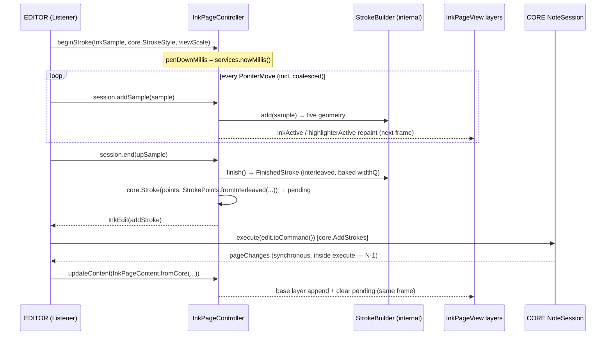
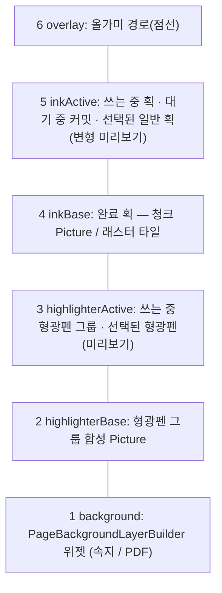

# 03. 필기 엔진 (INK) 상세 계획서

> 상태: **v0.4 — 3차 검토 반영본** (총괄 4차 검토 대기) · 영역 ID: **INK** · 소유 경로: `packages/ink_engine/`
> 기준 문서: [PLAN.md](../PLAN.md) v1.1 · [00-overview.md](00-overview.md) 7장 '통합 계약' **v1.2** (이 문서와 다르면 **계약이 우선**) · 검토: [00-review.md](00-review.md) 3.3(1차), '2차 검토' 2.4.3(INK-2-1~11), '3차 검토' 3.4.3(INK-3-1~5)
> 근거 환경: Flutter 3.47.9 / Dart 3.13.7 (`/opt/flutter`). 이 문서의 Flutter 엔진·프레임워크 근거는 이 버전 소스에서 확인했다 (6.2).
> 검토 반영 내역은 13장(13.1 1차, 13.2 2차, 13.3 3차), 계약 변경 제안은 12.1.

**표기 규칙**

- 좌표: 페이지 기준 논리 단위 **pt**, 원점 좌상단, y는 아래로 증가 (PLAN 7.2)
- 각도: 라디안. `tilt` 0 = 화면에 수직, π/2 = 화면에 눕힘. `azimuth`(=Flutter `orientation`) −π < a ≤ π
- 시간: 입력 샘플은 µs(`PointerEvent.timeStamp`), 저장 점의 `t`는 획 `createdAt` 기준 ms, 획 `createdAt`은 벽시계 ms(`EpochMillis`)
- 굵기 계수: 점마다 `f`(0 < f ≤ 4)를 구해 **`widthQ = f / 4`** 로 저장(계약 7.2.3). 렌더 반지름 `r = max(minRadiusPt, 2 · width · widthQ)`
- `core.X` = `package:note_core/note_core.dart`의 타입(`import ... as core`). 획·점·펜 스타일·페이지·배경·속지·명령은 모두 CORE 타입이다(7.2.0)
- "웹" = iPad Safari 웹 빌드. iPad Safari는 CanvasKit 렌더러로 동작한다 (6.2 근거 W10)
- `viewScale` = 화면 논리 px / pt(devicePixelRatio·조상 Transform 제외), `deviceScale` = 기기 px / pt (= viewScale × 조상 Transform 배율 `ancestorScale` × devicePixelRatio). 세션의 화면 거리 임계와 위젯 레이아웃·painter 배율은 `viewScale`만, `ancestorScale`은 `deviceScale`(해상도·버킷 선택)으로만 들어간다(계약 7.2.15·7.2.16 v1.1)
- 코드 블록은 **본문을 생략한 시그니처**다. 식별자·주석은 영어, 설명은 한국어. 계약(7.2.15·7.2.16)에 있는 시그니처는 글자 그대로 옮겼다

---

## 1. 목적과 범위

### 1.1 목적

INK는 **"포인터 샘플 → 벡터 획 → 화면 / 썸네일 / PDF 벡터"** 를 책임지는 엔진 패키지다. 입력 분배·도구 상태·UI는 갖지 않고, EDITOR가 넘겨주는 샘플을 받아 CORE `Stroke`를 만들고, 페이지를 그리고, 지우개·올가미·선택의 기하 계산 결과를 CORE `EditCommand` 하나로 바뀌는 편집(`InkEdit`, 7.2.15)으로 돌려준다.

설계 원칙

1. **기하(순수 계산)와 렌더링 분리**: 스무딩·외곽선·분할·올가미는 `dart:ui` 그리기 없이 계산 → 컨테이너에서 결정적으로 테스트, 네이티브 렌더러 교체(PLAN 12장) 시에도 재사용
2. **보이는 그대로 저장 (WYSIWYG)**: 필압 곡선·가상 필압·속도 가늘어짐·연필 기울기·taper를 점의 굵기 계수 `widthQ`로 "굽어서(bake)" 저장 → 다시 열어도, 다른 기기에서도, PDF에서도 같은 모양 (6.7, 계약 7.2.3)
3. **필압 없는 입력에서도 정상 동작**: Apple Pencil USB-C·손가락·웹 고정 필압을 감지해 속도 기반 가상 필압으로 전환 (00-overview 5장). 감지 규칙은 INK 6.4 하나뿐(7.2.15)
4. **웹(CanvasKit) 우선 성능 설계**: 매 프레임 그리는 것은 쓰는 중인 획뿐. 래스터 캐시는 유휴 시간에만 생성, 웹 메모리 예산 외곽선 32MB·래스터 96MB (6.13, 7.4.10)
5. **CORE 타입 그대로**: 공유 데이터는 CORE 타입을 받고 돌려준다. INK는 렌더 전용 읽기 래퍼(`InkStroke`·`InkPoints` — CORE 객체를 복사 없이 감쌈)만 두고, CORE와 같은 개념을 다시 정의하지 않는다(7.2.0)

### 1.2 이번 동시 개발 범위

| 묶음 | 내용 |
|---|---|
| 입력 | `PointerEvent` → `InkSample` 정규화, 필압 유무 감지(앱의 유일한 감지 규칙), 속도 기반 가상 필압, 1€ 필터 스무딩, `core.PressureCurve.evaluate`를 실제 필압에 적용 |
| 획 생성 | 중심선 처리(중복 제거·Catmull-Rom 보간·갈고리 제거·점 획), taper, 굵기 계수 굽기(`widthQ`), 형광펜 직선 보정, 외곽선 생성, `core.Stroke` 생성(`StrokePoints.fromInterleaved`) |
| 펜 5종 | 볼펜 · 만년필 · 형광펜(겹쳐도 안 진해짐, 글자 아래 레이어, 직선 보정) · 연필(종이 질감, 기울기) · 마커. P1 도구 5종은 데이터를 보존한 채 볼펜 프로필로 대체 렌더 |
| 렌더링 | 페이지 레이어 위젯 `InkPageView`, 활성 획 레이어, 완료 획 청크 Picture 캐시, 래스터 타일 캐시(배율 버킷·재래스터), 화면 밖 해제, 펜 미리보기 |
| 속지 | 빈 페이지 + **줄·모눈·점·코넬·악보·플래너 6종**(화면·썸네일·PDF 벡터 — 7.8), 종이 색. 기본 수치의 단일 출처(6.16) |
| 배경 확장 지점 | `PageBackgroundLayerBuilder`(화면, PDF가 구현) + `PageBackgroundStillRenderer`(화면 밖 썸네일), `PageBackgroundContext.isThumbnail` |
| 편집 기하 | 공간 색인(균일 격자), 히트 테스트, 획 지우개, 부분 지우개(벡터 분할 → `core.Stroke.fragment`), `core.StrokeFilter`, 올가미(nonzero, 포함 규칙 계약), 선택 이동·크기·회전·색 변경·복제·삭제(변형 수학의 유일한 구현 `SelectionGeometry`) |
| 출력 | `InkEdit.toCommand()` → `core.EditCommand`(7.2.15 표), PDF용 벡터 경로(획 + 속지 6종) |
| 썸네일 | 페이지 패널 위젯 `InkPageThumbnail`, `InkPageThumbnailRenderer implements core.PageThumbnailRenderer`(PNG — 노트 표지·캐시용) |
| 진단·개발 도구 | `InkDiagnostics`(입력→화면 지연·입력 Hz·필압·프레임·캐시·타일 래스터 시간 — 앱의 유일한 측정원), `InkDevTools.syntheticStrokes`(개발자 메뉴 부하 테스트) |
| 상태 | Riverpod provider (`package:riverpod`만 의존). `pressureModeProvider`(EDITOR가 `set()`), `pressureCapabilityProvider`, `inkPageThumbnailRendererProvider` |

### 1.3 이후 범위 (이번에 만들지 않음, 확장 지점만 남김)

- 추가 펜 (M5): 붓펜, 캘리그래피(배럴 롤 각도), 점선/파선, 레이저 포인터, 암기 테이프 → `PenProfile`/`InkRenderMethod` 확장. 이번에는 `core.PenTool`의 P1 값을 볼펜 프로필로 그린다(스타일·점은 보존)
- 도형 인식·자동 보정 (M5, F-11)
- 올가미 회전·색 변경 **UI** (M5, EDITOR) — 계산 API는 이번에 둔다(7.8)
- 예측 입력 (네이티브): `predictedTouches` 등 → 이번에는 `InkPredictor` 인터페이스 + `NoopPredictor`만, `InkInputExtension`은 형태만 기록 (6.27)
- Apple Pencil 호버·스퀴즈·배럴 롤, iOS `coalescedTouches` 고빈도 샘플 (네이티브 전환)
- 이미지 페이지 배경(`core.ImageBackground`, M5 — 이번에는 종이 색으로 대체 렌더), 다크 모드 페이지 색 반전, 눈금자
- 녹음 재생 시 획 강조 (M6) — 이번에는 녹음 필드 보존만
- 손글씨 인식 연동 (M7)

### 1.4 제외 (다른 영역 책임) — 경계표

| 항목 | INK | 담당 영역 |
|---|---|---|
| 포인터 이벤트 수신(`Listener`), 펜/손가락 판정, 팜 리젝션, 제스처(두 손가락 탭·핀치 등) | ✗ | EDITOR |
| 화면 → 페이지 좌표 변환, 줌·스크롤 상태 | 세션의 `viewScale`, `InkPageView` 인자(`ancestorScale`·`isScaling`·`visiblePageRect`)를 받기만 함. `controller.setViewport`는 `InkPageView`가 부름(계약 7.2.15 v1.1, 6.12 R9) | EDITOR |
| `PointerEvent` → `InkSample` 정규화 규칙(필압 범위, tilt 부호, kind), 필압 유무 감지 | ✓ `InkSampleAdapter`, 6.4 (유일한 규칙) | EDITOR가 호출·표시 |
| 필압 모드 설정 저장 | 값만 받음(`pressureModeProvider.notifier.set`) | EDITOR |
| 현재 도구·프리셋 선택, 지운 뒤 이전 펜 복귀, 펜 버튼 전환 | ✗ | EDITOR |
| 지우개 원형 커서, 호버 커서, 선택 핸들 그리기·적중 판정, 메뉴 UI | 반경·변형 계산 API(`SelectionGeometry`)만 | EDITOR |
| 획·점·펜 스타일·페이지·배경·속지 데이터 모델, 저장, 압축, 되돌리기 스택 | 점 채널 의미(`widthQ`)·렌더 의미·기본값 표(6.9·6.16)만 정함 | CORE |
| 명령 실행(되돌리기 등록) | `InkEdit.toCommand()`로 `core.EditCommand` 생성까지 | EDITOR → CORE `NoteSession.execute` |
| 현재 페이지 전체 지우기 | ✗ (결과는 `updateContent`로 받아 그림) | EDITOR가 `core.ClearPage` 실행 |
| 썸네일 저장·신선도, 노트 표지 예약 생성, 렌더러 주입 | 그리기만(`InkPageThumbnailRenderer`) | CORE `ThumbnailCache` · LIBRARY 예약 · INFRA 주입 |
| 개발자 표시 화면 | 수치 수집 `InkDiagnostics`, 합성 획 `InkDevTools` | EDITOR |
| PDF 페이지 배경 렌더링, PDF 파일 생성 | 확장 지점 인터페이스 2개, 벡터 경로 | PDF |
| 빌드·CI·배포, pubspec 생성, 워크스페이스 등록 | 패키지 내부 테스트 구성만 | INFRA |

### 1.5 INK 내부 단계

| 단계 | 포함 작업 (8장) | 다른 영역에 주는 것 |
|---|---|---|
| **B3** (기반 단계, 7.6) | T00 | 계약 표면 전부를 **단순하지만 동작하는 구현**으로 → EDITOR·PDF가 첫날부터 컴파일·펜·지우개·올가미 흐름 테스트 |
| **INK-α** (M0 지원) | T01–T12 (+ 선택 T23) | 펜 5종 필기·렌더링, 진단, provider, 개발 도구 → EDITOR가 M0 프로토타입 완성 |
| **INK-β** (M1 지원) | T13, T13b, T14–T20 | 속지 6종, 지우개 2종, 올가미·선택, 래스터 타일, 썸네일 위젯·렌더러 |
| **INK-γ** (M3 지원) | T21–T22 | PDF용 벡터 내보내기, 벤치마크 기준 확정 |

---

## 2. PLAN.md 요구사항 대응표

범위: **이번** = 이번 동시 개발 / **부분** = 일부만 이번 / **이후** = 이후 범위 / **타 영역** = INK 범위 아님(경계 명시)

| PLAN 위치 | 요구사항 | 범위 | 이 계획서 작업 · 비고 |
|---|---|---|---|
| 1.3 | Apple Pencil (USB-C)은 필압 미지원 → 그래도 동작 | 이번 | T03 필압 감지, T04 가상 필압 (6.4·6.5) |
| F-01 | 노트 표지 썸네일 (그리드) | 이번 | T20 `InkPageThumbnailRenderer`(CORE `PageThumbnailRenderer` 구현, PNG). 예약 LIBRARY, 주입 INFRA (7.2.11) |
| F-03 | 볼펜: 균일, 필압에 약하게 반응 | 이번 | T05·T08, `PenProfile.ballpoint` (6.9) |
| F-03 | 만년필: 필압·속도에 따라 굵기 변화 | 이번 | T05·T08, 속도 가늘어짐 (6.7 K3) |
| F-03 | 형광펜: 반투명, 겹쳐도 진해지지 않음 | 이번 | T08 그룹 합성 (6.10) |
| F-03 | 형광펜: 글자 아래 레이어 | 이번 | T10 레이어 순서 (6.12) |
| F-03 | 형광펜: 직선 보정 옵션 | 이번 | T05, `StrokeStyleInk.highlighterStraightening` = `extras['hlStraight']` (6.7 F6) |
| F-03 | 연필: 종이 질감 텍스처, 기울이면 넓고 옅게 | 이번 | T05·T08 (6.11) |
| F-03 | 마커: 불투명하고 굵은 선 | 이번 | T08 |
| F-03 | 붓펜·캘리그래피·점선/파선·레이저·암기 테이프 (P1) | 이후 | M5. 이번에는 볼펜 프로필로 대체 렌더(데이터 보존, 6.9) |
| F-03 | 필압(pressure) 반영 | 이번 | T03–T05 |
| F-03 | 기울기(tilt) 반영 | 이번 | 연필 굵기·투명도 (6.11). 웹 tilt 근사값 (6.2 W3) |
| F-03 | 방위각(azimuth) 반영 | 부분 | 저장·선택 회전 시 보정(CORE `transformed`)만. 웹은 값 없음(6.2 W4). 사용처(캘리그래피)는 M5 |
| F-03 | 입력 지연 20ms 이내, 120Hz 대응 | 부분 | 활성 획만 매 프레임(T10), 지연 측정 훅(T11). 판정은 네이티브 전환 |
| F-03 | 예측 입력 | 이후 | 네이티브. 인터페이스만 (6.27) |
| F-03 | 손떨림 보정(스무딩) 단계 조절 | 이번 | T04 1€ 필터, `core.StrokeStyle.smoothing` 0~1 (6.6). 설정 UI는 EDITOR |
| F-03 | 필압 곡선 조절 | 이번 | T05 `core.PressureCurve.evaluate`를 입력 시점 실제 필압에 적용 (6.7 K1). 곡선 값·평가 함수 CORE, 설정 UI EDITOR |
| F-03 | 획 끝 가늘어짐(taper) | 이번 | T05 (6.7 F5) |
| F-03 | 안티앨리어싱 | 이번 | T08 (6.8 O8) |
| F-03 | 호버 미리보기 | 부분 | `StrokeStyleInk.previewRadius` API만. 표시 EDITOR, 실기기 검증 네이티브 전환 |
| F-03 | 벡터 저장 (확대해도 선명, PDF 벡터 유지) | 이번 | 벡터 점 저장(6.7), 배율별 재래스터(T19), 벡터 내보내기(T21) |
| F-04 | 색 연속 선택·투명도·HEX·RGB·스포이드·팔레트 | 부분 | INK는 임의 ARGB·`opacity` 렌더, 스포이드용 `hitTest`. 피커 UI는 EDITOR |
| F-04 | 굵기 연속 슬라이더 0.1~30pt, 0.1 단위 | 이번 | `core.StrokeStyle.minWidth/maxWidth` [0.1, 30] 그대로 렌더. 선택 변형도 같은 한계 (6.22) |
| F-04 | 슬라이더 옆 실제 굵기 미리보기 획 | 이번 | T20 `PenPreviewPainter` |
| F-05 | 프리셋 = 펜 종류+색+굵기+투명도+필압 감도+스무딩 | 부분 | 프리셋 = `core.StrokeStyle`(+ `pressureCurve`, `extras['hlStraight']`). INK는 렌더 의미와 기본값 표(6.9)만. 저장 CORE, UI EDITOR |
| F-08 | 펜을 한 번 대었다 뗀 동작 = 1단계 | 이번 | 제스처당 `InkEdit` 1개 = 명령 1개 (T09, 7.2.15) |
| F-08 | 부분 지우개로 여러 획이 잘려도 1단계 | 이번 | `core.SplitStrokes` 1개 (T16, 6.20) |
| F-08 | 대상: 필기, 지우기, 선택 이동·크기·회전·색 변경 | 이번 | T09·T15·T16·T18 |
| F-09 | 획 지우개 | 이번 | T15 |
| F-09 | 부분 지우개 — 벡터 획 잘라내기 | 이번 | T16 (6.20) |
| F-09 | 지우개 크기 연속 조절 | 이번 | `EraserSpec.radius` (pt). 슬라이더 UI는 EDITOR |
| F-09 | 지우개 범위 원형 커서 | 타 영역 | EDITOR |
| F-09 | 형광펜만 지우기 / 형광펜 제외 | 이번 | `core.StrokeFilter` (T15·T16) |
| F-09 | 지운 뒤 이전 펜 복귀, 펜 버튼·더블탭 전환 | 타 영역 | EDITOR |
| F-09 | 현재 페이지 전체 지우기 | 타 영역 | EDITOR가 `core.ClearPage(pageId, filter)` 실행. INK는 결과를 `updateContent`로 그림 |
| F-10 | 올가미로 선택한 손글씨 → 텍스트 | 부분 | 올가미 결과(획 id, 점 시간 보존)만. 인식은 M7 |
| F-11 | 도형 그리기, 자동 도형 보정 | 이후 | M5 |
| F-12 | 펜 전용 모드, 팜 리젝션, 제스처 매핑 | 타 영역 | EDITOR. INK는 늦은 취소 `session.cancel()` 지원 (T06·T10) |
| F-13 | 속지 템플릿: 줄·모눈·점·코넬·**악보·플래너** | 이번 | T13·T13b (6.16) — 6종 모두 (7.8) |
| F-13 | 속지 색상 (흰색·미색·검정 등) | 이번 | `core.PaperColors`(값 CORE 소유), 어두운 종이 선 색 자동 (T13) |
| F-13 | PDF 페이지 배경 | 부분 | 확장 지점 `PageBackgroundLayerBuilder`·`PageBackgroundStillRenderer` (T13, 6.17). 구현은 PDF |
| F-13 | 이미지 페이지, 다른 노트 페이지 복사 | 이후 / 타 영역 | 이미지 배경 M5(이번에는 종이 색 대체). 복사는 CORE |
| F-13 | 페이지 크기 A4·Letter·16:9·사용자 지정, 가로·세로 | 부분 | 임의 `core.PageSize` 렌더. 프리셋·한계는 CORE |
| F-15 | 필기는 벡터로 출력 | 이번 | T21 `InkVectorExport` (6.24) |
| F-15 | 옵션: 속지 포함 여부 | 이번 | T21 `TemplateVectors` (6종) |
| F-16 | 녹음 중 쓴 획마다 녹음 시점 기록 | 부분 | `InkStrokeMeta` → `core.Stroke.recordingId/recordingOffsetMs`, 조각·복제·변형 시 보존 (CORE `fragment`·`transformed`). 재생 강조는 M6 |
| 5.1 | 올가미 기본 (M1): 선택 → 이동·크기 조절·삭제·복사 | 이번 | T17·T18 |
| 5.1 | 올가미 고급 (M5): 회전·색 변경·잘라내기·붙여넣기 | 부분 | 회전·색 변경 계산·`InkEdit`은 이번(7.8). UI·클립보드는 EDITOR·M5 |
| 5.1 | 확대/축소, 확대 상태에서 필기 | 이번 | `viewScale` 반영 입력 처리(6.5·6.6), 배율 버킷 재래스터(T19) |
| 5.1 | 페이지 썸네일 | 이번 | T20 `InkPageThumbnail`(패널) + `InkPageThumbnailRenderer`(캐시·표지) |
| 5.1 | 속지 템플릿 | 이번 | T13·T13b |
| 5.2 | 다크 모드(페이지 색 반전), 눈금자, 레이저, 암기 테이프, 요소 저장 | 이후 | — |
| 5.4 | 필기 지연 20ms (120Hz 기준) | 부분 | 측정 훅 T11. 웹 예상치·판정 시점 (6.14) |
| 5.4 | 획 10만 개에서도 60fps 스크롤 | 이번 | 청크 Picture + 래스터 타일 + 가상화 (T10·T19), 벤치마크 (T22) |
| 5.4 | 크래시 시에도 마지막 획까지 보존 | 타 영역 | CORE. INK는 펜을 뗄 때 즉시 `InkEdit` 반환 |
| 5.4 | 획 데이터 압축 | 부분 | 압축은 CORE 코덱. INK는 점 밀도 관리(중복 제거·단순화, 6.7 F7) |
| 5.4 | 개발자 표시: 프레임 시간·입력 지연·필압 | 부분 | 수치 수집 T11, 합성 획 `InkDevTools`(T12). 표시 UI는 EDITOR |
| 6.2 | 필기 렌더링: CustomPainter + 레이어 캐싱 | 이번 | T10·T19 |
| 6.2 | 획 생성: perfect-freehand 계열 + 스무딩 | 이번 | T04–T07 (직접 구현, MIT 알고리즘 참고 — 7장) |
| 7.2 | Stroke `points[{x, y, pressure, tilt, azimuth, t}]`, bbox | 타 영역 | 모델 CORE. 두 번째 채널 = `widthQ`(INK가 굽기), `bounds`는 CORE 공식 — INK는 렌더 외곽 ⊆ `bounds`를 보장 (K-1, T07 불변식 테스트) |
| 7.3 | 레이어: 배경 → 형광펜 → 일반 필기 → 선택·쓰는 중 획 | 이번 | T10 (6.12) |
| 7.3 | 다 쓴 획 타일 이미지 캐시, 배율 바뀌면 재생성 | 이번 | T19 (6.13) |
| 7.3 | 쓰는 중인 획만 매 프레임 | 이번 | T10 활성 레이어 |
| 7.3 | 화면 밖 페이지 메모리 해제 | 이번 | autoDispose 컨트롤러 + LRU (6.13) |
| 7.3 | 공간 색인으로 지우개·올가미 고속화 | 이번 | T14 균일 격자 (6.18) |
| 7.5 | 획 추가·삭제·분할·선택 변형 커맨드 | 부분 | INK는 `InkEdit` → `core.EditCommand` 생성 (6.23, 7.2.15). 명령 구현은 CORE |
| 9.4 | 획 분할 등 핵심 로직 자동 테스트 | 이번 | T16 성질 기반 테스트 |
| 10 M0 | 필압을 반영하는 펜 1종으로 빈 페이지에 필기하는 프로토타입 | 이번 | B3(T00) 즉시 + INK-α (T01–T12) + EDITOR 화면 |
| 10 M0 | 개발자 표시 (프레임 시간 · 입력 지연 · 필압) | 부분 | T11 수집 + EDITOR 표시 |
| 10 M1 | 펜 5종 | 이번 | T08 |
| 10 M1 | 획 지우개 · 부분 지우개 | 이번 | T15·T16 |
| 10 M1 | 확대·축소 · 스크롤 | 부분 | 렌더 측(T19). 제스처는 EDITOR |
| 10 M1 | 올가미 기본 | 이번 | T17·T18 |
| 10 M1 | 페이지 썸네일, 속지 템플릿 | 이번 | T20·T13·T13b |
| 10 네이티브 전환 | 필기감 판정, 호버·스퀴즈·배럴 롤 | 이후 | 6.27 인터페이스 |
| 10 M3 | PDF 내보내기 (벡터 필기) | 이번 | T21 (PDF 영역이 사용) |
| 10 M5 | 추가 펜, 도형 + 자동 보정, 올가미 고급 | 이후 / 부분 | 위 F-03·F-11·5.1 행 참고 |
| 12장 | 필기 지연 부족 시 렌더링만 네이티브 교체 | 부분 | 기하·렌더 분리 구조 (1.1 원칙 1) |

---

## 3. 소유 경로와 패키지 구조

```text
packages/ink_engine/
├─ pubspec.yaml                  # INFRA가 B1에서 생성 (7.4.1 형식 · 7.5 버전, 5.5)
├─ dart_test.yaml                # tags: golden, bench (7.4.8 v1.1·v1.2 — 아래)
├─ README.md                     # 진입점·호출 규약(5.3) 요약
├─ THIRD_PARTY_NOTICES.md        # perfect-freehand (MIT) 알고리즘 참고 고지
├─ lib/
│  ├─ ink_engine.dart            # 공개 API 진입점 — 모든 이름을 show로 고정 (4.0)
│  ├─ testing.dart               # 다른 영역·INK의 test/ 전용 도우미 (4.14) — flutter_test 비의존, 웹 안전
│  ├─ dev_tools.dart             # 개발자 메뉴용 (4.14) — 웹 안전, 앱 코드에서 import 가능
│  └─ src/
│     ├─ tuning.dart             # InkTuning: 모든 수치 상수 (6.28)
│     ├─ model/                  # ink_layer, ink_points, ink_stroke
│     ├─ pen/                    # pen_profile, style_ink (StrokeStyleInk·InkStyleExtras·HighlighterStraightening)
│     ├─ input/                  # ink_sample, sample_adapter, pressure_mode, pressure_capability, predictor
│     │                          # · (내부) pressure_detector, simulated_pressure, one_euro_filter
│     ├─ stroke/                 # stroke_meta · (내부) stroke_builder, centerline(dedupe·subdivide·hook·dot),
│     │                          #   width_factor, taper, straighten, simplify
│     ├─ geometry/               # vector_path · (내부) outline_generator, stroke_outline, polygon_utils, rdp
│     ├─ edit/                   # ink_edit, eraser_spec, lasso_options, selection_geometry
│     │                          # · (내부) spatial_index, hit_test, partial_eraser, lasso_polygon
│     ├─ render/                 # ink_page_content, ink_page_controller, sessions, selection, ink_page_view,
│     │                          #   render_config, cache_pool, pencil_grain, thumbnail, thumbnail_renderer, pen_preview
│     │                          # · (내부) chunk_pictures, tile_raster_cache, stroke_painter,
│     │                          #   highlighter_compositor, layer_painters, work_scheduler
│     ├─ background/             # background_spec, background_builder, template_builder, template_vectors
│     │                          # · (내부) template_defaults(6.16 단일 출처), template_painter
│     ├─ export/                 # vector_export
│     ├─ diagnostics/            # ink_clock.dart(+ ink_clock_stub.dart, ink_clock_browser.dart), diagnostics
│     │                          # · (내부) latency_tracker
│     ├─ dev/                    # synthetic_strokes (InkDevTools)
│     ├─ interop/                # (내부) core_interop.dart — CORE 객체 생성·변환의 유일한 지점 (6.23)
│     └─ providers.dart          # Riverpod provider (4.13)
├─ test/
│  ├─ flutter_test_config.dart   # 허용 오차(≤ 0.5%) 골든 비교기 (9.2)
│  ├─ fixtures/                  # 기록된 샘플 스크립트 (5.6)
│  ├─ foundation/                # B3 스모크 (T00)
│  ├─ unit/                      # api_surface, export_list, model, pen, input, stroke, geometry, edit,
│  │                             #   interop, background, export, diagnostics, render, providers, dev_tools
│  ├─ widget/                    # ink_page_view, pixel/, handoff, thumbnail, thumbnail_renderer, previews
│  ├─ goldens/                   # *_golden_test.dart (@Tags(['golden']), @TestOn('vm')) + images/*.png
│  └─ web/                       # @TestOn('browser') — Chrome은 여기만: 시계·체크섬·PNG + VM 단위 테스트 감싸기
├─ benchmark/                    # *_bench_test.dart (@Tags(['bench']), 기본 실행·CI 제외)
└─ example/                      # (선택, INK-O1·T23) ink lab — 워크스페이스 등록은 INFRA
```

- 패키지 안에 `analysis_options.yaml`을 두지 않는다(루트가 적용, 7.4.1 · R3).
- `dart_test.yaml`(계약 7.4.8 v1.1 — 태그를 쓰는 패키지는 선언): INK가 쓰는 태그는 `golden`·`bench` 둘뿐이고 `integration`·`perf`는 쓰지 않는다(INK에는 통합 단계 전용 테스트가 없음 — 실제 INK + 실제 CORE 흐름은 EDITOR E-21). 나중에 `integration`·`perf`를 쓰게 되면 같은 파일에 `skip: "<사유>"`로 선언한다.
- `ws check` R15(계약 7.4.2·7.4.8 v1.2, C12-01)는 **기반 단계 B1부터** 이 선언을 검사한다(누락 = 종료 코드 1). 그래서 ① 이 파일은 태그를 쓰는 첫 테스트(T08 `goldens/pens_golden_test.dart`)보다 먼저 T01에서 만든다 — B3(T00)의 테스트는 태그를 쓰지 않으므로 그 시점에는 파일이 없어도 R15 위반이 아니다 ② R15 스캐너는 **문자열 리터럴 태그만** 인식하므로 태그는 `@Tags(['golden'])`·`@Tags(['bench'])`처럼 리터럴로 쓰고 상수·변수로 넘기지 않는다.

```yaml
# packages/ink_engine/dart_test.yaml
tags:
  golden: {}   # test/goldens/ (@TestOn('vm'))
  bench: {}    # benchmark/ only — not under test/, so `flutter test` / `ws test` never run it
```

- `lib/`에서 `dart:io`·`dart:ffi`·`dart:html`·`dart:js`·`dart:js_util`·`package:js` 금지, `package:flutter/material.dart`·`cupertino.dart`도 쓰지 않는다(INK는 Material 비의존 — `widgets`·`rendering`·`painting`·`foundation`·`scheduler`·`gestures`만). `test/unit/no_platform_imports_test.dart`(VM)가 lib/ 전체를 검사 (7.4.3)
- 플랫폼 분기는 조건부 import 하나뿐: `diagnostics/ink_clock.dart` → `import 'ink_clock_stub.dart' if (dart.library.js_interop) 'ink_clock_browser.dart';`. stub = `Stopwatch`(VM·네이티브), browser = `dart:js_interop`의 `performance.now()` (7.4.3 이름 규칙, scratch에서 VM·Chrome 컴파일·동작 확인)
- 웹 안전 수치(7.4.3): 64비트 정수 연산·비트 연산을 쓰지 않는다(색 성분·난수 포함 — 난수는 산술 MINSTD, 6.26)
- **CORE 객체 생성 지점**: `core.Stroke`를 만드는 코드(펜 획·부분 지우개 조각·올가미 복제·합성 획, 그리고 **미리보기용 메모리 전용 획** `previewFragmentOf`·`previewTransformedOf`), 썸네일 결과 `core.PageThumbnail`(`thumbnailOf` — `InkPageThumbnailRenderer.render`가 부름, 6.17 4단계)과 `PageRect`↔`Rect`·`Affine2`↔행렬 변환은 `src/interop/core_interop.dart`에만 둔다(6.23 함수표). 그 밖의 파일은 CORE 객체를 읽고 전달만 한다. 예외는 CORE가 정한 값·명령을 그대로 만드는 세 곳: ① `InkEdit.toCommand()`의 `core.EditCommand`·`core.StrokeStylePatch`(4.6 표) ② `SelectionGeometry`가 돌려주는 `core.Affine2`(CORE 팩토리 `translation`·`scaling`·`rotation`) ③ `InkPoints[i]`·`lerpAt`의 `core.StrokePoint` 값. `dev_tools.dart`(`InkDevTools`)도 획은 이 파일의 `strokeFromData`로 만들고, `testing.dart`의 테스트용 `core.Page`(`SyntheticInk.page`)만 테스트 전용이라 예외 → CORE 계약이 바뀌어도 수정 범위가 한 파일
- "(내부)" 표시 파일은 `ink_engine.dart`에서 export하지 않는다(INK 자체 테스트만 `src/`를 import)

---

## 4. 공개 API

> 계약 대응: 이 장의 4.3~4.9·4.12~4.14가 00-overview **7.2.15**, 4.9(썸네일)·4.10·4.11이 **7.2.16**이다(계약 **v1.2** — v1.2는 시그니처 변경이 없고, INK 표면에서 바뀐 것은 4.13 `pageBackgroundBuildersProvider` 문서 주석 한 줄뿐(C12-03)). 계약 블록에 있는 시그니처·문서 주석은 글자 그대로 옮겼고(주석 `// contract 7.2.x`, v1.1·v1.2에서 바뀐 줄은 계약과 같이 `(v1.1)`·`(v1.2)` 표시), 계약이 "INK 4.x"로 위임한 나머지는 이 장이 정한다. 계약 줄 사이에 INK가 덧붙인 문서 주석 줄은 계약 의미를 좁히거나 바꾸지 않는 보충이다. 계약과 다르게 보이는 곳이 있으면 계약이 우선이며, 고칠 점은 12.1에 '계약 변경 제안'으로 남겼다.

### 4.0 공통 규칙과 진입점

- 공개 API는 `package:ink_engine/ink_engine.dart` 하나로 export하고, **export 이름은 아래 `show` 목록이 전부**다(통합 R14 검사 — 다른 패키지 export와 겹치지 않음 확인함, 13장). `test/unit/export_list_test.dart`(VM)가 세 진입점의 공개 이름(`ink_engine.dart`·`dev_tools.dart`는 `show` 목록, `testing.dart`는 최상위 선언)을 이 절·4.14 목록과 대조한다
- 다른 진입점: `package:ink_engine/testing.dart`(test/ 전용, 4.14), `package:ink_engine/dev_tools.dart`(웹 안전, 개발자 메뉴용, 4.14)
- CORE와 같은 개념(획·점·펜 스타일·필압 곡선·종이 색·속지 종류·지우개 필터·명령·ID 생성기)을 정의·export하지 않는다(7.2.0). INK 공개 API의 그런 자리에는 `core.` 타입이 온다
- 모든 값 타입은 `@immutable`, `==`/`hashCode` 구현(리스트·집합 필드는 수정 불가 뷰 + 내부 동등성 함수 — `collection` 비의존). 렌더 래퍼(`InkStroke`)의 동등성은 감싼 CORE 객체의 동일성
- 예외: 잘못된 인자는 `ArgumentError`, 상태 위반(세션 종료 후 호출 등)은 `StateError`. 렌더링 경로는 예외를 던지지 않고 그 획을 건너뛰며 `InkDiagnostics` 경고 카운트 + `FlutterError.reportError(library: 'ink_engine')` (7.4.5)

```dart
// lib/ink_engine.dart — the complete list of exported names
library;

export 'src/tuning.dart' show InkTuning;
export 'src/model/ink_layer.dart' show InkLayer;
export 'src/model/ink_points.dart' show InkPoints;
export 'src/model/ink_stroke.dart' show InkStroke;
export 'src/pen/pen_profile.dart' show PenProfile, InkCap, InkRenderMethod;
export 'src/pen/style_ink.dart' show StrokeStyleInk, InkStyleExtras, HighlighterStraightening;
export 'src/input/ink_sample.dart' show InkSample, InkPointerKind;
export 'src/input/sample_adapter.dart' show InkSampleAdapter;
export 'src/input/pressure_mode.dart' show PressureMode, PressureModeNotifier;
export 'src/input/pressure_capability.dart'
    show PressureCapability, PressureSource, PressureCapabilityState, PressureCapabilityStore,
        PressureCapabilityNotifier;
export 'src/input/predictor.dart' show InkPredictor, NoopPredictor;
export 'src/stroke/stroke_meta.dart' show InkStrokeMeta;
export 'src/geometry/vector_path.dart' show InkVectorPath, InkPathVerb;
export 'src/edit/ink_edit.dart' show InkEdit, InkEditKind;
export 'src/edit/eraser_spec.dart' show EraserSpec, EraserMode;
export 'src/edit/lasso_options.dart' show LassoOptions;
export 'src/edit/selection_geometry.dart' show SelectionGeometry, SelectionHandle;
export 'src/render/ink_page_content.dart' show InkPageContent;
export 'src/render/ink_page_controller.dart'
    show InkPageController, InkCoreServices, InkRenderLayer, InkPageRenderStats;
export 'src/render/sessions.dart'
    show InkGestureSession, StrokeSession, EraserSession, LassoSession, LiveStrokeGeometry;
export 'src/render/selection.dart' show InkSelection;
export 'src/render/ink_page_view.dart' show InkPageView, InkPageGeometry;
export 'src/render/render_config.dart' show InkRenderConfig;
export 'src/render/cache_pool.dart' show InkCachePool, InkCacheStats;
export 'src/render/pencil_grain.dart' show PencilGrain;
export 'src/render/thumbnail.dart' show InkPageThumbnail;
export 'src/render/thumbnail_renderer.dart' show InkPageThumbnailRenderer;
export 'src/render/pen_preview.dart' show PenPreviewPainter, PenPreviewShape;
export 'src/background/background_spec.dart' show InkBackgroundSpec, InkBackgroundKind;
export 'src/background/background_builder.dart'
    show PageBackgroundContext, PageBackgroundLayerBuilder, PageBackgroundStillRenderer;
export 'src/background/template_builder.dart' show TemplateBackgroundLayerBuilder;
export 'src/background/template_vectors.dart'
    show TemplateVectors, TemplateVectorItem, TemplateLine, TemplateDot;
export 'src/export/vector_export.dart'
    show InkVectorExport, InkPageVectors, InkHighlighterGroup, InkHighlighterLine, InkFillShape,
        InkExportOptions, InkBlendMode;
export 'src/diagnostics/ink_clock.dart' show InkClock;
export 'src/diagnostics/diagnostics.dart' show InkDiagnostics, InkStatsSnapshot, LatencySummary;
export 'src/providers.dart'
    show inkRenderConfigProvider, inkClockProvider, pressureModeProvider,
        pressureCapabilityProvider, inkCoreServicesProvider, inkCachePoolProvider,
        inkDiagnosticsProvider, pencilGrainProvider, pageBackgroundBuildersProvider,
        inkPageControllerProvider, inkPageThumbnailRendererProvider;
```

초안에서 공개 API에서 뺀 것(검토 INK-M2·M3): `PenStyle`, `PressureCurve`, `InkTool`(+`InkToolX`), `PaperColors`, `PageTemplateKind`, `PageTemplateSpec`, `EraserFilter`(+`EraserFilterX`), `kNominalQ`, `kMaxWidthFactor`, `kMinPenWidth`/`kMaxPenWidth`, `PenStyle.inkParamsToJson`/`fromPreset`, `InkAffine`, `InkPointValue`, `StrokeChange`, `computeStrokeBounds`, `InkPageController.clearPage`, `InkEditKind.clearPage`, `InkThumbnailRenderer`, `InkSampleAdapter.kindOf`, `SequentialIds`(testing — CORE `SequentialIdGenerator` 사용). 내부로 옮긴 것(`src/`, export 안 함): `StrokeBuilder`·`FinishedStroke`·`buildStroke`, `PressureDetector`, `StrokeOutline`·`OutlineGenerator`·`OutlineOptions`, `StrokeSpatialIndex`, `InkHitTest`, `PartialEraser`·`ParamInterval`, `LassoPolygon`·`LassoSelector`, `TemplateBackgroundPainter`, `InkPointsBuilder`.

### 4.1 모델 — CORE 획을 감싸는 렌더 래퍼

```dart
// src/model/ink_layer.dart
/// Render layer (PLAN 7.3): background → highlighter → ink → overlay.
enum InkLayer { highlighter, ink }
```

```dart
// src/model/ink_points.dart
import 'package:note_core/note_core.dart' as core;

/// Zero-copy, read-only view over core.StrokePoints.rawData
/// (stride 6: [x, y, widthQ, tilt, azimuth, t]). Never writes to the buffer (K-2).
/// Values are CORE's quantized values, so what INK renders == what is stored.
final class InkPoints {
  static const int stride = core.StrokePoints.stride;   // 6

  /// Wraps [raw] without copying. raw.length must be a positive multiple of [stride].
  InkPoints.fromRaw(Float32List raw);

  /// Same as InkPoints.fromRaw(points.rawData).
  factory InkPoints.of(core.StrokePoints points);

  int get length;
  bool get isEmpty;
  Float32List get raw;          // the CORE buffer itself — read only

  double x(int i);
  double y(int i);
  double widthQ(int i);         // channel [2]
  double tilt(int i);
  double azimuth(int i);
  double t(int i);              // ms since Stroke.createdAt
  Offset offsetAt(int i);
  core.StrokePoint operator [](int i);

  /// All channels linearly interpolated at fractional index s ∈ [0, length - 1]; azimuth
  /// along the shortest arc. Used for partial-eraser cut points (6.20 P5).
  core.StrokePoint lerpAt(double s);

  /// Centerline length (pt) and cumulative lengths (result[0] == 0).
  double arcLength();
  Float64List cumulativeLengths();
}
```

```dart
// src/model/ink_stroke.dart
import 'package:note_core/note_core.dart' as core;

/// Render-side view of ONE committed or pending core.Stroke. Created only through
/// InkStroke.of, which caches per core.Stroke instance (Expando): the same instance
/// always gives the same InkStroke (diff by identity, K-4). Equality = identical(source).
@immutable
final class InkStroke {
  factory InkStroke.of(core.Stroke stroke);

  final core.Stroke source;
  String get id;                 // source.id
  core.StrokeStyle get style;    // source.style (normalized by CORE)
  PenProfile get profile;        // style.profile — P1 tools → ballpoint profile
  InkPoints get points;          // InkPoints.of(source.points), no copy
  /// source.bounds as a Rect — the CORE value (7.2.3). INK never recomputes it;
  /// every rendered pixel lies inside (K-1, 6.7).
  Rect get bounds;
  InkLayer get layer;            // profile.layer
  bool get isDot;                // one point or zero-length centerline
  /// max(InkTuning.minRadiusPt, 2 * style.width * points.widthQ(i));
  /// highlighter: style.width / 2 (widthQ ignored, square caps).
  double radiusAt(int i);
  double get maxRadius;
}
```

### 4.2 펜 — CORE `StrokeStyle`의 INK 해석

```dart
// src/pen/style_ink.dart — contract 7.2.15
import 'package:note_core/note_core.dart' as core;

// wire value of HighlighterStraightening = name
enum HighlighterStraightening { off, snapOnLift, alwaysStraight }
abstract final class InkStyleExtras { static const String highlighterStraightening = 'hlStraight'; }
extension StrokeStyleInk on core.StrokeStyle {
  PenProfile get profile;                    // PenProfile.of(tool); P1 tools → ballpoint profile
  double get previewRadius;                  // radius at width factor 1 (hover / size preview)
  HighlighterStraightening get highlighterStraightening;
  core.StrokeStyle withHighlighterStraightening(HighlighterStraightening value);
}
```

- `previewRadius` = `width / 2`(= `2 · width · kNominalWidthQ`).
- `highlighterStraightening`: `extras['hlStraight']`가 `'off'`·`'snapOnLift'`·`'alwaysStraight'` 중 하나면 그 값, 없거나 모르는 값·다른 타입이면 `off`. 형광펜에서만 의미가 있다(다른 펜은 읽기만 하고 무시).
- `withHighlighterStraightening(v)` = `copyWith(extras: {...extras, 'hlStraight': v.name})`. 다른 extras 키는 보존한다.
- 펜 스타일의 다른 값(`colorArgb`·`width`·`opacity`·`pressureSensitivity`·`pressureCurve`·`smoothing`)은 CORE 정식 필드를 그대로 쓴다. 기본값은 `core.StrokeStyle.defaultsFor(tool)`(값의 출처 = 6.9 표).

```dart
// src/pen/pen_profile.dart
import 'package:note_core/note_core.dart' as core;

enum InkCap { round, square }
enum InkRenderMethod { filledOutline, strokedPolyline }

/// Fixed per-tool rendering behaviour (6.9). Not user-editable, never stored.
/// Default style values (color, width, opacity, smoothing, extras) are NOT here: they are
/// core.StrokeStyle.defaultsFor(tool), whose values come from the 6.9 table.
@immutable
final class PenProfile {
  const PenProfile({
    required this.layer,
    required this.pressureGain,
    required this.minFactor,
    required this.maxFactor,
    required this.velocityThinning,
    required this.taperStart,
    required this.taperEnd,
    required this.taperMinFactor,
    required this.tiltWidthGain,
    required this.tiltOpacityLoss,
    required this.cap,
    required this.renderMethod,
    required this.textured,
    required this.groupComposite,
  });

  final InkLayer layer;
  final double pressureGain;     // f = 1 + pressureGain * style.pressureSensitivity * (2p - 1)
  final double minFactor;        // clamp of f before tilt / taper
  final double maxFactor;
  final double velocityThinning; // applied with real pressure only (6.7 K3)
  final double taperStart;       // taper length = taperStart * width (pt)
  final double taperEnd;
  final double taperMinFactor;   // width multiplier at the very tip
  final double tiltWidthGain;    // pencil only (6.11)
  final double tiltOpacityLoss;  // pencil only (6.11)
  final InkCap cap;
  final InkRenderMethod renderMethod;
  final bool textured;           // pencil grain shader
  final bool groupComposite;     // highlighter non-darkening composite (6.10)

  /// ballpoint / fountain / highlighter / pencil / marker → their profile;
  /// brush, calligraphy, dashed, laser, tape (P1) → ballpoint until M5.
  static PenProfile of(core.PenTool tool);

  static const PenProfile ballpoint;    // values: 6.9 table
  static const PenProfile fountain;
  static const PenProfile highlighter;
  static const PenProfile pencil;
  static const PenProfile marker;
}
```

### 4.3 입력

```dart
// src/input/ink_sample.dart

enum InkPointerKind { stylus, invertedStylus, touch, mouse, trackpad, unknown }

/// One normalized input sample in page coordinates.
@immutable
final class InkSample {
  const InkSample({
    required this.position,
    required this.timeUs,
    required this.kind,
    this.pressure,
    this.pressureMin = 0.0,
    this.pressureMax = 1.0,
    this.tilt = 0.0,
    this.orientation = 0.0,
  });

  final Offset position;    // page pt (EDITOR converts)
  final int timeUs;         // PointerEvent.timeStamp.inMicroseconds
  final InkPointerKind kind;
  final double? pressure;   // raw; null = not reported (up / cancel / mouse)
  final double pressureMin;
  final double pressureMax;
  final double tilt;        // normalized to [0, pi/2]
  final double orientation; // (-pi, pi]; 0 when the platform does not report it (web)

  /// (pressure - min) / (max - min) clamped to [0, 1]; null if pressure == null or max - min < 1e-6.
  double? get normalizedPressure;

  InkSample copyWith({
    Offset? position,
    int? timeUs,
    InkPointerKind? kind,
    double? pressure,
    double? pressureMin,
    double? pressureMax,
    double? tilt,
    double? orientation,
  });
}
```

```dart
// src/input/sample_adapter.dart — contract 7.2.15
abstract final class InkSampleAdapter {
  static InkSample fromPointerEvent(PointerEvent event, {required Offset pagePosition});
}
```

- 정규화 규칙은 6.3. `PointerDeviceKind` → `InkPointerKind` 매핑은 내부 함수(초안의 공개 `kindOf` 삭제).

```dart
// src/input/pressure_mode.dart — contract 7.2.15
import 'package:riverpod/riverpod.dart';

// wire value of PressureMode = name (EDITOR settings JSON)
enum PressureMode { auto, alwaysReal, alwaysSimulated }
/// Set by EDITOR from its persisted settings (no override needed).
class PressureModeNotifier extends Notifier<PressureMode> {
  @override PressureMode build();            // PressureMode.auto
  void set(PressureMode mode);
}
```

- `set`은 같은 값이면 알리지 않는다. 컨트롤러는 **획을 시작할 때마다** 현재 값을 읽는다(쓰는 중인 획은 시작 때 모드 유지).

```dart
// src/input/pressure_capability.dart
import 'package:riverpod/riverpod.dart';

// contract 7.2.15
enum PressureCapability { unknown, supported, unsupported }
enum PressureSource { pending, real, simulated }

/// Session-wide memory of what each pointer kind supports (reset on app restart).
@immutable
final class PressureCapabilityState {
  const PressureCapabilityState({
    this.stylus = PressureCapability.unknown,
    this.stylusConstantValue,
  });
  final PressureCapability stylus;
  final double? stylusConstantValue; // e.g. 0.5 when the stylus reports a fixed value

  /// stylus / invertedStylus → [stylus]; touch / mouse / trackpad / unknown → unsupported.
  PressureCapability capabilityOf(InkPointerKind kind);

  PressureCapabilityState copyWith({PressureCapability? stylus, double? stylusConstantValue});
}

abstract interface class PressureCapabilityStore {
  PressureCapability capabilityOf(InkPointerKind kind);
  void report(InkPointerKind kind, PressureCapability capability, {double? constantValue});
}

/// The ONLY pressure-detection state in the app; the detection rule is 6.4 (contract
/// 7.2.15). EDITOR's developer overlay and input settings section read [state].
class PressureCapabilityNotifier extends Notifier<PressureCapabilityState>
    implements PressureCapabilityStore {
  @override
  PressureCapabilityState build();
  @override
  PressureCapability capabilityOf(InkPointerKind kind);
  @override
  void report(InkPointerKind kind, PressureCapability capability, {double? constantValue});
  void reset();
}
```

```dart
// src/input/pressure_detector.dart — INTERNAL (not exported): per-stroke decision (6.4)
final class PressureDetector {
  PressureDetector({required InkPointerKind kind, required PressureMode mode,
      required PressureCapability prior});
  PressureSource get source;         // pending until decided
  PressureCapability get capability; // unknown while pending
  double? get constantValue;
  bool observe(double? normalizedPressure);   // true if [source] changed
  PressureSource finish();                    // stroke end: pending → simulated
}
```

```dart
// src/input/predictor.dart — interface only in this scope (native later, 6.27)

abstract interface class InkPredictor {
  /// Predicted samples to draw after [history] (never stored). Must be cheap (< 0.1 ms).
  List<InkSample> predict(List<InkSample> history, {required int nowUs});
}

final class NoopPredictor implements InkPredictor {
  const NoopPredictor();
  @override
  List<InkSample> predict(List<InkSample> history, {required int nowUs});
}
```

### 4.4 획 생성

공개는 녹음 메타 하나뿐이다. 획 생성기는 내부(`src/stroke/`)이며 결과는 `StrokeSession.end()`가 `core.Stroke`로 돌려준다.

```dart
// src/stroke/stroke_meta.dart
/// Recording link copied into core.Stroke.recordingId / recordingOffsetMs (F-16).
/// Both null when not recording.
@immutable
final class InkStrokeMeta {
  const InkStrokeMeta({this.recordingId, this.recordingOffsetMs});
  final String? recordingId;
  final int? recordingOffsetMs;   // ms from recording start to pen down (= Stroke.createdAt; point i at + t(i))
}
```

```dart
// src/stroke/stroke_builder.dart — INTERNAL (not exported; INK tests import src/)
import 'package:note_core/note_core.dart' as core;

/// Finalized stroke data, before CORE quantization (6.7 F8).
final class FinishedStroke {
  core.StrokeStyle get style;          // normalized
  Float32List get data;                // interleaved stride 6 [x, y, widthQ, tilt, azimuth, t], t = ms since pen down
  bool get hasTilt;
  bool get hasAzimuth;
  int get startTimeUs;                 // first sample's timeUs
  PressureSource get pressureSource;
  InkStrokeMeta get meta;
}

final class StrokeBuilder {
  StrokeBuilder({
    required core.StrokeStyle style,
    required double viewScale,
    required PressureDetector pressure,
    InkStrokeMeta meta = const InkStrokeMeta(),
    InkPredictor predictor = const NoopPredictor(),
  });
  core.StrokeStyle get style;
  double get viewScale;
  int get rawSampleCount;
  int get stablePointCount;
  PressureSource get pressureSource;
  LiveStrokeGeometry get live;
  /// PointerDown and every PointerMove (including coalesced ones). Pipeline: 6.3–6.7.
  void add(InkSample sample);
  /// Finalizes (6.7 F1–F8). [last] = PointerUp sample (its pressure is ignored). null if empty.
  FinishedStroke? finish({InkSample? last});
}

/// Offline equivalent of add(...) for every sample followed by finish(). Deterministic.
FinishedStroke? buildStroke(List<InkSample> samples, {required core.StrokeStyle style,
    required double viewScale, PressureMode mode = PressureMode.auto,
    PressureCapability prior = PressureCapability.unknown});
```

### 4.5 기하 (벡터 경로 공개 · 외곽선 내부)

```dart
// src/geometry/vector_path.dart — public (PDF uses it, 7.2.16)

enum InkPathVerb { moveTo, lineTo, cubicTo, close }

/// Renderer-neutral path for PDF export. Coordinates in page pt, y down.
final class InkVectorPath {
  InkVectorPath(this.verbs, this.coords);
  final Uint8List verbs;     // InkPathVerb.index per verb
  final Float32List coords;  // moveTo/lineTo: 2 values, cubicTo: 6, close: 0
  Rect get bounds;
  ui.Path toUiPath();
}
```

```dart
// src/geometry/stroke_outline.dart, outline_generator.dart — INTERNAL
/// Fill geometry of one stroke. All polygons share one orientation (positive shoelace area
/// in y-down coordinates) and must be filled together with PathFillType.nonZero.
final class StrokeOutline {
  List<Float32List> get polygons; // each: x0,y0,x1,y1,... implicitly closed
  Rect get bounds;                // ⊆ InkStroke.bounds (K-1)
  Offset? get dotCenter;          // non-null → render as a circle
  double get dotRadius;
  bool get isDot;
  int get vertexCount;
  int get approximateBytes;
  ui.Path toPath({bool smooth = true});          // quadratic Béziers through edge midpoints (6.8 O7)
  InkVectorPath toVectorPath({bool smooth = true});
}

@immutable
final class OutlineOptions {
  const OutlineOptions({this.sharpCornerCos = InkTuning.sharpCornerCos,
      this.capChordPt = InkTuning.capChordPt, this.maxCapSegments = InkTuning.maxCapSegments,
      this.simplifyTolerance = InkTuning.outlineSimplifyPt});
  final double sharpCornerCos, capChordPt, simplifyTolerance;
  final int maxCapSegments;
}

abstract final class OutlineGenerator {
  static StrokeOutline outline(InkStroke stroke, {OutlineOptions options = const OutlineOptions()});
  /// Same from raw parts (live builder, previews of transformed copies).
  static StrokeOutline outlineOf(InkPoints points, {required double width,
      required PenProfile profile, OutlineOptions options = const OutlineOptions()});
  /// Centerline x,y pairs for strokedPolyline pens (highlighter).
  static Float32List polyline(InkPoints points);
}
```

### 4.6 편집 결과 (`InkEdit`) — 제스처 1회 = `InkEdit` 1개 = CORE 명령 1개

```dart
// src/edit/ink_edit.dart — contract 7.2.15
import 'package:note_core/note_core.dart' as core;

// --- edit result: one gesture = one InkEdit = one CORE command ---
enum InkEditKind { addStroke, eraseStrokes, splitStrokes, transformStrokes, recolorStrokes,
  deleteStrokes, duplicateStrokes }
@immutable
final class InkEdit {
  const InkEdit({required this.pageId, required this.kind, this.added = const [],
      this.removedIds = const {}, this.targetIds = const {}, this.transform, this.colorArgb});
  final String pageId;
  final InkEditKind kind;
  final List<core.Stroke> added;       // new strokes / fragments / duplicates (version == null)
  final Set<String> removedIds;        // erased / deleted / split originals
  final Set<String> targetIds;         // transformStrokes / recolorStrokes
  final core.Affine2? transform;       // transformStrokes
  final int? colorArgb;                // recolorStrokes
  bool get isEmpty;
  core.EditCommand toCommand();
}
```

`toCommand()` 매핑(계약 7.2.15 표 — CORE 4.3의 이름 있는 인자로 적음):

| `InkEditKind` | 채우는 필드 | `toCommand()` |
|---|---|---|
| `addStroke` | `added` 1개(펜을 대고 500초를 넘긴 획만 여러 개 — 6.7 F8 롤오버) | `core.AddStrokes(pageId: pageId, strokes: added)` |
| `duplicateStrokes` | `added`(새 id·새 `createdAt`, 6.22) | `core.AddStrokes(pageId: pageId, strokes: added)` |
| `eraseStrokes`, `deleteStrokes` | `removedIds` | `core.RemoveStrokes(pageId: pageId, strokeIds: removedIds.toList())` |
| `splitStrokes` | `removedIds` + `added`(조각 = `core.Stroke.fragment`, 비어 있을 수 있음) | `added`가 있으면 `core.SplitStrokes(pageId: pageId, removedIds: removedIds.toList(), added: added)`, 없으면 `core.RemoveStrokes(pageId: pageId, strokeIds: removedIds.toList())` |
| `transformStrokes` | `targetIds` + `transform` | `core.TransformElements(pageId: pageId, elementIds: targetIds.toList(), transform: transform!, scaleStrokeWidth: true)` |
| `recolorStrokes` | `targetIds` + `colorArgb`(알파 0xFF) | `core.RestyleStrokes(pageId: pageId, strokeIds: targetIds.toList(), patch: core.StrokeStylePatch(colorArgb: colorArgb))` |

- 불변 조건: `added`의 모든 획은 `version == null`, `pageId == this.pageId`, 스타일 정규화(K-5·K-8+). 세션·선택은 `isEmpty`인 편집을 돌려주지 않는다(대신 `null`). `isEmpty` = 종류에 필요한 필드가 비었음. `isEmpty`에서 `toCommand()`는 `StateError`.
- 목록 순서: `removedIds`·`targetIds`는 입력 획의 z 순서(`compareOrder`)로 채운 `LinkedHashSet` → `toList()`가 결정적(CORE는 순서에 의미를 두지 않음, CORE 4.3).
- '현재 페이지 전체 지우기'는 `InkEdit`이 아니다: EDITOR가 `core.ClearPage(pageId: …, filter: …)`를 직접 실행한다(7.2.15).

### 4.7 편집 입력 값 · 선택 변형 수학

```dart
// src/edit/eraser_spec.dart — contract 7.2.15
import 'package:note_core/note_core.dart' as core;

enum EraserMode { stroke, partial }
@immutable
final class EraserSpec {
  const EraserSpec({required this.mode, required this.radius, this.filter = core.StrokeFilter.all});
  final EraserMode mode;
  final double radius;                 // pt (EDITOR stores the eraser size in pt)
  final core.StrokeFilter filter;
}
```

- 필터 의미: `all` = 모든 획, `highlighterOnly` = `tool == highlighter`만, `exceptHighlighter` = 형광펜 제외. 판정 함수는 내부(`core_interop.dart`의 `filterAccepts`). `radius`는 0보다 커야 한다(`ArgumentError`).

```dart
// src/edit/lasso_options.dart

/// Lasso inclusion rule — CONTRACT (00-review INK-S5, EDITOR Q9):
///  * The lasso path is closed end → start and simplified with RDP (simplifyPx / viewScale pt).
///    Fewer than 3 vertices or |area| < minAreaPt2 → degenerate → no selection (EDITOR: tap).
///  * Inside test = NONZERO winding rule (figure-8 and doubly wound lassos select both loops).
///  * A stroke is selected iff (sum of lengths of its centerline segments whose MIDPOINT is
///    inside) / (centerline length) >= coverage (0.5). A dot (one point / zero length) is
///    selected iff its point is inside. Every tool is selectable (no StrokeFilter).
@immutable
final class LassoOptions {
  const LassoOptions({
    this.coverage = InkTuning.lassoCoverage,
    this.simplifyPx = InkTuning.lassoSimplifyPx,
    this.minAreaPt2 = InkTuning.lassoMinAreaPt2,
  });
  final double coverage;   // fraction of centerline length that must be inside
  final double simplifyPx; // RDP tolerance in screen px
  final double minAreaPt2;
}
```

```dart
// src/edit/selection_geometry.dart
import 'package:note_core/note_core.dart' as core;

enum SelectionHandle { topLeft, top, topRight, right, bottomRight, bottom, bottomLeft, left }

/// THE implementation of selection-transform math in the app (7.2.0, INK-S4). EDITOR only
/// hit-tests its handles and calls these functions. Numeric contract (6.22):
///  * scale per axis clamped to [InkTuning.scaleMin 0.05, InkTuning.scaleMax 20];
///  * resulting box short side >= InkTuning.selectionMinSizePt (4 pt); never flips;
///  * stroke width after the transform = clamp(width * m.uniformScale, 0.1, 30)
///    (== core.Stroke.transformed, scaleWidth: true; limits = core.StrokeStyle.minWidth/maxWidth);
///  * the final geometry is CORE's Stroke.transformed; INK previews match it within 0.01 pt.
abstract final class SelectionGeometry {
  /// Union of the CORE bounds of [strokes]; Rect.zero when empty.
  static Rect boundsOf(Iterable<InkStroke> strokes);

  /// Transform for dragging [handle] by [delta] (page pt). The opposite handle stays fixed.
  /// Corner handles keep aspect when [keepAspect]; edge handles scale one axis.
  static core.Affine2 resize({
    required Rect bounds,
    required SelectionHandle handle,
    required Offset delta,
    bool keepAspect = true,
  });

  static core.Affine2 move(Offset delta);

  /// Rotation around bounds.center.
  static core.Affine2 rotate({required Rect bounds, required double radians});

  /// Snaps to multiples of [step] when within [threshold].
  static double snapAngle(
    double radians, {
    double step = math.pi / 12,
    double threshold = 3 * math.pi / 180,
  });

  /// Axis-aligned box of [bounds] after [m] (selection frame preview).
  static Rect transformedBounds(Rect bounds, core.Affine2 m);

  /// The 4 corners of [bounds] after [m], clockwise from top-left (rotated frame).
  static List<Offset> transformedCorners(Rect bounds, core.Affine2 m);

  /// Width a stroke will have after [m]: clamp(width * m.uniformScale, 0.1, 30).
  static double transformedWidth(double width, core.Affine2 m);
}
```

### 4.8 페이지 내용 · 컨트롤러 · 세션 · 선택

```dart
// src/render/ink_page_content.dart — contract 7.2.15
import 'package:note_core/note_core.dart' as core;

/// Immutable drawable snapshot of one page, built from CORE state (so every stroke carries
/// CORE's bounds).
@immutable
final class InkPageContent {
  /// (v1.1) The ONLY constructor. Previews build a core.Page first, e.g.
  /// InkPageContent.fromCore(page: current.copyWith(size: s, background: b),
  ///     strokes: const [], revision: 0).
  factory InkPageContent.fromCore({required core.Page page, required List<core.Stroke> strokes,
      required int revision});                   // order = core.Stroke.compareOrder

  final core.Page page;
  String get pageId;                  // page.id
  Size get pageSize;                  // page.size (pt)
  InkBackgroundSpec get background;   // InkBackgroundSpec.fromCore(page.background)
  final List<InkStroke> strokes;      // bottom → top, unmodifiable
  final int revision;                 // EDITOR passes core.PageContent.revision
  InkStroke? strokeById(String id);   // O(1)
  int zIndexOf(String id);            // -1 if absent
}
```

- `fromCore`: `deletedAt != null`인 획은 뺀다(CORE `PageContent.strokes`는 이미 활성만). 입력이 `compareOrder` 순이면 그대로(O(n) 확인), 아니면 정렬. 각 획은 `InkStroke.of`(같은 CORE 객체 → 같은 `InkStroke`, 점 무복사). `strokes`의 모든 `pageId`가 `page.id`와 같아야 한다(`ArgumentError`).
- 미리보기(계약 7.2.15 v1.1, C11-17): 다른 생성자를 두지 않는다. 속지·크기 미리보기는 지금 페이지의 `core.Page`를 `current.copyWith(size: s, background: b)`로 바꿔 `strokes: const [], revision: 0`과 함께 넘긴다(CORE `Page.copyWith`에 `size`·`background` 있음). id가 현재 페이지와 같아도 되는 이유는 6.17(썸네일 위젯은 pageId 전역 캐시가 없고, 획이 없으면 래스터하지 않음).

```dart
// src/render/ink_page_controller.dart
import 'package:note_core/note_core.dart' as core;

// --- page controller --- contract 7.2.15
@immutable
final class InkCoreServices {
  const InkCoreServices({required this.newStrokeId, required this.nowMillis});
  final String Function() newStrokeId;           // from core.idGeneratorProvider
  final core.EpochMillis Function() nowMillis;   // from core.clockProvider
}

enum InkRenderLayer { background, highlighterBase, highlighterActive, inkBase, inkActive, overlay }

@immutable
final class InkPageRenderStats {
  const InkPageRenderStats({
    required this.strokeCount,
    required this.chunkPictures,
    required this.rasterTiles,
    required this.rasterBytes,
    required this.pendingCommits,
    required this.currentBucket,
  });
  final int strokeCount;
  final int chunkPictures;
  final int rasterTiles;
  final int rasterBytes;
  final int pendingCommits;
  final double? currentBucket;
}

/// Hub for one page: content snapshot, render caches, gesture sessions, selection.
final class InkPageController extends ChangeNotifier {
  InkPageController({
    required this.pageId,
    required this.services,
    required this.config,
    required this.cachePool,
    required this.pressureStore,
    required this.pressureMode,
    required this.diagnostics,
    required this.clock,
    required this.pencilGrain,
    required List<PageBackgroundLayerBuilder> backgroundBuilders,
  });

  final String pageId;
  final InkCoreServices services;
  final InkRenderConfig config;
  final InkCachePool cachePool;
  final PressureCapabilityStore pressureStore;
  final PressureMode Function() pressureMode;   // read at every beginStroke
  final InkDiagnostics diagnostics;
  final InkClock clock;
  final PencilGrain pencilGrain;
  List<PageBackgroundLayerBuilder> get backgroundBuilders;

  // --- content -----------------------------------------------------------
  InkPageContent? get content;
  /// Diffs by id + identity (6.12 R2, K-4); same revision and same list → no-op.
  /// Resolves pending edits whose result is now visible (R6). content.pageId != pageId → ArgumentError.
  void updateContent(InkPageContent content);

  // --- sessions (one active at a time; starting a new one cancels the previous) ---
  InkGestureSession? get activeSession;
  /// (v1.1) viewScale (all three sessions) = logical px per page pt at gesture start
  /// (no devicePixelRatio, no ancestor transform). INK's screen-distance thresholds use it.
  /// viewScale: logical px per page pt (no devicePixelRatio; the device scale reaches
  /// setViewport through InkPageView, never from EDITOR).
  /// beginStroke: [style] is normalized() here; pen-down time for createdAt =
  /// services.nowMillis() (now).
  StrokeSession beginStroke(InkSample first, {required core.StrokeStyle style,
      required double viewScale, InkStrokeMeta meta = const InkStrokeMeta()});
  EraserSession beginErase(InkSample first, {required EraserSpec spec, required double viewScale});
  LassoSession beginLasso(Offset firstPagePoint, {required double viewScale,
      LassoOptions options = const LassoOptions()});

  // --- selection ---------------------------------------------------------
  InkSelection? get selection;
  /// Ids not on this page are ignored; replaces the current selection. An empty result
  /// clears the selection and returns an empty InkSelection (isEmpty).
  InkSelection select(Set<String> strokeIds);
  void clearSelection();

  // --- queries -------------------------------------------------------------
  /// Topmost stroke whose ink lies within [tolerance] pt of [pagePoint] (eyedropper, tap).
  InkStroke? hitTest(Offset pagePoint, {double tolerance = 4.0, core.StrokeFilter filter = core.StrokeFilter.all});
  List<String> strokeIdsInRect(Rect pageRect);

  // --- commit hand-off (6.12 R6) — pendingIds / discardPending / discardEdit: contract 7.2.15
  /// Ids whose display is overridden until CORE content reflects the edit
  /// (new / duplicated strokes, erased or split originals, transformed / recolored targets).
  Set<String> get pendingIds;
  /// Drops the pending override of ONE id only (rare). On a failed commit EDITOR calls
  /// discardEdit, not this (contract 7.2.15 v1.1).
  void discardPending(String strokeId);
  /// (v1.1) EDITOR calls this when execute(edit.toCommand()) throws (ReadOnlyNoteException
  /// etc.): drops the pending display of EVERY id of [edit] (added ids, removedIds,
  /// targetIds) in the same call → erased / split strokes reappear at once, previews end.
  void discardEdit(InkEdit edit);

  // --- render side -----------------------------------------------------------
  /// (v1.1) Called ONLY by InkPageView from its own arguments (visiblePageRect, isScaling,
  /// deviceScale = viewScale × ancestorScale × devicePixelRatio). EDITOR never calls it;
  /// it passes ancestorScale / isScaling / visiblePageRect to InkPageView.
  /// INK timing (6.12 R9): InkPageView calls it from a post-frame callback after layout,
  /// never during build / layout. It never calls notifyListeners(); it stores the values,
  /// updates renderStats.currentBucket and the raster plan, and repaints through
  /// layerRepaint(inkBase) only if the picture must change.
  void setViewport({Rect? visiblePageRect, required double deviceScale, required bool isScaling});
  Listenable layerRepaint(InkRenderLayer layer);
  InkPageRenderStats get renderStats;

  @override
  void dispose();
}
```

```dart
// src/render/sessions.dart — StrokeSession / EraserSession / LassoSession (end() → InkEdit?)
import 'package:note_core/note_core.dart' as core;

abstract interface class InkGestureSession {
  bool get isActive;
  /// Discards the gesture: no edit, previews removed (palm rejection, PointerCancel).
  void cancel();
}

/// Live geometry for the active layer (page pt). Unquantized; replaced by the CORE
/// (quantized) stroke when the session ends.
final class LiveStrokeGeometry {
  ui.Path get frozenPath;      // frozen chunks (append-only during one stroke), fill pens only
  ui.Path get tailPath;        // open chunk + raw tail, rebuilt on every update, fill pens only
  Float32List? get polyline;   // highlighter centerline x,y pairs (stroked); null for fill pens
  Rect get bounds;
  int get version;             // increments on every change
  bool get isEmpty;
}

final class StrokeSession implements InkGestureSession {
  core.StrokeStyle get style;            // normalized
  PressureSource get pressureSource;
  LiveStrokeGeometry get live;
  void addSample(InkSample sample);
  void addSamples(Iterable<InkSample> samples);
  /// addStroke edit with ONE core.Stroke: id = services.newStrokeId(), createdAt = pen-down
  /// nowMillis (the contract's createdAt), points = core.StrokePoints.fromInterleaved(...).
  /// Several strokes (still one edit / one command) only when the pen stayed down longer
  /// than t's range of 500 000 ms (rollover, 6.7 F8).
  /// null if discarded / nothing drawn. The stroke stays visible as pending until
  /// updateContent contains it, discardEdit (failed commit) is called, or the timeout passes.
  InkEdit? end([InkSample? last]);
  @override
  bool get isActive;
  @override
  void cancel();
}

final class EraserSession implements InkGestureSession {
  EraserSpec get spec;
  Set<String> get touchedStrokeIds;
  void addSample(InkSample sample);
  /// stroke mode → eraseStrokes(removedIds); partial → splitStrokes(removedIds, added =
  /// fragments made with core.Stroke.fragment). null if nothing was touched.
  InkEdit? end([InkSample? last]);
  @override
  bool get isActive;
  @override
  void cancel();
}

final class LassoSession implements InkGestureSession {
  List<Offset> get points;
  ui.Path get previewPath;
  void addPoint(Offset pagePoint);
  /// Selection by the LassoOptions rule (null if degenerate or empty).
  /// A non-null result becomes controller.selection.
  InkSelection? end();
  @override
  bool get isActive;
  @override
  void cancel();
}
```

```dart
// src/render/selection.dart
import 'package:note_core/note_core.dart' as core;

/// Active selection on one page (PLAN 5.1 올가미). Math: SelectionGeometry (4.7).
final class InkSelection {
  Set<String> get strokeIds;
  List<InkStroke> get strokes;          // z-order
  bool get isEmpty;
  Rect get bounds;                      // SelectionGeometry.boundsOf(strokes), before the preview
  core.Affine2 get previewTransform;    // core.Affine2.identity initially
  Rect get previewBounds;               // SelectionGeometry.transformedBounds(bounds, previewTransform)
  bool get isDisposed;                  // replaced by another selection / strokes gone
  /// Live move / resize / rotate preview (6.22). No edit yet.
  void setPreviewTransform(core.Affine2 t);
  /// transformStrokes(targetIds: strokeIds, transform: previewTransform); null if identity.
  InkEdit? commitTransform();
  /// deleteStrokes.
  InkEdit delete();
  /// duplicateStrokes: copies with new ids, createdAt = nowMillis() + z rank, moved by [offset]
  /// without width scaling (6.22).
  InkEdit duplicate({Offset offset = const Offset(InkTuning.duplicateOffsetPt, InkTuning.duplicateOffsetPt)});
  /// recolorStrokes; color alpha forced to 0xFF (K-5).
  InkEdit recolor(int colorArgb);
}
```

- 빈 선택(`isEmpty`)에서 `delete`·`duplicate`·`recolor`는 `StateError`, `commitTransform`은 `null`.

### 4.9 렌더링 위젯 · 설정 · 캐시 · 썸네일

```dart
// src/render/ink_page_view.dart
import 'package:note_core/note_core.dart' as core;

/// Paints one page: background → highlighter → active highlighter → ink → active ink → overlay.
/// Fills its box; page pt are mapped uniformly (viewScale = size.width / pageSize.width).
/// No gesture handling (EDITOR wraps it with its own Listener).
/// The ONLY caller of controller.setViewport (contract 7.2.15 v1.1): after layout, from one
/// post-frame callback per changed (visiblePageRect, deviceScale, isScaling), with
/// deviceScale = viewScale × ancestorScale × MediaQuery.devicePixelRatioOf(context) —
/// never during build / layout (6.12 R9). One InkPageView per controller (debug assert).
class InkPageView extends StatefulWidget {
  const InkPageView({
    super.key,
    required this.controller,
    this.ancestorScale = 1.0,
    this.isScaling = false,
    this.visiblePageRect,
    this.showBackground = true,
  });
  final InkPageController controller;
  final double ancestorScale;  // ancestor Transforms (pinch preview): deviceScale only, never layout
  final bool isScaling;        // true while zoom animates → no re-raster
  final Rect? visiblePageRect; // page-space visible rect; null = whole page
  final bool showBackground;
  @override
  State<InkPageView> createState();
}

abstract final class InkPageGeometry {
  static double viewScaleOf(Size viewSize, Size pageSize);
  static Offset localToPage(Offset local, Size viewSize, Size pageSize);
  static Offset pageToLocal(Offset page, Size viewSize, Size pageSize);
  // CORE ↔ dart:ui conversions (delegate to core_interop.dart)
  static Size sizeOf(core.PageSize size);
  static Rect rectOf(core.PageRect rect);
  static core.PageRect pageRectOf(Rect rect);
  static Offset applyAffine(core.Affine2 m, Offset p);
  /// Column-major 4x4 for Canvas.transform / Transform widgets.
  static Float64List matrix4Of(core.Affine2 m);
}
```

```dart
// src/render/render_config.dart

@immutable
final class InkRenderConfig {
  const InkRenderConfig({
    this.rasterTiles = true,
    this.chunkSizePt = 256,
    this.scaleBuckets = const [0.5, 1.0, 1.5, 2.0, 3.0, 4.0],
    this.rasterBudgetBytes = 128 * 1024 * 1024,
    this.outlineBudgetBytes = 64 * 1024 * 1024,
    this.idleBeforeRasterMs = 300,
    this.zoomSettleMs = 150,
    this.frameWorkBudgetMs = 4.0,
    this.maxTileRastersPerFrame = 1,
    this.releaseInvisibleAfterMs = 2000,
    this.maxAppendedPictures = 16,
    this.pendingCommitTimeoutMs = 3000,
  });

  /// Native (iPad / Android app): chunk 256 pt → tiles ≤ 1024 px, outline 64 MB, raster 128 MB.
  static const InkRenderConfig nativeDefaults = InkRenderConfig();
  /// Web (iPad Safari, 7.4.10): chunk 128 pt → tiles ≤ 512 px, outline 32 MB, raster 96 MB.
  static const InkRenderConfig webDefaults = InkRenderConfig(chunkSizePt: 128,
      rasterBudgetBytes: 96 * 1024 * 1024, outlineBudgetBytes: 32 * 1024 * 1024);
  /// webDefaults when bool.fromEnvironment('dart.library.js_interop'), else nativeDefaults.
  static const InkRenderConfig platformDefault;

  final bool rasterTiles;
  final double chunkSizePt;
  final List<double> scaleBuckets; // device px per pt; above the max → vector only
  final int rasterBudgetBytes;
  final int outlineBudgetBytes;
  final int idleBeforeRasterMs;
  final int zoomSettleMs;
  final double frameWorkBudgetMs;
  final int maxTileRastersPerFrame;
  final int releaseInvisibleAfterMs;
  final int maxAppendedPictures;
  final int pendingCommitTimeoutMs;
  InkRenderConfig copyWith({
    bool? rasterTiles,
    double? chunkSizePt,
    List<double>? scaleBuckets,
    int? rasterBudgetBytes,
    int? outlineBudgetBytes,
    int? idleBeforeRasterMs,
    int? zoomSettleMs,
    double? frameWorkBudgetMs,
    int? maxTileRastersPerFrame,
    int? releaseInvisibleAfterMs,
    int? maxAppendedPictures,
    int? pendingCommitTimeoutMs,
  });
}
```

- 웹에서 `rasterTiles`를 끌지는 iPad 실측으로 정한다(6.14 규칙: 타일 래스터 p95 > 8ms → 웹 기본값 `rasterTiles: false`).

```dart
// src/render/cache_pool.dart

/// App-wide caches shared by page controllers (6.13).
final class InkCachePool {
  InkCachePool(InkRenderConfig config);
  /// LRU keyed by stroke id, valid while the InkStroke instance is identical (K-4).
  StrokeOutline outlineFor(InkStroke stroke);   // StrokeOutline is internal; INK-only use
  InkCacheStats get stats;
  void trimTo({int? outlineBytes, int? rasterBytes});
  void dispose();
}

@immutable
final class InkCacheStats {
  const InkCacheStats({
    required this.outlineEntries,
    required this.outlineBytes,
    required this.rasterTiles,
    required this.rasterBytes,
    required this.chunkPictures,
  });
  final int outlineEntries;
  final int outlineBytes;
  final int rasterTiles;
  final int rasterBytes;
  final int chunkPictures;
  int get totalBytes;            // outlineBytes + rasterBytes (developer overlay, 7.4.10 sum)
  static const InkCacheStats empty;
}
```

- `outlineFor`는 공개 클래스의 메서드지만 반환형이 내부 타입이라 다른 영역은 쓰지 않는다(컨트롤러 생성자에 풀을 넘기기 위해서만 `InkCachePool`이 공개).

```dart
// src/render/pencil_grain.dart

/// Deterministic tileable grain texture for the pencil (6.11). Generated asynchronously once.
final class PencilGrain extends ValueNotifier<ui.Image?> {
  PencilGrain(); // starts generation immediately
  Future<ui.Image> get ready;
  /// RGBA8888 pixels (white, alpha = grain). Same bytes on VM and web (arithmetic PRNG, 6.26).
  static Uint8List generatePixels({int size = InkTuning.grainSize, int seed = InkTuning.grainSeed});
  @override
  void dispose();
}
```

```dart
// src/render/thumbnail.dart — contract 7.2.16 (v1.1): the CALLER passes the provider values

/// (v1.1) INK 4.9. ink_engine does not depend on flutter_riverpod, so the widget reads no
/// provider: the CALLER passes ref.watch(pageBackgroundBuildersProvider) and
/// ref.watch(pencilGrainProvider).
class InkPageThumbnail extends StatefulWidget {
  const InkPageThumbnail({super.key, required this.content, required this.width,
      required this.backgroundBuilders, this.pencilGrain});
  final InkPageContent content;
  final double width;                                  // logical px; height = page aspect
  final List<PageBackgroundLayerBuilder> backgroundBuilders;
  final PencilGrain? pencilGrain;
  @override
  State<InkPageThumbnail> createState();               // StatefulWidget member (not in the block)
}
```

- 호출자가 provider 값을 넘긴다(계약 7.2.16 v1.1, C11-19): `backgroundBuilders: ref.watch(ink.pageBackgroundBuildersProvider)`(PDF 페이지가 원본으로 보이게 — 목록 override는 `pdfIoOverrides()`뿐), `pencilGrain: ref.watch(ink.pencilGrainProvider)`. INK는 `flutter_riverpod`에 의존하지 않으므로 위젯이 provider를 읽을 수 없다. 호출 형태는 5.3 #15·#16.
- 동작(6.17): 배경 = 목록에서 `handles`가 처음 true인 빌더의 `build`(`isThumbnail: true`, 작은 `viewScale`, `ancestorScale` 1), 그 위에 완료 획을 비동기로 한 번 래스터한 이미지. 래스터 키 = (`content.pageId`, `content.pageSize`, `content.revision`), 획이 없으면 래스터하지 않음. 배경은 build마다 `content.background`로 다시 만든다 → 미리보기처럼 `revision`이 0으로 같아도 크기·배경이 바뀌면 바로 보인다.

```dart
// src/render/thumbnail_renderer.dart — contract 7.2.16
import 'package:note_core/note_core.dart' as core;

final class InkPageThumbnailRenderer implements core.PageThumbnailRenderer {
  InkPageThumbnailRenderer({required List<PageBackgroundLayerBuilder> backgroundBuilders,
      PencilGrain? pencilGrain});
  /// Paper + background (first builder that handles it AND is a PageBackgroundStillRenderer)
  /// + committed strokes → PNG via Picture.toImage + toByteData(png). Web (CanvasKit) safe.
  /// Returns null when the background still renderer returns null (e.g. PDF bytes missing).
  /// (v1.1) Also null for pdf / image backgrounds when no listed builder is a still renderer
  /// that handles them. Callers never cache a null result and retry later (LIBRARY 6.15.3).
  @override
  Future<core.PageThumbnail?> render(core.PageContent content, {int maxSidePx = 512});
}
```

- 동작 상세는 6.17. `null` 규칙은 계약 7.2.16 v1.1(C11-18, 12.1 P1 승인): still renderer가 `null`(지금 그릴 수 없음)을 돌려주거나, pdf·image 배경인데 그것을 처리하는 still renderer가 목록에 없으면(PDF 모듈 시작 실패 등) `null`. 호출자(LIBRARY 예약기·PDF 가져오기·EDITOR)는 `null`을 캐시하지 않고 나중에 다시 시도한다. 결과의 `pageId`·`contentRevision` = `content.page.id`·`content.page.contentRevision`(K-9+), 긴 변 = `maxSidePx`.

```dart
// src/render/pen_preview.dart
import 'package:note_core/note_core.dart' as core;

enum PenPreviewShape { sCurve, line }

/// Draws a sample stroke for a style (F-04 size preview, preset bar icons). Built with the
/// real stroke pipeline from a fixed synthetic sample script (real-pressure S curve).
/// (v1.1) pencilGrain is the PencilGrain itself (ref.watch(pencilGrainProvider)), not its
/// ui.Image; the painter repaints on it (repaint: pencilGrain).
class PenPreviewPainter extends CustomPainter {
  PenPreviewPainter({
    required this.style,
    this.shape = PenPreviewShape.sCurve,
    this.paperColorArgb = core.PaperColors.white,
    this.pencilGrain,
  }) : super(repaint: pencilGrain);
  final core.StrokeStyle style;
  final PenPreviewShape shape;
  final int paperColorArgb;
  final PencilGrain? pencilGrain;   // repaints when the grain becomes ready
  @override
  void paint(Canvas canvas, Size size);
  @override
  bool shouldRepaint(PenPreviewPainter oldDelegate);
}
```

- 호출 형태(5.3 #17): `CustomPaint(painter: ink.PenPreviewPainter(style: currentPen, pencilGrain: ref.watch(ink.pencilGrainProvider)))`. `PencilGrain`(`ValueNotifier<ui.Image?>`)을 그대로 받아 `repaint`로 쓰므로 질감이 준비되는 순간 painter가 스스로 다시 그린다 → 호출자에 `ValueListenableBuilder`가 필요 없다. `shouldRepaint` = `style`·`shape`·`paperColorArgb`가 값으로 다르거나 `pencilGrain`이 다른 객체일 때.

### 4.10 배경 (속지 · 확장 지점) — 계약 7.2.16

```dart
// src/background/background_spec.dart — contract 7.2.16
import 'package:note_core/note_core.dart' as core;

enum InkBackgroundKind { blank, template, pdf, image, unknown }
@immutable
final class InkBackgroundSpec {
  const InkBackgroundSpec({required this.kind, this.paperColorArgb = core.PaperColors.white,
      this.template, this.assetId, this.pdfPageIndex});
  factory InkBackgroundSpec.fromCore(core.PageBackground background);
  final InkBackgroundKind kind;
  final int paperColorArgb;
  final core.PageTemplate? template;   // kind == template
  final String? assetId;               // pdf / image
  final int? pdfPageIndex;             // pdf, 0-based
  bool get isDarkPaper;
}
```

- `fromCore`: `BlankBackground` → `blank`, `TemplateBackground` → `template`(+`template`), `PdfBackground` → `pdf`(+`assetId`, `pdfPageIndex`), `ImageBackground` → `image`(+`assetId`). 종이 색은 `background.paperColorArgb`. `PageBackground`는 sealed라 새 종류가 생기면 컴파일 오류로 알 수 있다(`unknown`은 직접 만든 spec·향후 대비).
- `isDarkPaper` = `core.PaperColors.isDark(paperColorArgb)`.

```dart
// src/background/background_builder.dart — contract 7.2.16

/// INK 4.10 fields + isThumbnail.
@immutable
final class PageBackgroundContext {
  const PageBackgroundContext({
    required this.pageId,
    required this.pageSize,
    required this.background,
    required this.viewScale,
    required this.ancestorScale,
    required this.devicePixelRatio,
    required this.isScaling,
    this.visiblePageRect,
    this.isThumbnail = false,
  });
  final String pageId;
  final Size pageSize;           // pt
  final InkBackgroundSpec background;
  /// (v1.1) viewScale = logical px per pt (layout). ancestorScale = scale of ancestor
  /// Transforms (pinch preview) — already applied on screen. deviceScale = viewScale ×
  /// ancestorScale × devicePixelRatio (render resolution only).
  final double viewScale;        // logical px per pt (layout)
  final double ancestorScale;
  final double devicePixelRatio;
  final bool isScaling;          // avoid expensive re-render while true
  final Rect? visiblePageRect;   // pt; render only this part at high zoom
  final bool isThumbnail;              // added: page panel / thumbnail rendering
  double get deviceScale;        // viewScale * ancestorScale * devicePixelRatio
}

/// THE extension point for page backgrounds (PDF implements it for InkBackgroundKind.pdf).
abstract interface class PageBackgroundLayerBuilder {
  bool handles(InkBackgroundSpec background);
  /// Widget filling pageSize * viewScale; must paint opaque paper; no pointer handling.
  /// (v1.1) Layout size / painter scale use ctx.viewScale ONLY; ancestorScale enters only
  /// through ctx.deviceScale (resolution / bucket choice). Multiplying the layout by
  /// ancestorScale would double the pinch zoom.
  Widget build(BuildContext context, PageBackgroundContext ctx);
}
/// Optional second interface for offscreen thumbnails (checked with `is`).
abstract interface class PageBackgroundStillRenderer {
  Future<ui.Image?> renderStill(InkBackgroundSpec background,
      {required Size pageSize, required Size pixelSize});
      // (v1.1) null → cannot render now (InkPageThumbnailRenderer returns null)
}
```

- 배율 규칙(계약 7.2.16 v1.1, C11-20): 배경 위젯의 크기 = `ctx.pageSize × ctx.viewScale`, painter는 `canvas.scale(ctx.viewScale)`로 pt를 그린다. `ancestorScale`은 조상 `Transform`이 이미 화면에 적용했으므로 레이아웃에 곱하지 않고 `ctx.deviceScale`(해상도·버킷·선 최소 굵기)로만 쓴다. `InkPageView`가 넘기는 값은 6.12 R1·R9, 썸네일은 `ancestorScale` 1.
- `renderStill`이 돌려주는 이미지는 종이를 포함한 페이지 전체 배경(불투명, `pixelSize` 크기). `null` = 지금 그릴 수 없음(예: PDF 원본 바이트가 이 기기에 없음) → `InkPageThumbnailRenderer` 결과도 `null`, 호출자는 캐시하지 않고 다시 시도(계약 7.2.16 v1.1, C11-18 — 12.1 P1 승인).

```dart
// src/background/template_builder.dart — contract 7.2.16
final class TemplateBackgroundLayerBuilder
    implements PageBackgroundLayerBuilder, PageBackgroundStillRenderer {
  const TemplateBackgroundLayerBuilder();   // blank + all six template kinds; fallback = paper
  @override
  bool handles(InkBackgroundSpec background);    // kind == blank || kind == template
  @override
  Widget build(BuildContext context, PageBackgroundContext ctx);   // paper + TemplateVectors (6.16)
  @override
  Future<ui.Image?> renderStill(InkBackgroundSpec background,
      {required Size pageSize, required Size pixelSize});           // paper + template lines
}
```

- 대체(fallback): `InkPageView`·`InkPageThumbnail`은 어떤 빌더도 `handles`하지 않는 배경(`image`·`unknown`, PDF 빌더가 없을 때의 `pdf`)을 이 빌더의 `build`로 종이 색만 칠한다(6.17).
- 이 빌더도 위 배율 규칙을 따른다: `build` = `SizedBox(pageSize × ctx.viewScale)` 안의 `CustomPaint`(painter `canvas.scale(ctx.viewScale)`), `ctx.deviceScale`은 선 최소 굵기 `max(lineWidth, 1 / deviceScale)`와 Picture 재사용 버킷에만(6.16·6.17).

```dart
// src/background/template_vectors.dart — TemplateVectorItem / TemplateLine / TemplateDot (INK 4.10)
import 'package:note_core/note_core.dart' as core;

sealed class TemplateVectorItem {
  const TemplateVectorItem();
}

final class TemplateLine extends TemplateVectorItem {
  const TemplateLine(this.p0, this.p1, {required this.width, required this.colorArgb});
  final Offset p0;
  final Offset p1;
  final double width;
  final int colorArgb;
}

final class TemplateDot extends TemplateVectorItem {
  const TemplateDot(this.center, {required this.radius, required this.colorArgb});
  final Offset center;
  final double radius;
  final int colorArgb;
}

abstract final class TemplateVectors {
  /// Lines / dots (no paper fill) in page pt, y down. Used by the painter and PDF export.
  static List<TemplateVectorItem> build(core.PageTemplate template,
      {required Size pageSize, required int paperColorArgb, Rect? clip});
}
```

- 6종(`lined`·`grid`·`dotted`·`cornell`·`music`·`planner`) 모두 항목을 낸다(빈 목록은 페이지가 너무 작을 때만, 6.16). `null` 매개변수는 6.16 기본값, `lineColorArgb == null`이면 종이 밝기로 색 결정. `clip`이 있으면 그것과 겹치는 항목만(선은 `clip`으로 잘라서). 화면용 최소 굵기 보정(1 기기 px)은 하지 않는다 — 원래 굵기(PDF용).

### 4.11 벡터 내보내기 (PDF 영역용) — 계약 7.2.16 승인

```dart
// src/export/vector_export.dart
import 'package:note_core/note_core.dart' as core;

enum InkBlendMode { normal, multiply }

@immutable
final class InkExportOptions {
  const InkExportOptions({
    this.smooth = true,
    this.pencilOpacityFactor = InkTuning.exportPencilOpacityFactor,
    this.paperColorArgb = core.PaperColors.white,
  });
  final bool smooth;
  final double pencilOpacityFactor; // grain cannot be vector → flat color, slightly lighter
  final int paperColorArgb;         // decides highlighter blend (6.10)
}

/// One filled ink stroke (z-ordered).
final class InkFillShape {
  String get strokeId;
  core.PenTool get tool;
  InkVectorPath get path; // nonzero fill
  int get colorArgb;
  double get opacity;
}

/// One highlighter stroke inside a group.
final class InkHighlighterLine {
  String get strokeId;
  InkVectorPath get centerline; // stroke it
  double get width;
  InkCap get cap;
}

/// Same color + opacity highlighters. Paint all lines of a group as ONE stroked path
/// with [opacity] and [blend] so overlaps do not darken (6.24).
final class InkHighlighterGroup {
  int get colorArgb;
  double get opacity;
  InkBlendMode get blend;
  List<InkHighlighterLine> get lines;
}

final class InkPageVectors {
  List<InkHighlighterGroup> get highlighterGroups; // draw first (below ink)
  List<InkFillShape> get inkShapes;                // then these, in order
  Rect get bounds;
  bool get isEmpty;
}

abstract final class InkVectorExport {
  static InkPageVectors exportStrokes(List<InkStroke> strokes, {InkExportOptions options = const InkExportOptions()});
  /// options == null → InkExportOptions(paperColorArgb: content.background.paperColorArgb).
  static InkPageVectors exportPage(InkPageContent content, {InkExportOptions? options});
}
```

### 4.12 진단 (개발자 표시용) — 앱의 유일한 지연·입력 측정원

```dart
// src/diagnostics/ink_clock.dart
import 'ink_clock_stub.dart' if (dart.library.js_interop) 'ink_clock_browser.dart';

abstract interface class InkClock {
  /// Monotonic microseconds. Web: performance.now() — same timeline as PointerEvent.timeStamp.
  int nowUs();
  /// True when nowUs() shares the origin of event timestamps (web: true; native: false for now).
  bool get alignedWithEventTimestamps;
  factory InkClock.platform();
}
```

```dart
// src/diagnostics/diagnostics.dart

@immutable
final class LatencySummary {
  const LatencySummary({required this.p50Ms, required this.p95Ms, required this.maxMs, required this.count});
  final double p50Ms;
  final double p95Ms;
  final double maxMs;
  final int count;
  static const LatencySummary empty;
}

@immutable
final class InkStatsSnapshot {
  const InkStatsSnapshot({
    required this.lastKind,
    required this.lastRawPressure,
    required this.lastNormalizedPressure,
    required this.lastWidthFactor,
    required this.lastTilt,
    required this.lastOrientation,
    required this.pressureSource,
    required this.stylusCapability,
    required this.inputHz,
    required this.samplesPerFrame,
    required this.eventToPaint,
    required this.receiveToPaint,
    required this.eventToRasterEnd,
    required this.frameBuildP95Ms,
    required this.frameRasterP95Ms,
    required this.activeStrokeUpdateMs,
    required this.lastTileRasterMs,
    required this.tileRaster,
    required this.visibleStrokeCount,
    required this.cache,
    required this.clockAligned,
    required this.warnings,
  });
  final InkPointerKind? lastKind;
  final double? lastRawPressure;          // raw pressure is shown here only (never stored, 7.2.3)
  final double? lastNormalizedPressure;
  final double? lastWidthFactor;          // f actually used (after curve, simulation, tilt)
  final double? lastTilt;
  final double? lastOrientation;
  final PressureSource pressureSource;
  final PressureCapability stylusCapability;
  final double inputHz;                   // samples per second (last 1 s)
  final double samplesPerFrame;           // > 1 means coalesced events are delivered
  final LatencySummary eventToPaint;      // meaningful only when clockAligned
  final LatencySummary receiveToPaint;
  final LatencySummary eventToRasterEnd;  // web: via FrameTiming (6.15)
  final double frameBuildP95Ms;
  final double frameRasterP95Ms;
  final double activeStrokeUpdateMs;
  final double lastTileRasterMs;
  final LatencySummary tileRaster;        // per-tile raster time; p95 decides the web default (6.14)
  final int visibleStrokeCount;
  final InkCacheStats cache;
  final bool clockAligned;
  final int warnings;                     // skipped strokes, pending timeouts, ...
  static const InkStatsSnapshot empty;
}

class InkDiagnostics extends ChangeNotifier {
  InkDiagnostics({required InkClock clock});
  /// Collects only while true; attaches SchedulerBinding.addTimingsCallback when enabled.
  bool get enabled;
  set enabled(bool value);
  /// Notifies listeners at most every 250 ms.
  InkStatsSnapshot get snapshot;
  void reset();

  // Hooks called by INK internals.
  @internal
  void onSamples(Iterable<InkSample> samples, {required int receiveUs});
  @internal
  void onActivePaint({required int paintUs, required double updateMs});
  @internal
  void onFrameTimings(List<ui.FrameTiming> timings);
  @internal
  void onWidthFactor(double factor, PressureSource source, PressureCapability stylusCapability);
  @internal
  void onTileRaster(double ms);
  @internal
  void onCacheStats(InkCacheStats stats, {required int visibleStrokes});
  @internal
  void onWarning(String code);
}
```

### 4.13 Riverpod provider

INK는 `package:riverpod` 3.4.3만 의존한다(`flutter_riverpod` 비의존 — 7.4.4). EDITOR·앱 셸은 `flutter_riverpod`으로 같은 provider를 watch한다. 모든 provider는 `name:` = 변수 이름(7.4.4), 이름은 워크스페이스에서 유일.

```dart
// src/providers.dart
import 'package:note_core/note_core.dart' as core;
import 'package:riverpod/riverpod.dart';

/// Render tuning (platform default, 6.13). Tests may override.
final inkRenderConfigProvider = Provider<InkRenderConfig>(
    (ref) => InkRenderConfig.platformDefault, name: 'inkRenderConfigProvider');

/// Clock aligned with pointer timestamps where possible. Tests override with FakeInkClock.
final inkClockProvider = Provider<InkClock>((ref) => InkClock.platform(), name: 'inkClockProvider');

// contract 7.2.15
/// Set by EDITOR from its persisted settings (no override needed).
final pressureModeProvider =
    NotifierProvider<PressureModeNotifier, PressureMode>(PressureModeNotifier.new, name: 'pressureModeProvider');
final pressureCapabilityProvider =
    NotifierProvider<PressureCapabilityNotifier, PressureCapabilityState>(PressureCapabilityNotifier.new,
        name: 'pressureCapabilityProvider');   // detection rule = INK 6.4 only

/// Stroke ids + wall clock from CORE (7.2.14).
final inkCoreServicesProvider = Provider<InkCoreServices>((ref) {
  final ids = ref.watch(core.idGeneratorProvider);
  final clock = ref.watch(core.clockProvider);
  return InkCoreServices(
      newStrokeId: ids.newId, nowMillis: () => clock.now().millisecondsSinceEpoch);
}, name: 'inkCoreServicesProvider');

/// Shared caches (keepAlive; disposed with the container).
final inkCachePoolProvider = Provider<InkCachePool>((ref) {
  final pool = InkCachePool(ref.watch(inkRenderConfigProvider));
  ref.onDispose(pool.dispose);
  return pool;
}, name: 'inkCachePoolProvider');

/// Developer-overlay statistics (keepAlive). EDITOR sets enabled while the overlay is visible.
final inkDiagnosticsProvider = Provider<InkDiagnostics>((ref) {
  final d = InkDiagnostics(clock: ref.watch(inkClockProvider));
  ref.onDispose(d.dispose);
  return d;
}, name: 'inkDiagnosticsProvider');

/// Pencil grain texture (generated once).
final pencilGrainProvider = Provider<PencilGrain>((ref) {
  final g = PencilGrain();
  ref.onDispose(g.dispose);
  return g;
}, name: 'pencilGrainProvider');

// contract 7.2.16 v1.2
/// (v1.2) Read by inkPageControllerProvider and inkPageThumbnailRendererProvider; callers of
/// InkPageThumbnail pass its value (the widget reads no provider).
/// Overridden ONLY through pdf_io's pdfIoOverrides() (7.3.3).
final pageBackgroundBuildersProvider = Provider<List<PageBackgroundLayerBuilder>>(
    (ref) => const [TemplateBackgroundLayerBuilder()], name: 'pageBackgroundBuildersProvider');

/// One controller per page id; disposed when no widget watches it (off-screen release, 6.13).
final inkPageControllerProvider =
    Provider.autoDispose.family<InkPageController, String>((ref, pageId) {
  final controller = InkPageController(
    pageId: pageId,
    services: ref.watch(inkCoreServicesProvider),
    config: ref.watch(inkRenderConfigProvider),
    cachePool: ref.watch(inkCachePoolProvider),
    pressureStore: ref.watch(pressureCapabilityProvider.notifier),
    pressureMode: () => ref.read(pressureModeProvider),
    diagnostics: ref.watch(inkDiagnosticsProvider),
    clock: ref.watch(inkClockProvider),
    pencilGrain: ref.watch(pencilGrainProvider),
    backgroundBuilders: ref.watch(pageBackgroundBuildersProvider),
  );
  ref.onDispose(controller.dispose);
  return controller;
}, name: 'inkPageControllerProvider');

// contract 7.2.16
/// The app shell overrides core.pageThumbnailRendererProvider with this (7.3.3).
final inkPageThumbnailRendererProvider = Provider<core.PageThumbnailRenderer>(
    (ref) => InkPageThumbnailRenderer(backgroundBuilders: ref.watch(pageBackgroundBuildersProvider),
        pencilGrain: ref.watch(pencilGrainProvider)),
    name: 'inkPageThumbnailRendererProvider');
```

| provider | 타입 | 수명 | 누가 값을 넣거나 override하나 | 누가 읽나 |
|---|---|---|---|---|
| `inkRenderConfigProvider` | `Provider<InkRenderConfig>` | keepAlive | 테스트만 | 컨트롤러·캐시 풀 |
| `inkClockProvider` | `Provider<InkClock>` | keepAlive | 테스트만 (`FakeInkClock`) | 진단·컨트롤러 |
| `pressureModeProvider` | `NotifierProvider<PressureModeNotifier, PressureMode>` | keepAlive | **override 없음** — EDITOR가 설정 로드·변경 때 `notifier.set()` (7.3.3) | 컨트롤러(획 시작마다) |
| `pressureCapabilityProvider` | `NotifierProvider<PressureCapabilityNotifier, PressureCapabilityState>` | keepAlive | — (INK 6.4가 갱신) | EDITOR 개발자 표시·입력 설정 섹션(감지 상태 표시), 컨트롤러 |
| `inkCoreServicesProvider` | `Provider<InkCoreServices>` | keepAlive | 테스트(또는 테스트가 `core.idGeneratorProvider`·`clockProvider`·`noteStoreProvider`를 override) | 컨트롤러 |
| `inkCachePoolProvider` | `Provider<InkCachePool>` | keepAlive | — | 컨트롤러 |
| `inkDiagnosticsProvider` | `Provider<InkDiagnostics>` | keepAlive | — | EDITOR 개발자 표시(`enabled`·`snapshot`) |
| `pencilGrainProvider` | `Provider<PencilGrain>` | keepAlive | — | 컨트롤러, EDITOR(`ref.watch`해서 `InkPageThumbnail`·`PenPreviewPainter`에 `PencilGrain` 그대로 전달 — 계약 7.2.16 v1.1), 썸네일 렌더러 |
| `pageBackgroundBuildersProvider` | `Provider<List<PageBackgroundLayerBuilder>>` | keepAlive | INFRA `PdfModule` → `pdfIoOverrides()` **만** (7.3.3) | provider로 읽는 것은 `inkPageControllerProvider`(컨트롤러)·`inkPageThumbnailRendererProvider`(썸네일 렌더러) 둘(계약 7.2.16 v1.2 주석, C12-03). `InkPageThumbnail` 위젯은 provider를 읽지 않고 호출자(EDITOR)가 `ref.watch`한 값을 넘긴다 — 읽기만, override 안 함(계약 7.2.16 v1.1 C11-19·v1.2) |
| `inkPageControllerProvider` | `Provider.autoDispose.family<InkPageController, String>` | 페이지 위젯이 watch하는 동안 | — | EDITOR(페이지마다) |
| `inkPageThumbnailRendererProvider` | `Provider<core.PageThumbnailRenderer>` | keepAlive | — | INFRA `FeatureWiringModule`이 `core.pageThumbnailRendererProvider` override에 사용 (X11) |

### 4.14 테스트 도우미 (`testing.dart`) · 개발 도구 (`dev_tools.dart`)

```dart
// lib/dev_tools.dart — web-safe, may be imported by production code (EDITOR developer menu)
library;
export 'src/dev/synthetic_strokes.dart' show InkDevTools;

// src/dev/synthetic_strokes.dart — contract 7.2.15
import 'package:note_core/note_core.dart' as core;

abstract final class InkDevTools {
  /// Deterministic handwriting-like CORE strokes for load tests (EDITOR developer menu).
  static List<core.Stroke> syntheticStrokes({required String pageId, required core.PageSize pageSize,
      required int count, required String Function() newId, required core.EpochMillis createdAt,
      int seed = 1, core.PenTool tool = core.PenTool.ballpoint});
}
```

- 생성 규칙(결정적, VM·웹 같은 결과): 스타일 = `core.StrokeStyle.defaultsFor(tool)`, 획마다 점 40~160개(평균 100), 시작점은 페이지 안 24pt 여백, 진행 각도·속도 무작위 걸음(손글씨 크기 ≈ 6~40pt), `widthQ` 0.2~0.3 무작위 걸음(형광펜은 0.25 고정), `t` = 120Hz 간격, `hasTilt`/`hasAzimuth` = false, 획 `i`의 `createdAt` = `createdAt + i`(z 순서 고정), 획은 interop `strokeFromData`(`core.StrokePoints.fromInterleaved`, 6.23 — 3장 생성 지점 규칙), 난수 = MINSTD(`seed`, 6.26). 결과는 그대로 `core.AddStrokes(pageId:, strokes:)`에 넣을 수 있다(`version == null`).
- EDITOR 개발자 메뉴 '현재 페이지에 합성 획 1,000/3,000개'가 사용(EDITOR-S1). `testing.dart`는 앱 코드에서 import 금지라 따로 둔다.

```dart
// lib/testing.dart — test/ only (other areas' tests and INK's own); no flutter_test dependency
library;
import 'package:note_core/note_core.dart' as core;

abstract final class SyntheticInk {
  /// Straight line samples at [hz].
  static List<InkSample> line(
    Offset from,
    Offset to, {
    int samples = 32,
    double hz = 120,
    int startUs = 0,
    InkPointerKind kind = InkPointerKind.stylus,
    double? pressure = 0.5,
    double tilt = 0,
  });

  /// Sine wave samples; [pressureAt] maps progress 0..1 → raw pressure (null → constant 0.5).
  static List<InkSample> wave(
    Offset origin, {
    double length = 200,
    double amplitude = 20,
    int samples = 120,
    double hz = 120,
    double? Function(double t)? pressureAt,
    InkPointerKind kind = InkPointerKind.stylus,
  });

  /// A core.Page for tests (noteId 'n1', sortKey 'a0', createdAt / updatedAt 0).
  static core.Page page({
    String pageId = 'p1',
    core.PageSize size = core.PageSize.a4Portrait,
    core.PageBackground background = const core.BlankBackground(),
  });

  /// InkPageContent.fromCore(page: page(...), strokes: strokes, revision: revision).
  static InkPageContent pageContent({
    String pageId = 'p1',
    List<core.Stroke> strokes = const [],
    core.PageSize size = core.PageSize.a4Portrait,
    core.PageBackground background = const core.BlankBackground(),
    int revision = 1,
  });
}

final class FakeInkClock implements InkClock {
  FakeInkClock({int startUs = 0, this.alignedWithEventTimestamps = true});
  int us;
  void advanceMs(double ms);
  @override
  int nowUs();
  @override
  final bool alignedWithEventTimestamps;
}

/// Ids from core.SequentialIdGenerator(prefix: idPrefix) ('s-000001', ...);
/// nowMillis starts at [startMillis] and advances 1 ms per call.
InkCoreServices testInkCoreServices({String idPrefix = 's', core.EpochMillis startMillis = 1000});

final class MemoryPressureStore implements PressureCapabilityStore {
  @override
  PressureCapability capabilityOf(InkPointerKind kind);
  @override
  void report(InkPointerKind kind, PressureCapability capability, {double? constantValue});
}

/// Opaque solid background for [kind] (stand-in for PDF pages); also a still renderer
/// (returns null when [stillReturnsNull], simulating missing PDF bytes).
final class SolidBackgroundBuilder implements PageBackgroundLayerBuilder, PageBackgroundStillRenderer {
  const SolidBackgroundBuilder({this.kind = InkBackgroundKind.pdf, this.colorArgb = 0xFFDDDDDD,
      this.stillReturnsNull = false});
  final InkBackgroundKind kind;
  final int colorArgb;
  final bool stillReturnsNull;
  @override
  bool handles(InkBackgroundSpec background);
  @override
  Widget build(BuildContext context, PageBackgroundContext ctx);
  @override
  Future<ui.Image?> renderStill(InkBackgroundSpec background, {required Size pageSize, required Size pixelSize});
}

/// Controller wired with fakes (no Riverpod needed).
InkPageController createTestPageController({
  String pageId = 'p1',
  InkRenderConfig config = const InkRenderConfig(rasterTiles: false),
  InkCoreServices? services,            // default testInkCoreServices()
  InkClock? clock,                      // default FakeInkClock()
  PressureMode mode = PressureMode.auto,
  List<PageBackgroundLayerBuilder> backgroundBuilders = const [TemplateBackgroundLayerBuilder()],
});
```

- ID 생성은 CORE `SequentialIdGenerator`를 쓴다(초안의 INK `SequentialIds` 삭제 — ID 생성 방법은 CORE 하나, 7.4.6). **`testing.dart`에 `SequentialIds`는 없다**: 다른 영역 테스트는 `core.SequentialIdGenerator(prefix: …)` 또는 `ink.testInkCoreServices()`를 쓴다(5.3 #18). 합성 CORE 획이 필요하면 `InkDevTools.syntheticStrokes` 또는 CORE `StrokeFixtures`.

### 4.15 기반 단계 B3 — 단순하지만 동작하는 구현 (7.6 B3, INK-M9)

기반 단계에서 4.0~4.14의 **공개 표면 전부를 최종 시그니처 그대로** 커밋하고, 본문은 아래처럼 단순하지만 실제로 동작하게 만든다. EDITOR는 이것만으로 펜·지우개·올가미·선택·커밋 흐름을, PDF는 배경 빌더·썸네일 경로를 첫날부터 테스트할 수 있다. 동시 개발에서 각 행이 오른쪽 작업으로 교체된다(시그니처 불변).

| 표면 | B3 동작 | 최종 작업 |
|---|---|---|
| 값 타입 전부(`InkSample`, `InkStrokeMeta`, `EraserSpec`, `LassoOptions`, `InkBackgroundSpec`+`fromCore`, `PageBackgroundContext`, `InkRenderConfig`(+ 기본값 3개), `InkCacheStats`, `InkStatsSnapshot`, `LatencySummary`, `InkCoreServices`, `InkPageRenderStats`), `PenProfile`(6.9 값), `StrokeStyleInk`·`InkStyleExtras`, `InkPoints`, `InkStroke.of` | 실제 구현 | T02·T09 |
| `InkEdit`·`toCommand()` | **최종 구현**(7.2.15 표 그대로) | T09 |
| `InkPageContent.fromCore` | 실제 구현(정렬·deletedAt 제외·`InkStroke.of`) | T09 |
| `InkSampleAdapter` | 실제 구현(6.3) | T03 |
| `PressureModeNotifier`, `PressureCapabilityNotifier` | 실제 상태. 감지는 단순 규칙(stylus = real, 그 외 = simulated) | T03(6.4) |
| `StrokeSession` | 샘플 위치를 그대로(스무딩·보간·taper 없음), `widthQ` = `kNominalWidthQ`, `t` = 첫 샘플 기준 ms, `createdAt` = 펜 다운 `nowMillis()` → `core.Stroke` 1개 → `InkEdit(addStroke)`. 대기(pending) 표시와 `updateContent` 정리·`discardPending`·`discardEdit` 동작 | T06·T10 |
| `EraserSession` | 획 모드: 지우개 원(반지름)과 획 `bounds` 겹침 → `eraseStrokes`. 부분 모드: 같은 판정 → `splitStrokes`(조각 없음 → `toCommand()` = `RemoveStrokes`). 필터 적용 | T15·T16 |
| `LassoSession` | 다각형(nonzero)이 획 `bounds` 중심을 포함하면 선택 → `InkSelection` | T17 |
| `InkSelection` | `setPreviewTransform`(행렬 미리보기)·`commitTransform`·`delete`·`duplicate`·`recolor`가 실제 `InkEdit` | T18 |
| `SelectionGeometry` | 실제 구현(작음) | T18 |
| `hitTest`·`strokeIdsInRect` | `bounds` 기반 | T14 |
| `InkPageView` | 배경 빌더 + 폴리라인(굵기 `style.width`, 둥근 끝, `opacity`) — 완료·대기·쓰는 중 획, 선택 미리보기, 올가미 경로. **뷰포트 보고는 최종 규칙 그대로**(6.12 R9: 레이아웃 뒤 post-frame `setViewport`, `setViewport`는 알림 없음, `currentBucket` 계산) — EDITOR가 첫날부터 `setViewport`를 부르지 않고 동작 | T10 |
| `TemplateBackgroundLayerBuilder` | 종이 색(`build`·`renderStill`) | T13 |
| `TemplateVectors.build` | 빈 목록 | T13·T13b |
| `InkPageThumbnail` | 종이 색 + 폴리라인(계약 7.2.16 v1.1 시그니처 그대로, 미리보기 `fromCore(page: current.copyWith(...), strokes: const [], revision: 0)` 동작) | T20 |
| `InkPageThumbnailRenderer` | 종이 색 PNG(크기·`pageId`·`contentRevision` 정확, pdf 배경은 still renderer 규칙대로 `null`) | T20 |
| `PenPreviewPainter` | 직선 하나 | T20 |
| `InkVectorExport` | 빈 `InkPageVectors` | T21 |
| `InkDiagnostics`, `InkClock` | 실제(단순: 입력 Hz·필압·경고만) | T11 |
| `PencilGrain` | 실제 | T08 |
| provider 전부, `testing.dart`, `dev_tools.dart`(`InkDevTools`) | 실제 | T12 |

B3 완료 조건(T00): 8장 T00의 테스트 + `flutter analyze --fatal-infos` 0건 + `ws check` 위반 0(계약 7.6 '모든 단계 후' — B3 테스트는 태그를 쓰지 않아 R15 해당 없음, 3장) + 앱 웹 빌드(B8)에 포함 가능. 시점(계약 7.6 v1.2, C12-08): CORE T4(계약 타입 고정) 커밋 뒤 INK 작업 트리에서 작성을 시작할 수 있고, B3의 main 커밋과 이 완료 조건은 B2 완료(CORE T1~T5 — 스모크가 쓰는 `createFakeNoteStore`는 T5) 뒤다. `ink_engine`을 쓰는 B4(PDF)·B5(EDITOR)는 B3 커밋 뒤.

---

## 5. 사용하는 다른 영역의 계약

초안 5.1의 '가정한 시그니처'는 모두 폐기했다(7장 머리말). 아래는 **확정 계약(00-overview 7.2·7.3)을 INK가 어떻게 쓰는지**이며 타입을 다시 정의하지 않는다.

### 5.1 CORE — 계약 7.2.2~7.2.14 (X8)

INK는 CORE 데이터를 읽기만 하고 명령은 만들기만 한다(실행은 EDITOR, X8). CORE 객체 생성·기하 변환은 `src/interop/core_interop.dart` 한 곳(6.23 함수표 — 미리보기용 임시 획·썸네일 결과 `core.PageThumbnail` 포함, CORE 값·명령을 만드는 예외 3곳은 3장).

| CORE 표면 (계약 절) | INK가 쓰는 방식 |
|---|---|
| `Stroke`(7.2.3) | 읽기: `id`·`pageId`·`style`·`points`·`bounds`(렌더 경계로 그대로)·`createdAt`·`recordingId`·`recordingOffsetMs`·`deletedAt`. 만들기: 생성자(새 획), `fragment(id:, points:)`(부분 지우개), `transformed(m, scaleWidth: false)` + `copyWith(id:, createdAt:, updatedAt:)`(복제). `Stroke.compareOrder`로 순서 확인 |
| `StrokePoints`, `StrokePoint`, `kMaxWidthFactor`, `kNominalWidthQ`(7.2.3) | `rawData`를 복사 없이 `InkPoints.fromRaw`로 감쌈(채널 [2] = `widthQ`, K-2 수정 금지). 새 점은 `StrokePoints.fromInterleaved(data, hasTilt:, hasAzimuth:)` — CORE가 양자화한 결과를 그대로 렌더. `stride`·`maxLength`·`hasTilt`·`hasAzimuth`·`maxWidthQ` 사용. `InkPoints[i]`·`lerpAt`는 `core.StrokePoint`를 돌려줌 |
| `PenTool`, `PressureCurve`, `StrokeStyle`, `StrokeStylePatch`(7.2.4) | 세션·미리보기·프로필의 입력. `normalized()`, `pressureCurve.evaluate`(실제 필압에만), `pressureSensitivity`(게인 배율), `smoothing`, `extras['hlStraight']`, `minWidth`/`maxWidth`, `defaultsFor`(6.9 표와 대조 테스트). 색 변경 명령에 `StrokeStylePatch(colorArgb:)` |
| `Page`, `PageSize`, `PageBackground` 4종, `PageTemplate`, `PageTemplateKind`, `TemplateExtrasKeys`, `PaperColors`(7.2.5) | `InkPageContent.fromCore`, `InkBackgroundSpec.fromCore`, 속지 기본값 해석(6.16), 형광펜 혼합·선 색 판단(`PaperColors.isDark`) |
| `PageRect`, `Affine2`, `EpochMillis`, `SequentialIdGenerator`(7.2.2) | `bounds` → `Rect`, 선택 변형(`Affine2.translation/scaling/rotation`, `uniformScale`, `rotation`), `createdAt`. 테스트 id |
| `StrokeFilter`, `EditCommand` 계열(`AddStrokes`·`RemoveStrokes`·`SplitStrokes`·`TransformElements`·`RestyleStrokes`)(7.2.7) | 지우개·`hitTest` 필터, `InkEdit.toCommand()`(4.6 표). `ClearPage`는 INK가 만들지 않음 |
| `PageContent`(7.2.8) | `InkPageThumbnailRenderer.render` 입력. EDITOR가 `pageChanges`의 `content`로 `InkPageContent.fromCore`를 부름 |
| `PageThumbnail`, `PageThumbnailRenderer`(7.2.11) | `InkPageThumbnailRenderer`가 구현(PNG). 결과 `core.PageThumbnail`은 interop `thumbnailOf`로 만든다(6.23, 6.17 4단계) |
| `idGeneratorProvider`, `clockProvider`(7.2.14) | `inkCoreServicesProvider` |
| `createFakeNoteStore()`, `StrokeFixtures`(CORE `testing.dart` — 시그니처는 계약 7.6 'B2 테스트·개발 도우미' v1.1) | INK 테스트(5.6). 기본 `ids` = `SequentialIdGenerator`, 세션은 N-1~N-6을 따름. INK는 `openTestNoteStore`(`testing_vm.dart`)를 쓰지 않는다(실제 CORE 흐름은 EDITOR E-21) |

```dart
// INK — how CORE types are used (creation only in src/interop/core_interop.dart)
final services = InkCoreServices(
    newStrokeId: ref.read(core.idGeneratorProvider).newId,
    nowMillis: () => ref.read(core.clockProvider).now().millisecondsSinceEpoch);

// pen down: penDownMillis = services.nowMillis();
// pen up (6.7 F8): points baked by INK (widthQ = f / 4), t = ms since createdAt (= pen down)
final stroke = core.Stroke(
    id: services.newStrokeId(),
    pageId: pageId,
    style: style.normalized(),
    points: core.StrokePoints.fromInterleaved(finished.data,
        hasTilt: finished.hasTilt, hasAzimuth: finished.hasAzimuth),
    recordingId: meta.recordingId,
    recordingOffsetMs: meta.recordingOffsetMs,
    createdAt: penDownMillis);

// rendering a CORE stroke without copying; bounds = CORE value
final ink = InkStroke.of(stroke);   // ink.points.raw is stroke.points.rawData

// partial-eraser piece (6.20 P7)
final piece = original.fragment(id: services.newStrokeId(),
    points: core.StrokePoints.fromInterleaved(pieceData,
        hasTilt: original.points.hasTilt, hasAzimuth: original.points.hasAzimuth));

// lasso duplicate (6.22): k = z rank inside the selection
final copy = original
    .transformed(core.Affine2.translation(16, 16), scaleWidth: false)
    .copyWith(id: services.newStrokeId(), createdAt: base + k, updatedAt: base + k);
```

CORE에 기대하는 동작(계약 그대로): N-1 `execute`가 같은 호출 안에서 `pageChanges`를 동기 전달(커밋 인계, 6.12 R6), N-2(v1.1) 세션 스트림 리스너 안의 `execute()`는 `StateError`(재진입 금지 — INK는 CORE를 부르지 않으므로 EDITOR 규칙, 5.3 #7), N-4(v1.1) 읽기 전용 노트는 `execute`·`executeAsync`·`undo`·`redo`가 `ReadOnlyNoteException`(INK 쪽 결과: EDITOR가 `discardEdit`, 5.3 #5), K-4 바뀌지 않은 획은 새 `PageContent`에서도 같은 인스턴스, 저장 시 `style.normalized()`, `fragment`·`transformed`·`copyWith` 결과의 `version == null`, `StrokePoints` 빌드 시 `t`를 [0, 500000]으로 자름(그 전에 INK가 롤오버, 6.7 F8).

### 5.2 초안 의미 규약 제안(R1~R10)의 결과

| # | 규약 | INK 초안 제안 | 결과 (계약) |
|---|---|---|---|
| R1 | 점 두 번째 채널의 의미 | 굽힌 굵기 계수 q = f / 4 | **채택** — `widthQ`(7.2.3, CD-04). 원시 필압은 저장 안 함(개발자 표시만) |
| R2 | 점 저장 형식 | packed `Float32List` stride 6 | **채택** — `StrokePoints.rawData`·`fromInterleaved` |
| R3 | 페이지 안 z-순서 | `createdAt` → `id` | **채택** — `Stroke.compareOrder` |
| R4 | `t` 기준 | `createdAt` 기준 ms, 조각은 다시 매기지 않음 | **채택** — `StrokePoint.t`, `Stroke.fragment` |
| R5 | `bbox` | INK가 계산한 렌더 경계를 저장 | **철회** — CORE 파생 값 `bounds = pointBounds.inflate(width · max(2·maxWidthQ, 0.75))`(직렬화 안 함, 모든 기기 동일). INK는 렌더 외곽 ⊆ `bounds`를 보장(K-1, 6.7, T07 불변식 테스트) |
| R6 | `color`·`opacity` | 알파 0xFF, 투명도는 `opacity`만 | **채택** — K-5 |
| R7 | 획 내용 불변 | 변경 = 새 객체 | **채택** — K-2 |
| R8 | 명령 단위 | `InkEdit` 1개 = 명령 1개 | **채택** — 7.2.15 |
| R9 | `PenPreset.pressureCurve` 불투명 JSON | INK 정의 JSON 맵 | **철회** — `StrokeStyle.pressureSensitivity`·`pressureCurve`·`smoothing`이 정식 필드, 형광펜 직선 보정은 `extras['hlStraight']`(`InkStyleExtras`) |
| R10 | 문자열 속지 id + 매개변수 맵 | `PageTemplateSpec.id` + `paramsToJson()` | **철회** — `TemplateBackground(PageTemplate)`, 매개변수는 `PageTemplate` 필드·`extras`(`TemplateExtrasKeys`), 기본값은 INK 6.16 |

### 5.3 EDITOR 호출 규약 (X9 — 승인됨, 계약 v1.1 확정 형태)

EDITOR에 대한 수정 지시는 총괄이 EDITOR-2-*로 냈다(00-review 2차 2.4.4). 아래는 그 지시와 같은 형태를 INK 쪽에서 적은 것이다.

1. **샘플 변환**: 모든 `PointerDown`/`PointerMove`(coalesced 포함)/`PointerUp`을 `InkSampleAdapter.fromPointerEvent(e, pagePosition: …)`로 변환. 페이지 좌표 변환은 EDITOR (E-1)
2. **샘플을 버리지 않음**: 웹은 coalesced 이벤트를 각각 별도 `PointerMoveEvent`로 전달한다(6.2 W5). 모으거나 버리지 말고 전부 `addSample`. `GestureBinding.resamplingEnabled`는 기본값 `false` 유지(6.2 F1, E-1)
3. **세션 수명**: down → `beginStroke`/`beginErase`/`beginLasso`, move → `addSample`/`addPoint`, up → `end`, cancel·팜 리젝션 판정 → `cancel`. 페이지당 동시에 세션 1개
4. **줌**: 세션 시작 시 그 시점 `viewScale` = **논리 px / pt**(devicePixelRatio·조상 `Transform` 제외 — 계약 7.2.15 v1.1, C11-14) 전달, 세션 중 줌 변경 금지(필기 중 핀치 무시). 핀치·줌 애니메이션 중에는 `InkPageView(ancestorScale: …, isScaling: true)` 인자만 바꾼다. **EDITOR는 `controller.setViewport`를 부르지 않는다**(계약 7.2.15 v1.1, C11-15): `InkPageView`가 자기 인자(`ancestorScale`·`isScaling`·`visiblePageRect`)와 레이아웃 폭·`devicePixelRatio`로 `deviceScale`을 계산해 레이아웃 뒤 post-frame에서 부른다(6.12 R9)
5. **커밋**: `final edit = s.end(up); if (edit != null) noteSession.execute(edit.toCommand());` → N-1에 따라 같은 호출 안에서 `pageChanges` → EDITOR 리스너가 `controller.updateContent(InkPageContent.fromCore(page: c.content.page, strokes: c.content.strokes, revision: c.content.revision))` → 대기 표시가 같은 프레임에 정리. EDITOR는 별도의 낙관적 표시층을 두지 않는다. **커밋 실패**(계약 7.2.15 v1.1, C11-16): `execute`가 던지면(`ReadOnlyNoteException` 등) EDITOR는 `controller.discardEdit(edit)`를 부른다 — `added`뿐 아니라 `removedIds`·`targetIds`의 대기 표시까지 지움 → 지운 획이 바로 다시 보임. `discardPending(id)`는 id 하나만 지울 때만 쓴다. (`updateContent`가 한 프레임 늦게 와도 대기 표시가 유지되므로 깜빡이지 않는다 — 6.12 R6. `pendingCommitTimeoutMs` 3초는 안전망일 뿐 실패 처리 경로가 아니다)
6. **내용 갱신**: 그 페이지의 모든 `pageChanges` 이벤트(load·local·undo·redo·remote)마다 `updateContent`
7. **재진입 금지**: INK는 CORE를 부르지 않는다. 세션 스트림(`pageChanges` 등) 리스너 안에서 `execute()`를 부르면 `StateError`다(계약 7.2.8 **N-2 v1.1**, C11-01 — 동기 broadcast 전달 중 재전달 불가). 리스너에서 명령이 필요하면 `scheduleMicrotask`로 미룬다. INK 컨트롤러 리스너 안에서도 같은 이유로 `execute`를 동기로 부르지 않는다. `executeAsync`·`undo`·`redo`는 첫 `await` 뒤에 적용된다(N-2)
8. **가시 영역**: 스크롤/줌마다 `InkPageView(visiblePageRect: …)`를 갱신(없으면 페이지 전체로 간주 → 메모리 사용 증가). 컨트롤러에 전하는 것은 `InkPageView`의 `setViewport`(6.12 R9) — EDITOR가 직접 부르지 않는다(#4). 보이는 페이지(±1, 최대 8장)만 컨트롤러를 watch(E-2), 한 컨트롤러에 `InkPageView` 하나
9. **페이지 전체 지우기**: EDITOR가 `core.ClearPage(pageId: …, filter: …)`를 직접 실행(INK API 없음)
10. **필압 모드**: 설정 로드·변경 때 `ref.read(ink.pressureModeProvider.notifier).set(settings.pressureMode)`. 감지 상태 표시는 `ref.watch(ink.pressureCapabilityProvider)`. EDITOR는 감지 규칙을 따로 두지 않는다
11. **개발자 표시**: 보이는 동안 `ref.read(ink.inkDiagnosticsProvider).enabled = true`, `snapshot` 표시(지연·입력 Hz·필압·프레임 p95·캐시·`tileRaster`). '합성 획 N개' = `InkDevTools.syntheticStrokes(...)` → `core.AddStrokes`
12. **지우개 크기**: pt로 저장·전달 → `EraserSpec(radius: …)`
13. **선택**: 핸들 그리기·적중 판정은 EDITOR, 변형 계산은 `SelectionGeometry`. 끄는 동안 `selection.setPreviewTransform(m)`, 손을 떼면 `commitTransform()` → `execute`. 복제 커밋 후 `controller.select(edit.added.map((s) => s.id).toSet())`, 붙여넣기(`AddStrokes`) 후에도 `select(ids)`
14. **스포이드**: `controller.hitTest(p)?.style.colorArgb`
15. **페이지 패널 썸네일**: 신선한 `core.pageThumbnailProvider` 이미지가 있으면 그것, 없으면 `InkPageThumbnail(content:, width:, backgroundBuilders: ref.watch(ink.pageBackgroundBuildersProvider), pencilGrain: ref.watch(ink.pencilGrainProvider))` — 위젯은 provider를 읽지 않고 **호출자가 값을 넘긴다**(계약 7.2.16 v1.1, C11-19). EDITOR는 `ink.pageBackgroundBuildersProvider`를 읽기만 하고 override하지 않는다
16. **속지·페이지 크기 미리보기**(추가 시트 칸 — INK-2-1 (a)·(c)): 새 API 없이 지금 페이지의 `core.Page`(`current`)로 만든다:

    ```dart
    ink.InkPageThumbnail(
      key: ValueKey((choice, color, size)),             // one widget per cell (EDITOR-2-3)
      content: ink.InkPageContent.fromCore(
          page: current.copyWith(size: size, background: backgroundFor(choice, color)),
          strokes: const [], revision: 0),              // contract 7.2.15 v1.1 (C11-17)
      width: 64,
      backgroundBuilders: ref.watch(ink.pageBackgroundBuildersProvider),
      pencilGrain: ref.watch(ink.pencilGrainProvider));
    ```

    `InkPageContent`의 다른 생성자는 없다(4.8). 칸들이 같은 pageId를 가져도 섞이지 않는다(4.9 — pageId 전역 캐시 없음, 획 없으면 래스터 없음, 배경은 build마다 `content.background`로)
17. **펜 미리보기**(INK-2-1 (b)): `CustomPaint(painter: ink.PenPreviewPainter(style: currentPen, pencilGrain: ref.watch(ink.pencilGrainProvider)))` — `PencilGrain` 객체 그대로(그 `ui.Image`가 아님). painter가 `repaint: pencilGrain`으로 질감이 준비되면 스스로 다시 그리므로 `ValueListenableBuilder`가 필요 없다(계약 7.2.16 v1.1, C11-19)
18. **테스트 도우미**(INK-2-1 (d)): `ink.SequentialIds`는 **없다**. id는 `core.SequentialIdGenerator(prefix: …)` 또는 `ink.testInkCoreServices()`(4.14), 필압 저장소는 `ink.MemoryPressureStore`, 컨트롤러는 `ink.createTestPageController()`, 입력은 `ink.SyntheticInk`, PDF 자리 배경은 `ink.SolidBackgroundBuilder`

### 5.4 PDF (X10 — PDF K-1~K-7 승인)

- PDF가 INK의 다음을 **구현·사용**한다
  - `PdfBackgroundLayerBuilder implements ink.PageBackgroundLayerBuilder, ink.PageBackgroundStillRenderer` (`handles(bg) => bg.kind == InkBackgroundKind.pdf`). `ctx.deviceScale`·`visiblePageRect`로 필요한 해상도·영역만, `ctx.isThumbnail`이면 썸네일 모드
  - `InkVectorExport.exportPage(InkPageContent.fromCore(page: page, strokes: strokes, revision: 0), options: InkExportOptions(paperColorArgb: …))` + `TemplateVectors.build(template, pageSize:, paperColorArgb:)` → PDF 페이지에 그림. 속지 6종 모두 항목을 낸다(빈 목록 가정 삭제)
- 기대 동작: 배경 위젯은 불투명하게 칠하고 `isScaling == true`이면 재렌더하지 않음. 위젯 크기·painter 배율은 `ctx.viewScale`만, `ancestorScale`은 `ctx.deviceScale`(해상도·버킷)로만(계약 7.2.16 v1.1, C11-20 — PDF-2-1). `renderStill`은 종이를 포함한 불투명 전체 이미지, 또는 `null` = 지금 그릴 수 없음(원본 바이트 없음 등, 계약 7.2.16 v1.1, C11-18 — PDF P1과 한 벌)
- `ink.pageBackgroundBuildersProvider`의 override는 `pdfIoOverrides()` 하나뿐(7.3.3)
- 기반 단계 B4·동시 개발 중(계약 7.6 B4 v1.2, C12-06): `pdfIoOverrides()`가 넣는 자리표시 PDF 빌더(종이만 칠함)는 렌더 사슬을 watch하지 않고 예외 없이 만들어진다 → 그 override만 넣은 컨테이너에서 INK `inkPageControllerProvider`·`inkPageThumbnailRendererProvider`를 읽어도 예외가 없다. INK 쪽 변경은 없다(INK provider는 목록 값만 받음)

### 5.5 INFRA (X11)

- B1에서 `packages/ink_engine/pubspec.yaml`(아래, 7.4.1 형식 · 7.5 버전)과 워크스페이스 등록. 기반 단계 B3는 INK가 `lib/**`·`test/**`를 커밋
- `ws test`: `packages/ink_engine`에서 `flutter test`(VM — `test/web/`은 `@TestOn('browser')`로 자동 제외), `ws test --platform chrome` → `flutter test --platform chrome test/web`. INK는 준비 스크립트(`tool/prepare_web_test.dart`)가 필요 없다(웹 자산 없음). `benchmark/`는 실행하지 않음
- `FeatureWiringModule`: `core.pageThumbnailRendererProvider.overrideWith((ref) => ref.watch(ink.inkPageThumbnailRendererProvider))`. `PdfModule`: `pdfIoOverrides()`(유일한 `pageBackgroundBuildersProvider` override)
- R14(export 이름 충돌): INK 이름 목록 = 4.0 `show` 목록 + `testing.dart`·`dev_tools.dart`
- (선택, INK-O1 — 12.2 Q4 선택 승인, INFRA-O1) `packages/ink_engine/example`(ink lab) 멤버 등록·`web-experiment` 채널 배포. ink lab의 `example/lib/`은 `package:note_core/testing.dart`(`createFakeNoteStore()`)와 `package:ink_engine/testing.dart`를 쓰므로 INFRA가 `workspace_rules.yaml` `lib_exceptions`에 `packages/ink_engine/example/lib/`를 넣는다(01-infra 1.3, INFRA-2-12)

```yaml
# packages/ink_engine/pubspec.yaml — 7.4.1 format, 7.5 versions (resolution checked, 7장)
name: ink_engine
publish_to: none
resolution: workspace
environment:
  sdk: ^3.13.0
  flutter: 3.47.9
dependencies:
  flutter:
    sdk: flutter
  meta: 1.19.0
  note_core: any
  riverpod: 3.4.3
dev_dependencies:
  fake_async: 1.3.3
  flutter_test:
    sdk: flutter
  perfect_freehand: 2.5.2+1   # parity tests only (7장)
```

### 5.6 테스트용 가짜 구현

| 가짜 | 위치 | 대체 대상 |
|---|---|---|
| `createFakeNoteStore()` | CORE `testing.dart`(계약 7.6 v1.1 시그니처) | 실제 세션 `execute` → 동기 `pageChanges` 흐름(T09 인계 테스트, T12 provider 테스트). 커밋 실패는 휴지통에 넣은 노트의 세션(`isReadOnly`, N-4 → `ReadOnlyNoteException`)으로 만든다 |
| `core.SequentialIdGenerator`, `StrokeFixtures` | CORE (`note_core.dart`, `testing.dart`) | id, 합성 CORE 획 |
| `testInkCoreServices`, `FakeInkClock`, `MemoryPressureStore`, `SolidBackgroundBuilder`(still renderer 겸용), `createTestPageController`, `SyntheticInk` | `lib/testing.dart` (공개, test/ 전용) | CORE 서비스·입력 시계·필압 저장소·PDF 배경 |
| `test/fixtures/*.dart` | INK test | 기록된 샘플 스크립트(손글씨 'ㄱ', 'a', 빠른 지그재그, 고정 0.5 필압, 손가락) |

- CORE 타입은 B2 계약 파일을 그대로 쓴다(INK 자체 가짜 CORE 타입 없음 — 초안 `test/fakes/fake_core.dart` 삭제). 통합 단계에 EDITOR E-21이 실제 INK + 실제 CORE 메모리 저장소로 같은 흐름을 다시 확인한다.

---

## 6. 설계 상세

### 6.1 전체 데이터 흐름



### 6.2 Flutter 입력 근거 (소스 확인 결과)

경로 약어: `WEB` = `/opt/flutter/engine/src/flutter/lib/web_ui/lib/src/engine`, `FW` = `/opt/flutter/packages/flutter/lib/src`, `IOS` = `/opt/flutter/engine/src/flutter/shell/platform/darwin/ios/framework/Source/FlutterViewController.mm`

| # | 사실 | 근거 | INK 설계 반영 |
|---|---|---|---|
| W1 | 웹 `kind`: DOM `pointerType` 'pen'→`stylus`, 'touch'→`touch`, 'mouse'→`mouse`, 그 외 `unknown` | `WEB/pointer_binding.dart:1334` `_pointerTypeToDeviceKind` | 내부 kind 매핑 함수(6.3, `PointerDeviceKind` → `InkPointerKind`) |
| W2 | 웹 `pressure` = DOM `event.pressure`(없으면 0.0), `pressureMax` = 1.0, `pressureMin` = 0.0(기본값) | `pointer_binding.dart:1282–1312` `_convertEventsToPointerData`, `WEB/pointer_converter.dart:250` | 정규화 범위 그대로. 필압 미지원 하드웨어는 고정값 → 감지 (6.4) |
| W3 | 웹 `tilt` = `(abs(tiltX) > abs(tiltY) ? tiltX : tiltY) / 180 · π` → **부호 있음**, 실제 기울기가 아닌 "큰 축 편향" 근사 | `pointer_binding.dart:1360` `_computeHighestTilt` | `abs(tilt)`를 [0, π/2]로 자름. 연필 기울기 효과는 근사값으로 동작 (iPad 확인 항목) |
| W4 | 웹 `orientation`(방위각)은 전달하지 않음 → 항상 0.0. altitude/azimuth/twist도 전달 안 함 | `pointer_converter.dart:259` 기본값 `orientation = 0.0`, `_convertEventsToPointerData`에 인자 없음 | 웹에서 azimuth = 0 저장. 방위각 사용 펜은 M5·네이티브 |
| W5 | 웹 `pointermove`는 `getCoalescedEvents()`가 있으면 묶인 이벤트를 **각각** PointerData로 펼쳐 전달, 없으면 원 이벤트 1개 | `pointer_binding.dart:1132` move 리스너, `:1314` `_expandEvents` | EDITOR는 모든 move를 전달(5.3-2). 실제 샘플 빈도는 Safari 지원 여부에 따름 → 개발자 표시 `samplesPerFrame`로 확인 (iPad 확인 항목) |
| W6 | 웹 타임스탬프 = DOM `event.timeStamp`(ms, µs 정밀도로 변환) | `pointer_binding.dart:639` `_eventTimeStampToDuration` | `timeUs` 사용. 같은 시간축 = `performance.now()` |
| W7 | 웹 `FrameTiming` 시각도 `performance.now()` 기준 µs, 100ms마다 보고 | `WEB/frame_timing_recorder.dart:94` `_nowMicros`, `:79` 제출 주기 | 웹에서 "입력 → 래스터 완료" 지연 측정 가능 (6.15) |
| W8 | 펜은 장치 id가 상수 −4 (펜 1개만 지원), 터치는 pointerId별 | `pointer_binding.dart:67` `_stylusDeviceId` | 압력 감지 상태는 kind 단위로 기억 |
| W9 | iOS(WebKit)가 네이티브 제스처로 넘긴 터치는 up/cancel 없이 사라질 수 있어 엔진이 합성 cancel 전송 (iOS 27) | `pointer_binding.dart:1245` `_cancelAbandonedTouches` | 손가락 필기 세션은 cancel을 정상 경로로 처리 |
| W10 | `flutter.js`는 WebKit에서 Wasm(skwasm)을 기본 비허용 → **iPad Safari는 항상 CanvasKit** | `/opt/flutter/engine/src/flutter/lib/web_ui/flutter_js/src/browser_environment.js:9` `"webkit": false` | 렌더 최적화 기준 = CanvasKit |
| W11 | CanvasKit `Picture.toImageSync`는 GPU 표면에 그린 뒤 `readPixels`로 CPU로 읽어 다시 이미지 생성 → **비싼 동기 작업** | `WEB/canvaskit/picture.dart:111–150` | 래스터 타일은 유휴 시간에만, 프레임당 1개 (6.13) |
| N1 | iOS 네이티브: `pressure = touch.force`, `pressureMax = maximumPossibleForce`(1이 아님), `tilt = π/2 − altitudeAngle`, `orientation = azimuthAngle − π/2` | `IOS:1217`, `:1236`, `:1256` | 정규화는 반드시 min/max로 나눔. 손가락은 max가 0일 수 있어 무효 처리 |
| N2 | iOS 엔진은 `coalescedTouches`/`predictedTouches`를 쓰지 않음 (grep 결과 없음) → 네이티브도 화면 갱신 빈도 수준 샘플 | `IOS` 전체 검색 | 240Hz 펜 샘플·예측 입력은 네이티브 확장 (6.27) |
| F1 | 프레임워크 `GestureBinding.resamplingEnabled` 기본 `false` | `FW/gestures/binding.dart:610` | EDITOR가 켜지 않도록 규약 (5.3) |
| F2 | `PointerEvent.tilt` 문서상 범위 0 ≤ tilt ≤ π/2, `orientation` −π < o ≤ π | `FW/gestures/events.dart:451–476` | 웹 W3의 음수 값은 문서와 다름 → 절댓값 |

추가로 scratch(`/tmp/claude-0/plan-scratch/`)에서 확인한 것

- `flutter test --platform chrome`이 컨테이너의 Chrome 153(headless)으로 동작 → 웹(CanvasKit) 경로 자동 테스트 가능
- 형광펜 그룹 합성(saveLayer + multiply)에서 겹친 부분 픽셀 = 단일 부분 픽셀, 연필 `ImageShader` + `ColorFilter.mode(srcIn)` 질감 — **VM과 Chrome 결과가 동일**
- `dart:js_interop`의 `performance.now()` 조건부 import가 VM·Chrome 모두 컴파일·동작

**아직 확인 못 한 것 (iPad 확인 항목, 9.3)**: Safari의 Apple Pencil `pressure`/`tiltX·tiltY` 제공 여부와 USB-C 펜슬의 고정값, 손가락 `pressure` 값, `getCoalescedEvents` 지원(프레임당 샘플 수), ProMotion에서 Safari `requestAnimationFrame` 빈도(60/120Hz)

### 6.3 입력 정규화 (`InkSampleAdapter`)

| 필드 | 규칙 |
|---|---|
| `kind` | W1 매핑. `invertedStylus`(펜 뒤쪽)는 그대로 전달 — 지우개 전환 여부는 EDITOR 결정 |
| `pressure` | `PointerUpEvent`·`PointerCancelEvent`·`mouse`·`trackpad` → `null` (웹 up 이벤트는 버튼이 없어 0이 옴). 그 외 `event.pressure` |
| `pressureMin/Max` | 이벤트 값 그대로. `normalizedPressure`에서 (max − min) < 1e-6이면 `null` (iOS 손가락 N1) |
| `tilt` | `clamp(abs(event.tilt), 0, π/2)`, NaN → 0 |
| `orientation` | `event.orientation`, NaN → 0 |
| `timeUs` | `event.timeStamp.inMicroseconds` |

`StrokeBuilder.add` 입구 처리

1. 시간 역전(`timeUs` < 이전) → 이전 + 1µs로 보정
2. 중복 병합: 이전 샘플과 화면 거리 < `minSampleDistancePx`(0.15 논리 px, 즉 0.15 / viewScale pt — viewScale에 DPR 없음, 계약 7.2.15 v1.1) **이고** Δt < 4ms → 위치는 버리고 필압만 갱신
3. Δt = 0인 샘플은 Δt = 1ms로 간주(속도 계산 0으로 나누기 방지)

### 6.4 필압 유무 감지 (`PressureDetector`) — 앱의 유일한 감지 규칙 (계약 7.2.15)

EDITOR는 감지 규칙을 따로 두지 않고(EDITOR-M3) 결과를 `pressureCapabilityProvider`로 표시만 한다. 모드는 획을 시작할 때 읽은 `pressureModeProvider` 값(EDITOR가 `notifier.set()`으로 넣음).

결정 규칙 (모드 → 종류 → 관찰 순)

1. `PressureMode.alwaysReal` → `real` (단, `normalizedPressure`가 null이면 그 점은 0.5)
2. `PressureMode.alwaysSimulated` → `simulated`
3. `auto`:
   - kind가 `touch`·`mouse`·`trackpad`·`unknown` → 즉시 `simulated`
   - stylus이고 `prior == supported` → 즉시 `real` (단 아래 4의 반증 규칙은 계속 적용)
   - stylus이고 `prior == unsupported` → 즉시 `simulated`
   - stylus이고 `prior == unknown` → `pending`. 관찰 규칙 적용
4. 관찰 규칙 (`observe`):
   - **지원 판정**: 첫 값과 |차이| > `pressureVariationDelta`(0.02)인 값이 나오면 → `supported`, `real`
   - **미지원 판정**: 연속 `constantRunLength`(12)개 값이 서로 |차이| < `constantEpsilon`(1e-4) **이고** 그 값이 {0.0, 0.5, 1.0} 중 하나와 |차이| < 1e-3 → `unsupported`, `simulated`, `constantValue` 기록
   - `prior == supported`였는데 미지원 판정 조건이 성립 → 펜슬이 바뀐 것으로 보고 `unsupported`로 재보고
   - 12개 전에 획이 끝나면 `finish()`에서 `pending → simulated` (capability는 `unknown` 유지 → 다음 획에서 계속 관찰)
5. 결정이 나면 `PressureCapabilityStore.report` → 이후 획은 즉시 적용
6. `pending` 동안 점들은 가상 필압으로 계산해 두고, `real`로 결정되면 **그 시점까지의 점 굵기 계수를 실제 필압으로 다시 계산**(최대 11점, live geometry 재생성). 실제 필압 값은 원시 샘플 버퍼에 남아 있음

근거: W3C Pointer Events 명세는 필압 미지원 하드웨어가 버튼 눌림 상태에서 0.5를 보고하도록 정한다(기억 기반 — iPad 확인 항목 1로 검증). 실제 Apple Pencil의 force 값은 연속 실수라 12개가 1e-4 안에서 정확히 같을 가능성은 무시할 만하다.

### 6.5 가상 필압 (속도 기반)

필압이 없을 때 속도가 빠르면 가늘게, 느리면 굵게.

1. 화면 속도 `v` (px/ms) = |Δ위치(pt)| × viewScale / Δt(ms) — **원시 샘플** 기준 (확대해도 손 속도 감각이 같도록 화면 단위)
2. 속도 평활: `vf += (v − vf) · (1 − exp(−Δt / 25ms))`, 시작 `vf = v₁`
3. 목표 필압: `p* = 0.5 + 0.18 · (1 − 2 · smoothstep(0.08, 1.6, vf))` → 느림(≤0.08 px/ms) 0.68, 빠름(≥1.6 px/ms) 0.32
4. 필압 응답: `p += (p* − p) · (1 − exp(−Δt / 45ms))`, 시작 `p = 0.5`
5. 가상 필압에는 필압 곡선을 적용하지 않음(곡선은 실제 필압 응답 조절용)

`smoothstep(e0, e1, x) = t²(3 − 2t)`, `t = clamp((x − e0)/(e1 − e0), 0, 1)`

시간 기반(지수 감쇠)이라 60Hz·120Hz·240Hz 입력에서 같은 궤적이면 같은 결과(±0.03, T04 테스트).

### 6.6 스무딩 (1€ 필터)

위치는 **1€(One Euro) 필터**: 느릴 때 강하게(떨림 제거), 빠를 때 약하게(지연 감소).

```
alpha(fc, dt) = 1 / (1 + 1 / (2π · fc · dt))          // dt in seconds
dx  = (x − x_prevRaw) / dt                             // 2D, page pt/s
dxh = lerp(dxh_prev, dx, alpha(dCutoff, dt))
fc  = minCutoff + beta · |dxh| · viewScale              // speed in screen px/s
xh  = lerp(xh_prev, x, alpha(fc, dt))
```

| 매개변수 | 공식 (s = smoothing 0~1) | s=0.5일 때 |
|---|---|---|
| `minCutoff` | 10 · 0.1^s Hz | 3.16 Hz |
| `beta` | 0.12 · 0.25^s (Hz per px/s) | 0.06 |
| `dCutoff` | 1.0 Hz | 1.0 Hz |

- s = 0 → 필터 우회(원시 위치)
- 예: s = 0.5, 손 속도 500 px/s → fc ≈ 33 Hz (시간 상수 ≈ 4.8ms), 거의 정지 → fc ≈ 3.2 Hz (떨림 제거)
- 실제 필압도 평활: `p += (p_raw − p) · (1 − exp(−Δt / 8ms))`
- 필터는 인과적(causal) → 이미 낸 출력은 바뀌지 않음 → "안정 접두부" 고정 가능 (6.12 활성 레이어 청크)
- **지연 보정**: 화면에는 필터 출력 끝 + **원시 마지막 위치까지의 꼬리**를 함께 그림(펜 끝을 항상 따라옴). 펜을 떼면 마지막 원시 점을 그대로 끝점으로 붙임 (perfect-freehand `isComplete`와 같은 의도)

### 6.7 중심선 처리와 굵기 계수 굽기 (bake)

**굵기 계수 f** (점마다, 0 < f ≤ 4) → 저장 값 `widthQ = f / 4` (계약 7.2.3)

| 단계 | 내용 |
|---|---|
| K1 필압 | 실제: `p = style.pressureCurve.evaluate(pn)` (평활 후, CORE `PressureCurve.evaluate` — 입력 시점에 실제 필압에만, K-7+) / 가상: `p = p_sim` (6.5, 곡선 적용 안 함) |
| K2 필압 반응 | `f = 1 + profile.pressureGain · style.pressureSensitivity · (2p − 1)`, `clamp(f, minFactor, maxFactor)` |
| K3 속도 가늘어짐 | 실제 필압 + `velocityThinning > 0`(만년필): `f *= 1 − velocityThinning · smoothstep(0.3, 2.0, vf)` |
| K4 기울기 (연필) | `k = smoothstep(0.35, 1.15, tilt)`(약 20°~66°), `f *= 1 + tiltWidthGain · k`. 연필 최대 필압(K2 `maxFactor` 1.6) + 최대 기울기(k = 1, `tiltWidthGain` 1.8)면 f = 1.6 × 2.8 = **4.48** → `kMaxWidthFactor` 4를 넘는다 → K6에서 포화 |
| K5 taper | 아래 F5. `f *= taperMul` |
| K6 저장 | `widthQ = clamp(f / core.kMaxWidthFactor, 0, 1)`(CORE가 0.001 단위로 양자화) — 연필의 f 4.48은 `widthQ` 1(f 4)로 포화. **라이브 미리보기(활성 레이어 `LiveStrokeGeometry`)도 같은 `min(f, kMaxWidthFactor)`로 반지름을 구한다** → 펜을 뗄 때 굵기가 튀지 않고, 렌더 반지름 상한 `2 · width`가 K-1 증명(아래 5)과 같다. 형광펜은 항상 f = 1 → `widthQ = core.kNominalWidthQ`(0.25) |

**펜을 떼면 (`finish`)**

| 단계 | 내용 | 수치 |
|---|---|---|
| F1 끝점 | 마지막 원시 위치를 끝점으로 추가 (필터 지연 제거) | — |
| F2 보간 | 안정 점 사이가 `maxSeg`보다 길면 centripetal Catmull-Rom(α = 0.5)으로 점 삽입. widthQ·tilt·azimuth·t는 선형 보간. 양 끝 구간은 끝점 반사로 제어점 생성 | `maxSeg = clamp(0.5 · width, 0.75, 3.0)` pt |
| F3 갈고리 제거 | 끝 창 `W = max(1.5pt, width)` 안의 점이 ≤ 4개이고, 창 앞 방향 `d₁`(S−3W→S−W)과 창 방향 `d₂`(S−W→S)의 내적 < −0.34(약 110° 이상 꺾임)이면 창 부분 잘라냄. 시작 쪽은 `W = max(1.0pt, 0.75 · width)`. 창 앞 길이가 3W 미만이면 적용 안 함 | — |
| F4 점 획 | 전체 길이 < `max(0.3pt, 0.25 · width)` → 점 1개(샘플 위치 평균, widthQ = 샘플 중 최대, t = 0) | — |
| F5 taper | 시작 `Ls = min(taperStart · width, 0.4 · S)`, 끝 `Le = min(taperEnd · width, 0.4 · S)` (S = 전체 길이, s = 누적 길이). `ts = easeOutCubic(clamp(s / Ls))`, `te = easeOutCubic(clamp((S − s) / Le))`, `taperMul = taperMin + (1 − taperMin) · min(ts, te)`. 길이 0인 쪽은 1 | `easeOutCubic(t) = 1 − (1 − t)³` |
| F6 형광펜 직선 보정 | `style.highlighterStraightening`(= `extras['hlStraight']`). `alwaysStraight`: 시작점→끝점 2점(라이브도 시작점→현재 위치 직선). `snapOnLift`: 현 길이 L ≥ 2 · width **이고** 최대 수직 편차 ≤ max(0.6 · width, 0.04 · L)이면 2점 직선으로 교체. 두 모드 모두 수평·수직 ±4° 이내면 축에 맞춤 | — |
| F7 단순화 | x·y에 RDP(허용 0.03pt), 단 widthQ 편차 > 0.004(굵기 1.6%)인 점은 유지. 양 끝점 항상 유지. 결과가 `core.StrokePoints.maxLength`(100,000)를 넘으면 허용을 2배씩 늘려 다시(최대 4회), 그래도 넘으면 앞 100,000점 | 저장 크기 절감 |
| F8 결과 | `FinishedStroke.data` = interleaved `Float32List` `[x, y, widthQ, tilt, azimuth, t]`. **t 기준**: `t = (샘플 timeUs − 펜 다운 샘플 timeUs) / 1000` ms, `createdAt = penDownMillis`(펜 다운 때의 `services.nowMillis()`, 계약 7.2.3 주석 그대로 — 다시 맞추지 않음). 보통 첫 점 t = 0이고, F3가 시작 갈고리를 잘랐을 때만 첫 점 t가 수십 ms 이하로 0보다 크다(계약 범위 [0, 500000] 안 — 12.2 Q5 승인, CORE가 02-core 5.2 K-6+ 문구를 이렇게 고침, CORE-2-16). `recordingOffsetMs`는 EDITOR가 준 펜 다운 시점 값 그대로 → 점 i의 녹음 시각 = `recordingOffsetMs + t(i)`. `hasTilt` = stylus 계열이고 \|tilt\| > 1e-3인 샘플이 있었음, `hasAzimuth` = \|orientation\| > 1e-3인 샘플이 있었음(웹은 항상 false). 이것으로 `core.Stroke(points: StrokePoints.fromInterleaved(data, hasTilt:, hasAzimuth:))`(5.1). **t 상한 롤오버**: 펜을 댄 채 `t`가 계약 범위 상한 500 000 ms(`InkTuning.strokeRolloverMs`)를 넘는 샘플이 오면(CORE는 넘는 값을 자르므로 그 전에) 그 시점에 획을 나눈다 — 아래 '롤오버' | — |

시작 taper(ts)는 라이브 중에도 누적 길이로 바로 계산해 반영하고, 끝 taper(te)는 `finish`에서만 적용한다 → 펜을 뗄 때 끝이 가늘어지는 변화가 한 번 보인다 (일반적인 필기 앱 동작, iPad 확인 항목).

**롤오버 — 펜을 댄 채 500초를 넘긴 획** (F8 보충, INK-2-11). 계약 7.2.3의 `t` 범위는 [0, 500000] ms이고 CORE는 빌드할 때 넘는 값을 자른다 → 그대로 두면 8분 20초 뒤 점들의 `t`가 모두 500000이 되어 녹음 연동(F-16)이 틀어진다. 실제로는 펜을 화면에 대고 쉬는 경우뿐이지만 데이터가 깨지지 않게 처리한다.

1. 조건: 새 샘플의 `t = (timeUs − 이 획 첫 샘플 timeUs) / 1000`이 `InkTuning.strokeRolloverMs`(500 000)를 넘음
2. 나누기: **직전 샘플까지**로 지금 획을 F1–F8로 마치되 끝 taper(F5 `te`)와 끝 갈고리 제거(F3)는 하지 않는다. 직전 샘플(경계 샘플 b)을 첫 샘플로 하는 새 빌더를 같은 스타일·같은 필압 판정(`PressureSource`)·같은 필터 상태로 이어서 시작하고, 시작 taper·시작 갈고리 제거는 하지 않는다 → 이음점에서 두 획이 같은 점·같은 반지름으로 만나 끊김이 보이지 않음
3. 새 획: `createdAt` = 앞 획 `createdAt` + ⌊t_b⌋(계약 7.2.3 '첫 입력 샘플의 벽시계 ms' — 이어진 획의 첫 샘플은 b), `t`는 b 기준으로 다시 0부터, `recordingOffsetMs`(있으면) += ⌊t_b⌋, `recordingId`는 같음. z 순서는 `createdAt`이 커서 앞 획 위(`compareOrder`)
4. 결과: 세션은 계속되고 `end()`가 돌려주는 `InkEdit(addStroke)`의 `added`에 나뉜 획이 순서대로 모두 들어간다 → `core.AddStrokes` **1개** = 되돌리기 1단계(F-08 '펜을 한 번 대었다 뗀 동작 = 1단계' 유지). 대기 표시는 모든 id가 `updateContent`에 보이면 함께 정리
5. 점 수: 500초 × 240Hz = 12만 샘플도 F7 재단순화로 `maxLength`(100 000) 안
6. 테스트: T06 `finish_data_test`(롤오버 케이스)

**굽기(bake)의 결과**: 렌더러·지우개·PDF·썸네일은 `r = max(minRadiusPt, 2 · width · widthQ)`만 알면 된다. 부분 지우개로 잘린 끝은 widthQ가 그대로라 둥글고 뭉툭한 절단면이 된다(다시 가늘어지지 않음). 대기(pending) 표시부터는 CORE가 양자화한 점(`rawData`)으로 그린다 → 메모리 값 = 저장 값 = 다른 기기에서 보는 값(x·y 0.01pt, widthQ 0.001, t 0.1ms 단위 — 화면 차이 없음).

**K-1 불변식 — 렌더 외곽 ⊆ CORE `Stroke.bounds`** (계약 7.3.2 K-1, `bounds = pointBounds.inflate(width · max(2·maxWidthQ, 0.75))`)

계약 7.3.2 K-1의 근거(v1.1, C11-23 — 12.1 P2 승인): "팽창 = `width · max(2·maxWidthQ, 0.75)` ≥ 0.75 × `StrokeStyle.minWidth` = 0.075pt ≥ INK 렌더 반지름 하한 `minRadiusPt` 0.05(굵기는 `normalized()`·`transformed`가 항상 0.1 이상으로 자름), 형광펜 사각 캡 모서리 0.7071·w ≤ 0.75·w → 공식 그대로 성립(CORE CP-3 기각)". 아래는 INK 쪽 증명이다.

1. 채움 펜(볼펜·만년필·연필·마커, P1 대체 포함): 외곽선의 모든 정점은 어떤 점 `p_i`에서 정확히 `r_i` 거리에 있다(O4 좌우 점, O6 캡은 원 위의 정점). 평활 경로(O7 2차 베지어)는 정점의 볼록 껍질 안이므로 외곽 ⊆ ∪ disk(p_i, r_i) ⊆ `pointBounds.inflate(max r_i)`
2. `r_i = max(0.05, 2·w·widthQ_i) ≤ max(0.05, 2·w·maxWidthQ)`. CORE 팽창 = `w·max(2·maxWidthQ, 0.75)` ≥ `2·w·maxWidthQ`이고 ≥ `0.75·w` ≥ 0.075(w ≥ `StrokeStyle.minWidth` 0.1 — CORE가 저장 시 `normalized()`, `Stroke.transformed`도 0.1로 자름) > 0.05 → **항상 성립**(계약 K-1 근거와 같음 — CORE CP-3 기각, 계약 7.9)
3. 형광펜: 중심선 폴리라인을 굵기 w, `StrokeCap.square`, `StrokeJoin.round`로 stroke → 끝점 모서리까지 `w/2·√2 ≈ 0.7071·w ≤ 0.75·w`, 나머지는 w/2(widthQ는 렌더에 쓰지 않음)
4. 점 획: 원 반지름 `r_0`
5. 연필 기울기·만년필 필압은 widthQ에 이미 굽혀 있다(K6에서 f는 4로 포화 → widthQ ≤ 1 → `maxWidthQ`가 반영. 연필 f 4.48도 저장·라이브 모두 4로 자름)
6. 안티앨리어싱 번짐(≤ 0.5 기기 px)은 기하 불변식의 대상이 아니다(래스터 타일은 청크 clip, 형광펜 그룹은 그룹 bounds + 여유 1 기기 px로 `saveLayer`)
7. 검증: T07 `bounds_invariant_test`(5종 × 굵기 0.1·1.6·30 × 최대 필압·최대 기울기·taper·점 획·되돌아오기·형광펜 캡, 허용 0.01pt) + 무작위 300획. Chrome에서도 같은 테스트(9.1)

### 6.8 외곽선 생성 (`OutlineGenerator`) — perfect-freehand 계열 직접 구현

입력: 점 `p_i`(= CORE가 양자화한 `rawData` 값), 반지름 `r_i = max(InkTuning.minRadiusPt, 2 · width · widthQ_i)` (K-1 근거는 6.7)

| 단계 | 내용 |
|---|---|
| O1 점 획 | 점 1개 또는 길이 < 1e-3 → `dotCenter`, `dotRadius = r_0` (렌더는 `addOval`) |
| O2 방향 | 구간 단위벡터 `d_i = unit(p_{i+1} − p_i)`, 점 접선 `τ_i = unit(d_{i−1} + d_i)` (양 끝은 인접 구간), 법선 `n_i = (−τ_y, τ_x)` |
| O3 날카로운 꺾임 | `dot(d_{i−1}, d_i) < sharpCornerCos(−0.17, 약 100°)` → 그 점에서 **다각형을 둘로 나눔**(각각 둥근 캡). 같은 방향으로 nonzero 합집합이 되어 안쪽 접힘 아티팩트 없음 |
| O4 좌우 점 | `L_i = p_i + n_i · r_i`, `R_i = p_i − n_i · r_i` |
| O5 역행 억제 | 각 쪽에서 직전 유지 점 대비 접선 방향 진행량이 음수인 점(안쪽 곡률 반경 < r 에서 생기는 꼬임)은 건너뜀 |
| O6 캡 | 양 끝 반원, 분할 수 = clamp(⌈π · r / 0.75pt⌉, 4, 16). 다각형 순서: 왼쪽 정방향 → 끝 캡 → 오른쪽 역방향 → 시작 캡 |
| O7 방향·평활 | shoelace 면적이 음수면 뒤집어 모든 다각형 같은 방향. `toPath(smooth: true)`는 변 중점을 지나는 2차 베지어(`moveTo(mid(v_{m−1}, v_0))`, 각 `v_i`에 `quadraticBezierTo(v_i, mid(v_i, v_{i+1}))`) |
| O8 AA | `Paint.isAntiAlias = true`, `PathFillType.nonZero`. 외곽선 단순화(RDP 0.03pt)로 정점 수 감소 |
| O9 형광펜 | 외곽선 대신 `polyline()` — 중심선을 `PaintingStyle.stroke`, `strokeWidth = width`, `StrokeCap.square`, `StrokeJoin.round`로 그림. 한 경로의 stroke는 자기 겹침이 한 번만 칠해짐 |

nonzero를 쓰는 이유: 고리 모양 획(‘e’, ‘α’)에서 띠가 겹치는 부분은 감김수 ±2 → 채움, 고리 안쪽 빈 공간은 감김수 0 → 비움. even-odd는 겹친 부분에 구멍이 생긴다.

perfect-freehand(MIT)와의 관계: 좌우 오프셋 + 캡 + 날카로운 꺾임 처리의 구조를 참고하되, (a) 필압·taper를 점에 굽어 외곽선은 반지름만 사용, (b) 꺾임은 다각형 분할로 처리, (c) 시간 기반 1€ 필터(perfect-freehand의 streamline은 샘플 수 기준이라 120Hz/240Hz에서 지연이 달라짐)로 바꿨다. 동일 조건(일정 굵기·taper 없음·스무딩 없음)에서 채움 면적이 perfect-freehand와 3% 이내여야 한다(패리티 테스트, T07).

### 6.9 펜 5종 파라미터 (`PenProfile`) — 기본값 행은 CORE `StrokeStyle.defaultsFor`의 출처

| 항목 | 볼펜 | 만년필 | 형광펜 | 연필 | 마커 |
|---|---|---|---|---|---|
| 기본 굵기 (pt) ¹ | 1.6 | 2.2 | 12.0 | 1.4 | 5.0 |
| 기본 투명도 ¹ | 1.0 | 1.0 | 0.35 | 0.9 | 1.0 |
| 기본 색 ¹ | 0xFF1A1A1A | 0xFF1B2A6B | 0xFFFFE600 | 0xFF3C3C3C | 0xFF1A1A1A |
| 기본 스무딩 ¹ | 0.5 | 0.55 | 0.3 | 0.4 | 0.5 |
| 기본 extras ¹ | — | — | `{'hlStraight': 'off'}` | — | — |
| 기본 `pressureSensitivity` ¹ | 1.0 | 1.0 | 1.0 (게인 0이라 무효) | 1.0 | 1.0 |
| pressureGain | 0.18 | 0.75 | 0 | 0.45 | 0.12 |
| minFactor / maxFactor | 0.80 / 1.25 | 0.30 / 1.80 | 1 / 1 | 0.50 / 1.60 | 0.85 / 1.15 |
| velocityThinning | 0 | 0.25 | 0 | 0 | 0 |
| taperStart / taperEnd (× 굵기) | 0 / 0 | 1.5 / 3.0 | 0 / 0 | 2.0 / 2.0 | 0 / 0 |
| taperMinFactor | — | 0.15 | — | 0.30 | — |
| tiltWidthGain / tiltOpacityLoss | 0 / 0 | 0 / 0 | 0 / 0 | 1.8 / 0.5 | 0 / 0 |
| 캡 | round | round | square | round | round |
| 렌더 방식 | filledOutline | filledOutline | strokedPolyline + 그룹 합성 | filledOutline + 질감 | filledOutline |
| 레이어 | ink | ink | highlighter | ink | ink |

¹ CORE `StrokeStyle.defaultsFor(tool)`가 갖는 값(계약 7.2.4 표 = 이 행들). `PenProfile`은 이 값을 갖지 않고 나머지 동작 행만 갖는다. INK `pen_profile_test`가 `defaultsFor` 5종을 이 표와 대조한다(어긋나면 실패 → 계약 변경 절차). 모든 곡선 기본값은 `PressureCurve.linear`.

- 볼펜: 필압 반응 ±18% → "균일, 약하게 반응"
- 만년필: 필압 0.3~1.8배 + 빠르면 최대 25% 가늘게 + 시작·끝 taper → "필압·속도에 따라 변화"
- 마커: 반응 ±12%, 불투명(1.0), 굵은 기본값
- `pressureSensitivity`(0~1)는 `pressureGain`의 배율(1 = 프로필 그대로, 0 = 필압 무시). 투명도 하한은 CORE `StrokeStyle.minOpacity`(0.05)
- 투명도 < 1인 펜도 한 획은 하나의 경로를 한 번 채우므로 자기 겹침이 진해지지 않는다(획끼리 겹침은 진해짐 — 정상)
- P1 도구(`brush`·`calligraphy`·`dashed`·`laser`·`tape`)는 M5 전까지 `PenProfile.of`가 볼펜 프로필을 돌려준다(점·스타일은 그대로 저장·동기화 → M5에서 제 모양으로 그려짐)

### 6.10 형광펜 합성 — 겹쳐도 진해지지 않음, 글자 아래

1. **그룹**: 페이지의 형광펜 획을 `(색(알파 0xFF), 투명도 1/100 반올림)`으로 묶음. 그룹 순서 = 그룹 안 가장 낮은 z
2. **그룹 내용**: 그룹 획을 **불투명 색**(알파 1)으로 그린 Picture `groupOpaque` (같은 색 위에 같은 색 → 변화 없음)
3. **합성**: `saveLayer(groupBounds, Paint(color: alpha = opacity, blendMode: B))` → `drawPicture(groupOpaque)` → `restore`
4. **혼합 B**: 속지 밝기 ≥ 0.5(흰·미색, PDF) → `BlendMode.multiply`(검은 글씨는 검게 남아 "글자 아래" 느낌), 어두운 속지 → `BlendMode.srcOver`(multiply는 검정 위에서 안 보임)
5. **레이어**: 형광펜 레이어는 일반 필기 레이어 **아래** (6.12) → 손글씨 위에 형광펜을 그어도 글씨가 위에 보임
6. **쓰는 중**: 형광펜 펜을 대면 그 색 그룹을 기본 형광펜 레이어에서 **제외**하고 다시 기록(1회), 활성 형광펜 레이어가 매 프레임 `saveLayer(그룹 합성) → groupOpaque → 활성 획(불투명) → restore`. 활성 형광펜 레이어는 일반 필기 레이어 아래에 있음 → 쓰는 중에도 겹침이 진해지지 않고 글자 아래에 보임. 펜을 떼고 커밋되면 그룹이 기본 레이어로 돌아감
7. 형광펜 레이어는 페이지 단위 벡터 Picture(청크·래스터 없음 — 획 수가 적고 단순). 벤치마크에서 형광펜 2000획 초과 시 프레임 시간이 기준을 넘으면 래스터 대상에 포함(리스크 11장)

(검증) scratch에서 saveLayer(alpha 90/255, multiply) 안에 노랑 두 획을 겹쳐 그린 결과, 겹친 픽셀 = 단일 픽셀 = (255, 246, 165), VM·Chrome 동일.

### 6.11 연필 — 종이 질감과 기울기

- **질감 텍스처** `PencilGrain`: 256×256 RGBA, 흰색 + 알파 = 질감. 알파 = round(255 · (0.62 + 0.38 · v)), `v = 0.65 · n(x, y) + 0.35 · bilinear(c(x/4, y/4))`. `n`(픽셀마다)·`c`(64×64 거친 격자)는 MINSTD 난수(`s ← s · 48271 mod (2³¹ − 1)`, 시드 `grainSeed`, 행 우선 순서로 뽑아 [0, 1)로)로 채운다 — 곱이 2⁴⁷ 미만이라 웹(double)에서도 정확한 **산술만** 쓰므로 비트 연산 없이 VM·웹에서 같은 바이트 (7.4.3, 웹 체크섬 테스트)
- 생성: `ui.decodeImageFromPixels`(웹 지원, 비동기 1회). 준비 전에는 질감 없이 그림 → 준비되면 다시 그림
- **그리기**: `Paint.shader = ImageShader(grain, repeated, repeated, matrix)`, `Paint.colorFilter = ColorFilter.mode(펜 색(알파 = 투명도 × 기울기 투명도), BlendMode.srcIn)` → 색은 펜 색, 알파는 질감에 따라 변함. 행렬은 **페이지 좌표 고정**(텍셀 0.5pt) → 획을 겹쳐도 무늬가 이어지고 확대하면 종이처럼 같이 커짐. `FilterQuality.low`
- **기울기**: 굵기는 점마다 K4로 굽고, 투명도는 획 단위 `opacity × (1 − tiltOpacityLoss · k̄)` (k̄ = 점들의 k 평균, 렌더 시 저장된 tilt로 계산)
- 웹 tilt는 근사값(W3)이라 효과가 실제보다 약할 수 있음 → iPad 확인
- PDF 내보내기: 질감은 벡터가 아니므로 단색 × `pencilOpacityFactor`(0.85)

(검증) scratch에서 위 방식으로 그린 사각형의 한 줄 픽셀에 46가지 서로 다른 값 — VM·Chrome 동일.

### 6.12 렌더링 파이프라인

**레이어 스택** (`InkPageView` 내부, 각 레이어 `RepaintBoundary` + `CustomPaint`, 페이지 사각형으로 clip)



| 단계 | 내용 |
|---|---|
| R1 좌표 | 각 painter는 `canvas.scale(viewScale)` 후 pt로 그림(viewScale = 레이아웃 폭 / `pageSize.width`). `deviceScale = viewScale × ancestorScale × dpr`. 레이어·배경 위젯의 크기와 painter 배율은 `viewScale`만, `ancestorScale`은 `deviceScale`(버킷·해상도·선 최소 굵기)로만 — 조상 `Transform`이 이미 화면에 적용(계약 7.2.16 v1.1). 배경 레이어에 넘기는 `PageBackgroundContext`도 같은 `viewScale`·`ancestorScale`·`dpr` |
| R2 내용 diff | `updateContent`: 이전 맵과 비교 — 같은 id·같은 객체 → 유지 / 새 id → 추가 / 같은 id·다른 객체 → 변경 / 사라진 id → 삭제. O(n) |
| R3 추가 경로 | 추가 획이 z 목록의 **끝부분(suffix)** 이면 "덧붙이기": 해당 청크의 `appended` Picture 목록에 획 하나짜리 작은 Picture 추가. 아니면(되돌리기로 옛 획 복원 등) 해당 청크 dirty |
| R4 청크 | 일반 필기 레이어를 `chunkSizePt` 격자 청크로 나눔(네이티브 256pt: A4 = 3×4, 웹 128pt: A4 = 5×7, 6.13). 청크 Picture = 청크와 겹치는 획(z 순서)을 청크 사각형으로 clip해 기록. 삭제·변경 → 해당 청크 dirty → 다음 paint 때 다시 기록. `appended` > 16개면 dirty(통합) |
| R5 활성 획 | 채움 펜: `frozenPath`(64점마다 고정되는 청크 외곽선들) + `tailPath`(열린 청크 + 원시 꼬리)를 그림. 투명도 = 1이면 그냥 두 번 `drawPath`, < 1이면 `saveLayer(bounds, alpha)` 안에서 불투명으로 그려 청크 이음매 이중 칠 방지. 형광펜은 6.10-6 |
| R6 커밋 인계 | 세션·선택이 돌려준 `InkEdit`마다 대기(pending) 표시를 둔다(여러 개 가능 — 커밋 전에 다음 획을 시작해도 됨). 새 획·복제본(`added`)은 활성 레이어에 계속 그려짐(형광펜은 highlighterActive에서 6.10-6 그룹 합성 유지), 지운·나눈 원본(`removedIds`)은 숨기고 조각을 그림, 변형·색 변경 대상(`targetIds`)은 미리보기 유지. `updateContent`가 그 결과를 담으면(새 id 있음 / 지운 id 없음 / 대상 id의 객체가 바뀜) 같은 호출 안에서 base 갱신과 대기 제거를 함께 표시 → 다음 프레임에 동시에 반영(깜빡임·이중 칠 없음). CORE N-1이면 `execute` 안에서 바로, 늦게 와도 그때까지 대기 표시가 남아 같은 결과. 커밋 실패 → EDITOR가 `discardEdit(edit)`(계약 7.2.15 v1.1): 그 편집의 대기 표시 전부(`added`·`removedIds`·`targetIds`)를 같은 호출에서 지우고 base를 다시 표시 → 지운 획이 바로 보이고 변형 미리보기가 끝남. `discardPending(id)`는 id 하나만. `pendingCommitTimeoutMs`(3s)는 안전망(제거 + 경고) |
| R7 미리보기 | 지우개: 숨길 id·조각 대체를 해당 청크에 반영해 다시 기록(벡터). 선택 변형: 선택 획을 base에서 숨기고(시작 시 1회 재기록), 선택 획 Picture를 1회 기록해 활성 레이어에서 `canvas.transform(InkPageGeometry.matrix4Of(m))`로 그림(형광펜은 highlighterActive, 나머지는 inkActive, 비등방 변형은 6.22처럼 다시 기록). 미리보기는 해당 `updateContent`가 올 때까지 유지(R6과 같은 인계) |
| R8 오버레이 | 올가미 경로: 화면 1.5px 점선(6px/4px), 선 색 `InkTuning.lassoPathArgb`(0xFF2F80ED), 내부 `InkTuning.lassoFillArgb`(0x142F80ED). 종이 위에 겹쳐 그리는 표시 색이라 기준은 UI 테마가 아니라 종이와의 대비이고, INK는 Material 비의존(3장)이라 `colorScheme`을 읽지 않는다. 색 상수는 `InkTuning` 한 곳에만 두고 painter에 색 리터럴을 쓰지 않는다(계약 7.4.11 v1.2가 PDF 검색 하이라이트에 둔 예외와 같은 성격 — 예외 목록 명시는 12.1 P5로 제안) |
| R9 뷰포트 보고 | `controller.setViewport`의 **유일한 호출자는 `InkPageView`**(계약 7.2.15 v1.1, C11-15). EDITOR는 `InkPageView`에 `ancestorScale`·`isScaling`·`visiblePageRect`만 넘긴다. ① `InkPageView`가 build에 둔 `LayoutBuilder`의 builder(레이아웃 단계)가 viewScale = 폭 / `pageSize.width`, `deviceScale = viewScale × widget.ancestorScale × MediaQuery.devicePixelRatioOf(context)`를 구하고 (`visiblePageRect`, `deviceScale`, `isScaling`)를 지난 보고값과 비교 ② 다르면 `SchedulerBinding.instance.addPostFrameCallback`을 **한 번만** 걸고(같은 프레임의 여러 변경은 마지막 값으로 합침), 콜백에서 `mounted`이면 `controller.setViewport(...)` → **build·layout 중에는 부르지 않는다**(인자 변경은 `didUpdateWidget` → 다시 build → ①, DPR 변경은 `MediaQuery` 의존으로 다시 build) ③ `setViewport`는 **`notifyListeners()`를 부르지 않는다**: 값을 저장하고 버킷(`renderStats.currentBucket`, 6.13 1단계)·래스터 예약·해제 대상(6.13 7단계)을 다시 계산한 뒤, 그림이 바뀌어야 할 때만 `layerRepaint(inkBase)`를 알린다(프레임 뒤라 다음 프레임 예약일 뿐 — "build 중 markNeedsBuild" 예외 없음) ④ 첫 프레임은 보고 전이라 `currentBucket == null` → 벡터 청크로 그림(래스터는 어차피 유휴 300ms 뒤라 체감 차이 없음) ⑤ 한 컨트롤러에 `InkPageView` 하나(두 번째가 붙으면 debug assert) ⑥ 테스트: T10 `widget/viewport_report_test.dart` ⑦ 확인(2026-11-05, scratch `/tmp/claude-0/plan-scratch/ink/r2/vp`, Flutter 3.47.9 위젯 테스트 3건 통과): 이 방식은 DPR 2에서 `ancestorScale` 1 → 1.5 → 5에 버킷 2.0 → 3.0 → `null`, 예외 0, 컨트롤러 알림 0. post-frame 콜백은 그 프레임 끝에 돌아 `pumpWidget` 직후 값이 이미 갱신됨. 대조군 — 레이아웃 중에 알림을 내는 `setViewport`를 부르고 부모가 그 알림으로 `setState`하면 `FlutterError: setState() or markNeedsBuild() called during build.` |

### 6.13 캐시와 메모리

| 단계 | 내용 | 키·수명 | 예산 (네이티브 / **웹**) |
|---|---|---|---|
| L1 외곽선 | `StrokeOutline` (Float32 다각형) | 획 id + 객체 동일성, 앱 전역 LRU (`InkCachePool`) | 64MB / **32MB** (`outlineBudgetBytes`) |
| L2 청크 Picture | 레이어·청크별 `ui.Picture` + appended 목록 | 페이지 컨트롤러 수명 | 개수 제한 없음(벡터, 작음) |
| L3 래스터 타일 | 청크 하나 = 이미지 하나, 크기 = `chunkSizePt` × 버킷(최대 4) | (페이지, 청크, 버킷), 전역 LRU | 청크 256pt → 타일 ≤ 1024px(4MB), 128MB / **청크 128pt → 타일 ≤ 512px(1MB), 96MB** (`rasterBudgetBytes`) |
| L4 형광펜 | 페이지 단위 그룹 Picture | 페이지 컨트롤러 수명 | — |

- 기본값은 `InkRenderConfig.platformDefault`(웹 = `webDefaults`, 그 외 = `nativeDefaults`)가 고른다. 웹 값은 통합 계약 7.4.10 예산(INK 외곽선 32MB + 래스터 96MB, 앱 관리 캐시 합계 ≤ 300MB). 사용량은 `InkCacheStats`(`totalBytes`)로 개발자 표시에 낸다.

**래스터 타일 (T19, `rasterTiles` 플래그)**

1. 버킷 선택: `deviceScale`(`InkPageView`가 `setViewport`로 알린 값, 6.12 R9) 이상인 가장 작은 버킷 (`[0.5, 1, 1.5, 2, 3, 4]`) = `renderStats.currentBucket`. `deviceScale > 4`이면 `null` — 래스터 없이 벡터 청크 Picture를 그림(확대 시에는 보이는 획 수가 적음). 버킷 계산은 T10부터(타일 생성은 T19)
2. 생성 조건: (a) 활성 세션 없음 (b) 마지막 입력 후 `idleBeforeRasterMs`(300ms) 경과 (c) `isScaling == false`이고 마지막 배율 변화 후 150ms. 프레임당 최대 1개, `frameWorkBudgetMs`(4ms) 초과 시 다음 프레임으로
3. 우선순위: 보이는 청크, 화면 중심에 가까운 순
4. 생성: Picture 기록(scale(버킷), 청크 Picture + appended) → `toImageSync(w, h)` (웹에서 GPU→CPU 읽기 비용 — W11). 걸린 시간을 `InkDiagnostics.onTileRaster`로 기록
5. 그리기: 현재 버킷 이미지가 있으면 `drawImageRect`(+ 이미지 생성 이후 덧붙은 appended Picture를 위에), 없으면 이전 버킷 이미지를 늘려 그림(잠깐 흐림), 그것도 없으면 벡터 청크 Picture
6. 무효화: 청크 dirty → 그 청크 이미지 폐기, 벡터로 그리다가 유휴 시 재생성. 덧붙이기(append)는 이미지를 유지하고 위에 겹쳐 그림
7. 해제: `visiblePageRect` + 1청크 여유 밖 청크의 이미지는 2초 뒤 해제. 컨트롤러 dispose(페이지 위젯 사라짐 → autoDispose) 시 L2·L3·L4 즉시 해제. 예산 초과 시 마지막 사용 시각 기준 LRU 해제

**시간 분할**: 페이지가 새로 보일 때 L1 외곽선 생성(획 2000개 ≈ 수백 ms)을 한 번에 하지 않고 `InkWorkScheduler`가 프레임 후 콜백에서 4ms씩 처리, 보이는 청크부터. 준비 안 된 청크는 그리지 않고(빈 종이) 준비되는 대로 나타남. 웹은 isolate·`compute`가 메인 스레드에서 돌아 병렬화 이득이 없으므로 시간 분할만 사용.

### 6.14 웹 성능 메모 (CanvasKit)

- CanvasKit은 매 프레임 장면 전체를 다시 래스터한다(변하지 않은 레이어의 Picture도 재생). `RepaintBoundary`는 Picture **재기록**을 막을 뿐 재생 비용은 남음 → 완료 획이 많은 페이지는 L3 이미지로 재생 비용을 상수로
- `toImageSync`는 비싸고 **끊을 수 없는 동기 GPU→CPU 읽기**다(W11) → 필기 중에는 절대 생성하지 않고, 웹은 타일 하나를 512px 이하(청크 128pt)로 작게 해 한 번의 정지 시간을 줄인다
- **웹 래스터 타일 판정 규칙**: iPad에서 개발자 표시 `tileRaster` p95(타일 하나 생성 시간)를 기록한다. **p95 > 8ms이면 웹 기본값을 `rasterTiles: false`(벡터 청크 Picture만)로 바꾼다**(9.3 #17, 11장). 8ms ≈ 120Hz 한 프레임(8.3ms) — 이보다 길면 확대 직후·스크롤 정지 직후 끊김이 체감된다. 바꾼 뒤에는 9.3 #10·#11(확대·많은 획)을 다시 확인한다
- `saveLayer`는 형광펜 그룹·투명 활성 획·질감 없이는 사용 금지(획마다 saveLayer 금지)
- 입력 경로에서 점마다 객체를 만들지 않음(내부 `InkPointsBuilder`), `ui.Path`는 프레임당 tail만 새로 만듦
- iPad Safari에서 기대치: 이벤트 디스패치 + rAF 정렬(60Hz면 최대 16.7ms) + 래스터 → 20ms 목표는 웹에서 미달 가능성이 큼. **필기감 판정은 네이티브 전환에서** (PLAN 9.5) — 웹에서는 개발자 표시 수치로 추세만 본다
- 컨테이너 scratch 측정(참고용): perfect-freehand 외곽선 200점 VM 0.10ms / Chrome 0.37ms, 1000점 VM 0.23ms / Chrome 1.75ms, 1024² `toImageSync`(획 5000개) VM 471ms / Chrome(SwiftShader) 4.2s → 긴 획은 청크 고정, 래스터는 작은 청크 단위로

### 6.15 지연 측정 훅

| 측정 | 방법 | 플랫폼 |
|---|---|---|
| receive→paint | `addSample` 시 `clock.nowUs()` 기록, 활성 레이어 `paint()` 실행 시각과 차이 | 모두 |
| event→paint | `paint` 시각 − `sample.timeUs` | 웹(시계 정렬, W6·W7)만 의미 있음 |
| event→rasterEnd | `SchedulerBinding.addTimingsCallback`으로 받은 `FrameTiming`에서 paint 시각이 [buildStart, rasterStart]에 든 프레임을 찾아 `rasterFinish − sample.timeUs` | 웹 |
| 표시까지 추정 | event→rasterEnd + 1 프레임 간격(개발자 표시에 '추정'으로 표기) | 웹 |
| 입력 Hz / 프레임당 샘플 수 | 최근 1초 샘플 수 / 프레임 수 | 모두 |
| 프레임 build·raster p95 | FrameTiming | 모두 |
| 타일 래스터 시간 (`tileRaster`, `lastTileRasterMs`) | 타일 하나의 `toImageSync` 전후 `clock.nowUs()` 차이 | 모두 (웹 기본값 판정 6.14) |

- 최근 240개 샘플의 p50·p95·max(타일 래스터는 최근 240개 타일). `snapshot` 알림은 최대 250ms마다. `enabled == false`면 기록하지 않음(오버헤드 0)
- Safari `performance.now()`는 해상도가 낮을 수 있음(≈1ms) → 수치는 ms 단위로만 표시
- 네이티브 시계 정렬(`alignedWithEventTimestamps = true`)은 네이티브 전환 때 (6.27)

### 6.16 속지 렌더링 — 기본값의 단일 출처

`core.PageTemplate`의 매개변수가 `null`이면 아래 값을 쓴다. **이 표가 속지 기본 수치의 유일한 출처**다(계약 7.2.5, CORE 6.2.6은 표를 갖지 않음). 사용자가 바꾼 값만 `PageTemplate` 필드·`extras`(`core.TemplateExtrasKeys`)에 들어간다. 단위 pt, W·H = 페이지 폭·높이. 값은 내부 `src/background/template_defaults.dart` 한 곳에 상수로 두고 `template_defaults_test`가 이 표와 대조한다.

**공통 매개변수**

| 매개변수 | 기본값 | 규칙 |
|---|---|---|
| `spacing` | 종류별(아래 표) | 0 이하·NaN·무한이면 기본값 |
| `lineWidth` | 0.5 (악보 0.6, 점 속지는 점 **지름** 1.5) | 구조선 굵기 = 2 × `lineWidth`(기본 1.0). 여백선 0.75 고정 |
| `lineColorArgb` | `null` → 종이 밝기로 자동(`core.PaperColors.isDark`) | 밝은 종이: 일반선 `0xFFB7C4D6` · 점 `0xFF9AA5B4` · 구조선·악보선 `0xFF8FA3BF` · 여백선 `0x99E57373` / 어두운 종이: `0x4DFFFFFF` · `0x66FFFFFF` · `0x80FFFFFF` · `0x99EF9A9A`. 값이 있으면 일반선·점·구조선·악보선에 모두 그 색(여백선은 자동 색 유지) |
| `extras` 값 | 아래 표 | 키가 없거나 타입이 틀리면(숫자 자리에 문자열 등) 그 키만 기본값. 모르는 키는 무시 |

**종류별** (extras 키 = `TemplateExtrasKeys` 상수 값)

| 종류 | `spacing` | extras 기본값 | 그리는 것 |
|---|---|---|---|
| `lined` | 24 | `marginTop` 72 · `marginLeft` 72 · `showMarginLine` true | 가로 일반선 y = marginTop + k·spacing (y ≤ H − spacing), 전체 폭. 여백선 x = marginLeft, 세로 전체 높이 |
| `grid` | 14.1732 (5mm) | — | 가로·세로 일반선 격자, 가운데 정렬: 시작 x = (W mod spacing)/2, y = (H mod spacing)/2 |
| `dotted` | 14.1732 | — | grid와 같은 정렬의 교점마다 점(지름 = `lineWidth` 1.5) |
| `cornell` | 24 | `headerHeight` 72 · `cueColumnWidth` min(180, 0.3W) · `summaryHeight` min(144, 0.2H) | 구조선: y = headerHeight 가로(전체 폭), y = H − summaryHeight 가로(전체 폭), x = cueColumnWidth 세로(머리 아래 ~ 요약 위). 일반선: y = headerHeight + k·spacing (y ≤ H − summaryHeight − spacing/2), 전체 폭 |
| `music` (악보) | 7 (오선 줄 간격) | `marginTop` 54 · `marginLeft` 36 · `staffGap` 36 | 오선(5줄, 높이 4·spacing) 묶음 수 n = ⌊(H − 2·marginTop + staffGap) / (4·spacing + staffGap)⌋ (n < 1이면 없음). 묶음 전체를 세로 가운데: y₀ = (H − (n·4·spacing + (n−1)·staffGap)) / 2. 줄 x = marginLeft ~ W − marginLeft, 악보선 색·굵기 `lineWidth`(0.6). A4 세로 = 12단, A4 가로 = 8단 |
| `planner` (주간) | 20 | `layout` 'weekly' · `marginTop` 36 · `marginLeft` 36 · `headerHeight` 56 | `layout`은 'weekly'만(모르는 값도 weekly). 머리 띠 y = marginTop ~ marginTop + headerHeight(아래쪽 구조선). 본문 = 머리 아래 ~ H − marginTop, 좌우 marginLeft. 세로 페이지(W ≤ H) 2열×4행, 가로 페이지 4열×2행 = 8칸(요일 7 + 메모 1): 외곽 사각형과 칸 경계는 구조선. 칸마다 칸 위 20pt에 제목선(일반선) 1개, 그 아래 spacing 간격 일반선(칸 아래 4pt 전까지). 글자는 그리지 않는다(요일·날짜는 사용자가 씀) |

- 모든 선은 페이지 사각형으로 자른다. 점은 페이지 안(반지름 포함)인 것만.
- 화면에서 선이 1 기기 px보다 가늘면 `max(lineWidth, 1 / deviceScale)`로 그림(확대·축소에도 보임 — `deviceScale` = `ctx.deviceScale`, `ancestorScale` 포함). `TemplateVectors`·PDF 내보내기는 원래 굵기.
- 그리기: `TemplateVectors.build(template, pageSize:, paperColorArgb:, clip: visiblePageRect)`의 결과를 Picture로 기록, (template, 페이지 크기, 종이 색, 선 굵기 보정 버킷)이 같으면 재사용. 위젯 크기 = `pageSize × ctx.viewScale`, painter 배율 = `ctx.viewScale`(`ancestorScale`을 곱하지 않음 — 계약 7.2.16 v1.1, 4.10). `renderStill`은 같은 항목을 `pixelSize`로 기록 후 `Picture.toImage`.
- 종이 색: `core.PaperColors`(white · ivory 미색 · gray · black) + 임의 ARGB. 빈 페이지(`BlankBackground`) = 종이 색만.
- 악보·플래너 기본 배치(악보 A4 세로 12단·줄 간격 7pt, 주간 플래너 세로 2×4칸)는 **총괄 승인**(12.2 Q3, 00-review 2차 2.5): 이 기본값으로 시작하고 iPad 확인 9.3 #12 피드백이 오면 이 표만 조정한다(사용자 사전 확인 없음). 골든·테스트도 이 표 기준이라 함께 갱신.

### 6.17 배경 확장 지점과 썸네일 경로

- **화면**: `InkPageView`의 1번 레이어 = `controller.backgroundBuilders`(= `pageBackgroundBuildersProvider`)에서 `handles(spec)`가 처음 true인 빌더의 `build(context, ctx)`. 없으면 `TemplateBackgroundLayerBuilder`가 종이 색만 칠함(`image`·`unknown`, PDF 빌더가 없을 때의 `pdf`)
- 빌더 목록 override는 `pdfIoOverrides()` 하나뿐(7.3.3): `[pdfBackgroundLayerBuilder, const TemplateBackgroundLayerBuilder()]`. PDF 시작 실패 시 기본값(속지 빌더만)
- `PageBackgroundContext`: `deviceScale`로 해상도, `visiblePageRect`로 확대 시 부분 렌더, `isScaling`으로 재렌더 억제, **`isThumbnail`로 페이지 패널·썸네일 렌더임을 알림**(PDF는 썸네일 모드로 작은 캐시 사용)
- **배율 규칙**(계약 7.2.16 v1.1, C11-20): 모든 빌더(`TemplateBackgroundLayerBuilder` 포함)는 위젯 크기 = `pageSize × ctx.viewScale`, painter 배율 = `ctx.viewScale`만 쓰고 `ancestorScale`은 `ctx.deviceScale`로만 쓴다. `TemplateBackgroundLayerBuilder`에서 `deviceScale`이 쓰이는 곳은 선 최소 굵기(6.16)와 Picture 재사용 버킷뿐. T13 `background_builder_test`가 `ancestorScale: 2`로 확인
- **페이지 패널 위젯** `InkPageThumbnail`(시그니처 = 계약 7.2.16 v1.1, 호출자가 `backgroundBuilders`·`pencilGrain` provider 값을 넘김): 같은 빌더 목록의 `build`를 `isThumbnail: true`·작은 `viewScale`·`ancestorScale` 1로 부르고, 그 위에 완료 획을 한 번 래스터한 이미지(`RawImage`)를 얹는다. 래스터 키 = (`content.pageId`, `content.pageSize`, `content.revision`), 획이 없으면 래스터 없음. 배경은 build마다 `content.background`로 다시 만든다(속지 미리보기 — `revision` 0이 같아도 크기·배경 변화가 바로 보임, 5.3 #16). 위젯 상태 밖에 pageId 기준 캐시를 두지 않는다(같은 id 미리보기 여러 칸이 섞이지 않음). 래스터는 비동기(`Picture.toImage`), 끝나기 전에는 이전 이미지 유지
- **화면 밖 썸네일** `InkPageThumbnailRenderer.render(content, maxSidePx)` (CORE `PageThumbnailRenderer` 구현, 7.2.11 — LIBRARY 표지 예약·EDITOR 캐시 쓰기·PDF 가져오기 표지가 INFRA 주입을 거쳐 사용)
  1. 픽셀 크기: 긴 변 = `maxSidePx`, 짧은 변 = max(1, round(maxSidePx × 짧은 변 / 긴 변)). 페이지 방향 그대로
  2. 배경: `spec = InkBackgroundSpec.fromCore(content.page.background)`. 목록에서 `handles(spec) && builder is PageBackgroundStillRenderer`인 첫 빌더의 `renderStill(spec, pageSize:, pixelSize:)`. 결과 `null`(= 지금 그릴 수 없음) → **render 결과 `null`**(예: PDF 원본이 이 기기에 없음 → LIBRARY 예약기가 캐시하지 않고 `bytesArrived`로 다시 시도, 05-library 6.15.3). 그런 빌더가 없으면: `pdf`·`image` → `null`(PDF 모듈이 꺼진 상태에서 종이만 그린 표지가 신선한 캐시로 남지 않게 — 계약 7.2.16 v1.1, C11-18), `blank`·`template`(속지 빌더는 항상 있음)·`unknown` → 종이 색
  3. 획: `content.strokes`(compareOrder) → 형광펜 그룹 합성(6.10, 종이 밝기로 혼합) → 일반 펜 외곽선(6.8) → 연필 질감(`pencilGrain.ready`를 최대 1초 기다림, 넘으면 질감 없이). 화면과 같은 외곽선 생성기를 쓰고 캐시 풀은 쓰지 않음
  4. `PictureRecorder` → `Picture.toImage(w, h)` → `toByteData(format: ui.ImageByteFormat.png)` → interop **`thumbnailOf(content.page, width: w, height: h, png: bytes)`**(6.23 — `core.PageThumbnail(pageId: page.id, contentRevision: page.contentRevision, width:, height:, mimeType: 'image/png', bytes:)`를 만드는 유일한 곳, 3장 생성 지점 규칙). 렌더러 파일은 `core.PageThumbnail` 생성자를 직접 부르지 않는다. 중간 이미지·Picture는 `dispose`
  5. 시간 분할: 외곽선 생성 4ms마다 `await Future<void>.delayed(Duration.zero)`로 이벤트 루프에 양보(획 3,000개 페이지에서도 한 프레임을 오래 막지 않음)
  6. 확인(2026-11-04, `/tmp/claude-0/plan-scratch/ink/r1`): `Picture.toImage` → `toByteData(png)` → `instantiateImageCodec` 왕복이 VM과 Chrome(CanvasKit) 모두 동작, 362×512 PNG 3.3~3.5KB, 디코드한 픽셀 값 동일
- 썸네일 저장(`ThumbnailCache`)·신선도(`isStaleFor`)·표지 예약(LIBRARY)·주입(INFRA `FeatureWiringModule`)은 INK 밖이다. INK 렌더러는 CORE를 부르지 않는다

### 6.18 공간 색인·히트 테스트

- 균일 격자, 셀 64pt (A4 = 10×14 = 140셀). 각 셀 = 그 셀과 bounds가 겹치는 획 목록. 질의 중복 제거는 획별 질의 번호 스탬프(Int32List)
- 삽입·삭제 O(덮는 셀 수). 컨트롤러가 첫 사용 때 만들고 R2 diff로 갱신
- 정밀 판정 함수 (캡슐 a→b 반지름 R vs 획 구간 p_i→p_{i+1}, 반지름 r_i→r_{i+1}):
  `g(u) = dist(p(u), 선분 ab) − (R + r(u))`, `p(u)`·`r(u)`는 u ∈ [0,1] 선형
  → 볼록 집합까지 거리는 u에 대해 볼록, `−r(u)`는 선형 → **g는 볼록**. 최솟값을 황금분할 탐색(24회)으로 찾아 ≤ 0이면 닿음
- 구간 bounds(반지름 포함)가 캡슐 bounds와 안 겹치면 건너뜀. 점 획은 원 vs 캡슐
- 형광펜 반지름 = width/2 (사각 캡 연장은 무시)
- `topmostAt`: 점 주변 tolerance로 후보 → 닿는 획 중 z가 가장 큰 것

### 6.19 획 지우개 (`EraserMode.stroke`)

1. 지우개 샘플마다 직전 위치와 캡슐(첫 샘플은 원) → 공간 색인 후보 → 필터 통과(`core.StrokeFilter`: `highlighterOnly` = 형광펜만, `exceptHighlighter` = 형광펜 제외) → `InkHitTest.capsuleTouches`
2. 닿은 획 id를 `touchedStrokeIds`에 추가, 미리보기로 숨김(R7)
3. `end()` → `InkEdit(kind: eraseStrokes, removedIds: 닿은 id)` → `toCommand()` = `core.RemoveStrokes` 1개 = 되돌리기 1단계
4. 빠르게 문질러도 캡슐로 샘플 사이를 메워 누락 없음
5. 페이지 전체 지우기는 INK가 만들지 않는다: EDITOR가 `core.ClearPage(pageId:, filter:)`를 실행하고 INK는 그 결과를 `updateContent`로 받아 그린다(7.2.15)

### 6.20 부분 지우개 (`EraserMode.partial`) — 벡터 분할

| 단계 | 내용 |
|---|---|
| P1 후보 | 캡슐마다 공간 색인 + 필터 |
| P2 구간 탐색 | 획 구간마다 6.18의 볼록 함수 g(u). 최솟값 u* (황금분할 24회) — g(u*) > 0이면 없음 |
| P3 경계 | g(u*) ≤ 0이면 [0, u*]와 [u*, 1]에서 g = 0인 점을 이분법 12회로 구함(구간 끝이 이미 ≤ 0이면 끝 그대로). 정밀도 = 구간 길이/4096 (≤ 3pt 구간이면 < 0.001pt) |
| P4 누적 | 분수 인덱스 s = i + u 공간의 구간 [s₀, s₁]을 원본 획별로 누적(제스처 동안 계속), 합집합 병합(ε 1e-6) |
| P5 남는 조각 | 여집합 [a, b]마다 점 = `lerpAt(a)` + 정수 인덱스 a < k < b인 원래 점 + `lerpAt(b)` (a·b가 정수면 중복 없이). 모든 채널(x, y, widthQ, tilt, azimuth, t) 선형 보간 → interleaved `Float32List` |
| P6 부스러기 제거 | 조각 길이 < max(0.3pt, 0.25 · width)이면 버림. 원본이 점 획이면 닿는 순간 전체 삭제 |
| P7 새 획 | 조각마다 `original.fragment(id: services.newStrokeId(), points: core.StrokePoints.fromInterleaved(조각, hasTilt: original.points.hasTilt, hasAzimuth: original.points.hasAzimuth))`. 스타일·`createdAt`·`recordingId`·`recordingOffsetMs`는 CORE `fragment`가 원본에서 복사(z 위치 유지, `compareOrder`), `t`는 보간 값 그대로(다시 0부터 매기지 않음 — CORE 7.2.3). `bounds`는 CORE가 계산 |
| P8 결과 | `end()` → `InkEdit(kind: splitStrokes, removedIds: 닿은 원본 전부, added: 모든 조각)` → `toCommand()` = 조각이 있으면 `core.SplitStrokes`, 모두 지워졌으면 `core.RemoveStrokes` — 어느 쪽이든 명령 1개 = 되돌리기 1단계. 미리보기(R7)는 interop의 `previewFragmentOf`(임시 id `pv-<n>`, 메모리 전용, 외곽선은 풀 캐시에 넣지 않음 — 6.23)로 그리고, `end()`에서 `fragmentOf`로 실제 id(`services.newStrokeId()`)를 붙여 다시 만든다 |

절단면 모양: 지우개가 획에 수직으로 지나가면 남은 획 끝(둥근 캡)의 가장 가까운 점이 지우개 중심에서 정확히 R → 지우개 원 안의 잉크만 사라진 것처럼 보임. 형광펜은 사각 캡이라 잘린 끝이 평평하다(지우개 원에 접하는 직선).

한계(벡터 분할): 닿음 판정은 "캡슐이 잉크에 닿았나"(거리 ≤ R + r)이고 잘라내는 것은 **중심선 구간**이다. 그래서 굵은 획(형광펜 12pt 등)의 가장자리만 작은 지우개로 스쳐도 그 구간의 **폭 전체가** 잘린다. iPad에서 체감을 기록하고(9.3 #15), 거슬리면 M5에서 "중심선까지 거리가 r·0.5보다 먼 스침은 무시" 같은 규칙을 검토한다(11장).

성질(테스트로 검증 — 허용 오차는 CORE 양자화 반영: 좌표 0.01pt, widthQ 0.001):

1. 결과 조각의 모든 점은 지우개 경로까지 거리 ≥ R + r − ε, ε = 0.01 + 0.001 · width
2. 남은 길이 + 지운 길이 = 원래 길이 (± 0.02pt × 절단 수)
3. 지우개가 닿지 않으면 결과 없음(`null`)
4. 같은 입력 → 같은 결과(VM·Chrome 동일)
5. 조각의 `style`·`createdAt`·`recordingId`·`recordingOffsetMs` = 원본, `version == null`, `t`는 원본 t 범위 안

### 6.21 올가미 — 포함 규칙은 계약 (4.7 `LassoOptions` 주석과 같음)

| 단계 | 내용 |
|---|---|
| L1 수집 | `LassoSession.addPoint` (pt). 미리보기 경로 매 프레임 |
| L2 다각형 | 끝 → 시작을 잇는 닫힌 다각형. RDP 허용 = `simplifyPx`(0.75px) / viewScale. 꼭짓점 < 3 또는 \|면적\| < `minAreaPt2`(4pt²)이면 `isDegenerate` → 선택 없음(EDITOR가 탭으로 처리) |
| L3 내부 판정 | **nonzero 감김수**(손으로 그린 8자·두 번 감은 올가미도 직관대로 내부). y 띠 색인: 띠 높이 = max(8pt, 다각형 높이/64), 변을 걸치는 띠에 등록 → 점마다 그 띠의 변만 검사 |
| L4 후보 | 다각형 bounds로 공간 색인 질의(모든 도구 — 필터 없음) |
| L5 포함 기준 (계약) | 중심선 길이 가중 포함률 = Σ(**구간 중점**이 내부인 구간 길이) / 전체 길이 **≥ `coverage`(0.5)**. 점 획(점 1개·길이 0)은 그 점이 내부면 포함 |
| L6 결과 | 선택 id 집합 → `InkSelection`(= `controller.selection`). 획 외 요소(도형·텍스트 상자)는 M5에서 EDITOR가 합침 |

B3 스텁은 L5 대신 "획 `bounds` 중심이 내부"를 쓴다(4.15). EDITOR가 올가미 규칙을 따로 구현하지 않는다(EDITOR Q9 답).

### 6.22 선택 변형 — `SelectionGeometry`가 유일한 구현 (수치 계약)

- 앱 안의 선택 변형 수학은 `SelectionGeometry` 하나다(7.2.0, INK-S4). EDITOR는 핸들 적중 판정(어느 핸들을 잡았나)만 하고 아래 함수로 `core.Affine2`를 얻는다
- 경계 = 선택 획 CORE `bounds`의 합집합(`boundsOf`)
- 이동: `move(delta)` = `core.Affine2.translation(dx, dy)`
- 크기(**계약 수치**): 잡은 핸들의 반대편이 기준점(고정). 모서리 핸들 + `keepAspect` → 드래그 후 크기 벡터를 원래 대각선에 정사영한 배율 s를 x·y 동일 적용. 변 핸들 → 한 축만. 배율은 축마다 **[0.05, 20]**, 결과 경계의 짧은 변 **≥ 4pt**, 뒤집기(음수 배율) 금지(최솟값에 고정) → `core.Affine2.scaling(sx, sy, originX:, originY:)`
- 회전: `rotate` = `core.Affine2.rotation(radians, originX: center.dx, originY: center.dy)`, `snapAngle` 15° 단위(±3° 이내면 맞춤) — EDITOR가 선택적으로 사용(회전 UI는 M5)
- **최종 획은 CORE가 만든다**: `TransformElements` 해석 시 `core.Stroke.transformed(m, scaleWidth: true)` — 점 변환, `width = clamp(width × m.uniformScale, 0.1, 30)`(= `StrokeStyle.minWidth/maxWidth`), `azimuth += m.rotation`, widthQ·tilt·t 유지. INK는 이것을 다시 구현하지 않고, 같은 값을 `transformedWidth`로 미리 알려 준다
- 미리보기(`setPreviewTransform`):
  - 닮음 변환(`a == d && b == −c` ±1e-9: 이동·모서리 비율 유지·회전)이고 굵기가 한계에 걸리지 않으면 선택 획 Picture를 한 번 기록해 `canvas.transform(InkPageGeometry.matrix4Of(m))`로 그림 — 최종과 같은 모양
  - 비등방(변 핸들) 또는 굵기 한계에 걸리면 메모리 전용 `previewTransformedOf(source, m)`(= `source.transformed(m)`, interop 6.23 — 같은 id, CORE에 넘기지 않고 풀 캐시에 넣지 않음)의 외곽선으로 미리보기 Picture를 다시 기록(프레임당 4ms 예산, 넘으면 그 프레임은 직전 Picture를 행렬로 보정해 그림). 손을 떼면 정확한 모양
  - 최종 좌표와의 차이 ≤ 0.01pt(양자화, 7.2.15). T18이 CORE `transformed` 결과와 대조
- 커밋: `commitTransform()` → `InkEdit(kind: transformStrokes, targetIds: 선택 id, transform: m)` → `core.TransformElements(..., scaleStrokeWidth: true)`. id·`createdAt` 유지(CORE). 항등 변환이면 `null`
- 복제: `duplicate()` → 선택 획마다 `source.transformed(Affine2.translation(16, 16), scaleWidth: false).copyWith(id: 새 id, createdAt: base + k, updatedAt: base + k)` (`base = services.nowMillis()`, k = 선택 안 z 순위 0, 1, 2… → 복제본끼리 원래 위아래 유지, 모두 기존 획 위). 녹음 필드·`t`는 유지 → `InkEdit(kind: duplicateStrokes, added: 복제본)` → `core.AddStrokes`
- 색 변경: `recolor(argb)` → 알파를 0xFF로(산술 `0xFF000000 + argb % 0x1000000`) → `InkEdit(kind: recolorStrokes, targetIds, colorArgb)` → `core.RestyleStrokes(patch: StrokeStylePatch(colorArgb: …))`
- 삭제: `delete()` → `InkEdit(kind: deleteStrokes, removedIds)` → `core.RemoveStrokes`

### 6.23 `InkEdit` → CORE 명령, CORE 객체 생성 지점

매핑은 4.6 표(= 계약 7.2.15 표) 그대로다. 구현 위치 `src/edit/ink_edit.dart`, 테스트 `ink_edit_test`(T09).

CORE 객체 생성·변환은 `src/interop/core_interop.dart`(내부)에만 둔다(3장 규칙 — 예외 세 곳과 `testing.dart`는 3장). 미리보기용 메모리 전용 획(INK-2-10)과 썸네일 결과 `core.PageThumbnail`(INK-3-3)도 여기서 만든다:

| 함수 | 용도 |
|---|---|
| `core.Stroke strokeFromData(Float32List data, {required String id, required String pageId, required core.StrokeStyle style, required core.EpochMillis createdAt, bool hasTilt = false, bool hasAzimuth = false, String? recordingId, int? recordingOffsetMs})` | 모든 새 획의 공통 생성기(`core.Stroke(points: StrokePoints.fromInterleaved(data, ...), style: style.normalized(), ...)`). `newCoreStroke`와 `InkDevTools.syntheticStrokes`가 사용 |
| `core.Stroke newCoreStroke(FinishedStroke f, {required String id, required String pageId, required core.EpochMillis penDownMillis})` | 펜 획(6.7 F8: `createdAt = penDownMillis`, 녹음 필드, `style.normalized()`). 롤오버로 이어진 획은 `penDownMillis + ⌊t_b⌋`·`recordingOffsetMs + ⌊t_b⌋`로 부름(6.7 '롤오버') |
| `core.Stroke fragmentOf(core.Stroke original, Float32List data, {required String id})` | 부분 지우개 조각 = `original.fragment(...)` (6.20 P7) |
| `core.Stroke previewFragmentOf(core.Stroke original, Float32List data, {required int seq})` | 부분 지우개 **미리보기** 조각(6.20 P8) = `original.fragment(id: 'pv-$seq', ...)`. 메모리 전용 — `InkEdit`·CORE로 나가지 않고 외곽선을 `InkCachePool`에 넣지 않음. `end()`에서 `fragmentOf`로 다시 만듦 |
| `core.Stroke previewTransformedOf(core.Stroke source, core.Affine2 m)` | 비등방·굵기 한계 선택 변형 **미리보기**(6.22) = `source.transformed(m, scaleWidth: true)`(같은 id, CORE 최종값과 같은 모양). 메모리 전용 — 커밋은 `transform`만 보냄(`transformStrokes`), 풀 캐시에 넣지 않음(같은 id의 원본 캐시를 밀어내지 않게) |
| `core.Stroke duplicateOf(core.Stroke original, {required String id, required core.EpochMillis createdAt, required Offset offset})` | 올가미 복제 (6.22) |
| `core.PageThumbnail thumbnailOf(core.Page page, {required int width, required int height, required Uint8List png})` | 썸네일 결과(6.17 4단계) = `core.PageThumbnail(pageId: page.id, contentRevision: page.contentRevision, width: width, height: height, mimeType: 'image/png', bytes: png)`. `InkPageThumbnailRenderer.render`가 부름 → 계약 7.2.11 `render` 주석(`result.pageId == content.page.id`, `result.contentRevision == content.page.contentRevision`)을 이 한 곳이 보장 |
| `InkStroke inkStrokeOf(core.Stroke s)` | Expando 캐시(`InkStroke.of`가 부름) |
| `InkBackgroundSpec backgroundSpecOf(core.PageBackground b)` | `InkBackgroundSpec.fromCore` |
| `Size sizeOf(core.PageSize)`, `Rect rectOf(core.PageRect)`, `core.PageRect pageRectOf(Rect)`, `Offset applyAffine(core.Affine2, Offset)`, `Float64List matrix4Of(core.Affine2)` | `InkPageGeometry` 정적 함수가 위임. 초안의 `InkAffine`을 대신함 |
| `bool filterAccepts(core.StrokeFilter f, core.PenTool tool)` | 지우개·`hitTest` 필터 |
| `int opaqueArgb(int argb)` | 알파 0xFF (산술, 웹 안전) |

`matrix4Of(m)` = column-major `[a, b, 0, 0,  c, d, 0, 0,  0, 0, 1, 0,  tx, ty, 0, 1]`(`x' = a·x + c·y + tx`, `y' = b·x + d·y + ty`, CORE 7.2.2).

### 6.24 벡터 내보내기

1. 입력 획을 z 순서로: 형광펜 → 6.10 그룹(색·투명도), 그 외 → `InkFillShape`
2. 채움 펜 경로 = L1 외곽선의 `toVectorPath(smooth)`: 2차 베지어 → 3차로 변환(`c1 = p0 + 2/3(q − p0)`, `c2 = p1 + 2/3(q − p1)`), 점 획은 원(3차 베지어 4개, k = 0.5523)
3. 형광펜 그룹: 그룹의 모든 중심선을 **한 경로의 하위 경로들**로 묶어 한 번 stroke(PDF에서 한 칠하기 연산은 겹침이 한 번만 칠해짐) + 투명도 + 혼합(밝은 종이 multiply). PDF 쪽은 ExtGState(`/CA`, `/BM /Multiply`) 사용을 권장
4. 연필 → 단색, 투명도 × 0.85
5. 좌표 pt, y 아래 방향 그대로(PDF y 뒤집기는 PDF 영역)
6. 화면 렌더와 같은 L1 외곽선을 쓰므로 화면과 PDF 모양이 같다(테스트로 다각형 일치 확인)

### 6.25 상태 관리 요약

- Riverpod 상태는 4.13 표의 provider뿐. 그 밖의 런타임 상태(세션, 캐시, 미리보기)는 `InkPageController`(ChangeNotifier) 내부
- 외부에서 값이 들어오는 상태는 `pressureModeProvider` 하나이며 override가 아니라 EDITOR가 `notifier.set()`으로 넣는다(7.3.3). 루트 override는 `pageBackgroundBuildersProvider`(PDF `pdfIoOverrides()`)뿐이고, INK provider는 앱 셸이 그 밖에 override하지 않는다(테스트 제외)
- 매 입력 샘플마다 Riverpod 상태를 바꾸지 않는다(리빌드 방지). 활성 레이어는 `layerRepaint(...)` Listenable로 painter만 다시 그림
- 위젯 리빌드 트리거: `controller.notifyListeners()`는 세션 시작/종료, 선택 변경, 배경 변경 때만. `setViewport`는 알리지 않는다(6.12 R9 — `InkPageView`가 post-frame에서 부르고, 그림 변화는 `layerRepaint`로만)

### 6.26 결정성·수치 안정성

- 난수는 MINSTD(`s ← s · 48271 mod (2³¹ − 1)`, 고정 시드)만 사용 — 산술만(비트 연산·64비트 정수 연산 없음, 7.4.3)이라 VM·웹 같은 값. `dart:math Random` 금지(플랫폼 간 동일 보장 없음). 연필 질감·`InkDevTools`·테스트 무작위 입력 모두 이것
- 저장 값은 Float32로 반올림 후 다시 계산에 사용(`finish` 결과를 다시 열었을 때와 동일)
- 0으로 나누기 방지: Δt ≥ 1ms, 길이 < 1e-9인 구간은 방향을 이전 구간 값으로
- NaN 방지 단언: `finish` 결과의 모든 값이 유한한지 debug 모드에서 검사, release에서는 NaN 점 제거
- 삼각함수 결과는 플랫폼에 따라 마지막 자리가 다를 수 있음 → 단위 테스트는 허용 오차(1e-6 pt) 비교, 픽셀 골든은 VM에서만

### 6.27 네이티브 확장 인터페이스 (이후 범위)

이번 범위 코드에는 4.3의 `InkPredictor`/`NoopPredictor`만 넣는다. 아래는 네이티브 전환 때 추가할 형태의 기록이다(이번에는 코드에 넣지 않음, `InkHoverSample`도 그때 정의).

```dart
// LATER (native transition) — not part of this scope's code
abstract interface class InkInputExtension {
  /// High-rate samples (e.g. iOS coalescedTouches) for the current stroke, if available.
  Stream<List<InkSample>> get coalescedSamples;
  /// Predicted samples (e.g. iOS predictedTouches) — drawn, never stored.
  Stream<List<InkSample>> get predictedSamples;
  /// Pencil hover position/height, barrel roll angle (Apple Pencil Pro).
  Stream<InkHoverSample> get hover;
  bool get clockAlignedWithEventTimestamps;
}
```

- 이번 범위 코드는 `NoopPredictor`만 사용. 네이티브 전환에서 플랫폼 채널 구현 + `StrokeBuilder.predictor` 연결
- 네이티브 렌더러 교체가 필요하면: `StrokeBuilder`·`OutlineGenerator`·`InkPoints`(순수 계산)는 그대로, `render/`만 교체

### 6.28 상수 표 (`InkTuning`)

`lib/src/tuning.dart`의 `abstract final class InkTuning`에 아래를 `static const`로 모은다. 테스트·벤치마크는 이 상수를 참조한다. CORE가 가진 값(굵기·투명도 한계, `kMaxWidthFactor`, `kNominalWidthQ`, 점 수 한도)은 **다시 정의하지 않고** CORE 상수를 쓴다.

| 이름 | 값 | 절 |
|---|---|---|
| `minSampleDistancePx` / `mergeWindowUs` | 0.15 / 4000 | 6.3 |
| `pressureVariationDelta` / `constantRunLength` / `constantEpsilon` / `defaultValueTolerance` | 0.02 / 12 / 1e-4 / 1e-3 | 6.4 |
| `realPressureTauMs` | 8 | 6.6 |
| `simSpeedTauMs` / `simPressureTauMs` / `simV0` / `simV1` / `simAmplitude` | 25 / 45 / 0.08 / 1.6 / 0.18 | 6.5 |
| `oneEuroMinCutoffMax` / `oneEuroBetaMax` / `oneEuroDCutoff` | 10.0 / 0.12 / 1.0 | 6.6 |
| `rawTailMinDistancePt` | 0.2 | 6.6 |
| `subdivideMinPt` / `subdivideMaxPt` / `subdivideWidthRatio` | 0.75 / 3.0 / 0.5 | 6.7 F2 |
| `hookCos` / `hookMaxPoints` | −0.34 / 4 | 6.7 F3 |
| `dotLengthMinPt` / `dotWidthRatio` | 0.3 / 0.25 | 6.7 F4 |
| `taperMaxLengthRatio` | 0.4 | 6.7 F5 |
| `straightenDevWidthRatio` / `straightenDevLengthRatio` / `axisSnapDeg` | 0.6 / 0.04 / 4 | 6.7 F6 |
| `finishSimplifyPt` / `finishSimplifyWidthQ` / `maxSimplifyRetries` | 0.03 / 0.004 / 4 | 6.7 F7 |
| `tiltPresentRad` / `azimuthPresentRad` | 1e-3 / 1e-3 | 6.7 F8 |
| `minRadiusPt` | 0.05 (≤ 0.75 × `StrokeStyle.minWidth` = 0.075 — 계약 7.3.2 K-1 근거 v1.1, `tuning_test`가 확인) | 6.7, 6.8 |
| `sharpCornerCos` / `capChordPt` / `maxCapSegments` / `outlineSimplifyPt` | −0.17 / 0.75 / 16 / 0.03 | 6.8 |
| `liveChunkPoints` | 64 | 6.12 R5 |
| `gridCellPt` | 64 | 6.18 |
| `goldenSectionIterations` / `bisectionIterations` | 24 / 12 | 6.20 |
| `minPieceLengthPt` / `minPieceWidthRatio` | 0.3 / 0.25 | 6.20 P6 |
| `lassoCoverage` / `lassoSimplifyPx` / `lassoMinAreaPt2` / `lassoBandMinPt` | 0.5 / 0.75 / 4.0 / 8.0 | 6.21 (포함 규칙은 계약) |
| `lassoPathArgb` / `lassoFillArgb` | 0xFF2F80ED / 0x142F80ED | 6.12 R8 — INK의 유일한 비(非)종이 표시 색 상수(종이 위 오버레이, 12.1 P5) |
| `selectionMinSizePt` / `scaleMin` / `scaleMax` / `duplicateOffsetPt` | 4 / 0.05 / 20 / 16 | 6.22 (계약 수치). 굵기 한계는 `core.StrokeStyle.minWidth/maxWidth`(0.1 / 30) |
| `similarityEpsilon` / `previewRebuildBudgetMs` | 1e-9 / 4 | 6.22 |
| `strokeRolloverMs` | 500000 | 6.7 F8 롤오버 — 계약 7.2.3 `StrokePoint.t` 범위 상한과 같은 값(CORE에 이름 있는 상수가 없어 INK가 둠, `tuning_test`가 CORE가 자르는 경계와 대조) |
| `grainSize` / `grainSeed` / `grainTexelPt` | 256 / 20261104 / 0.5 | 6.11 (MINSTD 시드 ∈ [1, 2³¹ − 2]) |
| `exportPencilOpacityFactor` | 0.85 | 6.24 |
| `latencyWindow` / `diagnosticsNotifyMs` | 240 / 250 | 6.15 |
| `webTileRasterP95LimitMs` | 8 | 6.14 |
| `thumbnailYieldMs` / `thumbnailGrainWaitMs` | 4 / 1000 | 6.17 |
| `syntheticMinPoints` / `syntheticMaxPoints` / `syntheticHz` / `syntheticMarginPt` | 40 / 160 / 120 / 24 | 4.14 |

렌더 예산·타이밍(`chunkSizePt`, `rasterBudgetBytes`, `outlineBudgetBytes`, `idleBeforeRasterMs`, `pendingCommitTimeoutMs` …)은 `InkRenderConfig`(4.9) 기본값 3개(`nativeDefaults`·`webDefaults`·`platformDefault`)에 둔다.

---

## 7. 외부 패키지

pub.dev API(`/api/packages/<name>`, `/api/packages/<name>/score`)로 **2026-11-04에 확인**. 버전은 통합 계약 7.5 고정표와 같다. 이번 수정에서 5.5의 pubspec(7.4.1 형식, `fake_async` 포함)을 총괄 워크스페이스 사본(`/tmp/claude-0/plan-scratch/ink/r1/ws`)에 넣고 `flutter pub get` 해석, VM·Chrome 테스트 실행을 확인했다.

| 패키지 | 버전 (7.5) | SDK 제약 → Dart 3.13 | 웹 | 라이선스 | 결정 |
|---|---|---|---|---|---|
| `riverpod` | 3.4.3 (2026-09-03) | `^3.12.0` → 호환 | 예 (`platform:web`, wasm-ready) | MIT | **런타임 의존 `3.4.3`**. provider 선언용 (4.13) |
| `meta` | 1.19.0 (2026-07-09) | `^3.5.0`. Flutter SDK 제약 `^1.18.3`과 호환(총괄 해석 결과 1.19.0) | 예 | BSD-3-Clause | **런타임 의존 `1.19.0`**(7.5). `@immutable`, `@internal` |
| `note_core` | 워크스페이스 (`any`) | — | 예(웹 안전 진입점) | — | 형제 의존(7.1) |
| `perfect_freehand` | 2.5.2+1 (2026-01-26) | `>=3.1.3 <4.0.0` → 호환 | 예 (`platform:web`, wasm-ready) | MIT (Stephen Ruiz, Adil Hanney) | **dev `2.5.2+1`** — 패리티 테스트 기준(T07). 런타임은 직접 구현(6.8). 알고리즘 참고 고지를 `THIRD_PARTY_NOTICES.md`에 |
| `fake_async` | 1.3.3 (2025-01-28) | `^3.3.0` → 호환 | 예 (`platform:web`, wasm-ready) | Apache-2.0 | **dev `1.3.3`**(7.5 "필요한 모든 멤버") — 대기 인계 타임아웃·진단 250ms·썸네일 양보 테스트 |
| `flutter`, `flutter_test` | SDK 3.47.9 | — | — | BSD-3-Clause | SDK |
| `flutter_riverpod` | 3.4.3 | `^3.12.0` | pana 웹 태그 없음(`lib/src/core.dart`가 `flutter_test` import) — 그러나 웹 빌드·Chrome 테스트 동작 확인됨(7.5 비고) | MIT | **INK는 미사용**(7.4.4: Flutter UI 패키지·앱 셸이 사용) |
| `collection` | 1.19.1 | `^3.4.0` | 예 | BSD-3-Clause | 미사용 — 7.5에서 ink_engine 의존이 아님. 리스트·집합 동등성은 내부 함수 |
| `vector_math` | 2.4.4 | `^3.10.0` | 예 | BSD-3-Clause | 미사용 — 변형은 `core.Affine2` + `InkPageGeometry.matrix4Of` |
| `package:web` | 1.1.2 | — | — | BSD-3-Clause | 미사용 — `performance.now()`는 `dart:js_interop`으로 직접 바인딩(`ink_clock_browser.dart`) |
| `benchmark_harness` | 2.4.0 | `^3.10.0` | 예 | BSD-3-Clause | 미사용 — 벤치마크가 `dart:ui`(Path·Picture)를 써서 `flutter test` 안에서 Stopwatch로 측정 |
| `alchemist` | 0.14.1 | `>=3.8.0 <4.0.0` | pana 웹 태그 없음 | MIT | 미사용 — INK 골든은 텍스트가 없어 `flutter_test` 기본 + 허용 오차 비교기로 충분 |
| `golden_toolkit` | 0.15.0 | `<3.0.0` | — | — | **사용 금지** (discontinued) |
| `rbush` / `r_tree` | 1.1.1 / 3.0.2 | — | 예 | ISC / 불명 | 미사용 — 페이지 크기가 한정돼 균일 격자가 더 단순(6.18) |
| `clipper2` | 0.0.3 | `^3.7.2` | 예 | BSL-1.0 | 미사용 — 부분 지우개는 중심선 구간 분할이라 다각형 불리언 불필요 |

- 동시 개발 중 의존 추가가 필요해지면 직접 넣지 않고 결과 보고에 '의존성 추가'로 남긴다(7.4.1). 현재 추가 요청 없음.
- `perfect_freehand`의 pubspec이 `uses-material-design: true`라 `pub get` 때 안내 문구가 나오지만 경고일 뿐이다(분석·빌드 영향 없음, dev 의존이라 앱에 들어가지 않음).

---

## 8. 작업 분해

순서대로 진행한다. 각 작업의 완료 조건 = 나열한 테스트가 VM(`flutter test`)에서 통과 + 루트 `flutter analyze --fatal-infos` 0건 + `dart format` 변경 없음. "(웹)"이 붙은 테스트는 `test/web/`에 있고 `flutter test --platform chrome test/web`에서 통과. 경로는 `packages/ink_engine/test/` 기준.

### B3 (기반 단계 — 동시 개발 시작 전 main에 커밋, 7.6)

**T00. 계약 표면 + 단순 동작 구현**
- 4.0~4.14의 공개 표면 전부(최종 시그니처), 본문은 4.15 표. `providers.dart`, `testing.dart`, `dev_tools.dart` 포함. 시점(계약 7.6 v1.2, C12-08): CORE T4(계약 타입 고정) 커밋 뒤 작업 트리에서 작성 시작 가능, main 커밋·아래 완료 조건은 B2 완료(CORE T1~T5 — `createFakeNoteStore`는 T5) 뒤. B4(PDF)·B5(EDITOR)는 이 커밋 뒤
- 완료: `foundation/b3_smoke_test.dart`(위젯: 합성 펜 입력 → `end()` → `toCommand()` → CORE `createFakeNoteStore()` 세션 `execute` → `pageChanges` 리스너의 `updateContent` → `pendingIds` 빔 + 폴리라인 픽셀이 보임 · 지우개 두 모드 → `RemoveStrokes` · 올가미 → 선택 → 이동 커밋 → `TransformElements` · 썸네일 렌더러 PNG 디코드·크기·`contentRevision`) · `unit/api_surface_test.dart`(계약 7.2.15·7.2.16의 모든 이름·생성자·메서드 시그니처를 타입 단언으로 참조 — 시그니처가 바뀌면 컴파일 실패) · `unit/export_list_test.dart`(VM: `lib/ink_engine.dart`·`dev_tools.dart`의 `show` 이름 집합 + `testing.dart`의 최상위 선언 = 4.0·4.14 목록) · `unit/no_platform_imports_test.dart`(VM: lib/에 금지 import 없음, SDK Material/Cupertino 없음) · 앱 B8 웹 빌드에 포함 가능

### INK-α (M0 지원)

**T01. 패키지 골격 점검**
- `dart_test.yaml`(3장 내용 그대로 — 태그 `golden`·`bench` 선언, 계약 7.4.8 v1.1). 태그를 쓰는 첫 테스트(T08 골든)보다 먼저 만든다 — `ws check` R15가 B1부터 검사(계약 7.4.2·7.4.8 v1.2, C12-01), 태그는 문자열 리터럴로. `test/flutter_test_config.dart`(허용 오차 비교기 9.2), `THIRD_PARTY_NOTICES.md`, `tuning.dart`
- 완료: `unit/smoke_test.dart` · `unit/tuning_test.dart`(`minRadiusPt ≤ 0.75 × core.StrokeStyle.minWidth`(계약 K-1 근거), `strokeRolloverMs` = CORE가 자르는 `t` 상한(`StrokePoints.fromInterleaved`에 t 500 001을 넣으면 500 000 — 02-core 4.2 잘라냄 규칙), MINSTD 시드 범위) · (웹) `web/smoke_web_test.dart` · `flutter test` 출력에 '태그 미선언' 경고 없음 · `ws check` R15 위반 0

**T02. 모델·펜**
- `InkPoints`(rawData 무복사), `InkStroke.of`(Expando), `InkLayer`, `PenProfile`(6.9), `StrokeStyleInk`·`InkStyleExtras`·`HighlighterStraightening`
- 완료: `unit/model/ink_points_test.dart`(`identical(InkPoints.of(p).raw, p.rawData)`, 채널 읽기, `operator []`·`lerpAt` = `core.StrokePoint`, `lerpAt` 경계·방위각 최단 호, `arcLength`·`cumulativeLengths`, rawData 쓰기 없음) · `unit/model/ink_stroke_test.dart`(같은 `core.Stroke` → 같은 `InkStroke`, `bounds` == CORE `bounds`, `radiusAt` 공식·형광펜 w/2, P1 도구 → 볼펜 프로필) · `unit/pen/style_ink_test.dart`(`hlStraight` 읽기·쓰기·다른 extras 보존, 모르는 값·타입 → off, `previewRadius` = width/2) · `unit/pen/pen_profile_test.dart`(동작 행 스냅숏 + **`core.StrokeStyle.defaultsFor` 5종 = 6.9 기본값 행**)

**T03. 입력 정규화·필압 감지·필압 모드**
- `InkSample`, `InkSampleAdapter`, `PressureModeNotifier`, `PressureCapabilityState`/`Notifier`/`Store`, 내부 `PressureDetector`(6.4 — 앱의 유일한 감지 규칙)
- 완료: `unit/input/sample_adapter_test.dart`(웹형 이벤트: 음수 tilt → 절댓값, up 이벤트 pressure null, iOS형 pressureMax 4.17 정규화, max = min → null, mouse → null) · `unit/input/pressure_detector_test.dart`(램프 필압(샘플당 +0.03) → 2번째 샘플에서 real · 0.5 고정 12개 → unsupported · 0.0 고정 → unsupported · 0.37 고정 → pending 유지 후 finish에서 simulated · touch → 즉시 simulated · prior supported 후 고정값 → unsupported 재보고 · 모드 alwaysReal/alwaysSimulated) · `unit/input/pressure_mode_test.dart`(`ProviderContainer`: 기본 `auto`, `notifier.set(alwaysSimulated)` 후 **다음** `beginStroke`부터 반영·쓰는 중 획은 유지, 같은 값 `set`은 알림 없음, override 없이 동작)

**T04. 가상 필압·스무딩 필터**
- 속도 기반 가상 필압(6.5), 1€ 필터(6.6, `style.smoothing`), 실제 필압 평활
- 완료: `unit/input/simulated_pressure_test.dart`(정지 → 0.68 수렴, 빠름 → 0.32 수렴, 같은 궤적 60/120/240Hz 결과 차 ≤ 0.03, viewScale 2배 시 같은 화면 속도면 같은 결과) · `unit/input/one_euro_filter_test.dart`(정지 + ±0.3pt 잡음: 표준편차 비율 < 0.4 (s=0.5) · 등속 500px/s에서 정상상태 지연 ≤ 6ms · s=0 → 항등 · 인과성: 과거 출력 불변)

**T05. 중심선 처리·굵기 계수 굽기**
- 중복 병합, Catmull-Rom 보간, 갈고리 제거, 점 획, K1–K6(`pressureCurve.evaluate`·`pressureSensitivity`·`widthQ`), F5 taper, F6 직선 보정(`extras['hlStraight']`), F7 단순화
- 완료: `unit/stroke/subdivide_test.dart`(모든 간격 ≤ maxSeg + 1e-6, 원래 샘플 통과) · `unit/stroke/hook_test.dart`(끝 3점 역방향 갈고리 제거, 긴 정상 꺾임('ㄱ')은 유지) · `unit/stroke/dot_test.dart` · `unit/stroke/width_factor_test.dart`(각 펜 f 범위, `widthQ = f/4`, 형광펜 0.25 고정, 만년필 속도 가늘어짐, 연필 기울기 → 굵기↑, `soft`/`firm` 곡선이 실제 필압에만 적용·가상 필압엔 미적용, `pressureSensitivity` 0 → f = 1, **연필 최대 필압 + 최대 기울기 → f 4.48 → `widthQ` 1 포화, 라이브 반지름 = 최종 반지름 = `2 · width`**(K4·K6)) · `unit/stroke/taper_test.dart`(끝으로 갈수록 단조 감소, 끝점 = taperMin, 짧은 획 taper 길이 ≤ 0.4S) · `unit/stroke/straighten_test.dart`(거의 직선 → 2점, 물결 → 유지, 3° 기울기 → 수평 맞춤, alwaysStraight 라이브 직선) · `unit/stroke/simplify_test.dart`(직선 100점 → 2점, widthQ 변화 점 유지, 10만 점 초과 → 재단순화)

**T06. `StrokeBuilder` (라이브·완료)**
- 안정 접두부, 원시 꼬리, 64점 청크 고정, pending→real 재계산, `finish`(F8 interleaved·t 기준·`hasTilt`/`hasAzimuth`), `buildStroke`, `cancel` 대비 상태
- 완료: `unit/stroke/stroke_builder_test.dart`(샘플을 1개씩 vs 10개씩 넣어도 `finish` 결과 동일 · `buildStroke`와 동일 · 라이브 tail 끝 = 마지막 원시 위치 · 2000샘플에서 `frozenPath`가 append-only · 0샘플 → null · 1샘플 → 점 획 · pending 11점 후 real 결정 시 앞 점 widthQ 재계산) · `unit/stroke/finish_data_test.dart`(t = 펜 다운 기준 ms·보통 첫 점 0, 시작 갈고리 제거 시 첫 점 t > 0이고 `createdAt`은 그대로, 웹형 입력(orientation 0) → `hasAzimuth` false, 손가락 → `hasTilt` false, **롤오버**: `FakeInkClock` + 10Hz 샘플로 501초 획 → `end()`의 `added` 2개·모든 `t` ∈ [0, 500000]·두 번째 `createdAt` = 첫 `createdAt` + ⌊t_b⌋·`recordingOffsetMs`도 같은 만큼·이음점 좌표와 반지름 일치·끝/시작 taper 없음·`toCommand()` = `AddStrokes` 1개) · (웹) `web/determinism_test.dart`(고정 샘플 스크립트의 `FinishedStroke.data` 체크섬 = VM 기록값)

**T07. 외곽선 + K-1 불변식** (INK-M7)
- O1–O9, `toPath`, `toVectorPath`, `polyline`
- 완료: `unit/geometry/outline_test.dart`(직선 일정 굵기: 면적 ≈ L·w + π·r² ±1% · 점 → 원 · 180° 되돌아오기 → 다각형 ≥ 2개, 모두 같은 방향 · 외곽 점과 중심선 거리 ≈ r ±2% · 중복 점·길이 0·굵기 최소값에서 NaN 없음) · `unit/geometry/outline_parity_test.dart`(VM 전용: 일정 필압·taper 없음·스무딩 없음 입력 10종을 우리 외곽선과 `perfect_freehand.getStroke`로 각각 256×256 알파 이미지로 래스터 → 채움 면적 차 < 3%) · `unit/geometry/vector_path_test.dart`(2차→3차 변환 끝점 일치, `toUiPath` bounds = outline bounds ±0.01) · **`unit/model/bounds_invariant_test.dart`**: 펜 5종(+ P1 대체 1종) × 굵기 {0.1, 1.6, 30} × {최대 필압(widthQ 최대), 최대 기울기(연필 f = 4 → widthQ 1), 시작·끝 taper, 점 획, 180° 되돌아오기, 형광펜 사각 캡·직선 보정} — 실제 파이프라인(`buildStroke` → `newCoreStroke`)으로 만든 획의 외곽선 다각형 정점·평활 경로 bounds·형광펜 stroke 외곽(캡 모서리 포함)이 모두 `core.Stroke.bounds` 안(허용 0.01pt) + 시드 고정 무작위 300획 · (웹) `web/geometry_on_web_test.dart`(outline_test·bounds_invariant_test를 감싸 Chrome에서도)

**T08. 펜 렌더러**
- `stroke_painter`(채움·폴리라인), `highlighter_compositor`(6.10), `pencil_grain`(6.11, MINSTD), 투명 활성 획 saveLayer
- 완료: `widget/pixel/highlighter_overlap_test.dart`(같은 색 두 획 겹침 픽셀 = 단일 픽셀 · 흰 종이 multiply에서 검은 획 위 픽셀이 검정 유지 · 검정 종이 srcOver에서 보임) · `widget/pixel/self_overlap_test.dart`(opacity 0.5 고리 획의 겹친 부분 = 단일 부분) · `unit/render/pencil_grain_test.dart`(알파 평균 0.75~0.85, 값 다양성 ≥ 40, 비트 연산 없음) · (웹) `web/grain_checksum_test.dart`(VM과 같은 체크섬) · `goldens/pens_golden_test.dart`(5종 × 실제 필압 S곡선 / 가상 필압 2장)

**T09. CORE 인터롭 + `InkEdit`** (INK-M1·M3)
- `core_interop.dart`(6.23 함수표), `InkEdit.toCommand`(7.2.15), `InkPageContent.fromCore`, `InkBackgroundSpec.fromCore`
- 완료: `unit/interop/core_interop_test.dart`(`newCoreStroke`: 정규화 스타일·`version == null`·`pageId`·`createdAt` = 펜 다운 `nowMillis`·녹음 필드·렌더는 양자화된 `rawData` · `fragmentOf`: 새 id, `createdAt`·스타일·녹음·t 보존 · `duplicateOf`: 새 id·`createdAt` base+k·16pt 이동·굵기 유지 · `strokeFromData`: 정규화 스타일·`fromInterleaved` 양자화 · `previewFragmentOf`: id `pv-<n>`(`isValidEntityId` 통과)·원본 스타일·`createdAt` 유지, `InkCachePool`에 들어가지 않음 · `previewTransformedOf` = `core.Stroke.transformed(m)`(같은 id, 풀 캐시 그대로) · `matrix4Of`·`applyAffine`이 `core.Affine2.apply`와 일치 · `thumbnailOf`: `pageId`·`contentRevision` = 넘긴 `core.Page` 값, `mimeType == 'image/png'`, `width`·`height`·`bytes` 그대로(같은 `Uint8List`) · `fromCore`: deletedAt 제외·정렬·같은 객체 → 같은 `InkStroke`·pageId 불일치 → ArgumentError · 배경 4종 → spec) · `unit/edit/ink_edit_test.dart`(4.6 표 6행: 명령 타입·필드 값, `splitStrokes` 조각 없음 → `RemoveStrokes`, `isEmpty` → StateError, recolor 알파 0xFF, `removedIds` 순서 = z 순서) · `unit/interop/fake_store_handoff_test.dart`(CORE `createFakeNoteStore()` 세션: `execute(edit.toCommand())`가 반환하기 **전에** `pageChanges` 리스너의 `updateContent`로 `pendingIds`가 빔(N-1) — 종류 7개 모두 · **커밋 실패(계약 7.2.15 v1.1)**: 휴지통에 넣은 노트의 세션(`isReadOnly`, N-4)에서 `execute`가 `ReadOnlyNoteException` → `discardEdit(edit)` 한 번으로 `pendingIds` 빔, 지운·나눈 원본이 다시 보이고 변형·색 변경 미리보기가 끝남(eraseStrokes·splitStrokes·transformStrokes·recolorStrokes·addStroke) · 리스너 안의 `updateContent` 경로가 CORE를 다시 부르지 않음(N-2 v1.1 `StateError`가 나지 않음))

**T10. 렌더 캐시 1단계 (벡터) + `InkPageView` + 펜 세션**
- `InkPageController`(콘텐츠 diff R2, 세션, 대기 인계 R6 일반화), 청크 Picture(R3·R4), 형광펜 페이지 Picture + 활성 그룹 제외, 레이어 위젯 스택, `InkPageGeometry`
- 완료: `widget/ink_page_view_test.dart`(콘텐츠 획이 보임 · 페이지 밖 clip) · **`widget/viewport_report_test.dart`**(INK-2-4, 6.12 R9: DPR 2·viewScale 1로 `pumpWidget` → 직후(그 프레임 끝 post-frame) `renderStats.currentBucket == 2.0` · 같은 위젯을 `ancestorScale: 1.5`로 다시 펌프 → `3.0`, `ancestorScale: 5` → `null`(벡터만) · `visiblePageRect`·`isScaling` 변경도 반영 · `setViewport`가 컨트롤러 `notifyListeners`를 부르지 않음(리스너 호출 0) · 컨트롤러를 듣고 `setState`하는 부모 위젯이 있어도 `tester.takeException() == null`(build 중 알림 없음) · 테스트 코드는 `setViewport`를 부르지 않음 · 같은 컨트롤러에 두 번째 `InkPageView` → debug assert) · `widget/handoff_test.dart`(opacity 0.5 펜: end → updateContent 직후 프레임에 획 픽셀이 커밋 전과 같음(이중 칠 없음), `pendingIds` 빔 · `updateContent`가 한 프레임 늦어도 깜빡임 없음 · `discardEdit` → 그 편집의 대기 표시 전부 사라짐(지운 획 다시 보임) · `discardPending(id)` → 그 id만 · 타임아웃 → 사라짐 + 경고) · `widget/highlighter_active_test.dart`(기존 같은 색 형광펜 위에 쓰는 중 겹침 픽셀 = 단일 픽셀, 일반 획이 위에 보임) · `unit/render/content_diff_test.dart`(추가 suffix → append, 중간 삽입 → dirty, 삭제 → dirty, 동일 revision → no-op) · `unit/render/session_rules_test.dart`(새 세션 시작 시 이전 세션 cancel, cancel 후 addSample → StateError)

**T11. 진단**
- `InkClock`(`ink_clock_stub.dart` / `ink_clock_browser.dart`), `InkDiagnostics`(지연·Hz·프레임·필압·캐시·`tileRaster`), FrameTiming 매칭
- 완료: `unit/diagnostics/latency_test.dart`(가짜 시계 + 합성 `FrameTiming`으로 p50/p95, 프레임 매칭, `enabled == false`면 기록 0, 알림 250ms 제한(fake_async), `onTileRaster` → `tileRaster` 요약) · (웹) `web/ink_clock_test.dart`(`alignedWithEventTimestamps == true`, 단조 증가)

**T12. provider·공개 export·testing·dev_tools → INK-α 완료**
- `providers.dart`(4.13, 모든 `name:`), `ink_engine.dart` `show` 목록, `testing.dart`, `dev_tools.dart`(`InkDevTools.syntheticStrokes`)
- 완료: `unit/providers_test.dart`(`ProviderContainer` + `core.noteStoreProvider.overrideWithValue(createFakeNoteStore())`로 컨트롤러 생성 · 리스너 제거 후 autoDispose로 dispose · `pressureModeProvider.notifier.set` 반영 · 각 provider `name` = 변수 이름 · `inkPageThumbnailRendererProvider`가 `pageBackgroundBuildersProvider` override를 따름) · `unit/testing_helpers_test.dart` · `unit/dev_tools_test.dart`(같은 시드 → 같은 점 바이트, `count`·`pageId`·스타일 = `defaultsFor(tool)`, 모든 점 페이지 안, `createdAt` 증가, `version == null`이라 `AddStrokes`에 유효, 형광펜 widthQ 0.25) · (웹) `web/dev_tools_web_test.dart`(VM과 같은 체크섬) · `widget/m0_scenario_test.dart`(가짜 포인터 스크립트로 빈 페이지에 만년필 획 → 커밋 → 굵기 변화가 필압에 비례)

**T23. (선택, INK-O1) ink lab 예제** — INK-α 직후 (EDITOR 통합 전 M0 확인용)
- `example/`: 페이지 1장, 펜 5종·지우개·올가미 버튼, 개발자 수치 표시, `createFakeNoteStore()`. INFRA가 멤버 등록·`web-experiment` 채널 배포·`lib_exceptions`에 `packages/ink_engine/example/lib/`(R4 — `testing.dart` 사용, 01-infra 1.3) (INFRA-O1, 12.2 Q4 선택 승인)
- 완료: `flutter build web` 성공, `example/test/smoke_test.dart`

### INK-β (M1 지원)

**T13. 속지 4종 + 배경 확장 지점** (INK-M4)
- `TemplateVectors`(`lined`·`grid`·`dotted`·`cornell`), 내부 `template_defaults`(6.16 단일 출처)·`template_painter`, `TemplateBackgroundLayerBuilder`(`build` + `renderStill`), 빌더 선택·대체, `PageBackgroundContext.isThumbnail`
- 완료: `unit/background/template_vectors_test.dart`(줄 y = 72 + 24k, 모눈 가운데 정렬, 점 지름 1.5, 코넬 구조선 위치, `clip` 밖 항목 없음·선 자르기, 어두운 종이 선 색, `lineColorArgb` 덮어쓰기, extras 타입 오류 → 그 키만 기본값) · `unit/background/template_defaults_test.dart`(6.16 표 값 전부) · `unit/background/background_spec_test.dart`(`fromCore` 4종, `isDarkPaper`) · `widget/background_builder_test.dart`(`SolidBackgroundBuilder`(pdf) 선택, 미지원 kind → 종이 색 대체, `isThumbnail` 전달, **배율 규칙(계약 7.2.16 v1.1)**: `InkPageView(ancestorScale: 2)` 아래 속지 위젯 크기 = `pageSize × viewScale`(× 2 아님), 빌더가 받은 `ctx.deviceScale` = viewScale × 2 × DPR, 선 최소 굵기는 그 `deviceScale` 기준) · `widget/template_still_test.dart`(`renderStill` 크기·종이 색·선 픽셀) · `goldens/templates_golden_test.dart`(4종 × 흰/검정 = 8장)

**T13b. 악보·플래너 속지** (INK-M4, 7.8 — F-13 P0)
- `music`(오선, `staffGap`, 세로 가운데 정렬), `planner`(`layout: 'weekly'`, 세로 2×4 / 가로 4×2)
- 완료: `template_vectors_test` 확장(악보: A4 세로 12단·가로 8단, 줄 간격 7, 묶음 세로 가운데, 좌우 여백 36, 작은 페이지 n = 0 → 빈 목록, `staffGap`·`spacing` 사용자 값 · 플래너: 머리 띠 구조선, 세로 8칸·가로 8칸 배치, 칸마다 제목선 + 일반선, 모르는 `layout` → weekly) · `goldens/templates_music_planner_golden_test.dart`(2종 × 흰/검정 = 4장) · T21 `template_export_test`가 6종 모두 확인

**T14. 공간 색인·히트 테스트**
- 완료: `unit/edit/spatial_index_test.dart`(무작위 1000획·500질의 결과 = 전수 검사 결과, 삭제 후 미포함, 페이지 밖 bounds 처리) · `unit/edit/hit_test_test.dart`(볼록 g 최솟값 vs 촘촘한 샘플링 오차 < 0.01pt, 점 획, 형광펜 반지름, topmost z, `core.StrokeFilter` 3종)

**T15. 획 지우개 세션**
- 완료: `unit/edit/stroke_eraser_test.dart`(샘플 간격 50pt로 빠르게 지나가도 사이 획 삭제 · `core.StrokeFilter` 3종 · 아무것도 안 닿으면 null · 제스처당 `InkEdit` 1개 → `RemoveStrokes` 1개) · `widget/eraser_preview_test.dart`(지우는 중 획이 숨겨지고 updateContent 후에도 깜빡임 없음)

**T16. 부분 지우개**
- P1–P8
- 완료: `unit/edit/partial_eraser_test.dart`(직선 가운데 수직 통과 → 조각 2개, 절단 끝 x = cx ± (R + r) ±ε · 끝 지움 → 1개 · 전체 → `RemoveStrokes` · 한 제스처 여러 번 통과 → 원본당 조각 계산 1회, 결과 `SplitStrokes` 1개 · 두 획 동시 · 부스러기 제거 · 조각 = `Stroke.fragment`(스타일·녹음·`createdAt`·t 보존) · 점 획 · 형광펜 조각 끝 평평) · `unit/edit/partial_eraser_property_test.dart`(무작위 획 200개 × 무작위 지우개 경로: 6.20 성질 ①–⑤) · (웹) `web/partial_eraser_web_test.dart`(성질 테스트 50개로 축소해 감쌈) · `goldens/partial_erase_golden_test.dart`

**T17. 올가미**
- `LassoOptions` 포함 규칙(계약, 6.21)
- 완료: `unit/edit/lasso_test.dart`(사각 올가미 안 획 선택 · 40% 포함 → 미선택, 60% → 선택 · 8자 올가미 두 고리 모두 · 오목 다각형 · 퇴화 → null · 띠 색인 결과 = 단순 감김수 결과(무작위 1만 점) · 모든 도구 선택됨) · `widget/lasso_preview_test.dart`(경로·내부 픽셀 색 = `InkTuning.lassoPathArgb`·`lassoFillArgb`, 6.12 R8)

**T18. 선택 변형** (INK-M3·S4)
- `SelectionGeometry`(`core.Affine2`), `InkSelection`(미리보기·커밋·삭제·복제·색 변경), 선택 미리보기 레이어(R7, 6.22)
- 완료: `unit/edit/selection_geometry_test.dart`(모서리 크기 조절 시 반대 모서리 고정 · keepAspect · 배율 [0.05, 20] · 최소 4pt · 뒤집기 방지 · `transformedWidth` = clamp(× uniformScale, 0.1, 30) · 회전·snapAngle · `transformedCorners` · **CORE 대조**: 같은 `m`에 대해 `applyAffine` 미리보기 좌표 vs `core.Stroke.transformed(m).points` 차이 ≤ 0.01pt, 굵기 = CORE 결과) · `unit/edit/selection_test.dart`(`commitTransform` → `transformStrokes(targetIds, transform)` → `TransformElements(scaleStrokeWidth: true)` · 항등 → null · `duplicate` 새 id·`createdAt` base+k·16pt · `recolor` 알파 0xFF · 빈 선택 → StateError) · `widget/selection_preview_test.dart`(이동 중 원래 위치에 획 없음·새 위치에 있음 · 닮음 변환 = 행렬 미리보기 · 변 핸들 = 다시 기록 · 커밋 후 픽셀 차 < 1%)

**T19. 렌더 캐시 2단계 (래스터 타일)** (INK-S1)
- 버킷 선택, 유휴 스케줄러, 프레임 예산, append 오버레이, LRU, 가시 영역 해제, 확대 중 동결, 시간 분할 외곽선 생성, 플랫폼 기본값, 타일 래스터 시간 기록
- 완료: `unit/render/render_config_test.dart`(`webDefaults` = 128pt·32MB·96MB, `nativeDefaults` = 256pt·64MB·128MB, VM에서 `platformDefault == nativeDefaults` · (웹) `web/render_config_web_test.dart`: Chrome에서 `== webDefaults`) · `unit/render/bucket_test.dart` · `unit/render/raster_lru_test.dart`(예산 초과 시 가장 오래된 것부터) · `widget/raster_vs_vector_test.dart`(같은 콘텐츠 래스터 렌더 vs 벡터 렌더 픽셀 차 < 1%, 청크 128·256 둘 다) · `widget/raster_schedule_test.dart`(펜 입력 중 타일 생성 0, 유휴 300ms 후 프레임당 1개, isScaling 중 생성 0, 보이지 않는 청크 2초 후 해제, 생성마다 `tileRaster` 기록) · `widget/progressive_load_test.dart`(획 2000개 페이지: 첫 프레임 작업 ≤ 4ms 예산, 수 프레임 안에 전부 표시)

**T20. 썸네일 위젯·렌더러·펜 미리보기** (INK-M5)
- `InkPageThumbnail`(빌더 목록 필수, `isThumbnail`), `InkPageThumbnailRenderer`(6.17), `inkPageThumbnailRendererProvider`, `PenPreviewPainter`
- 완료: `widget/thumbnail_renderer_test.dart`(`tester.runAsync`: PNG 디코드 가능 · 긴 변 = `maxSidePx`(512·320) · 가로·세로 페이지 비율 · `pageId`·`contentRevision` = `content.page` 값 · 속지 선·획 픽셀 존재 · `SolidBackgroundBuilder`(still) 배경 색 합성 · still이 `null` → 결과 `null` · pdf인데 still 빌더 없음 → `null` · blank → 종이 색 · 획 3,000개에서 4ms마다 양보(양보 횟수 > 0)) · (웹) `web/thumbnail_png_web_test.dart`(같은 테스트 일부, CanvasKit PNG) · `widget/thumbnail_test.dart`(revision 바뀔 때만 다시 래스터, `isThumbnail: true`·`ancestorScale` 1 전달, 넘겨받은 빌더 목록의 PDF 빌더 사용 · **미리보기 형태(5.3 #16)**: `InkPageContent.fromCore(page: page.copyWith(size:, background:), strokes: const [], revision: 0)`를 같은 위젯에 배경만 바꿔 넣으면 다음 프레임에 새 배경·새 크기, 획 래스터 0회, 같은 pageId 두 칸이 서로 다른 배경을 유지) · `widget/pen_preview_test.dart`(`PenPreviewPainter(style:, pencilGrain:)`: `PencilGrain`이 준비되기 전 프레임은 질감 없음 → `ready` 뒤 호출자 rebuild 없이 다시 그려져 질감 픽셀이 생김, `shouldRepaint` 규칙) · `goldens/thumbnail_golden_test.dart` · `goldens/pen_preview_golden_test.dart`(5종 S곡선)

### INK-γ (M3 지원)

**T21. 벡터 내보내기**
- 완료: `unit/export/vector_export_test.dart`(z 순서, 형광펜 그룹 묶음(색·투명도), 밝은/어두운 종이 혼합, 연필 투명도 × 0.85, 내보낸 경로 다각형 = 화면 L1 외곽선, 좌표 pt, `InkFillShape.tool` = `core.PenTool`) · `unit/export/template_export_test.dart`(속지 6종 모두 항목 있음, 원래 굵기)

**T22. 벤치마크 스위트·기준 확인**
- `benchmark/*_bench_test.dart` (9.1 표), 결과를 JSON 한 줄로 출력, `benchmark/README.md`에 컨테이너 실측값 기록
- 완료: VM 기준값(9.1) 모두 충족. 미달 항목은 원인·조정안을 결과 보고에 기록

---

## 9. 테스트 계획

### 9.1 컨테이너 자동 실행 (통합 계약 7.4.8)

| 종류 | 위치 | 실행 | 비고 |
|---|---|---|---|
| B3 스모크·API 표면 | `test/foundation/`, `test/unit/api_surface_test.dart`, `export_list_test.dart` | `flutter test` | 계약 시그니처가 바뀌면 컴파일 실패 |
| 단위 | `test/unit/**` | `flutter test` (VM) | 네트워크·실제 시간 대기 금지(`fake_async`·`tester.pump`) |
| 위젯·픽셀 | `test/widget/**` | `flutter test` (VM) | `tester.runAsync`로 `toImage` 후 픽셀 비교 |
| 골든 | `test/goldens/*_golden_test.dart` (`@Tags(['golden'])`, `@TestOn('vm')`), 이미지 `test/goldens/images/` | `flutter test`, 갱신 `flutter test --update-goldens test/goldens` (별도 커밋) | 9.2 |
| 브라우저 | `test/web/**` (`@TestOn('browser')`) — **Chrome은 여기만** | `flutter test --platform chrome test/web` (= `ws test --platform chrome`) | 시계·체크섬·썸네일 PNG + 결정성이 중요한 VM 단위 테스트를 `import ... as x; main() => x.main()`으로 감싸 재실행: 외곽선, **K-1 불변식**, 부분 지우개 성질(50개로 축소), 올가미, 속지 벡터, dev_tools, render_config. 준비 스크립트 없음 |
| 벤치마크 | `benchmark/**` (`@Tags(['bench'])`) | `flutter test benchmark/` (+ 선택 `--platform chrome`) | 기본 실행·CI 제외(`test/` 밖) |

- 태그 선언: `golden`·`bench`는 `packages/ink_engine/dart_test.yaml`에 선언한다(3장, 계약 7.4.8 v1.1). INK는 `integration`·`perf` 태그를 쓰지 않으므로 기본 `ws test`에서 건너뛸 테스트가 없다. v1.2(C12-01): `ws check` R15가 기반 단계 B1부터 이 선언을 검사하고(누락 = 종료 1), 스캐너는 문자열 리터럴 태그만 인식하므로 모든 태그는 `@Tags(['golden'])`·`@Tags(['bench'])` 리터럴로 쓴다. `dart_test.yaml`은 첫 태그 테스트(T08)보다 앞선 T01에서 만든다.

계약 불변식 테스트(통합 7.3.2 K-1~K-5에 대응)

| 계약 | 테스트 |
|---|---|
| K-1 렌더 외곽 ⊆ `Stroke.bounds` | T07 `unit/model/bounds_invariant_test.dart` (+ 웹 감싸기) |
| K-2 `rawData` 수정 금지 | T02 `ink_points_test`(쓰기 없음 — 디버그 빌드에서 CORE가 수정 불가 뷰를 주므로 쓰면 예외), 모든 테스트가 CORE assert 켠 채 실행 |
| K-3 그리기 순서 = `compareOrder` | T09 `core_interop_test`(정렬), T10 `content_diff_test` |
| K-4 diff by identity | T10 `content_diff_test`, T09 `fake_store_handoff_test` |
| K-5 알파 0xFF | T09 `ink_edit_test`(recolor), `core_interop_test`(`normalized`) |

벤치마크 기준 (VM, 컨테이너 CPU 4 / 메모리 15GB, 초기값 — T22에서 실측 후 조정 시 보고)

| ID | 측정 | VM 기준 |
|---|---|---|
| B1 | 외곽선 생성 200점 / 1000점 | ≤ 0.15ms / ≤ 0.5ms |
| B2 | 라이브 샘플당 비용(추가 + live geometry), 2000샘플 획 | 평균 ≤ 0.3ms, 최대 ≤ 1.0ms |
| B3 | 페이지 수용: 획 2000개 × 150점 (외곽선 + 청크 기록) | ≤ 500ms (실사용은 시간 분할) |
| B4 | 지우개 이동 1회 (색인 질의 + 정밀 판정), 획 1만 개 페이지 | ≤ 0.3ms |
| B5 | 부분 지우개: 닿은 획 50개 구간 계산 + 조각 생성(`fromInterleaved` 포함) | ≤ 2ms |
| B6 | 올가미: 획 1만 개, 400꼭짓점 다각형(페이지 30%) | ≤ 25ms |
| B7 | 공간 색인 구축 1만 개 | ≤ 15ms |
| B8 | 청크 재기록 (획 1000개 청크) | ≤ 8ms |
| B9 | 벡터 내보내기 획 2000개 | ≤ 300ms |
| B10 | 썸네일 렌더 획 3,000개, 512px PNG (양보 포함 전체) | ≤ 600ms |
| B11 | `InkPageContent.fromCore` 획 1만 개 (정렬된 입력, `InkStroke.of`) | ≤ 5ms |

Chrome(SwiftShader) 수치는 참고용으로만 기록한다(GPU·컴파일 모드가 iPad와 다름).

### 9.2 골든 테스트 운영

- 텍스트를 그리지 않는다 → 폰트 차이 없음
- `test/flutter_test_config.dart`에서 `LocalFileComparator`를 상속한 허용 오차 비교기 설치: `diffPercent ≤ 0.5%`면 통과 (안티앨리어싱 미세 차이 흡수, 7.4.8)
- 위치 `test/goldens/`(테스트 파일) · `test/goldens/images/`(PNG). 이미지 크기 ≤ 400×400, 배경 불투명 — 저장소 용량 최소화
- 골든은 리눅스(컨테이너·CI ubuntu)에서만 생성·비교(`@TestOn('vm')`). Flutter 버전을 올리면 일괄 갱신을 별도 커밋으로 분리
- 정확한 성질(겹침 비진해짐, 이중 칠 없음, K-1)은 골든이 아닌 **픽셀·기하 단언 테스트**로 검증 → 렌더러 버전 차이에 강함
- 골든 목록: 펜 5종 2장, 속지 4종 × 흰/검정 8장, 악보·플래너 × 흰/검정 4장, 부분 지우개, 썸네일, 펜 미리보기

### 9.3 사용자가 iPad에서 확인할 것 (웹 빌드, EDITOR 통합 후 또는 ink lab)

| # | 확인 | 방법 | 합격 기준 |
|---|---|---|---|
| 1 | 펜슬 필압 전달 | 개발자 표시 `rawPressure`, `stylusCapability` | 2세대/Pro: 0~1 사이 변화 & supported. USB-C: 고정값(예: 0.5) & unsupported → 가상 필압으로 굵기 변화 |
| 2 | 기울기·방위각 | 펜슬을 눕혀 `tilt` 변화 확인, `orientation` | tilt가 0.3 이상까지 변하면 연필 효과 동작. orientation은 0 고정(웹 정상) |
| 3 | 샘플 빈도 | `inputHz`, `samplesPerFrame` | 기록만 (getCoalescedEvents 지원 판단: samplesPerFrame > 1.2) |
| 4 | 펜 5종 필기감 | 각 펜으로 한글·영문 문장 | 볼펜 균일 · 만년필 강약·속도 반응 · 형광펜 겹쳐도 같은 색, 글씨 아래 · 연필 질감, 눕히면 넓고 옅음 · 마커 불투명 |
| 5 | 빠른 필기 | 빠르게 지그재그·원 | 꺾인 다각형 없이 곡선, 펜 끝을 따라옴, 획 끝 갈고리 없음 |
| 6 | 획 시작·끝 | 펜 떼는 순간 | 끝이 가늘어지는 변화가 거슬리지 않음, 형광펜 색 '팝' 없음 |
| 7 | 손가락 필기 (허용 모드) | 손가락으로 쓰기 | 가상 필압 굵기 변화가 자연스러움 |
| 8 | 지우개 | 획 지우개 빠르게 문지르기, 부분 지우개로 글자 가로지르기, 형광펜만 옵션 | 누락 없음, 잘린 끝 모양 자연스러움 |
| 9 | 올가미 | 단어 감싸 이동·크기 조절 | 의도한 획만 선택(절반 이상 감싼 획), 미리보기 끊김 없음, 손을 뗀 뒤 모양이 튀지 않음 |
| 10 | 확대 | 4배 확대 후 잠시 대기 | 0.5초 안에 선명해짐, 확대 중 깜빡임 없음 |
| 11 | 많은 획 | 개발자 메뉴 '합성 획 3,000개'(`InkDevTools`) 페이지 스크롤·필기 | 개발자 표시 프레임 시간 p95 ≤ 16.7ms |
| 12 | 속지 | **6종**(줄·모눈·점·코넬·악보·플래너) × 흰/미색/검정, 세로·가로 | 선이 보이고 확대해도 선명. 악보 단 수·플래너 칸 배치가 쓰기 좋은지 의견 — 기본값은 승인됨(12.2 Q3), 의견이 오면 6.16 표만 조정 |
| 13 | 메모리 | 50페이지 노트 끝까지 스크롤 후 되돌아오기 | Safari 탭 재로드(크래시) 없음 |
| 14 | 지연 수치 | 개발자 표시 `eventToRasterEnd` p95 | 기록만 (웹 기준선, 네이티브 전환 비교용) |
| 15 | 형광펜 가장자리 부분 지우기 (INK-S3) | 굵은 형광펜(12pt) 가장자리를 작은 부분 지우개(반지름 2~3pt)로 스치기 | 기록: 폭 전체가 잘려 보이는지, 거슬리는지(6.20 한계 → 11장) |
| 16 | 복합 메모리 (통합 7.7 V7 ①) | PDF 500쪽 노트 + 획 3,000개 페이지에서 스크롤·필기·내보내기를 한 번에 | 탭 재로드 없음, 개발자 표시 캐시 합계(INK `InkCacheStats.totalBytes` + PDF + CORE) ≤ 300MB |
| 17 | 타일 래스터 시간 (INK-S1) | 4배 확대·스크롤 정지 후 개발자 표시 `tileRaster` p95 | 기록. **p95 > 8ms면 웹 기본값 `rasterTiles: false`로 바꾸고 #10·#11 다시 확인**(6.14) |
| 18 | 썸네일 | 페이지 패널·라이브러리 표지 | 속지·획이 보이고 PDF 페이지는 원본이 보임, 획을 고치면 갱신됨 |

---

## 10. 완료 기준

1. 8장 T00–T22(T13b 포함) 완료 조건 모두 충족 (T23은 선택)
2. 루트에서 `flutter analyze --fatal-infos` 0건, `dart format` 변경 없음, `ws check` R1~R13·R15 위반 0(R15는 B1부터 — 3장 `dart_test.yaml`), 통합 단계 R14는 4.0 `show` 목록 + `testing.dart`·`dev_tools.dart` 이름(5.5)으로 검사(계약 7.4.2·7.7 V1 v1.2, C12-01). 패키지 안에 `analysis_options.yaml` 없음, lib/에 금지 import 없음
3. `flutter test`(VM, 골든 포함) 전부 통과, `flutter test --platform chrome test/web` 전부 통과
4. 벤치마크 9.1 VM 기준 충족(미달은 사유·조정안 보고)
5. 공개 API = 4장 = 계약 7.2.15·7.2.16 (`api_surface_test`·`export_list_test`). 계약을 바꿔야 하면 7.4.12 절차(결과 보고 '변경 요청' → 총괄 승인 전까지 계약 이름 그대로)
6. 다른 영역 경로 수정 없음 (필요 사항은 '변경 요청', 의존 추가는 '의존성 추가'로)
7. 통합 후: EDITOR와 함께 웹 빌드에서 9.3 #1–18을 사용자가 확인하고, 4–10·12–13·16·18 합격

---

## 11. 리스크와 대응

| 리스크 | 영향 | 대응 |
|---|---|---|
| 웹(Safari) 입력 지연이 20ms를 크게 넘음 | 웹 필기감 나쁨 | 웹은 추세 확인용(PLAN 9.5). 활성 획만 갱신·원시 꼬리로 체감 지연 최소화. 판정은 네이티브 전환, 미달 시 render/만 교체 |
| CanvasKit `toImageSync` 읽기 비용 | 확대·커밋 후 끊김 | 유휴 시간·프레임당 1개·웹 타일 ≤ 512px. **iPad `tileRaster` p95 > 8ms → 웹 기본값 `rasterTiles: false`**(벡터 청크만, 9.3 #17) |
| Safari 메모리 한도 | 탭 재로드 | 웹 예산 외곽선 32MB·래스터 96MB(7.4.10), 가시 영역 밖 해제, autoDispose, 개발자 표시 합계 확인(9.3 #16) |
| 필압 감지 오판 (실제 펜슬을 고정값으로 판단 등) | 굵기 변화 없음/엉뚱함 | 12개 연속 + 기본값 집합 조건, 반증 시 재보고, `PressureMode` 수동 설정(EDITOR 설정 → `notifier.set`) |
| 웹 tilt가 근사값·방위각 없음 | 연필 기울기 효과 약함 | 절댓값 근사로 동작, 효과 상수 iPad 피드백으로 조정, 네이티브에서 정확 |
| 외곽선 아티팩트(급커브 꼬임) | 획 모양 깨짐 | 꺾임 분할 + 역행 억제 + nonzero, 패리티·성질 테스트, 골든 |
| 렌더 외곽이 CORE `bounds`를 벗어남(K-1 위반) | 공간 색인·동기화 범위·썸네일 잘림 | 6.7 증명 + T07 불변식 테스트(VM·Chrome). 새 펜(M5)을 넣을 때 같은 테스트에 추가하는 것을 완료 조건으로 |
| 비등방 선택 변형 미리보기와 최종 모양 차이 | 손을 뗄 때 굵기가 튐 | 비등방이면 `source.transformed(m)`로 미리보기 다시 기록(6.22), T18이 CORE 결과와 대조 |
| 형광펜 가장자리 스침이 폭 전체를 자름 | 지운 범위가 기대보다 큼 | iPad 기록(9.3 #15). 거슬리면 M5에 '중심선에서 먼 스침 무시' 규칙 검토 |
| 썸네일 렌더가 메인 스레드를 오래 점유 | 라이브러리 스크롤 끊김 | 외곽선 4ms마다 양보(6.17), B10 벤치마크. LIBRARY 예약은 화면에 보이는 타일만 |
| PDF 모듈이 꺼진 상태의 표지 | 종이만 그린 표지가 고정 | pdf·image 배경에 still renderer가 없으면 `null`, 호출자는 캐시하지 않고 다시 시도(6.17, 계약 7.2.16 v1.1) |
| 뷰포트 보고가 한 프레임 늦음(6.12 R9 post-frame) | 확대·DPR 변경 직후 한 프레임 동안 이전 버킷 | 그 프레임은 이전 이미지 늘림/벡터 청크로 그림(6.13 5단계). 타일 생성은 어차피 확대 정지 150ms·유휴 300ms 뒤라 체감 없음. 대신 build 중 알림 예외가 구조적으로 생기지 않음 |
| 펜을 댄 채 500초 넘게 쉼 | `t` 상한 초과로 녹음 연동 틀어짐 | 롤오버(6.7 F8): 이어지는 획으로 나누고 한 편집·한 명령으로 커밋 |
| 악보·플래너 기본 배치가 사용자 취향과 다름 | 다시 그림 | 수치는 6.16 표 한 곳, 골든·테스트도 그 표 기준. iPad 확인 #12 후 조정 |
| 형광펜 그룹 합성이 z 순서를 바꿈 (다른 색끼리) | 겹친 다른 색 형광펜 위아래가 직관과 다를 수 있음 | 그룹 순서 = 그룹의 가장 낮은 z. iPad 확인 후 필요하면 연속 구간 그룹으로 변경 |
| 형광펜 획이 매우 많은 페이지 | 프레임 시간 증가 | 벤치마크로 감시, 기준 초과 시 형광펜 레이어도 래스터 대상 |
| 골든 불안정 (Flutter 버전·렌더러 차이) | CI 실패 | 허용 오차 0.5%, 핵심 성질은 픽셀 단언, 골든 갱신 절차 분리 |
| 긴 획(수천 점) 라이브 비용 | 프레임 드랍 | 64점 청크 고정, tail만 재계산, B2 벤치마크. 10만 점 초과는 재단순화(F7) |
| CORE 계약 파일(B2)이 늦게 커밋됨 | B3(T00) 시작 지연 | B3 작성은 CORE T4(계약 타입 고정) 커밋 뒤 작업 트리에서 시작하고, main 커밋·완료 조건만 B2(T1~T5) 완료 뒤(계약 7.6 v1.2, C12-08). T4 전에는 입력이 `Float32List`·숫자뿐인 내부 계산(1€ 필터·가상 필압·외곽선·부분 지우개 구간·올가미 다각형)을 scratch에서 먼저 작성하고, T4 계약 타입이 들어오면 CORE 타입으로 감싼다 |

---

## 12. 총괄 관리자에게 묻는 질문

### 12.1 계약 변경 제안 (계획서 본문은 현재 계약 v1.2대로 썼다)

| # | 대상 (계약 절) | 제안 | 이유 | 결정 (2차·3차 검토) |
|---|---|---|---|---|
| P1 | 7.2.16 `PageBackgroundStillRenderer.renderStill` 주석, `InkPageThumbnailRenderer` 주석 | `renderStill` 주석 `// null → paper color only`를 `// null → cannot render now (InkPageThumbnailRenderer returns null)`로. `InkPageThumbnailRenderer` 주석에 "Also null for pdf / image backgrounds when no listed builder is a still renderer that handles them" 한 줄 추가 | 같은 절의 두 주석이 `null`의 의미를 다르게 읽힌다(종이만 칠함 vs 결과 null). 종이만 그린 PDF 표지가 신선한 캐시로 남으면 원본이 도착해도 `contentRevision`이 그대로라 LIBRARY 예약기(`isStaleFor == false`면 건너뜀)가 다시 그리지 않는다 | **승인(PDF P1과 한 벌)** — 계약 7.2.16 v1.1(C11-18). 렌더러 주석에 '호출자는 null을 캐시하지 않고 다시 시도'도 추가됨. 4.9·4.10·6.17을 계약 문구로 바꿈 |
| P2 | 7.3.2 K-1 (CORE 02-core 12.2 **CP-3**에 대한 의견) | K-1 문구에 근거 한 줄 추가: "INK 렌더 반지름 하한 `minRadiusPt` 0.05 ≤ 0.75 × `StrokeStyle.minWidth`(= 0.075)이므로 `bounds` 공식 그대로 성립". **CP-3(팽창에 0.05 하한 추가)은 채택하지 않기를 제안** | CP-3의 반례(width 0.1, widthQ 0.075 → 팽창 0.015pt)는 공식의 `max(…, 0.75)` 하한을 빠뜨린 계산이다: 팽창 = 0.1 × max(0.15, 0.75) = 0.075 > 0.05. 굵기는 저장(`normalized()`)·변형(`transformed`) 모두 0.1 이상으로 잘린다 | **승인** — 계약 7.3.2 K-1 v1.1(C11-23), CORE CP-3 기각(7.9). 6.7 K-1 증명·6.28 `minRadiusPt`에 계약 인용 |
| P4 | 7.2.16 `pageBackgroundBuildersProvider` 문서 주석(급하지 않음 — 다음 계약 개정 때 함께, 재승인 조건 아님) | `/// Read by INK controllers, INK thumbnails and InkPageThumbnailRenderer.` → `/// Read by inkPageControllerProvider and inkPageThumbnailRendererProvider; callers of InkPageThumbnail pass its value (the widget reads no provider).` | 같은 절의 `InkPageThumbnail` 주석(v1.1)은 "the widget reads no provider: the CALLER passes ..."인데 provider 주석은 "Read by ... INK thumbnails"라 C11-19가 고친 오해(위젯이 provider를 읽음)를 다시 부를 수 있다. 의미 변경 없음(INK 4.13 provider 정의는 계약 글자 그대로 유지). P3 번호는 2차 검토의 'INK 담당 요청 P3'(총괄 직접 채택, C11-19)과 헷갈리지 않게 비워 둔다 | **승인 — 계약 v1.2 C12-03**(00-review 3차 3.2 '같은 절 두 주석이 반대로 읽히는 실제 모순, 의미 변경 없음'). 4.13 provider 주석 첫 줄을 계약 v1.2 문구 그대로(`(v1.2)` 표시 포함), 표시는 `// contract 7.2.16 v1.2`. 4.13 표 '누가 읽나' 칸도 같은 뜻으로 |
| P5 | 7.4.11 색 하드코딩 예외(v1.2 C12-07에 한 항목 추가 — 급하지 않음, 재승인 조건 아님) | 예외 목록에 "INK 올가미 경로 오버레이(종이 위에 겹쳐 그리는 표시 색, 상수는 `ink_engine`의 `InkTuning` 한 곳 — `lassoPathArgb`·`lassoFillArgb`)"를 PDF 검색 하이라이트와 나란히 적는다 | INK는 올가미 경로를 페이지 위 오버레이 레이어(6.12 R8)에 고정 색으로 그린다. C12-07의 근거('종이 위에 겹치는 표시라 기준은 UI 테마가 아니라 종이와의 대비, 다크 모드가 와도 종이 위 색은 테마를 따르지 않아야 함')가 그대로 적용되고, INK는 Material 비의존(7.1·3장 — `widgets`만)이라 `Theme.of(context).colorScheme`을 읽을 수 없다. 위젯 계층의 `DefaultSelectionStyle`도 대용이 되지 못함을 확인했다: material_ui 1.10.0 `Theme`는 `textSelectionTheme`의 색만 넣고(`theme.dart` `_wrapsWidgetThemes`), `ThemeData` 기본 `textSelectionTheme`은 `const TextSelectionThemeData()`(색 null, `theme_data.dart`)이며 01-infra `buildAppTheme()`은 seed만 정한다. 지금 설계 그대로이며 상수를 `InkTuning` 한 곳으로 모았다(이번 수정, 6.28). 기각되면 대안: `InkPageView`에 선택 인자 `overlayColor`(`Color?`)를 두고 EDITOR가 `colorScheme.primary`를 넘김(이때 `null`이면 `InkTuning` 값 — EDITOR 호출 변경 필요) | (4차 검토 대기) |

### 12.2 남은 질문 — 2차 검토 결정

| # | 대상 | 질문 | 결정 (00-review 2차 INK-2-5·2-8) | 이 계획서 반영 |
|---|---|---|---|---|
| Q1 | EDITOR | `execute`가 던질 때(`ReadOnlyNoteException` 등) `controller.discardEdit(edit)`를 부르는 것을 04-editor 5.1 매핑 표에 넣어 줄 수 있는가? | **해결(EDITOR 채택)** — 계약 7.2.15 v1.1(C11-16) '커밋 실패 시 `discardEdit(edit)`', EDITOR-2-1 | 4.8 주석, 5.3 #5, 6.12 R6, T09·T10 |
| Q2 | LIBRARY | 썸네일 렌더러가 `null`(PDF 원본 없음·PDF 모듈 꺼짐)을 돌려주면 예약기는 그 페이지를 '다시 시도'로 두고 `AssetStore.bytesArrived` 또는 다음 표시 때 재시도하는가? | **해결(LIBRARY 6.15.3)** — 예약기가 `null`을 캐시하지 않고 `bytesArrived`로 다시 시도. 계약 7.2.16 v1.1 렌더러 주석에도 명시 | 4.9, 6.17 |
| Q3 | 사용자(총괄 경유) | 악보(A4 세로 12단, 줄 간격 7pt)·주간 플래너(세로 2×4칸) 기본 배치로 시작해도 되는가? | **승인** — 6.16 기본 배치로 시작, iPad 확인 #12 피드백으로 표만 조정(사용자 사전 확인 없음, 00-review 2차 2.5) | 6.16, 9.3 #12 |
| Q4 | INFRA | (선택) ink lab을 INK-α 직후 `web-experiment` 채널에 올릴 수 있는가? (INFRA-O1) | **선택 승인(INFRA-O1)** — INK가 만들면 INFRA가 멤버 등록·`allowed_dependencies`·`lib_exceptions`(`example/lib/`)·`web-experiment` `target` 입력 | 5.5, T23 |
| Q5 | CORE | INK는 `createdAt` = 펜 다운 `nowMillis`, `t` = 펜 다운 기준 ms로 저장한다. 시작 갈고리를 잘라낸 획은 첫 점 t가 0보다 조금 클 수 있다. 02-core 5.2 K-6+ "새 획의 첫 점 0"·`recordingOffsetMs` 주석 "to points[0]"을 "보통 0(시작이 잘리면 > 0)"·"to createdAt"으로 읽어도 되는가? | **승인** — CORE가 문구 수정(CORE-2-16). CORE 동작은 그대로 | 6.7 F8 |

새로 묻는 질문은 없다(EDITOR 호출 형태는 총괄이 EDITOR-2-*로 지시했으므로 Q6을 두지 않음 — INK-2-1).

### 12.3 1차 질문(Q1~Q17) 처리 결과

| Q | 답 (00-review 3.3) | 이 계획서 반영 |
|---|---|---|
| Q1 | 예, 이름 `widthQ`, 원시 필압은 저장 안 함 | 표기 규칙, 6.7 K6, 4.12 `lastRawPressure` |
| Q2 | 예, `rawData` stride 6 | 4.1 `InkPoints.fromRaw`/`of` |
| Q3 | `createdAt` → `id`, 조각은 `createdAt`·`t` 유지 | 6.20 P7, 6.23 |
| Q4 | 감도·곡선은 정식 필드, 직선 보정은 `extras['hlStraight']` | 4.2 `StrokeStyleInk`, 5.2 R9 철회 |
| Q5 | CORE `EditCommand` 이름, `idGeneratorProvider`·`clockProvider` | 4.6 표, 4.13 `inkCoreServicesProvider` |
| Q6 | `TemplateBackground(PageTemplate)` | 4.10, 6.16, 5.2 R10 철회 |
| Q7 | 지우개 크기 pt | 4.7 `EraserSpec.radius`, 5.3-12 |
| Q8 | 예(핸들·커서는 EDITOR) | 1.4, 5.3-13 |
| Q9 | 예(`InkDevTools`) | 4.14, T12 |
| Q10 | 기록(INFRA B8) | 7장 비고 |
| Q11 | 선택(INK-O1) | T23 (INK-α 직후, 선택) |
| Q12 | Chrome은 `test/web/`만, 골든 VM, 벤치 제외 | 3장, 9.1 |
| Q13 | CanvasKit 기준 | 6.14 |
| Q14 | 예 + `isThumbnail`, `PageBackgroundStillRenderer` | 4.10, 6.17 |
| Q15 | 예 | 4.11 승인 그대로 |
| Q16 | LIBRARY는 `note_core`만, 썸네일은 CORE 자리 + INK 렌더러 | 4.9 `InkPageThumbnailRenderer`, 4.13 |
| Q17 | 예 | K-5, 6.22 recolor |

---

## 13. 검토 반영 내역

### 13.1 1차 수정 (2026-11-04, 00-review 3.3 기준 — v0.1 → v0.2)

**필수 수정 (M)**

| 항목 | 반영 내용 | 절 |
|---|---|---|
| INK-M1 가정 CORE 타입 → 실제 타입 | 5.1을 계약 7.2.2~7.2.14 사용표 + 사용 예로 다시 씀(가정 블록 `StrokeTool`·`BoundingBox`·`DateTime createdAt`·가정 명령 4종·`PenPreset.pressureCurve` 맵·문자열 속지 삭제). `InkPoints.fromRaw`/`of`가 `StrokePoints.rawData`를 무복사로 감쌈(채널 [2] = `widthQ`), 새 획 = `core.Stroke(points: StrokePoints.fromInterleaved(...), createdAt: 펜 다운 nowMillis)`, `InkStroke.bounds` = CORE 값(INK 계산 삭제), `InkCoreServices{newStrokeId, nowMillis}`. 5.2 표: R5·R9·R10 철회, 나머지 채택 | 4.1, 4.8, 5.1, 5.2, 6.7 F8, 6.23, T09 |
| INK-M2 CORE와 겹치는 공개 타입 삭제 | `PenStyle`·`PressureCurve`·`PaperColors`·`PageTemplateKind`·`PageTemplateSpec`·`InkTool`·`EraserFilter`·`kNominalQ`/`kMaxWidthFactor`·`kMinPenWidth`/`kMaxPenWidth`·`inkParamsToJson`/`fromPreset` 삭제. 세션·미리보기·프로필은 `core.StrokeStyle`/`core.PenTool`을 받음. `StrokeStyleInk` 확장·`InkStyleExtras('hlStraight')`·`HighlighterStraightening` 추가(계약 글자 그대로). P1 도구 → 볼펜 프로필. 내부 전용 타입은 `src/`에 두고 export 안 함, export는 `show` 목록으로 고정 | 4.0, 4.2, 6.9 |
| INK-M3 `InkEdit`·매핑·clearPage·Affine2·굵기 한계 | `InkEdit` 형태(`added`·`removedIds`·`targetIds`·`transform`·`colorArgb`)와 `toCommand()` 표를 7.2.15 그대로(이름 있는 인자로 적음). `InkPageController.clearPage`·`InkEditKind.clearPage` 삭제(EDITOR가 `core.ClearPage`). 부분 지우개 조각 = `core.Stroke.fragment`. `InkAffine` 삭제 → `core.Affine2` + `InkPageGeometry.applyAffine`/`matrix4Of`(interop). 변형 굵기 한계 [0.05, 100] → [0.1, 30](CORE `transformed` 그대로, INK 상수 없음). T09 `ink_edit_test`를 새 표로 | 4.6, 4.7, 4.8, 6.19~6.23, 6.28, T09·T15·T16·T18 |
| INK-M4 배경 계약·악보·플래너 | `InkBackgroundSpec.template: core.PageTemplate?`, `PageBackgroundContext.isThumbnail`, `PageBackgroundStillRenderer`(속지 빌더도 구현), `TemplateVectors.build(core.PageTemplate, …)`. 6.16을 모든 `TemplateExtrasKeys`를 포함한 기본값 단일 출처로 확장(내부 `template_defaults` + 대조 테스트). **악보(오선·`staffGap`)·플래너(`layout: 'weekly'`) 렌더 추가** — 새 작업 T13b(벡터 테스트 + 골든 2종 × 흰/검정). 1.3의 '악보·플래너 이후' 삭제 | 1.2, 1.3, 2, 4.10, 6.16, 6.17, T13·T13b |
| INK-M5 썸네일 렌더러 | `InkPageThumbnailRenderer implements core.PageThumbnailRenderer`(PNG, still renderer 경로, `null` 규칙, 4ms 양보) + `inkPageThumbnailRendererProvider`. 테스트: PNG 디코드·긴 변 = `maxSidePx`·`contentRevision` 복사·`SolidBackgroundBuilder`(still 겸용) 합성·still `null` → `null`, 웹 PNG. PNG 경로를 VM·Chrome에서 실험으로 확인 | 4.9, 4.13, 4.14, 6.17, T20 |
| INK-M6 필압 모드 provider | `pressureModeProvider` = `NotifierProvider<PressureModeNotifier, PressureMode>`(`set()`, override 없음). 감지 규칙은 6.4 하나(앱 유일), `pressureCapabilityProvider`를 EDITOR 개발자 표시·입력 설정 섹션이 읽는다고 4.13 표에 명시 | 4.3, 4.13, 5.3-10, T03 |
| INK-M7 K-1 불변식 테스트 | `unit/model/bounds_invariant_test.dart`: 5종(+P1 대체) × 굵기 0.1·1.6·30 × 최대 필압·최대 기울기·taper·점 획·되돌아오기·형광펜 캡, 허용 0.01pt + 무작위 300획, Chrome에서도. 6.7에 불변식 증명 추가 | 6.7, 9.1, T07 |
| INK-M8 pubspec·파일 이름·테스트 배치 | `meta: 1.19.0`, `environment.flutter: 3.47.9`, `fake_async: 1.3.3`(dev), `analysis_options.yaml` 삭제, `ink_clock_web.dart` → `ink_clock_stub.dart`/`ink_clock_browser.dart`, Chrome은 `test/web/`만(결정성 테스트는 감싸기), 골든 `test/goldens/`. 수정한 pubspec으로 워크스페이스 해석·VM·Chrome 테스트 실행 확인 | 3, 5.5, 7, 9.1, 9.2 |
| INK-M9 B3 스텁 | 4.15를 '단순하지만 동작하는 구현' 표로 다시 씀: 세션이 실제 `InkEdit`(→ `toCommand()` 최종 구현), `InkPageView` 폴리라인, 선택·썸네일 렌더러도 동작. 새 작업 T00 + B3 스모크(CORE 가짜 저장소 인계)·`api_surface_test`·`export_list_test` | 1.5, 4.15, T00 |

**권장 수정 (S)**

| 항목 | 반영 내용 | 절 |
|---|---|---|
| INK-S1 웹 예산·타일 | `InkRenderConfig.webDefaults`(외곽선 32MB·래스터 96MB·`chunkSizePt` 128 → 타일 ≤ 512px)·`nativeDefaults`·`platformDefault`, provider 기본값 = `platformDefault`. `InkStatsSnapshot.tileRaster`(p95) 추가, "iPad p95 > 8ms → 웹 `rasterTiles: false`" 규칙을 6.14·11장·9.3 #17에 | 4.9, 4.12, 6.13, 6.14, 9.3, 11, T19 |
| INK-S2 개발 도구 | `package:ink_engine/dev_tools.dart` + `InkDevTools.syntheticStrokes`(계약 시그니처, 결정적 생성 규칙, 웹 체크섬 테스트) | 3, 4.14, T12 |
| INK-S3 iPad 확인 추가 | 9.3 #15 형광펜 가장자리 부분 지우기(6.20에 '폭 전체가 잘리는' 한계 명시), #16 7.7 V7 복합 메모리 시나리오(캐시 합계 ≤ 300MB) | 6.20, 9.3, 11 |
| INK-S4 선택 변형 유일 구현 | `SelectionGeometry` 문서 주석과 6.22에 "앱 유일 구현, EDITOR는 핸들 적중만" + 수치 계약(배율 0.05~20, 최소 4pt, 뒤집기 금지, 굵기 clamp 0.1~30). `transformedBounds`·`transformedCorners`·`transformedWidth` 추가, CORE `transformed`와 대조 테스트 | 4.7, 6.22, T18 |
| INK-S5 올가미 포함 규칙 계약 | `LassoOptions` 문서 주석에 규칙(구간 중점 nonzero 내부, 중심선 길이 비율 ≥ 0.5, 점 획, 퇴화 기준) 명시, 6.21 L5를 '계약'으로 | 4.7, 6.21, T17 |

**선택 (O)**

| 항목 | 반영 내용 | 절 |
|---|---|---|
| INK-O1 ink lab | T23을 선택 작업으로 유지하고 순서를 INK-α 직후로 당김(EDITOR 통합 전 M0 확인). 등록·배포는 INFRA(12.2 Q4) | 1.5, 5.5, T23 |

**검토 외 자체 정리 (계약 일치를 위해)**

- `InkPointValue` 삭제 → `InkPoints[i]`·`lerpAt`이 `core.StrokePoint`를 돌려줌(점 개념 CORE 단일 소유, 7.2.0)
- `InkStroke`를 `core.Stroke` 래퍼로(`InkStroke.of`, Expando 캐시) — `copyWith`·`withComputedBounds`·`computeStrokeBounds` 삭제
- `testing.dart`의 `SequentialIds` 삭제 → CORE `SequentialIdGenerator`(ID 생성 방법은 하나, 7.4.6), `testInkCoreServices` 추가. `test/fakes/fake_core.dart` 삭제(CORE `createFakeNoteStore()` 사용)
- `InkSampleAdapter.kindOf` 공개 삭제(계약 블록에 없음 — 내부 함수)
- 연필 질감 난수 xorshift32(비트 연산) → 산술 MINSTD(7.4.3 웹 안전 수치 규칙), `grainSeed` 변경
- 모든 provider에 `name:`(7.4.4), `InkPageController.discardEdit` 추가(EDITOR 실행 실패 시 정리), 대기(pending) 인계를 7종 편집 전체로 일반화(6.12 R6)
- `InkPageThumbnail`의 `backgroundBuilders`를 필수로 — 위젯은 provider를 읽지 않고 **호출자가 `ref.watch(pageBackgroundBuildersProvider)`·`ref.watch(pencilGrainProvider)` 값을 넘긴다**(계약 7.2.16 v1.1 시그니처, C11-19 — PDF 페이지 누락 방지). `pencilGrain`·`PenPreviewPainter.pencilGrain`은 `PencilGrain?`(그 `ui.Image`가 아니라 객체 그대로, 준비되면 painter가 다시 그림 — 계약 7.2.16 v1.1). *(2차 수정에서 계약 인용으로 고침 — INK-2-2)*
- `PenProfile`에서 기본 스타일 값 필드 삭제(CORE `defaultsFor`가 소유, 6.9 표가 값 출처) + 대조 테스트
- 획 F8: 점 수 한도(`StrokePoints.maxLength`) 처리, `hasTilt`/`hasAzimuth` 판정 규칙, t·`createdAt`·`recordingOffsetMs` 기준(펜 다운) 명시
- 부분 지우개 성질 테스트 허용 오차에 CORE 양자화(좌표 0.01pt, widthQ 0.001) 반영
- 12.1 P2: CORE CP-3(bounds 팽창 하한)이 불필요함을 증명(6.7) *(2차 검토에서 승인 — 계약 7.3.2 K-1 v1.1, CP-3 기각)*
- 공개 이름 충돌 확인: 4.0 목록의 모든 이름을 01·02·04~07 계획서의 `class`/`enum`/`extension`/provider 정의와 대조 — 겹치는 것은 EDITOR `SelectionHandle`뿐이며 7.2.0에서 EDITOR 쪽 삭제가 확정됨(PDF 계획서의 `TemplateLine`·`InkBlendMode` 등은 INK 타입을 옮겨 적은 것)
- 실험(`/tmp/claude-0/plan-scratch/ink/r1`): 5.5 pubspec으로 총괄 워크스페이스 사본 `flutter pub get` 해석 성공, 썸네일 PNG 경로(`Picture.toImage` → `toByteData(png)` → 디코드)가 VM·Chrome에서 같은 픽셀(6.17)

**미반영**: 없음. (INK-O1은 '선택' 그대로 두되 순서만 앞당김.)

### 13.2 2차 수정 (2026-11-05, 00-review '2차 검토' 2.4.3 + 통합 계약 v1.1 기준 — v0.2 → v0.3)

**지시 반영 (INK-2-1 ~ INK-2-11)**

| 지시 | 종류 | 반영 내용 | 절 |
|---|---|---|---|
| INK-2-1 | 필수 | 5.3에 확정 형태 4건: #16 속지·크기 미리보기 = `InkPageThumbnail(content: InkPageContent.fromCore(page: current.copyWith(size:, background:), strokes: const [], revision: 0), width:, backgroundBuilders: ref.watch(ink.pageBackgroundBuildersProvider), pencilGrain: ref.watch(ink.pencilGrainProvider))`(a·c), #17 `PenPreviewPainter(style:, pencilGrain: ref.watch(ink.pencilGrainProvider))` — `PencilGrain` 그대로, painter가 `repaint: pencilGrain`으로 다시 그림(b), #18 `SequentialIds`는 없음 → `core.SequentialIdGenerator` 또는 `testInkCoreServices()`(d). 4.8 `fromCore` 문서 주석에 계약 7.2.15 v1.1의 미리보기 예를 글자 그대로. 미리보기가 같은 pageId·`revision` 0을 쓰므로 썸네일 위젯 동작을 보충(래스터 키 = pageId·pageSize·revision, 획 없으면 래스터 없음, 배경은 build마다 `content.background`, pageId 전역 캐시 없음) + T20 테스트. 12.2에 Q6은 두지 않음 | 4.8, 4.9, 4.14, 5.3 #15~#18, 6.17, T20 |
| INK-2-2 | 필수 (C11-19) | 4.9 `thumbnail.dart` 머리 주석 'backgroundBuilders from the provider' → 'contract 7.2.16 (v1.1): the CALLER passes the provider values', 클래스 블록을 계약 7.2.16 v1.1 글자 그대로(+ `createState` 한 줄), 설명 bullet '호출자가 provider 값을 넘긴다(계약 7.2.16 v1.1)'. 4.13 표의 EDITOR 사용 칸도 같게. 13.1 '자체 정리'의 해당 줄을 계약 인용으로 고침. P3 제안은 내지 않음 | 4.9, 4.13, 13.1 |
| INK-2-3 | 계약 C11-14 | 4.8 세션 3종 앞에 계약 v1.1 문서 주석 2줄 그대로 + 지시 문구 `/// viewScale: logical px per page pt (no devicePixelRatio; device scale goes to setViewport).`. 표기 규칙·5.3 #4·6.3 병합 거리(논리 px)도 같은 정의로 | 표기 규칙, 4.8, 5.3 #4, 6.3 |
| INK-2-4 | 계약 C11-15 | 4.8 `setViewport` 주석 = 계약 v1.1 3줄 그대로 + INK 호출 시점 4줄. 4.9 `InkPageView` 문서 주석(유일한 호출자, post-frame, 뷰 하나). 5.3 #4·#8 'EDITOR는 부르지 않고 `InkPageView` 인자만'. **6.12 R9 신설**: `LayoutBuilder`에서 (`visiblePageRect`, `deviceScale`, `isScaling`)를 구해 바뀌면 post-frame 콜백 1회로 `setViewport` → build·layout 중 호출 없음, `setViewport`는 `notifyListeners()` 없이 저장·버킷·래스터 계획만 바꾸고 필요하면 `layerRepaint(inkBase)`, 첫 프레임은 벡터. scratch 위젯 테스트로 확인(예외 0, 대조군은 'setState() or markNeedsBuild() called during build'). 위젯 테스트 1건 T10 `viewport_report_test`(인자 변경 → `renderStats.currentBucket` 갱신, build 중 예외 없음, 알림 0). 4.15 B3 표·1.4 경계표·6.13 버킷·11장 리스크 | 1.4, 4.8, 4.9, 4.15, 5.3 #4·#8, 6.12 R9, 6.13, 11, T10 |
| INK-2-5 | 계약 C11-16·01 | 5.3 #5 커밋 실패 = 계약 7.2.15 v1.1 인용(`discardEdit(edit)`이 `added`·`removedIds`·`targetIds` 대기 표시를 모두 지움, `discardPending`은 id 하나만, 3초 타임아웃은 안전망). 4.8 `discardPending`·`discardEdit` 주석, 6.12 R6, T09(휴지통 노트 세션으로 `ReadOnlyNoteException` 주입)·T10. 5.3 #7 = 계약 7.2.8 **N-2(v1.1)** 인용(리스너 안 `execute` = `StateError`, `scheduleMicrotask`, `executeAsync`·`undo`·`redo`는 첫 `await` 뒤). 5.1 'CORE에 기대하는 동작'에 N-2·N-4(v1.1). 12.2 Q1 '해결(EDITOR 채택)' | 4.8, 5.1, 5.3 #5·#7, 5.6, 6.12 R6, 12.2, T09·T10 |
| INK-2-6 | 계약 C11-18·20 | 4.10 `renderStill` 주석 = 계약 v1.1 줄 그대로(`// (v1.1) null → cannot render now (InkPageThumbnailRenderer returns null)`), 4.9 렌더러 주석에 v1.1 2줄(pdf·image에 still renderer 없음 → null, 호출자는 null을 캐시하지 않고 다시 시도). 12.1 P1 '승인(PDF P1과 한 벌)'. `PageBackgroundContext`·`PageBackgroundLayerBuilder.build` 주석에 계약 v1.1 줄 그대로 + '레이아웃은 `viewScale`만, `ancestorScale`은 `deviceScale`로만' bullet. `TemplateBackgroundLayerBuilder`도 같은 규칙(4.10 bullet, 6.16, 6.17), 6.12 R1. T13 `background_builder_test`에 `ancestorScale: 2` 케이스 | 4.9, 4.10, 5.4, 6.12 R1, 6.16, 6.17, 12.1, T13 |
| INK-2-7 | 계약 C11-23 | 12.1 P2 '승인'. 6.7 K-1 증명 첫머리에 계약 7.3.2 K-1 v1.1 근거 인용, 2단계는 'CORE CP-3 기각(7.9)'. 6.28 `minRadiusPt`·T01 `tuning_test`에 계약 인용 | 6.7, 6.28, 12.1, T01 |
| INK-2-8 | 계약 | 12.2를 결정 표로: Q2 '해결(LIBRARY 6.15.3 — null을 캐시하지 않고 `bytesArrived`로 재시도)', Q3 '승인(6.16 기본 배치로 시작, iPad #12 피드백으로 표만 조정)', Q4 '선택 승인(INFRA-O1)', Q5 '승인(CORE가 문구 수정, CORE-2-16)'. 본문 인용(6.7 F8, 6.16, 9.3 #12, 5.5·T23)도 같게. 이 13.2 표 | 5.5, 6.7, 6.16, 9.3, 12.2, T23, 13.2 |
| INK-2-9 | 사소 | 6.2 W1 'INK 설계 반영' = '내부 kind 매핑 함수(6.3, `PointerDeviceKind` → `InkPointerKind`)' | 6.2 |
| INK-2-10 | 사소 | 두 방법을 함께: 6.23 함수표에 `previewFragmentOf`·`previewTransformedOf`(+ 모든 새 획의 공통 생성기 `strokeFromData`) 추가, 3장 규칙을 '`core.Stroke` 생성(미리보기용 메모리 전용 획 포함)·기하 변환은 interop에만, 예외는 CORE 값·명령 3곳(`toCommand`의 명령, `SelectionGeometry`의 `Affine2`, `InkPoints`의 `StrokePoint`) + `testing.dart`'로 정밀화. 6.20 P8·6.22 미리보기·4.14 `InkDevTools`가 이 함수를 쓴다고 명시 | 3, 4.14, 6.20, 6.22, 6.23 |
| INK-2-11 | 사소 | 6.7 F8 + '롤오버' 항: `t`가 500 000 ms를 넘는 샘플이 오면 직전 샘플에서 획을 나누고(이음점은 끝·시작 taper·갈고리 제거 없음) 같은 세션에서 이어 감, 이어진 획 `createdAt`·`recordingOffsetMs` += ⌊t_b⌋, `end()`의 `added`에 모두 → `AddStrokes` 1개 = 되돌리기 1단계. `InkTuning.strokeRolloverMs`, 4.6 표·4.8 `end()` 주석, 6.23 `newCoreStroke`, T06·T01 테스트. K4·K6: 연필 f = 1.6 × 2.8 = 4.48 → `widthQ` 1로 포화, 라이브 미리보기도 같은 `min(f, kMaxWidthFactor)`, T05 테스트, K-1 증명 5단계 | 4.6, 4.8, 5.1, 6.7, 6.23, 6.28, 11, T01·T05·T06 |

**계약 v1.1 반영 확인 (00-overview 7.9 중 INK 관련)**

| 변경 | 이 계획서 반영 |
|---|---|
| C11-01 N-2·N-4 | 5.1, 5.3 #7, T09 (INK-2-5) |
| C11-14 `viewScale` = 논리 px/pt | 표기 규칙, 4.8, 5.3 #4, 6.3 (INK-2-3) |
| C11-15 `setViewport`는 `InkPageView`만 | 1.4, 4.8, 4.9, 5.3 #4·#8, 6.12 R9, T10 (INK-2-4) |
| C11-16 커밋 실패 `discardEdit` | 4.8, 5.3 #5, 6.12 R6, T09·T10 (INK-2-5) |
| C11-17 `fromCore`가 유일한 생성자 | 4.8, 5.3 #16, T20 (INK-2-1) |
| C11-18 `renderStill` null·렌더러 null | 4.9, 4.10, 5.4, 6.17, 11 (INK-2-6) |
| C11-19 `InkPageThumbnail` 시그니처·`PenPreviewPainter.pencilGrain` | 4.9(계약 블록 그대로), 4.13 표, 5.3 #15~#17, 13.1 (INK-2-1·2-2) |
| C11-20 배경 위젯 배율 | 4.10, 5.4, 6.12 R1, 6.16, 6.17, T13 (INK-2-6) |
| C11-23 K-1 근거 | 6.7, 6.28, T01 (INK-2-7) |
| C11-26 `dart_test.yaml` 태그 선언 | 3장에 파일 내용(`golden`·`bench` 선언, `integration`·`perf`는 쓰지 않음 — 쓰게 되면 skip 선언), T01, 9.1 |
| C11-27 B2 테스트 도우미 시그니처 | 5.1·5.6: `createFakeNoteStore`는 계약 7.6 시그니처, INK는 `openTestNoteStore`를 쓰지 않음 |
| C11-11 정적 파일 URL | 해당 없음 — INK는 정적 파일·에셋 URL을 만들지 않는다(연필 질감은 코드로 생성, 6.11) |
| 그 밖(C11-02~10, 12, 13, 21, 22, 24, 25, 28~30) | INK 표면과 무관 — 확인만 함(변경 없음) |

**검토 외 자체 정리**

- 계약 줄 대조: `/tmp/claude-0/plan-scratch/ink/r2/tools/check_contract_lines.py`로 00-overview 7.2.15·7.2.16 코드 블록의 모든 줄(주석 포함)이 이 문서에 그대로 있는지 확인했다. 남은 차이는 계약의 생략 표시·요약 주석(`/* INK 4.x */`, `// StrokeSession / … — INK 4.8` 등 — 정의는 이 문서 4장)뿐이다. 이를 위해 enum 4개(`HighlighterStraightening`·`PressureMode`·`PressureCapability`·`PressureSource`)의 줄 끝 주석을 윗줄로 옮기고, `isThumbnail` 줄 공백, provider 문서 주석 끝의 '— contract' 표시, `PenPreviewPainter`의 v1.1 주석 줄바꿈을 계약과 같게 했다
- 4장 머리말: 계약 줄 사이에 INK가 덧붙인 문서 주석은 의미를 좁히거나 바꾸지 않는 보충이라고 명시
- ink lab `example/lib/`의 `lib_exceptions` 등록(INFRA-2-12, 01-infra 1.3)을 5.5·T23에 한 줄
- 11장 리스크 2행 추가(뷰포트 보고 한 프레임 지연, 펜을 댄 채 500초)
- 12.1 **P4**(급하지 않음, 재승인 조건 아님): 7.2.16 `pageBackgroundBuildersProvider` 문서 주석 'Read by … INK thumbnails'가 C11-19가 고친 오해를 다시 부를 수 있어 문구만 바꾸자는 제안. 본문은 계약 문구 그대로 둠 *(3차 검토에서 승인 — 계약 v1.2 C12-03, 3차 수정에서 4.13을 새 계약 문구로 — INK-3-1)*

**미반영**: 없음.

### 13.3 3차 수정 (2026-11-05, 00-review '3차 검토' 3.4.3 + 통합 계약 v1.2 기준 — v0.3 → v0.4)

**지시 반영 (INK-3-1 ~ INK-3-5)**

| 지시 | 종류 | 반영 내용 | 절 |
|---|---|---|---|
| INK-3-1 | 계약 C12-03 | 4.13 `pageBackgroundBuildersProvider` 문서 주석 첫 줄 'Read by INK controllers, INK thumbnails and InkPageThumbnailRenderer.'를 계약 7.2.16 v1.2 두 줄 그대로(`/// (v1.2) Read by inkPageControllerProvider and inkPageThumbnailRendererProvider; callers of` / `/// InkPageThumbnail pass its value (the widget reads no provider).`)로 바꿈(계약과 같이 `(v1.2)` 표시, 셋째 줄 'Overridden ONLY …'는 그대로). 표시 `// contract 7.2.16 (doc wording: 12.1 P4)` → `// contract 7.2.16 v1.2`. 4.13 표 '누가 읽나' 칸을 같은 뜻으로(provider로 읽는 것은 두 provider, 위젯은 호출자가 값을 넘김). 12.1 P4 결정 '승인 — 계약 v1.2 C12-03' | 4.13, 12.1 |
| INK-3-2 | 계약 C12-01 | 10절 2 '`ws check`(R1~R13) 위반 0' → '`ws check` R1~R13·R15 위반 0(R15는 B1부터 — 3장 `dart_test.yaml`), 통합 단계 R14는 4.0 `show` 목록 + `testing.dart`·`dev_tools.dart` 이름(5.5)으로 검사'. 같은 계약 변경을 3장 `dart_test.yaml` bullet(B1부터 검사, 첫 태그 테스트 T08보다 먼저 T01에서 생성, 리터럴 태그만), T01 산출물·완료 조건(`ws check` R15 0), 9.1 태그 선언 문단, 4.15 B3 완료 조건(`ws check` 0 — B3 테스트는 태그 없음)에도 적음 | 3, 4.15, 9.1, 10, T01 |
| INK-3-3 | 사소 | 두 안 중 **6.23 함수표 안**을 택함(생성 지점을 한 파일로 유지하는 3장 원칙과 맞음): 6.23에 `core.PageThumbnail thumbnailOf(core.Page page, {required int width, required int height, required Uint8List png})` 행 추가, 6.17 4단계가 그것을 부르고 렌더러 파일은 `core.PageThumbnail` 생성자를 직접 부르지 않는다고 고침. 3장 'CORE 객체 생성 지점' 목록에 썸네일 결과(`thumbnailOf`)를 넣어 예외 목록(①~③)은 그대로 둠. 5.1 머리말·`PageThumbnail` 행, T09 `core_interop_test`에 `thumbnailOf` 단언(pageId·contentRevision = 넘긴 `core.Page`, `image/png`, 크기·바이트 그대로) | 3, 5.1, 6.17, 6.23, T09 |
| INK-3-4 | 사소(선택) | 반영. 4.8 세션 3종 앞 INK 보충 주석을 `/// viewScale: logical px per page pt (no devicePixelRatio; the device scale reaches` / `/// setViewport through InkPageView, never from EDITOR).`로(줄 폭 때문에 두 줄). 그 위 계약 줄 2개(`(v1.1) viewScale (all three sessions) …`)는 그대로 | 4.8 |
| INK-3-5 | 절차 | 머리 상태 줄 **v0.4 — 3차 검토 반영본**(총괄 4차 검토 대기), 기준 계약 **v1.2**, 검토 근거에 '3차 검토' 3.4.3. 4장 머리말 계약 대응을 v1.2로(시그니처 변경 없음, `(v1.2)` 표시 규칙), 12.1 제목 '현재 계약 v1.2대로'. 이 13.3 표 | 머리, 4, 12.1, 13.3 |

**계약 v1.2 반영 확인 (00-overview 7.9 v1.2 — C12-01~09)**

| 변경 | 이 계획서 반영 |
|---|---|
| C12-01 R15를 B1부터, 리터럴 태그, `dart_test.yaml` 먼저 | 3장 bullet, T01, 9.1, 10절 2, 4.15 (INK-3-2). INK 태그는 `golden`·`bench` 둘 다 리터럴(`@Tags(['golden'])`·`@Tags(['bench'])`), `integration`·`perf`는 쓰지 않음 |
| C12-02 원격 고아 획 `EntityChange` | 해당 없음 — INK는 `ChangeBatch`·`EntityChange`를 읽지 않는다(EDITOR가 넘긴 `pageChanges`의 내용만 그림) |
| C12-03 `pageBackgroundBuildersProvider` 주석 | 4.13 주석·표, 12.1 P4 (INK-3-1) |
| C12-04 `AuthUser` 값 동등 | 해당 없음 |
| C12-05 SYNC T16 설명 | 해당 없음 |
| C12-06 B4 PDF provider는 예외 없이 생성 | 5.4에 확인 한 줄: `pdfIoOverrides()`의 자리표시 빌더만 넣은 컨테이너에서 INK `inkPageControllerProvider`·`inkPageThumbnailRendererProvider`도 예외 없음(INK provider는 목록 값만 받음). INK 변경 없음 |
| C12-07 색 하드코딩 예외(PDF 검색 하이라이트) | INK의 같은 성격 색(올가미 경로 오버레이)을 점검 → 상수를 `InkTuning` 한 곳으로 모으고(6.12 R8, 6.28, T17 `lasso_preview_test`) 예외 목록 명시를 **12.1 P5**로 제안(급하지 않음, 재승인 조건 아님). 그 밖의 INK 색 상수는 종이·속지 팔레트(6.16)와 펜 기본 스타일 값(6.9 — 데이터)뿐 |
| C12-08 B3~B7 시점 | 4.15 B3 완료 조건·T00·11장 리스크 행: CORE T4 뒤 작업 트리에서 작성 시작 가능, B3 main 커밋·완료 조건은 B2(T1~T5, `createFakeNoteStore`는 T5) 뒤, B4·B5는 B3 뒤 |
| C12-09 쓰기 `Future` 완료 시점 | 해당 없음 — INK는 CORE를 부르지 않고 `receipt.persisted`도 기다리지 않는다(5.3 #7). INK 테스트의 커밋 실패는 `ReadOnlyNoteException`(N-4) 경로로만 만든다(5.6) |
| 보류 SYNC-CP7 | 해당 없음 |

**검토 외 자체 정리**

- 계약 줄 대조 재실행(`/tmp/claude-0/plan-scratch/ink/r2/tools/check_contract_lines.py` — 00-overview 7.2.15·7.2.16 코드 블록의 모든 줄이 이 문서에 그대로 있는지): 수정 전 7.2.16에서 빠졌던 v1.2 두 줄이 이제 그대로 있고, 남은 차이는 2차 때와 같은 계약 생략 표시·요약 주석(`/* INK 4.x */` 등)뿐
- 6.12 R8 올가미 오버레이 색 리터럴을 `InkTuning.lassoPathArgb`·`lassoFillArgb`(6.28)로 옮김 — painter에 색 리터럴 없음(C12-07과 같은 '상수 한 곳' 조건). 12.1 P5에 근거와 기각 시 대안(`InkPageView.overlayColor`) 기록
- 12.1 결정 칸 제목 '결정 (2차·3차 검토)'

**미반영**: 없음. (INK-3-4는 '선택'이지만 반영했다.)
