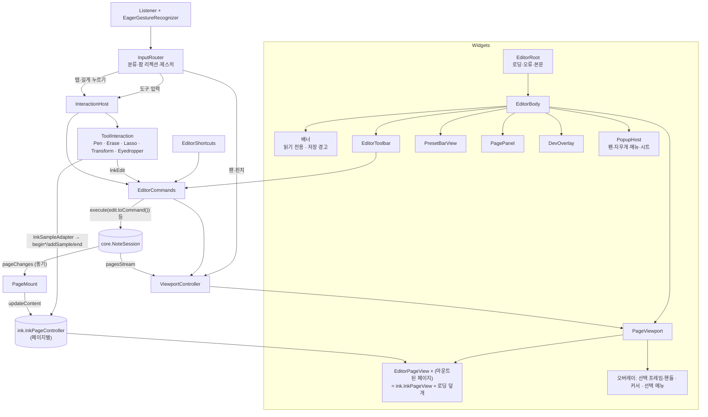
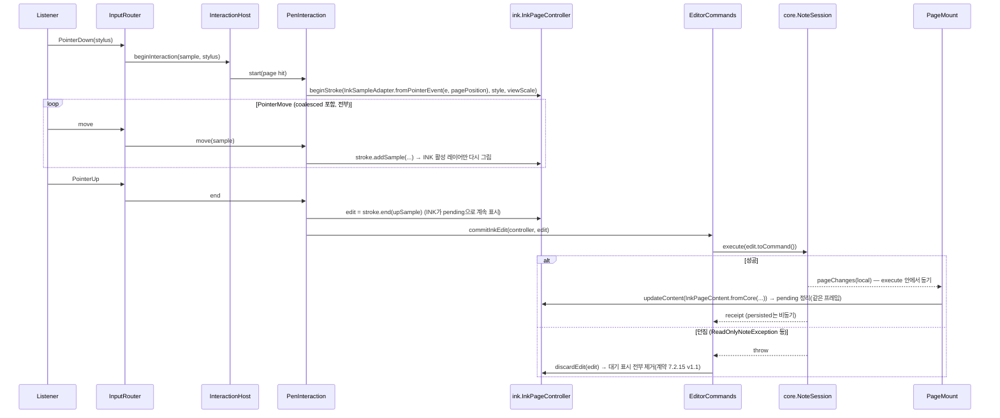
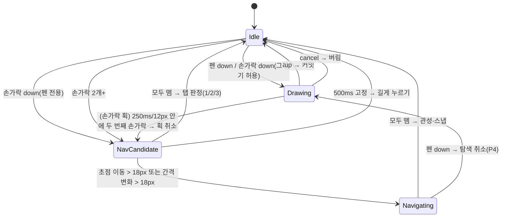

# 04. 에디터 화면 (EDITOR) 상세 계획서

> 상태: **승인** (2차 수정본 v0.3 — 3차 승인, 4차·최종 승인 유지: [00-review.md '최종 승인'](00-review.md#최종-승인)) · 영역 ID: **EDITOR** · 소유 경로: `packages/feature_editor/`
> 기준 문서: [PLAN.md](../PLAN.md) v1.1 · [00-overview.md](00-overview.md) 7장 **통합 계약 v1.5**(변경 이력 7.9 C11-01~30·C12·C13-01~05·C14-01~02·C15-01~08, 이 문서와 다르면 계약이 우선) · 검토: [00-review.md](00-review.md) 3.4(1차) · '2차 검토' 2.4.4(EDITOR-2-1~12) · '3차 검토' 3.4.4(EDITOR-3-1~3) · '4차 검토' 4.4.4(EDITOR-4-1) · '최종 승인' — 반영은 13.3, 1차 통합(계약 v1.5)은 13.4
> 작성 환경에서 실제 확인한 것: Flutter 3.47.9 / Dart 3.13.7, pub.dev 패키지 정보(2026-11-04 재확인), Flutter 웹 엔진 포인터 소스(`flutter_web_sdk/lib/_engine/engine/pointer_binding.dart`), `material_ui` 1.10.0 소스(pub 캐시), 스크래치 프로젝트 세 개: `/tmp/claude-0/plan-scratch/editor/rp_probe`(초안 — Riverpod 3.4.3 웹 빌드·scoped provider·`EagerGestureRecognizer`), `/tmp/claude-0/plan-scratch/editor/v2_probe`(1차 수정 — 아래 '확인한 것' 표 V1~V6), `/tmp/claude-0/plan-scratch/editor/v3_probe`(2차 수정 — V7)

이 문서만 보고 별도 git worktree에서 구현할 수 있도록 공개 API, 사용하는 계약, 알고리즘 수치, provider 이름, 작업 순서와 완료 조건을 적는다. 다른 영역의 타입·인터페이스는 **통합 계약 v1.5(00-overview 7장)과 계약이 승인한 각 계획서 절(CORE 4.x, INK 4.x)의 이름·형태를 그대로 쓴다.** EDITOR가 가정해 따로 정의한 공유 타입은 없다. 계약 블록을 옮긴 곳은 v1.1 주석까지 글자 그대로다. 계약에 문제가 있다고 본 점은 계약대로 쓰고 12.2에 '계약 변경 제안'으로 남긴다(2차 수정 시점에 새 제안 없음). 검토 반영 내역은 13절.

표기

- 코드의 `core.` = `package:note_core/note_core.dart`, `ink.` = `package:ink_engine/ink_engine.dart`. EDITOR 코드도 실제로 이 접두사로 import한다(출처를 분명히 하고 이름 충돌을 막음). 접두사 import여도 INK 확장(`ink.StrokeStyleInk`)은 암묵 적용된다(Dart 3.13.7에서 확인).
- Dart 블록에서 본문 없는 메서드·getter·생성자(`;`로 끝남)는 **시그니처만** 적은 것이다. `/* ... */`는 생략 표시. `// 계약 7.2.x` 주석이 붙은 블록은 계약 원문을 글자 그대로 옮긴 것이다.

1차 수정에서 스크래치로 확인한 것 (`/tmp/claude-0/plan-scratch/editor/v2_probe`, Flutter 3.47.9)

| # | 확인 내용 | 결과 |
|---|---|---|
| V1 | 7.4.1 형식 pubspec(`flutter_riverpod` 3.4.3, `material_ui` 1.10.0, `collection` 1.19.1, `meta` 1.19.0, dev `fake_async` 1.3.3, `environment.flutter: 3.47.9`)으로 `flutter pub get`·`flutter analyze` | 해석 성공, 분석 0건 |
| V2 | `package:material_ui/material_ui.dart`만 import한 위젯 테스트에서 `MaterialApp`·`Scaffold`·`SegmentedButton`·`MenuAnchor`·`ReorderableListView.builder(onReorderItem:)`·`ReorderableDelayedDragStartListener`·`Icons` 사용 | 통과. `material_ui`는 `package:flutter/widgets.dart`를 다시 내보낸다(소스 확인) |
| V3 | 중첩 `ProviderScope`의 scoped `FutureProvider`(`dependencies: [editorNoteIdProvider]`)가 루트의 `FutureProvider.autoDispose.family<_, String>(...).future`(CORE `noteSessionProvider` 모양)를 watch → 화면을 떠나면 루트 family가 dispose되어 세션 `close()`가 정확히 1회 | 통과 |
| V4 | 루트 `NotifierProvider`(INK `pressureModeProvider` 모양)를 다른 Notifier가 `build()` 안에서 `set()` | **오류**(Riverpod 3.4.3: 그 provider가 오류 상태가 됨). `await` 뒤(로드 완료 후)와 setter에서는 정상 → 6.13.1 #7 규칙 |
| V5 | `package:flutter_riverpod/misc.dart`의 `Override`로 `List<Override> featureEditorOverrides()` 선언 | 분석·실행 통과 |
| V6 | `material_ui` 1.10.0 `Icons`에 6.9.1 아이콘 전부(`edit`·`history_edu`·`border_color`·`create`·`brush`·`auto_fix_normal`·`highlight_alt`·`view_sidebar`·`touch_app`·`do_not_touch`·`cloud_done`·`cloud_sync`·`cloud_off`·`sync_problem`·`checklist`·`lock`) 존재, `ReorderableListView`의 `onReorder`는 `@Deprecated`(→ `onReorderItem`만 사용) | 소스 확인 |
| V7 | (2차, `v3_probe`) 3절의 `dart_test.yaml`(`golden: {}`, `integration: {skip: "..."}`)과 `@Tags(['integration'])` 테스트(본문 `UnimplementedError` — B2 CORE 흉내)·`@Tags(['golden'])` 테스트 | 기본 `flutter test`: 통합 suite가 사유 문구와 함께 '건너뜀'(+2 ~1, 통과). `--run-skipped -t integration`: 그 테스트만 실행(실패 = 실제로 돈다). `-t golden`: 골든만. **파일을 빼면** "A tag was used that wasn't specified in dart_test.yaml" 경고 + 통합 테스트가 기본 실행에서 돌아 실패 → C11-26 결함 재현 |

---

## 목차

1. [목적과 범위](#1-목적과-범위)
2. [PLAN.md 요구사항 대응표](#2-planmd-요구사항-대응표)
3. [소유 경로와 패키지 구조](#3-소유-경로와-패키지-구조)
4. [공개 API](#4-공개-api)
5. [사용하는 다른 영역의 계약](#5-사용하는-다른-영역의-계약)
6. [설계 상세](#6-설계-상세)
7. [외부 패키지](#7-외부-패키지)
8. [작업 분해](#8-작업-분해)
9. [테스트 계획](#9-테스트-계획)
10. [완료 기준](#10-완료-기준)
11. [리스크와 대응](#11-리스크와-대응)
12. [총괄 관리자에게 묻는 질문 · 계약 변경 제안](#12-총괄-관리자에게-묻는-질문--계약-변경-제안)
13. [검토 반영 내역](#13-검토-반영-내역)

---

## 1. 목적과 범위

### 1.1 목적

노트 하나를 열어 여러 페이지에 필기·편집하는 **에디터 화면 전체**를 만든다. 에디터는 입력(펜·손가락·마우스·트랙패드·키보드)을 받아

- 화면 이동(스크롤·확대)으로 보낼지,
- 도구 동작(펜 획·지우개·올가미·스포이드)으로 보낼지,
- 무시할지(팜 리젝션)

를 결정하고, 도구 동작은 **INK 페이지 컨트롤러의 세션**(`ink.InkPageController.beginStroke/beginErase/beginLasso`)으로 넘기며, 세션이 돌려준 결과(`ink.InkEdit`)를 **CORE 노트 세션**(`core.NoteSession.execute`)에 명령 1개로 실행한다. 그 위에 툴바, 펜 설정 팝업, 프리셋 바, 페이지 썸네일 패널, 개발자 표시를 얹는다. EDITOR가 직접 그리는 것은 **선택 프레임·핸들·커서·메뉴·배너**뿐이고, 배경·획·쓰는 중인 획·올가미 경로·선택 이동 미리보기는 INK `InkPageView`가 그린다.

### 1.2 이번 동시 개발 범위

| 묶음 | 내용 |
|---|---|
| 진입 | `EditorScreen(noteId, initialPageId, onClose, onOpenSettings)` · 로딩/오류/노트 없음 화면 · 읽기 전용 노트 안내(도구 끔) · 마지막 보던 위치 복원 · 화면 이탈/앱 숨김 시 `session.flush()` · 노트 정보(읽기 전용) · 저장 경고 배너(`core.storageWarningOf`) · 툴바 동기화 상태 아이콘(`core.syncBadgeProvider`, `off`면 숨김) |
| 뷰포트 | 세로 연속 스크롤(기본) · 좌우 한 장씩 넘기기(설정, 마지막 순위) · 핀치 확대/축소(너비 맞춤 기준 50%~800%) · 너비 맞춤 · 관성 스크롤 · 확대 상태에서 필기 · 페이지 가상화(보이는 페이지 ±1, 최대 8장만 `openPage`·INK 컨트롤러 유지 — 계약 E-2) |
| 입력 분배 | `PointerDeviceKind`로 펜/손가락/마우스 구분 · 입력 모드 3종(자동/펜 전용/손가락 필기) · 팜 리젝션(펜 사용 중·직후 터치 무시, 펜 hover 중 터치 무시, 접촉 반경—보고되는 플랫폼만, 펜이 닿으면 진행 중 터치 취소) · 두 손가락 탭=되돌리기 · 세 손가락 탭=다시 실행 · 한/두 손가락 드래그 스크롤 · 핀치 줌 · 손가락 길게 누르기 메뉴 · 마우스 휠/트랙패드 · 제스처 아레나 충돌 차단. 샘플 정규화·필압 감지는 INK(`ink.InkSampleAdapter`, `ink.pressureCapabilityProvider`) |
| 도구 | 펜(P0 5종 선택) · 지우개(획/부분 = `ink.EraserMode`, 크기 pt, 형광펜만/제외 = `core.StrokeFilter`, 지운 뒤 복귀, 페이지 전체 지우기 = `core.ClearPage`, 원형 커서) · 올가미(INK 세션·선택, EDITOR는 선택 프레임·모서리 핸들·메뉴, 이동·크기·삭제·복사·붙여넣기) · 획 스포이드(`controller.hitTest`) |
| 펜 설정 | 펜 종류 · HSV 휠/사각 피커 · 투명도 · HEX·RGB 입력 · 최근 색 12개 · 사용자 팔레트 40개 · 굵기 0.1–30pt(0.1 단위) 비선형 슬라이더 + 미리보기 획(`ink.PenPreviewPainter`) · '고급': 필압 감도·**필압 곡선(부드럽게/보통/단단하게)**·손떨림 보정·**형광펜 직선 보정(끔/뗄 때 보정/항상 직선)** · 펜 아이콘 길게 눌러 빠른 팝업. 값은 활성 펜 종류의 `core.StrokeStyle` |
| 프리셋 | 프리셋 바(툴바 고정, 드래그 순서 변경, 그룹 필터) · 저장 대화상자(이름 1~20자·그룹) · 관리 시트(이름 변경·그룹·고정·업데이트·삭제) — 저장소는 CORE `PenPresetRepository` 직접 |
| 되돌리기 | 툴바 버튼 · 제스처 · 키보드 단축키(⌘/Ctrl+Z, ⌘/Ctrl+Shift+Z, Ctrl+Y) — 히스토리는 CORE(`session.undo/redo`, `core.historyStateProvider`) |
| 페이지 패널 | 썸네일 목록(신선한 캐시 이미지 우선, 없으면 `ink.InkPageThumbnail`) · 탭 이동 · 추가(앞/뒤/끝, 빈 페이지 + 속지 6종·종이 색 4종·크기·방향) · 삭제 · 복제 · 드래그 순서 변경 · **선택 모드(다중 선택 → `EditorMenuContext.selectedPageIds`)** · 문서 끝 '+ 페이지' 버튼 |
| 페이지 이동 | `EditorMenuContext.navigateToPage(pageId, focusRectPt)` — 페이지로 이동하고 주어진 사각형이 보이게 스크롤(PDF '찾기' 결과, PDF 페이지 삽입 후) |
| 개발자 표시 | 지연·입력 Hz·필압·프레임 p95·캐시 = `ink.inkDiagnosticsProvider`(오버레이가 보일 때만 `enabled = true`) · EDITOR 고유 값(포인터 종류·팜 거부 수·뷰포트·페이지 획 수) · CORE `StorageInfo`·`PersistenceStatus.lastCommitLatency` · `devOverlaySectionsProvider` 섹션(PDF 렌더 통계) · 개발자 메뉴('합성 노트 만들기' = `seedSyntheticNote`, '합성 획 1,000/3,000개' = `InkDevTools.syntheticStrokes`). 켜는 방법 4가지 |
| 키보드 | 되돌리기/다시 실행 · 복사/붙여넣기/삭제 · 도구 전환(P/E/L) · 확대/축소/너비 맞춤 · Esc · PageUp/PageDown · 개발자 표시 |
| 설정 섹션 | 설정 화면(INFRA 틀)에 끼워 넣을 위젯 4개(입력 · 펜 · 페이지 넘김 · 개발자 표시), 설정 저장은 CORE `SettingsRepository` + `SettingKey.jsonMap`(device/synced 분리) |
| 확장점 | 더보기 메뉴 항목·페이지 추가 소스(`EditorExtensions` — M3 PDF가 INFRA 경유로 채움) · 개발자 표시 섹션(`devOverlaySectionsProvider`) · 펜 부가 이벤트 인터페이스(스퀴즈·더블탭 — 네이티브/M5). PDF·이미지 배경은 EDITOR 확장점이 아니라 INK `pageBackgroundBuildersProvider`(PDF가 `pdfIoOverrides()`로 채움) |

### 1.3 이후 범위

| 시점 | 내용 | 이번에 준비하는 것 |
|---|---|---|
| M3 (PDF) | PDF 페이지 삽입, PDF 내보내기(선택한 페이지 포함)·공유·인쇄·찾기 메뉴 | `EditorExtensions.addPageSources`·`moreMenuItems`, `EditorMenuContext.selectedPageIds`·`navigateToPage`, `devOverlaySectionsProvider`. 배경은 INK 확장 지점이라 EDITOR 쪽 준비 없음 |
| M4 (동기화) | 다른 기기 변경 반영, 실제 동기화 상태 | 툴바 `syncBadgeProvider` 아이콘(이번에 구현, 기본 `off` → 숨김), 원격 변경 시 선택 재검증(6.6.6), 설정 키 device/synced 분리(6.14). `EditorExtensions.appBarTrailing`은 예약만(이번 미사용) |
| M5 (편집 강화) | 도형, 텍스트 상자, 이미지, 올가미 고급 UI(회전·색 변경·잘라내기 — INK 계산 API는 이번에 있음), 제스처 동작 변경, 펜 버튼(S펜·Pencil 더블탭/스퀴즈), 추가 펜 5종 UI, 암기 테이프, 레이저 포인터(저장 안 함 — 계약 E-3) | `EditorTool` 확장 지점, `StylusExtrasSource`, `GestureSettings` 데이터 구조, 선택 메뉴 항목 목록 구조 |
| M6 (녹음) | 녹음 바, 획 탭 → 재생 | 툴바 자리, `ink.InkStrokeMeta`(INK 4.4) 전달 자리 |
| M7 (인식) | 올가미 메뉴의 '텍스트로 변환'·'수식으로 변환' | 선택 메뉴 항목 목록 구조 |
| 네이티브 전환 | Apple Pencil 호버(네이티브 검증)·스퀴즈·배럴 롤, 예측 입력(INK), 접촉 반경 팜 리젝션 검증 | 인터페이스·설정값 |
| 피드백 후(P1) | 화면 픽셀 스포이드(PDF 배경 색), 시스템 클립보드, 탭/분할 화면, 자, 발표 모드, 다크 모드 페이지 색 반전, 페이지 북마크·다른 노트로 이동·다른 노트 페이지 복사, 노트 정보 편집, 여러 페이지 드래그 이동, 페이지 패널 썸네일 캐시 쓰기(선택 — 7.2.11) | — |

### 1.4 제외 (다른 영역 책임)

- 입력 샘플 정규화(필압·기울기·방위각), 필압 유무 감지, 필압 곡선·스무딩 적용, 획 생성·렌더링, 쓰는 중인 획·올가미 경로·선택 이동 미리보기 그리기, 래스터/타일 캐시, 속지·배경 그리기, 지우개·올가미·적중 판정 기하, 선택 변형 수학(`SelectionGeometry`), 공간 색인, 합성 획 생성 → **INK**
- 문서 모델, 로컬 DB, 자동 저장, 명령/되돌리기 스택(100단계), 분수 인덱스, 프리셋·설정 저장, '최근 노트' 기록(`markOpened` — `openSession`이 부름), 웹 저장 영속 요청, 합성 노트 생성 → **CORE**
- 라우터(`AppRoutes.note()` = `/notes/:noteId?page=`, 무전환 페이지), 루트 `ProviderScope`·override, 테마(`buildAppTheme()`), `web/index.html`, 설정 화면 틀·조립, 동기화 알림 스낵바, CI, 웹 배포 → **INFRA**
- PDF 배경 렌더링·가져오기·내보내기·찾기 → **PDF** / 동기화 엔진·상태 계산 → **SYNC** / 라이브러리 화면·라이브러리 저장 경고 배너 → **LIBRARY**

---

## 2. PLAN.md 요구사항 대응표

범위 열: **이번** = 이번 동시 개발에서 구현 · **확장점** = 이번엔 끼워 넣을 자리만 · **이후** = 이후 마일스톤 · **타 영역** = 다른 영역이 구현(EDITOR는 호출만).

### 2.1 기능 명세 (4장)

| PLAN 항목 | 요구 내용 | 이 계획서의 작업 | 범위 |
|---|---|---|---|
| F-03 펜 종류 (P0) | 볼펜·만년필·형광펜·연필·마커 선택 | 펜 종류 선택기(`core.PenTool.values.where((t) => t.isP0)`), 펜 종류별 마지막 스타일 기억 (E-07, E-15) | 이번 (그리기 INK) |
| F-03 펜 종류 (P1) | 붓펜·캘리그래피·점선/파선·레이저 포인터·암기 테이프 | `core.PenTool`에 값은 이미 있음(INK가 ballpoint로 대체 렌더). 선택기는 `isP0`만 노출 | 이후 (M5) |
| F-03 필압·기울기·방위각 | 입력값 반영 | 모든 포인터 이벤트를 `ink.InkSampleAdapter.fromPointerEvent`로 넘김(정규화·감지는 INK). 필압 사용 모드 설정 → `ink.pressureModeProvider.notifier.set()` (E-06, E-08) | 이번 (웹은 방위각 미제공 → 0, INK) |
| F-03 입력 지연 20ms | 펜 입력 → 화면 표시 | `Listener` 직행 경로, 포인터 이벤트마다 provider 상태 변경 금지(6.15), 측정은 `ink.InkDiagnostics` 표시 (E-19) | 이번 (판정은 네이티브 전환) |
| F-03 예측 입력 | 체감 지연 감소 | — | 이후 (INK·네이티브) |
| F-03 손떨림 보정·필압 곡선 | 단계 조절 | 펜 팝업 '고급'의 손떨림 보정(`smoothing`)·필압 감도·**필압 곡선 선택**(`core.PressureCurve.soft/linear/firm`), 설정 > 펜도 같은 값 (E-15, E-20) | 이번 (적용은 INK) |
| F-03 호버 미리보기 | 닿기 전 위치·굵기 | 스타일러스 hover 이벤트로 펜 점(`style.previewRadius`)/지우개 원 표시 (E-08, E-09) | 이번 (이벤트가 오는 기기만) / 네이티브 검증 이후 |
| F-03 형광펜 직선 보정 옵션 | 형광펜 옵션 | 펜 팝업 '고급'(형광펜일 때만) `ink.HighlighterStraightening` 3단계 → `style.withHighlighterStraightening` (E-15) | 이번 |
| F-03 벡터 저장 | — | — | 타 영역 (CORE·INK) |
| F-04 HSV 휠/사각 | 연속 선택 | 휠·사각 탭 전환 피커 (E-14) | 이번 |
| F-04 투명도 | 슬라이더 | 5–100%(`core.StrokeStyle.minOpacity` 0.05), 1% 단위 (E-14) | 이번 |
| F-04 HEX·RGB | 직접 입력 | `#RGB`/`#RRGGBB`/`#AARRGGBB`, R·G·B 0–255 (E-14) | 이번 |
| F-04 스포이드 | 화면에서 색 추출 | **획 스포이드**: 획을 탭해 그 획의 색을 가져옴(`controller.hitTest` → CORE 획 색) (E-14) | 이번 (축소판) / 화면 픽셀(PDF 배경) 이후 |
| F-04 최근 색·사용자 팔레트 | 저장 | 최근 12개(획을 쓴 색), 팔레트 40개, `editor.colors`(synced) (E-14) | 이번 |
| F-04 굵기 슬라이더 | 0.1–30pt, 0.1 단위 | 비선형 슬라이더 + ±0.1 버튼 + 숫자 입력, 범위 = `StrokeStyle.minWidth/maxWidth` (E-15) | 이번 |
| F-04 미리보기 획 | 슬라이더 옆 | `ink.PenPreviewPainter` (E-15) | 이번 |
| F-04 빠른 팝업 | 펜 아이콘 길게 누르기 | 빠른 팝업(굵기·투명도·최근 색·팔레트) (E-15) | 이번 |
| F-05 프리셋 구성 | 종류+색+굵기+투명도+필압 감도+스무딩 | `core.StrokeStyle` 전체(곡선·형광펜 보정 포함)를 `core.PenPreset.style`로 저장 (E-16) | 이번 (저장 CORE) |
| F-05 툴바 고정·순서·이름 | 드래그 순서 변경, 이름 지정 | 프리셋 바(`pinned`), `reorderPresets(orderedIds)`, 이름 1~20자 (E-16) | 이번 |
| F-05 프리셋 그룹 | '수업용' 등 | 그룹 필터(`editor.presetBar`, device), `PenPreset.group` 지정 (E-16) | 이번 |
| F-05 계정 동기화 | 다른 기기에서 같은 펜 | — | 타 영역 (CORE·SYNC, M4) |
| F-07 동기화 상태 표시 | 완료/진행/오프라인/오류 | 툴바 작은 아이콘(`core.syncBadgeProvider`, `off`면 숨김) (E-13) | 이번 (값 공급은 M4 INFRA·SYNC) |
| F-08 입력 수단 | 버튼·제스처·단축키 | 툴바 버튼, 두/세 손가락 탭, 키보드 (E-05, E-11, E-12) | 이번 |
| F-08 1회 = 1단계 | 펜 한 번 = 1단계, 부분 지우개로 여러 획이 잘려도 1단계 | 제스처 하나 = `InkEdit` 하나 = `session.execute(edit.toCommand())` **1회**(계약 E-1). 부분 지우개 누적은 INK `EraserSession` (E-08~E-10) | 이번 |
| F-08 100단계·다시 실행 비움·이 기기 편집만 | — | — | 타 영역 (CORE) |
| F-09 획/부분 지우개 | 두 모드 | `ink.EraserMode` 전환 UI, `beginErase` (E-09) | 이번 (기하 INK) |
| F-09 크기·원형 커서 | 연속 조절 | 지름 1–100pt(0.5 단위), `EraserSpec.radius` = 지름/2 pt, 원형 커서(누르는 중·hover) (E-09) | 이번 |
| F-09 형광펜만/제외 | 옵션 | `core.StrokeFilter`(`EraserSpec.filter`) (E-09) | 이번 |
| F-09 지운 뒤 이전 펜 복귀 | 옵션 | `EraserSettings.returnToPreviousTool` (E-07, E-09) | 이번 |
| F-09 펜 버튼·더블탭 전환 | — | `StylusExtrasSource` 인터페이스만 | 이후 (M5·네이티브) |
| F-09 현재 페이지 전체 지우기 | — | 지우개 팝업 버튼 + 확인 → `core.ClearPage(pageId, filter)` 1단계 (E-09) | 이번 |
| F-10 손글씨 → 텍스트 | 올가미 선택 전제 | 선택 메뉴 항목 목록 구조만 | 이후 (M7) |
| F-11 도형 | — | 툴바에 표시하지 않음 | 이후 (M5) |
| F-12 펜 전용 / 손가락 필기 | 입력 모드 | `InputMode.auto/penOnly/fingerDrawing` (E-05, E-06) | 이번 |
| F-12 팜 리젝션 | 손바닥 오입력 방지 | 6.5.4 규칙 6가지 (E-05) | 이번 |
| F-12 두 손가락 탭 | 되돌리기 | 탭 판정 (E-05, E-11) | 이번 |
| F-12 세 손가락 탭 | 다시 실행 | 탭 판정 (E-05, E-11) | 이번 |
| F-12 두 손가락 드래그 | 스크롤 | 핀치와 함께 처리 (E-03, E-05) | 이번 |
| F-12 핀치 | 확대/축소 | 초점 고정 확대 (E-03, E-05) | 이번 |
| F-12 손가락 길게 누르기 | 올가미 선택 / 붙여넣기 메뉴 | 컨텍스트 메뉴(붙여넣기·올가미 도구) (E-05, E-10) | 이번 |
| F-12 한 손가락 드래그 (펜 전용) | 스크롤 | (E-05) | 이번 |
| F-12 S펜 측면 버튼 | 지우개 전환 | — | 이후 (M5) |
| F-12 Pencil 더블탭/스퀴즈 | 지우개 전환/도구 팔레트 | `StylusExtrasSource` | 이후 (네이티브·M5) |
| F-12 제스처 사용자 지정 (P1) | 켜기/끄기·동작 변경 | 이번엔 탭 제스처 3종 **켜기/끄기만**(계약 7.8), 동작 변경은 M5 (E-06, E-20) | 일부 이번 / 이후 |
| F-13 삽입 위치 | 앞/뒤/끝 | 페이지 추가 시트 → `core.PageBefore/PageAfter/PageAtEnd` (E-17) | 이번 |
| F-13 빈 페이지·속지 | 줄·모눈·점·코넬·악보·플래너 | 빈 페이지 + `core.PageTemplateKind` 6종 전부(계약 7.8), 미리보기 `ink.InkPageThumbnail` (E-17) | 이번 (그리기 INK) |
| F-13 PDF 페이지 | — | `addPageSources` 확장점 | 확장점 / M3 (PDF) |
| F-13 이미지·다른 노트 페이지 복사 | — | — | 이후 (계약 7.8) |
| F-13 페이지 크기·방향 | A4·Letter·16:9·사용자 지정, 가로/세로 | `core.PageSizePreset`·`PageSizeLimits`(100~3000pt) (E-17) | 이번 |
| F-13 속지 색상 | 흰·미색·검정 등 | `core.PaperColors.all`(흰·미색·회색·검정) (E-17) | 이번 |
| F-13 페이지 넘김 | 세로 연속 / 좌우 한 장씩 | `PageFlipMode` (E-02, E-03, E-18 — 마지막 순위, M1 합격 전 완료) | 이번 |
| F-13 삭제·복제·순서 변경·썸네일 | 5.1 | 페이지 패널 (E-17) | 이번 |
| F-02 PDF를 배경으로 | 벡터 렌더링 | INK `pageBackgroundBuildersProvider`(PDF가 채움) — EDITOR 작업 없음 | 타 영역 (PDF·INK) |
| F-02 기존 노트에 PDF 페이지 삽입 | — | `addPageSources` 확장점 + `navigateToPage` | 확장점 / M3 |
| F-14 손글씨 수식 | — | — | 이후 (M7) |
| F-15 PDF 내보내기·공유·인쇄 | 범위: 전체 / 선택한 페이지 / 현재 페이지 | `moreMenuItems` 확장점 + `EditorMenuContext`의 `currentPageId`·`selectedPageIds`(페이지 패널 선택 모드) (E-13, E-17) | 확장점 / M3 |
| F-16 녹음 | 녹음 바, 필기 강조 | — | 이후 (M6) |

### 2.2 추가 기능 · 비기능 (5장)

| PLAN 항목 | 요구 내용 | 이 계획서의 작업 | 범위 |
|---|---|---|---|
| 5.1 올가미 (기본, M1) | 선택 → 이동·크기·삭제·복사 | INK 올가미 세션·선택 + EDITOR 선택 프레임·핸들·메뉴·내부 클립보드·붙여넣기 (E-10) | 이번 |
| 5.1 올가미 (고급, M5) | 회전·색 변경·잘라내기 | INK 계산 API(`SelectionGeometry.rotate`, `InkSelection.recolor`)는 있음, UI 없음 | 이후 |
| 5.1 팜 리젝션 | — | (E-05) | 이번 |
| 5.1 확대/축소·스크롤 | 핀치, 페이지 너비 맞춤, 확대 상태에서 필기 | (E-02, E-03, E-08) | 이번 |
| 5.1 페이지 삭제·복제·순서·썸네일 | — | (E-17) | 이번 |
| 5.1 속지 템플릿 | — | 선택 UI 6종 (E-17) | 이번 (그리기 INK) |
| 5.1 자동 저장 | 즉시 저장, 강제 종료에도 손실 없음 | 제스처 끝마다 즉시 `execute`(CORE가 쓰기 큐에 넣음), 화면 이탈·앱 숨김 시 `session.flush()` (E-08, E-13) | 이번 (저장 CORE) |
| 5.1 오프라인 | — | — | 타 영역 (CORE) |
| 5.1 텍스트 상자·이미지 삽입 | — | — | 이후 (M5) |
| 5.2 키보드 단축키 (P1) | — | 기본 세트 (E-12) | 이번 |
| 5.2 다크 모드 | UI + 페이지 색 반전 | UI는 앱 테마를 따름 / 페이지 반전 이후 | 일부 |
| 5.2 탭·분할 화면, 자, 레이저, 발표 모드, 암기 테이프, 요소 저장, 링크, 페이지 북마크·이동, 버전 기록, 노트 잠금 | — | — | 이후 |
| 5.4 필기 지연 | 20ms (120Hz) | 입력 경로 설계 + `InkDiagnostics` 표시 (E-05, E-19) | 이번 (판정 네이티브) |
| 5.4 성능 | 500페이지, 노트당 획 10만 개에서 60fps 스크롤 | 가상화(E-2), rebuild 차단 규칙, 성능 스모크 테스트, 개발자 메뉴 합성 노트·합성 획 (E-04, E-19, E-22) | 이번 (래스터 캐시는 INK) |
| 5.4 데이터 안전 | 마지막 획까지 보존 | 펜을 뗄 때 즉시 명령, flush, 저장 경고 배너 (E-08, E-13) | 이번 |
| 5.4 측정 | 개발자 표시 | (E-19) | 이번 |

### 2.3 아키텍처 · 화면 구성 · 협업 · 로드맵 (7~10장)

| PLAN 항목 | 요구 내용 | 이 계획서의 작업 | 범위 |
|---|---|---|---|
| 7.1 에디터 코어 흐름 | 입력·제스처 → 도구 → 문서 모델 → 렌더러 | 6.1 구성도 그대로 구현(도구 = INK 세션, 문서 모델 = CORE 세션, 렌더러 = INK) | 이번 |
| 7.3 레이어 순서 | 배경 → 형광펜 → 일반 필기 → 선택·쓰는 중 | INK `InkPageView` 내부 + EDITOR 오버레이(선택 프레임·커서)가 맨 위 (E-04) | 이번 |
| 7.3 쓰는 중인 획만 매 프레임 | — | INK 활성 레이어 | 타 영역 (INK) |
| 7.3 화면 밖 페이지 해제 | 가상화 | 마운트 범위 밖 페이지 `closePage` + INK 컨트롤러 dispose (E-04) | 이번 (캐시 해제는 INK) |
| 7.3 공간 색인 | 지우개·올가미 고속화 | — | 타 영역 (INK) |
| 7.5 되돌리기 | 커맨드 패턴, 변경분 | 명령 매핑 표(5.1.3) (E-08~E-11) | 이번 (스택 CORE) |
| 8 상단 툴바 | 펜·지우개·올가미·도형·텍스트·이미지·수식·녹음·되돌리기/다시 실행 | 펜·지우개·올가미·되돌리기/다시 실행 + 동기화 아이콘 (E-13) | 이번 / 나머지 이후 |
| 8 펜 프리셋 바 | — | (E-16) | 이번 |
| 8 펜 설정 팝업 | 종류·색·굵기·투명도 | (E-14, E-15) | 이번 |
| 8 페이지 썸네일 패널 | 삽입·삭제·복제·순서 변경 | (E-17) | 이번 |
| 8 녹음 재생 바 | — | — | 이후 (M6) |
| 8 더보기 | PDF 내보내기·공유·인쇄·노트 정보 | 노트 정보(읽기 전용)·설정(`onOpenSettings`) 이번, PDF 항목은 확장점 (E-13) | 일부 |
| 8 설정 > 입력 | 펜 전용 모드·팜 리젝션·제스처 매핑 | `EditorInputSettingsSection` (E-20) | 이번 |
| 8 설정 > 펜 | 필압 곡선·손떨림 보정 | `EditorPenSettingsSection`: 필압 사용 모드 + **활성 펜 종류의** 필압 곡선·손떨림 보정·필압 감도·(형광펜) 직선 보정 + 펜 기본값 초기화 (전역 필압 곡선 설정은 없음 — 계약 7.2.4) (E-20) | 이번 |
| 8 설정 > 일반 | 기본 속지 · 페이지 넘김 방식 | 페이지 넘김은 `EditorPageSettingsSection` / 새 노트 기본 속지는 LIBRARY `LibrarySettingsSection` | 일부 (기본 속지 타 영역) |
| 8 설정 > 개발자 표시 | — | `EditorDeveloperSettingsSection` (E-20) | 이번 |
| 9.4 개발자 표시 | 프레임 시간·입력 지연·필압 | (E-19) | 이번 |
| 9.5 단계 A 웹 테스트 | 펜/손가락 구분, 필압, 지우개, 되돌리기, 제스처, 페이지 관리 | 9.2 사용자 iPad 체크리스트 | 이번 |
| 10 M0 필압 펜 프로토타입 | 빈 페이지에 필압 반영 필기 | `EditorScreen` + INK (E-08, E-21). INFRA 기반 단계는 자리표시만 | 이번 |
| 10 M0 개발자 표시 | 프레임 시간·입력 지연·필압 | (E-19) | 이번 |
| 10 M1 색·굵기·프리셋·지우개·되돌리기·확대·입력 모드·올가미·페이지 | 체크리스트 각 항목 | 위 표의 각 작업 | 이번 |
| 10 M1 펜 5종 | — | 선택 UI (그리기 INK) | 이번 |
| 10 M1 문서 모델·자동 저장 | — | — | 타 영역 (CORE) |
| 10 네이티브 전환 | Pencil 호버·스퀴즈·배럴 롤 | `StylusExtrasSource` 인터페이스 | 이후 |
| 10 M5 | 올가미 고급·텍스트·이미지·도형·제스처 사용자 지정·펜 버튼·추가 펜 | — | 이후 |
| 10 M6 녹음 바 · M7 인식 | — | — | 이후 |

---

## 3. 소유 경로와 패키지 구조

EDITOR는 `packages/feature_editor/` 아래만 수정한다. 다른 경로 변경이 필요하면 결과 보고에 '변경 요청'으로 남긴다. 패키지 안에 `analysis_options.yaml`을 두지 않는다(루트 규칙 적용 — 계약 7.4.1). 공개 진입점은 `lib/feature_editor.dart` **하나**다(계약 7.1 — `testing.dart` 없음).

```text
packages/feature_editor/
├─ pubspec.yaml                          # 기반 단계 B1에서 INFRA가 만들고, EDITOR가 내용을 유지
├─ dart_test.yaml                        # tags: golden {}, integration {skip} — 계약 7.4.8 v1.1 (C11-26), E-00
├─ README.md
├─ lib/
│  ├─ feature_editor.dart                # 공개 API (4절) — 유일한 진입점
│  └─ src/
│     ├─ editor_screen.dart              # EditorScreen, featureEditorOverrides, EditorRoot (로딩/오류/본문 전환)
│     ├─ di/
│     │  ├─ editor_extensions.dart       # EditorExtensions · EditorMenuItem · EditorMenuContext · editorExtensionsProvider
│     │  ├─ dev_overlay_section.dart     # DevOverlaySection · devOverlaySectionsProvider
│     │  └─ stylus_extras.dart           # 네이티브 펜 부가 이벤트 인터페이스 · stylusExtrasProvider
│     ├─ scope/editor_scope.dart         # 노트별(scoped) provider 정의 (6.13.2)
│     ├─ document/
│     │  ├─ page_mount.dart              # 한 페이지: session.openPage/closePage + pageChanges → controller.updateContent
│     │  └─ mounted_pages.dart           # 마운트된 페이지 레지스트리 (pageId → PageMount, 컨트롤러)
│     ├─ viewport/
│     │  ├─ viewport_constants.dart
│     │  ├─ page_layout.dart
│     │  ├─ viewport_camera.dart
│     │  ├─ viewport_controller.dart
│     │  ├─ viewport_memory.dart         # 노트별 마지막 위치 (editor.viewport, device)
│     │  ├─ page_viewport.dart           # 페이지 배치·가상화·입력 수신 위젯
│     │  └─ editor_page_view.dart        # 페이지 한 장: InkPageView + 로딩 덮개
│     ├─ input/
│     │  ├─ input_sample.dart            # 라우팅용 PointerEvent 래퍼 (정규화 없음)
│     │  ├─ input_thresholds.dart
│     │  ├─ input_targets.dart           # 라우터 → 도구 호스트 인터페이스
│     │  ├─ input_router.dart            # 입력 분배 상태 기계
│     │  └─ editor_shortcuts.dart
│     ├─ tools/
│     │  ├─ tool_state.dart              # EditorTool, EraserSettings, ToolState
│     │  ├─ tool_controller.dart
│     │  ├─ interaction_host.dart        # InputTargets 구현, 상호작용 생성
│     │  ├─ tool_interaction.dart        # 상호작용 기반 클래스
│     │  ├─ pen_interaction.dart         # ink.StrokeSession 구동
│     │  ├─ erase_interaction.dart       # ink.EraserSession 구동
│     │  ├─ lasso_interaction.dart       # ink.LassoSession 구동
│     │  ├─ selection_transform_interaction.dart  # ink.InkSelection.setPreviewTransform 구동
│     │  ├─ eyedropper_interaction.dart  # controller.hitTest
│     │  ├─ selection.dart               # EditorSelection, EditorSelectionNotifier
│     │  ├─ selection_hit_test.dart      # 핸들·본체 적중 판정만 (변형 수학은 INK)
│     │  └─ stroke_clipboard.dart
│     ├─ commands/editor_commands.dart   # 툴바·제스처·단축키·메뉴가 공유하는 동작 + 명령 실행 (5.1.3)
│     ├─ state/
│     │  ├─ settings/editor_settings.dart
│     │  ├─ settings/editor_settings_notifier.dart
│     │  ├─ settings/editor_setting_keys.dart   # core.SettingKey 선언 (6.14)
│     │  ├─ color_palette.dart
│     │  ├─ preset_bar.dart
│     │  ├─ page_panel.dart              # 패널 열림·선택 모드·선택 페이지
│     │  ├─ popup.dart
│     │  └─ debounced_writer.dart        # SettingsRepository 디바운스 쓰기
│     ├─ ui/
│     │  ├─ editor_body.dart
│     │  ├─ editor_strings.dart          # 한국어 해요체 문구 상수 (intl 미사용 — 계약 7.4.5)
│     │  ├─ popup_host.dart
│     │  ├─ banners/  storage_warning_banner.dart · read_only_banner.dart
│     │  ├─ toolbar/  editor_toolbar.dart · tool_button.dart · zoom_chip.dart · sync_badge_icon.dart · more_menu.dart · note_info_dialog.dart · dev_menu.dart
│     │  ├─ pen/      pen_settings_popup.dart · quick_pen_popup.dart · pen_type_selector.dart · width_mapping.dart · width_slider.dart · pen_preview.dart · pressure_curve_selector.dart · highlighter_straightening_selector.dart
│     │  ├─ color/    color_math.dart · color_picker_panel.dart · hsv_wheel.dart · sv_square.dart · hue_slider.dart · value_slider.dart · opacity_slider.dart · hex_rgb_fields.dart · recent_colors_row.dart · user_palette_grid.dart
│     │  ├─ presets/  preset_bar_view.dart · preset_chip.dart · preset_manager_sheet.dart · save_preset_dialog.dart
│     │  ├─ eraser/   eraser_popup.dart
│     │  ├─ overlays/ selection_frame_painter.dart · selection_menu.dart · context_menu.dart · cursor_painter.dart · page_indicator.dart · add_page_button.dart · eyedropper_banner.dart
│     │  ├─ pages/    page_panel.dart · page_panel_thumbnail.dart · page_panel_selection_bar.dart · add_page_sheet.dart · page_choices.dart
│     │  ├─ dev/      dev_metrics.dart · dev_overlay.dart
│     │  └─ settings/ editor_settings_sections.dart
└─ test/
   ├─ helpers/   pointer_driver.dart · pump_editor.dart · test_data.dart · recording_input_targets.dart · recording_note_session.dart
   ├─ unit/      (9.1 표)
   ├─ widget/    (9.1 표)
   ├─ goldens/   *_golden_test.dart + *.png   (@Tags(['golden']), @TestOn('vm') — 계약 7.4.8)
   ├─ integration/ real_core_ink_smoke_test.dart   (@Tags(['integration']) — dart_test.yaml이 기본 skip, 통합 단계에만, E-21)
   └─ web/       editor_browser_smoke_test.dart     (@TestOn('browser') — 계약 7.4.8)
```

삭제한 초안 경로(계약 7.2.0·7.2.17): `testing.dart`, `routing/editor_route.dart`, `di/ports.dart`, `di/editor_preferences_store.dart`, `di/ink_adapter.dart`, `di/ink_engine_adapter.dart`, `document/stream_bridge.dart`, `document/page_content_registry.dart`, `document/page_overrides.dart`, `input/pointer_normalizer.dart`, `input/pressure_capability.dart`, `tools/selection_math.dart`(변형 계산), `ui/pages/page_presets.dart`, `ui/dev/rolling_stats.dart`, `src/testing/*`, `test/golden/`(→ `test/goldens/`).

`pubspec.yaml` (계약 7.4.1 형식, 버전은 7.5 고정표 — 기반 단계 B1에서 INFRA가 이 내용으로 만든다):

```yaml
name: feature_editor
publish_to: none
resolution: workspace
environment:
  sdk: ^3.13.0
  flutter: 3.47.9
dependencies:
  flutter:
    sdk: flutter
  flutter_riverpod: 3.4.3
  material_ui: 1.10.0
  collection: 1.19.1
  meta: 1.19.0
  note_core: any
  ink_engine: any
dev_dependencies:
  flutter_test:
    sdk: flutter
  fake_async: 1.3.3
```

- 형제 패키지는 `any`(경로 의존 금지 — R8). 외부 의존은 정확한 버전(R9). 테스트에서 쓰는 `note_core`의 `testing.dart`·`testing_vm.dart`·`dev_tools.dart`, `ink_engine`의 `testing.dart`·`dev_tools.dart`는 같은 패키지의 다른 진입점이라 추가 의존이 없다.
- `lib/`은 `package:note_core/note_core.dart`, `package:note_core/dev_tools.dart`(개발자 메뉴), `package:ink_engine/ink_engine.dart`, `package:ink_engine/dev_tools.dart`(개발자 메뉴)만 import한다. `testing.dart`·`testing_vm.dart`는 `test/`에서만(계약 7.1 규칙 2).
- 의존성 추가가 필요해지면 결과 보고에 '의존성 추가'로 남긴다(계약 7.4.1).

`dart_test.yaml` (계약 7.4.8 v1.1, C11-26 — EDITOR-2-7. E-00에서 만든다):

```yaml
# packages/feature_editor/dart_test.yaml
tags:
  golden: {}
  integration: {skip: "integration stage only — ws test --run-skipped -t integration"}
```

- EDITOR 테스트가 쓰는 태그는 `golden`(`test/goldens/`)과 `integration`(E-21) 둘뿐이다(`perf`·`bench` 안 씀 — E-22 `performance_smoke_test`는 태그 없이 기본 실행). 둘 다 여기 선언한다(계약 7.4.8 v1.1: 쓰는 태그는 모두 선언, `integration`·`perf`는 `skip` — INFRA가 01-infra 6.2에 둔 `ws check` R15가 이 규칙을 검사).
- 왜 필요한가: `ws test`의 기본 제외는 `-x bench`뿐이다. 이 파일이 없으면 E-21(`@Tags(['integration'])`, `openTestNoteStore()`)이 동시 개발 중 기본 `ws test`에서 돌고, B2 단계 CORE의 `openTestNoteStore`는 CORE T6 전까지 `UnimplementedError`(계약 7.6 'B2 단계 값')라 실패한다. 스크래치 V7로 확인(파일이 없으면 경고 + 실패, 있으면 사유와 함께 건너뜀).
- 통합 단계(계약 7.7 5단계)에서는 `ws test --run-skipped -t integration`이 이 skip을 풀어 E-21을 돌린다. `flutter test`가 지원하지 않는 `override_platforms`·`presets`는 쓰지 않는다(CORE 7.3 확인).

---

## 4. 공개 API

다른 영역(INFRA 앱 셸·설정 화면, INFRA 경유 PDF)이 쓰는 것만 `package:feature_editor/feature_editor.dart`로 내보낸다. 이름과 형태는 **계약 7.2.17 그대로**다. 나머지는 `src/` 내부다. 공개 이름은 다른 5개 패키지의 export와 겹치지 않는다(R14 — 4.1 표).

### 4.1 라이브러리 내보내기

```dart
// packages/feature_editor/lib/feature_editor.dart
library;

export 'src/editor_screen.dart' show EditorScreen, featureEditorOverrides;
export 'src/di/editor_extensions.dart'
    show EditorExtensions, EditorMenuItem, EditorMenuContext, editorExtensionsProvider;
export 'src/di/dev_overlay_section.dart'
    show DevOverlaySection, devOverlaySectionsProvider;
export 'src/di/stylus_extras.dart'
    show
        StylusExtrasSource,
        StylusExtraEvent,
        StylusDoubleTap,
        StylusSqueeze,
        StylusBarrelRoll,
        NoStylusExtras,
        stylusExtrasProvider;
export 'src/state/settings/editor_settings.dart'
    show EditorSettings, InputMode, PageFlipMode, PalmRejectionSettings, GestureSettings;
export 'src/state/settings/editor_settings_notifier.dart'
    show EditorSettingsNotifier, editorSettingsProvider;
export 'src/ui/settings/editor_settings_sections.dart'
    show
        EditorInputSettingsSection,
        EditorPenSettingsSection,
        EditorPageSettingsSection,
        EditorDeveloperSettingsSection;
```

- `show` 목록이 export 이름의 전부다. `unit/api_surface_test.dart`가 이 목록과 계약 7.2.17을 대조한다(목록 밖 이름이 export되면 실패).
- export하지 않는 것(계약 7.2.17 '빼는 것' + 7.2.0): `EditorRoute`, `noteEditSessionFactoryProvider`, `penPresetRepositoryProvider`, `editorPreferencesStoreProvider`, `inkAdapterProvider`, `pageBackgroundBuilderProvider`, `EditorPreferencesStore`, `InMemoryEditorPreferencesStore`, `PageBackgroundBuilder`, `PageBackgroundRequest`, `InkAdapter`, `LiveStrokeHandle`, `StrokeEraseSession`, `EraserMode`, `EraserTarget`, `testing.dart`의 가짜 3종. 이들은 내부에도 없다(삭제).

### 4.2 진입 위젯

```dart
// src/editor_screen.dart — 계약 7.2.17
class EditorScreen extends ConsumerStatefulWidget {
  const EditorScreen({super.key, required this.noteId, this.initialPageId, required this.onClose,
      this.onOpenSettings});
  final String noteId;
  /// null → last viewed position of this note, else page 0 at fit width.
  final String? initialPageId;
  /// Back button / system back, called AFTER session.flush(). A missing note shows a
  /// message with a button that calls this.
  final VoidCallback onClose;
  /// "설정" in the more menu (hidden when null).
  final VoidCallback? onOpenSettings;
}
List<Override> featureEditorOverrides() => const <Override>[];
```

EDITOR 쪽 보충(계약과 충돌 없음, 구현 규칙):

- `@override ConsumerState<EditorScreen> createState();` — 상태는 노트별 하위 `ProviderScope(key: ValueKey(noteId), overrides: [editorNoteIdProvider.overrideWithValue(noteId), editorInitialPageIdProvider.overrideWithValue(initialPageId)])`를 만든다(자기 패키지 provider만 override — 계약 7.3.3 마지막 문단). 앱 셸은 `EditorScreen(key: ValueKey(noteId), ...)`로 만든다(INFRA 6.6).
- 경로는 INFRA `AppRoutes.note()`(`/notes/:noteId?page=`, 무전환 페이지)가 소유한다. EDITOR는 go_router를 모르고 콜백만 부른다(계약 X15).
- `initialPageId`가 노트에 없는 id면 무시하고 `null`과 같게 동작한다(마지막 위치 → 없으면 0쪽 너비 맞춤).
- `onClose`는 뒤로 버튼·시스템 뒤로(`PopScope`)·'노트를 찾을 수 없어요' 화면의 버튼에서 부른다. 앞의 두 경우는 `await session.flush()`(+ 설정·위치 쓰기 flush) **뒤에** 부른다(6.17).
- `onOpenSettings`가 `null`이면 더보기 메뉴의 '설정' 항목을 숨긴다.
- `featureEditorOverrides()`는 빈 목록이다. EDITOR는 루트에서 override할 provider가 없다(앱 셸이 `FeatureWiringModule`에 넣음 — 계약 7.3.3). `Override`는 `package:flutter_riverpod/misc.dart`에서 import(V5).

### 4.3 앱 셸이 override하는 EDITOR provider · EDITOR가 직접 읽는 다른 영역 provider

EDITOR에는 포트(앱 셸이 반드시 주입해야 하는 provider)가 **없다**. CORE·INK provider를 직접 읽고, 앱 셸은 루트에서 `core.noteStoreProvider`만 override하면 에디터 전체가 동작한다.

| provider (EDITOR 정의) | 기본값 | override 주체 (계약 7.3.3) | 시점 |
|---|---|---|---|
| `editorExtensionsProvider` | `const EditorExtensions()` | INFRA `FeatureWiringModule` — `PdfMenuAction` → `EditorMenuItem` 변환 | 이번 |
| `devOverlaySectionsProvider` | `const []` | INFRA `FeatureWiringModule` — PDF 렌더 통계 섹션 | 이번 |
| `stylusExtrasProvider` | `const NoStylusExtras()` | 없음(이번 범위). 네이티브 전환·M5에 표에 추가 요청 | 이후 |
| `editorSettingsProvider` | 기본 설정 → CORE 설정에서 로드 | override하지 않음(INFRA 5.2) | — |

EDITOR가 직접 읽는 다른 영역 provider(override하지 않음, 테스트만 override):

| 소유 | provider | EDITOR 용도 |
|---|---|---|
| CORE | `noteSessionProvider(noteId)` | `editorSessionProvider`의 근원(`ref.watch(core.noteSessionProvider(noteId).future)`) |
| CORE | `notePagesProvider(noteId)` | 페이지 패널·페이지 표시(뷰포트는 세션 스트림을 직접 구독 — 6.3.4) |
| CORE | `historyStateProvider(noteId)` | 되돌리기/다시 실행 버튼 활성 |
| CORE | `penPresetRepositoryProvider`, `penPresetsProvider` | 프리셋 바·저장·관리(계약 X3) |
| CORE | `settingsRepositoryProvider` | 에디터 설정 읽기·쓰기(계약 X4, 6.14) |
| CORE | `persistenceStatusProvider`, `storageInfoProvider` | 저장 경고 배너·저장 오류 알림·개발자 표시 |
| CORE | `syncBadgeProvider` | 툴바 동기화 아이콘 |
| CORE | `pageThumbnailProvider(pageId)`, `noteContentReaderProvider` | 페이지 패널 썸네일(6.11.3) |
| CORE | `idGeneratorProvider`, `clockProvider` | 붙여넣기 획 id·`createdAt`, 합성 획 |
| CORE | `noteStoreProvider` | 개발자 메뉴 `seedSyntheticNote(store)` |
| INK | `inkPageControllerProvider(pageId)` | 페이지별 컨트롤러(마운트된 페이지만 watch — 계약 E-2) |
| INK | `pressureModeProvider` | 설정의 필압 모드를 `notifier.set()`으로 넣음(계약 7.3.3 마지막 문단) |
| INK | `pressureCapabilityProvider` | 필압 감지 상태 표시(설정 > 펜, 개발자 표시, 펜 '고급' 비활성 판단) |
| INK | `inkDiagnosticsProvider` | 개발자 표시의 지연·입력 Hz·필압·프레임·캐시 |
| INK | `pencilGrainProvider` | `PencilGrain` 값을 그대로 넘김: 펜 미리보기(`PenPreviewPainter.pencilGrain` — 6.9.3 #2, 6.10 관리 시트), `InkPageThumbnail.pencilGrain`(페이지 패널 6.11.3, 페이지 추가 시트 미리보기 6.11.4) — 계약 7.2.16 v1.1 |
| INK | `pageBackgroundBuildersProvider` | **읽기만, override 안 함**(override는 PDF `pdfIoOverrides()`만 — 계약 7.3.3). `InkPageThumbnail.backgroundBuilders`(페이지 패널 6.11.3, 페이지 추가 시트 미리보기 6.11.4)에 `ref.watch` 값을 넘김 — INK 위젯은 provider를 읽지 않고 호출자가 넘긴다(계약 7.2.16 v1.1, C11-19). 마운트된 페이지의 `InkPageView`는 INK 컨트롤러가 직접 읽음 |

### 4.4 설정 저장 — 공개 API 없음

EDITOR 설정(입력 모드, 팜 리젝션, 필압 모드, 제스처, 페이지 넘김, 펜 종류별 스타일, 지우개, 최근 색·팔레트, 프리셋 바 필터, 노트별 마지막 위치, 현재 도구)은 **CORE `SettingsRepository`에 `core.SettingKey.jsonMap`으로 직접** 저장한다(계약 X4·7.4.6). 키 선언·scope·형식은 6.14. 어댑터·포트가 없으므로 INFRA가 연결할 것이 없고, 앱을 다시 열어도 값이 유지된다(CORE 로컬 DB, `synced` 키는 M4에 동기화).

### 4.5 확장점

```dart
// src/di/editor_extensions.dart — 계약 7.2.17
@immutable
class EditorMenuContext {
  const EditorMenuContext({required this.noteId, required this.pageIds,
      required this.currentPageIndex, this.selectedPageIds = const [], required this.navigateToPage});
  final String noteId;
  final List<String> pageIds;                 // note order
  final int currentPageIndex;
  final List<String> selectedPageIds;         // page panel multi-select, note order
  /// Jump/scroll to the page; when focusRectPt is given, bring that page rect into view.
  /// (v1.1) focusRectPt is in displayed page coordinates: pt of the note's Page.size,
  /// origin top-left, y down — same as core.Stroke points (PDF converts its search hits).
  final void Function(String pageId, Rect? focusRectPt) navigateToPage;
  String? get currentPageId;
}
@immutable
class EditorMenuItem { /* EDITOR 4.5: id, label, icon, onSelected(context, menu), isEnabled */ }
@immutable
class EditorExtensions {
  const EditorExtensions({this.moreMenuItems = const [], this.addPageSources = const [],
      this.appBarTrailing});
  final List<EditorMenuItem> moreMenuItems;   // PDF: export, share, print, search
  final List<EditorMenuItem> addPageSources;  // PDF: insert pages from PDF
  final WidgetBuilder? appBarTrailing;        // reserved, unused in this scope
}
final editorExtensionsProvider = Provider<EditorExtensions>(
    (ref) => const EditorExtensions(), name: 'editorExtensionsProvider');
```

`EditorMenuItem` 본문(계약이 'EDITOR 4.5'로 가리키는 정의 — INFRA 5.2가 이 필드로 `editorMenuItemFromPdf`를 만든다):

```dart
// src/di/editor_extensions.dart (continued)
@immutable
class EditorMenuItem {
  const EditorMenuItem({
    required this.id,
    required this.label,
    required this.icon,
    required this.onSelected,
    this.isEnabled,
  });

  /// Stable id (e.g. 'pdf.export'); used as widget key and in tests.
  final String id;
  final String label;
  final IconData icon;
  final Future<void> Function(BuildContext context, EditorMenuContext menu) onSelected;
  final bool Function(EditorMenuContext menu)? isEnabled;
}
```

EDITOR가 `EditorMenuContext`를 만드는 규칙(6.11.5):

| 필드 | 값 |
|---|---|
| `noteId` | 열린 노트 id |
| `pageIds` | `session.pages`의 id(노트 순서), 메뉴를 여는 순간의 값 |
| `currentPageIndex` | `ViewportController.currentPageIndex.value`(화면 가운데 페이지) |
| `currentPageId` | `currentPageIndex < pageIds.length ? pageIds[currentPageIndex] : null` |
| `selectedPageIds` | 페이지 패널 선택 모드에서 고른 페이지(노트 순서로 정렬). 선택 모드가 아니면 `const []` |
| `navigateToPage` | `EditorCommands.navigateToPage`(6.11.6): 모르는 id는 무시, 알면 그 페이지로 이동하고 `focusRectPt`가 있으면 그 사각형이 화면에 보이게 스크롤. `focusRectPt` = 표시 페이지 좌표(노트 `Page.size` 기준 pt, 왼쪽 위 원점, y 아래 — `core.Stroke` 점과 같음, 계약 7.2.17 v1.1). EDITOR는 변환하지 않는다(PDF가 검색 결과를 변환해 넘김) |

- `onSelected`는 메뉴를 닫은 뒤 `await`된다. 진행 중에는 같은 항목을 다시 누를 수 없다(중복 실행 방지). 예외는 `FlutterError.reportError(... library: 'feature_editor')` 후 스낵바 "실행하지 못했어요"(계약 7.4.5).
- `isEnabled`가 `false`면 항목을 회색으로 보여 준다(숨기지 않음). 읽기 전용 노트에서는 `addPageSources` 항목 전체를 비활성으로 보인다(`moreMenuItems`는 각 항목의 `isEnabled`를 따른다 — 내보내기는 읽기 전용에서도 가능).
- 위치: `moreMenuItems`는 더보기 메뉴 하단(EDITOR 항목 뒤 구분선 아래), `addPageSources`는 페이지 추가 시트의 '다른 소스' 줄.

```dart
// src/di/dev_overlay_section.dart — 계약 7.2.17
@immutable
class DevOverlaySection {
  const DevOverlaySection({required this.id, required this.title, required this.lines});
  final String id;
  final String title;
  final ValueListenable<List<String>> lines;  // short text lines, updated ≤ 4 Hz
}
/// Extra developer-overlay blocks from other areas (INFRA wires PDF render stats).
final devOverlaySectionsProvider = Provider<List<DevOverlaySection>>(
    (ref) => const [], name: 'devOverlaySectionsProvider');
```

- 개발자 표시가 보일 때만 각 섹션의 `lines`를 구독하고(`ValueListenableBuilder`), 숨기면 구독을 끊는다. 섹션 순서 = 목록 순서, EDITOR·INK·CORE 블록 뒤에 붙는다(6.12).

### 4.6 INK 어댑터 — 삭제

INK `InkPageController`·`InkPageView`·세션을 직접 쓴다(계약 7.2.15, CD-12). EDITOR에 INK 포트·어댑터·가짜가 없다. 사용하는 INK API와 호출 규약은 5.2, 화면 합성은 6.4.

### 4.7 펜 부가 이벤트 (네이티브 전용, 인터페이스만)

계약 7.2.17: "StylusExtrasSource / stylusExtrasProvider — EDITOR 4.7 (unchanged, default NoStylusExtras)".

```dart
// src/di/stylus_extras.dart

sealed class StylusExtraEvent {
  const StylusExtraEvent();
}

/// Apple Pencil (2nd gen / Pro) double tap.
final class StylusDoubleTap extends StylusExtraEvent {
  const StylusDoubleTap();
}

/// Apple Pencil Pro squeeze; [hoverPosition] in global logical px if hovering.
final class StylusSqueeze extends StylusExtraEvent {
  const StylusSqueeze({this.hoverPosition});
  final Offset? hoverPosition;
}

/// Apple Pencil Pro barrel roll angle (radians).
final class StylusBarrelRoll extends StylusExtraEvent {
  const StylusBarrelRoll(this.angle);
  final double angle;
}

abstract interface class StylusExtrasSource {
  bool get isSupported;
  Stream<StylusExtraEvent> get events;
}

/// Web / unsupported platforms.
class NoStylusExtras implements StylusExtrasSource {
  const NoStylusExtras();
  @override
  bool get isSupported => false;
  @override
  Stream<StylusExtraEvent> get events => const Stream<StylusExtraEvent>.empty();
}

/// Native-only pencil events (squeeze, double tap, barrel roll).
/// Default: unsupported (web). Consumed from M5; not overridden in this scope.
final stylusExtrasProvider = Provider<StylusExtrasSource>(
    (ref) => const NoStylusExtras(), name: 'stylusExtrasProvider');
```

### 4.8 에디터 설정 모델과 notifier

설정 화면(INFRA 틀 + EDITOR 섹션)과 에디터가 같은 provider를 본다. 계약 7.2.17: "EditorSettings / InputMode / PageFlipMode / PalmRejectionSettings / GestureSettings — EDITOR 4.8, with `final ink.PressureMode pressureMode` (EDITOR's own enum removed)".

```dart
// src/state/settings/editor_settings.dart
import 'package:ink_engine/ink_engine.dart' as ink;
import 'package:note_core/note_core.dart' as core;

/// How touch input is interpreted.
enum InputMode {
  /// Fingers draw until a stylus is seen in this app (then behaves like
  /// [penOnly]). Default: works on first launch with a finger or a mouse.
  auto,

  /// Stylus draws; fingers only scroll/zoom/gesture.
  penOnly,

  /// One finger draws with the current tool; two or more fingers navigate.
  fingerDrawing,
}

enum PageFlipMode { verticalScroll, horizontalPaged }

@immutable
class PalmRejectionSettings {
  const PalmRejectionSettings({
    this.penCooldown = const Duration(milliseconds: 400),
    this.treatHoverAsPenActivity = true,
    this.maxTouchRadius = 45.0,
  });

  /// Touches that START within this time after the last stylus activity are
  /// rejected. Range 0–1500 ms, step 50 ms.
  final Duration penCooldown;

  /// Stylus hover events count as stylus activity (pen near the screen).
  final bool treatHoverAsPenActivity;

  /// Touches whose reported radiusMajor (logical px) exceeds this are
  /// rejected. Ignored when the platform reports 0 (web). Range 20–120.
  final double maxTouchRadius;

  PalmRejectionSettings copyWith({
    Duration? penCooldown,
    bool? treatHoverAsPenActivity,
    double? maxTouchRadius,
  });
  Map<String, Object?> toJson();
  factory PalmRejectionSettings.fromJson(Map<String, Object?> json);
  @override
  bool operator ==(Object other);
  @override
  int get hashCode;
}

/// M1: on/off only (contract 7.8). M5 adds per-gesture action mapping.
@immutable
class GestureSettings {
  const GestureSettings({
    this.twoFingerTapUndo = true,
    this.threeFingerTapRedo = true,
    this.longPressMenu = true,
  });

  final bool twoFingerTapUndo;
  final bool threeFingerTapRedo;
  final bool longPressMenu;

  GestureSettings copyWith({
    bool? twoFingerTapUndo,
    bool? threeFingerTapRedo,
    bool? longPressMenu,
  });
  Map<String, Object?> toJson();
  factory GestureSettings.fromJson(Map<String, Object?> json);
  @override
  bool operator ==(Object other);
  @override
  int get hashCode;
}

@immutable
class EditorSettings {
  const EditorSettings({
    this.inputMode = InputMode.auto,
    this.palmRejection = const PalmRejectionSettings(),
    this.gestures = const GestureSettings(),
    this.pageFlipMode = PageFlipMode.verticalScroll,
    this.pressureMode = ink.PressureMode.auto,
    this.showDevOverlay = false,
    this.stylusSeen = false,
  });

  final InputMode inputMode;                 // device
  final PalmRejectionSettings palmRejection; // device
  final GestureSettings gestures;            // synced
  final PageFlipMode pageFlipMode;           // synced
  final ink.PressureMode pressureMode;       // device
  final bool showDevOverlay;                 // device

  /// A stylus event has been observed at least once on this device (persisted, device).
  final bool stylusSeen;

  /// Effective "fingers do not draw" flag.
  bool get isPenOnlyEffective =>
      inputMode == InputMode.penOnly ||
      (inputMode == InputMode.auto && stylusSeen);

  EditorSettings copyWith({
    InputMode? inputMode,
    PalmRejectionSettings? palmRejection,
    GestureSettings? gestures,
    PageFlipMode? pageFlipMode,
    ink.PressureMode? pressureMode,
    bool? showDevOverlay,
    bool? stylusSeen,
  });

  /// The fields stored under the key of [scope] (6.14):
  ///   device: {"v":1, "inputMode":"auto", "palm":{...}, "pressure":"auto",
  ///            "dev":false, "stylusSeen":false}
  ///   synced: {"v":1, "gestures":{...}, "pageFlip":"verticalScroll"}
  Map<String, Object?> toJson(core.SettingScope scope);

  /// Unknown keys ignored; invalid values → defaults. "pressure" accepts
  /// "auto" | "alwaysReal" | "alwaysSimulated" and the draft values
  /// "always" (→ alwaysReal) / "never" (→ alwaysSimulated).
  factory EditorSettings.fromJson({
    Map<String, Object?> device = const {},
    Map<String, Object?> synced = const {},
  });

  @override
  bool operator ==(Object other);
  @override
  int get hashCode;
}
```

```dart
// src/state/settings/editor_settings_notifier.dart

/// Global (not per note). build() returns defaults synchronously, then loads
/// EditorSettingKeys.deviceSettings and EditorSettingKeys.syncedSettings from
/// core.SettingsRepository and replaces the state. Every setter persists through
/// a 500 ms debounced writer (only the key whose fields changed).
///
/// ink.pressureModeProvider bridge (contract 7.3.3): after the load completes
/// (after an await — never inside build(), V4) and in setPressureMode(), calls
/// ref.read(ink.pressureModeProvider.notifier).set(state.pressureMode).
///
/// Remote updates (M4): listens to settings.watch(EditorSettingKeys.syncedSettings)
/// and applies values that differ from the last value this notifier wrote.
class EditorSettingsNotifier extends Notifier<EditorSettings> {
  @override
  EditorSettings build();

  /// True after the stored values have been read (or found absent / undecodable).
  bool get isLoaded;

  void setInputMode(InputMode mode);
  void setPalmRejection(PalmRejectionSettings value);
  void setGestures(GestureSettings value);
  void setPageFlipMode(PageFlipMode mode);
  void setPressureMode(ink.PressureMode mode);
  void setShowDevOverlay(bool value);
  void toggleDevOverlay();

  /// Called by the input router the first time a stylus is seen.
  void markStylusSeen();

  /// Resets both keys (core.SettingsRepository.reset) and pushes PressureMode.auto to INK.
  void resetToDefaults();

  /// Writes pending debounced values now (EditorCommands.flushAll, 6.17).
  Future<void> flush();
}

final editorSettingsProvider =
    NotifierProvider<EditorSettingsNotifier, EditorSettings>(EditorSettingsNotifier.new,
        name: 'editorSettingsProvider');
```

### 4.9 설정 화면 섹션 위젯

각 위젯은 `Column`(`ListTile`·`SwitchListTile`·`SegmentedButton`·`Slider` — 모두 `package:material_ui/material_ui.dart`)만 반환하고 Scaffold·스크롤은 갖지 않는다(계약 7.2.17). INFRA 설정 화면이 `defaultSettingsSections()` 순서(`editor.input` → `editor.pen` → 일반 › `editor.page` → `editor.developer`, INFRA 4.5.8)로 `ListView` 안에 넣는다. 섹션 제목은 INFRA가 그리고 EDITOR 위젯은 본문만 그린다.

```dart
// src/ui/settings/editor_settings_sections.dart

/// 입력: 입력 모드(자동/펜 전용/손가락 필기), 팜 리젝션(펜 직후 터치 무시 시간,
/// 펜 hover 중 터치 무시, 접촉 반경 — 지원 기기 안내 문구 포함),
/// 제스처(두 손가락 탭 되돌리기, 세 손가락 탭 다시 실행, 길게 누르기 메뉴 켜기/끄기,
/// 나머지 제스처는 읽기 전용 표).
class EditorInputSettingsSection extends ConsumerWidget {
  const EditorInputSettingsSection({super.key});
  @override
  Widget build(BuildContext context, WidgetRef ref);
}

/// 펜: 필압 사용(자동/항상 사용/사용 안 함 = ink.PressureMode, 현재 감지 상태는
/// ink.pressureCapabilityProvider), 그리고 현재 펜 종류(editorToolProvider.penType)의
/// 필압 곡선(부드럽게/보통/단단하게)·필압 감도·손떨림 보정·(형광펜일 때) 직선 보정,
/// '펜 종류별 기본값으로 초기화'(core.StrokeStyle.defaultsFor). 펜 종류 선택 칩으로
/// 다른 종류의 값도 편집할 수 있다(펜 팝업 '고급'과 같은 값 — 6.9.3).
class EditorPenSettingsSection extends ConsumerWidget {
  const EditorPenSettingsSection({super.key});
  @override
  Widget build(BuildContext context, WidgetRef ref);
}

/// 일반 › 페이지 넘김: 세로 스크롤 / 좌우 넘기기.
class EditorPageSettingsSection extends ConsumerWidget {
  const EditorPageSettingsSection({super.key});
  @override
  Widget build(BuildContext context, WidgetRef ref);
}

/// 개발자 표시 켜기/끄기, 켜는 다른 방법 안내, '합성 노트 만들기'(core seedSyntheticNote,
/// 6.12.4).
class EditorDeveloperSettingsSection extends ConsumerWidget {
  const EditorDeveloperSettingsSection({super.key});
  @override
  Widget build(BuildContext context, WidgetRef ref);
}
```

### 4.10 테스트용 가짜 — 삭제

`testing.dart`를 두지 않는다(계약 7.1·7.2.17). 테스트 가짜는 CORE `createFakeNoteStore()`(+ `FakeNoteStoreFaults`), INK 기반 단계 구현(B3 — '단순하지만 동작하는 구현')과 INK `testing.dart`, 그리고 EDITOR `test/helpers/`(5.5)다. 다른 영역이 EDITOR 화면을 테스트할 때(INFRA 스모크)도 같은 CORE 가짜 저장소로 `EditorScreen`을 그대로 띄운다.

---

## 5. 사용하는 다른 영역의 계약

초안의 '가정한 시그니처'는 모두 폐기했다(계약 7장 머리말). 이 절은 EDITOR가 **어떤 계약 API를 어떻게 부르는지**만 적는다. 타입 정의는 계약 7.2와 그것이 승인한 CORE 4.x·INK 4.x가 원본이며 여기서 다시 정의하지 않는다.

### 5.1 CORE (`package:note_core/note_core.dart`, 계약 7.2.2~7.2.14, X2~X4)

#### 5.1.1 사용하는 타입

| 묶음 | 타입 (모두 `core.` 접두사) | 계약 |
|---|---|---|
| 기초 | `NoteId`·`PageId`·`ElementId`·`PresetId`·`EpochMillis`, `IdGenerator`, `PageRect`, `Affine2`, `NoteCoreException` 계열(`EntityNotFoundException`, `ReadOnlyNoteException`, `PageNotOpenException`, `LastPageDeletionException`, `SessionClosedException`) | 7.2.2 |
| 획 | `Stroke`(`transformed`, `copyWith(id:, pageId:, createdAt:)`, `compareOrder`), `StrokePoints` | 7.2.3 |
| 펜 스타일 | `PenTool`(`isP0`, `wireName`, `fromWireName`), `PressureCurve`(`linear`·`soft`·`firm`), `StrokeStyle`(`defaultsFor`, `minWidth`·`maxWidth`·`minOpacity`, `normalized`, `copyWith`, `toJson`/`fromJson`) | 7.2.4 |
| 페이지 | `Page`, `PageSize`, `PageSizePreset`(`portrait`, `match`), `PageSizeLimits`(`userMinSidePt`·`userMaxSidePt`), `PageTemplateKind`, `PageTemplate`(`defaults`), `PaperColors`(`all`, `isDark`), `PageBackground`·`BlankBackground`·`TemplateBackground`·`PdfBackground`·`ImageBackground` | 7.2.5 |
| 엔티티 | `Note`(`title`·`createdAt`·`updatedAt`·`pageCount`), `PenPreset` | 7.2.6 |
| 명령 | `EditCommand` 13종 중 `AddStrokes`·`RemoveStrokes`·`SplitStrokes`·`TransformElements`(INK가 만듦)·`ClearPage`·`InsertPages`·`DeletePages`·`DuplicatePages`·`MovePages`, `PagePosition`(`PageAtStart`·`PageAtEnd`·`PageBefore`·`PageAfter`), `PageDraft`, `StrokeFilter`, `AppliedEdit`, `CommandReceipt`, `HistoryState`, `UndoRedoResult` | 7.2.7 |
| 세션 | `NoteSession`, `PageContent`, `PageContentChange`, `ChangeOrigin` | 7.2.8 |
| 저장소 | `PenPresetRepository`, `SettingsRepository`, `SettingKey`, `SettingScope`, `NoteContentReader` | 7.2.9 |
| 썸네일 | `PageThumbnail`(`isStaleFor`) | 7.2.11 |
| 상태 | `NoteStore`(개발자 메뉴), `PersistenceStatus`, `StorageInfo`, `StorageWarning`, `storageWarningOf` | 7.2.12 |
| 동기화 표시 | `SyncDisplayState`, `SyncBadge` | 7.2.13 |
| provider | 4.3 표 | 7.2.14 |
| 개발 도구 | `package:note_core/dev_tools.dart`의 `seedSyntheticNote` | CORE 4.10 |

#### 5.1.2 노트 세션 사용 규칙 (계약 7.2.8 N-1~N-7 → EDITOR 동작)

| 보장 | EDITOR가 하는 일 |
|---|---|
| N-1 `execute`는 동기 반영 + 동기 이벤트 | 펜·지우개·올가미·붙여넣기 결과를 `session.execute(...)`로 실행하면 **그 호출 안에서** `pageChanges` 리스너(`PageMount`, 6.4.4)가 `controller.updateContent(...)`를 불러 INK pending이 같은 프레임에 정리된다. 별도 낙관적 표시층이 없다(6.7). 반환 직후 `session.pages`·`session.history`를 그대로 믿는다. `pagesStream`은 활성 페이지 목록 **또는 그 안의 `Page` 값(로컬 `contentRevision` 포함)**이 바뀔 때마다 낸다(N-1 v1.1 — 획 명령마다 옴) → 뷰포트(`ViewportController.updatePages`)는 id 순서·크기가 같으면 레이아웃을 다시 계산하지 않고 알리지도 않으며(6.3.4), 페이지 슬롯은 `(page.id, page.size, settledScale)`로 재사용하고(6.4.3), 페이지 패널 항목은 `ValueKey(page.id)`로 유지된다(6.11.1). 썸네일 신선도는 그 `contentRevision`으로 본다(6.11.3) |
| N-2 호출 순서대로 적용 | 큐잉하지 않는다. 연속 획은 펜을 뗄 때마다 바로 `execute`. `executeAsync`·`undo`·`redo`는 첫 `await` 뒤에 적용된다(N-2 v1.1) → 호출 직후 상태를 보지 않고 반환된 `CommandReceipt`·`UndoRedoResult`로만 다음 일(이동·스크롤)을 정한다 |
| N-3 로드 안 된 페이지의 획 명령은 `PageNotOpenException` | 제스처 명령은 마운트된(= `openPage`된) 페이지에서만 생긴다. 버튼·메뉴에서 시작하는 페이지 단위 명령(`ClearPage`·`DuplicatePages`·붙여넣기)은 `executeAsync`로 실행 |
| N-4 `isReadOnly`면 `execute`·`executeAsync`·`undo`·`redo`가 `ReadOnlyNoteException`(v1.1: `undo`·`redo` 추가) | 열 때와 `noteStream` 변경 때 `isReadOnly`를 읽어 읽기 전용 배너를 띄우고 도구·페이지 편집·되돌리기를 끈다(6.17.2). 그래도 예외가 오면(경합) 세 실행 함수(`_run`·`_runAsync`·`_runHistory`, 5.1.3)가 모두 잡아 INK 대기 표시를 지우고(`discardEdit`) 안내한다 — 되돌리기·다시 실행도 `_runHistory`를 거치므로 같은 처리 |
| N-5 세션 1개, 참조 계수 | `core.noteSessionProvider(noteId)`만 쓴다. EDITOR는 `openSession`/`close`를 직접 부르지 않는다(화면을 떠나면 autoDispose가 `close()`) |
| N-6 `openSession`이 `markOpened`, 없는 노트는 `EntityNotFoundException` | `markOpened`를 부르지 않는다. 오류가 `EntityNotFoundException`이면 '노트를 찾을 수 없어요' 화면 |
| N-7 원격 변경은 `PageContentChange(origin: remote)` | 같은 `pageChanges` 경로로 `updateContent` + 선택 재검증(6.6.6). 원격 변경은 되돌리기 대상이 아니므로 EDITOR가 따로 하는 일 없음 |
| N-2 재진입 금지(v1.1): 세션 스트림 리스너 안에서 `execute()`를 부르면 `StateError`(동기 broadcast 전달 중에는 다시 전달할 수 없다) | 세션 스트림 리스너(`pageChanges`·`pagesStream`·`historyStream`·`noteStream`)와 INK 컨트롤러 리스너 안에서 `execute`를 부르지 않는다. 리스너가 하는 일은 `updateContent`·선택 재검증(INK `select`)·`notifyListeners`·레이아웃 갱신뿐. 명령이 필요한 반응이 생기면 `scheduleMicrotask`로 미룬다(INK 5.3 #7). `page_mount_test`·`editor_commands_test`가 `RecordingNoteSession.executeDuringDelivery == false`로 확인하고, 실수로 불려 `StateError`가 오면 `_run`이 오류 보고(버그) |

#### 5.1.3 EDITOR 동작 → CORE 명령 매핑 (계약 X2, CORE 5.3 예시와 같음)

모든 행이 되돌리기 **1단계**다(계약 7.2.7 — 페이지 삽입·삭제·복제·이동·전체 지우기도 각각 1단계). 실행은 `EditorCommands`(6.8) 한 곳에서 한다.

| EDITOR 동작 | 명령 | 호출 | 결과 사용 |
|---|---|---|---|
| 펜 획(펜을 뗌) | `edit.toCommand()` = `core.AddStrokes(pageId: edit.pageId, strokes: edit.added)`(획 1개) | `commitInkEdit` → `_run` → `session.execute` | 최근 색 갱신. 실패 시 `controller.discardEdit(edit)`(계약 7.2.15 v1.1 '커밋 실패') |
| 지우개 제스처(획/부분) | `edit.toCommand()` = `core.RemoveStrokes(pageId: …, strokeIds: …)` / `core.SplitStrokes(pageId: …, removedIds: …, added: …)`(INK `EraserSession`이 제스처 전체를 1개로) | `commitInkEdit` → `_run` | 이전 도구 복귀 옵션. 실패 시 `discardEdit(edit)` → 지운 획이 바로 다시 보임 |
| 올가미 이동·크기 | `selection.commitTransform()!.toCommand()` = `core.TransformElements(pageId: …, elementIds: …, transform: …, scaleStrokeWidth: true)` | `commitInkEdit` → `_run` | id 유지 → `controller.select(ids)`로 선택 유지. 실패 시 `discardEdit(edit)` → 원래 위치로 보임 |
| 선택 삭제 | `selection.delete().toCommand()` = `core.RemoveStrokes(pageId: …, strokeIds: …)` | `commitInkEdit` → `_run` | 선택 해제. 실패 시 `discardEdit(edit)` |
| 붙여넣기 | `core.AddStrokes(pageId: pageId, strokes: pasted)` (id = `core.idGeneratorProvider`, 6.6.7) | `_runAsync` → `session.executeAsync` | 올가미 도구로 전환, `controller.select(pastedIds)`. INK 대기 표시가 없으므로 실패 시 지울 것 없음 |
| 현재 페이지 전체 지우기 | `core.ClearPage(pageId: id, filter: eraser.filter)` | `session.executeAsync` | — |
| 페이지 추가(앞/뒤/끝) | `core.InsertPages(drafts: [core.PageDraft(size: size, background: background)], position: core.PageBefore(anchorId) / core.PageAfter(anchorId) / const core.PageAtEnd())` | `session.executeAsync` | `receipt.edit.insertedPageIds.first`로 `jumpToPage` |
| 페이지 복제(1장/선택) | `core.DuplicatePages(pageIds: ids)`(각 사본은 원본 바로 뒤) | `session.executeAsync` | 1장이면 `insertedPageIds.first`로 이동 |
| 페이지 삭제(1장/선택) | `core.DeletePages(pageIds: ids)` | `session.execute` | 스낵바 "페이지를 삭제했어요 [되돌리기]". 남는 페이지가 0이 되는 선택이면 버튼 비활성(`LastPageDeletionException` 사전 차단 — 계약 7.2.6) |
| 페이지 이동 `(id, toIndex)` | `core.MovePages(pageIds: [id], position: toIndex == 0 ? const core.PageAtStart() : core.PageAfter(rest[toIndex - 1]))` — `rest` = id를 뺀 노트 순서 목록, `toIndex`는 `onReorderItem`의 최종 인덱스 | `session.execute` | 이동 후 현재 페이지 유지(6.3.4 앵커) |
| 되돌리기 / 다시 실행 | — | `_runHistory(session.undo)` / `_runHistory(session.redo)` | `result.applied`면 `result.affectedPageIds` 중 노트 순서 첫 페이지가 화면 밖일 때 `ensurePageVisible`. 읽기 전용이면 `ReadOnlyNoteException`(N-4 v1.1)을 `_runHistory`가 잡음 |
| 합성 획 N개(개발자 메뉴) | `core.AddStrokes(pageId: current.id, strokes: ink.InkDevTools.syntheticStrokes(...))` | `_runAsync` | 1단계라 되돌리기 1번에 사라짐 |
| 저장 오류 | — | `core.persistenceStatusProvider` | 새 `lastErrorAt`마다 스낵바(5초에 1번), `storageWarningOf` 배너(6.17.3) |
| 노트 없음 | `EntityNotFoundException` (세션 열기) | `editorSessionProvider` 오류 | 6.17.1 |
| 읽기 전용 | `session.isReadOnly` / `ReadOnlyNoteException` | — | 6.17.2 |

명령 실행 공통 처리(`EditorCommands._run`·`_runAsync`·`_runHistory` — CORE를 부르는 곳은 이 셋뿐):

```dart
// src/commands/editor_commands.dart (excerpt)
/// Runs one CORE command for one user action, synchronously (N-1). Never called from a
/// session stream listener (N-2 v1.1: that would throw StateError). Returns null when the
/// command was rejected; [onRejected] then runs exactly once before returning — gesture
/// commits pass () => controller.discardEdit(edit) (contract 7.2.15 v1.1 'commit failure').
core.CommandReceipt? _run(core.EditCommand command, {VoidCallback? onRejected});

/// Same for commands that may need pages loaded first (N-3). Applied after the first
/// await (N-2 v1.1).
Future<core.CommandReceipt?> _runAsync(core.EditCommand command, {VoidCallback? onRejected});

/// session.undo / session.redo (applied after the first await, N-2 v1.1). Read-only notes
/// throw ReadOnlyNoteException here too (N-4 v1.1). null when rejected.
Future<core.UndoRedoResult?> _runHistory(Future<core.UndoRedoResult> Function() step);

// All three catch:
//   ReadOnlyNoteException     → read-only toast, editorReadOnlyProvider refreshed
//   PageNotOpenException      → reportError (bug: gesture on an unmounted page)
//   LastPageDeletionException → reportError (button should have been disabled)
//   SessionClosedException    → ignored (screen is closing)
//   StateError                → reportError (bug: re-entered from a listener, N-2 v1.1)
//   anything else             → reportError + snackbar "실행하지 못했어요" (ArgumentError etc.)
// On every rejection: onRejected?.call() once, then return null (never rethrow).
// reportError = FlutterError.reportError(... library: 'feature_editor') (contract 7.4.5).
```

- 성공했을 때는 `onRejected`를 부르지 않는다: INK 대기 표시는 `execute` 안의 `pageChanges` → `updateContent`가 같은 호출에서 정리한다(계약 7.2.15 '커밋 인계').
- `controller.discardPending(id)`(id 하나)는 EDITOR가 쓰지 않는다. 커밋 실패는 언제나 `discardEdit(edit)` — `added`뿐 아니라 `removedIds`·`targetIds`의 대기 표시까지 한 번에 지워 지운 획·옮긴 획이 바로 원래대로 보인다(계약 7.2.15 v1.1, C11-16).

#### 5.1.4 CORE에 기대하는 동작 (계약 번호)

| # | 기대 | 계약 |
|---|---|---|
| 1 | `execute`가 동기 반영·동기 전달, 반환 시 `pageIfLoaded`·`pages`·`history`가 새 상태 | N-1 |
| 2 | 명령 순서 보장, 제스처 1회 = 1단계 | N-2, 7.2.7 |
| 3 | `TransformElements`는 id 유지, 없는/삭제된 id는 무시 | 7.2.7 |
| 4 | `UndoRedoResult.affectedPageIds` 제공 | 7.2.7 |
| 5 | 활성 페이지 1장 이상(`LastPageDeletionException`) | 7.2.6 |
| 6 | `openPage`는 핀(참조 계수), `closePage`로 해제, 핀 풀린 페이지는 LRU 8장 캐시 | CORE 4.4·6.14, E-2 |
| 7 | `pageChanges(pageId)`는 구독 시 로드돼 있으면 `load` 변경을 먼저 보냄 | CORE 4.4 |
| 8 | 원격 변경도 같은 `pageChanges`로 | N-7 |
| 9 | 설정 `device` 키는 outbox 없음, `synced`는 M4에 동기화 | 7.4.6 |
| 10 | 성능: 획 5천 개 페이지에서 `execute(AddStrokes 1개)` 메모리 반영 1ms 이하, 획 1천 개 페이지 `openPage` 100ms 이하(웹) — 20ms 지연 목표·스크롤 중 로딩 | CORE 9.1 성능 테스트(요청 수치) |

#### 5.1.5 펜 프리셋 저장소 (계약 X3, CORE 4.5)

| EDITOR 동작 | CORE 호출 |
|---|---|
| 프리셋 목록 | `ref.watch(core.penPresetsProvider)` (활성, `(sortKey, id)` 순) |
| 저장 | `repo.createPreset(name: name, style: currentPen, group: group, pinned: pinned)` — 이름은 EDITOR 입력 1~20자(계약 7.2.4), CORE 저장 한도 1~60자 |
| 이름·그룹·고정·스타일 변경 | `repo.updatePreset(preset.copyWith(name: ..., group: ..., clearGroup: ..., pinned: ..., style: ...))` |
| 삭제 | `repo.deletePreset(id)` (확인 대화상자 후) |
| 순서 변경(바·관리 시트) | `repo.reorderPresets(orderedIds)` — `PresetOrdering`이 **전체 활성 id 순서**를 만든다(6.10) |
| 기본 프리셋 5종 | CORE가 저장소를 열 때 만든다(`ensureDefaults`, `preset-default-<wireName>`). EDITOR는 부르지 않는다 |

`repo` = `ref.read(core.penPresetRepositoryProvider)`. EDITOR는 같은 이름의 provider를 정의하지 않는다(계약 7.2.0).

#### 5.1.6 설정 저장 (계약 X4, 7.4.6)

`core.SettingsRepository`의 `get`·`watch`·`set`·`reset`을 `core.SettingKey.jsonMap(name, scope: ...)` 키로 쓴다. 키 이름은 `editor.` 접두사(CORE 4.5 이름 규칙 `^[a-z][a-zA-Z0-9_.]{0,63}$`), scope는 7.4.6 규칙으로 나눈다. 표·형식은 6.14. 읽기 실패·형식 오류는 CORE가 기본값을 돌려주고(`decode` 실패 → 기본값), EDITOR는 `v`(버전)와 필드를 검사해 모르는 값은 기본값으로 바꾼다.

#### 5.1.7 저장 상태 · 동기화 표시 · 썸네일 · ID/시계

| 쓰임 | CORE API | 규칙 |
|---|---|---|
| 저장 경고 배너 | `core.storageWarningOf(ref.watch(core.storageInfoProvider), status)` (`status` = `persistenceStatusProvider`의 최신 값 — `persistenceStatusStream`은 구독 즉시 현재 값을 1회 내므로(계약 7.2.12 v1.1, C11-09) 값이 없는 것은 첫 프레임뿐) | 조건은 이 함수 하나, 문구는 계약 7.4.5 v1.1 **고정 문장 2개**(6.17.3). EDITOR는 `editor_strings.dart`의 두 문장을 계약 문장과 비교하는 단위 테스트를 두고(E-00), 라이브러리·에디터 두 화면의 대조는 INFRA V5 스모크가 한다(C11-24 — 피처 패키지끼리는 test에서도 import 금지) |
| 저장 오류 스낵바 | `core.persistenceStatusProvider` | 새 `lastErrorAt`가 오면 "저장 중 문제가 생겼어요"(5초에 1번) |
| 저장 정보 갱신 | — | EDITOR는 `refreshStorageInfo()`를 부르지 않는다. 부른 쪽(INFRA)이 `ref.invalidate(core.storageInfoProvider)`를 하므로 EDITOR 배너·개발자 표시는 `ref.watch`만으로 새 값을 본다. `isDurable`은 실행 중 바뀌지 않아 `notDurable` 판정은 영향 없음(계약 7.2.12 v1.1, C11-10) |
| 동기화 아이콘 | `core.syncBadgeProvider` (`StreamProvider<SyncBadge>`, 기본 `SyncBadge.off` 1회) | `off`·로딩·오류면 숨김, 나머지는 6.9.1 아이콘. 문구는 EDITOR 소유(계약 7.2.13) |
| 페이지 패널 썸네일 | `core.pageThumbnailProvider(pageId)`, `core.noteContentReaderProvider`(`getPage`·`loadPage`) | 6.11.3. 캐시 쓰기(`ThumbnailCache.write`)는 하지 않는다(선택 — 계약 7.2.11, 1.3) |
| 붙여넣기·합성 획 id·시각 | `core.idGeneratorProvider`, `core.clockProvider` | 다른 id 생성 방법을 쓰지 않는다(계약 7.4.6) |
| 개발자 표시 | `core.storageInfoProvider`(저장 방식·`persistGranted`·용량), `PersistenceStatus.pendingOps`·`lastCommitLatency`·`consecutiveFailures` | 6.12 |

#### 5.1.8 개발 도구 (`package:note_core/dev_tools.dart`, 계약 7.6 'B2 테스트·개발 도우미')

`seedSyntheticNote(store, title: 'perf-test', pages: 50, strokesPerPage: 300)` — 개발자 메뉴 '합성 노트 만들기'(6.12.4). 시그니처는 계약 7.6 블록(`Future<NoteId> seedSyntheticNote(NoteStore store, {String title = 'perf-test', int pages = 50, int strokesPerPage = 300, int pointsPerStroke = 100, int seed = 1})`)이고, `NoteStore` 인터페이스만으로 구현되므로 B2부터 가짜 저장소에서 동작한다(→ `dev_menu_test`는 동시 개발 중에도 돈다). 반환된 노트 id는 EDITOR가 열지 않는다(EDITOR는 다른 노트로 이동할 수단이 없음 — 스낵바로 안내).

### 5.2 INK (`package:ink_engine/ink_engine.dart`, 계약 7.2.15·7.2.16, X9)

#### 5.2.1 사용하는 API

| 쓰임 | INK API (모두 `ink.` 접두사) | 계약 |
|---|---|---|
| 페이지 컨트롤러 | `inkPageControllerProvider(pageId)` → `InkPageController`: `updateContent`, `beginStroke`, `beginErase`, `beginLasso`, `select`, `selection`, `clearSelection`, `hitTest(pagePoint, tolerance:, filter:)`, `pendingIds`(테스트 단언), **`discardEdit(edit)`**(커밋 실패 — 계약 7.2.15 v1.1, C11-16), `renderStats`(테스트·개발자 표시) | 7.2.15 (INK 4.8) |
| 페이지 내용 | `InkPageContent.fromCore(page:, strokes:, revision:)` — **유일한 생성자**(계약 7.2.15 v1.1, C11-17). 마운트 페이지는 `pageChanges`의 `PageContent`로, 페이지 추가 시트 미리보기는 `core.Page`를 `current.copyWith(size:, background:)`로 만들어 `strokes: const []`·`revision: 0`으로(6.11.4) | 7.2.15 |
| 페이지 그리기 | `InkPageView(controller:, ancestorScale:, isScaling:, visiblePageRect:)` — EDITOR는 **이 세 인자만** 넘기고 `controller.setViewport`를 부르지 않는다. `InkPageView`가 자기 인자·레이아웃 폭·DPR로 `deviceScale = viewScale × ancestorScale × devicePixelRatio`를 계산해 레이아웃 뒤에 부른다(계약 7.2.15 v1.1, C11-15, INK 5.3 #4·#8) | 7.2.15 (INK 4.9) |
| 입력 샘플 | `InkSampleAdapter.fromPointerEvent(event, pagePosition:)` → `InkSample` | 7.2.15 (INK 4.3) |
| 세션 | `StrokeSession`(`addSample`, `end([last])`, `cancel`), `EraserSession`(`addSample`, `end`, `cancel`), `LassoSession`(`addPoint`, `end`, `cancel`), `InkSelection`(`strokeIds`, `bounds`, `previewBounds`, `setPreviewTransform`, `commitTransform`, `delete`) | 7.2.15 (INK 4.8) |
| 편집 결과 | `InkEdit`(`added`, `isEmpty`, `toCommand()`) | 7.2.15 |
| 지우개 | `EraserMode { stroke, partial }`, `EraserSpec(mode:, radius: pt, filter: core.StrokeFilter)` | 7.2.15 |
| 선택 변형 | `SelectionGeometry.move/resize`, `SelectionHandle` (EDITOR는 핸들 적중 판정만) | 7.2.15 (INK 4.7) |
| 필압 | `PressureMode`, `PressureCapability`, `pressureModeProvider`(`notifier.set`), `pressureCapabilityProvider`(`PressureCapabilityState.stylus`) | 7.2.15 (INK 4.3) |
| 스타일 보조 | `StrokeStyleInk`(`previewRadius`, `highlighterStraightening`, `withHighlighterStraightening`), `HighlighterStraightening { off, snapOnLift, alwaysStraight }` | 7.2.15 |
| 미리보기·썸네일 | `PenPreviewPainter(style:, pencilGrain: ref.watch(ink.pencilGrainProvider))`(`PencilGrain` 그대로 — painter가 `repaint: pencilGrain`으로 질감 준비 시 다시 그림), `InkPageThumbnail(content:, width:, backgroundBuilders: ref.watch(ink.pageBackgroundBuildersProvider), pencilGrain: ref.watch(ink.pencilGrainProvider))` — INK는 `flutter_riverpod` 비의존이라 위젯이 provider를 읽지 않고 **호출자(EDITOR)가 값을 넘긴다** | X9, 7.2.16 v1.1 (C11-19, INK 4.9, INK 5.3 #15~#17) |
| 진단 | `inkDiagnosticsProvider` → `InkDiagnostics`(`enabled`, `snapshot` = `InkStatsSnapshot`) | 7.2.15 (INK 4.12) |
| 개발 도구 | `package:ink_engine/dev_tools.dart`의 `InkDevTools.syntheticStrokes(pageId:, pageSize:, count:, newId:, createdAt:)` | 7.2.15 |

EDITOR가 쓰지 않는 것(계약상 금지 또는 필요 없음):

- `InkPageController.setViewport` — `InkPageView`만 부른다(계약 7.2.15 v1.1, C11-15). EDITOR는 기기 픽셀 배율·DPR을 INK에 따로 주지 않는다.
- `InkPageController.discardPending(id)` — id 하나만 지울 때용. 커밋 실패는 항상 `discardEdit(edit)`(5.1.3).
- `InkPageController.clearPage` — 계약에서 삭제, EDITOR가 `core.ClearPage` 실행.
- `pageBackgroundBuildersProvider` **override** — PDF `pdfIoOverrides()`만(계약 7.3.3). EDITOR는 **읽기만** 해서 `InkPageThumbnail`에 넘긴다(4.3).
- `InkBackgroundSpec`을 직접 만드는 일 — 미리보기도 `core.Page` → `InkPageContent.fromCore`(INK가 `InkBackgroundSpec.fromCore`로 변환).
- INK `testing.dart`(`createTestPageController` 등)는 `test/`에서만(5.5).

#### 5.2.2 호출 규약 (INK 5.3 — 계약 X9 승인, 지우개 반지름은 pt)

번호는 INK 5.3의 번호와 같다(이 문서의 'INK 5.3 #n' 인용은 모두 이 번호).

| INK 5.3 # | 규약 | EDITOR 구현 위치 |
|---|---|---|
| 1 | 모든 `PointerDown/Move/Up`을 `InkSampleAdapter.fromPointerEvent(e, pagePosition: viewport.screenToPage(pageIndex, e.localPosition))`로 변환 | 6.6.2~6.6.4 |
| 2 | 샘플을 버리거나 모으지 않는다. `GestureBinding.resamplingEnabled`는 기본값 `false` 유지(계약 E-1) | 6.5.1, `input_router_test` R33 |
| 3 | down → `begin*`, move → `addSample`/`addPoint`, up → `end`, cancel·팜 리젝션 → `cancel`. 페이지당 세션 1개 | 6.6 |
| 4 | 세션 시작 시 `viewScale` 전달 — 계약 7.2.15 v1.1(C11-14): "viewScale (all three sessions) = logical px per page pt at gesture start (no devicePixelRatio, no ancestor transform)". EDITOR 값 = 세션 시작 시 카메라 `scale`이며, 도구 상호작용을 시작할 때 `viewport.settleNow()`로 `settledScale`을 같은 값으로 맞춰 조상 `Transform.scale`이 1이 되게 한다(6.2·6.3.4) → `viewScale` = `InkPageView` 레이아웃 배율 = 화면 논리 px/pt. 세션 중 줌 변경 없음(필기 중 핀치 무시 — 라우터 P4). 핀치 중에는 `InkPageView(ancestorScale:, isScaling: true)` 인자만 바꾸고 `setViewport`는 부르지 않는다(C11-15) | 6.2, 6.3.4, 6.6.2 |
| 5 | `edit.toCommand()`를 `session.execute`로 실행. **던지면 `controller.discardEdit(edit)`**(계약 7.2.15 v1.1, C11-16) — `commitInkEdit`의 `onRejected` | 5.1.3, 6.6.3, 6.7 |
| 6 | 페이지 CORE 데이터가 바뀔 때마다(load·로컬·되돌리기·원격) `updateContent` | 6.4.4 |
| 7 | 재진입 금지: 세션 스트림·INK 컨트롤러 리스너 안에서 `execute` 금지(N-2 v1.1 — `StateError`), 필요하면 `scheduleMicrotask`. `executeAsync`·`undo`·`redo`는 첫 `await` 뒤 적용 | 5.1.2, 6.4.4, 6.6.6 |
| 8 | 스크롤·줌마다 `InkPageView(visiblePageRect:)` 갱신. 컨트롤러에 전하는 `setViewport`는 `InkPageView`가 부른다(EDITOR는 부르지 않음 — C11-15). 보이는 페이지(±1, 최대 8장)만 컨트롤러 watch(E-2), 컨트롤러 하나에 `InkPageView` 하나 | 6.4.1, 6.4.3 |
| 9 | 페이지 전체 지우기 = `core.ClearPage(pageId: …, filter: …)` 직접 실행 | 6.6.4 #5 |
| 10 | 필압 모드: 설정 로드 뒤·변경 때 `ref.read(ink.pressureModeProvider.notifier).set(...)`, 감지 상태는 `ref.watch(ink.pressureCapabilityProvider)` | 4.8, 6.5.7 |
| 11 | 개발자 표시가 보이는 동안 `inkDiagnostics.enabled = true`, 숨기면 `false`. '합성 획 N개' = `InkDevTools.syntheticStrokes` → `core.AddStrokes` | 6.12 |
| 12 | 지우개 크기는 pt로 저장·전달(`EraserSpec.radius` = 지름/2) | 6.6.1, 6.6.4 |
| 13 | 선택: 핸들 그리기·적중 판정은 EDITOR, 변형 계산은 `SelectionGeometry`, `setPreviewTransform` → `commitTransform()` → `execute`. 붙여넣기(`AddStrokes`) 뒤 `select(ids)` | 6.6.5, 6.6.7 |
| 14 | 스포이드: `controller.hitTest(p)` → 그 id의 CORE 획 색(EDITOR는 `session.pageIfLoaded`의 `core.Stroke`에서 읽음 — 6.7 끝 줄) | 6.6.8 |
| 15 | 페이지 패널 썸네일: 신선한 캐시 이미지 또는 `InkPageThumbnail(content:, width:, backgroundBuilders: ref.watch(ink.pageBackgroundBuildersProvider), pencilGrain: ref.watch(ink.pencilGrainProvider))`. `pageBackgroundBuildersProvider`는 읽기만(C11-19) | 6.11.3 |
| 16 | 속지·크기 미리보기 = `InkPageContent.fromCore(page: current.copyWith(size:, background:), strokes: const [], revision: 0)` + `ValueKey((choice, color, size))`(C11-17) | 6.11.4 |
| 17 | 펜 미리보기 = `PenPreviewPainter(style:, pencilGrain: ref.watch(ink.pencilGrainProvider))`, `ValueListenableBuilder` 없음(C11-19) | 6.9.3 #2 |
| 18 | 테스트 도우미: `SequentialIds` 없음 → `ink.testInkCoreServices()`·`core.SequentialIdGenerator`, `ink.MemoryPressureStore` | 5.5 |

#### 5.2.3 기반 단계 INK(B3)로 할 수 있는 것

계약 7.6 B3의 INK 스텁은 '단순하지만 동작하는 구현'이다: `StrokeSession.end()`가 샘플을 그대로(`widthQ` 0.25) 획으로 만든 `InkEdit`, 대기(pending) 표시와 `updateContent` 정리·`discardPending`·`discardEdit` 동작(INK 4.15 B3 표 — Q-E2 해결), `EraserSession`(획·부분 모드 모두 bounds 겹침), `LassoSession`(bounds 중심 포함), `InkPageView`(배경 + 폴리라인), `InkPageThumbnail`(종이 색 + 폴리라인), `PenPreviewPainter`(직선), `toCommand()` 동작. 그래서 EDITOR 위젯 테스트는 **첫날부터 실제 INK 패키지**(가짜 어댑터 없이)와 CORE `createFakeNoteStore()`로 펜·지우개·올가미·붙여넣기·되돌리기 흐름 전체를 돌린다. 기하가 단순한 것(부분 지우개 = 획 지우개)을 전제로 한 단언은 쓰지 않고, 명령 종류·단계 수·id 유지·좌표 변환·`pendingIds`(커밋 직후 같은 프레임에 비어 있음, 실패 → `discardEdit` 뒤 비어 있음)처럼 INK 구현 품질과 무관한 것만 단언한다.

#### 5.2.4 INK에 기대하는 동작 (요청 수치)

| # | 기대 | 수치·근거 |
|---|---|---|
| 1 | 배율 범위 | 에디터 배율 = 너비 맞춤 × 0.5~8.0. iPad 13" 세로(1032 논리 px)에서 너비 맞춤 ≈ 1.68 px/pt → 최대 ≈ 13.4 논리 px/pt ≈ 26.9 기기 px/pt(DPR 2) |
| 2 | `updateContent`로 새 획이 들어온 **그 프레임**에 pending이 확정 획으로 바뀜(깜박임 없음) | 계약 7.2.15 '커밋 인계' |
| 3 | `isScaling == true`인 동안 다시 래스터하지 않음 | EDITOR가 제스처가 끝나고 150ms 뒤 `false` |
| 4 | 컨트롤러 dispose(=provider autoDispose) 시 페이지 캐시 해제 | 가상화(6.4) |
| 5 | 활성 획·올가미 경로·선택 미리보기는 `layerRepaint`로 다시 그림(위젯 rebuild 없음) | 지연 목표 |
| 6 | 썸네일 배율(≈0.2 px/pt)에서 `InkPageThumbnail`이 싸게 그림 | 페이지 패널(6.11) |
| 7 | 성능: 획 2천 개 페이지에서 지우개 이동 한 번 2ms 이하, 올가미 끝 10ms 이하 | 공간 색인(INK 6.18) |

### 5.3 INFRA (앱 셸 · 웹)

| # | 항목 | 내용 (계약) |
|---|---|---|
| 1 | 라우트 | `AppRoutes.note()` = `/notes/:noteId?page=` → `EditorScreen(key: ValueKey(noteId), noteId:, initialPageId:, onClose: nav.closeNote, onOpenSettings: nav.openSettings)` (INFRA 6.6, CD-21) |
| 2 | 화면 전환 | 에디터 라우트는 `NoTransitionPage`(가장자리 스와이프 뒤로가기 없음 — INFRA-M7). EDITOR도 캔버스에 `EagerGestureRecognizer`를 둬 조상 인식기를 이긴다(초안 스크래치로 확인) |
| 3 | 루트 override | `core.noteStoreProvider`(CoreModule), `editorExtensionsProvider`·`devOverlaySectionsProvider`(FeatureWiringModule), `pageBackgroundBuildersProvider`(PDF `pdfIoOverrides()`). 그 밖의 EDITOR provider는 override하지 않음(계약 7.3.3) |
| 4 | 웹: 엔진이 이미 하는 것(Flutter 3.47.9 엔진 소스 확인, INFRA 6.9) | 호스트 요소 `touch-action: none`, `user-select: none`. viewport meta는 엔진이 교체. 브라우저 `contextmenu`는 엔진이 기본으로 막지 않는다 — 엔진 `mouse/context_menu.dart`는 `_enabled = true`로 시작하고 `disable()`에서만 리스너를 단다(계약 7.4.9 v1.1, C11-28 총괄 확인) |
| 5 | 웹: INFRA 6.9 | `index.html`의 Safari `gesturestart/change/end`·`dblclick` `preventDefault()`, `overscroll-behavior: none`, `-webkit-touch-callout: none`, `contextmenu` 가드(입력 칸 밖이면 `preventDefault`), 홈 화면 앱(standalone) 메타. `BrowserContextMenu.disableContextMenu()`는 쓰지 않음(계약 7.4.9 v1.1: 텍스트 입력의 브라우저 메뉴까지 끄고 프레임워크가 자체 선택 메뉴로 바뀜 — 콜아웃·선택은 CSS, 우클릭 메뉴는 `index.html`이 막음). EDITOR는 이 결정에 따로 할 일이 없다 |
| 6 | 입력 | `GestureBinding.instance.resamplingEnabled` 기본값(false) 유지(계약 E-1) |
| 7 | 키보드 | 앱 전역 `Shortcuts`에 ⌘/Ctrl+Z·C·V 등을 묶지 않음 |
| 8 | 테마 | `buildAppTheme()`(Material 3). EDITOR는 `Theme.of(context).colorScheme`만 쓰고 자체 `MaterialApp`·`ProviderScope`(테스트 제외, 노트별 하위 scope 제외)를 만들지 않는다(계약 7.4.11) |
| 9 | 설정 화면 | INFRA 틀 + `defaultSettingsSections()`에 EDITOR 섹션 4개(INFRA 4.5.8) |
| 10 | 앱 숨김 | INFRA가 `store.flush()`(500ms). EDITOR도 `AppLifecycleListener`로 자기 쓰기(설정·위치)를 flush(6.17) |
| 11 | 오류 수집 | EDITOR는 `FlutterError.reportError(FlutterErrorDetails(exception:, stack:, library: 'feature_editor'))`(계약 7.4.5), INFRA가 `AppErrorLog`에 모음 |

### 5.4 PDF · SYNC · LIBRARY (직접 의존 없음 — INFRA가 연결)

| 영역 | 연결 | 시점 |
|---|---|---|
| PDF | PDF 배경: PDF `PdfBackgroundLayerBuilder` → `pdfIoOverrides()` → INK `pageBackgroundBuildersProvider`. EDITOR는 아무것도 하지 않음(INK `InkPageView`가 그림) | 이번(INFRA 연결) |
| PDF | 메뉴: `pdfEditorMoreMenuActions()`(export·share·print·search)·`pdfEditorAddPageSources()`(insert)를 INFRA가 `EditorMenuItem`으로 변환, `PdfMenuInvocation(noteId, currentPageId, selectedPageIds, onNavigate: menu.navigateToPage)` (계약 X14, PDF 5.5) | 이번(INFRA 연결) |
| PDF | 개발자 표시: PDF 렌더 통계를 INFRA가 `DevOverlaySection(id: 'pdf.render', ...)`으로 | 이번 |
| SYNC | 동기화 상태: M4에 INFRA가 `core.syncBadgeProvider`를 `syncEngine.statusStream.map(syncBadgeOf).distinct()`로 override(계약 7.3.3 v1.1 — `SyncBadge` 값 동등, C11-13). 원격 변경은 CORE `pageChanges(origin: remote)` | M4 |
| LIBRARY | 노트 열기 = LIBRARY `onOpenNote` → INFRA 라우트 → `EditorScreen`. 새 노트는 CORE가 첫 페이지 1장과 함께 생성. 저장 경고 배너 문구는 두 영역 모두 계약 7.4.5 v1.1 고정 문장(각자 자기 문구 상수를 고정 문장과 비교하는 테스트, 두 화면 대조는 INFRA V5 — C11-24). EDITOR는 LIBRARY 코드·문구 상수를 import하지 않는다(test 포함, 계약 7.1 규칙 1) | 이번 |

### 5.5 테스트용 가짜 구현

| 가짜·도구 | 위치 | 쓰임 |
|---|---|---|
| `core.createFakeNoteStore({Clock? clock, IdGenerator? ids, OwnerId ownerId = kLocalOwnerId, bool seedDefaultPenPresets = true, StorageInfo storageInfo = const StorageInfo(backend: StorageBackend.nativeFile), FakeNoteStoreFaults? faults})` (시그니처 = 계약 7.6 'B2 테스트·개발 도우미' v1.1, C11-27) | `package:note_core/testing.dart` | 모든 위젯 테스트의 저장소. 실제 세션 엔진(N-1~N-6: 동기 `pageChanges`, undo/redo, 읽기 전용, 재진입 `StateError`), 프리셋(`ensureDefaults`)·설정·썸네일 캐시, `persistenceStatusStream`(구독 즉시 1회). 기본 `storageInfo` = `nativeFile` → **배너 없음**. 저장 실패·지연 주입(`FakeNoteStoreFaults.failNextCommits`, `commitDelay`), 임시 저장(`storageInfo: const StorageInfo(backend: StorageBackend.webInMemory)` → `notDurable`). EDITOR가 쓰지 않는 `SyncStore` 멤버는 대부분 `UnsupportedError`(계약 7.6), 가짜 `exportBackupJson`은 B2에서 `UnimplementedError` — EDITOR는 둘 다 부르지 않는다 |
| `core.StrokeFixtures` | `package:note_core/testing.dart` | 미리 넣는 획(`synthetic`, `manySynthetic`) |
| `core.openTestNoteStore({Clock? clock, IdGenerator? ids, OwnerId ownerId = kLocalOwnerId, String? filePath, String? deviceNodeId, bool seedDefaultPenPresets = true, StorageInfo? storageInfo})` (계약 7.6 v1.1) | `package:note_core/testing_vm.dart` (VM 전용) | E-21 통합 스모크(실제 CORE). `storageInfo: null`(기본) = 실제 백엔드 → 메모리 DB는 `nativeMemory` → `notDurable` 배너가 뜬다(C11-12). CORE T6 전(B2)에는 `UnimplementedError` → E-21은 `dart_test.yaml`의 `integration` skip으로 동시 개발 중 돌지 않는다(3절) |
| INK 기반 단계 구현 + `SyntheticInk`·`FakeInkClock`·`testInkCoreServices()`(id = `core.SequentialIdGenerator`)·`MemoryPressureStore`·`SolidBackgroundBuilder`·`createTestPageController` (`ink.SequentialIds`는 없음 — INK 4.14·5.3 #18) | `package:ink_engine/ink_engine.dart`, `package:ink_engine/testing.dart` | 실제 INK로 위젯 테스트, 진단 시계 고정(`FakeInkClock`), 컨트롤러 단위 테스트의 id·시각(`testInkCoreServices()`)과 필압 감지 저장소(`MemoryPressureStore`), PDF 자리 배경(`SolidBackgroundBuilder` — `pageBackgroundBuildersProvider` override로 썸네일·미리보기에 넘어가는지 확인) |
| `PointerDriver` | `test/helpers/` | 필압·기울기·반경·종류·타임스탬프를 지정해 `tester.sendEventToBinding`으로 이벤트 전송(초안 스크래치에서 동작 확인) |
| `pumpEditor` | `test/helpers/` | 가짜 저장소 + 노트 시드 + `EditorScreen` (9.1) |
| `RecordingNoteSession` (`test/helpers/recording_note_session.dart`) | `test/helpers/` | `core.NoteSession`을 감싸 `openPage`·`closePage`·`execute`·`executeAsync`·`undo`·`redo`·`flush` 호출 순서를 기록하고, 스트림 전달 중 `execute`가 불리면 표시(N-2 v1.1). `rejectNext(error)`로 다음 `execute`·`executeAsync`·`undo`·`redo` 한 번을 CORE에 넘기지 않고 `error`로 던진다(커밋 실패 주입 — 예: `const core.ReadOnlyNoteException('race')`, E-08~E-11). 테스트에서만 `core.noteSessionProvider`를 override해 설치(계약 7.3.3 '테스트 제외'). CORE 값 타입을 그대로 쓰는 위임 래퍼라 계약 7.4.8 '가짜' 규칙에 맞음 |
| `RecordingInputTargets` | `test/helpers/` | `InputTargets` 호출을 문자열 목록으로 기록(라우터 단위 테스트) |
| `test_data.dart` | `test/helpers/` | 노트 시드(`seedNote(store, pages: 3, strokesByPage: ...)`), 페이지 좌표 도우미 |

- 통합 단계에 실제 CORE(`openTestNoteStore`)로 같은 시나리오를 한 번 더 돌린다(계약 7.4.8, 7.7 — E-21).

---

## 6. 설계 상세

### 6.1 구성도



펜 획 한 번의 흐름(계약 7.2.15 '커밋 인계'):



### 6.2 좌표계

| 이름 | 단위 | 원점 | 쓰는 곳 |
|---|---|---|---|
| 화면(screen) | 논리 px | 캔버스 영역 왼쪽 위 (툴바 아래) | `PointerEvent.localPosition`, 핸들·메뉴·커서 |
| 문서(doc) | pt | 레이아웃 원점 (첫 페이지 위 여백 포함) | 카메라, 페이지 배치 |
| 페이지(page) | pt (노트 `Page.size` 기준) | 페이지 왼쪽 위, y 아래 | `InkSample.position`(EDITOR가 변환해 넘김), 획 점, 선택 영역, CORE 저장, `navigateToPage`의 `focusRectPt` — 계약 7.2.17 v1.1(C11-21): "focusRectPt is in displayed page coordinates: pt of the note's Page.size, origin top-left, y down — same as core.Stroke points (PDF converts its search hits)" |

변환 (카메라 `scale`=논리 px/pt, `origin`=화면 왼쪽 위에 오는 문서 점):

- `screen = (doc − origin) × scale`, `doc = screen / scale + origin`
- `page = doc − pageRect.topLeft`
- 획은 시작한 페이지에 속한다. 획 도중 페이지 밖으로 나간 점도 그대로 넘기고(INK·CORE가 저장), 화면에선 페이지 영역으로 잘린다.
- INK 세션의 `viewScale`: 계약 7.2.15 v1.1(C11-14) "viewScale (all three sessions) = logical px per page pt at gesture start (no devicePixelRatio, no ancestor transform)". EDITOR는 세션 시작 시 카메라 `scale`을 넘기고, 같은 순간 `viewport.settleNow()`(6.3.4)로 `settledScale = scale`을 맞춰 핀치 미리보기 `Transform.scale`(조상 배율)이 1이 되게 한다 → 넘긴 값 = `InkPageView`의 레이아웃 배율(`size.width / pageSize.width`) = 화면 논리 px/pt. DPR은 곱하지 않는다.
- 렌더 해상도(기기 px 배율)는 EDITOR가 주지 않는다. EDITOR는 `InkPageView`에 `ancestorScale`·`isScaling`·`visiblePageRect`만 넘기고, `InkPageView`가 그 인자와 DPR로 `deviceScale = viewScale × ancestorScale × devicePixelRatio`를 계산해 `controller.setViewport`를 부른다. **EDITOR는 `setViewport`를 부르지 않는다**(계약 7.2.15 v1.1, C11-15 — 6.4.3).

### 6.3 레이아웃과 카메라

#### 6.3.1 상수

```dart
// src/viewport/viewport_constants.dart
abstract final class ViewportConstants {
  static const double minZoom = 0.5; // relative to fit
  static const double maxZoom = 8.0;
  static const double zoomSnapTolerance = 0.05; // |zoom-1| ≤ 0.05 → snap to 1
  static const double zoomStep = 1.25; // keyboard / buttons
  static const double wheelZoomDivisor = 300; // factor = exp(-dy / 300)
  static const double sideMargin = 16; // logical px, used by fit
  static const double pageGap = 24; // pt
  static const double leadingPadding = 24; // pt
  static const double trailingPadding = 120; // pt, room for "+ page" button
  static const int maxMountedPages = 8; // = core NoteSessionOptions.maxCachedPages (E-2)
  static const Duration settleDelay = Duration(milliseconds: 150);
  static const Duration jumpDuration = Duration(milliseconds: 250);
  static const Duration snapDuration = Duration(milliseconds: 150);
  static const Duration pageSnapDuration = Duration(milliseconds: 280);
  static const double pageSnapVelocity = 300; // px/s, horizontal paged mode
  // 당겨서 페이지 추가 (6.11.7)
  static const double pullToAddResistance = 0.5; // 보이는 당김 = 끝 너머 손가락 이동 × 0.5
  static const double pullToAddMaxExtent = 160; // logical px, 보이는 당김 상한
  static const double pullToAddThreshold = 96; // logical px, 이만큼 당긴 채 놓으면 추가(손가락 약 192 px)
  static const Duration pullSpringBackDuration = Duration(milliseconds: 220);
}
```

#### 6.3.2 페이지 레이아웃

```dart
// src/viewport/page_layout.dart
enum LayoutAxis { vertical, horizontal }

@immutable
class PageLayout {
  /// O(n). [pageSizes] in pt, in display order.
  factory PageLayout.compute({
    required List<Size> pageSizes,
    required LayoutAxis axis,
    double pageGap = ViewportConstants.pageGap,
    double leadingPadding = ViewportConstants.leadingPadding,
    double trailingPadding = ViewportConstants.trailingPadding,
  });

  final LayoutAxis axis;
  final List<Rect> pageRects; // doc coordinates
  final Size contentSize;
  final double crossExtent; // max page width (vertical) / height (horizontal)

  int get length;
  Rect rectOf(int index);

  /// Page containing [docPoint], or null (gap / outside). O(log n).
  int? pageIndexAt(Offset docPoint);

  /// Nearest page along the main axis. O(log n). Requires length > 0.
  int nearestPageIndex(Offset docPoint);

  /// Inclusive index range of pages intersecting [docRect], or null. O(log n).
  ({int first, int last})? rangeIntersecting(Rect docRect);
}
```

세로 배치 알고리즘: `crossExtent = max(w_i)`, `y = leadingPadding`; 각 페이지 `rect_i = (x = (crossExtent − w_i)/2, y, w_i, h_i)`, `y += h_i + pageGap`; `contentHeight = y − pageGap + trailingPadding`. 가로 배치는 축을 바꿔 같은 방식(페이지는 세로 가운데 정렬). 검색은 `rect.top`(가로는 `left`) 배열 이진 탐색.

#### 6.3.3 카메라

```dart
// src/viewport/viewport_camera.dart
@immutable
class ViewportCamera {
  const ViewportCamera({required this.scale, required this.origin});
  final double scale; // logical px per pt
  final Offset origin; // doc point at the viewport's top-left

  Offset docToScreen(Offset doc);
  Offset screenToDoc(Offset screen);
  Rect visibleDocRect(Size viewport);

  /// Keeps the doc point under [screenFocal] fixed.
  ViewportCamera zoomedAround(Offset screenFocal, double newScale);
  ViewportCamera pannedBy(Offset screenDelta); // origin -= delta / scale

  @override
  bool operator ==(Object other);
  @override
  int get hashCode;
}

/// Pure functions used by ViewportController (unit-tested).
abstract final class CameraMath {
  /// Vertical: (vw - 2*sideMargin) / crossExtent.
  /// Horizontal: min((vw - 2m)/w_i, (vh - 2m)/h_i) of [pageIndex].
  static double fitScale(PageLayout layout, Size viewport, {int pageIndex = 0});

  /// Clamps scale to [fit*minZoom, fit*maxZoom] and origin to bounds (below).
  static ViewportCamera clamp(
    ViewportCamera camera,
    PageLayout layout,
    Size viewport,
    double fitScale,
  );

  /// Camera after a navigation gesture, computed from the baseline (no drift):
  /// newScale = clampScale(base.scale * scaleRatio);
  /// newOrigin = base.screenToDoc(baselineFocal) - focal / newScale.
  static ViewportCamera applyGesture({
    required ViewportCamera base,
    required Offset baselineFocal,
    required Offset focal,
    required double scaleRatio,
    required PageLayout layout,
    required Size viewport,
    required double fitScale,
  });
}
```

위치 제한(세로 배치, 가로는 축 교환):

- 가로: `visW = vw/scale`. `crossExtent·scale ≤ vw − 2·sideMargin + 0.5`이면 `origin.x = (crossExtent − visW)/2`(가운데 고정), 아니면 `origin.x ∈ [−sideMargin/scale, crossExtent − visW + sideMargin/scale]`.
- 세로: `visH = vh/scale`, `H = contentSize.height`. `H ≤ visH`면 `origin.y = (H − visH)/2`, 아니면 `origin.y ∈ [0, H − visH]`.
- 늘어나는 오버스크롤(고무줄)은 이번 범위에 없음 — 경계에서 멈춤.

#### 6.3.4 뷰포트 컨트롤러

```dart
// src/viewport/viewport_controller.dart

@immutable
class ViewportAnchor {
  const ViewportAnchor({
    required this.pageId,
    required this.offsetInPage, // origin - pageRect.topLeft (pt)
    required this.zoom,
  });
  final String pageId;
  final Offset offsetInPage;
  final double zoom;
  Map<String, Object?> toJson();
  factory ViewportAnchor.fromJson(Map<String, Object?> json);
}

/// Owns the camera. Creates its own [Ticker] (no TickerProvider needed), so
/// it can live in a provider. Notifies on every camera change (hot path:
/// listened by PageViewport's ListenableBuilder only).
class ViewportController extends ChangeNotifier {
  ViewportController();

  ViewportCamera get camera;
  PageLayout get layout;
  Size get viewportSize;
  double get fitScale;
  double get zoom; // camera.scale / fitScale
  LayoutAxis get axis;

  /// Scale the pages are laid out at; changes only after interactions settle.
  ValueListenable<double> get settledScale;

  /// True during pinch/pan/fling/animation and for settleDelay after.
  ValueListenable<bool> get isInteracting;

  /// Page containing the viewport centre (nearest if in a gap).
  ValueListenable<int> get currentPageIndex;

  ({int first, int last})? get visibleRange;
  ({int first, int last})? get mountedRange; // 6.4.1 (visible ±1, ≤ 8)

  // ---- inputs from the widget tree / settings ----
  void updateViewportSize(Size size); // keeps anchor + zoom
  /// Keeps anchor (by page id); sizes from page.size. Always stores the new Page values,
  /// but does no relayout and sends no notification when the id order and sizes are
  /// unchanged — pagesStream also emits when only a Page value such as contentRevision
  /// changes (N-1 v1.1).
  void updatePages(List<core.Page> pages);
  void setAxis(LayoutAxis axis); // keeps current page, zoom → 1
  void restore(ViewportAnchor? anchor, {String? initialPageId});

  // ---- navigation (called by InteractionHost) ----
  void beginGesture(); // captures base camera, stops animations
  void updateGesture({
    required Offset baselineFocal,
    required Offset focal,
    required double scaleRatio,
    required bool rebased, // pointer count changed → new base camera
  });
  void endGesture(Velocity velocity); // fling / zoom snap / page snap
  void cancelGesture(); // no fling
  void panBy(Offset screenDelta); // wheel, keyboard
  void zoomBy(double factor, Offset screenFocal); // wheel+ctrl, trackpad
  /// Called by InteractionHost when a tool interaction starts (6.6.2): stops animations,
  /// ends the settle wait now (settledScale = camera.scale, isInteracting = false), so
  /// the session's viewScale equals InkPageView's layout scale and ancestorScale is 1
  /// (contract 7.2.15 v1.1 viewScale). No-op when already settled.
  void settleNow();

  // ---- programmatic ----
  Future<void> animateTo(ViewportCamera target,
      {Duration duration = ViewportConstants.jumpDuration,
      Curve curve = Curves.easeOutCubic});
  Future<void> jumpToPage(int index, {bool animate = true});
  /// navigateToPage target (6.11.6).
  Future<void> revealPageRect(int index, {Rect? focusRectPt, bool animate = true});
  Future<void> ensurePageVisible(int index); // no-op if visible
  Future<void> zoomToFit();
  Future<void> zoomStep({required bool zoomIn}); // ×/÷ 1.25 about centre
  Future<void> scrollByViewport(int direction); // ±0.9 viewport / next page
  void stopAnimation();
  ViewportAnchor? captureAnchor();

  // ---- mapping ----
  ({int index, String pageId, Offset pagePoint})? hitPage(Offset screen);
  Offset pageToScreen(int pageIndex, Offset pagePoint);
  Offset screenToPage(int pageIndex, Offset screen); // even outside the page
  Rect pageRectOnScreen(int pageIndex);

  @override
  void dispose();
}
```

동작 규칙:

| 상황 | 동작 |
|---|---|
| 첫 표시 | `restore(anchor, initialPageId)`: `initialPageId`가 있으면 그 페이지 위쪽(`rect.top − pageGap/2`)에 너비 맞춤 / 아니면 저장된 앵커(페이지 id·페이지 안 위치·zoom) / 없으면 첫 페이지 위, zoom 1 |
| 제스처 | `beginGesture`에서 기준 카메라 저장 → `updateGesture`마다 `CameraMath.applyGesture`(기준에서 절대 계산, 누적 오차 없음). `rebased`면 현재 카메라를 새 기준으로 |
| 제스처 끝 | ① 세로 모드: 속도가 50 px/s 이상이면 축별 `ClampingScrollSimulation`(위치=origin×scale, 속도=−v)으로 관성, 경계에 닿은 축은 멈춤 ② `abs(zoom − 1) ≤ 0.05`면 마지막 초점 기준으로 zoom 1에 150ms 스냅 ③ 가로 넘기기 모드 + `zoom ≤ 1.05`: 가로 속도 `> 300 px/s`면 진행 방향 다음/이전 페이지, 아니면 가운데에 가까운 페이지로 280ms 스냅(그 페이지의 너비 맞춤 배율로) |
| 안정화 | 카메라가 바뀔 때마다 `isInteracting = true`. 제스처·관성·애니메이션이 끝나고 150ms 동안 변화가 없으면 `false`, `settledScale = camera.scale`(0.1% 이상 차이일 때만 갱신) |
| 도구 시작 | `settleNow()`: 관성·애니메이션을 멈추고(필기 중 카메라가 움직이지 않음) 150ms를 기다리지 않고 바로 안정화 → 다음 프레임부터 페이지가 `camera.scale`로 배치되고 `Transform.scale`·`ancestorScale` = 1. 핀치 직후(150ms 안) 펜을 대도 세션 `viewScale` = `InkPageView` 레이아웃 배율(계약 7.2.15 v1.1). INK 재래스터는 INK가 유휴 때로 미룬다(INK `idleBeforeRasterMs`) |
| 화면 크기 변경 | 앵커와 zoom 유지: 새 fit → `scale = zoom × fit` → 앵커 복원 |
| 페이지 목록 변경 | 앵커 페이지가 남아 있으면 그 위치 유지, 없으면 같은 인덱스(범위 안으로) |
| 현재 페이지 | `visibleDocRect.center`가 들어간 페이지, 간격이면 가장 가까운 페이지. 값이 바뀔 때만 알림 |
| 휠 | `panBy(scrollDelta)`. Ctrl/⌘ 누름 → `zoomBy(exp(−dy/300), 포인터 위치)` |

#### 6.3.5 마지막 위치 기억

```dart
// src/viewport/viewport_memory.dart
/// Last viewed position per note, stored under EditorSettingKeys.viewport
/// (core.SettingScope.device — contract 7.4.6). Keeps the 50 most recent notes
/// (LRU by `at`).
class ViewportMemory {
  ViewportMemory(core.SettingsRepository settings, {required core.EpochMillis Function() now});
  Future<ViewportAnchor?> load(String noteId);
  /// Debounced 2 s.
  void save(String noteId, ViewportAnchor anchor);
  Future<void> flush();
  void dispose();
}
```

`now` = `ref.read(core.clockProvider).now().millisecondsSinceEpoch`. 앵커의 페이지가 노트에 없으면(삭제·다른 기기에서 이동) `restore`가 0쪽으로 대체한다.

### 6.4 페이지 가상화와 합성 (INK와 역할 분담)

#### 6.4.1 마운트 범위 (계약 E-2)

1. `visible = layout.rangeIntersecting(visibleDocRect)` (없으면 가장 가까운 1장)
2. `mounted = [visible.first − 1, visible.last + 1] ∩ [0, n − 1]` (보이는 페이지 ±1)
3. `mounted`가 8장을 넘으면(아주 축소) 화면 가운데에서 가까운 8장만(CORE `maxCachedPages` 8과 같은 값)
4. 마운트된 페이지만 `EditorPageView`(`ValueKey(page.id)`)로 만든다. 범위를 벗어나면 dispose → `PageMount.dispose()`(`session.closePage`) + `ink.inkPageControllerProvider(pageId)` watch 해제(autoDispose → INK 캐시 해제)
5. 페이지 패널 썸네일은 마운트와 무관하다(`openPage`를 부르지 않음 — 6.11.3)

#### 6.4.2 역할 분담

| 일 | EDITOR | INK | CORE |
|---|---|---|---|
| 어떤 페이지를 만들지/없앨지 | ✔ 마운트 범위, 최대 8장 | | |
| 페이지 획 데이터 메모리 | ✔ `openPage`(핀)·`closePage` | | ✔ 캐시·LRU 8장 |
| 컨트롤러 수명 | ✔ 마운트된 페이지만 `inkPageControllerProvider(pageId)` watch | ✔ autoDispose 시 캐시 해제 | |
| 내용 전달 | ✔ `pageChanges` → `updateContent(InkPageContent.fromCore(...))` | ✔ diff(같은 id·같은 객체 = 변화 없음, K-4) | ✔ 동기 이벤트(N-1) |
| 화면 위치·배율 | ✔ `settledScale`, 핀치 중 `Transform.scale` | | |
| 다시 그릴 시점 | ✔ `InkPageView` 인자 `isScaling`·`ancestorScale`·`visiblePageRect`만(EDITOR는 `setViewport`를 부르지 않음 — 계약 7.2.15 v1.1) | ✔ `InkPageView`가 인자·DPR로 `setViewport`, 재래스터 연기·타일 | |
| 배경(빈·속지·PDF·이미지) | | ✔ `pageBackgroundBuildersProvider`(PDF 빌더 포함) | |
| 확정 획·형광펜 레이어 | | ✔ | |
| 쓰는 중인 획·pending | ✔ 샘플 공급, 세션 수명 | ✔ 그리기 | |
| 올가미 경로·선택 이동 미리보기 | ✔ 세션 구동, `setPreviewTransform` | ✔ 오버레이 레이어 | |
| 선택 프레임·핸들·커서·메뉴·배너 | ✔ | | |

#### 6.4.3 위젯 구조

```text
EditorBody (Column)
├─ ReadOnlyBanner / StorageWarningBanner   (조건이 없으면 높이 0)
├─ EditorToolbar (52px) · PresetBarView (44px)
└─ Expanded: PageViewport (LayoutBuilder → controller.updateViewportSize)
   └─ Stack
      ├─ Positioned.fill
      │  └─ RawGestureDetector(EagerGestureRecognizer)        ← 조상 인식기(뒤로가기 스와이프 등)를 이김
      │     └─ Listener(onPointerDown/Move/Up/Cancel/Hover/Signal/PanZoom* → InputRouter)
      │        └─ ListenableBuilder(viewportController)       ← 카메라가 바뀌면 이 부분만 rebuild
      │           └─ Stack(clip)
      │              ├─ _PageSlot × 마운트된 페이지
      │              │    Positioned(left/top = 화면 좌표, width/height = 페이지 × settledScale)
      │              │    └─ Transform.scale(scale / settledScale, alignment: topLeft)  ← 핀치 중에만 ≠ 1
      │              │       └─ EditorPageView (캐시된 인스턴스 재사용)
      │              │          └─ Stack: ink.InkPageView(controller, ancestorScale, isScaling, visiblePageRect)
      │              │                    + 로딩 덮개(내용 로드 전)
      │              ├─ IgnorePointer: SelectionFrame (화면 좌표 점선 사각형 + 모서리 핸들 4개)
      │              └─ IgnorePointer: CursorLayer (지우개 원 / hover 펜 점)
      ├─ SelectionMenu         ← Listener 바깥 형제: 버튼 탭이 캔버스로 가지 않음
      ├─ AddPageButton (문서 끝 '+ 페이지', 카메라 따라 이동, 읽기 전용이면 숨김)
      ├─ PullToAddPageIndicator (IgnorePointer, 끝 너머로 당긴 띠의 '당겨서/놓으면 페이지 추가', 6.11.7)
      ├─ PageIndicator (IgnorePointer, "3 / 12")
      ├─ EyedropperBanner
      ├─ PagePanel (왼쪽 겹침, 6.11)
      └─ DevOverlay (IgnorePointer, 6.12)
```

- 페이지 위치를 화면 좌표로 계산(`(rect.topLeft − origin) × scale`, double)해 `Positioned`에 넣는다. 문서 전체를 큰 `Transform` 하나로 옮기지 않는 이유: 500페이지 문서 끝에서 8배 확대하면 문서 좌표가 수백만 px가 되어 float32 행렬에서 떨림이 생길 수 있음.
- `_PageSlot`은 `(page.id, page.size, settledScale)`가 같으면 같은 `EditorPageView` 인스턴스를 재사용(Map 캐시)해 스크롤 중 하위 rebuild를 막는다. 키에 `Page` 값 전체를 쓰지 않는 이유: 획 명령마다 `contentRevision`만 바뀐 `Page`가 오므로(N-1 v1.1) 그때마다 다시 만들게 된다. `EditorPageView`가 쓰는 `page` 필드는 id·size뿐이다(내용·배경은 `PageMount` → `pageChanges` → INK 컨트롤러).
- `InkPageView` 인자: `ancestorScale = camera.scale / settledScale`(핀치 중 `Transform.scale` 배율), `isScaling = viewport.isInteracting.value`, `visiblePageRect` = 화면에 보이는 페이지 영역(pt, 페이지 좌표)을 `ListenableBuilder` 안에서 매 카메라 변경마다 계산. **EDITOR는 `InkPageView`에 `ancestorScale`·`isScaling`·`visiblePageRect`만 넘긴다** — `controller.setViewport`는 `InkPageView`가 이 인자와 레이아웃 폭·DPR로 `deviceScale`을 계산해 레이아웃 뒤에 부른다(계약 7.2.15 v1.1, C11-15, INK 5.3 #8). 카메라 경로에서 provider 상태는 바꾸지 않는다(6.13.1 #1).
- 메뉴·버튼은 Listener의 **형제**로 둔다. Stack은 위쪽 자식이 먼저 히트되므로 메뉴를 누르면 Listener는 이벤트를 받지 않는다.

#### 6.4.4 페이지 한 장 — `EditorPageView` · `PageMount` · `MountedPages`

```dart
// src/viewport/editor_page_view.dart
class EditorPageView extends ConsumerStatefulWidget {
  const EditorPageView({
    super.key,
    required this.page,
    required this.pageIndex,
    required this.settledScale,
  });
  final core.Page page;
  final int pageIndex;
  final double settledScale;
}
// State: controller = ref.watch(ink.inkPageControllerProvider(page.id)) (keeps it alive);
// initState creates PageMount and registers it in editorMountedPagesProvider; dispose
// unregisters and disposes the mount. build(): Stack[InkPageView(...), if (!mount.isLoaded) cover].
```

```dart
// src/document/page_mount.dart
/// Keeps one page open in the CORE session and feeds its INK controller.
///   - constructor: session.openPage(page.id) (pin, N-3) and
///     session.pageChanges(page.id).listen(_onChange) — sync broadcast: emits `load`
///     first when already loaded (CORE 4.4).
///   - _onChange(c): controller.updateContent(ink.InkPageContent.fromCore(
///         page: c.content.page, strokes: c.content.strokes, revision: c.content.revision));
///     isLoaded.value = true; then onContentChanged(c) (selection revalidation, 6.6.6;
///     dev metrics stroke count). MUST NOT call session.execute — inside a session
///     stream listener it throws StateError (contract 7.2.8 N-2 v1.1).
///   - dispose(): cancel subscription, session.closePage(page.id). Idempotent.
/// openPage errors (page deleted meanwhile, session closed) are reported and leave
/// isLoaded false; the page then shows the loading cover until it is unmounted.
final class PageMount {
  PageMount({
    required core.NoteSession session,
    required core.Page page,
    required ink.InkPageController controller,
    void Function(core.PageContentChange change)? onContentChanged,
  });
  String get pageId;
  ink.InkPageController get controller;
  ValueListenable<bool> get isLoaded;
  core.PageContent? get content;          // = session.pageIfLoaded(pageId)
  void dispose();
}

// src/document/mounted_pages.dart
/// Per note (scoped). Lookup used by InteractionHost and EditorCommands: only mounted
/// pages can receive tool input (contract E-2).
final class MountedPages extends ChangeNotifier {
  void register(PageMount mount);
  void unregister(String pageId);
  PageMount? operator [](String pageId);
  Iterable<PageMount> get all;
}
```

레이어 순서(PLAN 7.3): 배경 → 형광펜 → 일반 필기 → 쓰는 중·pending → 올가미 경로·선택 미리보기는 **INK `InkPageView` 안**, 그 위 EDITOR 오버레이(선택 프레임·핸들, 커서). 로딩 중(`!isLoaded`): 연회색 반투명 덮개, 이 동안 그 페이지의 도구 입력은 무시(6.6.2 ⑤).

### 6.5 입력 분배

#### 6.5.1 입구

- 캔버스 입력은 전부 `Listener` 하나가 받아 `InputRouter.handlePointerEvent`로 넘긴다. 캔버스 안에는 `GestureDetector`를 두지 않는다(아레나 지연·충돌 없음). 선택 핸들 판정도 라우터/호스트 로직으로 한다.
- 같은 위치에 `RawGestureDetector` + `EagerGestureRecognizer`를 둬 캔버스에서 시작한 포인터의 아레나를 즉시 이긴다 → 조상(라우트 뒤로가기 스와이프, 혹시 있을 스크롤 뷰)의 인식기가 동작하지 않음. (스크래치 위젯 테스트: 조상 `GestureDetector(onHorizontalDragStart)`가 펜·손가락 드래그 모두에서 호출되지 않음을 확인)
- 휠 이벤트는 `GestureBinding.instance.pointerSignalResolver.register`로 소유권을 가져온다.
- 캔버스 바깥(툴바·팝업·패널)은 일반 Material 위젯과 제스처를 그대로 쓴다.

#### 6.5.2 포인터 분류

| `PointerDeviceKind` | 분류 | 비고 |
|---|---|---|
| `stylus`, `invertedStylus` | 펜 | Safari의 Apple Pencil은 `pointerType: "pen"` → stylus (엔진 소스 확인). 지우개 끝(`invertedStylus`) 전환은 M5 펜 버튼과 함께 |
| `mouse` + 왼쪽 버튼 | 펜(필압 없음) | 크롬 데스크톱 테스트용. `stylusSeen`·펜 쿨다운에 반영 안 함 |
| `mouse` + 오른쪽 버튼 | 보조 클릭 | 컨텍스트 메뉴 |
| `touch`, `unknown` | 손가락 | |
| `trackpad` | — | `PointerPanZoom*` 이벤트로만 처리 (팬·확대) |

#### 6.5.3 입력 모드 표

| 상황 | auto (펜 미감지) | auto (펜 감지됨) = penOnly | fingerDrawing |
|---|---|---|---|
| 펜 / 마우스 왼쪽 | 도구 | 도구 | 도구 |
| 손가락 1개 드래그 | 도구 | 스크롤 | 도구 |
| 손가락 1개 길게 누르기 | (도구) | 컨텍스트 메뉴 | (도구) |
| 손가락 1개 짧은 탭 | 도구(점) | 선택 해제·메뉴 닫기 | 도구(점) |
| 손가락 2개 이상 | 스크롤·핀치·탭 제스처 | 같음 | 같음 |
| 올가미 도구 + 선택 영역 안 손가락 1개 | 선택 이동/크기 | 선택 이동/크기 | 선택 이동/크기 |
| 스포이드 모드 + 손가락 1개 | 스포이드 | 스포이드 | 스포이드 |

`auto`는 펜 이벤트를 한 번이라도 보면 `markStylusSeen()`을 호출해 저장(앱을 다시 열어도 유지). 툴바의 '손가락 필기' 토글은 `penOnly ↔ fingerDrawing`을 명시적으로 고른다.

#### 6.5.4 팜 리젝션 규칙 (웹·네이티브 공통으로 실제 가능한 것만)

| # | 규칙 | 기본값 | 웹(Safari) | 네이티브 |
|---|---|---|---|---|
| P1 | 펜이 닿아 있는 동안 시작한 터치는 그 터치가 끝날 때까지 무시 | 항상 | ✔ | ✔ |
| P2 | 마지막 펜 활동(down/move/up) 뒤 `penCooldown` 안에 시작한 터치 무시 | 400ms | ✔ | ✔ |
| P3 | 펜 hover 이벤트도 펜 활동으로 침 (펜이 화면 가까이 있으면 손바닥으로 간주) | 켬 | hover 이벤트가 오는 기기만 (iPad 확인 항목) | ✔ (지원 기기) |
| P4 | 펜이 닿는 순간 진행 중인 터치를 모두 취소: 손가락 획은 **버림**(커밋 안 함), 스크롤은 관성 없이 멈춤, 진행 중 탭 판정 무효 | 항상 | ✔ | ✔ |
| P5 | `radiusMajor > maxTouchRadius`인 터치 무시 (값이 0이면 미적용) | 45 논리 px | ✗ 엔진이 접촉 크기를 보내지 않음(소스 확인) | 플랫폼이 보고하면 ✔ (네이티브 전환 때 값 조정) |
| P6 | (손가락 필기 모드) 손가락이 그리는 중 시작한 다른 터치: 시작 후 250ms 이내이거나 이동 12px 이하이면 **그리던 획을 취소하고 두 손가락 탐색으로 전환**, 그 뒤엔 무시 | 250ms / 12px | ✔ | ✔ |

알려진 한계: 펜 전용 모드에서 손바닥이 펜보다 먼저 닿아 18px 이상 미끄러지면 조금 스크롤된다(웹은 접촉 크기가 없어 구분 불가). P3(hover)와 P4로 줄이고, iPad 확인 항목으로 실제 빈도를 잰다(11절).

#### 6.5.5 라우터 시그니처

```dart
// src/input/input_sample.dart
/// Routing view of one pointer event. No normalization here: pressure, tilt and
/// orientation are normalized by INK (ink.InkSampleAdapter, contract 7.2.15) when a
/// tool interaction converts the event (6.6.3).
@immutable
class InputSample {
  const InputSample(this.event);
  factory InputSample.fromEvent(PointerEvent event) => InputSample(event);

  /// The raw event (tools pass it to ink.InkSampleAdapter.fromPointerEvent).
  final PointerEvent event;

  int get pointer => event.pointer;
  PointerDeviceKind get kind => event.kind;
  Offset get position => event.localPosition; // screen (viewport-local logical px)
  Duration get timeStamp => event.timeStamp;
  double get radiusMajor => event.radiusMajor; // 0 on web (P5 off)
  int get buttons => event.buttons;
}

// src/input/input_thresholds.dart
@immutable
class InputThresholds {
  const InputThresholds({
    this.touchSlop = 18.0, // = kTouchSlop
    this.scaleSlop = 18.0, // = kScaleSlop
    this.multiTapMaxDuration = const Duration(milliseconds: 350),
    this.singleTapMaxDuration = const Duration(milliseconds: 250),
    this.tapMaxMovement = 20.0,
    this.longPressDuration = const Duration(milliseconds: 500),
    this.longPressMaxMovement = 10.0,
    this.fingerStrokeCancelWindow = const Duration(milliseconds: 250),
    this.fingerStrokeCancelDistance = 12.0,
    this.minFlingVelocity = 50.0, // = kMinFlingVelocity
    this.maxFlingVelocity = 8000.0, // = kMaxFlingVelocity
  });
  final double touchSlop;
  final double scaleSlop;
  final Duration multiTapMaxDuration;
  final Duration singleTapMaxDuration;
  final double tapMaxMovement;
  final Duration longPressDuration;
  final double longPressMaxMovement;
  final Duration fingerStrokeCancelWindow;
  final double fingerStrokeCancelDistance;
  final double minFlingVelocity;
  final double maxFlingVelocity;
}

// src/input/input_targets.dart
enum InteractionSource { stylus, mouse, finger }

/// Snapshot read by the router on every pointer-down.
@immutable
class InputPolicy {
  const InputPolicy({
    required this.penOnly,
    required this.palm,
    required this.gestures,
    required this.stylusSeen,
    required this.eyedropperActive,
  });
  final bool penOnly;
  final PalmRejectionSettings palm;
  final GestureSettings gestures;
  final bool stylusSeen;
  final bool eyedropperActive;
}

@immutable
class NavigationUpdate {
  const NavigationUpdate({
    required this.baselineFocal,
    required this.focal,
    required this.scaleRatio,
    required this.rebased,
  });
  final Offset baselineFocal;
  final Offset focal;
  final double scaleRatio; // span / baselineSpan (1 with one pointer)
  final bool rebased;
}

/// Implemented by InteractionHost (6.6). Router → editor.
abstract interface class InputTargets {
  InputPolicy get policy;

  /// Starts a tool interaction (pen, eraser, lasso, eyedropper or selection
  /// transform). Returns null when the input should be ignored (no page,
  /// page not loaded).
  ToolInteraction? beginInteraction(
    InputSample sample, {
    required InteractionSource source,
  });

  /// True only if the lasso tool is active, a selection exists and [screen]
  /// hits it (handle or body). The router does not know the active tool.
  bool hitsSelection(Offset screen);

  void navigationStart();
  void navigationUpdate(NavigationUpdate update);
  void navigationEnd(Velocity velocity);
  void navigationCancel();

  /// fingerCount 1 = dismiss, 2 = undo, 3 = redo (gated by GestureSettings).
  void tapGesture(int fingerCount, Offset centroid);
  void longPress(Offset screen);
  void secondaryClick(Offset screen);
  void hover(InputSample sample);
  void scrollSignal(Offset scrollDelta, Offset at, {required bool zoom});
  void panZoomSignal({required Offset panDelta, required double scaleFactor, required Offset focal});
  void stylusDetected();
  void palmRejected(InputSample sample);

  /// Every pointer event (dev metrics). Must be cheap.
  void observe(PointerEvent event, InputSample sample);
}

// src/tools/tool_interaction.dart
abstract class ToolInteraction {
  ToolInteraction({required this.source, required this.startedAt});
  final InteractionSource source;
  final Duration startedAt;

  /// Screen distance travelled so far (P6 cancel window).
  double get travelled;

  void move(InputSample sample);
  void end(InputSample sample);
  void cancel(); // must leave no trace (no command, overrides cleared)
}

// src/input/input_router.dart
typedef TimerFactory = Timer Function(Duration duration, void Function() callback);

class InputRouter {
  InputRouter({
    required InputTargets targets,
    InputThresholds thresholds = const InputThresholds(),
    TimerFactory timerFactory = Timer.new,
  });

  void handlePointerEvent(PointerEvent event);

  /// Cancels interactions, navigation and timers (dispose, app hidden).
  void cancelAll();

  bool get hasActiveInteraction;
  int get activeTouchCount;
}
```

#### 6.5.6 상태 기계

라우터 상태: `pointers: Map<int, PointerTrack>`(종류, 역할, down 위치·시각, 최대 이동, 마지막 위치), `drawPointer`+`interaction`, `nav`(탐색 포인터 집합, 기준 초점·간격, started 여부, 초점 `VelocityTracker`), `seq`(터치 묶음: 시작 시각, 최대 동시 수, moved, invalid, hadInteraction), `lastStylusActivity`, `longPressTimer`.

포인터 역할: `pending → draw | navigate | selectionDrag | rejected | consumed`.



**PointerDown** 처리 순서:

1. `sample = InputSample.fromEvent(e)`, `targets.observe(e, sample)`
2. 펜(스타일러스·마우스 왼쪽):
   1. 스타일러스면 `lastStylusActivity = e.timeStamp`, `policy.stylusSeen == false`면 `targets.stylusDetected()`
   2. P4: 활성 터치 전부 `rejected`, 손가락 상호작용 `cancel()`, `nav`가 있으면 `navigationCancel()`, `seq.invalid = true`, 길게 누르기 타이머 취소
   3. 이미 `interaction`이 있으면 이 포인터는 `rejected`
   4. 아니면 `interaction = targets.beginInteraction(sample, source)`, `drawPointer = e.pointer` (null이면 `consumed`)
3. 마우스 오른쪽: `targets.secondaryClick`, `consumed`
4. 손가락:
   1. 팜 판정(P1·P2·P3·P5) → `rejected`, `seq?.invalid = true`, `targets.palmRejected`
   2. `seq ??= TouchSequence(start: t)`, 동시 수 갱신
   3. 손가락 `interaction` 진행 중: P6 창 안이면 `interaction.cancel()` → 그 포인터와 새 포인터로 `nav` 시작(기준 = 두 포인터 현재 위치), 창 밖이면 새 포인터 `rejected`
   4. 활성 터치가 이것 하나: (a) `policy.eyedropperActive` → 상호작용(finger) (b) `targets.hitsSelection(pos)`(올가미 도구 + 선택 있을 때만 true) → 상호작용(finger, 선택 변형) (c) `!policy.penOnly` → 상호작용(finger) (d) 그 외 → `nav = NavGesture([id])`, `gestures.longPressMenu`면 500ms 타이머
   5. 두 번째 이상: 타이머 취소, `nav`에 추가하고 `rebased`로 기준 재설정

**PointerMove**: `rejected/consumed`면 무시. 스타일러스면 `lastStylusActivity` 갱신. `drawPointer`면 `interaction.move`. 탐색 포인터면 최대 이동 갱신(10px 넘으면 길게 누르기 취소, 20px 넘으면 `seq.moved`), 초점·간격 계산 → 시작 전이면 18px 임계 확인 후 `navigationStart()`(시작 순간 기준을 현재 값으로 다시 잡아 튐 방지), 시작 후엔 `navigationUpdate`.

**PointerUp**: `drawPointer`면 `interaction.end` → `seq.hadInteraction = true`(손가락일 때). 탐색 포인터면 집합에서 빼고, 남으면 `rebased`, 없으면 `started`일 때 `navigationEnd(초점 속도)`. 터치 묶음이 비면 탭 판정:

- 유효 조건: `!invalid && !moved && !navStarted && !hadInteraction`, 지속 시간(첫 down → 마지막 up)이 손가락 1개는 250ms, 2~3개는 350ms 이하
- 최대 동시 수 1 → `tapGesture(1)`, 2 → `twoFingerTapUndo`면 `tapGesture(2)`, 3 → `threeFingerTapRedo`면 `tapGesture(3)`, 4 이상 → 없음

**PointerCancel**: 상호작용 `cancel()`, 탐색 `navigationCancel()`, `seq.invalid = true`.

**길게 누르기 타이머**: 탐색 포인터가 정확히 1개, 시작 전, 이동 ≤ 10px → `targets.longPress(pos)`, 그 포인터 `consumed`, `nav = null`, `seq.invalid = true`.

**Hover**: 스타일러스 + `treatHoverAsPenActivity`면 `lastStylusActivity` 갱신, `targets.hover`(스타일러스·마우스).

**Signal / PanZoom**: 상호작용 중이면 무시. `PointerScrollEvent` → `scrollSignal(delta, pos, zoom: Ctrl 또는 ⌘ 누름)`, `PointerScaleEvent` → `panZoomSignal(scaleFactor: e.scale)`, `PointerPanZoomStart/Update/End` → `navigationStart/Update/End`(트랙패드 누적값 차이로 계산).

라우터 동작 명세(= `input_router_test.dart` 시나리오):

| # | 모드 | 입력 | 기대 |
|---|---|---|---|
| R1 | 전부 | 펜 down → move×10 → up | 상호작용 1회(move 10회, end 1회), 탐색 없음 |
| R2 | penOnly | 손가락 1개 30px 드래그 | 18px 넘은 뒤 `navigationStart`, 상호작용 없음 |
| R3 | penOnly | 손가락 1개 5px, 150ms 뒤 up | 탐색 없음, `tapGesture(1)` |
| R4 | fingerDrawing | 손가락 1개 드래그 | 상호작용(finger) 1회, end |
| R5 | auto, 펜 미감지 | 손가락 드래그 | R4와 같음 |
| R6 | auto | 펜 획 1회, 쿨다운(400ms) 뒤 손가락 드래그 | `stylusDetected` 1회, 손가락은 탐색 (policy가 penOnly로 바뀜) |
| R7 | 전부 | 손가락 2개 동시 down, 이동 5px, 120ms 뒤 모두 up | `tapGesture(2)` 1회 |
| R8 | 전부 | 손가락 3개 탭 | `tapGesture(3)` 1회 |
| R9 | penOnly | 손가락 2개 down 후 간격 40px 벌림 | 탐색 시작, `scaleRatio > 1`, 탭 없음 |
| R10 | 전부 | 손가락 2개 400ms 유지 후 up | 탭 없음(시간 초과) |
| R11 | fingerDrawing | A down, 100ms 뒤 B down | A 상호작용 `cancel`, 커밋 없음, 탐색 [A,B] |
| R12 | fingerDrawing | A로 400ms·50px 그린 뒤 B down | B `rejected`, A 계속 → end |
| R13 | fingerDrawing | A·B 두 손가락 탭 (100ms 간격) | A `cancel`, `tapGesture(2)` |
| R14 | 전부 | 펜 down 중 손가락 down | 손가락 `rejected`, `palmRejected` 1회 |
| R15 | 전부 | 펜 up 200ms 뒤 손가락 down (쿨다운 400) | `rejected` |
| R16 | 전부 | 펜 up 600ms 뒤 손가락 down | 정상 |
| R17 | penOnly | 손가락 스크롤 중 펜 down | `navigationCancel`(관성 없음), 펜 상호작용 시작, 그 손가락 이후 무시 |
| R18 | 전부 | 펜 hover 100ms 뒤 손가락 down (hover 규칙 켬) | `rejected` |
| R19 | 전부 | R18과 같고 hover 규칙 끔 | 정상 |
| R20 | 전부 | radiusMajor 60 손가락 (최대 45) | `rejected` |
| R21 | 전부 | radiusMajor 0 손가락 | 반경 규칙 미적용 |
| R22 | penOnly | 손가락 600ms 고정 | `longPress` 1회, 이후 이동해도 탐색 없음, 탭 없음 |
| R23 | penOnly + 올가미 | 선택 영역 안 손가락 down·드래그 | 상호작용(finger, 선택 변형) |
| R24 | 전부 | 펜 down → PointerCancel | 상호작용 `cancel` |
| R25 | 전부 | 마우스 왼쪽 드래그 | 상호작용(mouse), `stylusDetected` 없음, 직후 손가락은 쿨다운 미적용 |
| R26 | 전부 | 마우스 오른쪽 클릭 | `secondaryClick` |
| R27 | 전부 | 휠 dy=100 / Ctrl+휠 | `scrollSignal(zoom:false)` / `(zoom:true)` |
| R28 | 전부 | 펜 획 도중 휠 | 무시 |
| R29 | 전부 | 두 손가락 탭, `twoFingerTapUndo=false` | 아무 호출 없음 |
| R30 | penOnly + 스포이드 | 손가락 탭 | 상호작용(finger, 스포이드) |
| R31 | penOnly | 핀치 중 한 손가락 뗌 | 남은 손가락으로 팬 계속(`rebased`), 탭 없음 |
| R32 | fingerDrawing | 핀치 후 한 손가락만 남김 | 남은 손가락은 그리지 않고 팬 |
| R33 | 전부 | `EditorScreen`을 띄운 뒤 | `GestureBinding.instance.resamplingEnabled == false`(EDITOR가 켜지 않음 — 계약 E-1) |

#### 6.5.7 필압 모드 · 필압 감지 (INK 단일 소유 — 계약 7.2.15, CD-13)

EDITOR는 필압을 정규화하거나 감지하지 않는다. 초안의 `PointerNormalizer`·`PressureCapabilityDetector`·EDITOR `PressureMode`/`PressureCapability`·`pressureCapabilityProvider`는 삭제했다.

| 일 | 담당 · 방법 |
|---|---|
| 필압·기울기·방위각 정규화 | INK `InkSampleAdapter.fromPointerEvent`(INK 6.3: up/cancel/마우스 필압 `null`, tilt 절댓값을 [0, π/2]로, 웹 방위각 0) |
| 필압 유무 감지(펜슬 종류별) | INK 6.4 규칙 하나(`PressureDetector`, 결과는 `ink.pressureCapabilityProvider`의 `PressureCapabilityState`) |
| 이 획에 실제/가상 필압 | INK가 `ink.pressureModeProvider` 값과 감지 결과로 결정 |
| 사용자 설정 '필압 사용' | EDITOR `EditorSettings.pressureMode: ink.PressureMode`(`auto` 자동 / `alwaysReal` 항상 사용 / `alwaysSimulated` 사용 안 함). `EditorSettingsNotifier`가 로드 완료 뒤(`await` 뒤 — V4)와 `setPressureMode`에서 `ref.read(ink.pressureModeProvider.notifier).set(mode)`(계약 7.3.3 마지막 문단, override 아님) |
| 감지 상태 표시 | 설정 > 펜 섹션·개발자 표시: `ref.watch(ink.pressureCapabilityProvider).stylus` → '감지 중'(`unknown`) / '필압 있음'(`supported`) / '필압 없음 — 속도로 흉내 내요'(`unsupported`) |
| 펜 '고급'의 필압 감도·곡선 비활성 | `mode == alwaysSimulated` 이거나 (`mode == auto` && `stylus == unsupported`)이면 비활성 + 안내 "이 펜은 필압이 없어 속도로 흉내 내요"(6.9.3) |
| 획 끝 점(up 이벤트) | `stroke.end(InkSampleAdapter.fromPointerEvent(upEvent, ...))` — up 샘플의 필압 무시·위치 처리는 INK(INK 4.4 `finish(last)`) |
| 원시 필압 값 표시 | 개발자 표시에서만(`InkStatsSnapshot.lastRawPressure` — 계약 7.2.3) |

#### 6.5.8 수치 표 (한곳에 모음)

| 이름 | 값 | 이름 | 값 |
|---|---|---|---|
| 팬/핀치 시작 임계 | 18px | 펜 쿨다운 | 400ms (0–1500, 50 단위) |
| 1손가락 탭 최대 | 250ms | 손바닥 반경 | 45px (20–120) |
| 2·3손가락 탭 최대 | 350ms, 이동 20px | 손가락 획 취소 창 | 250ms 또는 12px |
| 길게 누르기 | 500ms, 이동 10px | 관성 최소/최대 속도 | 50 / 8000 px/s |
| 확대 범위 | 너비 맞춤 × 0.5–8.0 | 100% 스냅 | ±5%, 150ms |
| 단계 확대 | ×1.25 | 휠 확대 | exp(−dy/300) |
| 페이지 간격·위 여백·끝 여백 | 24 / 24 / 120 pt | 좌우 여백(맞춤 계산) | 16px |
| 마운트 범위 | 보이는 페이지 ±1 | 최대 마운트 | 8장 (= CORE `maxCachedPages`) |
| 안정화 지연 | 150ms | 페이지 이동 애니메이션 | 250ms easeOutCubic |
| 가로 넘기기 스냅 속도 | 300 px/s, 280ms | 핸들 그림/판정 반경 | 6 / 22px |
| 선택 본체 판정 여유 | 8px | 선택 배율·최소 크기 | INK `SelectionGeometry`(×0.05–×20, 4pt — INK-S4) |
| 올가미 점 간격 | 3px(화면, EDITOR가 거른 뒤 `addPoint`) | 스포이드 허용 오차 | 6px (`tolerance = 6 / scale` pt) |
| 굵기 | 0.1–30pt, 0.1 (`StrokeStyle.minWidth/maxWidth`) | 지우개 지름 | 1–100pt, 0.5, 기본 12 |
| 투명도 | 5–100%, 1% (`StrokeStyle.minOpacity`) | 최근 색 / 팔레트 | 12 / 40 |
| hover 커서 숨김 | 300ms 무입력 | 썸네일 갱신 지연 | 500ms |
| 개발자 표시 갱신 | 250ms (INK 진단도 ≤ 4Hz) | 설정 쓰기 디바운스 | 500ms (색 1000ms, 위치 2s) |
| 저장 오류 스낵바 | 5초에 1번 | 붙여넣기 반복 오프셋 | +16pt × n |

### 6.6 도구 상호작용

#### 6.6.1 도구 상태

```dart
// src/tools/tool_state.dart
import 'package:ink_engine/ink_engine.dart' as ink;
import 'package:note_core/note_core.dart' as core;

enum EditorTool { pen, eraser, lasso } // M5: shape, text, image, math

@immutable
class EraserSettings {
  const EraserSettings({
    this.mode = ink.EraserMode.partial,
    this.diameter = 12.0,
    this.filter = core.StrokeFilter.all,
    this.returnToPreviousTool = false,
  });
  static const double minDiameter = 1.0;
  static const double maxDiameter = 100.0;
  static const double diameterStep = 0.5;

  final ink.EraserMode mode;
  final double diameter; // pt (radius passed to INK = diameter / 2)
  final core.StrokeFilter filter;
  final bool returnToPreviousTool;

  /// ink.EraserSpec(mode: mode, radius: diameter / 2, filter: filter)
  ink.EraserSpec toSpec();

  EraserSettings copyWith({ink.EraserMode? mode, double? diameter, core.StrokeFilter? filter,
      bool? returnToPreviousTool});
  /// {"v":1,"mode":"partial","diameter":12.0,"filter":"all","returnToPrevious":false}
  Map<String, Object?> toJson();
  factory EraserSettings.fromJson(Map<String, Object?> json);
  @override
  bool operator ==(Object other);
  @override
  int get hashCode;
}

@immutable
class ToolState {
  const ToolState({
    required this.activeTool,
    required this.penType,
    required this.penStyles,
    this.previousTool,
    this.eraser = const EraserSettings(),
    this.eyedropperActive = false,
  });
  final EditorTool activeTool;
  final EditorTool? previousTool; // tool active before switching to eraser
  final core.PenTool penType;
  /// Unmodifiable, one normalized style per core.PenTool value (P1 tools are kept
  /// so presets/sync with them round-trip; the selector shows only isP0).
  final Map<core.PenTool, core.StrokeStyle> penStyles;
  final EraserSettings eraser;
  final bool eyedropperActive; // transient, never persisted

  core.StrokeStyle get currentPen; // penStyles[penType]!
  ToolState copyWith({/* every field */});
  @override
  bool operator ==(Object other); // MapEquality for penStyles
  @override
  int get hashCode;
}
```

```dart
// src/tools/tool_controller.dart
/// Global (shared by all notes). Defaults: core.StrokeStyle.defaultsFor(tool) for every
/// core.PenTool (contract 7.2.4 table — EDITOR has no default table of its own).
/// Loads / saves EditorSettingKeys.penStyles + eraser (synced) and toolSelection
/// (device) — 6.14. Every style is stored and handed to INK as style.normalized().
class ToolController extends Notifier<ToolState> {
  @override
  ToolState build();

  void selectTool(EditorTool tool); // → eraser: previousTool = old tool
  void selectPenType(core.PenTool type); // also activeTool = pen
  void setColor(int argb); // alpha forced to 0xFF (normalized)
  void setOpacity(double value); // clamp [StrokeStyle.minOpacity, 1], round 0.01
  void setWidth(double value); // WidthMapping.snap
  void setPressureSensitivity(double value); // 0..1, step 0.05
  void setPressureCurve(core.PressureCurve curve); // soft / linear / firm (6.9.3)
  void setSmoothing(double value); // 0..1, step 0.05
  /// Highlighter only (no-op for other tools): style.withHighlighterStraightening(value).
  void setHighlighterStraightening(ink.HighlighterStraightening value);
  /// Edits the style of [tool] (settings > pen section edits non-active tools too).
  void updateStyleOf(core.PenTool tool, core.StrokeStyle Function(core.StrokeStyle) update);
  void applyStyle(core.StrokeStyle style); // preset: penType = style.tool, pen active
  void updateEraser(EraserSettings Function(EraserSettings) update);
  void returnFromEraser(); // activeTool = previousTool ?? pen
  void setEyedropper(bool active);
  /// All tools → core.StrokeStyle.defaultsFor (settings > pen '펜 종류별 기본값으로 초기화').
  void resetPenDefaults();
  Future<void> flush();
}

final editorToolProvider =
    NotifierProvider<ToolController, ToolState>(ToolController.new, name: 'editorToolProvider');
```

기본 스타일은 `core.StrokeStyle.defaultsFor`(계약 7.2.4 표 — 볼펜 1.6pt `0xFF1A1A1A` 등)를 그대로 쓴다. 초안의 6.6.1 기본값 표는 삭제했다.

#### 6.6.2 상호작용 호스트

```dart
// src/tools/interaction_host.dart
sealed class CursorState {
  const CursorState({required this.position});
  final Offset position; // screen
}
final class PenDotCursor extends CursorState {
  const PenDotCursor({required super.position, required this.diameter, required this.color});
  final double diameter; // max(4, 2 * style.previewRadius * scale) px (ink.StrokeStyleInk)
  final Color color; // pen colour at 50% alpha
}
final class EraserRingCursor extends CursorState {
  const EraserRingCursor({required super.position, required this.diameter});
  final double diameter; // eraser.diameter * scale px
}

/// Implements InputTargets; creates ToolInteractions; owns the hot-path notifiers
/// the EDITOR overlays listen to. Live stroke, lasso path and selection preview are
/// painted by ink.InkPageView, not here.
class InteractionHost implements InputTargets {
  InteractionHost({
    required Ref ref,
    required core.NoteSession session,
    required ViewportController viewport,
    required MountedPages pages,
    required EditorCommands commands,
  });

  ValueListenable<CursorState?> get cursor;

  void dispose();
  // + every InputTargets member
}
```

`beginInteraction` 결정 순서: ① 스포이드 모드 → `EyedropperInteraction`(읽기 전용에서도 허용) ② 읽기 전용 노트 → null ③ 올가미 도구이고 선택 영역 적중 → `SelectionTransformInteraction` ④ `viewport.hitPage` 실패(간격·바깥) → null(올가미면 선택 해제) ⑤ 그 페이지가 `pages[pageId]`에 없거나 `!isLoaded` → null ⑥ 도구별 `PenInteraction` / `EraseInteraction` / `LassoInteraction`. 다른 페이지를 누르면 기존 선택 해제.

공통: 상호작용은 시작 시 `viewport.settleNow()`(6.3.4) 뒤 `mount = pages[pageId]!`, `controller = mount.controller`, `pageIndex`, `scale = viewport.camera.scale`(= 세션 `viewScale`, 논리 px/pt — 계약 7.2.15 v1.1)를 잡고, 모든 이벤트를 `toInk(e) = ink.InkSampleAdapter.fromPointerEvent(e, pagePosition: viewport.screenToPage(pageIndex, e.localPosition))`로 바꾼다(페이지 밖 점도 그대로 — 6.2). 스포이드는 세션이 없으므로 `settleNow`를 부르지 않는다.

`tapGesture`: 1 → 팝업 닫기 → 선택 해제, 2 → `commands.undo()`, 3 → `commands.redo()`. `longPress`·`secondaryClick` → 선택 영역 위면 선택 메뉴, 아니면 컨텍스트 메뉴(`붙여넣기`(클립보드 있을 때), `올가미 도구`). `navigation*` → `ViewportController`의 `beginGesture/updateGesture/endGesture/cancelGesture`.

#### 6.6.3 펜

1. 시작: `stroke = controller.beginStroke(toInk(down), style: toolState.currentPen, viewScale: scale)` (`style`은 정규화된 `core.StrokeStyle`, 계약 K-5. `viewScale`은 6.6.2 공통 규칙 — 계약 7.2.15 v1.1, INK 5.3 #4)
2. 이동: 모든 `PointerMove`마다 `stroke.addSample(toInk(e))` — 거르거나 모으지 않는다(계약 E-1, INK 5.3 #2). 화면 갱신은 INK 활성 레이어(위젯 rebuild 없음)
3. 끝: `edit = stroke.end(toInk(up))` → `edit != null`이면 `commands.commitInkEdit(controller, edit)`(5.1.3) → 성공 시 `colorPalette.pushRecent(style.colorArgb)`. 실패하면 `commitInkEdit`이 `controller.discardEdit(edit)`를 불러 대기 중인 획이 사라지고 안내가 뜬다(최근 색은 갱신하지 않음)
4. 취소(팜 리젝션 P4·P6, `PointerCancel`, 화면 이탈): `stroke.cancel()` — 명령 없음, INK가 미리보기 제거
5. 펜 탭 한 번(점 1개)도 획이다(INK가 점으로 그림)
6. 녹음(M6)이 붙으면 `meta: ink.InkStrokeMeta(recordingId:, recordingOffsetMs:)`만 추가한다

`EditorCommands.commitInkEdit`:

```dart
// src/commands/editor_commands.dart (excerpt)
/// One gesture = one InkEdit = one execute (contract E-1, 7.2.15 hand-off).
/// Commit failure (contract 7.2.15 v1.1, C11-16): when execute throws (ReadOnlyNoteException
/// etc.), _run calls onRejected → controller.discardEdit(edit), which drops the pending
/// display of every id of the edit (added, removedIds, targetIds) — erased / split /
/// moved strokes show their committed state again at once. Returns true when committed.
bool commitInkEdit(ink.InkPageController controller, ink.InkEdit edit) {
  if (edit.isEmpty) return false;   // nothing pending (INK 4.6)
  return _run(edit.toCommand(), onRejected: () => controller.discardEdit(edit)) != null;
}
```

- 펜·지우개·올가미 변형·선택 삭제가 모두 이 함수 하나로 커밋한다(5.1.3 표). 반환값 `true`일 때만 후속 처리(최근 색, 이전 도구 복귀, `controller.select(ids)`)를 한다.

#### 6.6.4 지우개

1. 시작: `erase = controller.beginErase(toInk(down), spec: toolState.eraser.toSpec(), viewScale: scale)` — 반지름 pt(계약 7.2.15 `EraserSpec`, INK 5.3 #12), 필터 `core.StrokeFilter`. 커서 `EraserRingCursor`
2. 이동: `erase.addSample(toInk(e))` (모든 이벤트). 부분 지우개의 조각 누적·조각 재절단은 INK `EraserSession`(계약 7.2.7·CD-10)
3. 끝: `edit = erase.end(toInk(up))` → `commitInkEdit` — 제스처 전체가 `RemoveStrokes` 또는 `SplitStrokes` **1개**(F-08 1단계). 커서 숨김. 성공하고 `returnToPreviousTool`이면 `toolController.returnFromEraser()`. 실패하면 `discardEdit(edit)`로 지운 획·잘린 원본이 바로 다시 보이고 조각 미리보기는 사라진다(계약 7.2.15 v1.1)
4. 취소: `erase.cancel()`, 커서 숨김
5. 현재 페이지 전체 지우기: 지우개 팝업 버튼 → 확인 대화상자("이 페이지의 필기를 모두 지울까요? 되돌리기로 복구할 수 있어요", 필터가 `highlighterOnly`면 "형광펜만", `exceptHighlighter`면 "형광펜을 빼고") → `commands.clearCurrentPage()` = `_runAsync(core.ClearPage(pageId: currentPageId, filter: eraser.filter))`. INK `clearPage`는 쓰지 않는다(계약 7.2.15)

#### 6.6.5 올가미 · 선택 · 변형

```dart
// src/tools/selection.dart
/// EDITOR-side selection state (per note). Geometry lives in ink.InkSelection
/// (controller.selection); this only says which page/ids and whether a drag runs.
@immutable
class EditorSelection {
  const EditorSelection({required this.pageId, required this.strokeIds, this.isDragging = false});
  final String pageId;
  final Set<String> strokeIds;
  final bool isDragging; // menu hidden while true
  EditorSelection copyWith({Set<String>? strokeIds, bool? isDragging});
  @override
  bool operator ==(Object other); // SetEquality
  @override
  int get hashCode;
}

/// Per note (scoped). Mirrors controller.selection of the selected page.
class EditorSelectionNotifier extends Notifier<EditorSelection?> {
  @override
  EditorSelection? build();
  /// controller.select(ids) and remember (pageId, ids). Empty ids → clear().
  void select(String pageId, Set<String> ids);
  /// controller.clearSelection() on the page's controller (if mounted) and state = null.
  void clear();
  void setDragging(bool value);
  /// 6.6.6: called from PageMount.onContentChanged (no CORE command inside).
  void revalidate(String pageId, core.PageContent content);
}

// src/tools/selection_hit_test.dart — hit testing only (transform math = ink.SelectionGeometry)
abstract final class SelectionHitTest {
  static const double handleVisualRadius = 6; // px
  static const double handleHitRadius = 22; // px
  static const double bodyInflate = 8; // px
  /// M1 shows the 4 corner handles only (keepAspect resize).
  static const List<ink.SelectionHandle> cornerHandles = [
    ink.SelectionHandle.topLeft, ink.SelectionHandle.topRight,
    ink.SelectionHandle.bottomRight, ink.SelectionHandle.bottomLeft,
  ];
  static ink.SelectionHandle? hitHandle(Rect boundsOnScreen, Offset p);
  static bool hitBody(Rect boundsOnScreen, Offset p);
  /// Clamps a page-pt move so the moved bounds' centre stays inside the page.
  static Offset clampTranslation(Rect bounds, Offset delta, Size pageSize);
}
```

- **올가미 그리기**: 시작 시 선택 해제 → `lasso = controller.beginLasso(pagePoint, viewScale: scale)` → 화면 거리 3px 이상 움직였을 때만 `lasso.addPoint(pagePoint)` → 끝에서 `sel = lasso.end()`. `sel == null`(퇴화·빈 선택)이면 끝, 아니면 `selection.select(pageId, sel.strokeIds)`. 경로는 INK 오버레이가 그린다. 포함 규칙은 INK(중심선 길이 비율 ≥ 0.5, nonzero — Q9 답). 올가미는 시작한 페이지 안에서만.
- **변형**: 시작 시 `SelectionHitTest.hitHandle` 적중 → 크기 조절, 본체 적중 → 이동. `setDragging(true)`. 이동마다 페이지 pt 변위 `delta`를 구해 `t = ink.SelectionGeometry.move(SelectionHitTest.clampTranslation(sel.bounds, delta, pageSize))` 또는 `t = ink.SelectionGeometry.resize(bounds: sel.bounds, handle: h, delta: delta, keepAspect: true)` → `sel.setPreviewTransform(t)`(INK가 미리보기를 그림). 끝: `edit = sel.commitTransform()` → `edit != null`이면 `commitInkEdit` → 성공 시 `controller.select(ids)`(같은 id — `TransformElements`는 id 유지), 실패 시 `discardEdit(edit)`가 대상 획을 원래 위치로 되돌려 보이고 선택은 그대로 → `setDragging(false)`. 취소면 `sel.setPreviewTransform(항등)` + `setDragging(false)`. 배율 한계·최소 크기·굵기 한계 [0.1, 30]은 INK `SelectionGeometry`/CORE `Stroke.transformed`가 정한다(EDITOR에 수치 없음).
- 획 굵기는 균일 배율과 같은 비율(`scaleStrokeWidth: true`, CORE `Stroke.transformed`).
- **선택 표시**(EDITOR 오버레이): `sel.previewBounds`를 화면 좌표로 바꿔 점선 사각형(1px, `colorScheme.primary`, 대시 6/4) + 모서리 원 핸들 4개(지름 12px, 흰 채움 + primary 테두리). 컨트롤러(`ChangeNotifier`)를 듣고 다시 그린다(드래그 중에도 provider 상태는 바꾸지 않음).
- **선택 메뉴**: 선택 사각형 위쪽 8px(공간이 없으면 아래)에 둥근 막대: `[복사] [삭제] [선택 해제]`. 삭제 = `commitInkEdit(controller, sel.delete())`. M5에서 회전·색 변경(INK `rotate`·`recolor` 이미 있음)·잘라내기, M7에서 텍스트/수식 변환이 이 목록에 붙는다.

#### 6.6.6 선택 재검증

선택 페이지의 `PageMount.onContentChanged`(로컬 명령·되돌리기·원격 — N-7)마다, 드래그 중이 아니면 `EditorSelectionNotifier.revalidate`: `ids ∩ content.strokes의 id` → 비면 `clear()`, 줄었으면 `controller.select(남은 ids)`. INK 컨트롤러 호출만 하고 CORE 명령은 실행하지 않는다(계약 7.2.8 N-2 v1.1 — 리스너 안 `execute`는 `StateError`). 페이지가 삭제되면(`pagesStream`에서 사라짐) 해제. 도구를 펜·지우개로 바꾸거나 Esc를 누르면 해제. 드래그 중에 원격 변경으로 선택 획이 사라지면 드래그 끝의 `commitTransform` 결과 명령은 CORE가 없는 id를 무시한다(7.2.7).

#### 6.6.7 복사 · 붙여넣기 (앱 내부 클립보드)

```dart
// src/tools/stroke_clipboard.dart
@immutable
class StrokeClipboardContent {
  const StrokeClipboardContent({required this.strokes, required this.bounds});
  final List<core.Stroke> strokes; // in core.Stroke.compareOrder order; ids replaced on paste
  final Rect bounds; // page pt (union of core.Stroke.bounds)
}

/// Global, app lifetime (copy in one note, paste in another).
class StrokeClipboardNotifier extends Notifier<StrokeClipboardContent?> {
  @override
  StrokeClipboardContent? build() => null;
  /// From session.pageIfLoaded(pageId)!.strokeById(id) for each selected id.
  void copy(List<core.Stroke> strokes); // resets paste offset counter

  /// Places the content centred at [center] (page pt) on [pageId], clamped inside
  /// [pageSize] (if larger than the page: top-left at 0,0). Each paste without an
  /// explicit point is offset by +16 pt × n since the last copy.
  /// Every stroke: s.transformed(core.Affine2.translation(dx, dy), scaleWidth: false)
  ///   .copyWith(id: newId(), pageId: pageId, createdAt: createdAt + i)
  /// (i = index in z-order → pasted strokes keep their relative order, on top).
  List<core.Stroke> instantiate({
    required String pageId,
    required Size pageSize,
    required Offset center,
    required bool explicitPoint,
    required String Function() newId,       // ref.read(core.idGeneratorProvider).newId
    required core.EpochMillis createdAt,    // clock.now().millisecondsSinceEpoch
  });
}

final editorClipboardProvider =
    NotifierProvider<StrokeClipboardNotifier, StrokeClipboardContent?>(
        StrokeClipboardNotifier.new, name: 'editorClipboardProvider');
```

붙여넣기 위치: 길게 누르기/우클릭 지점이 페이지 위면 그 점, 아니면(⌘V·메뉴) 화면 가운데를 현재 페이지 좌표로 바꾼 점. `commands.paste` = `_runAsync(core.AddStrokes(pageId: pageId, strokes: pasted))`(1단계) → 올가미 도구로 전환 → `selection.select(pageId, pastedIds)`(= `controller.select` — 계약 7.2.15 붙여넣기 규칙). 시스템 클립보드 연동은 이후.

#### 6.6.8 획 스포이드

펜 팝업의 [스포이드] → 팝업 닫힘, `setEyedropper(true)`, 캔버스 위쪽 배너 "획을 탭하면 그 색을 가져와요 [취소]". 다음 down(펜·손가락·마우스 모두) → `hit = controller.hitTest(pagePoint, tolerance: 6 / scale)` → `stroke = session.pageIfLoaded(pageId)?.strokeById(hit.id)` → 찾으면 `setColor(stroke.style.colorArgb)`(투명도는 유지) + 짧은 알림 "색을 가져왔어요", 못 찾으면 "여기엔 획이 없어요". 어느 쪽이든 스포이드 모드 종료. 화면 픽셀(PDF 배경 등) 추출은 이후.

#### 6.6.9 hover 커서

`hover(sample)`: 펜 도구 → `PenDotCursor`(지름 `max(4, 2 × style.previewRadius × scale)` — `ink.StrokeStyleInk.previewRadius`, 펜 색 50% 알파), 지우개 → `EraserRingCursor`(1.5px 원, `onSurface` 60%), 올가미 → 없음. 300ms 동안 hover가 없거나 펜이 닿으면 숨김. 지우는 동안은 지우개 원이 펜 위치를 따라감. 마우스 hover는 지우개 원만. 커서 위치는 `ValueNotifier`로 painter가 직접 듣는다.

### 6.7 커밋 인계 (낙관적 표시층 없음)

초안의 `PageOverrides`(낙관적 표시)·`PageContentRegistry`는 삭제했다. 근거: CORE `execute`가 메모리 상태를 동기로 바꾸고 그 호출 안에서 `pageChanges`를 동기로 전달하며(N-1), INK가 `end()`가 돌려준 획을 `updateContent`에 그 획이 나타날 때까지 pending으로 계속 그린다(계약 7.2.15).

| 상황 | 화면 |
|---|---|
| 펜을 뗌 → `execute` 성공 | `end()` 순간부터 INK pending으로 보임 → `execute` 안에서 `updateContent` → 같은 프레임에 확정 획(깜박임 없음, E-08 테스트) |
| `execute` 실패(읽기 전용 경합·버그) — 펜 | `_run`이 `onRejected` → **EDITOR가 `controller.discardEdit(edit)`**(계약 7.2.15 v1.1, C11-16) → 대기 중이던 새 획이 사라지고 안내/오류 보고. `pendingIds`는 비어 있다(E-08) |
| 지우개·변형·선택 삭제 | 제스처 중엔 INK 미리보기, 끝의 `execute`로 확정. 실패 시 **EDITOR가 `controller.discardEdit(edit)`** → `removedIds`·`targetIds`의 대기 표시까지 한 번에 지워져 지운 획·옮긴 획이 바로 원래대로 다시 보인다(E-09·E-10). INK는 실패를 모르므로 EDITOR가 부르지 않으면 `pendingCommitTimeoutMs`(3초) 동안 지운 획이 안 보이는 채로 남는다 — 그래서 실패 경로는 항상 `discardEdit` |
| 저장(DB) 실패 | 화면 상태는 그대로(메모리 반영됨), `persistenceStatusProvider`로 스낵바·배너(6.17.3). CORE 쓰기 큐가 재시도 |
| 원격 변경 | `pageChanges(remote)` → `updateContent` |
| pending 시한 | INK `pendingCommitTimeoutMs`(INK 4.9)가 지나도 `updateContent`에 안 나타나면 INK가 제거하고 경고(`InkStatsSnapshot.warnings`) — 안전망일 뿐 실패 처리 경로가 아니다. EDITOR 경로에선 생기지 않아야 함(성공 = `updateContent`, 실패 = `discardEdit`) |

- 썸네일·스포이드·클립보드는 항상 CORE 상태(`session.pageIfLoaded`)를 읽는다.

### 6.8 되돌리기 · 다시 실행 · 키보드

```dart
// src/commands/editor_commands.dart
/// Single place for actions shared by toolbar, gestures, shortcuts, menus — and the
/// only place that runs CORE commands (5.1.3). Per note (scoped).
class EditorCommands {
  EditorCommands(Ref ref, {required core.NoteSession session,
      required ViewportController viewport, required MountedPages pages});

  // ---- commands (5.1.3) ----
  /// true = committed; false = empty or rejected (then controller.discardEdit(edit) ran).
  bool commitInkEdit(ink.InkPageController controller, ink.InkEdit edit);
  /// Through _runHistory (5.1.3): ignored while an interaction is active or read-only;
  /// a racing ReadOnlyNoteException (N-4 v1.1) is caught there.
  Future<void> undo();
  Future<void> redo();
  void copySelection();
  Future<void> paste({Offset? screenPoint});
  void deleteSelection();
  Future<void> clearCurrentPage(); // after the confirmation dialog
  Future<void> addPage(AddPageRequest request);
  Future<void> addPageAtEndLikeLast();
  void deletePages(List<String> pageIds); // snackbar with "되돌리기"
  Future<void> duplicatePages(List<String> pageIds);
  void movePage(String pageId, int toIndex);
  Future<void> addSyntheticStrokes(int count); // developer menu (6.12.4)

  // ---- navigation / UI ----
  void navigateToPage(String pageId, Rect? focusRectPt); // EditorMenuContext (6.11.6)
  EditorMenuContext menuContext(); // 4.5 table
  void selectTool(EditorTool tool);
  void selectPenType(core.PenTool type);
  void clearSelection();
  void zoomIn();
  void zoomOut();
  void zoomToFit();
  void scrollByViewport(int direction);
  void toggleFingerDrawing();
  void toggleDevOverlay();
  void togglePagePanel();
  void setPageFlipMode(PageFlipMode mode);
  void startEyedropper();
  /// Esc: close popup → cancel eyedropper → leave page selection mode → clear selection
  /// (first that applies).
  void escape();
  /// session.flush() + settings / tool / colour / viewport debounced writers (6.17).
  Future<void> flushAll();
}
```

되돌리기 흐름: `router.hasActiveInteraction`이면 무시 → 읽기 전용이면 무시 → `r = await _runHistory(session.undo)`(첫 `await` 뒤 적용 — N-2 v1.1. 그 사이 노트가 휴지통으로 가면 `ReadOnlyNoteException`(N-4 v1.1)을 `_runHistory`가 잡아 안내하고 `null` → 끝) → `r != null && r.applied`면 `r.affectedPageIds` 중 **노트 순서로 첫 페이지**의 인덱스가 화면 밖이면 `viewport.ensurePageVisible(index)` → 선택은 6.6.6 재검증이 처리. 툴바 버튼 활성 = `ref.watch(core.historyStateProvider(noteId))`의 값(`canUndo`/`canRedo`, 로딩 중엔 `HistoryState.empty`), 읽기 전용이면 둘 다 비활성. EDITOR는 히스토리 provider를 따로 정의하지 않는다(계약 7.2.0).

키보드 (`EditorShortcuts` = `Shortcuts` + `Actions`, 에디터 루트를 감쌈):

| 키 (⌘는 macOS·iPadOS, Ctrl은 그 외 — 둘 다 등록) | 동작 |
|---|---|
| ⌘Z / Ctrl+Z | 되돌리기 |
| ⌘⇧Z / Ctrl+Shift+Z / Ctrl+Y | 다시 실행 |
| ⌘C / Ctrl+C | 선택 복사 |
| ⌘V / Ctrl+V | 붙여넣기 (화면 가운데) |
| Delete / Backspace | 선택 삭제 |
| Esc | 팝업 닫기 → 스포이드 취소 → 페이지 선택 모드 끝내기 → 선택 해제 |
| Delete / Backspace (선택 없음 + 페이지 선택 모드) | 선택한 페이지 삭제(남는 페이지가 0이면 무시) |
| ⌘= ⌘+ / Ctrl+= Ctrl++ / ⌘- Ctrl+- / ⌘0 Ctrl+0 | 확대 / 축소 / 너비 맞춤 |
| PageDown, Space / PageUp, Shift+Space | 다음/이전 화면(가로 모드는 페이지) |
| P / E / L | 펜 / 지우개 / 올가미 (캔버스가 주 포커스일 때만, `Focus.onKeyEvent`) |
| ⌘⇧D / Ctrl+Shift+D | 개발자 표시 |

- 모든 에디터 `Action`의 `isEnabled`는 **텍스트 입력이 포커스면 false** (`primaryFocus?.context?.findAncestorStateOfType<EditableTextState>() != null`). Flutter `ShortcutManager`는 비활성 Action이면 `KeyEventResult.ignored`를 돌려줘 이벤트가 텍스트 필드 기본 단축키로 넘어간다(Flutter 3.47.9 소스 확인) → HEX 입력 중 ⌘Z는 글자 되돌리기.
- 캔버스 `Focus(autofocus: true)`, 캔버스에 포인터가 닿으면 `requestFocus()`.
- iPad Safari가 ⌘+/⌘−(페이지 확대) 등을 가로챌 수 있음 → 확인 항목(9.2).

### 6.9 툴바 · 팝업 · 펜 설정

#### 6.9.1 화면 배치

```text
┌ SafeArea ───────────────────────────────────────────────────────────────────┐
│ [읽기 전용 노트예요 …]  /  [저장 경고 배너]       (해당할 때만, 6.17)                │
│ [←] 노트 제목…  [▤]   │  [펜●] [지우개] [올가미]  │ [↶] [↷] │  [✋] [100%] [☁] [⋯] │  ← EditorToolbar 52px
│ [그룹▾] (프리셋 칩 … 드래그로 순서) [+] [⚙]                                    │  ← PresetBarView 44px
├─────────────────────────────────────────────────────────────────────────────┤
│ ┌PagePanel 176px┐                                    ┌DevOverlay┐           │
│ │ 썸네일 목록    │        PageViewport                └──────────┘           │
│ └───────────────┘                                                           │
└─────────────────────────────────────────────────────────────────────────────┘
```

- 버튼 터치 영역 최소 44×44(`iOSTapTargetGuideline` — 계약 7.4.8). 툴팁은 쓰지 않음(길게 누르기와 충돌) — `Semantics(label:)`만.
- 펜 버튼: 현재 펜 종류 아이콘 + 아래 8px 색 점. 활성 도구는 `primaryContainer` 배경.
- 탭: 비활성 도구 → 선택 / 활성 펜·지우개를 다시 탭 → 설정 팝업. 펜 버튼 **길게 누르기 → 빠른 팝업**(활성 여부 무관). 지우개 길게 누르기 → 지우개 팝업.
- [✋]: 손가락 필기 토글(켜짐 = `fingerDrawing`, 꺼짐 = `penOnly`). [100%]: 현재 확대율, 탭하면 너비 맞춤.
- [☁] 동기화 아이콘(`EditorSyncBadgeIcon`, 20px, 터치 영역 44): `ref.watch(core.syncBadgeProvider)` — `off`·로딩·오류면 **숨김**(공간도 차지하지 않음). `done` → `Icons.cloud_done`, `inProgress` → `Icons.cloud_sync`(`pendingChanges > 0`이면 작은 숫자 배지), `offline` → `Icons.cloud_off`, `error` → `Icons.sync_problem`(`colorScheme.error`). `Semantics` 문구: '동기화됨' / '동기화 중' / '오프라인' / '동기화 오류'(LIBRARY 6.16과 같은 낱말). 탭 동작 없음(계정·동기화 설정은 INFRA 설정 화면). `SyncBadge`는 값 동등(계약 7.2.13 v1.1)이고 M4 override가 `.distinct()`를 거치므로 같은 상태가 반복돼도 아이콘이 다시 그려지지 않는다. `EditorExtensions.appBarTrailing`은 이번에 그리지 않는다(예약).
- [⋯] 더보기(`MenuAnchor`): 페이지 넘김(세로 스크롤/좌우 넘기기) · 현재 페이지 지우기 · 개발자 표시(체크) · 노트 정보 · 설정(`onOpenSettings != null`일 때만) · 개발자 메뉴(개발자 표시가 보일 때만, 6.12.4) · 구분선 · `extensions.moreMenuItems`(4.5).
- 읽기 전용: 펜·지우개·올가미·되돌리기·다시 실행·프리셋 바·'현재 페이지 지우기'·페이지 추가·삭제·복제·이동 비활성. 스크롤·확대·페이지 이동·스포이드·노트 정보·확장 항목(각자 `isEnabled`)은 그대로.
- 폭 < 700px이면 제목 숨김.
- 아이콘(material_ui 1.10.0 `Icons`에 있음 — V6): 볼펜 `Icons.edit`, 만년필 `Icons.history_edu`, 형광펜 `Icons.border_color`, 연필 `Icons.create`, 마커 `Icons.brush`, 지우개 `Icons.auto_fix_normal`, 올가미 `Icons.highlight_alt`, 페이지 패널 `Icons.view_sidebar`, 손가락 `Icons.touch_app`/`Icons.do_not_touch`, 페이지 선택 모드 `Icons.checklist`, 읽기 전용 `Icons.lock`.

#### 6.9.2 팝업 상태

```dart
// src/state/popup.dart
sealed class EditorPopup {
  const EditorPopup();
}
final class PenSettingsPopup extends EditorPopup { const PenSettingsPopup(); }
final class QuickPenPopup extends EditorPopup { const QuickPenPopup(); }
final class EraserSettingsPopup extends EditorPopup { const EraserSettingsPopup(); }
final class CanvasContextMenuPopup extends EditorPopup {
  const CanvasContextMenuPopup({required this.screenPoint});
  final Offset screenPoint;
}
final class SelectionContextMenuPopup extends EditorPopup {
  const SelectionContextMenuPopup({required this.screenPoint});
  final Offset screenPoint;
}
/// Where a new page goes relative to the anchor (EDITOR UI value, mapped to
/// core.PageBefore / core.PageAfter / core.PageAtEnd in EditorCommands.addPage).
enum AddPagePlacement { before, after, end }
final class AddPagePopup extends EditorPopup {
  const AddPagePopup({this.initialPlacement = AddPagePlacement.after, this.anchorPageId});
  final AddPagePlacement initialPlacement;
  final String? anchorPageId; // null = current page
}
final class SavePresetPopup extends EditorPopup { const SavePresetPopup(); }
final class PresetManagerPopup extends EditorPopup { const PresetManagerPopup(); }

/// Per note. At most one popup at a time.
class EditorPopupNotifier extends Notifier<EditorPopup?> {
  @override
  EditorPopup? build() => null;
  void open(EditorPopup popup);
  void close();
}
```

`PopupHost`는 `OverlayPortal` + `CompositedTransformFollower`(툴바 버튼의 `LayerLink`에 붙임)로 띄우고, 화면 전체 투명 장벽을 둔다: 장벽을 누르면 팝업이 닫히고 그 입력은 소비(캔버스에 그려지지 않음). 위젯 이름: `PenSettingsPanel`, `QuickPenPanel`, `EraserSettingsPanel`, `CanvasContextMenu`, `SelectionContextMenu`, `AddPageSheet`, `SavePresetDialog`, `PresetManagerSheet`.

#### 6.9.3 펜 설정 패널 (폭 340, 높이 최대 min(600, 가용) — 넘치면 스크롤)

1. 펜 종류 선택기: P0 5종(`core.PenTool.values.where((t) => t.isP0)`) 아이콘 + 이름(볼펜·만년필·형광펜·연필·마커). 바꾸면 그 종류의 마지막 스타일로(`penStyles[tool]`)
2. 굵기: "굵기 2.4 pt" 라벨(탭하면 숫자 입력 0.1–30) · [−] 슬라이더 [+] (±0.1, 길게 누르면 400ms 뒤 80ms마다 반복) · 미리보기 300×56 (`CustomPaint(painter: ink.PenPreviewPainter(style: currentPen, pencilGrain: ref.watch(ink.pencilGrainProvider)))` — `PencilGrain` 객체를 그대로 넘기고, painter가 `repaint: pencilGrain`으로 질감이 준비되면 스스로 다시 그린다(계약 7.2.16 v1.1, C11-19, INK 5.3 #17). 미리보기 배율 = `clamp(settledScale, 0.5, 4.0)`로 캔버스를 `Transform.scale`, 굵기 × 배율이 48px를 넘으면 잘림 표시 '확대 n%')
3. 투명도 슬라이더 (체커보드 배경 + 투명→불투명 그라데이션, 5–100%)
4. 색: `SegmentedButton[휠 | 사각]` → `HsvWheel`+`ValueSlider` 또는 `SvSquare`+`HueSlider` · HEX 칸 · R/G/B 칸 · [스포이드]
5. 최근 색 12개 (지름 28 원)
6. 내 팔레트: 8열 격자, 마지막 칸 [+](현재 색 추가, 40개면 비활성), 색 길게 누르기 → '삭제'
7. '고급' 접기(EDITOR-S3):
   - 필압 감도 슬라이더(0–1, 0.05 = `pressureSensitivity`)
   - 필압 곡선 `SegmentedButton[부드럽게 | 보통 | 단단하게]` = `core.PressureCurve.soft` / `linear` / `firm` → `setPressureCurve`. 현재 곡선이 셋 중 어느 것과도 같지 않으면(동기화로 온 사용자 지정 값) 아무 칸도 선택하지 않고 아래에 "사용자 지정 곡선" 표시
   - 위 두 항목은 6.5.7 조건(필압 없음·사용 안 함)에서 비활성 + "이 펜은 필압이 없어 속도로 흉내 내요"
   - 손떨림 보정 슬라이더(0–1, 0.05 = `smoothing`)
   - **형광펜일 때만** 직선 보정 `SegmentedButton[끔 | 뗄 때 보정 | 항상 직선]` = `ink.HighlighterStraightening.off` / `snapOnLift` / `alwaysStraight` → `setHighlighterStraightening`(값은 `extras['hlStraight']`, INK 접근자로만 읽고 씀)
8. [프리셋으로 저장]

설정 > 펜(`EditorPenSettingsSection`)은 같은 '고급' 위젯(`PenAdvancedControls`)을 펜 종류 칩과 함께 보여 준다 — 같은 `editorToolProvider` 값을 편집하므로 두 곳이 항상 같다(계약 7.2.4 '전역 필압 곡선 설정 없음').

빠른 팝업(폭 300): 굵기 줄 + 미리보기(#2와 같은 `PenPreviewPainter` 호출), 투명도, 최근 색 12개, 팔레트 앞 16개.

지우개 패널(폭 300): `SegmentedButton[획 | 부분]`(`ink.EraserMode`) · 크기 슬라이더(지름 = 1 + 99·t², 0.5 단위) + 원 미리보기(지름 × 배율, 최대 80px) · `SegmentedButton[전체 | 형광펜만 | 형광펜 제외]`(`core.StrokeFilter.all` / `highlighterOnly` / `exceptHighlighter`) · 스위치 "지운 뒤 이전 도구로 돌아가기" · [현재 페이지 모두 지우기](빨간 글씨, 읽기 전용이면 비활성).

#### 6.9.4 굵기 매핑

```dart
// src/ui/pen/width_mapping.dart
/// Non-linear slider: fine control at small widths.
/// width(t) = snap(0.1 + 29.9 * t^2), t in [0, 1]
/// t(width) = sqrt((width - 0.1) / 29.9)
/// e.g. t=0.2 → 1.3 pt, t=0.5 → 7.6 pt, t=0.26 → 2.1 pt.
abstract final class WidthMapping {
  static const double min = core.StrokeStyle.minWidth; // 0.1
  static const double max = core.StrokeStyle.maxWidth; // 30.0
  static const double step = 0.1;
  static double widthAt(double t);
  static double positionOf(double width);
  /// Clamp to [min, max] and round to 0.1.
  static double snap(double width);
}
```

#### 6.9.5 색 계산과 피커

```dart
// src/ui/color/color_math.dart
abstract final class ColorMath {
  /// Accepts "#RGB", "#RRGGBB", "#AARRGGBB" (with or without '#', any case,
  /// surrounding spaces). Returns ARGB (alpha FF for 3/6 digits) or null.
  static int? parseHex(String input);
  static String toHex(int argb, {bool includeAlpha = false}); // "#1A2B3C"
  static HSVColor toHsv(int argb);
  static int fromHsv(HSVColor hsv); // alpha FF
  static ({int r, int g, int b}) toRgb(int argb);
  static int fromRgb(int r, int g, int b); // each clamped 0..255
  static int opaque(int argb); // 0xFF000000 | rgb
}
```

- 8자리 HEX의 AA는 투명도로(`AA/255`, 0.05 미만이면 0.05), 색은 불투명으로 저장.
- 피커는 드래그 중 `HSVColor`를 원본으로 들고 있는다(채도 0·명도 0에서 색상이 사라지지 않게). 바깥에서 색이 바뀌면(프리셋 적용 등) 다시 계산하되 채도·명도가 0이면 기존 색상(hue) 유지.
- 휠(지름 220): 색상 = 중심 기준 각도(화면 좌표 +x에서 시계 방향, `SweepGradient`와 같은 방향), 채도 = 거리/반지름(1에서 자름), 명도는 아래 `ValueSlider`. 그리기: `SweepGradient`(빨·노·초·청록·파·자홍·빨) 위에 흰색→투명 `RadialGradient`, 그 위에 검정 `(1−v)` 덮개.
- 사각(220×180): x = 채도, y = 명도(위 1 → 아래 0), 아래 `HueSlider`(0–360).
- HEX·RGB 칸: 입력이 유효해지는 순간 적용, 포커스를 잃거나 제출할 때 무효면 현재 값으로 되돌림. 숫자 칸은 숫자만 허용.
- 최근 색: 획을 **커밋할 때** 그 색을 맨 앞으로(중복 제거, 12개 유지). 팔레트: 중복은 추가하지 않음.

```dart
// src/state/color_palette.dart
@immutable
class ColorPaletteState {
  const ColorPaletteState({this.recent = const <int>[], this.palette = const <int>[]});
  static const int maxRecent = 12;
  static const int maxPalette = 40;
  final List<int> recent;   // ARGB, alpha 0xFF
  final List<int> palette;
  @override
  bool operator ==(Object other); // ListEquality
  @override
  int get hashCode;
}

/// Global. Persists EditorSettingKeys.colors (synced, 1000 ms debounce — 6.14).
class ColorPaletteNotifier extends Notifier<ColorPaletteState> {
  @override
  ColorPaletteState build();
  void pushRecent(int argb);
  bool addToPalette(int argb); // false when full or duplicate
  void removeFromPalette(int index);
  Future<void> flush();
}

final editorColorPaletteProvider =
    NotifierProvider<ColorPaletteNotifier, ColorPaletteState>(ColorPaletteNotifier.new,
        name: 'editorColorPaletteProvider');
```

### 6.10 프리셋 바

```dart
// src/state/preset_bar.dart
@immutable
class PresetBarState {
  const PresetBarState({this.groupFilter});
  final String? groupFilter; // null = all groups
  @override
  bool operator ==(Object other);
  @override
  int get hashCode;
}

/// Global. Persists EditorSettingKeys.presetBar (device — contract 7.4.6 '프리셋 바 필터').
class PresetBarNotifier extends Notifier<PresetBarState> {
  @override
  PresetBarState build();
  void setGroupFilter(String? group);
}

final editorPresetBarProvider =
    NotifierProvider<PresetBarNotifier, PresetBarState>(PresetBarNotifier.new,
        name: 'editorPresetBarProvider');

/// pinned && (filter == null || group == filter), in CORE order (sortKey, id).
/// Source: core.penPresetsProvider (EDITOR does not define a presets provider).
final editorVisiblePresetsProvider = Provider<AsyncValue<List<core.PenPreset>>>(
    (ref) { /* ref.watch(core.penPresetsProvider) + filter */ },
    name: 'editorVisiblePresetsProvider');

/// Distinct non-null groups, sorted (Korean collation not required).
final editorPresetGroupsProvider = Provider<List<String>>(
    (ref) { /* ... */ }, name: 'editorPresetGroupsProvider');

abstract final class PresetOrdering {
  /// The bar shows a subset (pinned + group filter). Moves one item inside the subset
  /// (onReorderItem semantics: newIndex is the final index after removal) and returns
  /// the FULL active id order for core.PenPresetRepository.reorderPresets: walk [all]
  /// (CORE order), replacing subset members in sequence with the reordered subset.
  static List<String> reorderSubset({
    required List<core.PenPreset> all,
    required List<String> subsetIds,
    required int oldIndex,
    required int newIndex,
  });
}
```

- 칩(56×40, 터치 영역 56×44): 지름 22 원(프리셋 색·투명도) 안에 굵기 점(지름 `4 + 16·sqrt(width/30)`), 오른쪽 아래 펜 종류 작은 아이콘, 아래 이름(10px, 말줄임). 현재 펜 스타일과 같으면(`preset.style == toolState.currentPen` — CORE `StrokeStyle` 값 동등, 펜 도구 활성) 2px primary 테두리.
- 탭 → `toolController.applyStyle(preset.style)`. 길게 누르기(500ms) → 드래그로 순서 변경: 가로 `ReorderableListView.builder(buildDefaultDragHandles: false, onReorderItem:)` + `ReorderableDelayedDragStartListener`(`onReorder`는 `@Deprecated` — V6) → `PresetOrdering.reorderSubset` → `repo.reorderPresets(orderedIds)`(CORE 한 커밋).
- 빈 상태: "자주 쓰는 펜을 저장해 보세요" + [현재 펜 저장].
- [+] → `SavePresetDialog`: 이름(기본 "{펜 이름} {굵기}pt", 앞뒤 공백 제거 후 1–20자, 넘으면 입력 막음), 그룹(기존 그룹 목록 / 그룹 없음 / 새 그룹 입력), '툴바에 고정' 스위치(기본 켬) → `repo.createPreset(name:, style: currentPen, group:, pinned:)`.
- [⚙] → `PresetManagerSheet`: 전체 프리셋 세로 목록(드래그 핸들로 순서 → `reorderPresets`), 행마다 미리보기(`ink.PenPreviewPainter(style: p.style, shape: ink.PenPreviewShape.line, pencilGrain: ref.watch(ink.pencilGrainProvider))`)·이름·그룹·고정 스위치·⋯[이름 바꾸기, 그룹 변경, 현재 펜으로 업데이트, 삭제(확인)] → `updatePreset(p.copyWith(...))`·`deletePreset(id)`.
- 기본 프리셋 5종(볼펜·만년필·형광펜·연필·마커)은 CORE가 넣는다. 사용자가 지우면 다시 생기지 않는다(CORE 4.5).
- 읽기 전용 노트에서는 프리셋 바 전체 비활성(도구가 꺼져 있으므로).

### 6.11 페이지 패널

#### 6.11.1 배치·기본 동작

- 왼쪽 겹침 패널(폭 176, 툴바·프리셋 바 아래부터 바닥까지, elevation 2). 뷰포트 크기를 바꾸지 않으므로 확대율이 튀지 않음. 토글: 툴바 [▤].
- 머리: "페이지 12" + [선택](`Icons.checklist`, 선택 모드 토글) + [+](→ `AddPagePopup`).
- 목록: `core.notePagesProvider(noteId)`의 페이지(노트 순서). 이 값은 획 명령으로 `contentRevision`만 바뀌어도 새 목록이 온다(N-1 v1.1) → 항목은 `ValueKey(page.id)`로 유지되어 다시 만들어지지 않고, 각 `PagePanelThumbnail`이 받은 `page.contentRevision`으로 캐시 신선도만 다시 본다(6.11.3). 세로 `ReorderableListView.builder(buildDefaultDragHandles: false, onReorderItem: (o, n) => commands.movePage(pages[o].id, n))`, 항목은 `ReorderableDelayedDragStartListener`(길게 누르기 500ms 후 드래그). 선택 모드·읽기 전용에서는 드래그 끔.
- 항목: 썸네일 `PagePanelThumbnail`(폭 120, 높이 = 120 × h/w, 최대 200) + 번호 + ⋯[앞에 페이지 추가, 뒤에 페이지 추가, 복제, 삭제]. 탭 → `viewport.jumpToPage(i)`. 현재 페이지는 2px primary 테두리, 현재 페이지가 바뀌면 목록을 그 항목이 보이게 200ms 스크롤(항목 높이를 비율로 미리 계산해 오프셋 산출).
- 삭제: 남는 페이지가 0이 되면 비활성(1장 노트의 삭제, 전부 선택한 상태의 삭제 — 계약 7.2.6). 삭제 후 스낵바 "페이지를 삭제했어요 [되돌리기]"(되돌리기 = `commands.undo()`).
- 복제: 원본 바로 뒤에 생김(CORE `DuplicatePages`).

#### 6.11.2 선택 모드 (다중 선택 — EDITOR-M9)

```dart
// src/state/page_panel.dart
@immutable
class PagePanelState {
  const PagePanelState({this.isOpen = false, this.isSelecting = false,
      this.selectedIds = const <String>{}});
  final bool isOpen;
  final bool isSelecting;
  final Set<String> selectedIds;
  /// selectedIds in note order (EditorMenuContext.selectedPageIds).
  List<String> orderedSelection(List<String> pageIdsInNoteOrder);
  PagePanelState copyWith({bool? isOpen, bool? isSelecting, Set<String>? selectedIds});
  @override
  bool operator ==(Object other); // SetEquality
  @override
  int get hashCode;
}

/// Per note (scoped).
class PagePanelNotifier extends Notifier<PagePanelState> {
  @override
  PagePanelState build(); // closed, not selecting
  void toggleOpen();
  void setSelecting(bool value); // false clears selectedIds
  void toggleSelected(String pageId);
  void selectAll(List<String> pageIds);
  void clearSelection();
  /// Called when pagesStream emits: drops ids that no longer exist.
  void retainExisting(Set<String> pageIds);
}
```

- [선택]을 누르면 선택 모드: 각 항목에 체크 표시(탭 = 선택 토글, 이동하지 않음), 머리 아래에 선택 막대 `PagePanelSelectionBar`: "n쪽 선택됨" · [모두 선택] · [복제] · [삭제] · [완료]. 선택이 비면 [복제]·[삭제] 비활성. [삭제]는 `commands.deletePages(selected)`(1단계), [복제]는 `commands.duplicatePages(selected)`(1단계).
- 선택 순서와 무관하게 `selectedPageIds`는 **노트 순서**(`orderedSelection`)로 정렬해 넘긴다(계약 7.2.17 주석).
- 선택은 선택 모드를 끝낼 때(완료·Esc·패널 닫기) 비운다. 선택 모드에서 툴바 더보기를 열면 `EditorMenuContext.selectedPageIds`에 그대로 들어간다 → PDF '선택한 페이지 내보내기'(F-15).
- 페이지가 삭제되면(로컬·원격) `retainExisting`이 선택에서 뺀다.

#### 6.11.3 썸네일 `PagePanelThumbnail` (EDITOR-S7, 계약 7.2.11 '페이지 패널 썸네일')

```dart
// src/ui/pages/page_panel_thumbnail.dart
/// Page-panel thumbnail (renamed from the draft's PageThumbnail — core.PageThumbnail is
/// the CORE data type). Never pins the page (contract E-2): it reads, in this order,
///   1. session.pageIfLoaded(page.id) != null → ink.InkPageThumbnail(content:
///      InkPageContent.fromCore(...), width:, backgroundBuilders:, pencilGrain:) and
///      rebuilds 500 ms after the last pageChanges event of that page (listened only
///      while visible);
///   2. else core.pageThumbnailProvider(page.id) when its value isStaleFor(committed) is
///      false, committed = await core.noteContentReaderProvider.getPage(page.id)
///      → Image.memory(bytes, cacheWidth: width × dpr);
///   3. else noteContentReader.loadPage(page.id) once → ink.InkPageThumbnail (same args).
/// INK arguments (contract 7.2.16 v1.1, C11-19 — the INK widget reads no provider):
///   backgroundBuilders: ref.watch(ink.pageBackgroundBuildersProvider)  // read only, never
///                       overridden by EDITOR → PDF pages show their page (PDF builder)
///   pencilGrain:        ref.watch(ink.pencilGrainProvider)
/// Placeholder (paper colour) while loading. Does not write ThumbnailCache (optional,
/// not in this scope). RepaintBoundary.
class PagePanelThumbnail extends ConsumerStatefulWidget {
  const PagePanelThumbnail({super.key, required this.page, this.width = 120});
  final core.Page page;
  final double width;
}
```

- 목록은 보이는 항목만 만든다(`ReorderableListView.builder`) → 보이는 썸네일 수 ≈ 7개.
- 캐시 쓰기(`ThumbnailCache.write`)는 하지 않는다. LIBRARY 표지 예약·PDF 가져오기 표지가 캐시를 채운다(계약 7.2.11). 나중에 필요하면 `pageThumbnailRendererProvider`로 유휴 시간에 쓰는 선택 작업을 추가한다(1.3).

#### 6.11.4 페이지 추가

```dart
// src/ui/pages/page_choices.dart — UI choices built only from CORE values (no EDITOR tables)
/// Template row: blank + every core.PageTemplateKind (6, contract 7.8).
/// Value equality: preview cells are keyed by ValueKey((choice, color, size)) (6.11.4).
sealed class TemplateChoice { const TemplateChoice(); }
final class BlankChoice extends TemplateChoice {
  const BlankChoice();
  @override
  bool operator ==(Object other);   // other is BlankChoice
  @override
  int get hashCode;
}
final class KindChoice extends TemplateChoice {
  const KindChoice(this.kind);
  final core.PageTemplateKind kind;
  @override
  bool operator ==(Object other);   // other is KindChoice && other.kind == kind
  @override
  int get hashCode;
}
/// Size row: core.PageSizePreset.values + custom (null).
/// Labels: a4 'A4', letter 'Letter', widescreen16x9 '16:9', null '사용자 지정'.
String pageSizeLabel(core.PageSizePreset? preset);
/// Paper row: core.PaperColors.all with labels 흰색 · 미색 · 회색 · 검정.
String paperColorLabel(int argb);
/// Labels: lined 줄 · grid 모눈 · dotted 점 · cornell 코넬 · music 악보 · planner 플래너, blank 빈 페이지.
String templateLabel(TemplateChoice choice);

/// background for a choice: BlankChoice → core.BlankBackground(paperColorArgb: color),
/// KindChoice → core.TemplateBackground(template: core.PageTemplate.defaults(kind),
/// paperColorArgb: color) (all template parameters null = INK defaults, line colour by
/// paper luminance — contract 7.2.5).
core.PageBackground backgroundFor(TemplateChoice choice, int paperColorArgb);

@immutable
class AddPageRequest {
  const AddPageRequest({required this.placement, required this.size,
      required this.background, this.anchorPageId});
  final AddPagePlacement placement;
  final core.PageSize size;
  final core.PageBackground background;
  final String? anchorPageId; // null = current page (before/after)
  /// before → core.PageBefore(anchor), after → core.PageAfter(anchor), end → core.PageAtEnd().
  core.PagePosition positionFor(String currentPageId);
}
```

페이지 추가 시트(폭 420):

| 항목 | 선택지 | 초기값 |
|---|---|---|
| 위치 | 현재 페이지 앞 / 현재 페이지 뒤 / 맨 끝 | 요청값(기본 '뒤') |
| 속지 | 빈 페이지 + 6종(줄·모눈·점·코넬·악보·플래너). 각 칸 미리보기 = 아래 `templatePreviewCell`(폭 64) | 현재 페이지와 같게(현재가 PDF·이미지면 빈 페이지, 속지 매개변수는 기본값으로) |
| 색 | `core.PaperColors.all` | 현재 페이지 `paperColorArgb`(목록에 없으면 흰색) |
| 크기 | `core.PageSizePreset.values`(A4·Letter·16:9) · 사용자 지정(가로·세로 pt 칸, `PageSizeLimits.userMinSidePt`~`userMaxSidePt` = 100–3000, 범위 밖이면 "100~3000pt 사이로 입력해 주세요"·[추가] 비활성) | `PageSizePreset.match(현재 크기)`, 없으면 사용자 지정 + 현재 값 |
| 방향 | 세로 / 가로 (`PageSize.portrait`/`landscape`) | 현재 페이지 방향(`isLandscape`) |
| 다른 소스 | `extensions.addPageSources`(M3: PDF에서 가져오기) — 누르면 시트를 닫고 `onSelected(context, commands.menuContext())` | — |

속지 칸 미리보기(EDITOR-2-3 — 계약 7.2.15 v1.1 C11-17, 7.2.16 v1.1 C11-19, INK 5.3 #16):

```dart
// src/ui/pages/add_page_sheet.dart (excerpt)
/// [current] = the current page (core.Page); [size] = the size row's value with the
/// orientation applied (the last valid one while the custom fields are out of range).
Widget templatePreviewCell(WidgetRef ref, core.Page current, TemplateChoice choice,
    int color, core.PageSize size) {
  return ink.InkPageThumbnail(
    key: ValueKey((choice, color, size)),        // one widget (State) per cell
    content: ink.InkPageContent.fromCore(        // the ONLY InkPageContent constructor
        page: current.copyWith(size: size, background: backgroundFor(choice, color)),
        strokes: const [], revision: 0),
    width: 64,
    backgroundBuilders: ref.watch(ink.pageBackgroundBuildersProvider),   // read only
    pencilGrain: ref.watch(ink.pencilGrainProvider),
  );
}
```

- 미리보기용 `core.Page`는 현재 페이지를 `copyWith`로 바꾼 값이다(새 API 없음 — 초안의 `InkPageContent(pageId: 'preview', …)` 기본 생성자·`InkBackgroundSpec.fromCore` 직접 사용은 계약에 없으므로 삭제). `copyWith`라 id가 현재 페이지 id 그대로지만 저장하지 않는 값이고, `strokes: const []`라 `fromCore`의 pageId 검사도 통과한다.
- 7칸이 같은 pageId·같은 `revision: 0`을 가지므로 칸마다 `ValueKey((choice, color, size))`로 위젯(State)을 나눈다 → 색·크기·방향을 바꾸면 그 조합의 새 칸이 만들어지고, 칸 사이에 래스터·배경 상태가 섞이지 않는다(`TemplateChoice`·`core.PageSize`는 값 동등).

[추가] → `commands.addPage(request)` = `_runAsync(core.InsertPages(drafts: [core.PageDraft(size: size, background: background)], position: request.positionFor(currentId)))` → `receipt.edit.insertedPageIds.first`로 `jumpToPage`. 문서 끝 '+ 페이지' 버튼은 마지막 페이지와 같은 크기·배경(PDF·이미지면 같은 종이 색의 빈 페이지)으로 `PageAtEnd`에 바로 추가.

#### 6.11.5 메뉴 컨텍스트

`commands.menuContext()`는 4.5 표대로 `EditorMenuContext`를 만든다. 더보기 메뉴를 여는 순간과 페이지 추가 시트의 '다른 소스'를 누르는 순간에 만든다(메뉴가 열린 동안 페이지가 바뀌어도 그 시점 값).

#### 6.11.6 `navigateToPage(pageId, focusRectPt)` (EDITOR-M9)

```dart
// src/viewport/viewport_controller.dart (addition to 6.3.4)
/// Brings page [index] into view. Without [focusRectPt]: same as jumpToPage(index).
/// [focusRectPt] (contract 7.2.17 v1.1): displayed page coordinates — pt of the note's
/// Page.size, origin top-left, y down (same as core.Stroke points); used as is.
/// With it: keeps the current zoom unless the rect does not fit (then zooms
/// out to fit it with 24 px margin, never below fit width × minZoom), and pans so the
/// rect is centred when it is not fully visible (no-op when already fully visible).
Future<void> revealPageRect(int index, {Rect? focusRectPt, bool animate = true});
```

- `commands.navigateToPage`: `index = session.pages.indexWhere((p) => p.id == pageId)`, `-1`이면 무시(삭제된 페이지) → 선택 모드는 그대로 두고 `viewport.revealPageRect(index, focusRectPt: focusRectPt)`. 사각형은 페이지 범위(`Rect.fromLTWH(0, 0, page.size.width, page.size.height)`)로 자른다. 가로 넘기기 모드에서는 그 페이지로 넘긴 뒤 같은 규칙.
- 좌표 해석은 계약 7.2.17 v1.1(C11-21, CP-E1 승인): "focusRectPt is in displayed page coordinates: pt of the note's Page.size, origin top-left, y down — same as core.Stroke points (PDF converts its search hits)". EDITOR는 y 뒤집기·PDF 크기 변환을 하지 않는다(P-1로 노트 페이지 크기가 PDF 원본과 달라도 PDF가 변환해 넘김). `navigate_to_page_test`는 노트 `Page.size` 기준 사각형을 넘겨 그 사각형이 화면 안에 들어오는지 확인한다.
- 쓰임: PDF '찾기' 결과 탭(사각형 = 찾은 글자 상자), PDF 페이지 삽입 후 첫 삽입 페이지(사각형 없음).

#### 6.11.7 당겨서 페이지 추가

문서 끝에서 '+ 페이지' 버튼(6.11.4)을 누르지 않고 계속 끌어도 페이지를 더한다(사용자 요청 — "아래로 드래그해도 생겨야 해").

```dart
// src/viewport/viewport_controller.dart (addition to 6.3.4)
enum PullToAddPhase { idle, pulling, armed, released }
ValueListenable<PullToAddPhase> get pullPhase;
double get pullExtent; // 끝 너머로 보이는 당김(logical px), idle이면 0
/// allowPullToAdd: 이 제스처가 끝 너머로 당길 수 있음(편집 가능한 노트의 탐색 끌기만).
void beginGesture({bool allowPullToAdd = false});
/// 끝 너머로 당긴 채 끝나면 되튐; 문턱 이상이었으면 true(호출자가 페이지 추가).
bool endGesture(Velocity velocity);
// src/viewport/viewport_camera.dart
static double pullExtent(double excess); // min(excess × 0.5, 160), excess ≤ 0 → 0
```

- **누가 당기나**: 탐색 제스처(손가락 끌기, 두 손가락 이동, 트랙패드 이동 — `InputRouter` → `navigationStart/Update/End`)만. 스타일러스 획·올가미·선택 이동은 탐색이 아니라서 당기지 않는다. 마우스 휠(`panBy`)도 '놓기'가 없으므로 당기지 않는다. `InteractionHost.navigationStart`가 `beginGesture(allowPullToAdd: !readOnly)`로 부르므로 읽기 전용 노트는 1차와 같이 끝에서 멈춘다.
- **언제**: 제스처의 '자르지 않은 카메라'(`base.screenToDoc(baselineFocal) − focal / scale`)가 주축에서 자른 카메라(`CameraMath.clamp`)보다 끝 쪽으로 넘칠 때만. 세로 = 마지막 페이지 아래 여백 끝, 가로(넘기기 모드) = 내용 오른쪽 끝(가운데 놓인 마지막 페이지 뒤 '+ 페이지' 자리를 지나서). 확대 상태도 같은 규칙이라 주축 끝에 실제로 닿았을 때만 당겨진다(가로로만 움직이면 안 당겨짐). 문서 앞쪽(위·왼쪽)은 당기지 않는다. 핀치로 배율이 한 번이라도 바뀐 제스처는 그 뒤 당기지 않는다(`_gestureScaled`).
- **고무줄**: 넘친 손가락 이동 `excess`(화면 px)에 대해 보이는 당김 = `min(excess × 0.5, 160)`. 카메라를 그만큼 끝 너머로 둔다. 두 번째 손가락이 들어와 기준이 바뀌어도(rebased) 덜 감쇠된 원래 이동을 기준 카메라에 실어 끊기지 않는다. 되튀는 중에 다시 잡으면 보이는 당김에서 이어 간다.
- **표시** `PullToAddPageIndicator`(`ui/overlays/pull_to_add_page_indicator.dart`, 키 `editor.pullToAddPage`): 당겨서 드러난 띠(세로 = 페이지 영역 아래, 가로 = 오른쪽, 두께 = `pullExtent`)에 진행 원 + 아이콘 + 글자. 96 px 미만 `pulling` = "당겨서 페이지 추가"(`onSurfaceVariant`, ↑/←), 이상 `armed` = "놓으면 페이지 추가"(`primary`, +). 불투명도 = `pullExtent / 96`. `Semantics(liveRegion, label)`로 읽어 준다. 읽기 전용이면 만들지 않는다.
- **놓기**: `armed`에서 놓으면 `endGesture`가 true → 호스트가 `HapticFeedback.lightImpact()` + `commands.addPageAtEndLikeLast()`(버튼과 같은 명령 — 마지막 페이지와 같은 크기·배경, 되돌리기 1단계, 추가 뒤 `jumpToPage(새 페이지)` = 세로는 새 페이지 위쪽, 가로는 새 페이지 가운데). 카메라는 그동안 220 ms 동안 끝으로 되튀고(`released` — 글자는 "놓으면 …" 유지), 페이지가 들어오면 `updatePages`가 되튐을 멈추고 새 레이아웃으로 자른 뒤 `jumpToPage`가 이어 간다. 문턱 미만이거나 제스처가 취소되면 추가 없이 되튀기만 한다(가로 넘기기 모드 fit 상태는 마지막 페이지 가운데로).
- **관성**: 끝 너머 당김 중에 손을 떼면 놓은 속도와 상관없이 관성 스크롤 없이 되튄다. 관성 스크롤(`_FlingAnimation`)은 1차대로 경계에서 멈추므로 관성만으로는 절대 당겨지지 않는다 — 끝까지 끌어 문턱 너머에서 놓아야만 추가.
- `settleNow`(도구 상호작용 시작)가 되튐을 끊으면 카메라를 바로 경계 안으로 되돌린다.
- 테스트: `unit/viewport_pull_to_add_test.dart`(감쇠·상한, 문턱 판정, 끝 아님·시작·핀치·관성·`allowPullToAdd: false`는 안 당김, 확대 상태, 기준 변경·되튐 중 다시 잡기, 가로), `widget/pull_to_add_page_test.dart`(문턱 너머 → 1장·같은 배경·햅틱·새 페이지 보임·되돌리기 1번, 문턱 미만 → 되튐, 끝에서 끝나는 관성 → 없음, 스타일러스 → 없음, 읽기 전용 → 없음, 가로 넘기기 모드).

### 6.12 개발자 표시

#### 6.12.1 값의 출처 (EDITOR-M10 — 한 값은 한 곳에서만 잰다)

| 값 | 출처 | 비고 |
|---|---|---|
| 입력→화면 지연(p50·p95·최대), 입력 Hz, 프레임당 샘플 수, 프레임 build/raster p95, 활성 획 갱신 시간, 타일 래스터 시간, 마지막 포인터 종류, 원시·정규화 필압, 실제 굵기 계수, 기울기, 방위각, 필압 출처(실제/가상), 펜슬 필압 감지 상태, 캐시(외곽선·타일 바이트·개수), 보이는 획 수, 시계 정렬 여부, 경고 수 | **`ink.inkDiagnosticsProvider`** → `InkDiagnostics.snapshot`(`InkStatsSnapshot`, INK 4.12) | 계약 7.2.15 "the ONLY latency / input-rate source". 오버레이가 보일 때만 `enabled = true` |
| 포인터 종류별 활성 수, 팜 거부 수, 입력 모드 라벨(`penOnly (auto)` 등), 확대율·scale·보이는/마운트 범위·현재 페이지, 현재 페이지 획 수, 마지막 획 점 수 | **EDITOR `DevMetrics`** | EDITOR만 아는 값 |
| 저장 방식(`StorageInfo.backend`)·`persistGranted`·사용량/할당량, 대기 쓰기 수(`pendingOps`)·마지막 커밋 지연(`lastCommitLatency`)·연속 실패(`consecutiveFailures`) | **CORE** `storageInfoProvider`, `persistenceStatusProvider` | 계약 7.4.10, CORE 5.3 E-7+ |
| PDF 렌더 통계 등 다른 영역 블록 | **`devOverlaySectionsProvider`**(INFRA가 연결) | 계약 7.2.17 |

EDITOR는 지연·입력 Hz·필압·프레임 시간을 직접 재지 않는다(초안의 `RollingStats`·`RateMeter`·`TimingsSource`·지연 큐 삭제).

```dart
// src/ui/dev/dev_metrics.dart
@immutable
class DevMetricsSnapshot {
  const DevMetricsSnapshot({/* every field below, all required */});
  static const DevMetricsSnapshot empty = DevMetricsSnapshot(/* zeros, nulls, '-' */);

  final PointerDeviceKind? lastKind;
  final int activePointers, palmRejectedCount;
  final String inputModeLabel; // e.g. "penOnly (auto)"
  final double zoom, scale;
  final String visibleRangeLabel, mountedRangeLabel;
  final int currentPage, currentPageStrokes, lastStrokePoints;
}

/// EDITOR-only values. Collects only while running (overlay visible). Publishes ≤ 4 Hz.
class DevMetrics extends ChangeNotifier {
  DevMetrics({this.publishInterval = const Duration(milliseconds: 250)});
  final Duration publishInterval;
  void start();
  void stop();
  bool get isRunning;
  void recordPointer(PointerEvent event, {required bool drawing, required int activePointers});
  void recordStrokeCommitted({required int pointCount});
  void recordPalmRejected();
  void recordViewport(ViewportController viewport);
  void recordPage({required int strokes});
  void recordInputMode(String label);
  DevMetricsSnapshot get snapshot;
}

final editorDevMetricsProvider = Provider<DevMetrics>((ref) {
  final m = DevMetrics();
  ref.onDispose(m.dispose);
  return m;
}, name: 'editorDevMetricsProvider');
```

- 켜고 끄기: `editorDevOverlayVisibleProvider`(= `settings.showDevOverlay || devUrlFlag`)가 `true`가 되면 `DevMetrics.start()` + `ref.read(ink.inkDiagnosticsProvider).enabled = true`, `false`가 되면 둘 다 멈춤(INK 5.3 #11). 에디터 화면을 떠나면 끈다.
- 화면 갱신은 `Listenable.merge([inkDiagnostics, devMetrics, ...sections.lines])` + 250ms 이하 조절. `RepaintBoundary`, `IgnorePointer`.

#### 6.12.2 화면 (오른쪽 위, 고정폭 11px, 70% 검정 배경)

```text
[INK]  지연 p50 18ms p95 26ms max 41  (event→paint, n=240)   시계 정렬 ✓
       입력 stylus 240Hz  프레임당 2.0   frame p95 b 2.0 / r 3.4ms   활성 획 0.6ms
       필압 0.62 (raw 0.62) 굵기계수 1.18  기울기 38°  방위 0°  출처 real  감지 supported
       캐시 외곽선 12.4MB(3,120) 타일 41.0MB(48)  보이는 획 1,204  타일 래스터 3.1ms  경고 0
[EDITOR] 포인터 1 (stylus)  팜 거부 3  모드 penOnly (auto)
       줌 135% scale 2.25  보임 3–4  마운트 2–5  현재 4  페이지 획 1,204  마지막 획 점 182
[저장] webSharedIndexedDb  persist ✓  사용 35.2MB / 2.1GB  대기 0  커밋 4ms  실패 0
[PDF 렌더] …(devOverlaySectionsProvider 섹션, 섹션마다 제목 + lines)
```

켜는 방법: ① 설정 > 개발자 표시 ② 에디터 ⋯ 메뉴 '개발자 표시' ③ ⌘/Ctrl+Shift+D ④ 주소 끝 `?dev=1`(웹, `Uri.base.queryParameters`로 읽음, 저장은 안 함 — 주소 질의 읽기는 계약 7.4.3 v1.1 '정적 파일·에셋 URL은 `Uri.base` 상대 금지' 규칙의 대상이 아님, C11-11. EDITOR는 정적 파일·에셋 URL을 만들지 않는다). `editorDevOverlayVisibleProvider = settings.showDevOverlay || devUrlFlag`.

#### 6.12.3 측정 해석 메모

- 웹은 입력·프레임이 같은 `performance.now()` 시계라 INK의 event→paint가 의미 있다(INK 4.12 `clockAligned`). 네이티브 정렬은 전환 때 INK가 검증.
- 프레임 시간은 INK가 `SchedulerBinding.addTimingsCallback`으로 받는다(웹 엔진도 100ms마다 `FrameTiming` 보고 — 초안 엔진 소스 확인). EDITOR는 따로 등록하지 않는다.

#### 6.12.4 개발자 메뉴 (EDITOR-S1)

더보기 ⋯ 메뉴의 '개발자' 하위 메뉴(개발자 표시가 보일 때만)와 설정 > 개발자 표시 섹션:

| 항목 | 동작 | 위치 |
|---|---|---|
| 합성 노트 만들기 | `await seedSyntheticNote(ref.read(core.noteStoreProvider), title: 'perf-test', pages: 50, strokesPerPage: 300)` (CORE `dev_tools.dart`) → 스낵바 "합성 노트를 만들었어요. 라이브러리에서 'perf-test'를 열어 보세요" | 에디터 메뉴, 설정 섹션 |
| 현재 페이지에 합성 획 1,000개 / 3,000개 | `strokes = ink.InkDevTools.syntheticStrokes(pageId: current.id, pageSize: current.size, count: n, newId: ids.newId, createdAt: clock.now().millisecondsSinceEpoch)` → `_runAsync(core.AddStrokes(pageId: current.id, strokes: strokes))`(1단계 — 되돌리기 1번에 사라짐) | 에디터 메뉴만(읽기 전용이면 비활성) |
| 진단 초기화 | `inkDiagnostics.reset()` + `DevMetrics` 카운터 초기화 | 에디터 메뉴 |

- 메뉴 항목은 `package:note_core/dev_tools.dart`·`package:ink_engine/dev_tools.dart`(웹 안전, 제품 코드에서 import 허용 — 계약 7.1·7.2.15)만 쓴다. `testing.dart`는 쓰지 않는다.
- 7.7 V7 ①(PDF 500쪽 + 획 3,000개 페이지) 확인에 쓴다(9.2 A22b).

### 6.13 상태 관리 (Riverpod 3.4.3, 코드 생성 없음)

#### 6.13.1 원칙

1. **뜨거운 경로(포인터 이동, 카메라)는 provider 상태를 바꾸지 않는다**(계약 7.4.4). `ValueNotifier`/`ChangeNotifier`(INK 컨트롤러 포함)를 painter(`CustomPaint(repaint:)`)나 작은 `ListenableBuilder`가 직접 듣는다.
2. provider 상태 클래스는 불변 + `==`/`hashCode` 구현. Riverpod 3.4.3의 기본 `updateShouldNotify`는 `previous != next`(패키지 소스 확인)라 `==`가 없으면 같은 값에도 매번 rebuild되고, 잘못 구현하면 갱신이 사라진다. 컬렉션 필드는 `collection`의 `ListEquality`/`SetEquality`/`MapEquality`로 비교.
3. 노트별 provider는 `editor_scope.dart`에 모으고 **모두** `dependencies`에 `editorNoteIdProvider`(또는 다른 노트별 provider)를 적는다. Riverpod은 의존 목록에 scoped provider가 있는 provider를 그 scope 안에 새로 만든다 — 빠뜨리면 전역에 만들어져 노트 사이에 상태가 섞이므로, 이를 잡는 테스트(`scope_test.dart`)를 둔다.
4. `EditorScreen`은 `ProviderScope(key: ValueKey(noteId), overrides: [editorNoteIdProvider.overrideWithValue(noteId), editorInitialPageIdProvider.overrideWithValue(initialPageId)])`를 만든다. 이 하위 scope는 **EDITOR provider만** override한다(계약 7.3.3). CORE·INK provider(`core.noteSessionProvider` family, `ink.inkPageControllerProvider` family 등)는 루트 컨테이너에 있고 scoped provider가 watch한다(V3).
5. 세션 열기·닫기·재시도는 CORE `noteSessionProvider`가 한다(`retry: noRetry`, dispose 시 `close()`, 열기 전 dispose면 완료 직후 `close()` — CORE 6.16). EDITOR의 `editorSessionProvider`도 `retry: core.noRetry`를 준다(Riverpod 3 기본 재시도 끔). 오류 화면 [다시 시도] = `ref.invalidate(core.noteSessionProvider(noteId))`.
6. 이름: 모든 provider는 최상위 `final`, `name:` = 변수 이름, EDITOR 내부 provider는 `editor` 접두사(워크스페이스 전체에서 유일 — 계약 7.4.4·7.2.0). CORE·INK와 같은 이름을 정의하지 않는다(`penPresetsProvider`·`historyStateProvider`·`penPresetRepositoryProvider`·`pressureCapabilityProvider` 삭제).
7. **`build()` 안에서 다른 provider의 상태를 바꾸지 않는다**(V4 — Riverpod 3.4.3에서 그 provider가 오류 상태가 됨). INK `pressureModeProvider.notifier.set()`은 설정 로드가 끝난 뒤(`await` 뒤)와 setter에서만 부른다.
8. 세션 스트림 리스너 안에서 CORE 명령을 실행하지 않는다(계약 7.2.8 N-2 v1.1 — `StateError`, 5.1.2).

#### 6.13.2 provider 목록

전역 (루트 `ProviderScope`, 앱 수명) — EDITOR 정의:

| provider | 타입 | 설명 |
|---|---|---|
| `editorExtensionsProvider` (공개) | `Provider<EditorExtensions>` | 4.5, INFRA가 override |
| `devOverlaySectionsProvider` (공개) | `Provider<List<DevOverlaySection>>` | 4.5, INFRA가 override |
| `stylusExtrasProvider` (공개) | `Provider<StylusExtrasSource>` | 4.7 |
| `editorSettingsProvider` (공개) | `NotifierProvider<EditorSettingsNotifier, EditorSettings>` | 4.8 |
| `editorToolProvider` | `NotifierProvider<ToolController, ToolState>` | 6.6.1 |
| `editorColorPaletteProvider` | `NotifierProvider<ColorPaletteNotifier, ColorPaletteState>` | 6.9.5 |
| `editorPresetBarProvider` | `NotifierProvider<PresetBarNotifier, PresetBarState>` | 6.10 |
| `editorVisiblePresetsProvider` | `Provider<AsyncValue<List<core.PenPreset>>>` | 6.10 (`core.penPresetsProvider` 기반) |
| `editorPresetGroupsProvider` | `Provider<List<String>>` | 6.10 |
| `editorClipboardProvider` | `NotifierProvider<StrokeClipboardNotifier, StrokeClipboardContent?>` | 6.6.7 |
| `editorDevMetricsProvider` | `Provider<DevMetrics>` | 6.12 (dispose 연결) |
| `editorDevUrlFlagProvider` | `Provider<bool>` | `Uri.base.queryParameters['dev'] == '1'` |
| `editorDevOverlayVisibleProvider` | `Provider<bool>` | 설정 ∨ URL |
| `editorViewportMemoryProvider` | `Provider<ViewportMemory>` | 6.3.5 (dispose 연결) |

전역 — 다른 영역 정의, EDITOR가 읽기만(override 안 함, 테스트 제외): 4.3 표(CORE 14개, INK 6개 — `inkPageControllerProvider`·`pressureModeProvider`(값은 `notifier.set()`으로 넣음)·`pressureCapabilityProvider`·`inkDiagnosticsProvider`·`pencilGrainProvider`·`pageBackgroundBuildersProvider`(읽기만, override 안 함 — 계약 7.3.3·7.2.16 v1.1)).

노트별 (`EditorScreen`의 중첩 `ProviderScope`, 화면 수명):

| provider | 타입 | dependencies | 설명 |
|---|---|---|---|
| `editorNoteIdProvider` | `Provider<String>` | `[]` | 오버라이드 전용(기본은 throw) |
| `editorInitialPageIdProvider` | `Provider<String?>` | `[]` | 오버라이드 전용 |
| `editorSessionProvider` | `FutureProvider<core.NoteSession>` | noteId | `ref.watch(core.noteSessionProvider(noteId).future)` |
| `editorSessionValueProvider` | `Provider<core.NoteSession>` | session | `requireValue` (본문은 세션이 열린 뒤에만 그려짐) |
| `editorReadOnlyProvider` | `NotifierProvider<ReadOnlyNotifier, bool>` | sessionValue | `session.isReadOnly`로 시작, `noteStream` 변경마다 갱신 |
| `editorMountedPagesProvider` | `Provider<MountedPages>` | noteId | 6.4.4 |
| `editorViewportProvider` | `Provider<ViewportController>` | sessionValue, settings 구독 | 6.3.4. `session.pages`로 시작, `session.pagesStream`을 직접 구독(동기 — N-1, 삽입 직후 `jumpToPage` 가능. 획 명령마다도 오지만(N-1 v1.1) `updatePages`가 id·크기가 같으면 무시). `pageFlipMode`는 `ref.listen` |
| `editorCurrentPageIndexProvider` | `NotifierProvider<CurrentPageBridge, int>` | viewport | 패널 강조·추가 위치 |
| `editorSelectionProvider` | `NotifierProvider<EditorSelectionNotifier, EditorSelection?>` | noteId, mountedPages | 6.6.5 |
| `editorPagePanelProvider` | `NotifierProvider<PagePanelNotifier, PagePanelState>` | noteId | 6.11.2 |
| `editorCommandsProvider` | `Provider<EditorCommands>` | sessionValue, viewport, mountedPages | 6.8 |
| `editorInteractionHostProvider` | `Provider<InteractionHost>` | sessionValue, viewport, mountedPages, commands | 6.6.2 |
| `editorInputRouterProvider` | `Provider<InputRouter>` | host | 6.5.5 |
| `editorPopupProvider` | `NotifierProvider<EditorPopupNotifier, EditorPopup?>` | noteId | 6.9.2 |

페이지 목록(UI)은 `core.notePagesProvider(noteId)`, 되돌리기 상태는 `core.historyStateProvider(noteId)`를 직접 watch한다(EDITOR 브리지 없음 — 로딩 중 값은 각각 `session.pages`, `HistoryState.empty`로 대체).

```dart
// src/scope/editor_scope.dart (excerpt — pattern for every scoped provider)
final editorNoteIdProvider = Provider<String>(
    (ref) => throw UnimplementedError('Overridden by EditorScreen'),
    dependencies: const [], name: 'editorNoteIdProvider');

final editorSessionProvider = FutureProvider<core.NoteSession>(
    (ref) => ref.watch(core.noteSessionProvider(ref.watch(editorNoteIdProvider)).future),
    dependencies: [editorNoteIdProvider],
    retry: core.noRetry,
    name: 'editorSessionProvider');

final editorSessionValueProvider = Provider<core.NoteSession>(
    (ref) => ref.watch(editorSessionProvider).requireValue,
    dependencies: [editorSessionProvider], name: 'editorSessionValueProvider');

LayoutAxis _axisOf(PageFlipMode mode) =>
    mode == PageFlipMode.horizontalPaged ? LayoutAxis.horizontal : LayoutAxis.vertical;

final editorViewportProvider = Provider<ViewportController>((ref) {
  final session = ref.watch(editorSessionValueProvider);
  final controller = ViewportController()
    ..setAxis(_axisOf(ref.read(editorSettingsProvider).pageFlipMode))
    ..updatePages(session.pages);
  final sub = session.pagesStream.listen(controller.updatePages); // sync (N-1)
  ref.listen(editorSettingsProvider.select((s) => s.pageFlipMode),
      (_, mode) => controller.setAxis(_axisOf(mode)));
  ref.onDispose(() {
    sub.cancel();
    controller.dispose();
  });
  return controller;
}, dependencies: [editorSessionValueProvider], name: 'editorViewportProvider');
```

### 6.14 저장 형식 (CORE 설정 키 — EDITOR-M6)

모든 키는 `core.SettingKey.jsonMap`(값 = JSON 객체, 첫 필드 `"v": 1`), 이름은 `editor.` 접두사, scope는 계약 7.4.6 규칙. `device` 키는 outbox에 기록되지 않고(이 기기만), `synced` 키는 M4부터 다른 기기로 간다.

```dart
// src/state/settings/editor_setting_keys.dart
abstract final class EditorSettingKeys {
  // device — values that differ per device (contract 7.4.6)
  static final deviceSettings =
      core.SettingKey.jsonMap('editor.settings.device', scope: core.SettingScope.device);
  static final toolSelection =
      core.SettingKey.jsonMap('editor.toolSelection', scope: core.SettingScope.device);
  static final viewport =
      core.SettingKey.jsonMap('editor.viewport', scope: core.SettingScope.device);
  static final presetBar =
      core.SettingKey.jsonMap('editor.presetBar', scope: core.SettingScope.device);
  // synced — user taste (contract 7.4.6)
  static final syncedSettings =
      core.SettingKey.jsonMap('editor.settings.synced', scope: core.SettingScope.synced);
  static final penStyles =
      core.SettingKey.jsonMap('editor.penStyles', scope: core.SettingScope.synced);
  static final eraser =
      core.SettingKey.jsonMap('editor.eraser', scope: core.SettingScope.synced);
  static final colors =
      core.SettingKey.jsonMap('editor.colors', scope: core.SettingScope.synced);
  static List<core.SettingKey<Map<String, Object?>>> get all;
}
```

| 키 | scope | 내용 | 쓰기 시점 |
|---|---|---|---|
| `editor.settings.device` | device | `EditorSettings.toJson(SettingScope.device)`: `{"v":1,"inputMode":"auto","palm":{"cooldownMs":400,"hover":true,"maxRadius":45.0},"pressure":"auto","dev":false,"stylusSeen":false}` | 변경 500ms 뒤 |
| `editor.toolSelection` | device | `{"v":1,"activeTool":"pen","penType":"ballpoint","previousTool":null}` | 변경 500ms 뒤 |
| `editor.viewport` | device | `{"v":1,"entries":[{"noteId":"..","pageId":"..","dx":0.0,"dy":120.5,"zoom":1.0,"at":1730700000000}]}` 최근 50개 | 상호작용이 끝나고 2초 뒤, 화면 이탈 시 |
| `editor.presetBar` | device | `{"v":1,"group":null}` | 변경 500ms 뒤 |
| `editor.settings.synced` | synced | `EditorSettings.toJson(SettingScope.synced)`: `{"v":1,"gestures":{"twoFingerUndo":true,"threeFingerRedo":true,"longPressMenu":true},"pageFlip":"verticalScroll"}` | 변경 500ms 뒤 |
| `editor.penStyles` | synced | `{"v":1,"styles":{"ballpoint":{StrokeStyle.toJson()},"fountain":{...},...}}` — 키 = `PenTool.wireName`, 값 = CORE `StrokeStyle.toJson()`(정규화된 값). 모르는 도구 이름·디코드 실패 항목은 `defaultsFor`로 대체 | 변경 500ms 뒤 |
| `editor.eraser` | synced | `EraserSettings.toJson()`: `{"v":1,"mode":"partial","diameter":12.0,"filter":"all","returnToPrevious":false}` (`mode` = `ink.EraserMode.name`, `filter` = `core.StrokeFilter.name`) | 변경 500ms 뒤 |
| `editor.colors` | synced | `{"v":1,"recent":[ARGB...],"palette":[ARGB...]}` | 변경 1000ms 뒤 |

- '현재 도구·펜 종류'(`editor.toolSelection`)는 `device`다 — 계약 7.4.6 v1.1(C11-25, CP-E2 승인)의 `device` 목록 "현재 도구·펜 종류 선택(`editor.toolSelection`, v1.1)". 손에 든 도구는 기기마다 다르다. 펜 종류별 스타일(`editor.penStyles`)은 `synced` 그대로라 F-05(다른 기기에서도 같은 펜)와 충돌하지 않는다.
- 읽기: 각 notifier의 `build()`는 기본값을 동기로 돌려주고 `settings.get(key)`를 `await`한 뒤 상태를 바꾼다. `synced` 키는 `settings.watch(key)`도 구독해 다른 기기 값을 반영한다(이 기기가 마지막으로 쓴 값과 같으면 무시).
- 형식 오류: CORE `decode` 실패는 기본값으로 온다(CORE 4.5). EDITOR는 `v`가 더 크면 아는 필드만 읽고, 필드별로 범위를 검사해 틀린 값은 기본값(오류 보고 1회). 실수 필드는 정수도 받는다(`(v as num).toDouble()` — 계약 7.4.6).
- 이전 초안 키(`editor.settings.v1` 등)는 배포된 적이 없으므로 이전(migration)하지 않는다.

```dart
// src/state/debounced_writer.dart
/// Debounced core.SettingsRepository.set for one key.
class DebouncedSettingWriter {
  DebouncedSettingWriter({
    required core.SettingsRepository settings,
    required core.SettingKey<Map<String, Object?>> key,
    required Duration delay,
  });
  void schedule(Map<String, Object?> Function() snapshot);
  Map<String, Object?>? get lastWritten; // to ignore our own echo from watch()
  Future<void> flush(); // write immediately if scheduled
  void dispose(); // flushes
}
```

### 6.15 성능 규칙

1. 포인터 이벤트 처리에서 `setState`·provider 상태 변경 금지(6.13.1 #1). 커서·선택 프레임은 각자 `ValueNotifier`/컨트롤러 리스너, 활성 획·올가미·선택 미리보기는 INK 레이어.
2. 카메라 변경 시 rebuild 범위 = `PageViewport`의 `ListenableBuilder` 안(`Positioned` ≤ 8개 + 오버레이 위치). `EditorPageView`는 캐시 인스턴스라 rebuild되지 않음.
3. `RepaintBoundary`: 페이지마다(INK 내부 + 슬롯), 툴바, 프리셋 바, 페이지 패널, 개발자 표시.
4. 핀치·관성 중 `settledScale` 고정 + `Transform.scale` + `InkPageView(isScaling: true, ancestorScale:)`(INK 재래스터 없음).
5. `PageLayout`은 페이지 목록이 바뀔 때만 O(n) 재계산, 조회는 O(log n).
6. `MediaQuery.sizeOf`/`paddingOf`만 사용(키보드 inset 변화로 캔버스가 rebuild되지 않게).
7. 캔버스 위에 `Opacity`·`BackdropFilter`·`ShaderMask` 금지.
8. 개발자 표시는 보일 때만 수집(INK 진단 `enabled`도), 4Hz 이하 갱신.
9. 성능 스모크 테스트(E-22, VM 기준 여유 있게): 500페이지 레이아웃 계산 < 5ms, 범위 조회 1만 회 < 20ms, 라우터 이벤트 1만 개 < 50ms, 획 5천 개 페이지에서 펜 획 1개 커밋(`execute` + `updateContent`, 가짜 저장소 + INK 기반 구현) < 5ms.

### 6.16 웹 / 네이티브 분리 · import 규칙

- Material은 **`package:material_ui/material_ui.dart`만**(lib·test 모두, 계약 7.4.3·R7). `package:flutter/material.dart`·`package:flutter/cupertino.dart` 금지. 위젯 테스트의 `MaterialApp`·`Scaffold`도 material_ui 것(V2). `MaterialUiCompatibilityBridge`는 쓰지 않는다(deprecated — 계약 7.4.2).
- `lib/`에서 `dart:io`·`dart:ffi`·`dart:html`·`dart:js`·`dart:js_util`·`package:js`·`package:web` 금지. EDITOR는 플랫폼별 파일(`*_browser.dart`/`*_native.dart`)이 필요 없다.
- `unit/no_platform_imports_test.dart`: `lib/`·`test/` 모든 `.dart` 파일의 import/export 문을 읽어 ① SDK Material·Cupertino(lib·test) ② 위 플랫폼 import(lib) ③ 다른 패키지의 `src/`(lib·test) ④ `testing.dart`·`testing_vm.dart`(lib)를 찾으면 실패. INFRA `ws check`(R7)와 같은 규칙을 패키지 안에서 먼저 잡는다. 같은 테스트가 ⑤ `lib/`의 `.setViewport(`·`.discardPending(` 호출(주석 제외)과 `package:feature_library/` import(lib·test)도 찾으면 실패한다 — `setViewport`는 `InkPageView`만 부르고(계약 7.2.15 v1.1, C11-15), 커밋 실패는 `discardEdit`(C11-16), 피처끼리는 test에서도 import 금지(계약 7.1 규칙 1).
- 개발자 표시 URL 플래그는 `Uri.base.queryParameters`(dart:core) — 웹은 페이지 주소, 네이티브는 항상 false. 질의 읽기는 계약 7.4.3 v1.1의 정적 파일 URL 규칙 대상이 아니다(C11-11). EDITOR는 정적 파일·에셋 주소를 만들지 않는다.
- 네이티브 전용 펜 기능은 `StylusExtrasSource`(4.7)로만 들어온다. 이번 범위에선 구독하지 않음.
- hover·키보드·휠·트랙패드는 같은 Flutter 이벤트 코드로 양쪽 동작.
- 접촉 반경(P5)은 값이 0이면 자동으로 꺼짐 → 플랫폼 분기 코드 없음.
- 햅틱(`HapticFeedback.selectionClick()`, 도구 전환 시)은 웹에서 아무 일도 안 함.
- `kIsWeb`은 설정 섹션 안내 문구("Safari에서는 접촉 크기가 전달되지 않아요")에만 사용.

### 6.17 화면 진입 · 이탈

#### 6.17.1 상태별 화면

| 상태 | 화면 |
|---|---|
| 세션 여는 중 | 가운데 진행 표시 + "노트를 여는 중…" + [←](`onClose`) |
| `core.EntityNotFoundException` (N-6) | "노트를 찾을 수 없어요" + [돌아가기](`onClose` — 계약 7.2.17) |
| 그 밖의 오류 | "노트를 열지 못했어요" + [다시 시도](`ref.invalidate(core.noteSessionProvider(noteId))`) + [돌아가기] (디버그 빌드는 오류 문구 표시, `FlutterError.reportError`) |
| 페이지 0장 (CORE 규칙 위반 대비) | "페이지가 없어요" + [페이지 추가](읽기 전용이면 없음) |
| 정상 | `EditorBody` |

#### 6.17.2 읽기 전용 (N-4)

- `editorReadOnlyProvider == true`(휴지통 노트, 새 버전 앱에서 만든 노트 — `note.requiresNewerApp`)면 툴바 위에 `ReadOnlyBanner`: 휴지통이면 "휴지통에 있는 노트라 읽기만 할 수 있어요", 새 스키마면 "새 버전 앱에서 만든 노트라 읽기만 할 수 있어요. 앱을 새로고침해 최신 버전을 받아 주세요."
- 도구·되돌리기·페이지 편집·프리셋 바 비활성(6.9.1), 캔버스의 도구 입력 무시(6.6.2 ②). 스크롤·확대·페이지 이동·스포이드·노트 정보·PDF 내보내기(확장 항목의 `isEnabled`)는 가능.
- 열린 동안 노트가 휴지통으로 가거나 복원되면 `noteStream` → 즉시 전환(진행 중인 도구 상호작용은 `cancel`).

#### 6.17.3 저장 상태 (EDITOR-S2)

- `StorageWarningBanner`(EDITOR 위젯, 높이 0 또는 1줄, 닫기 버튼 없음): `w = core.storageWarningOf(ref.watch(core.storageInfoProvider), status)`(`status` = `persistenceStatusProvider`의 최신 값).
- 배너가 없는 상태는 **첫 프레임뿐**이다: `persistenceStatusStream`은 구독 즉시 현재 값을 1회 내고 이후 바뀔 때마다 내므로(계약 7.2.12 v1.1, C11-09) `persistenceStatusProvider`가 `AsyncLoading`인 것은 첫 프레임(구독 직후)뿐이고, 그 동안만 배너를 그리지 않는다(`NoteStore.persistenceStatus` 대체 읽기는 두지 않음). 다음 프레임부터 `storageWarningOf`로 판정 → `notDurable`(메모리·임시 저장)이면 화면을 연 직후부터 배너가 보인다. `storage_banner_test`는 `pump()` 한 번 뒤에 배너를 단언한다.
- 문구는 계약 7.4.5 v1.1 **고정 문장**(C11-24)을 `editor_strings.dart`의 상수 두 개(`EditorStrings.storageWriteFailing`·`storageNotDurable`)로 둔다: `writeFailing` → "저장에 계속 실패하고 있어요. 브라우저 저장 공간을 확인해 주세요." / `notDurable` → "이 브라우저에서는 노트가 임시로만 저장돼요. 테스트 용도로만 사용하세요." 바꿀 때는 계약 7.4.12 절차.
- 대조 방법(C11-24, EDITOR-2-5): ① EDITOR 단위 테스트 `unit/editor_strings_test.dart`가 두 상수를 계약 7.4.5의 고정 문장(테스트 파일 안의 문자열 리터럴)과 `==`로 비교한다(E-00). ② 라이브러리·에디터 **두 화면이 같은 문장을 보이는지**는 INFRA V5 통합 스모크(메모리 CORE = `nativeMemory` → `notDurable` 배너, `find.text`)가 확인한다(INFRA-2-7). EDITOR는 LIBRARY 문구 상수를 import하지 않는다 — 피처 패키지끼리는 test에서도 import 금지(계약 7.1 규칙 1).
- 저장 오류 스낵바: `PersistenceStatus.lastErrorAt`이 새 값이면 "저장 중 문제가 생겼어요"(5초에 1번까지). 배너와 별개(1~2회 실패도 알림, 3회 이상이면 배너도).
- 진단(개발자 표시)은 6.12.

#### 6.17.4 이탈 · 수명 주기

- 뒤로: `await commands.flushAll()`(= `session.flush()` + 설정·도구·색·위치 쓰기 flush) → `widget.onClose()`(계약: flush 뒤). `PopScope(canPop: false, onPopInvokedWithResult: ...)`로 시스템 뒤로가기도 같은 경로. 계약대로 flush가 **끝난 뒤에만** `onClose`를 부르며 시간 제한으로 끊지 않는다. 300ms를 넘으면 "저장하는 중…" 표시를 띄우고(두 번 누름 무시), flush가 예외로 끝나면 오류 보고 후 `onClose`(메모리 상태는 CORE 쓰기 큐가 계속 재시도 — 6.7).
- 진행 중인 상호작용은 이탈 전에 `router.cancelAll()`(획은 커밋하지 않음 — 펜을 떼지 않은 획).
- `AppLifecycleListener(onHide: flushAll, onPause: flushAll)` — 웹에서 탭 숨김·홈 화면 전환 시 저장 보험(어떤 상태 전이가 오는지는 iPad 확인 항목 A24). CORE는 명령마다 쓰기 큐에 넣고 INFRA도 숨김 시 `store.flush()`를 부르므로 이것은 EDITOR 자기 디바운스 쓰기를 위한 것.
- 노트 정보 대화상자: 제목, 페이지 수(`session.pages.length`), 만든 날짜, 고친 날짜(`EpochMillis` → 로컬 `yyyy-MM-dd HH:mm`, intl 없이 직접 서식).

---

## 7. 외부 패키지

계약 7.5 고정표와 같은 버전만 쓴다. 2026-11-04에 pub.dev API(`/api/packages/<name>`, `/api/packages/<name>/score`)로 다시 확인했다(최신 버전·게시일·SDK 제약·플랫폼 태그·라이선스). V1~V6은 1차 수정 스크래치(`v2_probe`) 확인. 계약 v1.1의 7.5 변경(C11-29: `collection`·dev `clock`에 feature_library, `crypto`에 루트 dev)은 feature_editor 행에 영향이 없다 — 3절 pubspec 그대로, 의존 추가 없음. `dart_test.yaml`(3절)은 패키지 파일이라 의존과 무관하다.

| 패키지 | 버전 (최신·게시일) | 용도 | Dart 3.13 호환 (pubspec 제약) | 웹 지원 | 라이선스 | 결정 |
|---|---|---|---|---|---|---|
| `flutter_riverpod` | **3.4.3** (최신, 2026-09-03) | 상태 관리 | ✔ `sdk: ^3.12.0`, `flutter: >=3.0.0` | ⚠ pub.dev 플랫폼 태그에 web 없음(본체가 `flutter_test`를 import → `dart:io`) — **초안 스크래치: `flutter build web --release` 성공**, INFRA·INK·LIBRARY 실험도 확인(계약 7.5 비고) | MIT | 사용, 정확한 버전 고정(7.5) |
| `material_ui` | **1.10.0** (최신, 2026-11-03) | Material 위젯(SDK Material 대신 — 계약 7.4.3) | ✔ `sdk: ^3.13.0`, `flutter: >=3.47.0` | ✔ (platform:web) | BSD-3-Clause | **사용**(EDITOR-M4). V1·V2·V6. 올리는 것은 INFRA 단독 작업(7.5) |
| `collection` | **1.19.1** (최신, 2024-10-21) | `ListEquality`·`SetEquality`·`MapEquality` | ✔ `^3.4.0` | ✔ | BSD-3-Clause | 사용, 정확한 버전 |
| `meta` | **1.19.0** (최신, 2026-07-09) | `@immutable`, `@visibleForTesting` | ✔ `^3.5.0` | ✔ | BSD-3-Clause | 사용, 정확한 버전(Flutter SDK `meta: ^1.18.3`과 호환 — 계약 7.5) |
| `fake_async` | **1.3.3** (최신, 2025-01-28) | 타이머·디바운스 단위 테스트 (dev) | ✔ `^3.3.0` | ✔ | Apache-2.0 | dev 의존, 정확한 버전 |
| `flutter_test` | SDK 3.47.9 | 위젯·골든 테스트 (dev) | SDK | — | BSD-3-Clause | dev 의존 |
| `riverpod` | 3.4.3 (전이) | flutter_riverpod 핵심, CORE·INK provider | ✔ | ✔ | MIT | 전이 |
| `cupertino_ui` | 1.1.6 (전이, `material_ui` 의존) | — | ✔ | ✔ | BSD-3-Clause | 전이, 직접 import 안 함 |
| `vector_math` | 2.4.4 (전이) | `Matrix4` | ✔ | ✔ | BSD-3-Clause | 직접 의존 안 함(`package:flutter/widgets.dart`가 `Matrix4` 제공, material_ui가 다시 내보냄) |
| `note_core`, `ink_engine` | 워크스페이스 | CORE·INK | — | 각 영역 보증 | 비공개 | `any`(7.4.1) |
| `riverpod_annotation` | 4.0.7 | 코드 생성 provider | ✔ | ✔ | MIT | **미사용** — 코드 생성은 drift만(계약 7.4.7) |
| `flex_color_picker` | 4.0.0 | 색 선택기 | ✔ | ✔ | BSD-3-Clause | **미사용** — UI가 정해져 있어 휠+사각+팔레트+획 스포이드 조합에 맞추기 어려움 → 자체 구현(6.9.5, 약 600줄) |
| `flutter_colorpicker` | 1.1.0 | 색 선택기 | ✔ | ✔ | MIT | **미사용** — 2년 넘게 갱신 없음, SDK Material 사용 |
| `mocktail` | 1.0.5 | 모의 객체 | ✔ | ✔ | MIT | **미사용** — CORE 가짜 저장소·INK 기반 구현으로 충분 |

Flutter SDK 기능 중 쓰는 것(별도 패키지 아님, 3.47.9 소스로 존재 확인 — `material_ui`가 `package:flutter/widgets.dart`를 다시 내보내므로 import는 `material_ui` 하나): `EagerGestureRecognizer`, `Listener`, `VelocityTracker`, `ClampingScrollSimulation`, `Ticker`, `OverlayPortal`, `ReorderableDelayedDragStartListener`, `SchedulerBinding`, `Shortcuts`/`Actions`/`SingleActivator`, `AppLifecycleListener`, `PopScope`, `HSVColor`, `SweepGradient`. Material 쪽(`material_ui`): `MenuAnchor`, `ReorderableListView.builder(onReorderItem:)`, `SegmentedButton`, `Slider`, `SwitchListTile`, `ListTile`, `SnackBar`, `Icons`.

---

## 8. 작업 분해

순서대로 진행한다. 각 작업은 **완료 조건의 테스트가 통과하면 완료**. 테스트 파일 경로는 `packages/feature_editor/test/` 기준. 모든 작업 공통 조건: 루트 `flutter analyze --fatal-infos` 0건(계약 7.4.2), `dart format` 변경 없음, 그때까지의 전체 테스트 통과, `ws check` 위반 0.

### 8.1 기반 단계 B5 (동시 개발 시작 전 main에 커밋 — 계약 7.6)

| ID | 작업 | 선행 | 산출물 | 완료 조건 |
|---|---|---|---|---|
| B5 | 7.2.17 공개 표면: `EditorScreen` 자리표시(최종 생성자, 본문은 노트 제목 + 닫기 버튼 → `onClose`), `featureEditorOverrides`, `EditorExtensions`·`EditorMenuItem`·`EditorMenuContext`·`editorExtensionsProvider`, `DevOverlaySection`·`devOverlaySectionsProvider`, `StylusExtrasSource` 계열·`stylusExtrasProvider`, `EditorSettings` 모델(4.8 — JSON 포함)·`editorSettingsProvider`(B5에서는 메모리만, 로드·저장은 E-06), 설정 섹션 4종 자리표시 | B1(INFRA pubspec), B2(CORE), B3(INK) | `lib/feature_editor.dart`, 4장 파일 | `widget/smoke_test.dart`(가짜 저장소로 `EditorScreen` 표시·닫기 → `onClose` 1회), `unit/api_surface_test.dart`(export 이름 = 4.1 목록), `unit/no_platform_imports_test.dart` |

### 8.2 동시 개발

| ID | 작업 | 선행 | 산출물 | 완료 조건 |
|---|---|---|---|---|
| E-00 | 패키지 정리: `README.md`, **`dart_test.yaml`**(3절 — `golden: {}`, `integration: {skip: …}`, 계약 7.4.8 v1.1 C11-26), import 규칙 검사 확장(6.16 ①~⑤), 문구 상수 파일(`editor_strings.dart` — 저장 경고 2문장 = 계약 7.4.5 고정 문장) | B5 | lib 틀, `dart_test.yaml` | `unit/no_platform_imports_test.dart`(SDK Material·Cupertino를 lib·test에서, 플랫폼 import를 lib에서, 다른 패키지 `src/`, lib의 `testing*.dart`, lib의 `.setViewport(`·`.discardPending(` 호출, `package:feature_library/` import를 찾으면 실패 — 일부러 위반한 임시 파일로 검사 자체를 테스트), `unit/editor_strings_test.dart`(`EditorStrings.storageWriteFailing`·`storageNotDurable`이 계약 7.4.5 v1.1 고정 문장과 글자 그대로 같음 — C11-24), 기본 `flutter test`에서 `test/integration/`이 '건너뜀'으로 집계되고 `flutter test --run-skipped -t integration`에서만 실행됨(V7과 같은 확인), `ws check`의 태그 선언 검사(INFRA R15 — 있으면) 위반 0 |
| E-01 | 테스트 도구: `PointerDriver`, `pumpEditor`(가짜 저장소 + 노트 시드, 1032×1376), `RecordingNoteSession`, `RecordingInputTargets`, `test_data.dart` | E-00 | test/helpers | `unit/helpers_smoke_test.dart`(`pumpEditor`가 3쪽 A4 노트를 열고 `EditorTestHandles`를 돌려줌, `PointerDriver`의 필압·기울기·반경·시각이 `Listener`에 그대로 도착, `RecordingNoteSession`이 호출 순서를 기록하고 스트림 전달 중 `execute`를 표시, `rejectNext(error)` 뒤 다음 `execute`·`undo` 한 번이 CORE에 닿지 않고 그 오류로 던져짐) |
| E-02 | 레이아웃·카메라 수학: `PageLayout`, `ViewportCamera`, `CameraMath`, `ViewportConstants` | E-00 | viewport/*.dart | `unit/page_layout_test.dart`(세로·가로, 크기 섞임, 이진 탐색 경계, 간격 점 → null, 빈 목록), `unit/camera_math_test.dart`(변환 왕복 오차 < 1e-9, 초점 고정, 가운데 고정/범위 제한, fit 계산, 같은 제스처를 100조각으로 나눠 적용해도 한 번 적용과 오차 < 1e-6) |
| E-03 | `ViewportController`(+ `revealPageRect`) + `ViewportMemory` | E-02 | | `unit/viewport_controller_test.dart`(관성 후 정지·경계 정지, 100% 스냅, 150ms 뒤 `isInteracting=false`·`settledScale` 갱신, 크기 변경 시 앵커·zoom 유지, 앞에 페이지 삽입해도 보던 페이지 유지, `jumpToPage`, `currentPageIndex` 알림이 페이지 바뀔 때만, `revealPageRect`: 이미 보이면 움직이지 않음·안 보이면 가운데·안 들어가면 축소, `settleNow`: 핀치 직후 호출 → 즉시 `settledScale == camera.scale`·`isInteracting == false`·관성 정지, 이미 안정이면 알림 없음, `updatePages`: id·크기가 같고 `contentRevision`만 다른 목록 → 레이아웃 재계산·알림 없음(새 값은 보관), 크기가 바뀐 목록(`ResizePages`) → 재계산), `unit/viewport_memory_test.dart`(가짜 저장소의 `editor.viewport`(device)에 50개 LRU, 2s 디바운스, 없는 페이지 → 0쪽) |
| E-04 | `PageViewport`, `EditorPageView`, `PageMount`, `MountedPages`, `editor_scope.dart` 기본 provider | E-01, E-03 | | `widget/page_viewport_test.dart`(A4 50장: 마운트 = 보이는 ±1 ≤ 8, 스크롤 시 범위 밖 페이지의 `closePage` 호출(`RecordingNoteSession`으로 계수 — `pageIfLoaded`는 LRU로 남을 수 있어 핀 여부를 직접 볼 수 없음)·INK 컨트롤러 dispose, 마운트된 페이지의 `controller.content!.revision == session.pageIfLoaded(id)!.revision`, 핀치 중 `InkPageView.isScaling == true`·`ancestorScale` 반영(EDITOR가 넘기는 것은 `InkPageView`의 세 인자뿐 — `setViewport` 미호출은 6.16 ⑤ 소스 검사), 로딩 덮개), `unit/page_mount_test.dart`(`load` 변경 → `updateContent`, 로컬·되돌리기 변경 → `updateContent` 1회씩, dispose 후 구독 없음·`closePage` 1회, 리스너 안에서 `execute`를 부르지 않음 — 세션 감시 래퍼로 확인) |
| E-05 | `InputRouter`, `InputSample`, `InputThresholds` | E-00 | input/*.dart | `unit/input_router_test.dart` R1~R33 전부 |
| E-06 | `EditorSettings`·`EditorSettingsNotifier`·`EditorSettingKeys`·`DebouncedSettingWriter` | E-01 | | `unit/editor_settings_test.dart`(scope별 JSON 왕복, 잘못된 값 → 기본값, 옛 `always`/`never` → `alwaysReal`/`alwaysSimulated`, `isPenOnlyEffective` 표), `unit/editor_setting_keys_test.dart`(모든 키 `editor.` 접두사·이름 규칙, scope 표 = 6.14 — device 4개·synced 4개), `unit/editor_settings_notifier_test.dart`(fake_async: 로드 후 교체, 연속 변경 시 500ms 뒤 해당 키 쓰기 1회, 다른 scope 키는 안 씀, `watch`로 온 원격 synced 값 반영·자기 echo 무시), `unit/pressure_mode_bridge_test.dart`(로드 완료 후·`setPressureMode` 후 `ink.pressureModeProvider` 값이 같음, build 중 변경 없음) |
| E-07 | `ToolState`·`ToolController` | E-06 | | `unit/tool_controller_test.dart`(기본값 = `StrokeStyle.defaultsFor`, 지우개 전환 시 previousTool, `returnFromEraser`, 펜 종류별 스타일 유지, `normalized()`(알파 0xFF·범위), 곡선 3종 설정, 형광펜만 직선 보정 반영, `editor.penStyles`·`editor.eraser`(synced)·`editor.toolSelection`(device)에 저장 후 새 컨테이너에서 복원, P1 도구 스타일 왕복) |
| E-08 | `InteractionHost` 골격 + `EditorCommands`(commitInkEdit·_run) + 펜 상호작용 + hover 커서 | E-04, E-05, E-07 | tools/pen_*.dart, commands | `widget/pen_stroke_test.dart`(실제 INK 기반 구현 + 가짜 저장소: 스타일러스 획 → `session.history.undoDepth` 1·`undoLabel == 'add-strokes'`·페이지 획 1개, 확대 200%·스크롤 상태에서 직선 경로의 두 끝점이 그 페이지 pt에 놓이고 저장된 모든 점이 경로 위(오차 ≤ CORE 양자화 단위 + 0.01pt — 실제 INK는 One Euro 필터·F1 끝점·F7 RDP로 직선 위 점을 줄이므로 점 개수는 단언하지 않는다, 통합 단계에서 고침), 간격에서 시작 → 무시, 로딩 중 페이지 → 무시, 커밋 직후 같은 프레임에 `controller.pendingIds` 비어 있음, cancel → 명령 없음, 최근 색 갱신, 읽기 전용 노트 → 상호작용 없음·명령 없음, **실패(읽기 전용 경합 주입 — `recorder.rejectNext(const core.ReadOnlyNoteException('race'))`) → `discardEdit` 뒤 `controller.pendingIds` 비어 있음·새 획이 화면·`controller.content`에 없음·`undoDepth` 그대로·최근 색 그대로·안내 표시**(계약 7.2.15 v1.1), 핀치 직후 150ms 안 펜 down → `settleNow`로 `InkPageView.ancestorScale == 1`·세션 `viewScale` = 레이아웃 배율), `widget/hover_cursor_test.dart`, `unit/editor_commands_test.dart`(5.1.3 예외 처리: `ReadOnlyNoteException`·`PageNotOpenException`·`LastPageDeletionException`·`SessionClosedException`·`StateError`·기타 → 각각 `onRejected` 정확히 1회·`null` 반환·다시 던지지 않음, 성공 시 `onRejected` 0회, `_runHistory`가 `undo`/`redo`의 `ReadOnlyNoteException`을 잡음(N-4 v1.1), 리스너 안 호출 없음 — `executeDuringDelivery == false`) |
| E-09 | 지우개 상호작용 + 커서 + 페이지 전체 지우기 | E-08 | | `widget/erase_test.dart`(여러 획을 지나도 명령 1회·되돌리기 1번에 모두 복구, 획 모드 `remove-strokes`, 반지름 = 지름/2 pt(경로에서 거리 d인 획은 지름 2d + 1이면 지워지고 2d − 1이면 남음, 확대율과 무관), 필터 전달(형광펜만 → 볼펜 획은 남음), 변화 없으면 명령 없음, 취소 시 원상, 이전 도구 복귀, **실패(읽기 전용 경합 주입) → `discardEdit` 뒤 `controller.pendingIds` 비어 있음·지운 획이 다시 보임(`controller.content`·화면에 그대로, 획 모드·부분 모드 둘 다)·이전 도구로 돌아가지 않음**, 전체 지우기 확인 → `clear-page` 1단계·필터 반영, 커서 표시/숨김) |
| E-10 | 올가미·선택·변형·메뉴·클립보드·붙여넣기·길게 누르기 메뉴·선택 재검증 | E-08 | | `unit/selection_hit_test_test.dart`(핸들·본체·클램프), `unit/stroke_clipboard_test.dart`(배치·클램프·반복 +16pt·새 id·`createdAt + i`·z 순서 유지), `widget/lasso_test.dart`(선택 → 프레임·메뉴, 이동 → `transform` 1단계·id·선택 유지, 모서리 크기 조절, 삭제 → `remove-strokes`, 다른 페이지에 붙여넣기 → `add-strokes`·`controller.selection` = 붙여 넣은 id, 다른 경로로 선택 획 삭제 시 선택 해제, 손가락 길게 누르기 메뉴, **실패(읽기 전용 경합 주입) → 이동: `discardEdit` 뒤 `pendingIds` 비어 있음·획이 원래 위치에 보임·선택 유지 / 삭제: `discardEdit` 뒤 `pendingIds` 비어 있음·지운 획이 다시 보임**) |
| E-11 | 되돌리기·다시 실행 연결 (`EditorCommands.undo/redo`, `core.historyStateProvider`) | E-08 | | `widget/undo_redo_test.dart`(버튼 활성 상태, 두 손가락 탭 → undo 1회, 세 손가락 → redo 1회, 상호작용 중 무시, 화면 밖 페이지 변경을 되돌리면 `affectedPageIds` 첫 페이지로 스크롤, 읽기 전용이면 비활성, `undo`가 `ReadOnlyNoteException`으로 거부되는 경합(`rejectNext`) → 안내만·스크롤 없음·예외가 밖으로 나가지 않음(N-4 v1.1)) |
| E-12 | 키보드 단축키 | E-11 | input/editor_shortcuts.dart | `widget/shortcuts_test.dart`(6.8 표 전부, meta·control 양쪽, HEX 칸 포커스 중 ⌘Z가 노트 undo를 부르지 않음, P/E/L은 캔버스 포커스일 때만) |
| E-13 | `EditorScreen`·`EditorRoot`·`EditorBody`·툴바·동기화 아이콘·더보기·노트 정보·확장점·배너·진입/이탈 | E-11 | | `widget/editor_screen_test.dart`(로딩 → 본문, 없는 노트 → 문구 + 버튼 → `onClose`, 다시 시도 → `noteSessionProvider` 재생성, 뒤로 시 `flush` 완료 **후** `onClose`(순서 기록), 앱 hide 시 flush, 마지막 위치 복원, `initialPageId`·모르는 `initialPageId` 무시), `widget/read_only_test.dart`(휴지통 노트 → 배너·도구 비활성·스크롤 가능, 열린 중 휴지통 이동 → 즉시 전환), `widget/storage_banner_test.dart`(기본 가짜 저장소(`nativeFile`) → 배너 없음, `storageInfo: const StorageInfo(backend: StorageBackend.webInMemory)` → 화면을 연 뒤 `pump()` 한 번에 `EditorStrings.storageNotDurable` 배너(첫 값이 구독 즉시 — 계약 7.2.12 v1.1), `faults.failNextCommits(3)` → `EditorStrings.storageWriteFailing`, 1회 실패 → 스낵바만), `widget/sync_badge_test.dart`(기본 off → 아이콘 없음, override `done`/`inProgress(3)`/`offline`/`error` → 아이콘·의미 문구), `widget/toolbar_test.dart`(도구 전환, 활성 펜 재탭 → 팝업, 길게 누르기 → 빠른 팝업, 손가락 토글, 줌 칩, `onOpenSettings` null이면 '설정' 숨김), `widget/extensions_test.dart`(`moreMenuItems`·`addPageSources`가 `EditorMenuContext`(noteId·pageIds·currentPageId·selectedPageIds)를 받음, `isEnabled` false → 회색, 예외 → 스낵바), `widget/scope_test.dart`(두 노트 화면의 선택·팝업·패널 상태 분리) |
| E-14 | 색 계산·피커·최근 색·팔레트·획 스포이드 | E-13 | ui/color/* | `unit/color_math_test.dart`(HEX 정상 9·오류 6가지, HSV 왕복 오차 ≤ 1/255), `widget/color_picker_test.dart`(휠·사각 드래그, HEX·RGB 입력·되돌림, 최근 색 탭, 팔레트 추가·삭제·40 제한, `editor.colors`(synced) 저장, 스포이드 흐름(`controller.hitTest` → CORE 색)·배너·취소), `goldens/hsv_wheel_golden_test.dart` |
| E-15 | 펜 설정 패널·굵기 슬라이더·미리보기·빠른 팝업·지우개 패널·'고급'(필압 곡선·형광펜 직선 보정) | E-14 | ui/pen/*, ui/eraser/* | `unit/width_mapping_test.dart`(경계 = `StrokeStyle.minWidth/maxWidth`, 왕복, 0.1 스냅), `widget/pen_settings_panel_test.dart`(종류 전환, 슬라이더·±·숫자 입력, 투명도 하한 5%, 곡선 3칸 → `pressureCurve` soft/linear/firm·사용자 지정 곡선은 선택 없음, 형광펜일 때만 직선 보정 3칸 → `highlighterStraightening`, 필압 없음(INK 상태 `unsupported` override)·`alwaysSimulated`에서 감도·곡선 비활성, 미리보기 `CustomPaint`의 painter가 `ink.PenPreviewPainter`이고 `pencilGrain`이 `container.read(ink.pencilGrainProvider)`와 같은 객체(계약 7.2.16 v1.1)), `widget/quick_pen_panel_test.dart`, `widget/eraser_panel_test.dart`(`ink.EraserMode`·`core.StrokeFilter` 선택) |
| E-16 | 프리셋 바·저장 대화상자·관리 시트 (CORE 저장소 직접) | E-15 | ui/presets/*, state/preset_bar.dart | `unit/preset_ordering_test.dart`(부분집합 이동 → 전체 순서), `widget/preset_bar_test.dart`(가짜 저장소 기본 프리셋 5종 표시, 필터, 탭 → `applyStyle`, 활성 테두리(`StrokeStyle ==`), 드래그 → `reorderPresets` 후 CORE 순서 반영, 저장 기본 이름·1~20자·그룹 → `createPreset`, 관리 시트 이름·그룹·고정·업데이트·삭제 → CORE 반영) |
| E-17 | 페이지 패널·썸네일·선택 모드·페이지 추가 시트·문서 끝 버튼·`navigateToPage` | E-13 | ui/pages/*, state/page_panel.dart | `widget/page_panel_test.dart`(탭 이동, ⋯ 메뉴 4가지, 1장일 때 삭제 비활성, 스낵바 되돌리기, 드래그 → `MovePages`(앞으로·뒤로·맨 앞)·되돌리기 1번, 현재 페이지 강조·자동 스크롤), `widget/page_panel_thumbnail_test.dart`(로드된 페이지 → `InkPageThumbnail`·획 추가 500ms 뒤 갱신, 신선한 캐시 → 이미지, 오래된 캐시 → `loadPage` 경로, `openPage` 호출 없음, `ink.pageBackgroundBuildersProvider`를 `[ink.SolidBackgroundBuilder(), const ink.TemplateBackgroundLayerBuilder()]`로 override한 컨테이너에서 위젯의 `backgroundBuilders`가 그 목록·`pencilGrain`이 `pencilGrainProvider` 값 — 계약 7.2.16 v1.1), `widget/page_panel_selection_test.dart`(선택 모드 진입·토글·모두 선택, `selectedPageIds`가 노트 순서(선택 순서와 무관), 더보기 항목이 받은 `EditorMenuContext.selectedPageIds`, 일괄 삭제·복제 각 1단계, 전부 선택 시 삭제 비활성, 원격·로컬 삭제된 페이지가 선택에서 빠짐, Esc·완료 → 비움), `widget/navigate_to_page_test.dart`(확장 항목에서 `navigateToPage(id, null)` → 그 페이지가 현재 페이지, `focusRectPt` → 사각형이 화면 안, 모르는 id 무시, 가로 넘기기 모드), `widget/add_page_sheet_test.dart`(초기값 = 현재 페이지, 속지 7칸(빈 + 6종)·종이 색 4종·크기 프리셋 3 + 사용자 지정, 100~3000 범위 검사, 방향, 결과 `PageDraft`·`PagePosition`, 삽입 후 새 페이지로 이동, 미리보기 칸 7개가 서로 다른 `ValueKey((choice, color, size))`를 갖고 각 `content.page` = `current.copyWith(size:, background: backgroundFor(...))`·`strokes` 빈 목록·`revision` 0, 색·방향을 바꾸면 키가 바뀐 새 칸, `backgroundBuilders`·`pencilGrain`이 provider 값), `unit/page_choices_test.dart`(`backgroundFor`·라벨·`PageSizePreset.match` 사용, `TemplateChoice` 값 동등), `widget/add_page_button_test.dart` |
| E-19 | 개발자 표시 · 개발자 메뉴 | E-13 | ui/dev/*, toolbar/dev_menu.dart | `unit/dev_metrics_test.dart`(EDITOR 고유 값만: 포인터·팜 거부·뷰포트·획 수, 4Hz 이하 발행), `widget/dev_overlay_test.dart`(설정·메뉴·단축키·URL 플래그 override로 켜짐 → `ink.inkDiagnosticsProvider.enabled == true`, 숨기면 `false`·수집 중지, INK 스냅숏 값(`FakeInkClock`로 만든 진단)·CORE 저장 줄(`lastCommitLatency`)·`devOverlaySectionsProvider` 섹션 줄이 보임, 섹션 lines 변경 반영), `widget/dev_menu_test.dart`(합성 노트 → 가짜 저장소에 노트 1개 추가·스낵바, 합성 획 1,000 → 현재 페이지 획 +1,000·`undoDepth` +1·되돌리기 1번에 원상, 읽기 전용이면 비활성) |
| E-20 | 설정 섹션 위젯 4개 | E-06, E-07 | ui/settings/* | `widget/settings_sections_test.dart`(설정 화면 없이 `ListView`에 4개를 넣고: 각 컨트롤 → notifier 값·CORE 키, 필압 모드 3칸 → `ink.pressureModeProvider`, 감지 상태 문구(INK 상태 override), 펜 섹션의 곡선·보정·직선 보정이 펜 팝업과 같은 `editorToolProvider` 값, 기본값 초기화, 읽기 전용 제스처 표, 개발자 섹션 '합성 노트 만들기', 안내 문구) |
| E-21 | 통합 스모크: 실제 INK + 실제 CORE | INK·CORE 구현 합류(통합 단계 7.7 ③) | test/integration | `integration/real_core_ink_smoke_test.dart`(`@Tags(['integration'])` + `@TestOn('vm')` — `dart_test.yaml`이 기본 skip, 통합 단계 `ws test --run-skipped -t integration`에서만, 계약 7.7 5단계. `openTestNoteStore()` 기본값(`storageInfo: null` = 실제 백엔드, 메모리 DB): 노트 열기 → **`EditorStrings.storageNotDurable` 배너가 보임**(메모리 CORE = `nativeMemory` → `notDurable`, 계약 7.2.12·7.6 v1.1 C11-12 — 이후 단계는 좌표를 `h.viewport.pageToScreen`으로 구해 배너 높이에 기대지 않음) → 펜 획 3개 → 부분 지우개로 2개 절단 → 되돌리기 1번에 복구 → 올가미 이동 → 화면 닫기 → 다시 열어 획·위치 유지. 실제 drift 스트림 타이머가 남지 않게 저장소 열기·닫기는 `tester.runAsync` 안에서, 끝에 `store.close()`. 문구 대조는 하지 않는다 — 고정 문장 비교는 E-00 `editor_strings_test`, 두 화면 대조는 INFRA V5(C11-24)), `web/editor_browser_smoke_test.dart`(`@TestOn('browser')`: 가짜 저장소 + INK로 획 1개·되돌리기 — 웹 런타임 확인) |
| E-22 | 마무리: 골든·성능 스모크·결과 보고 | 전부(E-18 제외 가능) | | `goldens/selection_frame_golden_test.dart`, `goldens/page_viewport_layout_golden_test.dart`(INK 출력은 `SolidBackgroundBuilder`·빈 페이지로 고정, EDITOR 오버레이만 비교), `unit/performance_smoke_test.dart`(6.15 #9 수치), 전체 통과, 결과 보고서(변경 요청 목록, iPad 체크리스트) |
| E-18 | 좌우 넘기기 모드 — **마지막 순위**(EDITOR-S8, 계약 7.8) | E-03, E-13 | | `widget/paged_mode_test.dart`(가로 배치, 빠른 스와이프 → 다음 장, 느리면 가까운 장, 확대 상태는 스냅 없음, 모드 전환 시 현재 페이지 유지, `navigateToPage`도 동작). 동시 개발 기간에 못 끝내면 통합 단계에서 하되 **M1 합격(9.2 ★) 전 완료** |

병렬 가능: E-05·E-06은 E-02와 동시에, E-14~E-17·E-19·E-20은 E-13 이후 서로 독립. E-21은 통합 단계(CORE·INK 병합 뒤). 일정이 모자라면 우선순위: E-00~E-13(필기·입력·되돌리기·진입) > E-14~E-17 > E-19·E-20 > E-18.

---

## 9. 테스트 계획

### 9.1 컨테이너에서 자동 실행

실행: `cd packages/feature_editor && /opt/flutter/bin/flutter test`(VM, `test/web/` 제외 — 계약 7.4.8), 브라우저: 루트에서 `dart run tool/ws.dart test --platform chrome`(`test/web/`만), 골든 처음 생성 시 `flutter test --update-goldens --tags golden`(별도 커밋), 통합 태그는 통합 단계에 `ws test --run-skipped -t integration`. **근거: 패키지 `dart_test.yaml`**(3절 — `golden: {}`, `integration: {skip: "integration stage only — ws test --run-skipped -t integration"}`, 계약 7.4.8 v1.1 C11-26)이 `integration`을 기본 skip으로 선언하므로, 동시 개발 중 기본 `flutter test`·`ws test`에서는 E-21이 '건너뜀'으로 집계되고 B2 CORE(`openTestNoteStore` = `UnimplementedError`)로 돌지 않는다(스크래치 V7). 네트워크·실제 시간 대기 금지(`fake_async`·`tester.pump`). EDITOR는 준비 스크립트(`tool/prepare_web_test.dart`)가 필요 없다.

공통 도구:

```dart
// test/helpers/pump_editor.dart
/// Pumps EditorScreen inside material_ui MaterialApp + ProviderScope with
/// core.noteStoreProvider = createFakeNoteStore() (or [store]) and a seeded note.
/// Default view: iPad Pro 13" portrait, logical 1032×1376 at DPR 2 (contract 7.4.8);
/// resets the view in addTearDown.
Future<EditorTestHandles> pumpEditor(
  WidgetTester tester, {
  core.NoteStore? store,                 // default: core.createFakeNoteStore()
  int pages = 3,                         // A4 blank pages of the seeded note
  Map<int, List<core.Stroke>> strokesByPageIndex = const {},
  EditorSettings? settings,              // written to the CORE keys before pumping
  List<Override> overrides = const [],   // e.g. syncBadgeProvider, ink.pressureCapabilityProvider
  Size logicalSize = const Size(1032, 1376),
  String? initialPageId,
  VoidCallback? onClose,
  VoidCallback? onOpenSettings,
  bool recordSession = true,             // wrap the CORE session in RecordingNoteSession
});

class EditorTestHandles {
  core.NoteStore get store;
  String get noteId;
  core.NoteSession get session;          // the real (fake-store) session
  RecordingNoteSession? get recorder;
  ProviderContainer get container;       // nested editor scope container
  ViewportController get viewport;
  PointerDriver get driver;
  ink.InkPageController controllerOf(int pageIndex); // mounted pages only
}

// test/helpers/recording_note_session.dart
/// Delegating core.NoteSession that records openPage / closePage / execute /
/// executeAsync / undo / redo / flush calls (in order) and flags any execute made
/// while one of its streams is delivering (N-2 v1.1 re-entrancy rule). Installed with
/// core.noteSessionProvider.overrideWith(...) — test only.
class RecordingNoteSession implements core.NoteSession {
  RecordingNoteSession(core.NoteSession inner);
  List<String> get calls;                // e.g. ['openPage:p1', 'execute:add-strokes']
  bool get executeDuringDelivery;
  /// The next execute / executeAsync / undo / redo throws [error] without reaching the
  /// inner session (commit-failure injection, e.g. const core.ReadOnlyNoteException('race')).
  void rejectNext(Object error);
  // + every core.NoteSession member, delegated
}
```

```dart
// test/helpers/pointer_driver.dart
/// Sends raw PointerEvents (pressure, tilt, radius, kind, timestamps) via
/// tester.sendEventToBinding. Keeps a synthetic clock: every step advances
/// both the event timestamps and fake time (tester.pump(interval)), so
/// timestamp-based rules (taps, cooldown) and Timer-based rules (long
/// press) stay consistent.
class PointerDriver {
  PointerDriver(this.tester);
  final WidgetTester tester;
  Duration get now;

  Future<void> down(int pointer, Offset at,
      {PointerDeviceKind kind = PointerDeviceKind.touch,
      double pressure = 0.5, double tilt = 0, double radiusMajor = 0,
      int buttons = kPrimaryButton});
  Future<void> move(int pointer, Offset to, {double? pressure});
  Future<void> up(int pointer);
  Future<void> cancel(int pointer);
  Future<void> wait(Duration d);

  Future<void> stylusStroke(List<Offset> points,
      {List<double>? pressures, double tilt = 0,
      Duration interval = const Duration(milliseconds: 4)});
  Future<void> fingerDrag(Offset from, Offset to,
      {int steps = 10, Duration interval = const Duration(milliseconds: 8)});
  Future<void> multiTap(List<Offset> positions,
      {Duration hold = const Duration(milliseconds: 100)});
  Future<void> pinch({required Offset center, required double startSpan,
      required double endSpan, int steps = 10});
  Future<void> hover(Offset at, {PointerDeviceKind kind = PointerDeviceKind.stylus});
  Future<void> wheel(Offset at, Offset delta);
}
```

| 구분 | 파일 | 핵심 검증 |
|---|---|---|
| 단위 | `api_surface_test`, `no_platform_imports_test`, `editor_strings_test` | 공개 이름 = 4.1(계약 7.2.17), SDK Material·플랫폼 import 없음·`setViewport`/`discardPending` 호출 없음·LIBRARY import 없음(6.16), 저장 경고 2문장 = 계약 7.4.5 v1.1 고정 문장(C11-24) |
| 단위 | `page_layout_test`, `camera_math_test`, `viewport_controller_test`, `viewport_memory_test` | 6.3 수식·규칙 전부, `revealPageRect` |
| 단위 | `input_router_test` | 6.5.6 표 R1~R33 (`RecordingInputTargets` 호출 기록 비교) |
| 단위 | `editor_settings_test`, `editor_setting_keys_test`, `editor_settings_notifier_test`, `pressure_mode_bridge_test`, `tool_controller_test` | 상태·CORE 키·scope·INK 필압 모드 연결 |
| 단위 | `page_mount_test`, `editor_commands_test` | `pageChanges` → `updateContent`, 리스너 안 `execute` 없음, 명령 예외 처리 |
| 단위 | `selection_hit_test_test`, `stroke_clipboard_test`, `preset_ordering_test`, `width_mapping_test`, `color_math_test`, `page_choices_test` | 순수 함수 |
| 단위 | `dev_metrics_test` | EDITOR 고유 값, 발행 빈도 |
| 단위 | `helpers_smoke_test`, `performance_smoke_test` | 도구 동작, 6.15 #9 |
| 위젯 | `page_viewport_test`, `pen_stroke_test`, `hover_cursor_test`, `erase_test`, `lasso_test`, `undo_redo_test`, `shortcuts_test` | 제스처 시뮬레이션(펜·손가락·멀티터치·휠) → CORE 히스토리·획·화면 상태 (실제 INK 기반 구현 + CORE 가짜 저장소) |
| 위젯 | `smoke_test`, `editor_screen_test`, `read_only_test`, `storage_banner_test`, `sync_badge_test`, `toolbar_test`, `extensions_test`, `scope_test` | 진입·이탈·읽기 전용·배너·동기화 아이콘·툴바·확장점·scope 분리 |
| 위젯 | `color_picker_test`, `pen_settings_panel_test`, `quick_pen_panel_test`, `eraser_panel_test`, `preset_bar_test` | 설정 UI·CORE 프리셋 저장소 |
| 위젯 | `page_panel_test`, `page_panel_thumbnail_test`, `page_panel_selection_test`, `navigate_to_page_test`, `add_page_sheet_test`, `add_page_button_test`, `paged_mode_test` | 페이지 관리·선택·이동 |
| 위젯 | `dev_overlay_test`, `dev_menu_test`, `settings_sections_test` | 개발자 표시·메뉴·설정 섹션 |
| 골든 | `goldens/hsv_wheel_golden_test`, `goldens/selection_frame_golden_test`, `goldens/page_viewport_layout_golden_test` | `@Tags(['golden'])`·`@TestOn('vm')`, EDITOR가 그리는 것만(INK 출력은 단색 배경·빈 페이지로 고정), 글자 없는 화면 |
| 통합 | `integration/real_core_ink_smoke_test` | 실제 INK + 실제 CORE(`openTestNoteStore`, `notDurable` 배너 단언), 통합 단계에서만(E-21 — `dart_test.yaml` skip) |
| 브라우저 | `web/editor_browser_smoke_test` | `@TestOn('browser')`, 획 1개 + 되돌리기(웹 런타임) |

제스처 시뮬레이션 예 (`lasso_test.dart` 중):

```dart
// test_data.dart provides strokeA / strokeB (core.StrokeFixtures.synthetic on page 0),
// pageCenterOf(...) and lassoAround(...).
testWidgets('dragging a selection commits one TransformElements and keeps ids',
    (tester) async {
  final h = await pumpEditor(tester, strokesByPageIndex: {0: [strokeA, strokeB]});
  h.container.read(editorCommandsProvider).selectTool(EditorTool.lasso);
  await tester.pump();
  await h.driver.stylusStroke(lassoAround(strokeA, pageIndex: 0, viewport: h.viewport));
  expect(h.container.read(editorSelectionProvider)!.strokeIds, {strokeA.id});

  final before = h.session.history.undoDepth;
  final centre = h.viewport.pageToScreen(0, pageCenterOf(strokeA));
  await h.driver.stylusStroke([centre, centre + const Offset(40, 0)]);

  expect(h.session.history.undoDepth, before + 1);
  expect(h.session.history.undoLabel, 'transform');           // core.TransformElements
  final page = h.session.pageIfLoaded(h.session.pages.first.id)!;
  expect(page.strokeById(strokeA.id), isNotNull);             // id kept
  expect(h.controllerOf(0).selection!.strokeIds, {strokeA.id}); // still selected
  expect(h.recorder!.executeDuringDelivery, isFalse);          // 5.1.2
});
```

커밋 실패 예 (`erase_test.dart` 중 — EDITOR-2-1, 계약 7.2.15 v1.1):

```dart
testWidgets('rejected erase → discardEdit, erased strokes visible again', (tester) async {
  final h = await pumpEditor(tester, strokesByPageIndex: {0: [strokeA, strokeB]});
  h.container.read(editorCommandsProvider).selectTool(EditorTool.eraser);
  await tester.pump();
  final before = h.session.history.undoDepth;

  h.recorder!.rejectNext(const core.ReadOnlyNoteException('race'));   // injected race
  await h.driver.stylusStroke(pathThrough([strokeA, strokeB], pageIndex: 0, viewport: h.viewport));

  final c = h.controllerOf(0);
  expect(c.pendingIds, isEmpty);                                      // discardEdit ran
  // committed content still has both and no pending override hides them → drawn again
  expect(c.content!.strokeById(strokeA.id), isNotNull);
  expect(c.content!.strokeById(strokeB.id), isNotNull);
  expect(h.session.history.undoDepth, before);                        // nothing committed
  expect(find.text(EditorStrings.readOnlyToast), findsOneWidget);
});
```

### 9.2 사용자가 iPad에서 확인할 것

환경: iPad Pro 13" Safari, INFRA 테스트 주소를 '홈 화면에 추가'한 앱(standalone)이 기준, 표시한 항목은 Safari 탭에서도. 기록 양식: 기기 모델 / 펜슬 종류 / iPadOS·Safari 버전 / 항목 번호 / O·X / 메모 / 개발자 표시 스크린샷(A4·A19·A22). ★ = M1 합격에 필요.

| # | 확인할 것 | 합격 기준 |
|---|---|---|
| A1 ★ | 노트 열기, 한 손가락(펜 전용)·두 손가락 스크롤, 놓았을 때 관성 | 손을 따라오고 튀지 않음 |
| A2 ★ | 핀치 확대/축소, 줌 칩 탭 | 손가락 사이 지점 고정, 50~800%, 100% 근처에서 맞춰짐, 탭 → 너비 맞춤 |
| A3 ★ | 300% 이상 확대 후 필기 | 펜 끝과 선 위치 일치 |
| A4 ★ | 세게/약하게 쓰기 + 개발자 표시 필압 값 | 값이 힘에 따라 변하고 굵기에 반영. USB-C 펜슬이면 '필압 감지 unsupported'로 바뀌고 만년필 굵기가 속도로 변함 |
| A5 ★ | 팜 리젝션: (a) 손바닥 먼저 대고 쓰기 (b) 쓰는 중 손바닥 닿기 (c) 쓰고 바로 손바닥 대기 | 손바닥 자국 0. (a)에서 화면이 밀린 횟수 / 10회 기록 |
| A6 ★ | 두 손가락 탭 10회, 세 손가락 탭 10회, 핀치 10회 | 탭 성공 횟수 기록(목표 9/10), 핀치 중 되돌리기 오작동 0 |
| A7 ★ | 손가락 필기 모드(✋): 한 손가락 필기, 두 손가락을 대면 | 한 손가락은 그려짐, 두 손가락은 쓰던 획이 사라지고 스크롤 |
| A8 | 손가락 길게 누르기 | 메뉴(붙여넣기·올가미) 표시 |
| A9a ★ | Safari 개입: 페이지 확대(핀치), 글자 선택 돋보기, 길게 누르기 콜아웃, 더블탭 확대 | 홈 화면 앱·Safari 탭 모두 아무것도 일어나지 않음 |
| A9b ★ | 왼쪽 가장자리에서 시작하는 펜 획·손가락 스와이프 | **홈 화면 앱(standalone)**: 뒤로 가기가 일어나지 않고 획이 그려짐 = 합격. **Safari 탭**: 뒤로 가기가 일어나는지 기록만(웹에서 막을 수 없음 — EDITOR-S5) |
| A9c ★ | (A9b에서 뒤로 가기가 일어났거나 일부러 뒤로 간 뒤) 같은 노트를 다시 열기 | 마지막 위치·내용·도구가 그대로(A21과 같은 기준) |
| A10 ★ | 펜 설정: 휠·사각 색 선택, HEX 입력(화상 키보드), 투명도, 최근 색, 팔레트, 획 스포이드 | 모두 의도대로 |
| A11 ★ | 굵기 슬라이더와 ± 버튼, 미리보기 획 | 0.1 단위로 조절 가능, 미리보기가 실제 굵기와 비슷 |
| A11b | 펜 '고급': 필압 곡선 부드럽게/보통/단단하게로 같은 힘으로 써 보기, 형광펜 직선 보정 3단계 | 곡선에 따라 굵기 변화가 달라짐, 형광펜이 설정대로 곧게(뗄 때·항상). 설정 > 펜에서도 같은 값이 보임 |
| A12 ★ | 펜 아이콘 길게 누르기 | 빠른 팝업 |
| A13 ★ | 프리셋 저장·적용·이름·그룹·길게 눌러 순서 변경·고정 해제, 앱 다시 열기 | 유지됨 |
| A14 ★ | 지우개: 획/부분, 크기, 형광펜만/제외, 지운 뒤 펜 복귀, 페이지 전체 지우기, 원형 커서. 부분 지우개로 여러 획을 한 번에 지운 뒤 되돌리기 | 되돌리기 1번에 모두 복구 |
| A15 ★ | 올가미: 선택, 이동, 모서리 크기 조절, 삭제, 복사 → 다른 페이지에 붙여넣기 | 의도대로, 각각 되돌리기 1번 |
| A16 ★ | 되돌리기/다시 실행 버튼, (키보드 있으면) ⌘Z / ⌘⇧Z | 동작 |
| A17 ★ | 페이지 패널: 추가(앞/뒤/끝, 빈 페이지 + 속지 6종·종이 색 4종·크기·방향), 삭제(+스낵바 되돌리기), 복제, 길게 눌러 순서 변경, 썸네일 갱신, 탭 이동, 문서 끝 '+ 페이지' | 의도대로, 악보·플래너 속지도 보임 |
| A17b | 페이지 패널 선택 모드: 여러 장 선택 → 일괄 삭제·복제, (M3 PDF 연결 후) 더보기 'PDF로 내보내기'의 '선택한 페이지', 'PDF에서 찾기' 결과 탭 → 그 위치로 이동 | 선택한 페이지만 처리, 찾은 글자가 화면에 보임 |
| A18 ★ | 좌우 넘기기 모드에서 스와이프(E-18 — M1 합격 전 완료) | 한 장씩 넘어감 |
| A19 | 개발자 표시를 ⋯ 메뉴와 `?dev=1`로 켜고 필기 | INK 지연·입력 Hz·프레임·캐시, EDITOR 뷰포트, 저장 지연이 보임 (스크린샷 공유) |
| A20 | 펜 hover (Pencil 2세대/Pro + hover 지원 iPad): 펜을 화면 가까이 | 점·지우개 원이 보이는지 (안 보이면 Safari가 hover를 안 보내는 것 — 기록만) |
| A21 ★ | 홈 화면 앱을 완전히 닫았다가 열기 | 마지막 위치·도구·색·필기 유지 |
| A22 | 100페이지 노트 빠르게 스크롤(개발자 메뉴 '합성 노트 만들기'로 50쪽 노트도) | 개발자 표시 프레임 build/raster p95, 끊김 체감 기록 |
| A22b | 개발자 메뉴 '합성 획 3,000개' 페이지에서 스크롤·필기·지우기 (계약 7.7 V7 ①의 일부) | 탭 재로드 없음, 캐시 합계(INK·PDF) 기록 |
| A23 | 키보드 단축키 P/E/L, ⌘+/−/0 | Safari가 가로채는지 기록 |
| A24 ★ | 획을 쓰고 바로 다른 앱으로 갔다 오기 | 마지막 획 보존 |

---

## 10. 완료 기준

1. B5, E-00~E-22 완료 조건 충족. E-18은 마지막 순위이며 동시 개발 기간에 못 끝내면 통합 단계로 넘기되 M1 합격(9.2 ★ — A18 포함) 전에 완료. E-21은 통합 단계(CORE·INK 병합 뒤)에 통과.
2. 루트 `flutter analyze --fatal-infos` 0건, `dart format` 변경 없음, `ws check`(R1~R14, INFRA가 추가하는 R15 태그 선언 검사가 있으면 그것도) 위반 0, `packages/feature_editor`에서 `flutter test` 전부 통과(골든 포함, `integration`은 `dart_test.yaml`로 건너뜀 — 통합 단계에 `--run-skipped -t integration`으로 E-21 통과), `ws test --platform chrome`의 `test/web/` 통과, 전체 VM 실행 3분 이내(컨테이너 CPU 4).
3. import 규칙(6.16) 통과: lib·test 모두 `package:material_ui/material_ui.dart`만, 플랫폼 import 없음. 통합 단계에서 앱 `flutter build web --release` 통과.
4. 줄 커버리지(`flutter test --coverage`): `src/input`·`src/viewport`·`src/tools`·`src/document`·`src/commands` 각 85% 이상, 패키지 전체 70% 이상. 측정 스크립트는 INFRA 것을 쓰고, 없으면 lcov 수치를 결과 보고에 기록.
5. 2절에서 '이번'으로 표시한 모든 항목이 하나 이상의 통과 테스트와 연결됨(결과 보고에 표로).
6. 4절 공개 API가 통합 계약 7.2.17과 글자 그대로 일치(`api_surface_test`). EDITOR가 다른 영역 이름(7.2.0 표)을 정의하지 않음. 다른 영역 경로 변경이 필요했던 것은 '변경 요청'으로 보고.
7. 계약 7.7 V5(INFRA 스모크: 새 노트 → 에디터에서 합성 포인터로 획 1개 → 되돌리기 → 빈 페이지 → 다시 실행 → 닫기 → 다시 열어 같은 획 1개 유지, 다시 연 새 세션은 되돌리기 기록 없음 — 계약 v1.5 C15-04: 히스토리는 세션과 함께 닫힘, 02-core 6.16)가 EDITOR 화면으로 통과.
8. 사용자 iPad 확인(9.2)의 ★ 항목 합격 = M1 에디터 합격. 나머지는 기록해 다음 작업 목록으로.

---

## 11. 리스크와 대응

| 리스크 | 영향 | 대응 |
|---|---|---|
| Safari 펜 이벤트 빈도·지연 (합쳐진 이벤트 미지원이면 화면 주기로만 옴) | 웹 필기감 저하 | INK 진단으로 Hz·지연 수치화, 보간·예측은 INK, 최종 판정은 네이티브 전환 (PLAN 12장) |
| 웹은 접촉 크기가 0 → 손바닥이 펜보다 먼저 닿아 미끄러지면 스크롤 | 화면이 살짝 밀림 | P3(hover)·P4·18px 임계, A5로 빈도 측정, 쿨다운 설정. 잦으면 '펜 감지 후 한 손가락 스크롤 끄기' 옵션 추가 제안 |
| 두 손가락 탭 오인식 (핀치 시작이 탭으로) | 원치 않는 되돌리기 | 시간·이동 임계, 탐색 시작 시 무효, 끄기 설정, A6 측정 |
| 손가락 필기 모드에서 두 손가락 시작 시 점이 남음 | 지저분함 | P6 취소 창(250ms/12px, INK `cancel`), 수치 조정 |
| Safari 기본 제스처 개입 | 화면 확대·콜아웃 | 엔진 기본 + INFRA 6.9, A9a |
| Safari 탭에서 왼쪽 가장자리 스와이프 뒤로가기 | 필기 중 화면 이탈 | 홈 화면 앱 기준 합격(A9b), 무전환 라우트(INFRA-M7) + `EagerGestureRecognizer`, 이탈해도 flush·위치 복원(A9c) |
| 기반 단계 INK(B3)가 단순 구현이라 실제 INK와 동작이 다름 | 통합 때 EDITOR 테스트 실패 | 기하 품질과 무관한 것만 단언(5.2.3), E-21에서 실제 INK + 실제 CORE로 다시 확인 |
| 세션 스트림 리스너 안에서 명령 실행(재진입) | `StateError`(계약 7.2.8 N-2 v1.1) | 리스너는 `updateContent`·선택 재검증만(5.1.2), `RecordingNoteSession.executeDuringDelivery` 단언, 그래도 오면 `_run`이 잡아 오류 보고 |
| `build()` 안에서 INK provider 변경 | provider 오류 상태(V4) | 로드 `await` 뒤·setter에서만 `set()`(6.13.1 #7), `pressure_mode_bridge_test` |
| 읽기 전용 전환과 진행 중 제스처·되돌리기 경합 | `ReadOnlyNoteException`(`undo`·`redo` 포함 — N-4 v1.1) | `_run`·`_runAsync`·`_runHistory`가 잡아 `controller.discardEdit(edit)`(계약 7.2.15 v1.1) + 안내, `noteStream`으로 즉시 도구 끔. E-08~E-11에서 `rejectNext`로 주입해 확인 |
| 통합 태그 테스트가 동시 개발 중 기본 실행에 섞임 | B2 CORE `openTestNoteStore` = `UnimplementedError` → 실패 | 패키지 `dart_test.yaml`에 `integration` skip(3절, 계약 7.4.8 v1.1 C11-26, 스크래치 V7), INFRA R15 검사 |
| 미리보기 칸끼리 썸네일 상태가 섞임(같은 pageId·`revision: 0`) | 색·크기를 바꿔도 미리보기가 안 바뀜 | 칸마다 `ValueKey((choice, color, size))`(6.11.4), `add_page_sheet_test` |
| 스크롤·핀치 중 rebuild 비용 | 끊김 | 인스턴스 캐시, `RepaintBoundary`, 카메라 경로 provider 금지, 성능 스모크 테스트 |
| 확대 끝날 때 INK 재래스터 | 순간 끊김 | 150ms 안정화 후 `isScaling: false` 한 번, INK 타일 |
| 페이지 패널 썸네일 비용(로드 안 된 페이지의 `loadPage`) | 패널 스크롤 끊김·메모리 | 보이는 항목만, 신선한 캐시 우선, 500ms 지연 갱신, 핀하지 않음(E-2) |
| `flutter_riverpod` 본체가 `flutter_test`를 import (pub.dev 웹 미지원 표기) | 다음 버전에서 웹 빌드가 깨질 수 있음 | 3.4.3 정확히 고정, CI 웹 빌드로 상시 확인 |
| `material_ui` 주간 릴리스 | API 변경 | 1.10.0 고정, 올리는 것은 INFRA 단독(7.5) |
| 단축키를 Safari가 가로챔 | 단축키 무반응 | 버튼·제스처 대안, A23 |
| 대용량 노트 메모리 | 크래시 | 마운트 8장(E-2), `closePage`, INK 컨트롤러 dispose, 앱 관리 캐시 ≤ 300MB(계약 7.4.10), A22b |
| 큰 문서 끝에서 큰 배율 → float 정밀도 | 떨림 | 페이지별 화면 좌표 배치(6.4.3) |
| 동기화로 선택한 획이 사라짐 | 오류 | 선택 재검증(6.6.6), CORE 없는 id 무시(7.2.7) |
| 웹 앱 수명 이벤트가 기대와 다름 | flush 누락 | CORE가 명령마다 쓰기 큐, INFRA 숨김 flush, EDITOR flush는 보험, A24 |
| 화면 수가 많아 일정 초과 | 범위 미완 | 우선순위 8.2 끝 문단. E-18은 마지막이지만 M1 합격 전 필수 |

---

## 12. 총괄 관리자에게 묻는 질문 · 계약 변경 제안

### 12.1 1차 질문(Q1~Q18) 처리 결과

| Q | 총괄 답 (00-review 3.4) | 이 문서 반영 |
|---|---|---|
| Q1 CORE 세션 형태·보장 | 'execute(동기) + Stream + `receipt.persisted`', N-1·N-2 보장, EDITOR가 직접 사용 | 5.1.2, 5.1.3, 6.7 |
| Q2 펜 스타일 공유 타입 | CORE `StrokeStyle`, 곡선 = `PressureCurve`, 감도 = 0~1 스칼라 | 6.6.1, 6.9.3 |
| Q3 프리셋 `pinned`·`group` | CORE `PenPreset`에 이미 있음 | 5.1.5, 6.10 |
| Q4 형광펜 직선 보정 | `extras['hlStraight']` + INK `StrokeStyleInk` 접근자, EDITOR 토글 | 6.6.1 `setHighlighterStraightening`, 6.9.3 #7 |
| Q5 설정 화면 소유 | INFRA(틀·조립), EDITOR는 섹션 4개 | 1.4, 4.9, 5.3 #9 |
| Q6 기본 속지 | LIBRARY `library.newNote.defaults` + `LibrarySettingsSection`. EDITOR 페이지 추가 기본값은 '현재 페이지와 같게' | 2.3, 6.11.4 |
| Q7 에디터 설정 저장 | CORE 설정 저장소 직접(어댑터 없음), device/synced 구분 | 4.4, 5.1.6, 6.14 |
| Q8 배경 분담 | INK `PageBackgroundLayerBuilder` 목록, 합성은 INK `InkPageView`, EDITOR는 오버레이만 | 1.1, 6.4.2 |
| Q9 올가미 포함 규칙 | INK 규칙(중심선 길이 비율 ≥ 0.5, nonzero) | 6.6.5 |
| Q10 썸네일 | 표지·캐시는 CORE 자리 + INK 렌더러, 패널은 `InkPageThumbnail`(EDITOR-S7) | 6.11.3 |
| Q11 INFRA 요청 | 무전환 라우트·index.html 대책 수용, `disableContextMenu()` 미사용(근거는 2차 검토에서 계약 7.4.9 v1.1로 정정 — C11-28: 엔진 기본은 `contextmenu`를 막지 않고 CSS + `index.html`이 막음, 결정은 그대로) | 5.3 #2·#4·#5 |
| Q12 입력 모드 기본 `auto` | 동의 | 4.8, 6.5.3 |
| Q13 좌우 넘기기 | 이번 범위, 마지막 순위(EDITOR-S8) | 8.2 E-18, 10 #1, 9.2 A18 |
| Q14 지우개 기본 부분·pt | 동의 | 6.6.1, 6.6.4 |
| Q15 Riverpod·Material | `flutter_riverpod` 3.4.3 고정·코드 생성 없음 동의, Material은 `material_ui` 1.10.0 | 3, 6.16, 7 |
| Q16 새 획 id | INK 세션이 `InkCoreServices.newStrokeId`(= `idGeneratorProvider`), 붙여넣기 id는 `idGeneratorProvider` | 6.6.3, 6.6.7 |
| Q17 M0 프로토타입 | EDITOR `EditorScreen` + INK, INFRA 기반 단계는 자리표시 | 2.3, 8.1 B5 |
| Q18 페이지 명령 되돌리기 | 모두 각 1단계 | 5.1.3 |

### 12.2 계약 변경 제안

1차 수정에서 낸 제안 3건은 2차 검토에서 모두 **승인**되어 계약 v1.1에 들어갔다(00-review '2차 검토' 2.2, 00-overview 7.9). 본문은 계약 문장을 인용하도록 바꿨다.

| # | 대상 | 제안 (1차) | 결정 (2차 검토) | 이 문서 반영 |
|---|---|---|---|---|
| CP-E1 | 7.2.17 `EditorMenuContext.navigateToPage` 주석 | "`focusRectPt` is in page coordinates (pt, origin top-left, y down — same as core.Stroke points)" | **승인 + 보충** → C11-21: "pt of the note's Page.size"까지 명시(P-1로 크기가 바뀐 PDF 페이지 대비) | 4.5 계약 블록(v1.1 주석 그대로), 4.5 표, 6.2, 6.11.6 |
| CP-E2 | 7.4.6 `device` 목록 | '현재 도구·펜 종류 선택'(`editor.toolSelection`)을 `device` 목록에 | **승인** → C11-25 | 6.14 |
| CP-E3 | 7.2.15 세션 3종의 `viewScale` | "viewScale = logical px per page pt (no devicePixelRatio)" | **승인** → C11-14: "… at gesture start (no devicePixelRatio, no ancestor transform)" | 5.2.2 #4, 6.2, 6.3.4 `settleNow`, 6.6.2 |

2차 수정에서 새로 내는 계약 변경 제안: **없음**. 계약 v1.1 그대로 썼다. (참고: C11-14의 'no ancestor transform'과 EDITOR의 '카메라 `scale`'이 핀치 직후 150ms 안정화 창에서 달라질 수 있는 점은 계약을 바꾸지 않고 EDITOR 쪽 `settleNow()`(6.3.4)로 두 값을 같게 만들어 해결했다.)

### 12.3 1차 수정에서 낸 질문 (Q-E1~Q-E4) — 모두 해결

| # | 질문 (1차) | 결과 (2차 검토) | 이 문서 반영 |
|---|---|---|---|
| Q-E1 | `NoteSession.pagesStream`이 페이지 **내용** 변경(획 추가로 `Page.contentRevision`이 오를 때)에도 새 목록을 내는가? | **해결(N-1 v1.1, C11-02)** — `contentRevision` 변경에도 낸다. EDITOR의 걸러 쓰기 유지: id·크기·배경이 같으면 레이아웃을 다시 계산하지 않고, 썸네일 신선도는 그 `contentRevision`으로 본다 | 5.1.2 N-1, 6.3.4 `updatePages`, 6.11.1, 6.13.2, E-03 |
| Q-E2 | 기반 단계 B3의 INK 스텁이 `pendingIds`·`discardPending`을 실제로 추적하는가? | **해결(INK 4.15 B3 표)** — `StrokeSession` 행에 '대기 표시와 `updateContent` 정리·`discardPending`·`discardEdit` 동작'. E-08 '같은 프레임 pending 정리' 단언은 E-08에 그대로 두고, 실패 → `discardEdit` 단언도 B3로 돈다 | 5.2.3, E-08~E-10 |
| Q-E3 | `InkStatsSnapshot`에 fps가 없다. PLAN 9.4 '프레임 시간'은 p95로 충족된다고 보고 fps 줄은 뺐다 | **승인(fps 없이)** — INK가 필드를 더하면 표시만 추가 | 6.12.2 그대로 |
| Q-E4 | 저장 경고 배너 문구를 LIBRARY와 같은 문장으로 둘 방법 | **해결(계약 7.4.5 v1.1, C11-24 — 총괄이 방식 결정)** — 문구는 계약에 고정 문장 2개. ① EDITOR는 `editor_strings.dart`의 두 문장을 계약 고정 문장과 비교하는 단위 테스트(`editor_strings_test`, E-00) ② 라이브러리·에디터 두 화면 대조는 INFRA V5 스모크(INFRA-2-7). 'LIBRARY 문구 상수 대조'는 삭제(피처 간 import 금지 — test 포함) | 5.1.7, 5.4, 6.17.3, E-00, E-21 |

2차 수정에서 새로 묻는 질문: 없음.

---

## 13. 검토 반영 내역

### 13.1 1차 수정 (총괄 1차 검토 00-review.md 3.4 반영, 2026-11-04)

필수 수정

| # | 피드백 | 반영 내용 | 위치 |
|---|---|---|---|
| EDITOR-M1 | 가정 `NoteEditSession` 계열 삭제, CORE `NoteSession` 직접 사용 + 명령 매핑 표, 읽기 전용, 가짜는 `createFakeNoteStore`, `testing.dart` 가짜 3종 삭제 | `NoteEditSession`·`NoteEditSessionFactory`·`PageContentHandle`·`NotePage`·`StrokeTransform`·`PageSpec`·`PageInsertPosition`·`HistoryStepResult`·`NoteNotFoundException`과 5.1.1~5.1.5 가정 블록 전부 삭제. `editorSessionProvider` = `ref.watch(core.noteSessionProvider(noteId).future)`(V3로 확인, `retry: core.noRetry`). 5.1.3에 동작 → 명령 매핑 표(펜·지우개·올가미 = `edit.toCommand()` → `execute`, 붙여넣기 = `AddStrokes`, 전체 지우기 = `ClearPage(pageId, filter)`, 추가 = `executeAsync(InsertPages([PageDraft(size, background)], PageBefore/PageAfter/PageAtEnd))` → `insertedPageIds.first`, 복제 = `executeAsync(DuplicatePages)`, 삭제 = `DeletePages`, 이동 = `MovePages(toIndex == 0 ? PageAtStart() : PageAfter(rest[toIndex − 1]))`, 되돌리기 = `affectedPageIds` 노트 순서 첫 페이지, 저장 오류 = `persistenceStatusProvider`, 노트 없음 = `EntityNotFoundException`, 읽기 전용 = `isReadOnly`)와 예외 처리. N-1~N-7·재진입 규칙 → EDITOR 동작 표(5.1.2). 읽기 전용 화면·도구 끔(6.17.2). `testing.dart`·`FakeNoteEditSession`·`FakeInkAdapter`·`FakePenPresetRepository` 삭제, 테스트는 CORE `createFakeNoteStore()` + `RecordingNoteSession`(테스트 도우미) | 4.1, 4.10, 5.1, 5.5, 6.13.2, 6.17, 8, 9.1 |
| EDITOR-M2 | `InkAdapter`·`LiveStrokeHandle`·`StrokeEraseSession`·`FakeInkAdapter`·`PageOverrides`·`PageContentRegistry` 삭제, `InkPageController`/`InkPageView` 직접 사용(`pageChanges` → `updateContent`), EDITOR는 선택 프레임·핸들·커서·메뉴만 | 4.6 포트·5.2 가정 블록·`InkEngineAdapter`·6.7 `PageOverrides`·6.4.4 `PageContentRegistry` 삭제. 페이지 = `InkPageView(controller: inkPageControllerProvider(pageId), ancestorScale, isScaling, visiblePageRect)`, 내용은 `PageMount`가 `session.openPage` + `pageChanges` → `controller.updateContent(InkPageContent.fromCore(...))`(6.4.4). 도구 = `beginStroke/beginErase/beginLasso`·`InkSelection.setPreviewTransform/commitTransform/delete`(6.6), 스포이드 = `controller.hitTest`, 붙여넣기 = `AddStrokes` 후 `controller.select(ids)`. 6.7을 '커밋 인계(낙관적 표시층 없음)'로 다시 씀. E-21 = 실제 INK + 실제 CORE(`openTestNoteStore`) 스모크 | 3, 4.6, 5.2, 6.1, 6.4, 6.6, 6.7, 8 E-04·E-08~E-10·E-21 |
| EDITOR-M3 | `PointerNormalizer`·`PressureCapabilityDetector`·자체 `PressureMode`/`PressureCapability` 삭제, `InkSampleAdapter`, `EditorSettings.pressureMode = ink.PressureMode`, `notifier.set()` | `InputSample`을 라우팅용 `PointerEvent` 래퍼로 줄임(정규화 없음). 샘플 = `ink.InkSampleAdapter.fromPointerEvent(e, pagePosition:)`. `EditorSettings.pressureMode: ink.PressureMode`(JSON `auto`·`alwaysReal`·`alwaysSimulated`, 옛 `always`/`never`도 읽음). `EditorSettingsNotifier`가 로드 완료 뒤·setter에서 `ink.pressureModeProvider.notifier.set()` — `build()` 안에서는 금지(V4로 확인). 감지 상태 표시 = `ink.pressureCapabilityProvider` | 4.8, 6.5.5, 6.5.7, 6.13.1 #7, 8 E-06 |
| EDITOR-M4 | `material_ui` 1.10.0 의존·import(lib·test), SDK material 금지 검사 | pubspec에 `material_ui: 1.10.0`, lib·test 모두 `package:material_ui/material_ui.dart`(V1·V2·V6 확인), `no_platform_imports_test`가 SDK Material·Cupertino를 lib·test에서 금지. 7장 결정 '미사용' → '사용' | 3, 6.16, 7, 8 E-00 |
| EDITOR-M5 | `EditorScreen(noteId, initialPageId, onClose 필수, onOpenSettings)`, `EditorRoute`·포트 provider 삭제, `EditorMenuContext`에 `selectedPageIds`·`navigateToPage`(`session` 제거), `DevOverlaySection` 자리, `featureEditorOverrides` | 4.1 export 목록을 계약 7.2.17로 교체, 4.2 `EditorScreen`(ConsumerStatefulWidget, `onClose` 필수·flush 뒤 호출)·`featureEditorOverrides()`, `EditorRoute`·`ports.dart` 7개 provider 삭제(유지: `editorExtensionsProvider`·`devOverlaySectionsProvider`·`stylusExtrasProvider`), 4.5 `EditorMenuContext`·`EditorExtensions`·`DevOverlaySection` 계약 원문 + `EditorMenuItem` 본문 + 컨텍스트 생성 규칙 표 | 4.1~4.5, 4.7, 5.3 |
| EDITOR-M6 | CORE `SettingsRepository` + `SettingKey.jsonMap` 직접 사용, 키를 device/synced로 분리(7.4.6) | `EditorPreferencesStore` 포트 삭제. `EditorSettingKeys`(device 4: `editor.settings.device`·`editor.toolSelection`·`editor.viewport`·`editor.presetBar` / synced 4: `editor.settings.synced`·`editor.penStyles`·`editor.eraser`·`editor.colors`), `EditorSettings.toJson(scope)`·`fromJson(device:, synced:)`, `DebouncedSettingWriter`, synced 키 `watch`로 원격 반영 | 4.4, 4.8, 5.1.6, 6.3.5, 6.14, 8 E-06 |
| EDITOR-M7 | `core.StrokeStyle`/`PenTool`·`defaultsFor`, CORE 프리셋 메서드·`reorderPresets`, CORE `PageSizePreset`/`Limits`/`PaperColors`, 속지 6종, `ink.EraserMode` + `core.StrokeFilter`(pt), 충돌 이름 정리(CORE provider 사용, `PagePanelThumbnail`, `ink.SelectionHandle`) | `ToolState.penStyles: Map<core.PenTool, core.StrokeStyle>`, 6.6.1 기본값 표 삭제(= `StrokeStyle.defaultsFor`). 프리셋 = `createPreset`·`updatePreset`·`deletePreset`·`reorderPresets`(`PresetOrdering`이 전체 순서), 이름 1~20자. 페이지 크기·한계·종이 색 = `core.PageSizePreset`·`PageSizeLimits`·`PaperColors`, 속지 = 빈 + `PageTemplateKind` 6종(`PageTemplate.defaults`), EDITOR `page_presets.dart` 삭제. 지우개 = `ink.EraserMode` + `core.StrokeFilter`, 지름 pt → `EraserSpec.radius`. EDITOR `penPresetsProvider`·`historyStateProvider`·`penPresetRepositoryProvider`·`pressureCapabilityProvider` 삭제(CORE·INK 것 사용, 브리지 없음), 위젯 `PageThumbnail` → `PagePanelThumbnail`, `SelectionHandle` → `ink.SelectionHandle`, 변형 수학 → `ink.SelectionGeometry`(EDITOR는 `SelectionHitTest`만). 내부 provider는 `editor` 접두사로 | 6.6.1, 6.6.5, 6.9, 6.10, 6.11, 6.13 |
| EDITOR-M8 | `collection` 1.19.1·`meta` 1.19.0·`fake_async` 1.3.3, `environment.flutter` 3.47.9, `analysis_options` 삭제 | 3절 pubspec을 계약 7.4.1 형식으로(정확한 버전, `flutter: 3.47.9`, 형제 `any`), 패키지 `analysis_options.yaml` 삭제. pub.dev에서 최신·SDK 제약·플랫폼·라이선스 재확인(7) | 3, 7 |
| EDITOR-M9 | 페이지 패널 다중 선택(`selectedPageIds`)·`navigateToPage` 구현과 테스트(PDF 선택 내보내기·검색 이동) | 6.11.2 선택 모드(노트 순서 정렬, 일괄 삭제·복제, 삭제된 페이지 제외), 6.11.6 `navigateToPage` = `ViewportController.revealPageRect(index, focusRectPt:)`, E-17에 `page_panel_selection_test`·`navigate_to_page_test`, 9.2 A17b | 6.11, 6.3.4(추가 메서드), 8 E-03·E-17, 9 |
| EDITOR-M10 | 지연·입력 Hz·필압은 `InkDiagnostics`만, `DevMetrics`는 EDITOR 고유 값만, CORE 저장 지연·`devOverlaySections` 표시 | 6.12를 다시 씀: 값의 출처 표(INK `InkStatsSnapshot` / EDITOR `DevMetrics`(포인터·팜 거부·뷰포트·획 수) / CORE `StorageInfo`·`lastCommitLatency` / `devOverlaySectionsProvider`), 보일 때만 `inkDiagnostics.enabled = true`. `RollingStats`·`RateMeter`·`TimingsSource`·지연 계산 삭제. 화면 예시 갱신 | 6.12, 8 E-19 |

권장 수정

| # | 피드백 | 반영 내용 | 위치 |
|---|---|---|---|
| EDITOR-S1 | 개발자 메뉴 `seedSyntheticNote` + `InkDevTools` 합성 획 1,000/3,000 | 6.12.4 개발자 메뉴('합성 노트 만들기' = CORE `dev_tools.dart`, '합성 획 1,000/3,000개' = `InkDevTools.syntheticStrokes` → `AddStrokes` 1단계, 진단 초기화), 설정 > 개발자 섹션에도 합성 노트, `dev_menu_test`, 9.2 A22·A22b | 6.12.4, 4.9, 8 E-19, 9.2 |
| EDITOR-S2 | 에디터 저장 경고 배너(`storageWarningOf`) | 6.17.3 `StorageWarningBanner`(조건 = `core.storageWarningOf`, LIBRARY 6.16과 같은 문장), 저장 오류 스낵바, `storage_banner_test`(가짜 저장소 `webInMemory`·`failNextCommits(3)`) | 6.17.3, 8 E-13 |
| EDITOR-S3 | 펜 '고급'에 필압 곡선(soft/linear/firm)·형광펜 직선 보정, 설정 > 펜도 같은 값 | 6.9.3 #7(곡선 3칸·사용자 지정 곡선 표시, 형광펜일 때만 직선 보정 3칸, 필압 없음 시 비활성), `ToolController.setPressureCurve`·`setHighlighterStraightening`·`updateStyleOf`, `EditorPenSettingsSection`이 같은 `PenAdvancedControls`로 같은 값 편집 | 4.9, 6.6.1, 6.9.3, 8 E-15·E-20, 9.2 A11b |
| EDITOR-S4 | `pumpEditor` 기본 크기 1032×1376(13") | `pumpEditor(logicalSize: Size(1032, 1376))`, 5.2.4 배율 계산도 13" 값으로 | 9.1, 5.2.4 |
| EDITOR-S5 | 가장자리 스와이프는 홈 화면 앱 기준 합격, 탭 모드는 기록 + 복원 확인 항목 | A9를 A9a(Safari 개입 4종)·A9b(가장자리 스와이프: standalone 합격, 탭은 기록)·A9c(뒤로 간 뒤 다시 열어 위치·내용 복원)로 나눔 | 9.2, 11 |
| EDITOR-S6 | 툴바에 `syncBadgeProvider` 작은 아이콘(`off`면 숨김) | 6.9.1 `EditorSyncBadgeIcon`(상태별 아이콘·의미 문구, `off`·로딩·오류 숨김), `appBarTrailing`은 예약만, `sync_badge_test` | 1.2, 2.1 F-07, 6.9.1, 8 E-13 |
| EDITOR-S7 | 페이지 패널 썸네일은 신선한 캐시 우선, 없으면 `InkPageThumbnail`, 캐시 쓰기는 선택 | 6.11.3 `PagePanelThumbnail`: 로드된 페이지 → `InkPageThumbnail`(라이브), 아니면 `pageThumbnailProvider`가 `isStaleFor(getPage)` false일 때 이미지, 아니면 `loadPage` → `InkPageThumbnail`. 핀하지 않음(E-2). 캐시 쓰기는 이번에 하지 않음(선택 — 1.3에 후속 후보) | 6.11.3, 1.3, 8 E-17 |
| EDITOR-S8 | 좌우 넘기기는 이번 범위 마지막 순위, M1 합격 전 완료 | E-18을 작업 표 맨 끝·우선순위 최하로, 완료 기준·9.2 A18(★)에 'M1 합격 전 완료' | 8.2, 10 #1, 9.2 |

함께 반영한 것

- 계약 7.3.2 E-1~E-3: 모든 move를 `InkSampleAdapter`로(R33: `resamplingEnabled == false`), 마운트 = 보이는 ±1·최대 8장(6.4.1), 레이저 포인터 저장 안 함(1.3 M5).
- CORE 5.3의 EDITOR 기대(E-4+ 재진입 금지, E-5+ 키 scope, E-6+ 썸네일 캐시 선택, E-7+ 개발자 표시·합성 노트·배너, E-8+ 노트 없음·읽기 전용·`markOpened` 안 부름): 5.1.2, 6.11.3, 6.12, 6.14, 6.17.
- 계약 7.4.8 테스트 배치: 골든 `test/goldens/`(`@Tags(['golden'])`·`@TestOn('vm')`), 브라우저 `test/web/`, 통합 `integration` 태그.
- 미반영 항목: 없음. 선택으로 남긴 것: 페이지 패널 썸네일 캐시 쓰기(EDITOR-S7·계약 7.2.11이 '선택'으로 둔 항목 — 이번에 하지 않음).

13.1의 '반영 내용' 칸은 1차 수정 당시 기록이다(예: EDITOR-S2의 'LIBRARY 6.16과 같은 문장'). 지금 본문은 13.2 기준이다.

### 13.2 2차 수정 (총괄 2차 승인 검토 00-review.md '2차 검토' 2.4.4 + 통합 계약 v1.1 반영, 2026-11-05)

지시 번호는 00-review '2차 검토' 2.4.4를 그대로 인용한다.

필수·계약 반영

| # | 종류 | 피드백 | 반영 내용 | 위치 |
|---|---|---|---|---|
| EDITOR-2-1 | 필수 (C11-16) | 커밋 실패 시 `controller.discardEdit(edit)`. `discardPending` 문장 6곳, 6.7 'INK가 세션 종료 시 처리', 5.2.1 사용 API, E-08·E-09·E-10 단언 | `_run(command, {VoidCallback? onRejected})`·`_runAsync(…, {onRejected})`로 바꾸고 `commitInkEdit`은 `onRejected: () => controller.discardEdit(edit)`(반환 `bool`). 옛 843·875·956·1959·2089·3084행의 `discardPending` 문장을 모두 이 규칙으로: 5.1.3 표(펜·지우개·올가미 이동·선택 삭제 행에 '실패 시 `discardEdit(edit)`'), 5.1.3 `_run` 블록, 5.2.2 #5, 6.6.3 `commitInkEdit`, 6.7 표, 11절 리스크. 6.7 '지우개·변형 실패 시 INK가 세션 종료 시 처리' → 'EDITOR가 `discardEdit(edit)`'(`removedIds`·`targetIds`까지 지워 지운 획이 바로 다시 보임, `pendingCommitTimeoutMs`는 안전망일 뿐). 5.2.1 컨트롤러 행에 `discardEdit`, '쓰지 않는 것'에 `discardPending`(+ 6.16 ⑤ 소스 검사). 6.1 시퀀스에 실패 분기. 실패 주입 도구 `RecordingNoteSession.rejectNext(error)`. E-08·E-09·E-10 완료 조건에 '실패(읽기 전용 경합 주입) → `discardEdit` 뒤 `pendingIds` 비어 있음, 지운 획이 다시 보임'(E-08은 새 획 없음, E-10은 이동 원위치·삭제 복구), 9.1 `erase_test` 예시 코드 | 5.1.3, 5.2.1, 5.2.2, 5.5, 6.1, 6.6.3~6.6.5, 6.7, 6.8, 6.16, 8 E-01·E-08~E-10, 9.1, 11 |
| EDITOR-2-2 | 필수 (C11-19) | `InkPageThumbnail`에 `backgroundBuilders`·`pencilGrain`을 provider 값으로. 4.3 표·6.13.2 개수에 `pageBackgroundBuildersProvider`(읽기만, override 안 함) | 5.2.1 '미리보기·썸네일' 행(옛 941행), 6.11.3 `PagePanelThumbnail`(옛 2441행), 6.11.4 추가 시트 미리보기 모두 `InkPageThumbnail(content:, width:, backgroundBuilders: ref.watch(ink.pageBackgroundBuildersProvider), pencilGrain: ref.watch(ink.pencilGrainProvider))`. 4.3 'EDITOR가 직접 읽는 provider' 표에 `pageBackgroundBuildersProvider` 행('읽기만, override 안 함'), 6.13.2 'INK 5개' → 'INK 6개'(이름 나열). 5.2.1 '쓰지 않는 것'은 'override하지 않음(읽기만)'으로. E-17 `page_panel_thumbnail_test`에 provider override 값 전달 단언 | 4.3, 5.2.1, 5.2.2 #15, 6.11.3, 6.11.4, 6.13.2, 8 E-17 |
| EDITOR-2-3 | 필수 (C11-17) | 6.11.4 속지 미리보기 = `InkPageContent.fromCore(page: current.copyWith(size:, background: backgroundFor(choice, color)), strokes: const [], revision: 0)`, 칸마다 `ValueKey((choice, color, size))` | 옛 2503행의 `ink.InkPageContent(pageId: 'preview', …)` 기본 생성자·`InkBackgroundSpec.fromCore` 직접 사용 삭제. `templatePreviewCell(ref, current, choice, color, size)` 시그니처 블록 추가(키·`fromCore`·provider 인자). `TemplateChoice`(`BlankChoice`·`KindChoice`)에 `==`/`hashCode`(레코드 키 값 동등). 5.2.1 '배경' 행 삭제(EDITOR는 `InkBackgroundSpec`을 직접 만들지 않음). E-17 `add_page_sheet_test`·`page_choices_test` 단언, 11절 리스크 행 | 5.2.1, 5.2.2 #16, 6.11.4, 8 E-17, 11 |
| EDITOR-2-4 | 필수 (C11-19) | 6.9.3 #2 = `PenPreviewPainter(style:, pencilGrain: ref.watch(ink.pencilGrainProvider))`, `ValueListenableBuilder` 설명 삭제, 4.3 `pencilGrainProvider` 용도에 `InkPageThumbnail` | 6.9.3 #2(옛 2236행)를 `CustomPaint(painter: ink.PenPreviewPainter(style: currentPen, pencilGrain: ref.watch(ink.pencilGrainProvider)))`로, `PencilGrain` 그대로·painter가 `repaint: pencilGrain`. `ValueListenable<ui.Image?>`·`ValueListenableBuilder` 설명 삭제. 빠른 팝업·프리셋 관리 시트 미리보기도 같은 호출. 4.3 `pencilGrainProvider` 용도 = `PenPreviewPainter.pencilGrain` + `InkPageThumbnail.pencilGrain`. E-15 단언 | 4.3, 5.2.1, 5.2.2 #17, 6.9.3, 6.10, 8 E-15 |
| EDITOR-2-5 | 필수 (C11-24) | E-21·6.17.3·Q-E4의 'LIBRARY 문구 상수 대조' 삭제. ① EDITOR 단위 테스트가 `editor_strings` 두 문장을 계약 7.4.5 고정 문장과 비교 ② 두 화면 대조는 INFRA V5 | 세 곳을 같은 문장으로: E-21에서 대조 삭제('고정 문장 비교는 E-00, 두 화면은 INFRA V5'), 6.17.3 '대조 방법' ①② bullet, 12.3 Q-E4 '해결'. E-00에 `unit/editor_strings_test.dart`(상수 `EditorStrings.storageWriteFailing`·`storageNotDurable` = 계약 고정 문장). 5.1.7·5.4 LIBRARY 행도 '계약 7.4.5 v1.1 고정 문장'으로, 6.16 ⑤에 `package:feature_library/` import 금지(lib·test) 검사 | 5.1.7, 5.4, 6.16, 6.17.3, 8 E-00·E-21, 9.1, 12.3 |
| EDITOR-2-6 | 필수 (C11-15) | EDITOR는 `setViewport`를 부르지 않는다. 6.4.3(옛 1403행)·옛 1102행·5.2.1(옛 931행)·6.2·6.4.2(옛 1365행)의 직접 호출 삭제, 'InkPageView에 `ancestorScale`·`isScaling`·`visiblePageRect`만 넘김', 'INK 5.3 #7' → '#8' | 5곳 모두 직접 호출 삭제 → "EDITOR는 `InkPageView`에 `ancestorScale`·`isScaling`·`visiblePageRect`만 넘긴다, `setViewport`는 `InkPageView`가 그 인자·레이아웃 폭·DPR로 부른다(계약 7.2.15 v1.1)". 6.4.3 인용을 'INK 5.3 #8'로. 5.2.2 표를 INK 5.3 번호(#1~#18)와 1:1로 다시 매겨 다른 인용도 정정(지우개 크기 #9 → #12, 개발자 표시 #8 → #11). 5.2.1 '쓰지 않는 것'에 `setViewport`, 6.16 ⑤ 소스 검사(`lib/`에 `.setViewport(` 없음), E-04 단언 문구 | 5.2.1, 5.2.2, 6.2, 6.4.2, 6.4.3, 6.6.4, 6.12.1, 6.16, 8 E-04 |
| EDITOR-2-7 | 필수 (C11-26, 총괄 추가) | `packages/feature_editor/dart_test.yaml`을 3절 트리와 E-00에(`golden: {}`, `integration: {skip: …}`), 9.1·옛 2897행 문장의 근거로 | 3절 트리에 `dart_test.yaml`, 3절에 파일 내용 블록과 이유(없으면 E-21이 기본 `ws test`에서 B2 CORE `openTestNoteStore` = `UnimplementedError`로 실패). E-00 산출물·완료 조건(기본 실행에서 '건너뜀', `--run-skipped -t integration`에서만 실행, R15 위반 0). 9.1 실행 문단(옛 2897행)에 '근거: 패키지 `dart_test.yaml`'. 스크래치 V7(`v3_probe`)로 skip 동작과 파일이 없을 때의 실패를 직접 확인. 10절 #2, 11절 리스크 행 | 머리말 V7, 3, 8 E-00, 9.1, 10, 11 |
| EDITOR-2-8 | 계약 (C11-01·02·09·12) | 리스너 안 `execute` 금지 = N-2(v1.1) 인용, `_run`이 `undo`/`redo`의 `ReadOnlyNoteException`도 잡는지, Q-E1 해결, 6.17.3 '로딩 중 배너 없음' = 첫 프레임만, E-21의 `openTestNoteStore` 기본 `notDurable` 배너 | 5.1.2 재진입 행·6.4.4 `PageMount`·6.6.6·6.13.1 #8·11절을 'N-2 v1.1 — `StateError`' 인용으로. **확인 결과 1차본 `_run`은 `execute`·`executeAsync`만 감쌌고 `undo`/`redo`는 `await session.undo()` 직접 호출이었다** → `_runHistory(Future<UndoRedoResult> Function())` 추가(첫 `await` 뒤 적용·`ReadOnlyNoteException` 잡음 — N-2·N-4 v1.1), 5.1.3 되돌리기 행·6.8 흐름·`EditorCommands.undo/redo` 주석, `_run` 계열이 `StateError`(재진입)도 잡음. E-08 `editor_commands_test`·E-11 단언. Q-E1 '해결(N-1 v1.1 — `contentRevision` 변경에도 냄, 걸러 쓰기 유지)' + `updatePages` 무변화 시 재계산 없음(6.3.4, E-03)·페이지 패널 키 유지(6.11.1). 6.17.3: 배너 없는 상태는 `persistenceStatusProvider`가 `AsyncLoading`인 첫 프레임뿐(첫 값이 구독 즉시 — 7.2.12 v1.1), `storage_banner_test`는 `pump()` 한 번 뒤 단언. E-21: 기본 `openTestNoteStore()`(`nativeMemory`)에서 `notDurable` 배너가 보인다고 단언하고 이후 좌표는 `viewport.pageToScreen`(배너 높이 무관), `tester.runAsync` + `store.close()`. 5.5 표에 `createFakeNoteStore`·`openTestNoteStore` 계약 7.6 시그니처(기본 `nativeFile` = 배너 없음) | 5.1.2, 5.1.3, 5.1.7, 5.5, 6.3.4, 6.4.4, 6.6.6, 6.8, 6.11.1, 6.13, 6.17.3, 8 E-03·E-08·E-11·E-13·E-21, 11, 12.3 |
| EDITOR-2-9 | 계약 (C11-14·21·25) | `viewScale` 정의(5.2.2 #4·6.2), `focusRectPt` 해석(6.2·6.11.6), `editor.toolSelection` device(6.14)를 계약 v1.1 인용으로, 12.2 CP-E1~E3 '승인' | 5.2.2 #4·6.2에 계약 7.2.15 v1.1 문장 인용("logical px per page pt at gesture start (no devicePixelRatio, no ancestor transform)"). 'no ancestor transform'과 EDITOR 값(카메라 `scale`)이 핀치 직후 150ms 안정화 창에서 갈리지 않도록 `ViewportController.settleNow()` 추가(도구 시작 시 즉시 안정화 → `ancestorScale` 1, 6.3.4·6.6.2, E-03·E-08 단언). 4.5 계약 블록에 7.2.17 v1.1 `focusRectPt` 주석 두 줄을 글자 그대로, 4.5 표·6.2 표·6.11.6에 같은 문장 인용. 6.14 `editor.toolSelection` = 계약 7.4.6 v1.1 device 목록 인용. 12.2 CP-E1~E3 '승인'(결정·C11 번호·반영 위치) | 4.5, 5.2.2, 6.2, 6.3.4, 6.6.2, 6.11.6, 6.14, 8 E-03·E-08, 12.2 |

권장 반영

| # | 피드백 | 반영 내용 | 위치 |
|---|---|---|---|
| EDITOR-2-10 | 5.5 가짜 표(옛 1011행) `SequentialIds` → `ink.testInkCoreServices()` 또는 `core.SequentialIdGenerator`, 필요하면 `ink.MemoryPressureStore` | INK 행을 `SyntheticInk`·`FakeInkClock`·`testInkCoreServices()`(id = `core.SequentialIdGenerator`)·`MemoryPressureStore`·`SolidBackgroundBuilder`·`createTestPageController`로, 용도 칸에 각각의 쓰임. 5.2.2 #18 | 5.5, 5.2.2 |
| EDITOR-2-11 | 5.1.3 매핑 표 `AddStrokes`를 named 인자 형태로 통일 | 펜 획·붙여넣기·합성 획 행 = `core.AddStrokes(pageId: …, strokes: …)`. 같은 표의 `RemoveStrokes`·`SplitStrokes`·`TransformElements`도 CORE 4.3 생성자대로 named로 맞춤 | 5.1.3 |
| EDITOR-2-12 | 3절 `test/helpers/`에 `recording_note_session.dart`, Q-E2 '해결(INK 4.15)', Q-E3 '승인(fps 없음)', 13장 2차 반영 표 | 3절 트리 helpers에 추가, 9.1 `RecordingNoteSession` 시그니처(`calls`·`executeDuringDelivery`·`rejectNext`). 12.3 Q-E2 '해결(INK 4.15 B3 표 — E-08 같은 프레임 pending 정리 단언 유지)', Q-E3 '승인(fps 없이)'. 이 13.2 표 | 3, 9.1, 12.3, 13.2 |

계약 v1.1 항목 확인 (EDITOR 지시 밖)

| 계약 항목 | 이 문서 반영 |
|---|---|
| C11-10 `refreshStorageInfo()` 뒤 `invalidate` | 5.1.7: EDITOR는 부르지 않고 `ref.watch(storageInfoProvider)`로 새 값을 봄, `isDurable` 불변 |
| C11-11 정적 파일 URL | 6.12.2·6.16: `?dev=1` 질의 읽기는 규칙 대상 밖, EDITOR는 정적 파일·에셋 URL을 만들지 않음 |
| C11-13 `SyncBadge` 값 동등·`.distinct()` | 5.4 SYNC 행, 6.9.1 |
| C11-27 B2 도우미 시그니처 | 5.1.8 `seedSyntheticNote`(B2부터 동작), 5.5 `createFakeNoteStore`·`openTestNoteStore` |
| C11-28 `disableContextMenu()` 근거 정정 | 5.3 #4·#5, 12.1 Q11 |
| C11-29 7.5 | 7절: feature_editor 행 변화 없음 |
| C11-30 7.7 | E-21이 7.7 5단계(`ws test --run-skipped -t integration`) |
| C11-03~08·18·20·22·23 | EDITOR 표면에 닿지 않음(CORE·SYNC·PDF·INK 내부) |

미반영 항목: 없음. 계약 변경 제안: 없음(12.2).

### 13.3 최종 승인 반영 (00-review '3차 검토' 3.4.4 · '4차 검토' 4.4.4 · '최종 승인', 계약 v1.3 C13-05 · v1.4, 2026-11-05)

계획서 설계 변경은 없다(재승인 조건 없음). 아래는 구현 때 따르는 규칙이다.

| # | 종류 | 반영 |
|---|---|---|
| EDITOR-3-1 | 구현 규칙 | CORE를 부르는 곳은 `EditorCommands`의 `_run`·`_runAsync`·`_runHistory` 셋뿐이다 — 5.1.3 표의 '호출' 열보다 이 문장이 우선. 현재 페이지 전체 지우기·페이지 추가·복제 = `_runAsync` → `session.executeAsync`, 페이지 삭제·이동 = `_run` → `session.execute`(6.8 `deletePages`·`movePage` 포함 — 읽기 전용 경합 `ReadOnlyNoteException`을 잡음). E-17 `page_panel_test`에 `rejectNext`로 삭제 거부 → 예외가 버튼 핸들러 밖으로 나가지 않음 1건 |
| EDITOR-3-2 | 구현 규칙 | 레이아웃 재계산 기준은 6.3.4 `updatePages`·6.4.3 슬롯 키 `(page.id, page.size, settledScale)`·6.13.2 표(id 순서·크기가 같으면 재계산 없음, 배경 변경은 `pageChanges` → INK 컨트롤러). 12.3 Q-E1 결과 칸의 'id·크기·배경'보다 우선 |
| EDITOR-3-3 | 확인 | C12-01(`dart_test.yaml`, 태그 리터럴)·C12-03·C12-09 이미 맞음. 알려진 한계: 저장 실패가 계속되면 뒤로가기가 '저장하는 중…'에서 계속 기다림(시간 제한 없음 — 최종 승인 주의 3·10) |
| EDITOR-4-1 | 절차 (C13-05) | 머리 상태 줄 '승인', 계약 인용 v1.4. v1.3(C13-01~04)은 EDITOR 표면에 영향 없음(C13-03 올가미 색은 INK가 그림, EDITOR 선택 핸들 등은 `colorScheme`) |
| C14-01 | 계약 v1.4 | INK `SelectionGeometry`가 Flutter `rendering.dart`의 같은 이름과 겹친다. EDITOR는 INK를 항상 `as ink` 접두사로 가져오므로(표기 절) 영향 없음. `package:flutter/rendering.dart`를 직접 가져오는 파일이 생기면 `hide SelectionGeometry` |
| C14-02 | 계약 v1.4 | R15는 `test`·`testWidgets`·`group`의 `tags:`와 `@Tags`만 셈. EDITOR 할 일 없음 |

### 13.4 1차 통합 (통합 계약 v1.5 C15-01~08, 2026-11-05)

설계·EDITOR 코드 변경 없음(v1.5는 시그니처 변경 없음). 문구만 계약에 맞춘다.

| # | 종류 | 반영 |
|---|---|---|
| C15-04 | 계약 v1.5 (7.7 V5) | 10장 7의 V5 순서를 계약대로 '획 1개 → 되돌리기 → 빈 페이지 → 다시 실행 → 닫기 → 다시 열어 같은 획 1개 유지(다시 연 새 세션은 되돌리기 기록 없음)'로. 옛 순서(닫기 → 다시 열기 → 되돌리기)는 02-core 6.16(`noteSessionProvider` autoDispose — 에디터를 떠나면 세션·히스토리가 닫힘)과 함께 성립하지 않는다. EDITOR 동작은 이미 이 뜻이다: 되돌리기 버튼 활성은 `core.historyStateProvider(noteId)`(6.8)이고, E-21도 다시 연 뒤 `undoDepth` 0을 단언한다(E-21의 되돌리기는 닫기 전). 옛 순서를 적은 곳은 계획서에서 10장 7뿐이었다. INFRA V5(`app/test/integration/app_smoke_test.dart`, 1차 통합 G2)가 이 순서로 EDITOR 화면을 거쳐 통과 |
| C15-01·02·03·05·06·07·08 | 계약 v1.5 | EDITOR 할 일 없음(계약 7.9 표의 '영향' 열 — C15-01 퇴화 올가미 = 탭 처리 그대로) |

개발 진행 기록: [progress/editor.md](progress/editor.md).
