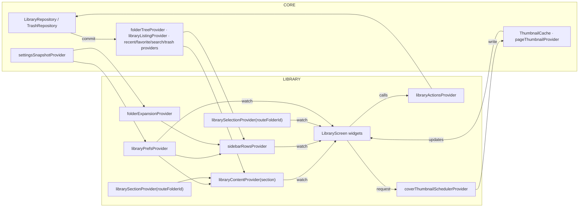

# 05 · LIBRARY — 라이브러리 화면

> 상태: 1차 수정 (총괄 1차 검토 [00-review.md](00-review.md) 3.5 반영, 재검토 대기) · 작성일: 2026-11-04 · 수정일: 2026-11-04
> 마스터 기획서: [docs/PLAN.md](../PLAN.md) v1.1 · 영역 지도·통합 계약: [00-overview.md](00-overview.md) 7장 v1.0
> 소유 경로: `packages/feature_library/` · 패키지 이름: `feature_library` (Flutter 패키지)

이 문서만 보고 별도 git worktree에서 LIBRARY를 구현할 수 있게 쓴다. **기준은 00-overview 7장 '통합 계약'이다.** 이 문서의 공유 타입·인터페이스 시그니처(4절의 공개 API, 5절의 다른 영역 이름)는 계약 문구를 글자 그대로 옮긴 것이고, 계약과 다른 자체 정의는 두지 않는다. 계약에 문제가 있다고 본 곳은 계약대로 쓰고 12.2 '계약 변경 제안'에 남겼다. 6절의 내부 시그니처는 구현 지침이며, 이름은 구현자가 바꿔도 되지만 동작·수치는 지킨다. 본문이 없는 메서드(`;`로 끝남)는 시그니처만 적은 것이다.

다른 영역의 정의 위치: CORE 타입 = 02-core 4절(= 계약 7.2.2~7.2.14), INK 썸네일 렌더러 = 계약 7.2.16, PDF 함수 = 계약 7.2.19, 앱 셸 연결 = 계약 7.3.3 + 01-infra 4.5.9·6.6. 검토 반영 내역은 13절.

---

## 1. 목적과 범위

### 1.1 목적

앱의 홈 화면이다. 사용자가 폴더로 노트를 정리하고(M2 완료 기준 "폴더로 노트를 정리할 수 있음"), 노트를 찾아 열고, 새 노트·폴더를 만들고, 지운 항목을 휴지통에서 되살린다. 데이터의 저장·질의·규칙(정렬, 순환 이동 차단, 휴지통 30일)은 CORE가 맡고, LIBRARY는 그 위의 **화면·상호작용**만 맡는다.

### 1.2 이번 동시 개발 범위

| 구분 | 내용 |
|---|---|
| 진입 · 라우팅 | `LibraryScreen(folderId, onOpenFolder, onOpenNote, onOpenSettings)` — INFRA 앱 셸이 `/`·`/folders/:folderId`에 연결 |
| 레이아웃 | iPad 13인치 가로(사이드바 고정)·세로(사이드바 서랍), 11인치·분할 화면·좁은 폭에서 깨지지 않음. 펜·손가락 모두 조작 |
| 사이드바 | 홈 · 최근 · 즐겨찾기 · 폴더 트리(펼치기/접기, 깊이 제한 없음) · 휴지통(개수) · 동기화 상태 자리 · 설정 버튼 |
| 상단 막대 | 브레드크럼(축약), 제목 검색 입력, 정렬 메뉴, 그리드/리스트 전환, 선택 모드, 새로 만들기 메뉴(노트 · 폴더 · PDF 가져오기) |
| 노트 목록 | 폴더 먼저·노트 다음, 그리드(표지 썸네일)·리스트, 정렬(이름 · 만든 날짜 · 수정한 날짜 · 사용자 지정), 빈 상태·로딩·오류 |
| 항목 동작 | 열기, 이름 변경, 복사, 이동(폴더 선택 대화상자), 휴지통으로 이동(실행 취소), 즐겨찾기, 폴더 색·아이콘, 노트 표지 변경 |
| 다중 선택 | 선택 모드, 모두 선택, 일괄 이동 · 복사 · 휴지통 · 즐겨찾기 · **PDF 내보내기**(자리 `libraryPdfExportActionProvider` — PDF `exportNotesAsPdf`를 INFRA가 연결, 계약 7.8) |
| 드래그 앤 드롭 | 길게 눌러 끌기 → 폴더 타일 · 사이드바 폴더 · 홈 · 브레드크럼 · 휴지통에 놓기, 사용자 지정 정렬에서 순서 바꾸기, 가장자리 자동 스크롤, 접힌 폴더 자동 펼침, 세로 모드 서랍 자동 열기 |
| 휴지통 화면 | 목록, 남은 보관 일수(30일), 복원, 영구 삭제(확인), 휴지통 비우기 |
| 최근 · 즐겨찾기 · 검색 | 최근 연 노트 20개, 즐겨찾기 노트, 제목 검색(폴더 이름 + 노트 제목) 결과와 위치 표시 |
| 새로 만들기 | 새 노트(제목, 페이지 크기·방향, 속지, 속지 색, 표지) → 만들고 바로 열기, 새 폴더(이름, 색, 아이콘) |
| 표지 썸네일 | 첫 페이지 썸네일 표시 + 없거나 오래된 썸네일 생성 예약. 렌더러는 CORE 자리 `pageThumbnailRendererProvider`만 읽는다(INFRA가 INK `inkPageThumbnailRendererProvider`로 연결, 계약 7.2.11·7.3.3). PDF 원본이 도착하면 다시 시도(`AssetStore.bytesArrived`, LIBRARY-O1) |
| 연동 자리 | PDF 가져오기·일괄 내보내기 자리(LIBRARY 소유 provider 2개, 계약 7.2.18), 동기화 상태 표시(CORE `syncBadgeProvider`, 계약 7.2.13), 저장 경고 배너(CORE `storageWarningOf`, 계약 7.2.12) |
| 설정 | 라이브러리 보기 설정(기기별), 새 노트 기본값(`LibrarySettingsSection` — INFRA 설정 화면 '일반 › 새 노트 기본값', 계약 7.4.11) |
| 테스트 | 단위·위젯 테스트(CORE `createFakeNoteStore()` 위의 얇은 가짜), 골든 4종, 브라우저(Chrome) 스모크, 통합 단계 실제 CORE 계약 테스트(L21, 필수), 사용자 iPad 확인 목록 |

### 1.3 이후 범위

| 항목 | 시점 | 지금 준비하는 것 |
|---|---|---|
| 폴더를 포함한 일괄 내보내기(폴더 안 노트까지 펼쳐 내보내기) | 피드백 후 | 이번에는 선택한 **노트만** 내보낸다(선택한 폴더는 건너뜀, 6.9). 펼치는 규칙(하위 폴더 포함 여부·순서)을 정하면 LIBRARY 안에서 노트 id 목록만 만들어 같은 자리를 부르면 된다 |
| 이미지 표지(`AssetCover`) 고르기 | M5(이미지 가져오기와 함께) | 표시는 이번에 구현(`AssetCover`가 동기화로 들어와도 보임) |
| PDF 텍스트 검색(M3) · 손글씨 검색(M7) 결과 표시 | M3 / M7 | 검색 결과 화면을 '폴더 · 노트' 묶음 구조로 만들어 묶음 추가가 쉽게 |
| 태그(5.2) | P1 | 없음(CORE에 `setTags`만 존재) |
| 키보드 단축키(5.2) — Esc·⌘A·Delete 등 | P1 | 없음 |
| 다크 모드(5.2) | P1 | 색은 모두 `Theme.of(context).colorScheme`에서 가져온다(하드코딩 금지, 폴더·표지 팔레트 제외) |
| 사이드바 트리에서 폴더 순서 끌어 바꾸기 | 피드백 후 | 콘텐츠 영역의 사용자 지정 정렬로는 이번에 가능 |
| 끌어서 폴더 위에 머물면 폴더 열기(스프링 로드) | 피드백 후 | 없음 |
| 다른 앱에서 끌어오기(네이티브 드래그 앤 드롭), '공유 · 다음으로 열기' 수신 | 네이티브 전환 후 | 없음(PDF 영역 진입점과 함께 설계) |
| 노트 잠금 · 버전 기록 · 백업/복원 · 탭/분할 화면(5.2) | P1 | 없음 |

### 1.4 제외 (다른 영역 책임)

| 항목 | 담당 |
|---|---|
| 폴더·노트 데이터, 정렬 질의, 순환 이동 차단, 휴지통 묶음·복원 위치·30일 자동 정리, 제목 검색 질의, 최근·즐겨찾기 질의(**'최근' 기록 `markOpened`는 CORE `openSession`이 유일한 주체**, 계약 7.2.8 N-6), 설정 저장, 썸네일 저장소, 저장 경고 조건(`storageWarningOf`) | CORE |
| 페이지 렌더링(획·속지·PDF 배경)으로 썸네일 이미지 만들기 | INK(`InkPageThumbnailRenderer`), PDF(배경 still renderer) — 5.3·5.4 |
| 썸네일 렌더러·PDF 자리·(M4) 동기화 상태의 앱 셸 연결 | INFRA `FeatureWiringModule`·`SyncModule`(계약 7.3.3) |
| PDF 파일 고르기·암호 입력·가져오기 진행률·오류 표시, 여러 노트 PDF 내보내기의 진행률·취소·결과 시트(공유·다운로드) | PDF(`importPdfAsNewNote`, `exportNotesAsPdf`) |
| 동기화 상태 값 계산(`syncBadgeOf`), 로그인 화면 | SYNC(값) · INFRA(화면·M4 연결) |
| 라우터, 앱 테마·로캘, `ProviderScope`·의존성 주입, 설정 화면 틀, 웹 제스처 방지(Safari 길게 누르기 콜아웃·텍스트 선택 — `index.html` CSS) | INFRA |
| 에디터 화면, 페이지 패널 썸네일, 페이지 추가 시 속지 고르기 | EDITOR |

### 1.5 핵심 결정 요약

| # | 결정 | 근거 |
|---|---|---|
| D-L1 | `feature_library`는 `note_core`에만 의존(형제 패키지). INK·PDF·SYNC와는 CORE 자리(`pageThumbnailRendererProvider`, `syncBadgeProvider`) 또는 LIBRARY가 정의한 자리(`libraryPdfImportActionProvider`, `libraryPdfExportActionProvider`)를 앱 셸이 덮어써서 연결 | 계약 7.1 규칙 1, 7.3.3 |
| D-L2 | 최근 · 즐겨찾기 · 휴지통 · 검색은 라우트가 아닌 **화면 내부 보기(섹션)**. 섹션 상태는 라우트 폴더 ID를 키로 하는 Riverpod family | INFRA 초안 5.3("internal LIBRARY views"). 빌드 중 provider 수정 금지 규칙을 피함(6.4) |
| D-L3 | 드래그 앤 드롭은 Flutter 기본 `LongPressDraggable`/`DragTarget`만 사용(외부 패키지 없음). 길게 누르기 400ms, 펜·손가락 같은 코드 | '폴더 안으로 넣기'와 '순서 바꾸기'를 한 동작에서 구분해야 해 기성 재정렬 패키지가 맞지 않음. 펜·손가락 모두 위젯 테스트·Chrome 테스트에서 동작 확인함(7.3) |
| D-L4 | 표지 썸네일: 저장은 CORE `ThumbnailCache`(첫 페이지 `pageId` 키), 생성은 CORE `PageThumbnailRenderer` 인터페이스(INK `InkPageThumbnailRenderer`가 구현, INFRA가 `pageThumbnailRendererProvider`에 연결), **언제 만들지(예약)는 LIBRARY** | 계약 7.2.11 썸네일 경로(CD-15). LIBRARY는 INK에 의존할 수 없음. 한 번도 열지 않은 노트(동기화·복사·PDF 가져오기)도 표지가 생겨야 함 |
| D-L5 | 정렬·검색·휴지통 규칙은 CORE 질의 결과를 그대로 표시. LIBRARY는 다시 정렬하지 않는다(사이드바 트리의 이름순만 예외, 6.5) | 화면과 데이터 규칙의 이중 구현 방지 |
| D-L6 | 휴지통으로 이동은 확인 없이 즉시 + 6초 '실행 취소'(= 복원). 영구 삭제·휴지통 비우기만 확인 대화상자 | 휴지통 자체가 안전장치(PLAN 5.1) |
| D-L7 | 화면 문구는 모두 `LibraryStrings`(한국어 상수)에 모은다. `intl` 미사용, 날짜·조사는 자체 함수 | 의존성 최소화, 나중에 다국어 전환 시 한 파일만 교체 |
| D-L8 | 테스트는 CORE 공용 가짜 `createFakeNoteStore()` 위에 LIBRARY가 실패·지연·호출 기록만 얹은 얇은 가짜(`FakeLibraryBackend`, 5.7)로. CORE 값 타입·의미를 그대로 쓰고 LIBRARY가 CORE 규칙을 다시 구현하지 않는다. 통합 단계에서 실제 CORE(`openTestNoteStore`)로 같은 시나리오를 한 번 더(L21, 필수) | 계약 7.4.8 '가짜', LIBRARY-S4. 동시 개발 첫날부터 테스트 가능(B2) + 남는 차이(drift 스트림 시점 등)는 L21이 잡음 |
| D-L9 | 레이아웃은 폭 기준: 1100 이상 사이드바 고정, 600~1100 서랍, 600 미만 좁은 화면 | iPad 가로 폭은 모두 1133 이상(13" 1376, 12.9" 1366, 11" 1194), 세로는 모두 1032 이하 → '가로 모드 고정 표시'(F-01)와 일치 |
| D-L10 | 현재 시각은 CORE `clockProvider`(`NoteStore.clock`) 하나에서 읽는다(날짜 표시·휴지통 남은 일수). LIBRARY 자체 시계 provider는 두지 않는다 | 계약 7.2.14·7.4.6. 테스트에서 가짜 저장소와 화면이 같은 시계를 씀 |
| D-L11 | LIBRARY는 `markOpened`를 부르지 않는다. 노트를 열 때는 `onOpenNote(id)`만 호출하고, '최근' 기록은 에디터가 세션을 열 때 CORE가 남긴다 | 계약 7.2.8 N-6, LIBRARY-S1(중복 쓰기 방지) |

---

## 2. PLAN.md 요구사항 대응표

작업 번호(L0~L21)는 8절.

### 2.1 기능 명세 (4장)

| PLAN 항목 | 요구 | 이 계획서의 작업 | 범위 |
|---|---|---|---|
| F-01 | 폴더 안 폴더, 트리 구조(깊이 제한 없음) | 사이드바 트리 평탄화(반복 DFS, 들여쓰기 8단계까지), 폴더 선택 대화상자 (6.5, L5·L9·L13) | 이번 |
| F-01 | 폴더·노트 생성 | 새 노트·새 폴더 대화상자, 기본 이름 자동 번호 (6.12, L12) | 이번 |
| F-01 | 이름 변경 | 이름 변경 대화상자, 1~200자 검증 (6.11, L13) | 이번 |
| F-01 | 드래그 앤 드롭 이동 | 길게 눌러 끌기 → 폴더 타일·사이드바·홈·브레드크럼에 놓기, 자동 스크롤·자동 펼침 (6.10, L15) | 이번 |
| F-01 | 복사 | 같은 폴더에 '사본' 또는 다른 폴더로 복사 (6.11, L13·L14) | 이번 |
| F-01 | 삭제 | 휴지통으로 이동 + 실행 취소 (6.11, L13) | 이번 |
| F-01 | 다중 선택 후 일괄 이동 / 삭제 | 선택 모드·선택 막대 (6.9, L14) | 이번 |
| F-01 | 다중 선택 후 일괄 내보내기 | 선택 막대 'PDF 내보내기' 버튼 → `libraryPdfExportActionProvider` 자리(PDF `exportNotesAsPdf`, INFRA 연결). 자리가 `null`이면 버튼 숨김. 선택한 노트만, 화면 순서 (4.3, 6.9, L14·L18) | 이번(계약 7.8) / 흐름·진행률·결과 시트는 PDF |
| F-01 | 정렬: 이름 · 생성일 · 수정일 · 사용자 지정 순서 | 정렬 메뉴, `LibraryQuery`, 사용자 지정에서 끌어 순서 바꾸기 (6.7·6.10, L10·L15) | 이번 |
| F-01 | 보기: 그리드(표지 썸네일) / 리스트 | 그리드 열 계산, 타일·행 (6.2·6.8, L8·L10), 표지 썸네일 예약 (6.15, L11) | 이번(그리기는 INK 렌더러 — CORE 자리에 INFRA가 연결) |
| F-01 | 폴더 색상·아이콘 | 팔레트 10색 + 없음, 아이콘 16종 (4.4, 6.11, L2·L13) | 이번 |
| F-01 | 노트 표지 선택 | 첫 페이지 / 색 표지 8종 (6.12·6.15, L11·L12·L13) | 이번 / 이미지 표지 고르기는 이후 |
| F-01 | 상단 경로 표시(브레드크럼)로 상위 폴더 빠른 이동 | 브레드크럼 축약·숨은 경로 메뉴·놓기 대상 (6.6, L5·L10) | 이번 |
| F-01 | 사이드바에 폴더 트리 고정 표시(태블릿 가로 모드) | 폭 ≥ 1100에서 고정 280dp, 접기 버튼, 세로는 서랍 (6.2, L8·L9) | 이번 |
| F-02 | 가져오기: 파일 앱/기기 저장소 → 새 노트 | '새로 만들기 › PDF 가져오기' → `libraryPdfImportActionProvider` 자리(PDF `importPdfAsNewNote`, INFRA 연결) → 돌려받은 노트 id로 `onOpenNote` (4.3, 5.4, L18) | 이번(진입점) / 흐름은 PDF |
| F-02 | 다른 앱 '공유' · '다음으로 열기', 클라우드 드라이브 | — | 이후(네이티브, PDF) |
| F-02 | 기존 노트에 페이지로 삽입 | — | 제외(EDITOR 진입점) |
| F-07 | 동기화 상태 표시: 완료 / 진행 중 / 오프라인 / 오류 | 사이드바 아래 `SyncBadgeIndicator`(CORE `syncBadgeProvider`의 `SyncBadge.display` 5가지), M4 전에는 `off` = '이 기기에 저장' (6.16, L9) | 이번(표시) / 값은 M4(SYNC `syncBadgeOf` → INFRA override) |
| F-13 | 페이지 크기 A4 · Letter · 16:9 · 사용자 지정 / 가로·세로 | 새 노트 대화상자의 첫 페이지 크기 — CORE `PageSizePreset`(16:9 세로형 540×960)·`PageSizeLimits`(사용자 지정 100~3000pt = 35.3~1058.3mm) (6.12, L3·L12) | 이번 |
| F-13 | 속지 템플릿(줄, 모눈, 점, 코넬, 악보, 플래너), 속지 색 | 새 노트 대화상자 속지 7칸(빈 페이지 + 6종 — INK가 6종 모두 그림, 계약 7.8)·속지 색 4종(CORE `PaperColors.all`) (6.12, L12) | 이번(첫 페이지) / 페이지 추가는 EDITOR |
| F-15 | 노트 PDF 내보내기 | 주 진입점은 EDITOR 더보기 메뉴. LIBRARY는 노트 ⋯ 메뉴 'PDF로 내보내기'(같은 내보내기 자리에 노트 1개) — 자리가 `null`이면 숨김 (6.8, L18) | 이번(보조 진입점) |
| F-06 | 로그인 | — | 제외(SYNC·INFRA) |
| F-12 | 펜 전용 모드 | 라이브러리는 펜·손가락 모두 같은 조작(펜 전용 모드는 에디터 필기에만 적용) (6.17) | 이번(규칙 명시) |

### 2.2 추가 기능 (5장)

| PLAN 항목 | 요구 | 이 계획서의 작업 | 범위 |
|---|---|---|---|
| 5.1 휴지통 | 동기화로 지워져도 복구, 30일 보관 | 휴지통 화면: 남은 일수, 복원(위치 보기), 영구 삭제, 비우기 (6.13, L16) | 이번 / 자동 정리는 CORE |
| 5.1 검색 | 노트 제목(M2) → PDF 텍스트(M3) → 손글씨(M7) | 제목 검색 입력·디바운스 300ms·결과(폴더·노트, 위치, 일치 강조) (6.14, L17) | 이번(제목) / 나머지 이후 |
| 5.1 자동 저장 | 저장 버튼 없음 | 모든 변경은 즉시 CORE 호출, 저장 버튼 없음 | 이번 |
| 5.1 오프라인 사용 | 처음부터 오프라인 동작 | 네트워크를 쓰지 않음, M4 전 '이 기기에 저장'(`SyncBadge.off`) 표시 | 이번 |
| 5.2 즐겨찾기(별표), 최근 노트 | M2 | 사이드바 '최근'·'즐겨찾기', 별표 토글 (6.14, L13·L17). '최근' 기록은 CORE `openSession`(N-6) | 이번 |
| 5.2 태그 | P1 | — | 이후 |
| 5.2 키보드 단축키 | P1 | — | 이후 |
| 5.2 다크 모드 | P1 | 테마 색만 사용(1.3) | 이후 |
| 5.2 노트 잠금, 버전 기록, 탭/분할 화면, 백업/복원, 링크 | P1 | — | 이후 |
| 5.4 앱 시작 2초 이내 라이브러리 표시 | 비기능 | 썸네일 지연 시작 800ms, 화면에 보이는 타일만 생성, 첫 화면에서 무거운 계산 없음 (6.21, L19) | 이번(LIBRARY 몫) / 측정은 INFRA |
| 5.4 60fps 스크롤 | 비기능 | 지연 생성 그리드, `RepaintBoundary`, 썸네일을 타일 크기로 디코딩 (6.21, L19) | 이번 |

### 2.3 아키텍처 · 화면 구성 · 협업 (7·8·9장)

| PLAN 항목 | 요구 | 이 계획서의 작업 | 범위 |
|---|---|---|---|
| 7.2 Folder `color`, `icon` | 폴더 꾸미기 | 아이콘 키 레지스트리 `FolderIcons`(CORE: "icon key defined by LIBRARY") (4.4) | 이번 |
| 7.2 Note `cover` | 표지 | `FirstPageCover`·`ColorCover`·`AssetCover` 표시 (6.15) | 이번 |
| 7.2 `sortKey` 분수 인덱스 | 사용자 지정 순서 | `reorderItem` 호출 순서 규칙 (6.10) | 이번 |
| 7.4-4 폴더 이동 순환 검사 | A를 B 안에, B를 A 안에 | 놓기 전 화면에서 차단(`canMoveInto`) + CORE `FolderCycleException` 처리 (6.10, 6.19) | 이번 |
| 8 IA 라이브러리 › 사이드바 | 폴더 트리 · 최근 · 즐겨찾기 · 휴지통 | 6.5 (L9) | 이번 |
| 8 IA 라이브러리 › 노트 목록 | 그리드 / 리스트, 정렬 | 6.7·6.8 (L10) | 이번 |
| 8 IA 라이브러리 › 검색 | | 6.14 (L17) | 이번 |
| 8 IA 라이브러리 › 새로 만들기 | 노트 · 폴더 · PDF 가져오기 | 6.12, 4.3 (L12·L18) | 이번 |
| 8 IA 설정 › 일반 › 기본 속지 | 새 노트 기본값 | `LibrarySettingsSection` + `library.newNote.defaults`(`SettingKey.jsonMap`, synced) (4.5, 6.3.4, 6.12) — INFRA 설정 섹션 `library.newNote`(일반) | 이번(Q5 승인됨) |
| 8 IA 설정 › 동기화 상태 | | 사이드바 상태 표시를 누르면 `onOpenSettings` | 이번(진입) |
| 9.4 Claude가 실기기 테스트 불가 | 핵심 로직 자동 테스트 | 놓기 판정·트리 평탄화·예약기 순수 함수 단위 테스트, 펜·손가락 위젯 테스트 (9.1) | 이번 |
| 9.5 단계 A: iPad Safari 웹 테스트 | 웹에서 동작 | `dart:io` 없음, Chrome 브라우저 테스트, iPad 확인 목록 (9.2) | 이번 |

### 2.4 로드맵 체크리스트 (10장)

| 마일스톤 항목 | 이 계획서의 작업 | 범위 |
|---|---|---|
| M2 폴더 트리 (생성 · 이름 변경 · 드래그 이동 · 삭제) | L5, L9, L12, L13, L15 | 이번 |
| M2 노트 목록 (그리드/리스트, 정렬, 다중 선택) | L8, L10, L11, L14 | 이번 |
| M2 휴지통 (30일 보관) | L16 | 이번 |
| M2 제목 검색, 최근 노트, 즐겨찾기 | L17 | 이번 |
| M2 완료 기준 "폴더로 노트를 정리할 수 있음" | 10절, 9.2 iPad 확인 목록 | 이번 |
| M3 PDF 가져오기(새 노트) | L18 진입점 | 이번(진입점) |
| M3 PDF 내보내기(범위 선택) — 라이브러리 일괄 | L14 선택 막대 버튼 · L18 자리 | 이번(자리·버튼) / 흐름은 PDF |
| M3 PDF 텍스트 검색 | — | 이후(전역 PDF 검색은 계약 7.8에서 이후) |
| M4 동기화 상태 표시 | L9 `SyncBadgeIndicator`(CORE `syncBadgeProvider`) | 이번(표시) / 값은 M4 |
| M1 페이지 썸네일 | 표지는 L11, 페이지 패널은 EDITOR | 이번(표지) |

---

## 3. 소유 경로와 패키지 구조

```text
packages/feature_library/
├─ pubspec.yaml
├─ lib/
│  ├─ feature_library.dart                 # public exports only (4.1)
│  └─ src/
│     ├─ library_screen.dart               # LibraryScreen (4.2)
│     ├─ integration/
│     │  ├─ overrides.dart                 # featureLibraryOverrides()
│     │  ├─ pdf_slots.dart                 # LibraryPdfImportAction / LibraryPdfExportAction + providers (4.3)
│     │  └─ pdf_flows.dart                 # runLibraryPdfImport / runLibraryPdfExport (6.9, internal)
│     ├─ appearance/
│     │  ├─ folder_appearance.dart         # FolderIcons, FolderPalette (4.4)
│     │  └─ cover_palette.dart             # CoverPalette, coverForegroundFor()
│     ├─ l10n/
│     │  ├─ library_strings.dart           # every Korean UI string (6.18)
│     │  ├─ korean_josa.dart               # 을/를, (으)로
│     │  └─ library_date_format.dart       # formatLibraryDate, trash days
│     ├─ model/
│     │  ├─ item_key.dart                  # LibraryItemKind, LibraryItemKey
│     │  ├─ section.dart                   # LibrarySection (sealed)
│     │  ├─ view_prefs.dart                # LibraryViewMode, LibrarySort, LibraryViewPrefs
│     │  ├─ selection.dart                 # LibrarySelection
│     │  ├─ content.dart                   # LibraryContent, FolderLookupState
│     │  ├─ tree_rows.dart                 # FolderTreeRow, flattenFolderTree
│     │  ├─ breadcrumb.dart                # BreadcrumbItem, compressBreadcrumb
│     │  ├─ location_label.dart            # '홈 › A › B'
│     │  ├─ names.dart                     # uniqueName, validateItemName
│     │  ├─ new_note_spec.dart             # NewNoteOptions, NewNoteSpec
│     │  └─ folder_appearance_value.dart   # FolderAppearance, NewFolderSpec
│     ├─ settings/
│     │  ├─ library_settings_keys.dart     # SettingKey declarations (6.3.4)
│     │  └─ library_settings_section.dart  # LibrarySettingsSection (4.5)
│     ├─ state/
│     │  ├─ providers.dart                 # all LIBRARY providers (6.3)
│     │  ├─ prefs_notifier.dart
│     │  ├─ expansion_notifier.dart
│     │  ├─ section_notifier.dart
│     │  ├─ selection_notifier.dart
│     │  └─ library_actions.dart           # LibraryActions, ActionOutcome, receipts
│     ├─ thumbnails/
│     │  └─ cover_thumbnail_scheduler.dart # 6.15
│     ├─ dnd/
│     │  ├─ drag_payload.dart
│     │  ├─ drop_decision.dart             # decideDrop, canMoveInto (pure)
│     │  ├─ edge_auto_scroller.dart
│     │  ├─ library_drag_scope.dart        # InheritedWidget: auto-scroll regions, drawer edge
│     │  └─ library_draggable.dart         # LongPressDraggable wrapper
│     └─ ui/
│        ├─ layout/        size_class.dart · library_metrics.dart · grid_metrics.dart · library_layout.dart
│        ├─ sidebar/       library_sidebar.dart · sidebar_nav_row.dart · folder_tree_view.dart · folder_tree_row_tile.dart · sync_badge_indicator.dart
│        ├─ top_bar/       library_top_bar.dart · breadcrumb_bar.dart · library_search_field.dart · sort_menu_button.dart · new_menu_button.dart · selection_bar.dart
│        ├─ content/       content_body.dart · item_grid.dart · item_list.dart · note_tile.dart · folder_tile.dart · new_note_tile.dart · note_cover_view.dart · empty_state.dart · folder_missing_view.dart · search_results_view.dart
│        ├─ trash/         trash_view.dart · trash_row.dart
│        ├─ dialogs/       new_note_dialog.dart · new_folder_dialog.dart · rename_dialog.dart · folder_picker_dialog.dart · folder_appearance_dialog.dart · cover_dialog.dart · confirm_dialog.dart
│        ├─ pickers/       page_size_picker.dart · template_picker.dart · template_pictogram.dart · paper_color_picker.dart · cover_picker.dart · folder_appearance_picker.dart
│        ├─ menus/         item_context_menu.dart
│        ├─ banners/       storage_warning_banner.dart
│        └─ feedback/      library_snack_bar.dart
└─ test/
   ├─ support/   fake_library_backend.dart · test_clock.dart · fake_thumbnail_renderer.dart · library_test_harness.dart · pump_library.dart · test_sizes.dart · fixtures.dart
   ├─ shared/    library_scenarios.dart     # scenario bodies run on the fake (widget/) AND real CORE (integration/)
   ├─ unit/      (9.1 표)
   ├─ widget/    (9.1 표)
   ├─ goldens/   library_golden_test.dart + *.png   # @Tags(['golden']) @TestOn('vm')
   ├─ integration/ core_contract_test.dart   # L21, @Tags(['integration']) @TestOn('vm'), openTestNoteStore
   └─ web/       library_browser_test.dart   # @TestOn('browser')
```

- 플랫폼 분리 파일(`*_native.dart`, `*_browser.dart`)은 **없다**. LIBRARY 코드는 `dart:io`·`dart:js_interop`·`package:web`을 쓰지 않는다.
- 테스트는 CORE `package:note_core/testing.dart`(`createFakeNoteStore`, 웹 안전)를, L21만 `package:note_core/testing_vm.dart`(`openTestNoteStore`, VM 전용)를 import한다(계약 7.1 규칙 2 — `test/`에서만).
- Material은 `package:material_ui/material_ui.dart`만 import한다(`package:flutter/material.dart` 금지, INFRA R7). `flutter/foundation.dart`, `flutter/gestures.dart`, `flutter/services.dart`, `flutter/scheduler.dart`는 필요한 이름만 `show`로 import한다.
- `analysis_options.yaml`은 패키지에 두지 않는다(루트 파일 적용, INFRA R3).

### 3.1 pubspec.yaml

```yaml
name: feature_library
description: Library screen (folder tree, note list, trash, search) for noteapp.
publish_to: none
resolution: workspace

environment:
  sdk: ^3.13.0
  flutter: 3.47.9

dependencies:
  flutter:
    sdk: flutter
  material_ui: 1.10.0
  flutter_riverpod: 3.4.3
  collection: 1.19.1
  note_core: any

dev_dependencies:
  flutter_test:
    sdk: flutter
  fake_async: 1.3.3
  clock: 1.1.3
```

- 형식은 계약 7.4.1 그대로(형제는 `any`, 외부는 7.5의 정확한 버전). 외부 의존 추가는 7절 표 외에는 없다. `riverpod`(순수 Dart)은 `flutter_riverpod`가 다시 내보내므로 직접 의존하지 않는다.
- `collection`: 상태 클래스의 `==`/`hashCode`에 `ListEquality`·`SetEquality`를 쓴다(계약 7.4.4 "컬렉션은 collection의 Equality"). `clock`(dev): 테스트가 `createFakeNoteStore(clock: …)`에 넘길 조절 가능한 시계를 만든다(`test/support/test_clock.dart`). 둘 다 Flutter SDK(`flutter`·`flutter_test`)가 이미 끌어오는 패키지라 해석 결과가 바뀌지 않는다 — 총괄 워크스페이스 복사본에 두 줄을 넣고 `flutter pub get --offline` → 성공, `pubspec.lock` 변화 없음 확인(7.3). 7.5 표의 '쓰는 멤버'에 `feature_library`가 없으므로 12.2 CP-L1로 추가를 요청한다(B1에서 INFRA가 pubspec을 만들 때 반영).
- `fake_async`는 `flutter_test`가 이미 `^1.3.3`으로 끌어오는 패키지이며, 예약기 단위 테스트에서 직접 import하므로 dev 의존으로 명시한다(`depend_on_referenced_packages`).
- 프로덕션 코드는 `package:clock`을 import하지 않는다. 현재 시각은 `ref.watch(clockProvider).now()`(CORE, D-L10)로 읽는다 — 다른 패키지 API가 돌려준 값의 멤버 호출에는 import가 필요 없다.

---

## 4. 공개 API

다른 영역(주로 INFRA 앱 셸)이 쓰는 것만 `package:feature_library/feature_library.dart`로 내보낸다. 나머지는 `src/` 내부다. 이 절의 코드 블록 중 **계약 7.2.18에 있는 것은 계약 문구를 글자 그대로** 옮겼다(동작 설명은 코드 블록 밖 표에 둔다). 계약이 "LIBRARY 4.4 (approved)"로 위임한 외형 레지스트리(4.4)는 이 문서가 계약이다.

### 4.1 내보내기 목록

```dart
// packages/feature_library/lib/feature_library.dart
/// Library screen: folder tree, note list, trash, search, create dialogs.
library;

export 'src/appearance/cover_palette.dart' show CoverPalette, coverForegroundFor;
export 'src/appearance/folder_appearance.dart' show FolderIcons, FolderPalette;
export 'src/integration/overrides.dart' show featureLibraryOverrides;
export 'src/integration/pdf_slots.dart'
    show
        LibraryPdfImportAction,
        libraryPdfImportActionProvider,
        LibraryPdfExportAction,
        libraryPdfExportActionProvider;
export 'src/library_screen.dart' show LibraryScreen;
export 'src/settings/library_settings_section.dart' show LibrarySettingsSection;
```

- 내보내는 이름 11개 = 계약 7.2.18의 이름 전부(`LibraryScreen`, `featureLibraryOverrides`, `LibraryPdfImportAction`, `libraryPdfImportActionProvider`, `LibraryPdfExportAction`, `libraryPdfExportActionProvider`, `LibrarySettingsSection`, `FolderIcons`, `FolderPalette`, `CoverPalette`, `coverForegroundFor`). 다른 패키지 진입점과 겹치는 이름이 없다(통합 R14). 내부 위젯 이름(`StorageWarningBanner` 등)은 export하지 않으므로 EDITOR 내부 이름과 같아도 충돌이 아니다.
- `test/unit/api_surface_test.dart`가 진입점 하나만 import해 위 11개 이름을 모두 참조한다(컴파일되면 통과, 시그니처는 계약 블록과 같은 호출 형태로 사용 — 예: `LibraryScreen(onOpenFolder: …, onOpenNote: …, onOpenSettings: …)`, `const LibrarySettingsSection()`, 두 자리 provider를 `overrideWithValue`). 그 밖의 이름이 새어 나가지 않는지는 통합 단계 INFRA R14 검사가 본다(L0).

### 4.2 진입 화면 `LibraryScreen`

INFRA 초안 5.3의 생성자를 그대로 계약으로 쓴다.

```dart
// lib/src/library_screen.dart
import 'package:flutter_riverpod/flutter_riverpod.dart';
import 'package:material_ui/material_ui.dart';

/// Home screen of the app.
///
/// Routing contract (INFRA): `/` → folderId == null, `/folders/:folderId` →
/// folderId. Recent / favorites / trash / search are internal views and are
/// not reflected in the URL. The screen never imports a router; it only calls
/// the callbacks below.
class LibraryScreen extends ConsumerStatefulWidget {
  const LibraryScreen({
    super.key,
    this.folderId,
    required this.onOpenFolder,
    required this.onOpenNote,
    required this.onOpenSettings,
  });

  /// Folder shown in the content pane. null = top level ('홈').
  /// An id that does not exist (deleted, purged, not yet synced) shows the
  /// 'folder missing' view (6.4), never an exception.
  final String? folderId;

  /// Navigate to a folder (null = 홈). Called for folder tiles, sidebar rows,
  /// breadcrumb crumbs, search results and 'show restored item'.
  final ValueChanged<String?> onOpenFolder;

  /// Open a note in the editor. Called after a tap on a note, and right after
  /// a note was created (new note dialog, PDF import). LIBRARY has already
  /// called LibraryRepository.markOpened(noteId) (fire-and-forget).
  final ValueChanged<String> onOpenNote;

  /// Settings button in the sidebar and taps on the sync status indicator.
  final VoidCallback onOpenSettings;

  @override
  ConsumerState<LibraryScreen> createState();
}
```

동작 계약

| # | 내용 |
|---|---|
| S-1 | `folderId`가 바뀌어 같은 State가 갱신되면(`didUpdateWidget`) 콘텐츠·브레드크럼·선택 상태가 새 폴더 기준으로 바뀐다. 새 State로 다시 만들어져도 결과는 같다(사이드바 펼침 상태·보기 설정은 provider에 있어 유지) |
| S-2 | 화면 루트는 `Scaffold` 1개. 스낵바는 가장 가까운 `ScaffoldMessenger`(앱 `MaterialApp`이 제공)를 쓴다 |
| S-3 | 필요한 provider는 CORE 저장소 provider(5.1)뿐이다. LIBRARY 전용 provider는 모두 기본 구현이 있어 앱 셸이 덮어쓰지 않아도 동작한다 |
| S-4 | 화면을 떠날 때 저장해야 할 버퍼가 없다(펼침 상태 저장 디바운스는 `dispose`에서 즉시 저장). 따라서 `flush()`를 공개하지 않는다 |

### 4.3 앱 셸 연결용 provider · 함수

```dart
// lib/src/integration/overrides.dart
import 'package:flutter_riverpod/misc.dart' show Override;

/// App-level overrides LIBRARY needs. Always empty: every LIBRARY provider has
/// a working default. Kept so the app shell can treat all feature packages
/// the same way (INFRA 5.3).
List<Override> featureLibraryOverrides() => const <Override>[];
```

> 확인함: `flutter_riverpod` 3.4.3에서 `Override` 타입은 `package:flutter_riverpod/flutter_riverpod.dart`가 아니라 `package:flutter_riverpod/misc.dart`에서 내보낸다(실험 7.3). INFRA 앱 셸도 같은 import가 필요하다.

```dart
// lib/src/integration/pdf_import_slot.dart
import 'package:flutter_riverpod/flutter_riverpod.dart';
import 'package:material_ui/material_ui.dart';

/// Starts the 'import PDF as a new note' flow owned by pdf_io: file picker,
/// password prompt, progress and error UI are all inside the flow.
///
/// [folderId] is the folder the new note goes into (null = 홈).
/// Resolves to the created note id, or null when the user cancelled or the
/// flow already showed its own error. Must not throw for user-level failures.
typedef LibraryPdfImportAction = Future<String?> Function(
  BuildContext context, {
  String? folderId,
});

/// null (default) = PDF import not available yet: the menu item is shown
/// disabled with the subtitle '준비 중'. The app shell overrides this with the
/// pdf_io function (5.4), e.g.
/// `libraryPdfImportActionProvider.overrideWithValue(importPdfAsNewNote)`.
final libraryPdfImportActionProvider = Provider<LibraryPdfImportAction?>(
  (ref) => null,
  name: 'libraryPdfImportActionProvider',
);
```

LIBRARY 쪽 동작: 메뉴 선택 → `final id = await action(context, folderId: target)` → `id != null`이면 `markOpened(id)` 후 `onOpenNote(id)`. `context`는 `LibraryScreen`의 `BuildContext`(화면이 살아 있는 동안 유효), 호출 후 `context.mounted`를 확인한다. 예외가 나오면 `FlutterError.reportError` + 일반 오류 스낵바.

### 4.4 폴더 · 표지 외형 레지스트리

CORE의 `Folder.icon`은 "LIBRARY가 정의하는 아이콘 키(≤ 32자)"다. 다른 기기에서 동기화로 들어온 모르는 키·색도 깨지지 않게 표시한다.

```dart
// lib/src/appearance/folder_appearance.dart
import 'package:material_ui/material_ui.dart';

/// Folder icon keys stored in Folder.icon. Keys are stable wire values —
/// never rename or reuse one; only append.
abstract final class FolderIcons {
  static const String defaultKey = 'folder';

  /// Display order in the picker (4 x 4 grid).
  static const List<String> keys = [
    'folder', 'book', 'school', 'work',
    'science', 'calculate', 'language', 'music',
    'art', 'idea', 'code', 'travel',
    'home', 'pet', 'star', 'heart',
  ];

  /// Icon for a stored key. null or unknown key → Icons.folder.
  /// Every value is a const Icons.* reference (web icon tree-shaking).
  static IconData iconFor(String? key);

  /// Korean semantic label for screen readers, e.g. 'book' → '책'.
  static String labelFor(String key);
}

/// Folder colors (ARGB). null = no color (theme default).
abstract final class FolderPalette {
  static const List<int> colors = [
    0xFF5B8DEF, // 파랑
    0xFF4CAF7A, // 초록
    0xFFF2B33D, // 노랑
    0xFFF28B3D, // 주황
    0xFFE5534B, // 빨강
    0xFFE36AA7, // 분홍
    0xFF9B6BDF, // 보라
    0xFF4BB3C9, // 청록
    0xFF8D6E63, // 갈색
    0xFF78858F, // 회색
  ];

  /// Korean names in the same order (semantics, tooltips).
  static const List<String> names = [
    '파랑', '초록', '노랑', '주황', '빨강', '분홍', '보라', '청록', '갈색', '회색',
  ];
}
```

아이콘 키 → `Icons` 대응(모두 material_ui 1.10.0에 있음을 확인함): folder→`folder`, book→`menu_book`, school→`school`, work→`work`, science→`science`, calculate→`calculate`, language→`translate`, music→`music_note`, art→`palette`, idea→`lightbulb`, code→`code`, travel→`flight`, home→`home`, pet→`pets`, star→`star`, heart→`favorite`. 한국어 이름: 폴더, 책, 학교, 업무, 과학, 계산, 언어, 음악, 미술, 아이디어, 코드, 여행, 집, 반려동물, 별, 하트.

```dart
// lib/src/appearance/cover_palette.dart
/// Colors for ColorCover (ARGB), shown in the cover picker.
abstract final class CoverPalette {
  static const List<int> colors = [
    0xFF2F4A7A, // 남색
    0xFF2E6B4F, // 숲색
    0xFF7A2E3B, // 버건디
    0xFFC9A227, // 겨자색
    0xFF5A6773, // 슬레이트
    0xFF7FB2E5, // 하늘색
    0xFFE8A9A0, // 살구색
    0xFF2B2B2B, // 먹색
  ];
  static const List<String> names = [
    '남색', '숲색', '버건디', '겨자색', '슬레이트', '하늘색', '살구색', '먹색',
  ];
}

/// Title color on a colored cover: white when Color(argb).computeLuminance()
/// < 0.5, otherwise 0xDE000000. Any ARGB (also unknown synced colors).
Color coverForegroundFor(int argb);
```

### 4.5 설정 화면용 섹션 (선택 — 12절 Q5)

```dart
// lib/src/settings/library_settings_section.dart
/// '새 노트 기본값' block for the app settings screen (PLAN 8: 설정 › 일반 ›
/// 기본 속지). Edits LibrarySettingsKeys.newNoteDefaults: page size,
/// orientation, template, paper color. Same pickers as the new note dialog.
/// Needs only CORE settingsRepositoryProvider / settingsSnapshotProvider.
class LibrarySettingsSection extends ConsumerWidget {
  const LibrarySettingsSection({super.key});

  @override
  Widget build(BuildContext context, WidgetRef ref);
}
```

---

## 5. 사용하는 다른 영역의 계약

### 5.1 CORE (`package:note_core/note_core.dart`)

#### 5.1.1 그대로 쓰는 것 (CORE 초안 4.1~4.9와 같은 이름)

```dart
// Types (shape as assumed by LIBRARY; full definitions are CORE's)
typedef FolderId = String; typedef NoteId = String; typedef PageId = String;
typedef AssetId = String; typedef EpochMillis = int;

final class Folder {   // id, parentId, name, colorArgb, icon, sortKey,
  // createdAt, updatedAt, deletedAt, trashRootId, isDeleted
}
sealed class NoteCover {}
final class FirstPageCover extends NoteCover { const FirstPageCover(); }
final class ColorCover extends NoteCover { const ColorCover(this.colorArgb); final int colorArgb; }
final class AssetCover extends NoteCover { const AssetCover(this.assetId); final AssetId assetId; }
final class Note {     // id, folderId, title, cover, isFavorite, sortKey,
  // createdAt, updatedAt, deletedAt, pageCount, firstPageId, lastOpenedAt,
  // requiresNewerApp
}
final class Page { /* id, noteId, size, background, contentRevision */ }
final class PageContent { /* page, strokes, revision */ }
final class PageSize { /* a4Portrait, letterPortrait, widescreen16x9, portrait, landscape, minSide, maxSide */ }
enum PageTemplateKind { lined, grid, dotted, cornell, music, planner }
final class PageTemplate { factory PageTemplate.defaults(PageTemplateKind kind); }
sealed class PageBackground {}            // BlankBackground, TemplateBackground, ...
abstract final class PaperColors { /* white, ivory, gray, black */ }
final class PageDraft { const PageDraft({String? id, required PageSize size,
    required PageBackground background, List<Stroke> strokes = const []}); }

sealed class LibraryItemRef { String get id; }
final class FolderRef extends LibraryItemRef { const FolderRef(this.id); }
final class NoteRef extends LibraryItemRef { const NoteRef(this.id); }
enum LibrarySortField { name, createdAt, updatedAt, custom }
final class LibraryQuery { const LibraryQuery({FolderId? folderId,
    LibrarySortField sort = LibrarySortField.updatedAt, bool descending = true}); }
final class LibraryListing { /* folderId, folders, notes */ }
final class LibrarySearchResult { /* query, folders, notes */ }
final class FolderTree {
  FolderTree(Iterable<Folder> activeFolders);
  int get length;
  List<Folder> get roots;
  List<Folder> childrenOf(FolderId? parentId);   // (sortKey, id)
  Folder? byId(FolderId id);
  List<Folder> pathTo(FolderId id);              // top level → id
  Set<FolderId> descendantsOf(FolderId id);
  bool isSelfOrDescendant(FolderId candidate, {required FolderId of});
}
sealed class TrashItem { LibraryItemRef get ref; String get name;
    EpochMillis get deletedAt; EpochMillis get expiresAt; }
final class TrashedFolder extends TrashItem { /* folder, folderCount, noteCount */ }
final class TrashedNote extends TrashItem { /* note */ }
final class PageThumbnail { /* pageId, contentRevision, width, height, mimeType, bytes, isStaleFor(page) */ }
final class StorageInfo { bool get isDurable; }
final class PersistenceStatus { int get consecutiveFailures; }
enum SettingScope { synced, device }
final class SettingKey<T> { const SettingKey(String name, {required T defaultValue,
    required Object? Function(T) encode, required T Function(Object?) decode,
    SettingScope scope = SettingScope.synced}); }
final class SettingsSnapshot { T get<T>(SettingKey<T> key); }
final class FolderCycleException extends NoteCoreException {}
final class EntityNotFoundException extends NoteCoreException {}
final class StorageUnavailableException extends NoteCoreException {}

// Interfaces
abstract interface class LibraryRepository {
  Stream<FolderTree> watchFolderTree();
  Stream<LibraryListing> watchListing(LibraryQuery query);
  Stream<Note?> watchNote(NoteId id);
  Future<Note?> getNote(NoteId id);
  Future<Folder?> getFolder(FolderId id);
  Stream<List<Note>> watchRecentNotes({int limit = 20});
  Stream<List<Note>> watchFavoriteNotes();
  Future<LibrarySearchResult> searchLibrary(String query, {int limit = 50});
  Future<Folder> createFolder({FolderId? parentId, required String name, int? colorArgb, String? icon});
  Future<void> renameFolder(FolderId id, String name);
  Future<void> setFolderAppearance(FolderId id,
      {int? colorArgb, String? icon, bool clearColor = false, bool clearIcon = false});
  Future<Note> createNote({FolderId? folderId, required String title,
      List<PageDraft> pages = const [PageDraft.blankA4], NoteCover cover = const FirstPageCover()});
  Future<void> renameNote(NoteId id, String title);
  Future<void> setFavorite(List<NoteId> ids, bool favorite);
  Future<void> setCover(NoteId id, NoteCover cover);
  Future<void> markOpened(NoteId id);
  Future<void> moveItems(List<LibraryItemRef> items, {required FolderId? targetFolderId});
  Future<void> reorderItem(LibraryItemRef item, {LibraryItemRef? after, LibraryItemRef? before});
  Future<List<LibraryItemRef>> copyItems(List<LibraryItemRef> items,
      {required FolderId? targetFolderId, String nameSuffix = ''});
  Future<void> trashItems(List<LibraryItemRef> items);
}
abstract interface class TrashRepository {
  Stream<List<TrashItem>> watchTrash();
  Future<void> restore(List<LibraryItemRef> items);
  Future<void> purge(List<LibraryItemRef> items);
  Future<void> emptyTrash();
}
abstract interface class SettingsRepository {
  Future<T> get<T>(SettingKey<T> key);
  Stream<T> watch<T>(SettingKey<T> key);
  Future<void> set<T>(SettingKey<T> key, T value);
  Future<void> reset<T>(SettingKey<T> key);
  Stream<SettingsSnapshot> watchAll();
}
abstract interface class NoteContentReader {
  Future<List<Page>> pagesOf(NoteId noteId);
  Future<PageContent> loadPage(PageId pageId);
}
abstract interface class ThumbnailCache {
  Future<PageThumbnail?> read(PageId pageId);
  Future<void> write(PageThumbnail thumbnail);
  Future<void> delete(PageId pageId);
  Stream<PageId> get updates;
}
abstract interface class AssetStore {
  Future<Uint8List?> readBytes(AssetId id);   // only member LIBRARY uses
}

// Providers LIBRARY watches / reads / overrides in tests
final libraryRepositoryProvider = Provider<LibraryRepository>(...);
final trashRepositoryProvider = Provider<TrashRepository>(...);
final settingsRepositoryProvider = Provider<SettingsRepository>(...);
final noteContentReaderProvider = Provider<NoteContentReader>(...);
final thumbnailCacheProvider = Provider<ThumbnailCache>(...);
final assetStoreProvider = Provider<AssetStore>(...);
final folderTreeProvider = StreamProvider<FolderTree>(...);
final libraryListingProvider = StreamProvider.autoDispose.family<LibraryListing, LibraryQuery>(...);
final recentNotesProvider = StreamProvider.autoDispose<List<Note>>(...);
final favoriteNotesProvider = StreamProvider.autoDispose<List<Note>>(...);
final librarySearchProvider = FutureProvider.autoDispose.family<LibrarySearchResult, String>(...);
final trashItemsProvider = StreamProvider.autoDispose<List<TrashItem>>(...);
final pageThumbnailProvider = FutureProvider.autoDispose.family<PageThumbnail?, PageId>(...);
final settingsSnapshotProvider = StreamProvider<SettingsSnapshot>(...);
final storageInfoProvider = Provider<StorageInfo>(...);
final persistenceStatusProvider = StreamProvider<PersistenceStatus>(...);
```

LIBRARY가 가정하는 동작(CORE가 지켜 주길 요청 — 총괄 관리자가 7장에 확정)

| # | 기대 사항 |
|---|---|
| C-1 | 모든 `watch*` 스트림은 구독 즉시 현재 값을 1회 내보내고, 결과에 영향을 주는 커밋마다 다시 내보낸다(원격 변경 포함) |
| C-2 | `watchListing`: 폴더 먼저·노트 다음 목록(L-2), 정렬은 `LibraryQuery` 그대로. 없는 `folderId`는 오류가 아니라 빈 목록 |
| C-3 | `getFolder`/`getNote`는 휴지통에 있는 항목도 돌려준다(`deletedAt != null`). 영구 삭제됐거나 모르는 ID면 `null` → LIBRARY가 '휴지통에 있음'과 '없음'을 구분(6.4) |
| C-4 | `moveItems`: 이미 대상 폴더에 있는 항목은 무시(오류 아님). 순환이면 `FolderCycleException`, 아무것도 바꾸지 않음(원자적) |
| C-5 | `copyItems(nameSuffix: ' 사본')`: 원래 이름 + 접미사가 200자를 넘으면 **원래 이름 쪽을 잘라** 200자에 맞춘다(LIBRARY가 항목별로 미리 알 수 없음) |
| C-6 | 이름 규칙: 앞뒤 공백 제거 후 `String.length` 1~200. 위반 시 `ArgumentError`. LIBRARY는 같은 규칙으로 미리 검증 |
| C-7 | `watchRecentNotes`·`watchFavoriteNotes`·`searchLibrary`는 휴지통 항목 제외. `searchLibrary`의 빈 질의 = 빈 결과 |
| C-8 | `restore` 후 `getNote`/`getFolder`로 새 위치(`folderId`/`parentId`)를 읽을 수 있다(복원 위치 규칙은 CORE 6.8) |
| C-9 | `Note.firstPageId`는 활성 첫 페이지를 가리키고, 첫 페이지 내용이 바뀌면 `Page.contentRevision`이 오르며 `Note.updatedAt`도 오른다(표지 갱신 판단에 사용, 6.15) |
| C-10 | `LibraryRepository` 변경 메서드는 서로 독립 트랜잭션이어도 된다. 단 `reorderItem`을 연속으로 부르면 호출 순서대로 적용된다 |

#### 5.1.2 추가 요청 (CORE 소유로 제안)

**(a) 페이지 썸네일 렌더러 인터페이스** — INK가 구현, 앱 셸이 주입, LIBRARY(표지)가 사용. 12절 Q1.

```dart
// note_core: lib/src/assets/page_thumbnail_renderer.dart (proposed)
/// Renders one page (background + committed strokes) to an encoded image.
/// Implemented by ink_engine (5.3); pure-Dart signature so CORE stays
/// Flutter-free.
abstract interface class PageThumbnailRenderer {
  /// Longer side of the result is at most [maxSidePx] pixels.
  /// result.pageId == content.page.id and
  /// result.contentRevision == content.page.contentRevision.
  /// Returns null when the page cannot be rendered on this device yet
  /// (e.g. PDF bytes not downloaded); the caller retries after the note's
  /// updatedAt changes.
  Future<PageThumbnail?> render(PageContent content, {int maxSidePx = 512});
}

/// null = no renderer: thumbnails come only from ThumbnailCache.
final pageThumbnailRendererProvider = Provider<PageThumbnailRenderer?>(
  (ref) => null,
  name: 'pageThumbnailRendererProvider',
);
```

**(b) 동기화 상태 타입과 provider** — SYNC가 값 제공, 앱 셸이 주입, LIBRARY·설정 화면(·EDITOR)이 표시. 12절 Q2.

```dart
// note_core: lib/src/sync/sync_status.dart (proposed)
enum SyncPhase {
  localOnly, // not signed in / sync not set up (always, before M4)
  synced,    // 완료
  syncing,   // 진행 중
  offline,   // 오프라인
  error,     // 오류
}

@immutable
final class SyncStatus {
  const SyncStatus({required this.phase, this.pendingChanges = 0,
      this.lastSyncedAt, this.message});
  static const SyncStatus localOnly = SyncStatus(phase: SyncPhase.localOnly);
  final SyncPhase phase;
  final int pendingChanges;        // local changes not yet acknowledged
  final EpochMillis? lastSyncedAt;
  final String? message;           // optional Korean detail for SyncPhase.error
}

/// Default emits SyncStatus.localOnly once. SYNC's module overrides it.
final syncStatusProvider = StreamProvider<SyncStatus>(
  (ref) => Stream<SyncStatus>.value(SyncStatus.localOnly),
  name: 'syncStatusProvider',
);
```

**(c) 작은 요청** (없어도 LIBRARY는 동작, 있으면 성능·단순성 향상)

```dart
// (c1) NoteContentReader — cheap staleness check for the cover (6.15).
Future<Page?> getPage(PageId pageId);   // active page or null

// (c2) LibraryRepository — one commit for multi-item custom reorder (6.10).
Future<void> reorderItems(List<LibraryItemRef> items,
    {LibraryItemRef? after, LibraryItemRef? before});

// (c3) FolderTree — iterate every active folder (used to keep folders that
// are only reachable through a sync-created cycle visible, 6.5).
Iterable<Folder> get folders;
```

- (c1)이 없으면 `pagesOf(noteId).first`를 쓴다(수백 페이지 PDF 노트에서 메타데이터 수백 행 읽음).
- (c2)가 없으면 `reorderItem`을 항목 수만큼 순서대로 호출한다(커밋 n번, 스트림 n번 갱신).
- (c3)이 없으면 순환에 갇힌 폴더는 SYNC가 복구할 때까지 트리에 보이지 않는다.

**(d) 기반 단계 요청** — 기반 단계 커밋의 CORE 계약 파일에 `Folder`·`Note`·`Page`·`PageContent`·`PageSize`·`PageTemplate.defaults`·`PageDraft`·`LibraryItemRef`·`LibraryQuery`·`LibraryListing`·`LibrarySearchResult`·`FolderTree`·`TrashItem`·`PageThumbnail.isStaleFor`·`SettingKey`·`SettingsSnapshot.get`·`StorageInfo`·`PersistenceStatus`의 **동작하는 구현**(시그니처만이 아니라)이 들어 있어야 LIBRARY 가짜(5.7)가 이 타입들을 만들 수 있다. 12절 Q9.

### 5.2 INFRA (앱 셸)

```dart
// app/lib/... (INFRA) — expected wiring (INFRA draft 6.6 + this plan)
GoRoute(
  path: AppRoutes.library,                     // '/'
  pageBuilder: (context, state) => NoTransitionPage<void>(
    key: const ValueKey('library'),            // I-2: same key for both routes
    child: screens.library(context, const LibraryRouteArgs(), navigator),
  ),
),
GoRoute(
  path: AppRoutes.folderPattern,               // '/folders/:folderId'
  pageBuilder: (context, state) => NoTransitionPage<void>(
    key: const ValueKey('library'),
    child: screens.library(context,
        LibraryRouteArgs(folderId: state.pathParameters['folderId']), navigator),
  ),
),

// AppScreenBuilders.production().library
LibraryScreen(
  folderId: args.folderId,
  onOpenFolder: (id) => nav.openLibrary(folderId: id),
  onOpenNote: nav.openNote,
  onOpenSettings: nav.openSettings,
);

// Root ProviderScope overrides (once, at startup)
[
  ...featureLibraryOverrides(),
  libraryPdfImportActionProvider.overrideWithValue(importPdfAsNewNote), // pdf_io (5.4)
  pageThumbnailRendererProvider.overrideWithValue(InkPageThumbnailRenderer()), // note_core slot, ink_engine impl (5.3)
  // M4: syncStatusProvider.overrideWith((ref) => ...SYNC stream...)          // (5.5)
]
```

| # | 기대 사항 |
|---|---|
| I-1 | `/` → `LibraryScreen(folderId: null)`, `/folders/:folderId` → `LibraryScreen(folderId: id)` (ID는 디코딩된 값). 위 생성자 연결 그대로 |
| I-2 | 두 라이브러리 경로는 **같은 페이지 키**와 **전환 애니메이션 없는 페이지**를 쓴다 → 폴더를 옮길 때 화면 전체가 미끄러지지 않고 같은 `LibraryScreen` State가 `folderId`만 바뀐다. 불가능하면 `ShellRoute`로 감싸도 된다(12절 Q4) |
| I-3 | `openNote`는 `push`(닫으면 같은 폴더·같은 내부 보기로 돌아옴), `openLibrary`는 `go` — INFRA 초안 6.6 그대로 |
| I-4 | `MaterialApp`(material_ui)에 한국어 로캘(`ko`)과 `GlobalMaterialLocalizations` 위임, 앱 `pubspec.yaml`에 `uses-material-design: true`(아이콘 글꼴). 테마는 Material 3 `ColorScheme` |
| I-5 | 웹 `index.html`에서 Safari 길게 누르기 메뉴·텍스트 선택·돋보기를 막는다(`-webkit-touch-callout: none; -webkit-user-select: none;` 등, INFRA의 제스처 방지). LIBRARY의 끌기는 길게 누르기로 시작한다 |
| I-6 | 설정 화면 '일반'에 `LibrarySettingsSection()`을 넣는다(12절 Q5 승인 시) |
| I-7 | 오류 보고: LIBRARY는 `FlutterError.reportError(... library: 'feature_library')`로 보고한다. 앱 셸이 수집 |

### 5.3 INK

```dart
// ink_engine — expected (class name is INK's choice)
final class InkPageThumbnailRenderer implements PageThumbnailRenderer {
  InkPageThumbnailRenderer({/* background builders incl. PDF (5.4), pencil grain, ... */});
  @override
  Future<PageThumbnail?> render(PageContent content, {int maxSidePx = 512});
}
```

| # | 기대 사항 |
|---|---|
| K-1 | 결과는 종이 색 + 속지 + 완료된 획(형광펜 레이어 규칙 포함). 크기는 긴 변 = `maxSidePx`, 짧은 변은 페이지 비율 |
| K-2 | 웹(CanvasKit)에서 동작: `PictureRecorder` → `Picture.toImage` → `toByteData(format: png)` 등 `dart:ui`만 사용, `mimeType: 'image/png'` |
| K-3 | 목표 시간(iPad Safari, 미확인 — 통합 후 측정): 획 2,000개 페이지 512px에서 150ms 이하. 넘으면 LIBRARY가 `maxSidePx`를 384로 낮춤 |
| K-4 | PDF 배경 페이지는 PDF 배경 그리기(5.4 P-2)를 쓰고, PDF 바이트가 아직 없으면 `null`을 돌려준다 |

### 5.4 PDF

```dart
// pdf_io — expected public function, same shape as LibraryPdfImportAction
Future<String?> importPdfAsNewNote(BuildContext context, {String? folderId});
```

| # | 기대 사항 |
|---|---|
| P-1 | 파일 고르기 → (암호) → 진행률 → `createNote(folderId:, title: 파일 이름(확장자 제외), pages: PDF 페이지 수만큼)` → 새 노트 ID 반환. 취소·실패 = `null`(오류 표시는 PDF 흐름 안에서) |
| P-2 | 썸네일용 PDF 배경 그리기를 INK 렌더러가 쓸 수 있게 제공(INK–PDF 계약). 없으면 PDF 노트 표지는 종이 색만 보임 |
| P-3 | 흐름 중 `context`가 사라지면(사용자가 화면을 떠남) 조용히 끝내고 `null` |

### 5.5 SYNC

| # | 기대 사항 |
|---|---|
| Y-1 | M4에서 `syncStatusProvider`(5.1.2 b)를 실제 상태 스트림으로 덮어쓴다(앱 셸 주입). 같은 상태가 반복되면 내보내지 않는다(`distinct`) |
| Y-2 | 원격 변경은 CORE 스트림으로만 도착한다(LIBRARY는 SYNC를 직접 부르지 않음). 원격 변경으로 현재 폴더가 휴지통에 가면 LIBRARY가 '폴더 없음' 보기로 처리(6.4) |

### 5.6 EDITOR

필수 계약 없음. LIBRARY는 노트를 열 때 `markOpened`를 직접 호출한다. 주소로 바로 에디터를 연 경우(새로고침 등)에도 '최근'에 남기려면 EDITOR도 `markOpened`를 부를지 12절 Q8.

### 5.7 테스트용 가짜 구현 (LIBRARY `test/support/`)

```dart
// test/support/fake_library_backend.dart
/// In-memory implementation of the CORE interfaces LIBRARY uses.
/// Semantics follow CORE 6.8 closely enough for UI tests (table below).
final class FakeLibraryBackend
    implements LibraryRepository, TrashRepository, SettingsRepository,
        NoteContentReader, ThumbnailCache, AssetStore {
  FakeLibraryBackend({DateTime Function()? now,
      this.retention = const Duration(days: 30)});

  final Duration retention;

  // Seeding (synchronous, emits once per call)
  Folder addFolder(String name, {FolderId? parentId, int? colorArgb, String? icon,
      EpochMillis? createdAt, EpochMillis? updatedAt});
  Note addNote(String title, {FolderId? folderId, NoteCover cover = const FirstPageCover(),
      bool favorite = false, EpochMillis? createdAt, EpochMillis? updatedAt,
      EpochMillis? lastOpenedAt, int pageCount = 1});
  void trashNow(List<LibraryItemRef> items, {EpochMillis? at});  // seed trash with a past date
  void putAssetBytes(AssetId id, Uint8List bytes);

  // Inspection
  List<Folder> get allFolders;               // including trashed
  List<Note> get allNotes;
  List<Page> pagesOfSync(NoteId id);
  Map<String, Object?> get settingsRaw;      // key name → encoded value
  final List<String> calls = [];             // e.g. "moveItems [n:n1, f:f2] → f3"

  // Failure / latency injection
  Object? failNextMutation;                  // thrown (once) by the next mutating call
  Duration latency = Duration.zero;          // awaited before every Future result

  /// Overrides for ProviderScope / ProviderContainer.test: every CORE provider
  /// in 5.1.1 that LIBRARY uses (repositories → this; storageInfoProvider →
  /// durable web backend; persistenceStatusProvider → healthy status).
  List<Override> get overrides;

  /// Simulate a remote change (e.g. another device trashed a folder).
  void remoteUpdate(void Function(FakeLibraryBackend b) change);

  Future<void> dispose();
}

// test/support/fake_thumbnail_renderer.dart
final class FakeThumbnailRenderer implements PageThumbnailRenderer {
  final List<PageId> rendered = [];
  Duration delay = Duration.zero;
  Set<PageId> failFor = {};          // throws StateError for these pages
  Set<PageId> nullFor = {};          // returns null for these pages
  @override
  Future<PageThumbnail?> render(PageContent content, {int maxSidePx = 512});
  // bytes = kTestPng1x1 (base64 'iVBORw0KGgoAAAANSUhEUgAAAAEAAAABCAYAAAAfFcSJAAAADUlEQVR42mNkYPhfDwAChwGA60e6kgAAAABJRU5ErkJggg==')
}
```

- `AssetStore`·`ThumbnailCache` 등에서 LIBRARY가 쓰지 않는 멤버는 `noSuchMethod`를 재정의해 `UnimplementedError`를 던진다(구현 생략 허용).
- 6개 인터페이스를 한 클래스가 구현해도 멤버 이름이 겹치지 않는다(`getNote`/`get<T>`, `restore`, `read`/`write`/`delete`, `readBytes` 등 확인함).

가짜의 규칙(CORE 6.8의 부분집합 — 통합 단계 L21에서 실제 CORE로 같은 시나리오를 다시 돌려 차이를 찾는다)

| 기능 | 가짜 동작 |
|---|---|
| ID · 시간 | 폴더 `f1, f2, …`, 노트 `n1, n2, …`, 페이지 `p-<noteId>-<n>`. `now()` 기본은 `DateTime(2026, 11, 4, 14, 5)` 고정 |
| sortKey | 같은 부모·같은 종류 안에서 `k0001`부터 4자리 증가. `reorderItem`은 목록 위치를 바꾼 뒤 그 형제 전체 키를 다시 매김 |
| 목록 정렬 | name: 정규화 이름(공백 제거·연속 공백 1개·소문자) 후 id / createdAt·updatedAt: 값 후 id / custom: sortKey 후 id. `descending`은 custom에서 무시. 폴더·노트 각각 정렬 |
| 최상위 | `folderId == null` 목록은 부모가 없거나 부모가 휴지통·없음인 활성 항목 포함 |
| 휴지통 | 폴더: 자신과 활성 하위 전부 `deletedAt = now`, `trashRootId = 폴더`. 노트: 자신만. 목록 = `trashRootId == id`인 대표, `deletedAt` 내림차순, `expiresAt = deletedAt + retention` |
| 복원 | 묶음 해제 후 가장 가까운 활성 조상으로(없으면 최상위), 새 부모의 맨 끝 sortKey |
| 복사 | 폴더 재귀, 새 ID, 이름 + 접미사(200자 넘으면 원래 이름을 잘라 맞춤 — C-5) |
| 검색 | 정규화 부분 일치, 휴지통 제외, updatedAt 내림차순, 각 50개 |
| 최근 · 즐겨찾기 | `lastOpenedAt` 내림차순 20개 / `isFavorite` updatedAt 내림차순 |
| 페이지 · 썸네일 | `createNote(pages:)`의 각 `PageDraft`로 `Page` 생성, `firstPageId`·`pageCount` 설정. `loadPage` → `PageContent(page, strokes: [], revision: 0)`. 썸네일 캐시는 맵 + `updates` 브로드캐스트 |
| 설정 | 메모리 맵(키 이름 → `encode` 결과), `watch`·`watchAll`은 변경마다 내보냄 |
| 스트림 | 모든 `watch*`는 `async*`로 현재 값 1회 후 내부 변경 알림마다 다시 계산해 내보냄 |

---

## 6. 설계 상세

### 6.1 화면 구조

```text
LibraryScreen (ConsumerStatefulWidget)
└─ LibraryDragScope                     # auto-scroll regions, drawer edge (6.10)
   └─ Scaffold(key: _scaffoldKey, drawer: sizeClass != expanded ? LibrarySidebar(inDrawer: true) : null)
      └─ LayoutBuilder → LibraryLayout
         ├─ expanded: Row[ if (prefs.sidebarVisible) LibrarySidebar(width 280) + VerticalDivider(1), Expanded(ContentPane) ]
         └─ medium / compact: ContentPane
ContentPane = Column[
  selection.active ? SelectionBar : LibraryTopBar,   # height 64
  StorageWarningBanner,                              # 0 height when no warning
  Expanded(ContentBody)                              # by section (6.4)
]
```

13인치 가로(1376 × 1032) — 사이드바 고정

```text
+----------------+----------------------------------------------------------------+
| 노트            | [=]  홈 > 수학 > 미적분     [Q 제목 검색   ]  정렬 보기 선택 [+ 새로 만들기] |
| (홈)            +----------------------------------------------------------------+
| (최근)          |  +------+  +------+  +------+  +------+  +------+               |
| (즐겨찾기)       |  |  +   |  | [F]  |  | [F]  |  | 표지 |  | 표지*|               |
| 폴더         [+] |  |      |  |      |  |      |  |      |  |      |               |
| v [F] 수학       |  +------+  +------+  +------+  +------+  +------+               |
|   > [F] 미적분   |  새 노트    기출 ...  정리 ...  3강 ...   4강 ...                |
|   [F] 선형대수   |            폴더      폴더      오늘 오후  어제                     |
| > [F] 영어       |                                                                |
| (휴지통)      3  |                                                                |
| 이 기기에 저장 [설정] |                                                             |
+----------------+----------------------------------------------------------------+
[F] = 폴더 그림, * = 즐겨찾기 별, ... = 항목 메뉴(⋯), v/> = 펼침/접힘
```

13인치 세로(1032 × 1376) — 사이드바는 ☰로 여는 서랍(320dp), 상단 막대·그리드는 전체 폭.

### 6.2 크기 등급과 치수

```dart
// lib/src/ui/layout/size_class.dart
enum LibrarySizeClass { compact, medium, expanded }

/// width >= 1100 → expanded, >= 600 → medium, else compact.
LibrarySizeClass librarySizeClassFor(double width);

// lib/src/ui/layout/library_metrics.dart
abstract final class LibraryMetrics {
  static const double expandedBreakpoint = 1100;
  static const double mediumBreakpoint = 600;
  static const double sidebarWidth = 280;
  static const double drawerWidth = 320;
  static const double dividerWidth = 1;
  static const double topBarHeight = 64;
  static const double minTapTarget = 44;          // Apple HIG
  static const double navRowHeight = 44;          // sidebar 홈/최근/즐겨찾기/휴지통
  static const double treeRowHeight = 44;
  static const double treeIndent = 16;
  static const int treeMaxIndentLevels = 8;       // deeper rows stay at 8 * 16
  static const double listRowHeight = 64;
  static const double trashRowHeight = 72;
  static const double gridPaddingRegular = 24, gridPaddingCompact = 16;
  static const double gridGapRegular = 20, gridGapCompact = 12;
  static const double minTileWidthRegular = 168, minTileWidthCompact = 140;
  static const int minColumns = 2;
  static const double coverAspect = 3 / 4;        // width / height
  static const double tileFooterBase = 64;        // 8 gap + 2 title lines (20) + meta line (16)
  static const double maxTileTextScale = 1.3;
  static const double searchFieldWidthExpanded = 240, searchFieldWidthMedium = 200;
  static const double breadcrumbCrumbMaxWidth = 200;
  static const double dialogMaxWidth = 560;
  static const double pickerDialogMaxWidth = 480, pickerDialogMaxHeight = 600;
  static const double dragAutoScrollZone = 56;    // px from the viewport edge
  static const double dragAutoScrollMaxSpeed = 1200; // px/s
  static const double drawerEdgeZone = 24;        // px from the left screen edge
  static const Duration longPressDelay = Duration(milliseconds: 400);
  static const Duration autoExpandDelay = Duration(milliseconds: 700);
  static const Duration drawerEdgeDelay = Duration(milliseconds: 600);
  static const Duration searchDebounce = Duration(milliseconds: 300);
  static const Duration undoSnackBarDuration = Duration(seconds: 6);
  static const Duration errorSnackBarDuration = Duration(seconds: 4);
  static const Duration expansionSaveDebounce = Duration(milliseconds: 500);
}

// lib/src/ui/layout/grid_metrics.dart
@immutable
final class GridMetrics {
  const GridMetrics({required this.columns, required this.tileWidth,
      required this.coverHeight, required this.tileHeight,
      required this.padding, required this.gap});
  /// [contentWidth] = width of the content pane (sidebar already removed).
  factory GridMetrics.forWidth(double contentWidth,
      {required LibrarySizeClass sizeClass, double textScale = 1.0});
  final int columns;
  final double tileWidth;    // == cover width
  final double coverHeight;  // tileWidth / coverAspect
  final double tileHeight;   // coverHeight + footer
  final double padding;      // left/right/top/bottom of the grid
  final double gap;          // between tiles, both axes
}
```

열 계산(`GridMetrics.forWidth`)
1. compact면 padding 16·gap 12·최소 폭 140, 아니면 24·20·168.
2. `inner = contentWidth - 2 * padding`
3. `columns = max(2, floor((inner + gap) / (minTile + gap)))`
4. `tileWidth = (inner - (columns - 1) * gap) / columns`
5. `coverHeight = tileWidth / (3/4)`, `footer = 8 + 56 * min(textScale, 1.3)`, `tileHeight = coverHeight + footer`

`contentWidth` = 화면 폭 − (expanded이고 사이드바 표시 중이면 281). 테스트 기대값(`grid_metrics_test`):

| 화면(논리 px) | 등급 | contentWidth | 열 | 타일 폭 |
|---|---|---|---|---|
| 1376 × 1032 (13" 가로) | expanded | 1095 | 5 | 193.4 |
| 1366 × 1024 (12.9" 가로) | expanded | 1085 | 5 | 191.4 |
| 1194 × 834 (11" 가로) | expanded | 913 | 4 | 201.25 |
| 1376, 사이드바 숨김 | expanded | 1376 | 7 | ≈172.57 |
| 1032 × 1376 (13" 세로) | medium | 1032 | 5 | 180.8 |
| 834 × 1194 (11" 세로) | medium | 834 | 4 | 181.5 |
| 683 × 1032 (13" 가로 절반 분할) | medium | 683 | 3 | ≈198.33 |
| 375 × 667 | compact | 375 | 2 | 165.5 |

상단 막대 구성

| 등급 | 왼쪽 | 가운데 | 오른쪽 |
|---|---|---|---|
| expanded | 사이드바 접기/펴기(☰, `library.sidebar.visible` 토글) | 브레드크럼(최대 4칸) 또는 보기 제목 | 검색 입력 240 · 정렬 · 보기 전환 · '선택' · '새로 만들기'(FilledButton.tonal) |
| medium | ☰ 서랍 열기 | 브레드크럼(최대 3칸) | 검색 입력 200 · 정렬 · 보기 전환 · '선택' · '새로 만들기' |
| compact | ☰ | 브레드크럼(최대 2칸) | 검색 아이콘(누르면 막대 전체가 검색 입력으로) · ⋯(정렬·보기·선택) · + |

### 6.3 상태 관리 (Riverpod)

#### 6.3.1 데이터 흐름



규칙: 화면은 CORE를 직접 바꾸지 않고 `LibraryActions`만 부른다. 결과는 CORE 스트림 갱신으로 화면에 돌아온다(낙관적 갱신 없음 — CORE 커밋은 수 ms). 예외: 보기 설정(그리드/리스트·정렬)은 즉시 반영(낙관적) 후 저장.

#### 6.3.2 provider 목록

| 이름 | 타입 | 내용 |
|---|---|---|
| `libraryNowProvider` | `Provider<DateTime Function()>` | 기본 `DateTime.now`. 테스트에서 고정 시각 |
| `libraryPrefsProvider` | `NotifierProvider<LibraryPrefsNotifier, LibraryViewPrefs>` | 보기 방식·정렬·사이드바 표시. `settingsSnapshotProvider` 기반 + 낙관적 쓰기 |
| `newNoteDefaultsProvider` | `Provider<NewNoteOptions>` | `settingsSnapshotProvider`에서 `library.newNote.defaults` (로딩 중이면 기본값) |
| `folderExpansionProvider` | `NotifierProvider<FolderExpansionNotifier, Set<FolderId>>` | 사이드바 펼친 폴더. 기기별 저장 |
| `librarySectionProvider` | `NotifierProvider.autoDispose.family<LibrarySectionNotifier, LibrarySection, FolderId?>` | 인자 = 라우트 `folderId`. 초기값 `FolderSection(arg)` |
| `librarySelectionProvider` | `NotifierProvider.autoDispose.family<LibrarySelectionNotifier, LibrarySelection, FolderId?>` | 같은 인자. 섹션이 바뀌면 비움 |
| `libraryContentProvider` | `Provider.autoDispose.family<AsyncValue<LibraryContent>, LibrarySection>` | 섹션별 CORE provider를 골라 `LibraryContent`로 변환(휴지통 제외) |
| `sidebarRowsProvider` | `Provider.autoDispose<AsyncValue<List<FolderTreeRow>>>` | 트리 + 펼침 + 정렬 → 평탄화 행 |
| `folderLookupProvider` | `FutureProvider.autoDispose.family<FolderLookupState, FolderId>` | 트리에 없는 폴더 ID의 상태(휴지통/없음) |
| `trashCountProvider` | `Provider.autoDispose<int>` | `trashItemsProvider` 길이(로딩·오류 중 0) |
| `libraryActionsProvider` | `Provider<LibraryActions>` | CORE 변경 호출 + 오류 분류 + 실행 취소 영수증 |
| `coverThumbnailSchedulerProvider` | `Provider<CoverThumbnailScheduler>` | 표지 썸네일 예약기. `ref.onDispose(dispose)` |
| `assetCoverBytesProvider` | `FutureProvider.autoDispose.family<Uint8List?, AssetId>` | `AssetStore.readBytes` |
| `libraryPdfImportActionProvider` | `Provider<LibraryPdfImportAction?>` | 공개 자리(4.3) |

`retry`: LIBRARY의 `FutureProvider`는 `retry: (count, error) => null`(자동 재시도 없음 — 오류는 화면에 '다시 시도' 버튼으로).

#### 6.3.3 상태 타입과 Notifier

```dart
// lib/src/model/item_key.dart
enum LibraryItemKind { folder, note }

/// Value-equal key (Dart record) used for selection, drag payloads and receipts.
typedef LibraryItemKey = ({LibraryItemKind kind, String id});

LibraryItemKey folderKey(FolderId id) => (kind: LibraryItemKind.folder, id: id);
LibraryItemKey noteKey(NoteId id) => (kind: LibraryItemKind.note, id: id);

extension LibraryItemKeyX on LibraryItemKey {
  LibraryItemRef toRef();          // FolderRef / NoteRef
  bool get isFolder;
}
```

```dart
// lib/src/model/view_prefs.dart
enum LibraryViewMode { grid, list }

@immutable
final class LibrarySort {
  const LibrarySort(this.field, {required this.descending});
  static const LibrarySort defaults =
      LibrarySort(LibrarySortField.updatedAt, descending: true);
  final LibrarySortField field;
  final bool descending;        // ignored for custom

  /// Menu selection: same field → toggle direction (custom stays ascending);
  /// other field → name: ascending, createdAt/updatedAt: descending, custom.
  LibrarySort select(LibrarySortField newField);
  LibraryQuery queryFor(FolderId? folderId);
  @override bool operator ==(Object other);
  @override int get hashCode;
}

@immutable
final class LibraryViewPrefs {
  const LibraryViewPrefs({this.viewMode = LibraryViewMode.grid,
      this.sort = LibrarySort.defaults, this.sidebarVisible = true,
      this.isLoaded = false});
  factory LibraryViewPrefs.fromSnapshot(SettingsSnapshot snapshot); // isLoaded: true
  final LibraryViewMode viewMode;
  final LibrarySort sort;
  final bool sidebarVisible;    // expanded size class only
  final bool isLoaded;          // false until the first settings snapshot
  LibraryViewPrefs copyWith({LibraryViewMode? viewMode, LibrarySort? sort, bool? sidebarVisible});
}

// lib/src/state/prefs_notifier.dart
class LibraryPrefsNotifier extends Notifier<LibraryViewPrefs> {
  /// Watches settingsSnapshotProvider; while loading returns the defaults
  /// with isLoaded == false.
  @override
  LibraryViewPrefs build();
  /// Sets state immediately, then SettingsRepository.set (errors reported,
  /// state kept).
  Future<void> setViewMode(LibraryViewMode mode);
  Future<void> selectSort(LibrarySortField field);   // LibrarySort.select
  Future<void> setSidebarVisible(bool visible);
}
```

```dart
// lib/src/model/section.dart — all value-equal (== / hashCode)
sealed class LibrarySection { const LibrarySection(); }
final class FolderSection extends LibrarySection {
  const FolderSection(this.folderId);
  final FolderId? folderId;              // null = 홈
}
final class RecentSection extends LibrarySection { const RecentSection(); }
final class FavoritesSection extends LibrarySection { const FavoritesSection(); }
final class TrashSection extends LibrarySection { const TrashSection(); }
final class SearchSection extends LibrarySection {
  const SearchSection(this.query, {required this.returnTo});
  final String query;                    // trimmed, non-empty
  final LibrarySection returnTo;         // never a SearchSection
}

// lib/src/state/section_notifier.dart
class LibrarySectionNotifier extends Notifier<LibrarySection> {
  LibrarySectionNotifier(this.routeFolderId);
  final FolderId? routeFolderId;
  @override
  LibrarySection build();                // FolderSection(routeFolderId)
  void showRouteFolder();                // FolderSection(routeFolderId)
  void showRecent();
  void showFavorites();
  void showTrash();
  /// trimmed empty → exitSearch(); otherwise SearchSection(q, returnTo:
  /// current non-search section). Replaces the query if already searching.
  void search(String query);
  void exitSearch();                     // back to returnTo (no-op otherwise)
}
```

```dart
// lib/src/model/selection.dart
@immutable
final class LibrarySelection {
  const LibrarySelection._(this.active, this._keys);
  static const LibrarySelection none = LibrarySelection._(false, <LibraryItemKey>[]);
  final bool active;                     // selection mode on (even with 0 items)
  List<LibraryItemKey> get keys;         // insertion order
  int get count;
  bool contains(LibraryItemKey key);
  bool get hasFolders;
  bool get hasNotes;
  List<FolderId> get folderIds;
  List<NoteId> get noteIds;
  /// [displayOrder] filtered to selected keys (batch actions use display order).
  List<LibraryItemKey> inDisplayOrder(List<LibraryItemKey> displayOrder);
}

// lib/src/state/selection_notifier.dart
class LibrarySelectionNotifier extends Notifier<LibrarySelection> {
  LibrarySelectionNotifier(this.routeFolderId);
  final FolderId? routeFolderId;
  /// Starts as none; ref.listen(librarySectionProvider(routeFolderId)) →
  /// state = none on every section change.
  @override
  LibrarySelection build();
  void begin([LibraryItemKey? first]);   // active = true (+ first)
  void end();                            // none
  void toggle(LibraryItemKey key);       // stays active when it becomes empty
  void add(LibraryItemKey key);          // used when a drag starts on an unselected item
  void selectAll(List<LibraryItemKey> keys);
  void clearKeys();                      // active stays true
  /// Drops keys that are no longer visible (deleted/moved by another device).
  void retainVisible(Set<LibraryItemKey> visible);
}
```

```dart
// lib/src/model/content.dart
@immutable
final class LibraryContent {
  const LibraryContent({required this.section, this.folders = const [],
      this.notes = const [], this.truncated = false});
  final LibrarySection section;
  final List<Folder> folders;            // empty for recent / favorites
  final List<Note> notes;
  final bool truncated;                  // search hit the 50 limit in a group
  bool get isEmpty;
  /// Folders then notes — display order of the whole pane.
  List<LibraryItemKey> get orderedKeys;
}

enum FolderLookupState { active, trashed, missing }
```

```dart
// lib/src/state/expansion_notifier.dart
class FolderExpansionNotifier extends Notifier<Set<FolderId>> {
  /// Starts empty; loads LibrarySettingsKeys.expandedFolders once and merges it
  /// with anything expanded meanwhile.
  @override
  Set<FolderId> build();
  void toggle(FolderId id);
  void expand(FolderId id);
  void collapse(FolderId id);
  /// Reveal: expands every given id (ancestors of the current folder).
  void expandAll(Iterable<FolderId> ids);
  // Persistence: 500 ms after the last change, writes ids that still exist in
  // the current FolderTree (if loaded), at most 500 (most recently expanded
  // kept). ref.onDispose writes immediately if a save is pending.
}
```

`libraryContentProvider(section)` 규칙

| 섹션 | 원천 | 변환 |
|---|---|---|
| `FolderSection(id)` | `libraryListingProvider(prefs.sort.queryFor(id))` | `folders`, `notes` 그대로 |
| `RecentSection` | `recentNotesProvider` | `notes`만 |
| `FavoritesSection` | `favoriteNotesProvider` | `notes`만 |
| `SearchSection(q)` | `librarySearchProvider(q)` | `folders`, `notes`, `truncated = folders.length >= 50 \|\| notes.length >= 50` |
| `TrashSection` | 사용 안 함(휴지통 보기는 `trashItemsProvider` 직접) | `AsyncData(LibraryContent(section))` |

`prefs.isLoaded == false`이면 `AsyncLoading`을 돌려준다(첫 화면에서 그리드→리스트 깜박임 방지).

#### 6.3.4 설정 키 (CORE `SettingsRepository`에 저장)

```dart
// lib/src/settings/library_settings_keys.dart
abstract final class LibrarySettingsKeys {
  /// 'grid' | 'list'. Device-local (screen size differs per device).
  static final SettingKey<String> viewMode;          // 'library.viewMode', 'grid', device
  /// LibrarySortField.name ('name'|'createdAt'|'updatedAt'|'custom').
  static final SettingKey<String> sortField;         // 'library.sortField', 'updatedAt', device
  static final SettingKey<bool> sortDescending;      // 'library.sortDescending', true, device
  static final SettingKey<bool> sidebarVisible;      // 'library.sidebar.visible', true, device
  static final SettingKey<List<String>> expandedFolders; // 'library.sidebar.expanded', [], device
  /// New note dialog defaults = '기본 속지' setting. Synced across devices.
  static final SettingKey<NewNoteOptions> newNoteDefaults; // 'library.newNote.defaults', synced
}
```

- 디코딩 실패·모르는 값은 기본값(예: `sortField: 'size'` → `updatedAt`). `expandedFolders` 디코딩: 문자열이 아닌 원소는 버림.
- 이름은 CORE 규칙 `^[a-z][a-zA-Z0-9_.]{0,63}$`를 지킨다(테스트로 확인).

### 6.4 섹션과 라우팅

- 콘텐츠 영역은 `ref.watch(librarySectionProvider(widget.folderId))`의 섹션을 보여 준다. 라우트 `folderId`가 바뀌면 다른 family 인스턴스를 보게 되므로 **빌드 중 provider를 수정하지 않고도** 섹션이 새 폴더로 초기화된다(이전 인스턴스는 autoDispose). 이 방식은 실험으로 확인한 Riverpod 3.4.3 API(`NotifierProvider.autoDispose.family<N, S, A>(N.new)`, 생성자 인자)로 쓴다(7.3).
- 사이드바·타일·브레드크럼에서 폴더 X를 누름: `X == widget.folderId`면 `section.showRouteFolder()`(최근 등에서 돌아오기), 아니면 `widget.onOpenFolder(X)`. 서랍이면 먼저 닫는다.
- '최근'·'즐겨찾기'·'휴지통': `section.showRecent()` 등. 주소는 그대로(새로고침하면 현재 폴더로 돌아옴).
- 현재 폴더 드러내기: `initState`와 `folderId`가 바뀐 `didUpdateWidget`에서 `addPostFrameCallback`으로 `expansion.expandAll(조상 ID들)` 호출(트리가 아직 로딩 중이면 `ref.listenManual(folderTreeProvider)` 첫 값에서 한 번).
- 섹션이 `FolderSection(id)`(id ≠ null)인데 트리에 `id`가 없을 때(트리 로딩 완료 후):
  - `folderLookupProvider(id)` = `trashed` → `FolderMissingView`: "이 폴더는 휴지통에 있어요" + [휴지통 보기] [홈으로]
  - `missing` → "폴더를 찾을 수 없어요. 다른 기기에서 영구 삭제됐을 수 있어요." + [홈으로](`onOpenFolder(null)`)
  - 원격 변경으로 보고 있던 폴더가 휴지통에 가도 같은 화면으로 바뀐다(Y-2).
- 지금 보고 있는 폴더(또는 그 조상)를 사용자가 휴지통으로 보내면, 휴지통 이동 후 `onOpenFolder(보낸 폴더의 parentId)`로 이동한 뒤 실행 취소 스낵바를 띄운다.

### 6.5 사이드바와 폴더 트리

구성(위→아래): 앱 이름 줄(56) · 홈 · 최근 · 즐겨찾기 · '폴더' 머리줄(+ 새 폴더 버튼) · 트리(남은 높이 스크롤) · 구분선 · 휴지통(개수 배지) · 동기화 상태 + 설정 버튼 줄(56).

- 선택 표시: 현재 섹션에 해당하는 줄(홈 = `FolderSection(null)`, 트리 줄 = `FolderSection(id)`)에 `secondaryContainer` 배경, 모서리 12.
- 트리 줄(44): `[펼침 ▸/▾ 44×44 터치 영역][들여쓰기 min(depth, 8) × 16][폴더 아이콘 24, 폴더 색][이름 1줄 말줄임]`. 자식이 없으면 펼침 자리는 빈 칸(정렬 유지).
- 탭: 줄 → 폴더 열기(6.4), ▸ → 펼치기/접기. 길게 누르기 → 끌기(6.10), 움직이지 않고 떼면 줄 메뉴(이름 변경 · 꾸미기 · 새 하위 폴더 · 이동… · 휴지통으로 이동). 마우스 오른쪽 클릭(`onSecondaryTapUp`)도 같은 메뉴.
- 머리줄 '+': 현재 섹션이 폴더면 그 안에, 아니면 홈에 새 폴더(6.12). 만든 뒤 부모를 펼치고 새 폴더로 이동하지 않는다(사이드바에서 바로 보이게만).

```dart
// lib/src/model/tree_rows.dart
@immutable
final class FolderTreeRow {
  const FolderTreeRow({required this.folder, required this.depth,
      required this.hasChildren, required this.isExpanded});
  final Folder folder;
  final int depth;          // 0 = top level
  final bool hasChildren;
  final bool isExpanded;
  @override bool operator ==(Object other);   // folder.id, name, colorArgb, icon, depth, flags
  @override int get hashCode;
}

enum FolderTreeOrder { name, custom }

/// custom when sort.field == custom, otherwise name.
FolderTreeOrder folderTreeOrderFor(LibrarySort sort);

/// Visible rows: pre-order DFS from tree.roots, children only for expanded
/// folders. Iterative (explicit stack) so depth is unlimited.
List<FolderTreeRow> flattenFolderTree(FolderTree tree,
    {required Set<FolderId> expanded, required FolderTreeOrder order});

/// trim → collapse whitespace → toLowerCase, then String.compareTo, then id.
int compareFolderNames(Folder a, Folder b);
```

평탄화 알고리즘
1. `roots = tree.roots`를 순서 규칙으로 정렬(name: `compareFolderNames`, custom: CORE 순서 그대로). 
2. 스택에 `(root, depth 0)`를 역순으로 넣는다.
3. 꺼낼 때 `visited`에 있으면 건너뜀(순환 방어). 행 추가: `hasChildren = tree.childrenOf(id).isNotEmpty`, `isExpanded = expanded.contains(id)`.
4. 펼쳐져 있으면 자식을 같은 규칙으로 정렬해 역순으로 `(child, depth + 1)` 푸시.
5. (CORE c3가 있을 때) 끝난 뒤 `tree.folders` 중 방문하지 않은 폴더를 이름순으로 최상위처럼 같은 방식으로 추가.

복잡도 O(보이는 폴더 수 + 정렬). 폴더 2,000개 전부 펼침에서도 단위 테스트가 통과해야 한다(시간 측정은 하지 않음).

### 6.6 브레드크럼

```dart
// lib/src/model/breadcrumb.dart
@immutable
final class BreadcrumbItem {
  const BreadcrumbItem({required this.folderId, required this.label});
  final FolderId? folderId;              // null = 홈
  final String label;
}

sealed class BreadcrumbSlot { const BreadcrumbSlot(); }
final class BreadcrumbCrumb extends BreadcrumbSlot {
  const BreadcrumbCrumb(this.item, {required this.isCurrent});
  final BreadcrumbItem item;
  final bool isCurrent;
}
final class BreadcrumbOverflow extends BreadcrumbSlot {
  const BreadcrumbOverflow(this.hidden);
  final List<BreadcrumbItem> hidden;     // shown in a popup menu, top → down
}

/// [path] = [홈, ...tree.pathTo(folderId)]; the last item is the current one.
/// If path.length <= maxVisible → every crumb. Otherwise:
///   head = maxVisible >= 3 ? [path.first] : []
///   tail = maxVisible >= 3 ? last (maxVisible - 2) : last 1
///   result = head + [Overflow(the rest, in order)] + tail
/// maxVisible: expanded 4, medium 3, compact 2.
List<BreadcrumbSlot> compressBreadcrumb(List<BreadcrumbItem> path, {required int maxVisible});
```

예: 경로 `홈 › A › B › C › D › E`(6칸) → 4칸: `홈 › … › D › E` (…= A, B, C), 3칸: `홈 › … › E`, 2칸: `… › E`.

- 칸 사이 구분자 `›`(Icons.chevron_right 18). 각 칸 최대 폭 200, 말줄임. 현재 칸은 굵게, 누를 수 없음. 다른 칸·숨은 경로 메뉴 항목은 `onOpenFolder`.
- 각 칸(현재 칸 제외)과 '…'은 놓기 대상(`FolderDropTarget`). '…' 위에 700ms 머물면 숨은 경로 메뉴가 열리고, 메뉴 항목도 놓기 대상이다.
- 폴더가 아닌 섹션에서는 브레드크럼 대신 제목('최근', '즐겨찾기', '휴지통', '"<검색어>" 검색 결과').

### 6.7 목록 · 정렬 · 보기

- 정렬 메뉴(`MenuAnchor`, 아이콘 `Icons.sort`): 이름 / 만든 날짜 / 수정한 날짜 / 사용자 지정. 현재 항목에 체크와 방향 화살표(↑ 오름 · ↓ 내림). 같은 항목을 다시 고르면 방향이 바뀐다(`LibrarySort.select`). 폴더 섹션에서만 활성, 다른 섹션에서는 비활성(툴팁 '이 보기는 정렬 순서가 정해져 있어요').
- 보기 전환 버튼: 그리드 ↔ 리스트(아이콘은 '바꿀 대상'을 보여 줌: 그리드일 때 `Icons.view_list`). 모든 섹션(휴지통 제외)에 적용.
- 폴더 섹션 그리드의 첫 칸은 '새 노트' 타일(점선 테두리 + `Icons.add` + '새 노트'). 선택 모드에서는 숨김. 리스트 보기에는 없음.
- 사용자 지정 정렬일 때만 끌어서 순서 바꾸기가 가능하다(6.10). 다른 정렬에서 같은 동작을 시도하면 놓기 표시가 나타나지 않는다.
- 빈 상태(가운데 아이콘 64 + 문구 + 버튼): 홈 '노트가 없어요' [새 노트] [새 폴더] / 폴더 '이 폴더는 비어 있어요' [새 노트] [새 폴더] / 최근 '최근에 연 노트가 없어요' / 즐겨찾기 '즐겨찾기한 노트가 없어요. 노트 메뉴에서 ☆ 즐겨찾기를 눌러 추가하세요.' / 검색 '"<q>"에 대한 결과가 없어요'.
- 로딩: 300ms 넘게 걸릴 때만 가운데 `CircularProgressIndicator`(짧은 로딩에 깜박임 방지). `DelayedSpinner` State가 `Timer(300ms)` 후 표시, `dispose`에서 취소(테스트는 `pump(300ms)`).
- 오류: '목록을 불러오지 못했어요' + [다시 시도](`ref.invalidate(해당 CORE provider)`), 오류는 `FlutterError.reportError`.
- 목록이 바뀔 때 `selection.retainVisible(content.orderedKeys.toSet())`(`ref.listen`).

### 6.8 타일과 행

| 요소 | 그리드 타일 | 리스트 행(64) |
|---|---|---|
| 노트 | 표지(`NoteCoverView`, 폭 × 폭/0.75, 모서리 8, 테두리 1 `outlineVariant`) + 즐겨찾기면 오른쪽 위 ★(amber, 장식) + 아래 `[제목 2줄 14/20 w500][⋯ 44×44]`, 메타 1줄 12/16: `수정 날짜` | `[표지 40×52][16][제목 1줄 / 메타: 수정 날짜 · n페이지][☆/★ 44][⋯ 44]` |
| 폴더 | 표지 자리에 폴더 그림(배경 = 폴더 색 15% 또는 `surfaceContainerHigh`, 가운데 폴더 아이콘 56, 폴더 색 또는 `onSurfaceVariant`) + 아래 `[이름 2줄][⋯]`, 메타 '폴더' | `[폴더 아이콘 32, 40×52 칸][이름 / '폴더'][⋯]` |
| 선택 모드 | 표지 왼쪽 위 원형 체크(빈 원 / `Icons.check_circle` primary, 44×44 영역), 선택되면 표지 테두리 3 primary | 앞쪽 체크박스 |
| 끄는 중(원본) | 불투명도 0.4 | 불투명도 0.4 |
| 놓기 대상 강조 | `into`: 표지 배경 `primaryContainer` + 테두리 2 primary / `before·after`: 타일 왼쪽·오른쪽 바깥 gap 가운데에 폭 3 세로 막대 primary | `into`: 행 배경 `primaryContainer` / `before·after`: 행 위·아래에 높이 3 가로 막대 |

- 노트의 `requiresNewerApp == true`면 표지에 `Icons.upgrade` 배지 + 메타 '새 버전 앱에서 열 수 있어요'. 탭하면 열지 않고 같은 내용 스낵바.
- 각 타일은 `RepaintBoundary` + `Semantics(label: '노트, <제목>, 수정 <날짜>' / '폴더, <이름>', selected: 선택 여부, button: true)`.
- ⋯ 메뉴(`ItemContextMenu`, `MenuAnchor`)

| 노트 | 폴더 |
|---|---|
| 이름 변경 · 표지 변경 · ☆ 즐겨찾기 추가/★ 해제 · 복사 · 이동… · 휴지통으로 이동 | 이름 변경 · 꾸미기(색·아이콘) · 복사 · 이동… · 휴지통으로 이동 |

### 6.9 다중 선택

- 시작: 상단 막대 '선택' 버튼(빈 선택), 또는 항목 길게 누르기(그 항목 포함, 끌기와 같은 동작 — 6.10). 
- 선택 모드에서 탭 = 선택 토글(열지 않음). ⋯ 버튼은 숨김.
- 선택 막대(상단 막대 자리, 64): `[✕ 완료] 'n개 선택됨' [모두 선택 | 모두 해제] … [☆ 즐겨찾기] [복사] [이동] [휴지통]`.
  - '모두 선택'은 현재 콘텐츠의 `orderedKeys` 전부. 이미 전부 선택이면 '모두 해제'.
  - 즐겨찾기: 선택에 노트가 있을 때만 활성. 선택 노트가 모두 즐겨찾기면 '★ 해제', 아니면 '☆ 즐겨찾기'(`setFavorite(noteIds, true)`).
  - 0개 선택이면 동작 버튼 비활성.
  - 휴지통 섹션의 선택 막대: `[✕][n개 선택됨][모두 선택] … [복원] [영구 삭제]`.
- 동작 후 선택 모드 종료(`end()`). 섹션이 바뀌면 자동 종료.
- 일괄 동작 대상 순서 = 화면 순서(`inDisplayOrder`).

### 6.10 드래그 앤 드롭

#### 6.10.1 끌기 시작

```dart
// lib/src/dnd/drag_payload.dart
enum LibraryDragSource { content, sidebar }

@immutable
final class LibraryDragPayload {
  const LibraryDragPayload({required this.items, required this.parents,
      required this.source});
  final List<LibraryItemKey> items;            // non-empty, display order
  final Map<LibraryItemKey, FolderId?> parents; // current parent of every item
  final LibraryDragSource source;
  bool get hasFolders;
  bool get hasNotes;
  bool get isSingleKind;
  List<FolderId> get folderIds;
}

/// Draggable.data is fixed when the widget is built; building a full payload
/// for every visible tile on every selection change is wasteful. So the
/// Draggable carries this handle and the payload is built lazily, once, on
/// first access.
///
/// Ordering (verified in Flutter 3.47.9 drag_target.dart): the _DragAvatar
/// constructor runs updateDrag() — which can call didEnter/didMove on targets
/// under the start point, e.g. the pressed folder tile itself — BEFORE
/// Draggable.onDragStarted. Therefore the builder must not depend on
/// onDragStarted having run: it always returns
/// inDisplayOrder((selection.active ? selection.keys : []) ∪ {pressedKey}).
/// onDragStarted only updates the UI selection (selection.add(pressedKey)).
final class LibraryDragHandle {
  LibraryDragHandle(LibraryDragPayload Function() build);
  /// Built on first access, then cached for the rest of the drag.
  LibraryDragPayload get payload;
}

// lib/src/dnd/library_draggable.dart
/// LongPressDraggable<LibraryDragHandle> with LIBRARY defaults:
/// delay 400 ms, pointerDragAnchorStrategy, feedback = LibraryDragFeedback,
/// childWhenDragging = child at opacity 0.4, all pointer kinds (touch,
/// stylus, mouse), hapticFeedbackOnStart (default true; no-op on web).
/// Forwards onDragUpdate / onDragEnd to LibraryDragScope.
class LibraryDraggable extends StatefulWidget {
  const LibraryDraggable({super.key, required this.payloadBuilder,
      required this.feedbackBuilder, required this.child,
      this.onDragStarted, this.onLongPressReleased, this.enabled = true});
  /// Wrapped in a new LibraryDragHandle on every build. Content tiles read the
  /// selection with ref.read and the display order from
  /// libraryContentProvider(section).value.
  final LibraryDragPayload Function() payloadBuilder;
  /// Draggable.feedback is also fixed at build time, so LibraryDraggable
  /// passes a small widget that calls this with handle.payload when the
  /// overlay builds it (after the drag started). Usually returns
  /// LibraryDragFeedback(payload: payload, nameOf: ...).
  final Widget Function(LibraryDragPayload payload) feedbackBuilder;
  final Widget child;
  final VoidCallback? onDragStarted;
  /// Long press released without moving (< kTouchSlop from the down point)
  /// and not dropped: sidebar rows open their menu; content tiles do nothing
  /// more (they are already selected).
  final VoidCallback? onLongPressReleased;
  final bool enabled;
}
```

- 콘텐츠 타일: 페이로드 = (선택 모드면 선택 항목들) ∪ {누른 항목}을 화면 순서로 — `onDragStarted` 실행 여부와 무관하게 같은 결과. `onDragStarted`에서 `selection.add(key)`(선택 모드 시작)로 화면만 맞춘다. `parents`는 각 항목의 현재 부모(폴더 섹션은 현재 폴더, 최근·즐겨찾기·검색은 `note.folderId`/`folder.parentId`).
- 사이드바 트리 줄: 페이로드 = 그 폴더 1개(선택과 무관), `source: sidebar`.
- 끄는 모양(`LibraryDragFeedback`): 200×56 카드, 고도 8, 불투명도 0.92, `[아이콘][이름 또는 '항목 n개']`(1개면 그 항목의 아이콘·이름, 여러 개면 `Icons.content_copy` + '항목 n개'), 여러 개면 뒤에 겹친 카드 2장(4px 어긋남). 포인터 기준 왼쪽 위로 (−24, −28) 이동해 손가락에 가리지 않게.
- 휴지통 섹션의 항목은 끌 수 없다.

#### 6.10.2 놓기 대상과 판정

```dart
// lib/src/dnd/drop_decision.dart
sealed class LibraryDropTarget { const LibraryDropTarget(); }
/// Sidebar folder row, sidebar '홈' row, breadcrumb crumb / overflow item,
/// folder picker is not a drop target.
final class FolderDropTarget extends LibraryDropTarget {
  const FolderDropTarget(this.folderId);
  final FolderId? folderId;                    // null = 홈
}
final class TrashDropTarget extends LibraryDropTarget { const TrashDropTarget(); }
/// A tile/row in the content pane.
final class TileDropTarget extends LibraryDropTarget {
  const TileDropTarget({required this.key, required this.axis});
  final LibraryItemKey key;
  final Axis axis;                             // grid: horizontal, list: vertical
}

sealed class DropDecision { const DropDecision(); }
final class DropInto extends DropDecision {
  const DropInto(this.folderId);
  final FolderId? folderId;
}
final class DropReorder extends DropDecision {
  const DropReorder({required this.anchor, required this.after});
  final LibraryItemKey anchor;
  final bool after;
}
final class DropTrash extends DropDecision { const DropTrash(); }

/// false if any dragged folder F satisfies target != null &&
/// tree.isSelfOrDescendant(target, of: F), or if every item's parent == target.
bool canMoveInto(LibraryDragPayload payload, FolderId? target, FolderTree tree);

/// Pure decision used by every DragTarget's onMove / onAccept.
/// [localPosition] and [targetSize] are required for TileDropTarget.
DropDecision? decideDrop({
  required LibraryDragPayload payload,
  required LibraryDropTarget target,
  required FolderTree tree,
  required bool customSort,      // content is FolderSection with sort == custom
  Offset? localPosition,
  Size? targetSize,
});
```

판정 규칙
1. `FolderDropTarget(f)` → `canMoveInto(payload, f, tree) ? DropInto(f) : null`.
2. `TrashDropTarget` → `DropTrash()`.
3. `TileDropTarget(key, axis)`:
   - `payload.items.contains(key)` → `null`.
   - `t = axis == horizontal ? x / width : y / height` (0~1).
   - `reorderable = customSort && payload.source == content && payload.isSingleKind && payload.items.first.kind == key.kind`.
   - 폴더 타일: `reorderable && (t < 0.25 || t > 0.75)` → `DropReorder(anchor: key, after: t > 0.75)`. 그 외 → `canMoveInto(payload, key.id, tree) ? DropInto(key.id) : null`.
   - 노트 타일: `reorderable` → `DropReorder(anchor: key, after: t >= 0.5)`, 아니면 `null`.

`DragTarget<LibraryDragHandle>` 사용법: `onWillAcceptWithDetails`는 항상 `true`(실제 판정은 위치가 필요하므로 `onMove`에서, 페이로드는 `details.data.payload`). `onMove`에서 `details.offset`(= 포인터 전역 좌표, `pointerDragAnchorStrategy`)을 `RenderBox.globalToLocal`로 바꿔 `decideDrop` → 결과를 State에 저장해 강조를 그린다. `onLeave`에서 지움. `onAcceptWithDetails`에서 마지막 판정을 실행(`null`이면 아무것도 안 함).

#### 6.10.3 실행

| 판정 | 실행 | 피드백 |
|---|---|---|
| `DropInto(f)` | `actions.move(items, target: f, originalParents: payload.parents)` | "'<f 이름>'(으)로 옮겼어요" / "항목 n개를 '<f>'(으)로 옮겼어요" + [실행 취소] 6초 |
| `DropReorder(anchor, after)` | `actions.reorder(items, anchor: anchor, after: after)` | 없음(목록이 바로 바뀜) |
| `DropTrash` | `actions.trash(items)` | "휴지통으로 옮겼어요" + [실행 취소] |

실행 후 `selection.end()`. 실패는 6.19.

사용자 지정 순서 바꾸기(`LibraryActions.reorder`): (c2)가 있으면 `reorderItems(items, after: anchor)` 또는 `before: anchor` 한 번. 없으면 `after`일 때 `prev = anchor`부터 각 항목 `reorderItem(item, after: prev); prev = item`, `before`일 때 첫 항목 `reorderItem(items[0], before: anchor)` 후 나머지는 앞 항목 뒤에.

#### 6.10.4 끄는 동안의 보조 동작

- **가장자리 자동 스크롤**: 사이드바 트리 목록과 콘텐츠 목록은 `AutoScrollRegion`으로 감싸 `LibraryDragScope`에 등록한다. `LibraryDraggable.onDragUpdate`(전역 좌표)를 받아, 포인터가 들어 있는 영역에서 위/아래 가장자리까지 거리 `d < 56`이면 속도 `v = 1200 × (56 − d) / 56` px/s(영역 밖으로 나가면 1200)로 스크롤한다. `Ticker`로 프레임마다 `offset += v × dt`, 범위 밖이면 멈춤. 끌기가 끝나면 모두 정지.

```dart
// lib/src/dnd/edge_auto_scroller.dart
final class EdgeAutoScroller {
  EdgeAutoScroller({required ScrollController controller, required TickerProvider vsync,
      this.zone = LibraryMetrics.dragAutoScrollZone,
      this.maxSpeed = LibraryMetrics.dragAutoScrollMaxSpeed});
  final double zone;
  final double maxSpeed;
  /// [viewport] = global rect of the scroll view. Starts/updates/stops the ticker.
  void update(Offset globalPointer, Rect viewport);
  void stop();
  void dispose();
  /// Pure speed function (unit-tested): negative = up.
  static double velocityFor(double pointerY, Rect viewport, {double zone, double maxSpeed});
}

// lib/src/dnd/library_drag_scope.dart
class LibraryDragScope extends StatefulWidget {
  const LibraryDragScope({super.key, required this.child, this.onDrawerEdgeHold});
  final Widget child;
  /// Called after the pointer stayed within 24 px of the left screen edge for
  /// 600 ms during a drag (medium/compact: opens the drawer).
  final VoidCallback? onDrawerEdgeHold;
  static LibraryDragScopeState of(BuildContext context);
}
abstract class LibraryDragScopeState extends State<LibraryDragScope> {
  void registerRegion(AutoScrollRegionState region);
  void unregisterRegion(AutoScrollRegionState region);
  void dragUpdate(Offset globalPosition);
  void dragEnd();
}
class AutoScrollRegion extends StatefulWidget {
  const AutoScrollRegion({super.key, required this.controller, required this.child});
  final ScrollController controller;
  final Widget child;
}
```

> 판단 근거: 바깥 `DragTarget`으로 자동 스크롤을 받으면, 안쪽 폴더 타일이 놓기를 받는 순간 바깥은 `onMove`를 받지 못한다(Flutter는 받아 주는 첫 대상에서 멈춤). 그래서 `Draggable.onDragUpdate` 기반으로 한다. `onDragUpdate` 경로는 실험에서 확인함(7.3).

- **접힌 폴더 자동 펼침**: 자식이 있는 접힌 트리 줄 위에서 `DropInto`가 가능한 상태로 700ms 머물면 `expansion.expand(id)`. 떠나면 타이머 취소.
- **서랍 자동 열기**(medium·compact): 끄는 중 포인터가 화면 왼쪽 24px 안에 600ms 머물면 서랍을 연다. 서랍 안의 트리 줄·홈·휴지통이 놓기 대상이 된다. 놓기·취소 후 서랍은 열린 채로 둔다.

### 6.11 항목 동작

```dart
// lib/src/state/library_actions.dart
sealed class ActionOutcome<T> { const ActionOutcome(); }
final class ActionSuccess<T> extends ActionOutcome<T> {
  const ActionSuccess(this.value);
  final T value;
}
final class ActionFailure<T> extends ActionOutcome<T> {
  const ActionFailure(this.kind, this.error);
  final LibraryFailureKind kind;
  final Object error;
}

enum LibraryFailureKind { folderCycle, notFound, invalidName, storage, unknown }

/// FolderCycleException → folderCycle, EntityNotFoundException → notFound,
/// ArgumentError → invalidName, StorageUnavailableException → storage, else unknown.
LibraryFailureKind classifyLibraryError(Object error);

@immutable
final class MoveReceipt {
  const MoveReceipt(this.originalParents);
  final Map<LibraryItemKey, FolderId?> originalParents;
}

final class LibraryActions {
  LibraryActions({required LibraryRepository library, required TrashRepository trash,
      required void Function(Object error, StackTrace stack, String context) report});

  Future<ActionOutcome<Note>> createNote(NewNoteSpec spec, {required FolderId? folderId});
  Future<ActionOutcome<Folder>> createFolder(NewFolderSpec spec, {required FolderId? parentId});
  Future<ActionOutcome<void>> rename(LibraryItemKey item, String newName);
  Future<ActionOutcome<void>> setFolderAppearance(FolderId id, FolderAppearance appearance);
  Future<ActionOutcome<void>> setCover(NoteId id, NoteCover cover);
  Future<ActionOutcome<void>> setFavorite(List<NoteId> ids, bool favorite);
  Future<ActionOutcome<MoveReceipt>> move(List<LibraryItemKey> items,
      {required FolderId? target, required Map<LibraryItemKey, FolderId?> originalParents});
  /// Moves every item back to its original parent (grouped by parent).
  Future<ActionOutcome<void>> undoMove(MoveReceipt receipt);
  Future<ActionOutcome<List<LibraryItemRef>>> copy(List<LibraryItemKey> items,
      {required FolderId? target, required String nameSuffix});
  Future<ActionOutcome<void>> reorder(List<LibraryItemKey> items,
      {required LibraryItemKey anchor, required bool after});
  Future<ActionOutcome<void>> trash(List<LibraryItemKey> items);
  Future<ActionOutcome<void>> restore(List<LibraryItemKey> items);   // also trash undo
  Future<ActionOutcome<void>> purge(List<LibraryItemKey> items);
  Future<ActionOutcome<void>> emptyTrash();
  /// Fire-and-forget from the UI (unawaited); errors reported only.
  Future<void> markOpened(NoteId id);
  /// Parent of an item after restore (null = 홈); null result = item gone.
  Future<({FolderId? parentId})?> locate(LibraryItemKey item);
  /// Unique default names for the target folder (6.12).
  Future<String> uniqueNoteTitle(FolderId? folderId);
  String uniqueFolderName(FolderId? parentId, FolderTree tree);
}
```

- `report`는 `folderCycle`·`invalidName`(사용자가 고칠 수 있는 오류)에는 부르지 않는다. 나머지는 `FlutterError.reportError(FlutterErrorDetails(exception:, stack:, library: 'feature_library', context: ErrorDescription(context)))`.

| 동작 | 화면 | 호출 | 결과 표시 |
|---|---|---|---|
| 이름 변경 | `showRenameDialog`(제목 '이름 변경', 입력 자동 초점·전체 선택, 최대 200자 — 180자부터 글자 수 표시, 빈 값·변화 없음이면 [저장] 비활성, Enter = 저장) | `renameFolder`/`renameNote` | 실패만 스낵바 |
| 꾸미기(폴더) | `showFolderAppearanceDialog`(색 '없음' + 10색, 아이콘 4×4, 미리보기) | `setFolderAppearance`(색 없음 → `clearColor: true`) | 없음 |
| 표지 변경(노트) | `showCoverDialog`('첫 페이지' + 8색) | `setCover` | 없음 |
| 즐겨찾기 | 메뉴·리스트 별 버튼·선택 막대 | `setFavorite` | 없음 |
| 복사(1개, 메뉴) | 바로 실행 | `copy([item], target: 같은 부모, nameSuffix: ' 사본')` | "복사했어요" |
| 복사(선택 막대) | `showFolderPickerDialog`('복사할 위치', 기본 = 현재 폴더 또는 홈) | `copy(items, target: t, nameSuffix: t == 현재 부모 ? ' 사본' : '')` | "항목 n개를 복사했어요" |
| 이동 | `showFolderPickerDialog`('이동할 위치', 선택한 폴더와 그 하위는 비활성) | `move` | 이동 스낵바 + [실행 취소] → `undoMove` |
| 휴지통으로 | 확인 없음 | `trash` | "'<이름>'을(를) 휴지통으로 옮겼어요" / "항목 n개를 휴지통으로 옮겼어요" + [실행 취소] → `restore` |

- 실행 취소로 되돌린 항목은 CORE 복원 규칙상 사용자 지정 순서의 맨 끝으로 간다(받아들임, 11절).
- 스낵바(`showLibrarySnackBar`): `SnackBarBehavior.floating`, expanded에서 폭 480, 실행 취소 6초 / 오류 4초, 새 스낵바가 오면 이전 것을 바로 닫음(`hideCurrentSnackBar`).

```dart
// lib/src/ui/dialogs/*.dart — all return null when cancelled
Future<String?> showRenameDialog(BuildContext context,
    {required String title, required String initialName});
Future<FolderAppearance?> showFolderAppearanceDialog(BuildContext context,
    {required FolderAppearance initial});
Future<NoteCover?> showCoverDialog(BuildContext context, {required NoteCover current});
Future<FolderPickerResult?> showFolderPickerDialog(BuildContext context, {
  required String title,
  required String confirmLabel,              // '여기로 이동' | '여기에 복사'
  required FolderId? initialFolderId,
  Set<FolderId> disabled = const {},         // move: selected folders + descendants
  Set<FolderId?> noOpTargets = const {},     // confirm disabled for these (move: when every item already there)
});
Future<bool> showConfirmDialog(BuildContext context, {required String title,
    required String message, required String confirmLabel, bool destructive = false});

@immutable
final class FolderPickerResult {
  const FolderPickerResult(this.folderId);
  final FolderId? folderId;                  // null = 홈 (a valid choice)
}

// lib/src/model/folder_appearance_value.dart
@immutable
final class FolderAppearance {
  const FolderAppearance({this.colorArgb, this.icon});
  final int? colorArgb;                      // null = no color
  final String? icon;                        // FolderIcons key, null = default
}
@immutable
final class NewFolderSpec {
  const NewFolderSpec({required this.name, this.appearance = const FolderAppearance()});
  final String name;                         // already validated
  final FolderAppearance appearance;
}
```

폴더 선택 대화상자: 제목, 맨 위 '홈' 줄, 아래 트리(자체 펼침 상태, 처음에는 `initialFolderId`까지의 경로가 펼쳐짐, 같은 `flattenFolderTree`), 비활성 줄은 불투명도 0.38·누를 수 없음, 고른 줄은 강조. 아래 줄: 왼쪽 [새 폴더](고른 폴더 안에 만들고 그 폴더를 고름), 오른쪽 [취소] [확인 라벨]. 크기 최대 480 × 600, compact는 전체 화면.

### 6.12 새 노트 · 새 폴더

```dart
// lib/src/model/new_note_spec.dart
enum PageSizeChoice { a4, letter, widescreen, custom }
enum PageOrientationChoice { portrait, landscape }

@immutable
final class NewNoteOptions {
  const NewNoteOptions({
    this.size = PageSizeChoice.a4,
    this.orientation = PageOrientationChoice.portrait,
    this.customWidthMm = 210,
    this.customHeightMm = 297,
    this.template = PageTemplateKind.lined,   // null = blank page
    this.paperColorArgb = PaperColors.white,
  });
  static const double minCustomMm = 50, maxCustomMm = 1000;
  final PageSizeChoice size;
  final PageOrientationChoice orientation;   // ignored for custom
  final double customWidthMm, customHeightMm;
  final PageTemplateKind? template;
  final int paperColorArgb;

  /// a4 → PageSize.a4Portrait, letter → letterPortrait,
  /// widescreen → widescreen16x9; then .portrait / .landscape by orientation.
  /// custom → PageSize(w * 72 / 25.4, h * 72 / 25.4) with w, h clamped to
  /// [50, 1000] mm.
  PageSize get pageSize;
  /// template == null → BlankBackground(paperColorArgb: c)
  /// else TemplateBackground(template: PageTemplate.defaults(kind), paperColorArgb: c)
  PageBackground get background;
  NewNoteOptions copyWith({PageSizeChoice? size, PageOrientationChoice? orientation,
      double? customWidthMm, double? customHeightMm, PageTemplateKind? template,
      bool clearTemplate = false, int? paperColorArgb});
  /// {"size":"a4","orientation":"portrait","customW":210.0,"customH":297.0,
  ///  "template":"lined"|null,"paper":4294967295}
  Map<String, Object?> toJson();
  /// Tolerant: unknown/missing fields → defaults, never throws.
  factory NewNoteOptions.fromJson(Object? json);
}

@immutable
final class NewNoteSpec {
  const NewNoteSpec({required this.title, required this.options,
      this.cover = const FirstPageCover()});
  final String title;                        // validated, 1..200
  final NewNoteOptions options;
  final NoteCover cover;                     // FirstPageCover or ColorCover
  PageDraft toPageDraft();                   // PageDraft(size:, background:)
}

// lib/src/ui/dialogs/new_note_dialog.dart
Future<NewNoteSpec?> showNewNoteDialog(BuildContext context, {
  required String initialTitle,              // unique default name
  required NewNoteOptions initialOptions,    // newNoteDefaultsProvider
  required String locationLabel,             // '홈 › 수학'
});
// lib/src/ui/dialogs/new_folder_dialog.dart
Future<NewFolderSpec?> showNewFolderDialog(BuildContext context, {
  required String initialName, required String locationLabel});
```

새 노트 대화상자(최대 폭 560, 내용 스크롤 — 화면 키보드에 가려지지 않게 `viewInsets` 반영)

| 줄 | 구성 | 규칙 |
|---|---|---|
| 제목 | `TextField`, 초기값 = 기본 이름(전체 선택), 최대 200자 | 비우고 만들면 기본 이름 사용(오류 아님) |
| 위치 | 읽기 전용 '홈 › 수학' | 폴더 섹션 = 그 폴더, 그 외 섹션 = 홈 |
| 페이지 크기 | `SegmentedButton` A4 · Letter · 16:9 · 사용자 지정. 사용자 지정이면 너비·높이(mm, 소수 1자리) 입력 | 50~1000mm 밖이면 오류 문구 '50~1000mm 사이로 입력하세요'·[만들기] 비활성. 16:9를 고르면 방향을 가로로 자동 변경 |
| 방향 | `SegmentedButton` 세로 · 가로 | 사용자 지정이면 비활성 |
| 속지 | 7칸: 빈 페이지 · 줄 · 모눈 · 점 · 코넬 · 악보 · 플래너. 각 칸 = `TemplatePictogram`(48×64) + 이름, 44 이상 터치 영역 | 기본값 = 설정(`library.newNote.defaults`) |
| 속지 색 | 원형 견본 4개: 흰색 · 미색 · 회색 · 검정(`PaperColors`) | |
| 표지 | '첫 페이지' + 색 견본 8개(`CoverPalette`) | |
| 버튼 | [취소] [만들기] | 만들기 → `createNote` → 성공 시 `markOpened` → `onOpenNote(id)` |

- `TemplatePictogram`은 속지 종류를 알아보게 하는 **도식 아이콘**(가로줄 6px 간격, 모눈 6px, 점 6px, 코넬 = 줄 + 왼쪽 30% 세로선 + 아래 20% 칸, 악보 = 5선 묶음 2개, 플래너 = 7칸 세로 분할)이며 INK의 실제 속지 렌더링이 아니다. 선 색 = `onSurfaceVariant` 50%.
- 기본 이름: `uniqueName('제목 없는 노트', 대상 폴더의 노트 제목들)`, `uniqueName('새 폴더', 대상 부모의 하위 폴더 이름들)`.

```dart
// lib/src/model/names.dart
const int kMaxItemNameLength = 200;
enum NameIssue { empty, tooLong }
/// Trims; empty → NameIssue.empty; length > 200 → NameIssue.tooLong; else null.
NameIssue? validateItemName(String raw);
/// trim → collapse internal whitespace runs to one space → toLowerCase.
String normalizeItemName(String name);
/// [base] if no normalized match in [existing]; else '$base 2', '$base 3', …
/// (first free, up to 999; then [base]).
String uniqueName(String base, Iterable<String> existing);
```

새 폴더 대화상자: 이름(초기값 기본 이름, 전체 선택) · 위치 · 색(없음 + 10) · 아이콘(4×4) · [취소] [만들기]. 만들면 부모를 펼침. 새 폴더로 이동하지 않는다(사이드바 '+'와 같은 규칙, 단 콘텐츠 영역 '새로 만들기 › 새 폴더'로 만들면 목록에 바로 보임).

### 6.13 휴지통 화면

- 맨 위 안내 줄: `Icons.info_outline` + '휴지통의 항목은 30일 뒤 자동으로 영구 삭제돼요.' + 오른쪽 [휴지통 비우기](항목이 있을 때만).
- 목록(행 72, `trashItemsProvider` 순서 = 지운 시각 최신순):
  `[표지/폴더 아이콘 40×52][이름 1줄 / 설명][지운 날짜 '11월 4일 삭제'][남은 일수 칩][⋯]`
  - 설명: 폴더 `'폴더 · 노트 n개, 폴더 m개 포함'`(0이면 생략: '폴더'), 노트 `'노트 · n페이지'`.
  - 남은 일수: `days = max(0, ceil((expiresAt − now) / 86,400,000))` → `days >= 1 ? '$days일 남음' : '오늘 삭제'`. `days <= 3`이면 칩 색 `errorContainer`.
- 행 탭 또는 ⋯ → 메뉴 [복원] [영구 삭제]. 노트를 열 수는 없다.
- 복원: `restore` → 스낵바 "'<이름>'을(를) 복원했어요" + [보기] → `locate` → `onOpenFolder(parentId)`.
- 영구 삭제: `showConfirmDialog('영구 삭제할까요?', '<이름>'을(를) 영구 삭제하면 되돌릴 수 없어요. / 항목 n개를 …', '영구 삭제', destructive: true)` → `purge`.
- 휴지통 비우기: 확인('휴지통을 비울까요?', '항목 n개를 영구 삭제해요. 되돌릴 수 없어요.') → `emptyTrash`.
- 다중 선택: 상단 '선택' → 선택 막대 [복원] [영구 삭제](6.9).
- 빈 상태: `Icons.delete_outline` + '휴지통이 비어 있어요'.
- 사이드바 '휴지통' 줄은 놓기 대상(`TrashDropTarget`) — 강조는 `errorContainer`.

### 6.14 최근 · 즐겨찾기 · 검색

- 최근: `recentNotesProvider`(CORE 최대 20개, `lastOpenedAt` 내림차순). 메타 = `'<위치> · <formatLibraryDate(lastOpenedAt)>'`.
- 즐겨찾기: `favoriteNotesProvider`. 메타 = `'<위치> · 수정 <날짜>'`.
- 둘 다 노트만(폴더 없음), 그리드/리스트 보기 설정을 따름, 정렬 메뉴 비활성. 다중 선택·끌기(사이드바·브레드크럼으로 이동)·⋯ 메뉴 모두 가능.
- 위치 문자열:

```dart
// lib/src/model/location_label.dart
/// null → '홈'; otherwise '홈 › A › B'. More than 3 folder names →
/// '홈 › … › <parent> › <name>'. Folder missing from tree → '홈'.
String locationLabel(FolderTree tree, FolderId? folderId);
```

- 검색 입력(`LibrarySearchField`): 힌트 '제목 검색', 앞 `Icons.search`, 값이 있으면 지우기 버튼. 입력 변경 → 300ms 디바운스 → `section.search(text)`(앞뒤 공백 제거, 빈 값이면 `exitSearch`). Enter → 즉시. 지우기 버튼·빈 값 → 이전 섹션으로. 섹션이 검색이 아닌 것으로 바뀌면(사이드바 이동 등) 입력값을 비운다(`ref.listen`).
- 한글 조합 중 입력(`TextEditingValue.composing`)도 그대로 검색어에 포함한다(디바운스로 과도한 질의 방지, iPad 확인 9.2).
- 검색 결과 보기(`SearchResultsView`): '폴더 (n)' 묶음 — 리스트 행(이름 + 위치) / '노트 (n)' 묶음 — 보기 설정대로(그리드/리스트), 메타 = 위치. 묶음이 비면 숨김. `truncated`면 맨 아래 '결과가 많아요. 검색어를 더 입력해 보세요.'
- 일치 부분 강조: 제목에서 `title.toLowerCase().indexOf(query.toLowerCase())`가 0 이상이면 그 구간을 `FontWeight.w700` + `primary` 색으로. 못 찾으면(공백 정규화 차이) 강조 없음.
- 검색 결과에서 이름 변경·이동·휴지통 등을 하면 `ref.invalidate(librarySearchProvider(q))`(검색은 1회성 질의).
- 검색 범위는 전체 라이브러리(현재 폴더와 무관). 새 노트는 검색 중이면 홈에 만든다.

### 6.15 표지와 썸네일

#### 6.15.1 표지 표시 (`NoteCoverView`)

```dart
// lib/src/ui/content/note_cover_view.dart
class NoteCoverView extends ConsumerStatefulWidget {
  const NoteCoverView({super.key, required this.note, required this.width,
      required this.height});
  final Note note;
  final double width, height;    // logical px of the cover box
}
```

| `note.cover` | 표시 |
|---|---|
| `FirstPageCover` + `firstPageId != null` | `pageThumbnailProvider(firstPageId)` 값이 있으면 `Image.memory(bytes, cacheWidth: (width × devicePixelRatio).round(), fit: BoxFit.contain, gaplessPlayback: true, filterQuality: FilterQuality.medium)`를 `surfaceContainerLowest` 바탕 위에. 오래된(stale) 썸네일도 새 것이 올 때까지 그대로 보여 줌. 없으면 자리표시 |
| `FirstPageCover` + `firstPageId == null` | 자리표시 |
| `ColorCover(c)` | 색 카드: 배경 `c`, 왼쪽 8px 띠 = `c`에 검정 20% 섞음, 위 24% 지점에 제목(2줄, 16/22 w600, `coverForegroundFor(c)`) |
| `AssetCover(id)` | `assetCoverBytesProvider(id)` → `Image.memory(fit: BoxFit.cover, cacheWidth)`; 바이트가 없으면 자리표시 |

자리표시 = `surfaceContainerHigh` 바탕 + 가운데 `Icons.description_outlined` 40(`onSurfaceVariant` 60%).

#### 6.15.2 누가 만들고 어디에 두나 (계약 제안 — 12절 Q1)

| 단계 | 담당 | 내용 |
|---|---|---|
| 저장 | CORE `ThumbnailCache` | 키 = 첫 페이지 `pageId`, `contentRevision`으로 신선도 판단, 기기 로컬(동기화 안 함) |
| 그리기 | INK `PageThumbnailRenderer` 구현(5.3) | 인터페이스·provider는 CORE(5.1.2 a), 주입은 앱 셸 |
| 언제 만들지 | LIBRARY `CoverThumbnailScheduler` | 화면에 보이는 노트 타일 중 썸네일이 없거나 오래된 것만, 한 번에 하나씩 |
| (선택) 편집 직후 | EDITOR | 필수 아님. EDITOR가 같은 캐시에 써도 충돌 없음(같은 키, 최신 revision이 이김) |

렌더러가 없으면(`pageThumbnailRendererProvider == null`, 기반 단계·INK 통합 전) 예약기는 아무것도 하지 않고 자리표시가 보인다.

#### 6.15.3 `CoverThumbnailScheduler`

```dart
// lib/src/thumbnails/cover_thumbnail_scheduler.dart
final class CoverThumbnailScheduler {
  CoverThumbnailScheduler({
    required NoteContentReader reader,
    required ThumbnailCache cache,
    required PageThumbnailRenderer? renderer,
    required void Function(Object error, StackTrace stack) report,
    this.startDelay = const Duration(milliseconds: 800),
    this.gap = const Duration(milliseconds: 16),
    this.maxPending = 64,
    this.maxSidePx = 512,
  });
  final Duration startDelay;   // first job waits this long after the first request
  final Duration gap;          // pause between jobs (keeps frames free)
  final int maxPending;        // oldest requests dropped beyond this
  final int maxSidePx;
  bool get isEnabled;          // renderer != null
  /// Idempotent. Ignored when disabled, cover is not FirstPageCover,
  /// firstPageId is null, or this note's updatedAt was already checked.
  void request(Note note);
  /// Tile disposed before its job started.
  void cancel(NoteId noteId);
  @visibleForTesting int get pendingCount;
  /// Completes when the queue is empty and no job runs.
  @visibleForTesting Future<void> idle();
  void dispose();
}
```

알고리즘
1. `request(note)`: 조건 확인 → `_checked[note.id] == note.updatedAt`이면 무시 → 실행 중인 작업과 같은 노트면 `_rerun[note.id] = note`로 표시 후 끝 → 대기열(삽입 순서 맵)에서 지우고 맨 뒤에 다시 넣음(가장 최근 요청이 먼저 = 화면에 막 들어온 타일 우선) → 대기열이 64를 넘으면 가장 오래된 것 제거 → 작업자가 없으면 시작(처음 한 번만 `startDelay` 대기).
2. 작업자: 대기열 맨 뒤 노트를 꺼냄 →
   - `page = (c1) ? reader.getPage(firstPageId) : (await reader.pagesOf(id)).firstOrNull`. 없으면 끝.
   - `cached = await cache.read(page.id)`; `cached != null && !cached.isStaleFor(page)`면 끝.
   - `content = await reader.loadPage(page.id)` → `thumb = await renderer.render(content, maxSidePx: 512)`.
   - `thumb != null && thumb.pageId == page.id`면 `await cache.write(thumb)` → CORE `pageThumbnailProvider`가 `updates`로 스스로 무효화 → 타일 갱신.
   - 성공·실패·`null` 모두 `_checked[id] = note.updatedAt`(같은 버전은 다시 시도하지 않음). 실패는 `report`.
   - `_rerun`에 있으면 대기열에 다시 넣음. `gap` 쉬고 다음.
3. `dispose`: 대기열 비우고 진행 중 작업 결과는 버림(쓰기는 하지 않음).
4. `_checked`는 메모리에만 둔다. 렌더러가 `null`을 돌려준 노트(예: PDF 바이트가 아직 없음)는 `updatedAt`이 바뀌거나 앱을 다시 열면 다시 확인한다.

- `NoteCoverView`는 `initState`와 `note.updatedAt`이 바뀐 `didUpdateWidget`에서 `request`, `dispose`에서 `cancel`.
- 첫 화면 2초 목표(5.4)를 위해 `startDelay` 800ms. 예약기는 타이머만 쓰므로 위젯 테스트는 `tester.pump(Duration)`, 단위 테스트는 `fakeAsync`로 시간을 흘린다.

### 6.16 동기화 상태 · 저장 경고

```dart
// lib/src/ui/sidebar/sync_status_indicator.dart
/// Watches syncStatusProvider (CORE, 5.1.2 b). Tap → onTap (onOpenSettings).
class SyncStatusIndicator extends ConsumerWidget {
  const SyncStatusIndicator({super.key, required this.onTap, this.compact = false});
  final VoidCallback onTap;
  final bool compact;          // icon only (tooltip = label)
}
```

| `SyncPhase` | 아이콘 | 문구 | 색 |
|---|---|---|---|
| `localOnly` | `Icons.save_outlined` | 이 기기에 저장 | `onSurfaceVariant` |
| `synced` | `Icons.cloud_done_outlined` | 동기화됨 | `onSurfaceVariant` |
| `syncing` | `Icons.sync` | 동기화 중 (`pendingChanges > 0`이면 '동기화 중 · n') | `primary` |
| `offline` | `Icons.cloud_off_outlined` | 오프라인 | `onSurfaceVariant` |
| `error` | `Icons.sync_problem` | 동기화 오류 (툴팁 = `message`) | `error` |

로딩 중·provider 오류 → `localOnly`처럼 표시(오류는 보고).

```dart
// lib/src/ui/banners/storage_warning_banner.dart
/// 0-height unless: persistenceStatus.consecutiveFailures >= 3 (error,
/// not dismissible) or !storageInfo.isDurable (warning, dismissible for this
/// app session — dismissal kept in State, not persisted).
class StorageWarningBanner extends ConsumerStatefulWidget {
  const StorageWarningBanner({super.key});
}
```

문구: 오류 '저장에 계속 실패하고 있어요. 브라우저 저장 공간을 확인해 주세요.' / 경고 '이 브라우저에서는 노트가 임시로만 저장돼요. 테스트 용도로만 사용하세요.' (12절 Q7: 이 배너의 담당 확인)

### 6.17 입력 규칙 (펜 · 손가락)

| 동작 | 손가락 | 펜(Apple Pencil, 웹에서는 `PointerDeviceKind.stylus`) | 마우스·트랙패드 |
|---|---|---|---|
| 열기 · 선택 토글 | 탭 | 탭 | 클릭 |
| 메뉴 | ⋯ 버튼 | ⋯ 버튼 | ⋯ 버튼, 오른쪽 클릭 |
| 끌기 | 400ms 길게 누른 뒤 이동 | 같음 | 같음 |
| 사이드바 줄 메뉴 | 길게 누른 뒤 그대로 떼기 | 같음 | 오른쪽 클릭 |
| 스크롤 | 끌기 | 끌기(Flutter 기본 `dragDevices`에 stylus 포함 — 확인함) | 휠 |

- 모든 누를 수 있는 요소는 44 × 44 이상(`iOSTapTargetGuideline` 테스트).
- 끌기 시작 진동은 `LongPressDraggable` 기본값(`hapticFeedbackOnStart: true`)을 그대로 쓴다(웹에서는 동작 없음, 오류 없음).
- 펜 전용 모드(F-12)는 에디터 필기에만 해당하며 라이브러리에는 영향이 없다.
- 호버(펜 호버·마우스): `InkWell` 기본 호버 강조만. 호버에 의존하는 기능은 없다.

### 6.18 문구 · 날짜 · 조사

- 모든 문구는 `LibraryStrings`의 `static const String` 또는 문자열을 만드는 `static String xxx(...)` 함수. 위젯 안에 한국어 리터럴을 쓰지 않는다(테스트는 `LibraryStrings`로 찾는다).

```dart
// lib/src/l10n/library_date_format.dart
/// Local time. Same day → '오늘 오후 2:05'; previous calendar day → '어제 오전 9:30';
/// same year → '11월 4일'; else → '2025. 11. 4.'. 12-hour clock: 0 h → '오전 12:xx',
/// 12 h → '오후 12:xx'. Future timestamps (clock skew) → treated as today.
String formatLibraryDate(EpochMillis millis, {required DateTime now});
/// max(0, ceil((expiresAt - now) / 1 day)) → '$n일 남음' | '오늘 삭제'.
String formatTrashRemaining(EpochMillis expiresAt, {required DateTime now});
int trashDaysLeft(EpochMillis expiresAt, {required DateTime now});

// lib/src/l10n/korean_josa.dart
abstract final class KoreanJosa {
  /// '을' after a final consonant, '를' otherwise.
  static String object(String word);
  /// '으로' after a final consonant except ㄹ, '로' otherwise.
  static String direction(String word);
}
```

조사 규칙: 단어의 마지막 글자 `c`가 한글 음절(U+AC00~U+D7A3)이면 `jong = (c − 0xAC00) % 28`(0 = 받침 없음, 8 = ㄹ). 숫자면 읽는 소리 기준 받침: 0 영(ㅇ) · 1 일(ㄹ) · 2 이(없음) · 3 삼(ㅁ) · 4 사(없음) · 5 오(없음) · 6 육(ㄱ) · 7 칠(ㄹ) · 8 팔(ㄹ) · 9 구(없음). 그 외 문자(영문 등)는 '을(를)'·'(으)로'. 예: '수학' → 을 / 으로, '영어' → 를 / 로, '물리' → 를 / 로, '국어 1' → 을 / 로, 'Math' → 을(를) / (으)로.

주요 문구(전부는 구현 시 `LibraryStrings`에)

| 키 | 문구 |
|---|---|
| home, recent, favorites, trash, folders | 홈 · 최근 · 즐겨찾기 · 휴지통 · 폴더 |
| searchHint | 제목 검색 |
| newMenu, newNote, newFolder, importPdf, comingSoon | 새로 만들기 · 새 노트 · 새 폴더 · PDF 가져오기 · 준비 중 |
| sortName, sortCreated, sortUpdated, sortCustom | 이름 · 만든 날짜 · 수정한 날짜 · 사용자 지정 |
| select, done, selectAll, deselectAll, selectedCount(n) | 선택 · 완료 · 모두 선택 · 모두 해제 · n개 선택됨 |
| rename, customize, changeCover, favoriteAdd, favoriteRemove, copy, moveTo, moveToTrash | 이름 변경 · 꾸미기 · 표지 변경 · 즐겨찾기 · 즐겨찾기 해제 · 복사 · 이동… · 휴지통으로 이동 |
| defaultNoteTitle, defaultFolderName, copySuffix | 제목 없는 노트 · 새 폴더 · ' 사본' |
| undo, show, retry, cancel, create, save | 실행 취소 · 보기 · 다시 시도 · 취소 · 만들기 · 저장 |
| errorGeneric | 작업을 마치지 못했어요. 다시 시도해 주세요. |
| errorCycle | 폴더를 자기 안이나 하위 폴더로 옮길 수 없어요. |
| errorNotFound | 항목을 찾을 수 없어요. 다른 기기에서 삭제됐을 수 있어요. |
| errorStorage | 저장소를 쓸 수 없어요. 앱을 다시 열어 주세요. |

### 6.19 오류 처리

| 상황 | 처리 |
|---|---|
| CORE 스트림 오류 | 해당 영역에 '불러오지 못했어요' + [다시 시도](`ref.invalidate`), 보고 |
| 변경 실패 `folderCycle` | 스낵바 `errorCycle`, 보고 안 함(화면 판정 `canMoveInto`가 있어 보통 생기지 않음 — 동기화 경합 시) |
| `notFound` | 스낵바 `errorNotFound`, 보고 |
| `invalidName` | 대화상자에서 미리 막음. 그래도 오면 스낵바 `errorGeneric` |
| `storage` | 스낵바 `errorStorage`, 보고 |
| `unknown` | 스낵바 `errorGeneric`, 보고 |
| 표지 렌더 실패 | 보고만, 자리표시 유지 |
| PDF 가져오기 함수 예외 | 보고 + `errorGeneric` |
| 대화상자가 닫힌 뒤 비동기 결과 | `context.mounted` 확인 후에만 스낵바·이동 |

### 6.20 접근성

- 아이콘 버튼은 모두 `tooltip`(= `Semantics` 라벨). 타일·행은 6.8의 라벨.
- 선택 모드에서 타일 `Semantics(selected:)`, 선택 막대 'n개 선택됨'은 `liveRegion`.
- 끌기는 접근성 대체 수단이 있다: ⋯ › 이동…(폴더 선택 대화상자).
- 텍스트 배율: 타일 글자는 `maxTileTextScale` 1.3까지 키우고 그 이상은 고정(타일 높이 계산 6.2와 일치). 대화상자·사이드바는 시스템 배율 그대로(스크롤).
- 테스트: `iOSTapTargetGuideline`, `labeledTapTargetGuideline`, `textContrastGuideline`(9.1).

### 6.21 성능 예산

| 항목 | 목표 | 방법 · 검증 |
|---|---|---|
| 첫 화면 | CORE 스트림 첫 값 도착 후 다음 프레임에 사이드바·목록 표시 | 지연 생성 `SliverGrid`/`SliverList`, 썸네일 800ms 뒤 시작. `performance_test`: 노트 1,000개 폴더에서 첫 `pump` 후 생성된 `NoteTile` 수 ≤ 화면에 보이는 칸 + 2줄 분량(13" 가로 5열 기준 ≤ 35) |
| 스크롤 | 60fps | 타일 `RepaintBoundary`, 표지 이미지 `cacheWidth` = 표시 폭 × DPR, 행 높이 고정(`itemExtent`/`mainAxisExtent`) |
| 썸네일 | 한 번에 1개, 작업 사이 16ms | 6.15.3 |
| 사이드바 | 폴더 2,000개 평탄화 O(n) | 단위 테스트 통과(시간 측정 없음) |
| 메모리 | 화면 밖 타일 해제 | 기본 지연 생성 목록, `pageThumbnailProvider`가 autoDispose |

---

## 7. 외부 패키지

### 7.1 채택 (2026-11-04 pub.dev API · score에서 확인)

| 패키지 | 버전(고정) | 게시일 | SDK 제약 | Dart 3.13 호환 | 웹 지원 | 라이선스 | 용도 |
|---|---|---|---|---|---|---|---|
| `material_ui` | 1.10.0 | 2026-11-03 | sdk `^3.13.0`, flutter `>=3.47.0` | 예 | 예(`platform:web` 태그) | BSD-3-Clause | 위젯·테마·아이콘(INFRA 통일 결정) |
| `flutter_riverpod` | 3.4.3 | 2026-09-03 | sdk `^3.12.0`, flutter `>=3.0.0` | 예 | pub.dev `platform:web` 태그 **없음** → 실험으로 확인함: 웹 빌드 성공, Chrome 위젯 테스트 통과(7.3) | MIT | 상태 관리 |
| `fake_async` (dev) | 1.3.3 | 2025-01-28 | sdk `^3.3.0` | 예 | 예 | Apache-2.0 | 예약기·디바운스 단위 테스트 (`flutter_test`가 `^1.3.3`으로 이미 사용) |

- 버전은 INFRA `pinned_external`(material_ui 1.10.0, flutter_riverpod 3.4.3)과 같다.
- `riverpod` 3.4.3(순수 Dart, MIT, 웹 태그 있음)은 `flutter_riverpod`를 통해 들어온다.

### 7.2 검토 후 제외

| 패키지 | 최신 버전 · 상태 | 제외 이유 |
|---|---|---|
| `flutter_reorderable_grid_view` | 5.10.0 (2026-11-02), BSD-3, 웹 지원 | 그리드 재정렬 전용 — '폴더 안으로 넣기'와 '순서 바꾸기'를 한 끌기에서 구분할 수 없음, 사이드바·브레드크럼 놓기와 통합 불가 |
| `reorderable_grid` | 1.0.13 (2026-01-20), MIT, 웹 지원 | 같은 이유 |
| `reorderable_grid_view` | 2.2.8 (2023-11-20), MIT | 같은 이유 + 3년간 갱신 없음 |
| `animated_tree_view` | 2.3.0 (2024-09-01), MIT, 웹 지원 | 트리는 평탄화 목록으로 충분(6.5), 의존 4개 추가(uuid 등) |
| `flutter_fancy_tree_view` | 중단됨(discontinued) | 사용 불가 |
| `two_dimensional_scrollables` | 0.5.6 (2026-11-02), BSD-3 | `TreeView` 제공하지만 사이드바 트리에 2차원 스크롤 불필요 |
| `super_drag_and_drop` | 0.9.1 (2025-06-11), MIT | 앱 사이(네이티브) 끌기용 — 이후 범위, 네이티브 확장 의존 |
| `intl` | 0.20.3 (2026-06-25), BSD-3 | 날짜 형식 4가지뿐이라 자체 함수로 충분(로캘 데이터 초기화 불필요) |

### 7.3 컨테이너 실험 기록 (`/tmp/claude-0/plan-scratch/library/probe/`)

Flutter 3.47.9, `material_ui` 1.10.0 + `flutter_riverpod` 3.4.3으로 계획서의 핵심 API 형태를 컴파일·실행해 확인했다.

| 확인한 것 | 결과 |
|---|---|
| `NotifierProvider.autoDispose<N, S>(N.new)`, `NotifierProvider.autoDispose.family<N, S, A>(N.new)`(인자는 생성자로), `Notifier.build` 안의 `ref.listen`으로 선택 초기화, `ProviderContainer.test()` | 통과 |
| `Override` 타입 위치 | `package:flutter_riverpod/misc.dart` (기본 라이브러리에는 없음 → 4.3에 반영) |
| `Provider<T?>((ref) => null)` + `overrideWithValue(함수)` (PDF 자리) | 통과 |
| `LongPressDraggable` → `DragTarget.onAcceptWithDetails`, 13" 가로(물리 2752×2064, DPR 2 → 1376×1032)에서 **touch·stylus 둘 다** | 통과(VM 위젯 테스트) |
| 같은 끌기 테스트를 `flutter test --platform chrome`(dart2js) | 통과 |
| `onDragUpdate` 전역 좌표로 자동 스크롤 호출 경로, `EdgeDraggingAutoScroller` 시그니처(`velocityScalar` 필수) | 컴파일 확인(채택은 자체 `EdgeAutoScroller` — 6.10.4) |
| `flutter build web` (`MenuAnchor`, `SegmentedButton`, `Icons.*` 포함) | 성공(66초), 아이콘 글꼴 트리 셰이킹 정상 |
| Flutter 소스(`widgets/drag_target.dart`)의 끌기 시작 순서 | `_DragAvatar` 생성자가 `updateDrag`(시작 지점 아래 대상의 `didEnter`/`didMove`)를 먼저 부르고, 그 뒤 `onDragStarted` → 페이로드가 `onDragStarted`에 의존하면 안 됨(6.10.1에 반영). 위젯 테스트로도 확인: 시작 지점 대상의 `onWillAccept`가 `onDragStarted`보다 먼저 호출됨 |
| 지연 핸들(`data`) + 지연 `feedback`(오버레이에서 빌드될 때 핸들 읽기), stylus | 통과: 놓은 대상이 받은 페이로드 = 선택 ∪ 누른 항목, 끄는 모양에 개수 정상 표시 |
| 주의: 자식 없는 `SizedBox`는 히트 테스트에 걸리지 않음 | 끌기 원본·대상은 항상 그려지는 자식(`Material`/`ColoredBox`/`InkWell`)을 둔다 |
| `ScrollBehavior.dragDevices` 기본값 | touch · stylus · invertedStylus · trackpad · unknown (펜으로 목록 스크롤 가능) |
| `iOSTapTargetGuideline`(44×44), `labeledTapTargetGuideline`, `textContrastGuideline` | `flutter_test`에 있음 |
| 컨테이너 Chrome | `/usr/bin/google-chrome` 있음 → 브라우저 테스트 로컬 실행 가능 |

---

## 8. 작업 분해

순서대로 진행한다. 각 작업의 완료 조건은 해당 테스트 통과 + `flutter analyze --fatal-infos` 경고 0 + `dart format` 변경 없음. 테스트 파일 위치는 `packages/feature_library/test/`.

| # | 작업 | 내용 | 완료 조건 |
|---|---|---|---|
| L0 | 골격 · 테스트 기반 | pubspec(3.1), 빈 `feature_library.dart` 내보내기, `test/support/`의 `FakeLibraryBackend`(5.7), `FakeThumbnailRenderer`, `test_sizes.dart`(6.2 표의 크기 상수), `fixtures.dart`(샘플 트리: 홈에 폴더 3·노트 4, 3단계 하위 폴더), `pump_library.dart`(크기·DPR 2 설정, `ProviderScope(overrides: backend.overrides + extra)`, material_ui `MaterialApp` — 로캘 기본값, LIBRARY 문구·날짜는 로캘과 무관), `LibraryTestHarness`(라우터 흉내: `onOpenFolder`가 같은 State의 `folderId`만 바꿈, `NavigationLog` 기록) | `unit/fake_library_backend_test.dart`: 생성·정렬 4종·이동·순환·휴지통 묶음·복원 위치·복사 접미사 200자·검색·최근·스트림 재방출 |
| L1 | 문구 · 날짜 · 조사 · 이름 | `LibraryStrings`, `formatLibraryDate`, `formatTrashRemaining`, `KoreanJosa`, `validateItemName`, `normalizeItemName`, `uniqueName` | `unit/date_format_test.dart`(오늘/어제/올해/작년, 오전 12시·오후 12시 경계, 미래 시각), `unit/josa_test.dart`(6.18 예시 + 숫자 0~9), `unit/names_test.dart`(공백·200/201자·'새 폴더 2'·999 초과) |
| L2 | 외형 레지스트리 | `FolderIcons`, `FolderPalette`, `CoverPalette`, `coverForegroundFor` | `unit/appearance_test.dart`: 키 16개 고유·32자 이하·`iconFor(null/모르는 키) == Icons.folder`·라벨 전부 존재, 팔레트 길이·이름 개수 일치, 밝은 색 → 검정 글자 |
| L3 | 보기 설정 · 설정 키 | `LibrarySort.select`, `LibraryViewPrefs.fromSnapshot`, `LibraryPrefsNotifier`, `LibrarySettingsKeys`, `NewNoteOptions` JSON·`pageSize`·`background`, `newNoteDefaultsProvider` | `unit/sort_test.dart`, `unit/prefs_notifier_test.dart`(낙관적 반영 → 저장 값 확인, 디코딩 실패 → 기본값, `isLoaded`), `unit/settings_keys_test.dart`(이름 정규식·범위), `unit/new_note_options_test.dart`(A4 가로 = 841.8898×595.2756, 16:9 세로 = 540×960, 사용자 지정 49mm → 50mm로 고정, 깨진 JSON → 기본값) |
| L4 | 섹션 · 선택 | `LibrarySection`(값 동등), `LibrarySectionNotifier`, `LibrarySelection`, `LibrarySelectionNotifier` | `unit/section_test.dart`(search 빈 값·returnTo·검색 중 재검색), `unit/selection_test.dart`(토글·모두 선택·섹션 변경 시 초기화·`retainVisible`·`inDisplayOrder`) — `ProviderContainer.test` |
| L5 | 트리 평탄화 · 브레드크럼 · 위치 | `flattenFolderTree`, `compareFolderNames`, `compressBreadcrumb`, `locationLabel` | `unit/tree_flatten_test.dart`(펼침/접힘, 이름순/사용자 지정, 깊이 50, 폴더 2,000개, 고아 폴더, (c3) 있으면 순환 폴더 표시), `unit/breadcrumb_test.dart`(6.6 예시 3가지 + 길이 ≤ max), `unit/location_label_test.dart` |
| L6 | 콘텐츠 provider | `libraryContentProvider`, `sidebarRowsProvider`, `folderLookupProvider`, `trashCountProvider`, `FolderExpansionNotifier`(저장 디바운스·500개 제한·사라진 ID 제거) | `unit/content_provider_test.dart`(섹션 5종·`isLoaded` 전 로딩·검색 truncated), `unit/expansion_test.dart`(fakeAsync 500ms) |
| L7 | `LibraryActions` | 6.11 전부 + 오류 분류 + `undoMove` 그룹화 + 기본 이름 | `unit/actions_test.dart`: 각 메서드가 가짜에 올바른 호출(`calls`)을 남김, `failNextMutation`으로 5가지 오류 분류, 보고 여부(cycle·invalidName 보고 안 함), `reorder` after/before 다중 순서 |
| L8 | 레이아웃 셸 | `LibraryScreen`(4.2), `librarySizeClassFor`, `GridMetrics`, `LibraryLayout`, 서랍, 상단 막대 틀(버튼 자리), `ContentBody` 섹션 분기 | `unit/grid_metrics_test.dart`(6.2 표 8줄), `widget/layout_test.dart`: 8가지 크기에서 오버플로 예외 없음, 사이드바는 폭 ≥ 1100에서만 본문에 고정, 세로에서 ☰ → 서랍 열림, 사이드바 숨김 토글 저장 |
| L9 | 사이드바 | 내비 줄 4개, 트리(펼침·접힘·선택 강조·들여쓰기 8단계 제한), 휴지통 개수, 설정 버튼, `SyncStatusIndicator`(5가지 상태), 현재 폴더 드러내기 | `widget/sidebar_test.dart`: 탭 → `onOpenFolder`/섹션 변경, ▸ 토글, 깊은 폴더 경로 자동 펼침, 개수 배지, 동기화 상태 5종 아이콘·문구, 상태 탭 → `onOpenSettings` |
| L10 | 노트 목록 | 그리드·리스트 타일(6.8), '새 노트' 타일, 정렬 메뉴, 보기 전환, 빈·로딩·오류 상태, 브레드크럼 위젯(축약·숨은 경로 메뉴), `FolderMissingView`, `requiresNewerApp` 배지 | `widget/listing_test.dart`(폴더 먼저, 정렬 4종이 `LibraryQuery`로 전달, 보기 전환 유지, 노트 탭 → `markOpened` + `onOpenNote`, 폴더 탭 → `onOpenFolder`), `widget/breadcrumb_bar_test.dart`, `widget/folder_missing_test.dart`(휴지통/없음/원격 삭제) |
| L11 | 표지 · 썸네일 | `NoteCoverView`(4가지), `CoverThumbnailScheduler`, `assetCoverBytesProvider` | `unit/cover_scheduler_test.dart`(fakeAsync: 800ms 전 렌더 없음, LIFO, 64 초과 제거, 신선하면 건너뜀, 오래되면 다시, 실패·null 후 같은 updatedAt 재시도 없음, updatedAt 바뀌면 재시도, 실행 중 재요청 → 재실행, 렌더러 null → 아무것도 안 함, dispose 후 쓰기 없음), `widget/cover_view_test.dart`(썸네일 있음 → `Image`, 없음 → 자리표시, 색 표지 글자색, 캐시 쓰기 후 자동 갱신) |
| L12 | 만들기 대화상자 | 새 노트·새 폴더 대화상자, 피커 6종, `TemplatePictogram` | `widget/new_note_dialog_test.dart`(기본 이름 '제목 없는 노트 2', 빈 제목 → 기본 이름, 크기·방향·속지·색·표지가 `createNote` 인자로, 16:9 → 가로 자동, 사용자 지정 범위 오류, 만든 뒤 `onOpenNote`), `widget/new_folder_dialog_test.dart`(색·아이콘 전달, 부모 펼침) |
| L13 | 항목 동작 | ⋯ 메뉴, 이름 변경·꾸미기·표지 변경·즐겨찾기·복사·이동(폴더 선택 대화상자)·휴지통 + 실행 취소 스낵바, 사이드바 줄 메뉴(길게 눌렀다 떼기·오른쪽 클릭) | `widget/item_actions_test.dart`(각 동작 + 실행 취소 → `restore`/`undoMove`, 조사 포함 문구), `widget/folder_picker_test.dart`(비활성 하위, 홈 선택, 대화상자 안 새 폴더, 무변화 확인 비활성) |
| L14 | 다중 선택 | 선택 모드·선택 막대·모두 선택·일괄 이동/복사/휴지통/즐겨찾기, 섹션 변경 시 종료 | `widget/multi_select_test.dart`(길게 누르기로 시작, 탭 토글, 화면 순서대로 호출, 노트 없으면 즐겨찾기 비활성, 동작 후 종료) |
| L15 | 드래그 앤 드롭 | `LibraryDragPayload`, `LibraryDragHandle`, `decideDrop`, `canMoveInto`, `LibraryDraggable`, 놓기 대상(타일·트리 줄·홈·브레드크럼·휴지통), 강조 표시, `EdgeAutoScroller`, `LibraryDragScope`, 자동 펼침, 서랍 자동 열기 | `unit/drop_decision_test.dart`(6.10.2 판정 규칙의 모든 분기 + 경계값 t = 0.25/0.5/0.75), `unit/drag_handle_test.dart`(첫 접근 때 1회만 생성, 선택 모드 밖·안에서 누른 항목이 항상 포함), `unit/auto_scroll_test.dart`(`velocityFor` 표: d = 0 → 1200, 28 → 600, 56 → 0, 밖 → 1200), `widget/drag_drop_test.dart`(**touch와 stylus 각각**: 노트 → 폴더 타일, 여러 개 → 사이드바 폴더, 폴더 → 자기 하위(거부·강조 없음), → 홈, → 브레드크럼, → 휴지통, 사용자 지정 정렬에서 앞/뒤 재정렬, 접힌 폴더 700ms 자동 펼침, 세로 화면 왼쪽 가장자리 600ms 서랍 열림, 길게 눌렀다 떼면 선택만), `widget/auto_scroll_widget_test.dart`(가장자리에서 pump 100ms → 오프셋 증가) |
| L16 | 휴지통 화면 | 안내 줄, 행(설명·지운 날짜·남은 일수·색), 복원(+보기), 영구 삭제·비우기 확인, 다중 선택, 빈 상태 | `widget/trash_view_test.dart`(30·3·0일 표시, 확인 취소 시 호출 없음, 복원 후 [보기] → 부모 폴더로 `onOpenFolder`) |
| L17 | 최근 · 즐겨찾기 · 검색 | 두 보기, 검색 입력(디바운스·Enter·지우기·섹션 변경 시 비움), 결과 보기(묶음·위치·강조·truncated) | `widget/recent_favorites_test.dart`, `widget/search_test.dart`(299ms엔 질의 없음/300ms에 1회, 빈 값 → 이전 섹션, 폴더 결과 탭 → `onOpenFolder`, 강조 구간, 결과에서 이름 변경 후 다시 질의) |
| L18 | 연동 자리 | PDF 가져오기 메뉴(자리 null → 비활성 '준비 중' / 함수 → 호출·열기), `StorageWarningBanner`, `featureLibraryOverrides`, `LibrarySettingsSection` | `widget/integration_slots_test.dart`(PDF 함수에 `folderId` 전달, 반환 ID 열기, null 반환 시 아무것도 안 함, 예외 → 스낵바), `widget/storage_banner_test.dart`, `widget/settings_section_test.dart` |
| L19 | 골든 · 성능 · 접근성 | 골든 4장, 지연 생성 확인, 접근성 지침 | `goldens/library_golden_test.dart`(`@Tags(['golden'])`: 13" 가로 그리드, 13" 세로 그리드 + 서랍 닫힘, 13" 가로 리스트, 휴지통), `widget/performance_test.dart`(6.21), `widget/a11y_test.dart`(3가지 지침, 13" 가로·세로) |
| L20 | 브라우저 스모크 | `test/web/library_browser_test.dart`(`@TestOn('browser')`): 가짜 백엔드로 화면 표시 → 새 폴더 → 노트를 stylus로 끌어 폴더에 넣기 → 휴지통 → 복원 | `flutter test --platform chrome test/web` 통과(컨테이너 Chrome) — dart2js에서 `dart:io` 미사용 확인 |
| L21 | 통합 단계(합친 뒤) | `test/integration/core_contract_test.dart`: L10·L13·L15·L16의 핵심 시나리오 6개를 `FakeLibraryBackend` 대신 CORE `openTestNoteStore()`(VM)로 실행, 차이 수정. 앱 웹 빌드에서 9.2 목록 준비 | 통합 테스트 통과, 루트 `flutter analyze`·전체 테스트·`flutter build web` 통과 |

의존: L0 → L1·L2 → L3·L4·L5 → L6·L7 → L8 → L9·L10 → L11~L18(서로 독립, 위 순서 권장) → L19 → L20 → (통합 후) L21.

---

## 9. 테스트 계획

### 9.1 컨테이너에서 자동 실행

실행: 패키지 디렉터리에서 `/opt/flutter/bin/flutter test`(VM), `/opt/flutter/bin/flutter test --platform chrome test/web`(브라우저). 워크스페이스 기준은 INFRA `dart run tool/ws.dart test --package feature_library [--platform chrome]`. 실제 시간 대기 금지(`tester.pump(Duration)`·`fakeAsync`).

| 종류 | 파일 | 핵심 검증 |
|---|---|---|
| 가짜 | `unit/fake_library_backend_test.dart` | 가짜가 5.7 규칙대로 동작(다른 테스트의 전제) |
| 단위 | `unit/date_format_test.dart`, `josa_test.dart`, `names_test.dart`, `appearance_test.dart`, `sort_test.dart`, `settings_keys_test.dart`, `new_note_options_test.dart` | 순수 함수 표 기반(table-driven) |
| 단위(상태) | `unit/prefs_notifier_test.dart`, `section_test.dart`, `selection_test.dart`, `content_provider_test.dart`, `expansion_test.dart`, `actions_test.dart` | `ProviderContainer.test(overrides: backend.overrides)` |
| 단위(알고리즘) | `unit/tree_flatten_test.dart`, `breadcrumb_test.dart`, `location_label_test.dart`, `grid_metrics_test.dart`, `drop_decision_test.dart`, `auto_scroll_test.dart`, `cover_scheduler_test.dart` | 6장 수치 그대로 |
| 위젯 | `widget/layout_test.dart`, `sidebar_test.dart`, `listing_test.dart`, `breadcrumb_bar_test.dart`, `folder_missing_test.dart`, `cover_view_test.dart`, `new_note_dialog_test.dart`, `new_folder_dialog_test.dart`, `item_actions_test.dart`, `folder_picker_test.dart`, `multi_select_test.dart`, `drag_drop_test.dart`, `auto_scroll_widget_test.dart`, `trash_view_test.dart`, `recent_favorites_test.dart`, `search_test.dart`, `integration_slots_test.dart`, `storage_banner_test.dart`, `settings_section_test.dart`, `performance_test.dart`, `a11y_test.dart` | `pumpLibrary` + `LibraryTestHarness`. 결과는 화면(`find`)과 가짜의 `calls`·`NavigationLog` 둘 다 확인 |
| 골든 | `goldens/library_golden_test.dart` | 4장. 리눅스 컨테이너에서 생성, CI(ubuntu)에서 비교. 글꼴은 테스트 기본(Ahem) — 배치만 비교 |
| 브라우저 | `web/library_browser_test.dart` | Chrome(dart2js) 스모크 |
| 통합(L21) | `integration/core_contract_test.dart` | 실제 CORE 저장소와 가짜의 의미 일치 |

위젯 테스트 공통 크기(`test_sizes.dart`, 논리 px, DPR 2): `ipad13Landscape 1376×1032`, `ipad13Portrait 1032×1376`, `ipad13SafariLandscape 1376×940`(주소창·탭 막대 몫을 보수적으로 뺀 값, 미확인 수치), `ipad129Landscape 1366×1024`, `ipad11Landscape 1194×834`, `ipad11Portrait 834×1194`, `splitHalf 683×1032`, `compact 375×667`.

끌기 테스트 방법(실험으로 확인한 순서): `startGesture(center, kind: PointerDeviceKind.touch | stylus)` → `pump(400ms + 50ms)` → `moveBy(Offset(0, 20))` → `pump()` → `moveTo(대상 위치)` → `pump()` → `up()` → `pump()`. 앞/뒤 재정렬은 대상 타일 폭의 10%·90% 지점으로 이동.

### 9.2 사용자가 iPad에서 확인할 항목 (통합 후 웹 빌드, iPad Pro 13인치 Safari → '홈 화면에 추가')

준비: 개발자 메뉴 등으로 폴더 5개(3단계 깊이 포함)·노트 30개를 만든 상태(통합 단계에서 안내).

| # | 해 볼 것 | 기대 결과 |
|---|---|---|
| 1 | 가로로 들고 앱 열기 | 왼쪽에 폴더 트리가 고정으로 보이고, 2초 안에 노트 목록이 뜸 |
| 2 | 세로로 돌리기 | 트리가 사라지고 ☰ 버튼이 생김. ☰ → 서랍으로 트리가 열림. 다시 가로 → 고정 사이드바 |
| 3 | 트리에서 ▸ 누르기(손가락, 펜 각각) | 하위 폴더가 펼쳐지고 접힘. 앱을 닫았다 열어도 펼침 상태 유지 |
| 4 | 폴더 3단계 안으로 들어가 브레드크럼에서 '홈' 누르기 | 바로 홈으로 이동, 화면 전체가 미끄러지는 애니메이션 없음 |
| 5 | '새로 만들기 › 새 노트' → 크기 16:9, 속지 모눈, 색 표지 → 만들기 | 바로 에디터가 열리고, 닫으면 같은 폴더에 새 노트(색 표지)가 보임 |
| 6 | 필기한 노트를 닫고 라이브러리로 돌아오기 | 1~2초 안에 표지에 첫 페이지 썸네일이 나타남(INK 렌더러 통합 후) |
| 7 | 새 폴더(색·아이콘 지정) 만들기 | 지정한 색·아이콘으로 트리와 목록에 보임 |
| 8 | **손가락으로** 노트를 길게 눌러 사이드바 폴더로 끌어 놓기 | 끄는 카드가 손가락 왼쪽 위에 보이고, 폴더 줄이 강조되며 놓으면 이동 + '실행 취소' 스낵바 |
| 9 | **Apple Pencil로** 같은 동작 | 손가락과 같게 동작. Safari 확대경·텍스트 선택·'복사' 말풍선이 뜨지 않음 |
| 10 | 노트 3개 선택 → 접힌 폴더 위에 1초 머물기 → 하위 폴더에 놓기 | 접힌 폴더가 자동으로 펼쳐지고 3개 모두 이동 |
| 11 | 긴 목록 맨 아래 가장자리로 끌고 가기 | 목록이 자동으로 스크롤됨 |
| 12 | 세로 화면에서 노트를 끌어 화면 왼쪽 끝에 잠시 대기 | 서랍이 열리고 서랍 안 폴더에 놓을 수 있음 |
| 13 | 폴더를 자기 하위 폴더에 끌기 | 강조가 나타나지 않고 놓아도 아무 일 없음 |
| 14 | 정렬을 '사용자 지정'으로 바꾸고 노트를 다른 노트 앞/뒤로 끌기 | 세로 막대가 끼울 자리를 보여 주고 순서가 바뀜. 새로고침해도 유지 |
| 15 | 정렬 이름 · 만든 날짜 · 수정한 날짜, 같은 항목 다시 누르기 | 순서가 바뀌고 방향 화살표가 뒤집힘 |
| 16 | 그리드 ↔ 리스트 전환 | 즉시 바뀌고 다시 열어도 유지 |
| 17 | 노트 이름 변경(키보드), 펜 Scribble로 이름 입력 시도 | 키보드 입력 정상. Scribble 동작 여부 기록(웹 제한 가능 — 정보 수집용) |
| 18 | 노트 휴지통으로 → 스낵바 '실행 취소' | 노트가 원래 폴더로 돌아옴 |
| 19 | 사이드바 휴지통 열기 | 지운 항목, '30일 남음', 지운 날짜가 보임. 복원 → [보기]로 원래 폴더 이동 |
| 20 | 영구 삭제, 휴지통 비우기 | 확인 대화상자가 뜨고, 확인하면 사라짐 |
| 21 | 검색창에 한글로 제목 일부 입력 | 0.3초쯤 뒤 결과가 뜨고 일치 부분이 강조됨. 한글 조합 중 글자가 깨지거나 입력이 끊기지 않음 |
| 22 | 노트 몇 개 열었다 닫고 '최근' 열기 | 마지막에 연 순서대로 보임 |
| 23 | 별 표시 후 '즐겨찾기' 열기 | 별 표시한 노트만 보임 |
| 24 | 노트 100개 이상 폴더에서 빠르게 스크롤 | 끊김이 거의 없음(느낌 기록) |
| 25 | 모든 버튼을 손가락으로 누르기 | 잘못 눌리는 작은 버튼이 없음 |
| 26 | Safari 일반 탭(주소창 보이는 상태)에서 열기 | 상단 막대·사이드바 아래쪽이 잘리지 않음 |
| 27 | 화면 분할(Split View) 절반 크기 | 서랍 레이아웃으로 바뀌고 깨지지 않음 |

결과 보고 형식: 번호 · 기대와 다른 점 · 손가락/펜 · 화면 방향 · 스크린샷.

---

## 10. 완료 기준

1. 8절 L0~L20 완료 조건 전부 통과(VM 테스트 전체, 골든, Chrome 브라우저 테스트).
2. `flutter analyze --fatal-infos` 경고 0, `dart format` 변경 없음, INFRA `ws check` 규칙(R4 `dart:io` 없음, R7 SDK Material 없음, R8 형제 의존 = `note_core`만, R9 정확 버전) 위반 0.
3. 공개 API가 4절 시그니처와 일치(`LibraryScreen` 생성자, `featureLibraryOverrides`, `LibraryPdfImportAction`/`libraryPdfImportActionProvider`, `LibrarySettingsSection`, 외형 레지스트리).
4. 다른 영역 구현 없이(가짜만으로) 모든 테스트가 통과하고, 렌더러·PDF 함수·동기화 상태가 주입되지 않아도 화면이 정상(자리표시 표지, PDF '준비 중', '이 기기에 저장').
5. 통합 단계: L21 통과, 앱 `flutter build web` 통과, 사용자 iPad 확인(9.2)에서 6·17·24를 뺀 전 항목 합격 → PLAN M2 완료 기준 "폴더로 노트를 정리할 수 있음" 충족. 6(썸네일)·24(스크롤 느낌)는 INK 통합·성능 상태에 따라, 17(Scribble)은 정보 수집용으로 기록 후 판단.

---

## 11. 리스크와 대응

| 리스크 | 영향 | 대응 |
|---|---|---|
| iPad Safari 길게 누르기가 확대경·텍스트 선택·말풍선을 띄워 끌기를 방해 | 드래그 앤 드롭 사용 불가 | INFRA 제스처 방지(I-5), 9.2 #9로 확인. 실패해도 ⋯ › 이동…으로 같은 일을 할 수 있음 |
| Safari의 Apple Pencil 포인터 이벤트가 터치와 다르게 동작(지연·취소) | 펜으로 끌기 불안정 | 위젯·Chrome 테스트를 touch·stylus 둘 다, 길게 누르기 400ms 조정 가능(상수 1곳), iPad 확인 |
| 손가락으로 작은 대상에 놓기 어려움 | 잘못된 폴더로 이동 | 44 이상 대상, 강조 표시, 실행 취소 스낵바, 자동 펼침·스크롤, 폴더 선택 대화상자 대안 |
| 썸네일 생성이 웹(CanvasKit)에서 느림 | 스크롤 중 끊김, 표지 늦게 뜸 | 한 번에 1개·작업 사이 16ms·시작 800ms 지연, 512px(필요 시 384), 렌더러 없으면 자리표시. 측정은 통합 후(K-3) |
| 라우트 변경마다 화면이 새로 만들어지고 전환 애니메이션 | 사이드바 깜박임·스크롤 초기화 | INFRA 계약 I-2(같은 페이지 키·무전환). 다시 만들어져도 상태는 provider에 있어 결과 동일(S-1) |
| Riverpod 빌드 중 provider 수정 오류 | 런타임 예외 | 섹션·선택을 라우트 폴더 family로(6.4), 드러내기는 프레임 뒤 콜백. 테스트로 확인 |
| 가짜와 실제 CORE의 의미 차이(복원 위치·정렬·검색 정규화) | 통합 후 버그 | 가짜 규칙을 CORE 6.8에 맞춰 명시(5.7), L21 계약 테스트 |
| 기반 단계 CORE 계약 파일이 시그니처만 있고 구현이 없음 | LIBRARY 테스트가 값 타입을 못 만듦 | 5.1.2 d 요청(12절 Q9). 안 되면 CORE `createFakeNoteStore()` 사용으로 전환 |
| 실행 취소(복원·되돌린 이동) 시 사용자 지정 순서가 맨 끝으로 | 순서가 약간 바뀜 | 받아들임(문서화). 피드백이 있으면 CORE에 '원래 sortKey로 복원' 요청 |
| 한글 조합 입력 중 검색이 자주 바뀜 | 결과 깜박임 | 300ms 디바운스, iPad 확인 #21. 문제면 조합 중에는 질의 보류로 변경(1줄) |
| 아주 긴 이름(200자)·깊은 트리(50단계) | 배치 깨짐 | 말줄임·들여쓰기 8단계 제한·브레드크럼 축약, 테스트에 포함 |
| 동기화로 들어온 모르는 아이콘 키·색, 새 앱이 만든 노트(`requiresNewerApp`) | 오류·빈 화면 | 기본 아이콘, 임의 ARGB 표시, 새 버전 배지 |
| 웹 저장소가 임시 모드(`webInMemory`)이거나 저장 실패 반복 | 노트 유실 | 저장 경고 배너(6.16) |

---

## 12. 총괄 관리자에게 묻는 질문

| # | 질문 | 관련 | LIBRARY 제안 |
|---|---|---|---|
| Q1 | **표지 썸네일 책임**: CORE에 `PageThumbnailRenderer` 인터페이스 + `pageThumbnailRendererProvider`(기본 null)를 두고, INK가 구현, 앱 셸이 주입, LIBRARY가 예약(첫 페이지만), 저장은 `ThumbnailCache` — 이 분담을 확정할지. PDF 배경 페이지는 INK 렌더러가 PDF 배경 그리기를 받아 합성하는지(INK–PDF) | CORE · INK · PDF · INFRA (CORE Q6, INK Q16, EDITOR Q10) | 제안대로. EDITOR는 써도 되고 안 써도 됨 |
| Q2 | **동기화 상태 표시 방식 통일**: LIBRARY는 CORE의 `SyncStatus` 스트림을 받아 직접 그리는 안(5.1.2 b). EDITOR 초안은 SYNC가 위젯을 넣는 자리(`appBarTrailing`)를 쓴다. 두 화면이 같은 방식이어야 함 | CORE · SYNC · EDITOR | 상태 타입은 CORE, 각 화면이 그림(설정 화면도 같은 값 사용) |
| Q3 | **PDF 가져오기 진입점**: INFRA 초안 Q9는 'CORE 인터페이스'를 제안했지만, 흐름에 `BuildContext`(파일 고르기·암호·진행률 UI)가 필요해 순수 Dart CORE에 둘 수 없다. LIBRARY가 `LibraryPdfImportAction` 자리를 정의하고 PDF가 같은 모양의 함수를 공개, 앱 셸이 연결하는 안 | PDF · INFRA | 제안대로 |
| Q4 | **라이브러리 라우트 페이지 키**: `/`와 `/folders/:id`가 같은 페이지 키·전환 없는 페이지(또는 `ShellRoute`)를 쓰도록 INFRA 계약에 넣을지 | INFRA | 넣기(I-2) |
| Q5 | **'기본 속지' 설정 소유**(EDITOR Q6): 새 노트 대화상자 기본값 = `library.newNote.defaults`(동기화), 설정 화면에는 LIBRARY의 `LibrarySettingsSection`을 넣는 안. EDITOR '페이지 추가' 기본값('현재 페이지와 같게')과는 별개 | INFRA · EDITOR · CORE | 제안대로 |
| Q6 | **페이지 크기 프리셋·한계 중복**: CORE `PageSize` 72~14400pt, EDITOR 초안 100~3000pt, LIBRARY 50~1000mm(≈141.7~2834.6pt). 프리셋 목록(A4·Letter·16:9)과 사용자 지정 한계를 CORE 한 곳에 두고 EDITOR·LIBRARY가 같이 쓰게 할지 | CORE · EDITOR | CORE에 `PageSizePreset` + 한계 상수 |
| Q7 | **저장 경고 배너 담당**(CORE Q5): LIBRARY가 라이브러리 화면에 `StorageWarningBanner`를 두는 안. 에디터에서도 보여야 하면 EDITOR가 같은 조건으로, 또는 앱 셸이 전역으로 | EDITOR · INFRA | 라이브러리는 LIBRARY, 에디터는 EDITOR(조건은 6.16과 동일) |
| Q8 | **`markOpened` 호출 주체**: LIBRARY가 열 때 호출. 주소로 바로 연 경우(새로고침)도 '최근'에 남기려면 EDITOR도 열 때 호출할지(멱등) | EDITOR · CORE | EDITOR도 호출(중복 무해) |
| Q9 | **기반 단계 CORE 범위**: 값 타입·`FolderTree`·`PageThumbnail.isStaleFor` 등의 **동작하는 구현**과(가능하면) `createFakeNoteStore()`가 기반 단계 커밋에 들어가는지(5.1.2 d) | CORE · 총괄 | 넣기. LIBRARY는 자체 가짜를 쓰되 값 타입은 CORE 것을 그대로 씀 |
| Q10 | **CORE 동작·추가 요청 확정**: C-1~C-10(특히 C-3 휴지통 항목도 `getFolder`로 조회, C-5 복사 이름 200자 자르기) + 선택 요청 (c1) `getPage`, (c2) `reorderItems`, (c3) `FolderTree.folders` | CORE | C 전부 + (c1)(c2) 권장, (c3) 선택 |
| Q11 | **최근 노트 범위**(CORE Q11): `lastOpenedAt` 기기 로컬이면 '최근'은 기기마다 다름 | CORE | 기기 로컬에 동의(LIBRARY는 어느 쪽이든 동작) |
| Q12 | **다중 선택 일괄 내보내기**(F-01): M3에서 PDF가 `LibraryExportAction(context, noteIds)` 같은 자리를 채우는 방식으로 할지, 범위에서 뺄지 | PDF | M3에 같은 '자리' 방식으로 추가 |
| Q13 | **검정 속지 + 템플릿 선 색**: `PageTemplate.defaults`의 선 색(`0x40000000` 등)은 검정 종이에서 안 보인다. 종이 색에 따라 선 색을 바꾸는 규칙을 CORE(기본값)·INK(그리기) 중 어디서 정할지 | CORE · INK | INK가 종이 밝기에 따라 반전(LIBRARY는 관여 안 함) |
| Q14 | **사이드바 트리 정렬**: 사이드바 트리는 '사용자 지정' 정렬일 때만 사용자 순서, 나머지는 이름순(날짜순 트리는 혼란). 콘텐츠 정렬과 다르게 보여도 되는지 | 총괄(UX) | 제안대로 |
| Q15 | **오류 문구 언어·톤**: 앱 전체 한국어 존댓말 해요체(예: '옮겼어요')로 통일할지 — EDITOR 초안도 같은 톤 | 전체 | 해요체 통일 |
