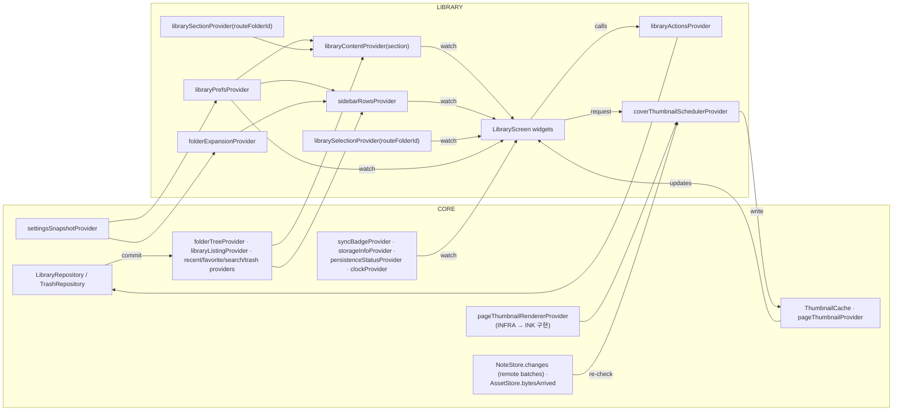

# 05 · LIBRARY — 라이브러리 화면

> 상태: 2차 수정 (총괄 2차 승인 검토 [00-review.md](00-review.md) '2차 검토' 2.4.5 반영, 재승인 대기) · 작성일: 2026-11-04 · 수정일: 2026-11-05
> 마스터 기획서: [docs/PLAN.md](../PLAN.md) v1.1 · 영역 지도·통합 계약: [00-overview.md](00-overview.md) 7장 **v1.1**(변경 이력 7.9 C11-01~30)
> 소유 경로: `packages/feature_library/` · 패키지 이름: `feature_library` (Flutter 패키지)

이 문서만 보고 별도 git worktree에서 LIBRARY를 구현할 수 있게 쓴다. **기준은 00-overview 7장 '통합 계약'이다.** 이 문서의 공유 타입·인터페이스 시그니처(4절의 공개 API, 5절의 다른 영역 이름)는 계약 문구를 글자 그대로 옮긴 것이고, 계약과 다른 자체 정의는 두지 않는다. 계약에 문제가 있다고 본 곳은 계약대로 쓰고 12.2 '계약 변경 제안'에 남겼다. 6절의 내부 시그니처는 구현 지침이며, 이름은 구현자가 바꿔도 되지만 동작·수치는 지킨다. 본문이 없는 메서드(`;`로 끝남)는 시그니처만 적은 것이다.

다른 영역의 정의 위치: CORE 타입 = 02-core 4절(= 계약 7.2.2~7.2.14), INK 썸네일 렌더러 = 계약 7.2.16, PDF 함수 = 계약 7.2.19, 앱 셸 연결 = 계약 7.3.3 + 01-infra 4.5.9·6.6. 검토 반영 내역은 13절.

---

## 1. 목적과 범위

### 1.1 목적

앱의 홈 화면이다. 사용자가 폴더로 노트를 정리하고(M2 완료 기준 "폴더로 노트를 정리할 수 있음"), 노트를 찾아 열고, 새 노트·폴더를 만들고, 지운 항목을 휴지통에서 되살린다. 데이터의 저장·질의·규칙(정렬, 순환 이동 차단, 휴지통 30일)은 CORE가 맡고, LIBRARY는 그 위의 **화면·상호작용**만 맡는다.

### 1.2 이번 동시 개발 범위

| 구분 | 내용 |
|---|---|
| 진입 · 라우팅 | `LibraryScreen(folderId, onOpenFolder, onOpenNote, onOpenSettings)` — INFRA 앱 셸이 `/`·`/folders/:folderId`에 연결 |
| 레이아웃 | iPad 13인치 가로(사이드바 고정)·세로(사이드바 서랍), 11인치·분할 화면·좁은 폭에서 깨지지 않음. 펜·손가락 모두 조작 |
| 사이드바 | 홈 · 최근 · 즐겨찾기 · 폴더 트리(펼치기/접기, 깊이 제한 없음) · 휴지통(개수) · 동기화 상태 자리 · 설정 버튼 |
| 상단 막대 | 브레드크럼(축약), 제목 검색 입력, 정렬 메뉴, 그리드/리스트 전환, 선택 모드, 새로 만들기 메뉴(노트 · 폴더 · PDF 가져오기) |
| 노트 목록 | 폴더 먼저·노트 다음, 그리드(표지 썸네일)·리스트, 정렬(이름 · 만든 날짜 · 수정한 날짜 · 사용자 지정), 빈 상태·로딩·오류 |
| 항목 동작 | 열기, 이름 변경, 복사, 이동(폴더 선택 대화상자), 휴지통으로 이동(실행 취소), 즐겨찾기, 폴더 색·아이콘, 노트 표지 변경 |
| 다중 선택 | 선택 모드, 모두 선택, 일괄 이동 · 복사 · 휴지통 · 즐겨찾기 · **PDF 내보내기**(자리 `libraryPdfExportActionProvider` — PDF `exportNotesAsPdf`를 INFRA가 연결, 계약 7.8) |
| 드래그 앤 드롭 | 길게 눌러 끌기 → 폴더 타일 · 사이드바 폴더 · 홈 · 브레드크럼 · 휴지통에 놓기, 사용자 지정 정렬에서 순서 바꾸기, 가장자리 자동 스크롤, 접힌 폴더 자동 펼침, 세로 모드 서랍 자동 열기 |
| 휴지통 화면 | 목록, 남은 보관 일수(30일), 복원, 영구 삭제(확인), 휴지통 비우기 |
| 최근 · 즐겨찾기 · 검색 | 최근 연 노트 20개, 즐겨찾기 노트, 제목 검색(폴더 이름 + 노트 제목) 결과와 위치 표시 |
| 새로 만들기 | 새 노트(제목, 페이지 크기·방향, 속지, 속지 색, 표지) → 만들고 바로 열기, 새 폴더(이름, 색, 아이콘) |
| 표지 썸네일 | 첫 페이지 썸네일 표시 + 없거나 오래된 썸네일 생성 예약. 렌더러는 CORE 자리 `pageThumbnailRendererProvider`만 읽는다(INFRA가 INK `inkPageThumbnailRendererProvider`로 연결, 계약 7.2.11·7.3.3). PDF 원본이 도착하면(`AssetStore.bytesArrived`, LIBRARY-O1), 다른 기기에서 내용이 바뀌면(`NoteStore.changes`의 `ChangeBatch(origin: remote)`, 계약 7.2.10 v1.1) 다시 확인 |
| 연동 자리 | PDF 가져오기·일괄 내보내기 자리(LIBRARY 소유 provider 2개, 계약 7.2.18), 동기화 상태 표시(CORE `syncBadgeProvider`, 계약 7.2.13), 저장 경고 배너(CORE `storageWarningOf`, 계약 7.2.12) |
| 설정 | 라이브러리 보기 설정(기기별), 새 노트 기본값(`LibrarySettingsSection` — INFRA 설정 화면 '일반 › 새 노트 기본값', 계약 7.4.11) |
| 테스트 | 단위·위젯 테스트(CORE `createFakeNoteStore()` 위의 얇은 가짜), 골든 4종, 브라우저(Chrome) 스모크, 통합 단계 실제 CORE 계약 테스트(L21, 필수 — 패키지 `dart_test.yaml`로 기본 skip, 계약 7.4.8 v1.1), 사용자 iPad 확인 목록 |

### 1.3 이후 범위

| 항목 | 시점 | 지금 준비하는 것 |
|---|---|---|
| 폴더를 포함한 일괄 내보내기(폴더 안 노트까지 펼쳐 내보내기) | 피드백 후 | 이번에는 선택한 **노트만** 내보낸다(선택한 폴더는 건너뜀, 6.9 — 12.3 Q-L2 총괄 승인). 펼치는 규칙(하위 폴더 포함 여부·순서)을 정하면 LIBRARY 안에서 노트 id 목록만 만들어 같은 자리를 부르면 된다 |
| 이미지 표지(`AssetCover`) 고르기 | M5(이미지 가져오기와 함께) | 표시는 이번에 구현(`AssetCover`가 동기화로 들어와도 보임) |
| PDF 텍스트 검색(M3) · 손글씨 검색(M7) 결과 표시 | M3 / M7 | 검색 결과 화면을 '폴더 · 노트' 묶음 구조로 만들어 묶음 추가가 쉽게 |
| 태그(5.2) | P1 | 없음(CORE에 `setTags`만 존재) |
| 키보드 단축키(5.2) — Esc·⌘A·Delete 등 | P1 | 없음 |
| 다크 모드(5.2) | P1 | 색은 모두 `Theme.of(context).colorScheme`에서 가져온다(하드코딩 금지, 폴더·표지 팔레트 제외) |
| 사이드바 트리에서 폴더 순서 끌어 바꾸기 | 피드백 후 | 콘텐츠 영역의 사용자 지정 정렬로는 이번에 가능 |
| 끌어서 폴더 위에 머물면 폴더 열기(스프링 로드) | 피드백 후 | 없음 |
| 다른 앱에서 끌어오기(네이티브 드래그 앤 드롭), '공유 · 다음으로 열기' 수신 | 네이티브 전환 후 | 없음(PDF 영역 진입점과 함께 설계) |
| 노트 잠금 · 버전 기록 · 백업/복원 · 탭/분할 화면(5.2) | P1 | 없음 |

### 1.4 제외 (다른 영역 책임)

| 항목 | 담당 |
|---|---|
| 폴더·노트 데이터, 정렬 질의, 순환 이동 차단, 휴지통 묶음·복원 위치·30일 자동 정리, 제목 검색 질의, 최근·즐겨찾기 질의(**'최근' 기록 `markOpened`는 CORE `openSession`이 유일한 주체**, 계약 7.2.8 N-6), 설정 저장, 썸네일 저장소, 저장 경고 조건(`storageWarningOf`) | CORE |
| 페이지 렌더링(획·속지·PDF 배경)으로 썸네일 이미지 만들기 | INK(`InkPageThumbnailRenderer`), PDF(배경 still renderer) — 5.3·5.4 |
| 썸네일 렌더러·PDF 자리·(M4) 동기화 상태의 앱 셸 연결 | INFRA `FeatureWiringModule`·`SyncModule`(계약 7.3.3) |
| PDF 파일 고르기·암호 입력·가져오기 진행률·오류 표시, 여러 노트 PDF 내보내기의 진행률·취소·결과 시트(공유·다운로드) | PDF(`importPdfAsNewNote`, `exportNotesAsPdf`) |
| 동기화 상태 값 계산(`syncBadgeOf`), 로그인 화면 | SYNC(값) · INFRA(화면·M4 연결) |
| 라우터, 앱 테마·로캘, `ProviderScope`·의존성 주입, 설정 화면 틀, 웹 제스처 방지(Safari 길게 누르기 콜아웃·텍스트 선택 — `index.html` CSS) | INFRA |
| 에디터 화면, 페이지 패널 썸네일, 페이지 추가 시 속지 고르기 | EDITOR |

### 1.5 핵심 결정 요약

| # | 결정 | 근거 |
|---|---|---|
| D-L1 | `feature_library`는 `note_core`에만 의존(형제 패키지). INK·PDF·SYNC와는 CORE 자리(`pageThumbnailRendererProvider`, `syncBadgeProvider`) 또는 LIBRARY가 정의한 자리(`libraryPdfImportActionProvider`, `libraryPdfExportActionProvider`)를 앱 셸이 덮어써서 연결 | 계약 7.1 규칙 1, 7.3.3 |
| D-L2 | 최근 · 즐겨찾기 · 휴지통 · 검색은 라우트가 아닌 **화면 내부 보기(섹션)**. 섹션 상태는 라우트 폴더 ID를 키로 하는 Riverpod family | INFRA 초안 5.3("internal LIBRARY views"). 빌드 중 provider 수정 금지 규칙을 피함(6.4) |
| D-L3 | 드래그 앤 드롭은 Flutter 기본 `LongPressDraggable`/`DragTarget`만 사용(외부 패키지 없음). 길게 누르기 400ms, 펜·손가락 같은 코드 | '폴더 안으로 넣기'와 '순서 바꾸기'를 한 동작에서 구분해야 해 기성 재정렬 패키지가 맞지 않음. 펜·손가락 모두 위젯 테스트·Chrome 테스트에서 동작 확인함(7.3) |
| D-L4 | 표지 썸네일: 저장은 CORE `ThumbnailCache`(첫 페이지 `pageId` 키), 생성은 CORE `PageThumbnailRenderer` 인터페이스(INK `InkPageThumbnailRenderer`가 구현, INFRA가 `pageThumbnailRendererProvider`에 연결), **언제 만들지(예약)는 LIBRARY**. 다시 확인하는 계기: 타일의 노트 버전 변화(로컬 편집 — C-9), PDF 원본 도착(`bytesArrived`), 원격 내용 변경(`ChangeBatch(origin: remote)`) | 계약 7.2.11 썸네일 경로(CD-15), 7.2.10 v1.1(원격 적용에는 C-9가 적용되지 않음). LIBRARY는 INK에 의존할 수 없음. 한 번도 열지 않은 노트(동기화·복사·PDF 가져오기)도 표지가 생겨야 함 |
| D-L5 | 정렬·검색·휴지통 규칙은 CORE 질의 결과를 그대로 표시. LIBRARY는 다시 정렬하지 않는다(사이드바 트리의 이름순만 예외, 6.5) | 화면과 데이터 규칙의 이중 구현 방지 |
| D-L6 | 휴지통으로 이동은 확인 없이 즉시 + 6초 '실행 취소'(= 복원). 영구 삭제·휴지통 비우기만 확인 대화상자 | 휴지통 자체가 안전장치(PLAN 5.1) |
| D-L7 | 화면 문구는 모두 `LibraryStrings`(한국어 상수)에 모은다. `intl` 미사용, 날짜·조사는 자체 함수 | 의존성 최소화, 나중에 다국어 전환 시 한 파일만 교체 |
| D-L8 | 테스트는 CORE 공용 가짜 `createFakeNoteStore()` 위에 LIBRARY가 실패·지연·호출 기록만 얹은 얇은 가짜(`FakeLibraryBackend`, 5.7)로. CORE 값 타입·의미를 그대로 쓰고 LIBRARY가 CORE 규칙을 다시 구현하지 않는다. 통합 단계에서 실제 CORE(`openTestNoteStore`)로 같은 시나리오를 한 번 더(L21, 필수 — CORE 오류 주입 `faults`를 쓰는 시나리오만 제외) | 계약 7.4.8 '가짜'·7.6 'B2 테스트·개발 도우미'(v1.1), LIBRARY-S4. 동시 개발 첫날부터 테스트 가능(B2) + 남는 차이(drift 스트림 시점 등)는 L21이 잡음 |
| D-L9 | 레이아웃은 폭 기준: 1100 이상 사이드바 고정, 600~1100 서랍, 600 미만 좁은 화면 | iPad 가로 폭은 모두 1133 이상(13" 1376, 12.9" 1366, 11" 1194), 세로는 모두 1032 이하 → '가로 모드 고정 표시'(F-01)와 일치 |
| D-L10 | 현재 시각은 CORE `clockProvider`(`NoteStore.clock`) 하나에서 읽는다(날짜 표시·휴지통 남은 일수). LIBRARY 자체 시계 provider는 두지 않는다 | 계약 7.2.14·7.4.6. 테스트에서 가짜 저장소와 화면이 같은 시계를 씀 |
| D-L11 | LIBRARY는 `markOpened`를 부르지 않는다. 노트를 열 때는 `onOpenNote(id)`만 호출하고, '최근' 기록은 에디터가 세션을 열 때 CORE가 남긴다 | 계약 7.2.8 N-6, LIBRARY-S1(중복 쓰기 방지) |

---

## 2. PLAN.md 요구사항 대응표

작업 번호(L0~L21)는 8절.

### 2.1 기능 명세 (4장)

| PLAN 항목 | 요구 | 이 계획서의 작업 | 범위 |
|---|---|---|---|
| F-01 | 폴더 안 폴더, 트리 구조(깊이 제한 없음) | 사이드바 트리 평탄화(반복 DFS, 들여쓰기 8단계까지), 폴더 선택 대화상자 (6.5, L5·L9·L13) | 이번 |
| F-01 | 폴더·노트 생성 | 새 노트·새 폴더 대화상자, 기본 이름 자동 번호 (6.12, L12) | 이번 |
| F-01 | 이름 변경 | 이름 변경 대화상자, 1~200자 검증 (6.11, L13) | 이번 |
| F-01 | 드래그 앤 드롭 이동 | 길게 눌러 끌기 → 폴더 타일·사이드바·홈·브레드크럼에 놓기, 자동 스크롤·자동 펼침 (6.10, L15) | 이번 |
| F-01 | 복사 | 같은 폴더에 '사본' 또는 다른 폴더로 복사 (6.11, L13·L14) | 이번 |
| F-01 | 삭제 | 휴지통으로 이동 + 실행 취소 (6.11, L13) | 이번 |
| F-01 | 다중 선택 후 일괄 이동 / 삭제 | 선택 모드·선택 막대 (6.9, L14) | 이번 |
| F-01 | 다중 선택 후 일괄 내보내기 | 선택 막대 'PDF 내보내기' 버튼 → `libraryPdfExportActionProvider` 자리(PDF `exportNotesAsPdf`, INFRA 연결). 자리가 `null`이면 버튼 숨김. 선택한 노트만, 화면 순서 (4.3, 6.9, L14·L18) | 이번(계약 7.8) / 흐름·진행률·결과 시트는 PDF |
| F-01 | 정렬: 이름 · 생성일 · 수정일 · 사용자 지정 순서 | 정렬 메뉴, `LibraryQuery`, 사용자 지정에서 끌어 순서 바꾸기 (6.7·6.10, L10·L15) | 이번 |
| F-01 | 보기: 그리드(표지 썸네일) / 리스트 | 그리드 열 계산, 타일·행 (6.2·6.8, L8·L10), 표지 썸네일 예약 (6.15, L11) | 이번(그리기는 INK 렌더러 — CORE 자리에 INFRA가 연결) |
| F-01 | 폴더 색상·아이콘 | 팔레트 10색 + 없음, 아이콘 16종 (4.4, 6.11, L2·L13) | 이번 |
| F-01 | 노트 표지 선택 | 첫 페이지 / 색 표지 8종 (6.12·6.15, L11·L12·L13) | 이번 / 이미지 표지 고르기는 이후 |
| F-01 | 상단 경로 표시(브레드크럼)로 상위 폴더 빠른 이동 | 브레드크럼 축약·숨은 경로 메뉴·놓기 대상 (6.6, L5·L10) | 이번 |
| F-01 | 사이드바에 폴더 트리 고정 표시(태블릿 가로 모드) | 폭 ≥ 1100에서 고정 280dp, 접기 버튼, 세로는 서랍 (6.2, L8·L9) | 이번 |
| F-02 | 가져오기: 파일 앱/기기 저장소 → 새 노트 | '새로 만들기 › PDF 가져오기' → `libraryPdfImportActionProvider` 자리(PDF `importPdfAsNewNote`, INFRA 연결) → 돌려받은 노트 id로 `onOpenNote` (4.3, 5.4, L18) | 이번(진입점) / 흐름은 PDF |
| F-02 | 다른 앱 '공유' · '다음으로 열기', 클라우드 드라이브 | — | 이후(네이티브, PDF) |
| F-02 | 기존 노트에 페이지로 삽입 | — | 제외(EDITOR 진입점) |
| F-07 | 동기화 상태 표시: 완료 / 진행 중 / 오프라인 / 오류 | 사이드바 아래 `SyncBadgeIndicator`(CORE `syncBadgeProvider`의 `SyncBadge.display` 5가지), M4 전에는 `off` = '이 기기에 저장' (6.16, L9) | 이번(표시) / 값은 M4(SYNC `syncBadgeOf` → INFRA override) |
| F-13 | 페이지 크기 A4 · Letter · 16:9 · 사용자 지정 / 가로·세로 | 새 노트 대화상자의 첫 페이지 크기 — CORE `PageSizePreset`(16:9 세로형 540×960)·`PageSizeLimits`(사용자 지정 100~3000pt = 35.3~1058.3mm) (6.12, L3·L12) | 이번 |
| F-13 | 속지 템플릿(줄, 모눈, 점, 코넬, 악보, 플래너), 속지 색 | 새 노트 대화상자 속지 7칸(빈 페이지 + 6종 — INK가 6종 모두 그림, 계약 7.8)·속지 색 4종(CORE `PaperColors.all`) (6.12, L12) | 이번(첫 페이지) / 페이지 추가는 EDITOR |
| F-15 | 노트 PDF 내보내기 | 주 진입점은 EDITOR 더보기 메뉴. LIBRARY는 노트 ⋯ 메뉴 'PDF로 내보내기'(같은 내보내기 자리에 노트 1개) — 자리가 `null`이면 숨김 (6.8, L18) | 이번(보조 진입점) |
| F-06 | 로그인 | — | 제외(SYNC·INFRA) |
| F-12 | 펜 전용 모드 | 라이브러리는 펜·손가락 모두 같은 조작(펜 전용 모드는 에디터 필기에만 적용) (6.17) | 이번(규칙 명시) |

### 2.2 추가 기능 (5장)

| PLAN 항목 | 요구 | 이 계획서의 작업 | 범위 |
|---|---|---|---|
| 5.1 휴지통 | 동기화로 지워져도 복구, 30일 보관 | 휴지통 화면: 남은 일수, 복원(위치 보기), 영구 삭제, 비우기 (6.13, L16) | 이번 / 자동 정리는 CORE |
| 5.1 검색 | 노트 제목(M2) → PDF 텍스트(M3) → 손글씨(M7) | 제목 검색 입력·디바운스 300ms·결과(폴더·노트, 위치, 일치 강조) (6.14, L17) | 이번(제목) / 나머지 이후 |
| 5.1 자동 저장 | 저장 버튼 없음 | 모든 변경은 즉시 CORE 호출, 저장 버튼 없음 | 이번 |
| 5.1 오프라인 사용 | 처음부터 오프라인 동작 | 네트워크를 쓰지 않음, M4 전 '이 기기에 저장'(`SyncBadge.off`) 표시 | 이번 |
| 5.2 즐겨찾기(별표), 최근 노트 | M2 | 사이드바 '최근'·'즐겨찾기', 별표 토글 (6.14, L13·L17). '최근' 기록은 CORE `openSession`(N-6) | 이번 |
| 5.2 태그 | P1 | — | 이후 |
| 5.2 키보드 단축키 | P1 | — | 이후 |
| 5.2 다크 모드 | P1 | 테마 색만 사용(1.3) | 이후 |
| 5.2 노트 잠금, 버전 기록, 탭/분할 화면, 백업/복원, 링크 | P1 | — | 이후 |
| 5.4 앱 시작 2초 이내 라이브러리 표시 | 비기능 | 썸네일 지연 시작 800ms, 화면에 보이는 타일만 생성, 첫 화면에서 무거운 계산 없음 (6.21, L19) | 이번(LIBRARY 몫) / 측정은 INFRA |
| 5.4 60fps 스크롤 | 비기능 | 지연 생성 그리드, `RepaintBoundary`, 썸네일을 타일 크기로 디코딩 (6.21, L19) | 이번 |

### 2.3 아키텍처 · 화면 구성 · 협업 (7·8·9장)

| PLAN 항목 | 요구 | 이 계획서의 작업 | 범위 |
|---|---|---|---|
| 7.2 Folder `color`, `icon` | 폴더 꾸미기 | 아이콘 키 레지스트리 `FolderIcons`(CORE: "icon key defined by LIBRARY") (4.4) | 이번 |
| 7.2 Note `cover` | 표지 | `FirstPageCover`·`ColorCover`·`AssetCover` 표시 (6.15) | 이번 |
| 7.2 `sortKey` 분수 인덱스 | 사용자 지정 순서 | `reorderItem` 호출 순서 규칙 (6.10) | 이번 |
| 7.4-4 폴더 이동 순환 검사 | A를 B 안에, B를 A 안에 | 놓기 전 화면에서 차단(`canMoveInto`) + CORE `FolderCycleException` 처리 (6.10, 6.19) | 이번 |
| 8 IA 라이브러리 › 사이드바 | 폴더 트리 · 최근 · 즐겨찾기 · 휴지통 | 6.5 (L9) | 이번 |
| 8 IA 라이브러리 › 노트 목록 | 그리드 / 리스트, 정렬 | 6.7·6.8 (L10) | 이번 |
| 8 IA 라이브러리 › 검색 | | 6.14 (L17) | 이번 |
| 8 IA 라이브러리 › 새로 만들기 | 노트 · 폴더 · PDF 가져오기 | 6.12, 4.3 (L12·L18) | 이번 |
| 8 IA 설정 › 일반 › 기본 속지 | 새 노트 기본값 | `LibrarySettingsSection` + `library.newNote.defaults`(`SettingKey.jsonMap`, synced) (4.5, 6.3.4, 6.12) — INFRA 설정 섹션 `library.newNote`(일반) | 이번(Q5 승인됨) |
| 8 IA 설정 › 동기화 상태 | | 사이드바 상태 표시를 누르면 `onOpenSettings` | 이번(진입) |
| 9.4 Claude가 실기기 테스트 불가 | 핵심 로직 자동 테스트 | 놓기 판정·트리 평탄화·예약기 순수 함수 단위 테스트, 펜·손가락 위젯 테스트 (9.1) | 이번 |
| 9.5 단계 A: iPad Safari 웹 테스트 | 웹에서 동작 | `dart:io` 없음, Chrome 브라우저 테스트, iPad 확인 목록 (9.2) | 이번 |

### 2.4 로드맵 체크리스트 (10장)

| 마일스톤 항목 | 이 계획서의 작업 | 범위 |
|---|---|---|
| M2 폴더 트리 (생성 · 이름 변경 · 드래그 이동 · 삭제) | L5, L9, L12, L13, L15 | 이번 |
| M2 노트 목록 (그리드/리스트, 정렬, 다중 선택) | L8, L10, L11, L14 | 이번 |
| M2 휴지통 (30일 보관) | L16 | 이번 |
| M2 제목 검색, 최근 노트, 즐겨찾기 | L17 | 이번 |
| M2 완료 기준 "폴더로 노트를 정리할 수 있음" | 10절, 9.2 iPad 확인 목록 | 이번 |
| M3 PDF 가져오기(새 노트) | L18 진입점 | 이번(진입점) |
| M3 PDF 내보내기(범위 선택) — 라이브러리 일괄 | L14 선택 막대 버튼 · L18 자리 | 이번(자리·버튼) / 흐름은 PDF |
| M3 PDF 텍스트 검색 | — | 이후(전역 PDF 검색은 계약 7.8에서 이후) |
| M4 동기화 상태 표시 | L9 `SyncBadgeIndicator`(CORE `syncBadgeProvider`) | 이번(표시) / 값은 M4 |
| M1 페이지 썸네일 | 표지는 L11, 페이지 패널은 EDITOR | 이번(표지) |

---

## 3. 소유 경로와 패키지 구조

```text
packages/feature_library/
├─ pubspec.yaml
├─ dart_test.yaml                           # tags: golden, integration (skipped by default) — 3.1
├─ lib/
│  ├─ feature_library.dart                 # public exports only (4.1)
│  └─ src/
│     ├─ library_screen.dart               # LibraryScreen (4.2)
│     ├─ integration/
│     │  ├─ overrides.dart                 # featureLibraryOverrides()
│     │  ├─ pdf_slots.dart                 # LibraryPdfImportAction / LibraryPdfExportAction + providers (4.3)
│     │  └─ pdf_flows.dart                 # runLibraryPdfImport / runLibraryPdfExport (6.9, internal)
│     ├─ appearance/
│     │  ├─ folder_appearance.dart         # FolderIcons, FolderPalette (4.4)
│     │  └─ cover_palette.dart             # CoverPalette, coverForegroundFor()
│     ├─ l10n/
│     │  ├─ library_strings.dart           # every Korean UI string (6.18)
│     │  ├─ korean_josa.dart               # 을/를, (으)로
│     │  └─ library_date_format.dart       # formatLibraryDate, trash days
│     ├─ model/
│     │  ├─ item_key.dart                  # LibraryItemKind, LibraryItemKey
│     │  ├─ section.dart                   # LibrarySection (sealed)
│     │  ├─ view_prefs.dart                # LibraryViewMode, LibrarySort, LibraryViewPrefs
│     │  ├─ selection.dart                 # LibrarySelection
│     │  ├─ content.dart                   # LibraryContent, FolderLookupState
│     │  ├─ tree_rows.dart                 # FolderTreeRow, flattenFolderTree
│     │  ├─ breadcrumb.dart                # BreadcrumbItem, compressBreadcrumb
│     │  ├─ location_label.dart            # '홈 › A › B'
│     │  ├─ names.dart                     # uniqueName, validateItemName
│     │  ├─ new_note_spec.dart             # NewNoteOptions, NewNoteSpec, PageOrientationChoice
│     │  ├─ page_size_mm.dart              # PageSizeMm (mm <-> pt over core.PageSizeLimits)
│     │  └─ folder_appearance_value.dart   # FolderAppearance, NewFolderSpec
│     ├─ settings/
│     │  ├─ library_settings_keys.dart     # SettingKey declarations (6.3.4)
│     │  └─ library_settings_section.dart  # LibrarySettingsSection (4.5)
│     ├─ state/
│     │  ├─ providers.dart                 # all LIBRARY providers (6.3)
│     │  ├─ prefs_notifier.dart
│     │  ├─ expansion_notifier.dart
│     │  ├─ section_notifier.dart
│     │  ├─ selection_notifier.dart
│     │  └─ library_actions.dart           # LibraryActions, ActionOutcome, receipts
│     ├─ thumbnails/
│     │  └─ cover_thumbnail_scheduler.dart # 6.15
│     ├─ dnd/
│     │  ├─ drag_payload.dart
│     │  ├─ drop_decision.dart             # decideDrop, canMoveInto (pure)
│     │  ├─ edge_auto_scroller.dart
│     │  ├─ library_drag_scope.dart        # InheritedWidget: auto-scroll regions, drawer edge
│     │  └─ library_draggable.dart         # LongPressDraggable wrapper
│     └─ ui/
│        ├─ layout/        size_class.dart · library_metrics.dart · grid_metrics.dart · library_layout.dart
│        ├─ sidebar/       library_sidebar.dart · sidebar_nav_row.dart · folder_tree_view.dart · folder_tree_row_tile.dart · sync_badge_indicator.dart
│        ├─ top_bar/       library_top_bar.dart · breadcrumb_bar.dart · library_search_field.dart · sort_menu_button.dart · new_menu_button.dart · selection_bar.dart
│        ├─ content/       content_body.dart · item_grid.dart · item_list.dart · note_tile.dart · folder_tile.dart · new_note_tile.dart · note_cover_view.dart · empty_state.dart · folder_missing_view.dart · search_results_view.dart
│        ├─ trash/         trash_view.dart · trash_row.dart
│        ├─ dialogs/       new_note_dialog.dart · new_folder_dialog.dart · rename_dialog.dart · folder_picker_dialog.dart · folder_appearance_dialog.dart · cover_dialog.dart · confirm_dialog.dart
│        ├─ pickers/       page_size_picker.dart · template_picker.dart · template_pictogram.dart · paper_color_picker.dart · cover_picker.dart · folder_appearance_picker.dart
│        ├─ menus/         item_context_menu.dart
│        ├─ banners/       storage_warning_banner.dart
│        └─ feedback/      library_snack_bar.dart
└─ test/
   ├─ feature_library_smoke_test.dart       # B6 (foundation stage): placeholder screen → '새 노트' → onOpenNote
   ├─ support/   fake_library_backend.dart · test_clock.dart · fake_thumbnail_renderer.dart · library_test_harness.dart · pump_library.dart · test_sizes.dart · fixtures.dart
   ├─ shared/    library_scenarios.dart     # LibraryScenario list: run on the fake (widget/) AND real CORE (integration/)
   │             new_note_options_cases.dart # NewNoteOptions.fromJson web-format cases: unit/ (VM) AND web/ (Chrome)
   ├─ unit/      (9.1 표)
   ├─ widget/    (9.1 표)
   ├─ goldens/   library_golden_test.dart + *.png   # @Tags(['golden']) @TestOn('vm')
   ├─ integration/ core_contract_test.dart   # L21, @Tags(['integration']) @TestOn('vm'), openTestNoteStore
   └─ web/       library_browser_test.dart · new_note_options_browser_test.dart   # @TestOn('browser')
```

- 플랫폼 분리 파일(`*_native.dart`, `*_browser.dart`)은 **없다**. LIBRARY 코드는 `dart:io`·`dart:js_interop`·`package:web`을 쓰지 않는다. 정적 파일·에셋 URL도 만들지 않는다(계약 7.4.3 v1.1의 `document.baseURI` 규칙은 해당 없음).
- `dart_test.yaml`은 LIBRARY가 쓰는 태그(`golden`, `integration`)를 선언하고 `integration`을 기본 skip한다(3.1, 계약 7.4.8 v1.1 — C11-26).
- 테스트는 CORE `package:note_core/testing.dart`(`createFakeNoteStore`, 웹 안전)를, L21만 `package:note_core/testing_vm.dart`(`openTestNoteStore`, VM 전용)를 import한다(계약 7.1 규칙 2 — `test/`에서만).
- Material은 `package:material_ui/material_ui.dart`만 import한다(`package:flutter/material.dart` 금지, INFRA R7). `flutter/foundation.dart`, `flutter/gestures.dart`, `flutter/services.dart`, `flutter/scheduler.dart`는 필요한 이름만 `show`로 import한다.
- `analysis_options.yaml`은 패키지에 두지 않는다(루트 파일 적용, INFRA R3).

### 3.1 pubspec.yaml · dart_test.yaml

```yaml
name: feature_library
description: Library screen (folder tree, note list, trash, search) for noteapp.
publish_to: none
version: 0.0.1
resolution: workspace

environment:
  sdk: ^3.13.0
  flutter: 3.47.9

dependencies:
  flutter:
    sdk: flutter
  material_ui: 1.10.0
  flutter_riverpod: 3.4.3
  collection: 1.19.1
  note_core: any

dev_dependencies:
  flutter_test:
    sdk: flutter
  fake_async: 1.3.3
  clock: 1.1.3
```

- 형식은 계약 7.4.1 그대로(형제는 `any`, 외부는 7.5의 정확한 버전). 이 파일은 INFRA가 B1에서 01-infra 3.3 형식(`description`·`version: 0.0.1` 포함)과 표(`feature_library` 행)대로 만들고, LIBRARY는 B6에서 같은지 확인만 한다 — 위 블록은 그 결과와 같다. 외부 의존 추가는 7절 표 외에는 없다. `riverpod`(순수 Dart)은 `flutter_riverpod`가 다시 내보내므로 직접 의존하지 않는다.
- `collection`·dev `clock`은 계약 7.5 v1.1 고정표가 `feature_library`를 '쓰는 멤버'로 적은 그대로다(C11-29 — 12.2 CP-L1 승인. 총괄이 `/tmp/claude-0/plan-scratch/lead/ws-v11`에서 해석 성공·버전 변화 없음 확인, B1에서 INFRA가 이 pubspec을 만든다). `collection`: 상태 클래스의 `==`/`hashCode`에 `ListEquality`·`SetEquality`를 쓴다(계약 7.4.4 "컬렉션은 collection의 Equality"). `clock`(dev): 테스트가 `createFakeNoteStore(clock: …)`·`openTestNoteStore(clock: …)`에 넘길 조절 가능한 시계를 만든다(`test/support/test_clock.dart`). 둘 다 Flutter SDK(`flutter`·`flutter_test`)가 이미 끌어오는 패키지라 해석 결과가 바뀌지 않는다(LIBRARY 1차 실험도 같음, 7.3).
- `fake_async`는 `flutter_test`가 이미 `^1.3.3`으로 끌어오는 패키지이며, 예약기 단위 테스트에서 직접 import하므로 dev 의존으로 명시한다(`depend_on_referenced_packages`).
- 프로덕션 코드는 `package:clock`을 import하지 않는다. 현재 시각은 `ref.watch(clockProvider).now()`(CORE, D-L10)로 읽는다 — 다른 패키지 API가 돌려준 값의 멤버 호출에는 import가 필요 없다.

```yaml
# packages/feature_library/dart_test.yaml — contract 7.4.8 v1.1 (C11-26)
tags:
  golden: {}
  integration: {skip: "integration stage only — ws test --run-skipped -t integration"}
```

- **왜 필요한가**: `ws test`의 기본 제외는 `-x bench`뿐이다(계약 7.4.8). 이 파일이 없으면 L21 `test/integration/core_contract_test.dart`(`@Tags(['integration'])`)가 동시 개발 중 기본 `ws test`·패키지 `flutter test`에서 그대로 돌고, 그때 CORE는 B2 상태라 `openTestNoteStore`가 `UnimplementedError`(계약 7.6 B2 단계 값) → 실패한다. 선언하지 않은 태그는 실행마다 'A tag was used that wasn't specified in dart_test.yaml' 경고도 낸다.
- **확인함**(Flutter 3.47.9, `/tmp/claude-0/plan-scratch/library/r2/tagpkg` — 위 파일 그대로 + `@Tags(['golden'])`·`@Tags(['integration'])` 파일 각 1개): 기본 `flutter test` → integration 묶음은 `Skip: integration stage only — …`, 나머지 통과 / `flutter test --run-skipped -t integration` → integration만 실행·통과 / `-x golden` → golden 제외. 파일을 빼면 integration이 기본 실행되고 태그 경고 2건(7.3).
- LIBRARY는 `perf`·`bench`·`pdfium`·`scenario` 태그를 쓰지 않는다(`widget/performance_test.dart`는 시간을 재지 않고 만들어진 타일 수만 세므로 태그 없음, 6.21). 새 태그를 쓰게 되면 이 파일에 먼저 선언한다. 파일은 기반 단계 B6에서 커밋한다(8절).

---

## 4. 공개 API

다른 영역(주로 INFRA 앱 셸)이 쓰는 것만 `package:feature_library/feature_library.dart`로 내보낸다. 나머지는 `src/` 내부다. 이 절의 코드 블록 중 **계약 7.2.18에 있는 것은 계약 문구를 글자 그대로** 옮겼다(동작 설명은 코드 블록 밖 표에 둔다). 계약이 "LIBRARY 4.4 (approved)"로 위임한 외형 레지스트리(4.4)는 이 문서가 계약이다.

### 4.1 내보내기 목록

```dart
// packages/feature_library/lib/feature_library.dart
/// Library screen: folder tree, note list, trash, search, create dialogs.
library;

export 'src/appearance/cover_palette.dart' show CoverPalette, coverForegroundFor;
export 'src/appearance/folder_appearance.dart' show FolderIcons, FolderPalette;
export 'src/integration/overrides.dart' show featureLibraryOverrides;
export 'src/integration/pdf_slots.dart'
    show
        LibraryPdfImportAction,
        libraryPdfImportActionProvider,
        LibraryPdfExportAction,
        libraryPdfExportActionProvider;
export 'src/library_screen.dart' show LibraryScreen;
export 'src/settings/library_settings_section.dart' show LibrarySettingsSection;
```

- 내보내는 이름 11개 = 계약 7.2.18의 이름 전부(`LibraryScreen`, `featureLibraryOverrides`, `LibraryPdfImportAction`, `libraryPdfImportActionProvider`, `LibraryPdfExportAction`, `libraryPdfExportActionProvider`, `LibrarySettingsSection`, `FolderIcons`, `FolderPalette`, `CoverPalette`, `coverForegroundFor`). 다른 패키지 진입점과 겹치는 이름이 없다(통합 R14). 내부 위젯 이름(`StorageWarningBanner` 등)은 export하지 않으므로 EDITOR 내부 이름과 같아도 충돌이 아니다.
- `test/unit/api_surface_test.dart`가 진입점 하나만 import해 위 11개 이름을 모두 참조한다(컴파일되면 통과, 시그니처는 계약 블록과 같은 호출 형태로 사용 — 예: `LibraryScreen(onOpenFolder: …, onOpenNote: …, onOpenSettings: …)`, `const LibrarySettingsSection()`, 두 자리 provider를 `overrideWithValue`). 그 밖의 이름이 새어 나가지 않는지는 통합 단계 INFRA R14 검사가 본다(L0).

### 4.2 진입 화면 `LibraryScreen`

계약 7.2.18 원문(글자 그대로). 구현 파일은 `lib/src/library_screen.dart`, `createState()`는 내부(`_LibraryScreenState`)다. 구현 코드에서는 `dart format` 줄바꿈만 다를 수 있다.

```dart
class LibraryScreen extends ConsumerStatefulWidget {
  const LibraryScreen({super.key, this.folderId, required this.onOpenFolder,
      required this.onOpenNote, required this.onOpenSettings});
  final String? folderId;                     // null = 홈; unknown id → 'folder missing' view
  final ValueChanged<String?> onOpenFolder;   // null = 홈
  final ValueChanged<String> onOpenNote;      // also right after creating / importing a note
  final VoidCallback onOpenSettings;
}
```

인자의 의미(구현 문서 주석으로 옮긴다 — 계약 문구를 바꾸지 않는 설명)

| 인자 | 의미 |
|---|---|
| `folderId` | 콘텐츠 영역에 보일 폴더. `null` = 최상위('홈'). 없는 id(휴지통·영구 삭제·아직 동기화 안 됨)는 예외 없이 '폴더 없음' 보기(6.4). 라우팅: `/` → `null`, `/folders/:folderId` → 디코딩된 id(INFRA 6.6). 최근·즐겨찾기·휴지통·검색은 화면 내부 보기라 주소에 나타나지 않는다(D-L2) |
| `onOpenFolder` | 폴더로 이동(`null` = 홈). 폴더 타일·사이드바 줄·브레드크럼·검색 결과·'복원한 항목 보기'에서 부른다. 화면은 라우터를 import하지 않는다 |
| `onOpenNote` | 노트를 에디터로 연다. 노트 탭, 새 노트 대화상자로 만든 직후, PDF 가져오기 직후에 부른다. **LIBRARY는 `markOpened`를 부르지 않는다** — '최근' 기록은 에디터가 세션을 열 때 CORE `openSession`이 남긴다(계약 7.2.8 N-6, LIBRARY-S1) |
| `onOpenSettings` | 사이드바 설정 버튼, 동기화 상태 표시 탭 |

동작 계약

| # | 내용 |
|---|---|
| S-1 | `folderId`가 바뀌어 같은 State가 갱신되면(`didUpdateWidget` — INFRA는 두 라이브러리 경로에 같은 `AppRoutes.libraryPageKey`의 `NoTransitionPage`를 써서 State를 유지한다, INFRA-M7) 콘텐츠·브레드크럼·선택 상태가 새 폴더 기준으로 바뀐다. 새 State로 다시 만들어져도 결과는 같다(사이드바 펼침 상태·보기 설정은 provider에 있어 유지) |
| S-2 | 화면 루트는 `Scaffold` 1개. 스낵바는 가장 가까운 `ScaffoldMessenger`(앱 `MaterialApp`이 제공)를 쓴다 |
| S-3 | 앱 셸이 반드시 덮어써야 하는 것은 CORE `noteStoreProvider` 하나다(계약 7.3.3). LIBRARY 전용 provider와 선택 자리(`pageThumbnailRendererProvider`, 두 PDF 자리, `syncBadgeProvider`)는 모두 기본값이 있어 덮어쓰지 않아도 동작한다(자리표시 표지, PDF '준비 중'·내보내기 숨김, '이 기기에 저장') |
| S-4 | 화면을 떠날 때 저장해야 할 버퍼가 없다(펼침 상태 저장 디바운스는 `dispose`에서 즉시 저장). 따라서 `flush()`를 공개하지 않는다 |
| S-5 | `LibraryRepository.markOpened`를 어디서도 부르지 않는다(`unit/actions_test`·`widget/listing_test`가 가짜의 호출 기록으로 확인, 5.7) |

### 4.3 앱 셸 연결용 provider · 함수

계약 7.2.18 원문(글자 그대로). 파일 위치만 LIBRARY가 정한다: `featureLibraryOverrides` → `lib/src/integration/overrides.dart`, 두 자리 → `lib/src/integration/pdf_slots.dart`.

```dart
List<Override> featureLibraryOverrides() => const <Override>[];

/// PDF import flow owned by pdf_io; returns the created note id or null (cancel / handled error).
typedef LibraryPdfImportAction = Future<String?> Function(BuildContext context, {String? folderId});
final libraryPdfImportActionProvider = Provider<LibraryPdfImportAction?>(
    (ref) => null, name: 'libraryPdfImportActionProvider');   // null → menu disabled '준비 중'

/// Multi-select bulk export (F-01) owned by pdf_io; null → button hidden.
typedef LibraryPdfExportAction = Future<void> Function(BuildContext context, List<String> noteIds);
final libraryPdfExportActionProvider = Provider<LibraryPdfExportAction?>(
    (ref) => null, name: 'libraryPdfExportActionProvider');
```

- import: `overrides.dart`는 `package:flutter_riverpod/misc.dart show Override`(확인함: `flutter_riverpod` 3.4.3의 기본 라이브러리는 `Override`를 내보내지 않는다, 7.3 · 계약 7.4.4), `pdf_slots.dart`는 `package:flutter_riverpod/flutter_riverpod.dart`(`Provider`)와 `package:material_ui/material_ui.dart`(`BuildContext`).
- `featureLibraryOverrides()`는 항상 빈 목록이다(LIBRARY provider는 모두 기본값이 있다). 앱 셸이 피처 패키지를 같은 방식으로 다루도록 둔다. 실제 연결은 INFRA `FeatureWiringModule`(계약 7.3.3): `libraryPdfImportActionProvider.overrideWithValue(importPdfAsNewNote)`, `libraryPdfExportActionProvider.overrideWithValue(exportNotesAsPdf)`(PDF 시작 실패 시 둘 다 생략).

LIBRARY 쪽 동작(두 자리 공통 규칙: `context`는 `LibraryScreen` State의 `BuildContext` — 선택 막대·메뉴의 `context`는 동작 중에 사라질 수 있으므로 쓰지 않는다. `await` 뒤에는 `mounted`를 확인. 함수가 예외를 던지면 `FlutterError.reportError(library: 'feature_library')` + `errorGeneric` 스낵바. 같은 자리 호출이 진행 중이면 그 진입점은 비활성 — 두 번 누름 방지)

| 자리 | 진입점 | 호출 | 결과 처리 |
|---|---|---|---|
| `libraryPdfImportActionProvider` | 새로 만들기 › 'PDF 가져오기'(자리 `null` → 비활성 + 부제 '준비 중') | `await action(context, folderId: target)` — `target` = 폴더 섹션이면 그 폴더, 그 외 섹션(최근·즐겨찾기·검색)은 `null`(홈) | `id != null`이면 `onOpenNote(id)`(`markOpened` 없음). `null`이면 아무것도 안 함(취소·오류 표시는 PDF 흐름 안) |
| `libraryPdfExportActionProvider` | ① 선택 막대 'PDF 내보내기'(6.9) ② 노트 ⋯ 메뉴 'PDF로 내보내기'(6.8). 자리 `null` → 둘 다 **숨김** | ① `await action(context, noteIds)` — `noteIds` = 선택 항목을 화면 순서(`inDisplayOrder`)로 놓고 **노트만** 남긴 목록(선택한 폴더는 건너뜀 — 폴더 펼치기는 이후, 1.3). 노트가 0개면 버튼 비활성 ② `await action(context, [noteId])` | 반환 후(내보내기·취소 모두) ①은 `selection.end()`. 진행률·취소·결과 시트(공유·다운로드)는 PDF 흐름 안(계약 7.2.19 `exportNotesAsPdf`) |

### 4.4 폴더 · 표지 외형 레지스트리

CORE의 `Folder.icon`은 "LIBRARY가 정의하는 아이콘 키(≤ 32자)"다. 다른 기기에서 동기화로 들어온 모르는 키·색도 깨지지 않게 표시한다.

```dart
// lib/src/appearance/folder_appearance.dart
import 'package:material_ui/material_ui.dart';

/// Folder icon keys stored in Folder.icon. Keys are stable wire values —
/// never rename or reuse one; only append.
abstract final class FolderIcons {
  static const String defaultKey = 'folder';

  /// Display order in the picker (4 x 4 grid).
  static const List<String> keys = [
    'folder', 'book', 'school', 'work',
    'science', 'calculate', 'language', 'music',
    'art', 'idea', 'code', 'travel',
    'home', 'pet', 'star', 'heart',
  ];

  /// Icon for a stored key. null or unknown key → Icons.folder.
  /// Every value is a const Icons.* reference (web icon tree-shaking).
  static IconData iconFor(String? key);

  /// Korean semantic label for screen readers, e.g. 'book' → '책'.
  static String labelFor(String key);
}

/// Folder colors (ARGB). null = no color (theme default).
abstract final class FolderPalette {
  static const List<int> colors = [
    0xFF5B8DEF, // 파랑
    0xFF4CAF7A, // 초록
    0xFFF2B33D, // 노랑
    0xFFF28B3D, // 주황
    0xFFE5534B, // 빨강
    0xFFE36AA7, // 분홍
    0xFF9B6BDF, // 보라
    0xFF4BB3C9, // 청록
    0xFF8D6E63, // 갈색
    0xFF78858F, // 회색
  ];

  /// Korean names in the same order (semantics, tooltips).
  static const List<String> names = [
    '파랑', '초록', '노랑', '주황', '빨강', '분홍', '보라', '청록', '갈색', '회색',
  ];
}
```

아이콘 키 → `Icons` 대응(모두 material_ui 1.10.0에 있음을 확인함): folder→`folder`, book→`menu_book`, school→`school`, work→`work`, science→`science`, calculate→`calculate`, language→`translate`, music→`music_note`, art→`palette`, idea→`lightbulb`, code→`code`, travel→`flight`, home→`home`, pet→`pets`, star→`star`, heart→`favorite`. 한국어 이름: 폴더, 책, 학교, 업무, 과학, 계산, 언어, 음악, 미술, 아이디어, 코드, 여행, 집, 반려동물, 별, 하트.

```dart
// lib/src/appearance/cover_palette.dart
/// Colors for ColorCover (ARGB), shown in the cover picker.
abstract final class CoverPalette {
  static const List<int> colors = [
    0xFF2F4A7A, // 남색
    0xFF2E6B4F, // 숲색
    0xFF7A2E3B, // 버건디
    0xFFC9A227, // 겨자색
    0xFF5A6773, // 슬레이트
    0xFF7FB2E5, // 하늘색
    0xFFE8A9A0, // 살구색
    0xFF2B2B2B, // 먹색
  ];
  static const List<String> names = [
    '남색', '숲색', '버건디', '겨자색', '슬레이트', '하늘색', '살구색', '먹색',
  ];
}

/// Title color on a colored cover: white when Color(argb).computeLuminance()
/// < 0.5, otherwise 0xDE000000. Any ARGB (also unknown synced colors).
Color coverForegroundFor(int argb);
```

### 4.5 설정 화면용 섹션 `LibrarySettingsSection` (Q5 승인 — 계약 7.2.18 · 7.4.11)

계약 7.2.18 원문(글자 그대로):

```dart
class LibrarySettingsSection extends ConsumerWidget { const LibrarySettingsSection({super.key}); }
```

| 항목 | 내용 |
|---|---|
| 위치 | INFRA 설정 화면(`/settings`)의 섹션 id `library.newNote`, 그룹 '일반', 제목 '새 노트 기본값'(01-infra 4.5.8 `defaultSettingsSections()` 5번). 제목·그룹 머리줄은 INFRA 틀이 그린다 → LIBRARY 위젯은 **본문만**(`Column`, `Scaffold`·제목 없음, 폭은 부모를 따름 — INFRA 틀은 최대 720) |
| 내용 | 페이지 크기(A4 · Letter · 16:9 · 사용자 지정 mm) · 방향 · 속지 7칸(빈 페이지 + 6종) · 속지 색 4종. 새 노트 대화상자(6.12)와 같은 피커 위젯. 제목·표지는 없음(노트마다 다름) |
| 저장 | `LibrarySettingsKeys.newNoteDefaults`(`SettingKey.jsonMap`, synced — 6.3.4)에 `NewNoteOptions.toJson()`. 바꿀 때마다 즉시 저장(저장 버튼 없음), 화면 값은 `newNoteDefaultsProvider` |
| 의존 | CORE `settingsRepositoryProvider`·`settingsSnapshotProvider`만. 로딩 중에는 기본값(`const NewNoteOptions()`)으로 그리고 입력은 비활성 |
| 다른 기본값과의 관계 | EDITOR '페이지 추가' 기본값('현재 페이지와 같게')과는 별개(EDITOR Q6 답) |

---

## 5. 사용하는 다른 영역의 계약

이 절의 다른 영역 이름은 모두 **계약 7장 확정본**이다(초안의 '가정한 시그니처'는 폐기). 코드 블록은 계약 원문 또는 계약이 승인한 CORE 4절 원문을 **발췌**한 것으로, 한 글자도 바꾸지 않았다(생략한 줄만 있다). LIBRARY는 이 타입·provider를 다시 정의하지 않는다. 기반 단계에서는 CORE가 B2(계약 7.6)로 이 타입의 **동작하는 구현**과 `createFakeNoteStore()`를 먼저 커밋하므로(초안 5.1.2 (d) 요청 충족), LIBRARY는 동시 개발 첫날부터 실제 값 타입으로 테스트한다.

### 5.1 CORE (`package:note_core/note_core.dart` — 테스트는 `testing.dart`, L21만 `testing_vm.dart`)

#### 5.1.1 쓰는 이름

| 묶음 | 이름 | 계약 | LIBRARY 사용처 |
|---|---|---|---|
| ID · 시간 | `FolderId`, `NoteId`, `PageId`, `AssetId`, `EpochMillis` | 7.2.2 | 모든 시그니처 |
| 예외 | `NoteCoreException`, `FolderCycleException`, `EntityNotFoundException` | 7.2.2 | `classifyLibraryError`(6.11) |
| 엔티티 | `Folder`, `Note`(`requiresNewerApp`, `firstPageId`, `pageCount`, `lastOpenedAt` 포함), `NoteCover`·`FirstPageCover`·`ColorCover`·`AssetCover`, `Page`(`background`, `contentRevision`) | 7.2.5 · 7.2.6 (= CORE 4.2.3 · 4.2.4) | 타일·표지·휴지통·검색 |
| 페이지 · 속지 | `PageSize`, `PageSizePreset`, `PageSizeLimits`, `PageTemplateKind`, `PageTemplate.defaults`, `PaperColors`, `PageBackground`(`referencedAssets`)·`BlankBackground`·`TemplateBackground`, `PageDraft` | 7.2.5 · 7.2.7 | 새 노트(6.12), 표지 재시도(6.15.3) |
| 라이브러리 · 휴지통 | `LibraryItemRef`·`FolderRef`·`NoteRef`, `LibrarySortField`, `LibraryQuery`, `LibraryListing`, `LibrarySearchResult`, `FolderTree`, `LibraryRepository`, `TrashItem`·`TrashedFolder`·`TrashedNote`, `TrashRepository` | 7.2.9 (= CORE 4.5) | 6장 전체 |
| 설정 | `SettingScope`, `SettingKey`(`string`·`boolean`·`stringList`·`jsonMap`), `SettingsSnapshot`, `SettingsRepository` | 7.2.9 | 6.3.4 |
| 읽기 · 썸네일 · 에셋 | `NoteContentReader`(`getPage`·`loadPage`), `PageContent`, `ThumbnailCache`, `PageThumbnail`(`isStaleFor`), `PageThumbnailRenderer`, `AssetStore`(`readBytes`·`bytesArrived`) | 7.2.8 · 7.2.9 · 7.2.11 | 표지(6.15) |
| 상태 | `StorageInfo`(`StorageBackend`), `PersistenceStatus`, `StorageWarning`, `storageWarningOf`, `SyncDisplayState`, `SyncBadge`(값 동등 — v1.1) | 7.2.12 · 7.2.13 | 배너·동기화 표시(6.16) |
| 변경 알림 | `NoteStore.changes`, `ChangeBatch`, `EntityChange`, `ChangeOrigin`, `EntityKind` | 7.2.10 v1.1 (= CORE 4.8.1) · 7.2.8 · 7.2.6 | 표지 원격 갱신(6.15.3 4단계) |
| 저장소 묶음 멤버 | `NoteStore.persistenceStatus`, `persistenceStatusStream`(구독 즉시 1회 — v1.1), `storageInfo`, `clock`, `close` | 7.2.12 v1.1 (= CORE 4.8.1) | 배너 첫 프레임(6.16.2), 테스트 정리(5.7) |
| provider | 아래 5.1.3 | 7.2.14 (= CORE 4.9) | 6.3 |
| 테스트 도우미 | `createFakeNoteStore`, `FakeNoteStoreFaults`(`testing.dart`), `openTestNoteStore`(`testing_vm.dart`, `storageInfo:` 포함) | 7.4.8 · 7.6 'B2 테스트·개발 도우미'(v1.1 — 시그니처가 계약) | 5.7, L21 |

쓰지 않는 것: `LibraryRepository.markOpened`(N-6 — `openSession`만 부른다), `setTags`(태그는 이후), `NoteSession`·`noteSessionProvider`(에디터 몫), `SyncStore`, `idGeneratorProvider`(LIBRARY는 id를 만들지 않는다 — 생성은 CORE 저장소 메서드 안), `remoteAssetFetcherProvider`(원본 내려받기는 PDF·SYNC 몫. 도착 알림만 `bytesArrived`로 받는다), `NoteStore.refreshStorageInfo`(LIBRARY는 부르지 않으므로 `storageInfoProvider`를 `invalidate`할 일도 없다 — 6.16.2), `exportBackupJson`(INFRA 몫), `StrokeFixtures`·`seedSyntheticNote`(LIBRARY 테스트는 빈 페이지 노트로 충분).

#### 5.1.2 쓰는 인터페이스 원문 (CORE 4.5 · 4.7 = 계약 7.2.9 · 7.2.11 승인본, 발췌)

```dart
// lib/src/repo/library_types.dart — all value types (==/hashCode), usable as family keys
sealed class LibraryItemRef {
  const LibraryItemRef();
  String get id;
}
final class FolderRef extends LibraryItemRef { const FolderRef(this.id); @override final FolderId id; }
final class NoteRef extends LibraryItemRef { const NoteRef(this.id); @override final NoteId id; }

enum LibrarySortField { name, createdAt, updatedAt, custom }

@immutable
final class LibraryQuery {                     // value equality (Riverpod family key)
  const LibraryQuery({this.folderId, this.sort = LibrarySortField.updatedAt, this.descending = true});
  final FolderId? folderId;                    // null = top level
  final LibrarySortField sort;
  final bool descending;                       // ignored for custom
}

@immutable
final class LibraryListing {
  const LibraryListing({required this.folderId, required this.folders, required this.notes});
  final FolderId? folderId;
  final List<Folder> folders;                  // folders first in UI
  final List<Note> notes;
}

@immutable
final class LibrarySearchResult {
  const LibrarySearchResult({required this.query, required this.folders, required this.notes});
  final String query;
  final List<Folder> folders;
  final List<Note> notes;
}

// lib/src/repo/folder_tree.dart
@immutable
final class FolderTree {
  FolderTree(Iterable<Folder> activeFolders);
  int get length;
  Iterable<Folder> get folders;   // every active folder, including ones caught in a sync cycle
  List<Folder> get roots;                       // includes orphans (parent missing/deleted)
  List<Folder> childrenOf(FolderId? parentId);  // ordered by (sortKey, id)
  Folder? byId(FolderId id);
  List<Folder> pathTo(FolderId id);             // top level → id (breadcrumb); cycle-safe
  Set<FolderId> descendantsOf(FolderId id);
  bool isSelfOrDescendant(FolderId candidate, {required FolderId of});
  /// Cycles among parentId links (can only appear after sync merges). For SYNC.
  List<List<FolderId>> findCycles();
}

// lib/src/repo/library_repository.dart
/// Behaviour contract C-1..C-10 (05-library 5.1.1, approved in 7.2.9):
// ... (C-1..C-8 — table 5.1.4)
/// C-9 Note.firstPageId = first active page; a content change of that page bumps its
///     contentRevision and the note's updatedAt. (v1.1) This is the LOCAL edit rule: a remote
///     apply sets Note.updatedAt = max(current, applied updatedAt) (7.2.10), so it may stay
///     unchanged after remote stroke changes — watch NoteStore.changes for
///     ChangeBatch(origin: remote) and EntityChange.noteId instead.
// ... (C-10 — table 5.1.4)
/// Mutation Futures complete after the DB commit (not while the write is being retried, 6.9);
/// ArgumentError / FolderCycleException / EntityNotFoundException complete them at once,
/// with nothing changed (4.5 head).
abstract interface class LibraryRepository {
  // Queries
  Stream<FolderTree> watchFolderTree();
  Stream<LibraryListing> watchListing(LibraryQuery query);
  Stream<Note?> watchNote(NoteId id);
  Future<Note?> getNote(NoteId id);
  Future<Folder?> getFolder(FolderId id);
  Stream<List<Note>> watchRecentNotes({int limit = 20});
  Stream<List<Note>> watchFavoriteNotes();
  Future<LibrarySearchResult> searchLibrary(String query, {int limit = 50});

  // Folders
  Future<Folder> createFolder({FolderId? parentId, required String name, int? colorArgb, String? icon});
  Future<void> renameFolder(FolderId id, String name);
  Future<void> setFolderAppearance(FolderId id,
      {int? colorArgb, String? icon, bool clearColor = false, bool clearIcon = false});

  // Notes
  /// [pages]: 1..2000 drafts written in ONE transaction (PDF C-3), else ArgumentError.
  Future<Note> createNote({FolderId? folderId, required String title,
      List<PageDraft> pages = const [PageDraft.blankA4], NoteCover cover = const FirstPageCover()});
  Future<void> renameNote(NoteId id, String title);
  Future<void> setFavorite(List<NoteId> ids, bool favorite);
  Future<void> setCover(NoteId id, NoteCover cover);
  Future<void> setTags(NoteId id, List<String> tags);
  /// Called by NoteStore.openSession only (7.2.8 N-6). LIBRARY and EDITOR do not call it.
  Future<void> markOpened(NoteId id);

  // Mixed (multi-select)
  /// Throws FolderCycleException when a folder would move into itself/descendant (C-4).
  Future<void> moveItems(List<LibraryItemRef> items, {required FolderId? targetFolderId});
  /// Custom order within the same parent and the same kind (folders vs notes).
  Future<void> reorderItem(LibraryItemRef item, {LibraryItemRef? after, LibraryItemRef? before});
  /// Custom order for several items of the same parent and kind, ONE commit, keeps their
  /// relative order. Throws ArgumentError for mixed parents/kinds.
  Future<void> reorderItems(List<LibraryItemRef> items, {LibraryItemRef? after, LibraryItemRef? before});
  /// Deep copy (folders recursively, notes with pages and strokes). Assets are shared.
  Future<List<LibraryItemRef>> copyItems(List<LibraryItemRef> items,
      {required FolderId? targetFolderId, String nameSuffix = ''});
  Future<void> trashItems(List<LibraryItemRef> items);
}

// lib/src/repo/trash_repository.dart
sealed class TrashItem {
  const TrashItem();
  LibraryItemRef get ref;
  String get name;
  EpochMillis get deletedAt;
  EpochMillis get expiresAt;                   // deletedAt + retention
}
final class TrashedFolder extends TrashItem {
  const TrashedFolder({required this.folder, required this.folderCount,
      required this.noteCount, required this.expiresAt});
  final Folder folder;
  final int folderCount;                       // descendants trashed with it
  final int noteCount;
  @override final EpochMillis expiresAt;
  // ref/name/deletedAt derive from folder
}
final class TrashedNote extends TrashItem {
  const TrashedNote({required this.note, required this.expiresAt});
  final Note note;
  @override final EpochMillis expiresAt;
}

abstract interface class TrashRepository {
  Stream<List<TrashItem>> watchTrash();        // top-level trashed items, newest first
  Future<void> restore(List<LibraryItemRef> items);
  Future<void> purge(List<LibraryItemRef> items);   // permanent
  Future<void> emptyTrash();
  /// Purges groups older than retention. Returns purged group count.
  Future<int> purgeExpired();
}

// lib/src/repo/settings_repository.dart
enum SettingScope { synced, device }

/// Typed setting key. Each area declares its own keys in its own package with an
/// '<area>.' prefix: 'editor.penOnlyMode', 'library.viewMode', ... ('sync.' is reserved for
/// the SYNC meta KV and rejected with ArgumentError).
@immutable
final class SettingKey<T> {
  const SettingKey(this.name, {required this.defaultValue, required this.encode,
      required this.decode, this.scope = SettingScope.synced});
  static SettingKey<bool> boolean(String name, bool defaultValue, {SettingScope scope = SettingScope.synced});
  static SettingKey<int> integer(String name, int defaultValue, {SettingScope scope = SettingScope.synced});
  static SettingKey<double> number(String name, double defaultValue, {SettingScope scope = SettingScope.synced});
  static SettingKey<String> string(String name, String defaultValue, {SettingScope scope = SettingScope.synced});
  static SettingKey<List<int>> intList(String name, List<int> defaultValue, {SettingScope scope = SettingScope.synced});
  static SettingKey<List<String>> stringList(String name, List<String> defaultValue,
      {SettingScope scope = SettingScope.synced});
  static SettingKey<Map<String, Object?>> jsonMap(String name,
      {Map<String, Object?> defaultValue = const {}, SettingScope scope = SettingScope.synced});
  final String name;                           // ^[a-z][a-zA-Z0-9_.]{0,63}$
  final T defaultValue;
  final Object? Function(T value) encode;      // to JSON-compatible value
  final T Function(Object? json) decode;       // may throw → default is used
  final SettingScope scope;
}

@immutable
final class SettingsSnapshot {
  const SettingsSnapshot(this.raw);
  final Map<String, Object?> raw;              // decoded JSON by key name (both scopes)
  T get<T>(SettingKey<T> key);                 // default when missing/undecodable
}

abstract interface class SettingsRepository {
  Future<T> get<T>(SettingKey<T> key);
  Stream<T> watch<T>(SettingKey<T> key);       // distinct values
  Future<void> set<T>(SettingKey<T> key, T value);
  Future<void> reset<T>(SettingKey<T> key);
  Stream<SettingsSnapshot> watchAll();
}

// lib/src/repo/content_reader.dart — read-only, outside sessions (PDF export, thumbnails)
abstract interface class NoteContentReader {
  Future<List<Page>> pagesOf(NoteId noteId);   // active, ordered
  Future<PageContent> loadPage(PageId pageId); // committed state (call NoteStore.flush() first)
  Future<Page?> getPage(PageId pageId);        // active page or null — cheap staleness check
}

abstract interface class AssetStore {
  /// Hashes (SHA-256), stores bytes once, upserts metadata. Same bytes → same Asset (PDF C-5).
  Future<Asset> put(Uint8List bytes, {required AssetType type, required String mimeType,
      String? fileName});
  Future<Asset?> getAsset(AssetId id);
  Future<Uint8List?> readBytes(AssetId id);    // null if bytes not on this device (PDF C-6)
  Future<bool> hasBytes(AssetId id);
  /// SYNC download path. Throws AssetHashMismatchException.
  Future<void> putDownloadedBytes(AssetId id, Uint8List bytes);
  Future<List<Asset>> listAssets({bool? hasLocalBytes, bool? uploaded});
  /// SYNC after upload. Records {storagePath} in the outbox (7.2.10).
  Future<void> markUploaded(AssetId id, String storagePath);
  Future<AssetStorageUsage> usage();
  /// Emits the id after put() stored new bytes or putDownloadedBytes() succeeded.
  Stream<AssetId> get bytesArrived;
}

// lib/src/assets/thumbnail_cache.dart — device-local, never synced
@immutable
final class PageThumbnail {
  const PageThumbnail({required this.pageId, required this.contentRevision,
      required this.width, required this.height, required this.mimeType, required this.bytes});
  final PageId pageId;
  final int contentRevision;       // Page.contentRevision when rendered
  final int width, height;         // pixels
  final String mimeType;           // 'image/png' | 'image/jpeg' | 'image/webp'
  final Uint8List bytes;
  /// true when page.id != pageId or page.contentRevision != contentRevision.
  bool isStaleFor(Page page);
}

abstract interface class ThumbnailCache {
  Future<PageThumbnail?> read(PageId pageId);
  /// Allowed for pages never opened in a session (PDF import cover, PDF C-7).
  Future<void> write(PageThumbnail thumbnail);
  Future<void> delete(PageId pageId);
  Stream<PageId> get updates;      // pageId after each write/delete
}

// lib/src/assets/page_thumbnail_renderer.dart
/// Renders one page (paper + template / PDF background + committed strokes) to an encoded
/// image. Implemented by ink_engine (InkPageThumbnailRenderer), injected by the app shell.
abstract interface class PageThumbnailRenderer {
  /// PNG, long side ≤ maxSidePx; result.pageId == content.page.id and result.contentRevision
  /// == content.page.contentRevision. null when it cannot render now (e.g. PDF bytes missing).
  Future<PageThumbnail?> render(PageContent content, {int maxSidePx = 512});
}
```

```dart
// 계약 7.2.10 v1.1 원문 + CORE 4.8.1 원문(계약이 승인한 필드 정의) — lib/src/repo/events.dart
/// CORE 4.8. (v1.1) Same hints as OutboxEntry: noteId ALWAYS set for page / stroke /
/// recording (for kind == note use id), pageId ALWAYS for stroke.
@immutable
final class EntityChange {
  const EntityChange({required this.kind, required this.id, this.noteId, this.pageId,
      this.deleted = false, this.purged = false});
  final EntityKind kind;
  final String id;
  final NoteId? noteId;                 // always for page / stroke / recording (local AND remote)
  final PageId? pageId;                 // always for stroke
  final bool deleted, purged;
}

@immutable
final class ChangeBatch {               // one per commit
  const ChangeBatch({required this.origin, required this.changes, required this.committedAt});
  /// local: edits, repository commands, markUploaded, duplicateNoteForRecovery · undo / redo ·
  /// remote: applyRemote, commitRepairs, reassignOwner (7.2.10 v1.1).
  final ChangeOrigin origin;
  /// A remote orphan stroke (its page row not here yet) is listed in the batch of the commit
  /// that brings its page, with noteId / pageId (6.10.3) — so every stroke change has hints.
  final List<EntityChange> changes;
  final EpochMillis committedAt;
}
// 7.2.8 (CORE 4.4)
enum ChangeOrigin { load, local, undo, redo, remote }
// 7.2.6 (CORE 4.2)
enum EntityKind { folder, note, page, stroke, penPreset, asset, recording, setting }
```

```dart
// 계약 7.2.12 · 7.2.13 v1.1 원문 + CORE 4.8.1 NoteStore 멤버 발췌
abstract interface class NoteStore {
  // ...
  Stream<ChangeBatch> get changes;
  PersistenceStatus get persistenceStatus;
  /// (v1.1) Emits the current persistenceStatus ONCE right after each listen, then on every
  /// change (same rule as the watch streams, LIBRARY C-1). The fake store does the same.
  Stream<PersistenceStatus> get persistenceStatusStream;
  StorageInfo get storageInfo;          // latest value (updated by refreshStorageInfo)
  // ...
  Clock get clock;                      // package:clock
  // ...
  Future<void> close();
  // ...
}

enum StorageWarning { writeFailing, notDurable }
/// writeFailing when status.consecutiveFailures >= 3, else notDurable when !info.isDurable,
/// else null. LIBRARY (library screen) and EDITOR (editor screen) show the same banner text.
StorageWarning? storageWarningOf(StorageInfo info, PersistenceStatus status);
enum SyncDisplayState { off, done, inProgress, offline, error }   // PLAN F-07 + off

@immutable
final class SyncBadge {
  const SyncBadge({required this.display, this.pendingChanges = 0, this.lastSyncedAt, this.issueCode});
  static const SyncBadge off = SyncBadge(display: SyncDisplayState.off);
  final SyncDisplayState display;
  final int pendingChanges;          // local changes not yet acknowledged
  final EpochMillis? lastSyncedAt;
  final String? issueCode;           // SYNC SyncIssueCode.name of the first blocking issue
  /// (v1.1) Value equality over all four fields (7.4.4) — the M4 override uses .distinct().
  @override bool operator ==(Object other);
  @override int get hashCode;
}

/// Default: off ("이 기기에 저장"). From M4 the app shell overrides it with SYNC's status.
final syncBadgeProvider = StreamProvider<SyncBadge>(
    (ref) => Stream<SyncBadge>.value(SyncBadge.off), name: 'syncBadgeProvider');
```

- `StorageInfo`·`StorageBackend`·`PersistenceStatus`는 CORE 4.8.1 정의 그대로다(계약 7.2.12 `/* CORE 4.8 */`). LIBRARY가 읽는 것은 `storageWarningOf`에 넘기는 값뿐이고, 테스트에서 `StorageInfo(backend: StorageBackend.nativeFile | webInMemory)`를 만든다.
- 메모리 저장소(`NoteStoreConfig(inMemory: true)`, `openTestNoteStore()` 기본)는 `nativeMemory` → `isDurable == false` → `notDurable` 배너가 뜬다(계약 7.2.12·7.6 v1.1, C11-12). `backend`·`isDurable`은 실행 중 바뀌지 않는다(7.2.12 v1.1).

#### 5.1.3 쓰는 provider 원문 (CORE 4.9 = 계약 7.2.14 승인본, 발췌)

```dart
Duration? noRetry(int retryCount, Object error) => null;
// Root — the app shell MUST override this (INFRA CoreModule, 7.3.3).
final noteStoreProvider = Provider<NoteStore>(
    (ref) => throw UnimplementedError('noteStoreProvider must be overridden by the app shell'),
    name: 'noteStoreProvider');
final libraryRepositoryProvider = Provider<LibraryRepository>(
    (ref) => ref.watch(noteStoreProvider).library, name: 'libraryRepositoryProvider');
final trashRepositoryProvider = Provider<TrashRepository>(
    (ref) => ref.watch(noteStoreProvider).trash, name: 'trashRepositoryProvider');
final settingsRepositoryProvider = Provider<SettingsRepository>(
    (ref) => ref.watch(noteStoreProvider).settings, name: 'settingsRepositoryProvider');
final noteContentReaderProvider = Provider<NoteContentReader>(
    (ref) => ref.watch(noteStoreProvider).content, name: 'noteContentReaderProvider');
final assetStoreProvider = Provider<AssetStore>(
    (ref) => ref.watch(noteStoreProvider).assets, name: 'assetStoreProvider');
final thumbnailCacheProvider = Provider<ThumbnailCache>(
    (ref) => ref.watch(noteStoreProvider).thumbnails, name: 'thumbnailCacheProvider');
final clockProvider = Provider<Clock>(
    (ref) => ref.watch(noteStoreProvider).clock, name: 'clockProvider');

// Optional slots (null until the app shell overrides them, 7.3.3)
final pageThumbnailRendererProvider = Provider<PageThumbnailRenderer?>(
    (ref) => null, name: 'pageThumbnailRendererProvider');
final folderTreeProvider = StreamProvider<FolderTree>(
    (ref) => ref.watch(libraryRepositoryProvider).watchFolderTree(),
    retry: noRetry, name: 'folderTreeProvider');
final libraryListingProvider = StreamProvider.autoDispose.family<LibraryListing, LibraryQuery>(
    (ref, q) => ref.watch(libraryRepositoryProvider).watchListing(q),
    retry: noRetry, name: 'libraryListingProvider');
final recentNotesProvider = StreamProvider.autoDispose<List<Note>>(
    (ref) => ref.watch(libraryRepositoryProvider).watchRecentNotes(),
    retry: noRetry, name: 'recentNotesProvider');
final favoriteNotesProvider = StreamProvider.autoDispose<List<Note>>(
    (ref) => ref.watch(libraryRepositoryProvider).watchFavoriteNotes(),
    retry: noRetry, name: 'favoriteNotesProvider');
final librarySearchProvider = FutureProvider.autoDispose.family<LibrarySearchResult, String>(
    (ref, q) => ref.watch(libraryRepositoryProvider).searchLibrary(q),
    retry: noRetry, name: 'librarySearchProvider');
final trashItemsProvider = StreamProvider.autoDispose<List<TrashItem>>(
    (ref) => ref.watch(trashRepositoryProvider).watchTrash(),
    retry: noRetry, name: 'trashItemsProvider');

final settingsSnapshotProvider = StreamProvider<SettingsSnapshot>(
    (ref) => ref.watch(settingsRepositoryProvider).watchAll(),
    retry: noRetry, name: 'settingsSnapshotProvider');
/// thumbnails.read(pageId); invalidates itself when ThumbnailCache.updates emits pageId.
final pageThumbnailProvider = FutureProvider.autoDispose.family<PageThumbnail?, PageId>(
    (ref, pageId) async { /* ... */ }, retry: noRetry, name: 'pageThumbnailProvider');
/// First value right after listen, without any write (7.2.12 v1.1); no seeding needed.
final persistenceStatusProvider = StreamProvider<PersistenceStatus>(
    (ref) => ref.watch(noteStoreProvider).persistenceStatusStream,
    retry: noRetry, name: 'persistenceStatusProvider');
/// NoteStore.storageInfo. Plain Provider: whoever calls refreshStorageInfo() then calls
/// ref.invalidate(storageInfoProvider) (7.2.12 v1.1); backend / isDurable never change at runtime.
final storageInfoProvider = Provider<StorageInfo>(
    (ref) => ref.watch(noteStoreProvider).storageInfo, name: 'storageInfoProvider');
// syncBadgeProvider — 5.1.2 (계약 7.2.13)
```

- LIBRARY의 `FutureProvider`·`StreamProvider`도 같은 `retry: noRetry`를 쓴다(계약 7.4.4).
- 변경 알림 `NoteStore.changes`에는 provider가 없다. 표지 예약기 provider가 `ref.watch(noteStoreProvider).changes`를 직접 넘긴다(6.3.2). 이 스트림은 CORE `ChangeBus`가 세션·SYNC 등 여러 구독자에게 나눠 주는 것이므로(CORE 6.1 그림) LIBRARY는 구독 1개만 두고 `dispose`에서 취소한다.
- 현재 시각은 `ref.watch(clockProvider).now()`(D-L10). 프로덕션 코드는 `Clock` 타입 이름을 쓰지 않으므로 `package:clock`을 import하지 않는다(3.1).
- 표지 렌더러는 `ref.watch(pageThumbnailRendererProvider)`만 읽는다. INK 렌더러(`inkPageThumbnailRendererProvider`)를 직접 import·생성하지 않는다 — 연결은 INFRA(5.2, 계약 7.3.3). `null`(기반 단계·INK 연결 전)이면 예약기가 꺼지고 자리표시 표지가 보인다.

#### 5.1.4 CORE 동작 계약 C-1~C-10 (승인됨 — 계약 7.2.9, CORE 4.5 `LibraryRepository` 문서 주석)

| # | 내용 |
|---|---|
| C-1 | 모든 `watch*` 스트림은 구독 즉시 현재 값을 1회 내보내고, 결과에 영향을 주는 커밋마다 다시 내보낸다(원격 변경 포함) |
| C-2 | `watchListing`: 폴더 먼저·노트 다음, 정렬은 `LibraryQuery` 그대로. 없는 `folderId`는 오류가 아니라 빈 목록 |
| C-3 | `getFolder`/`getNote`는 휴지통에 있는 항목도 돌려준다(`deletedAt != null`). 영구 삭제됐거나 모르는 ID면 `null` → LIBRARY가 '휴지통에 있음'과 '없음'을 구분(6.4) |
| C-4 | `moveItems`: 이미 대상 폴더에 있는 항목은 무시(오류 아님). 순환이면 `FolderCycleException`, 아무것도 바꾸지 않음(원자적) |
| C-5 | `copyItems(nameSuffix: ' 사본')`: 원래 이름 + 접미사가 200자를 넘으면 **원래 이름 쪽을 잘라** 200자에 맞춘다(서로게이트 쌍은 가르지 않음) |
| C-6 | 이름 규칙: 앞뒤 공백 제거 후 `String.length` 1~200. 위반 시 `ArgumentError`. LIBRARY는 같은 규칙으로 미리 검증 |
| C-7 | `watchRecentNotes`·`watchFavoriteNotes`·`searchLibrary`는 휴지통 항목 제외. `searchLibrary`의 빈 질의 = 빈 결과 |
| C-8 | `restore` 후 `getNote`/`getFolder`로 새 위치(`folderId`/`parentId`)를 읽을 수 있다(복원 위치 규칙은 CORE 6.8) |
| C-9 | `Note.firstPageId`는 활성 첫 페이지를 가리키고, 첫 페이지 내용이 바뀌면 `Page.contentRevision`이 오르며 `Note.updatedAt`도 오른다(표지 갱신 판단, 6.15). **v1.1: 이것은 로컬 편집 규칙이다.** 원격 적용은 `Note.updatedAt = max(현재, 적용값)`이라 다른 기기의 획 변경 뒤에도 `updatedAt`이 그대로일 수 있다 → 원격 내용 변경은 `NoteStore.changes`의 `ChangeBatch(origin: remote)`와 `EntityChange.noteId`로 안다(계약 7.2.10 v1.1, C11-06 — 6.15.3 4단계). 원격 적용은 쓴 페이지의 `contentRevision`을 1 올린다(새 행 0, 7.2.10 v1.1 C11-03) → `PageThumbnail.isStaleFor`로 판단 가능 |
| C-10 | 변경 메서드는 서로 독립 트랜잭션이어도 된다. 단 `reorderItem`을 연속으로 부르면 호출 순서대로 적용된다 |

변경 메서드 `Future`의 완료 시점(CORE 4.5 머리말 — LIBRARY 12.3 Q-L1의 답, CORE-2-17): 성공은 **DB 커밋 뒤** 완료(쓰기 실패 재시도 100 ms → 400 ms → 1.6 s → 5 s 간격 중에는 완료되지 않음, 앞의 쓰기가 재시도 중이면 그 뒤), 도메인 오류(`ArgumentError`·`FolderCycleException`·`EntityNotFoundException`)는 재시도 없이 즉시 그 오류로 완료·아무것도 안 바뀜. 가짜 저장소도 같다(`failNextCommits`로 실패한 커밋은 같은 간격으로 다시 시도). LIBRARY는 1차 수정대로 '어느 쪽이든 견딤'(6.11)을 유지한다 — 재시도 중에는 결과 스낵바·화면 이동이 늦어질 뿐 대화상자는 이미 닫혀 있고, 원인은 배너가 보여 준다.

초안의 추가 요청 (c1) `NoteContentReader.getPage`, (c2) `LibraryRepository.reorderItems`, (c3) `FolderTree.folders`는 모두 계약에 들어갔다(7.2.9, CORE-S1). 그래서 '없을 때' 대체 경로는 모두 지웠다: 표지 신선도는 항상 `getPage`(6.15.3), 여러 항목 순서 바꾸기는 항상 `reorderItems` 한 번(6.10.3), 순환에 갇힌 폴더는 항상 `tree.folders`로 트리에 보인다(6.5). 초안의 (a) 썸네일 렌더러·(b) 동기화 상태 제안은 계약의 `PageThumbnailRenderer`·`pageThumbnailRendererProvider`(7.2.11·7.2.14), `SyncDisplayState`·`SyncBadge`·`syncBadgeProvider`(7.2.13)로 대체됐다(제안했던 `SyncStatus`·`SyncPhase`·`syncStatusProvider`는 쓰지 않는다 — SYNC의 같은 이름과 충돌, LIBRARY-M1).

### 5.2 INFRA (앱 셸) — 계약 7.3.3 · 01-infra 6.6

LIBRARY에 닿는 override(계약 7.3.3 표에서 발췌, 원문):

| provider (정의) | override 주체 (INFRA 모듈) | 값 | 시점 |
|---|---|---|---|
| `noteStoreProvider` (CORE) | `CoreModule` | `overrideWithValue(store)` | 이번 |
| `pageThumbnailRendererProvider` (CORE) | `FeatureWiringModule` | `overrideWith((ref) => ref.watch(ink.inkPageThumbnailRendererProvider))` | 이번 |
| `libraryPdfImportActionProvider` (LIBRARY) | `FeatureWiringModule` | `overrideWithValue(importPdfAsNewNote)` (PDF 시작 실패 시 생략) | 이번 |
| `libraryPdfExportActionProvider` (LIBRARY) | `FeatureWiringModule` | `overrideWithValue(exportNotesAsPdf)` (PDF 시작 실패 시 생략) | 이번 |
| `syncBadgeProvider`, `remoteAssetFetcherProvider` (CORE) | `SyncModule` | `syncEngine.statusStream.map(syncBadgeOf).distinct()`(v1.1 — `SyncBadge` 값 동등), `SyncRemoteAssetFetcher` | M4 |

- 모듈 순서 `core` → `pdf`(비필수) → `featureWiring` → (M4) `sync`. `FeatureWiringModule`은 `...featureLibraryOverrides()`(빈 목록)도 함께 넣는다(01-infra 4.5.9).
- LIBRARY 패키지는 위 provider를 직접 override하지 않는다(테스트 제외). 패키지 안 하위 `ProviderScope`도 만들지 않는다(계약 7.4.4·7.4.11).

| # | 기대 사항 | 상태 |
|---|---|---|
| I-1 | `/` → `LibraryScreen(folderId: null)`, `/folders/:folderId` → `LibraryScreen(folderId: id)`(디코딩된 값). `AppScreenBuilders.production()`: `LibraryScreen(folderId: args.folderId, onOpenFolder: (id) => nav.openLibrary(folderId: id), onOpenNote: nav.openNote, onOpenSettings: nav.openSettings)` | 01-infra 6.6 확정 |
| I-2 | 두 라이브러리 경로는 같은 페이지 키(`AppRoutes.libraryPageKey` = `ValueKey('library')`)의 `NoTransitionPage` → 폴더를 옮길 때 같은 `LibraryScreen` State가 `folderId`만 바뀐다 | INFRA-M7 확정, INFRA 실험으로 State 유지 확인 |
| I-3 | `openNote`는 `push`(닫으면 같은 폴더·같은 내부 보기로 돌아옴), `openLibrary`는 `go` | 01-infra 6.6 확정 |
| I-4 | material_ui `MaterialApp`에 `locale: Locale('ko')`·`GlobalMaterialLocalizations.delegates`(material_ui 버전), 테마 `buildAppTheme()`(Material 3), 앱 pubspec `uses-material-design: true`(아이콘 글꼴) | 지역화·테마는 01-infra 4장 `NoteApp` 표에 확정, `uses-material-design`은 `flutter create` 기본값(B1) |
| I-5 | 웹 `index.html` CSS `-webkit-touch-callout:none; -webkit-user-select:none; user-select:none` + 입력 요소 밖 `contextmenu` 가드 → Safari 길게 누르기 콜아웃·텍스트 선택이 LIBRARY 끌기(길게 누르기 시작)를 방해하지 않음 | 01-infra 6.9 확정 |
| I-6 | 설정 화면 '일반 › 새 노트 기본값'에 `LibrarySettingsSection()`(섹션 id `library.newNote`) | 01-infra 4.5.8 확정(Q5) |
| I-7 | 오류 보고: LIBRARY는 `FlutterError.reportError(... library: 'feature_library')`, 앱 셸이 `AppErrorLog`에 수집 | 계약 7.4.5 |

### 5.3 INK — 계약 7.2.16 (LIBRARY는 import하지 않음)

LIBRARY는 `ink_engine`에 의존하지 않는다(계약 7.1). 아래는 INFRA가 CORE 자리 `pageThumbnailRendererProvider`에 연결하는 구현의 계약 원문이며, LIBRARY가 기대하는 결과의 근거로만 적는다.

```dart
/// Optional second interface for offscreen thumbnails (checked with `is`).
abstract interface class PageBackgroundStillRenderer {
  Future<ui.Image?> renderStill(InkBackgroundSpec background,
      {required Size pageSize, required Size pixelSize});
      // (v1.1) null → cannot render now (InkPageThumbnailRenderer returns null)
}
// ...
final class InkPageThumbnailRenderer implements core.PageThumbnailRenderer {
  InkPageThumbnailRenderer({required List<PageBackgroundLayerBuilder> backgroundBuilders,
      PencilGrain? pencilGrain});
  /// Paper + background (first builder that handles it AND is a PageBackgroundStillRenderer)
  /// + committed strokes → PNG via Picture.toImage + toByteData(png). Web (CanvasKit) safe.
  /// Returns null when the background still renderer returns null (e.g. PDF bytes missing).
  /// (v1.1) Also null for pdf / image backgrounds when no listed builder is a still renderer
  /// that handles them. Callers never cache a null result and retry later (LIBRARY 6.15.3).
  @override
  Future<core.PageThumbnail?> render(core.PageContent content, {int maxSidePx = 512});
}
final inkPageThumbnailRendererProvider = Provider<core.PageThumbnailRenderer>(
    (ref) => InkPageThumbnailRenderer(backgroundBuilders: ref.watch(pageBackgroundBuildersProvider),
        pencilGrain: ref.watch(pencilGrainProvider)),
    name: 'inkPageThumbnailRendererProvider');
```

| # | 기대 사항 |
|---|---|
| K-1 | 결과는 종이 색 + 속지(6종 모두) 또는 PDF 배경 + 완료된 획(형광펜 레이어 규칙 포함). PNG, 긴 변 ≤ `maxSidePx`, 짧은 변은 페이지 비율, `pageId`·`contentRevision`은 입력 페이지 값(계약 7.2.11 `PageThumbnailRenderer` 주석) |
| K-2 | 웹(CanvasKit)에서 동작(`Picture.toImage` + `toByteData(png)`, 계약 원문) |
| K-3 | 목표 시간(iPad Safari, 미확인 — 통합 후 측정): 획 2,000개 페이지 512px에서 150ms 이하. 넘으면 LIBRARY가 `maxSidePx`를 384로 낮춤(상수 1곳) |
| K-4 | `null` = **지금 그릴 수 없음**(계약 7.2.16 v1.1, C11-18): still renderer가 `null`(PDF 원본 바이트 없음·암호 필요·렌더 실패 — 06-pdf 4.7)이거나, pdf·image 배경을 처리하는 still renderer가 목록에 없을 때(PDF 시작 실패로 `pdfIoOverrides()` 생략 등). LIBRARY는 계약대로 `null`을 **캐시하지 않고**(`ThumbnailCache.write` 안 함 → 종이만 그린 표지가 '신선한 캐시'로 남지 않음) 다시 시도한다: 그 배경 에셋의 `AssetStore.bytesArrived`가 오면 다시 요청(6.15.3 3단계, LIBRARY-O1), 노트 버전·원격 변경이 오면 다시 확인(1·4단계). 바이트가 이미 있는데 `null`인 경우(암호·빌더 없음)는 이번 실행 동안 같은 확인 키로 다시 그리지 않는다(빌더 목록은 실행 중 바뀌지 않음 — 계약 7.4.4. `_checked`는 메모리라 다음 실행 때 다시 확인) |

### 5.4 PDF — 계약 7.2.19 (LIBRARY는 import하지 않음)

INFRA가 LIBRARY 자리 두 개에 연결하는 PDF 함수(계약 원문):

```dart
/// LibraryPdfImportAction shape.
Future<String?> importPdfAsNewNote(BuildContext context, {String? folderId});
/// LibraryPdfExportAction shape: one PDF per note, then the result sheet (share all / download).
Future<void> exportNotesAsPdf(BuildContext context, List<String> noteIds);
```

| # | 기대 사항 |
|---|---|
| P-1 | 가져오기: 파일 고르기 → (암호) → 진행률 → `createNote(folderId:, title:, pages:)` → 새 노트 ID 반환. 취소·실패 = `null`(오류 표시는 PDF 흐름 안). LIBRARY는 받은 id로 `onOpenNote`만 부른다(`markOpened` 없음, N-6) |
| P-2 | 가져오기 직후 첫 페이지 표지를 PDF가 `ThumbnailCache`에 `contentRevision`과 함께 써 둔다(계약 7.2.11 썸네일 경로 '가져오기 직후 표지'). LIBRARY 예약기는 `isStaleFor(page) == false`면 건너뛰므로 중복 작업이 없다 |
| P-3 | 흐름 중 `context`가 사라지면(사용자가 화면을 떠남) 조용히 끝내고 `null` / 반환 |
| P-4 | 일괄 내보내기: 받은 `noteIds` 순서대로 노트마다 PDF 1개, 취소 가능한 진행률, 결과 시트(한 번에 공유 또는 파일별 다운로드). 사용자 수준 실패로 예외를 던지지 않는다. LIBRARY는 노트 id만(화면 순서, 폴더 제외) 넘긴다(4.3) |

### 5.5 SYNC — 계약 7.2.13 · 7.2.20 (M4, LIBRARY는 import하지 않음)

| # | 기대 사항 |
|---|---|
| Y-1 | M4에 INFRA `SyncModule`이 `syncBadgeProvider`를 `syncEngine.statusStream.map(syncBadgeOf).distinct()`로 덮어쓴다(계약 7.3.3 v1.1, C11-13). `SyncBadge`는 네 필드 값 동등(`==`/`hashCode`, 계약 7.2.13 v1.1)이라 같은 배지는 다시 내보내지 않는다 → 사이드바 상태 줄이 불필요하게 다시 그리지 않는다. LIBRARY는 자체 `distinct`를 두지 않는다. 이번 범위의 값은 항상 기본 `SyncBadge.off` |
| Y-2 | 원격 변경은 CORE 스트림으로만 도착한다(LIBRARY는 SYNC를 직접 부르지 않음). 원격 변경으로 현재 폴더가 휴지통에 가면 LIBRARY가 '폴더 없음' 보기로 처리(6.4) |
| Y-3 | `SyncBadge.issueCode`(SYNC `SyncIssueCode.name`)에 따른 세분 문구는 M4에 정한다. 이번에는 `error`면 일반 문구만(6.16) |

### 5.6 EDITOR

필수 계약 없음. 맞춰 둔 것:

- '최근' 기록: LIBRARY·EDITOR 모두 `markOpened`를 부르지 않는다. 에디터가 세션을 열 때 CORE `openSession`이 기록한다(계약 7.2.8 N-6) → 주소로 바로 에디터를 연 경우(새로고침)도 '최근'에 남는다(초안 Q8 해소).
- 저장 경고 배너: 조건은 둘 다 `core.storageWarningOf`, 문구는 계약 7.4.5 v1.1 **고정 문장 2개**(C11-24). 피처 패키지끼리는 테스트에서도 import할 수 없으므로(계약 7.1 규칙 1) LIBRARY는 `LibraryStrings`의 두 상수를 고정 문장과 비교하는 단위 테스트(`unit/strings_contract_test.dart`, L1)를 두고, EDITOR도 자기 상수로 같은 테스트를 둔다. 두 화면이 실제로 같은 문장을 보이는지는 INFRA 통합 스모크(V5 — 메모리 CORE = `nativeMemory` → `notDurable` 배너)가 `find.text`로 확인한다(LIBRARY 배너는 닫기 버튼이 있으므로 INFRA가 닫기 전에 확인 — 6.16.2).
- 동기화 상태 낱말: '동기화됨' · '동기화 중' · '오프라인' · '동기화 오류'를 두 화면이 같이 쓴다(EDITOR 6.9.1은 `off`면 아이콘을 숨기고, LIBRARY는 '이 기기에 저장'을 보인다 — 계약 7.2.13 "문구는 각 화면 영역 소유").

### 5.7 테스트용 가짜 (LIBRARY `test/support/`) — CORE 공용 가짜 위의 얇은 층 (LIBRARY-S4)

원칙(계약 7.4.8 '가짜'): **CORE `createFakeNoteStore()`가 모든 의미를 맡는다**(C-1~C-10, 정렬·검색 정규화·휴지통 묶음·복원 위치·30일, 설정, 썸네일 캐시, 에셋 `bytesArrived`, `ids`·`clock`, `storageInfo`, `PersistenceStatus`). LIBRARY는 CORE 규칙을 다시 구현하지 않고, 그 위에 ① 변경 메서드 실패 주입 ② 지연 ③ 호출 기록 ④ 씨앗 데이터 도우미만 얹는다. 값 타입은 모두 CORE 것을 그대로 쓴다.

CORE가 제공하는 것 — **계약 7.6 'B2 테스트·개발 도우미'(v1.1) 블록 원문 그대로**(C11-27 — 12.2 CP-L3 승인으로 시그니처가 계약이 됐다. 바꿀 때는 계약 7.4.12 절차):

```dart
// package:note_core/testing.dart — web-safe, test/ only
NoteStore createFakeNoteStore({Clock? clock, IdGenerator? ids, OwnerId ownerId = kLocalOwnerId,
    bool seedDefaultPenPresets = true,
    StorageInfo storageInfo = const StorageInfo(backend: StorageBackend.nativeFile),
    FakeNoteStoreFaults? faults});
/// Failure / latency injection for other areas' tests.
final class FakeNoteStoreFaults {
  FakeNoteStoreFaults();
  /// The next [count] commits fail with [error]; PersistenceStatus reports them and the
  /// in-memory state is kept (like the real WriteQueue retry).
  void failNextCommits(int count, {Object error = const FormatException('injected')});
  /// Every commit completes after [delay] (use with fake_async).
  Duration commitDelay = Duration.zero;
}
// StrokeFixtures, newerVersionWinsPolicy — CORE 4.10

// package:note_core/testing_vm.dart — VM tests only (lib_exceptions, 7.4.2)
/// Real CORE on NativeDatabase (filePath null = in-memory). deviceNodeId fixes the HLC node.
/// storageInfo: value reported by NoteStore.storageInfo; null = the real backend
/// (in-memory → nativeMemory → notDurable banner).
Future<NoteStore> openTestNoteStore({Clock? clock, IdGenerator? ids,
    OwnerId ownerId = kLocalOwnerId, String? filePath, String? deviceNodeId,
    bool seedDefaultPenPresets = true, StorageInfo? storageInfo});

// package:note_core/dev_tools.dart — web-safe, production code may import (EDITOR dev menu)
Future<NoteId> seedSyntheticNote(NoteStore store,
    {String title = 'perf-test', int pages = 50, int strokesPerPage = 300,
     int pointsPerStroke = 100, int seed = 1});
```

계약 7.6이 정한 동작(LIBRARY가 기대는 부분, 원문 요약):

| 도우미 | 동작 | LIBRARY에 미치는 것 |
|---|---|---|
| `createFakeNoteStore` | 라이브러리(C-1~C-10)·휴지통·프리셋(`ensureDefaults`)·설정·세션(N-1~N-6, N-7은 원격 경로가 없어 해당 없음)·썸네일 캐시·에셋(+`bytesArrived`)·`ids`(기본 `SequentialIdGenerator`)·`clock`·`storageInfo`(기본 `nativeFile` = 배너 없음, `webInMemory`를 넘기면 `notDurable`)·`persistenceStatusStream`(구독 즉시 1회). `SyncStore`는 `ownerId`·`deviceNodeId` 값, `pendingChanges()` 빈 목록, `watchPendingCount()` 0, **그 밖의 멤버는 전부 `UnsupportedError`** | 모든 VM·브라우저 테스트의 저장소. **원격 경로가 없다** → `ChangeBatch(origin: remote)`를 만들 수 없으므로 표지 예약기의 원격 처리는 `changes` 스트림을 주입해 단위 테스트한다(L11). `failNextCommits`로 실패한 커밋은 실제 저장소처럼 100 ms → 400 ms → 1.6 s 간격으로 다시 시도되고 저장소 `Future`는 성공 뒤 완료(CORE 4.5 머리말) |
| `openTestNoteStore` | 실제 CORE(NativeDatabase). `storageInfo: null`(기본)이면 실제 백엔드 = 메모리 → `nativeMemory` → **`notDurable` 배너가 뜬다**. B2~CORE T6 전까지 본문 `UnimplementedError` | L21만 쓴다(`testing_vm.dart`는 `test/integration/`에서만 import). 동시 개발 중에는 `dart_test.yaml`이 L21을 skip(3.1) |
| `seedSyntheticNote` | B2부터 가짜에서도 동작 | 쓰지 않음 |

```dart
// test/support/test_clock.dart
/// Adjustable clock shared by the fake store and the screen (clockProvider = store.clock).
final class TestClock {
  TestClock([DateTime? start]);                 // default DateTime(2026, 11, 4, 14, 5) local
  DateTime current;
  Clock get clock;                              // Clock(() => current)  (package:clock, dev dep)
  void advance(Duration d);
}

// test/support/fake_library_backend.dart — web-safe: imports package:note_core/testing.dart,
// never testing_vm.dart (test/web/ uses this file too).
/// LIBRARY's thin layer over a NoteStore: failure / latency injection and a call log on the
/// two repositories LIBRARY mutates, plus seeding through the CORE API. Everything else is
/// the store itself (CORE fake, or real CORE in L21).
final class FakeLibraryBackend {
  /// Over CORE's shared fake (every unit / widget / browser test):
  ///   store = createFakeNoteStore(clock: this.clock.clock,
  ///       storageInfo: storageInfo ?? const StorageInfo(backend: StorageBackend.nativeFile),
  ///       faults: this.faults)
  /// where this.faults = faults ?? FakeNoteStoreFaults() (never null on this path).
  FakeLibraryBackend({TestClock? clock, StorageInfo? storageInfo, FakeNoteStoreFaults? faults});
  /// Over a store opened by [open] with this backend's clock (L21, real CORE):
  ///   FakeLibraryBackend.overStore((c) => openTestNoteStore(clock: c, storageInfo: …))
  /// The opener is a parameter so this file stays web-safe. faults == null on this path
  /// (CORE commit-fault injection exists only in the fake store). In testWidgets call it
  /// inside tester.runAsync (11절).
  static Future<FakeLibraryBackend> overStore(Future<NoteStore> Function(Clock clock) open,
      {TestClock? clock});
  final TestClock clock;
  /// CORE commit faults (failNextCommits / commitDelay). Non-null only over the fake store;
  /// scenarios that use it are LibraryScenario(needsFaults: true) and L21 skips them.
  final FakeNoteStoreFaults? faults;
  final NoteStore store;
  /// Wrappers that delegate to store.library / store.trash.
  LibraryRepository get library;                // RecordingLibraryRepository
  TrashRepository get trash;                    // RecordingTrashRepository

  // Injection (applies to the wrappers only, never to CORE internals)
  Object? failNextMutation;                     // thrown ONCE by the next mutating call, before delegating
  Duration latency = Duration.zero;             // awaited before delegating every mutating call
  /// One entry per call, e.g. 'moveItems [n:<id>, f:<id>] -> f:<id>', 'reorderItems ...'.
  /// Includes 'markOpened <id>' if anything ever calls it (S-5 asserts it never appears).
  final List<String> calls = [];

  /// [noteStoreProvider.overrideWithValue(store),
  ///  libraryRepositoryProvider.overrideWithValue(library),
  ///  trashRepositoryProvider.overrideWithValue(trash)].
  /// Every other CORE provider (folderTreeProvider, clockProvider, storageInfoProvider,
  /// persistenceStatusProvider, thumbnails, settings, ...) derives from these (CORE 4.9).
  List<Override> get overrides;

  // Seeding through the real CORE API (results are CORE values)
  Future<Folder> seedFolder(String name, {FolderId? parentId, int? colorArgb, String? icon,
      DateTime? at});                           // sets clock.current = at first, if given
  Future<Note> seedNote(String title, {FolderId? folderId, NoteCover cover = const FirstPageCover(),
      bool favorite = false, DateTime? at, List<PageDraft> pages = const [PageDraft.blankA4]});
  /// Recent list entry the real way: store.openSession(id) then close() (N-6).
  Future<void> seedOpened(NoteId id, {DateTime? at});
  /// Trash at a past time (clock moved to [at], then back).
  Future<void> seedTrashed(List<LibraryItemRef> items, {required DateTime at});
  /// "Another device" change: calls store.library / store.trash directly (bypassing the
  /// wrappers' log and injection) — LIBRARY sees it only through CORE streams. On the fake
  /// this commits with ChangeBatch(origin: local) (no remote path); the cover scheduler's
  /// remote handling is unit-tested with an injected changes stream (L11).
  Future<void> remoteChange(Future<void> Function(NoteStore store) change);
  /// store.close(). Real drift store in testWidgets: await tester.runAsync(backend.dispose).
  Future<void> dispose();
}

// test/support/library_test_harness.dart — the ONE harness name (LibraryTestHarness)
/// Router stand-in around LibraryScreen: onOpenFolder changes folderId of the SAME State
/// (like INFRA's shared page key, 5.2 I-2); every callback goes to [log].
final class LibraryTestHarness {
  LibraryTestHarness(this.backend, {this.size = TestSizes.ipad13Landscape,
      this.extraOverrides = const []});
  final FakeLibraryBackend backend;
  final Size size;                              // logical px, DPR 2 (test_sizes.dart, 9.1)
  final List<Override> extraOverrides;          // renderer, PDF slots, syncBadgeProvider, ...
  final NavigationLog log = NavigationLog();
  FolderId? get currentFolderId;
  /// pumpLibrary: size + DPR 2, ProviderScope(overrides: backend.overrides + extraOverrides),
  /// material_ui MaterialApp, LibraryScreen(folderId: folderId, callbacks → log / route).
  Future<void> pump(WidgetTester tester, {FolderId? folderId});
  /// Same as a route change: rebuilds with the new folderId, State kept.
  Future<void> goToFolder(WidgetTester tester, FolderId? folderId);
}

final class NavigationLog {
  /// 'folder:<id>' | 'folder:home' | 'note:<id>' | 'settings', in call order.
  final List<String> entries = [];
}

// test/shared/library_scenarios.dart — run by widget/ (fake) AND integration/ (real CORE)
typedef LibraryScenarioBody = Future<void> Function(WidgetTester tester, LibraryTestHarness h);

@immutable
final class LibraryScenario {
  const LibraryScenario(this.name, this.body, {this.needsFaults = false});
  final String name;
  final LibraryScenarioBody body;
  /// Uses h.backend.faults (CORE fake only). L21 runs only scenarios with needsFaults == false.
  final bool needsFaults;
}

/// Registered with testWidgets by widget/scenarios_on_fake_test.dart (all) and by
/// integration/core_contract_test.dart (needsFaults == false only). Entries: 8 L21.
final List<LibraryScenario> libraryScenarios = [/* ... */];

// test/support/fake_thumbnail_renderer.dart
final class FakeThumbnailRenderer implements PageThumbnailRenderer {
  final List<PageId> rendered = [];
  Duration delay = Duration.zero;
  Set<PageId> failFor = {};          // throws StateError for these pages
  Set<PageId> nullFor = {};          // returns null for these pages (e.g. 'PDF bytes missing')
  @override
  Future<PageThumbnail?> render(PageContent content, {int maxSidePx = 512});
  // PageThumbnail(pageId: content.page.id, contentRevision: content.page.contentRevision,
  //   width: 1, height: 1, mimeType: 'image/png', bytes: kTestPng1x1)
  // kTestPng1x1 = base64 'iVBORw0KGgoAAAANSUhEUgAAAAEAAAABCAYAAAAfFcSJAAAADUlEQVR42mNkYPhfDwAChwGA60e6kgAAAABJRU5ErkJggg=='
}
```

| 테스트에 필요한 것 | 얻는 방법 |
|---|---|
| 정렬·검색·휴지통·복원·복사 이름 의미 | CORE 가짜 그대로(LIBRARY는 결과만 확인) |
| 정해진 시각의 생성·수정·휴지통 날짜, 휴지통 남은 일수 | `TestClock` + `seed*(at:)`. 화면도 `clockProvider`(= `store.clock`)로 같은 시계를 본다 |
| '최근' 목록 | `seedOpened` = 실제 경로(`openSession`) |
| 변경 실패 4가지 분류(6.11) | 자연 발생: 순환 이동(`FolderCycleException`), 없는 id(`EntityNotFoundException`), 201자 이름(`ArgumentError`). 그 밖: `failNextMutation = StateError('x')`(unknown) |
| 저장 경고 배너 | `FakeLibraryBackend(storageInfo: const StorageInfo(backend: StorageBackend.webInMemory))` → `notDurable`. `backend.faults!.failNextCommits(3)` 뒤 쓰기 1번 → 시도 0 ms·100 ms·500 ms 실패(`consecutiveFailures` 3) → `writeFailing`, 2.1 s 재시도 성공 → 배너 사라짐(`tester.pump`로 시간을 흘림, CORE 6.9 간격). 가짜 전용(`needsFaults`) |
| 원격 변경(다른 기기가 폴더를 휴지통으로 등) | `remoteChange((s) => s.library.trashItems([...]))` — 화면은 CORE 스트림으로만 알게 된다(목록·트리 기준. 가짜의 batch는 `origin: local`) |
| 원격 내용 변경 → 표지(6.15.3 4단계) | 예약기 단위 테스트에 `StreamController<ChangeBatch>`를 `changes`로 주입하고 `ChangeBatch(origin: ChangeOrigin.remote, changes: [EntityChange(kind: EntityKind.stroke, id: …, noteId: n, pageId: p)], committedAt: …)`를 흘린다. 페이지의 `contentRevision`은 가짜 저장소 세션의 `AddStrokes`로 올린다(실제 원격 적용과 같은 결과 — C11-03) |
| PDF 자리 | `libraryPdfImportActionProvider.overrideWithValue(fake)`, `libraryPdfExportActionProvider.overrideWithValue(fake)`(호출 인자 기록) |
| 동기화 표시 5가지 | `syncBadgeProvider.overrideWith((ref) => Stream.value(SyncBadge(display: ...)))` |
| 표지 렌더러 | `pageThumbnailRendererProvider.overrideWithValue(FakeThumbnailRenderer())` |

- `test/shared/library_scenarios.dart`: 핵심 시나리오(`LibraryScenario` — 본문 `Future<void> Function(WidgetTester, LibraryTestHarness)`)를 위젯 테스트(가짜, 전부)와 L21(실제 CORE, `needsFaults == false`만)이 함께 쓴다 → 같은 시나리오가 두 저장소에서 같은 결과를 내는지 통합 단계에서 확인(계약 7.4.8). 하네스 이름은 `LibraryTestHarness` 하나다(1차 수정본의 `LibraryHarness` 표기 삭제 — LIBRARY-2-6).
- 두 저장소의 배너 차이: 가짜 기본은 `nativeFile`(배너 없음), `openTestNoteStore()` 기본은 `nativeMemory`(`notDurable` 배너). L21은 시나리오를 `openTestNoteStore(clock: c, storageInfo: const StorageInfo(backend: StorageBackend.nativeFile))`로 열어 화면 배치를 가짜와 같게 하고, 기본 백엔드의 배너는 별도 1건으로 단언한다(8 L21, C11-12).
- L21에서 `FakeLibraryBackend`의 래퍼 층(`failNextMutation`·`latency`·`calls`)은 실제 CORE 위에서도 그대로 동작한다. 빠지는 것은 CORE 층 `faults`(가짜 전용)를 쓰는 시나리오뿐이다.
- `test/unit/fake_library_backend_test.dart`는 LIBRARY 층만 검사한다(실패 1회 주입 후 원상 복구, 지연, 호출 기록 형식, `overrides`로 `folderTreeProvider`가 래퍼를 거치는지, `seed*`의 시각, 기본 생성자의 `faults != null`). CORE 의미 자체는 CORE T5가 검사한다.

---

## 6. 설계 상세

### 6.1 화면 구조

```text
LibraryScreen (ConsumerStatefulWidget)
└─ LibraryDragScope                     # auto-scroll regions, drawer edge (6.10)
   └─ Scaffold(key: _scaffoldKey, drawer: sizeClass != expanded ? LibrarySidebar(inDrawer: true) : null)
      └─ LayoutBuilder → LibraryLayout
         ├─ expanded: Row[ if (prefs.sidebarVisible) LibrarySidebar(width 280) + VerticalDivider(1), Expanded(ContentPane) ]
         └─ medium / compact: ContentPane
ContentPane = Column[
  selection.active ? SelectionBar : LibraryTopBar,   # height 64
  StorageWarningBanner,                              # 0 height when no warning
  Expanded(ContentBody)                              # by section (6.4)
]
```

13인치 가로(1376 × 1032) — 사이드바 고정

```text
+----------------+----------------------------------------------------------------+
| 노트            | [=]  홈 > 수학 > 미적분     [Q 제목 검색   ]  정렬 보기 선택 [+ 새로 만들기] |
| (홈)            +----------------------------------------------------------------+
| (최근)          |  +------+  +------+  +------+  +------+  +------+               |
| (즐겨찾기)       |  |  +   |  | [F]  |  | [F]  |  | 표지 |  | 표지*|               |
| 폴더         [+] |  |      |  |      |  |      |  |      |  |      |               |
| v [F] 수학       |  +------+  +------+  +------+  +------+  +------+               |
|   > [F] 미적분   |  새 노트    기출 ...  정리 ...  3강 ...   4강 ...                |
|   [F] 선형대수   |            폴더      폴더      오늘 오후  어제                     |
| > [F] 영어       |                                                                |
| (휴지통)      3  |                                                                |
| 이 기기에 저장 [설정] |                                                             |
+----------------+----------------------------------------------------------------+
[F] = 폴더 그림, * = 즐겨찾기 별, ... = 항목 메뉴(⋯), v/> = 펼침/접힘
```

13인치 세로(1032 × 1376) — 사이드바는 ☰로 여는 서랍(320dp), 상단 막대·그리드는 전체 폭.

### 6.2 크기 등급과 치수

```dart
// lib/src/ui/layout/size_class.dart
enum LibrarySizeClass { compact, medium, expanded }

/// width >= 1100 → expanded, >= 600 → medium, else compact.
LibrarySizeClass librarySizeClassFor(double width);

// lib/src/ui/layout/library_metrics.dart
abstract final class LibraryMetrics {
  static const double expandedBreakpoint = 1100;
  static const double mediumBreakpoint = 600;
  static const double sidebarWidth = 280;
  static const double drawerWidth = 320;
  static const double dividerWidth = 1;
  static const double topBarHeight = 64;
  static const double minTapTarget = 44;          // Apple HIG
  static const double navRowHeight = 44;          // sidebar 홈/최근/즐겨찾기/휴지통
  static const double treeRowHeight = 44;
  static const double treeIndent = 16;
  static const int treeMaxIndentLevels = 8;       // deeper rows stay at 8 * 16
  static const double listRowHeight = 64;
  static const double trashRowHeight = 72;
  static const double gridPaddingRegular = 24, gridPaddingCompact = 16;
  static const double gridGapRegular = 20, gridGapCompact = 12;
  static const double minTileWidthRegular = 168, minTileWidthCompact = 140;
  static const int minColumns = 2;
  static const double coverAspect = 3 / 4;        // width / height
  static const double tileFooterBase = 64;        // 8 gap + 2 title lines (20) + meta line (16)
  static const double maxTileTextScale = 1.3;
  static const double searchFieldWidthExpanded = 240, searchFieldWidthMedium = 200;
  static const double breadcrumbCrumbMaxWidth = 200;
  static const double dialogMaxWidth = 560;
  static const double pickerDialogMaxWidth = 480, pickerDialogMaxHeight = 600;
  static const double dragAutoScrollZone = 56;    // px from the viewport edge
  static const double dragAutoScrollMaxSpeed = 1200; // px/s
  static const double drawerEdgeZone = 24;        // px from the left screen edge
  static const Duration longPressDelay = Duration(milliseconds: 400);
  static const Duration autoExpandDelay = Duration(milliseconds: 700);
  static const Duration drawerEdgeDelay = Duration(milliseconds: 600);
  static const Duration searchDebounce = Duration(milliseconds: 300);
  static const Duration undoSnackBarDuration = Duration(seconds: 6);
  static const Duration errorSnackBarDuration = Duration(seconds: 4);
  static const Duration expansionSaveDebounce = Duration(milliseconds: 500);
}

// lib/src/ui/layout/grid_metrics.dart
@immutable
final class GridMetrics {
  const GridMetrics({required this.columns, required this.tileWidth,
      required this.coverHeight, required this.tileHeight,
      required this.padding, required this.gap});
  /// [contentWidth] = width of the content pane (sidebar already removed).
  factory GridMetrics.forWidth(double contentWidth,
      {required LibrarySizeClass sizeClass, double textScale = 1.0});
  final int columns;
  final double tileWidth;    // == cover width
  final double coverHeight;  // tileWidth / coverAspect
  final double tileHeight;   // coverHeight + footer
  final double padding;      // left/right/top/bottom of the grid
  final double gap;          // between tiles, both axes
}
```

열 계산(`GridMetrics.forWidth`)
1. compact면 padding 16·gap 12·최소 폭 140, 아니면 24·20·168.
2. `inner = contentWidth - 2 * padding`
3. `columns = max(2, floor((inner + gap) / (minTile + gap)))`
4. `tileWidth = (inner - (columns - 1) * gap) / columns`
5. `coverHeight = tileWidth / (3/4)`, `footer = 8 + 56 * min(textScale, 1.3)`, `tileHeight = coverHeight + footer`

`contentWidth` = 화면 폭 − (expanded이고 사이드바 표시 중이면 281). 테스트 기대값(`grid_metrics_test`):

| 화면(논리 px) | 등급 | contentWidth | 열 | 타일 폭 |
|---|---|---|---|---|
| 1376 × 1032 (13" 가로) | expanded | 1095 | 5 | 193.4 |
| 1366 × 1024 (12.9" 가로) | expanded | 1085 | 5 | 191.4 |
| 1194 × 834 (11" 가로) | expanded | 913 | 4 | 201.25 |
| 1376, 사이드바 숨김 | expanded | 1376 | 7 | ≈172.57 |
| 1032 × 1376 (13" 세로) | medium | 1032 | 5 | 180.8 |
| 834 × 1194 (11" 세로) | medium | 834 | 4 | 181.5 |
| 683 × 1032 (13" 가로 절반 분할) | medium | 683 | 3 | ≈198.33 |
| 375 × 667 | compact | 375 | 2 | 165.5 |

상단 막대 구성

| 등급 | 왼쪽 | 가운데 | 오른쪽 |
|---|---|---|---|
| expanded | 사이드바 접기/펴기(☰, `library.sidebar.visible` 토글) | 브레드크럼(최대 4칸) 또는 보기 제목 | 검색 입력 240 · 정렬 · 보기 전환 · '선택' · '새로 만들기'(FilledButton.tonal) |
| medium | ☰ 서랍 열기 | 브레드크럼(최대 3칸) | 검색 입력 200 · 정렬 · 보기 전환 · '선택' · '새로 만들기' |
| compact | ☰ | 브레드크럼(최대 2칸) | 검색 아이콘(누르면 막대 전체가 검색 입력으로) · ⋯(정렬·보기·선택) · + |

### 6.3 상태 관리 (Riverpod)

#### 6.3.1 데이터 흐름



규칙: 화면은 CORE를 직접 바꾸지 않고 `LibraryActions`만 부른다. 결과는 CORE 스트림 갱신으로 화면에 돌아온다(낙관적 갱신 없음 — CORE 커밋은 수 ms). 예외: 보기 설정(그리드/리스트·정렬)은 즉시 반영(낙관적) 후 저장.

#### 6.3.2 provider 목록

LIBRARY 전용 provider(모두 기본 구현이 있어 앱 셸이 덮어쓰지 않는다. 이름은 워크스페이스에서 유일 — 계약 7.2.0·7.4.4). 현재 시각 provider는 따로 두지 않고 CORE `clockProvider`를 쓴다(D-L10 — 초안의 `libraryNowProvider` 삭제).

| 이름 | 타입 | 내용 |
|---|---|---|
| `libraryPrefsProvider` | `NotifierProvider<LibraryPrefsNotifier, LibraryViewPrefs>` | 보기 방식·정렬·사이드바 표시. `settingsSnapshotProvider` 기반 + 낙관적 쓰기 |
| `newNoteDefaultsProvider` | `Provider<NewNoteOptions>` | `NewNoteOptions.fromJson(snapshot.get(LibrarySettingsKeys.newNoteDefaults))` — `settingsSnapshotProvider` 기반, 로딩·오류 중이면 `const NewNoteOptions()` |
| `folderExpansionProvider` | `NotifierProvider<FolderExpansionNotifier, Set<FolderId>>` | 사이드바 펼친 폴더. 기기별 저장 |
| `librarySectionProvider` | `NotifierProvider.autoDispose.family<LibrarySectionNotifier, LibrarySection, FolderId?>` | 인자 = 라우트 `folderId`. 초기값 `FolderSection(arg)` |
| `librarySelectionProvider` | `NotifierProvider.autoDispose.family<LibrarySelectionNotifier, LibrarySelection, FolderId?>` | 같은 인자. 섹션이 바뀌면 비움 |
| `libraryContentProvider` | `Provider.autoDispose.family<AsyncValue<LibraryContent>, LibrarySection>` | 섹션별 CORE provider를 골라 `LibraryContent`로 변환(휴지통 제외) |
| `sidebarRowsProvider` | `Provider.autoDispose<AsyncValue<List<FolderTreeRow>>>` | 트리 + 펼침 + 정렬 → 평탄화 행 |
| `folderLookupProvider` | `FutureProvider.autoDispose.family<FolderLookupState, FolderId>` | 트리에 없는 폴더 ID의 상태(휴지통/없음) |
| `trashCountProvider` | `Provider.autoDispose<int>` | `trashItemsProvider` 길이(로딩·오류 중 0) |
| `libraryActionsProvider` | `Provider<LibraryActions>` | CORE 변경 호출 + 오류 분류 + 실행 취소 영수증 |
| `coverThumbnailSchedulerProvider` | `Provider<CoverThumbnailScheduler>` | 표지 썸네일 예약기(6.15.3). `renderer: ref.watch(pageThumbnailRendererProvider)`, `reader: ref.watch(noteContentReaderProvider)`, `cache: ref.watch(thumbnailCacheProvider)`, `assetArrivals: ref.watch(assetStoreProvider).bytesArrived`, `changes: ref.watch(noteStoreProvider).changes`(원격 batch, 계약 7.2.10 v1.1). `ref.onDispose(dispose)` |
| `assetCoverBytesProvider` | `FutureProvider.autoDispose.family<Uint8List?, AssetId>` | `AssetStore.readBytes` |
| `libraryPdfImportActionProvider` | `Provider<LibraryPdfImportAction?>` | 공개 자리(4.3, 계약 7.2.18) |
| `libraryPdfExportActionProvider` | `Provider<LibraryPdfExportAction?>` | 공개 자리(4.3, 계약 7.2.18) |

`retry`: LIBRARY의 `FutureProvider`·`StreamProvider`는 CORE `noRetry`를 쓴다(`retry: noRetry`, 계약 7.4.4 — 자동 재시도 없음, 오류는 화면의 '다시 시도' 버튼으로).

#### 6.3.3 상태 타입과 Notifier

```dart
// lib/src/model/item_key.dart
enum LibraryItemKind { folder, note }

/// Value-equal key (Dart record) used for selection, drag payloads and receipts.
typedef LibraryItemKey = ({LibraryItemKind kind, String id});

LibraryItemKey folderKey(FolderId id) => (kind: LibraryItemKind.folder, id: id);
LibraryItemKey noteKey(NoteId id) => (kind: LibraryItemKind.note, id: id);

extension LibraryItemKeyX on LibraryItemKey {
  LibraryItemRef toRef();          // FolderRef / NoteRef
  bool get isFolder;
}
```

```dart
// lib/src/model/view_prefs.dart
enum LibraryViewMode { grid, list }

@immutable
final class LibrarySort {
  const LibrarySort(this.field, {required this.descending});
  static const LibrarySort defaults =
      LibrarySort(LibrarySortField.updatedAt, descending: true);
  final LibrarySortField field;
  final bool descending;        // ignored for custom

  /// Menu selection: same field → toggle direction (custom stays ascending);
  /// other field → name: ascending, createdAt/updatedAt: descending, custom.
  LibrarySort select(LibrarySortField newField);
  LibraryQuery queryFor(FolderId? folderId);
  @override bool operator ==(Object other);
  @override int get hashCode;
}

@immutable
final class LibraryViewPrefs {
  const LibraryViewPrefs({this.viewMode = LibraryViewMode.grid,
      this.sort = LibrarySort.defaults, this.sidebarVisible = true,
      this.isLoaded = false});
  factory LibraryViewPrefs.fromSnapshot(SettingsSnapshot snapshot); // isLoaded: true
  final LibraryViewMode viewMode;
  final LibrarySort sort;
  final bool sidebarVisible;    // expanded size class only
  final bool isLoaded;          // false until the first settings snapshot
  LibraryViewPrefs copyWith({LibraryViewMode? viewMode, LibrarySort? sort, bool? sidebarVisible});
}

// lib/src/state/prefs_notifier.dart
class LibraryPrefsNotifier extends Notifier<LibraryViewPrefs> {
  /// Watches settingsSnapshotProvider; while loading returns the defaults
  /// with isLoaded == false.
  @override
  LibraryViewPrefs build();
  /// Sets state immediately, then SettingsRepository.set (errors reported,
  /// state kept).
  Future<void> setViewMode(LibraryViewMode mode);
  Future<void> selectSort(LibrarySortField field);   // LibrarySort.select
  Future<void> setSidebarVisible(bool visible);
}
```

```dart
// lib/src/model/section.dart — all value-equal (== / hashCode)
sealed class LibrarySection { const LibrarySection(); }
final class FolderSection extends LibrarySection {
  const FolderSection(this.folderId);
  final FolderId? folderId;              // null = 홈
}
final class RecentSection extends LibrarySection { const RecentSection(); }
final class FavoritesSection extends LibrarySection { const FavoritesSection(); }
final class TrashSection extends LibrarySection { const TrashSection(); }
final class SearchSection extends LibrarySection {
  const SearchSection(this.query, {required this.returnTo});
  final String query;                    // trimmed, non-empty
  final LibrarySection returnTo;         // never a SearchSection
}

// lib/src/state/section_notifier.dart
class LibrarySectionNotifier extends Notifier<LibrarySection> {
  LibrarySectionNotifier(this.routeFolderId);
  final FolderId? routeFolderId;
  @override
  LibrarySection build();                // FolderSection(routeFolderId)
  void showRouteFolder();                // FolderSection(routeFolderId)
  void showRecent();
  void showFavorites();
  void showTrash();
  /// trimmed empty → exitSearch(); otherwise SearchSection(q, returnTo:
  /// current non-search section). Replaces the query if already searching.
  void search(String query);
  void exitSearch();                     // back to returnTo (no-op otherwise)
}
```

```dart
// lib/src/model/selection.dart
@immutable
final class LibrarySelection {
  const LibrarySelection._(this.active, this._keys);
  static const LibrarySelection none = LibrarySelection._(false, <LibraryItemKey>[]);
  final bool active;                     // selection mode on (even with 0 items)
  List<LibraryItemKey> get keys;         // insertion order
  int get count;
  bool contains(LibraryItemKey key);
  bool get hasFolders;
  bool get hasNotes;
  List<FolderId> get folderIds;
  List<NoteId> get noteIds;
  /// [displayOrder] filtered to selected keys (batch actions use display order).
  List<LibraryItemKey> inDisplayOrder(List<LibraryItemKey> displayOrder);
}

// lib/src/state/selection_notifier.dart
class LibrarySelectionNotifier extends Notifier<LibrarySelection> {
  LibrarySelectionNotifier(this.routeFolderId);
  final FolderId? routeFolderId;
  /// Starts as none; ref.listen(librarySectionProvider(routeFolderId)) →
  /// state = none on every section change.
  @override
  LibrarySelection build();
  void begin([LibraryItemKey? first]);   // active = true (+ first)
  void end();                            // none
  void toggle(LibraryItemKey key);       // stays active when it becomes empty
  void add(LibraryItemKey key);          // used when a drag starts on an unselected item
  void selectAll(List<LibraryItemKey> keys);
  void clearKeys();                      // active stays true
  /// Drops keys that are no longer visible (deleted/moved by another device).
  void retainVisible(Set<LibraryItemKey> visible);
}
```

```dart
// lib/src/model/content.dart
@immutable
final class LibraryContent {
  const LibraryContent({required this.section, this.folders = const [],
      this.notes = const [], this.truncated = false});
  final LibrarySection section;
  final List<Folder> folders;            // empty for recent / favorites
  final List<Note> notes;
  final bool truncated;                  // search hit the 50 limit in a group
  bool get isEmpty;
  /// Folders then notes — display order of the whole pane.
  List<LibraryItemKey> get orderedKeys;
}

enum FolderLookupState { active, trashed, missing }
```

```dart
// lib/src/state/expansion_notifier.dart
class FolderExpansionNotifier extends Notifier<Set<FolderId>> {
  /// Starts empty; loads LibrarySettingsKeys.expandedFolders once and merges it
  /// with anything expanded meanwhile.
  @override
  Set<FolderId> build();
  void toggle(FolderId id);
  void expand(FolderId id);
  void collapse(FolderId id);
  /// Reveal: expands every given id (ancestors of the current folder).
  void expandAll(Iterable<FolderId> ids);
  // Persistence: 500 ms after the last change, writes ids that still exist in
  // the current FolderTree (if loaded), at most 500 (most recently expanded
  // kept). ref.onDispose writes immediately if a save is pending.
}
```

`libraryContentProvider(section)` 규칙

| 섹션 | 원천 | 변환 |
|---|---|---|
| `FolderSection(id)` | `libraryListingProvider(prefs.sort.queryFor(id))` | `folders`, `notes` 그대로 |
| `RecentSection` | `recentNotesProvider` | `notes`만 |
| `FavoritesSection` | `favoriteNotesProvider` | `notes`만 |
| `SearchSection(q)` | `librarySearchProvider(q)` | `folders`, `notes`, `truncated = folders.length >= 50 \|\| notes.length >= 50` |
| `TrashSection` | 사용 안 함(휴지통 보기는 `trashItemsProvider` 직접) | `AsyncData(LibraryContent(section))` |

`prefs.isLoaded == false`이면 `AsyncLoading`을 돌려준다(첫 화면에서 그리드→리스트 깜박임 방지).

#### 6.3.4 설정 키 (CORE `SettingsRepository`에 저장)

CORE `SettingKey`의 정적 생성 함수(계약 7.2.9 — `string`·`boolean`·`stringList`·`jsonMap`)로만 선언한다. 자체 `encode`/`decode`를 가진 `SettingKey<NewNoteOptions>` 같은 사용자 정의 키는 두지 않는다(LIBRARY-S5). scope는 계약 7.4.6: 라이브러리 보기·정렬·펼침 = `device`, 새 노트 기본값 = `synced`.

```dart
// lib/src/settings/library_settings_keys.dart
abstract final class LibrarySettingsKeys {
  /// 'grid' | 'list' (LibraryViewMode.name). Device-local: screen size differs per device.
  static final SettingKey<String> viewMode =
      SettingKey.string('library.viewMode', 'grid', scope: SettingScope.device);
  /// LibrarySortField.name ('name' | 'createdAt' | 'updatedAt' | 'custom').
  static final SettingKey<String> sortField =
      SettingKey.string('library.sortField', 'updatedAt', scope: SettingScope.device);
  static final SettingKey<bool> sortDescending =
      SettingKey.boolean('library.sortDescending', true, scope: SettingScope.device);
  static final SettingKey<bool> sidebarVisible =
      SettingKey.boolean('library.sidebar.visible', true, scope: SettingScope.device);
  /// Expanded sidebar folder ids (at most 500, most recently expanded kept).
  static final SettingKey<List<String>> expandedFolders =
      SettingKey.stringList('library.sidebar.expanded', const [], scope: SettingScope.device);
  /// New note dialog defaults = '기본 속지' setting (NewNoteOptions.toJson()). Synced.
  static final SettingKey<Map<String, Object?>> newNoteDefaults =
      SettingKey.jsonMap('library.newNote.defaults');
  /// Every key above (settings_keys_test: names, scopes, uniqueness).
  static List<SettingKey<Object?>> get all;
}
```

- 읽기: `LibraryViewPrefs.fromSnapshot`은 `snapshot.get(key)` 값을 해석한다. 모르는 문자열은 기본값(예: `sortField: 'size'` → `updatedAt`, `viewMode: 'tiles'` → `grid`). `stringList`·`jsonMap`의 형식 오류(문자열이 아닌 원소, 맵이 아님)는 CORE가 기본값으로 돌려준다(CORE 4.5) — LIBRARY가 따로 걸러 낼 것이 없다.
- 새 노트 기본값: 읽기 = `NewNoteOptions.fromJson(snapshot.get(LibrarySettingsKeys.newNoteDefaults))`(빈 맵·모르는 필드 → 기본값, 6.12), 쓰기 = `settings.set(LibrarySettingsKeys.newNoteDefaults, options.toJson())`.
- 이름은 CORE 규칙 `^[a-z][a-zA-Z0-9_.]{0,63}$`와 `library.` 접두사를 지킨다(계약 7.2.9, `settings_keys_test`). `device` 키는 outbox에 기록되지 않는다(계약 7.4.6).

### 6.4 섹션과 라우팅

- 콘텐츠 영역은 `ref.watch(librarySectionProvider(widget.folderId))`의 섹션을 보여 준다. 라우트 `folderId`가 바뀌면 다른 family 인스턴스를 보게 되므로 **빌드 중 provider를 수정하지 않고도** 섹션이 새 폴더로 초기화된다(이전 인스턴스는 autoDispose). 이 방식은 실험으로 확인한 Riverpod 3.4.3 API(`NotifierProvider.autoDispose.family<N, S, A>(N.new)`, 생성자 인자)로 쓴다(7.3).
- 사이드바·타일·브레드크럼에서 폴더 X를 누름: `X == widget.folderId`면 `section.showRouteFolder()`(최근 등에서 돌아오기), 아니면 `widget.onOpenFolder(X)`. 서랍이면 먼저 닫는다.
- '최근'·'즐겨찾기'·'휴지통': `section.showRecent()` 등. 주소는 그대로(새로고침하면 현재 폴더로 돌아옴).
- 현재 폴더 드러내기: `initState`와 `folderId`가 바뀐 `didUpdateWidget`에서 `addPostFrameCallback`으로 `expansion.expandAll(조상 ID들)` 호출(트리가 아직 로딩 중이면 `ref.listenManual(folderTreeProvider)` 첫 값에서 한 번).
- 섹션이 `FolderSection(id)`(id ≠ null)인데 트리에 `id`가 없을 때(트리 로딩 완료 후):
  - `folderLookupProvider(id)` = `trashed` → `FolderMissingView`: "이 폴더는 휴지통에 있어요" + [휴지통 보기] [홈으로]
  - `missing` → "폴더를 찾을 수 없어요. 다른 기기에서 영구 삭제됐을 수 있어요." + [홈으로](`onOpenFolder(null)`)
  - 원격 변경으로 보고 있던 폴더가 휴지통에 가도 같은 화면으로 바뀐다(Y-2).
- 지금 보고 있는 폴더(또는 그 조상)를 사용자가 휴지통으로 보내면, 휴지통 이동 후 `onOpenFolder(보낸 폴더의 parentId)`로 이동한 뒤 실행 취소 스낵바를 띄운다.

### 6.5 사이드바와 폴더 트리

구성(위→아래): 앱 이름 줄(56) · 홈 · 최근 · 즐겨찾기 · '폴더' 머리줄(+ 새 폴더 버튼) · 트리(남은 높이 스크롤) · 구분선 · 휴지통(개수 배지) · 동기화 상태 + 설정 버튼 줄(56).

- 선택 표시: 현재 섹션에 해당하는 줄(홈 = `FolderSection(null)`, 트리 줄 = `FolderSection(id)`)에 `secondaryContainer` 배경, 모서리 12.
- 트리 줄(44): `[펼침 ▸/▾ 44×44 터치 영역][들여쓰기 min(depth, 8) × 16][폴더 아이콘 24, 폴더 색][이름 1줄 말줄임]`. 자식이 없으면 펼침 자리는 빈 칸(정렬 유지).
- 탭: 줄 → 폴더 열기(6.4), ▸ → 펼치기/접기. 길게 누르기 → 끌기(6.10), 움직이지 않고 떼면 줄 메뉴(이름 변경 · 꾸미기 · 새 하위 폴더 · 이동… · 휴지통으로 이동). 마우스 오른쪽 클릭(`onSecondaryTapUp`)도 같은 메뉴.
- 머리줄 '+': 현재 섹션이 폴더면 그 안에, 아니면 홈에 새 폴더(6.12). 만든 뒤 부모를 펼치고 새 폴더로 이동하지 않는다(사이드바에서 바로 보이게만).

```dart
// lib/src/model/tree_rows.dart
@immutable
final class FolderTreeRow {
  const FolderTreeRow({required this.folder, required this.depth,
      required this.hasChildren, required this.isExpanded});
  final Folder folder;
  final int depth;          // 0 = top level
  final bool hasChildren;
  final bool isExpanded;
  @override bool operator ==(Object other);   // folder.id, name, colorArgb, icon, depth, flags
  @override int get hashCode;
}

enum FolderTreeOrder { name, custom }

/// custom when sort.field == custom, otherwise name.
FolderTreeOrder folderTreeOrderFor(LibrarySort sort);

/// Visible rows: pre-order DFS from tree.roots, children only for expanded
/// folders. Iterative (explicit stack) so depth is unlimited.
List<FolderTreeRow> flattenFolderTree(FolderTree tree,
    {required Set<FolderId> expanded, required FolderTreeOrder order});

/// trim → collapse whitespace → toLowerCase, then String.compareTo, then id.
int compareFolderNames(Folder a, Folder b);
```

평탄화 알고리즘
1. `roots = tree.roots`를 순서 규칙으로 정렬(name: `compareFolderNames`, custom: CORE 순서 그대로). 
2. 스택에 `(root, depth 0)`를 역순으로 넣는다.
3. 꺼낼 때 `visited`에 있으면 건너뜀(순환 방어). 행 추가: `hasChildren = tree.childrenOf(id).isNotEmpty`, `isExpanded = expanded.contains(id)`.
4. 펼쳐져 있으면 자식을 같은 규칙으로 정렬해 역순으로 `(child, depth + 1)` 푸시.
5. 끝난 뒤 `tree.folders`(계약 7.2.9 — 동기화 순환에 갇힌 폴더 포함) 중 방문하지 않은 폴더를 이름순으로 최상위처럼 같은 방식으로 추가. 순환에 갇힌 폴더는 SYNC가 `commitRepairs`로 고칠 때까지 이렇게 보이며, 사용자가 '이동…'으로 직접 꺼낼 수도 있다.

복잡도 O(보이는 폴더 수 + 정렬). 폴더 2,000개 전부 펼침에서도 단위 테스트가 통과해야 한다(시간 측정은 하지 않음).

### 6.6 브레드크럼

```dart
// lib/src/model/breadcrumb.dart
@immutable
final class BreadcrumbItem {
  const BreadcrumbItem({required this.folderId, required this.label});
  final FolderId? folderId;              // null = 홈
  final String label;
}

sealed class BreadcrumbSlot { const BreadcrumbSlot(); }
final class BreadcrumbCrumb extends BreadcrumbSlot {
  const BreadcrumbCrumb(this.item, {required this.isCurrent});
  final BreadcrumbItem item;
  final bool isCurrent;
}
final class BreadcrumbOverflow extends BreadcrumbSlot {
  const BreadcrumbOverflow(this.hidden);
  final List<BreadcrumbItem> hidden;     // shown in a popup menu, top → down
}

/// [path] = [홈, ...tree.pathTo(folderId)]; the last item is the current one.
/// If path.length <= maxVisible → every crumb. Otherwise:
///   head = maxVisible >= 3 ? [path.first] : []
///   tail = maxVisible >= 3 ? last (maxVisible - 2) : last 1
///   result = head + [Overflow(the rest, in order)] + tail
/// maxVisible: expanded 4, medium 3, compact 2.
List<BreadcrumbSlot> compressBreadcrumb(List<BreadcrumbItem> path, {required int maxVisible});
```

예: 경로 `홈 › A › B › C › D › E`(6칸) → 4칸: `홈 › … › D › E` (…= A, B, C), 3칸: `홈 › … › E`, 2칸: `… › E`.

- 칸 사이 구분자 `›`(Icons.chevron_right 18). 각 칸 최대 폭 200, 말줄임. 현재 칸은 굵게, 누를 수 없음. 다른 칸·숨은 경로 메뉴 항목은 `onOpenFolder`.
- 각 칸(현재 칸 제외)과 '…'은 놓기 대상(`FolderDropTarget`). '…' 위에 700ms 머물면 숨은 경로 메뉴가 열리고, 메뉴 항목도 놓기 대상이다.
- 폴더가 아닌 섹션에서는 브레드크럼 대신 제목('최근', '즐겨찾기', '휴지통', '"<검색어>" 검색 결과').

### 6.7 목록 · 정렬 · 보기

- 정렬 메뉴(`MenuAnchor`, 아이콘 `Icons.sort`): 이름 / 만든 날짜 / 수정한 날짜 / 사용자 지정. 현재 항목에 체크와 방향 화살표(↑ 오름 · ↓ 내림). 같은 항목을 다시 고르면 방향이 바뀐다(`LibrarySort.select`). 폴더 섹션에서만 활성, 다른 섹션에서는 비활성(툴팁 '이 보기는 정렬 순서가 정해져 있어요').
- 보기 전환 버튼: 그리드 ↔ 리스트(아이콘은 '바꿀 대상'을 보여 줌: 그리드일 때 `Icons.view_list`). 모든 섹션(휴지통 제외)에 적용.
- 폴더 섹션 그리드의 첫 칸은 '새 노트' 타일(점선 테두리 + `Icons.add` + '새 노트'). 선택 모드에서는 숨김. 리스트 보기에는 없음.
- 사용자 지정 정렬일 때만 끌어서 순서 바꾸기가 가능하다(6.10). 다른 정렬에서 같은 동작을 시도하면 놓기 표시가 나타나지 않는다.
- 빈 상태(가운데 아이콘 64 + 문구 + 버튼): 홈 '노트가 없어요' [새 노트] [새 폴더] / 폴더 '이 폴더는 비어 있어요' [새 노트] [새 폴더] / 최근 '최근에 연 노트가 없어요' / 즐겨찾기 '즐겨찾기한 노트가 없어요. 노트 메뉴에서 ☆ 즐겨찾기를 눌러 추가하세요.' / 검색 '"<q>"에 대한 결과가 없어요'.
- 로딩: 300ms 넘게 걸릴 때만 가운데 `CircularProgressIndicator`(짧은 로딩에 깜박임 방지). `DelayedSpinner` State가 `Timer(300ms)` 후 표시, `dispose`에서 취소(테스트는 `pump(300ms)`).
- 오류: '목록을 불러오지 못했어요' + [다시 시도](`ref.invalidate(해당 CORE provider)`), 오류는 `FlutterError.reportError`.
- 목록이 바뀔 때 `selection.retainVisible(content.orderedKeys.toSet())`(`ref.listen`).

### 6.8 타일과 행

| 요소 | 그리드 타일 | 리스트 행(64) |
|---|---|---|
| 노트 | 표지(`NoteCoverView`, 폭 × 폭/0.75, 모서리 8, 테두리 1 `outlineVariant`) + 즐겨찾기면 오른쪽 위 ★(`Icons.star` 18, 색 `colorScheme.tertiary`, 뒤에 지름 24 `colorScheme.surfaceContainerLowest` 원 — 어떤 표지 위에서도 보이게, 장식) + 아래 `[제목 2줄 14/20 w500][⋯ 44×44]`, 메타 1줄 12/16: `수정 날짜` | `[표지 40×52][16][제목 1줄 / 메타: 수정 날짜 · n페이지][☆/★ 44][⋯ 44]` — ★는 `tertiary`, ☆는 `onSurfaceVariant` |
| 폴더 | 표지 자리에 폴더 그림(배경 = 폴더 색 15% 또는 `surfaceContainerHigh`, 가운데 폴더 아이콘 56, 폴더 색 또는 `onSurfaceVariant`) + 아래 `[이름 2줄][⋯]`, 메타 '폴더' | `[폴더 아이콘 32, 40×52 칸][이름 / '폴더'][⋯]` |
| 선택 모드 | 표지 왼쪽 위 원형 체크(빈 원 / `Icons.check_circle` primary, 44×44 영역), 선택되면 표지 테두리 3 primary | 앞쪽 체크박스 |
| 끄는 중(원본) | 불투명도 0.4 | 불투명도 0.4 |
| 놓기 대상 강조 | `into`: 표지 배경 `primaryContainer` + 테두리 2 primary / `before·after`: 타일 왼쪽·오른쪽 바깥 gap 가운데에 폭 3 세로 막대 primary | `into`: 행 배경 `primaryContainer` / `before·after`: 행 위·아래에 높이 3 가로 막대 |

- 색은 모두 `Theme.of(context).colorScheme` 역할에서 가져온다(계약 7.4.11 — 하드코딩 금지, 예외는 폴더·표지 팔레트와 거기서 계산한 표지 글자색 `coverForegroundFor`). 1차 수정본의 즐겨찾기 ★ 'amber'는 `tertiary`로 바꿨다(LIBRARY-2-7). `widget/a11y_test.dart`의 `textContrastGuideline`은 글자만 보므로 ★ 대비는 iPad 확인(9.2 #23)으로 본다.
- 노트의 `requiresNewerApp == true`면 표지에 `Icons.upgrade` 배지 + 메타 '새 버전 앱에서 열 수 있어요'. 탭하면 열지 않고 같은 내용 스낵바.
- 각 타일은 `RepaintBoundary` + `Semantics(label: '노트, <제목>, 수정 <날짜>' / '폴더, <이름>', selected: 선택 여부, button: true)`.
- ⋯ 메뉴(`ItemContextMenu`, `MenuAnchor`)

| 노트 | 폴더 |
|---|---|
| 이름 변경 · 표지 변경 · ☆ 즐겨찾기 추가/★ 해제 · 복사 · 이동… · PDF로 내보내기(`libraryPdfExportActionProvider`가 `null`이면 숨김, 4.3) · 휴지통으로 이동 | 이름 변경 · 꾸미기(색·아이콘) · 복사 · 이동… · 휴지통으로 이동 |

### 6.9 다중 선택

- 시작: 상단 막대 '선택' 버튼(빈 선택), 또는 항목 길게 누르기(그 항목 포함, 끌기와 같은 동작 — 6.10). 
- 선택 모드에서 탭 = 선택 토글(열지 않음). ⋯ 버튼은 숨김.
- 선택 막대(상단 막대 자리, 64): `[✕ 완료] 'n개 선택됨' [모두 선택 | 모두 해제] … [☆ 즐겨찾기] [복사] [이동] [PDF 내보내기] [휴지통]`.
  - '모두 선택'은 현재 콘텐츠의 `orderedKeys` 전부. 이미 전부 선택이면 '모두 해제'.
  - 즐겨찾기: 선택에 노트가 있을 때만 활성. 선택 노트가 모두 즐겨찾기면 '★ 해제', 아니면 '☆ 즐겨찾기'(`setFavorite(noteIds, true)`).
  - **PDF 내보내기**(F-01 일괄 내보내기, 계약 7.8 — LIBRARY-S2): `ref.watch(libraryPdfExportActionProvider)`가 `null`이면 버튼 자체를 숨긴다(자리 없음 = 기반 단계·PDF 시작 실패). 선택에 노트가 1개 이상일 때만 활성(폴더만 선택 → 비활성, 툴팁 '노트를 선택하세요'). 누르면 `noteIds` = `selection.inDisplayOrder(content.orderedKeys)`에서 노트만(폴더는 건너뜀 — 1.3) → `await action(screenContext, noteIds)`(4.3 공통 규칙: `LibraryScreen` State의 `context`, 진행 중 버튼 비활성, 예외 → 보고 + `errorGeneric`) → 끝나면 `end()`. 아이콘 `Icons.picture_as_pdf_outlined`, 라벨 'PDF 내보내기'. compact 크기에서는 ⋯ 넘침 메뉴로.
  - 0개 선택이면 동작 버튼 비활성.
  - 휴지통 섹션의 선택 막대: `[✕][n개 선택됨][모두 선택] … [복원] [영구 삭제]`(내보내기 없음 — 휴지통 노트는 읽기 전용).
- 동작 후 선택 모드 종료(`end()`). 섹션이 바뀌면 자동 종료.
- 일괄 동작 대상 순서 = 화면 순서(`inDisplayOrder`).

### 6.10 드래그 앤 드롭

#### 6.10.1 끌기 시작

```dart
// lib/src/dnd/drag_payload.dart
enum LibraryDragSource { content, sidebar }

@immutable
final class LibraryDragPayload {
  const LibraryDragPayload({required this.items, required this.parents,
      required this.source});
  final List<LibraryItemKey> items;            // non-empty, display order
  final Map<LibraryItemKey, FolderId?> parents; // current parent of every item
  final LibraryDragSource source;
  bool get hasFolders;
  bool get hasNotes;
  bool get isSingleKind;
  List<FolderId> get folderIds;
}

/// Draggable.data is fixed when the widget is built; building a full payload
/// for every visible tile on every selection change is wasteful. So the
/// Draggable carries this handle and the payload is built lazily, once, on
/// first access.
///
/// Ordering (verified in Flutter 3.47.9 drag_target.dart): the _DragAvatar
/// constructor runs updateDrag() — which can call didEnter/didMove on targets
/// under the start point, e.g. the pressed folder tile itself — BEFORE
/// Draggable.onDragStarted. Therefore the builder must not depend on
/// onDragStarted having run: it always returns
/// inDisplayOrder((selection.active ? selection.keys : []) ∪ {pressedKey}).
/// onDragStarted only updates the UI selection (selection.add(pressedKey)).
final class LibraryDragHandle {
  LibraryDragHandle(LibraryDragPayload Function() build);
  /// Built on first access, then cached for the rest of the drag.
  LibraryDragPayload get payload;
}

// lib/src/dnd/library_draggable.dart
/// LongPressDraggable<LibraryDragHandle> with LIBRARY defaults:
/// delay 400 ms, pointerDragAnchorStrategy, feedback = LibraryDragFeedback,
/// childWhenDragging = child at opacity 0.4, all pointer kinds (touch,
/// stylus, mouse), hapticFeedbackOnStart (default true; no-op on web).
/// Forwards onDragUpdate / onDragEnd to LibraryDragScope.
class LibraryDraggable extends StatefulWidget {
  const LibraryDraggable({super.key, required this.payloadBuilder,
      required this.feedbackBuilder, required this.child,
      this.onDragStarted, this.onLongPressReleased, this.enabled = true});
  /// Wrapped in a new LibraryDragHandle on every build. Content tiles read the
  /// selection with ref.read and the display order from
  /// libraryContentProvider(section).value.
  final LibraryDragPayload Function() payloadBuilder;
  /// Draggable.feedback is also fixed at build time, so LibraryDraggable
  /// passes a small widget that calls this with handle.payload when the
  /// overlay builds it (after the drag started). Usually returns
  /// LibraryDragFeedback(payload: payload, nameOf: ...).
  final Widget Function(LibraryDragPayload payload) feedbackBuilder;
  final Widget child;
  final VoidCallback? onDragStarted;
  /// Long press released without moving (< kTouchSlop from the down point)
  /// and not dropped: sidebar rows open their menu; content tiles do nothing
  /// more (they are already selected).
  final VoidCallback? onLongPressReleased;
  final bool enabled;
}
```

- 콘텐츠 타일: 페이로드 = (선택 모드면 선택 항목들) ∪ {누른 항목}을 화면 순서로 — `onDragStarted` 실행 여부와 무관하게 같은 결과. `onDragStarted`에서 `selection.add(key)`(선택 모드 시작)로 화면만 맞춘다. `parents`는 각 항목의 현재 부모(폴더 섹션은 현재 폴더, 최근·즐겨찾기·검색은 `note.folderId`/`folder.parentId`).
- 사이드바 트리 줄: 페이로드 = 그 폴더 1개(선택과 무관), `source: sidebar`.
- 끄는 모양(`LibraryDragFeedback`): 200×56 카드, 고도 8, 불투명도 0.92, `[아이콘][이름 또는 '항목 n개']`(1개면 그 항목의 아이콘·이름, 여러 개면 `Icons.content_copy` + '항목 n개'), 여러 개면 뒤에 겹친 카드 2장(4px 어긋남). 포인터 기준 왼쪽 위로 (−24, −28) 이동해 손가락에 가리지 않게.
- 휴지통 섹션의 항목은 끌 수 없다.

#### 6.10.2 놓기 대상과 판정

```dart
// lib/src/dnd/drop_decision.dart
sealed class LibraryDropTarget { const LibraryDropTarget(); }
/// Sidebar folder row, sidebar '홈' row, breadcrumb crumb / overflow item,
/// folder picker is not a drop target.
final class FolderDropTarget extends LibraryDropTarget {
  const FolderDropTarget(this.folderId);
  final FolderId? folderId;                    // null = 홈
}
final class TrashDropTarget extends LibraryDropTarget { const TrashDropTarget(); }
/// A tile/row in the content pane.
final class TileDropTarget extends LibraryDropTarget {
  const TileDropTarget({required this.key, required this.axis});
  final LibraryItemKey key;
  final Axis axis;                             // grid: horizontal, list: vertical
}

sealed class DropDecision { const DropDecision(); }
final class DropInto extends DropDecision {
  const DropInto(this.folderId);
  final FolderId? folderId;
}
final class DropReorder extends DropDecision {
  const DropReorder({required this.anchor, required this.after});
  final LibraryItemKey anchor;
  final bool after;
}
final class DropTrash extends DropDecision { const DropTrash(); }

/// false if any dragged folder F satisfies target != null &&
/// tree.isSelfOrDescendant(target, of: F), or if every item's parent == target.
bool canMoveInto(LibraryDragPayload payload, FolderId? target, FolderTree tree);

/// Pure decision used by every DragTarget's onMove / onAccept.
/// [localPosition] and [targetSize] are required for TileDropTarget.
DropDecision? decideDrop({
  required LibraryDragPayload payload,
  required LibraryDropTarget target,
  required FolderTree tree,
  required bool customSort,      // content is FolderSection with sort == custom
  Offset? localPosition,
  Size? targetSize,
});
```

판정 규칙
1. `FolderDropTarget(f)` → `canMoveInto(payload, f, tree) ? DropInto(f) : null`.
2. `TrashDropTarget` → `DropTrash()`.
3. `TileDropTarget(key, axis)`:
   - `payload.items.contains(key)` → `null`.
   - `t = axis == horizontal ? x / width : y / height` (0~1).
   - `reorderable = customSort && payload.source == content && payload.isSingleKind && payload.items.first.kind == key.kind`.
   - 폴더 타일: `reorderable && (t < 0.25 || t > 0.75)` → `DropReorder(anchor: key, after: t > 0.75)`. 그 외 → `canMoveInto(payload, key.id, tree) ? DropInto(key.id) : null`.
   - 노트 타일: `reorderable` → `DropReorder(anchor: key, after: t >= 0.5)`, 아니면 `null`.

`DragTarget<LibraryDragHandle>` 사용법: `onWillAcceptWithDetails`는 항상 `true`(실제 판정은 위치가 필요하므로 `onMove`에서, 페이로드는 `details.data.payload`). `onMove`에서 `details.offset`(= 포인터 전역 좌표, `pointerDragAnchorStrategy`)을 `RenderBox.globalToLocal`로 바꿔 `decideDrop` → 결과를 State에 저장해 강조를 그린다. `onLeave`에서 지움. `onAcceptWithDetails`에서 마지막 판정을 실행(`null`이면 아무것도 안 함).

#### 6.10.3 실행

| 판정 | 실행 | 피드백 |
|---|---|---|
| `DropInto(f)` | `actions.move(items, target: f, originalParents: payload.parents)` | "'<f 이름>'(으)로 옮겼어요" / "항목 n개를 '<f>'(으)로 옮겼어요" + [실행 취소] 6초 |
| `DropReorder(anchor, after)` | `actions.reorder(items, anchor: anchor, after: after)` | 없음(목록이 바로 바뀜) |
| `DropTrash` | `actions.trash(items)` | "휴지통으로 옮겼어요" + [실행 취소] |

실행 후 `selection.end()`. 실패는 6.19.

사용자 지정 순서 바꾸기(`LibraryActions.reorder`, CORE L-3+): 항목 1개면 `reorderItem(item, after: anchor)` 또는 `before: anchor`, 여러 개면 `reorderItems(items, after: anchor)` 또는 `before: anchor` **한 번**(한 커밋, 상대 순서 유지 — 계약 7.2.9). `decideDrop`이 `isSingleKind`·같은 부모(콘텐츠 폴더 섹션)일 때만 `DropReorder`를 내므로 CORE의 `ArgumentError`(부모·종류 섞임)는 정상 경로에서 생기지 않는다(생기면 `unknown`으로 보고).

#### 6.10.4 끄는 동안의 보조 동작

- **가장자리 자동 스크롤**: 사이드바 트리 목록과 콘텐츠 목록은 `AutoScrollRegion`으로 감싸 `LibraryDragScope`에 등록한다. `LibraryDraggable.onDragUpdate`(전역 좌표)를 받아, 포인터가 들어 있는 영역에서 위/아래 가장자리까지 거리 `d < 56`이면 속도 `v = 1200 × (56 − d) / 56` px/s(영역 밖으로 나가면 1200)로 스크롤한다. `Ticker`로 프레임마다 `offset += v × dt`, 범위 밖이면 멈춤. 끌기가 끝나면 모두 정지.

```dart
// lib/src/dnd/edge_auto_scroller.dart
final class EdgeAutoScroller {
  EdgeAutoScroller({required ScrollController controller, required TickerProvider vsync,
      this.zone = LibraryMetrics.dragAutoScrollZone,
      this.maxSpeed = LibraryMetrics.dragAutoScrollMaxSpeed});
  final double zone;
  final double maxSpeed;
  /// [viewport] = global rect of the scroll view. Starts/updates/stops the ticker.
  void update(Offset globalPointer, Rect viewport);
  void stop();
  void dispose();
  /// Pure speed function (unit-tested): negative = up.
  static double velocityFor(double pointerY, Rect viewport, {double zone, double maxSpeed});
}

// lib/src/dnd/library_drag_scope.dart
class LibraryDragScope extends StatefulWidget {
  const LibraryDragScope({super.key, required this.child, this.onDrawerEdgeHold});
  final Widget child;
  /// Called after the pointer stayed within 24 px of the left screen edge for
  /// 600 ms during a drag (medium/compact: opens the drawer).
  final VoidCallback? onDrawerEdgeHold;
  static LibraryDragScopeState of(BuildContext context);
}
abstract class LibraryDragScopeState extends State<LibraryDragScope> {
  void registerRegion(AutoScrollRegionState region);
  void unregisterRegion(AutoScrollRegionState region);
  void dragUpdate(Offset globalPosition);
  void dragEnd();
}
class AutoScrollRegion extends StatefulWidget {
  const AutoScrollRegion({super.key, required this.controller, required this.child});
  final ScrollController controller;
  final Widget child;
}
```

> 판단 근거: 바깥 `DragTarget`으로 자동 스크롤을 받으면, 안쪽 폴더 타일이 놓기를 받는 순간 바깥은 `onMove`를 받지 못한다(Flutter는 받아 주는 첫 대상에서 멈춤). 그래서 `Draggable.onDragUpdate` 기반으로 한다. `onDragUpdate` 경로는 실험에서 확인함(7.3).

- **접힌 폴더 자동 펼침**: 자식이 있는 접힌 트리 줄 위에서 `DropInto`가 가능한 상태로 700ms 머물면 `expansion.expand(id)`. 떠나면 타이머 취소.
- **서랍 자동 열기**(medium·compact): 끄는 중 포인터가 화면 왼쪽 24px 안에 600ms 머물면 서랍을 연다. 서랍 안의 트리 줄·홈·휴지통이 놓기 대상이 된다. 놓기·취소 후 서랍은 열린 채로 둔다.

### 6.11 항목 동작

```dart
// lib/src/state/library_actions.dart
sealed class ActionOutcome<T> { const ActionOutcome(); }
final class ActionSuccess<T> extends ActionOutcome<T> {
  const ActionSuccess(this.value);
  final T value;
}
final class ActionFailure<T> extends ActionOutcome<T> {
  const ActionFailure(this.kind, this.error);
  final LibraryFailureKind kind;
  final Object error;
}

enum LibraryFailureKind { folderCycle, notFound, invalidName, unknown }

/// FolderCycleException → folderCycle, EntityNotFoundException → notFound,
/// ArgumentError (name rule C-6) → invalidName, anything else → unknown.
/// Storage failures are not per-action errors: CORE retries writes and reports them through
/// PersistenceStatus → StorageWarningBanner (6.16, storageWarningOf).
LibraryFailureKind classifyLibraryError(Object error);

@immutable
final class MoveReceipt {
  const MoveReceipt(this.originalParents);
  final Map<LibraryItemKey, FolderId?> originalParents;
}

final class LibraryActions {
  LibraryActions({required LibraryRepository library, required TrashRepository trash,
      required void Function(Object error, StackTrace stack, String context) report});

  Future<ActionOutcome<Note>> createNote(NewNoteSpec spec, {required FolderId? folderId});
  Future<ActionOutcome<Folder>> createFolder(NewFolderSpec spec, {required FolderId? parentId});
  Future<ActionOutcome<void>> rename(LibraryItemKey item, String newName);
  Future<ActionOutcome<void>> setFolderAppearance(FolderId id, FolderAppearance appearance);
  Future<ActionOutcome<void>> setCover(NoteId id, NoteCover cover);
  Future<ActionOutcome<void>> setFavorite(List<NoteId> ids, bool favorite);
  Future<ActionOutcome<MoveReceipt>> move(List<LibraryItemKey> items,
      {required FolderId? target, required Map<LibraryItemKey, FolderId?> originalParents});
  /// Moves every item back to its original parent (grouped by parent).
  Future<ActionOutcome<void>> undoMove(MoveReceipt receipt);
  Future<ActionOutcome<List<LibraryItemRef>>> copy(List<LibraryItemKey> items,
      {required FolderId? target, required String nameSuffix});
  Future<ActionOutcome<void>> reorder(List<LibraryItemKey> items,
      {required LibraryItemKey anchor, required bool after});
  Future<ActionOutcome<void>> trash(List<LibraryItemKey> items);
  Future<ActionOutcome<void>> restore(List<LibraryItemKey> items);   // also trash undo
  Future<ActionOutcome<void>> purge(List<LibraryItemKey> items);
  Future<ActionOutcome<void>> emptyTrash();
  // No markOpened: CORE openSession records '최근' (contract 7.2.8 N-6, LIBRARY-S1).
  /// Parent of an item after restore (null = 홈); null result = item gone.
  Future<({FolderId? parentId})?> locate(LibraryItemKey item);
  /// Unique default names for the target folder (6.12).
  Future<String> uniqueNoteTitle(FolderId? folderId);
  String uniqueFolderName(FolderId? parentId, FolderTree tree);
}
```

- `report`는 `folderCycle`·`invalidName`(사용자가 고칠 수 있는 오류)에는 부르지 않는다. 나머지는 `FlutterError.reportError(FlutterErrorDetails(exception:, stack:, library: 'feature_library', context: ErrorDescription(context)))`.
- `libraryActionsProvider` = `LibraryActions(library: ref.watch(libraryRepositoryProvider), trash: ref.watch(trashRepositoryProvider), report: …)`. 기본 이름·복사 접미사(`' 사본'`)는 LIBRARY가 정해 넘긴다(계약 7.2.6). 새 id는 CORE 저장소 메서드가 만든다(LIBRARY는 `idGeneratorProvider`를 쓰지 않음).
- 변경 메서드 `Future`의 완료 시점은 CORE 4.5 머리말이 정했다(12.3 Q-L1 답 — CORE-2-17, 5.1.4 아래): DB 커밋 뒤 완료, 쓰기 재시도 중에는 미완료, 도메인 오류는 즉시. LIBRARY는 1차 수정대로 **어느 쪽이어도 되게** 둔다(구현이 바뀌어도 화면이 깨지지 않게): 대화상자는 확인 즉시 닫고, 스낵바·화면 이동은 `Future` 완료 뒤에만, 같은 항목의 같은 동작 진행 중에는 그 진입점만 비활성. 재시도가 길어지면 결과 스낵바가 늦게 뜰 뿐이고, 원인은 `writeFailing` 배너(6.16.2)가 알린다.

| 동작 | 화면 | 호출 | 결과 표시 |
|---|---|---|---|
| 이름 변경 | `showRenameDialog`(제목 '이름 변경', 입력 자동 초점·전체 선택, 최대 200자 — 180자부터 글자 수 표시, 빈 값·변화 없음이면 [저장] 비활성, Enter = 저장) | `renameFolder`/`renameNote` | 실패만 스낵바 |
| 꾸미기(폴더) | `showFolderAppearanceDialog`(색 '없음' + 10색, 아이콘 4×4, 미리보기) | `setFolderAppearance`(색 없음 → `clearColor: true`) | 없음 |
| 표지 변경(노트) | `showCoverDialog`('첫 페이지' + 8색) | `setCover` | 없음 |
| 즐겨찾기 | 메뉴·리스트 별 버튼·선택 막대 | `setFavorite` | 없음 |
| 복사(1개, 메뉴) | 바로 실행 | `copy([item], target: 같은 부모, nameSuffix: ' 사본')` | "복사했어요" |
| 복사(선택 막대) | `showFolderPickerDialog`('복사할 위치', 기본 = 현재 폴더 또는 홈) | `copy(items, target: t, nameSuffix: t == 현재 부모 ? ' 사본' : '')` | "항목 n개를 복사했어요" |
| 이동 | `showFolderPickerDialog`('이동할 위치', 선택한 폴더와 그 하위는 비활성) | `move` | 이동 스낵바 + [실행 취소] → `undoMove` |
| 휴지통으로 | 확인 없음 | `trash` | "'<이름>'을(를) 휴지통으로 옮겼어요" / "항목 n개를 휴지통으로 옮겼어요" + [실행 취소] → `restore` |

- 실행 취소로 되돌린 항목은 CORE 복원 규칙상 사용자 지정 순서의 맨 끝으로 간다(받아들임, 11절).
- 스낵바(`showLibrarySnackBar`): `SnackBarBehavior.floating`, expanded에서 폭 480, 실행 취소 6초 / 오류 4초, 새 스낵바가 오면 이전 것을 바로 닫음(`hideCurrentSnackBar`).

```dart
// lib/src/ui/dialogs/*.dart — all return null when cancelled
Future<String?> showRenameDialog(BuildContext context,
    {required String title, required String initialName});
Future<FolderAppearance?> showFolderAppearanceDialog(BuildContext context,
    {required FolderAppearance initial});
Future<NoteCover?> showCoverDialog(BuildContext context, {required NoteCover current});
Future<FolderPickerResult?> showFolderPickerDialog(BuildContext context, {
  required String title,
  required String confirmLabel,              // '여기로 이동' | '여기에 복사'
  required FolderId? initialFolderId,
  Set<FolderId> disabled = const {},         // move: selected folders + descendants
  Set<FolderId?> noOpTargets = const {},     // confirm disabled for these (move: when every item already there)
});
Future<bool> showConfirmDialog(BuildContext context, {required String title,
    required String message, required String confirmLabel, bool destructive = false});

@immutable
final class FolderPickerResult {
  const FolderPickerResult(this.folderId);
  final FolderId? folderId;                  // null = 홈 (a valid choice)
}

// lib/src/model/folder_appearance_value.dart
@immutable
final class FolderAppearance {
  const FolderAppearance({this.colorArgb, this.icon});
  final int? colorArgb;                      // null = no color
  final String? icon;                        // FolderIcons key, null = default
}
@immutable
final class NewFolderSpec {
  const NewFolderSpec({required this.name, this.appearance = const FolderAppearance()});
  final String name;                         // already validated
  final FolderAppearance appearance;
}
```

폴더 선택 대화상자: 제목, 맨 위 '홈' 줄, 아래 트리(자체 펼침 상태, 처음에는 `initialFolderId`까지의 경로가 펼쳐짐, 같은 `flattenFolderTree`), 비활성 줄은 불투명도 0.38·누를 수 없음, 고른 줄은 강조. 아래 줄: 왼쪽 [새 폴더](고른 폴더 안에 만들고 그 폴더를 고름), 오른쪽 [취소] [확인 라벨]. 크기 최대 480 × 600, compact는 전체 화면.

### 6.12 새 노트 · 새 폴더

페이지 크기·한계·종이 색은 CORE 것만 쓴다(계약 7.2.5 `PageSizePreset`·`PageSizeLimits`·`PaperColors`, 7.2.0 중복 정리표 — 초안의 `PageSizeChoice`·`minCustomMm/maxCustomMm`(50~1000mm) 삭제, LIBRARY-M2). LIBRARY가 더하는 것은 화면 입력 단위인 mm 환산뿐이며, mm 범위도 `PageSizeLimits`에서 계산한다(별도 값 없음).

```dart
// lib/src/model/page_size_mm.dart
/// mm <-> pt for the custom size fields. The ONLY limits are core.PageSizeLimits
/// (user input 100..3000 pt); this class just converts them for display.
abstract final class PageSizeMm {
  static const double mmPerPt = 25.4 / 72;
  static double toMm(double pt);                // pt * mmPerPt
  static double toPt(double mm);                // mm / mmPerPt
  /// Input range shown and accepted by the mm fields, rounded INWARD to 0.1 mm so every
  /// accepted value converts to a pt size inside PageSizeLimits:
  ///   minInputMm = (toMm(PageSizeLimits.userMinSidePt) * 10).ceil() / 10   → 35.3
  ///   maxInputMm = (toMm(PageSizeLimits.userMaxSidePt) * 10).floor() / 10  → 1058.3
  static double get minInputMm;
  static double get maxInputMm;
  /// PageSizeLimits.userMinSidePt <= toPt(mm) <= PageSizeLimits.userMaxSidePt.
  /// For 0.1 mm steps this equals minInputMm <= mm <= maxInputMm (35.2 → 99.8 pt ✗,
  /// 35.3 → 100.06 pt ✓, 1058.3 → 2999.9 pt ✓, 1058.4 → 3000.2 pt ✗).
  static bool isValidInput(double mm);
  /// Value clamped into [minInputMm, maxInputMm] (used by fromJson tolerance).
  static double clampInput(double mm);
}

// lib/src/model/new_note_spec.dart
enum PageOrientationChoice { portrait, landscape }

@immutable
final class NewNoteOptions {
  const NewNoteOptions({
    this.preset = PageSizePreset.a4,          // null = custom size
    this.orientation = PageOrientationChoice.portrait,
    this.customWidthMm = 210,
    this.customHeightMm = 297,
    this.template = PageTemplateKind.lined,   // null = blank page
    this.paperColorArgb = PaperColors.white,
  });
  /// core.PageSizePreset (a4 595.2756×841.8898, letter 612×792, widescreen16x9 540×960
  /// portrait form). null = custom: customWidthMm × customHeightMm.
  final PageSizePreset? preset;
  final PageOrientationChoice orientation;   // ignored for custom (width/height typed directly)
  final double customWidthMm, customHeightMm; // within PageSizeMm.minInputMm..maxInputMm
  final PageTemplateKind? template;
  final int paperColorArgb;                  // one of PaperColors.all

  /// preset != null → preset.portrait, then .landscape when orientation == landscape
  ///   (a4 landscape 841.8898×595.2756, widescreen16x9 landscape 960×540).
  /// preset == null → PageSize(PageSizeMm.toPt(customWidthMm), PageSizeMm.toPt(customHeightMm)),
  ///   always within PageSizeLimits (fields are validated, fromJson clamps).
  PageSize get pageSize;
  /// template == null → BlankBackground(paperColorArgb: paperColorArgb)
  /// else TemplateBackground(template: PageTemplate.defaults(kind), paperColorArgb: paperColorArgb)
  /// (all template parameters null → INK defaults; line color by paper luminance — contract 7.2.5).
  PageBackground get background;
  NewNoteOptions copyWith({PageSizePreset? preset, bool custom = false,
      PageOrientationChoice? orientation, double? customWidthMm, double? customHeightMm,
      PageTemplateKind? template, bool clearTemplate = false, int? paperColorArgb});
  /// Stored in LibrarySettingsKeys.newNoteDefaults (SettingKey.jsonMap, 6.3.4):
  /// {"size":"a4"|"letter"|"widescreen16x9"|"custom","orientation":"portrait"|"landscape",
  ///  "customW":210.0,"customH":297.0,"template":"lined"|…|null,"paper":4294967295}
  /// size = PageSizePreset.name or 'custom', template = PageTemplateKind.name.
  Map<String, Object?> toJson();
  /// Tolerant, never throws: unknown / missing fields → defaults; numbers accept int
  /// ((v as num).toDouble(), web JSON — contract 7.4.6); custom mm clamped with
  /// PageSizeMm.clampInput; paper not in PaperColors.all → PaperColors.white.
  factory NewNoteOptions.fromJson(Map<String, Object?> json);
  @override bool operator ==(Object other);
  @override int get hashCode;
}

@immutable
final class NewNoteSpec {
  const NewNoteSpec({required this.title, required this.options,
      this.cover = const FirstPageCover()});
  final String title;                        // validated, 1..200
  final NewNoteOptions options;
  final NoteCover cover;                     // FirstPageCover or ColorCover
  PageDraft toPageDraft();                   // PageDraft(size: options.pageSize, background: options.background)
}

// lib/src/ui/dialogs/new_note_dialog.dart
Future<NewNoteSpec?> showNewNoteDialog(BuildContext context, {
  required String initialTitle,              // unique default name
  required NewNoteOptions initialOptions,    // newNoteDefaultsProvider
  required String locationLabel,             // '홈 › 수학'
});
// lib/src/ui/dialogs/new_folder_dialog.dart
Future<NewFolderSpec?> showNewFolderDialog(BuildContext context, {
  required String initialName, required String locationLabel});
```

새 노트 대화상자(최대 폭 560, 내용 스크롤 — 화면 키보드에 가려지지 않게 `viewInsets` 반영)

| 줄 | 구성 | 규칙 |
|---|---|---|
| 제목 | `TextField`, 초기값 = 기본 이름(전체 선택), 최대 200자 | 비우고 만들면 기본 이름 사용(오류 아님) |
| 위치 | 읽기 전용 '홈 › 수학' | 폴더 섹션 = 그 폴더, 그 외 섹션 = 홈 |
| 페이지 크기 | `SegmentedButton` A4 · Letter · 16:9 · 사용자 지정(= `PageSizePreset.a4`·`letter`·`widescreen16x9`·`null`). 사용자 지정이면 너비·높이(mm, 소수 1자리) 입력, 처음 값은 현재 선택의 mm 환산(소수 1자리 반올림 후 범위 안으로) | `PageSizeMm.isValidInput`이 거짓이면 그 칸 아래 오류 문구 `LibraryStrings.customSizeRange` = '35.3~1058.3mm 사이로 입력하세요'(숫자는 `minInputMm`·`maxInputMm`로 만듦)·[만들기] 비활성. 숫자가 아니면 같은 문구. 16:9를 고르면 방향을 가로로 자동 변경(사용자가 다시 세로로 바꿀 수 있음) |
| 방향 | `SegmentedButton` 세로 · 가로 | 사용자 지정이면 비활성 |
| 속지 | 7칸: 빈 페이지 · 줄 · 모눈 · 점 · 코넬 · 악보 · 플래너(`null` + `PageTemplateKind` 6종 — INK가 6종 모두 그림, 계약 7.8). 각 칸 = `TemplatePictogram`(48×64) + 이름, 44 이상 터치 영역 | 기본값 = 설정(`library.newNote.defaults`) |
| 속지 색 | 원형 견본 4개: 흰색 · 미색 · 회색 · 검정(`PaperColors.all` 순서, 값은 CORE 상수) | 검정 종이의 속지 선 색은 INK가 종이 밝기로 정한다(`lineColorArgb == null`, 초안 Q13) |
| 표지 | '첫 페이지' + 색 견본 8개(`CoverPalette`) | |
| 버튼 | [취소] [만들기] | 만들기 → 대화상자 닫기 → `createNote(folderId:, title:, pages: [spec.toPageDraft()], cover:)` → 성공 시 `onOpenNote(note.id)`(`markOpened` 없음 — N-6, LIBRARY-S1) |

- `TemplatePictogram`은 속지 종류를 알아보게 하는 **도식 아이콘**(가로줄 6px 간격, 모눈 6px, 점 6px, 코넬 = 줄 + 왼쪽 30% 세로선 + 아래 20% 칸, 악보 = 5선 묶음 2개, 플래너 = 7칸 세로 분할)이며 INK의 실제 속지 렌더링이 아니다. 선 색 = `onSurfaceVariant` 50%.
- 기본 이름: `uniqueName('제목 없는 노트', 대상 폴더의 노트 제목들)`, `uniqueName('새 폴더', 대상 부모의 하위 폴더 이름들)`.

```dart
// lib/src/model/names.dart
const int kMaxItemNameLength = 200;
enum NameIssue { empty, tooLong }
/// Trims; empty → NameIssue.empty; length > 200 → NameIssue.tooLong; else null.
NameIssue? validateItemName(String raw);
/// trim → collapse internal whitespace runs to one space → toLowerCase.
String normalizeItemName(String name);
/// [base] if no normalized match in [existing]; else '$base 2', '$base 3', …
/// (first free, up to 999; then [base]).
String uniqueName(String base, Iterable<String> existing);
```

새 폴더 대화상자: 이름(초기값 기본 이름, 전체 선택) · 위치 · 색(없음 + 10) · 아이콘(4×4) · [취소] [만들기]. 만들면 부모를 펼침. 새 폴더로 이동하지 않는다(사이드바 '+'와 같은 규칙, 단 콘텐츠 영역 '새로 만들기 › 새 폴더'로 만들면 목록에 바로 보임).

### 6.13 휴지통 화면

- 맨 위 안내 줄: `Icons.info_outline` + '휴지통의 항목은 30일 뒤 자동으로 영구 삭제돼요.' + 오른쪽 [휴지통 비우기](항목이 있을 때만).
- 목록(행 72, `trashItemsProvider` 순서 = 지운 시각 최신순):
  `[표지/폴더 아이콘 40×52][이름 1줄 / 설명][지운 날짜 '11월 4일 삭제'][남은 일수 칩][⋯]`
  - 설명: 폴더 `'폴더 · 노트 n개, 폴더 m개 포함'`(0이면 생략: '폴더'), 노트 `'노트 · n페이지'`.
  - 남은 일수: `days = max(0, ceil((expiresAt − now) / 86,400,000))` → `days >= 1 ? '$days일 남음' : '오늘 삭제'`. `days <= 3`이면 칩 색 `errorContainer`.
- 행 탭 또는 ⋯ → 메뉴 [복원] [영구 삭제]. 노트를 열 수는 없다.
- 복원: `restore` → 스낵바 "'<이름>'을(를) 복원했어요" + [보기] → `locate` → `onOpenFolder(parentId)`.
- 영구 삭제: `showConfirmDialog('영구 삭제할까요?', '<이름>'을(를) 영구 삭제하면 되돌릴 수 없어요. / 항목 n개를 …', '영구 삭제', destructive: true)` → `purge`.
- 휴지통 비우기: 확인('휴지통을 비울까요?', '항목 n개를 영구 삭제해요. 되돌릴 수 없어요.') → `emptyTrash`.
- 다중 선택: 상단 '선택' → 선택 막대 [복원] [영구 삭제](6.9).
- 빈 상태: `Icons.delete_outline` + '휴지통이 비어 있어요'.
- 사이드바 '휴지통' 줄은 놓기 대상(`TrashDropTarget`) — 강조는 `errorContainer`.

### 6.14 최근 · 즐겨찾기 · 검색

- 최근: `recentNotesProvider`(CORE 최대 20개, `lastOpenedAt` 내림차순). 메타 = `'<위치> · <formatLibraryDate(lastOpenedAt)>'`.
- 즐겨찾기: `favoriteNotesProvider`. 메타 = `'<위치> · 수정 <날짜>'`.
- 둘 다 노트만(폴더 없음), 그리드/리스트 보기 설정을 따름, 정렬 메뉴 비활성. 다중 선택·끌기(사이드바·브레드크럼으로 이동)·⋯ 메뉴 모두 가능.
- 위치 문자열:

```dart
// lib/src/model/location_label.dart
/// null → '홈'; otherwise '홈 › A › B'. More than 3 folder names →
/// '홈 › … › <parent> › <name>'. Folder missing from tree → '홈'.
String locationLabel(FolderTree tree, FolderId? folderId);
```

- 검색 입력(`LibrarySearchField`): 힌트 '제목 검색', 앞 `Icons.search`, 값이 있으면 지우기 버튼. 입력 변경 → 300ms 디바운스 → `section.search(text)`(앞뒤 공백 제거, 빈 값이면 `exitSearch`). Enter → 즉시. 지우기 버튼·빈 값 → 이전 섹션으로. 섹션이 검색이 아닌 것으로 바뀌면(사이드바 이동 등) 입력값을 비운다(`ref.listen`).
- 한글 조합 중 입력(`TextEditingValue.composing`)도 그대로 검색어에 포함한다(디바운스로 과도한 질의 방지, iPad 확인 9.2).
- 검색 결과 보기(`SearchResultsView`): '폴더 (n)' 묶음 — 리스트 행(이름 + 위치) / '노트 (n)' 묶음 — 보기 설정대로(그리드/리스트), 메타 = 위치. 묶음이 비면 숨김. `truncated`면 맨 아래 '결과가 많아요. 검색어를 더 입력해 보세요.'
- 일치 부분 강조: 제목에서 `title.toLowerCase().indexOf(query.toLowerCase())`가 0 이상이면 그 구간을 `FontWeight.w700` + `primary` 색으로. 못 찾으면(공백 정규화 차이) 강조 없음.
- 검색 결과에서 이름 변경·이동·휴지통 등을 하면 `ref.invalidate(librarySearchProvider(q))`(검색은 1회성 질의).
- 검색 범위는 전체 라이브러리(현재 폴더와 무관). 새 노트는 검색 중이면 홈에 만든다.

### 6.15 표지와 썸네일

#### 6.15.1 표지 표시 (`NoteCoverView`)

```dart
// lib/src/ui/content/note_cover_view.dart
class NoteCoverView extends ConsumerStatefulWidget {
  const NoteCoverView({super.key, required this.note, required this.width,
      required this.height});
  final Note note;
  final double width, height;    // logical px of the cover box
}
```

| `note.cover` | 표시 |
|---|---|
| `FirstPageCover` + `firstPageId != null` | `pageThumbnailProvider(firstPageId)` 값이 있으면 `Image.memory(bytes, cacheWidth: (width × devicePixelRatio).round(), fit: BoxFit.contain, gaplessPlayback: true, filterQuality: FilterQuality.medium)`를 `surfaceContainerLowest` 바탕 위에. 오래된(stale) 썸네일도 새 것이 올 때까지 그대로 보여 줌. 없으면 자리표시 |
| `FirstPageCover` + `firstPageId == null` | 자리표시 |
| `ColorCover(c)` | 색 카드: 배경 `c`, 왼쪽 8px 띠 = `c`에 검정 20% 섞음, 위 24% 지점에 제목(2줄, 16/22 w600, `coverForegroundFor(c)`) |
| `AssetCover(id)` | `assetCoverBytesProvider(id)` → `Image.memory(fit: BoxFit.cover, cacheWidth)`; 바이트가 없으면 자리표시 |

자리표시 = `surfaceContainerHigh` 바탕 + 가운데 `Icons.description_outlined` 40(`onSurfaceVariant` 60%).

#### 6.15.2 누가 만들고 어디에 두나 (확정 — 계약 7.2.11 '썸네일 경로', CD-15)

| 단계 | 담당 | 내용 |
|---|---|---|
| 저장 | CORE `ThumbnailCache` | 키 = 첫 페이지 `pageId`, `contentRevision`으로 신선도(`PageThumbnail.isStaleFor`), 기기 로컬(동기화 안 함) |
| 그리기 | INK `InkPageThumbnailRenderer implements PageThumbnailRenderer` | PDF·이미지 배경은 `PageBackgroundStillRenderer`로 합성(PDF가 구현). 지금 그릴 수 없으면(원본 바이트 없음 등) `null` — 호출자는 캐시하지 않고 나중에 다시 시도(계약 7.2.16 v1.1, 5.3 K-4) |
| 주입 | INFRA `FeatureWiringModule` | CORE 자리 `pageThumbnailRendererProvider`를 `overrideWith((ref) => ref.watch(ink.inkPageThumbnailRendererProvider))`(계약 7.3.3). **LIBRARY는 CORE 자리만 읽는다** — INK 타입을 import하거나 직접 만들지 않는다(D-L1) |
| 노트 표지 예약 생성 | LIBRARY `CoverThumbnailScheduler` | 화면에 보이는 노트 타일 중 썸네일이 없거나 오래된 것만, 첫 페이지만, 한 번에 하나씩 |
| 가져오기 직후 표지 | PDF | 새 노트 첫 페이지를 `contentRevision`과 함께 써 둠 → 예약기는 신선하면 건너뜀(5.4 P-2) |
| 페이지 패널 썸네일 | EDITOR | 같은 캐시에 쓰는 것은 선택(같은 키, `contentRevision`이 같으면 같은 결과) |

렌더러가 없으면(`ref.watch(pageThumbnailRendererProvider) == null` — 기반 단계, INFRA 연결 전, 테스트 기본) 예약기는 꺼져 있고(`isEnabled == false`) 자리표시 또는 이미 캐시에 있는 표지가 보인다.

#### 6.15.3 `CoverThumbnailScheduler`

```dart
// lib/src/thumbnails/cover_thumbnail_scheduler.dart
/// What one finished check covers. Same key → no re-check until a remote batch (step 4),
/// an asset arrival (step 3) or a new note version clears it. firstPageId is part of the key
/// because a remote page reorder can change it while Note.updatedAt stays (7.2.10 v1.1).
typedef CoverCheckKey = ({EpochMillis updatedAt, PageId? firstPageId});

final class CoverThumbnailScheduler {
  CoverThumbnailScheduler({
    required NoteContentReader reader,
    required ThumbnailCache cache,
    required PageThumbnailRenderer? renderer,          // ref.watch(pageThumbnailRendererProvider)
    required Stream<AssetId> assetArrivals,            // AssetStore.bytesArrived (LIBRARY-O1)
    required Stream<ChangeBatch> changes,              // NoteStore.changes — remote batches (step 4)
    required void Function(Object error, StackTrace stack) report,
    this.startDelay = const Duration(milliseconds: 800),
    this.gap = const Duration(milliseconds: 16),
    this.remoteSettle = const Duration(milliseconds: 500),
    this.maxPending = 64,
    this.maxSidePx = 512,
  });
  final Duration startDelay;   // first job waits this long after the first request
  final Duration gap;          // pause between jobs (keeps frames free)
  /// Remote batches are collected for this long after the first one, then the visible notes
  /// they touch are re-requested once (at most 2 rounds per second during a sync burst).
  final Duration remoteSettle;
  final int maxPending;        // oldest requests dropped beyond this
  final int maxSidePx;
  bool get isEnabled;          // renderer != null
  /// Idempotent. Ignored when disabled, cover is not FirstPageCover,
  /// firstPageId is null, or this note's CoverCheckKey was already checked.
  /// Remembers [note] as the latest version of a visible tile (asset / remote retries).
  void request(Note note);
  /// Tile disposed (before or after its job): drops the pending request and the
  /// remembered note.
  void cancel(NoteId noteId);
  @visibleForTesting int get pendingCount;
  /// Completes when the queue is empty, no job runs and no remote round is waiting.
  @visibleForTesting Future<void> idle();
  void dispose();              // also cancels the assetArrivals and changes subscriptions
}
```

알고리즘(`key(note)` = `(updatedAt: note.updatedAt, firstPageId: note.firstPageId)`)
1. `request(note)`: 조건 확인 → `_visible[note.id] = note` → `_checked[note.id] == key(note)`이면 끝 → 실행 중인 작업과 같은 노트면 `_rerun[note.id] = note`로 표시 후 끝 → 대기열(삽입 순서 맵)에서 지우고 맨 뒤에 다시 넣음(가장 최근 요청이 먼저 = 화면에 막 들어온 타일 우선) → 대기열이 64를 넘으면 가장 오래된 것 제거 → 작업자가 없으면 시작(처음 한 번만 `startDelay` 대기).
2. 작업자: 대기열 맨 뒤 노트를 꺼냄 →
   - `page = await reader.getPage(note.firstPageId!)`(계약 7.2.9 — 활성 페이지 1행만 읽는 싼 확인. 초안의 `pagesOf(...).first` 대체 경로 삭제). `null`이면(첫 페이지가 그사이 지워짐) 끝 — 노트의 `updatedAt`·`firstPageId`가 바뀌면 타일이 다시 요청한다(C-9, 4단계).
   - `cached = await cache.read(page.id)`; `cached != null && !cached.isStaleFor(page)`면 끝.
   - `content = await reader.loadPage(page.id)` → `thumb = await renderer.render(content, maxSidePx: maxSidePx)`.
   - `thumb != null && thumb.pageId == page.id`면 `await cache.write(thumb)` → CORE `pageThumbnailProvider`가 `updates`로 스스로 무효화 → 타일 갱신.
   - `thumb == null`(**지금 그릴 수 없음** — 계약 7.2.16 v1.1, 5.3 K-4)이면 캐시에 쓰지 않고 `for (a in page.background.referencedAssets) _waitingForAsset[a].add(note.id)`. 단 그 에셋 중 하나가 **이 작업 도중에 이미 도착했으면**(`_arrivedDuringJob`, 3단계) 기다리지 않고 `_rerun`에 넣는다(도착 알림을 놓치지 않게).
   - 성공·실패·`null` 모두 `_checked[id] = key(note)`(같은 키는 다시 시도하지 않음 — 재시도는 3·4단계와 새 버전으로만). 실패는 `report`.
   - `_rerun`에 있으면 대기열에 바로 다시 넣는다(`request`를 거치지 않으므로 방금 기록한 `_checked`에 막히지 않음). `_arrivedDuringJob`을 비우고, `gap` 쉬고 다음.
3. 원본 도착 재시도(LIBRARY-O1): `assetArrivals`에서 `assetId`가 오면 (작업이 실행 중이면 `_arrivedDuringJob.add(assetId)`) `ids = _waitingForAsset.remove(assetId)` → 각 `id`의 `_checked`를 지우고, `_visible[id]`가 있으면(타일이 아직 화면에 있음) `request(_visible[id]!)`. 화면 밖 노트는 다음에 타일이 보일 때 `_checked`가 비어 있어 자연히 다시 시도된다. 대상 노트 목록은 렌더러가 `null`을 돌려준 노트로만 만들므로 노트·페이지를 따로 조회하지 않는다(review O1의 '첫 페이지 조회 비용' 없음).
4. **원격 내용 변경 재확인**(계약 7.2.10 v1.1 — C11-06, LIBRARY-2-2): `changes`에서 `batch.origin == ChangeOrigin.remote`인 batch만 본다(`applyRemote`·`commitRepairs`·`reassignOwner`). `local`·`undo`·`redo`는 무시 — 로컬 편집은 C-9로 `Note.updatedAt`이 올라 타일이 새 버전으로 다시 요청한다(1단계).
   - batch의 각 `c`: `id = c.kind == EntityKind.note ? c.id : c.noteId`. page·stroke·recording은 `noteId`가 항상 채워져 있다(계약 보장, 원격 고아 획도 페이지가 도착하는 커밋의 batch에 `noteId`와 함께 들어옴 — CORE 4.8.1). folder·asset·penPreset·setting처럼 `id == null`이면 건너뛴다.
   - `_checked.remove(id)`(화면 밖 노트는 다음에 보일 때 다시 확인됨). `_visible`에 있으면 `_remoteDirty.add(id)`. `id`가 **지금 실행 중인 작업의 노트**면 바로 `_rerun[id] = _visible[id] ?? 실행 중인 노트`로 표시한다 — 작업이 원격 쓰기 전의 페이지를 읽었을 수 있고, 끝나며 기록하는 `_checked`가 이 변경을 덮으면 안 되기 때문(2단계 마지막 줄).
   - `_remoteDirty`가 비어 있다가 처음 채워질 때 `remoteSettle`(500 ms) 타이머를 건다. 타이머가 끝나면 `_remoteDirty`의 각 `id`에 대해 `_visible[id]`가 아직 있으면(그 사이 `cancel`된 타일은 빠짐) `request(_visible[id]!)` → 비운다. 같은 노트가 여러 batch에 나와도 한 번만 요청되고, 작업 중인 노트면 1단계의 `_rerun`으로 한 번 더 돈다.
   - 근거: C-9(첫 페이지 내용 변경 → `Note.updatedAt` 상승)는 로컬 편집 규칙이고, 원격 적용은 `Note.updatedAt = max(현재, 적용값)`이라 다른 기기의 획이 들어와도 `updatedAt`이 그대로일 수 있다(계약 7.2.10 v1.1). 원격 적용은 쓴 페이지의 `contentRevision`을 1 올리므로(같은 절, C11-03) 다시 요청된 작업에서 `cached.isStaleFor(page)`가 참이 되어 다시 그린다. 첫 페이지가 아닌 페이지의 원격 변경이면 `getPage`·`cache.read` 두 번의 싼 확인 뒤 렌더 없이 끝난다.
   - `request`가 받는 노트는 `_visible`에 기억된 마지막 타일 값이다. 같은 커밋으로 목록 스트림이 새 `Note`(예: 바뀐 `firstPageId`)를 내면 타일의 `didUpdateWidget`이 새 키로 다시 요청하므로(아래), batch와 목록 갱신 중 어느 쪽이 먼저 와도 결과가 같다.
5. `dispose`: 대기열·`_visible`·`_waitingForAsset`·`_remoteDirty`·`_arrivedDuringJob`을 비우고 타이머·두 구독을 취소, 진행 중 작업 결과는 버림(쓰기는 하지 않음).
6. `_checked`·`_waitingForAsset`은 메모리에만 둔다(앱을 다시 열면 다시 확인).

- `NoteCoverView`는 `initState`와, `note.updatedAt`·`note.firstPageId`·`note.cover` 중 하나가 바뀐 `didUpdateWidget`에서 `request`, `dispose`에서 `cancel`.
- 첫 화면 2초 목표(5.4)를 위해 `startDelay` 800ms. 예약기는 타이머·스트림만 쓰므로 위젯 테스트는 `tester.pump(Duration)`, 단위 테스트는 `fakeAsync`로 시간을 흘린다.
- 렌더러 provider 값이 바뀌면(실행 중 교체는 없지만 — 계약 7.4.4) `coverThumbnailSchedulerProvider`가 다시 만들어지고 이전 예약기는 `dispose`된다.

### 6.16 동기화 상태 · 저장 경고

#### 6.16.1 동기화 상태 표시 `SyncBadgeIndicator` (LIBRARY-M1)

화면용 상태는 CORE `SyncDisplayState`·`SyncBadge`·`syncBadgeProvider`(계약 7.2.13) 하나다. 초안이 CORE에 제안했던 `SyncStatus`·`SyncPhase`·`syncStatusProvider`는 쓰지 않는다(SYNC 공개 API의 같은 이름과 충돌 — 계약 7.2.0). 값은 M4 전까지 항상 기본 `SyncBadge.off`, M4에 INFRA가 SYNC `syncBadgeOf`로 덮어쓴다(5.5 Y-1). LIBRARY는 사이드바 맨 아래 줄에 직접 그리고, 문구는 LIBRARY 소유다(계약 7.2.13).

```dart
// lib/src/ui/sidebar/sync_badge_indicator.dart
/// Watches core.syncBadgeProvider (contract 7.2.13). Tap → onTap (LibraryScreen.onOpenSettings).
/// Loading or provider error → drawn as SyncBadge.off (an error is reported once).
class SyncBadgeIndicator extends ConsumerWidget {
  const SyncBadgeIndicator({super.key, required this.onTap});
  final VoidCallback onTap;
}

/// Pure mapping (unit-tested): label / tooltip / icon / color role for one badge.
@immutable
final class SyncBadgeLook {
  const SyncBadgeLook({required this.icon, required this.label, required this.tooltip,
      required this.role});
  factory SyncBadgeLook.of(SyncBadge badge, {required DateTime now});
  final IconData icon;
  final String label;
  final String tooltip;
  final SyncBadgeColorRole role;
}
enum SyncBadgeColorRole { onSurfaceVariant, primary, error }
```

| `SyncBadge.display` | 아이콘 | 문구(`label`) | 툴팁 | 색 |
|---|---|---|---|---|
| `off` | `Icons.save_outlined` | 이 기기에 저장 | '노트는 이 기기에만 저장돼요' | `onSurfaceVariant` |
| `done` | `Icons.cloud_done_outlined` | 동기화됨 | `lastSyncedAt`이 있으면 '마지막 동기화 <formatLibraryDate(lastSyncedAt)>', 없으면 '동기화됨' | `onSurfaceVariant` |
| `inProgress` | `Icons.sync` | 동기화 중 — `pendingChanges > 0`이면 '동기화 중 · n' | '보내는 중인 변경 n개'(n = 0이면 '동기화 중') | `primary` |
| `offline` | `Icons.cloud_off_outlined` | 오프라인 | '연결되면 자동으로 동기화해요' | `onSurfaceVariant` |
| `error` | `Icons.sync_problem` | 동기화 오류 | 일반 문구 '동기화하지 못한 변경이 있어요. 설정에서 확인해 주세요.' — `issueCode`별 세분 문구는 M4(5.5 Y-3) | `error` |

- 줄 구성(사이드바 맨 아래 56): `[아이콘 20][8][문구 1줄 말줄임] … [설정 버튼 44]`. 아이콘·문구 영역 전체(높이 44 이상)를 누르면 `onOpenSettings`. 툴팁은 길게 누르기·호버로 보인다(서랍·고정 사이드바 같은 모양).
- `Semantics(label: label, button: true)`. EDITOR 툴바 아이콘과 같은 낱말을 쓴다(5.6).

#### 6.16.2 저장 경고 배너 `StorageWarningBanner` (LIBRARY-S3)

조건은 CORE `storageWarningOf` **하나**다(계약 7.2.12·7.4.5). LIBRARY가 `consecutiveFailures`·`isDurable`을 직접 비교하지 않는다.

```dart
// lib/src/ui/banners/storage_warning_banner.dart
/// w = storageWarningOf(ref.watch(storageInfoProvider), status) where status =
///   ref.watch(persistenceStatusProvider).value ?? ref.watch(noteStoreProvider).persistenceStatus
/// The fallback is for the FIRST FRAME only: persistenceStatusStream emits the current value
/// right after listen (7.2.12 v1.1) but asynchronously, so the provider is AsyncLoading for
/// one frame; after that the stream value is always used.
/// null → 0 height. writeFailing → error banner, not dismissible.
/// notDurable → warning banner, dismissible for this app session (State only, not persisted;
/// shown again if the warning changes to writeFailing).
class StorageWarningBanner extends ConsumerStatefulWidget {
  const StorageWarningBanner({super.key});
}
```

| `StorageWarning` | 모양 | 문구(`LibraryStrings` — 계약 7.4.5 v1.1 고정 문장 그대로) |
|---|---|---|
| `writeFailing` | `errorContainer` 바탕, `Icons.error_outline`, 닫기 없음 | 저장에 계속 실패하고 있어요. 브라우저 저장 공간을 확인해 주세요. |
| `notDurable` | `tertiaryContainer` 바탕, `Icons.warning_amber_outlined`, [닫기] | 이 브라우저에서는 노트가 임시로만 저장돼요. 테스트 용도로만 사용하세요. |

- 위치: 콘텐츠 영역 상단 막대 아래(6.1). 높이는 문구 줄 수에 따름(최소 48), 펼침·접힘은 애니메이션 없이 바로.
- 문구는 계약 7.4.5 v1.1이 고정한 두 문장이다(C11-24). `unit/strings_contract_test.dart`(L1)가 `LibraryStrings.storageWriteFailing`·`storageNotDurable`을 테스트 파일에 그대로 적은 고정 문장과 `==`로 비교한다(EDITOR 상수는 import할 수 없으므로 대조하지 않는다 — 5.6). 두 화면 대조는 INFRA V5 스모크가 한다: 메모리 CORE(`nativeMemory`)라 라이브러리 화면에 `notDurable` 배너가 뜨고, INFRA가 [닫기]를 누르기 전에 `find.text`로 확인한다. 배너를 닫아도 콘텐츠 영역만 위로 붙을 뿐 다른 요소 위치에 기대는 단계가 없다.
- `storageInfoProvider`는 plain `Provider`라 `refreshStorageInfo()`를 부른 쪽이 끝난 뒤 `ref.invalidate(storageInfoProvider)`를 부른다(계약 7.2.12 v1.1, C11-10). LIBRARY는 `refreshStorageInfo()`를 부르지 않으므로 받은 값만 그린다. 다른 화면(INFRA 저장 공간 섹션)이 `invalidate`하면 배너도 새 값으로 다시 그려진다. `backend`·`isDurable`은 실행 중 바뀌지 않으므로 `notDurable` 판정은 처음 값 그대로다.
- `persistenceStatusStream`은 구독 즉시 현재 값을 1회 내보낸다(계약 7.2.12 v1.1, C11-09 — 12.2 CP-L2 승인). 그래서 쓰기가 한 번도 없어도 `persistenceStatusProvider`가 첫 값을 받고, LIBRARY·EDITOR 두 화면이 같은 시점에 배너를 띄운다. `NoteStore.persistenceStatus` 대체는 그 첫 값이 도착하기 전 첫 프레임에만 쓰인다(위 주석). `widget/storage_banner_test`가 '쓰기 없이 첫 `pump` 뒤 `webInMemory` → `notDurable` 문구'를 확인한다.

### 6.17 입력 규칙 (펜 · 손가락)

| 동작 | 손가락 | 펜(Apple Pencil, 웹에서는 `PointerDeviceKind.stylus`) | 마우스·트랙패드 |
|---|---|---|---|
| 열기 · 선택 토글 | 탭 | 탭 | 클릭 |
| 메뉴 | ⋯ 버튼 | ⋯ 버튼 | ⋯ 버튼, 오른쪽 클릭 |
| 끌기 | 400ms 길게 누른 뒤 이동 | 같음 | 같음 |
| 사이드바 줄 메뉴 | 길게 누른 뒤 그대로 떼기 | 같음 | 오른쪽 클릭 |
| 스크롤 | 끌기 | 끌기(Flutter 기본 `dragDevices`에 stylus 포함 — 확인함) | 휠 |

- 모든 누를 수 있는 요소는 44 × 44 이상(`iOSTapTargetGuideline` 테스트).
- 끌기 시작 진동은 `LongPressDraggable` 기본값(`hapticFeedbackOnStart: true`)을 그대로 쓴다(웹에서는 동작 없음, 오류 없음).
- 펜 전용 모드(F-12)는 에디터 필기에만 해당하며 라이브러리에는 영향이 없다.
- 호버(펜 호버·마우스): `InkWell` 기본 호버 강조만. 호버에 의존하는 기능은 없다.

### 6.18 문구 · 날짜 · 조사

- 모든 문구는 `LibraryStrings`의 `static const String` 또는 문자열을 만드는 `static String xxx(...)` 함수. 위젯 안에 한국어 리터럴을 쓰지 않는다(테스트는 `LibraryStrings`로 찾는다).

```dart
// lib/src/l10n/library_date_format.dart
/// Local time. Same day → '오늘 오후 2:05'; previous calendar day → '어제 오전 9:30';
/// same year → '11월 4일'; else → '2025. 11. 4.'. 12-hour clock: 0 h → '오전 12:xx',
/// 12 h → '오후 12:xx'. Future timestamps (clock skew) → treated as today.
String formatLibraryDate(EpochMillis millis, {required DateTime now});
/// max(0, ceil((expiresAt - now) / 1 day)) → '$n일 남음' | '오늘 삭제'.
String formatTrashRemaining(EpochMillis expiresAt, {required DateTime now});
int trashDaysLeft(EpochMillis expiresAt, {required DateTime now});

// lib/src/l10n/korean_josa.dart
abstract final class KoreanJosa {
  /// '을' after a final consonant, '를' otherwise.
  static String object(String word);
  /// '으로' after a final consonant except ㄹ, '로' otherwise.
  static String direction(String word);
}
```

조사 규칙: 단어의 마지막 글자 `c`가 한글 음절(U+AC00~U+D7A3)이면 `jong = (c − 0xAC00) % 28`(0 = 받침 없음, 8 = ㄹ). 숫자면 읽는 소리 기준 받침: 0 영(ㅇ) · 1 일(ㄹ) · 2 이(없음) · 3 삼(ㅁ) · 4 사(없음) · 5 오(없음) · 6 육(ㄱ) · 7 칠(ㄹ) · 8 팔(ㄹ) · 9 구(없음). 그 외 문자(영문 등)는 '을(를)'·'(으)로'. 예: '수학' → 을 / 으로, '영어' → 를 / 로, '물리' → 를 / 로, '국어 1' → 을 / 로, 'Math' → 을(를) / (으)로.

주요 문구(전부는 구현 시 `LibraryStrings`에)

| 키 | 문구 |
|---|---|
| home, recent, favorites, trash, folders | 홈 · 최근 · 즐겨찾기 · 휴지통 · 폴더 |
| searchHint | 제목 검색 |
| newMenu, newNote, newFolder, importPdf, comingSoon | 새로 만들기 · 새 노트 · 새 폴더 · PDF 가져오기 · 준비 중 |
| sortName, sortCreated, sortUpdated, sortCustom | 이름 · 만든 날짜 · 수정한 날짜 · 사용자 지정 |
| select, done, selectAll, deselectAll, selectedCount(n) | 선택 · 완료 · 모두 선택 · 모두 해제 · n개 선택됨 |
| rename, customize, changeCover, favoriteAdd, favoriteRemove, copy, moveTo, moveToTrash | 이름 변경 · 꾸미기 · 표지 변경 · 즐겨찾기 · 즐겨찾기 해제 · 복사 · 이동… · 휴지통으로 이동 |
| exportPdfBulk, exportPdfOne, exportNeedsNote | PDF 내보내기 · PDF로 내보내기 · 노트를 선택하세요 |
| customSizeRange(min, max) | '35.3~1058.3mm 사이로 입력하세요'(숫자는 `PageSizeMm.minInputMm`·`maxInputMm`, 소수 1자리) |
| syncOff, syncDone, syncInProgress(n), syncOffline, syncError | 이 기기에 저장 · 동기화됨 · 동기화 중(· n) · 오프라인 · 동기화 오류 (툴팁은 6.16.1 표) |
| storageWriteFailing, storageNotDurable | 저장에 계속 실패하고 있어요. 브라우저 저장 공간을 확인해 주세요. · 이 브라우저에서는 노트가 임시로만 저장돼요. 테스트 용도로만 사용하세요. (계약 7.4.5 v1.1 고정 문장 — 바꾸려면 계약 7.4.12 절차, `unit/strings_contract_test.dart`가 비교) |
| defaultNoteTitle, defaultFolderName, copySuffix | 제목 없는 노트 · 새 폴더 · ' 사본' |
| undo, show, retry, cancel, create, save | 실행 취소 · 보기 · 다시 시도 · 취소 · 만들기 · 저장 |
| errorGeneric | 작업을 마치지 못했어요. 다시 시도해 주세요. |
| errorCycle | 폴더를 자기 안이나 하위 폴더로 옮길 수 없어요. |
| errorNotFound | 항목을 찾을 수 없어요. 다른 기기에서 삭제됐을 수 있어요. |

초안의 `errorStorage`('저장소를 쓸 수 없어요…')는 지웠다 — CORE에 동작별 저장 예외가 없고(`StorageUnavailableException` 삭제, CORE-M7), 저장 문제는 배너(6.16.2) 하나로 알린다.

### 6.19 오류 처리

| 상황 | 처리 |
|---|---|
| CORE 스트림 오류 | 해당 영역에 '불러오지 못했어요' + [다시 시도](`ref.invalidate`), 보고 |
| 변경 실패 `folderCycle` | 스낵바 `errorCycle`, 보고 안 함(화면 판정 `canMoveInto`가 있어 보통 생기지 않음 — 동기화 경합 시) |
| `notFound` | 스낵바 `errorNotFound`, 보고 |
| `invalidName` | 대화상자에서 미리 막음. 그래도 오면 스낵바 `errorGeneric` |
| `unknown` | 스낵바 `errorGeneric`, 보고 |
| 저장 실패(CORE 쓰기 재시도 중) | 동작별 스낵바 없음. `PersistenceStatus.consecutiveFailures >= 3`이면 `storageWarningOf` → `writeFailing` 배너(6.16.2) |
| 표지 렌더 실패 | 보고만, 자리표시 유지 |
| 표지 렌더 `null`(원본 없음) | 오류 아님. 자리표시 유지, 원본 도착 시 다시 시도(6.15.3) |
| PDF 가져오기·내보내기 함수 예외 | 보고 + `errorGeneric`(계약상 사용자 수준 실패는 던지지 않음 — 방어용) |
| 동기화 표시 provider 오류 | `off`처럼 그림, 보고 1회 |
| 대화상자가 닫힌 뒤 비동기 결과 | `context.mounted` 확인 후에만 스낵바·이동 |

### 6.20 접근성

- 아이콘 버튼은 모두 `tooltip`(= `Semantics` 라벨). 타일·행은 6.8의 라벨.
- 선택 모드에서 타일 `Semantics(selected:)`, 선택 막대 'n개 선택됨'은 `liveRegion`.
- 끌기는 접근성 대체 수단이 있다: ⋯ › 이동…(폴더 선택 대화상자).
- 텍스트 배율: 타일 글자는 `maxTileTextScale` 1.3까지 키우고 그 이상은 고정(타일 높이 계산 6.2와 일치). 대화상자·사이드바는 시스템 배율 그대로(스크롤).
- 테스트: `iOSTapTargetGuideline`, `labeledTapTargetGuideline`, `textContrastGuideline`(9.1).

### 6.21 성능 예산

| 항목 | 목표 | 방법 · 검증 |
|---|---|---|
| 첫 화면 | CORE 스트림 첫 값 도착 후 다음 프레임에 사이드바·목록 표시 | 지연 생성 `SliverGrid`/`SliverList`, 썸네일 800ms 뒤 시작. `performance_test`: 노트 1,000개 폴더에서 첫 `pump` 후 생성된 `NoteTile` 수 ≤ 화면에 보이는 칸 + 2줄 분량(13" 가로 5열 기준 ≤ 35) |
| 스크롤 | 60fps | 타일 `RepaintBoundary`, 표지 이미지 `cacheWidth` = 표시 폭 × DPR, 행 높이 고정(`itemExtent`/`mainAxisExtent`) |
| 썸네일 | 한 번에 1개, 작업 사이 16ms | 6.15.3 |
| 사이드바 | 폴더 2,000개 평탄화 O(n) | 단위 테스트 통과(시간 측정 없음) |
| 메모리 | 화면 밖 타일 해제 | 기본 지연 생성 목록, `pageThumbnailProvider`가 autoDispose |

---

## 7. 외부 패키지

### 7.1 채택 (2026-11-04 pub.dev API · score에서 확인)

| 패키지 | 버전(고정) | 게시일 | SDK 제약 | Dart 3.13 호환 | 웹 지원 | 라이선스 | 용도 |
|---|---|---|---|---|---|---|---|
| `material_ui` | 1.10.0 | 2026-11-03 | sdk `^3.13.0`, flutter `>=3.47.0` | 예 | 예(`platform:web` 태그) | BSD-3-Clause | 위젯·테마·아이콘(INFRA 통일 결정) |
| `flutter_riverpod` | 3.4.3 | 2026-09-03 | sdk `^3.12.0`, flutter `>=3.0.0` | 예 | pub.dev `platform:web` 태그 **없음** → 실험으로 확인함: 웹 빌드 성공, Chrome 위젯 테스트 통과(7.3) | MIT | 상태 관리 |
| `collection` | 1.19.1 | 2024-10-21 | sdk `^3.4.0` | 예 | 예(`platform:web`) | BSD-3-Clause | 상태 클래스 `==`/`hashCode`의 `ListEquality`·`SetEquality`(계약 7.4.4). Flutter SDK가 이미 끌어오는 패키지. 계약 7.5 v1.1 '쓰는 멤버'에 `feature_library` 있음(C11-29) |
| `fake_async` (dev) | 1.3.3 | 2025-01-28 | sdk `^3.3.0` | 예 | 예 | Apache-2.0 | 예약기·디바운스 단위 테스트 (`flutter_test`가 `^1.3.3`으로 이미 사용) |
| `clock` (dev) | 1.1.3 | 2026-08-28 | sdk `^3.4.0` | 예 | 예(`platform:web`) | Apache-2.0 | `TestClock`이 `createFakeNoteStore(clock:)`·`openTestNoteStore(clock:)`에 넘길 `Clock`을 만든다(5.7). 프로덕션 코드는 import하지 않음. 계약 7.5 v1.1 '쓰는 멤버'에 `feature_library(dev)` 있음(C11-29) |

- 버전과 '쓰는 멤버'는 계약 7.5 v1.1 고정표·INFRA `pinned_external`과 같다(`material_ui` 1.10.0, `flutter_riverpod` 3.4.3, `collection` 1.19.1, `fake_async` 1.3.3, dev `clock` 1.1.3). 1차 수정의 요청(12.2 CP-L1)은 **승인**되어 7.5 표에 반영됐다 — 총괄이 `/tmp/claude-0/plan-scratch/lead/ws-v11`에서 `flutter pub get --offline` 해석 성공·해석 버전 변화 없음을 확인. INFRA가 B1에서 이 pubspec(3.1)을 만든다.
- `riverpod` 3.4.3(순수 Dart, MIT, 웹 태그 있음)은 `flutter_riverpod`를 통해 들어온다.

### 7.2 검토 후 제외

| 패키지 | 최신 버전 · 상태 | 제외 이유 |
|---|---|---|
| `flutter_reorderable_grid_view` | 5.10.0 (2026-11-02), BSD-3, 웹 지원 | 그리드 재정렬 전용 — '폴더 안으로 넣기'와 '순서 바꾸기'를 한 끌기에서 구분할 수 없음, 사이드바·브레드크럼 놓기와 통합 불가 |
| `reorderable_grid` | 1.0.13 (2026-01-20), MIT, 웹 지원 | 같은 이유 |
| `reorderable_grid_view` | 2.2.8 (2023-11-20), MIT | 같은 이유 + 3년간 갱신 없음 |
| `animated_tree_view` | 2.3.0 (2024-09-01), MIT, 웹 지원 | 트리는 평탄화 목록으로 충분(6.5), 의존 4개 추가(uuid 등) |
| `flutter_fancy_tree_view` | 중단됨(discontinued) | 사용 불가 |
| `two_dimensional_scrollables` | 0.5.6 (2026-11-02), BSD-3 | `TreeView` 제공하지만 사이드바 트리에 2차원 스크롤 불필요 |
| `super_drag_and_drop` | 0.9.1 (2025-06-11), MIT | 앱 사이(네이티브) 끌기용 — 이후 범위, 네이티브 확장 의존 |
| `intl` | 0.20.3 (2026-06-25), BSD-3 | 날짜 형식 4가지뿐이라 자체 함수로 충분(로캘 데이터 초기화 불필요) |

### 7.3 컨테이너 실험 기록 (`/tmp/claude-0/plan-scratch/library/probe/`)

Flutter 3.47.9, `material_ui` 1.10.0 + `flutter_riverpod` 3.4.3으로 계획서의 핵심 API 형태를 컴파일·실행해 확인했다.

| 확인한 것 | 결과 |
|---|---|
| `NotifierProvider.autoDispose<N, S>(N.new)`, `NotifierProvider.autoDispose.family<N, S, A>(N.new)`(인자는 생성자로), `Notifier.build` 안의 `ref.listen`으로 선택 초기화, `ProviderContainer.test()` | 통과 |
| `Override` 타입 위치 | `package:flutter_riverpod/misc.dart` (기본 라이브러리에는 없음 → 4.3에 반영) |
| `Provider<T?>((ref) => null)` + `overrideWithValue(함수)` (PDF 자리) | 통과 |
| `LongPressDraggable` → `DragTarget.onAcceptWithDetails`, 13" 가로(물리 2752×2064, DPR 2 → 1376×1032)에서 **touch·stylus 둘 다** | 통과(VM 위젯 테스트) |
| 같은 끌기 테스트를 `flutter test --platform chrome`(dart2js) | 통과 |
| `onDragUpdate` 전역 좌표로 자동 스크롤 호출 경로, `EdgeDraggingAutoScroller` 시그니처(`velocityScalar` 필수) | 컴파일 확인(채택은 자체 `EdgeAutoScroller` — 6.10.4) |
| `flutter build web` (`MenuAnchor`, `SegmentedButton`, `Icons.*` 포함) | 성공(66초), 아이콘 글꼴 트리 셰이킹 정상 |
| Flutter 소스(`widgets/drag_target.dart`)의 끌기 시작 순서 | `_DragAvatar` 생성자가 `updateDrag`(시작 지점 아래 대상의 `didEnter`/`didMove`)를 먼저 부르고, 그 뒤 `onDragStarted` → 페이로드가 `onDragStarted`에 의존하면 안 됨(6.10.1에 반영). 위젯 테스트로도 확인: 시작 지점 대상의 `onWillAccept`가 `onDragStarted`보다 먼저 호출됨 |
| 지연 핸들(`data`) + 지연 `feedback`(오버레이에서 빌드될 때 핸들 읽기), stylus | 통과: 놓은 대상이 받은 페이로드 = 선택 ∪ 누른 항목, 끄는 모양에 개수 정상 표시 |
| 주의: 자식 없는 `SizedBox`는 히트 테스트에 걸리지 않음 | 끌기 원본·대상은 항상 그려지는 자식(`Material`/`ColoredBox`/`InkWell`)을 둔다 |
| `ScrollBehavior.dragDevices` 기본값 | touch · stylus · invertedStylus · trackpad · unknown (펜으로 목록 스크롤 가능) |
| `iOSTapTargetGuideline`(44×44), `labeledTapTargetGuideline`, `textContrastGuideline` | `flutter_test`에 있음 |
| 컨테이너 Chrome | `/usr/bin/google-chrome` 있음 → 브라우저 테스트 로컬 실행 가능 |
| (1차 수정) 계약 7.5 그대로의 워크스페이스 복사본(`/tmp/claude-0/plan-scratch/library/r1/ws`, 7개 멤버 + 루트)에서 `feature_library` pubspec에 `collection: 1.19.1`·dev `clock: 1.1.3`을 넣고 `flutter pub get --offline` | 성공, 루트 `pubspec.lock` **변화 없음**(두 패키지 모두 이미 해석된 간접 의존) — 3.1의 근거 |
| (1차 수정) pub.dev API·score: `collection` 1.19.1(최신, BSD-3-Clause, web), `clock` 1.1.3(최신, Apache-2.0, web) | 7.1 표 |
| (2차 수정) `dart_test.yaml` 태그 선언(`/tmp/claude-0/plan-scratch/library/r2/tagpkg` — 3.1의 파일 그대로, `@Tags(['golden'])`·`@Tags(['integration'])` 테스트 파일 각 1개 + 태그 없는 1개) | 기본 `flutter test`: integration 묶음 `Skip: integration stage only — ws test --run-skipped -t integration`, 나머지 2개 통과 / `--run-skipped -t integration`: integration만 실행·통과 / `-x golden`: golden 제외. 파일을 빼면 integration이 기본 실행되고 'A tag was used that wasn't specified in dart_test.yaml' 경고 2건 — 3.1의 근거 |

---

## 8. 작업 분해

순서대로 진행한다. 각 작업의 완료 조건은 해당 테스트 통과 + `flutter analyze --fatal-infos` 경고 0 + `dart format` 변경 없음. 테스트 파일 위치는 `packages/feature_library/test/`. 기반 단계(계약 7.6)는 CORE B2가 커밋한 계약 타입·`createFakeNoteStore()` 위에서 LIBRARY가 B6을 먼저 커밋하고, 동시 개발은 L0부터 한다.

| # | 작업 | 내용 | 완료 조건 |
|---|---|---|---|
| B6 | 기반 단계 공개 표면 (계약 7.6 B6) | `lib/feature_library.dart`(4.1의 11개 이름), `LibraryScreen` 자리표시(최종 생성자 그대로, 본문은 '새 노트' 버튼 → `createNote(title: '제목 없는 노트')` → `onOpenNote`), `featureLibraryOverrides`, 두 자리 typedef·provider(`pdf_slots.dart`), `LibrarySettingsSection` 자리표시(빈 `Column`), 외형 레지스트리(4.4 실제 값), pubspec(3.1 — INFRA B1이 만든 것을 확인만), **`dart_test.yaml`(3.1 — `golden: {}`, `integration: {skip: "integration stage only — ws test --run-skipped -t integration"}`, 계약 7.4.8 v1.1 C11-26)** | `test/feature_library_smoke_test.dart`(자리표시 화면을 `createFakeNoteStore()`로 띄워 '새 노트' → `onOpenNote` 1회), `unit/api_surface_test.dart`(4.1), 패키지에서 `flutter test` 출력에 태그 경고 없음, `ws check`·`flutter analyze --fatal-infos`·웹 빌드 통과 |
| L0 | 골격 · 테스트 기반 | B6 위에서: `test/support/`의 `TestClock`, `FakeLibraryBackend`(5.7 — 기본 생성자 = `createFakeNoteStore()` 위의 실패·지연·호출 기록·씨앗 도우미, `faults`는 nullable이고 이 경로에서는 항상 있음, `overStore(open, {clock})` = 실제 CORE 경로 — 시그니처만 L0, 사용은 L21), `FakeThumbnailRenderer`, `test_sizes.dart`(9.1 크기 상수), `fixtures.dart`(`seedSampleLibrary(backend)`: 홈에 폴더 3·노트 4, 3단계 하위 폴더 — 모두 CORE API로 생성), `pump_library.dart`(크기·DPR 2 설정, `ProviderScope(overrides: backend.overrides + extra)`, material_ui `MaterialApp` — LIBRARY 문구·날짜는 로캘과 무관), `LibraryTestHarness`(5.7 — 하네스 이름은 이것 하나. 라우터 흉내: `onOpenFolder`가 같은 State의 `folderId`만 바꿈, `NavigationLog` 기록), `test/shared/library_scenarios.dart` 틀(`LibraryScenario`·`needsFaults`) + `widget/scenarios_on_fake_test.dart`(목록 전부를 가짜로 등록) | `unit/fake_library_backend_test.dart`(LIBRARY 층만: `failNextMutation` 1회 후 복구, `latency`, `calls` 형식, `overrides`로 `folderTreeProvider`가 래퍼를 거침, `seed*(at:)` 시각, `seedOpened`가 '최근'에 나타남, 기본 생성자의 `faults != null`·넘긴 `faults`를 그대로 씀, `overStore`에 가짜 저장소 opener를 넘기면 `faults == null`이고 opener가 받은 `Clock`이 `backend.clock.clock`) |
| L1 | 문구 · 날짜 · 조사 · 이름 | `LibraryStrings`, `formatLibraryDate`, `formatTrashRemaining`, `KoreanJosa`, `validateItemName`, `normalizeItemName`, `uniqueName` | `unit/date_format_test.dart`(오늘/어제/올해/작년, 오전 12시·오후 12시 경계, 미래 시각), `unit/josa_test.dart`(6.18 예시 + 숫자 0~9), `unit/names_test.dart`(공백·200/201자·'새 폴더 2'·999 초과), **`unit/strings_contract_test.dart`**(`LibraryStrings.storageWriteFailing == '저장에 계속 실패하고 있어요. 브라우저 저장 공간을 확인해 주세요.'`, `LibraryStrings.storageNotDurable == '이 브라우저에서는 노트가 임시로만 저장돼요. 테스트 용도로만 사용하세요.'` — 기대값은 계약 7.4.5 v1.1 고정 문장을 테스트 파일에 그대로 적은 것, C11-24) |
| L2 | 외형 레지스트리 | `FolderIcons`, `FolderPalette`, `CoverPalette`, `coverForegroundFor` | `unit/appearance_test.dart`: 키 16개 고유·32자 이하·`iconFor(null/모르는 키) == Icons.folder`·라벨 전부 존재, 팔레트 길이·이름 개수 일치, 밝은 색 → 검정 글자 |
| L3 | 보기 설정 · 설정 키 · 새 노트 옵션 | `LibrarySort.select`, `LibraryViewPrefs.fromSnapshot`, `LibraryPrefsNotifier`, `LibrarySettingsKeys`(CORE `SettingKey.string`·`boolean`·`stringList`·`jsonMap`), `PageSizeMm`, `NewNoteOptions`(CORE `PageSizePreset`·`PageSizeLimits`·`PaperColors`) JSON·`pageSize`·`background`, `newNoteDefaultsProvider` | `unit/sort_test.dart`, `unit/prefs_notifier_test.dart`(낙관적 반영 → 저장 값 확인, 모르는 문자열 → 기본값, `isLoaded`), `unit/settings_keys_test.dart`(이름 정규식·`library.` 접두사·중복 없음, scope: 보기·정렬·사이드바·펼침 = `device`, 새 노트 기본값 = `synced`, `expandedFolders`는 `stringList`·`newNoteDefaults`는 `jsonMap`), `unit/page_size_mm_test.dart`(`minInputMm == 35.3`, `maxInputMm == 1058.3`, `isValidInput` 35.2 ✗·35.3 ✓·1058.3 ✓·1058.4 ✗, 범위 안 입력의 `toPt`가 `PageSizeLimits` 안), `unit/new_note_options_test.dart`(A4 세로 595.2756×841.8898·가로 841.8898×595.2756, Letter 612×792, 16:9 세로 540×960·가로 960×540, `PageSizePreset.match(options.pageSize)` 왕복, 사용자 지정 210×297mm → 595.28×841.89pt(±0.01), JSON 왕복, 모르는 `size`·`template`·`paper` → 기본값, 빈 맵 → `const NewNoteOptions()` + 아래 공유 디코드 묶음), **웹 형식 디코드 묶음 `test/shared/new_note_options_cases.dart`**(`defineNewNoteOptionsDecodeTests()`: 정수 `customW: 210`·`customH: 297` → 210.0·297.0, 사용자 지정 10mm → 35.3mm·5000mm → 1058.3mm로 맞춤, `paper`가 정수로 와도 그대로, 숫자 자리에 문자열 → 기본값 — 실수 필드는 `(v as num).toDouble()`, 계약 7.4.6)를 VM(`unit/new_note_options_test.dart`)과 **Chrome(`test/web/new_note_options_browser_test.dart`, `@TestOn('browser')`)** 양쪽에서 호출. 브라우저 파일은 추가로 `NewNoteOptions.fromJson(jsonDecode(jsonEncode(o.toJson())))` 왕복(dart2js `jsonEncode(210.0)` = `210` 경로)을 확인(LIBRARY-2-8, 계약 7.4.6·7.4.8) |
| L4 | 섹션 · 선택 | `LibrarySection`(값 동등), `LibrarySectionNotifier`, `LibrarySelection`, `LibrarySelectionNotifier` | `unit/section_test.dart`(search 빈 값·returnTo·검색 중 재검색), `unit/selection_test.dart`(토글·모두 선택·섹션 변경 시 초기화·`retainVisible`·`inDisplayOrder`) — `ProviderContainer.test` |
| L5 | 트리 평탄화 · 브레드크럼 · 위치 | `flattenFolderTree`, `compareFolderNames`, `compressBreadcrumb`, `locationLabel` | `unit/tree_flatten_test.dart`(펼침/접힘, 이름순/사용자 지정, 깊이 50, 폴더 2,000개, 고아 폴더, `tree.folders`로 순환 폴더 표시 — CORE `FolderTree`에 순환 부모 링크를 직접 넣어 만듦), `unit/breadcrumb_test.dart`(6.6 예시 3가지 + 길이 ≤ max), `unit/location_label_test.dart` |
| L6 | 콘텐츠 provider | `libraryContentProvider`, `sidebarRowsProvider`, `folderLookupProvider`, `trashCountProvider`, `FolderExpansionNotifier`(저장 디바운스·500개 제한·사라진 ID 제거) | `unit/content_provider_test.dart`(섹션 5종·`isLoaded` 전 로딩·검색 truncated), `unit/expansion_test.dart`(fakeAsync 500ms) |
| L7 | `LibraryActions` | 6.11 전부 + 오류 분류(4가지) + `undoMove` 그룹화 + 기본 이름 + `reorder`(1개 `reorderItem` / 여러 개 `reorderItems`) | `unit/actions_test.dart`: 각 메서드가 래퍼에 올바른 호출(`calls`)을 남기고 CORE 결과가 바뀜, 분류 — 순환 이동(자연 발생)·없는 id·201자 이름·`failNextMutation = StateError` → `folderCycle`·`notFound`·`invalidName`·`unknown`, 보고 여부(cycle·invalidName 보고 안 함), `reorder` after/before 다중 → `reorderItems` 1회, **`calls`에 `markOpened` 없음**(S-5) |
| L8 | 레이아웃 셸 | `LibraryScreen`(4.2), `librarySizeClassFor`, `GridMetrics`, `LibraryLayout`, 서랍, 상단 막대 틀(버튼 자리), `ContentBody` 섹션 분기 | `unit/grid_metrics_test.dart`(6.2 표 8줄), `widget/layout_test.dart`: 8가지 크기에서 오버플로 예외 없음, 사이드바는 폭 ≥ 1100에서만 본문에 고정, 세로에서 ☰ → 서랍 열림, 사이드바 숨김 토글 저장 |
| L9 | 사이드바 | 내비 줄 4개, 트리(펼침·접힘·선택 강조·들여쓰기 8단계 제한), 휴지통 개수, 설정 버튼, `SyncBadgeIndicator`·`SyncBadgeLook`(CORE `syncBadgeProvider`, 5가지 `SyncDisplayState`), 현재 폴더 드러내기 | `unit/sync_badge_look_test.dart`(5가지 상태 → 아이콘·문구·툴팁·색 역할, `inProgress` n = 0 / 3, `done`의 `lastSyncedAt` 유무, `error`는 일반 문구), `widget/sidebar_test.dart`: 탭 → `onOpenFolder`/섹션 변경, ▸ 토글, 깊은 폴더 경로 자동 펼침, 개수 배지, 기본(덮어쓰기 없음) = '이 기기에 저장', `syncBadgeProvider` 5종 override → 문구, provider 오류 → '이 기기에 저장' + 보고 1회, 상태 줄 탭 → `onOpenSettings` |
| L10 | 노트 목록 | 그리드·리스트 타일(6.8), '새 노트' 타일, 정렬 메뉴, 보기 전환, 빈·로딩·오류 상태, 브레드크럼 위젯(축약·숨은 경로 메뉴), `FolderMissingView`, `requiresNewerApp` 배지 | `widget/listing_test.dart`(폴더 먼저, 정렬 4종이 `LibraryQuery`로 전달, 보기 전환 유지, 노트 탭 → `onOpenNote`만(`calls`에 `markOpened` 없음), 폴더 탭 → `onOpenFolder`), `widget/breadcrumb_bar_test.dart`, `widget/folder_missing_test.dart`(휴지통/없음/`remoteChange`로 원격 삭제) |
| L11 | 표지 · 썸네일 | `NoteCoverView`(4가지), `CoverThumbnailScheduler`(CORE `pageThumbnailRendererProvider`·`getPage`·`bytesArrived`·`NoteStore.changes`, `CoverCheckKey`), `assetCoverBytesProvider` | `unit/cover_scheduler_test.dart`(fakeAsync, 가짜 저장소 + `changes`는 주입한 `StreamController<ChangeBatch>`: 800ms 전 렌더 없음, LIFO, 64 초과 제거, 신선하면 건너뜀(PDF가 써 둔 표지 흉내), 오래되면 다시, 실패·null 후 같은 확인 키 재시도 없음·null이면 캐시 쓰기 없음, updatedAt 바뀌면 재시도, **updatedAt 같고 firstPageId만 바뀌면 재시도**, 실행 중 재요청 → 재실행, 렌더러 null → 아무것도 안 함, dispose 후 쓰기 없음, **`null` 결과 뒤 그 에셋의 `bytesArrived` → 보이는 노트만 다시 렌더·`cancel`된 노트는 안 함·다른 에셋 id는 무시**, 첫 페이지 확인은 `getPage` 1회(`pagesOf` 호출 없음), **원격 batch(LIBRARY-2-2, 계약 7.2.10 v1.1)**: 노트 n을 `request(n)`로 그린 뒤 세션 `AddStrokes`로 첫 페이지 `contentRevision`을 올리고(n의 `updatedAt`은 예약기에 주지 않음) `ChangeBatch(origin: ChangeOrigin.remote, changes: [EntityChange(kind: EntityKind.stroke, id: s, noteId: n.id, pageId: p)])`를 흘림 → `remoteSettle` 500ms 전에는 렌더 없음, 뒤에 `rendered`가 2회·캐시가 새 `contentRevision` / 같은 batch를 `origin: local`로 → 다시 렌더 없음 / `kind: note`(`id` = 노트 id, `noteId` 없음)도 같은 결과 / folder 변경(`noteId == null`)은 무시 / `cancel`된 노트는 렌더 없음, 그 뒤 `request(n)` → 렌더(`_checked` 지워짐) / 500ms 안의 batch 3개가 같은 노트 → 렌더 1회 / 첫 페이지가 아닌 페이지의 batch → `getPage`·`read`만, 렌더 없음 / **경합**: `FakeThumbnailRenderer.delay`로 n의 렌더가 진행 중일 때 원격 batch → 작업 종료 뒤 한 번 더 렌더(`_rerun`), 첫 페이지 배경이 `PdfBackground(assetId: a)`인 노트에서 `nullFor`로 `null`을 낼 렌더가 진행 중일 때 `a`의 `bytesArrived`(테스트가 그 사이 `nullFor`에서 뺌) → 기다리지 않고 다시 렌더·캐시 쓰기(`_arrivedDuringJob`)), `widget/cover_view_test.dart`(썸네일 있음 → `Image`, 없음 → 자리표시, 색 표지 글자색, 캐시 쓰기 후 자동 갱신, 렌더러 자리 없음 → 자리표시만, `firstPageId`가 바뀐 노트로 다시 빌드 → `request` 1회) |
| L12 | 만들기 대화상자 | 새 노트·새 폴더 대화상자, 피커 6종, `TemplatePictogram` | `widget/new_note_dialog_test.dart`(기본 이름 '제목 없는 노트 2', 빈 제목 → 기본 이름, 크기(`PageSizePreset`)·방향·속지 7칸·종이 색 4종(`PaperColors.all`)·표지가 `createNote` 인자(`PageDraft.size`·`background`)로, 16:9 → 가로 자동 = 960×540, 사용자 지정 35.2mm → 오류 '35.3~1058.3mm 사이로 입력하세요'·[만들기] 비활성, 35.3mm → 통과, 만든 뒤 `onOpenNote`만), `widget/new_folder_dialog_test.dart`(색·아이콘 전달, 부모 펼침) |
| L13 | 항목 동작 | ⋯ 메뉴, 이름 변경·꾸미기·표지 변경·즐겨찾기·복사·이동(폴더 선택 대화상자)·휴지통 + 실행 취소 스낵바, 사이드바 줄 메뉴(길게 눌렀다 떼기·오른쪽 클릭) | `widget/item_actions_test.dart`(각 동작 + 실행 취소 → `restore`/`undoMove`, 조사 포함 문구), `widget/folder_picker_test.dart`(비활성 하위, 홈 선택, 대화상자 안 새 폴더, 무변화 확인 비활성) |
| L14 | 다중 선택 | 선택 모드·선택 막대·모두 선택·일괄 이동/복사/휴지통/즐겨찾기/**PDF 내보내기**, 섹션 변경 시 종료 | `widget/multi_select_test.dart`(길게 누르기로 시작, 탭 토글, 화면 순서대로 호출, 노트 없으면 즐겨찾기 비활성, 동작 후 종료, **내보내기**: 자리 `null` → 버튼 없음 / 가짜 함수 → 노트 id만 화면 순서로 1회 호출(선택한 폴더 제외), 폴더만 선택 → 비활성, 진행 중 두 번 눌러도 1회, 끝나면 선택 종료, 함수 예외 → `errorGeneric`, 휴지통 섹션에는 없음) |
| L15 | 드래그 앤 드롭 | `LibraryDragPayload`, `LibraryDragHandle`, `decideDrop`, `canMoveInto`, `LibraryDraggable`, 놓기 대상(타일·트리 줄·홈·브레드크럼·휴지통), 강조 표시, `EdgeAutoScroller`, `LibraryDragScope`, 자동 펼침, 서랍 자동 열기 | `unit/drop_decision_test.dart`(6.10.2 판정 규칙의 모든 분기 + 경계값 t = 0.25/0.5/0.75), `unit/drag_handle_test.dart`(첫 접근 때 1회만 생성, 선택 모드 밖·안에서 누른 항목이 항상 포함), `unit/auto_scroll_test.dart`(`velocityFor` 표: d = 0 → 1200, 28 → 600, 56 → 0, 밖 → 1200), `widget/drag_drop_test.dart`(**touch와 stylus 각각**: 노트 → 폴더 타일, 여러 개 → 사이드바 폴더, 폴더 → 자기 하위(거부·강조 없음), → 홈, → 브레드크럼, → 휴지통, 사용자 지정 정렬에서 앞/뒤 재정렬, 접힌 폴더 700ms 자동 펼침, 세로 화면 왼쪽 가장자리 600ms 서랍 열림, 길게 눌렀다 떼면 선택만), `widget/auto_scroll_widget_test.dart`(가장자리에서 pump 100ms → 오프셋 증가) |
| L16 | 휴지통 화면 | 안내 줄, 행(설명·지운 날짜·남은 일수·색), 복원(+보기), 영구 삭제·비우기 확인, 다중 선택, 빈 상태 | `widget/trash_view_test.dart`(30·3·0일 표시, 확인 취소 시 호출 없음, 복원 후 [보기] → 부모 폴더로 `onOpenFolder`) |
| L17 | 최근 · 즐겨찾기 · 검색 | 두 보기, 검색 입력(디바운스·Enter·지우기·섹션 변경 시 비움), 결과 보기(묶음·위치·강조·truncated) | `widget/recent_favorites_test.dart`, `widget/search_test.dart`(299ms엔 질의 없음/300ms에 1회, 빈 값 → 이전 섹션, 폴더 결과 탭 → `onOpenFolder`, 강조 구간, 결과에서 이름 변경 후 다시 질의) |
| L18 | 연동 자리 | PDF 가져오기 메뉴(자리 null → 비활성 '준비 중' / 함수 → 호출·열기), 노트 ⋯ 'PDF로 내보내기'(자리 null → 숨김), `StorageWarningBanner`(`storageWarningOf`), `featureLibraryOverrides`, `LibrarySettingsSection` | `widget/integration_slots_test.dart`(가져오기: `folderId` 전달 — 최근 섹션이면 `null`, 반환 id → `onOpenNote`만, `null` 반환 시 아무것도 안 함, 예외 → 스낵바 / 내보내기: ⋯ 메뉴 → `[noteId]`, `context`가 `LibraryScreen` 것), `widget/storage_banner_test.dart`(기본 `nativeFile` → 배너 없음, `webInMemory` → **쓰기 없이 첫 `pump` 뒤** 경고 문구(`persistenceStatusStream` 첫 값 — 계약 7.2.12 v1.1)·[닫기] → 사라짐, `backend.faults!.failNextCommits(3)` + 쓰기 1번 → `pump(100ms)`·`pump(400ms)` 뒤 오류 문구·닫기 없음, `pump(1.6s)` 뒤 재시도 성공 → 배너 사라짐·쓰기 `Future` 완료(CORE 4.5 머리말·6.9 간격), 화면 문구 = `LibraryStrings` 상수 — 상수 자체는 L1 `strings_contract_test`가 계약 7.4.5 고정 문장과 비교), `widget/settings_section_test.dart`(`Scaffold`·제목 없음, 바꾸면 `library.newNote.defaults`에 `toJson()` 저장, 다른 기기 값(`settings.set`) → 화면 갱신, 사용자 지정 범위 오류) |
| L19 | 골든 · 성능 · 접근성 | 골든 4장, 지연 생성 확인, 접근성 지침 | `goldens/library_golden_test.dart`(`@Tags(['golden'])`: 13" 가로 그리드, 13" 세로 그리드 + 서랍 닫힘, 13" 가로 리스트, 휴지통), `widget/performance_test.dart`(6.21), `widget/a11y_test.dart`(3가지 지침, 13" 가로·세로) |
| L20 | 브라우저 스모크 | `test/web/library_browser_test.dart`(`@TestOn('browser')`): CORE `createFakeNoteStore()`(웹 안전) 위 `FakeLibraryBackend`로 화면 표시 → 새 폴더 → 노트를 stylus로 끌어 폴더에 넣기 → 휴지통 → 복원. `test/web/new_note_options_browser_test.dart`(L3)도 같은 실행에 포함 | `ws test --platform chrome`(= 패키지에서 `flutter test --platform chrome test/web`) 통과(컨테이너 Chrome) — dart2js에서 `dart:io` 미사용, 웹 JSON 정수 경로 확인. LIBRARY는 준비 스크립트(`tool/prepare_web_test.dart`)가 필요 없다 |
| L21 | 통합 단계 실제 CORE 계약 테스트 (**필수** — LIBRARY-S4, 계약 7.7 5단계) | `test/integration/core_contract_test.dart`(`@Tags(['integration'])`, `@TestOn('vm')`, `package:note_core/testing_vm.dart`): ① `libraryScenarios.where((s) => !s.needsFaults)`(폴더 만들기·이동·순환 거부, 사용자 지정 재정렬 다중, 휴지통 → 복원 위치, 복사 이름 200자, 제목 검색(NFD 제목 포함), '최근'은 `openSession` 뒤에만, 새 노트 기본값 왕복, 원격 삭제 → 폴더 없음 보기)를 `testWidgets`로 등록하고, 각 시나리오의 백엔드는 `await tester.runAsync(() => FakeLibraryBackend.overStore((c) => openTestNoteStore(clock: c, storageInfo: const StorageInfo(backend: StorageBackend.nativeFile))))` — 배너를 꺼 가짜와 같은 화면 배치, 끝에 `await tester.runAsync(backend.dispose)`(= `store.close()`, 11절). **`failNextCommits`·`commitDelay`를 쓰는 시나리오(`needsFaults: true` — 저장 실패 배너 등)는 제외**(실제 CORE에는 `faults`가 없음, `backend.faults == null`) ② 별도 1건: `openTestNoteStore()` **기본**(`storageInfo: null` → 메모리 = `nativeMemory`)으로 화면을 띄우면 쓰기 없이 `LibraryStrings.storageNotDurable` 배너가 보임(계약 7.2.12·7.6 v1.1 C11-12 — INFRA V5와 같은 조건). 차이는 CORE에 보고하거나 LIBRARY 쪽 가정을 고침. 앱 웹 빌드에서 9.2 목록 준비 | `ws test --run-skipped -t integration`으로 통과(통합 완료 기준 V3, `dart_test.yaml`이 평소에는 skip — 3.1), 실행 뒤 남은 타이머·열린 저장소 없음, 루트 `flutter analyze`·전체 테스트·`flutter build web` 통과 |

의존: (기반 단계) B6 → L0 → L1·L2 → L3·L4·L5 → L6·L7 → L8 → L9·L10 → L11~L18(서로 독립, 위 순서 권장) → L19 → L20 → (통합 후) L21.

---

## 9. 테스트 계획

### 9.1 컨테이너에서 자동 실행

실행(계약 7.4.8): 패키지 디렉터리에서 `/opt/flutter/bin/flutter test`(VM, `test/web/` 제외), 브라우저는 `test/web/`만(`flutter test --platform chrome test/web`). 워크스페이스 기준은 INFRA `dart run tool/ws.dart test [--platform chrome]`. 태그: `golden`(VM 전용), `integration`(기본 skip — 통합 단계에 `ws test --run-skipped -t integration`). **기본 skip의 근거는 패키지 `dart_test.yaml`이다**(3.1 — `tags:` 아래 `golden: {}`, `integration: {skip: "integration stage only — ws test --run-skipped -t integration"}`, 계약 7.4.8 v1.1 C11-26). `ws test`의 기본 제외는 `-x bench`뿐이라 이 파일이 없으면 L21이 동시 개발 중 B2 상태 CORE(`openTestNoteStore` = `UnimplementedError`)로 돌아 실패한다(동작은 7.3 실험으로 확인). LIBRARY는 브라우저 준비 스크립트가 필요 없다(CORE 공용 가짜가 메모리). 실제 시간 대기·네트워크 금지(`tester.pump(Duration)`·`fakeAsync`). 모든 테스트는 CORE `createFakeNoteStore()` 위 `FakeLibraryBackend`(5.7)로 — 다른 영역 구현 없이 돈다.

| 종류 | 파일 | 핵심 검증 |
|---|---|---|
| 가짜 | `unit/fake_library_backend_test.dart` | LIBRARY 층(실패·지연·호출 기록·씨앗, `faults` nullable·`overStore`)만. CORE 의미는 CORE T5가 검사 |
| 공개 표면 | `feature_library_smoke_test.dart`(B6), `unit/api_surface_test.dart` | 4.1의 11개 이름을 계약 블록과 같은 호출 형태로 사용 |
| 계약 문장 | `unit/strings_contract_test.dart` | 저장 경고 문구 2개 = 계약 7.4.5 v1.1 고정 문장(C11-24). 두 화면 대조는 INFRA V5 |
| 단위 | `unit/date_format_test.dart`, `josa_test.dart`, `names_test.dart`, `appearance_test.dart`, `sort_test.dart`, `settings_keys_test.dart`, `page_size_mm_test.dart`, `new_note_options_test.dart`(+ `shared/new_note_options_cases.dart`), `sync_badge_look_test.dart` | 순수 함수 표 기반(table-driven) |
| 단위(상태) | `unit/prefs_notifier_test.dart`, `section_test.dart`, `selection_test.dart`, `content_provider_test.dart`, `expansion_test.dart`, `actions_test.dart` | `ProviderContainer.test(overrides: backend.overrides)` |
| 단위(알고리즘) | `unit/tree_flatten_test.dart`, `breadcrumb_test.dart`, `location_label_test.dart`, `grid_metrics_test.dart`, `drop_decision_test.dart`, `auto_scroll_test.dart`, `cover_scheduler_test.dart` | 6장 수치 그대로 |
| 위젯 | `widget/layout_test.dart`, `sidebar_test.dart`, `listing_test.dart`, `breadcrumb_bar_test.dart`, `folder_missing_test.dart`, `cover_view_test.dart`, `new_note_dialog_test.dart`, `new_folder_dialog_test.dart`, `item_actions_test.dart`, `folder_picker_test.dart`, `multi_select_test.dart`, `drag_drop_test.dart`, `auto_scroll_widget_test.dart`, `trash_view_test.dart`, `recent_favorites_test.dart`, `search_test.dart`, `integration_slots_test.dart`, `storage_banner_test.dart`, `settings_section_test.dart`, `performance_test.dart`, `a11y_test.dart`, `scenarios_on_fake_test.dart`(공유 시나리오 전부) | `LibraryTestHarness`(`pumpLibrary` 사용). 결과는 화면(`find`)과 가짜의 `calls`·`NavigationLog` 둘 다 확인 |
| 골든 | `goldens/library_golden_test.dart`(`@Tags(['golden'])` + `@TestOn('vm')`) | 4장. 리눅스 컨테이너에서 생성, CI(ubuntu)에서 비교. 글꼴은 테스트 기본(Ahem) — 배치만 비교. 갱신은 별도 커밋(계약 7.4.8) |
| 브라우저 | `web/library_browser_test.dart`, `web/new_note_options_browser_test.dart` | Chrome(dart2js) 스모크, `NewNoteOptions.fromJson` 웹 형식 입력(정수 실수·범위 밖 맞춤) 디코드 — 같은 묶음을 VM에서도(계약 7.4.6) |
| 통합(L21, 필수) | `integration/core_contract_test.dart`(`@Tags(['integration'])` + `@TestOn('vm')`, `testing_vm.dart`의 `openTestNoteStore`, `dart_test.yaml`로 평소 skip) | `test/shared/library_scenarios.dart`(`needsFaults == false`)를 실제 CORE(`storageInfo:` `nativeFile`)로 — 가짜와 같은 결과 + 기본 `openTestNoteStore()`의 `notDurable` 배너 1건 |

위젯 테스트 공통 크기(`test_sizes.dart`, 논리 px, DPR 2 — 13" 값은 계약 7.4.8, 나머지는 계약이 이 절을 기준으로 지정): `ipad13Landscape 1376×1032`, `ipad13Portrait 1032×1376`, `ipad13SafariLandscape 1376×940`(주소창·탭 막대 몫을 보수적으로 뺀 값, 미확인 수치), `ipad129Landscape 1366×1024`, `ipad11Landscape 1194×834`, `ipad11Portrait 834×1194`, `splitHalf 683×1032`, `compact 375×667`.

끌기 테스트 방법(실험으로 확인한 순서): `startGesture(center, kind: PointerDeviceKind.touch | stylus)` → `pump(400ms + 50ms)` → `moveBy(Offset(0, 20))` → `pump()` → `moveTo(대상 위치)` → `pump()` → `up()` → `pump()`. 앞/뒤 재정렬은 대상 타일 폭의 10%·90% 지점으로 이동.

### 9.2 사용자가 iPad에서 확인할 항목 (통합 후 웹 빌드, iPad Pro 13인치 Safari → '홈 화면에 추가')

준비: 개발자 메뉴 등으로 폴더 5개(3단계 깊이 포함)·노트 30개를 만든 상태(통합 단계에서 안내).

| # | 해 볼 것 | 기대 결과 |
|---|---|---|
| 1 | 가로로 들고 앱 열기 | 왼쪽에 폴더 트리가 고정으로 보이고, 2초 안에 노트 목록이 뜸 |
| 2 | 세로로 돌리기 | 트리가 사라지고 ☰ 버튼이 생김. ☰ → 서랍으로 트리가 열림. 다시 가로 → 고정 사이드바 |
| 3 | 트리에서 ▸ 누르기(손가락, 펜 각각) | 하위 폴더가 펼쳐지고 접힘. 앱을 닫았다 열어도 펼침 상태 유지 |
| 4 | 폴더 3단계 안으로 들어가 브레드크럼에서 '홈' 누르기 | 바로 홈으로 이동, 화면 전체가 미끄러지는 애니메이션 없음 |
| 5 | '새로 만들기 › 새 노트' → 크기 16:9, 속지 모눈, 색 표지 → 만들기 | 바로 에디터가 열리고, 닫으면 같은 폴더에 새 노트(색 표지)가 보임 |
| 6 | 필기한 노트를 닫고 라이브러리로 돌아오기 | 1~2초 안에 표지에 첫 페이지 썸네일이 나타남(INK 렌더러 통합 후) |
| 7 | 새 폴더(색·아이콘 지정) 만들기 | 지정한 색·아이콘으로 트리와 목록에 보임 |
| 8 | **손가락으로** 노트를 길게 눌러 사이드바 폴더로 끌어 놓기 | 끄는 카드가 손가락 왼쪽 위에 보이고, 폴더 줄이 강조되며 놓으면 이동 + '실행 취소' 스낵바 |
| 9 | **Apple Pencil로** 같은 동작 | 손가락과 같게 동작. Safari 확대경·텍스트 선택·'복사' 말풍선이 뜨지 않음 |
| 10 | 노트 3개 선택 → 접힌 폴더 위에 1초 머물기 → 하위 폴더에 놓기 | 접힌 폴더가 자동으로 펼쳐지고 3개 모두 이동 |
| 11 | 긴 목록 맨 아래 가장자리로 끌고 가기 | 목록이 자동으로 스크롤됨 |
| 12 | 세로 화면에서 노트를 끌어 화면 왼쪽 끝에 잠시 대기 | 서랍이 열리고 서랍 안 폴더에 놓을 수 있음 |
| 13 | 폴더를 자기 하위 폴더에 끌기 | 강조가 나타나지 않고 놓아도 아무 일 없음 |
| 14 | 정렬을 '사용자 지정'으로 바꾸고 노트를 다른 노트 앞/뒤로 끌기 | 세로 막대가 끼울 자리를 보여 주고 순서가 바뀜. 새로고침해도 유지 |
| 15 | 정렬 이름 · 만든 날짜 · 수정한 날짜, 같은 항목 다시 누르기 | 순서가 바뀌고 방향 화살표가 뒤집힘 |
| 16 | 그리드 ↔ 리스트 전환 | 즉시 바뀌고 다시 열어도 유지 |
| 17 | 노트 이름 변경(키보드), 펜 Scribble로 이름 입력 시도 | 키보드 입력 정상. Scribble 동작 여부 기록(웹 제한 가능 — 정보 수집용) |
| 18 | 노트 휴지통으로 → 스낵바 '실행 취소' | 노트가 원래 폴더로 돌아옴 |
| 19 | 사이드바 휴지통 열기 | 지운 항목, '30일 남음', 지운 날짜가 보임. 복원 → [보기]로 원래 폴더 이동 |
| 20 | 영구 삭제, 휴지통 비우기 | 확인 대화상자가 뜨고, 확인하면 사라짐 |
| 21 | 검색창에 한글로 제목 일부 입력 | 0.3초쯤 뒤 결과가 뜨고 일치 부분이 강조됨. 한글 조합 중 글자가 깨지거나 입력이 끊기지 않음 |
| 22 | 노트 몇 개 열었다 닫고 '최근' 열기 | 마지막에 연 순서대로 보임 |
| 23 | 별 표시 후 '즐겨찾기' 열기 | 별 표시한 노트만 보임. 그리드 타일 오른쪽 위 ★가 밝은·어두운 색 표지와 썸네일 위에서 모두 잘 보임(테마 `tertiary` + 바탕 원, 6.8) |
| 24 | 노트 100개 이상 폴더에서 빠르게 스크롤 | 끊김이 거의 없음(느낌 기록) |
| 25 | 모든 버튼을 손가락으로 누르기 | 잘못 눌리는 작은 버튼이 없음 |
| 26 | Safari 일반 탭(주소창 보이는 상태)에서 열기 | 상단 막대·사이드바 아래쪽이 잘리지 않음 |
| 27 | 화면 분할(Split View) 절반 크기 | 서랍 레이아웃으로 바뀌고 깨지지 않음 |
| 28 | (PDF 연결 후) 노트 2개 + 폴더 1개를 선택 → 선택 막대 'PDF 내보내기' | PDF의 진행률·결과 시트가 뜨고 노트 2개만 PDF가 됨(폴더는 건너뜀). 끝나면 선택 모드가 끝남. 노트 ⋯ › 'PDF로 내보내기'도 같은 시트 |
| 29 | 사이드바 맨 아래 상태 줄 보기·누르기 | '이 기기에 저장'이 보이고, 누르면 설정 화면이 열림 |
| 30 | 새 노트 › 사용자 지정 크기에 30 / 1100 / 100 × 200 입력 | 30·1100은 '35.3~1058.3mm 사이로 입력하세요'와 [만들기] 비활성, 100 × 200mm는 그 크기 노트가 만들어짐 |
| 31 | 설정 › 일반 › 새 노트 기본값에서 속지 '점'·미색으로 바꾼 뒤 새 노트 대화상자 열기 | 대화상자 기본값이 점·미색. 앱을 다시 열어도 유지 |

결과 보고 형식: 번호 · 기대와 다른 점 · 손가락/펜 · 화면 방향 · 스크린샷.

---

## 10. 완료 기준

1. 8절 B6(기반 단계)·L0~L20 완료 조건 전부 통과(VM 테스트 전체, 골든, Chrome 브라우저 테스트).
2. `flutter analyze --fatal-infos` 경고 0, `dart format` 변경 없음, INFRA `ws check` 규칙(R4 `dart:io` 없음, R7 SDK Material 없음, R8 형제 의존 = `note_core`만, R9 정확 버전) 위반 0. 패키지 `dart_test.yaml`이 쓰는 태그(`golden`·`integration`)를 모두 선언하고 `integration`을 기본 skip(계약 7.4.8 v1.1) — 기본 `flutter test`에 태그 경고 없음, L21은 skip으로 표시.
3. 공개 API가 계약 7.2.18(= 4절)과 글자 그대로 일치하고 내보내는 이름이 그 11개뿐(`LibraryScreen`, `featureLibraryOverrides`, `LibraryPdfImportAction`/`libraryPdfImportActionProvider`, `LibraryPdfExportAction`/`libraryPdfExportActionProvider`, `LibrarySettingsSection`, `FolderIcons`·`FolderPalette`·`CoverPalette`·`coverForegroundFor`). 다른 영역 이름(CORE 타입·provider)을 다시 정의하지 않음(통합 R14). `markOpened` 호출 없음(S-5).
4. 다른 영역 구현 없이(CORE `createFakeNoteStore()` 위 가짜만으로) 모든 테스트가 통과하고, 렌더러·PDF 함수·동기화 상태가 주입되지 않아도 화면이 정상(자리표시 표지, PDF 가져오기 '준비 중', PDF 내보내기 버튼·메뉴 숨김, '이 기기에 저장').
5. 통합 단계: L21(필수, `ws test --run-skipped -t integration`) 통과, INFRA V5 스모크의 라이브러리 화면 배너 문구가 계약 7.4.5 고정 문장과 같음, 앱 `flutter build web` 통과, 사용자 iPad 확인(9.2)에서 6·17·24를 뺀 전 항목 합격 → PLAN M2 완료 기준 "폴더로 노트를 정리할 수 있음" 충족. 6(썸네일)·24(스크롤 느낌)는 INK 통합·성능 상태에 따라, 17(Scribble)은 정보 수집용으로 기록 후 판단, 28(PDF 내보내기)은 PDF 연결 후.

---

## 11. 리스크와 대응

| 리스크 | 영향 | 대응 |
|---|---|---|
| iPad Safari 길게 누르기가 확대경·텍스트 선택·말풍선을 띄워 끌기를 방해 | 드래그 앤 드롭 사용 불가 | INFRA 제스처 방지(I-5), 9.2 #9로 확인. 실패해도 ⋯ › 이동…으로 같은 일을 할 수 있음 |
| Safari의 Apple Pencil 포인터 이벤트가 터치와 다르게 동작(지연·취소) | 펜으로 끌기 불안정 | 위젯·Chrome 테스트를 touch·stylus 둘 다, 길게 누르기 400ms 조정 가능(상수 1곳), iPad 확인 |
| 손가락으로 작은 대상에 놓기 어려움 | 잘못된 폴더로 이동 | 44 이상 대상, 강조 표시, 실행 취소 스낵바, 자동 펼침·스크롤, 폴더 선택 대화상자 대안 |
| 썸네일 생성이 웹(CanvasKit)에서 느림 | 스크롤 중 끊김, 표지 늦게 뜸 | 한 번에 1개·작업 사이 16ms·시작 800ms 지연, 512px(필요 시 384), 렌더러 없으면 자리표시. 측정은 통합 후(K-3) |
| 라우트 변경마다 화면이 새로 만들어지고 전환 애니메이션 | 사이드바 깜박임·스크롤 초기화 | INFRA 계약 I-2(같은 페이지 키·무전환). 다시 만들어져도 상태는 provider에 있어 결과 동일(S-1) |
| Riverpod 빌드 중 provider 수정 오류 | 런타임 예외 | 섹션·선택을 라우트 폴더 family로(6.4), 드러내기는 프레임 뒤 콜백. 테스트로 확인 |
| 공용 가짜(`createFakeNoteStore`)와 실제 CORE(drift)의 차이(스트림 방출 시점·묶음 커밋, 검색 정규화) | 통합 후 버그 | 의미는 CORE 가짜 하나가 맡고 LIBRARY는 다시 구현하지 않음(5.7). 화면 테스트는 방출 횟수가 아니라 최종 상태로 단언. `test/shared/` 시나리오를 실제 CORE로 다시 돌리는 L21(필수) |
| CORE 테스트 도우미(`createFakeNoteStore`·`FakeNoteStoreFaults`·`openTestNoteStore`)의 인자가 바뀜 | LIBRARY·EDITOR 배너·실패 테스트, L21이 깨짐 | 시그니처가 계약 7.6 v1.1 블록이 됐다(12.2 CP-L3 승인, C11-27) → 바꾸려면 계약 7.4.12 절차. LIBRARY는 계약 블록(5.7)만 기준으로 쓰고, 쓰는 곳은 `FakeLibraryBackend` 한 곳 |
| 저장 실패 재시도 중 저장소 변경 `Future`가 오래 끝나지 않음(CORE 4.5 머리말: 커밋 뒤 완료, 재시도 중 미완료 — Q-L1 답) | 스낵바·화면 이동이 늦게 옴 | 대화상자는 즉시 닫고 결과 표시는 완료 뒤에만, 배너(`writeFailing`)로 원인 표시(6.11). 구현이 '메모리 반영 직후 완료'로 바뀌어도 같은 화면이 되게 '둘 다 견딤' 유지 |
| 다른 기기에서 쓴 획이 들어와도 표지가 그대로(원격 적용에는 C-9가 적용되지 않아 `Note.updatedAt`이 그대로일 수 있음 — 계약 7.2.10 v1.1) | 오래된 표지 | 예약기가 `NoteStore.changes`의 `ChangeBatch(origin: remote)`를 구독해 `c.kind == note ? c.id : c.noteId`의 확인 기록을 지우고 보이는 타일을 다시 요청(6.15.3 4단계). 원격 적용이 `contentRevision`을 올리므로 `isStaleFor`로 판단. 확인 키에 `firstPageId`를 넣어 원격 페이지 순서 변경도 잡음. L11 단위 테스트(주입 스트림) |
| 동기화 묶음이 몰려 올 때(첫 로그인 받기, 다른 기기 연속 필기) 같은 표지를 계속 다시 그림 | 스크롤 중 CPU 사용 | `remoteSettle` 500ms로 모아 노트당 1회 요청(초당 최대 2회), 대기열 중복 제거·`_rerun` 1회, 첫 페이지가 아니면 `getPage`·`read`만으로 끝. 한 번에 1개·작업 사이 16ms 유지. `reassignOwner`(첫 로그인, `origin: remote`) batch는 보이는 타일 수만큼 싼 확인 1회 |
| 실제 drift 저장소(`openTestNoteStore`)를 `testWidgets`에서 쓰면 스트림·쓰기 큐 타이머가 가짜 시간 영역에 남음 | L21이 'A Timer is still pending'으로 실패하거나 멈춤 | 저장소 열기·닫기는 `tester.runAsync` 안에서(`FakeLibraryBackend.overStore`, 끝에 `await tester.runAsync(backend.dispose)` = `store.close()`), 시나리오 본문의 화면 조작은 평소처럼 `tester.pump`. L21 착수 때 실제 drift로 확인하고, 본문에서도 타이머가 남으면 그 시나리오의 CORE 호출을 `runAsync`로 감싼다(LIBRARY-2-6) |
| 통합 태그 테스트가 동시 개발 중 기본 `ws test`에서 B2 CORE로 실행 | L21이 `UnimplementedError`로 실패 → 영역 CI 빨간불 | 패키지 `dart_test.yaml`에서 `integration` 기본 skip(3.1, 계약 7.4.8 v1.1). 통합 단계에만 `--run-skipped -t integration` |
| PDF 내보내기 진행 중 다시 누르기·화면 떠나기 | 중복 내보내기, 사라진 `context` | 진행 중 진입점 비활성, `LibraryScreen` State의 `context` 사용·`mounted` 확인(4.3). 흐름 안의 `context` 처리는 PDF P-3 |
| 실행 취소(복원·되돌린 이동) 시 사용자 지정 순서가 맨 끝으로 | 순서가 약간 바뀜 | 받아들임(문서화). 피드백이 있으면 CORE에 '원래 sortKey로 복원' 요청 |
| 한글 조합 입력 중 검색이 자주 바뀜 | 결과 깜박임 | 300ms 디바운스, iPad 확인 #21. 문제면 조합 중에는 질의 보류로 변경(1줄) |
| 아주 긴 이름(200자)·깊은 트리(50단계) | 배치 깨짐 | 말줄임·들여쓰기 8단계 제한·브레드크럼 축약, 테스트에 포함 |
| 동기화로 들어온 모르는 아이콘 키·색, 새 앱이 만든 노트(`requiresNewerApp`) | 오류·빈 화면 | 기본 아이콘, 임의 ARGB 표시, 새 버전 배지 |
| 웹 저장소가 임시 모드(`webInMemory`)이거나 저장 실패 반복 | 노트 유실 | 저장 경고 배너(6.16.2, 조건 `storageWarningOf`) |
| PDF 노트 표지가 원본 없이 종이 색으로 캐시됨 | 원본이 도착해도 표지가 안 바뀜 | INK는 지금 그릴 수 없으면 `null`을 돌려주고 호출자는 캐시하지 않는다(계약 7.2.16 v1.1, C11-18). LIBRARY는 `null`을 캐시에 쓰지 않고 그 노트를 `bytesArrived`로 다시 그림(6.15.3). 바이트가 있는데 `null`(암호·PDF 빌더 없음)이면 이번 실행에서는 자리표시 유지(5.3 K-4) |

---

## 12. 총괄 관리자에게 묻는 질문 · 계약 변경 제안

### 12.1 1차 질문(Q1~Q15) 처리 결과

| Q | 질문(요약) | 총괄 답 (00-review 3.5) | 이 문서 반영 |
|---|---|---|---|
| Q1 | 표지 썸네일 책임 | 확정(CD-15). PDF 배경 합성은 PDF가 `PageBackgroundStillRenderer`를 구현하고 INK 렌더러가 사용 | 1.5 D-L4, 5.3, 6.15.2 |
| Q2 | 동기화 상태 표시 방식 통일 | 상태 타입은 CORE `SyncBadge`, 두 화면이 직접 그림 | 5.1.2, 5.6, 6.16.1 |
| Q3 | PDF 가져오기 진입점 | 승인: LIBRARY 자리 + PDF `importPdfAsNewNote` + 앱 셸 override | 4.3, 5.2, 5.4 |
| Q4 | 라이브러리 라우트 페이지 키 | 넣었다(INFRA-M7) | 4.2 S-1, 5.2 I-2 |
| Q5 | '기본 속지' 설정 소유 | 승인: 설정 화면 '일반'에 `LibrarySettingsSection` | 4.5, 5.2 I-6, 6.3.4 |
| Q6 | 페이지 크기 프리셋·한계 중복 | CORE `PageSizePreset`·`PageSizeLimits` | 6.12(LIBRARY-M2) |
| Q7 | 저장 경고 배너 담당 | 라이브러리 LIBRARY, 에디터 EDITOR, 조건 함수 CORE | 6.16.2(LIBRARY-S3), 5.6 |
| Q8 | `markOpened` 호출 주체 | 아니요 — CORE `openSession`이 부르므로 LIBRARY·EDITOR 모두 부르지 않음 | 1.5 D-L11, 4.2, 4.3, 5.6, 6.11, 6.12(LIBRARY-S1) |
| Q9 | 기반 단계 CORE 범위 | 예(7.6 B2: 동작 구현 + `createFakeNoteStore()`) | 5장 머리말, 5.7, 8 B6 |
| Q10 | CORE 동작·추가 요청 | C-1~C-10 승인, (c1)~(c3) 모두 CORE가 제공 | 5.1.4, 6.5, 6.10.3, 6.15.3(대체 경로 삭제) |
| Q11 | 최근 노트 범위 | 기기 로컬에 동의 | 변경 없음(6.14) |
| Q12 | 다중 선택 일괄 내보내기 | 이번 범위(LIBRARY-S2, PDF-S3) | 1.2, 4.3, 6.8, 6.9, L14·L18 |
| Q13 | 검정 속지 선 색 | INK가 종이 밝기로 정함(`lineColorArgb` null = 자동) | 6.12 속지 색 줄 |
| Q14 | 사이드바 트리 정렬 | 동의 | 변경 없음(6.5) |
| Q15 | 문구 톤 | 해요체 통일(계약 7.4.5) | 변경 없음(6.18) |

### 12.2 계약 변경 제안과 결정

1차 수정에서 낸 제안 3건은 총괄 2차 승인 검토(00-review '2차 검토' 2.2)에서 모두 **승인**되어 계약 v1.1에 들어갔다. 이 계획서는 이제 각 항목을 계약 인용으로 쓴다(3.1·5.1.2·5.7·6.16.2·7.1).

| # | 대상 | 결정 (계약 v1.1) | 이 문서 반영 |
|---|---|---|---|
| CP-L1 | 7.5 '쓰는 멤버' | **승인** — `collection`에 `feature_library`, dev `clock`에 `feature_library`(C11-29). 총괄이 scratch `ws-v11`에서 해석 성공·버전 변화 없음 재확인 | 3.1, 7.1(요청 문구 삭제, 계약 인용) |
| CP-L2 | 7.2.12 `persistenceStatusStream` | **승인** — 구독 즉시 현재 값 1회, 이후 바뀔 때마다(C11-09). 가짜 저장소도 같음 | 5.1.2 발췌, 6.16.2(`NoteStore.persistenceStatus` 대체는 첫 프레임용만), L18 '쓰기 없이 첫 pump 뒤 배너' |
| CP-L3 | 7.6 B2 · 7.4.8 '가짜' | **승인 + 보충** — CORE 4.10 원문을 계약 7.6 'B2 테스트·개발 도우미' 블록으로(C11-27), 총괄 보충: `openTestNoteStore(storageInfo:)`(C11-12), 가짜 `SyncStore` 멤버 처리, B2 단계 값(`seedSyntheticNote` 동작, `openTestNoteStore`·가짜 `exportBackupJson`은 `UnimplementedError`) | 5.7(계약 블록 그대로 + 동작 표), L21(`storageInfo:`·기본 배너 1건) |

2차 수정에서 새로 내는 계약 변경 제안은 **없다**. 계약 v1.1 그대로 썼고, 원격 표지 갱신(6.15.3 4단계)은 계약 7.2.10 v1.1이 보장한 `EntityChange.noteId`만으로 된다.

1차 수정 때의 제안 원문(기록용):

| # | 대상 | 제안 | 이유 |
|---|---|---|---|
| CP-L1 | 7.5 고정표 '쓰는 멤버' | `collection` 1.19.1 행에 `feature_library`, dev `clock` 1.1.3 행에 `feature_library`를 더한다 | 계약 7.4.4가 상태 클래스의 컬렉션 동등성에 `collection`의 Equality를 쓰라고 정했고(`feature_library`에도 `List`·`Set`을 가진 상태 클래스가 있다 — `LibrarySelection`, `LibraryContent`, `LibraryDragPayload`), 테스트가 `createFakeNoteStore(clock:)`에 넘길 `Clock`을 만들려면 `package:clock`을 import해야 한다(`depend_on_referenced_packages`). 둘 다 이미 해석된 간접 의존이라 `pubspec.lock`이 바뀌지 않음을 확인했다(7.3). B1에서 INFRA가 pubspec을 만들 때 넣도록 표에 올려 두길 요청 |
| CP-L2 | 7.2.12 `NoteStore` (또는 7.2.14 `persistenceStatusProvider`) | "`persistenceStatusStream`은 구독 즉시 현재 `persistenceStatus`를 1회 내보내고, 바뀔 때마다 다시 내보낸다(C-1과 같은 규칙)" 한 줄 추가. 형태 변경 없음 | `storageWarningOf(info, status)`는 상태 값이 있어야 부를 수 있는데, 스트림 첫 값의 시점이 계약에 없다. EDITOR는 "로딩 중엔 배너 없음"(04-editor 6.17.3)이라 첫 쓰기 전까지 `notDurable` 경고가 보이지 않을 수 있고, LIBRARY는 `NoteStore.persistenceStatus`로 우회한다(6.16.2). 한 줄이면 두 화면이 같은 시점에 같은 배너를 띄운다 |
| CP-L3 | 7.6 B2 · 7.4.8 '가짜' | CORE 4.10의 `createFakeNoteStore({Clock? clock, IdGenerator? ids, OwnerId ownerId, bool seedDefaultPenPresets, StorageInfo storageInfo, FakeNoteStoreFaults? faults})`·`FakeNoteStoreFaults`(`failNextCommits`, `commitDelay`)·`openTestNoteStore(...)` 시그니처를 계약 블록으로 올린다 | 계약에는 이름만 있고, 여러 영역 테스트가 인자에 기댄다: LIBRARY 배너·실패 테스트(5.7), EDITOR `storage_banner_test`(`webInMemory`·`failNextCommits(3)`), SYNC T16·LIBRARY L21(`openTestNoteStore`). 동시 개발 중 CORE가 인자를 바꾸면 다른 영역 테스트가 한꺼번에 깨지므로 '계약 우선'(4장 1) 대상이다 |

### 12.3 질문 (1차 수정에서 낸 것 — 2차 검토에서 모두 닫힘)

| # | 질문 | 관련 | LIBRARY 기본안 | 결과 (00-review 2.4.5 LIBRARY-2-5) |
|---|---|---|---|---|
| Q-L1 | 저장소 변경 메서드(`createNote`, `moveItems`, `trashItems` …)의 `Future`는 쓰기 실패 재시도(CORE 6.9: 100ms → 400ms → 1.6s → 5s 간격 무한) 동안 끝나지 않는가, 메모리 반영 직후 끝나는가? | CORE | LIBRARY는 둘 다 견디게 만든다(6.11: 대화상자 즉시 닫기, 결과 표시는 완료 뒤, 원인은 배너). CORE가 실제 동작을 7.2.9 또는 CORE 4.5 주석에 한 줄로 적어 주길 요청 | **답: CORE가 4.5 머리말에 명시(CORE-2-17)** — DB 커밋 뒤 완료, 재시도 중 미완료, 도메인 오류는 즉시·변경 없음, 가짜도 같음. LIBRARY의 '둘 다 견딤'(6.11)은 유지(5.1.4 아래, 11절) |
| Q-L2 | 선택에 폴더가 섞인 일괄 내보내기: 이번에는 노트만 내보내고 폴더는 건너뛴다. 폴더 안 노트까지 펼칠지(하위 폴더 포함·순서)는 사용 피드백 후 정해도 되는가 | 총괄 · 사용자 | 그렇게 진행. 펼치게 되면 LIBRARY 안에서 노트 id 목록만 만들어 같은 자리를 부른다(계약 변경 없음, 1.3) | **승인**(이번은 노트만, 폴더는 건너뜀) — 1.3, 4.3, 6.9 그대로 |

- 원격 적용 뒤 `Note.updatedAt`이 오르는지(표지 원격 갱신의 전제)는 질문(Q-L3)으로 내지 않는다 — 총괄이 계약 7.2.10 v1.1로 답했다(원격 적용에는 C-9가 적용되지 않음, `EntityChange.noteId` 보장). LIBRARY는 그 답대로 원격 `ChangeBatch` 구독으로 해결했다(6.15.3 4단계).
- 2차 수정에서 새 질문은 없다.

---

## 13. 검토 반영 내역

### 13.1 1차 수정 (총괄 1차 검토 00-review.md 3.5 반영, 2026-11-04)

기준은 00-overview 7장 '통합 계약' v1.0. 공유 타입·인터페이스는 계약 원문(또는 계약이 승인한 CORE 4절 원문)을 글자 그대로 옮겼고(4.2·4.3·4.5, 5장 코드 블록은 원문 파일에서 그대로 발췌), 계약과 다른 자체 정의는 지웠다. 계약에 대한 의견은 12.2에만 적었다.

필수 수정

| # | 피드백 | 반영 내용 | 위치 |
|---|---|---|---|
| LIBRARY-M1 | `SyncStatus`·`SyncPhase`·`syncStatusProvider` 제안을 CORE `syncBadgeProvider`·`SyncBadge`·`SyncDisplayState`로 교체, 표시 표 갱신 | 초안 5.1.2(b) 제안 블록 삭제 → 5.1.2에 계약 7.2.13 원문 발췌. 사이드바 위젯 `SyncStatusIndicator` → `SyncBadgeIndicator`(+ 순수 매핑 `SyncBadgeLook`). 표: `off` '이 기기에 저장', `done` '동기화됨'(툴팁 마지막 동기화 시각), `inProgress` '동기화 중'(`pendingChanges > 0`이면 '· n'), `offline` '오프라인', `error` '동기화 오류'(툴팁은 일반 문구, `issueCode`별 세분은 M4 — Y-3). 로딩·오류 = `off`. L9에 `sync_badge_look_test`·5종 override 위젯 테스트. 5.5 Y-1을 `syncBadgeOf` + INFRA `SyncModule`로 | 1.2, 2.1 F-07, 5.1.2, 5.5, 5.6, 6.16.1, 6.18, 8 L9 |
| LIBRARY-M2 | `NewNoteOptions`가 CORE `PageSizePreset`·`PageSizeLimits`·`PaperColors` 사용, 사용자 지정 35.3~1058.3mm(100~3000pt), 16:9 세로 540×960 | `PageSizeChoice`·`minCustomMm/maxCustomMm`(50~1000mm) 삭제 → `NewNoteOptions.preset: PageSizePreset?`(null = 사용자 지정). mm 범위는 별도 값 없이 `PageSizeMm`이 `PageSizeLimits`에서 계산(안쪽 반올림 35.3·1058.3, 판정은 pt로). 16:9 = `widescreen16x9`(세로 540×960, 가로 960×540). 종이 색 = `PaperColors.all`. 오류 문구 '35.3~1058.3mm 사이로 입력하세요'. JSON은 `jsonMap` 값(`size` = 프리셋 이름 / `custom`, 정수 허용, 범위 밖 맞춤). 속지 7칸 유지. L3·L12 테스트 수치 교체, 9.2 #30 | 3(트리), 6.12, 6.18, 8 L3·L12, 9.2 |
| LIBRARY-M3 | 5절을 확정 계약으로 — 썸네일 렌더러는 CORE 자리만 읽고 INFRA가 `inkPageThumbnailRendererProvider`로 연결, (c1)~(c3)는 CORE 제공으로 대체 경로 정리, 기반 단계는 7.6 B2 | 5장 전체를 다시 씀: 가정 시그니처 삭제 → 5.1.1 이름 표 + 5.1.2·5.1.3 CORE 4.5·4.7·4.9 원문 발췌(계약 승인본) + 5.1.4 C-1~C-10(승인됨). 5.2는 계약 7.3.3 표 원문(`pageThumbnailRendererProvider` ← `ink.inkPageThumbnailRendererProvider`, 두 PDF 자리, M4 `syncBadgeProvider`) — 초안의 `InkPageThumbnailRenderer()` 직접 생성 예시 삭제. 5.3은 계약 7.2.16 원문(참고용, LIBRARY는 import 안 함). (c1) `getPage`·(c2) `reorderItems`·(c3) `FolderTree.folders`의 '없을 때' 경로 삭제(6.5 5단계, 6.10.3, 6.15.3). (d) 기반 단계 요청은 B2로 충족 → 5장 머리말에 명시, LIBRARY 기반 단계 작업 B6을 8장에 추가 | 5장, 6.5, 6.10.3, 6.15.2, 6.15.3, 8 B6 |

권장 수정

| # | 피드백 | 반영 내용 | 위치 |
|---|---|---|---|
| LIBRARY-S1 | `markOpened` 직접 호출 삭제(CORE `openSession`이 호출) | `LibraryActions.markOpened` 삭제, `onOpenNote` 설명·PDF 가져오기·새 노트 흐름에서 `markOpened` 제거, S-5(호출 없음) 추가하고 가짜의 호출 기록으로 검사(L7·L10). 초안 Q8 '에디터도 호출' 제안 철회 | 1.4, 1.5 D-L11, 4.2, 4.3, 5.4 P-1, 5.6, 6.11, 6.12, 8 L7·L10 |
| LIBRARY-S2 | `LibraryPdfExportAction` 자리·선택 막대 내보내기 버튼(일괄 PDF 내보내기) | 4.3에 계약 7.2.18 원문(`LibraryPdfExportAction`·`libraryPdfExportActionProvider`) + 호출 규칙(노트만·화면 순서·폴더 건너뜀·진행 중 비활성·`LibraryScreen` State의 `context`·끝나면 선택 종료·자리 `null`이면 숨김). 선택 막대 'PDF 내보내기' 버튼(6.9), 노트 ⋯ 'PDF로 내보내기'(6.8), 5.4 P-4, L14·L18 테스트, 9.2 #28 | 1.2, 2.1, 4.1, 4.3, 5.4, 6.3.2, 6.8, 6.9, 8 L14·L18, 9.2 |
| LIBRARY-S3 | `StorageWarningBanner` 조건을 `core.storageWarningOf`로 | 배너 조건 = `storageWarningOf(storageInfoProvider, status)` 하나(`consecutiveFailures`·`isDurable` 직접 비교 삭제). 상태 첫 값은 `NoteStore.persistenceStatus`로 채움(→ CP-L2). 문구는 EDITOR와 같은 문장. 동작별 저장 오류 `storage` 분류·`errorStorage` 삭제(CORE에 해당 예외 없음). L18 `storage_banner_test`(`webInMemory`, `failNextCommits(3)`) | 6.11, 6.16.2, 6.18, 6.19, 8 L18 |
| LIBRARY-S4 | `FakeLibraryBackend`는 CORE 값 타입 사용·가능하면 `createFakeNoteStore` 위에, L21 필수 | `FakeLibraryBackend`를 CORE `createFakeNoteStore()` 위의 얇은 층으로 다시 정의(두 저장소 래퍼의 실패·지연·호출 기록 + CORE API로 씨앗, `TestClock`). CORE 규칙을 흉내 내던 자체 표(ID·sortKey·정렬·휴지통·복원·검색 규칙) 삭제. 배너는 `storageInfo`·`FakeNoteStoreFaults`로. `test/shared/library_scenarios.dart`를 가짜·실제 CORE가 함께 쓰고 L21을 필수(통합 V3)로 표시 | 1.5 D-L8, 5.7, 8 L0·L20·L21, 9.1, 10, 11 |
| LIBRARY-S5 | `expandedFolders` = `SettingKey.stringList`, `newNoteDefaults` = `SettingKey.jsonMap` | 6.3.4를 CORE 정적 생성 함수로 실제 선언(`string`·`boolean`·`stringList`·`jsonMap`, scope device/synced = 계약 7.4.6). `SettingKey<NewNoteOptions>` 사용자 정의 키 삭제 → `NewNoteOptions.fromJson(Map)`/`toJson()` + `newNoteDefaultsProvider`. L3 `settings_keys_test`에 종류·scope 검사 | 6.3.2, 6.3.4, 6.12, 8 L3 |

선택

| # | 피드백 | 반영 내용 | 위치 |
|---|---|---|---|
| LIBRARY-O1 | PDF 노트 표지를 원본 도착 후 다시 그리기(`bytesArrived`) | 채택. 예약기가 렌더러 `null` 결과를 받은 노트만 `page.background.referencedAssets` 기준으로 기억하고, `AssetStore.bytesArrived`가 그 에셋을 내면 `_checked`를 지워 화면에 있는 타일만 다시 요청 — 추가 조회 없음(검토의 '첫 페이지 조회 비용' 우려 해소). L11 테스트 3건 | 1.2, 5.3 K-4, 6.3.2, 6.15.3, 8 L11 |

질문 답변(Q1~Q15)의 반영 위치는 12.1.

함께 맞춘 것(피드백 항목은 아니지만 계약과 어긋나 고친 곳)

| 항목 | 내용 | 위치 |
|---|---|---|
| 공개 API 원문화 | 4.2 `LibraryScreen`, 4.3 `featureLibraryOverrides`·두 자리, 4.5 `LibrarySettingsSection`을 계약 7.2.18 원문 그대로(설명은 블록 밖 표로). 파일 이름 `pdf_import_slot.dart` → `pdf_slots.dart`. 내보내는 이름 11개 = 계약 이름 전부 | 3, 4.1~4.5 |
| 시계 | LIBRARY `libraryNowProvider` 삭제 → CORE `clockProvider`(D-L10). 테스트는 `TestClock`을 가짜 저장소와 화면이 같이 씀 | 6.3.2, 5.7 |
| 재시도 정책 | LIBRARY provider의 `retry`를 CORE `noRetry`로(계약 7.4.4) | 6.3.2 |
| 오류 분류 | `StorageUnavailableException`(CORE-M7에서 삭제)을 쓰던 `LibraryFailureKind.storage` 삭제 → 4가지 | 6.11, 6.19 |
| 설정 섹션 | Q5 승인 반영: INFRA 틀이 제목을 그리므로 본문만, 섹션 id `library.newNote` | 4.5 |
| 앱 셸 기대 | I-1~I-7을 INFRA 확정 내용(라우트·페이지 키·지역화·CSS·설정 섹션)으로 갱신 | 5.2 |
| 외부 패키지 | `collection`·dev `clock`을 7.1 표에 추가(pub.dev 확인), lock 무변화 실험 기록, 7.5 표 갱신 요청(CP-L1) | 3.1, 7.1, 7.3, 12.2 |
| 테스트 실행 | 브라우저 = `test/web/`만, 골든 `@TestOn('vm')`, `integration` 태그 실행 방법(계약 7.4.8) | 9.1 |

### 13.2 2차 수정 (총괄 2차 승인 검토 00-review.md '2차 검토' 2.4.5 반영, 2026-11-05)

기준은 00-overview 7장 '통합 계약' **v1.1**(7.9 변경 이력 C11-01~30). 공유 타입·인터페이스 시그니처는 계약 v1.1 원문(또는 계약이 승인한 CORE 4절 원문)과 글자 그대로 맞췄다 — 5.1.2(`EntityChange`·`ChangeBatch`·`NoteStore` 멤버·`SyncBadge` `==`/`hashCode`), 5.1.3(`persistenceStatusProvider`·`storageInfoProvider` 주석), 5.2(7.3.3 `.distinct()` 행), 5.3(`renderStill`·`InkPageThumbnailRenderer` v1.1 주석), 5.7(계약 7.6 블록). 4절 공개 API(계약 7.2.18)는 v1.1에서 바뀌지 않아 그대로다. 계약과 다른 자체 정의는 없고, 새 계약 변경 제안도 없다(12.2).

필수 · 계약 지시

| # | 종류 | 지시 | 반영 내용 | 위치 |
|---|---|---|---|---|
| LIBRARY-2-1 | 필수 (C11-26) | `dart_test.yaml`(`golden: {}`, `integration: {skip: …}`)을 3절 트리·3.1·B6에, 9.1 '기본 skip'의 근거로. 트리에 `test/feature_library_smoke_test.dart` | 3절 트리에 `dart_test.yaml`·`test/feature_library_smoke_test.dart` 추가. 3.1을 'pubspec.yaml · dart_test.yaml'로: 파일 원문(지시 그대로), 필요한 이유(`ws test` 기본 제외는 `-x bench`뿐 → 없으면 L21이 B2 CORE `openTestNoteStore` = `UnimplementedError`로 실패, 태그 경고), LIBRARY가 쓰는 태그는 둘뿐. **scratch 실험으로 확인**(`/tmp/claude-0/plan-scratch/library/r2/tagpkg`: 기본 skip, `--run-skipped -t integration`만 실행, 파일 없으면 기본 실행 + 경고 — 7.3 행). B6 내용·완료 조건(태그 경고 없음)에 추가. 9.1 머리말에 '기본 skip의 근거 = `dart_test.yaml`', 9.1 통합 행·10절 2·5번·11절 리스크 행 | 3, 3.1, 7.3, 8 B6·L21, 9.1, 10, 11 |
| LIBRARY-2-2 | 계약 (C11-06) | 6.15.3 예약기가 `NoteStore.changes`의 `ChangeBatch(origin: remote)`를 구독, `kind == note ? id : noteId`의 `_checked`를 지우고 `_visible`에 있으면 다시 `request`. 근거 계약 7.2.10 v1.1. Q-L3 추가 안 함. 11절 리스크 행, L11 테스트 1건 | 예약기 생성자에 `required Stream<ChangeBatch> changes`, provider는 `ref.watch(noteStoreProvider).changes`. 알고리즘 4단계 신설: `origin == remote`만, `id = c.kind == EntityKind.note ? c.id : c.noteId`(null 건너뜀) → `_checked.remove(id)`, `_visible`에 있으면 `remoteSettle` 500ms로 모아 `request(_visible[id]!)`(동기화 몰림 대비). 근거 문장: C-9는 로컬 규칙·원격은 `max(현재, 적용값)`(7.2.10 v1.1), 원격 적용이 `contentRevision` +1(C11-03) → `isStaleFor`. **함께**: 확인 키를 `CoverCheckKey = (updatedAt, firstPageId)`로(원격 페이지 순서 변경은 `updatedAt`을 안 바꿀 수 있음), `NoteCoverView`는 `updatedAt`·`firstPageId`·`cover`가 바뀌면 다시 요청. 5.1.1·5.1.2에 `ChangeBatch`·`EntityChange`·`ChangeOrigin`·`EntityKind` 원문, 5.1.4 C-9에 v1.1 문장, 1.2·1.5 D-L4·6.3.1 그림. L11 `cover_scheduler_test`에 원격 batch 묶음(주입 `StreamController<ChangeBatch>` — 가짜 저장소에는 원격 경로가 없음: remote → 다시 렌더 / local → 없음 / `kind: note` / folder 무시 / `cancel`된 노트 / 500ms 안 3개 → 1회 / 첫 페이지 아님 → 렌더 없음)와 'firstPageId만 바뀜 → 재시도'. 11절 리스크 2행(원격 표지 갱신, 동기화 몰림). 12.3에 Q-L3를 추가하지 않은 이유 한 줄 | 1.2, 1.5, 5.1.1, 5.1.2, 5.1.4, 5.7 표, 6.3.1, 6.3.2, 6.15.1·6.15.3, 8 L11, 11, 12.3 |
| LIBRARY-2-3 | 계약 (C11-27·12) | 5.7 CORE 발췌를 계약 7.6 블록과 같게(`openTestNoteStore(storageInfo:)`). L21은 실제 메모리 CORE의 `notDurable` 배너를 단언에 반영하거나 `storageInfo:`로 끈다. CP-L3 '승인' | 5.7의 CORE 4.10 발췌를 **계약 7.6 'B2 테스트·개발 도우미' 블록 원문 그대로**로 교체(`createFakeNoteStore`·`FakeNoteStoreFaults`·`openTestNoteStore(storageInfo:)`·`seedSyntheticNote`) + 계약 7.6 동작 요약 표(가짜 `SyncStore` 멤버 처리, 원격 경로 없음, `openTestNoteStore` 기본 = `nativeMemory` → 배너, B2 단계 값). L21: 시나리오는 `openTestNoteStore(clock: c, storageInfo: const StorageInfo(backend: StorageBackend.nativeFile))`로 열어 배너를 끄고(가짜와 같은 배치), **기본 `openTestNoteStore()`의 `notDurable` 배너를 단언하는 1건을 따로** 둔다(둘 다). 5.1.2 아래에 메모리 저장소 = `nativeMemory` 문장. 12.2 CP-L3 '승인 + 보충' | 5.1.1, 5.1.2, 5.7, 8 L21, 9.1, 12.2 |
| LIBRARY-2-4 | 계약 (C11-29·09·13·18·24) | 3.1·7.1에 계약 7.5 인용(CP-L1 승인). 6.16.2 `persistenceStatus` 대체는 첫 프레임용만(CP-L2 승인). 5.5 Y-1 `distinct`는 7.3.3 인용, 5.3 K-4는 7.2.16 v1.1 인용. 배너 문구를 7.4.5 고정 문장과 비교하는 테스트 1건 | 3.1·7.1: `collection`·dev `clock`을 '계약 7.5 v1.1 고정표 그대로'로(요청 문구·CP-L1 참조 삭제). 6.16.2: 배너 주석에 '대체는 첫 프레임에만 — 스트림 첫 값은 구독 즉시(비동기)', `persistenceStatusStream` 문단을 계약 7.2.12 v1.1 인용으로, `refreshStorageInfo`/`invalidate` 문단을 7.2.12 v1.1(C11-10)로. 5.5 Y-1·5.2 표: `syncEngine.statusStream.map(syncBadgeOf).distinct()`(7.3.3 v1.1)와 `SyncBadge` 값 동등(7.2.13 v1.1) — LIBRARY 자체 `distinct` 없음. 5.3: 발췌에 `renderStill` v1.1 주석·렌더러 v1.1 두 줄, K-4를 'null = 지금 그릴 수 없음(7.2.16 v1.1) — 캐시하지 않고 `bytesArrived`·원격·새 버전으로 다시 시도'로. **문구 테스트**: L1 `unit/strings_contract_test.dart`(두 상수 == 계약 7.4.5 고정 문장). 5.6의 'EDITOR E-21 대조' 문장을 계약 7.4.5 방식(영역별 고정 문장 테스트 + INFRA V5, LIBRARY 배너는 닫기 전에 확인)으로 교체, 6.16.2 표 머리·6.18 문구 행·L18·9.1·10절 5번 | 3.1, 5.2, 5.3, 5.5, 5.6, 6.16.2, 6.18, 7.1, 8 L1·L18, 9.1, 10, 12.2 |
| LIBRARY-2-5 | 계약 | Q-L1 'CORE가 4.5에 명시(CORE-2-17), 6.11 둘 다 견딤 유지'로 닫기. Q-L2 승인. 13장에 2차 반영 표 | 12.3을 결과 열이 있는 표로: Q-L1 답(DB 커밋 뒤 완료·재시도 중 미완료·도메인 오류 즉시 — CORE 4.5 머리말), Q-L2 승인. 5.1.4 아래에 완료 시점 문단, 6.11 문단을 'CORE 4.5가 정함 + LIBRARY는 둘 다 견딤 유지'로, 11절 리스크 행 갱신, 1.3 표에 Q-L2 승인 표시. 이 13.2 표 | 1.3, 5.1.4, 6.11, 11, 12.3, 13.2 |

권장 지시

| # | 지시 | 반영 내용 | 위치 |
|---|---|---|---|
| LIBRARY-2-6 | (a) `LibraryHarness`/`LibraryTestHarness` 이름 하나로 (b) `FakeLibraryBackend`의 실제 CORE 생성 경로를 시그니처로(`overStore(open, {clock})`), `faults` nullable, L21에서 `failNextCommits` 시나리오 제외 (c) 11절: `testWidgets`에서 실제 drift 저장소는 `tester.runAsync` + 끝에 `store.close()` | 채택. (a) `LibraryTestHarness` 하나로 통일하고 5.7에 시그니처(`backend`·`size`·`extraOverrides`·`log`·`pump`·`goToFolder`, `NavigationLog`)를 적음 — 1차 수정본 5.7의 `LibraryHarness` 표기 삭제. (b) `FakeLibraryBackend({TestClock? clock, StorageInfo? storageInfo, FakeNoteStoreFaults? faults})` + `static Future<FakeLibraryBackend> overStore(Future<NoteStore> Function(Clock clock) open, {TestClock? clock})`(opener를 인자로 받아 `test/support`가 VM 전용 `testing_vm.dart`를 import하지 않음 — `test/web/`도 쓰는 파일), `final FakeNoteStoreFaults? faults`(가짜 경로는 항상 있음, `overStore`는 null), `final NoteStore store`. 시나리오 등록 타입 `LibraryScenario(name, body, {needsFaults})`·`libraryScenarios`, L21은 `needsFaults == false`만. L0 완료 조건에 `faults`·`overStore` 단언. (c) 11절에 리스크 행(열기·닫기는 `runAsync`, 끝에 `await tester.runAsync(backend.dispose)` = `store.close()`), L21 내용·완료 조건('남은 타이머·열린 저장소 없음'). 실제 drift에서의 동작은 L21 착수 때 확인한다고 적음(CORE `openTestNoteStore`가 T6 전에는 없음) | 5.7, 8 L0·L21, 9.1, 11 |
| LIBRARY-2-7 | 6.8 즐겨찾기 ★ 하드코딩 amber → 테마 색 | 그리드 ★ = `colorScheme.tertiary` + 바탕 원 `surfaceContainerLowest`(어떤 표지 위에서도 보이게), 리스트 ★ `tertiary`·☆ `onSurfaceVariant`. 6.8에 '색은 모두 `colorScheme`(팔레트 예외)' 문장, 9.2 #23에 ★ 가시성 확인 | 6.8, 9.2 |
| LIBRARY-2-8 | `NewNoteOptions.fromJson` 웹 형식 입력 디코드 테스트를 `test/web/`에도 | `test/shared/new_note_options_cases.dart`(`defineNewNoteOptionsDecodeTests()` — 정수 실수·범위 밖 맞춤·정수 `paper`·잘못된 형) 하나를 VM `unit/new_note_options_test.dart`와 Chrome `test/web/new_note_options_browser_test.dart`(`@TestOn('browser')`, + `jsonDecode(jsonEncode(...))` 왕복)가 함께 호출(계약 7.4.6 'VM·Chrome 둘 다', 7.4.8 '`test/web/`에 감싸 둠'). 3절 트리·L3·L20·9.1 | 3, 8 L3·L20, 9.1 |

계약 v1.1 변경 중 LIBRARY에 닿는 것(위 지시 밖 포함)

| 항목 | 반영 |
|---|---|
| C11-03 원격 적용의 `contentRevision` +1 | 6.15.3 4단계 근거, 5.1.4 C-9, 5.7 표(테스트에서 `AddStrokes`로 같은 결과를 만듦) |
| C11-04 `ChangeBatch.origin` 정리 | 5.1.2 발췌, 6.15.3 4단계(remote = `applyRemote`·`commitRepairs`·`reassignOwner`), 11절(첫 로그인 `reassignOwner` batch 비용) |
| C11-06 / C11-09 / C11-12 / C11-13 / C11-18 / C11-24 / C11-26 / C11-27 / C11-29 | 위 LIBRARY-2-1~2-4 |
| C11-10 `refreshStorageInfo()` 뒤 `invalidate` | 5.1.3 `storageInfoProvider` 주석을 CORE 4.9 v1.1 원문으로, 5.1.1 '쓰지 않는 것', 6.16.2(LIBRARY는 부르지 않음, 다른 화면이 `invalidate`하면 배너도 갱신) |
| C11-11 정적 파일 URL | 3절 원칙: LIBRARY는 정적 파일·에셋 URL을 만들지 않음(해당 없음) |
| C11-30 7.7 5단계 | L21 = `ws test --run-skipped -t integration`(계약 문구와 같음), 10절 5번에 INFRA V5 배너 문구 대조 |
| 그 밖(C11-01·02·05·07·08·14~17·19~23·25·28) | LIBRARY 해당 없음 — 세션·INK·EDITOR·SYNC·INFRA 내부. LIBRARY 설정 키는 이미 7.4.6대로 보기·정렬·펼침 `device`, 새 노트 기본값 `synced`(C11-25 영향 없음) |

함께 맞춘 것(피드백 항목은 아니지만 계약·CORE 승인본과 어긋나 고친 곳)

| 항목 | 내용 | 위치 |
|---|---|---|
| CORE 4.5 문서 주석 | 5.1.2 `LibraryRepository` 발췌 앞에 C-9 v1.1 문장과 '변경 `Future` 완료 시점' 문장을 CORE 4.5 원문 그대로(나머지 C-x는 `// ...`로 표시하고 5.1.4 표) | 5.1.2 |
| CORE 4.9 provider 주석 | `persistenceStatusProvider`('First value right after listen …')·`storageInfoProvider`('Plain Provider: whoever calls refreshStorageInfo() …') 주석을 CORE 4.9 v1.1 원문으로 | 5.1.3 |
| 저장 실패 배너 테스트 | 가짜의 `failNextCommits` 커밋은 CORE 6.9 간격으로 재시도되고 저장소 `Future`는 성공 뒤 완료(CORE 4.5 머리말) → 1차 수정본의 '쓰기 3번'을 '쓰기 1번 + `pump(100ms)`·`pump(400ms)` 뒤 `writeFailing`, `pump(1.6s)` 뒤 사라짐'으로. `needsFaults` 시나리오로 표시 | 5.7 표, 8 L18 |
| 5.1.1 이름 표 | 변경 알림(`NoteStore.changes`·`ChangeBatch`·`EntityChange`·`ChangeOrigin`·`EntityKind`)·저장소 묶음 멤버 행, '쓰지 않는 것'에 `refreshStorageInfo`·`exportBackupJson`·`StrokeFixtures`·`seedSyntheticNote` | 5.1.1 |
| 예약기 경합 | 원격 batch를 넣으면서 드러난 기존 경합 2개를 막음: ① 작업 중인 노트의 원격 batch → 바로 `_rerun`(끝나며 기록하는 `_checked`가 변경을 덮지 않게) ② 작업 도중 도착한 에셋(`_arrivedDuringJob`) → `null` 결과라도 기다리지 않고 다시. `_rerun`은 `request`를 거치지 않고 대기열에 바로 넣음. L11 경합 테스트 2건 | 6.15.3 2~5단계, 8 L11 |
| pubspec | INFRA B1 형식(01-infra 3.3)에 맞춰 `version: 0.0.1` 추가, 'INFRA가 만들고 LIBRARY는 B6에서 확인만' 명시 | 3.1, 8 B6 |
| 6.15.2 '그리기' 행 | `null` 의미를 계약 7.2.16 v1.1 문구('지금 그릴 수 없음, 호출자는 캐시하지 않고 다시 시도')로 | 6.15.2 |
| 상태 줄 | 계약 v1.0 → v1.1, 상태 '2차 수정' | 머리말 |
