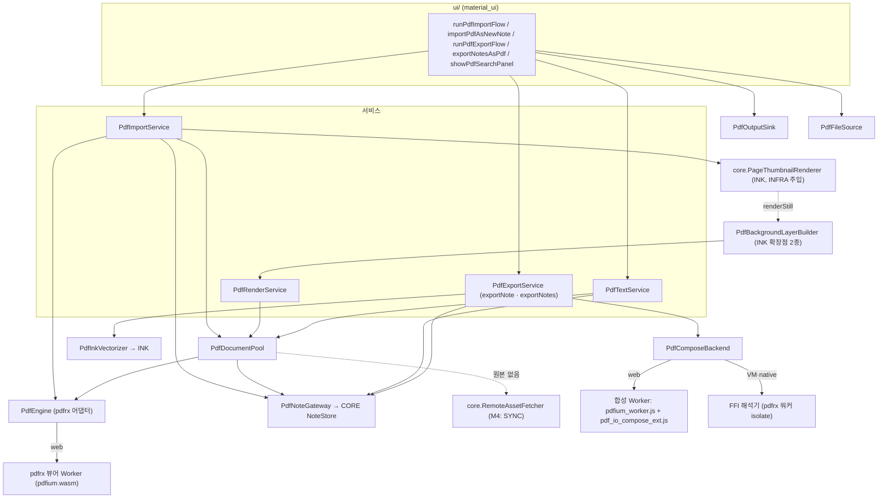

# 06 · PDF — PDF 입출력

> 상태: **승인** (00-review '4차 검토' 4.4.6·'최종 승인', 승인 판본 v0.4 — 개발 중 반영 PDF-4-1~4-3은 13.4) · 작성일: 2026-11-04 · 3차 수정: 2026-11-05
> 마스터 기획서: [docs/PLAN.md](../PLAN.md) v1.1 · 영역 지도·통합 계약: [00-overview.md](00-overview.md) 7장 **계약 v1.4**(변경 이력 7.9, v1.2 = C12-01~09, v1.3 = C13-01~05, v1.4 = C14-01·02 — 모두 시그니처 변경 없음) · 검토: [00-review.md](00-review.md) 3.6, '2차 검토' 2.4.6, '3차 검토' 3.4.6, '4차 검토' 4.4.6, '최종 승인'
> 소유 경로: `packages/pdf_io/` · 패키지 이름: `pdf_io` (Flutter 패키지)

이 문서만 보고 별도 git worktree에서 PDF 영역을 구현할 수 있게 쓴다. 코드 블록의 Dart 시그니처는 **계약**이다. 이름·타입을 바꾸려면 총괄 관리자 승인이 필요하다. 구현 본문(`...`, `;`로 끝난 선언)은 개발자가 채운다. 수치(기본값·임계값)는 `PdfTuning`(4.13)에 모으고, 바꾸면 이 문서도 고친다.

**통합 계약 우선**: 다른 영역 타입(CORE·INK·EDITOR·LIBRARY·INFRA)은 00-overview 7장의 이름·형태를 **글자 그대로** 쓴다. 이 문서는 그 타입을 다시 정의하지 않고 5절에 'PDF가 어떻게 쓰는지'만 적는다. 7.2.19(PDF 공개 함수)와 4절이 다르면 7.2.19가 우선이며, 계약에 대한 의견은 12.1 '계약 변경 제안'에만 적는다.

외부 패키지의 동작은 기억이 아니라 **실제 실험**으로 확인했다(6.1 사전 검증, 7절). 실험은 저장소 밖 `/tmp/claude-0/plan-scratch/pdf/`에서 했고 저장소에는 이 문서만 추가했다.

---

## 1. 목적과 범위

### 1.1 목적

강의자료·문서 PDF를 노트로 가져와 그 위에 필기하고, 다시 **원본 텍스트가 살아 있는 PDF + 벡터 필기**로 내보낸다(PLAN 1.1 'PDF 중심 학습/업무'). M3(★ 실사용 시작)의 핵심 기능을 M0~M2 기간에 미리 만들어, iPad Safari 웹 빌드에서 검증할 수 있게 한다.

### 1.2 이번 동시 개발 범위

| 구분 | 내용 |
|---|---|
| 엔진 | pdfrx 2.11.0(PDFium) 초기화·문서 열기·페이지 정보·렌더링·텍스트 추출을 감싼 `PdfEngine` 포트와 pdfrx 어댑터. 웹은 pdfrx의 PDFium wasm 워커 |
| 가져오기 | 파일 선택(웹: file_picker 13.3.2), 새 노트 만들기 / 기존 노트에 페이지 삽입(되돌리기 1단계), 페이지 범위 선택, 페이지 크기 = PDF 페이지 크기(pt), PDF 바이트를 CORE `AssetStore`(내용 해시 ID)에 저장, 암호 PDF(암호 입력·재시도·해제 사본 저장), 크기·쪽수 상한, 진행률·취소, 새 노트 표지 썸네일(7.2.11 '가져오기 직후 표지'), 제목의 한글 자모 합성 |
| 배경 렌더링 | INK 배경 확장 지점 `PageBackgroundLayerBuilder` + 화면 밖 썸네일용 `PageBackgroundStillRenderer` 구현(7.2.16), 배율 버킷별 미리보기 + 512px 타일, 보이는 영역만 렌더, 우선순위 큐·취소, 메모리 예산(웹 32/64/16MB, LRU)·화면 밖 해제·탭 숨김 시 정리, 썸네일 모드(`ctx.isThumbnail`), 자리표시(로딩·원본 없음·내려받는 중·실패) |
| 원격 원본 | 원본 바이트가 없으면 `core.remoteAssetFetcherProvider`가 있을 때 `ensureLocal` 요청 + `watch`로 '내려받는 중' 표시, `AssetStore.bytesArrived`로 실패 캐시를 지우고 다시 렌더(계약 P-2). 이번 범위는 fetcher `null`(M4 전)로 동작 + 가짜 fetcher 테스트 |
| 텍스트 검색 | 페이지 텍스트 추출, 한글 정규화(NFD 자모 합성 등), **노트 안 PDF 텍스트 검색**(결과 목록·페이지 이동 요청·하이라이트) |
| 내보내기 | PDFium으로 원본 페이지 + 벡터 필기 합성(원본 텍스트 유지), 속지만 있는 페이지는 속지 6종을 벡터로(INK `TemplateVectors`), 형광펜 투명도·겹침(한 경로 + Multiply), 범위(전체/선택/현재), 옵션(필기 포함·속지 포함), 원본 없는 페이지는 기본 빈 페이지 + 경고, 웹 전용 워커에서 백그라운드 생성 + 진행률·취소 |
| 일괄 내보내기 | 라이브러리 다중 선택 → `exportNotesAsPdf(context, noteIds)`: 노트별 순차 내보내기, 취소 가능한 전체 진행률, 결과 시트(여러 파일 한 번에 공유 또는 파일별 다운로드) — 계약 7.8 '이번 범위' |
| 공유·저장 | 웹: Web Share API(파일 공유 → iPad 공유 시트의 '파일에 저장'·'프린트' 포함, 여러 파일), 브라우저 다운로드, 새 탭에서 열기 |
| 통합 창구 | 계약 7.2.19 전부: `initializePdfIo()`·`pdfIoOverrides()`(INFRA `PdfModule`), `importPdfAsNewNote`·`exportNotesAsPdf`(LIBRARY 자리 모양, INFRA `FeatureWiringModule`이 연결), 에디터 메뉴 동작 목록(`PdfMenuAction`), `pdfRenderStatsProvider`(개발자 표시), Riverpod provider 일체, PDFium 라이선스 등록 |
| 테스트 기반 | 순수 Dart PDF 픽스처 생성기(크기·회전·CropBox·텍스트·ToUnicode 한글·RC4 암호), VM 실 PDFium 테스트 환경, Chrome 브라우저 테스트 자산 준비 스크립트 `tool/prepare_web_test.dart`(→ `test/web/pdfium/`) |

### 1.3 이후 범위 (인터페이스·자리만 지금 준비)

| 항목 | 지금 준비하는 것 | 시점 |
|---|---|---|
| 다른 앱의 '공유'·'다음으로 열기'로 PDF 받기 | `PdfIncomingFileSource` 인터페이스(웹 구현은 빈 스트림) | 네이티브 전환 이후 |
| 네이티브 공유 시트·인쇄 | `PdfOutputSink` 인터페이스(네이티브 구현은 `unsupported`). 후보 share_plus 13.3.1, printing 5.15.1 (7절) | 네이티브 전환 이후 |
| 네이티브 실기기 검증 | 네이티브 합성 백엔드(FFI)는 VM 테스트용으로 **이번에 구현**하지만 iOS/Android 실기기 확인은 이후 | 네이티브 전환 이후 |
| PDF 텍스트 선택·복사, 목차(아웃라인)·내부 링크 이동 (F-02 P1) | 엔진 포트에 텍스트·좌표가 이미 있음 | M8 이후 |
| 라이브러리 전역 PDF 텍스트 검색(5.1 검색) | `PdfTextService.pageText` 추출 API. 색인은 CORE 테이블 + FTS(계약 7.8, CORE Q9 — `sqlite3.wasm`의 FTS5 포함 여부를 먼저 확인) | 이후 |
| 이미지(JPG/PNG) 가져오기 (F-02 P1), 이미지 배경 렌더·내보내기 (M5) | `PdfComposePagePlan`을 sealed로 두어 이미지 페이지 추가 자리 | M5 |
| 이미지(PNG/JPG) 내보내기, 앱 전용 형식 백업 (F-15 P1) | — | M8 이후 |
| 동기화로 들어온 노트의 PDF 원본 **실제** 내려받기 | 내려받기 요청·진행 표시·도착 후 다시 렌더는 이번에 구현(`remoteAssetFetcherProvider` 사용, 1.2 '원격 원본'). fetcher 구현은 SYNC `SyncRemoteAssetFetcher`, 주입은 INFRA `SyncModule` | M4 (주입) |

### 1.4 제외 (다른 영역 책임 또는 계획 없음)

| 항목 | 담당 |
|---|---|
| Page·Asset 등 데이터 모델, 로컬 DB, 에셋 바이트 저장·해시, 되돌리기, 썸네일 캐시 저장소 | CORE |
| 획 외곽선·형광펜 그룹·연필 단색 근사 등 **필기 벡터 생성**, 속지 6종 선·점 좌표 계산(기본값 단일 출처 03-ink 6.16), 페이지 뷰 레이어 합성, 화면 밖 페이지 썸네일 렌더러(`InkPageThumbnailRenderer`) | INK |
| 에디터 화면, 더보기 메뉴·페이지 추가 시트 UI, 페이지 패널 다중 선택, 페이지 이동(스크롤), 개발자 표시 화면 | EDITOR |
| 라이브러리 '새로 만들기' 버튼, 다중 선택 막대의 '내보내기' 버튼, 가져온 노트 열기(화면 이동), 노트 표지 예약 생성(`CoverThumbnailScheduler`) | LIBRARY |
| 앱 셸 연결(`PdfModule`·`FeatureWiringModule`의 provider override, `PdfMenuAction` → `EditorMenuItem` 변환, 렌더 통계 → `DevOverlaySection` 변환), 웹 배포·헤더, CI(훅 산출물·준비 산출물 캐시) | INFRA |
| PDF 원본 업로드·다운로드(`SyncRemoteAssetFetcher`) | SYNC |
| PPT·Word를 PDF로 변환해 가져오기 (F-02 P2) | 2단계 |
| PDF 원본 텍스트 편집, PDF 양식 채우기, 다른 사람과 공동 편집 | 계획 없음 |

---

## 2. PLAN.md 요구사항 대응표

| PLAN 위치 | 요구사항 | 이 계획서의 작업 | 범위 |
|---|---|---|---|
| F-02 | 가져오기 경로: 파일 앱 / 기기 저장소 | `PdfFileSource`(file_picker 웹) T6 | 이번 |
| F-02 | 가져오기 경로: 클라우드 드라이브 | iPad Safari 파일 선택기가 '파일' 앱 제공자(iCloud Drive 등)를 보여줌 → 같은 경로(iPad 확인 항목 U1). 드라이브 직접 연동은 이후 | 이번(선택기 경유) / 이후 |
| F-02 | 가져오기 경로: 다른 앱의 '공유'·'다음으로 열기' | `PdfIncomingFileSource` 인터페이스만 | 이후 |
| F-02 | 새 노트로 만들기 / 기존 노트에 페이지로 삽입 | `PdfImportService`·`runPdfImportFlow` T5·T6 | 이번 |
| F-02 | PDF 페이지를 배경으로, 벡터 렌더링해 확대해도 선명 | 배율 버킷 타일 재렌더 T8·T9 | 이번 |
| F-02 | 대용량(수백 쪽): 보이는 페이지만 렌더, 썸네일 캐시 | 문서 풀·렌더 캐시·썸네일 모드(`ctx.isThumbnail`)·still renderer T7~T10, 썸네일 저장·예약은 7.2.11 경로(6.9) | 이번 |
| F-02 | PDF 텍스트 검색 | 노트 안 검색 T11 | 이번(노트 안) / 이후(라이브러리 전역) |
| F-02 | PDF 텍스트 선택·복사, 목차·내부 링크 이동 (P1) | — | 이후 |
| F-02 | 암호 걸린 PDF 열기 | 암호 입력·재시도·해제 사본 저장 T3·T5·T6 | 이번 |
| F-02 | (P1) 이미지 가져오기 / (P2) PPT·Word 변환 | — | 이후 / 제외 |
| F-03 | 벡터 저장 — PDF 내보내기 시에도 벡터 유지 | INK 벡터 → PDF 경로 객체 T12~T14 | 이번 |
| F-03 | 형광펜: 반투명, 겹쳐도 진해지지 않음 (PDF에서도) | 같은 색·투명도·굵기 형광펜을 한 경로로 한 번 칠하기 + `/BM /Multiply` T12·T13 | 이번 |
| F-03 | 연필 질감 | PDF에서는 INK가 정한 단색 근사(투명도 ×0.85) 사용 | 이번(INK 결정 따름) |
| F-08 | 페이지 삽입도 되돌리기 대상 | 기존 노트 삽입 = CORE `InsertPages` 1회 = 1단계 T5 | 이번 |
| F-13 | 페이지 삽입 종류: PDF 페이지 (M3) | `PdfImportIntoNote`, 위치(현재 앞/뒤/맨 끝) T5·T6 | 이번 |
| F-13 | 페이지 크기 | PDF 페이지 크기(pt) 그대로, CORE 허용 범위 밖이면 비율 유지 축소·확대(6.5) | 이번 |
| F-15 | 범위: 노트 전체 / 선택한 페이지 / 현재 페이지 | `PdfExportRange` 3종 T15 | 이번 |
| F-15 | 필기는 벡터, 원본 PDF 텍스트 그대로 유지(검색 가능) | PDFium 합성(원본 페이지 가져오기 + 경로 추가) T13·T14, 검증 V5 | 이번 |
| F-15 | 옵션: 속지 포함 여부, 필기 포함 여부(원본만) | `PdfExportOptions.includeTemplates/includeInk` T15 | 이번 |
| F-15 | 공유 시트(메일·메신저·드라이브 저장), 인쇄 | 웹: Web Share API(공유 시트에 '프린트' 포함)·다운로드·새 탭 T16 / 네이티브 이후 | 이번(웹) / 이후(네이티브) |
| F-15 | 대용량 노트는 백그라운드 생성 + 진행률 | 웹 전용 합성 워커, 16쪽 묶음 진행률·취소 T14·T15 | 이번 |
| F-15 | (P1) 이미지 내보내기, 앱 전용 형식 | — | 이후 |
| F-01 | 다중 선택 후 일괄 내보내기 | `exportNotesAsPdf(context, noteIds)`(계약 7.2.19) — 노트별 순차 내보내기·진행률·결과 시트 T15b, LIBRARY 자리 `libraryPdfExportActionProvider`에 INFRA가 연결 | 이번 |
| F-07 | PDF 같은 큰 파일은 별도 파일 저장소, 다른 기기는 열 때 내려받기 | CORE `AssetStore` 사용, 원본 없으면 `assetMissing` 표시 + `remoteAssetFetcherProvider`가 있으면 `ensureLocal`·진행 표시·`bytesArrived`로 다시 렌더(6.6, 6.7.7) T7·T9 | 이번(요청·표시·재시도, fetcher 없이 동작) / M4(fetcher 주입) |
| 5.1 | 검색: 노트 제목 → **PDF 텍스트(M3)** → 손글씨 | 노트 안 검색 T11. 라이브러리 전역 색인은 이후(계약 7.8, CORE 테이블 + FTS) | 부분 |
| 5.2 | 탭 / 분할 화면(교재 PDF와 노트 나란히) | — | 제외(EDITOR 이후) |
| 5.4 | 성능: 500페이지 PDF에서 60fps 스크롤 | 비동기 렌더·타일·예산(6.7), 성능 테스트 T18, iPad U5 | 이번 |
| 5.4 | 저장 용량: 같은 PDF는 한 번만 저장 | CORE 해시 중복 제거 + 원본 바이트 그대로 저장 정책(6.4) | 이번 |
| 5.4 | 측정: 개발자 표시 | `PdfRenderStats`·`pdfRenderStatsProvider` 제공 T8 → INFRA `pdfRenderStatsSection`이 `DevOverlaySection`으로 바꿔 EDITOR `devOverlaySectionsProvider`에 연결(7.3.3) | 이번 |
| 6.2 | PDF 렌더링: pdfrx (PDFium) | pdfrx 2.11.0 고정 | 이번 |
| 6.2 | PDF 내보내기: PDFium 직접 또는 syncfusion (라이선스 확인) | 비교·결정 6.11.1 → PDFium(pdfrx의 wasm·네이티브 바이너리) | 이번 |
| 7.2 | `Page.background { type: pdf, assetId, pdfPageIndex }`, `Asset.id = 내용 해시` | CORE `PdfBackground`·`AssetStore.put` 사용 | 이번 |
| 7.3 | 레이어 순서: 배경(PDF) → 형광펜 → 필기 | 배경 레이어 구현(INK가 합성) | 이번 |
| 7.3 | 화면 밖 페이지는 메모리에서 해제 | 위젯 해제 시 타일 즉시 해제, 미리보기 LRU(6.7.6) | 이번 |
| 8 | 라이브러리 '새로 만들기: PDF 가져오기' | `importPdfAsNewNote` 제공(계약 7.2.19 — 메뉴는 LIBRARY `libraryPdfImportActionProvider`, 연결은 INFRA `FeatureWiringModule`) | 이번 |
| 8 | 에디터 더보기: PDF 내보내기 · 공유 · 인쇄 | `pdfEditorMoreMenuActions()`·`pdfEditorAddPageSources()` 제공(메뉴는 EDITOR `editorExtensionsProvider`, `EditorMenuItem` 변환·연결은 INFRA `FeatureWiringModule`) | 이번 |
| 9.5 | 웹에서 돌아가도록 플랫폼 전용 기능 분리 | 조건부 import·파일 접미사 규칙(6.15) | 이번 |
| 10 M3 | PDF 가져오기 (새 노트 / 기존 노트에 삽입) | T5·T6 | 이번 |
| 10 M3 | 다른 앱에서 '공유'로 열기 | `PdfIncomingFileSource` | 이후 |
| 10 M3 | 대용량 PDF 지연 렌더링 · 썸네일 캐시 | T7~T10 | 이번 |
| 10 M3 | PDF 내보내기 (벡터 필기, 범위 선택), 공유 · 인쇄 | T12~T16 | 이번(웹) / 이후(네이티브 공유·인쇄) |
| 10 M3 | PDF 텍스트 검색 | T11 | 이번(노트 안) |
| 12 | 대용량 PDF 메모리 부족 → 페이지 가상화, 타일 렌더링 | 6.7 | 이번 |

---

## 3. 소유 경로와 패키지 구조

```text
packages/pdf_io/
├─ pubspec.yaml                  # 계약 7.4.1 형식 (3.1). 패키지 analysis_options.yaml 없음 — 루트가 적용(R3)
├─ dart_test.yaml                # tags: golden, pdfium, perf, integration (9.1, 계약 7.4.8) — T0(B4)에서 만든다(R15, v1.2)
├─ .gitignore                    # test/web/pdfium/ (준비 스크립트가 복사한 자산), build/
├─ README.md                     # 사용법·웹 자산·테스트 준비 명령 (T19)
├─ THIRD_PARTY_NOTICES.md        # pdfrx·pdfium_dart(MIT), PDFium + 서드파티 고지 목록(7.1), file_picker (T19)
├─ licenses/                     # PDFium 배포본의 고지 원문 그대로(7.1) — Flutter 에셋, LicenseRegistry 등록(6.16)
├─ web/
│  └─ pdf_io_compose_ext.js      # 합성 워커 확장 명령 (flutter asset, platforms: [web]) (6.11.6)
├─ tool/
│  └─ prepare_web_test.dart      # pdfrx wasm 자산 + 확장 JS → test/web/pdfium/ 복사·검증 (9.1)
├─ lib/
│  ├─ pdf_io.dart                # 공개 barrel (웹 안전, 4.15)
│  ├─ testing.dart               # 픽스처 생성기·가짜 구현 (웹 안전, flutter_test 비의존, test/에서만 import)
│  └─ src/
│     ├─ init.dart               # initializePdfIo, pdfIoOverrides, PdfIoRuntime(내부), 라이선스 등록
│     ├─ config.dart             # PdfIoConfig, PdfImportLimits, PdfRenderBudget, PdfUserPasswordPolicy
│     ├─ tuning.dart             # PdfTuning — 모든 수치 상수
│     ├─ errors.dart             # PdfErrorCode, PdfIoException
│     ├─ common/                 # cancel_signal.dart, progress.dart, job_state.dart
│     ├─ model/                  # page_size_policy.dart, page_range.dart, file_naming.dart, title_policy.dart
│     ├─ engine/                 # pdf_engine.dart(포트), page_info.dart, pdfrx_engine.dart(pdfrx 유일 진입점)
│     ├─ gateway/                # pdf_note_gateway.dart(포트), core_note_gateway.dart(CORE 어댑터)
│     ├─ files/                  # pdf_file_source.dart(포트), file_picker_source.dart, incoming_files.dart
│     ├─ import/                 # import_service.dart, import_session.dart, import_types.dart, cover_thumbnail.dart
│     ├─ render/                 # document_pool.dart, tile_math.dart, render_cache.dart,
│     │                          # render_scheduler.dart, render_service.dart, render_stats.dart,
│     │                          # remote_asset_watch.dart, page_background_view.dart, page_background_painter.dart
│     ├─ ink_adapter/            # ink_background_builder.dart, ink_vectorizer.dart, template_underlay.dart
│     ├─ text/                   # hangul_jamo.dart, text_normalizer.dart, text_service.dart,
│     │                          # search_types.dart, search_notifier.dart
│     ├─ export/                 # export_types.dart, vectors.dart, compose_plan.dart, compose_encoder.dart,
│     │                          # export_service.dart, batch_export.dart
│     ├─ compose/                # compose_backend.dart(포트), compose_backend_factory.dart(조건부 export),
│     │                          # display_matrix.dart, compose_backend_native.dart(dart:ffi),
│     │                          # compose_backend_browser.dart(Worker), compose_backend_stub.dart
│     ├─ output/                 # pdf_output_sink.dart(포트), output_sink_factory.dart(조건부 export),
│     │                          # output_sink_browser.dart, output_sink_stub.dart
│     ├─ ui/                     # import_sheet.dart, password_dialog.dart, export_sheet.dart,
│     │                          # export_progress_dialog.dart, export_result_sheet.dart, batch_export_sheet.dart,
│     │                          # search_panel.dart, flows.dart, menu_actions.dart, strings_ko.dart
│     └─ providers.dart
└─ test/
   ├─ support/                   # pdfium_env.dart(VM 전용, dart:io), compose_probes.dart(웹 안전), fake_images.dart
   ├─ contract/                  # api_surface_test.dart
   ├─ unit/                      # 순수 로직 (가짜 엔진·게이트웨이, CORE createFakeNoteStore)
   ├─ widget/                    # 위젯·흐름
   ├─ goldens/                   # @Tags(['golden']) @TestOn('vm') — 배경 상태 골든 (계약 7.4.8)
   ├─ pdfium/                    # @Tags(['pdfium']) 실 PDFium(VM)
   ├─ integration/               # @Tags(['integration']) — 통합 단계에서만(기본 skip)
   ├─ perf/                      # @Tags(['perf']) — 기본 skip
   └─ web/                       # @TestOn('browser') — Chrome 전용(계약 7.4.8). web/pdfium/ 는 .gitignore
```

원칙
- 다른 영역은 `package:pdf_io/pdf_io.dart`만 import한다(계약 7.1 규칙 2). `package:pdf_io/testing.dart`는 `test/`에서만.
- `lib/`에서 `dart:io`·`dart:html`·`dart:js`·`dart:js_util`·`package:js` 금지. `dart:ffi`·`package:ffi`·`package:pdfium_dart`는 `compose/compose_backend_native.dart`에서만, `dart:js_interop`·`package:web`은 `*_browser.dart`에서만 import하고, 플랫폼 파일은 **조건부 export로만** 불러온다(계약 7.4.3, 6.15).
- `package:pdfrx`는 `engine/pdfrx_engine.dart`, `init.dart`, `compose/compose_backend_native.dart`(pdfrx 워커 isolate `compute`)에서만 `as rx` 접두사로 import한다. pdfrx가 내보내는 `PdfDocument`·`PdfPage`·`PdfRect`·`PdfPasswordException`과 섞이지 않게 하기 위함이다(PDF 공개 이름은 pdfrx 공개 이름 224개와 겹치지 않음을 확인함).
- `package:ink_engine`은 `ink_adapter/` 세 파일과 `init.dart`(빌더 목록 override)에서만 `as ink`로 import한다 → INK API가 바뀌어도 고칠 곳이 네 파일.
- `package:note_core`는 모든 파일에서 `as core`로 import한다(Flutter `Page`(Navigator)와 CORE `Page` 이름 충돌 방지).
- Material은 `package:material_ui/material_ui.dart`만 쓴다(lib·test 모두, R7). 자체 `MaterialApp`·`ProviderScope`를 만들지 않는다(테스트 제외). 색은 `Theme.of(context).colorScheme`만 쓴다(종이 팔레트·PDF 검색 하이라이트 — 계약 7.4.11 v1.3 예외, C12-07·C13-03). 검색 하이라이트 색은 종이 위에 겹쳐 그리는 표시 색이라 UI 테마가 아니라 종이와의 대비가 기준이며, 상수는 `PdfTuning`(4.13) **한 곳**에만 둔다 — painter·위젯 파일에 색 리터럴을 쓰지 않고, 테마 색으로 바꾸지 않는다. 종이 색은 데이터 값(`paperColorArgb`)을 그대로 칠한다.
- Riverpod은 `package:flutter_riverpod/flutter_riverpod.dart`, `Override`는 `package:flutter_riverpod/misc.dart`(계약 7.4.4). 코드 생성 없음.
- 패키지 안에 `analysis_options.yaml`을 두지 않는다(루트가 적용, R3). 패키지 `.gitignore`는 PDF 소유(준비 스크립트 산출물, 계약 7.4.1).

### 3.1 pubspec.yaml (계약 7.4.1 형식 · 7.5 버전)

```yaml
name: pdf_io
publish_to: none
resolution: workspace
environment:
  sdk: ^3.13.0
  flutter: 3.47.9
dependencies:
  flutter:
    sdk: flutter
  collection: 1.19.1
  crypto: 3.0.8          # lib/testing.dart RC4 fixture (MD5), tool/prepare_web_test.dart (sha256 check)
  ffi: 2.2.0             # compose_backend_native.dart only
  file_picker: 13.3.2
  flutter_riverpod: 3.4.3
  ink_engine: any
  material_ui: 1.10.0
  meta: 1.19.0
  note_core: any
  pdfium_dart: 0.4.1     # FFI bindings, compose_backend_native.dart only (same version pdfrx_engine uses)
  pdfrx: 2.11.0          # exact pin: the compose extension relies on its worker internals (6.11.6)
  web: 1.1.2             # *_browser.dart only
dev_dependencies:
  fake_async: 1.3.3
  flutter_test:
    sdk: flutter
flutter:
  assets:
    - licenses/          # PDFium third-party notices (6.16)
    - path: web/
      platforms: [web]   # served at assets/packages/pdf_io/web/pdf_io_compose_ext.js
```

- 형제 패키지는 `any`, 외부는 계약 7.5의 정확한 버전. 모든 외부 의존은 기반 단계 B1에서 INFRA가 넣는다(계약 7.6, 1차 Q8 답) — 동시 개발 중 추가 없음.
- `analysis_options.yaml`은 두지 않는다(초안의 `include: ../../analysis_options.yaml` 파일 삭제).

---

## 4. 공개 API

모든 공개 타입은 `package:pdf_io/pdf_io.dart`에서 export한다(목록 4.15). import 관례: `core` = `package:note_core/note_core.dart`, `ink` = `package:ink_engine/ink_engine.dart`, `ui` = `dart:ui`(위젯 파일의 `Size`·`Rect`·`Offset`은 Flutter가 다시 내보낸 같은 타입).

값 동등(계약 7.4.4, PDF-3-2): provider 상태이거나 `ValueListenable` 값으로 쓰는 타입은 `@override bool operator ==(Object other); @override int get hashCode;`를 시그니처로 둔다 — 4.1 설정 3종, 4.2 `PdfIoException`(`code`·`detail` 기준)·`PdfProgress`·`PdfBatchProgress`·`PdfJob*`, 4.6 `PdfImportResult`, 4.7 `PdfRenderStats`, 4.8 `PdfSearchHit`·`PdfSearchState`, 4.12 `PdfBatchJob*`. 리스트 필드는 `collection`의 `ListEquality`로 비교한다. 결과 페이로드 중 값 동등은 `PdfImportResult`뿐이고, 바이트를 담는 `PdfExportResult`·`PdfBatchExportItem`·`PdfBatchExportResult`는 `==`를 재정의하지 않는다(동일 객체 비교, 4.9). PDF provider에는 family가 없다(family 키 타입 없음 — 둘 일이 생기면 키도 값 동등 타입으로). 근거: Riverpod 3.4.3 Notifier·Provider는 `previous != next`일 때만 알리고(`ProviderElement.defaultUpdateShouldNotify`, pub 캐시 소스 확인), `ValueNotifier`도 `==`로 같은 값을 거른다.

### 4.0 계약 7.2.19 (글자 그대로)

아래 블록은 00-overview 7.2.19를 그대로 옮긴 것이다. 4.1~4.12는 이 블록의 상세이며, 둘이 다르면 계약이 우선한다.

```dart
Future<void> initializePdfIo({PdfIoConfig config = const PdfIoConfig()});   // idempotent, < 10 ms
/// The ONLY override of ink.pageBackgroundBuildersProvider:
///   [pdfBackgroundLayerBuilder, const ink.TemplateBackgroundLayerBuilder()] (+ pdfIoConfigProvider).
List<Override> pdfIoOverrides({PdfIoConfig? config});
/// LibraryPdfImportAction shape.
Future<String?> importPdfAsNewNote(BuildContext context, {String? folderId});
/// LibraryPdfExportAction shape: one PDF per note, then the result sheet (share all / download).
Future<void> exportNotesAsPdf(BuildContext context, List<String> noteIds);
List<PdfMenuAction> pdfEditorMoreMenuActions();   // pdf.export, pdf.share, pdf.print, pdf.search
List<PdfMenuAction> pdfEditorAddPageSources();    // pdf.insert
final class PdfMenuAction { /* PDF 4.11 */ }
final class PdfMenuInvocation { /* PDF 4.11: noteId, currentPageId, selectedPageIds, onNavigate */ }
final pdfRenderStatsProvider = Provider<ValueListenable<PdfRenderStats>>(/* PDF 4.12 */);
// PdfBackgroundLayerBuilder implements ink.PageBackgroundLayerBuilder, ink.PageBackgroundStillRenderer
```

| 계약 항목 | 상세 |
|---|---|
| `initializePdfIo`, `pdfIoOverrides`, `PdfIoConfig` | 4.1 |
| `importPdfAsNewNote`, `exportNotesAsPdf`, `pdfEditorMoreMenuActions`, `pdfEditorAddPageSources`, `PdfMenuAction`, `PdfMenuInvocation` | 4.11 |
| `pdfRenderStatsProvider` | 4.12 (값 타입 `PdfRenderStats`는 4.7) |
| `PdfBackgroundLayerBuilder` | 4.7 |

### 4.1 초기화 · 앱 셸 창구 (INFRA `PdfModule`이 사용)

```dart
// lib/src/config.dart
@immutable
final class PdfImportLimits {
  const PdfImportLimits({
    this.maxBytes = 300 * 1024 * 1024,    // hard limit (6.3)
    this.warnBytes = 100 * 1024 * 1024,   // confirm dialog above this
    this.maxPages = 2000,                 // = CORE createNote limit (C-3)
    this.maxPasswordAttempts = 5,
  });
  final int maxBytes;
  final int warnBytes;
  final int maxPages;
  final int maxPasswordAttempts;
  @override bool operator ==(Object other);
  @override int get hashCode;
}

/// Byte budgets of the render cache by kind (6.7.4). Web values = contract 7.4.10.
@immutable
final class PdfRenderBudget {
  const PdfRenderBudget({required this.previewBytes, required this.tileBytes, required this.thumbnailBytes});
  const PdfRenderBudget.web()
      : previewBytes = 32 * 1024 * 1024,
        tileBytes = 64 * 1024 * 1024,
        thumbnailBytes = 16 * 1024 * 1024;
  const PdfRenderBudget.native()
      : previewBytes = 64 * 1024 * 1024,
        tileBytes = 160 * 1024 * 1024,
        thumbnailBytes = 32 * 1024 * 1024;
  final int previewBytes;
  final int tileBytes;
  final int thumbnailBytes;
  int get totalBytes;                  // web: 112 MiB
  @override bool operator ==(Object other);
  @override int get hashCode;
}

/// User-password PDFs on import (6.4). Default pending the user's answer (00-review U1).
enum PdfUserPasswordPolicy {
  storeDecryptedCopy,   // store a copy without the security handler (default)
  refuse,               // reject with PdfErrorCode.userPasswordRefused
}

@immutable
final class PdfIoConfig {
  const PdfIoConfig({
    this.pdfiumWasmModulesUrl,   // null → pdfrx default 'assets/packages/pdfrx/assets/' (resolved against document.baseURI)
    this.composeExtensionUrl = 'assets/packages/pdf_io/web/pdf_io_compose_ext.js',
    this.warmUpOnStart = true,   // start engine init in the background (not awaited)
    this.limits = const PdfImportLimits(),
    this.renderBudget,           // null → web()/native() by platform
    this.generateCoverThumbnail = true,
    this.userPasswordPolicy = PdfUserPasswordPolicy.storeDecryptedCopy,
  });
  final String? pdfiumWasmModulesUrl;
  final String composeExtensionUrl;
  final bool warmUpOnStart;
  final PdfImportLimits limits;
  final PdfRenderBudget? renderBudget;
  final bool generateCoverThumbnail;
  final PdfUserPasswordPolicy userPasswordPolicy;
  PdfRenderBudget get effectiveRenderBudget;
  /// Value equality over every field (pdfIoConfigProvider value; initializePdfIo's
  /// "second call with a different config" check uses it).
  @override bool operator ==(Object other);
  @override int get hashCode;
}
```

```dart
// lib/src/init.dart
/// Idempotent and web-safe. Applies [config] (pdfrx wasm module URL), registers the PDFium
/// third-party notices with LicenseRegistry once (6.16), and when config.warmUpOnStart starts
/// engine initialization WITHOUT awaiting the wasm download (completes in < 10 ms).
/// Engine failures never throw here; they surface as PdfIoException(engineUnavailable) on
/// first PDF use. A second call with a different config is ignored (debug assert).
Future<void> initializePdfIo({PdfIoConfig config = const PdfIoConfig()});

/// Overrides INFRA PdfModule adds to the root ProviderScope (contract 7.3.3). Always both:
///  - pdfIoConfigProvider.overrideWithValue(config ?? the config given to initializePdfIo)
///  - ink.pageBackgroundBuildersProvider.overrideWith((ref) =>
///      [ref.watch(pdfBackgroundLayerBuilderProvider), const ink.TemplateBackgroundLayerBuilder()])
/// The ONLY override of ink.pageBackgroundBuildersProvider in the app (contract 7.2.19).
/// When PdfModule failed to start, INFRA adds none of these (default = template builder only).
/// Reading ink.pageBackgroundBuildersProvider in a container that holds ONLY these overrides
/// never throws and builds nothing else (no engine, document pool, CORE gateway, renderer):
/// B4 (T0) uses PdfBackgroundLayerBuilder.paperOnly(); from T9 the builder reaches the
/// renderer lazily on its first build / renderStill (4.7, 4.12, PDF-2-2). The first PDF page
/// that is actually drawn needs core.noteStoreProvider (INFRA CoreModule starts first).
List<Override> pdfIoOverrides({PdfIoConfig? config});
```

### 4.2 오류 · 취소 · 진행률 · 작업 상태

```dart
// lib/src/errors.dart
enum PdfErrorCode {
  notPdf,               // no '%PDF-' in the first 1024 bytes
  tooLarge,             // > PdfImportLimits.maxBytes
  tooManyPages,         // > PdfImportLimits.maxPages
  passwordCancelled,    // user dismissed the password dialog / attempts exhausted
  userPasswordRefused,  // PdfUserPasswordPolicy.refuse and the PDF needs a user password
  corrupt,              // PDFium could not parse
  engineUnavailable,    // wasm/native engine failed to initialize, incompatible compose extension
  assetMissing,         // PDF bytes are not on this device (AssetStore.readBytes == null)
  noteNotFound,         // core.EntityNotFoundException (note purged / unknown id)
  readOnlyNote,         // core.ReadOnlyNoteException (trashed note, newer schema — N-4)
  /// Only for CORE writes that fail WITHOUT retry: AssetStore.put's byte-chunk write
  /// (that error at once, no metadata row — contract 7.2.11 v1.2) and any other
  /// core.NoteCoreException. NEVER a failed commit: CORE retries it and the write Future
  /// stays pending (contract 7.2.9 v1.2, 4.4).
  storageFailed,
  exportFailed,         // compose backend error
  pickerFailed,         // file picker error / unreadable file
  cancelled,
  busy,                 // another import/export job is running
  unsupportedPlatform,
}

final class PdfIoException implements Exception {
  const PdfIoException(this.code, {this.detail, this.cause});
  final PdfErrorCode code;
  final String? detail;   // developer detail (English), shown in debug only
  final Object? cause;
  /// Korean message for UI (table 6.14).
  String get userMessage;
  @override
  String toString();
  /// Equal when [code] and [detail] are equal; [cause] is ignored (job / search states
  /// compare their errors — contract 7.4.4).
  @override bool operator ==(Object other);
  @override int get hashCode;
}
```

```dart
// lib/src/common/cancel_signal.dart
final class PdfCancelSignal {
  PdfCancelSignal();
  bool get isCancelled;
  void cancel();                       // idempotent
  Future<void> get whenCancelled;
  /// Throws PdfIoException(cancelled) if cancelled.
  void throwIfCancelled();
  /// Completes like [future], or throws PdfIoException(cancelled) as soon as cancel() is
  /// called: Future.any([future, whenCancelled.then((_) => throw cancelled)]). For waits that
  /// may never end — NoteStore.flush() and putPdf's metadata commit while CORE retries a
  /// failed commit (contract 7.2.9 v1.2; 6.3, 6.10.2, 6.11.2). After a cancel [future] keeps
  /// running and its later value / error is ignored (Future.any handles it — no unhandled
  /// error, not reported); CORE's write queue keeps retrying. Already cancelled → throws at once.
  Future<T> raceCancel<T>(Future<T> future);
}

// lib/src/common/progress.dart
enum PdfJobPhase {
  readingFile, openingPdf, storingPdf, creatingPages, coverThumbnail,   // import
  preparingExport, composing, finishingExport,                          // export
}

@immutable
final class PdfProgress {
  const PdfProgress(this.phase, {this.done = 0, this.total = 0});
  final PdfJobPhase phase;
  final int done;
  final int total;                     // 0 = indeterminate
  double? get fraction;                // null when total == 0
  String get label;                    // Korean, e.g. 'PDF 여는 중', '페이지 합성 중 (12/40)'
  @override bool operator ==(Object other);   // phase, done, total
  @override int get hashCode;
}
typedef PdfProgressCallback = void Function(PdfProgress progress);

/// Bulk export progress (exportNotes, 4.9).
@immutable
final class PdfBatchProgress {
  const PdfBatchProgress({required this.noteIndex, required this.noteCount, required this.current});
  final int noteIndex;                 // 0-based index of the note being exported
  final int noteCount;
  final PdfProgress current;           // progress inside that note
  /// (noteIndex + (current.fraction ?? 0)) / noteCount.
  double get fraction;
  String get label;                    // '노트 2/5 · 페이지 합성 중 (12/40)'
  @override bool operator ==(Object other);   // noteIndex, noteCount, current
  @override int get hashCode;
}
typedef PdfBatchProgressCallback = void Function(PdfBatchProgress progress);

// lib/src/common/job_state.dart — value equality (contract 7.4.4): same subtype + same T,
// fields compared with ==. Riverpod 3.4.3 notifies only when previous != next.
sealed class PdfJobState<T> { const PdfJobState(); }
final class PdfJobIdle<T> extends PdfJobState<T> {
  const PdfJobIdle();
  @override bool operator ==(Object other);   // every PdfJobIdle<T> is equal
  @override int get hashCode;
}
final class PdfJobRunning<T> extends PdfJobState<T> {
  const PdfJobRunning(this.progress);
  final PdfProgress progress;
  @override bool operator ==(Object other);   // progress ==
  @override int get hashCode;
}
final class PdfJobSucceeded<T> extends PdfJobState<T> {
  const PdfJobSucceeded(this.result);
  final T result;
  /// result == : PdfImportResult is value-equal (4.6); PdfExportResult holds bytes and keeps
  /// identity equality (4.9), so two succeeded exports are equal only for the same object.
  @override bool operator ==(Object other);
  @override int get hashCode;
}
final class PdfJobFailed<T> extends PdfJobState<T> {
  const PdfJobFailed(this.error);
  final PdfIoException error;          // code == cancelled for user cancel
  @override bool operator ==(Object other);   // error == (code, detail)
  @override int get hashCode;
}
```

### 4.3 엔진 포트 (`PdfEngine`)

pdfrx를 직접 쓰지 않고 이 포트를 거친다. 테스트는 `FakePdfEngine`(4.14)으로 바꾼다.

```dart
// lib/src/engine/page_info.dart
@immutable
final class PdfPageInfo {
  const PdfPageInfo({required this.index, required this.width, required this.height,
      required this.rotationQuarterTurns});
  final int index;                     // 0-based
  final double width;                  // displayed size in pt (after /Rotate, CropBox)
  final double height;
  final int rotationQuarterTurns;      // /Rotate / 90, 0..3
}

@immutable
final class PdfDocumentInfo {
  const PdfDocumentInfo({required this.pages, required this.isEncrypted, required this.usedPassword});
  final List<PdfPageInfo> pages;
  int get pageCount;
  final bool isEncrypted;              // any security handler (incl. owner-password-only)
  final bool usedPassword;             // a non-empty user password was needed to open
}

@immutable
final class PdfPasswordRequest {
  const PdfPasswordRequest({required this.fileName, required this.attempt});
  final String fileName;
  final int attempt;                   // 1-based; attempt > 1 means the previous one was wrong
}
/// Return null to give up.
typedef PdfPasswordCallback = Future<String?> Function(PdfPasswordRequest request);

enum PdfRenderPriority { high, normal, low }

final class PdfRenderCancelToken {
  PdfRenderCancelToken();
  bool get isCancelled;
  void cancel();
}

/// Integer pixel rectangle inside the full rendered page (scale * page size).
@immutable
final class PdfPixelRect {
  const PdfPixelRect(this.left, this.top, this.width, this.height);
  final int left, top, width, height;
  int get right;
  int get bottom;
  bool get isEmpty;
}

@immutable
final class PdfRenderRequest {
  const PdfRenderRequest({required this.pageIndex, required this.scale, this.region,
      this.backgroundArgb = 0xFFFFFFFF, this.priority = PdfRenderPriority.normal});
  final int pageIndex;
  final double scale;                  // device pixels per pt
  final PdfPixelRect? region;          // null → whole page
  final int backgroundArgb;
  final PdfRenderPriority priority;
  /// Full page size in pixels: (ceil(width * scale), ceil(height * scale)).
  (int, int) fullPixelSize(PdfPageInfo page);
}

@immutable
final class PdfPageTextData {
  const PdfPageTextData({required this.pageIndex, required this.text, required this.charRects});
  final int pageIndex;
  final String text;                   // raw text from PDFium (lines separated by \r\n)
  /// One rect per UTF-16 code unit of [text], displayed page pt, y down
  /// (converted from PDF bottom-left coordinates incl. rotation). Rect.zero when unknown.
  final List<ui.Rect> charRects;
}

abstract interface class PdfEngine {
  bool get isInitialized;
  /// Idempotent. Web: loads pdfium_client.js and instantiates pdfium.wasm in the pdfrx worker.
  /// Throws PdfIoException(engineUnavailable).
  Future<void> ensureInitialized();
  /// Throws notPdf / corrupt / passwordCancelled / engineUnavailable.
  /// [transferOwnership]: web may detach [bytes] (pass true only if the caller never reads them again).
  Future<PdfEngineDocument> open(Uint8List bytes, {required String sourceName,
      String fileName = '', PdfPasswordCallback? onPassword, int maxPasswordAttempts = 5,
      bool transferOwnership = false});
}

abstract interface class PdfEngineDocument {
  String get sourceName;
  PdfDocumentInfo get info;
  bool get isDisposed;
  /// Returns null when cancelled. The caller owns (and must dispose) the image.
  Future<ui.Image?> render(PdfRenderRequest request, {PdfRenderCancelToken? cancelToken});
  Future<PdfPageTextData> loadText(int pageIndex);
  /// Re-encodes without the security handler (FPDF_SAVE_NO_SECURITY). Used for
  /// user-password PDFs on import (6.4).
  Future<Uint8List> encodeWithoutSecurity();
  Future<void> dispose();              // idempotent
}

/// Production engine over pdfrx 2.11.0. Process-wide singleton (init is global in pdfrx).
final class PdfrxEngine implements PdfEngine {
  factory PdfrxEngine.shared();
  /// Applies config before the first ensureInitialized(); later calls are ignored.
  void configure(PdfIoConfig config);
  ...
}
```

### 4.4 노트 연결 포트 (`PdfNoteGateway`)

PDF가 CORE에 하는 일은 이 포트로만 한다. 기본 구현 `CorePdfNoteGateway`는 CORE 공개 API(5.1, 계약 7.2.8·7.2.9·7.2.11·7.2.12) 위의 얇은 어댑터다. CORE 예외는 여기서 `PdfIoException`으로 바꾼다(`cause` 보존): `EntityNotFoundException` → `noteNotFound`, `ReadOnlyNoteException` → `readOnlyNote`, **재시도 없이 오류로 끝나는 쓰기 실패**만 `storageFailed` — `AssetStore.put`의 바이트 청크 쓰기 실패(재시도 없이 그 오류로 즉시 완료, 메타 행 없음 — 계약 7.2.11 v1.2)와 그 밖의 `NoteCoreException`.

**커밋 실패는 예외가 아니다**(계약 7.2.9 v1.2 C12-09 — CORE 4.5 머리말이 원문, 6.9): CORE `WriteQueue`는 실패한 커밋을 100 ms → 400 ms → 1.6 s → 5 s 간격으로 무한 재시도하고, 그동안 쓰기 `Future`(`putPdf`의 메타 커밋, `createNote`, `flush`)는 **완료되지도 오류로 끝나지도 않는다**(앞에 쌓인 쓰기가 재시도 중이면 그 뒤라서 마찬가지). 원인은 `core.persistenceStatusProvider` + `core.storageWarningOf(...) == writeFailing`으로만 보인다. PDF는 이 대기를 예외로 기다리지 않고 화면에서 처리한다: 가져오기 진행 창 = 지연 문구 + '닫기'(6.3), 대기 자체를 끊어야 하는 곳 = `PdfCancelSignal.raceCancel`로 취소와 경쟁(가져오기 저장 단계 6.3, 검색 전 flush 6.10.2, 내보내기 전 flush 6.11.2).

```dart
// lib/src/gateway/pdf_note_gateway.dart
abstract interface class PdfNoteGateway {
  /// AssetStore.put(bytes, type: AssetType.pdf, mimeType: 'application/pdf', fileName: fileName).
  /// Same bytes → same Asset (content hash, C-5). Completes after the metadata commit; while
  /// CORE retries that commit it stays pending — no completion, no error (contract 7.2.9 /
  /// 7.2.11 v1.2). Throws PdfIoException(storageFailed) only for a failed byte-chunk write
  /// (put fails with that error at once, no retry, no metadata row) or another
  /// NoteCoreException — never for a failed commit.
  Future<core.Asset> putPdf(Uint8List bytes, {required String fileName});
  /// null when the bytes are not on this device (C-6).
  Future<Uint8List?> readAssetBytes(core.AssetId assetId);
  /// AssetStore.bytesArrived: ids whose bytes were just stored or downloaded (P-2).
  Stream<core.AssetId> get bytesArrived;
  /// LibraryRepository.createNote — 1..2000 drafts in ONE transaction (C-3). Completes after
  /// the DB commit; while CORE retries the commit it stays pending — no completion, no error
  /// (contract 7.2.9 v1.2). State errors (EntityNotFoundException → noteNotFound) end it
  /// without retry; a failed commit is never thrown.
  Future<core.Note> createNote({core.FolderId? folderId, required String title,
      required List<core.PageDraft> pages});
  /// ONE undoable step: NoteStore.openSession(noteId) → executeAsync(InsertPages(drafts:,
  /// position:)) → session.close() (ref-counted, N-5; the editor's session stays open).
  /// receipt.persisted is not awaited: the pages are already in the session (N-1). A storage
  /// failure is never thrown here — it surfaces only through CORE PersistenceStatus (editor
  /// storage banner, contract 7.2.9 v1.2). openSession / the page loads executeAsync needs may
  /// wait behind earlier queued writes (CORE 6.9 openPage flushes first), so this Future can
  /// stay pending while CORE retries — the import progress dialog handles that (6.3).
  /// Called only from UI flows (a tap → sheet), NEVER from a session stream listener:
  /// contract 7.2.8 N-2 (v1.1) — execute() inside a listener throws StateError; executeAsync
  /// applies after its first await. PDF uses executeAsync only (no execute / undo / redo).
  /// Returns receipt.edit.insertedPageIds. Throws noteNotFound / readOnlyNote (N-4).
  Future<List<core.PageId>> insertPages(core.NoteId noteId, List<core.PageDraft> pages,
      core.PagePosition position);
  /// NoteStore.flush(): every queued write committed. Pending — no completion, no error —
  /// while CORE retries a commit (contract 7.2.9 v1.2); callers that must stay cancellable
  /// wrap it in PdfCancelSignal.raceCancel (6.10.2, 6.11.2).
  Future<void> flush();
  Future<core.Note?> getNote(core.NoteId noteId);           // includes trashed notes (C-3 of LIBRARY)
  Future<List<core.Page>> pagesOf(core.NoteId noteId);      // active, ordered
  Future<core.PageContent> loadPage(core.PageId pageId);    // committed state (flush first)
  Future<void> writeThumbnail(core.PageThumbnail thumbnail);   // ThumbnailCache.write (C-7)
}

// lib/src/gateway/core_note_gateway.dart
final class CorePdfNoteGateway implements PdfNoteGateway {
  CorePdfNoteGateway(this.store);
  final core.NoteStore store;
  ...
}
```

### 4.5 파일 선택 · 외부 수신

```dart
// lib/src/files/pdf_file_source.dart
@immutable
final class PickedPdfFile {
  const PickedPdfFile({required this.name, required this.readBytes, this.sizeBytes, this.mimeType});
  factory PickedPdfFile.fromBytes(String name, Uint8List bytes);   // tests, incoming files
  final String name;                   // original file name incl. extension (may be NFD)
  final int? sizeBytes;                // known without I/O, or null
  final String? mimeType;
  final Future<Uint8List> Function() readBytes;
}

abstract interface class PdfFileSource {
  bool get isSupported;
  /// Web: MUST be called synchronously from a tap handler (Safari user activation).
  /// Returns null when the user cancels. Throws PdfIoException(pickerFailed).
  Future<PickedPdfFile?> pickPdf();
}

/// file_picker 13.3.2: FilePicker.pickFiles(type: FileType.custom, allowedExtensions: ['pdf']).
final class FilePickerPdfSource implements PdfFileSource {
  const FilePickerPdfSource();
  ...
}

/// Later (native share-to-open / "Open in"). Web implementation: empty stream.
abstract interface class PdfIncomingFileSource {
  Stream<PickedPdfFile> get incoming;
}

/// Default for web and this scope.
final class NoIncomingPdfFiles implements PdfIncomingFileSource {
  const NoIncomingPdfFiles();
  @override
  Stream<PickedPdfFile> get incoming;   // Stream.empty()
}
```

### 4.6 가져오기

```dart
// lib/src/model/page_range.dart
/// 1-based page range text such as '1-3, 5, 8-'. Resolves to 0-based indices.
@immutable
final class PdfPageRange {
  const PdfPageRange.all();
  /// Throws FormatException (message in Korean) on invalid input or out-of-range pages.
  factory PdfPageRange.parse(String input, {required int pageCount});
  bool get isAll;
  List<int> resolve(int pageCount);    // ascending input order, duplicates removed
  String format();                     // canonical text, e.g. '1-3, 5'
}

// lib/src/model/page_size_policy.dart
abstract final class PdfPageSizePolicy {
  /// PDF displayed size (pt) → CORE PageSize. Rounds to 0.001 pt; if a side is
  /// outside [core.PageSize.minSide, core.PageSize.maxSide] scales BOTH sides uniformly (6.5, P-1).
  static core.PageSize toNotePageSize(double widthPt, double heightPt);
}

/// Where the PDF page sits on the note page (6.5.1) — the ONLY conversion between
/// "displayed PDF pt" (engine: PdfPageInfo size, charRects, render scale) and "note page pt"
/// (core.Page.size, origin top-left, y down: INK ctx, widgets, search hits, focusRectPt).
/// The displayed PDF box (dw × dh) is contain-fitted and centered in the note box (nw × nh):
///   note = k · display + (ox, oy),  k = min(nw / dw, nh / dh),
///   ox = (nw − dw · k) / 2,  oy = (nh − dh · k) / 2.
/// 6.11.3 F (note → display) is its inverse. Used by the painter, renderStill, tile
/// selection, search hits and export, so screen, highlights and the exported PDF agree.
@immutable
final class PdfPageFit {
  factory PdfPageFit({required ui.Size notePageSize, required ui.Size pdfPageSize});
  final double k;                      // note pt per displayed PDF pt
  final double ox, oy;                 // note pt
  /// |k − 1| < 1e-4 and |ox|, |oy| < 1e-3 (the usual case: P-1 keeps the PDF size).
  bool get isIdentity;
  /// (ox, oy, dw · k, dh · k): the note-pt box the PDF image is drawn into.
  ui.Rect get pdfBoxInNote;
  ui.Rect pdfToNote(ui.Rect displayRect);     // charRects → PdfSearchHit.rects (6.10.2)
  ui.Rect noteToPdf(ui.Rect noteRect);        // visiblePageRect → tile selection (6.7.2)
  /// 6.11.3 F as PDF matrix [a, b, c, d, e, f] = [1/k, 0, 0, 1/k, −ox/k, −oy/k].
  List<double> noteToPdfMatrix();
}

// lib/src/model/title_policy.dart — internal (not exported)
abstract final class PdfTitlePolicy {
  /// Note title from a file name (6.3): strip a trailing '.pdf' (any case), compose Hangul
  /// conjoining jamo (HangulJamo.compose = step 4 of 6.10.1, no lower-casing), trim,
  /// '' → 'PDF 문서', cut to 200 UTF-16 units without splitting a surrogate pair.
  static String fromFileName(String fileName);
}

// lib/src/import/import_types.dart
sealed class PdfImportTarget { const PdfImportTarget(); }
final class PdfImportAsNewNote extends PdfImportTarget {
  const PdfImportAsNewNote({this.folderId, this.title});
  final core.FolderId? folderId;       // null = top level
  final String? title;                 // null → PdfImportSession.suggestedTitle
}
final class PdfImportIntoNote extends PdfImportTarget {
  const PdfImportIntoNote({required this.noteId, required this.position});
  final core.NoteId noteId;
  final core.PagePosition position;    // core.PageAfter(currentPageId) by default from the editor
}

@immutable
final class PdfImportResult {
  const PdfImportResult({required this.noteId, required this.insertedPageIds,
      required this.assetId, required this.sourcePageCount, required this.storedDecryptedCopy,
      required this.createdNewNote});
  final core.NoteId noteId;
  final List<core.PageId> insertedPageIds;
  final core.AssetId assetId;
  final int sourcePageCount;
  final bool storedDecryptedCopy;      // user-password PDF stored without security (6.4)
  final bool createdNewNote;
  core.PageId get firstPageId;
  /// The only value-equal result payload (no bytes): every field, insertedPageIds with
  /// ListEquality (contract 7.4.4).
  @override bool operator ==(Object other);
  @override int get hashCode;
}

// lib/src/import/import_service.dart
abstract interface class PdfImportService {
  /// Reads and opens the file (password prompts via [onPassword]); checks limits and the
  /// user-password policy. Throws notPdf / tooLarge / tooManyPages / passwordCancelled /
  /// userPasswordRefused / corrupt / pickerFailed / engineUnavailable.
  Future<PdfImportSession> open(PickedPdfFile file, {PdfPasswordCallback? onPassword,
      PdfProgressCallback? onProgress, PdfCancelSignal? cancel});
}

/// An opened, not yet committed import. Keeps the bytes and the engine document.
abstract interface class PdfImportSession {
  PickedPdfFile get file;
  PdfDocumentInfo get info;
  int get byteLength;
  bool get isLargeFile;                // byteLength > limits.warnBytes
  bool get willStoreDecryptedCopy;     // info.usedPassword (policy storeDecryptedCopy)
  String get suggestedTitle;           // PdfTitlePolicy.fromFileName(file.name)
  /// Stores the asset, creates the pages, hands the opened document to the pool, writes the
  /// new note's cover (6.3). Cancellable until pages are created: the putPdf wait is raced
  /// with [cancel] (PdfCancelSignal.raceCancel → cancelled at once); once createNote /
  /// insertPages is called it is not cancellable.
  /// While CORE retries a failed commit (putPdf's metadata commit, createNote, the session
  /// open / page loads of insertPages) this Future stays pending — no completion, no error
  /// (contract 7.2.9 v1.2); the progress dialog shows the delay text and '닫기' (6.3).
  /// Throws storageFailed (put byte-chunk write / other NoteCoreException — 4.4) /
  /// noteNotFound / readOnlyNote / cancelled.
  Future<PdfImportResult> commit(PdfImportTarget target, {PdfPageRange range = const PdfPageRange.all(),
      PdfProgressCallback? onProgress, PdfCancelSignal? cancel});
  Future<void> dispose();              // idempotent; closes the document if not committed
}

final class DefaultPdfImportService implements PdfImportService {
  /// [thumbnailRenderer] = core.pageThumbnailRendererProvider (INK renderer from INFRA, or null).
  DefaultPdfImportService({required PdfEngine engine, required PdfNoteGateway gateway,
      required PdfDocumentPool pool, required PdfPageRenderer renderer, required PdfIoConfig config,
      core.PageThumbnailRenderer? thumbnailRenderer});
  ...
}
```

### 4.7 배경 렌더링 · INK 확장 지점 구현

```dart
// lib/src/render/render_service.dart
@immutable
final class PdfBackgroundParams {
  const PdfBackgroundParams({required this.assetId, required this.pdfPageIndex,
      required this.pageSize, required this.deviceScale, this.paperColorArgb = 0xFFFFFFFF,
      this.visiblePageRect, this.isScaling = false, this.isThumbnail = false, this.pageId});
  final core.AssetId assetId;
  final int pdfPageIndex;
  final ui.Size pageSize;              // note page size in pt (box to fill)
  /// Device px per NOTE pt = ctx.deviceScale (viewScale × ancestorScale × DPR). Resolution /
  /// bucket choice ONLY — never layout (contract 7.2.16 v1.1). Per displayed PDF pt the
  /// render scale is deviceScale × PdfPageFit.k (6.7.1).
  final double deviceScale;
  final int paperColorArgb;
  final ui.Rect? visiblePageRect;      // NOTE page pt (= ctx.visiblePageRect); null = whole page visible
  final bool isScaling;                // pinch in progress → no new resolution requests
  final bool isThumbnail;              // = ink.PageBackgroundContext.isThumbnail (page panel / thumbnails)
  final String? pageId;                // = ctx.pageId: search highlight lookup (rectsFor) + diagnostics; null → no highlights
  /// isThumbnail || deviceScale * longest side <= PdfTuning.thumbnailModeMaxLongSidePx.
  bool get usesThumbnailMode;
}

enum PdfRenderStatus {
  loading,        // no image yet
  ready,          // base image (preview or thumbnail) present
  assetMissing,   // bytes not on this device; remote shows why (null = no fetcher / unavailable)
  downloading,    // core.RemoteAssetFetcher is downloading / waiting for the source device (6.7.7)
  needsPassword,  // stored asset needs a password (6.4)
  failed,
}

@immutable
final class PdfPlacedImage {
  const PdfPlacedImage({required this.image, required this.srcRect, required this.pageRect});
  final ui.Image image;                // owned by the cache — never dispose
  final ui.Rect srcRect;               // pixels (overlap border excluded)
  final ui.Rect pageRect;              // NOTE page pt (already placed with PdfPageFit, 6.5.1)
}

@immutable
final class PdfRenderSnapshot {
  const PdfRenderSnapshot({required this.status, this.base, this.tiles = const [], this.remote,
      this.error});
  static const PdfRenderSnapshot loading = PdfRenderSnapshot(status: PdfRenderStatus.loading);
  final PdfRenderStatus status;
  final PdfPlacedImage? base;          // preview or thumbnail covering the whole page
  final List<PdfPlacedImage> tiles;    // older bucket first, then current bucket
  /// Latest progress of core.RemoteAssetFetcher.watch (assetMissing / downloading only).
  final core.RemoteAssetProgress? remote;
  final PdfIoException? error;
}

/// Developer overlay values (INFRA formatPdfRenderStats reads these fields, 01-infra 4.5.9).
/// Real from B4 (T0): const zero + ==/hashCode (the B4 pdfRenderStatsProvider body is
/// ValueNotifier(PdfRenderStats.zero), contract 7.6 B4 v1.2 — 4.12).
@immutable
final class PdfRenderStats {
  const PdfRenderStats({required this.previewBytes, required this.tileBytes,
      required this.thumbnailBytes, required this.liveImages, required this.queued,
      required this.inflight, required this.rendered, required this.cancelled,
      required this.lastRenderMs, required this.p95RenderMs, required this.openDocuments,
      required this.overBudgetBytes});
  static const PdfRenderStats zero = PdfRenderStats(previewBytes: 0, tileBytes: 0,
      thumbnailBytes: 0, liveImages: 0, queued: 0, inflight: 0, rendered: 0, cancelled: 0,
      lastRenderMs: 0, p95RenderMs: 0, openDocuments: 0, overBudgetBytes: 0);
  final int previewBytes, tileBytes, thumbnailBytes, liveImages, queued, inflight;
  final int rendered, cancelled, openDocuments;
  final int overBudgetBytes;           // > 0 when in-use images exceed the budget
  final double lastRenderMs, p95RenderMs;
  /// All twelve fields (contract 7.4.4): statsListenable is a ValueNotifier, which skips
  /// notifying when the new value == the old one.
  @override bool operator ==(Object other);
  @override int get hashCode;
}

/// One mounted page background. Notifies when [snapshot] changes.
abstract interface class PdfPageRenderHandle implements Listenable {
  PdfBackgroundParams get params;
  PdfRenderSnapshot get snapshot;
  void update(PdfBackgroundParams params);
  void dispose();                      // cancels requests, releases tiles, stops remote watch
}

abstract interface class PdfPageRenderer {
  PdfPageRenderHandle attach(PdfBackgroundParams params);
  /// Small standalone render (cover thumbnails, still images). Caller owns the image.
  /// null when the bytes are missing / a password is needed / rendering failed.
  /// Never requests a remote download (6.9).
  Future<ui.Image?> renderThumbnail({required core.AssetId assetId, required int pdfPageIndex,
      required int longSidePx, int backgroundArgb = 0xFFFFFFFF});
  PdfRenderStats get stats;
  ValueListenable<PdfRenderStats> get statsListenable;
  /// Drops every image not in use (tab hidden, memory pressure).
  void trimMemory();
  Future<void> dispose();
}

final class PdfRenderService implements PdfPageRenderer {
  /// [trimOnAppHidden]: registers an AppLifecycleListener(onHide: trimMemory) itself — no app
  /// shell wiring needed (6.7.4). Tests without a binding pass false.
  PdfRenderService({required PdfDocumentPool pool, required PdfRenderBudget budget,
      int maxInflight = PdfTuning.maxInflightRenders, bool trimOnAppHidden = true});
  ...
}
```

```dart
// lib/src/render/page_background_view.dart
/// Fills the page box (params.pageSize * viewScale logical px), paints opaque paper,
/// never handles pointer events (wrapped in IgnorePointer).
class PdfPageBackgroundView extends StatefulWidget {
  const PdfPageBackgroundView({super.key, required this.params, required this.renderer,
      this.highlights, required this.viewScale});
  final PdfBackgroundParams params;
  final PdfPageRenderer renderer;
  /// Active search state for highlight rects (null = no highlights).
  final ValueListenable<PdfSearchState>? highlights;
  /// Logical px per NOTE pt = ink.PageBackgroundContext.viewScale. Widget size and painter
  /// scale use THIS ONLY (contract 7.2.16 v1.1). ancestorScale is never multiplied in: an
  /// ancestor Transform already applies it on screen; it reaches the render resolution only
  /// through params.deviceScale (= ctx.deviceScale).
  final double viewScale;
  @override
  State<PdfPageBackgroundView> createState();
}

// lib/src/ink_adapter/ink_background_builder.dart
/// INK extension point implementation for InkBackgroundKind.pdf (contract 7.2.16, 6.8, 6.9).
final class PdfBackgroundLayerBuilder
    implements ink.PageBackgroundLayerBuilder, ink.PageBackgroundStillRenderer {
  /// [renderer] is called on the first build / renderStill, NOT when the builder list is read:
  /// reading ink.pageBackgroundBuildersProvider never creates the render chain (4.1, 4.12).
  PdfBackgroundLayerBuilder({required PdfPageRenderer Function() renderer, this.highlights})
      : _renderer = renderer;
  /// B4 placeholder (T0) and tests: opaque paper only, renderStill → null, no renderer.
  const PdfBackgroundLayerBuilder.paperOnly() : _renderer = null, highlights = null;
  final PdfPageRenderer Function()? _renderer;
  final ValueListenable<PdfSearchState>? highlights;
  bool get isPaperOnly;                // _renderer == null
  /// background.kind == ink.InkBackgroundKind.pdf && assetId != null && pdfPageIndex != null
  /// (paperOnly too, so the B4 list order is the final one).
  @override
  bool handles(ink.InkBackgroundSpec background);
  /// (contract 7.2.16 v1.1) Layout size / painter scale use ctx.viewScale ONLY; ancestorScale
  /// enters only through ctx.deviceScale (resolution / bucket choice):
  ///   PdfPageBackgroundView(params: paramsFrom(ctx), renderer: _renderer!(),
  ///       highlights: highlights, viewScale: ctx.viewScale)
  /// paperOnly: IgnorePointer(SizedBox(ctx.pageSize * ctx.viewScale, opaque paper color)).
  @override
  Widget build(BuildContext context, ink.PageBackgroundContext ctx);
  /// Pure mapping (unit-tested), incl. isThumbnail = ctx.isThumbnail and
  /// deviceScale = ctx.deviceScale (6.8).
  static PdfBackgroundParams paramsFrom(ink.PageBackgroundContext ctx);
  /// Offscreen still image for ink.InkPageThumbnailRenderer: an OPAQUE image of [pixelSize]
  /// (paper color + the PDF page placed with PdfPageFit, 6.5.1).
  /// (contract 7.2.16 v1.1) null → cannot render now (InkPageThumbnailRenderer returns null):
  /// bytes missing, password needed, rendering failed, or paperOnly. Callers never cache a
  /// null result and retry later (LIBRARY 6.15.3). Never requests a remote download (6.9).
  @override
  Future<ui.Image?> renderStill(ink.InkBackgroundSpec background,
      {required Size pageSize, required Size pixelSize});
}
```

```dart
// lib/src/render/document_pool.dart
abstract interface class PdfDocumentLease {
  core.AssetId get assetId;
  PdfEngineDocument get document;
  void release();                      // idempotent
}

abstract interface class PdfDocumentPool {
  /// Opens (once, deduplicated) from gateway.readAssetBytes. Throws assetMissing / corrupt /
  /// passwordCancelled (needsPassword) / engineUnavailable. Failures are not cached (6.6).
  Future<PdfDocumentLease> acquire(core.AssetId assetId);
  /// Import hands over its already opened document (no second open).
  void adopt(core.AssetId assetId, PdfEngineDocument document);
  /// Ids whose bytes just arrived (gateway.bytesArrived, or ensureLocal() completed true).
  /// The pool has already dropped the failure memo for the id, so acquire() opens it again.
  Stream<core.AssetId> get assetArrived;
  /// P-2: requests the download through core.RemoteAssetFetcher (at most one request in flight
  /// per asset) and returns its shared progress stream. null when no fetcher is installed
  /// (before M4). Called by on-screen background handles only (6.7.7).
  Stream<core.RemoteAssetProgress>? requestRemote(core.AssetId assetId);
  int get openCount;
  Future<void> closeIdle();
  Future<void> dispose();
}

final class DefaultPdfDocumentPool implements PdfDocumentPool {
  /// [remoteAssets] = core.remoteAssetFetcherProvider (null until INFRA SyncModule, M4).
  DefaultPdfDocumentPool({required PdfEngine engine, required PdfNoteGateway gateway,
      core.RemoteAssetFetcher? remoteAssets,
      int maxIdleDocuments = PdfTuning.maxIdleDocuments,
      Duration idleTtl = PdfTuning.idleDocumentTtl});
  ...
}
```

### 4.8 텍스트 · 검색

```dart
// lib/src/text/hangul_jamo.dart — internal (not exported)
abstract final class HangulJamo {
  /// Step 4 of 6.10.1 only: L (U+1100..U+1112) + V (U+1161..U+1175) [+ T (U+11A8..U+11C2)]
  /// and LV syllable + T → precomposed syllable. Other text unchanged.
  static String compose(String text);
}

// lib/src/text/text_normalizer.dart
@immutable
final class PdfNormalizedText {
  const PdfNormalizedText({required this.text, required this.sourceStart, required this.sourceEnd});
  final String text;
  /// For normalized code unit i: source range [sourceStart[i], sourceEnd[i]) in the raw text.
  final Int32List sourceStart;
  final Int32List sourceEnd;
}

abstract final class PdfTextNormalizer {
  /// Steps in 6.10.1 (end-of-line hyphenation join, soft hyphen/ZW removal, whitespace collapse,
  /// Hangul jamo composition, lower-casing).
  static PdfNormalizedText normalize(String raw);
  static String normalizeQuery(String query);
}

// lib/src/text/search_types.dart
@immutable
final class PdfSearchHit {
  const PdfSearchHit({required this.pageId, required this.notePageNumber, required this.assetId,
      required this.pdfPageIndex, required this.rects, required this.snippet,
      required this.matchStart, required this.matchLength});
  final core.PageId pageId;
  final int notePageNumber;            // 1-based position in the note
  final core.AssetId assetId;
  final int pdfPageIndex;
  /// Merged per line, in NOTE page pt of [pageId] (core.Page.size, origin top-left, y down) —
  /// the space of EditorMenuContext.navigateToPage focusRectPt (contract 7.2.17 v1.1).
  /// charRects are converted with PdfPageFit.pdfToNote (identity when the sizes match;
  /// 6.5 s ≠ 1 or a resized page → scaled / offset, 6.10.2). The highlight painter and
  /// onNavigate use these SAME rects.
  final List<ui.Rect> rects;
  final String snippet;                // ±24 chars of context, whitespace collapsed
  final int matchStart;                // in snippet
  final int matchLength;
  /// Every field; rects with ListEquality<ui.Rect> (contract 7.4.4).
  @override bool operator ==(Object other);
  @override int get hashCode;
}

enum PdfSearchStatus { idle, searching, done, failed }

@immutable
final class PdfSearchState {
  const PdfSearchState({this.noteId, this.query = '', this.status = PdfSearchStatus.idle,
      this.scannedPages = 0, this.totalPages = 0, this.hits = const [], this.currentIndex = -1,
      this.truncated = false, this.error});
  static const PdfSearchState idle = PdfSearchState();
  final core.NoteId? noteId;
  final String query;
  final PdfSearchStatus status;
  final int scannedPages;
  final int totalPages;
  final List<PdfSearchHit> hits;       // note page order, then position on page
  final int currentIndex;              // -1 = none selected
  final bool truncated;                // maxHits reached
  final PdfIoException? error;
  PdfSearchHit? get current;
  /// Highlight rects (note page pt) of one NOTE page — keyed by pageId, not by PDF page,
  /// because the same PDF page may back several note pages of different sizes.
  /// Used by PdfPageBackgroundView with params.pageId.
  List<ui.Rect> rectsFor(core.PageId pageId);
  List<ui.Rect> currentRectsFor(core.PageId pageId);
  /// Union of current!.rects — the focusRectPt passed to onNavigate (6.10.2 step 7).
  ui.Rect? get currentFocusRect;
  /// Every field; hits with ListEquality<PdfSearchHit> (deep — PdfSearchHit ==), error with
  /// PdfIoException == (contract 7.4.4). pdfActiveSearchProvider (Riverpod: previous != next)
  /// and the pdfSearchHighlightsProvider ValueNotifier both skip equal states.
  @override bool operator ==(Object other);
  @override int get hashCode;
}

@immutable
final class PdfSearchProgress {
  const PdfSearchProgress({required this.scannedPages, required this.totalPages,
      required this.newHits, required this.isDone, this.truncated = false});
  final int scannedPages, totalPages;
  final List<PdfSearchHit> newHits;
  final bool isDone;
  final bool truncated;
}

// lib/src/text/text_service.dart
abstract interface class PdfTextService {
  /// Cached (LRU PdfTuning.textCachePages). Throws assetMissing / corrupt.
  Future<PdfPageTextData> pageText(core.AssetId assetId, int pdfPageIndex);
  /// Scans PDF-background pages of the note in note order (non-PDF pages are skipped;
  /// totalPages counts PDF pages only). Emits every 10 pages or 100 ms.
  /// Starts with cancel.raceCancel(gateway.flush()) (6.10.2): the flush stays pending while
  /// CORE retries a commit (contract 7.2.9 v1.2); cancel() ends the stream at once (no error).
  Stream<PdfSearchProgress> searchNote(core.NoteId noteId, String query,
      {PdfCancelSignal? cancel, int maxHits = PdfTuning.maxSearchHits});
  void clearCache();
}

final class DefaultPdfTextService implements PdfTextService {
  DefaultPdfTextService({required PdfDocumentPool pool, required PdfNoteGateway gateway});
  ...
}

// lib/src/text/search_notifier.dart — single active search for the open editor
class PdfSearchNotifier extends Notifier<PdfSearchState> {
  @override
  PdfSearchState build();              // PdfSearchState.idle
  /// Cancels the previous search; empty query → idle.
  void start(core.NoteId noteId, String query);
  void select(int index);
  void selectNext();                   // wraps around
  void selectPrevious();
  void clear();
}
```

### 4.9 내보내기

```dart
// lib/src/export/export_types.dart
sealed class PdfExportRange { const PdfExportRange(); }
final class PdfExportAllPages extends PdfExportRange { const PdfExportAllPages(); }
final class PdfExportCurrentPage extends PdfExportRange {
  const PdfExportCurrentPage(this.pageId);
  final core.PageId pageId;
}
final class PdfExportSelectedPages extends PdfExportRange {
  const PdfExportSelectedPages(this.pageIds);   // exported in NOTE order, not list order
  final List<core.PageId> pageIds;
}

/// PDF pages whose original bytes are not on this device (6.11.2). Default blankPage + warning
/// (1차 Q12 답, PDF-S2); fail is kept for callers that must not produce partial files.
enum PdfMissingAssetPolicy { fail, blankPage }

@immutable
final class PdfExportOptions {
  const PdfExportOptions({this.range = const PdfExportAllPages(), this.includeInk = true,
      this.includeTemplates = true, this.missingAssetPolicy = PdfMissingAssetPolicy.blankPage,
      this.fileName});
  final PdfExportRange range;
  final bool includeInk;               // false = original pages only (F-15 '원본만')
  final bool includeTemplates;         // false = blank/template pages become plain white pages
  final PdfMissingAssetPolicy missingAssetPolicy;
  final String? fileName;              // null → PdfFileNaming.forExport
  PdfExportOptions copyWith({PdfExportRange? range, bool? includeInk, bool? includeTemplates,
      PdfMissingAssetPolicy? missingAssetPolicy, String? fileName});
}

sealed class PdfExportWarning { const PdfExportWarning(); }
/// Shown on the result sheet: '{pages}쪽은 원본이 없어 빈 페이지로 넣었어요' (6.14).
final class PdfExportBlankedMissingAsset extends PdfExportWarning {
  const PdfExportBlankedMissingAsset(this.notePageNumbers);
  final List<int> notePageNumbers;     // 1-based, ascending
}

/// Holds the PDF bytes → NO ==/hashCode override: identity equality (contract 7.4.4 value
/// equality is for state classes; PdfJobSucceeded<PdfExportResult> compares this object).
/// The same holds for PdfBatchExportItem and PdfBatchExportResult below.
@immutable
final class PdfExportResult {
  const PdfExportResult({required this.bytes, required this.fileName, required this.pageCount,
      required this.elapsed, this.warnings = const []});
  final Uint8List bytes;
  final String fileName;               // ends with '.pdf'
  final int pageCount;
  final Duration elapsed;
  final List<PdfExportWarning> warnings;
  String get mimeType;                 // 'application/pdf'
}

// lib/src/export/batch_export.dart — F-01 bulk export (contract 7.8)
@immutable
final class PdfBatchExportItem {
  const PdfBatchExportItem({required this.noteId, required this.title, this.result, this.error});
  final core.NoteId noteId;
  final String title;                  // note title at export time ('' when the note is missing)
  final PdfExportResult? result;       // fileName already de-duplicated within the batch
  final PdfIoException? error;         // noteNotFound / assetMissing / exportFailed ...
  bool get succeeded;                  // result != null
}

@immutable
final class PdfBatchExportResult {
  const PdfBatchExportResult({required this.requestedCount, required this.items,
      this.cancelled = false, this.stoppedAtSizeLimit = false});
  final int requestedCount;
  final List<PdfBatchExportItem> items;     // input order; notes not reached are absent
  final bool cancelled;
  final bool stoppedAtSizeLimit;            // web: results reached PdfTuning.batchMaxTotalBytesWeb
  List<PdfExportResult> get files;          // succeeded results, input order
  int get notReachedCount;                  // requestedCount - items.length
}

// lib/src/model/file_naming.dart
abstract final class PdfFileNaming {
  /// Rules 6.11.10. [currentPageNumber] is 1-based (for PdfExportCurrentPage).
  static String forExport(String noteTitle, PdfExportRange range,
      {int? currentPageNumber, int? selectedCount});
  static String sanitize(String name);
  /// Batch: second 'a.pdf' → 'a (2).pdf', third → 'a (3).pdf' (case-insensitive compare).
  static List<String> deduplicate(List<String> fileNames);
}

// lib/src/export/export_service.dart
abstract interface class PdfExportService {
  /// Starts with cancel.raceCancel(gateway.flush()) (6.11.2 step 1): pending while CORE
  /// retries a commit (contract 7.2.9 v1.2); cancel() → cancelled at once (nothing composed).
  /// Throws assetMissing (policy fail) / noteNotFound / exportFailed / cancelled /
  /// engineUnavailable / busy.
  Future<PdfExportResult> exportNote(core.NoteId noteId, PdfExportOptions options,
      {PdfProgressCallback? onProgress, PdfCancelSignal? cancel});
  /// Notes one after another in [noteIds] order with options.copyWith(range: all pages)
  /// (6.11.11). Per-note failures are recorded in the items, not thrown. Cancel → result
  /// .cancelled with the files made so far. Throws only busy / engineUnavailable /
  /// unsupportedPlatform.
  Future<PdfBatchExportResult> exportNotes(List<core.NoteId> noteIds, PdfExportOptions options,
      {PdfBatchProgressCallback? onProgress, PdfCancelSignal? cancel});
}

final class DefaultPdfExportService implements PdfExportService {
  DefaultPdfExportService({required PdfNoteGateway gateway, required PdfInkVectorizer vectorizer,
      required PdfComposeBackend backend});
  ...
}
```

```dart
// lib/src/export/vectors.dart — renderer-neutral vectors (page pt, y down)
enum PdfBlend { normal, multiply }
enum PdfFillRule { evenOdd, nonZero }
enum PdfLineCap { butt, round, square }
enum PdfLineJoin { miter, round, bevel }

/// Verb codes equal ink.InkPathVerb indices: 0 moveTo(2), 1 lineTo(2), 2 cubicTo(6), 3 close(0).
@immutable
final class PdfVectorPath {
  const PdfVectorPath(this.verbs, this.coords);
  factory PdfVectorPath.rect(ui.Rect rect);
  /// Each circle = 4 cubic Béziers (k = 0.5523), one subpath per circle.
  factory PdfVectorPath.circles(List<(ui.Offset, double)> centersAndRadii);
  /// Concatenates subpaths (each input must start with moveTo).
  factory PdfVectorPath.concat(List<PdfVectorPath> paths);
  final Uint8List verbs;
  final Float32List coords;
  bool get isEmpty;
}

sealed class PdfVectorItem {
  const PdfVectorItem({required this.path, required this.colorArgb, required this.opacity,
      this.blend = PdfBlend.normal});
  final PdfVectorPath path;
  final int colorArgb;                 // alpha byte multiplies opacity
  final double opacity;                // 0..1
  final PdfBlend blend;
  /// round(255 * opacity * alpha(colorArgb) / 255), computed without bit ops.
  int get alpha255;
}
final class PdfFillItem extends PdfVectorItem {
  const PdfFillItem({required super.path, required super.colorArgb, super.opacity = 1,
      super.blend, this.fillRule = PdfFillRule.nonZero});
  final PdfFillRule fillRule;
}
final class PdfStrokeItem extends PdfVectorItem {
  const PdfStrokeItem({required super.path, required super.colorArgb, super.opacity = 1,
      super.blend, required this.width, this.cap = PdfLineCap.round, this.join = PdfLineJoin.round});
  final double width;                  // pt
  final PdfLineCap cap;
  final PdfLineJoin join;
}

@immutable
final class PdfPageVectors {
  const PdfPageVectors({this.underlay = const [], this.ink = const []});
  static const PdfPageVectors empty = PdfPageVectors();
  final List<PdfVectorItem> underlay;  // paper fill + template (blank/template pages only)
  final List<PdfVectorItem> ink;       // highlighter strokes first, then fills in z-order
  bool get isEmpty;
}

/// Port to INK's vector export (default InkEngineVectorizer in ink_adapter/).
abstract interface class PdfInkVectorizer {
  PdfPageVectors vectorize(core.Page page, List<core.Stroke> strokes,
      {required bool includeInk, required bool includeTemplate});
}

/// ink.InkVectorExport.exportPage + ink.TemplateVectors.build (6.11.8).
final class InkEngineVectorizer implements PdfInkVectorizer {
  const InkEngineVectorizer();
  ...
}
```

```dart
// lib/src/export/compose_plan.dart
@immutable
final class PdfComposeSource {
  const PdfComposeSource({required this.assetId, required this.bytes});
  final core.AssetId assetId;
  final Uint8List bytes;
}

sealed class PdfComposePagePlan {
  const PdfComposePagePlan({required this.noteSize});
  final ui.Size noteSize;              // pt
}
final class PdfComposeSourcePage extends PdfComposePagePlan {
  const PdfComposeSourcePage({required this.sourceIndex, required this.pdfPageIndex,
      required super.noteSize});
  final int sourceIndex;
  final int pdfPageIndex;
}
final class PdfComposeBlankPage extends PdfComposePagePlan {
  const PdfComposeBlankPage({required super.noteSize});
}

@immutable
final class PdfComposePlan {
  const PdfComposePlan({required this.sources, required this.pages});
  final List<PdfComposeSource> sources;
  final List<PdfComposePagePlan> pages;           // output order
  /// Stride 6 per page: [kind(0 source, 1 blank), sourceIndex, pdfPageIndex, noteW, noteH, 0].
  Float64List encodePages();
}

/// Binary ops of one output page (format 6.11.5).
@immutable
final class PdfComposePageOps {
  const PdfComposePageOps({required this.outputIndex, required this.verbs, required this.coords,
      required this.paints});
  final int outputIndex;
  final Uint8List verbs;
  final Float32List coords;
  final Float32List paints;            // stride PdfComposeOpcodes.paintStride
  bool get isEmpty;
  int get byteLength;
}

abstract final class PdfComposeOpcodes {
  static const int moveTo = 0, lineTo = 1, cubicTo = 2, close = 3, endObject = 7;
  static const int paintStride = 10;
  // paint layout: [type(0 fill, 1 stroke), r, g, b, a(0..255), width, cap, join, blend, fillMode]
  static const int fillModeEvenOdd = 1, fillModeNonZero = 2;   // FPDF_FILLMODE_ALTERNATE/WINDING
}

abstract final class PdfComposeEncoder {
  /// underlay then ink; every item becomes one PDF path object (6.11.5).
  static PdfComposePageOps encode({required int outputIndex, required PdfPageVectors vectors});
}

// lib/src/compose/compose_backend.dart
abstract interface class PdfComposeJob {
  /// Pages must each be complete (a page's ops never span two calls).
  Future<void> addPages(List<PdfComposePageOps> pages);
  Future<Uint8List> finish();
  Future<void> abort();                // idempotent
}

abstract interface class PdfComposeBackend {
  bool get isSupported;
  /// Loads sources, imports pages (one import call per source), creates blank pages,
  /// orders them (6.11.4). Throws PdfIoException(exportFailed / engineUnavailable).
  Future<PdfComposeJob> begin(PdfComposePlan plan);
  Future<void> dispose();
}

// lib/src/compose/compose_backend_factory.dart (conditional export, 6.15)
/// Web: dedicated Worker (pdfrx pdfium_worker.js + pdf_io_compose_ext.js), chunk 16 pages.
/// VM/native: FFI interpreter on the pdfrx background isolate, chunk 8 pages. Other: unsupported.
PdfComposeBackend createPlatformComposeBackend(PdfIoConfig config);
```

### 4.10 공유 · 저장

일괄 내보내기(여러 파일)를 위해 결과를 **목록**으로 받는다. 한 파일 내보내기는 `[result]`를 넘긴다.

```dart
// lib/src/output/pdf_output_sink.dart
enum PdfOutputAction { share, download, openInNewTab }
enum PdfOutputOutcome { done, dismissedByUser, needsUserGesture, failed, unsupported }

abstract interface class PdfOutputSink {
  /// share: navigator.canShare({files: every result}) is true. download / openInNewTab: only
  /// when results.length == 1. iPad Safari, one file: {share, download, openInNewTab};
  /// desktop Chrome without file share: {download, openInNewTab}.
  Set<PdfOutputAction> availableActions(List<PdfExportResult> results);
  /// Web: MUST be called synchronously from a tap handler (navigator.share / window.open
  /// need transient user activation). ArgumentError when [action] is not available.
  Future<PdfOutputOutcome> deliver(List<PdfExportResult> results, PdfOutputAction action);
}

PdfOutputSink createPlatformOutputSink();     // web: browser sink; others: unsupported
```

### 4.11 UI 흐름 · 메뉴 동작 (EDITOR·LIBRARY 연결용, INFRA가 연결)

```dart
// lib/src/ui/flows.dart
/// Same shape as EditorMenuContext.navigateToPage (contract 7.2.17).
typedef PdfNavigateCallback = void Function(String pageId, Rect? focusRectPt);

enum PdfExportPurpose { save, share, print }

/// Shows the import sheet ('PDF 파일 선택' button → pick → password → options → progress).
/// Returns null when cancelled, when the flow already showed its error, or when [context]
/// is unmounted midway (silently). Never throws for user-level failures.
/// Requires an ancestor ProviderScope.
/// Storage delay (6.3, contract 7.2.9 v1.2): a failed CORE commit is retried, never thrown,
/// so the progress dialog watches core.persistenceStatusProvider + core.storageInfoProvider
/// and, while core.storageWarningOf(...) == StorageWarning.writeFailing, shows the delay text
/// (6.14) and a '닫기' button ('취소' stays while the job is still cancellable). After '닫기':
/// the flow returns null at once; the job KEEPS RUNNING in pdfImportJobProvider (another
/// import / export gets busy until it ends); when CORE's retried commit succeeds the new note
/// shows up in the library list (insert: the pages show up in the editor via pagesStream),
/// with no result UI and no onNavigate; a failure after that is only reported (6.13).
Future<PdfImportResult?> runPdfImportFlow(BuildContext context, PdfImportTarget target);

/// LibraryPdfImportAction shape (contract 7.2.18 / 7.2.19):
/// runPdfImportFlow(context, PdfImportAsNewNote(folderId: folderId)) → created note id or null.
/// null also when the progress dialog was closed with '닫기' during a storage delay: the job
/// keeps running and the note appears in the library once CORE commits it (runPdfImportFlow).
/// INFRA FeatureWiringModule: libraryPdfImportActionProvider.overrideWithValue(importPdfAsNewNote).
Future<String?> importPdfAsNewNote(BuildContext context, {String? folderId});

/// Options sheet → progress dialog (cancellable; shows the storage-delay text while
/// writeFailing — 6.11.2 step 1, '취소' ends a pending flush at once) → result sheet
/// (share/download/open).
Future<PdfExportResult?> runPdfExportFlow(BuildContext context, {required String noteId,
    String? currentPageId, List<String> selectedPageIds = const [],
    PdfExportPurpose purpose = PdfExportPurpose.save});

/// LibraryPdfExportAction shape (contract 7.2.18 / 7.2.19), F-01 bulk export (6.12.1):
/// options sheet (필기·속지 포함) → one PDF per note in [noteIds] order with a cancellable overall
/// progress (storage-delay text while writeFailing, 6.12.1) → result sheet (share all when
/// possible, else per-file download). Empty list → no-op.
/// Errors are shown inside the flow; never throws for user-level failures.
/// INFRA FeatureWiringModule: libraryPdfExportActionProvider.overrideWithValue(exportNotesAsPdf).
Future<void> exportNotesAsPdf(BuildContext context, List<String> noteIds);

/// Search sheet (query field, progress, hit list). Tapping a hit selects it and calls [onNavigate].
Future<void> showPdfSearchPanel(BuildContext context, {required String noteId,
    required PdfNavigateCallback onNavigate});

// lib/src/ui/menu_actions.dart
@immutable
final class PdfMenuInvocation {
  const PdfMenuInvocation({required this.noteId, this.currentPageId,
      this.selectedPageIds = const [], this.onNavigate});
  final String noteId;
  final String? currentPageId;
  final List<String> selectedPageIds;  // EditorMenuContext.selectedPageIds (note order)
  final PdfNavigateCallback? onNavigate;   // EditorMenuContext.navigateToPage
}

@immutable
final class PdfMenuAction {
  const PdfMenuAction({required this.id, required this.label, required this.icon,
      required this.run, this.isEnabled});
  final String id;                     // stable: 'pdf.export', 'pdf.share', 'pdf.print', 'pdf.search', 'pdf.insert'
  final String label;                  // Korean
  final IconData icon;
  final Future<void> Function(BuildContext context, PdfMenuInvocation invocation) run;
  final bool Function(PdfMenuInvocation invocation)? isEnabled;
}

/// 'PDF로 내보내기', 'PDF 공유', '인쇄', 'PDF에서 찾기' (search disabled without onNavigate).
/// Export defaults to '선택한 페이지' when selectedPageIds is not empty.
List<PdfMenuAction> pdfEditorMoreMenuActions();
/// 'PDF에서 페이지 삽입' (inserts after currentPageId, else at end; navigates to the first
/// inserted page with onNavigate(firstId, null) — not when the progress dialog was closed
/// with '닫기' during a storage delay, runPdfImportFlow).
List<PdfMenuAction> pdfEditorAddPageSources();
```

- `PdfMenuAction`·`PdfMenuInvocation`의 필드는 INFRA `editorMenuItemFromPdf`·`pdfMenuInvocationOf`(01-infra 4.5.9)가 그대로 쓰는 형태다(5.5).

### 4.12 Riverpod provider

`flutter_riverpod` 3.4.3. 모두 keepAlive(Riverpod 3 기본), 최상위 `final`, `name:` = 변수 이름(계약 7.4.4). CORE provider(`package:riverpod`)를 그대로 watch한다. **PDF 소유 provider 중 루트에서 override되는 것은 `pdfIoConfigProvider` 하나**이고, 그 밖에 `pdfIoOverrides()`가 INK 소유 `ink.pageBackgroundBuildersProvider`를 override한다(둘 다 INFRA `PdfModule`, 계약 7.2.19·7.3.3). 나머지 PDF provider는 테스트에서만 override한다.

```dart
// lib/src/providers.dart
final pdfIoConfigProvider = Provider<PdfIoConfig>(
    (ref) => PdfIoRuntime.config, name: 'pdfIoConfigProvider');
final pdfEngineProvider = Provider<PdfEngine>(
    (ref) => PdfrxEngine.shared()..configure(ref.watch(pdfIoConfigProvider)), name: 'pdfEngineProvider');
final pdfNoteGatewayProvider = Provider<PdfNoteGateway>(
    (ref) => CorePdfNoteGateway(ref.watch(core.noteStoreProvider)), name: 'pdfNoteGatewayProvider');
/// DefaultPdfDocumentPool(engine, gateway, remoteAssets: ref.watch(core.remoteAssetFetcherProvider));
/// ref.onDispose(pool.dispose).
final pdfDocumentPoolProvider = Provider<PdfDocumentPool>((ref) { ... },
    name: 'pdfDocumentPoolProvider');
/// PdfRenderService(pool, budget: ref.watch(pdfIoConfigProvider).effectiveRenderBudget);
/// ref.onDispose(renderer.dispose).
final pdfPageRendererProvider = Provider<PdfPageRenderer>((ref) { ... },
    name: 'pdfPageRendererProvider');
/// Read by INFRA pdfRenderStatsSection (developer overlay, 01-infra 4.5.9) — also during the
/// foundation stage and concurrent development, so it must never throw there
/// (contract 7.6 B4 v1.2, C12-06). Two bodies:
///   B4 (T0):  (ref) => ValueNotifier(PdfRenderStats.zero)
///             — watches NOTHING (no render chain, no core.noteStoreProvider); with only
///               pdfIoOverrides() in the container it reads fine and value == zero.
///   T8 on:    (ref) => ref.watch(pdfPageRendererProvider).statsListenable
///             — builds the render chain (PdfRenderService → pool → engine configure only,
///               CORE gateway → core.noteStoreProvider), never initializes the engine or
///               opens a document. Every real container has core.noteStoreProvider (INFRA
///               CoreModule runs first, 7.3.3 module order; INFRA tests use CoreModule with a
///               fake open), so INFRA needs no test override in either stage.
final pdfRenderStatsProvider = Provider<ValueListenable<PdfRenderStats>>((ref) { ... },
    name: 'pdfRenderStatsProvider');
/// DefaultPdfTextService(pool: …, gateway: …).
final pdfTextServiceProvider = Provider<PdfTextService>((ref) { ... }, name: 'pdfTextServiceProvider');
final pdfActiveSearchProvider = NotifierProvider<PdfSearchNotifier, PdfSearchState>(
    PdfSearchNotifier.new, name: 'pdfActiveSearchProvider');
/// Bridges pdfActiveSearchProvider into a ValueListenable for background views (no ProviderScope
/// there, 6.13); the ValueNotifier is disposed with the provider.
///   (ref) { final n = ValueNotifier(ref.read(pdfActiveSearchProvider));
///           ref.listen(pdfActiveSearchProvider, (_, next) => n.value = next);   // listen ONLY
///           ref.onDispose(n.dispose); return n; }
/// It never watches, so it is never rebuilt — pdfBackgroundLayerBuilderProvider relies on that
/// (PDF-3-4). ValueNotifier skips equal states (PdfSearchState ==).
final pdfSearchHighlightsProvider = Provider<ValueListenable<PdfSearchState>>((ref) { ... },
    name: 'pdfSearchHighlightsProvider');
/// Read by pdfIoOverrides() for ink.pageBackgroundBuildersProvider. Watches NOTHING that can
/// throw: the renderer chain (pdfPageRendererProvider → pool → engine, CORE gateway →
/// core.noteStoreProvider) is reached lazily through the closure on the first build /
/// renderStill (Riverpod 3.4.3: ref.read from a closure after build — checked in scratch
/// /tmp/claude-0/plan-scratch/pdf/lazy_ref, reading the list built 0 renderers). PDF-2-2.
///   B4 (T0):  (ref) => const PdfBackgroundLayerBuilder.paperOnly()
///   T9 on:    (ref) => PdfBackgroundLayerBuilder(
///                 renderer: () => ref.read(pdfPageRendererProvider),
///                 highlights: ref.watch(pdfSearchHighlightsProvider))   // never throws
/// The renderer closure CAPTURES this provider's ref (PDF-3-4). That is safe because this
/// provider is never rebuilt during the app's lifetime: its only watch,
/// pdfSearchHighlightsProvider, follows pdfActiveSearchProvider with ref.listen only (no
/// watch), so starting / selecting / clearing a search never rebuilds either of them. A
/// rebuild would unmount the captured ref (Riverpod 3.4.3 throws UnmountedRefException from
/// the old closure — checked in scratch /tmp/claude-0/plan-scratch/pdf-v3/stable_ref), so
/// do NOT add a ref.watch here or in pdfSearchHighlightsProvider. T17 asserts the same
/// instance after search start / select / clear.
final pdfBackgroundLayerBuilderProvider = Provider<PdfBackgroundLayerBuilder>((ref) { ... },
    name: 'pdfBackgroundLayerBuilderProvider');
final pdfFileSourceProvider = Provider<PdfFileSource>(
    (ref) => const FilePickerPdfSource(), name: 'pdfFileSourceProvider');
final pdfIncomingFileSourceProvider = Provider<PdfIncomingFileSource>(
    (ref) => const NoIncomingPdfFiles(), name: 'pdfIncomingFileSourceProvider');
final pdfOutputSinkProvider = Provider<PdfOutputSink>(
    (ref) => createPlatformOutputSink(), name: 'pdfOutputSinkProvider');
final pdfInkVectorizerProvider = Provider<PdfInkVectorizer>(
    (ref) => const InkEngineVectorizer(), name: 'pdfInkVectorizerProvider');
/// createPlatformComposeBackend(ref.watch(pdfIoConfigProvider)); ref.onDispose(backend.dispose).
final pdfComposeBackendProvider = Provider<PdfComposeBackend>((ref) { ... },
    name: 'pdfComposeBackendProvider');
/// DefaultPdfImportService(engine, gateway, pool, renderer, config,
///     thumbnailRenderer: ref.watch(core.pageThumbnailRendererProvider)).
final pdfImportServiceProvider = Provider<PdfImportService>((ref) { ... },
    name: 'pdfImportServiceProvider');
/// DefaultPdfExportService(gateway: …, vectorizer: …, backend: …).
final pdfExportServiceProvider = Provider<PdfExportService>((ref) { ... },
    name: 'pdfExportServiceProvider');
final pdfImportJobProvider = NotifierProvider<PdfImportJobNotifier, PdfJobState<PdfImportResult>>(
    PdfImportJobNotifier.new, name: 'pdfImportJobProvider');
final pdfExportJobProvider = NotifierProvider<PdfExportJobNotifier, PdfJobState<PdfExportResult>>(
    PdfExportJobNotifier.new, name: 'pdfExportJobProvider');
final pdfBatchExportJobProvider =
    NotifierProvider<PdfBatchExportJobNotifier, PdfBatchJobState>(PdfBatchExportJobNotifier.new,
        name: 'pdfBatchExportJobProvider');

class PdfImportJobNotifier extends Notifier<PdfJobState<PdfImportResult>> {
  @override
  PdfJobState<PdfImportResult> build();          // PdfJobIdle
  bool get isBusy;
  /// Throws nothing; failures end in PdfJobFailed. Returns null unless succeeded.
  Future<PdfImportResult?> run(PdfImportSession session, PdfImportTarget target,
      {PdfPageRange range = const PdfPageRange.all()});
  void cancel();
  void reset();
}

class PdfExportJobNotifier extends Notifier<PdfJobState<PdfExportResult>> {
  @override
  PdfJobState<PdfExportResult> build();
  bool get isBusy;
  Future<PdfExportResult?> run(String noteId, PdfExportOptions options);
  void cancel();
  void reset();
}

/// Batch job state: idle / running(PdfBatchProgress) / finished(PdfBatchExportResult) / failed.
/// Value equality (contract 7.4.4): same subtype, fields compared with ==.
sealed class PdfBatchJobState { const PdfBatchJobState(); }
final class PdfBatchJobIdle extends PdfBatchJobState {
  const PdfBatchJobIdle();
  @override bool operator ==(Object other);   // every PdfBatchJobIdle is equal
  @override int get hashCode;
}
final class PdfBatchJobRunning extends PdfBatchJobState {
  const PdfBatchJobRunning(this.progress);
  final PdfBatchProgress progress;
  @override bool operator ==(Object other);   // progress ==
  @override int get hashCode;
}
final class PdfBatchJobFinished extends PdfBatchJobState {
  const PdfBatchJobFinished(this.result);
  final PdfBatchExportResult result;
  /// result == is identity (PdfBatchExportResult holds bytes, 4.9).
  @override bool operator ==(Object other);
  @override int get hashCode;
}
final class PdfBatchJobFailed extends PdfBatchJobState {
  const PdfBatchJobFailed(this.error);   // busy / engineUnavailable / unsupportedPlatform
  final PdfIoException error;
  @override bool operator ==(Object other);   // error == (code, detail)
  @override int get hashCode;
}

class PdfBatchExportJobNotifier extends Notifier<PdfBatchJobState> {
  @override
  PdfBatchJobState build();                      // PdfBatchJobIdle
  bool get isBusy;
  Future<PdfBatchExportResult?> run(List<String> noteIds, PdfExportOptions options);
  void cancel();
  void reset();
}
```

| provider | 타입 | 누가 override |
|---|---|---|
| `pdfIoConfigProvider` | `Provider<PdfIoConfig>` | 앱 셸(`pdfIoOverrides()`, INFRA `PdfModule`), 테스트 |
| `pdfEngineProvider` | `Provider<PdfEngine>` | 테스트(`FakePdfEngine`) |
| `pdfNoteGatewayProvider` | `Provider<PdfNoteGateway>` | 테스트(`FakePdfNoteGateway`) — 또는 `core.noteStoreProvider`를 `createFakeNoteStore()`로 |
| `pdfDocumentPoolProvider` | `Provider<PdfDocumentPool>` | — (`core.remoteAssetFetcherProvider`를 읽음) |
| `pdfPageRendererProvider` | `Provider<PdfPageRenderer>` | 테스트 |
| `pdfRenderStatsProvider` | `Provider<ValueListenable<PdfRenderStats>>` | — (INFRA `pdfRenderStatsSection`이 읽음. B4 본문 `ValueNotifier(PdfRenderStats.zero)` — 아무것도 watch하지 않음, T8부터 `ref.watch(pdfPageRendererProvider).statsListenable` — 계약 7.6 B4 v1.2 C12-06) |
| `pdfTextServiceProvider` | `Provider<PdfTextService>` | 테스트 |
| `pdfActiveSearchProvider` | `NotifierProvider<PdfSearchNotifier, PdfSearchState>` | — |
| `pdfSearchHighlightsProvider` | `Provider<ValueListenable<PdfSearchState>>` | — |
| `pdfBackgroundLayerBuilderProvider` | `Provider<PdfBackgroundLayerBuilder>` | — (`pdfIoOverrides`가 INK 목록 맨 앞에 넣음. 예외를 낼 수 있는 provider를 watch하지 않음 — B4 `paperOnly`, T9부터 렌더러 지연 접근. 앱 수명 동안 다시 만들어지지 않음 — 클로저가 가둔 `ref`가 유효, PDF-3-4) |
| `pdfFileSourceProvider` | `Provider<PdfFileSource>` | 테스트(`FakePdfFileSource`) |
| `pdfIncomingFileSourceProvider` | `Provider<PdfIncomingFileSource>` | 네이티브(이후) |
| `pdfOutputSinkProvider` | `Provider<PdfOutputSink>` | 테스트(`FakePdfOutputSink`) |
| `pdfInkVectorizerProvider` | `Provider<PdfInkVectorizer>` | 테스트(`BoxInkVectorizer`) |
| `pdfComposeBackendProvider` | `Provider<PdfComposeBackend>` | 테스트(`RecordingComposeBackend`) |
| `pdfImportServiceProvider` / `pdfExportServiceProvider` | `Provider<…Service>` | 테스트 |
| `pdfImportJobProvider` / `pdfExportJobProvider` / `pdfBatchExportJobProvider` | `NotifierProvider<…>` | — |

PDF가 읽는 CORE provider: `core.noteStoreProvider`, `core.remoteAssetFetcherProvider`, `core.pageThumbnailRendererProvider`(계약 7.2.14), 그리고 진행 창·검색 패널의 저장 지연 표시용 `core.persistenceStatusProvider`·`core.storageInfoProvider`(CORE 4.9 승인 — 위젯에서만 watch, 조건은 `core.storageWarningOf` 하나, 계약 7.4.5·7.2.9 v1.2). INK provider는 읽지 않고 `ink.pageBackgroundBuildersProvider`를 override만 한다.

### 4.13 수치 상수 (`PdfTuning`)

```dart
// lib/src/tuning.dart
abstract final class PdfTuning {
  // render (6.7)
  static const int previewMaxLongSidePx = 1024;
  static const int thumbnailLongSidePx = 256;
  static const double thumbnailModeMaxLongSidePx = 320;
  static const int tileSizePx = 512;
  static const int tileOverlapPx = 1;
  static const double scaleBucketBase = 1.25;
  static const double minScale = 0.125;
  static const double maxScale = 24;
  static const double bucketUnderSampleTolerance = 0.95;
  static const double tilesOnlyAboveRatio = 1.1;      // tiles when deviceScale > previewScale * 1.1
  static const double prefetchMarginFraction = 0.25;
  static const int maxTilesPerPage = 64;
  static const Duration settleDelay = Duration(milliseconds: 120);
  static const Duration loadingIndicatorDelay = Duration(milliseconds: 300);
  static const int maxInflightRenders = 2;
  static const Duration idleTileTtl = Duration(seconds: 30);
  static const Duration trimInterval = Duration(seconds: 5);
  // documents (6.6)
  static const int maxIdleDocuments = 2;
  static const Duration idleDocumentTtl = Duration(seconds: 60);
  static const Duration failureMemo = Duration(seconds: 2);
  // import (6.3)
  static const int pdfMagicSearchBytes = 1024;
  static const int coverThumbnailLongSidePx = 512;   // = PageThumbnailRenderer default maxSidePx
  static const int maxTitleLength = 200;
  static const String defaultTitle = 'PDF 문서';
  // jobs (6.13): Running(progress) updates of the job notifiers are batched (T6)
  static const Duration jobProgressInterval = Duration(milliseconds: 100);
  // text/search (6.10)
  static const int textCachePages = 600;
  static const Duration searchDebounce = Duration(milliseconds: 250);
  static const int maxSearchHits = 2000;
  static const int snippetContextChars = 24;
  static const Duration searchProgressInterval = Duration(milliseconds: 100);
  // export (6.11)
  static const int exportChunkPages = 16;           // web (dedicated worker)
  static const int nativeExportChunkPages = 8;      // native (shares the pdfrx worker isolate)
  static const int exportChunkMaxBytes = 8 * 1024 * 1024;
  static const Duration exportSliceBudget = Duration(milliseconds: 8);
  static const Duration composeWorkerIdleTimeout = Duration(seconds: 60);
  static const int warnExportSourceBytesWeb = 150 * 1024 * 1024;
  static const int batchMaxTotalBytesWeb = 150 * 1024 * 1024;   // 6.11.11
  static const int missingPagesListMax = 10;        // '3, 5, 7–9 외 4쪽'
  static const int maxFileNameRunes = 100;
  // colors — contract 7.4.11 v1.2 (C12-07): the PDF search highlight is an exception to the
  // no-hard-coded-color rule. It is drawn OVER THE PAPER, so contrast with the paper (not the
  // UI theme) decides it; it does not follow the theme (dark mode included). PdfTuning is the
  // ONLY place for these values: painters / widgets hold no color literal (6.8 ④) and never
  // map them to colorScheme.
  static const int searchHighlightArgb = 0x66FFC107;
  static const int searchCurrentArgb = 0x99FF9800;
  static const double searchCurrentOutlinePt = 1.5;
}
```

### 4.14 테스트 도우미 (`package:pdf_io/testing.dart`)

다른 영역(주로 INFRA 앱 셸 테스트)도 쓸 수 있게 공개한다. `flutter_test`·`dart:io`에 의존하지 않고, `test/`에서만 import한다(계약 7.1 규칙 2). CORE 쪽 가짜는 따로 만들지 않고 CORE `createFakeNoteStore()`(계약 7.4.8 공용 가짜)를 쓴다 — `FakePdfNoteGateway`는 빠른 단위 테스트용 얇은 포트 가짜다.

```dart
// lib/testing.dart
library;

/// Text drawn with the base-14 Helvetica font. When [mapped] is true every distinct
/// UTF-16 code unit gets a single-byte code and a ToUnicode CMap entry, so ANY BMP text
/// (e.g. Korean, incl. NFD jamo) is extractable without embedding a font (verified V12).
@immutable
final class PdfFixtureText {
  const PdfFixtureText(this.text, {this.x = 72, this.y = 72, this.size = 18, this.mapped = false});
  final String text;
  final double x, y;                   // baseline origin in DISPLAYED page pt, y down; converted to
                                       // user space with the inverse of D (6.11.3), text rotated with the page
  final double size;
  final bool mapped;
}

@immutable
final class PdfFixturePage {
  const PdfFixturePage({this.width = 595.2756, this.height = 841.8898, this.rotate = 0,
      this.mediaBox, this.cropBox, this.texts = const [], this.rawContent});
  final double width, height;          // used when mediaBox is null: [0 0 width height]
  final int rotate;                    // 0, 90, 180, 270
  final List<double>? mediaBox;        // [l b r t]
  final List<double>? cropBox;
  final List<PdfFixtureText> texts;
  final String? rawContent;            // appended verbatim (e.g. unbalanced 'cm')
}

/// Pure Dart raw PDF 1.4 writer (classic xref). Optional Standard security handler
/// R2 (RC4 40-bit) — PDFium opens it (verified V2).
final class PdfFixtureBuilder {
  PdfFixtureBuilder();
  PdfFixtureBuilder addPage(PdfFixturePage page);
  PdfFixtureBuilder addPages(int count, PdfFixturePage Function(int index) page);
  /// userPassword '' + ownerPassword = permission-only encryption.
  PdfFixtureBuilder encrypt({required String userPassword, String ownerPassword = 'owner'});
  /// One shared Helvetica font object for all pages (resource sharing like real PDFs).
  Uint8List build();
}

final class FakePdfEngine implements PdfEngine { ... }          // pages/texts given in constructor; solid-color images
/// In-memory notes/pages/strokes/assets/thumbnails. arriveBytes(id, bytes) stores the bytes and
/// emits bytesArrived (simulates a finished download). holdWrites() makes putPdf / createNote /
/// insertPages / flush stay pending (no completion, no error — CORE commit retry, contract
/// 7.2.9 v1.2) until releaseWrites(). Retry timing itself is tested with CORE
/// createFakeNoteStore(faults:) (T4, T6, T15).
final class FakePdfNoteGateway implements PdfNoteGateway { ... }
final class FakePdfFileSource implements PdfFileSource { ... }   // returns queued PickedPdfFile / null
final class FakePdfOutputSink implements PdfOutputSink { ... }   // records deliveries (result lists)
final class RecordingComposeBackend implements PdfComposeBackend { ... } // records plan/ops, returns '%PDF-fake'
final class BoxInkVectorizer implements PdfInkVectorizer { ... } // each stroke → filled rect of its bounds

/// Scripted core.RemoteAssetFetcher (P-2 tests, also usable by INFRA before M4).
final class FakeRemoteAssetFetcher implements core.RemoteAssetFetcher {
  FakeRemoteAssetFetcher();
  List<core.AssetId> get ensureLocalCalls;
  /// Pushes a progress value to watch(id) listeners (broadcast; replays the latest on listen).
  void emit(core.AssetId id, core.RemoteAssetProgress progress);
  /// Completes the pending ensureLocal(id) future with [local].
  void completeEnsureLocal(core.AssetId id, bool local);
  @override
  Future<bool> ensureLocal(core.AssetId id);
  @override
  Stream<core.RemoteAssetProgress> watch(core.AssetId id);
}
```

### 4.15 공개 barrel (`lib/pdf_io.dart`, 계약 R14 검사 대상)

```dart
library;
export 'src/config.dart' show PdfImportLimits, PdfRenderBudget, PdfUserPasswordPolicy, PdfIoConfig;
export 'src/init.dart' show initializePdfIo, pdfIoOverrides;
export 'src/errors.dart' show PdfErrorCode, PdfIoException;
export 'src/common/cancel_signal.dart' show PdfCancelSignal;
export 'src/common/progress.dart'
    show PdfJobPhase, PdfProgress, PdfProgressCallback, PdfBatchProgress, PdfBatchProgressCallback;
export 'src/common/job_state.dart' show PdfJobState, PdfJobIdle, PdfJobRunning, PdfJobSucceeded, PdfJobFailed;
export 'src/engine/page_info.dart'
    show PdfPageInfo, PdfDocumentInfo, PdfPasswordRequest, PdfPasswordCallback, PdfRenderPriority,
        PdfRenderCancelToken, PdfPixelRect, PdfRenderRequest, PdfPageTextData;
export 'src/engine/pdf_engine.dart' show PdfEngine, PdfEngineDocument;
export 'src/engine/pdfrx_engine.dart' show PdfrxEngine;
export 'src/gateway/pdf_note_gateway.dart' show PdfNoteGateway;
export 'src/gateway/core_note_gateway.dart' show CorePdfNoteGateway;
export 'src/files/pdf_file_source.dart'
    show PickedPdfFile, PdfFileSource, FilePickerPdfSource, PdfIncomingFileSource, NoIncomingPdfFiles;
export 'src/model/page_range.dart' show PdfPageRange;
export 'src/model/page_size_policy.dart' show PdfPageSizePolicy, PdfPageFit;
export 'src/model/file_naming.dart' show PdfFileNaming;
export 'src/import/import_types.dart' show PdfImportTarget, PdfImportAsNewNote, PdfImportIntoNote, PdfImportResult;
export 'src/import/import_service.dart' show PdfImportService, PdfImportSession, DefaultPdfImportService;
export 'src/render/render_service.dart'
    show PdfBackgroundParams, PdfRenderStatus, PdfPlacedImage, PdfRenderSnapshot, PdfRenderStats,
        PdfPageRenderHandle, PdfPageRenderer, PdfRenderService;
export 'src/render/page_background_view.dart' show PdfPageBackgroundView;
export 'src/render/document_pool.dart' show PdfDocumentLease, PdfDocumentPool, DefaultPdfDocumentPool;
export 'src/ink_adapter/ink_background_builder.dart' show PdfBackgroundLayerBuilder;
export 'src/ink_adapter/ink_vectorizer.dart' show InkEngineVectorizer;
export 'src/text/text_normalizer.dart' show PdfNormalizedText, PdfTextNormalizer;
export 'src/text/search_types.dart' show PdfSearchHit, PdfSearchStatus, PdfSearchState, PdfSearchProgress;
export 'src/text/text_service.dart' show PdfTextService, DefaultPdfTextService;
export 'src/text/search_notifier.dart' show PdfSearchNotifier;
export 'src/export/export_types.dart'
    show PdfExportRange, PdfExportAllPages, PdfExportCurrentPage, PdfExportSelectedPages,
        PdfMissingAssetPolicy, PdfExportOptions, PdfExportWarning, PdfExportBlankedMissingAsset,
        PdfExportResult;
export 'src/export/batch_export.dart' show PdfBatchExportItem, PdfBatchExportResult;
export 'src/export/export_service.dart' show PdfExportService, DefaultPdfExportService;
export 'src/export/vectors.dart'
    show PdfBlend, PdfFillRule, PdfLineCap, PdfLineJoin, PdfVectorPath, PdfVectorItem, PdfFillItem,
        PdfStrokeItem, PdfPageVectors, PdfInkVectorizer;
export 'src/export/compose_plan.dart'
    show PdfComposeSource, PdfComposePagePlan, PdfComposeSourcePage, PdfComposeBlankPage, PdfComposePlan,
        PdfComposePageOps, PdfComposeOpcodes;
export 'src/export/compose_encoder.dart' show PdfComposeEncoder;
export 'src/compose/compose_backend.dart' show PdfComposeJob, PdfComposeBackend;
export 'src/compose/compose_backend_factory.dart' show createPlatformComposeBackend;
export 'src/output/pdf_output_sink.dart' show PdfOutputAction, PdfOutputOutcome, PdfOutputSink;
export 'src/output/output_sink_factory.dart' show createPlatformOutputSink;
export 'src/ui/flows.dart'
    show PdfNavigateCallback, PdfExportPurpose, runPdfImportFlow, importPdfAsNewNote, runPdfExportFlow,
        exportNotesAsPdf, showPdfSearchPanel;
export 'src/ui/menu_actions.dart'
    show PdfMenuInvocation, PdfMenuAction, pdfEditorMoreMenuActions, pdfEditorAddPageSources;
export 'src/tuning.dart' show PdfTuning;
export 'src/providers.dart'
    show pdfIoConfigProvider, pdfEngineProvider, pdfNoteGatewayProvider, pdfDocumentPoolProvider,
        pdfPageRendererProvider, pdfRenderStatsProvider, pdfTextServiceProvider, pdfActiveSearchProvider,
        pdfSearchHighlightsProvider, pdfBackgroundLayerBuilderProvider, pdfFileSourceProvider,
        pdfIncomingFileSourceProvider, pdfOutputSinkProvider, pdfInkVectorizerProvider,
        pdfComposeBackendProvider, pdfImportServiceProvider, pdfExportServiceProvider,
        pdfImportJobProvider, pdfExportJobProvider, pdfBatchExportJobProvider,
        PdfImportJobNotifier, PdfExportJobNotifier, PdfBatchJobState, PdfBatchJobIdle,
        PdfBatchJobRunning, PdfBatchJobFinished, PdfBatchJobFailed, PdfBatchExportJobNotifier;
```

- 내부 전용(export 안 함): `PdfIoRuntime`, `PdfTitlePolicy`, `HangulJamo`, 타일 수학·캐시·스케줄러, `remote_asset_watch.dart`, `template_underlay.dart`, UI 시트 위젯, 문구 상수.
- 이름 충돌 확인: 위 이름은 모두 `Pdf`·`pdf`·`Default`·`Core`·`Ink…Vectorizer`·`create…`·`run…`·`import…`·`export…`·`show…`로 시작하며, CORE·INK·EDITOR·LIBRARY·SYNC 계획서 공개 이름과 겹치지 않는다(CORE `PdfBackground`와도 다름 — PDF는 `PdfBackgroundParams`·`PdfBackgroundLayerBuilder`). 통합 단계 R14가 최종 확인한다.

---

## 5. 사용하는 다른 영역의 계약

00-overview 7장 **계약 v1.4**의 이름·형태를 그대로 쓴다(v1.3·v1.4는 시그니처·PDF 사용 표면 변경 없음 — 13.4. 초안의 '가정한 시그니처'는 모두 폐기. v1.2는 시그니처 변경 없이 주석·규칙만 바뀜 — 이 절에서는 7.2.9 쓰기 완료 시점, 7.2.11 `put` 주석, 7.2.16 provider 주석을 반영). 아래 코드 블록은 PDF가 실제로 호출·구현하는 부분만 계약 본문과, 계약이 '승인'으로 가리키는 각 계획서의 절(CORE 4.x, INK 4.x, EDITOR 4.5)에서 **글자 그대로** 발췌했다. 발췌에서 뺀 멤버는 빠짐없이 `// ...` 줄(빠진 이름 + 출처 절)로 표시한다 — 표시 없는 생략은 없다. 기반 단계(계약 7.6 B2·B3·B5·B6)가 끝나면 실제 타입으로 컴파일된다. PDF는 포트(`PdfNoteGateway`, `PdfInkVectorizer`, INK 빌더 어댑터)를 유지하므로, 계약이 바뀌어도 고칠 곳은 `gateway/core_note_gateway.dart`와 `ink_adapter/` 세 파일, `init.dart`뿐이다.

### 5.1 CORE (`package:note_core`) — 계약 7.2.2·7.2.5·7.2.7~7.2.9·7.2.11·7.2.12·7.2.14, X6

```dart
// 7.2.2 (CORE 4.1)
typedef FolderId = String;  typedef NoteId = String;   typedef PageId = String;
// ... ElementId, PresetId, RecordingId, OwnerId, EpochMillis, kLocalOwnerId — 7.2.2
typedef AssetId = String;   // lowercase hex SHA-256 of the bytes (64 chars)
// EntityNotFoundException, FolderCycleException, ReadOnlyNoteException, PageNotOpenException,
// LastPageDeletionException, SessionClosedException, AssetHashMismatchException — CORE 4.1

// 7.2.5 (CORE 4.2.3)
/// CORE 4.2: each side in [72, 14400] (storage / PDF import).
@immutable
final class PageSize {
  const PageSize(this.width, this.height);   // pt
  // ... a4Portrait, letterPortrait, widescreen16x9 (preset constants) — CORE 4.2.3
  static const double minSide = 72, maxSide = 14400;
  final double width, height;
  // ... isLandscape, landscape, portrait (orientation) — CORE 4.2.3
  PageSize clamped();       // each side clamped to [minSide, maxSide] (aspect not kept — PDF C-2)
}
// ... PageSizePreset, PageSizeLimits, PageTemplateKind, PageTemplate, TemplateExtrasKeys,
//     PaperColors, ImageFit, sealed PageBackground (paperColorArgb, referencedAssets,
//     toJson / fromJson), ImageBackground — CORE 4.2.3 (PDF reads paperColorArgb only)
final class BlankBackground extends PageBackground {
  const BlankBackground({super.paperColorArgb});
}
final class TemplateBackground extends PageBackground {
  const TemplateBackground({required this.template, super.paperColorArgb});
  final PageTemplate template;
}
final class PdfBackground extends PageBackground {
  const PdfBackground({required this.assetId, required this.pdfPageIndex, super.paperColorArgb});
  final AssetId assetId;
  final int pdfPageIndex;                      // 0-based
}
// Page: id, noteId, size, background, contentRevision (local only) — CORE 4.2.3

// 7.2.7 (CORE 4.3)
/// A page to be inserted. Stroke ids/pageIds are reassigned on insert;
/// stroke createdAt is preserved (keeps z-order of copies).
@immutable
final class PageDraft {
  const PageDraft({this.id, required this.size, required this.background, this.strokes = const []});
  // ... blankA4, PageDraft.copyOf, fields id / size / background / strokes — CORE 4.3
}
final class InsertPages extends EditCommand {
  const InsertPages({required this.drafts, required this.position});
  final List<PageDraft> drafts;      // non-empty
  final PagePosition position;
  // ... label — CORE 4.3
}
sealed class PagePosition {}   // PageAtStart, PageAtEnd, PageBefore(pageId), PageAfter(pageId)
final class CommandReceipt { final AppliedEdit edit; final Future<void> persisted; }
// AppliedEdit.insertedPageIds — CORE 4.3

// 7.2.8 (CORE 4.4) — N-1..N-7 (v1.1: N-1 pagesStream, N-2 no re-entrancy, N-4 undo / redo)
abstract interface class NoteSession {
  // ... noteId, note, noteStream — CORE 4.4
  /// True if note.requiresNewerApp or the note is trashed (N-4).
  bool get isReadOnly;
  // ... pages, pagesStream, openPage, closePage, pageIfLoaded, pageChanges, execute — CORE 4.4
  //     (PDF never calls execute and never listens to the session streams — N-2)
  /// Loads the pages the command needs (N-3), then execute() — after the first await (N-2).
  Future<CommandReceipt> executeAsync(EditCommand command);
  // ... history, historyStream, undo, redo, clearHistory, flush — CORE 4.4 (PDF does not use)
  Future<void> close();              // releases one reference (N-5); last one flushes and frees memory
  // ... isClosed — CORE 4.4
}
@immutable
final class PageContent {
  PageContent({required this.page, required List<Stroke> strokes, required this.revision});
  final Page page;
  /// Active strokes, ordered by Stroke.compareOrder, unmodifiable.
  final List<Stroke> strokes;
  /// Session-local counter, +1 per change of this page.
  final int revision;
  // ... strokeById, strokeCount — CORE 4.4
}

// 7.2.9 (CORE 4.5) — write-Future completion: 4.5 head is the contract, 7.2.9 v1.2 sums it up
// ... C-1..C-10 doc lines — CORE 4.5
/// Mutation Futures complete after the DB commit (not while the write is being retried, 6.9);
/// ArgumentError completes them before enqueue; FolderCycleException / EntityNotFoundException
/// inside the transaction (after earlier queued writes) — never retried, nothing changed
/// (4.5 head, 7.2.9 v1.2).
abstract interface class LibraryRepository {
  // ... queries (watchFolderTree, watchListing, watchNote, getFolder, ...), folders — CORE 4.5
  Future<Note?> getNote(NoteId id);
  /// [pages]: 1..2000 drafts written in ONE transaction (PDF C-3), else ArgumentError.
  Future<Note> createNote({FolderId? folderId, required String title,
      List<PageDraft> pages = const [PageDraft.blankA4], NoteCover cover = const FirstPageCover()});
  // ... renameNote, setFavorite, setCover, setTags, markOpened, moveItems, reorderItem,
  //     reorderItems, copyItems, trashItems — CORE 4.5 / 7.2.9 (PDF does not use; markOpened: N-6)
}
abstract interface class NoteContentReader {
  Future<List<Page>> pagesOf(NoteId noteId);   // active, ordered
  Future<PageContent> loadPage(PageId pageId); // committed state (call NoteStore.flush() first)
  Future<Page?> getPage(PageId pageId);        // active page or null — cheap staleness check
}

// 7.2.11 (CORE 4.7)
abstract interface class AssetStore {
  /// Hashes (SHA-256), stores bytes once, upserts metadata. Same bytes → same Asset (PDF C-5).
  /// (v1.2) put(): a failed byte-chunk write (blob store) completes the Future with that
  /// error at once, no retry, no metadata row (orphan chunks only). The metadata commit
  /// follows the write-Future rule of 7.2.9 (pending while the write queue retries).
  /// CORE: 4.5 head is that rule; 6.13 steps.
  Future<Asset> put(Uint8List bytes, {required AssetType type, required String mimeType,
      String? fileName});
  // ... getAsset — CORE 4.7
  Future<Uint8List?> readBytes(AssetId id);    // null if bytes not on this device (PDF C-6)
  // ... hasBytes, putDownloadedBytes, listAssets, markUploaded, usage — CORE 4.7 (SYNC side)
  /// Emits the id after put() stored new bytes or putDownloadedBytes() succeeded.
  Stream<AssetId> get bytesArrived;
}
@immutable
final class PageThumbnail {
  const PageThumbnail({required this.pageId, required this.contentRevision,
      required this.width, required this.height, required this.mimeType, required this.bytes});
  // ... fields pageId, contentRevision, width, height, mimeType, bytes; isStaleFor — CORE 4.7
}
abstract interface class ThumbnailCache {
  // ... read — CORE 4.7
  /// Allowed for pages never opened in a session (PDF import cover, PDF C-7).
  Future<void> write(PageThumbnail thumbnail);
  // ... delete, updates — CORE 4.7
}
abstract interface class PageThumbnailRenderer {
  /// PNG, long side ≤ maxSidePx; result.pageId == content.page.id and result.contentRevision
  /// == content.page.contentRevision. null when it cannot render now (e.g. PDF bytes missing).
  Future<PageThumbnail?> render(PageContent content, {int maxSidePx = 512});
}
enum RemoteAssetState { local, downloading, waiting, offline, failed, unavailable }
@immutable
final class RemoteAssetProgress {
  const RemoteAssetProgress(this.state, {this.received, this.total});
  final RemoteAssetState state;
  final int? received, total;
}
/// Download hook so PDF/EDITOR need not depend on sync_engine. Implemented by SYNC
/// (SyncRemoteAssetFetcher), injected by the app shell from M4. null before that.
abstract interface class RemoteAssetFetcher {
  Future<bool> ensureLocal(AssetId id);          // true when bytes are local
  Stream<RemoteAssetProgress> watch(AssetId id);
}

// 7.2.12 (CORE 4.8)
abstract interface class NoteStore {
  // ... ownerId — CORE 4.8
  LibraryRepository get library;
  // ... trash, penPresets, settings — CORE 4.8
  NoteContentReader get content;
  AssetStore get assets;
  ThumbnailCache get thumbnails;
  // ... sync, changes, persistenceStatus, persistenceStatusStream, storageInfo, ids, clock,
  //     refreshStorageInfo — CORE 4.8 / 7.2.12 v1.1 (PDF does not use)
  /// One live session per note, reference-counted (7.2.8 N-5, N-6).
  Future<NoteSession> openSession(NoteId noteId, {NoteSessionOptions options = const NoteSessionOptions()});
  /// Every queued write committed; pending (no error) while a commit is retried
  /// (4.5 head, 7.2.9 v1.2).
  Future<void> flush();
  // ... close, exportBackupJson — CORE 4.8 / 7.2.12 v1.1 (app shell only)
}
@immutable
final class PersistenceStatus {
  const PersistenceStatus({required this.pendingOps, required this.isWriting,
      this.lastCommittedAt, this.lastCommitLatency, this.lastError, this.lastErrorAt,
      this.consecutiveFailures = 0});
  // ... pendingOps, isWriting, lastCommittedAt, lastCommitLatency, lastError, lastErrorAt — CORE 4.8
  final int consecutiveFailures;        // storageWarningOf: >= 3 → writeFailing
}
// ... StorageBackend, StorageInfo (backend, isDurable, ...) — CORE 4.8 (PDF passes it through only)
enum StorageWarning { writeFailing, notDurable }
/// writeFailing when status.consecutiveFailures >= 3, else notDurable when !info.isDurable,
/// else null. LIBRARY (library screen) and EDITOR (editor screen) show the same banner text.
StorageWarning? storageWarningOf(StorageInfo info, PersistenceStatus status);
//   PDF: progress dialogs / search panel show the delay text only for writeFailing (6.3, 6.14)

// 7.2.14 (CORE 4.9)
final noteStoreProvider = Provider<NoteStore>(
    (ref) => throw UnimplementedError('noteStoreProvider must be overridden by the app shell'),
    name: 'noteStoreProvider');
final pageThumbnailRendererProvider = Provider<PageThumbnailRenderer?>(
    (ref) => null, name: 'pageThumbnailRendererProvider');
final remoteAssetFetcherProvider = Provider<RemoteAssetFetcher?>(
    (ref) => null, name: 'remoteAssetFetcherProvider');
// CORE 4.9 (approved by 7.2.14)
/// First value right after listen, without any write (7.2.12 v1.1); no seeding needed.
final persistenceStatusProvider = StreamProvider<PersistenceStatus>(
    (ref) => ref.watch(noteStoreProvider).persistenceStatusStream,
    retry: noRetry, name: 'persistenceStatusProvider');
/// NoteStore.storageInfo. Plain Provider: whoever calls refreshStorageInfo() then calls
/// ref.invalidate(storageInfoProvider) (7.2.12 v1.1); backend / isDurable never change at runtime.
final storageInfoProvider = Provider<StorageInfo>(
    (ref) => ref.watch(noteStoreProvider).storageInfo, name: 'storageInfoProvider');
// ... every other CORE provider (libraryRepositoryProvider, assetStoreProvider, ...,
//     idGeneratorProvider, clockProvider, syncBadgeProvider) — 7.2.14 (PDF reads only these five)
```

PDF가 CORE를 쓰는 곳 (모두 `CorePdfNoteGateway` 또는 provider 한 곳)

| PDF 동작 | CORE 호출 |
|---|---|
| PDF 저장 | `store.assets.put(bytes, type: AssetType.pdf, mimeType: 'application/pdf', fileName: name)` — 메타 커밋 재시도 중 미완료(오류 아님), 청크 쓰기 실패만 즉시 오류 → `storageFailed`(계약 7.2.11 v1.2). 가져오기는 `raceCancel`로 취소와 경쟁(6.3) |
| 원본 읽기 / 도착 | `store.assets.readBytes(id)`(없으면 `null`) / `store.assets.bytesArrived` |
| 새 노트 | `store.library.createNote(folderId:, title:, pages: drafts)` — 최대 2000장 한 트랜잭션. 커밋 뒤 완료, 재시도 중 미완료(계약 7.2.9 v1.2) |
| 기존 노트 삽입(되돌리기 1단계) | `s = await store.openSession(noteId)` → `r = await s.executeAsync(InsertPages(drafts:, position:))` → `r.edit.insertedPageIds` → `s.close()`(`r.persisted`는 기다리지 않음 — 저장 실패는 CORE `PersistenceStatus`로만 알려지고 예외가 아님. 세션 열기·페이지 로드는 앞의 대기 쓰기 뒤로 늦어질 수 있음 — CORE 6.9 `openPage`) |
| 내보내기·검색 읽기 | `cancel.raceCancel(store.flush())`(재시도 중 미완료 → 취소하면 바로 `cancelled`, 6.10.2·6.11.2) → `store.content.pagesOf(noteId)` / `loadPage(pageId)`, `store.library.getNote(id)` |
| 진행 창·검색 패널 저장 지연 | 위젯이 `core.persistenceStatusProvider`·`core.storageInfoProvider`를 watch → `core.storageWarningOf(info, status) == StorageWarning.writeFailing`이면 지연 문구(6.14) + 가져오기는 '닫기'(6.3) |
| 가져오기 표지 | `core.pageThumbnailRendererProvider`(있으면) `render(content, maxSidePx: 512)` → `store.thumbnails.write(thumb)` |
| 원격 원본 | `core.remoteAssetFetcherProvider`(M4 전 `null`) `ensureLocal(id)`·`watch(id)` |

| # | PDF가 CORE에 기대하는 것 (계약 X6에서 C-1~C-8 승인) |
|---|---|
| C-1 | `PdfBackground(assetId, pdfPageIndex)`는 0-based 인덱스, `paperColorArgb` 기본 흰색 |
| C-2 | `PageSize`는 72~14400pt. PDF가 범위 밖 크기를 직접 비율 유지 변환해 넘긴다(6.5, 계약 P-1) — `clamped()`는 비율을 지키지 않으므로 |
| C-3 | `createNote(pages:)`는 최대 2000장의 초안을 한 트랜잭션으로 저장 |
| C-4 | `openSession`은 참조 계수 공유 인스턴스(N-5). PDF가 열고 `close()`해도 EDITOR가 쓰는 세션은 닫히지 않는다. `InsertPages` 1회 = 되돌리기 1단계, EDITOR 화면은 `pagesStream`으로 갱신된다. 휴지통·새 스키마 노트는 `ReadOnlyNoteException`(N-4 — v1.1에서 `undo`·`redo`도 포함, PDF는 둘 다 부르지 않음). PDF는 `executeAsync`만, 세션 스트림 리스너 밖(사용자 탭에서 시작한 흐름)에서만 부른다 — 리스너 안 `execute`는 `StateError`(계약 7.2.8 N-2 v1.1, C11-01) |
| C-5 | `AssetStore.put`은 같은 바이트면 같은 `Asset`(중복 제거). 300MB까지 웹(IndexedDB 4 MiB 청크)에서 동작 |
| C-6 | `readBytes`는 이 기기에 바이트가 없으면 `null`(예외 아님) |
| C-7 | `ThumbnailCache.write`는 한 번도 열지 않은 페이지에도 쓸 수 있다(가져오기 표지) |
| C-8 | 되돌리기로 삽입한 PDF 페이지가 사라져도 에셋은 남는다(정리는 CORE GC, 이후) |
| C-9 | **확인(새 요구 아님 — CORE 02-core 6.13에 이미 정의된 동작)**: `bytesArrived`는 새 바이트가 저장된 뒤(커밋 후) 비동기 broadcast로 id를 낸다 — `put`의 새 바이트, `putDownloadedBytes` 성공 때만(같은 바이트 재저장은 발행 없음) |
| C-10 | **확인(계약 7.2.9·7.2.11 v1.2 C12-09 — CORE 4.5 머리말·6.9·6.13, 02-core 5.4 P-3+)**: 쓰기 `Future`(`createNote`, `put`의 메타 커밋, `NoteStore.flush`)는 DB 커밋 뒤 완료되고, 커밋 재시도 중에는 **완료도 오류도 없다**. 재시도 없이 오류로 끝나는 것은 인자 오류(큐 전)·상태 오류(그 트랜잭션에서)·`put`의 청크 쓰기 실패(즉시, 메타 행 없음)뿐. PDF는 저장 실패를 예외로 기대하지 않는다(4.4). 가짜 저장소도 같다: `FakeNoteStoreFaults.failNextCommits`로 실패한 커밋(`put`의 메타 쓰기도 커밋 1건)은 같은 간격으로 다시 시도되고 `Future`는 성공한 커밋 뒤 완료(T4·T6·T15가 이것을 쓴다) |

- PDF는 `markOpened`를 부르지 않는다(N-6, 세션을 열면 CORE가 부름 — 기존 노트 삽입은 이미 열린 노트이므로 영향 없음).
- 가짜: CORE `createFakeNoteStore()`(계약 7.4.8 공용 가짜, 기반 단계 B2에 포함)로 `CorePdfNoteGateway`를 **첫날부터** 단위 테스트한다(`unit/core_gateway_fake_store_test.dart`). 실제 drift 저장소(`package:note_core/testing_vm.dart`의 `openTestNoteStore`)로 같은 시나리오를 한 번 더 도는 것은 통합 단계 `integration/core_gateway_test.dart`. 빠른 서비스 테스트는 `FakePdfNoteGateway`(4.14).
- 두 도우미의 시그니처는 계약 7.6 'B2 테스트·개발 도우미'(v1.1, C11-27) 그대로 쓴다: `createFakeNoteStore({clock, ids, ownerId, seedDefaultPenPresets, storageInfo, faults})`, `openTestNoteStore({..., storageInfo})`. B2 단계의 `openTestNoteStore`는 CORE T6 전까지 `UnimplementedError`이므로 그것을 쓰는 PDF 테스트는 모두 `test/integration/`(`@Tags(['integration'])`)에 두고, 패키지 `dart_test.yaml`이 `integration`을 기본 skip한다(9.1, 계약 7.4.8 v1.1 C11-26). 가짜 저장소의 `SyncStore`는 PDF가 쓰지 않는다(계약 7.6: `UnsupportedError`). 저장 경고 배너는 PDF 화면에 없으므로(진행 창·검색 패널의 지연 문구는 `writeFailing`만 보고 `notDurable`은 무시 — 6.3) `storageInfo` 기본값(`nativeFile`)을 그대로 두고, 저장 지연은 `faults: FakeNoteStoreFaults()..failNextCommits(n)`으로 만든다(C-10).

### 5.2 INK (`package:ink_engine`) — 계약 7.2.15·7.2.16, X10

```dart
// 7.2.16 (INK 4.10)
enum InkBackgroundKind { blank, template, pdf, image, unknown }
@immutable
final class InkBackgroundSpec {
  const InkBackgroundSpec({required this.kind, this.paperColorArgb = core.PaperColors.white,
      this.template, this.assetId, this.pdfPageIndex});
  factory InkBackgroundSpec.fromCore(core.PageBackground background);
  final InkBackgroundKind kind;
  final int paperColorArgb;
  final core.PageTemplate? template;   // kind == template
  final String? assetId;               // pdf / image
  final int? pdfPageIndex;             // pdf, 0-based
  bool get isDarkPaper;
}

@immutable
final class PageBackgroundContext {
  /* INK 4.10: pageId, pageSize (pt), background, viewScale, ancestorScale, devicePixelRatio,
     isScaling, visiblePageRect (pt), deviceScale */
  /// (v1.1) viewScale = logical px per pt (layout). ancestorScale = scale of ancestor
  /// Transforms (pinch preview) — already applied on screen. deviceScale = viewScale ×
  /// ancestorScale × devicePixelRatio (render resolution only).
  final bool isThumbnail;              // added: page panel / thumbnail rendering
}

/// THE extension point for page backgrounds (PDF implements it for InkBackgroundKind.pdf).
abstract interface class PageBackgroundLayerBuilder {
  bool handles(InkBackgroundSpec background);
  /// Widget filling pageSize * viewScale; must paint opaque paper; no pointer handling.
  /// (v1.1) Layout size / painter scale use ctx.viewScale ONLY; ancestorScale enters only
  /// through ctx.deviceScale (resolution / bucket choice). Multiplying the layout by
  /// ancestorScale would double the pinch zoom.
  Widget build(BuildContext context, PageBackgroundContext ctx);
}
/// Optional second interface for offscreen thumbnails (checked with `is`).
abstract interface class PageBackgroundStillRenderer {
  Future<ui.Image?> renderStill(InkBackgroundSpec background,
      {required Size pageSize, required Size pixelSize});
      // (v1.1) null → cannot render now (InkPageThumbnailRenderer returns null)
}
final class TemplateBackgroundLayerBuilder
    implements PageBackgroundLayerBuilder, PageBackgroundStillRenderer {
  const TemplateBackgroundLayerBuilder();   // blank + all six template kinds; fallback = paper
}
/// (v1.2) Read by inkPageControllerProvider and inkPageThumbnailRendererProvider; callers of
/// InkPageThumbnail pass its value (the widget reads no provider).
/// Overridden ONLY through pdf_io's pdfIoOverrides() (7.3.3).
final pageBackgroundBuildersProvider = Provider<List<PageBackgroundLayerBuilder>>(
    (ref) => const [TemplateBackgroundLayerBuilder()], name: 'pageBackgroundBuildersProvider');

// 7.2.16 — the renderer PDF's still renderer feeds (K-7, 6.9)
final class InkPageThumbnailRenderer implements core.PageThumbnailRenderer {
  InkPageThumbnailRenderer({required List<PageBackgroundLayerBuilder> backgroundBuilders,
      PencilGrain? pencilGrain});
  /// Paper + background (first builder that handles it AND is a PageBackgroundStillRenderer)
  /// + committed strokes → PNG via Picture.toImage + toByteData(png). Web (CanvasKit) safe.
  /// Returns null when the background still renderer returns null (e.g. PDF bytes missing).
  /// (v1.1) Also null for pdf / image backgrounds when no listed builder is a still renderer
  /// that handles them. Callers never cache a null result and retry later (LIBRARY 6.15.3).
  @override
  Future<core.PageThumbnail?> render(core.PageContent content, {int maxSidePx = 512});
}
final inkPageThumbnailRendererProvider = Provider<core.PageThumbnailRenderer>(
    (ref) => InkPageThumbnailRenderer(backgroundBuilders: ref.watch(pageBackgroundBuildersProvider),
        pencilGrain: ref.watch(pencilGrainProvider)),
    name: 'inkPageThumbnailRendererProvider');
// ... InkPageThumbnail (widget), PenPreviewPainter, PencilGrain — 7.2.16 (PDF does not use)

abstract final class TemplateVectors {
  /// Lines / dots (no paper fill) in page pt, y down. Used by the painter and PDF export.
  static List<TemplateVectorItem> build(core.PageTemplate template,
      {required Size pageSize, required int paperColorArgb, Rect? clip});
}
// INK 4.10
sealed class TemplateVectorItem {
  const TemplateVectorItem();
}
final class TemplateLine extends TemplateVectorItem {
  const TemplateLine(this.p0, this.p1, {required this.width, required this.colorArgb});
  final Offset p0;
  final Offset p1;
  final double width;
  final int colorArgb;
}
final class TemplateDot extends TemplateVectorItem {
  const TemplateDot(this.center, {required this.radius, required this.colorArgb});
  final Offset center;
  final double radius;
  final int colorArgb;
}

// INK 4.5 (approved by 7.2.16)
enum InkPathVerb { moveTo, lineTo, cubicTo, close }

/// Renderer-neutral path for PDF export. Coordinates in page pt, y down.
final class InkVectorPath {
  InkVectorPath(this.verbs, this.coords);
  final Uint8List verbs;     // InkPathVerb.index per verb
  final Float32List coords;  // moveTo/lineTo: 2 values, cubicTo: 6, close: 0
  Rect get bounds;
  ui.Path toUiPath();
}

// INK 4.2
enum InkCap { round, square }
// ... InkRenderMethod, PenProfile — INK 4.2 (PDF does not use)

// INK 4.11 (approved by 7.2.16)
enum InkBlendMode { normal, multiply }

@immutable
final class InkExportOptions {
  const InkExportOptions({
    this.smooth = true,
    this.pencilOpacityFactor = InkTuning.exportPencilOpacityFactor,
    this.paperColorArgb = core.PaperColors.white,
  });
  final bool smooth;
  final double pencilOpacityFactor; // grain cannot be vector → flat color, slightly lighter
  final int paperColorArgb;         // decides highlighter blend (6.10)
}

/// One filled ink stroke (z-ordered).
final class InkFillShape {
  String get strokeId;
  core.PenTool get tool;
  InkVectorPath get path; // nonzero fill
  int get colorArgb;
  double get opacity;
}

/// One highlighter stroke inside a group.
final class InkHighlighterLine {
  String get strokeId;
  InkVectorPath get centerline; // stroke it
  double get width;
  InkCap get cap;
}

/// Same color + opacity highlighters. Paint all lines of a group as ONE stroked path
/// with [opacity] and [blend] so overlaps do not darken (6.24).
final class InkHighlighterGroup {
  int get colorArgb;
  double get opacity;
  InkBlendMode get blend;
  List<InkHighlighterLine> get lines;
}

final class InkPageVectors {
  List<InkHighlighterGroup> get highlighterGroups; // draw first (below ink)
  List<InkFillShape> get inkShapes;                // then these, in order
  Rect get bounds;
  bool get isEmpty;
}

abstract final class InkVectorExport {
  static InkPageVectors exportStrokes(List<InkStroke> strokes, {InkExportOptions options = const InkExportOptions()});
  /// options == null → InkExportOptions(paperColorArgb: content.background.paperColorArgb).
  static InkPageVectors exportPage(InkPageContent content, {InkExportOptions? options});
}

// 7.2.15
final class InkPageContent {
  /// (v1.1) The ONLY constructor. Previews build a core.Page first, e.g.
  /// InkPageContent.fromCore(page: current.copyWith(size: s, background: b),
  ///     strokes: const [], revision: 0).
  factory InkPageContent.fromCore({required core.Page page, required List<core.Stroke> strokes,
      required int revision});                   // order = core.Stroke.compareOrder
  /* INK 4.8 */
}
```

| # | PDF가 INK에 기대하는 것 (계약 X10에서 K-1~K-7 승인, 7.2.16 반영) |
|---|---|
| K-1 | 배경 레이어 = `handles()`가 처음 true인 빌더의 위젯. 위젯 크기·painter 배율 = `pageSize × viewScale`(**`viewScale`만** — `ancestorScale`은 조상 `Transform`이 이미 적용하므로 `deviceScale`로 해상도에만, 계약 7.2.16 v1.1 C11-20), 위젯이 불투명 종이를 칠한다. `viewScale`은 DPR 없는 논리 px/pt(7.2.15 v1.1 C11-14). 빌더 목록은 `pageBackgroundBuildersProvider` 하나이고 그 override는 `pdfIoOverrides()`뿐(7.3.3) |
| K-2 | `visiblePageRect`는 페이지 pt 좌표(확대 시 보이는 부분), `isScaling`은 핀치 중 true, 끝나면 false로 다시 build |
| K-3 | 페이지 패널 `InkPageThumbnail`은 같은 빌더를 `ctx.isThumbnail = true`로 부른다 → PDF는 썸네일 모드(긴 변 256px 1장). `isThumbnail`이 false여도 `deviceScale × 긴 변 ≤ 320`이면 썸네일 모드 |
| K-4 | `InkBackgroundSpec.fromCore(PdfBackground)` → kind `pdf`, `assetId`·`pdfPageIndex`·`paperColorArgb` 전달 |
| K-5 | `InkVectorExport.exportPage` 결과: 형광펜 그룹이 먼저(필기 아래), 채움 경로는 z 순서. 좌표 pt, y 아래 방향(뒤집기는 PDF가 함). 점 획은 이미 원 경로 |
| K-6 | `TemplateVectors.build(core.PageTemplate, …)`는 종이 채움을 빼고 선·점만 준다. 속지 6종(줄·모눈·점·코넬·악보·플래너) 모두 항목을 내고, `null` 매개변수는 INK 6.16 기본값, `lineColorArgb == null`이면 종이 밝기로 선 색을 정한다. 굵기는 원래 값(화면용 최소 굵기 보정 없음) |
| K-7 | 화면 밖 썸네일: `InkPageThumbnailRenderer`는 `handles(spec) && builder is PageBackgroundStillRenderer`인 첫 빌더의 `renderStill`을 부르고, 결과가 `null`이면 render 결과도 `null`(INK 6.17). `renderStill`의 `null` = **지금 그릴 수 없음**, 호출자는 `null`을 캐시하지 않고 나중에 다시 시도(계약 7.2.16 v1.1 C11-18 — 12.1 P1 승인). PDF는 `PdfBackgroundLayerBuilder`가 두 인터페이스를 모두 구현한다(4.7) |

- 가짜: 배경 어댑터 테스트는 INK 기반 단계 B3 구현(계약 7.6 — 값 타입·`TemplateBackgroundLayerBuilder`·`InkPageThumbnailRenderer`가 단순하지만 동작)만으로 돈다. 벡터는 `BoxInkVectorizer`(4.14)로 대체하고, 실제 INK 출력(형광펜 → Multiply 선 객체, 속지 6종 선 위치)은 INK 구현이 합쳐진 뒤 `integration/ink_vectorizer_test.dart`, 실제 INK 썸네일 렌더러 + PDF still renderer 합성은 `integration/ink_thumbnail_test.dart`.

### 5.3 EDITOR (직접 의존 없음 — INFRA가 연결) — 계약 7.2.17, X14

```dart
// 7.2.17
@immutable
class EditorMenuContext {
  const EditorMenuContext({required this.noteId, required this.pageIds,
      required this.currentPageIndex, this.selectedPageIds = const [], required this.navigateToPage});
  final String noteId;
  final List<String> pageIds;                 // note order
  final int currentPageIndex;
  final List<String> selectedPageIds;         // page panel multi-select, note order
  /// Jump/scroll to the page; when focusRectPt is given, bring that page rect into view.
  /// (v1.1) focusRectPt is in displayed page coordinates: pt of the note's Page.size,
  /// origin top-left, y down — same as core.Stroke points (PDF converts its search hits).
  final void Function(String pageId, Rect? focusRectPt) navigateToPage;
  String? get currentPageId;
}
// @immutable class EditorMenuItem { /* EDITOR 4.5 … */ } — full EDITOR 4.5 text at the end of this block
@immutable
class EditorExtensions {
  const EditorExtensions({this.moreMenuItems = const [], this.addPageSources = const [],
      this.appBarTrailing});
  final List<EditorMenuItem> moreMenuItems;   // PDF: export, share, print, search
  final List<EditorMenuItem> addPageSources;  // PDF: insert pages from PDF
  final WidgetBuilder? appBarTrailing;        // reserved, unused in this scope
}
final editorExtensionsProvider = Provider<EditorExtensions>(
    (ref) => const EditorExtensions(), name: 'editorExtensionsProvider');

@immutable
class DevOverlaySection {
  const DevOverlaySection({required this.id, required this.title, required this.lines});
  final String id;
  final String title;
  final ValueListenable<List<String>> lines;  // short text lines, updated ≤ 4 Hz
}
/// Extra developer-overlay blocks from other areas (INFRA wires PDF render stats).
final devOverlaySectionsProvider = Provider<List<DevOverlaySection>>(
    (ref) => const [], name: 'devOverlaySectionsProvider');

// ... EditorScreen, featureEditorOverrides, EditorSettings / editorSettingsProvider,
//     settings sections — 7.2.17 (INFRA only)

// EDITOR 4.5 (the definition 7.2.17 points to)
@immutable
class EditorMenuItem {
  const EditorMenuItem({
    required this.id,
    required this.label,
    required this.icon,
    required this.onSelected,
    this.isEnabled,
  });

  /// Stable id (e.g. 'pdf.export'); used as widget key and in tests.
  final String id;
  final String label;
  final IconData icon;
  final Future<void> Function(BuildContext context, EditorMenuContext menu) onSelected;
  final bool Function(EditorMenuContext menu)? isEnabled;
}
```

| # | PDF가 EDITOR에 기대하는 것 (확정) |
|---|---|
| E-1 | 더보기 메뉴(`moreMenuItems`)와 페이지 추가 시트(`addPageSources`)에 INFRA가 변환한 PDF 항목이 들어간다. 항목을 고르면 EDITOR가 `onSelected(context, menu)`를 부르고, PDF 흐름은 그 `context`(에디터 화면) 위에 시트를 띄운다(`context`가 중간에 해제되면 흐름은 조용히 끝남, 4.11) |
| E-2 | `EditorMenuContext.selectedPageIds`(페이지 패널 다중 선택, 노트 순서) → 내보내기 '선택한 페이지'. `navigateToPage(pageId, focusRectPt)` → 검색 결과·삽입한 첫 페이지로 이동. `focusRectPt` = **노트 `Page.size` 기준 표시 페이지 pt, 왼쪽 위 원점, y 아래**(계약 7.2.17 v1.1 C11-21) — PDF는 검색 결과의 `charRects`(PDF 표시 pt)를 `PdfPageFit.pdfToNote`로 바꾼 `PdfSearchHit.rects`의 합집합을 넘기고, 하이라이트도 같은 값으로 그린다(6.5.1, 6.10.2). `session`은 메뉴 컨텍스트에 없다 — PDF는 CORE를 `PdfNoteGateway`로 직접 쓴다 |
| E-3 | 배경 확장점은 INK `pageBackgroundBuildersProvider` 하나(EDITOR `pageBackgroundBuilderProvider` 삭제됨). EDITOR 페이지는 `InkPageView`가 그 목록으로 PDF 배경을 그린다 |
| E-4 | 개발자 표시: INFRA가 `pdfRenderStatsProvider`를 `DevOverlaySection(id: 'pdf.render', title: 'PDF 렌더', …)`로 바꿔 `devOverlaySectionsProvider`에 넣고, EDITOR가 표시한다 |

### 5.4 LIBRARY (직접 의존 없음 — INFRA가 연결) — 계약 7.2.18, X13

```dart
// 7.2.18
/// PDF import flow owned by pdf_io; returns the created note id or null (cancel / handled error).
typedef LibraryPdfImportAction = Future<String?> Function(BuildContext context, {String? folderId});
final libraryPdfImportActionProvider = Provider<LibraryPdfImportAction?>(
    (ref) => null, name: 'libraryPdfImportActionProvider');   // null → menu disabled '준비 중'

/// Multi-select bulk export (F-01) owned by pdf_io; null → button hidden.
typedef LibraryPdfExportAction = Future<void> Function(BuildContext context, List<String> noteIds);
final libraryPdfExportActionProvider = Provider<LibraryPdfExportAction?>(
    (ref) => null, name: 'libraryPdfExportActionProvider');
```

| # | 기대 (확정) |
|---|---|
| L-1 | '새로 만들기 › PDF 가져오기'가 `libraryPdfImportActionProvider`의 함수(= `importPdfAsNewNote`)를 `LibraryScreen`의 `context`·현재 `folderId`로 부르고, 노트 id가 오면 `onOpenNote`(LIBRARY 몫). PDF는 오류·취소를 흐름 안에서 표시하고 `null`을 돌려준다. `markOpened`는 누구도 직접 부르지 않는다(N-6) |
| L-2 | 표지는 계약 7.2.11 썸네일 경로(6.9 표)를 따른다: 노트 표지 예약 생성은 LIBRARY `CoverThumbnailScheduler`, **PDF는 가져오기 직후 새 노트 첫 페이지 표지만** `contentRevision`과 함께 쓴다. 예약기는 `isStaleFor == false`면 건너뛰므로 중복 작업이 없다(1차 Q5 답) |
| L-3 | 다중 선택 막대 'PDF 내보내기'와 노트 ⋯ 메뉴 'PDF로 내보내기'가 `libraryPdfExportActionProvider`의 함수(= `exportNotesAsPdf`)를 선택한 노트 id(화면 순서, 1개 이상)로 부른다. 진행률·취소·결과 시트는 PDF 흐름 안 |
| L-4 | **LIBRARY 채택(05-library 6.15.3 — LIBRARY-O1)**: PDF still renderer가 원본이 없어 `null`을 내면(→ INK 렌더러 `null`, 계약 7.2.16 v1.1) LIBRARY 예약기가 그 노트를 기억했다가 `AssetStore.bytesArrived`가 그 에셋을 낼 때 표지를 다시 시도한다(`null`은 캐시하지 않음). PDF still renderer는 다운로드를 요청하지 않는다(6.9) |

### 5.5 INFRA — 계약 7.3.3, X12~X14

계약 7.3.3 표(v1.2 — 이 행들은 v1.1과 같음)에서 pdf_io와 관련된 행(글자 그대로):

| provider (정의) | override 주체 (INFRA 모듈) | 값 | 시점 |
|---|---|---|---|
| `ink.pageBackgroundBuildersProvider`, `pdfIoConfigProvider` (INK, PDF) | `PdfModule` → `pdfIoOverrides()` | PDF 빌더 + 속지 빌더. PDF 시작 실패 시 override 없음(기본 = 속지만) | 이번 |
| `pageThumbnailRendererProvider` (CORE) | `FeatureWiringModule` | `overrideWith((ref) => ref.watch(ink.inkPageThumbnailRendererProvider))` | 이번 |
| `libraryPdfImportActionProvider` (LIBRARY) | `FeatureWiringModule` | `overrideWithValue(importPdfAsNewNote)` (PDF 시작 실패 시 생략) | 이번 |
| `libraryPdfExportActionProvider` (LIBRARY) | `FeatureWiringModule` | `overrideWithValue(exportNotesAsPdf)` (PDF 시작 실패 시 생략) | 이번 |
| `editorExtensionsProvider` (EDITOR) | `FeatureWiringModule` | `PdfMenuAction` → `EditorMenuItem` 변환(06-pdf 5.5 예시) | 이번 |
| `devOverlaySectionsProvider` (EDITOR) | `FeatureWiringModule` | PDF 렌더 통계 섹션 | 이번 |
| `syncBadgeProvider`, `remoteAssetFetcherProvider` (CORE) | `SyncModule` | `syncEngine.statusStream.map(syncBadgeOf).distinct()`(v1.1 — `SyncBadge` 값 동등), `SyncRemoteAssetFetcher` | M4 |

(`pageThumbnailRendererProvider`는 PDF가 직접 override하지 않지만 가져오기 표지에서 읽는다 — 6.3. `remoteAssetFetcherProvider`는 M4 전 `null`, PDF 문서 풀이 읽는다 — 6.6.)

정적 자산 URL은 `document.baseURI` 기준이다(계약 7.4.3 v1.1, C11-11) — **이미 그렇게 함**: pdfrx 기본 모듈 경로와 합성 워커의 `pdfium.wasm`·`pdfium_worker.js`·`pdf_io_compose_ext.js` 주소를 모두 `document.baseURI`로 해석하고(4.1 `PdfIoConfig`, 6.11.6), `Uri.base` 상대로 만들지 않는다. 테스트만 상대 경로(`'pdfium/'`, 9.1). INFRA가 넘길 URL은 없다(기본값 사용).

연결 방식(확정 — INFRA 01-infra 4.5.9 `PdfModule`·`FeatureWiringModule`·`src/modules/pdf_wiring.dart`가 구현). 모듈 순서 `core` → `pdf`(비필수, 10초) → `featureWiring` → (M4) `sync`.

```dart
// INFRA PdfModule (non-critical): start → await initializePdfIo() (< 10 ms), overrides → pdfIoOverrides()
// INFRA FeatureWiringModule, only when context.isStarted(PdfModule.moduleId):
//   libraryPdfImportActionProvider.overrideWithValue(importPdfAsNewNote),
//   libraryPdfExportActionProvider.overrideWithValue(exportNotesAsPdf),
//   editorExtensionsProvider.overrideWithValue(editorExtensionsFromPdf(
//       moreMenu: pdfEditorMoreMenuActions(), addPageSources: pdfEditorAddPageSources())),
//   devOverlaySectionsProvider.overrideWith((ref) => [pdfRenderStatsSection(ref)]),

// INFRA src/modules/pdf_wiring.dart — the mapping this plan expects (example of 7.3.3)
PdfMenuInvocation pdfMenuInvocationOf(EditorMenuContext menu) =>
    PdfMenuInvocation(
      noteId: menu.noteId,
      currentPageId: menu.currentPageId,
      selectedPageIds: menu.selectedPageIds,
      onNavigate: menu.navigateToPage,
    );
/// Same id / label / icon. onSelected: (ctx, m) => action.run(ctx, pdfMenuInvocationOf(m));
/// isEnabled: null when action.isEnabled is null, else (m) => action.isEnabled!(pdfMenuInvocationOf(m)).
EditorMenuItem editorMenuItemFromPdf(PdfMenuAction action);
/// DevOverlaySection(id: 'pdf.render', title: 'PDF 렌더',
///   lines: PdfRenderStatsLines(ref.watch(pdfRenderStatsProvider)))   // ≤ 4 Hz
DevOverlaySection pdfRenderStatsSection(Ref ref);
```

| # | 기대 (확정) |
|---|---|
| I-1 | 웹 정적 파일: **추가로 둘 것 없음**(계약 7.4.9). pdfrx(`assets/packages/pdfrx/assets/pdfium.wasm` 5,231,809 B, `pdfium_worker.js` 108,268 B, `pdfium_client.js` 1,856 B)와 pdf_io(`assets/packages/pdf_io/web/pdf_io_compose_ext.js`, `packages/pdf_io/licenses/*`)가 Flutter 에셋으로 빌드에 들어간다 |
| I-2 | COOP/COEP 헤더 **없음**(V13), `.wasm`은 `application/wasm`, CSP는 두지 않는다(계약 7.4.9). 나중에 CSP를 둔다면 `worker-src blob:`, `script-src 'self' blob: 'wasm-unsafe-eval'` 필요 |
| I-3 | `<base href>` 유지(pdfrx·합성 워커가 `document.baseURI` 기준으로 에셋 주소를 만든다) |
| I-4 | CI(계약 7.4.8, 01-infra 6.13): VM 테스트는 pdfium_dart 빌드 훅이 GitHub 릴리스에서 PDFium(약 3.8MB)을 받고 gcc로 게이트 라이브러리를 빌드(V3) → `.dart_tool/hooks_runner` 캐시(키 = `pubspec.lock` 해시). Chrome 테스트는 `ws test --platform chrome`이 `packages/pdf_io/tool/prepare_web_test.dart`를 먼저 실행하고 `flutter test --platform chrome test/web`(산출물 `packages/pdf_io/test/web/pdfium/` 캐시). 기본 브랜치는 전부, 그 밖의 브랜치는 `--affected-since origin/main`으로 PDF(또는 의존하는 CORE·INK)가 바뀐 경우만(PDF-S8) |
| I-5 | 앱 셸 테스트용 가짜: INFRA는 닫힘(closure)·`ValueNotifier<PdfRenderStats>(PdfRenderStats.zero)`로 충분하고, 필요하면 `package:pdf_io/testing.dart`(4.14). 기반 단계 B4 자리표시(`importPdfAsNewNote` → `null`, 메뉴 함수 → 빈 목록)로도 `FeatureWiringModule`이 동작한다. **B4의 `pdfRenderStatsProvider` = `ValueNotifier(PdfRenderStats.zero)`**(아무것도 watch하지 않음 — 계약 7.6 B4 v1.2 C12-06, 4.12) → INFRA `pdfRenderStatsSection(ref)`가 실제 provider를 읽어도 예외가 없고, INFRA 테스트 컨테이너는 이 provider를 따로 override하지 않는다(01-infra 5.7·9.1). T8 뒤 본문은 렌더 사슬을 만들며 `core.noteStoreProvider`가 필요한데, INFRA 테스트·운영 컨테이너는 `CoreModule`이 그것을 override한다 |
| I-6 | 탭 숨김 시 메모리 정리는 PDF가 스스로 한다(`PdfRenderService`의 `AppLifecycleListener(onHide: trimMemory)`, 6.7.4) — INFRA 연결 불필요 |
| I-7 | 라이선스 고지: `initializePdfIo`가 `LicenseRegistry`에 PDFium·서드파티 고지를 등록한다(6.16). 앱 정보 화면의 '오픈소스 라이선스'(material_ui `showLicensePage`) 진입점은 INFRA가 이미 둔다(01-infra I9·4.5.8 `AboutSection` — 12.2 Q1 해결) |

### 5.6 SYNC (직접 의존 없음 — CORE 자리 경유, M4)

- PDF는 `sync_engine`에 의존하지 않는다(계약 7.1). 원본 내려받기는 CORE `RemoteAssetFetcher`(5.1)로만 요청하고, 구현 `SyncRemoteAssetFetcher implements core.RemoteAssetFetcher`(계약 7.2.20)는 M4에 INFRA `SyncModule`이 `remoteAssetFetcherProvider`로 주입한다(7.3.3 X17). 이번 범위는 `null`(fetcher 없음)로 동작하고, 요청·진행 표시·도착 후 재렌더는 `FakeRemoteAssetFetcher`로 테스트한다.
- 전제(07-sync 4.5·6.9.2·6.9.3, T12 — 12.2 Q3 해결로 확인): 같은 id의 `ensureLocal` 동시 호출은 다운로드 하나를 공유하고, `offline`·`waiting`(올린 기기가 아직 업로드 전)은 SYNC가 조건이 풀리면 스스로 이어 간다. `watch(id)`는 구독 즉시 현재 상태를 낸다. `SyncRemoteAssetFetcher`도 이를 그대로 지킨다(6.9.3 상태 대응표, T12 `sync_remote_asset_fetcher_test`·`asset_sync_test`의 '동시 요청 1회 다운로드'·'오프라인 대기 후 재개'). 그래서 PDF는 같은 에셋에 요청을 한 번만 보내고 반복 호출하지 않는다(6.6).

---

## 6. 설계 상세

### 6.1 사전 검증 결과 (계획 근거)

환경: Flutter 3.47.9 / Dart 3.13.7, Linux x64 컨테이너, Chrome for Testing 153(headless), pdfrx 2.11.0, pdfrx_engine 0.9.0, pdfium_dart 0.4.1(네이티브 PDFium chromium/8125), syncfusion_flutter_pdf 35.1.43. 테스트용 PDF는 모두 테스트 코드에서 생성했다. 실험 위치 `/tmp/claude-0/plan-scratch/pdf/`.

| # | 확인 내용 | 결과 |
|---|---|---|
| V1 | pdfrx VM: `openData`·페이지 크기·전체/부분 렌더·텍스트 | A4 = 595.2756×841.8898pt(float32 오차 있음), 가로 Letter = 792×612, 렌더 BGRA, `render(x,y,width,height,fullWidth,fullHeight)`로 타일 렌더 동작, `loadStructuredText().fullText` 정상 |
| V2 | 테스트 코드로 만든 RC4 40bit(R2) 암호 PDF | `passwordProvider`가 틀린 암호 뒤 다시 호출됨, `null` 반환 → `PdfPasswordException`. `encodePdf(removeSecurity: true)` 결과는 암호 없이 열리고 텍스트 유지 |
| V3 | `flutter test`(VM)에서 pdfrx 초기화 | ① `pdfrxFlutterInitialize()`가 path_provider `MissingPluginException` → `Pdfrx.cacheDirectoryPath` 선설정 필요 ② "Native assets file not found" → 훅이 만든 `build/native_assets/linux/libpdfium.so`를 `Pdfrx.pdfiumModulePath`로 지정해야 함 ③ 훅은 GitHub에서 PDFium을 받고 gcc로 게이트 라이브러리를 빌드 |
| V4 | PDFium FFI를 메인 isolate에서 직접 호출 | "Cannot invoke native callback from a different isolate"로 프로세스 중단 → `PdfrxEntryFunctions.instance.compute(...)`(pdfrx 워커 isolate)에서 실행하면 정상 |
| V5 | 합성: `FPDF_ImportPagesByIndex` → 경로 객체(`CreateNewPath`·`BezierTo`·색·`SetBlendMode`) + `FPDFPageObj_Transform` → `FPDFPage_GenerateContent` → `FPDF_SaveAsCopy` | 회전 0/90/180/270, CropBox 원점 이동(+회전), 음수 MediaBox, `q/Q` 없이 `cm`을 남긴 원본 모두에서 표시 좌표 (20,20)의 표식이 정확한 위치. 원본 텍스트 추출 유지. 원본 콘텐츠 스트림은 연산자 그대로(재압축만) 남고, 필기는 새 스트림 + ExtGState(`/BM /Multiply /CA .4`) |
| V6 | 형광펜 겹침 | 교차하는 두 선을 **한 경로 객체로 한 번 stroke** → 교차점 색 = 단일 구간 색(흰 종이 위 노랑 40% → (255,241,153)) |
| V7 | 페이지마다 따로 가져오기 vs 한 번에 | 50쪽·공유 TrueType 글꼴: 한 번에 28KB, 페이지별 호출 307KB(글꼴 중복) → **원본별 한 번 호출 필수** |
| V8 | 성능(네이티브 FFI): 500쪽 × 200획(획당 3차 베지어 50개, 총 10만 획) | 12.6초, 결과 38MB |
| V9 | 같은 작업을 웹 wasm으로: 별도 Worker에서 pdfrx `pdfium_worker.js`를 `importScripts`한 뒤 확장 스크립트가 `functions`에 명령 추가 | 16.7초(데스크톱 Chrome), 38MB. 작은 문서 init 111ms·합성 38ms. 결과를 VM에서 다시 열어 V5·V6과 같은 픽셀 확인 |
| V10 | syncfusion_flutter_pdf로 같은 작업 | VM 메인 isolate에서 26.9~29.8초(웹에서는 메인 스레드를 막음), 16.5MB, 텍스트 유지 |
| V11 | pdfrx wasm을 `flutter test --platform chrome`에서 | 기본 경로 404 → pdfrx 에셋을 **`test/web/pdfium/`**에 복사 + `Pdfrx.pdfiumWasmModulesUrl = 'pdfium/'` → 열기·렌더·텍스트 동작. 2026-11-04 `flutter test --platform chrome test/web/…`로 계약 7.4.8 배치(`test/web/`)에서 다시 통과 확인 |
| V12 | ToUnicode CMap 한글 | Helvetica + ToUnicode만으로 '강의' 추출. NFD 자모(ᄀ+ᅡ)는 분해된 채 추출 → 정규화 필요. `charRects` 개수 = UTF-16 코드 단위 수, 좌표는 PDF 좌표(아래 원점) |
| V13 | pdfrx 웹의 교차 출처 격리 필요 여부(소스) | Worker를 Blob URL로 생성, `SharedArrayBuffer` 미사용(`isSharedArrayBufferSupported`는 선언만) → COOP/COEP 불필요 |
| V14 | pdf 3.13.1의 원본 페이지 임베드(소스) | `PdfDocumentParserBase` 추상 클래스만 있고 구현 없음 → 원본 페이지 가져오기 불가 |
| V15 | pdfium.wasm export(바이너리 export 섹션 파싱) | 482개. `FPDFPageObj_CreateNewPath`, `FPDFPath_MoveTo/LineTo/BezierTo/Close/SetDrawMode`, `FPDFPageObj_SetFillColor/SetStrokeColor/SetStrokeWidth/SetLineCap/SetLineJoin/SetBlendMode/Transform`, `FPDF_ImportPagesByIndex`, `FPDF_MovePages`, `FPDFPage_New`, `FPDFPage_GenerateContent`, `FPDF_SaveAsCopy`, `FPDFPage_GetCropBox/GetMediaBox/GetRotation`, `FPDFText_*` 포함 |
| V16 | pdfrx 웹의 렌더 우선순위(CHANGELOG 2.10.0) | "The Web backend accepts the priority hint without changing scheduling" → **우선순위 큐는 PDF가 Dart에서 직접** |
| V17 | pdfrx 2.11.0 `pdfium.wasm`의 출처 | SHA-256 `5b2cbb18e9dc361dae375e971c7e75f7306d39b7749ad4fced475579e6a549df` = pdfium-binaries `chromium/7811` `pdfium-wasm.tgz`의 `lib/pdfium.wasm`(바이트 동일, `VERSION` 149.0.7811). → **웹 PDFium = chromium/7811, VM 테스트(pdfium_dart 훅) = chromium/8125** — 버전이 달라 같은 탐침을 양쪽에서 돌린다(T13·T14) |
| V18 | PDFium 배포본 고지 목록(`licenses/`) | 네이티브 linux-x64 chromium/8125 18개, wasm chromium/7811 14개(7.1 표). 배포본 최상위 `LICENSE`는 패키징 스크립트의 MIT(Benoit Blanchon) |

### 6.2 계층과 데이터 흐름



웹에는 PDFium wasm 인스턴스가 **두 개**다: pdfrx 뷰어 워커(렌더·텍스트, 앱 시작 후 계속)와 합성 워커(내보내기 동안만, 끝나고 60초 뒤 종료). 내보내기 중에도 화면 렌더가 막히지 않는다.

### 6.3 가져오기 알고리즘

`PdfImportService.open(file)`:
1. `file.sizeBytes`가 있고 `> limits.maxBytes` → `tooLarge`(읽기 전에 거부).
2. `readingFile` 진행 표시 → `bytes = await file.readBytes()`; 실패 → `pickerFailed`. 읽은 뒤 크기 다시 검사.
3. 앞 `1024`바이트 안에 `%PDF-`가 없으면 `notPdf`.
4. `openingPdf` → `engine.ensureInitialized()` → `engine.open(bytes, sourceName: 'import:<epochMs>', fileName: file.name, onPassword: ..., maxPasswordAttempts: limits.maxPasswordAttempts, transferOwnership: false)`.
   - 암호 처리는 6.4. `config.userPasswordPolicy == refuse`이고 사용자 암호가 필요하면 암호를 묻지 않고 `userPasswordRefused`.
5. `info.pageCount > limits.maxPages` → `tooManyPages`(문서 닫음).
6. 세션 반환: `byteLength`, `isLargeFile = byteLength > warnBytes`, `suggestedTitle = PdfTitlePolicy.fromFileName(file.name)`.

`PdfTitlePolicy.fromFileName` (PDF-S6, CORE-S4와 같은 합성 규칙):
1. 끝의 `.pdf`(대소문자 무관)를 뗀다.
2. `HangulJamo.compose` — 6.10.1 **4단계만**(조합형 자모 → 완성형 음절). 소문자화·공백 접기·하이픈 처리 등 다른 단계는 하지 않는다. iOS·macOS 파일 이름은 NFD(`ᄀ`+`ᅡ`+`ᆼ`…)로 올 수 있어 그대로 두면 라이브러리 제목 검색·정렬이 어긋난다.
3. 앞뒤 공백 제거. 비면 `PdfTuning.defaultTitle`('PDF 문서').
4. 200자(`String.length`, CORE 제목 규칙 7.2.6)를 넘으면 자르되 서로게이트 쌍을 가르지 않는다.
- 가져오기 시트에 보이는 파일 이름도 같은 합성 결과로 표시한다(원래 이름은 `Asset.fileName`에 그대로 저장).

`session.commit(target, range)`:
1. `indices = range.resolve(pageCount)`(비면 `FormatException` → UI에서 막음).
2. `storingPdf` → 저장할 바이트 결정(6.4): `info.usedPassword`이면 `await doc.encodeWithoutSecurity()`, 아니면 원본 `bytes`. `asset = await cancel.raceCancel(gateway.putPdf(storeBytes, fileName: file.name))`(`cancel`이 없으면 그냥 `await`). `put`의 메타 커밋은 CORE가 재시도하는 동안 끝나지 않으므로(계약 7.2.9·7.2.11 v1.2) 취소와 경쟁시킨다 — '취소'를 누르면 바로 `cancelled`. 그 메타 커밋은 CORE가 계속 재시도해 나중에 어떤 페이지도 가리키지 않는 에셋으로 남을 수 있다(C-8과 같은 경우, 정리는 CORE GC — 이후). 청크 쓰기 실패는 재시도 없이 즉시 `storageFailed`. 취소 확인.
3. `creatingPages` → `drafts = [for i in indices: core.PageDraft(size: PdfPageSizePolicy.toNotePageSize(page[i].width, page[i].height), background: core.PdfBackground(assetId: asset.id, pdfPageIndex: i))]`. 마지막 취소 확인 지점(이후 취소 불가).
4. 대상별(취소와 경쟁시키지 않는다 — 부르면 CORE 쓰기 큐에 들어가 되돌릴 수 없으므로. 커밋 재시도 중에는 끝나지 않고, 그 대기는 아래 '진행 창 · 저장 지연'의 '닫기'로 처리):
   - `PdfImportAsNewNote` → `note = gateway.createNote(folderId: target.folderId, title: target.title ?? suggestedTitle, pages: drafts)`; `insertedPageIds = (await gateway.pagesOf(note.id)).map(id)`.
   - `PdfImportIntoNote` → `insertedPageIds = gateway.insertPages(noteId, drafts, position)` — CORE `openSession` + `executeAsync(InsertPages)` 1회 = 되돌리기 1단계(4.4). `noteNotFound`·`readOnlyNote`는 그대로 흐름 오류로. 커밋 실패는 예외가 아니다(에디터 저장 배너, 4.4).
5. 문서 인계: 암호 해제 사본을 저장했으면 엔진 문서를 닫고(풀이 나중에 해제 사본을 연다), 아니면 `pool.adopt(asset.id, doc)` → 에디터·표지가 바로 열 때 다시 열지 않는다.
6. `coverThumbnail`(새 노트이고 `config.generateCoverThumbnail` — 계약 7.2.11 '가져오기 직후 표지'): `content = await gateway.loadPage(firstPageId)`.
   - `thumbnailRenderer != null`(INFRA가 `core.pageThumbnailRendererProvider`에 INK 렌더러를 주입한 정상 앱): `thumb = await thumbnailRenderer.render(content, maxSidePx: 512)` — INK가 종이 + PDF still renderer(4.7, 방금 adopt한 문서 사용)로 그리므로 LIBRARY 예약기가 나중에 만드는 표지와 같은 경로·같은 모양.
   - `null`(기반 단계·단위 테스트): PDF 자체 경로 — `renderer.renderThumbnail(longSidePx: 512)` → 종이 위 비율 유지 합성 → `toByteData(format: png)` → `core.PageThumbnail(pageId: firstPageId, contentRevision: content.page.contentRevision, width, height, mimeType: 'image/png', bytes)`.
   - 결과가 있으면 `gateway.writeThumbnail(thumb)`. `null`은 오류가 아니다(캐시하지 않음 — LIBRARY 예약기가 나중에 만든다). 예외는 가져오기를 실패시키지 않고 `FlutterError.reportError(... library: 'pdf_io')`로 보고만 한다(6.13 '오류 보고').
7. `PdfImportResult` 반환.

진행률 단계 문구: 파일 읽는 중 → PDF 여는 중 → 저장 중 → 페이지 만드는 중(n쪽) → 표지 만드는 중. 동시 가져오기는 하나만(`pdfImportJobProvider.isBusy` → 두 번째는 `busy`).

진행 창 · 저장 지연 (PDF-3-1, 계약 7.2.9 v1.2 C12-09)
- CORE는 커밋 실패를 무한 재시도하고 그동안 쓰기 `Future`를 끝내지 않는다(4.4). 그래서 진행 창은 저장 실패를 예외로 기다리지 않는다. 진행 창 위젯은 `core.persistenceStatusProvider`·`core.storageInfoProvider`를 watch하고, `core.storageWarningOf(info, status) == core.StorageWarning.writeFailing`(연속 실패 3회 이상)이면 단계 문구 아래에 **'저장이 늦어지고 있어요. 저장 공간을 확인해 주세요.'**(6.14)와 **'닫기'** 버튼을 보인다. '취소'는 취소할 수 있는 동안(3단계 마지막 취소 확인 지점까지 — 2단계 대기는 `raceCancel`) 그대로 둔다. `notDurable`은 무시한다(저장 경고 배너는 LIBRARY·EDITOR 몫).
- '닫기'를 누르면(4.11 `runPdfImportFlow`): 진행 창만 닫고 흐름은 바로 `null`을 돌려준다(`importPdfAsNewNote`도 `null`). **작업은 계속된다** — `pdfImportJobProvider`의 `run`이 그대로 기다리고, 그동안 다른 가져오기·내보내기는 `busy`. CORE의 재시도 커밋이 성공하면 새 노트는 라이브러리 목록(LIBRARY watch 스트림)에, 기존 노트 삽입은 에디터(`pagesStream`)에 나타난다. 결과 화면·`onNavigate`(삽입한 첫 페이지로 이동)는 없다. 표지(6단계)는 평소대로 만든다. 닫은 뒤 작업이 실패로 끝나면 보여 줄 화면이 없으므로 `reportPdfError`로 보고만 한다(6.13).
- 경고가 풀리면(`storageWarningOf`가 `writeFailing`이 아니게 되면) 문구와 '닫기'는 사라지고, 끝나면 평소처럼 결과로 이어진다.
- 테스트: T4(게이트웨이 대기), T5(저장 단계 취소), T6(지연 문구·닫기 → `null` → 커밋 뒤 노트가 나타남).

### 6.4 암호 PDF 정책

- 엔진은 먼저 빈 암호로 연다(pdfrx `firstAttemptByEmptyPassword: true`). **권한 암호만 걸린 PDF**(사용자 암호 없음)는 묻지 않고 열리며 `isEncrypted = true, usedPassword = false` → **원본 바이트 그대로 저장**(같은 파일 재가져오기 시 해시 중복 제거 유지). 내보낸 결과에는 권한 제한이 없다.
- 사용자 암호가 필요하면 `onPassword(PdfPasswordRequest(attempt: n))`를 호출한다. 틀리면 n+1로 다시, 최대 5회. `null`(취소) 또는 5회 초과 → `passwordCancelled`.
- 사용자 암호 PDF는 기본 정책(`PdfUserPasswordPolicy.storeDecryptedCopy`)에서 **암호를 푼 사본**(`encodeWithoutSecurity`)을 저장한다. 이유: 다른 기기·다음 실행에서 암호를 다시 묻지 않고, 내보내기도 암호 없이 동작. 암호 창에 "암호를 푼 사본이 노트에 저장돼요"를 표시한다.
- 사용자 확인 대기(00-review U1): 사용자가 원하지 않으면 `PdfIoConfig.userPasswordPolicy = refuse` 하나로 바꾼다(사용자 암호 PDF는 가져오지 않음 — `userPasswordRefused`). '열 때마다 암호 묻기'는 에디터 암호 UI가 필요해 이후 범위.
- 암호 문자열은 어디에도 저장하지 않는다(메모리에서만, 로그 금지).
- 풀이 저장된 에셋을 열 때 암호가 필요하면(다른 경로로 들어온 에셋) 묻지 않고 `needsPassword` 자리표시.

### 6.5 페이지 크기 정책 (계약 P-1)

1. pdfrx `page.width/height`(회전·CropBox 반영된 표시 크기)를 0.001pt로 반올림(float32 오차 제거, 예: 595.2755737 → 595.276).
2. `s = 1`; 짧은 변 `< 72`(`core.PageSize.minSide`)이면 `s = 72 / 짧은 변`; 그 결과 긴 변 `> 14400`(`maxSide`)이면 `s = 14400 / 긴 변`(이 경우 짧은 변이 72 미만이 될 수 있으나 CORE `clamped()`가 처리 — 극단적 띠 모양만 해당).
3. `core.PageSize(w × s, h × s)`. 화면·검색·내보내기는 노트 페이지 상자 안에 PDF 표시 상자를 **비율 유지 중앙 맞춤**(`PdfPageFit`, 6.5.1)으로 놓으므로 s ≠ 1이어도 일치한다.

#### 6.5.1 좌표 공간과 PDF 상자 배치 (`PdfPageFit`)

PDF 영역에는 좌표 공간이 둘 있다. 둘 다 왼쪽 위 원점, y 아래, 단위 pt.

| 공간 | 기준 | 쓰는 곳 |
|---|---|---|
| **노트 페이지 pt** | 노트 `core.Page.size`(계약 7.2.17 v1.1 `focusRectPt`와 같은 공간, `core.Stroke` 점과 같음) | INK `PageBackgroundContext`(`pageSize`·`visiblePageRect`), 배경 위젯·painter, `PdfPlacedImage.pageRect`, `PdfSearchHit.rects`·하이라이트·`focusRectPt`, 내보내기 명령 좌표(6.11.5) |
| **PDF 표시 pt** | PDF 페이지의 표시 상자(회전·CropBox 반영, `PdfPageInfo.width/height`) | 엔진: `PdfRenderRequest.scale`, 타일 격자(6.7.2), `PdfPageTextData.charRects` |

- 변환은 `PdfPageFit` **하나**(4.6): PDF 표시 상자(dw × dh)를 노트 상자(nw × nh) 안에 비율 유지 중앙 맞춤 — `note = k · display + (ox, oy)`, `k = min(nw/dw, nh/dh)`, `ox = (nw − dw·k)/2`, `oy = (nh − dh·k)/2`. 6.11.3 F(노트 → 표시)는 그 역변환이다.
- 보통은 항등이다(P-1이 PDF 크기를 그대로 쓰므로). 다른 경우: ① 6.5 2단계의 s ≠ 1(아주 작거나 큰 PDF) → `k = s`, 여백 0 ② 사용자가 PDF 페이지의 크기를 바꾼 경우(`ResizePages`) → 비율이 다르면 위·아래 또는 좌·우 여백(레터박스).
- 쓰는 곳 넷이 모두 같은 값을 쓰므로 화면·하이라이트·`focusRectPt`·내보낸 PDF가 어긋나지 않는다: 화면 painter·`renderStill`(PDF 이미지를 `pdfBoxInNote`에), 타일 선택(`noteToPdf(visiblePageRect)`), 검색(`pdfToNote(charRect)`), 내보내기(`noteToPdfMatrix()` = F).
- 테스트: T1 `unit/page_size_policy_test.dart`에 항등·균일 배율(PDF 50×50 → 노트 72×72: `k = 1.44`, 여백 0)·비율 다름(Letter PDF 612×792를 A4 노트 595.2756×841.8898에: `k ≈ 0.97267`, `ox = 0`, `oy ≈ 35.767`)·왕복(`noteToPdf(pdfToNote(r)) == r`, 1e-6)·`noteToPdfMatrix()`가 6.11.3 F 식과 같음.

### 6.6 문서 풀

- 키 = `assetId`. `acquire` → 열린 문서가 있으면 참조 +1. 없으면 진행 중인 열기 Future를 공유(중복 열기 방지). 열기 = `gateway.readAssetBytes` → `null`이면 `assetMissing` → `engine.open(bytes, sourceName: 'asset:<assetId>', transferOwnership: true, onPassword: null)`.
- `release` → 참조 0이면 '유휴' 목록에 넣고 60초 타이머. 유휴 문서가 2개를 넘으면 가장 오래된 것부터 닫는다.
- 실패는 캐시하지 않는다(다음 `acquire`에서 다시 시도). 단, 같은 프레임 안 반복 실패를 막기 위해 실패 후 2초(`PdfTuning.failureMemo`) 동안은 같은 오류를 즉시 돌려준다.
- `adopt`는 가져오기가 연 문서를 참조 0 유휴 상태로 넣는다.
- **원본 도착 (계약 P-2, PDF-S1)**: 풀은 생성 때 `gateway.bytesArrived`(= CORE `AssetStore.bytesArrived`)를 구독한다. id가 오면 그 id의 실패 기억(2초 규칙 포함)과 원격 요청 기록을 지우고 `assetArrived`에 id를 낸다 → 기다리던 배경 핸들이 다시 `acquire`(6.7.7). `ensureLocal`이 `true`로 끝나도 같은 처리를 한다(`bytesArrived`와 겹쳐도 `acquire`가 중복 열기를 막는다).
- **원격 요청** `requestRemote(id)`: fetcher(`core.remoteAssetFetcherProvider`)가 `null`이면 `null`. 있으면 그 id에 진행 중인 요청이 없을 때만 `fetcher.ensureLocal(id)`를 한 번 부르고(예외는 보고 후 `failed`로 취급), `fetcher.watch(id)`를 공유 broadcast로 감싸 돌려준다(구독자가 0이 되면 해제). `ensureLocal`이 `false`로 끝나면(offline·waiting·failed·unavailable) 요청 기록을 지운다 — 다시 부르는 시점은 그 페이지가 새로 마운트될 때뿐이고, offline·waiting은 SYNC가 스스로 이어 간다(5.6).

### 6.7 배경 렌더링 (미리보기 + 타일)

#### 6.7.1 배율 버킷

- 필요한 배율 `s = params.deviceScale × fit.k`(device px / **PDF 표시 pt**, `fit` = 그 페이지의 `PdfPageFit`, 6.5.1 — 보통 `k = 1`이라 `s = deviceScale`). `deviceScale`은 `ctx.deviceScale`(= viewScale × ancestorScale × DPR)이라 핀치 미리보기 배율도 여기로만 들어온다(계약 7.2.16 v1.1). 레이아웃(위젯 크기)은 이 값과 무관하다(6.8).
- 버킷 `b(s) = 1.25^n`, `n = ceil(log(s × 0.95) / log 1.25)`, `[0.125, 24]`로 제한(지수는 `n` — `PdfPageFit.k`와 다른 값). 예: iPad Pro 13 세로, A4 폭 맞춤 → viewScale ≈ 1.73, DPR 2 → s ≈ 3.47 → b = 1.25⁶ ≈ 3.815(과대 렌더 ≤ 25%, 과소 ≤ 5%).
- 미리보기 배율 `pv = min(b(s), 1024 / 긴 변pt)`. A4이면 1.216.
- 썸네일 모드(`usesThumbnailMode` = `params.isThumbnail`(= `ctx.isThumbnail`) 또는 긴 변 ≤ 320 device px): 긴 변 256px 고정 이미지 하나.

#### 6.7.2 그릴 것 결정

1. 썸네일 모드 → `base = thumbnail(asset, page)`, 타일 없음.
2. 아니면 `base = preview(asset, page, pv)`.
3. `s > pv × 1.1`이면 타일 사용. 타일 격자: 전체 픽셀 `(ceil(W·b), ceil(H·b))`, 타일 (i, j)의 픽셀 영역 `x = 512i, y = 512j, w = min(512, fullW − x), h = min(512, fullH − y)`. 실제 요청은 사방 1px 겹침(`x−1, y−1, w+2, h+2`, 페이지 밖은 잘라냄)으로 렌더하고 그릴 때 겹침을 뺀 `srcRect`만 쓴다(타일 경계 이음새 방지).
4. 필요한 타일 = `fit.noteToPdf(visiblePageRect)`(노트 pt → PDF 표시 pt, 6.5.1)를 각 변 25% 늘린 영역(PDF 페이지로 잘라냄)과 겹치는 타일. `visiblePageRect == null`이면 전체 페이지, 단 타일 수가 64를 넘으면 타일을 쓰지 않고 미리보기만. 만든 `PdfPlacedImage.pageRect`는 `fit.pdfToNote`로 노트 pt에 둔다(painter는 `× viewScale`만 한다).
5. `isScaling == true` 동안은 **새 요청을 하지 않는다**. 이미 있는 이미지(이전 버킷 타일 포함)를 늘려 그린다. false가 된 뒤 120ms 동안 변화가 없으면 새 버킷으로 요청한다. 새 버킷 타일이 보이는 영역을 다 덮을 때까지 이전 버킷 타일을 아래에 남긴 뒤 해제한다.

#### 6.7.3 렌더 큐 (Dart)

- 우선순위 클래스: 0 보이는 미리보기 → 1 보이는 타일(보이는 영역 중심에서 가까운 순) → 2 썸네일 → 3 여백(prefetch) 타일. 같은 클래스는 요청 순.
- 동시 진행 최대 2개(웹 뷰어 워커는 단일 스레드이므로 메시지 왕복 지연만 숨기면 충분). pdfrx `priority` 힌트도 같이 넘긴다(네이티브용, V16).
- 요청이 더 이상 필요 없으면(위젯 해제, 버킷 변경, 보이는 영역 밖) 대기 중이면 큐에서 빼고, 진행 중이면 `PdfRenderCancelToken.cancel()`. 취소 뒤 도착한 이미지는 즉시 `dispose`.
- 렌더 호출: `page.renderForDisplay(x, y, width, height, fullWidth, fullHeight, backgroundColor: paperColorArgb, annotationRenderingMode: annotationAndForms, cancellationToken, priority)` → `ui.Image`(웹은 워커 ImageBitmap으로 바로 만든다 — pdfrx 2.11.0).

#### 6.7.4 캐시 · 메모리 예산 (계약 7.4.10)

- 키: `(assetId, pageIndex, kind, bucket, tileX, tileY)`. 바이트 = `width × height × 4`.
- 종류별 예산(웹 `PdfRenderBudget.web()`): 미리보기 **32MB**, 타일 **64MB**, 썸네일 **16MB**(합계 112MB — INK 32 + 96MB, CORE 32MiB와 합쳐 앱 관리 캐시 ≤ 300MB). A4 미리보기(724×1024) ≈ 3MB → 약 10쪽(보이는 ±1쪽 + 뒤로 스크롤 여유), 타일 1MB → 64개(화면 하나 ≈ 30~35개, 약 두 화면), 썸네일(181×256) ≈ 0.18MB → 약 86개. 네이티브 기본은 64/160/32MB.
- 각 항목은 참조 계수를 가진다. 현재 스냅숏에 들어 있는 이미지는 '사용 중'이고 제거하지 않는다. 사용 중 합계가 예산을 넘으면 `overBudgetBytes`로 통계에만 표시.
- 넘으면 참조 0 항목을 LRU 순으로 제거(`image.dispose()`). 5초마다 다듬기: 참조 0이고 30초 지난 타일 제거.
- `trimMemory()`: 참조 0 전부 제거. `PdfRenderService`가 스스로 `AppLifecycleListener(onHide: trimMemory)`를 등록한다(탭 숨김·앱 전환, 앱 셸 연결 불필요).

#### 6.7.5 스냅숏 · 이미지 수명

- 핸들은 새 이미지가 도착할 때마다 스냅숏을 다시 만들고 `notifyListeners()`. 바뀐 스냅숏에서 빠진 이미지는 **다음 프레임이 끝난 뒤**(post-frame callback) 참조를 내린다(그리는 중인 이미지를 지우지 않기 위함).
- 상태: 미리보기 전 `loading`, 미리보기 있음 `ready`, 원본 없음 `assetMissing`, 원본 받는 중 `downloading`(6.7.7), 암호 필요 `needsPassword`, 그 밖의 오류 `failed`(엔진 오류는 재시도 1회 후).

#### 6.7.6 화면 밖 해제

- 위젯이 해제되면(EDITOR가 보이는 페이지 ±1만 유지, 계약 E-2) 그 핸들의 대기 요청을 취소하고 **타일 참조를 즉시 내린다**(다른 핸들이 쓰지 않으면 바로 해제). 원격 진행 구독도 끊는다. 미리보기는 LRU에 남긴다(뒤로 스크롤 시 즉시 표시).
- 문서는 풀의 유휴 규칙(6.6)으로 닫힌다.

#### 6.7.7 원본 없음 · 원격 원본 (계약 P-2, PDF-S1)

1. 핸들의 `acquire`가 `assetMissing`이면 `pool.requestRemote(assetId)`를 부른다(썸네일 모드 핸들 포함 — 같은 노트의 페이지는 대개 같은 에셋이라 요청은 하나로 합쳐진다).
   - `null`(fetcher 없음 — 이번 범위, M4 전) → `assetMissing`, `remote = null`.
   - 진행 스트림이면 값마다 스냅숏 갱신: `downloading` → 상태 `downloading` + `remote`(받은 바이트/전체), `waiting` → `downloading`(올린 기기의 업로드 대기), `offline`·`failed`·`unavailable` → `assetMissing` + `remote`(문구 구분, 6.8), `local` → 다시 `acquire`.
2. `pool.assetArrived`에 이 `assetId`가 오면 다시 `acquire` → `loading` → `ready`. 화면 렌더(미리보기·타일)는 평소처럼 진행된다.
3. still renderer(`renderStill`)와 `renderThumbnail`은 **요청하지 않는다**(6.9). 내보내기·검색은 원본이 없으면 각각 빈 페이지 + 경고(6.11.2)·해당 쪽 건너뜀(검색 진행에 포함, 결과 없음)으로 처리하고 요청하지 않는다.

### 6.8 배경 위젯 (`PdfPageBackgroundView`)

- `initState`: `handle = renderer.attach(params)`; `didUpdateWidget`: `handle.update(params)`; `dispose`: `handle.dispose()`.
- **배율 규칙(계약 7.2.16 v1.1, C11-20)**: 위젯 크기 = `params.pageSize × viewScale`, painter는 `canvas.scale(viewScale)`로 노트 pt를 그린다. `viewScale`은 **필수 인자**이고 `PdfBackgroundLayerBuilder.build`가 `ctx.viewScale`을 그대로 넘긴다(초안의 '미지정 시 `deviceScale / devicePixelRatio`' 대체 규칙은 삭제). `ancestorScale`은 레이아웃에 곱하지 않는다 — 조상 `Transform`(핀치 미리보기)이 이미 화면에 적용하므로 곱하면 확대가 두 번 들어간다. `ancestorScale`은 `params.deviceScale`(= `ctx.deviceScale` = viewScale × ancestorScale × DPR)을 거쳐 **해상도·버킷 선택에만** 들어간다(6.7.1). 예: `viewScale` 1.5, `ancestorScale` 2, DPR 2인 A4 → 위젯 893×1263 논리 px, `deviceScale` 6.
- `IgnorePointer`로 감싼다(펜 입력을 가로채지 않음). `RepaintBoundary`로 감싼다.
- 그리기 순서(`CustomPainter`, 좌표는 모두 노트 pt — 6.5.1): ① 종이 색으로 상자 전체 채우기(항상 불투명) ② `base` 이미지를 `fit.pdfBoxInNote`(항등이면 상자 전체)에 `drawImageRect`(FilterQuality.medium) ③ 타일(오래된 버킷 → 현재 버킷)을 `pageRect`(노트 pt)에 ④ 검색 하이라이트: `rectsFor(params.pageId)` 사각형(노트 pt — `PdfSearchHit.rects` 그대로)을 `PdfTuning.searchHighlightArgb`로, 현재 결과(`currentRectsFor`)는 `PdfTuning.searchCurrentArgb` + `PdfTuning.searchCurrentOutlinePt` 테두리 — painter에 색 리터럴 없이 `PdfTuning` 상수만, 테마 색으로 바꾸지 않음(계약 7.4.11 v1.2 예외, C12-07) ⑤ 상태 표시(논리 px 고정 크기, `canvas.scale` 밖에서).
- 노트 페이지 크기와 PDF 표시 크기가 다르면 PDF 상자를 비율 유지 중앙 맞춤(`PdfPageFit`, 6.5.1 — 6.11.3 F의 역변환)으로 그린다. 여백(레터박스)은 종이 색.
- 상태 표시(썸네일 모드는 아이콘만, 문구 크기 14 logical px 고정, 문구는 6.14):
  - `loading`이 300ms 넘으면 가운데 작은 진행 표시
  - `assetMissing` → 문서 아이콘 + `remote` 상태별 문구(없음·`unavailable` '원본이 이 기기에 없어요', `offline`, `failed`)
  - `downloading` → 내려받기 아이콘 + 진행 막대(전체 크기를 알면 %) + '받는 중'/'기다리는 중' 문구
  - `needsPassword` → 자물쇠, `failed` → 경고 아이콘
- `PdfBackgroundLayerBuilder.paramsFrom(ctx)` (INK `PageBackgroundContext` → `PdfBackgroundParams`, 단위 테스트 대상): `assetId = ctx.background.assetId!`, `pdfPageIndex = ctx.background.pdfPageIndex!`, `pageSize = ctx.pageSize`, `deviceScale = ctx.deviceScale`, `paperColorArgb = ctx.background.paperColorArgb`, `visiblePageRect = ctx.visiblePageRect`, `isScaling = ctx.isScaling`, **`isThumbnail = ctx.isThumbnail`**, `pageId = ctx.pageId`. `build`는 `PdfPageBackgroundView(params: paramsFrom(ctx), renderer: _renderer!(), highlights: highlights, viewScale: ctx.viewScale)` — 위젯 `viewScale`은 **`ctx.viewScale`만**(`ancestorScale`을 곱하지 않음, 위 배율 규칙). T9 `widget/ink_builder_adapter_test.dart`가 `ancestorScale: 2`로 확인한다.
- `paperOnly`(B4 자리표시, 4.7): `build` = `IgnorePointer(SizedBox(ctx.pageSize × ctx.viewScale, 불투명 종이 색))`, `renderStill` = `null`. 렌더러·풀·엔진·게이트웨이를 만들지 않는다.
- 렌더러는 처음 `build`·`renderStill` 때 `_renderer!()`로 얻는다(빌더 목록을 읽는 것만으로는 렌더 사슬이 생기지 않음 — 4.12, PDF-2-2).
- `renderStill(background, pageSize:, pixelSize:)` (INK `PageBackgroundStillRenderer`): `img = renderer.renderThumbnail(assetId, pdfPageIndex, longSidePx: ceil(max(pixelSize.width, pixelSize.height)), backgroundArgb: paperColorArgb)` → `null`이면 `null`(= 지금 그릴 수 없음, 계약 7.2.16 v1.1). 아니면 `PictureRecorder`로 `pixelSize` 캔버스에 종이 색 채우기 + `img`를 `PdfPageFit(notePageSize: pageSize, pdfPageSize: PDF 표시 크기).pdfBoxInNote × (pixelSize / pageSize)`에 그린 뒤 `toImage`(불투명, `pixelSize` 정수 올림) → `img.dispose()` → 반환. 다운로드는 요청하지 않는다. 예외는 `null`로 바꾸고 보고한다(6.13).

### 6.9 썸네일 · 표지 (계약 7.2.11 썸네일 경로, PDF-M5)

썸네일 경로(계약 7.2.11, 글자 그대로):

| 단계 | 담당 |
|---|---|
| 저장 | CORE `ThumbnailCache`(키 = pageId, `contentRevision`으로 신선도, 기기 로컬) |
| 그리기 | INK `InkPageThumbnailRenderer implements PageThumbnailRenderer`(PDF·이미지 배경은 `PageBackgroundStillRenderer`로 합성) |
| 주입 | INFRA: `pageThumbnailRendererProvider`를 INK 구현으로 override(7.3.3) |
| 노트 표지 예약 생성 | LIBRARY `CoverThumbnailScheduler`(첫 페이지만, 화면에 보이는 타일) |
| 가져오기 직후 표지 | PDF(새 노트 첫 페이지, `contentRevision`과 함께) |
| 페이지 패널 썸네일 | EDITOR(INK `InkPageThumbnail` 위젯 또는 신선한 캐시 이미지). EDITOR의 캐시 쓰기는 **선택** |

PDF의 몫은 두 가지뿐이다(초안의 "썸네일 캐시를 만드는 일은 EDITOR 책임" 문구는 삭제 — 위 표가 분담).
1. **가져오기 직후 표지**: 새 노트 첫 페이지 하나만, `contentRevision`과 함께 `ThumbnailCache`에 쓴다(6.3 6단계). 필기가 아직 없으므로 PDF 배경 = 표지. 그 뒤의 표지 갱신(필기 추가 등)은 LIBRARY 예약기가 `isStaleFor`로 판단한다.
2. **그리기 단계에 PDF 배경 공급**: INK 렌더러가 LIBRARY 예약·(선택) EDITOR 캐시 쓰기 때 `PdfBackgroundLayerBuilder.renderStill`을 부른다(6.8). 원본 없음·암호 필요·실패 → `null`(= 지금 그릴 수 없음) → INK 렌더러 결과 `null` → 호출자는 `null`을 캐시하지 않으므로 종이만 그린 표지가 '신선한 캐시'로 남지 않는다(계약 7.2.16 v1.1 C11-18, 12.1 P1 승인). 원본이 도착하면 LIBRARY 예약기가 `bytesArrived`로 다시 시도한다(**LIBRARY 채택 — 05-library 6.15.3**, 5.4 L-4). **renderStill은 다운로드를 요청하지 않는다** — 라이브러리 그리드에 보이는 PDF 노트 수십 개가 각각 수백 MB 원본을 내려받기 시작하지 않게(원본 요청은 에디터에서 그 페이지가 보일 때만, 6.7.7).
- 페이지 패널은 INK `InkPageThumbnail`이 같은 빌더를 `ctx.isThumbnail = true`로 부르므로 PDF는 썸네일 모드(긴 변 256px 1장, 썸네일 예산 16MB)로 그린다(5.2 K-3).
- `renderThumbnail(longSidePx)`는 캐시와 별개인 단발 렌더(호출자가 이미지 소유) — still renderer와 표지 대체 경로가 쓴다.

### 6.10 텍스트 추출 · 검색

#### 6.10.1 정규화 (`PdfTextNormalizer.normalize`)

원문을 한 코드 단위씩 읽으며 정규 문자열과 원문 위치 표를 함께 만든다.
1. 줄 끝 하이픈 연결: `글자 + '-' + (\r?\n) + 글자`이면 `-`와 줄바꿈을 버린다(영문 단어 분리 복원).
2. 버림: U+00AD(soft hyphen), U+200B~U+200D, U+FEFF.
3. 공백류(`\s`, U+00A0, U+3000, `\r`, `\n`, `\t`)가 이어지면 공백 하나(' ')로. 앞뒤 공백은 남김(위치 표 단순화).
4. 한글 자모 합성(`HangulJamo.compose`와 같은 규칙 — 제목 정책 6.3도 이 단계만 쓴다): 초성 U+1100~U+1112 + 중성 U+1161~U+1175 (+ 종성 U+11A8~U+11C2) → `0xAC00 + (L×21 + V)×28 + T`(L, V, T는 각 범위 시작부터의 거리, T 없으면 0). 이미 합쳐진 음절 + 종성 자모도 합성(LV 음절이고 `(code − 0xAC00) % 28 == 0`일 때). 합성된 정규 문자의 원문 범위 = 구성 자모 전체.
5. 대소문자: `toLowerCase()`(문자 단위, 길이가 바뀌는 경우 원문 범위는 원래 문자 하나).
6. 검색어도 같은 규칙(`normalizeQuery`) + 앞뒤 공백 제거.

#### 6.10.2 검색 (`searchNote`)

0. 검색 전 flush(방금 삽입한 PDF 페이지도 `pagesOf`에 보이게): `await cancel.raceCancel(gateway.flush())`. CORE가 앞의 쓰기를 재시도하는 동안 flush는 끝나지 않으므로(계약 7.2.9 v1.2) 취소와 경쟁시킨다 — 새 검색어·패널 닫기·`clear()`가 이전 검색을 취소하면 그 스트림은 바로 끝난다(오류 없음, 진행 0쪽). 그동안 검색 패널은 '찾는 중' 아래에 `writeFailing`이면 지연 문구(6.14)를 보인다(진행 창과 같은 조건, 6.3).
1. `gateway.pagesOf(noteId)` → PDF 배경 페이지만 노트 순서로(`totalPages` = PDF 페이지 수).
2. 페이지마다 `pageText(assetId, i)`(풀 문서 `loadText`, 캐시 600쪽) → 정규화 결과도 캐시. 원본이 없는 에셋의 페이지는 건너뛴다(진행 수에는 포함).
3. 정규 문자열에서 검색어를 `indexOf`로 겹치지 않게 모두 찾는다. 찾은 `[ns, ne)` → 원문 `[sourceStart[ns], sourceEnd[ne−1])` → `charRects` 중 비지 않은 것(PDF 표시 pt).
4. 줄 단위 합치기(PDF 표시 pt에서): 세로로 50% 이상 겹치고 가로 간격 < 높이 × 0.5인 사각형을 하나로. 그 뒤 **노트 페이지 pt로 변환**: `fit = PdfPageFit(notePageSize: page.size, pdfPageSize: 그 PDF 쪽 표시 크기)`, `hit.rects = merged.map(fit.pdfToNote)`(6.5.1 — 항등이면 그대로, 6.5 s ≠ 1·크기를 바꾼 페이지면 배율·여백 적용). 이 값이 `PdfSearchHit.rects`다(계약 7.2.17 v1.1 C11-21: 노트 `Page.size` 기준 pt, 왼쪽 위 원점, y 아래).
5. 조각글: 원문에서 앞뒤 24자, 공백 접기.
6. 10쪽 또는 100ms마다 `PdfSearchProgress` 발행, 취소 신호 확인. 결과 2000개에서 멈추고 `truncated`.
7. `PdfSearchNotifier.start`는 이전 검색을 취소하고 상태를 갱신, 첫 결과가 오면 `currentIndex = 0`. 패널은 입력을 250ms 디바운스. 결과를 누르면 `onNavigate(hit.pageId, focusRectPt)` = EDITOR `navigateToPage`(5.3 E-2). `focusRectPt` = `PdfSearchState.currentFocusRect` = 그 결과 `hit.rects`(노트 페이지 pt)의 합집합 — 하이라이트(6.8 ④ `rectsFor(pageId)`)와 **같은 값**에서 나온다(계약 7.2.17 v1.1). 사각형이 없는 결과(아래)는 `onNavigate(hit.pageId, null)`.

`charRects` 변환(엔진 어댑터): pdfrx `PdfRect`(PDF 사용자 좌표, 아래 원점) → pdfrx `toRect(page:, scaledPageSize: page.size)`(회전·CropBox 반영, 위 원점) → **PDF 표시 pt**. 노트 페이지 pt로 바꾸는 것은 4단계의 `PdfPageFit` 한 곳뿐이다. 길이가 텍스트 코드 단위 수와 다르면 사각형 없이 결과만 낸다(하이라이트 생략, 경고 로그).

#### 6.10.3 이번 범위의 한계

- 라이브러리 전역 PDF 검색(노트를 열지 않고)은 이후(계약 7.8). 매번 노트 안에서 추출하므로 500쪽 첫 검색은 수 초(iPad 확인 U12). 결과는 메모리 캐시에만.
- 스캔 PDF(텍스트 없음)는 결과 없음(OCR 없음).

### 6.11 내보내기

#### 6.11.1 방식 결정 (후보 비교)

| 기준 | **PDFium (선택)** | syncfusion_flutter_pdf 35.1.43 | pdf 3.13.1 |
|---|---|---|---|
| 원본 페이지 유지(텍스트 검색 가능) | 예 — 페이지 객체 그대로 가져와 새 콘텐츠 스트림 추가(V5) | 예(V10) | **불가** — 파서 구현 없음(V14) |
| 웹 동작 | 예 — pdfrx의 pdfium.wasm을 별도 Worker에서(V9) | 예(순수 Dart, 메인 스레드) | 예 |
| UI 차단 | 없음(워커) | 있음 — 메인 스레드 계산 | — |
| 성능(500쪽×10만 획) | 웹 16.7초 / 네이티브 12.6초 | VM 27~30초(웹은 더 느릴 것) | — |
| 형광펜 겹침·Multiply | 한 경로 + `/BM /Multiply`(V6) | `setTransparency(mode: multiply)` | — |
| 회전·CropBox·불균형 CTM | 확인(V5) | 미확인 | — |
| 엔진 수 | 렌더와 같은 PDFium 1개 | PDFium(렌더) + syncfusion 2개 → 웹 번들 증가 | — |
| 라이선스 | pdfrx MIT, PDFium BSD-3 + 서드파티 고지(7.1, 확인함) | 상용 — Community License(연 매출 100만 달러 미만, 개발자 5명 미만, 약관 동의) 필수, pub.dev `license:unknown` | Apache-2.0 |
| 비용·위험 | pdfrx 내부 워커 스크립트에 기대는 확장 JS(버전 고정으로 관리, 11절) | 2단계 수익화 시 라이선스 조건 재검토 | — |

결정: **PDFium**. 웹은 pdfrx가 배포하는 `pdfium.wasm`·`pdfium_worker.js`를 별도 합성 Worker에서 `importScripts`로 재사용하고 우리 명령(`pdf_io_compose_ext.js`)을 덧붙인다. VM·네이티브는 pdfium_dart FFI로 같은 알고리즘을 pdfrx 워커 isolate에서 실행한다. 두 해석기는 같은 바이너리 명령 형식(6.11.5)을 받으므로 로직은 Dart(벡터화·인코딩)에 있고 해석기는 단순 반복문이다.

#### 6.11.2 파이프라인

```mermaid
sequenceDiagram
  participant S as PdfExportService
  participant G as PdfNoteGateway
  participant V as PdfInkVectorizer (INK)
  participant B as PdfComposeBackend
  S->>G: raceCancel(flush()); pagesOf(noteId) → 범위 적용
  S->>G: readAssetBytes(asset) (원본별 1회)
  S->>B: begin(plan: sources + 출력 페이지 목록)
  loop 페이지 (8ms 시간 조각마다 양보)
    S->>G: loadPage(pageId)
    S->>V: vectorize(page, strokes, includeInk, includeTemplate)
    S->>S: PdfComposeEncoder.encode → ops
    S->>B: addPages(16쪽 또는 8MB 묶음)
  end
  S->>B: finish() → bytes
```

1. `preparingExport`: `await cancel.raceCancel(gateway.flush())`(`cancel`이 없으면 그냥 `await`) → `pages = gateway.pagesOf(noteId)`(노트가 없으면 `getNote == null` → `noteNotFound`).
   - flush는 CORE가 앞의 쓰기를 재시도하는 동안 **완료도 오류도 없다**(계약 7.2.9 v1.2 C12-09). 그래서 `PdfCancelSignal.whenCancelled`와 경쟁(`Future.any`)시켜, '취소'를 누르면 바로 `cancelled`로 끝낸다(합성 백엔드는 시작도 안 함, flush는 뒤에서 계속되고 늦은 결과는 무시 — 4.2 `raceCancel`).
   - 그동안 진행 창(단일 `runPdfExportFlow`, 일괄 6.12.1)은 `core.storageWarningOf(...) == writeFailing`이면 '저장이 늦어지고 있어요. 저장 공간을 확인해 주세요.'(6.14)를 단계 문구 아래에 보인다. 내보내기는 '닫기' 대신 '취소'다 — 결과 시트(사용자 탭에서 공유·다운로드, 6.12)까지 이어져야 의미가 있으므로 뒤에서 계속 돌릴 이유가 없다. 범위: 전체 / 현재(그 id 하나, 없으면 `ArgumentError`) / 선택(노트 순서로 정렬, 없는 id는 무시, 결과가 비면 `ArgumentError`).
2. 출력 페이지 계획: PDF 배경 → `PdfComposeSourcePage(sourceIndex, pdfPageIndex, noteSize)`, 그 밖(빈·속지·이미지(M5 전까지 빈 페이지로)) → `PdfComposeBlankPage(noteSize)`. 원본 목록은 첫 등장 순으로 중복 없이. **원본 바이트가 없으면**(PDF-S2):
   - 기본 `blankPage` 정책 → 그 쪽은 같은 크기의 빈 페이지(필기·속지 규칙은 빈 페이지와 같음 — 필기는 그대로 얹힘) + `PdfExportBlankedMissingAsset(쪽 번호들)` 경고. 결과 시트에 '{쪽 목록}쪽은 원본이 없어 빈 페이지로 넣었어요'(6.14).
   - `fail` 정책 → `assetMissing`(해당 쪽 번호를 `detail`에).
   - 내보내기는 원본 다운로드를 요청하지 않는다(6.7.7).
3. 웹에서 원본 합계가 150MB를 넘으면 진행 전에 UI가 경고(계속 가능).
4. `backend.begin(plan)`.
5. `composing`: 페이지마다 `loadPage` → `vectorize` → `encode`. 비어 있으면 건너뜀. 묶음(16쪽 또는 ops 8MB)이 차면 `addPages`. 메인 isolate에서 8ms 넘게 계산했으면 `await Future<void>.delayed(Duration.zero)`로 양보(프레임 유지). 진행률 = 처리한 쪽 / 전체.
6. `finishingExport` → `bytes = job.finish()` → `PdfExportResult`.
7. 취소: 매 페이지·묶음 사이 확인 → `job.abort()` → `cancelled`. 오류 → `abort()` 후 `exportFailed`(원인 보존).
8. 내보내기 중 편집: 페이지를 읽는 시점의 저장 상태가 들어간다(전체 스냅숏 아님). 동시에 하나만(`busy` — 단일·일괄 공용 플래그).

#### 6.11.3 좌표 변환

해석기는 경로를 **노트 페이지 좌표(pt, y 아래)** 로 만들고 객체마다 `FPDFPageObj_Transform(M)` 하나를 건다. PDF 행렬 관례 `[a b c d e f]`: `x' = a·x + c·y + e`, `y' = b·x + d·y + f`.

- 표시 → 사용자 공간 D (CropBox `l b r t`, 없으면 MediaBox; `rot = FPDFPage_GetRotation`):

| rot | D | 표시 크기 (dw, dh) |
|---|---|---|
| 0 | `[1, 0, 0, −1, l, t]` | (r−l, t−b) |
| 1 (90°) | `[0, 1, 1, 0, l, b]` | (t−b, r−l) |
| 2 (180°) | `[−1, 0, 0, 1, r, b]` | (r−l, t−b) |
| 3 (270°) | `[0, −1, −1, 0, r, t]` | (t−b, r−l) |

- 노트 → 표시 F = 화면 배치 `PdfPageFit`(6.5.1: PDF 표시 상자를 노트 상자 안에 비율 유지 중앙 맞춤, `note = k·display + (ox, oy)`, `k = min(nw/dw, nh/dh)`)의 **역변환**: `s = 1/k = max(dw/nw, dh/nh)`, `tx = (dw − nw·s)/2 = −ox/k`, `ty = (dh − nh·s)/2 = −oy/k`, `F = [s, 0, 0, s, tx, ty]` = `PdfPageFit.noteToPdfMatrix()`. `|s−1| < 1e−4`이고 `|tx|,|ty| < 1e−3`이면 항등. (1차본의 `s = min(dw/nw, dh/nh)`는 '노트 상자를 PDF 안에 맞춤'이라 비율이 다를 때 화면 배치와 반대였다 — 2차에서 정정. 비율이 같으면(P-1의 보통 경우, 6.5 s ≠ 1 포함) 두 식은 같다.)
- 비율이 다른 경우(사용자가 PDF 페이지 크기를 바꿈) 레터박스 여백에 쓴 필기는 F로 원본 페이지 밖(`tx`·`ty` < 0 쪽)에 놓여 PDF 뷰어에서 잘린다 — 출력 페이지는 원본 PDF 페이지 그대로이기 때문(11절).
- `M = D ∘ F` = `[D.a·s, D.b·s, D.c·s, D.d·s, D.a·tx + D.c·ty + D.e, D.b·tx + D.d·ty + D.f]`.
- 빈 페이지: `FPDFPage_New(doc, index, nw, nh)` → rot 0, 상자 `[0 0 nw nh]` → `M = [1, 0, 0, −1, 0, nh]`.
- 검증(V5): 회전 4종, CropBox `[36 72 576 756]` + 90°, MediaBox `[−100 −50 512 742]` + CropBox + 270°, 원본에 `2 0 0 2 0 0 cm …` 잔류 — 모두 표식 위치 일치(V5는 노트 크기 = PDF 크기, F 항등). F가 항등이 아닌 경우(균일 배율·비율 다름)는 T13·T14 탐침이 `PdfPageFit`로 계산한 기대 위치와 비교한다.

#### 6.11.4 페이지 구성 순서 (`begin`)

1. 원본마다 바이트를 엔진 메모리로 복사해 `FPDF_LoadMemDocument(…, '')`. 실패 → `exportFailed`.
2. `dst = FPDF_CreateNewDocument()`.
3. 원본 s마다(첫 등장 순) 그 원본에서 오는 출력 페이지들의 `pdfPageIndex`를 **출력 순서대로** 모아(중복 허용) `FPDF_ImportPagesByIndex(dst, src_s, indices, n, dst 현재 쪽수)` **한 번**(V7: 글꼴 등 공유 리소스 중복 방지).
4. 여러 원본이 섞여 있으면 `dst`의 원본 페이지들을 '빈 페이지를 뺀 출력 순서'로 재배치: 목표 위치 t = 0..(원본 페이지 수−1)에 대해 그 페이지의 현재 위치 p ≠ t이면 `FPDF_MovePages(dst, [p], 1, t)`(현재 순서 배열도 같이 갱신). 원본이 하나면 생략.
5. 빈 페이지를 최종 인덱스 오름차순으로 `FPDFPage_New(dst, t, nw, nh)`(앞에서부터 끼우므로 뒤 인덱스가 자동으로 맞음).
6. 결과 쪽수 = 계획 쪽수 확인(다르면 `exportFailed`).

#### 6.11.5 명령 형식 (`PdfComposePageOps`)

- `verbs`(Uint8): `0 moveTo`(좌표 2) · `1 lineTo`(2) · `2 cubicTo`(6) · `3 close`(0) · `7 endObject`(좌표 1 = paint 인덱스).
- `coords`(Float32, 노트 페이지 pt, y 아래), `paints`(Float32, 10개씩): `[type(0 채움, 1 선), r, g, b, a(0~255), width, cap(0 butt, 1 round, 2 square), join(0 miter, 1 round, 2 bevel), blend(0 normal, 1 multiply), fillMode(1 evenodd, 2 nonzero)]`.
- 객체 하나 = `moveTo`로 시작 ~ `endObject`. 객체 안의 추가 `moveTo` = 하위 경로. 바이트 순서는 리틀 엔디언(웹 `Float32Array`와 동일).
- 인코더 순서: `underlay`(종이 → 속지) → `ink`(형광펜 → 채움). 항목 하나가 객체 하나.

해석기(`addPages`, 페이지마다):
1. `page = FPDF_LoadPage(dst, outputIndex)`, rot·CropBox/MediaBox 읽기 → M 계산(6.11.3).
2. 명령을 읽으며 `moveTo` 첫 번째에서 `FPDFPageObj_CreateNewPath(x, y)`, 이후 `FPDFPath_MoveTo/LineTo/BezierTo/Close`.
3. `endObject(k)`: paint k 적용 — 채움: `FPDFPageObj_SetFillColor(r,g,b,a)` + `FPDFPath_SetDrawMode(obj, fillMode, 0)`; 선: `SetStrokeColor` + `SetStrokeWidth` + `SetLineCap` + `SetLineJoin` + `SetDrawMode(obj, 0, 1)`; blend 1이면 `FPDFPageObj_SetBlendMode(obj, "Multiply")`. → `FPDFPageObj_Transform(obj, M)` → `FPDFPage_InsertObject(page, obj)`.
4. 페이지 끝 `FPDFPage_GenerateContent(page)` → `FPDF_ClosePage(page)`. 명령이 비어 있는 페이지는 아예 열지 않는다(원본 그대로).
`finish`: `FPDF_SaveAsCopy(dst, writer, FPDF_NO_INCREMENTAL)` → 바이트 → 모든 문서 닫기·메모리 해제. `abort`: 저장 없이 해제.

#### 6.11.6 웹 합성 워커

- 생성(첫 내보내기 때): 주소는 `document.baseURI` 기준으로 만든다 — `wasm = <modules>/pdfium.wasm`, `worker = <modules>/pdfium_worker.js`(`modules` = `config.pdfiumWasmModulesUrl ?? 'assets/packages/pdfrx/assets/'`), `ext = config.composeExtensionUrl`. Blob 내용 `const pdfiumWasmUrl="<wasm>";importScripts("<worker>");importScripts("<ext>");` → `new Worker(blobUrl)`.
- 프로토콜은 pdfrx 워커와 같다: 요청 `{id, command, parameters}`, 응답 `{id, status: 'success'|'error', result|error}`. 먼저 `init`(pdfrx 워커가 wasm 인스턴스화 + `FPDF_InitLibrary`)을 보낸다.
- 확장 스크립트가 pdfrx 워커의 최상위 `functions` 표에 명령 4개를 추가한다(같은 전역 스코프의 classic script이므로 접근 가능 — V9 확인):

| 명령 | parameters | result |
|---|---|---|
| `pdfioComposeBegin` | `{jobId, sources: [ArrayBuffer], pages: ArrayBuffer(Float64, 6.11.4 계획)}` | `{pageCount}` |
| `pdfioComposeAddPages` | `{jobId, pages: [{outputIndex, verbs: ArrayBuffer, coords: ArrayBuffer, paints: ArrayBuffer}]}` | `{done}` |
| `pdfioComposeFinish` | `{jobId}` | `{result: {data: ArrayBuffer}, transfer: [data]}`(pdfrx `encodePdf({docHandle})` 재사용) |
| `pdfioComposeAbort` | `{jobId}` | `{}` |

- 확장 스크립트는 로드 시 `typeof functions === 'object' && typeof encodePdf === 'function' && typeof Pdfium === 'object' && typeof StringUtils === 'function'`를 확인하고, 아니면 `functions.pdfioComposeBegin`이 `'pdfio-incompatible-pdfrx'` 오류를 던진다 → Dart는 `engineUnavailable`(문구: 'PDF 내보내기 엔진 버전이 맞지 않아요'). pdfrx 버전은 정확히 고정한다.
- wasm 메모리 접근은 `Pdfium.wasmExports.<함수>`, `Pdfium.memory.buffer`, `Pdfium.wasmExports.malloc/free`, 문자열은 `StringUtils.allocateUTF8/freeUTF8`(pdfrx 워커가 제공). 메모리가 커질 수 있으므로 `Float32Array` 뷰는 호출마다 새로 만든다.
- 바이트 전달은 transfer로(복사 없음). Dart `Uint8List`가 더 큰 버퍼의 일부(view)이면 먼저 복사본을 만든 뒤 전달(버퍼 전체가 분리되는 것 방지).
- 종료: 작업 끝나고 60초 유휴 → `worker.terminate()`. `abort`가 응답하지 않으면(5초) 강제 종료 후 새로 만든다. 취소는 묶음 사이에서 `abort`, 즉시 취소가 필요하면 `terminate`.

#### 6.11.7 네이티브(VM) 합성 백엔드

- `PdfrxEntryFunctions.instance.compute(_composeTask, message)`로 pdfrx 워커 isolate에서 실행(V4). 그 isolate의 전역 `Map<int, _ComposeJobState>`에 작업 상태(FPDF_DOCUMENT 포인터, 할당 메모리)를 둔다 — begin/addPages/finish/abort가 각각 compute 한 번.
- PDFium 바인딩: `pdfium_dart`의 `getPdfium(modulePath: Pdfrx.pdfiumModulePath)`(경로는 메시지로 전달, isolate마다 정적 값이 다르므로). `FPDF_InitLibrary`는 부르지 않는다(pdfrx가 이미 함).
- 저장 콜백은 `NativeCallable.isolateLocal`(SaveAsCopy가 같은 스레드에서 동기 호출). 문자열 `'Multiply'`는 `toNativeUtf8()`.
- 묶음 하나의 계산이 길면 pdfrx 렌더가 그동안 멈추므로 네이티브는 묶음 크기를 8쪽으로 줄인다(웹은 별도 워커라 16쪽).
- 이번 범위의 용도: 컨테이너 VM 테스트에서 실제 PDFium(chromium/8125)으로 합성 결과를 검증. iOS/Android 실기기 확인은 네이티브 전환 이후.

#### 6.11.8 벡터화 (`InkEngineVectorizer`, PDF-M1)

노트 페이지 하나 → `PdfPageVectors`. INK 호출은 `ink_adapter/ink_vectorizer.dart`(필기)와 `ink_adapter/template_underlay.dart`(속지)에만 있다.

- `ink`(includeInk일 때): `ink.InkVectorExport.exportPage(ink.InkPageContent.fromCore(page: page, strokes: strokes, revision: 0), options: ink.InkExportOptions(paperColorArgb: page.background.paperColorArgb))`
  - 형광펜 그룹마다 선들을 `(width, cap)`으로 다시 나눠 하위 묶음 하나 = `PdfStrokeItem(path: 중심선들을 하위 경로로 이어 붙인 것, colorArgb, opacity, width, cap(round → round, square → square), join: round, blend: 그룹 blend)`. 같은 묶음 안에서는 겹쳐도 진해지지 않는다(V6). 굵기가 다른 형광펜끼리 겹친 곳은 진해질 수 있다(알려진 차이, 11절).
  - 채움 경로 = `PdfFillItem(path, colorArgb, opacity, fillRule: nonZero)`. 연필은 INK가 단색 × `pencilOpacityFactor`(0.85)로 낸다.
- `underlay`(빈·속지 페이지이고 includeTemplate일 때):
  - 종이 색이 흰색(`core.PaperColors.white`)이 아니면 페이지 전체 사각형 채움.
  - 속지(`page.background`가 `core.TemplateBackground bg`): `items = ink.TemplateVectors.build(bg.template, pageSize: Size(page.size.width, page.size.height), paperColorArgb: bg.paperColorArgb)` — 인자는 CORE `PageTemplate` 그대로(초안의 `PageTemplateSpec.resolved(...)` 단계 삭제, 매개변수 `null` → INK 기본값). INK는 **6종 모두 항목을 낸다**(줄·모눈·점·코넬·악보·플래너, 5.2 K-6). 선(`TemplateLine`)은 `(colorArgb, width)`별로 한 객체(`butt` cap, 하위 경로 = 선분들), 점(`TemplateDot`)은 색별로 원 하위 경로를 모은 채움 객체 하나(파일 크기 절약). 빈 목록이면(페이지가 너무 작을 때) underlay는 종이 채움만.
- PDF 페이지에는 `underlay`가 없다(원본 위에 종이를 칠하지 않음). `includeTemplate == false`이면 빈·속지 페이지는 흰 빈 페이지. 원본이 없어 빈 페이지로 넣은 PDF 쪽(6.11.2 `blankPage`)도 underlay 없음(흰 페이지 + 필기).

#### 6.11.9 옵션 의미

| 옵션 | 결과 |
|---|---|
| `includeInk = false` | 필기 없이 페이지만(PDF 페이지는 원본 그대로 가져오기만, 콘텐츠 생성 없음) |
| `includeTemplates = false` | 빈·속지 페이지가 흰 빈 페이지(크기 유지) |
| 둘 다 false | 원본 PDF 페이지 + 같은 크기의 흰 페이지 |
| `missingAssetPolicy = blankPage`(기본) | 원본 없는 PDF 쪽 = 흰 페이지 + 필기 + 경고 |

#### 6.11.10 파일 이름 (`PdfFileNaming`)

1. 제목에서 `\ / : * ? " < > |`와 제어 문자(U+0000~U+001F)를 `_`로, 공백 연속은 하나로, 앞뒤 공백·점 제거, 100자(rune)로 자름, 비면 '노트'.
2. 접미사: 전체 → 없음, 현재 페이지 → ` (p{n})`, 선택 → ` (선택 {k}쪽)`.
3. 확장자 `.pdf`. 예: `미적분 3강.pdf`, `미적분 3강 (p12).pdf`.
4. 일괄 내보내기에서 같은 이름이 겹치면 `deduplicate`: 두 번째부터 확장자 앞에 ` (2)`, ` (3)`(대소문자 무시 비교) — 공유 시트·다운로드에서 파일이 덮어써지지 않게.

#### 6.11.11 일괄 내보내기 (`exportNotes`, 계약 7.8 · F-01, PDF-S3)

1. `busy`면 즉시 실패(단일·일괄 공용). 엔진·백엔드 확인(`engineUnavailable`/`unsupportedPlatform`이면 throw — 노트별로 반복하지 않음).
2. `noteIds` 순서(LIBRARY 화면 순서)대로 한 번에 한 노트: `note = gateway.getNote(id)` → `null`이면 항목 `noteNotFound`를 기록하고 다음 노트. 있으면 `exportNote(id, options.copyWith(range: const PdfExportAllPages()))`와 같은 파이프라인(6.11.2)을 실행한다. 노트별 오류(`assetMissing`(fail 정책일 때), `exportFailed` 등)는 그 항목에 기록하고 계속한다.
3. 진행: `PdfBatchProgress(noteIndex, noteCount, current)` — 전체 비율 = `(noteIndex + 현재 노트 비율) / noteCount`, 문구 '노트 2/5 · 페이지 합성 중 (12/40)'.
4. 파일 이름: 노트마다 `PdfFileNaming.forExport(note.title, all)` → 끝난 뒤 배치 전체에 `deduplicate`.
5. 웹 메모리 상한: 만든 결과 바이트 합계가 `PdfTuning.batchMaxTotalBytesWeb`(150MB)에 닿으면 다음 노트를 시작하지 않고 `stoppedAtSizeLimit = true`로 끝낸다(결과 시트: '용량이 커서 나머지 n개는 만들지 않았어요. 나눠서 내보내 주세요').
6. 취소: 진행 중인 노트는 `abort`, 이미 만든 파일은 유지하고 `cancelled = true`.
7. 합성 워커는 노트 사이에 다시 만들지 않는다(같은 워커, 노트마다 `begin`/`finish`). 끝나면 60초 유휴 종료 규칙(6.11.6).

### 6.12 공유 · 저장 (웹)

- `availableActions(results)`: `navigator.canShare({files: [File([bytes], name, {type: 'application/pdf'}), …]})`가 true면 `share` 포함(여러 파일이면 전부 넣어 확인). `download`, `openInNewTab`은 결과가 **1개일 때만**.
- `share`: `navigator.share(ShareData(files: [...], title: 이름 또는 'PDF {n}개'))`. `AbortError` → `dismissedByUser`, `NotAllowedError` → `needsUserGesture`(UI: '한 번 더 눌러 주세요'), 그 밖 → `failed`. iPad 공유 시트에 '파일에 저장'·'프린트'·메일 등이 나온다(U8~U10, U17).
- `download`: Blob URL + `<a download="name">` 클릭 → 5분 뒤 `revokeObjectURL`.
- `openInNewTab`: `window.open(blobUrl, '_blank')`(Safari PDF 뷰어에서 인쇄·공유 가능). `null` 반환(팝업 차단) → `needsUserGesture`.
- **사용자 동작 규칙**: Safari는 공유·새 창·파일 선택을 사용자 탭 직후에만 허용한다. 그래서 내보내기가 끝나면 결과 시트를 띄우고, 사용자가 버튼을 누른 그 처리기 안에서 **await 없이 곧바로** `deliver`를 호출한다. 가져오기도 메뉴에서 바로 파일 선택을 열지 않고 'PDF 파일 선택' 버튼이 있는 시트를 먼저 띄운다(메뉴 닫힘 애니메이션 뒤에는 사용자 동작이 만료될 수 있음). 여러 파일 다운로드도 한 탭에 하나씩(파일마다 버튼) — Safari는 한 사용자 동작에서 여러 다운로드를 막을 수 있다.
- 목적별 기본 버튼: `save` → 다운로드(공유 가능하면 공유가 먼저), `share` → 공유, `print` → 공유(문구 '공유 시트에서 프린트를 고르세요') + 새 탭에서 열기.

#### 6.12.1 일괄 내보내기 화면 (`exportNotesAsPdf`)

1. `noteIds`가 비면 아무것도 하지 않는다. `context`가 중간에 해제되면 조용히 끝낸다(진행 중 작업은 취소).
2. 옵션 시트: 제목 'PDF로 내보내기 · 노트 n개'(1개면 노트 제목), 토글 '필기 포함'·'속지 포함', 버튼 '내보내기'. 범위 선택은 없다(노트 전체). 원본 없는 쪽은 기본 정책(빈 페이지 + 경고).
3. 진행 창(닫을 수 없음, '취소' 버튼): `PdfBatchProgress.label` + 전체 진행 막대. 노트마다 시작하는 flush가 CORE 재시도로 끝나지 않으면 `writeFailing`일 때 지연 문구(6.14)를 함께 보이고, '취소'는 그 대기를 바로 끝낸다(6.11.2 1단계 — 만든 파일은 유지, `cancelled = true`).
4. 결과 시트: 요약('노트 5개 중 4개를 PDF로 만들었어요'), 파일 목록(이름·크기·경고 줄), 실패 목록(노트 제목 + `userMessage`), 상한·취소 안내. 버튼: `availableActions(files)`에 `share`가 있으면 '모두 공유'(한 번에 `navigator.share`), 파일마다 '다운로드'(`deliver([file], download)`). 파일이 1개면 단일 내보내기 결과 시트와 같은 버튼(공유·다운로드·새 탭에서 열기).
5. 같은 흐름을 LIBRARY 노트 ⋯ 메뉴 'PDF로 내보내기'(노트 1개)도 쓴다(5.4 L-3).

### 6.13 상태 관리

- 상태를 가진 Riverpod 노드는 `pdfImportJobProvider`, `pdfExportJobProvider`, `pdfBatchExportJobProvider`, `pdfActiveSearchProvider` 넷뿐이다. 나머지는 서비스 객체(keepAlive)다.
- 렌더링 상태는 Riverpod에 넣지 않는다(매 이미지 도착마다 리빌드 방지). 핸들(`Listenable`) → 배경 위젯 `setState`만(계약 7.4.4 고빈도 경로 규칙).
- 검색 하이라이트는 `pdfSearchHighlightsProvider`가 `ref.listen(pdfActiveSearchProvider)`로 `ValueNotifier<PdfSearchState>`에 옮겨 담는다 → 배경 위젯은 `ProviderScope` 없이 듣는다(INK 위젯 테스트에서도 동작).
- 작업 노티파이어: `run` 시작 시 서비스가 `busy`면 `…Failed(busy)`. 진행 콜백 → `Running(progress)`(100ms 간격으로 묶어 갱신). 끝 → `Succeeded`/`Finished`/`Failed`. `cancel()` → 내부 `PdfCancelSignal.cancel()`.
- **상태 클래스는 값 동등**(계약 7.4.4, PDF-3-2): 작업 상태(`PdfJob*`·`PdfBatchJob*`)·`PdfProgress`·`PdfBatchProgress`·검색 상태(`PdfSearchState`·`PdfSearchHit`, 리스트는 `ListEquality`)·`PdfRenderStats`·`PdfIoException`(`code`·`detail`)·설정 3종·`PdfImportResult`가 `==`/`hashCode`를 가진다(4절 머리말). 같은 값을 다시 넣으면 Riverpod(3.4.3 기본 `previous != next`)·`ValueNotifier` 모두 알리지 않는다. 바이트를 담는 내보내기 결과는 동일 객체 비교. PDF provider에는 family가 없다.
- 커밋 재시도 대기(계약 7.2.9 v1.2): 쓰기 `Future`가 끝나지 않을 수 있는 곳은 가져오기 저장·페이지 생성(6.3 — 진행 창 '닫기', 저장 단계는 `raceCancel`), 검색 전 flush(6.10.2)·내보내기 전 flush(6.11.2) — 둘 다 `raceCancel`. 저장 실패를 예외로 기다리는 코드는 없다.
- 원격 원본 상태(`remote`)도 Riverpod에 넣지 않고 핸들 스냅숏에만 둔다.
- UI 흐름 함수는 `ProviderScope.containerOf(context)`로 provider를 읽는다(호출자에게 `WidgetRef`를 요구하지 않음 — LIBRARY·EDITOR 자리 함수 모양이 `BuildContext`만 받음).

오류 보고 (계약 7.4.5)
- 복구 가능한 오류를 삼키지 않는다. 화면 흐름을 멈추지 않고 계속하는 오류는 모두 `FlutterError.reportError(FlutterErrorDetails(exception: e, stack: s, library: 'pdf_io', context: ErrorDescription('<where>')))`로 보고한다(앱 셸이 `AppErrorLog`에 모음). 보고 위치(내부 `reportPdfError(e, s, where)` 한 함수):

| 위치 | 상황 | 보고 뒤 동작 |
|---|---|---|
| 6.3 6단계 | 가져오기 표지 렌더·쓰기 예외 | 무시하고 가져오기 성공(`null` 결과는 오류 아님 — 보고 안 함) |
| 6.3 진행 창 '닫기' 뒤 | 저장 지연 중 진행 창을 닫은 가져오기가 나중에 실패(`readOnlyNote`·`noteNotFound`·`storageFailed` 등 — 보여 줄 화면이 없음) | 보고만(성공은 노트·페이지가 나타나는 것으로 충분) |
| 6.6 | `RemoteAssetFetcher.ensureLocal`·`watch` 예외 | `failed`로 취급, 요청 기록 삭제 |
| 6.6·6.7.5 | 문서 열기의 `engineUnavailable`·`corrupt`, 렌더 엔진 오류(재시도 1회 뒤) | 핸들 `failed` 상태 |
| 4.7·6.8 | `renderStill`·`renderThumbnail` 예외 | `null` 반환 |
| 6.10 | 텍스트 추출 예외(원본 없음 제외), `charRects` 길이 불일치 | 그 쪽 건너뜀 / 하이라이트 생략 |
| 6.11 | 합성 백엔드 오류(`exportFailed`의 `cause`), 워커 `abort` 무응답 강제 종료(6.11.6), 일괄 내보내기의 노트별 `exportFailed` | 흐름이 결과 시트로 사용자에게 알림 + 보고 |
| 6.16 | 라이선스 에셋 읽기 실패 | 그 항목만 빠짐 |

- 보고하지 않는 것: 사용자 수준 결과(`cancelled`, `passwordCancelled`, `notPdf`, `tooLarge`, `tooManyPages`, `userPasswordRefused`, `busy`)와 정상 상태인 원본 없음(`assetMissing`, fetcher `null`), CORE 커밋 재시도 자체(CORE `PersistenceStatus`가 이미 알림 — PDF는 지연 문구만), `raceCancel`로 취소한 뒤 끝난 쓰기의 늦은 결과·오류(무시).
- 사용자 문구는 6.14 표만 쓴다(해요체). `PdfIoException.detail`·로그는 영어. 암호 문자열은 보고·로그에 넣지 않는다(6.4).

### 6.14 문구 (한국어 해요체, `ui/strings_ko.dart`)

| 코드 | `userMessage` |
|---|---|
| notPdf | PDF 파일이 아니에요. |
| tooLarge | PDF가 너무 커요. 최대 {max}MB까지 가져올 수 있어요. |
| tooManyPages | 페이지가 너무 많아요. 최대 {max}쪽까지 가져올 수 있어요. |
| passwordCancelled | 암호를 입력하지 않아 PDF를 열지 않았어요. |
| userPasswordRefused | 암호가 걸린 PDF는 가져오지 않도록 설정되어 있어요. |
| corrupt | PDF를 열 수 없어요. 파일이 손상되었을 수 있어요. |
| engineUnavailable | PDF 엔진을 불러오지 못했어요. 네트워크를 확인하고 다시 시도해 주세요. |
| assetMissing | 이 기기에 PDF 원본이 없어요. ({detail}쪽) |
| noteNotFound | 노트를 찾을 수 없어요. |
| readOnlyNote | 읽기 전용 노트라 페이지를 넣을 수 없어요. |
| storageFailed | PDF를 저장하지 못했어요. 저장 공간을 확인해 주세요. |
| exportFailed | PDF를 만들지 못했어요. |
| pickerFailed | 파일을 읽지 못했어요. |
| cancelled | 취소했어요. |
| busy | 다른 PDF 작업이 진행 중이에요. |
| unsupportedPlatform | 이 기기에서는 아직 지원하지 않아요. |

- `storageFailed`는 재시도 없이 끝나는 쓰기 오류(`put`의 청크 쓰기 실패, 그 밖의 `NoteCoreException`)에만 나온다. CORE의 커밋 재시도는 오류가 아니라 아래 '저장 지연' 문구로 보인다(4.4, 계약 7.2.9 v1.2).

| 상황 | 문구 |
|---|---|
| 배경: 원본 없음(fetcher 없음·`unavailable`) | PDF 원본이 이 기기에 없어요 |
| 배경: `downloading` | PDF 원본을 받는 중이에요 ({percent}%) — 전체 크기를 모르면 % 생략 |
| 배경: `waiting` | 다른 기기에서 PDF 원본을 올리는 중이에요 |
| 배경: `offline` | 오프라인이라 PDF 원본을 받을 수 없어요 |
| 배경: `failed` | PDF 원본을 받지 못했어요 |
| 배경: `needsPassword` / `failed`(렌더) | 암호가 필요한 PDF예요 / PDF 페이지를 표시할 수 없어요 |
| 결과 시트: 원본 없는 쪽 경고 | {pages}쪽은 원본이 없어 빈 페이지로 넣었어요 — `pages` = '3, 5, 7–9'(연속은 '–'), 10개 넘으면 '… 외 n쪽' |
| 결과 시트: 일괄 요약 | 노트 {n}개 중 {k}개를 PDF로 만들었어요 |
| 결과 시트: 일괄 상한 | 용량이 커서 나머지 {m}개는 만들지 않았어요. 나눠서 내보내 주세요 |
| 결과 시트: 일괄 취소 | 취소해서 나머지 {m}개는 만들지 않았어요 |
| 암호 창 안내 | 암호를 푼 사본이 노트에 저장돼요 |
| 진행 창·검색 패널: 저장 지연(`storageWarningOf == writeFailing`, 6.3·6.10.2·6.11.2) | 저장이 늦어지고 있어요. 저장 공간을 확인해 주세요. |
| 가져오기 진행 창: 저장 지연 중 버튼 | 닫기 — 버튼 문구는 이것뿐. 누르면 창만 닫히고 가져오기는 계속된다(6.3) |

### 6.15 플랫폼 분리 (계약 7.4.3)

```dart
// lib/src/compose/compose_backend_factory.dart — only declares createPlatformComposeBackend
export 'compose_backend_stub.dart'
    if (dart.library.js_interop) 'compose_backend_browser.dart'
    if (dart.library.ffi) 'compose_backend_native.dart';
// lib/src/output/output_sink_factory.dart — only declares createPlatformOutputSink
export 'output_sink_stub.dart' if (dart.library.js_interop) 'output_sink_browser.dart';
```

- 인터페이스(`compose_backend.dart`, `pdf_output_sink.dart`)와 팩토리(`*_factory.dart`)를 나눈다. 플랫폼 파일 3종은 인터페이스 파일만 import하고 같은 이름의 최상위 함수(`createPlatformComposeBackend`, `createPlatformOutputSink`)를 하나씩 정의한다. 스텁은 `isSupported == false` + `unsupportedPlatform`.
- `*_browser.dart`만 `dart:js_interop`·`package:web` 사용, `*_native.dart`만 `dart:ffi`·`package:ffi`·`package:pdfium_dart`.
- 파일 선택(file_picker)은 웹·네이티브 공통 API라 분기 없음. 외부 수신(`PdfIncomingFileSource`)은 웹 = 빈 스트림.
- `test/unit/no_platform_imports_test.dart`가 `lib/`를 읽어 규칙(`dart:io` 금지, 접미사 규칙, `package:flutter/material.dart`·`cupertino.dart` 금지, `ink_engine`·`pdfrx` import 허용 파일 목록)을 검사한다(INFRA `ws.dart check`와 같은 규칙의 패키지 내 사본 + PDF 자체 규칙).
- 웹 안전 수치(계약 7.4.3): 색 성분은 산술로(비트 연산 없음 — `alpha255`, paint 값), 64비트 정수 연산 없음. dart2js에서도 같은 바이트가 나오는지 `test/web/pure_logic_browser_test.dart`가 확인한다(9.1).

### 6.16 라이선스 고지 (PDF-S7)

- Flutter는 pub 패키지의 `LICENSE`(pdfrx·pdfium_dart·file_picker 등)를 자동으로 앱 고지(NOTICES)에 넣지만, **PDFium과 그 서드파티 고지는 바이너리 배포본 안에만 있어 자동으로 들어가지 않는다**(pdfrx·pdfium_dart `LICENSE`는 각자의 MIT 11줄뿐 — 확인함).
- 그래서 PDF가 배포본의 `licenses/*.txt`(7.1 표의 합집합 19개 + 배포본 `LICENSE`)를 원문 그대로 `packages/pdf_io/licenses/`에 두고(Flutter 에셋), `initializePdfIo`에서 `LicenseRegistry.addLicense`로 등록한다. 수집 함수는 앱이 라이선스 화면을 열 때만 `rootBundle.loadString('packages/pdf_io/licenses/<file>')`로 읽는다(웹 `main.dart.js`에 들어가지 않음, 시작 시간 영향 없음). 패키지 이름 묶음: `['PDFium']`, `['FreeType']`, `['ICU']` …
- `THIRD_PARTY_NOTICES.md`(T19)에는 구성요소·라이선스 종류·출처(배포본 버전·파일 이름)·의무를 표로 적는다. 특히 FreeType(FTL을 고를 때: 문서에 "Portions of this software are copyright © <year> The FreeType Project (www.freetype.org). All rights reserved." 표기, `<year>`는 실제 FreeType 버전의 연도)과 IJG(libjpeg-turbo `README.ijg`: 바이너리 배포 시 문서에 "this software is based in part on the work of the Independent JPEG Group" 표기)는 **문서 표기 의무**가 있어 2단계 출시 전 앱 정보·스토어 설명에 넣어야 한다(화면 진입점은 INFRA 01-infra I9 '오픈소스 라이선스' — 12.2 Q1 해결).
- iOS용 `pdfium_flutter` XCFramework의 고지 목록은 네이티브 전환 때 같은 방식으로 확인한다(이번 범위 밖).

---

## 7. 외부 패키지

pub.dev API(`/api/packages/<name>`, `/score`)와 실제 의존성 해석·실험으로 확인했다(2026-11-04). 버전은 계약 7.5 고정표와 같다(총괄이 7개 멤버 + 루트로 `flutter pub get` 해석 확인).

| 패키지 | 버전(게시일) | SDK 제약 → Dart 3.13 호환 | 웹 | 라이선스 | 용도·비고 |
|---|---|---|---|---|---|
| pdfrx | **2.11.0** (2026-10-29) | `sdk ^3.13.0`, `flutter >=3.47.0` → 예 | 예(`platform:web`, `is:wasm-ready`), PDFium wasm Worker 동작 확인(V9·V11) | MIT | 렌더·텍스트·암호·해제 저장. `material_ui ^1.0.0` 의존. 합성 확장 JS가 내부에 기대므로 정확히 고정(계약 7.5) |
| pdfrx_engine | 0.9.0 (2026-10-29, 간접) | `^3.13.0` → 예 | 예 | MIT | pdfrx가 다시 내보냄 |
| pdfium_dart | **0.4.1** (간접 + 직접) | `^3.13.0` → 예 | 아니오(네이티브 전용, 웹에서 import 안 함) | MIT | FFI 바인딩(네이티브 합성). 빌드 훅이 PDFium chromium/8125 바이너리를 GitHub(pdfium-binaries)에서 받고 C 게이트 라이브러리 빌드(V3) |
| pdfium_flutter | 0.4.1 (간접) | `^3.13.0`, `flutter >=3.47.0` → 예 | 해당 없음(iOS·macOS) | MIT | iOS PDFium XCFramework(네이티브 전환 때 고지 확인) |
| PDFium (웹 `pdfium.wasm` 5,231,809 B = chromium/7811 / VM chromium/8125) | pdfrx·pdfium_dart 포함 | — | 예 | PDFium BSD-3-Clause(+ 일부 Apache-2.0) + 서드파티 — **고지 목록 확인함(7.1, V17·V18)** | `licenses/` 등록(6.16), THIRD_PARTY_NOTICES(T19) |
| file_picker | **13.3.2** (2026-11-02) | `>=3.10.0 <4.0.0`, `flutter >=3.38.0` → 예 | 예(`platform:web`, `is:wasm-ready`) | MIT | `FilePicker.pickFiles(type: FileType.custom, allowedExtensions: ['pdf'])` → `List<PlatformFile>`, `readAsBytes()` |
| flutter_riverpod | **3.4.3** (2026-09-03) | `^3.12.0` → 예 | pub.dev 웹 태그는 없으나 **웹 빌드·Chrome 테스트 동작 확인됨**(INFRA·INK·EDITOR·LIBRARY 실험, 계약 7.5) | MIT | 상태 관리. `Override`는 `package:flutter_riverpod/misc.dart` |
| material_ui | **1.10.0** (2026-11-03) | `^3.13.0`, `flutter >=3.47.0` → 예 | 예 | BSD-3-Clause | 계약 7.4.3(유일한 Material). 올리는 것은 INFRA 단독 작업 |
| web | **1.1.2** (2026-10-23) | `^3.13.0` → 예 | 예 | BSD-3-Clause | 다운로드·Web Share·Worker(`ShareData.files`, `navigator.canShare/share` 바인딩 확인). `*_browser.dart`에서만 |
| ffi | **2.2.0** (2026-02-11) | `>=3.7.0 <4.0.0` → 예 | 아니오(네이티브 파일에서만) | BSD-3-Clause | `calloc`, `toNativeUtf8` |
| crypto | **3.0.8** (2026-10-26) | `^3.4.0` → 예 | 예 | BSD-3-Clause | 픽스처 RC4 키 계산(MD5), 준비 스크립트 sha256 확인. CORE와 같은 버전 |
| collection | 1.19.1 | `^3.4.0` → 예 | 예 | BSD-3-Clause | |
| meta | 1.19.0 | `^3.5.0` → 예 | 예 | BSD-3-Clause | Flutter SDK `meta ^1.18.3`과 호환(계약 7.5) |
| fake_async (dev) | **1.3.3** (2025-01-28) | `^3.3.0` → 예 | 예 | Apache-2.0 | 풀·캐시 TTL 테스트. CORE와 같은 버전 |

비교했지만 쓰지 않는 패키지:

| 패키지 | 버전 | Dart 3.13 | 웹 | 라이선스 | 판단 |
|---|---|---|---|---|---|
| syncfusion_flutter_pdf | 35.1.43 (2026-11-03) | `^3.7.0` → 예 | 예 | 상용(Syncfusion Community License: 연 매출 100만 달러 미만·개발자 5명 미만·약관 동의, 코드 등록 키는 불필요), pub `license:unknown` | 6.11.1 — 메인 스레드 계산·라이선스 조건으로 제외. PDFium 경로가 막히면 대안 1순위 |
| pdf | 3.13.1 (2026-09-19) | `>=3.12.0 <4.0.0` → 예 | 예 | Apache-2.0 | 원본 페이지 임베드 불가(V14). 픽스처도 자체 생성기로 대체 |
| printing | 5.15.1 (2026-09-19) | `>=3.12.0 <4.0.0` → 예 | 예 | Apache-2.0 | 네이티브 인쇄(이후). 웹 인쇄는 공유 시트로 대체 |
| share_plus | 13.3.1 (2026-10-01) | `>=3.10.0 <4.0.0` → 예 | 예 | BSD-3-Clause | 네이티브 공유(이후). 웹은 `package:web`으로 직접(공유·다운로드 동작을 세밀히 제어) |

### 7.1 PDFium 서드파티 고지 목록 (PDF-S7, 확인함)

출처: pdfium-binaries 배포본의 `licenses/` 디렉터리 — 웹은 `chromium/7811` `pdfium-wasm.tgz`(pdfrx 2.11.0의 `pdfium.wasm`과 바이트 동일, V17), VM 테스트는 pdfium_dart 훅이 받는 `chromium/8125` `pdfium-linux-x64.tgz`. 배포본 최상위 `LICENSE`는 패키징 스크립트(Benoit Blanchon)의 MIT이고 "third-party software … see the licenses/ directory"라고 적혀 있다.

| 파일 | 구성요소 | 라이선스 종류 | 웹 7811 | VM 8125 | 비고 |
|---|---|---|---|---|---|
| `pdfium.txt` | PDFium | BSD-3-Clause + Apache-2.0 전문 | ● | ● | |
| `abseil.txt` | Abseil | Apache-2.0 | ● | ● | |
| `agg23.txt` | Anti-Grain Geometry 2.3 | AGG 허용 라이선스(고지 유지) | ● | ● | |
| `fast_float.txt` | fast_float | MIT | ● | ● | |
| `freetype.txt` | FreeType | FreeType Project License (FTL) | ● | ● | 문서 표기 의무(6.16) |
| `icu.txt` | ICU | Unicode License V3 | ● | ● | |
| `lcms.txt` | Little CMS | MIT | ● | ● | |
| `libjpeg_turbo.ijg`, `libjpeg_turbo.md` | libjpeg-turbo | IJG + BSD-3-Clause(+ zlib) | ● | ● | IJG 문서 표기 의무(6.16) |
| `libopenjpeg.txt` | OpenJPEG | BSD-2-Clause | ● | ● | |
| `libpng.txt` | libpng | PNG Reference Library License v2 | ● | ● | |
| `simdutf.txt` | simdutf | MIT(또는 Apache-2.0) | ● | ● | |
| `zlib.txt` | zlib | zlib License | ● | ● | |
| `libtiff.txt` | LibTIFF | libtiff 허용 라이선스 | ● | — | 웹 빌드만 |
| `dragonbox-Apache2-LLVM.txt`, `dragonbox-Boost.txt` | Dragonbox | Apache-2.0 with LLVM Exception / Boost 1.0 | — | ● | |
| `harfbuzz.txt` | HarfBuzz | Old MIT | — | ● | |
| `highway.txt` | Highway | Apache-2.0 | — | ● | |
| `llvm-libc.txt` | LLVM libc | Apache-2.0 with LLVM Exception | — | ● | |

- 웹 14개 파일(13개 구성요소), VM 18개 파일. 등록·고지는 합집합 19개 파일 + 배포본 `LICENSE`. 원문은 그대로 복사하고 각 파일 첫 줄 위에 출처(배포본 이름·버전)를 `THIRD_PARTY_NOTICES.md` 표로만 적는다(원문 수정 없음).
- 앱 배포물에 실제로 들어가는 것은 이번 범위에서 웹 wasm(7811)뿐이다(VM 바이너리는 테스트 전용). 네이티브 전환 때 iOS(`pdfium_flutter`)·Android(pdfrx 네이티브) 배포본의 목록을 다시 확인해 합집합을 갱신한다.

---

## 8. 작업 분해

순서대로 진행한다. 각 작업은 표의 테스트가 모두 통과하면 완료다. 위치·태그(계약 7.4.8): `test/web/` = Chrome(`@TestOn('browser')`), `test/pdfium/` = `pdfium`(실 PDFium VM), `test/goldens/` = `golden`(VM), `test/integration/` = `integration`(통합 단계에서만), `test/perf/` = `perf`(기본 skip). 태그는 **문자열 리터럴로만** 쓴다(`@Tags(['pdfium'])`, `tags: ['golden']` — 변수·상수로 넘기지 않음, R15 스캐너가 리터럴만 인식, 계약 7.4.8 v1.2). 태그 선언 파일 `dart_test.yaml`은 T0에서 먼저 만든다(첫 태그 테스트는 T2 `test/pdfium/`).

| # | 작업 | 내용 | 완료 조건 (통과해야 할 테스트) |
|---|---|---|---|
| T0 | 계약 골격 (기반 단계 **B4**, 계약 7.6) | `packages/pdf_io/lib/**`: 7.2.19 공개 함수·타입과 4절 공개 표면 전부(최종 시그니처, 본문 `UnimplementedError` 허용), provider 선언. `initializePdfIo`는 아무것도 안 함, `pdfIoOverrides()`는 config override + [`PdfBackgroundLayerBuilder.paperOnly()`(종이만, still은 `null`), 속지 빌더], `importPdfAsNewNote`는 `null`, `exportNotesAsPdf`는 아무것도 안 함, 메뉴 함수는 빈 목록. **`pdfBackgroundLayerBuilderProvider` 본문 = `const PdfBackgroundLayerBuilder.paperOnly()`** — 본문이 `UnimplementedError`일 수 있는 provider(`pdfPageRendererProvider` → `PdfRenderService`·풀·엔진·게이트웨이 → `core.noteStoreProvider`)를 watch하지 않는다(PDF-2-2). **`pdfRenderStatsProvider` 본문 = `(ref) => ValueNotifier(PdfRenderStats.zero)`** — 렌더 사슬을 watch하지 않는다(계약 7.6 B4 v1.2 C12-06, PDF-3-3; INFRA `pdfRenderStatsSection`이 동시 개발 중에 읽음). `PdfPageFit`와 값 타입의 `==`/`hashCode`(4절 머리말 — 특히 `PdfRenderStats.zero`)는 B4부터 동작 구현(순수 계산). **`packages/pdf_io/dart_test.yaml`(9.1 내용 그대로 — `golden`·`pdfium`·`integration`(skip)·`perf`(skip) 선언)을 이 작업에서 만든다**: 첫 태그 테스트(T2 `test/pdfium/`)보다 먼저, `ws check` R15가 B1부터 검사하므로(계약 7.4.2·7.4.8·7.6 B4 경로 v1.2 C12-01, PDF-3-8). pubspec은 B1(INFRA). 시점(계약 7.6 v1.2 C12-08): CORE T4 커밋 뒤 작업 트리에서 미리 작성할 수 있고, main 커밋·완료 조건은 B2(CORE T1~T5) 완료와 B3(INK) 커밋 뒤(`ink_engine` 타입 사용) | `flutter analyze --fatal-infos` 0건, `ws check` 0(B1 범위 R1–R3·R7–R9·**R15** — `dart_test.yaml`이 있고 `integration`·`perf`에 `skip:`), `test/contract/api_surface_test.dart`(barrel 4.15의 이름이 모두 보이고 초안에서 지운 이름(`PageTemplateSpec` 사용 등)이 없음, 값 타입 생성·const, `PdfBackgroundLayerBuilder is ink.PageBackgroundStillRenderer`), **`test/unit/init_test.dart`(B4 판): `pdfIoOverrides()`만 넣은 `ProviderContainer`(다른 override 없음 — `core.noteStoreProvider`도 없음)에서 `ink.pageBackgroundBuildersProvider`를 read해도 예외 없음, 목록 = [`PdfBackgroundLayerBuilder`, `TemplateBackgroundLayerBuilder`](길이 2, 순서 고정), 첫 항목 `isPaperOnly`, `renderStill` → `null`, `build`가 `pageSize × viewScale` 크기의 불투명 종이 · 같은 컨테이너에서 `pdfRenderStatsProvider` read → 예외 없음, `value == PdfRenderStats.zero`(PDF-3-3)**(INFRA `pdf_module_test`·`feature_wiring_module_test`·`pdf_wiring_test`가 같은 read를 한다 — 01-infra 5.4·9.1), INFRA 앱 웹 빌드 통과 |
| T1 | 공통 | 오류·문구, `PdfTuning`, `PdfCancelSignal`, `PdfProgress`·`PdfBatchProgress.label`, 작업 상태, `PdfPageRange`, `PdfPageSizePolicy`, `PdfFileNaming`(+`deduplicate`), `HangulJamo`, `PdfTitlePolicy`, 플랫폼 import 검사 | `unit/page_range_test.dart`('1-3, 5' → [0,1,2,4], '8-' 끝까지, '0'·'3-1'·'x' 오류, 중복 제거), `unit/page_size_policy_test.dart`(595.2755737 → 595.276, 50×50 → 72×72, 20000×100 비율 유지 + **`PdfPageFit` s ≠ 1**(6.5.1): 항등, PDF 50×50 → 노트 72×72에서 `k = 1.44`·여백 0·`pdfToNote(Rect(10,10,5,5))` = `Rect(14.4,14.4,7.2,7.2)`, Letter PDF on A4 노트 `k ≈ 0.97267`·`oy ≈ 35.767`, 왕복 1e-6, `noteToPdfMatrix()` = 6.11.3 F), `unit/file_naming_test.dart`(규칙 + 중복 ' (2)'·' (3)', 대소문자 무시), `unit/hangul_jamo_test.dart`(ᄀ+ᅡ → 가, ᄀ+ᅡ+ᆨ → 각, 가+ᆨ → 각, 비한글 그대로), `unit/title_policy_test.dart`(NFD '강의자료.PDF' → '강의자료', 빈 이름 → 'PDF 문서', 201자 자름·서로게이트 보존, 소문자화 안 함), `unit/cancel_signal_test.dart`(+ **`raceCancel`**: fake_async — 끝나지 않는 `Completer` future를 감싼 뒤 `cancel()` → 바로 `cancelled`, 그 뒤 원래 future가 오류로 끝나도 처리되지 않은 오류 없음(`runZonedGuarded`), 이미 취소된 신호 → 즉시 throw, 정상 완료는 값 그대로), **`unit/value_equality_test.dart`(PDF-3-2, 계약 7.4.4)**: 따로 만든 같은 값끼리 `==`·`hashCode` 같음 — `PdfProgress`, `PdfBatchProgress`, `PdfJobIdle/Running/Succeeded/Failed`(`PdfJobSucceeded<PdfImportResult>`는 필드가 같으면 같음·`insertedPageIds`는 다른 리스트 객체여도 같음, `PdfJobSucceeded<PdfExportResult>`는 같은 바이트라도 다른 결과 객체면 다름), `PdfIoException`(`code`·`detail`이 같으면 `cause`가 달라도 같음, `detail`이 다르면 다름), `PdfImportResult`, 설정 3종, `PdfRenderStats`(`zero` == 필드 0으로 만든 값, `ValueNotifier<PdfRenderStats>`에 같은 값을 넣으면 리스너 호출 없음), `PdfJobIdle<PdfImportResult>()` ≠ `PdfJobIdle<PdfExportResult>()`, `PdfBatchJob*`(Running은 `progress`, Finished는 같은 결과 객체일 때만, Failed는 `code`·`detail`), `unit/error_messages_test.dart`(모든 코드 문구, 결과 시트 쪽 목록 '3, 5, 7–9'·'외 n쪽', 저장 지연 문구), `unit/no_platform_imports_test.dart`(+ `lib/src/render/`·`lib/src/ui/`에 `Color(0x…)` 색 리터럴 없음 — 하이라이트는 `PdfTuning`만, 계약 7.4.11 v1.2) |
| T2 | 픽스처 · 테스트 환경 | `PdfFixtureBuilder`(공유 Helvetica, 회전, Media/CropBox, 텍스트, ToUnicode 매핑 텍스트, raw 콘텐츠, RC4 R2 사용자/권한 암호), `test/support/pdfium_env.dart`(`initPdfiumForTests()`: `Pdfrx.cacheDirectoryPath` = 임시 디렉터리, `Pdfrx.pdfiumModulePath` = `PDFIUM_PATH` 또는 `build/native_assets/linux/libpdfium.so`(패키지·워크스페이스 루트) 또는 `.dart_tool/hooks_runner/shared/pdfium_dart/build/*/linux-x64/libpdfium.so`, 없으면 안내 메시지로 실패), **`tool/prepare_web_test.dart`**(9.1), 패키지 `.gitignore` | `pdfium/fixture_builder_test.dart`: 각 기능이 PDFium에서 기대값(크기·회전·텍스트·'강의'·암호 필요 여부)으로 열림. `dart run tool/prepare_web_test.dart` 후 `test/web/pdfium/`에 4개 파일·sha256 일치, `test/web/pdfrx_smoke_browser_test.dart`(열기·렌더·텍스트) |
| T3 | 엔진 어댑터 | `PdfrxEngine`: configure·초기화·열기(암호 콜백 재시도·최대 횟수)·정보·렌더(영역·취소)·텍스트(좌표 변환)·해제 저장·`%PDF-` 검사 | `pdfium/pdfrx_engine_test.dart`(정보·회전 크기 교환·렌더 영역 픽셀(검은 글자 영역)·취소 시 null·암호 1회 틀림 후 성공·5회 초과 `passwordCancelled`·권한 암호는 콜백 없이 열림·`charRects`가 회전 0/90에서 글자 위치(pt) 안·해제 저장본은 암호 없이 열림), `web/pdfrx_engine_browser_test.dart`(열기·렌더·텍스트·암호) |
| T4 | 게이트웨이 | 포트, `CorePdfNoteGateway`(예외 매핑 포함 — `storageFailed`는 재시도 없는 오류만, 커밋 재시도는 대기, 4.4), `FakePdfNoteGateway`(`arriveBytes`, `holdWrites`/`releaseWrites`) | `unit/fake_gateway_test.dart`(`holdWrites` 중 `putPdf`·`createNote`·`insertPages`·`flush` 미완료 → `releaseWrites` 뒤 완료), `unit/core_gateway_fake_store_test.dart`(CORE `createFakeNoteStore()`: put 중복 제거·`bytesArrived` 수신·createNote 500쪽·`insertPages` 되돌리기 1단계(`undo` 1회로 전부 사라짐)·EDITOR가 연 세션과 같은 인스턴스·PDF `close()` 뒤에도 그 세션이 열려 있음·`readBytes` null·휴지통 노트 → `readOnlyNote`·없는 노트 → `noteNotFound`, **커밋 재시도(PDF-3-1, 계약 7.2.9 v1.2, fake_async)**: `createFakeNoteStore(faults: f)`에 `f.failNextCommits(3)` → `createNote` `Future`가 `elapse(1 s)` 뒤에도 미완료·오류 없음(그 사이 `storageWarningOf(...) == writeFailing`), `elapse(5 s)` 뒤 커밋 성공과 함께 완료 · 같은 조건에서 새 바이트 `putPdf`도 미완료 → 완료(메타 쓰기 = 커밋 1건 — CORE 6.19)·`bytesArrived`는 완료 뒤 · `flush()`도 미완료 → 완료 · 어느 경우도 `storageFailed`를 던지지 않음 · `put`이 그 오류로 바로 실패하는 `NoteStore` 감싸개(청크 쓰기 실패 모사 — `assets.put`만 throw) → `putPdf`가 `storageFailed`(`cause` 보존)), `integration/core_gateway_test.dart`(같은 시나리오를 `openTestNoteStore`로 — 재시도 단언 제외) |
| T5 | 가져오기 서비스 | 6.3·6.4·6.5, 표지 경로 2종 | `unit/import_service_test.dart`(가짜 엔진: 단계 순서·진행률, 크기/쪽수 상한, notPdf, 단계별 취소, 범위, 제목(NFD 파일 이름 → 합성된 제목), 위치 전달, 표지는 새 노트에만, `thumbnailRenderer`가 있으면 그것으로·없으면 자체 PNG, 표지 실패 무시, 문서 adopt, `refuse` 정책 → `userPasswordRefused`, **저장 단계 대기 중 취소**(PDF-3-1: `FakePdfNoteGateway.holdWrites()`로 `putPdf`가 끝나지 않게 → `cancel()` → `commit`이 바로 `cancelled`, `createNote`·`insertPages` 호출 없음, `releaseWrites()` 뒤에도 처리되지 않은 오류 없음)), `pdfium/import_real_test.dart`(실 엔진 + 가짜 게이트웨이: 크기 섞인 3쪽·회전 페이지 크기, 사용자 암호 → 저장 바이트가 암호 없이 열림·`storedDecryptedCopy`, 권한 암호 → 저장 바이트 = 원본) |
| T6 | 가져오기 UI · 파일 소스 | `FilePickerPdfSource`, 가져오기 시트·암호 창·옵션·진행·큰 파일 확인, 진행 창 저장 지연 문구·'닫기'(6.3), `runPdfImportFlow`, `importPdfAsNewNote`, `pdfImportJobProvider` | `widget/import_flow_test.dart`(선택 → 암호 틀림 → 재입력 → 범위 '2-3' → 진행 → 결과, 선택 취소 → null, 진행 중 취소, 100MB 초과 확인 창, busy, `importPdfAsNewNote`가 `folderId` 전달·노트 id 반환·context 해제 시 조용히 null, 시트에 합성된 파일 이름 표시, **저장 지연(PDF-3-1)**: `createFakeNoteStore(faults: f)` + `CorePdfNoteGateway` + 가짜 엔진, `f.failNextCommits(5)` → 가져오기 → `tester.pump(1 s)` 뒤 진행 창에 '저장이 늦어지고 있어요. 저장 공간을 확인해 주세요.'와 '닫기'(실패 주입 없으면 둘 다 없음) → '닫기' → `importPdfAsNewNote`가 `null`, 오류 스낵바·결과 시트 없음 → `pump(15 s)` 뒤 노트가 저장소에 있고(`library.getNote`) `pdfImportJobProvider` = `PdfJobSucceeded`, 그 사이 두 번째 가져오기는 `busy`), `web/file_source_browser_test.dart`(`web.File` → `PickedPdfFile` 이름·크기·바이트) |
| T7 | 문서 풀 · 원격 원본 | 6.6 | `unit/document_pool_test.dart`(fake_async: 동시 acquire 1회 열기, 참조 계수, 60초 유휴 닫기, 유휴 최대 2, assetMissing, 실패 미캐시 + 2초 재시도 억제, adopt, **`bytesArrived` → 실패 기억 삭제·`assetArrived` 발행**, **`requestRemote`: fetcher 없음 → null, 있으면 `ensureLocal` 1회만(동시 호출 합침), `true` 완료 → `assetArrived`, `false` 완료 → 기록 삭제 후 다시 요청 가능, 예외 → 보고**) — `FakeRemoteAssetFetcher` |
| T8 | 렌더 캐시 · 큐 · 타일 수학 | 6.7.1~6.7.6, `PdfRenderStats`, `pdfRenderStatsProvider` 본문을 B4 `ValueNotifier(PdfRenderStats.zero)` → `ref.watch(pdfPageRendererProvider).statsListenable`로(4.12) | `unit/tile_math_test.dart`(s=3.47 → b=3.815, s=1 → 1.0, 미리보기 배율 A4 1.216, 타일 격자·겹침·가장자리, 여백 25%, 64개 상한, `isThumbnail` → 썸네일 모드), `unit/render_scheduler_test.dart`(우선순위·동시 2·대기 취소·진행 취소 결과 dispose), `unit/render_cache_test.dart`(`PdfRenderBudget.web()` 32/64/16MB·`totalBytes` 112MiB, 종류별 예산 LRU, 사용 중 미제거·`overBudgetBytes`, 30초 TTL, `trimMemory`, 앱 숨김(`AppLifecycleListener`) 시 trim, `statsListenable`은 통계가 바뀔 때만 알림 — 같은 값 갱신은 알림 없음(`PdfRenderStats ==`)), `unit/render_stats_provider_test.dart`(T8 본문: ① `pdfIoOverrides()` + `core.noteStoreProvider`(`createFakeNoteStore()`)만 넣은 컨테이너에서 read → 예외 없음·처음 값 `== PdfRenderStats.zero` ② 여기에 `pdfEngineProvider`(호출 수를 세는 `FakePdfEngine`)를 더하면 read만으로는 `ensureInitialized`·`open` 0회, 렌더 1건 뒤 `rendered == 1`) |
| T9 | 배경 위젯 · INK 어댑터 | 6.7.7·6.8, `PdfBackgroundLayerBuilder`(배율 규칙 = `ctx.viewScale`만), `PdfPageFit` 배치, `pdfBackgroundLayerBuilderProvider` 본문을 `paperOnly` → 렌더러 지연 접근 빌더로(4.12) | `widget/page_background_view_test.dart`(첫 프레임 종이 불투명, 미리보기→타일, isScaling 중 요청 없음·120ms 뒤 요청, 해제 시 타일 해제·원격 구독 해제, 상태별 표시, IgnorePointer, 썸네일 모드, **원본 없음 → 가짜 fetcher 요청 → `downloading` 진행률 표시 → `arriveBytes` → `ready`**, `offline`·`failed` 문구, fetcher 없음 → `assetMissing`), `widget/ink_builder_adapter_test.dart`(`handles` 조건, `paramsFrom` 매핑(**`isThumbnail` 포함**), **`ancestorScale: 2` 경우(PDF-2-1): `viewScale` 1.5·DPR 2로 build → 위젯 크기 = `pageSize × 1.5`(ancestorScale 미반영), `params.deviceScale` = 1.5 × 2 × 2 = 6, 같은 ctx에서 `ancestorScale` 1과 위젯 크기 같음**, 빌더 목록 read만으로는 렌더러를 만들지 않음(계수 가짜 `pdfPageRendererProvider` → 0회, 첫 build 뒤 1회), `renderStill` 크기·불투명·종이 색 배경·원본 없음 → null·**다운로드 요청 없음**·s ≠ 1일 때 PDF 상자 위치 = `PdfPageFit`), `goldens/background_states_golden_test.dart`(loading·assetMissing·downloading·needsPassword·failed·ready 6장, 문구 없는 아이콘만), `pdfium/background_real_test.dart`(실 엔진: 글자 위치 픽셀 어두움) |
| T10 | 썸네일 · 표지 | 6.9 | `unit/thumbnail_test.dart`(긴 변 256·캐시 재사용·썸네일 예산), `unit/cover_thumbnail_test.dart`(자체 경로: PNG 디코드 긴 변 512·`contentRevision` = 페이지 값, 렌더러 경로: 가짜 `PageThumbnailRenderer`가 받은 `content.page.id`·`maxSidePx 512`, null·예외 무시), `integration/ink_thumbnail_test.dart`(실제 INK `InkPageThumbnailRenderer` + PDF 빌더: PDF 페이지 표지 픽셀에 원본 글자, 원본 없음 → null) |
| T11 | 텍스트 · 검색 | 6.10, 검색 패널 | `unit/text_normalizer_test.dart`(ᄀ+ᅡ → 가, ᄀ+ᅡ+ᆨ → 각, 가+ᆨ → 각, 공백 접기, soft hyphen, 'con-\r\ntinue' → 'continue', 대소문자, 위치 표), `unit/search_service_test.dart`(가짜 엔진: 페이지 순서·줄 합치기·조각글·취소·2000개 상한·비PDF 페이지·원본 없는 쪽 건너뜀, **s ≠ 1(PDF-2-4): PDF 50×50 쪽(노트 72×72)의 charRect `(10,10,5,5)` → `hit.rects` = `[(14.4,14.4,7.2,7.2)]`(노트 pt), 크기를 바꾼 페이지(Letter PDF·A4 노트)에서 `oy` 여백 반영, `rectsFor(pageId)` = `hit.rects`, 같은 PDF 쪽을 크기가 다른 두 노트 페이지가 쓰면 페이지별로 다른 사각형**, **검색 전 flush 대기 중 취소**(PDF-3-1: `FakePdfNoteGateway.holdWrites()` → `searchNote` 시작 → `cancel()` → 스트림이 오류 없이 바로 끝남, `pageText` 호출 없음)), **`unit/search_equality_test.dart`(PDF-3-2, 계약 7.4.4)**: 따로 만든 같은 `PdfSearchHit`(같은 값의 다른 `rects` 리스트)끼리 `==`·`hashCode` 같음, `rects` 하나만 다르면 다름 · `PdfSearchState`의 `hits`는 깊은 비교(같은 내용의 다른 리스트 → 같음), `error`는 `code`·`detail` 비교 · `ProviderContainer`에서 검색이 끝난 뒤 `select(0)`을 두 번 부르면 두 번째는 상태가 같아 `pdfActiveSearchProvider` 리스너 알림 없음(Riverpod 3.4.3 `previous != next`) · `pdfSearchHighlightsProvider`의 `ValueNotifier`도 그때 알림 없음, `pdfium/search_real_test.dart`('강의 자료' ToUnicode 픽스처에서 '강의' 사각형이 글자 상자 안, 회전 90쪽 좌표, s ≠ 1 픽스처(50×50pt)에서 노트 pt로 변환된 사각형이 글자 위치), `widget/search_panel_test.dart`(디바운스·진행·결과 탭 → `onNavigate(pageId, focusRectPt)`·select, **`focusRectPt` == `currentFocusRect` == 그 결과 `hit.rects` 합집합(노트 pt, s ≠ 1 경우 포함) — 하이라이트와 같은 값**, 사각형 없는 결과 → `onNavigate(pageId, null)`, 검색 전 flush가 끝나지 않고 `writeFailing`이면 '찾는 중' 아래 지연 문구, 패널을 닫으면 그 검색이 취소됨) |
| T12 | 벡터화 · 인코더 | 6.11.5·6.11.8, `PdfVectorPath` 도우미 | `unit/compose_encoder_test.dart`(명령 배치·endObject·paint 값·alpha 계산·순서, 형광펜 굵기별 분할, 속지 선 색·굵기별 묶음·점 묶음, 흰 종이 미채움, PDF 페이지 underlay 없음, 고정 픽스처 바이트 일치), `unit/vectorizer_box_test.dart`, `unit/template_underlay_test.dart`(INK B3 `TemplateVectors` 결과 → 선 묶음·점 묶음, `core.PageTemplate` 그대로 전달), `integration/ink_vectorizer_test.dart`(INK 실제 출력: 형광펜 → Multiply 선 객체, 속지 6종 모두 항목 > 0) |
| T13 | 네이티브 합성 백엔드 | 6.11.3·6.11.4·6.11.5·6.11.7 | `pdfium/compose_native_test.dart` — `test/support/compose_probes.dart`의 탐침: 회전 4종·CropBox·음수 MediaBox·불균형 CTM 표식 위치, 형광펜 교차점 = 단일 구간 색, 원본 텍스트 유지, 원본 A·빈·B·A 순서와 각 쪽 크기, 공유 글꼴 50쪽 출력 ≤ 원본 × 1.3, 같은 pdfPageIndex 두 번, 권한 암호 원본 → 출력 암호 없음·텍스트, 속지 선 픽셀 위치, includeInk=false 시 표식 없음, 노트 크기 ≠ PDF 크기일 때 F 변환 위치(균일 배율 50×50 → 72×72, **비율 다름** Letter PDF·A4 노트 — 기대 위치는 `PdfPageFit.noteToPdfMatrix()`로 계산해 화면 배치와 같은지 확인), abort 후 메모리 해제(작업 맵 비어 있음) |
| T14 | 웹 합성 백엔드 | `web/pdf_io_compose_ext.js`, `compose_backend_browser.dart`(Worker·프로토콜·유휴 종료·호환 검사) | `web/compose_browser_test.dart`: T13과 **같은 탐침**(결과를 pdfrx wasm으로 다시 열어 픽셀·텍스트 확인 — 웹 7811 vs VM 8125 차이 검출, V17), 호환 검사 실패 시 `engineUnavailable`, abort·유휴 60초 종료(가짜 시간 대신 짧은 설정값) |
| T15 | 내보내기 서비스 | 6.11.2·6.11.9·6.11.10, `pdfExportJobProvider` | `unit/export_service_test.dart`(RecordingComposeBackend: 범위 3종·선택 정렬, 원본 중복 제거, **원본 없음: 기본 `blankPage` → 빈 페이지 + `PdfExportBlankedMissingAsset([쪽])`**, `fail` → `assetMissing`, 묶음 16쪽·8MB, 진행률 단조 증가, 취소 → abort, 파일 이름, 없는 노트 → `noteNotFound`, **flush 대기 중 취소(PDF-3-1, 계약 7.2.9 v1.2)**: `createFakeNoteStore(faults: f)` + `CorePdfNoteGateway` + `RecordingComposeBackend`, 노트를 만든 뒤 `f.failNextCommits(100)`·획 1개 편집(커밋 재시도 시작) → `exportNote` 시작 → fake_async `elapse(10 s)`에도 미완료(1단계 flush 대기) → `cancel()` → 바로 `cancelled`, `begin` 호출 0회, 그 뒤 커밋이 성공해도 처리되지 않은 오류·`FlutterError` 보고 없음 · 일괄 `exportNotes`도 같은 조건에서 `cancel()` → `cancelled == true`·파일 0개), `pdfium/export_e2e_test.dart`(가짜 게이트웨이 + 실 픽스처 + BoxInkVectorizer + 네이티브 백엔드 → 쪽수·텍스트·상자 픽셀) |
| **T15b** | 일괄 내보내기 (PDF-S3) | 6.11.11·6.12.1, `exportNotes`, `exportNotesAsPdf`, `pdfBatchExportJobProvider` | `unit/batch_export_test.dart`(RecordingComposeBackend: 노트 3개 순서대로·파일 3개, 같은 제목 → ' (2)', 없는 노트 기록 후 계속, 노트별 `exportFailed` 기록 후 계속, 취소 → 만든 파일 유지·`cancelled`, 150MB 상한 → `stoppedAtSizeLimit`·`notReachedCount`, 전체 진행률 단조, busy 공용), `widget/batch_export_flow_test.dart`(빈 목록 → 아무것도 안 함, 옵션 시트 → 진행 창 → 결과 시트, '모두 공유' = `FakePdfOutputSink`에 결과 목록 3개, 공유 불가 → 파일마다 '다운로드', 실패 목록 문구, 노트 1개면 단일 결과 버튼, context 해제 시 조용히 끝남) |
| T16 | 출력 · 내보내기 UI | `output_sink_browser.dart`(결과 목록), 옵션 시트·진행 창·결과 시트, `runPdfExportFlow` | `widget/export_flow_test.dart`(기본값, 선택 없음 → '선택한 페이지' 비활성·선택 있으면 기본, 진행·취소, 결과 버튼 = `availableActions`, 탭 처리기에서 동기 `deliver`, needsUserGesture 안내, 원본 없는 쪽 경고 문구, 저장 지연: `createFakeNoteStore(faults:)`로 flush가 끝나지 않을 때 진행 창에 지연 문구(6.14)가 보이고 '닫기'는 없음, '취소' → 진행 창이 바로 닫히고 결과 시트 없음), `web/output_sink_browser_test.dart`(다운로드 앵커 `download` 속성·Blob URL, 데스크톱 Chrome에서 share 미제공, 결과 2개면 download·openInNewTab 없음, 목록 `canShare` 호출 인자) |
| T17 | provider · 초기화 · 메뉴 · 라이선스 | 4.1·4.11·4.12·6.16 | `unit/providers_test.dart`(가짜 override로 그래프 생성, `core.remoteAssetFetcherProvider`·`pageThumbnailRendererProvider` 전달, dispose 시 풀·워커 정리, 오류 보고: 표지·`ensureLocal`·`renderStill` 예외가 `FlutterError.onError`에 `library: 'pdf_io'`로 1회씩, 사용자 취소·`assetMissing`은 보고 없음 — 6.13, **빌더 provider 안정성(PDF-3-4)**: `pdfBackgroundLayerBuilderProvider`를 listen한 컨테이너에서 `pdfActiveSearchProvider.notifier`로 검색 시작(`start`) → 결과 선택(`select(0)`) → 지우기(`clear()`) 뒤에도 `identical(처음 인스턴스, 지금 인스턴스)`, 빌더·`pdfSearchHighlightsProvider` 생성 1회씩, 그 뒤 처음 인스턴스의 렌더러 클로저로 `build`해도 `UnmountedRefException` 없음, 하이라이트 `ValueListenable` 값은 검색 상태를 따라감), `unit/init_test.dart`(T0 판을 실제 구현으로 확장: 멱등, 설정이 `Pdfrx.pdfiumWasmModulesUrl`에 반영, 예열 실패해도 예외 없음, **`pdfIoOverrides()`가 항상 2개(config + 빌더 목록)이고 `pdfIoOverrides()`만 넣은 컨테이너에서 `ink.pageBackgroundBuildersProvider` read → 예외 없음·목록 = [PDF 빌더(`isPaperOnly == false`), `TemplateBackgroundLayerBuilder`], 그 read로 `pdfPageRendererProvider`·`pdfDocumentPoolProvider`·`pdfNoteGatewayProvider`가 만들어지지 않음**(PDF-2-2, 렌더러 지연 접근), `pdfRenderStatsProvider`는 T8 본문이라 이 컨테이너에 `core.noteStoreProvider`(가짜)를 더해 read → 예외 없음·`value == PdfRenderStats.zero`(B4 판의 'override 없이 read'는 T8에서 `render_stats_provider_test`로 옮김 — 4.12), 같은 config로 `initializePdfIo` 두 번 → 경고 없음·다른 config → debug assert(`PdfIoConfig ==`), `LicenseRegistry`에 PDFium 항목 등록·한 번만), `widget/menu_actions_test.dart`(id 5종 고정, onNavigate 없으면 검색 비활성, 삽입 후 `onNavigate(firstId, null)`, INFRA `pdfMenuInvocationOf`와 같은 필드로 만든 `PdfMenuInvocation` 처리) |
| T18 | 성능 | 6.7·6.11 목표 측정 | `perf/import_500_test.dart`(500쪽 픽스처 열기+정보 VM ≤ 2초), `perf/compose_500_native_test.dart`(500쪽×200획 ≤ 30초), `web/perf_compose_500_test.dart`(`@Tags(['perf'])`, ≤ 40초), `perf/render_scroll_sim_test.dart`(500쪽 스크롤 모의: 웹 예산 112MB 유지·요청 수 ≤ 보이는 쪽 × 상수) |
| T19 | 문서 · 고지 | README(공개 API 예, 웹 자산, 테스트 준비 명령), `THIRD_PARTY_NOTICES.md`(7.1 표 + 의무), `licenses/`(배포본 원문 19개 + `LICENSE`) | 리뷰 + `unit/licenses_test.dart`(`licenses/`의 파일 목록 = 7.1 표, 에셋 선언 포함) |

이정표: **α** = T0~T10(가져오기·배경·원격 원본 — 웹에서 PDF 노트를 열어 볼 수 있음), **β** = T11(검색), **γ** = T12~T16(내보내기·일괄 내보내기·공유), 마무리 = T17~T19.

---

## 9. 테스트 계획

### 9.1 컨테이너에서 자동 실행 (계약 7.4.8)

```yaml
# packages/pdf_io/dart_test.yaml
tags:
  golden: {}                     # test/goldens/ — VM only (@TestOn('vm'))
  pdfium: {timeout: 2x}          # real PDFium via pdfium_dart build hook (network + gcc on first run)
  integration: {skip: "integration stage only: ws test --run-skipped -t integration"}
  perf: {skip: "run explicitly: flutter test --run-skipped -t perf"}
```

- 이 파일은 **T0(기반 단계 B4)** 산출물이다(PDF-3-8, 계약 7.6 B4 경로·7.4.8 v1.2 C12-01). 첫 태그 테스트인 T2 `test/pdfium/`보다 먼저 있어야 한다 — `ws check` R15(테스트가 쓰는 태그는 패키지 `dart_test.yaml`에 선언, `integration`·`perf`는 `skip:`)가 B1부터 위반(종료 1)으로 잡는다.
- 태그는 문자열 리터럴로만 쓴다(`@Tags(['golden'])`, `@Tags(['pdfium'])`, `@Tags(['integration'])`, `@Tags(['perf'])` — R15 스캐너는 리터럴만 인식). PDF 테스트가 쓰는 태그는 위 4개뿐이다(`bench`·`scenario` 없음). 새 태그를 쓰면 같은 커밋에서 여기에 선언한다.

| 명령 (packages/pdf_io에서, 또는 루트 `ws`) | 내용 |
|---|---|
| `flutter test` / `dart run tool/ws.dart test --package pdf_io` | VM: contract·unit·widget·goldens·pdfium. `test/web/`은 `@TestOn('browser')`로 제외(`ws`는 아예 넘기지 않음), `integration`·`perf`는 skip |
| `dart run tool/prepare_web_test.dart && flutter test --platform chrome test/web` / `dart run tool/ws.dart test --platform chrome --package pdf_io` | Chrome: pdfrx wasm 렌더·텍스트, 합성 워커, 출력 싱크, 파일 소스, VM·웹 공통 순수 로직. `ws`가 준비 스크립트를 먼저 실행(5분 제한) |
| `flutter test --run-skipped -t perf` | 성능 (수동·선택) |
| `dart run tool/ws.dart test --run-skipped -t integration` | 통합 단계에서 CORE·INK 실제 구현과(계약 7.7 5) |

준비 스크립트 `tool/prepare_web_test.dart` (PDF-M2)
- `Isolate.resolvePackageUri(Uri.parse('package:pdfrx/'))`로 pdfrx 패키지 위치를 찾아 `assets/pdfium.wasm`·`pdfium_worker.js`·`pdfium_client.js`를, 패키지의 `web/pdf_io_compose_ext.js`와 함께 **`test/web/pdfium/`**로 복사한다(네트워크 없음 — pub 캐시에 이미 있음). 추가 의존 없음(`dart:io` + `crypto`).
- 복사한 `pdfium.wasm`의 sha256이 V17 값과 다르면 실패(pdfrx 버전이 바뀌었는데 합성 확장 호환을 확인하지 않은 경우를 잡음). 이미 같은 파일이면 건너뜀(캐시 친화).
- 산출물은 패키지 `.gitignore`(`test/web/pdfium/`)로 제외.

브라우저 테스트 규칙
- `test/web/*_test.dart`는 첫 줄 `@TestOn('browser')`. `Pdfrx.pdfiumWasmModulesUrl = 'pdfium/'`, `PdfIoConfig(pdfiumWasmModulesUrl: 'pdfium/', composeExtensionUrl: 'pdfium/pdf_io_compose_ext.js')`로 준비 스크립트가 복사한 자산을 쓴다(V11, `test/web/` 배치로 재확인).
- `test/web/pure_logic_browser_test.dart`: VM·Chrome 양쪽에서 돌아야 할 순수 로직(정규화·제목 정책·쪽 범위·크기 정책·인코더 바이트·`alpha255`·파일 이름)을 감싼다(계약 7.4.8 — dart2js 수치 차이 검출).
- `test/support/`에서 웹 테스트가 import하는 파일(`compose_probes.dart`, `fake_images.dart`)은 웹 안전. `pdfium_env.dart`(dart:io)는 VM 테스트만.

공통
- 테스트용 PDF는 모두 `PdfFixtureBuilder`로 테스트 안에서 만든다(파일 커밋 없음). 500쪽 성능용도 생성. 테스트 코드는 네트워크를 쓰지 않는다(빌드 훅 다운로드는 허용, 계약 7.4.8).
- 실 PDFium 테스트는 `initPdfiumForTests()`를 `setUpAll`에서 부른다(V3의 두 우회 포함).
- 합성 탐침(`test/support/compose_probes.dart`)은 VM·브라우저 테스트가 공유한다: `(픽스처, 계획, ops, 기대 픽셀 [(쪽, x, y, RGB, 허용 오차 6)], 기대 텍스트)`.
- 골든은 `test/goldens/`, `@Tags(['golden'])` + `@TestOn('vm')`, 문구 없는 상태 아이콘만 비교(플랫폼 글꼴 차이 회피). 갱신은 별도 커밋.
- 위젯 테스트 화면 크기는 iPad Pro 13" 1032×1376(계약 7.4.8), 누를 수 있는 요소 44×44 이상(`iOSTapTargetGuideline`).
- CORE는 `createFakeNoteStore()`(공용 가짜)를 기본으로 쓰고, 통합 단계에 `openTestNoteStore`로 같은 게이트웨이 시나리오를 다시 돈다.

CI (INFRA 01-infra 6.13, PDF-S8)
- `pdfium`·`web` 테스트는 **기본 CI에 포함**한다. 기본 브랜치(main)는 전부, 그 밖의 브랜치는 `ws test --affected-since origin/main`(VM)·`ws test --platform chrome --affected-since origin/main`(Chrome)으로 `pdf_io` 또는 그 의존(`note_core`, `ink_engine`)이 바뀐 경우만 돈다.
- 캐시: `.dart_tool/hooks_runner`(pdfium_dart PDFium 바이너리 + 게이트 라이브러리, 키 = `pubspec.lock` 해시), `packages/pdf_io/test/web/pdfium/`(준비 산출물, 키 = `pubspec.lock` + 준비 스크립트 해시). 캐시가 빗나가면 첫 실행만 네트워크(GitHub 릴리스 약 3.8MB)·gcc가 필요하다.

### 9.2 사용자가 iPad에서 확인할 것

웹 테스트 주소(INFRA 배포)를 iPad Safari와 '홈 화면에 추가' 모드에서 연다. 필수 항목 = ★.

| # | 확인 | 기대 |
|---|---|---|
| U1 ★ | 라이브러리 → 새로 만들기 → PDF 가져오기 → 'PDF 파일 선택' | '파일' 앱 선택 창(iCloud Drive 등 포함)이 뜨고 PDF만 고를 수 있다 |
| U2 ★ | 50~100쪽 강의 PDF 가져오기 | 5초 안에 노트가 생기고 라이브러리에 첫 페이지 표지가 보인다 |
| U3 ★ | 노트를 열고 빠르게 스크롤 | 빈 종이가 잠깐(0.5초 이내) 보였다가 채워진다. 스크롤이 끊기지 않는다 |
| U4 ★ | 핀치로 4배 이상 확대 | 손을 뗀 뒤 0.3초 안에 글자가 선명해진다. 확대 중에는 흐릿하게 늘어나 보여도 된다 |
| U5 ★ | 500쪽 PDF에서 처음↔끝을 여러 번 오가며 스크롤 | 탭이 새로고침되거나 멈추지 않는다(Safari 메모리) |
| U6 ★ | 암호 걸린 PDF 가져오기 | 암호 창, 틀리면 '암호가 틀렸어요'와 함께 다시 묻는다 |
| U7 ★ | 노트 안 '페이지 추가 → PDF에서 페이지 삽입' (범위 '2-3') | 현재 페이지 뒤에 2쪽이 들어가 그 페이지로 이동하고, 되돌리기 한 번에 둘 다 사라진다 |
| U8 ★ | PDF 위에 볼펜·형광펜으로 필기 → 더보기 → PDF로 내보내기 → 공유 → '파일에 저장' | 파일 앱에서 열었을 때 필기 위치가 같고, 확대해도 선명하며, 형광펜이 겹친 곳이 진해지지 않고, 원본 글자를 검색할 수 있다 |
| U9 ★ | 결과 시트 '다운로드' | Safari 다운로드 목록에 PDF가 생긴다 |
| U10 | 공유 시트 | '프린트' 항목이 보이고 미리보기에 필기가 함께 나온다 |
| U11 ★ | 홈 화면 앱(standalone) 모드에서 U8·U9 | 똑같이 동작한다(안 되면 증상 기록) |
| U12 | 더보기 → PDF에서 찾기 → 한글 단어 | 결과 목록·쪽 번호, 누르면 그 페이지로 이동하고 단어가 노란색으로 표시된다. 500쪽 첫 검색 소요 시간 기록 |
| U13 | 100쪽 이상 노트 내보내기 중 화면 스크롤·필기 | 앱이 멈추지 않고 진행률이 오른다. 취소가 된다 |
| U14 | 줄노트·악보·플래너 속지 페이지 포함 내보내기 | 선이 확대해도 선명하다(벡터). '속지 포함' 끄면 흰 페이지 |
| U15 ★ | 가로 페이지·회전된 페이지가 섞인 PDF에 필기 후 내보내기 | 모든 페이지에서 필기 위치가 화면과 같다 |
| U16 | 개발자 표시 'PDF 렌더' 섹션 | PDF 메모리 합계가 대체로 **112MB 이하**(웹 예산 32/64/16MB), `overBudgetBytes`가 계속 0보다 크지 않다 |
| U17 ★ | 라이브러리에서 노트 3개 선택 → 'PDF 내보내기' → 결과 시트 '모두 공유' → '파일에 저장' | 3개 파일이 한 번에 저장된다. '모두 공유'가 없거나 실패하면(Safari 여러 파일 공유 미지원) 파일마다 '다운로드'로 저장된다 — 어느 쪽인지 기록 |
| U18 | iPhone·Mac에서 만든 한글 이름 PDF를 iCloud Drive에서 가져오기 | 노트 제목의 한글이 자모로 풀리지 않고 정상 표시되며, 라이브러리 제목 검색에 걸린다 |
| U19 | (통합 7.7 V7 ①) PDF 500쪽 노트 + 획 3,000개 페이지에서 스크롤·필기·내보내기를 한 번에 | 탭 재로드 없음, 개발자 표시 캐시 합계 ≤ 300MB |

---

## 10. 완료 기준

자동(컨테이너):
1. 루트 `flutter analyze --fatal-infos` 0건, `dart format` 변경 없음, `dart run tool/ws.dart check` 위반 0(R1–R13·R15: lib에 `dart:io` 없음, 접미사 규칙, 정확한 버전 고정, `environment.flutter: 3.47.9`, 패키지 `analysis_options.yaml` 없음, 테스트 태그가 모두 `dart_test.yaml`에 선언되고 `integration`·`perf`는 skip — R15는 B1부터, 계약 7.4.2 v1.2). 통합 때 R14(공개 이름 충돌 없음, 계약 V1 = R1~R15).
2. `flutter test`(packages/pdf_io, VM: contract·unit·widget·goldens·pdfium) 전부 통과.
3. `dart run tool/ws.dart test --platform chrome --package pdf_io`(준비 스크립트 → `test/web/`) 전부 통과 — 특히 T13·T14 같은 탐침이 VM(8125)·웹(7811) 모두 통과.
4. 성능 테스트 기준(T18) 통과(컨테이너 기준값).
5. 통합 단계: `ws test --run-skipped -t integration`(CORE 게이트웨이·INK 벡터화·INK 썸네일 렌더러) 통과, INFRA `cd app && flutter build web --release` 통과, INFRA 스모크(계약 7.7 V5)에서 `PdfModule`·`FeatureWiringModule`의 PDF override가 실제 구현이고 중복 없음.

기능:
6. PLAN 10장 M3 항목 중 이번 범위(가져오기·지연 렌더링·썸네일 캐시·내보내기(웹 공유·다운로드)·일괄 내보내기·노트 안 텍스트 검색)가 웹에서 동작.
7. 원격 원본 경로(요청·진행 표시·도착 후 재렌더)가 `FakeRemoteAssetFetcher`로 검증되고, fetcher가 없어도(M4 전) 화면이 정상(`assetMissing` 자리표시).

사용자(iPad):
8. 9.2의 ★ 항목 전부 합격. 나머지는 결과를 기록하고 실패는 다음 작업으로 등록.

---

## 11. 리스크와 대응

| 리스크 | 영향 | 대응 |
|---|---|---|
| 합성 확장 JS가 pdfrx 워커 스크립트 내부(`functions`·`encodePdf`·`Pdfium`·`StringUtils`)에 기댐 | pdfrx 업그레이드 시 웹 내보내기 고장 | pdfrx 정확 버전 고정(계약 7.5), 로드 시 호환 검사(6.11.6), 준비 스크립트의 wasm sha256 확인(9.1), 브라우저 탐침 테스트가 CI에서 바로 발견. 업그레이드는 PDF 영역 작업으로만. 최후 대안: syncfusion(라이선스 동의 필요) |
| 웹 PDFium(7811)과 VM 테스트 PDFium(8125) 버전 차이(V17) | VM에서 통과한 합성이 웹에서 다르게 나올 수 있음 | T13·T14가 같은 탐침을 양쪽에서 돌림(CI 기본 포함, PDF-S8) |
| iPad Safari 메모리 한도(뷰어 워커 + 합성 워커 + 캔버스) | 큰 PDF에서 탭 재시작 | 웹 렌더 예산 112MB(32/64/16, 계약 7.4.10), 가져오기 300MB 상한·100MB 경고, 내보내기 원본 150MB 경고, 일괄 내보내기 결과 150MB 상한, 합성 워커는 끝나면 종료, 탭 숨김 시 `trimMemory`. U5·U16·U19로 확인 후 수치 조정 |
| iPad Safari wasm 성능이 데스크톱보다 느림 | 렌더 지연·내보내기 시간 | 미리보기 먼저·타일 나중, 우선순위 큐·취소, 내보내기는 워커(화면 비차단). U3·U13 측정값으로 버킷·타일 크기 조정 |
| Safari 사용자 동작 만료 | 공유·새 창·파일 선택 무반응 | 버튼 시트를 거쳐 탭 처리기에서 동기 호출(6.12), `needsUserGesture` 안내. U1·U8·U11 |
| Safari가 여러 파일 공유를 거부·미지원 | 일괄 내보내기 '모두 공유' 불가 | `canShare({files: 전부})`로 미리 판단해 버튼을 숨기고 파일마다 '다운로드'(6.12.1). U17 |
| 홈 화면(standalone) 모드의 다운로드·공유 차이 | 저장 불가 | U11에서 확인, 문제 시 공유 우선·새 탭 대안 안내 |
| PDFium `GenerateContent`의 드문 경우(특수 콘텐츠·주석 형태) | 원본 표시 차이 | 원본 스트림을 다시 쓰지 않고 새 스트림만 추가됨을 확인(V5). 문제 PDF가 생기면 `FPDF_NewXObjectFromPage` 감싸기 방식(링크·주석 손실 감수)을 페이지 단위 대안으로 추가 |
| 굵기가 다른 형광펜끼리 겹침 | 겹친 곳이 조금 진해짐(화면과 차이) | 같은 색·투명도·굵기 묶음은 정확. 사용자 피드백 시 투명 그룹(Form XObject) 방식 검토 |
| 벡터 출력 용량(10만 획 ≈ 38MB) | 공유·저장 느림 | 일반 강의 노트(수천 획)는 수 MB. 큰 결과는 결과 시트에 크기 표시. 이후 좌표 양자화·단순화 옵션 |
| 테스트 환경: PDFium 바이너리 다운로드·C 컴파일 필요 | CI 실패·느림 | 훅 출력 캐시, `PDFIUM_PATH` 지원, 실패 시 원인 안내 메시지(V3), 영향받은 브랜치만 실행(9.1) |
| 암호를 푼 사본 저장 | 보안 기대와 다를 수 있음 | 암호 창에 명시, 사용자 확인(00-review U1) 후 `userPasswordPolicy` 하나로 전환 가능 |
| 동기화로 들어온 PDF 노트의 표지 | 원본이 오기 전까지 표지가 비어 있음 | still renderer는 다운로드를 시작하지 않음(의도, 6.9). `null`은 캐시되지 않고(계약 7.2.16 v1.1), 원본이 에디터에서 받아지면 LIBRARY 예약기가 `bytesArrived`로 다시 그림(**LIBRARY 채택 — 05-library 6.15.3**). 미리 받기(SYNC `recentNotes`)는 이후 |
| 배경 위젯 배율 실수(핀치 중 `ancestorScale`을 레이아웃에 곱함) | 핀치 미리보기에서 PDF가 두 배로 커져 필기와 어긋남 | 계약 7.2.16 v1.1 규칙을 4.7 시그니처(`viewScale` 필수 = `ctx.viewScale`)와 6.8에 고정, T9 `ancestorScale: 2` 테스트 |
| 좌표 공간 혼동(PDF 표시 pt vs 노트 pt) | 크기를 바꾼 PDF 페이지·아주 작은 PDF에서 하이라이트·검색 이동·내보낸 필기 위치가 어긋남 | 변환은 `PdfPageFit` 하나(6.5.1)로 화면·검색·내보내기가 공유, T1·T9·T11·T13 s ≠ 1 테스트. 비율을 바꾼 PDF 페이지의 레터박스 여백 필기는 내보내기에서 잘림(6.11.3 — 알려진 한계, 사용자 피드백 시 출력 페이지를 노트 크기로 만드는 옵션 검토) |
| 기반 단계·INFRA 테스트에서 빌더 목록·렌더 통계 read가 렌더 사슬을 만들어 예외 | `PdfModule`·`FeatureWiringModule`이 켜진 테스트가 `UnimplementedError`로 실패 | B4 `paperOnly`·`pdfRenderStatsProvider` = `ValueNotifier(PdfRenderStats.zero)`(계약 7.6 B4 v1.2 C12-06), 그 뒤엔 렌더러 지연 접근(4.12)·T8 통계 본문은 `CoreModule`이 있는 컨테이너에서만 읽힘, T0·T17 `init_test`·T8 `render_stats_provider_test`(PDF-2-2·PDF-3-3), INFRA `pdf_module_test`·`feature_wiring_module_test`·`pdf_wiring_test`도 같은 read |
| CORE가 커밋 실패를 무한 재시도하는 동안 쓰기 `Future`(`createNote`·`put` 메타 커밋·`flush`)가 끝나지 않음(계약 7.2.9 v1.2 C12-09) | 저장 실패를 예외로 기다리면 가져오기·내보내기·검색 진행 창이 '진행 중'에서 영원히 멈춤 | 예외를 기대하지 않는다(4.4 — `storageFailed`는 청크 쓰기 실패 등 재시도 없는 오류만). 가져오기 진행 창은 `writeFailing`이면 지연 문구 + '닫기'(작업은 계속, 커밋되면 노트가 나타남 — 6.3·4.11), 저장 단계·검색 전·내보내기 전 대기는 `PdfCancelSignal.raceCancel`로 취소하면 바로 `cancelled`(6.3·6.10.2·6.11.2). 취소한 `put`의 메타가 나중에 커밋되면 참조 없는 에셋(C-8, GC 이후). T4·T5·T6·T11·T15(PDF-3-1) |
| 상태 클래스에 값 동등이 없음 | 같은 값으로 다시 그리기·알림 반복, `ValueNotifier`·Riverpod 필터가 동작하지 않음 | 4절 머리말 목록의 `==`/`hashCode`(계약 7.4.4, PDF-3-2), 바이트 결과는 동일 객체 비교, T1·T11 동등 테스트 |
| 라이선스 고지 누락 | 2단계 출시 차단 | 배포본 고지 19개를 원문 그대로 등록(6.16, 7.1), FreeType·IJG 문서 표기 의무를 THIRD_PARTY_NOTICES에 명시, 네이티브 전환 때 iOS·Android 배포본 목록 재확인 |
| PDF 페이지 수와 CORE 성능(2000쪽) | 노트 생성 지연 | 상한 2000(= CORE `createNote` 한도), U2 측정 |
| 텍스트 좌표·인코딩 문제(ToUnicode 없는 PDF, 세로쓰기) | 검색 실패·하이라이트 어긋남 | 결과만 표시하고 하이라이트 생략, 이후 개선 |
| 웹 엔진 초기 다운로드(pdfium.wasm 5.2MB) | 첫 PDF 열기 지연 | 앱 시작 직후 백그라운드 예열(`warmUpOnStart`), 기다리지 않음 |

---

## 12. 총괄 관리자에게 묻는 질문

### 12.1 계약 변경 제안 (계획서 본문은 계약 v1.2대로 썼고 v1.3·v1.4에서 바뀐 PDF 표면은 없다 — 13.4)

| # | 대상 (계약 절) | 제안 | 이유 | 결정 |
|---|---|---|---|---|
| P1 | 7.2.16 `PageBackgroundStillRenderer.renderStill` 주석 | `// null → paper color only`를 `// null → cannot render now (InkPageThumbnailRenderer returns null; callers retry)`로 (INK 03-ink 12.1 P1과 같은 제안 — PDF도 지지) | 같은 절의 `InkPageThumbnailRenderer` 주석과 의미가 갈렸다. 주석대로 '종이만 칠한 표지'가 캐시에 쓰이면 `contentRevision`이 그대로라 원본이 도착해도 LIBRARY 예약기가 다시 그리지 않는다 | **승인(계약 7.2.16 v1.1 — INK 문구로 한 벌, C11-18)**: `renderStill` 주석 = `// (v1.1) null → cannot render now (InkPageThumbnailRenderer returns null)`, 'callers retry'는 렌더러 주석('Callers never cache a null result and retry later')으로. 4.7·5.2 발췌를 이 문구로 바꿨다 |

이번 2차 수정에서 새 계약 변경 제안은 없다(본문의 공유 타입·인터페이스는 모두 계약 v1.1과 글자 그대로 맞췄다).

3차 수정(계약 v1.2)에서도 새 계약 변경 제안은 없다. 5절 발췌의 v1.2 문구(7.2.9 쓰기 완료 시점이 반영된 CORE 4.5·4.8 주석, 7.2.11 `put` 주석, 7.2.16 `pageBackgroundBuildersProvider` 주석)와 7.4.11 v1.2 예외(C12-07)·7.6 B4 v1.2(C12-06)·7.4.8 v1.2(C12-01)를 글자 그대로 따랐다. 참고(제안 아님): 계약 7.6 B4 v1.2의 '`pdfIoOverrides()`만 넣은 컨테이너에서 두 provider read → 예외 없음'은 **B4 본문**에 대한 조건이다. T8 뒤 `pdfRenderStatsProvider`는 렌더 사슬을 만들어 `core.noteStoreProvider`가 필요하며, INFRA 테스트·운영 컨테이너는 `CoreModule`이 그것을 override하므로 영향이 없다(4.12, 01-infra 4.5.9 주석과 같은 이해).

### 12.2 남은 질문

| # | 대상 | 질문 | PDF 기본 진행 | 상태 (2차) |
|---|---|---|---|---|
| Q1 | INFRA | 앱 정보 화면에 '오픈소스 라이선스'(material_ui `showLicensePage`) 진입점을 둘 수 있는가? PDF는 `initializePdfIo`에서 PDFium·서드파티 고지를 `LicenseRegistry`에 등록한다(6.16). FreeType·IJG는 문서 표기 의무가 있어 2단계 출시 전에는 필수(PLAN 10장 2단계 '오픈소스 라이선스 고지') | 등록만 하고, 화면 진입점은 INFRA 결정에 따름 | **해결** — INFRA 01-infra I9 앱 정보에 '오픈소스 라이선스'(`showLicensePage`, 4.5.8 `AboutSection`)가 이미 있다. PDF는 등록만(5.5 I-7, 6.16) |
| Q2 | LIBRARY | PDF still renderer는 원본 다운로드를 요청하지 않는다(6.9). 동기화로 들어온 PDF 노트 표지는 원본이 올 때까지 렌더러가 `null` → LIBRARY-O1(`bytesArrived` 때 재시도)을 이번에 넣어 주면 에디터에서 원본을 받은 즉시 표지가 생긴다. 넣을 수 있는가? | 넣지 않아도 다음 화면 표시·앱 재시작 때 다시 시도되므로 동작은 정상 | **해결** — LIBRARY 채택(05-library 6.15.3 `CoverThumbnailScheduler(assetArrivals:)`, L11 테스트). 5.4 L-4, 6.9, 11절 반영 |
| Q3 | SYNC (M4) | PDF는 에디터에서 PDF 페이지가 보일 때 같은 에셋에 `ensureLocal`을 한 번만 부르고, `false`로 끝나면 그 페이지가 다시 마운트될 때만 다시 부른다(6.6). SYNC `ensureLocal`의 동시 호출 공유와 `offline`·`waiting` 자동 재개(07-sync 4.5·6.9.2)를 `SyncRemoteAssetFetcher`도 그대로 지키는가? | 그렇게 구현, `FakeRemoteAssetFetcher`로 테스트 | **해결** — 07-sync 6.9.3(`SyncRemoteAssetFetcher` 상태 대응표, `ensureLocal` = `service.ensureLocal(id, priority: visible)` 그대로)과 T12(`asset_sync_test` '동시 요청 1회 다운로드'·'오프라인 대기 후 재개', `sync_remote_asset_fetcher_test`)로 확인. 5.6 반영 |
| Q4 | 사용자(총괄 경유, 00-review U1) | 사용자 암호 PDF의 '암호를 푼 사본 저장' 정책 확인 | 기본 `storeDecryptedCopy`로 구현. 아니라면 `userPasswordPolicy = refuse`로 바꾼다(6.4) | **사용자 확인 대기(U1)** — 기본 진행(`storeDecryptedCopy`) |

3차: Q1~Q3 해결·Q4 대기 그대로(00-review '3차 검토' 3.5 — 사용자 확인 항목 변동 없음). 새 질문 없음.

### 12.3 1차 질문(Q1~Q13) 처리 결과 (00-review 3.6 답)

| Q | 답 | 이 계획서 반영 |
|---|---|---|
| 1 배경 확장점 통일 | INK `PageBackgroundLayerBuilder` 하나, EDITOR 것 삭제 | 4.7, 5.2, 5.3 E-3 |
| 2 EDITOR 메뉴 컨텍스트 | 반영(7.2.17 `selectedPageIds`·`navigateToPage`) | 5.3, 4.11 |
| 3 LIBRARY PDF 가져오기 진입 | LIBRARY 자리안 확정 | 5.4 L-1, 4.11 |
| 4 암호 PDF 정책 | 제안대로, 사용자 확인 대기 — 정책 상수 하나로 바꿀 수 있게 | 6.4, 4.1 `PdfUserPasswordPolicy`, 12.2 Q4 |
| 5 가져오기 표지 | 충돌 없음 확정(7.2.11), 예약기는 `isStaleFor == false`면 건너뜀 | 6.9, 5.4 L-2 |
| 6 PDF 텍스트 색인 | 이번은 노트 안 검색만, 전역 검색·색인은 이후(CORE 테이블 + FTS, 7.8) | 1.3, 6.10.3 |
| 7 INFRA 웹 설정 | 추가 정적 파일·COOP/COEP 없음, `.wasm` MIME, `<base href>` 유지, CSP 없음(7.4.9) | 5.5 I-1~I-3 |
| 8 외부 의존성과 lock | 기반 단계 B1에서 INFRA가 전부 넣음(7.5) | 3.1 |
| 9 원본 도착 알림 | 이번에 예약 + 구현(`bytesArrived`는 CORE, fetcher 구현은 SYNC, 주입은 M4) | 4.7 풀, 6.6, 6.7.7, T7·T9 |
| 10 CI | 기본 CI에 포함, 영향받은 경우만 실행 + 캐시 | 9.1 CI, 5.5 I-4 |
| 11 CORE 세션 직접 사용 | 확정(7.2.8 N-5) | 4.4, 5.1 C-4 |
| 12 누락 원본 내보내기 기본값 | `blankPage` + 경고 | 4.9, 6.11.2, 6.14 |
| 13 썸네일 경로·still renderer | 추가 확정(7.2.16) | 4.7, 5.2 K-7, 6.9 |

---

## 13. 검토 반영 내역

### 13.1 1차 수정 (2026-11-04, 00-review 3.6 기준 — v0.1 → v0.2)

필수 수정

| # | 피드백 | 반영 내용 |
|---|---|---|
| PDF-M1 | INK 확정 계약 반영 — `PageBackgroundStillRenderer` 정식 구현, `usesThumbnailMode`에 `ctx.isThumbnail`, underlay = `TemplateVectors.build(core.PageTemplate, …)`, K-6 빈 목록 문구 삭제 | 4.7: `PdfBackgroundLayerBuilder implements ink.PageBackgroundLayerBuilder, ink.PageBackgroundStillRenderer`(조건 주석 삭제), `renderStill`을 `@override` 정식 메서드로(불투명 `pixelSize` 이미지, 원본 없음 → `null`, 다운로드 요청 없음). `PdfBackgroundParams.isThumbnail` = `ctx.isThumbnail`, `usesThumbnailMode` = `isThumbnail` 또는 크기 조건. 6.8 `paramsFrom`에 `isThumbnail` 매핑 + `renderStill` 절차. 5.2를 7.2.16·INK 4.5/4.10/4.11 발췌로 교체(`PageTemplateSpec`·`resolved` 삭제, `core.PageTemplate`). K-3(`isThumbnail`)·K-6(6종 모두 항목, 빈 목록 문구 삭제)·K-7(확정 인터페이스) 갱신. 6.11.8 underlay = `ink.TemplateVectors.build(bg.template, pageSize:, paperColorArgb:)`. 6.9 still renderer 역할. T9·T10·T12 테스트 추가 |
| PDF-M2 | `test/browser` → `test/web`, `tool/prepare_test_assets.dart` → `tool/prepare_web_test.dart`(자산 `test/web/pdfium/`, `.gitignore`), 명령·경로 갱신 | 3절 트리(`test/web/`, `tool/prepare_web_test.dart`, `.gitignore`), 9.1 `dart_test.yaml`(`browser` 태그 삭제 — 계약 7.4.8 태그 목록), 명령 표·준비 스크립트 동작(복사·sha256 확인·건너뜀)·브라우저 테스트 규칙, T2·T3·T6·T14·T16·T18 경로, 10절 3번, 5.5 I-4, V11(`test/web/` 배치로 다시 통과 확인). 골든도 계약대로 `test/goldens/` |
| PDF-M3 | `environment.flutter: 3.47.9`, 패키지 `analysis_options.yaml` 삭제 | 3.1 pubspec을 계약 7.4.1 형식으로(`flutter: 3.47.9`, `description` 삭제), 3절 트리·원칙에서 `analysis_options.yaml` 삭제, 10절 1번에 검사 항목 |
| PDF-M4 | `EditorMenuContext` 필드(`selectedPageIds`·`navigateToPage`, `session` 없음)와 INFRA `FeatureWiringModule` 연결을 확정 계약으로 서술 | 5.3을 7.2.17 발췌(`EditorMenuContext`·`EditorExtensions`·`DevOverlaySection`·providers) + EDITOR 4.5 `EditorMenuItem`으로 교체, E-1~E-4를 확정 문구로('요청' 삭제). 5.5를 7.3.3 표 발췌 + INFRA `PdfModule`·`FeatureWiringModule`·`pdf_wiring.dart`(`pdfMenuInvocationOf`·`editorMenuItemFromPdf`·`pdfRenderStatsSection`) 서술로 교체. 4.11 `PdfNavigateCallback`을 `navigateToPage`와 같은 모양으로 |
| PDF-M5 | 썸네일 책임 서술을 7.2.11 경로 표로 교체(가져오기 표지만 PDF) | 6.9를 7.2.11 경로 표(글자 그대로) + PDF 몫 두 가지(가져오기 직후 표지, still renderer 공급)로 다시 씀 — "EDITOR 책임" 문구 삭제. 5.4 L-2를 같은 내용으로. 6.3 6단계 표지 = `core.pageThumbnailRendererProvider`(INK 렌더러)가 있으면 그것, 없으면 자체 PNG |

권장 수정

| # | 피드백 | 반영 내용 |
|---|---|---|
| PDF-S1 | `remoteAssetFetcherProvider`가 있으면 `ensureLocal`·진행 표시, `bytesArrived`로 실패 캐시 해제·재시도 | 4.7 `PdfDocumentPool.assetArrived`·`requestRemote`, `DefaultPdfDocumentPool(remoteAssets:)`, `PdfRenderStatus.downloading`, `PdfRenderSnapshot.remote`. 4.4 `PdfNoteGateway.bytesArrived`. 6.6(도착·원격 요청 규칙), 6.7.7(새 절), 6.8·6.14 상태별 문구. 4.14 `FakeRemoteAssetFetcher`, `FakePdfNoteGateway.arriveBytes`. T7·T9 테스트. 이번 범위는 fetcher `null`로 동작(10절 7번) |
| PDF-S2 | `missingAssetPolicy` 기본 `blankPage` + 결과 시트 경고 | 4.9 기본값 변경, `PdfExportBlankedMissingAsset` 문구, 6.11.2 2단계, 6.11.9 표, 6.14('{pages}쪽은 원본이 없어 빈 페이지로 넣었어요', 쪽 목록 형식), T15·T16 테스트 |
| PDF-S3 | `exportNotesAsPdf(context, noteIds)` 구현·테스트(일괄 내보내기) | 4.9 `PdfBatchExportItem`·`PdfBatchExportResult`·`PdfExportService.exportNotes`, 4.2 `PdfBatchProgress`, 4.10 출력 싱크를 결과 **목록** 기반으로(여러 파일 `navigator.share`), 4.11 `exportNotesAsPdf` 문서, 4.12 `pdfBatchExportJobProvider`, 6.11.10 `deduplicate`, 6.11.11·6.12.1(새 절), 작업 **T15b** + 테스트, U17 |
| PDF-S4 | `PdfRenderBudget.web` 32/64/16MB | 4.1 값 변경(`totalBytes` 112MiB), 6.7.4 수치·쪽 수 다시 계산, U16 112MB, 11절 리스크 |
| PDF-S5 | `flutter_riverpod` 웹 '미확인' → 확인됨 | 7절 표 갱신(INFRA·INK·EDITOR·LIBRARY 실험으로 확인, 계약 7.5) |
| PDF-S6 | `suggestedTitle` 한글 자모 합성 | `PdfTitlePolicy.fromFileName`(4.6) + `HangulJamo.compose`(4.8, 6.10.1 4단계 공유, 소문자화 제외) — 6.3에 규칙, T1·T5·T6 테스트, U18 |
| PDF-S7 | PDFium third-party 라이선스 고지 목록 확인 | 배포본을 직접 받아 확인: pdfrx 2.11.0 `pdfium.wasm` = pdfium-binaries chromium/7811 wasm(sha256 동일, V17), 고지 웹 14개·VM 18개(V18). 7.1 표(구성요소·라이선스 종류·포함 여부), 6.16 등록 방식(`licenses/` 에셋 + `LicenseRegistry`, 지연 로드)과 FreeType·IJG 문서 표기 의무, 3절 트리 `licenses/`, 3.1 에셋 선언, T17·T19 테스트, 12.2 Q1 |
| PDF-S8 | `pdfium`·`web` 테스트는 영향받은 경우만 실행 + 캐시 | 9.1 CI 항목(기본 브랜치 전부, 그 밖은 `--affected-since origin/main`, `hooks_runner`·`test/web/pdfium/` 캐시 키), 5.5 I-4, 11절 리스크 |

계약 정합 보충(피드백 항목 외, 계약 v1.0과 글자 그대로 맞추면서 함께 고친 것)

| 항목 | 내용 |
|---|---|
| 4.0 계약 블록 | 7.2.19를 글자 그대로 옮기고 상세 절을 대응 |
| `pdfIoOverrides` | 항상 `pdfIoConfigProvider` + 빌더 목록 2개를 낸다(7.2.19 "(+ pdfIoConfigProvider)", 7.3.3 `PdfModule` 행). 초안의 "config가 있을 때만" 삭제 |
| `pdfBackgroundLayerBuilderProvider` | 타입을 `Provider<PdfBackgroundLayerBuilder>`로(INK 렌더러의 `is PageBackgroundStillRenderer` 검사 대상이 분명하게) |
| 5.1 CORE | 초안 가정 블록 폐기 → CORE 4.1~4.9 발췌(글자 그대로). 기존 노트 삽입 = `openSession` + `executeAsync(InsertPages)` + `close`(N-1·N-5, 저장 실패는 `PersistenceStatus`), CORE 예외 매핑(`noteNotFound`·`readOnlyNote` 코드 추가), `markOpened` 미호출(N-6), C-9(`bytesArrived` 의미), `createFakeNoteStore()`로 게이트웨이 첫날부터 테스트(T4) |
| 5.4 LIBRARY | 7.2.18 발췌, L-1의 `markOpened`(LIBRARY 몫) 문구 삭제(N-6), L-3 일괄 내보내기 자리, L-4 LIBRARY-O1 |
| 5.6 SYNC | 'M4에 필요' → CORE `RemoteAssetFetcher` 경유로 확정, SYNC 동작 전제 명시 |
| 탭 숨김 정리 | 앱 셸이 `trimMemory`를 부르는 권장 → `PdfRenderService`가 `AppLifecycleListener`로 스스로(INFRA 연결 불필요, 계약에 없는 연결 제거) |
| import 규칙 | `note_core`는 모든 파일 `as core`, `ink_engine`은 `ink_adapter/` 세 파일 + `init.dart`, Material·Riverpod import 규칙(7.4.3·7.4.4), `testing.dart`는 `test/`에서만 |
| 4.15 barrel | 공개 이름 목록(R14 검사 대상)과 내부 전용 목록, pdfrx 공개 이름과 겹치지 않음 확인 |
| 암호 정책 상수 | 1차 Q4 답("정책 상수 하나로 바꿀 수 있게") → `PdfUserPasswordPolicy`·`userPasswordRefused` |
| T0 | 기반 단계 B4 내용(7.6)과 완료 조건(`--fatal-infos`, `ws check`, api_surface)으로 |
| 12절 | 12.1 계약 변경 제안 P1, 12.2 남은 질문 Q1~Q4, 12.3 1차 질문 처리 결과 |

미반영 항목: 없음.

### 13.2 2차 수정 (2026-11-04, 00-review '2차 검토' 2.4.6 · 계약 v1.1 기준 — v0.2 → v0.3)

지시별 반영

| # | 종류 | 지시 | 반영 내용 |
|---|---|---|---|
| PDF-2-1 | 필수 (C11-20) | 배경 위젯 크기·painter 배율은 `ctx.viewScale`만, `ancestorScale`은 `params.deviceScale`로 해상도에만. `viewScale` 필수화, 'deviceScale/DPR' 대체 규칙 삭제, T9에 `ancestorScale: 2` | 4.7 `PdfPageBackgroundView.viewScale`을 `required double`로(주석 = 계약 7.2.16 v1.1 규칙), `PdfBackgroundLayerBuilder.build` 주석을 계약 문구 + `PdfPageBackgroundView(params: paramsFrom(ctx), renderer: …, highlights: …, viewScale: ctx.viewScale)`로(옛 `ctx.viewScale * ctx.ancestorScale` 삭제), `PdfBackgroundParams.deviceScale` 주석('해상도·버킷만'). 6.8 첫 항목을 '배율 규칙'으로 다시 씀(대체 규칙 삭제, 수치 예), `paramsFrom` 줄의 `viewScale = ctx.viewScale × ctx.ancestorScale` 삭제. 6.7.1 `s`가 `deviceScale`로만 핀치 배율을 받음. 5.2 K-1. T9 `widget/ink_builder_adapter_test.dart`: `ancestorScale: 2`·`viewScale` 1.5·DPR 2 → 위젯 = `pageSize × 1.5`, `params.deviceScale` = 6, `ancestorScale` 1과 같은 크기. 11절 리스크 행 |
| PDF-2-2 | 필수 (권장 → 필수) | B4 `pdfIoOverrides()`의 빌더 provider가 `UnimplementedError`일 수 있는 `pdfPageRendererProvider` 사슬을 watch하지 않게. T0에 `init_test` | 4.7 `const PdfBackgroundLayerBuilder.paperOnly()`(종이만, `renderStill` → `null`, 렌더러 없음, `isPaperOnly`) 추가. **B4 이후에도** 빌더는 렌더러를 `renderer: () => ref.read(pdfPageRendererProvider)`로 처음 `build`·`renderStill` 때 얻는다 → 목록 read만으로는 엔진·풀·게이트웨이·`core.noteStoreProvider`를 건드리지 않음(Riverpod 3.4.3 지연 `ref.read`를 scratch `/tmp/claude-0/plan-scratch/pdf/lazy_ref`에서 확인: 목록 read 시 렌더러 생성 0회). 4.12 provider 주석(B4 본문 / T9 본문), 4.1 `pdfIoOverrides` 주석, 6.8, 4.12 표. T0 완료 조건에 `unit/init_test.dart`(B4 판: `pdfIoOverrides()`만 넣은 컨테이너에서 read 예외 없음, 목록 = [PDF 빌더, 속지 빌더]), T9 작업 내용(본문 교체), T17 `init_test` 확장(실제 구현에서도 같은 read가 렌더 사슬을 만들지 않음). INFRA `pdf_module_test`(01-infra 5.4·9.1)와 같은 조건. 11절 리스크 행 |
| PDF-2-3 | 계약 (C11-18) | 12.1 P1 '승인(INK 문구로 한 벌)'. 4.7·5.2 발췌 주석을 계약 문구로 | 12.1 P1 결정 열 '승인'. 4.7 `renderStill` 주석에 `(contract 7.2.16 v1.1) null → cannot render now (InkPageThumbnailRenderer returns null)` + 'Callers never cache a null result and retry later (LIBRARY 6.15.3)'. 5.2 발췌의 `renderStill` 주석을 계약 줄 그대로로 바꾸고, `PdfBackgroundLayerBuilder`가 먹이는 `InkPageThumbnailRenderer`·`inkPageThumbnailRendererProvider`(v1.1 null 주석 포함)를 발췌에 추가. K-7, 6.9 2번 |
| PDF-2-4 | 계약 (C11-21) | `PdfSearchHit.rects`·6.10.2 7단계·6.8 ④ 좌표 = 노트 `Page.size` 기준 pt, s ≠ 1이면 F 변환 적용, `focusRectPt`와 하이라이트 같은 값. T11·T1 s ≠ 1 | 좌표 공간 표와 변환 하나를 **6.5.1**로 신설, 4.6 `PdfPageFit`(공개, barrel 4.15) 추가 — 화면 painter·`renderStill`·타일 선택·검색·내보내기가 공유. 4.8 `rects` 주석(노트 pt, `PdfPageFit.pdfToNote`, 하이라이트·`onNavigate`가 같은 값), `rectsFor`·`currentRectsFor`를 `pageId` 키로(같은 PDF 쪽을 크기가 다른 노트 페이지가 쓸 수 있음), `currentFocusRect` 추가. 4.7 `visiblePageRect`·`PdfPlacedImage.pageRect`·`pageId` 주석. 6.7.1·6.7.2 변환, 6.8 ④, 6.10.2 4·7단계와 `charRects` 문단. 5.3 `EditorMenuContext` 발췌에 계약 v1.1 주석, E-2. T1 `page_size_policy_test`(`PdfPageFit` 항등·균일 배율·비율 다름·왕복·F), T11 `search_service_test`·`search_real_test`·`search_panel_test`(s ≠ 1, `focusRectPt` == 하이라이트 합집합), T13 비율 다름 |
| PDF-2-5 | 계약 (C11-11·13·01) | 5.5 baseURI 한 줄, 7.3.3 사본 표 `.distinct()`, 리스너 안 `execute` 금지 N-2 인용 | 5.5 표 아래 '정적 자산 URL은 `document.baseURI` 기준(계약 7.4.3 v1.1) — 이미 그렇게 함' 문단. 7.3.3 사본의 `syncBadgeProvider` 값을 계약 v1.1 글자 그대로(`….distinct()`(v1.1 — `SyncBadge` 값 동등)), 표 머리 'v1.1'. 4.4 `insertPages` 주석에 N-2(v1.1)·N-4 인용, 5.1 C-4, 5.1 `NoteSession` 발췌(`executeAsync` 주석 'after the first await (N-2)') |
| PDF-2-6 | 계약 | 12.2 Q1~Q3 해결·Q4 U1 대기, 5.4 L-4·11절 'LIBRARY 채택', 13장 2차 표 | 12.2에 '상태 (2차)' 열: Q1 해결(01-infra I9 `showLicensePage`), Q2 해결(05-library 6.15.3), Q3 해결(07-sync 6.9.3·T12), Q4 사용자 확인 대기(U1, 기본 진행). 5.4 L-4, 6.9 2번, 11절 표지 행을 'LIBRARY 채택(05-library 6.15.3)'으로. 5.5 I-7·5.6·6.16의 Q1·Q3 표기를 해결로. 이 13.2 표 |
| PDF-2-7 | 권장 | 5.1~5.3 발췌에서 표시 없이 빠진 멤버에 `// ...` | 5절 머리말에 '빠짐없이 `// ...` 표시' 규칙. 5.1: `PageSize`(`@immutable`·프리셋·방향 `// ...`), 7.2.2 다른 typedef, `PageBackground`·`ImageBackground` 등, `PageDraft`(`@immutable`·문서 주석), `InsertPages.label`, `NoteSession`(나머지 멤버 줄별 `// ...`), `PageContent`(`@immutable`·`revision` 주석·`strokeById`/`strokeCount`), `LibraryRepository`, `AssetStore`, `PageThumbnail`(`@immutable`), `ThumbnailCache`, `NoteStore`, 나머지 CORE provider. 5.2: INK 4.5·4.11을 **원문 그대로**(`InkVectorPath.bounds`·`toUiPath`, `InkCap`, `InkExportOptions` 필드 3개, `InkFillShape.strokeId`·`tool`, `InkHighlighterLine.strokeId`, `InkPageVectors.bounds`, `InkVectorExport.exportStrokes`, 문서 주석), `InkPageContent` v1.1 주석 + `/* INK 4.8 */`. 5.3: `EditorMenuItem`에 `@immutable`·`id` 문서 주석, 7.2.17의 나머지 이름 `// ...` |
| PDF-2-8 | 권장 | 4.12 첫 문단 override 표현, 6.13에 7.4.5 보고 규칙, 5.1 C-9 '확인(새 요구 아님)' | 4.12 첫 문단: 'PDF 소유 provider 중 루트 override는 `pdfIoConfigProvider` 하나, 그 밖에 `pdfIoOverrides()`가 `ink.pageBackgroundBuildersProvider`를 override'. 6.13 '오류 보고 (계약 7.4.5)' 표(위치 7곳 — 6.3 6단계 표지, 6.6 `ensureLocal`, 문서 열기·렌더 엔진, `renderStill`, 텍스트, 합성 백엔드·워커, 라이선스 → `FlutterError.reportError(... library: 'pdf_io')`, 보고하지 않는 사용자 수준 결과, 문구는 6.14만). 6.3 6단계·6.8 `renderStill` 예외 문장. 5.1 C-9 '확인(새 요구 아님 — 02-core 6.13)'. T17 `providers_test`에 보고 단언 |

계약 v1.1 변경 확인 (PDF 관련 항목)

| C11 | PDF 반영 |
|---|---|
| C11-01 (N-2·N-4) | PDF-2-5 — PDF는 `executeAsync`만, 리스너 밖에서만(4.4, 5.1 C-4) |
| C11-11 (정적 URL) | PDF-2-5 — 이미 `document.baseURI` 기준(5.5) |
| C11-13 (`SyncBadge` `.distinct()`) | PDF-2-5 — 5.5 사본 표 |
| C11-14 (`viewScale` = 논리 px/pt) | 5.2 K-1. 6.7.1 예시(`viewScale ≈ 1.73`, DPR 2)는 이미 이 정의 |
| C11-17 (`InkPageContent.fromCore`만) | 5.2 발췌 v1.1 주석. 6.11.8은 이미 `fromCore` 사용(변경 없음) |
| C11-18 | PDF-2-3 |
| C11-20 | PDF-2-1 |
| C11-21 | PDF-2-4 |
| C11-26 (`dart_test.yaml` 태그) | 확인 — 9.1 `dart_test.yaml`이 이미 `golden`·`pdfium`·`integration`(skip)·`perf`(skip) 선언. 5.1 마지막 항목에 근거 |
| C11-27 (B2 도우미 시그니처) | 5.1 마지막 항목: 계약 7.6 블록 인용, `openTestNoteStore`는 B2에서 `UnimplementedError` → 그것을 쓰는 테스트는 `integration` 태그로만 |
| C11-30 (7.7 5단계 명령) | 확인 — 9.1 `ws test --run-skipped -t integration`과 같음 |
| 그 밖(C11-02~10·12·15·16·19·22~25·28·29) | PDF 계획서 영향 없음(PDF는 세션 스트림 구독·저장 경고 배너·동기화 창구·EDITOR 입력/커밋·설정 키·웹 배포 헤더를 쓰지 않는다) |

자체 정정(지시 외, 위 수정 중 발견)

| 항목 | 내용 |
|---|---|
| 6.11.3 F 식 | 1차본 `s = min(dw/nw, dh/nh)`는 '노트 상자를 PDF 안에 맞춤'으로, 화면(6.5·6.8·`renderStill`)의 'PDF를 노트 상자 안에 맞춤'과 비율이 다를 때 반대였다. F = `PdfPageFit`의 역변환(`s = 1/k = max(dw/nw, dh/nh)`)으로 정정. 비율이 같으면(보통 경우·6.5 s ≠ 1) 두 식은 같으므로 V5 검증 결과는 그대로. 레터박스 여백 필기가 내보내기에서 잘리는 한계를 6.11.3·11절에 |
| 하이라이트 키 | `rectsFor(assetId, pdfPageIndex)` → `rectsFor(pageId)`(사각형이 노트 pt가 되면서 같은 PDF 쪽의 노트 페이지마다 값이 다를 수 있음) |

미반영 항목: 없음. 새 계약 변경 제안: 없음(12.1).

### 13.3 3차 수정 (2026-11-05, 00-review '3차 검토' 3.4.6 · 계약 v1.2 기준 — v0.3 → v0.4)

지시별 반영

| # | 종류 | 지시 | 반영 내용 |
|---|---|---|---|
| PDF-3-1 | 필수 (계약 C12-09) | CORE는 커밋 실패를 무한 재시도하고 그동안 `Future`를 끝내지 않는다(계약 7.2.9 v1.2). (a) 4.4 `putPdf`(메타 커밋)·`createNote`·`flush`, 4.6 `commit` 주석에 '재시도 중 미완료', `insertPages`의 'Throws … storageFailed' 삭제, `storageFailed`는 `put` 청크 쓰기 실패·그 밖의 `NoteCoreException`에만, 4절 머리말 매핑도 같게 (b) 6.11.2 1단계·6.10.2 flush 대기를 `whenCancelled`와 `Future.any`로 (c) 6.3 진행 창 `writeFailing` → 지연 문구(6.14)·'닫기', 닫은 뒤 동작을 4.11에 (d) T4·T15·T6 테스트 (e) 11절 리스크 1행 | **(a)** 4.4 머리말을 매핑 문단(`storageFailed` = 재시도 없이 끝나는 쓰기 실패만: `put`의 바이트 청크 쓰기 실패(계약 7.2.11 v1.2)·그 밖의 `NoteCoreException`)과 '커밋 실패는 예외가 아니다' 문단(계약 7.2.9 v1.2 — CORE 4.5 머리말·6.9, 재시도 간격, 대기하는 쓰기 3종, 원인은 `persistenceStatusProvider` + `storageWarningOf`)으로. `putPdf`·`createNote`·`flush` 주석에 '재시도 중 pending — 완료도 오류도 없음', `insertPages`의 `storageFailed` 삭제 → '저장 실패는 `PersistenceStatus`로만(에디터 배너)' + 세션 열기·페이지 로드가 앞 쓰기 뒤로 늦어질 수 있음(CORE 6.9 `openPage`). 4.6 `commit` 주석(재시도 중 미완료, 저장 단계만 취소와 경쟁, `createNote`·`insertPages` 뒤로는 취소 불가, Throws 범위). 4.2 `PdfErrorCode.storageFailed` 문서 주석, 6.14 표 아래 `storageFailed` 범위 한 줄. 5.1 발췌를 v1.2 문구로: `LibraryRepository` 문서 주석(CORE 4.5), `AssetStore.put`(계약 7.2.11 v1.2 = CORE 4.7), `NoteStore.flush`(CORE 4.8), `PersistenceStatus`·`StorageWarning`·`storageWarningOf`(7.2.12)와 `persistenceStatusProvider`·`storageInfoProvider`(CORE 4.9) 추가. 5.1 CORE 호출 표 4행 갱신 + '진행 창·검색 패널 저장 지연' 행, C-10(확인 — 쓰기 완료 시점·가짜 저장소 `failNextCommits`). **(b)** 4.2 `PdfCancelSignal.raceCancel<T>(future)` 신설(= `Future.any([future, whenCancelled → cancelled])`, 진 쪽의 늦은 값·오류는 무시 — 처리되지 않은 오류 없음, 이미 취소면 즉시 throw). 6.11.2 1단계·시퀀스 그림·4.9 `exportNote` 주석 = `raceCancel(gateway.flush())` → '취소'하면 바로 `cancelled`(백엔드 `begin` 없음). 6.10.2에 0단계 '검색 전 flush를 `raceCancel`'(새 검색어·패널 닫기·`clear()`가 바로 끝냄) + 4.8 `searchNote` 주석. 5.1 표 '내보내기·검색 읽기'. 6.3 2단계 `putPdf` 대기도 `raceCancel`(취소 뒤 메타가 커밋되면 참조 없는 에셋 — C-8과 같은 경우). **(c)** 6.3 '진행 창 · 저장 지연' 문단: 진행 창이 `core.persistenceStatusProvider`·`core.storageInfoProvider`를 watch, `storageWarningOf == writeFailing`이면 지연 문구 + '닫기'(`notDurable`은 무시). 닫은 뒤 동작 — 흐름은 바로 `null`, 작업은 `pdfImportJobProvider`에서 계속(그동안 다른 PDF 작업은 `busy`), CORE 커밋이 성공하면 새 노트는 라이브러리 목록·삽입 페이지는 에디터(`pagesStream`)에 나타남, 결과 화면·`onNavigate` 없음, 그 뒤 실패는 보고만 — 을 4.11 `runPdfImportFlow`·`importPdfAsNewNote`·`pdfEditorAddPageSources` 주석에. 6.14에 지연 문구·'닫기' 행. 계약 7.2.9 v1.2 '내보내기 진행 창 = 지연 문구 + 취소'에 맞춰 단일·일괄 내보내기 진행 창(4.11 `runPdfExportFlow`·`exportNotesAsPdf`, 6.11.2, 6.12.1)과 검색 패널(6.10.2)도 같은 문구('닫기' 대신 '취소'). 6.13 '커밋 재시도 대기' 항목, 오류 보고 표에 ''닫기' 뒤 실패' 행, '보고하지 않는 것'에 재시도 자체·`raceCancel` 뒤 늦은 결과. 4.12 'PDF가 읽는 CORE provider'에 두 provider. 4.14 `FakePdfNoteGateway.holdWrites()`/`releaseWrites()`(재시도 대기 모사). **(d)** T4 `core_gateway_fake_store_test`: `failNextCommits(3)` → `createNote`·새 바이트 `putPdf`·`flush`가 `elapse(1 s)`에 미완료(그 사이 `writeFailing`)·`elapse(5 s)`에 완료, 어느 것도 `storageFailed` 없음, 청크 쓰기 실패 모사(`assets.put`만 throw하는 감싸개) → `storageFailed`(`cause` 보존). T15 `export_service_test`: `failNextCommits(100)` + 편집 1회 → `exportNote`가 `elapse(10 s)`에도 미완료 → `cancel()` → 바로 `cancelled`·`begin` 0회·늦은 오류 없음, 일괄도 `cancelled == true`. T6 `import_flow_test`: `failNextCommits(5)` → `pump(1 s)` 뒤 지연 문구·'닫기'(주입 없으면 없음) → '닫기' → `null`·오류 UI 없음 → `pump(15 s)` 뒤 노트 존재·`PdfJobSucceeded`, 그 사이 두 번째 가져오기 `busy`. 보충 테스트: T1 `raceCancel`, T4 `fake_gateway_test`의 `holdWrites`, T5 저장 단계 대기 중 취소, T11 검색 전 flush 취소·패널 지연 문구, T16 내보내기 진행 창 지연 문구·'취소'. **(e)** 11절 리스크 행 'CORE가 커밋 실패를 무한 재시도하는 동안 쓰기 `Future`가 끝나지 않음' |
| PDF-3-2 | 필수 (계약 7.4.4) | 4.2 `PdfProgress`·`PdfBatchProgress`·`PdfJob*`, 4.8 `PdfSearchHit`·`PdfSearchState`(`ListEquality`), 4.12 `PdfBatchJob*`, 4.7 `PdfRenderStats`에 `==`/`hashCode`. `PdfIoException`은 `code`·`detail`. 결과 페이로드는 `PdfImportResult`만 값 동등, 내보내기 결과는 동일 객체. family 키도 값 동등. 6.13 한 줄, T1·T11 동등 테스트 | 4절 머리말에 '값 동등' 문단(대상 목록, `ListEquality`, 결과 페이로드 규칙, family 없음, 근거 — Riverpod 3.4.3 `ProviderElement.defaultUpdateShouldNotify` = `previous != next`를 pub 캐시 소스로 확인, `ValueNotifier`도 `==`로 거름). `@override bool operator ==(Object other); @override int get hashCode;` 시그니처: 4.2 `PdfIoException`(`code`·`detail`, `cause` 무시)·`PdfProgress`·`PdfBatchProgress`·`PdfJobIdle/Running/Succeeded/Failed`(`Succeeded` 주석: `PdfImportResult` 값 동등, `PdfExportResult` 동일 객체), 4.6 `PdfImportResult`(`insertedPageIds` `ListEquality`), 4.7 `PdfRenderStats`(`zero`를 필드 0인 const 값으로 명시), 4.8 `PdfSearchHit`(`rects` `ListEquality`)·`PdfSearchState`(`hits` 깊은 `ListEquality`, `error` = `PdfIoException ==`), 4.12 `PdfBatchJobIdle/Running/Finished/Failed`(`Finished`는 결과 동일 객체). 4.9 `PdfExportResult` 위에 '`==` 재정의 없음 — 동일 객체(바이트), `PdfBatchExportItem`·`PdfBatchExportResult`도 같음' 주석. family: PDF provider에 family 없음을 4절 머리말·6.13에 명시. 보충: 4.1 `PdfImportLimits`·`PdfRenderBudget`·`PdfIoConfig`도 값 동등(`pdfIoConfigProvider` 값이고 `initializePdfIo`의 '다른 config' 검사가 쓴다). 6.13에 '상태 클래스는 값 동등(계약 7.4.4)' 항목. T1 `unit/value_equality_test.dart`(진행률·작업 상태·예외·`PdfImportResult`·설정·`PdfRenderStats`·`PdfBatchJob*`, `PdfJobSucceeded<PdfExportResult>` 동일 객체, 같은 값 `ValueNotifier` 무알림), T11 `unit/search_equality_test.dart`(`PdfSearchHit`·`PdfSearchState` 깊은 비교, 같은 `select(0)` 두 번 → 알림 1번). T8 `statsListenable` 같은 값 무알림, 11절 리스크 행 |
| PDF-3-3 | 필수 (계약 C12-06, 권장 → 필수) | T0 B4 본문 `pdfRenderStatsProvider = (ref) => ValueNotifier(PdfRenderStats.zero)`(렌더 사슬 watch 안 함), 4.12 주석에 B4·T8 본문 구분, T0 `unit/init_test`에 '`pdfIoOverrides()`만 넣은 컨테이너에서 read → 예외 없음, `value == zero`' | 4.12 `pdfRenderStatsProvider` 주석: B4(T0) `(ref) => ValueNotifier(PdfRenderStats.zero)` — 아무것도 watch하지 않음 / T8부터 `(ref) => ref.watch(pdfPageRendererProvider).statsListenable` — 렌더 사슬(엔진은 configure만, 초기화·문서 열기 없음)과 `core.noteStoreProvider`가 필요하지만 실제 컨테이너는 모두 `CoreModule`이 그것을 가짐(INFRA 테스트도). 4.12 표 행, 4.7 `PdfRenderStats`는 B4부터 실제(const `zero`·`==`). T0 내용에 B4 본문, 완료 조건 `init_test`에 '같은 컨테이너에서 `pdfRenderStatsProvider` read → 예외 없음, `value == PdfRenderStats.zero`'(INFRA `feature_wiring_module_test`·`pdf_wiring_test`가 같은 read). T8 작업 내용에 본문 교체 + `unit/render_stats_provider_test.dart`(T8 본문: `pdfIoOverrides()` + 가짜 `core.noteStoreProvider`로 read → 예외 없음·처음 값 zero, read만으로 엔진 초기화 0회). T17 `init_test`는 T8 본문 기준(가짜 `noteStoreProvider` 추가)으로 정리. 5.5 I-5, 11절 리스크 행, 12.1 참고 문단 |
| PDF-3-4 | 권장 | 4.12 `pdfBackgroundLayerBuilderProvider`가 `ref`를 클로저에 가둠 → '앱 수명 동안 다시 만들어지지 않음'을 주석에, T17에 '검색 시작·선택·지우기 뒤 인스턴스 동일' | 4.12 주석: 클로저가 이 provider의 `ref`를 가두며, 유일한 watch 대상 `pdfSearchHighlightsProvider`가 `pdfActiveSearchProvider`를 `ref.listen`만 하므로 검색 시작·선택·지우기에도 다시 만들어지지 않음 → 가둔 `ref`가 유효. 다시 만들어지면 옛 클로저의 `ref.read`가 `UnmountedRefException`(Riverpod 3.4.3, scratch `/tmp/claude-0/plan-scratch/pdf-v3/stable_ref`에서 확인: 검색 3단계 뒤 `identical == true`·빌더 생성 1회, watch를 넣은 변형은 다시 만들어지고 옛 클로저가 `UnmountedRefException`) → 'ref.watch를 넣지 말 것'. `pdfSearchHighlightsProvider` 주석에 본문 윤곽(`ref.read` + `ref.listen` + `onDispose`, watch 없음). 4.12 표 행. T17 `providers_test`: 검색 `start` → `select(0)` → `clear()` 뒤 `identical`, 생성 1회씩, 처음 인스턴스로 `build`해도 예외 없음 |
| PDF-3-5 | 계약 C12-07 | 검색 하이라이트 색은 계약 7.4.11 v1.2 예외. 3절 원칙과 4.13 주석을 계약 인용으로, 상수는 `PdfTuning` 한 곳(테마 색으로 바꾸지 않음) | 3절 원칙 '(종이 팔레트·PDF 검색 하이라이트 — 계약 7.4.11 v1.3 예외, C12-07·C13-03)' + 근거(종이 위 표시 색, 종이와의 대비 기준)·`PdfTuning` 한 곳·painter·위젯에 색 리터럴 없음·테마 색으로 바꾸지 않음. 4.13 `// colors` 주석을 같은 인용으로. 6.8 ④의 색 리터럴 → `PdfTuning.searchHighlightArgb`·`searchCurrentArgb`·`searchCurrentOutlinePt`. T1 `no_platform_imports_test`에 '`lib/src/render/`·`lib/src/ui/`에 `Color(0x…)` 리터럴 없음' |
| PDF-3-6 | 사소 | 6.7.1 버킷 지수 `k` → `n` | `b(s) = 1.25^n`, `n = ceil(…)`, '(지수는 `n` — `PdfPageFit.k`와 다른 값)' |
| PDF-3-7 | 계약 C12-03 | 5.2 발췌의 `pageBackgroundBuildersProvider` 주석을 계약 7.2.16 v1.2 문구로 | `/// (v1.2) Read by inkPageControllerProvider and inkPageThumbnailRendererProvider; callers of` / `/// InkPageThumbnail pass its value (the widget reads no provider).` (계약 글자 그대로, 다음 줄 'Overridden ONLY …' 유지) |
| PDF-3-8 | 계약 C12-01 | 9.1 `dart_test.yaml`을 만드는 작업을 T0(B4) 산출물로(첫 태그 테스트 T2보다 먼저), 10절 1 'R1–R13' → 'R1–R13·R15', 태그는 리터럴 | T0 내용에 '`packages/pdf_io/dart_test.yaml`(9.1 그대로)을 이 작업에서 만든다 — 첫 태그 테스트 T2 `test/pdfium/`보다 먼저, R15가 B1부터 검사', 완료 조건 `ws check` 0(B1 범위 R1–R3·R7–R9·R15). 3절 트리 주석, 8절 머리말(태그는 문자열 리터럴만 — R15 스캐너, 계약 7.4.8 v1.2), 9.1 `dart_test.yaml` 아래 두 항목(T0 산출물·R15, 리터럴 태그 4종만 사용). 10절 1 'R1–R13·R15'(+ V1 = R1~R15) |
| PDF-3-9 | 절차 | 13.3 표, 머리 상태 줄 v0.4·계약 v1.2 | 머리 상태 줄 '3차 수정 … v0.3 → v0.4', 계약 **v1.2**·'3차 검토' 3.4.6. 5절 머리말·5.5 7.3.3 사본·12.1 머리를 v1.2로. 이 13.3 표 |

계약 v1.2 변경 확인 (C12-01~09)

| C12 | PDF 반영 |
|---|---|
| C12-01 (R15 B1부터, 리터럴 태그, `dart_test.yaml` 먼저) | PDF-3-8 |
| C12-02 (원격 고아 획 `EntityChange`) | 영향 없음 — PDF는 `NoteStore.changes`·`ChangeBatch`를 구독하지 않는다 |
| C12-03 (`pageBackgroundBuildersProvider` 주석) | PDF-3-7 |
| C12-04 (`AuthUser` 값 동등) | 영향 없음 — PDF는 `sync_engine`에 의존하지 않는다(5.6) |
| C12-05 (7.7 5단계 SYNC T16 설명) | 영향 없음 — PDF 통합 명령(`ws test --run-skipped -t integration`)은 그대로(9.1·10절 5) |
| C12-06 (B4 PDF provider 예외 없음, 통계 B4 본문) | PDF-3-3 |
| C12-07 (7.4.11 검색 하이라이트 예외) | PDF-3-5 |
| C12-08 (B3~B7 시점) | 확인 — T0 행에 '작업 트리 선작성은 CORE T4 뒤, main 커밋·완료 조건은 B2(T1~T5) 완료·B3 커밋 뒤' |
| C12-09 (쓰기 `Future` 완료 시점, `put` 청크 실패) | PDF-3-1 (5.1 발췌·C-10 포함) |
| 보류 SYNC-CP7 (`syncLogSinkProvider`) | 영향 없음 |

자체 보충(지시 외, 위 수정 중 함께 맞춘 것)

| 항목 | 내용 |
|---|---|
| 설정 3종 값 동등 | `PdfIoConfig`·`PdfImportLimits`·`PdfRenderBudget`에 `==`/`hashCode` — `pdfIoConfigProvider` 값(계약 7.4.4)이고 4.1 `initializePdfIo`의 '두 번째 호출이 다른 config면 무시(debug assert)'가 비교에 쓴다. T1·T17 |
| T8 뒤 통계 provider의 읽기 조건 | 계약 7.6 B4 v1.2의 '`pdfIoOverrides()`만 넣은 컨테이너에서 예외 없음'은 B4 본문 조건. T8 본문은 `core.noteStoreProvider`가 필요함을 4.12·5.5 I-5·12.1에 명시하고, T17 `init_test`를 그 조건(가짜 저장소 추가)으로 정리 — INFRA 테스트·운영 컨테이너는 `CoreModule`이 있어 영향 없음(01-infra 4.5.9 주석과 같음) |
| 내보내기·검색의 지연 문구 | 지시 (c)는 가져오기 진행 창이지만, 계약 7.2.9 v1.2가 'PDF 가져오기·내보내기 진행 창 = 지연 문구 + 닫기·취소'로 적었으므로 내보내기 진행 창(단일·일괄)과 검색 패널에도 같은 문구를 두었다(버튼은 '취소') |

미반영 항목: 없음(필수·계약·권장·사소·절차 9건 모두 반영). 새 계약 변경 제안: 없음(12.1).

### 13.4 개발 중 반영 (2026-11-05, 00-review '4차 검토' 4.4.6·'최종 승인' · 계약 v1.4 기준 — 동시 개발 첫 세션)

| # | 종류 | 반영 |
|---|---|---|
| PDF-4-1 | 확인 (C13-03) | 3절 원칙의 인용을 '계약 7.4.11 v1.3 예외, C12-07·C13-03'으로. 하이라이트 색은 `PdfTuning` 한 곳, painter·위젯에 리터럴 없음(T1 `no_platform_imports_test`) — 설계 그대로 |
| PDF-4-2 | 개발 중 주의 | T8 커밋 때 `pdfRenderStatsProvider` 본문이 `core.noteStoreProvider`를 필요로 함을 진행 기록·결과 보고로 INFRA에 공지한다(4.12) |
| PDF-4-3 | 절차 (C13-05) | 머리 상태 줄 '승인'·계약 v1.4 인용, 5절 머리말·12.1 머리, 이 13.4 |
| C14-01 | 계약 v1.4 | `package:flutter/rendering.dart`를 가져오는 PDF 파일은 `hide SelectionGeometry` 또는 `ink_engine`을 `as ink`로 가져온다(PDF는 이미 `ink.` 접두사 사용 — 4.7·5.2) |
| C14-02 | 계약 v1.4 | 영향 없음(R15 검사 범위 정리, PDF 태그는 `@Tags`·`tags:` 리터럴) |
