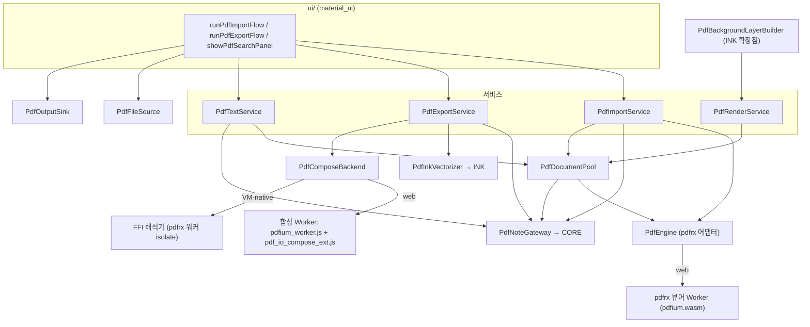

# 06 · PDF — PDF 입출력

> 상태: 1차 수정 (총괄 검토 00-review 3.6 반영, v0.1 → v0.2) · 작성일: 2026-11-04
> 마스터 기획서: [docs/PLAN.md](../PLAN.md) v1.1 · 영역 지도·통합 계약: [00-overview.md](00-overview.md) 7장 **계약 v1.0** · 검토: [00-review.md](00-review.md) 3.6
> 소유 경로: `packages/pdf_io/` · 패키지 이름: `pdf_io` (Flutter 패키지)

이 문서만 보고 별도 git worktree에서 PDF 영역을 구현할 수 있게 쓴다. 코드 블록의 Dart 시그니처는 **계약**이다. 이름·타입을 바꾸려면 총괄 관리자 승인이 필요하다. 구현 본문(`...`, `;`로 끝난 선언)은 개발자가 채운다. 수치(기본값·임계값)는 `PdfTuning`(4.13)에 모으고, 바꾸면 이 문서도 고친다.

**통합 계약 우선**: 다른 영역 타입(CORE·INK·EDITOR·LIBRARY·INFRA)은 00-overview 7장의 이름·형태를 **글자 그대로** 쓴다. 이 문서는 그 타입을 다시 정의하지 않고 5절에 'PDF가 어떻게 쓰는지'만 적는다. 7.2.19(PDF 공개 함수)와 4절이 다르면 7.2.19가 우선이며, 계약에 대한 의견은 12.1 '계약 변경 제안'에만 적는다.

외부 패키지의 동작은 기억이 아니라 **실제 실험**으로 확인했다(6.1 사전 검증, 7절). 실험은 저장소 밖 `/tmp/claude-0/plan-scratch/pdf/`에서 했고 저장소에는 이 문서만 추가했다.

---

## 1. 목적과 범위

### 1.1 목적

강의자료·문서 PDF를 노트로 가져와 그 위에 필기하고, 다시 **원본 텍스트가 살아 있는 PDF + 벡터 필기**로 내보낸다(PLAN 1.1 'PDF 중심 학습/업무'). M3(★ 실사용 시작)의 핵심 기능을 M0~M2 기간에 미리 만들어, iPad Safari 웹 빌드에서 검증할 수 있게 한다.

### 1.2 이번 동시 개발 범위

| 구분 | 내용 |
|---|---|
| 엔진 | pdfrx 2.11.0(PDFium) 초기화·문서 열기·페이지 정보·렌더링·텍스트 추출을 감싼 `PdfEngine` 포트와 pdfrx 어댑터. 웹은 pdfrx의 PDFium wasm 워커 |
| 가져오기 | 파일 선택(웹: file_picker 13.3.2), 새 노트 만들기 / 기존 노트에 페이지 삽입(되돌리기 1단계), 페이지 범위 선택, 페이지 크기 = PDF 페이지 크기(pt), PDF 바이트를 CORE `AssetStore`(내용 해시 ID)에 저장, 암호 PDF(암호 입력·재시도·해제 사본 저장), 크기·쪽수 상한, 진행률·취소, 새 노트 표지 썸네일(7.2.11 '가져오기 직후 표지'), 제목의 한글 자모 합성 |
| 배경 렌더링 | INK 배경 확장 지점 `PageBackgroundLayerBuilder` + 화면 밖 썸네일용 `PageBackgroundStillRenderer` 구현(7.2.16), 배율 버킷별 미리보기 + 512px 타일, 보이는 영역만 렌더, 우선순위 큐·취소, 메모리 예산(웹 32/64/16MB, LRU)·화면 밖 해제·탭 숨김 시 정리, 썸네일 모드(`ctx.isThumbnail`), 자리표시(로딩·원본 없음·내려받는 중·실패) |
| 원격 원본 | 원본 바이트가 없으면 `core.remoteAssetFetcherProvider`가 있을 때 `ensureLocal` 요청 + `watch`로 '내려받는 중' 표시, `AssetStore.bytesArrived`로 실패 캐시를 지우고 다시 렌더(계약 P-2). 이번 범위는 fetcher `null`(M4 전)로 동작 + 가짜 fetcher 테스트 |
| 텍스트 검색 | 페이지 텍스트 추출, 한글 정규화(NFD 자모 합성 등), **노트 안 PDF 텍스트 검색**(결과 목록·페이지 이동 요청·하이라이트) |
| 내보내기 | PDFium으로 원본 페이지 + 벡터 필기 합성(원본 텍스트 유지), 속지만 있는 페이지는 속지 6종을 벡터로(INK `TemplateVectors`), 형광펜 투명도·겹침(한 경로 + Multiply), 범위(전체/선택/현재), 옵션(필기 포함·속지 포함), 원본 없는 페이지는 기본 빈 페이지 + 경고, 웹 전용 워커에서 백그라운드 생성 + 진행률·취소 |
| 일괄 내보내기 | 라이브러리 다중 선택 → `exportNotesAsPdf(context, noteIds)`: 노트별 순차 내보내기, 취소 가능한 전체 진행률, 결과 시트(여러 파일 한 번에 공유 또는 파일별 다운로드) — 계약 7.8 '이번 범위' |
| 공유·저장 | 웹: Web Share API(파일 공유 → iPad 공유 시트의 '파일에 저장'·'프린트' 포함, 여러 파일), 브라우저 다운로드, 새 탭에서 열기 |
| 통합 창구 | 계약 7.2.19 전부: `initializePdfIo()`·`pdfIoOverrides()`(INFRA `PdfModule`), `importPdfAsNewNote`·`exportNotesAsPdf`(LIBRARY 자리 모양, INFRA `FeatureWiringModule`이 연결), 에디터 메뉴 동작 목록(`PdfMenuAction`), `pdfRenderStatsProvider`(개발자 표시), Riverpod provider 일체, PDFium 라이선스 등록 |
| 테스트 기반 | 순수 Dart PDF 픽스처 생성기(크기·회전·CropBox·텍스트·ToUnicode 한글·RC4 암호), VM 실 PDFium 테스트 환경, Chrome 브라우저 테스트 자산 준비 스크립트 `tool/prepare_web_test.dart`(→ `test/web/pdfium/`) |

### 1.3 이후 범위 (인터페이스·자리만 지금 준비)

| 항목 | 지금 준비하는 것 | 시점 |
|---|---|---|
| 다른 앱의 '공유'·'다음으로 열기'로 PDF 받기 | `PdfIncomingFileSource` 인터페이스(웹 구현은 빈 스트림) | 네이티브 전환 이후 |
| 네이티브 공유 시트·인쇄 | `PdfOutputSink` 인터페이스(네이티브 구현은 `unsupported`). 후보 share_plus 13.3.1, printing 5.15.1 (7절) | 네이티브 전환 이후 |
| 네이티브 실기기 검증 | 네이티브 합성 백엔드(FFI)는 VM 테스트용으로 **이번에 구현**하지만 iOS/Android 실기기 확인은 이후 | 네이티브 전환 이후 |
| PDF 텍스트 선택·복사, 목차(아웃라인)·내부 링크 이동 (F-02 P1) | 엔진 포트에 텍스트·좌표가 이미 있음 | M8 이후 |
| 라이브러리 전역 PDF 텍스트 검색(5.1 검색) | `PdfTextService.pageText` 추출 API. 색인은 CORE 테이블 + FTS(계약 7.8, CORE Q9 — `sqlite3.wasm`의 FTS5 포함 여부를 먼저 확인) | 이후 |
| 이미지(JPG/PNG) 가져오기 (F-02 P1), 이미지 배경 렌더·내보내기 (M5) | `PdfComposePagePlan`을 sealed로 두어 이미지 페이지 추가 자리 | M5 |
| 이미지(PNG/JPG) 내보내기, 앱 전용 형식 백업 (F-15 P1) | — | M8 이후 |
| 동기화로 들어온 노트의 PDF 원본 **실제** 내려받기 | 내려받기 요청·진행 표시·도착 후 다시 렌더는 이번에 구현(`remoteAssetFetcherProvider` 사용, 1.2 '원격 원본'). fetcher 구현은 SYNC `SyncRemoteAssetFetcher`, 주입은 INFRA `SyncModule` | M4 (주입) |

### 1.4 제외 (다른 영역 책임 또는 계획 없음)

| 항목 | 담당 |
|---|---|
| Page·Asset 등 데이터 모델, 로컬 DB, 에셋 바이트 저장·해시, 되돌리기, 썸네일 캐시 저장소 | CORE |
| 획 외곽선·형광펜 그룹·연필 단색 근사 등 **필기 벡터 생성**, 속지 6종 선·점 좌표 계산(기본값 단일 출처 03-ink 6.16), 페이지 뷰 레이어 합성, 화면 밖 페이지 썸네일 렌더러(`InkPageThumbnailRenderer`) | INK |
| 에디터 화면, 더보기 메뉴·페이지 추가 시트 UI, 페이지 패널 다중 선택, 페이지 이동(스크롤), 개발자 표시 화면 | EDITOR |
| 라이브러리 '새로 만들기' 버튼, 다중 선택 막대의 '내보내기' 버튼, 가져온 노트 열기(화면 이동), 노트 표지 예약 생성(`CoverThumbnailScheduler`) | LIBRARY |
| 앱 셸 연결(`PdfModule`·`FeatureWiringModule`의 provider override, `PdfMenuAction` → `EditorMenuItem` 변환, 렌더 통계 → `DevOverlaySection` 변환), 웹 배포·헤더, CI(훅 산출물·준비 산출물 캐시) | INFRA |
| PDF 원본 업로드·다운로드(`SyncRemoteAssetFetcher`) | SYNC |
| PPT·Word를 PDF로 변환해 가져오기 (F-02 P2) | 2단계 |
| PDF 원본 텍스트 편집, PDF 양식 채우기, 다른 사람과 공동 편집 | 계획 없음 |

---

## 2. PLAN.md 요구사항 대응표

| PLAN 위치 | 요구사항 | 이 계획서의 작업 | 범위 |
|---|---|---|---|
| F-02 | 가져오기 경로: 파일 앱 / 기기 저장소 | `PdfFileSource`(file_picker 웹) T6 | 이번 |
| F-02 | 가져오기 경로: 클라우드 드라이브 | iPad Safari 파일 선택기가 '파일' 앱 제공자(iCloud Drive 등)를 보여줌 → 같은 경로(iPad 확인 항목 U1). 드라이브 직접 연동은 이후 | 이번(선택기 경유) / 이후 |
| F-02 | 가져오기 경로: 다른 앱의 '공유'·'다음으로 열기' | `PdfIncomingFileSource` 인터페이스만 | 이후 |
| F-02 | 새 노트로 만들기 / 기존 노트에 페이지로 삽입 | `PdfImportService`·`runPdfImportFlow` T5·T6 | 이번 |
| F-02 | PDF 페이지를 배경으로, 벡터 렌더링해 확대해도 선명 | 배율 버킷 타일 재렌더 T8·T9 | 이번 |
| F-02 | 대용량(수백 쪽): 보이는 페이지만 렌더, 썸네일 캐시 | 문서 풀·렌더 캐시·썸네일 모드(`ctx.isThumbnail`)·still renderer T7~T10, 썸네일 저장·예약은 7.2.11 경로(6.9) | 이번 |
| F-02 | PDF 텍스트 검색 | 노트 안 검색 T11 | 이번(노트 안) / 이후(라이브러리 전역) |
| F-02 | PDF 텍스트 선택·복사, 목차·내부 링크 이동 (P1) | — | 이후 |
| F-02 | 암호 걸린 PDF 열기 | 암호 입력·재시도·해제 사본 저장 T3·T5·T6 | 이번 |
| F-02 | (P1) 이미지 가져오기 / (P2) PPT·Word 변환 | — | 이후 / 제외 |
| F-03 | 벡터 저장 — PDF 내보내기 시에도 벡터 유지 | INK 벡터 → PDF 경로 객체 T12~T14 | 이번 |
| F-03 | 형광펜: 반투명, 겹쳐도 진해지지 않음 (PDF에서도) | 같은 색·투명도·굵기 형광펜을 한 경로로 한 번 칠하기 + `/BM /Multiply` T12·T13 | 이번 |
| F-03 | 연필 질감 | PDF에서는 INK가 정한 단색 근사(투명도 ×0.85) 사용 | 이번(INK 결정 따름) |
| F-08 | 페이지 삽입도 되돌리기 대상 | 기존 노트 삽입 = CORE `InsertPages` 1회 = 1단계 T5 | 이번 |
| F-13 | 페이지 삽입 종류: PDF 페이지 (M3) | `PdfImportIntoNote`, 위치(현재 앞/뒤/맨 끝) T5·T6 | 이번 |
| F-13 | 페이지 크기 | PDF 페이지 크기(pt) 그대로, CORE 허용 범위 밖이면 비율 유지 축소·확대(6.5) | 이번 |
| F-15 | 범위: 노트 전체 / 선택한 페이지 / 현재 페이지 | `PdfExportRange` 3종 T15 | 이번 |
| F-15 | 필기는 벡터, 원본 PDF 텍스트 그대로 유지(검색 가능) | PDFium 합성(원본 페이지 가져오기 + 경로 추가) T13·T14, 검증 V5 | 이번 |
| F-15 | 옵션: 속지 포함 여부, 필기 포함 여부(원본만) | `PdfExportOptions.includeTemplates/includeInk` T15 | 이번 |
| F-15 | 공유 시트(메일·메신저·드라이브 저장), 인쇄 | 웹: Web Share API(공유 시트에 '프린트' 포함)·다운로드·새 탭 T16 / 네이티브 이후 | 이번(웹) / 이후(네이티브) |
| F-15 | 대용량 노트는 백그라운드 생성 + 진행률 | 웹 전용 합성 워커, 16쪽 묶음 진행률·취소 T14·T15 | 이번 |
| F-15 | (P1) 이미지 내보내기, 앱 전용 형식 | — | 이후 |
| F-01 | 다중 선택 후 일괄 내보내기 | `exportNotesAsPdf(context, noteIds)`(계약 7.2.19) — 노트별 순차 내보내기·진행률·결과 시트 T15b, LIBRARY 자리 `libraryPdfExportActionProvider`에 INFRA가 연결 | 이번 |
| F-07 | PDF 같은 큰 파일은 별도 파일 저장소, 다른 기기는 열 때 내려받기 | CORE `AssetStore` 사용, 원본 없으면 `assetMissing` 표시 + `remoteAssetFetcherProvider`가 있으면 `ensureLocal`·진행 표시·`bytesArrived`로 다시 렌더(6.6, 6.7.7) T7·T9 | 이번(요청·표시·재시도, fetcher 없이 동작) / M4(fetcher 주입) |
| 5.1 | 검색: 노트 제목 → **PDF 텍스트(M3)** → 손글씨 | 노트 안 검색 T11, 전역 색인은 Q6 | 부분 |
| 5.2 | 탭 / 분할 화면(교재 PDF와 노트 나란히) | — | 제외(EDITOR 이후) |
| 5.4 | 성능: 500페이지 PDF에서 60fps 스크롤 | 비동기 렌더·타일·예산(6.7), 성능 테스트 T18, iPad U5 | 이번 |
| 5.4 | 저장 용량: 같은 PDF는 한 번만 저장 | CORE 해시 중복 제거 + 원본 바이트 그대로 저장 정책(6.4) | 이번 |
| 5.4 | 측정: 개발자 표시 | `PdfRenderStats` 제공(표시는 EDITOR) T8 | 이번 |
| 6.2 | PDF 렌더링: pdfrx (PDFium) | pdfrx 2.11.0 고정 | 이번 |
| 6.2 | PDF 내보내기: PDFium 직접 또는 syncfusion (라이선스 확인) | 비교·결정 6.11.1 → PDFium(pdfrx의 wasm·네이티브 바이너리) | 이번 |
| 7.2 | `Page.background { type: pdf, assetId, pdfPageIndex }`, `Asset.id = 내용 해시` | CORE `PdfBackground`·`AssetStore.put` 사용 | 이번 |
| 7.3 | 레이어 순서: 배경(PDF) → 형광펜 → 필기 | 배경 레이어 구현(INK가 합성) | 이번 |
| 7.3 | 화면 밖 페이지는 메모리에서 해제 | 위젯 해제 시 타일 즉시 해제, 미리보기 LRU(6.7.6) | 이번 |
| 8 | 라이브러리 '새로 만들기: PDF 가져오기' | `runPdfImportFlow` 제공(버튼은 LIBRARY, 연결은 INFRA) | 이번 |
| 8 | 에디터 더보기: PDF 내보내기 · 공유 · 인쇄 | `pdfEditorMoreMenuActions()` 제공(메뉴는 EDITOR, 연결은 INFRA) | 이번 |
| 9.5 | 웹에서 돌아가도록 플랫폼 전용 기능 분리 | 조건부 import·파일 접미사 규칙(6.15) | 이번 |
| 10 M3 | PDF 가져오기 (새 노트 / 기존 노트에 삽입) | T5·T6 | 이번 |
| 10 M3 | 다른 앱에서 '공유'로 열기 | `PdfIncomingFileSource` | 이후 |
| 10 M3 | 대용량 PDF 지연 렌더링 · 썸네일 캐시 | T7~T10 | 이번 |
| 10 M3 | PDF 내보내기 (벡터 필기, 범위 선택), 공유 · 인쇄 | T12~T16 | 이번(웹) / 이후(네이티브 공유·인쇄) |
| 10 M3 | PDF 텍스트 검색 | T11 | 이번(노트 안) |
| 12 | 대용량 PDF 메모리 부족 → 페이지 가상화, 타일 렌더링 | 6.7 | 이번 |

---

## 3. 소유 경로와 패키지 구조

```text
packages/pdf_io/
├─ pubspec.yaml                  # resolution: workspace (루트 워크스페이스는 INFRA 소유)
├─ analysis_options.yaml         # include: ../../analysis_options.yaml
├─ dart_test.yaml                # tags: pdfium, browser, perf, integration (9.1)
├─ .gitignore                    # test/browser/pdfium/ (복사한 wasm 자산), build/
├─ README.md                     # 사용법·웹 자산·테스트 준비 (T19)
├─ THIRD_PARTY_NOTICES.md        # pdfrx(MIT, 워커 스크립트 재사용), PDFium, file_picker
├─ web/
│  └─ pdf_io_compose_ext.js      # 합성 워커 확장 명령 (flutter asset, platforms: [web]) (6.11.6)
├─ tool/
│  └─ prepare_test_assets.dart   # pdfrx wasm 자산 + 확장 JS → test/browser/pdfium/ 복사, libpdfium 위치 확인
├─ lib/
│  ├─ pdf_io.dart                # 공개 barrel (웹 안전)
│  ├─ testing.dart               # 픽스처 생성기·가짜 구현 (웹 안전, flutter_test 비의존)
│  └─ src/
│     ├─ init.dart               # initializePdfIo, pdfIoOverrides, PdfIoRuntime(내부)
│     ├─ config.dart             # PdfIoConfig, PdfImportLimits, PdfRenderBudget
│     ├─ tuning.dart             # PdfTuning — 모든 수치 상수
│     ├─ errors.dart             # PdfErrorCode, PdfIoException
│     ├─ common/                 # cancel_signal.dart, progress.dart, job_state.dart
│     ├─ model/                  # page_size_policy.dart, page_range.dart, file_naming.dart
│     ├─ engine/                 # pdf_engine.dart(포트), page_info.dart, pdfrx_engine.dart(pdfrx 유일 진입점)
│     ├─ gateway/                # pdf_note_gateway.dart(포트), core_note_gateway.dart(CORE 어댑터)
│     ├─ files/                  # pdf_file_source.dart(포트), file_picker_source.dart, incoming_files.dart
│     ├─ import/                 # import_service.dart, import_session.dart, import_types.dart
│     ├─ render/                 # document_pool.dart, tile_math.dart, render_cache.dart,
│     │                          # render_scheduler.dart, render_service.dart, render_stats.dart,
│     │                          # page_background_view.dart, page_background_painter.dart
│     ├─ ink_adapter/            # ink_background_builder.dart, ink_vectorizer.dart  ← ink_engine import는 여기만
│     ├─ text/                   # text_normalizer.dart, text_service.dart, search_types.dart, search_notifier.dart
│     ├─ export/                 # export_types.dart, vectors.dart, compose_plan.dart, compose_encoder.dart,
│     │                          # export_service.dart
│     ├─ compose/                # compose_backend.dart(포트), compose_backend_factory.dart(조건부 export),
│     │                          # display_matrix.dart, compose_backend_native.dart(dart:ffi),
│     │                          # compose_backend_browser.dart(Worker), compose_backend_stub.dart
│     ├─ output/                 # pdf_output_sink.dart(포트), output_sink_factory.dart(조건부 export),
│     │                          # output_sink_browser.dart, output_sink_stub.dart
│     ├─ ui/                     # import_sheet.dart, password_dialog.dart, export_sheet.dart,
│     │                          # export_progress_dialog.dart, export_result_sheet.dart, search_panel.dart,
│     │                          # flows.dart(runPdfImportFlow 등), menu_actions.dart, strings_ko.dart
│     └─ providers.dart
└─ test/
   ├─ support/                   # pdfium_env.dart(VM 전용, dart:io), compose_probes.dart, fake_images.dart
   ├─ contract/                  # api_surface_test.dart
   ├─ unit/                      # 순수 로직 (가짜 엔진·게이트웨이)
   ├─ widget/                    # 위젯·흐름
   ├─ golden/                    # 배경 상태 골든 (VM 전용)
   ├─ pdfium/                    # @Tags(['pdfium']) 실 PDFium(VM) 테스트
   ├─ browser/                   # @TestOn('browser') @Tags(['browser']) — pdfium/ 하위는 .gitignore
   └─ perf/                      # @Tags(['perf'])
```

원칙
- 다른 영역은 `package:pdf_io/pdf_io.dart`만 import한다. `package:pdf_io/testing.dart`는 테스트에서만.
- `lib/`에서 `dart:io` 금지. `dart:ffi`·`package:ffi`·`package:pdfium_dart`는 `compose_backend_native.dart`에서만, `dart:js_interop`·`package:web`은 `*_browser.dart`에서만 import한다(INFRA 접미사 규칙: 네이티브 `_native.dart`, 웹 `_browser.dart`).
- `package:pdfrx`는 `engine/pdfrx_engine.dart`, `init.dart`, `compose_backend_native.dart`(워커 isolate 실행용 `compute`)에서만 `as rx` 접두사로 import한다. pdfrx가 다시 내보내는 `PdfDocument`·`PdfPage`·`PdfRect` 등과 이름이 섞이지 않게 하기 위함.
- `package:ink_engine`은 `ink_adapter/` 두 파일에서만 `as ink`로 import한다 → INK API 이름이 바뀌어도 고칠 곳이 두 파일.
- `package:note_core`는 위젯 파일에서 `as core`로 import한다(Flutter `Page`(Navigator)와 CORE `Page` 이름 충돌).
- Material은 `package:material_ui`만 쓴다(INFRA D2). 자체 `MaterialApp`·`ProviderScope`를 만들지 않는다(테스트 제외).

### 3.1 pubspec.yaml (확정 버전 — 7절 근거)

```yaml
name: pdf_io
description: PDF import, background rendering, text search and export.
publish_to: none
resolution: workspace
environment:
  sdk: ^3.13.0
  flutter: ">=3.47.0"
dependencies:
  flutter:
    sdk: flutter
  collection: 1.19.1
  crypto: 3.0.8          # lib/testing.dart RC4 fixture (MD5)
  ffi: 2.2.0             # compose_backend_native.dart only
  file_picker: 13.3.2
  flutter_riverpod: 3.4.3
  ink_engine: any
  material_ui: 1.10.0
  meta: 1.19.0
  note_core: any
  pdfium_dart: 0.4.1     # FFI bindings, compose_backend_native.dart only (same version pdfrx_engine uses)
  pdfrx: 2.11.0
  web: 1.1.2             # *_browser.dart only
dev_dependencies:
  fake_async: 1.3.3
  flutter_test:
    sdk: flutter
flutter:
  assets:
    - path: web/
      platforms: [web]   # served at assets/packages/pdf_io/web/pdf_io_compose_ext.js
```

---

## 4. 공개 API

모든 공개 타입은 `package:pdf_io/pdf_io.dart`에서 export한다. 아래 import 관례: `core` = `package:note_core/note_core.dart`, `ink` = `package:ink_engine/ink_engine.dart`, `ui` = `dart:ui`.

### 4.1 초기화 · 앱 셸 창구 (INFRA가 사용)

```dart
// lib/src/config.dart
@immutable
final class PdfImportLimits {
  const PdfImportLimits({
    this.maxBytes = 300 * 1024 * 1024,    // hard limit (6.3)
    this.warnBytes = 100 * 1024 * 1024,   // confirm dialog above this
    this.maxPages = 2000,
    this.maxPasswordAttempts = 5,
  });
  final int maxBytes;
  final int warnBytes;
  final int maxPages;
  final int maxPasswordAttempts;
}

@immutable
final class PdfRenderBudget {
  const PdfRenderBudget({required this.previewBytes, required this.tileBytes, required this.thumbnailBytes});
  const PdfRenderBudget.web()
      : previewBytes = 48 * 1024 * 1024,
        tileBytes = 96 * 1024 * 1024,
        thumbnailBytes = 16 * 1024 * 1024;
  const PdfRenderBudget.native()
      : previewBytes = 64 * 1024 * 1024,
        tileBytes = 160 * 1024 * 1024,
        thumbnailBytes = 32 * 1024 * 1024;
  final int previewBytes;
  final int tileBytes;
  final int thumbnailBytes;
  int get totalBytes;
}

@immutable
final class PdfIoConfig {
  const PdfIoConfig({
    this.pdfiumWasmModulesUrl,   // null → pdfrx default 'assets/packages/pdfrx/assets/' (resolved against document.baseURI)
    this.composeExtensionUrl = 'assets/packages/pdf_io/web/pdf_io_compose_ext.js',
    this.warmUpOnStart = true,   // start engine init in the background (not awaited)
    this.limits = const PdfImportLimits(),
    this.renderBudget,           // null → web()/native() by platform
    this.generateCoverThumbnail = true,
  });
  final String? pdfiumWasmModulesUrl;
  final String composeExtensionUrl;
  final bool warmUpOnStart;
  final PdfImportLimits limits;
  final PdfRenderBudget? renderBudget;
  final bool generateCoverThumbnail;
  PdfRenderBudget get effectiveRenderBudget;
}
```

```dart
// lib/src/init.dart
/// Idempotent and web-safe. Applies [config] (pdfrx wasm module URL), and when
/// config.warmUpOnStart starts engine initialization WITHOUT awaiting the wasm
/// download (completes in < 10 ms). Engine failures never throw here; they
/// surface as PdfIoException(engineUnavailable) on first PDF use.
/// A second call with a different config is ignored (debug assert).
Future<void> initializePdfIo({PdfIoConfig config = const PdfIoConfig()});

/// Overrides the app shell adds to the root ProviderScope (INFRA D4):
///  - pdfIoConfigProvider (when [config] != null)
///  - ink.pageBackgroundBuildersProvider →
///      [ref.watch(pdfBackgroundLayerBuilderProvider), const ink.TemplateBackgroundLayerBuilder()]
List<Override> pdfIoOverrides({PdfIoConfig? config});
```

### 4.2 오류 · 취소 · 진행률 · 작업 상태

```dart
// lib/src/errors.dart
enum PdfErrorCode {
  notPdf,             // no '%PDF-' in the first 1024 bytes
  tooLarge,           // > PdfImportLimits.maxBytes
  tooManyPages,       // > PdfImportLimits.maxPages
  passwordCancelled,  // user dismissed the password dialog / attempts exhausted
  corrupt,            // PDFium could not parse
  engineUnavailable,  // wasm/native engine failed to initialize
  assetMissing,       // PDF bytes are not on this device (AssetStore.readBytes == null)
  storageFailed,      // AssetStore/DB write failed
  exportFailed,       // compose backend error
  pickerFailed,       // file picker error / unreadable file
  cancelled,
  busy,               // another import/export job is running
  unsupportedPlatform,
}

final class PdfIoException implements Exception {
  const PdfIoException(this.code, {this.detail, this.cause});
  final PdfErrorCode code;
  final String? detail;   // developer detail (English), shown in debug only
  final Object? cause;
  /// Korean message for UI (table 6.14).
  String get userMessage;
  @override
  String toString();
}
```

```dart
// lib/src/common/cancel_signal.dart
final class PdfCancelSignal {
  PdfCancelSignal();
  bool get isCancelled;
  void cancel();                       // idempotent
  Future<void> get whenCancelled;
  /// Throws PdfIoException(cancelled) if cancelled.
  void throwIfCancelled();
}

// lib/src/common/progress.dart
enum PdfJobPhase {
  readingFile, openingPdf, storingPdf, creatingPages, coverThumbnail,   // import
  preparingExport, composing, finishingExport,                          // export
}

@immutable
final class PdfProgress {
  const PdfProgress(this.phase, {this.done = 0, this.total = 0});
  final PdfJobPhase phase;
  final int done;
  final int total;                     // 0 = indeterminate
  double? get fraction;                // null when total == 0
  String get label;                    // Korean, e.g. 'PDF 여는 중', '페이지 합성 중 (12/40)'
}
typedef PdfProgressCallback = void Function(PdfProgress progress);

// lib/src/common/job_state.dart
sealed class PdfJobState<T> { const PdfJobState(); }
final class PdfJobIdle<T> extends PdfJobState<T> { const PdfJobIdle(); }
final class PdfJobRunning<T> extends PdfJobState<T> {
  const PdfJobRunning(this.progress);
  final PdfProgress progress;
}
final class PdfJobSucceeded<T> extends PdfJobState<T> {
  const PdfJobSucceeded(this.result);
  final T result;
}
final class PdfJobFailed<T> extends PdfJobState<T> {
  const PdfJobFailed(this.error);
  final PdfIoException error;          // code == cancelled for user cancel
}
```

### 4.3 엔진 포트 (`PdfEngine`)

pdfrx를 직접 쓰지 않고 이 포트를 거친다. 테스트는 `FakePdfEngine`(4.12)으로 바꾼다.

```dart
// lib/src/engine/page_info.dart
@immutable
final class PdfPageInfo {
  const PdfPageInfo({required this.index, required this.width, required this.height,
      required this.rotationQuarterTurns});
  final int index;                     // 0-based
  final double width;                  // displayed size in pt (after /Rotate, CropBox)
  final double height;
  final int rotationQuarterTurns;      // /Rotate / 90, 0..3
}

@immutable
final class PdfDocumentInfo {
  const PdfDocumentInfo({required this.pages, required this.isEncrypted, required this.usedPassword});
  final List<PdfPageInfo> pages;
  int get pageCount;
  final bool isEncrypted;              // any security handler (incl. owner-password-only)
  final bool usedPassword;             // a non-empty user password was needed to open
}

@immutable
final class PdfPasswordRequest {
  const PdfPasswordRequest({required this.fileName, required this.attempt});
  final String fileName;
  final int attempt;                   // 1-based; attempt > 1 means the previous one was wrong
}
/// Return null to give up.
typedef PdfPasswordCallback = Future<String?> Function(PdfPasswordRequest request);

enum PdfRenderPriority { high, normal, low }

final class PdfRenderCancelToken {
  PdfRenderCancelToken();
  bool get isCancelled;
  void cancel();
}

/// Integer pixel rectangle inside the full rendered page (scale * page size).
@immutable
final class PdfPixelRect {
  const PdfPixelRect(this.left, this.top, this.width, this.height);
  final int left, top, width, height;
  int get right;
  int get bottom;
  bool get isEmpty;
}

@immutable
final class PdfRenderRequest {
  const PdfRenderRequest({required this.pageIndex, required this.scale, this.region,
      this.backgroundArgb = 0xFFFFFFFF, this.priority = PdfRenderPriority.normal});
  final int pageIndex;
  final double scale;                  // device pixels per pt
  final PdfPixelRect? region;          // null → whole page
  final int backgroundArgb;
  final PdfRenderPriority priority;
  /// Full page size in pixels: (ceil(width * scale), ceil(height * scale)).
  (int, int) fullPixelSize(PdfPageInfo page);
}

@immutable
final class PdfPageTextData {
  const PdfPageTextData({required this.pageIndex, required this.text, required this.charRects});
  final int pageIndex;
  final String text;                   // raw text from PDFium (lines separated by \r\n)
  /// One rect per UTF-16 code unit of [text], displayed page pt, y down
  /// (converted from PDF bottom-left coordinates incl. rotation). Rect.zero when unknown.
  final List<ui.Rect> charRects;
}

abstract interface class PdfEngine {
  bool get isInitialized;
  /// Idempotent. Web: loads pdfium_client.js and instantiates pdfium.wasm in the pdfrx worker.
  /// Throws PdfIoException(engineUnavailable).
  Future<void> ensureInitialized();
  /// Throws notPdf / corrupt / passwordCancelled / engineUnavailable.
  /// [transferOwnership]: web may detach [bytes] (pass true only if the caller never reads them again).
  Future<PdfEngineDocument> open(Uint8List bytes, {required String sourceName,
      String fileName = '', PdfPasswordCallback? onPassword, int maxPasswordAttempts = 5,
      bool transferOwnership = false});
}

abstract interface class PdfEngineDocument {
  String get sourceName;
  PdfDocumentInfo get info;
  bool get isDisposed;
  /// Returns null when cancelled. The caller owns (and must dispose) the image.
  Future<ui.Image?> render(PdfRenderRequest request, {PdfRenderCancelToken? cancelToken});
  Future<PdfPageTextData> loadText(int pageIndex);
  /// Re-encodes without the security handler (FPDF_SAVE_NO_SECURITY). Used for
  /// user-password PDFs on import (6.4).
  Future<Uint8List> encodeWithoutSecurity();
  Future<void> dispose();              // idempotent
}

/// Production engine over pdfrx 2.11.0. Process-wide singleton (init is global in pdfrx).
final class PdfrxEngine implements PdfEngine {
  factory PdfrxEngine.shared();
  /// Applies config before the first ensureInitialized(); later calls are ignored.
  void configure(PdfIoConfig config);
  ...
}
```

### 4.4 노트 연결 포트 (`PdfNoteGateway`)

PDF가 CORE에 하는 일은 이 포트로만 한다. 기본 구현 `CorePdfNoteGateway`는 CORE 공개 API(5.1) 위의 얇은 어댑터다.

```dart
// lib/src/gateway/pdf_note_gateway.dart
abstract interface class PdfNoteGateway {
  /// AssetStore.put(bytes, type: pdf, mimeType: 'application/pdf', fileName: fileName).
  /// Same bytes → same Asset (content hash). Throws PdfIoException(storageFailed).
  Future<core.Asset> putPdf(Uint8List bytes, {required String fileName});
  /// null when the bytes are not on this device.
  Future<Uint8List?> readAssetBytes(core.AssetId assetId);
  Future<core.Note> createNote({core.FolderId? folderId, required String title,
      required List<core.PageDraft> pages});
  /// ONE undoable step (CORE InsertPages). Returns inserted page ids in order.
  Future<List<core.PageId>> insertPages(core.NoteId noteId, List<core.PageDraft> pages,
      core.PagePosition position);
  Future<void> flush();
  Future<core.Note?> getNote(core.NoteId noteId);
  Future<List<core.Page>> pagesOf(core.NoteId noteId);      // active, ordered
  Future<core.PageContent> loadPage(core.PageId pageId);    // committed state
  Future<void> writeThumbnail(core.PageThumbnail thumbnail);
}

// lib/src/gateway/core_note_gateway.dart
final class CorePdfNoteGateway implements PdfNoteGateway {
  CorePdfNoteGateway(this.store);
  final core.NoteStore store;
  ...
}
```

### 4.5 파일 선택 · 외부 수신

```dart
// lib/src/files/pdf_file_source.dart
@immutable
final class PickedPdfFile {
  const PickedPdfFile({required this.name, required this.readBytes, this.sizeBytes, this.mimeType});
  factory PickedPdfFile.fromBytes(String name, Uint8List bytes);   // tests, incoming files
  final String name;                   // original file name incl. extension
  final int? sizeBytes;                // known without I/O, or null
  final String? mimeType;
  final Future<Uint8List> Function() readBytes;
}

abstract interface class PdfFileSource {
  bool get isSupported;
  /// Web: MUST be called synchronously from a tap handler (Safari user activation).
  /// Returns null when the user cancels. Throws PdfIoException(pickerFailed).
  Future<PickedPdfFile?> pickPdf();
}

/// file_picker 13.3.2: FilePicker.pickFiles(type: FileType.custom, allowedExtensions: ['pdf']).
final class FilePickerPdfSource implements PdfFileSource {
  const FilePickerPdfSource();
  ...
}

/// Later (native share-to-open / "Open in"). Web implementation: empty stream.
abstract interface class PdfIncomingFileSource {
  Stream<PickedPdfFile> get incoming;
}

/// Default for web and this scope.
final class NoIncomingPdfFiles implements PdfIncomingFileSource {
  const NoIncomingPdfFiles();
  @override
  Stream<PickedPdfFile> get incoming;   // Stream.empty()
}
```

### 4.6 가져오기

```dart
// lib/src/model/page_range.dart
/// 1-based page range text such as '1-3, 5, 8-'. Resolves to 0-based indices.
@immutable
final class PdfPageRange {
  const PdfPageRange.all();
  /// Throws FormatException (message in Korean) on invalid input or out-of-range pages.
  factory PdfPageRange.parse(String input, {required int pageCount});
  bool get isAll;
  List<int> resolve(int pageCount);    // ascending input order, duplicates removed
  String format();                     // canonical text, e.g. '1-3, 5'
}

// lib/src/model/page_size_policy.dart
abstract final class PdfPageSizePolicy {
  /// PDF displayed size (pt) → CORE PageSize. Rounds to 0.001 pt; if a side is
  /// outside [core.PageSize.minSide, maxSide] scales BOTH sides uniformly (6.5).
  static core.PageSize toNotePageSize(double widthPt, double heightPt);
}

// lib/src/import/import_types.dart
sealed class PdfImportTarget { const PdfImportTarget(); }
final class PdfImportAsNewNote extends PdfImportTarget {
  const PdfImportAsNewNote({this.folderId, this.title});
  final core.FolderId? folderId;       // null = top level
  final String? title;                 // null → file name without '.pdf'
}
final class PdfImportIntoNote extends PdfImportTarget {
  const PdfImportIntoNote({required this.noteId, required this.position});
  final core.NoteId noteId;
  final core.PagePosition position;    // PageAfter(current) by default from the editor
}

@immutable
final class PdfImportResult {
  const PdfImportResult({required this.noteId, required this.insertedPageIds,
      required this.assetId, required this.sourcePageCount, required this.storedDecryptedCopy,
      required this.createdNewNote});
  final core.NoteId noteId;
  final List<core.PageId> insertedPageIds;
  final core.AssetId assetId;
  final int sourcePageCount;
  final bool storedDecryptedCopy;      // user-password PDF stored without security (6.4)
  final bool createdNewNote;
  core.PageId get firstPageId;
}

// lib/src/import/import_service.dart
abstract interface class PdfImportService {
  /// Reads and opens the file (password prompts via [onPassword]); checks limits.
  /// Throws notPdf / tooLarge / tooManyPages / passwordCancelled / corrupt / pickerFailed.
  Future<PdfImportSession> open(PickedPdfFile file, {PdfPasswordCallback? onPassword,
      PdfProgressCallback? onProgress, PdfCancelSignal? cancel});
}

/// An opened, not yet committed import. Keeps the bytes and the engine document.
abstract interface class PdfImportSession {
  PickedPdfFile get file;
  PdfDocumentInfo get info;
  int get byteLength;
  bool get isLargeFile;                // byteLength > limits.warnBytes
  bool get willStoreDecryptedCopy;     // info.usedPassword
  String get suggestedTitle;           // file name without extension, trimmed, 1..200 chars
  /// Stores the asset, creates the pages; hands the opened document to the pool.
  /// Cancellable until pages are created. Throws storageFailed / cancelled.
  Future<PdfImportResult> commit(PdfImportTarget target, {PdfPageRange range = const PdfPageRange.all(),
      PdfProgressCallback? onProgress, PdfCancelSignal? cancel});
  Future<void> dispose();              // idempotent; closes the document if not committed
}

final class DefaultPdfImportService implements PdfImportService {
  DefaultPdfImportService({required PdfEngine engine, required PdfNoteGateway gateway,
      required PdfDocumentPool pool, required PdfIoConfig config});
  ...
}
```

### 4.7 배경 렌더링 · INK 확장 지점 구현

```dart
// lib/src/render/render_service.dart
@immutable
final class PdfBackgroundParams {
  const PdfBackgroundParams({required this.assetId, required this.pdfPageIndex,
      required this.pageSize, required this.deviceScale, this.paperColorArgb = 0xFFFFFFFF,
      this.visiblePageRect, this.isScaling = false, this.isThumbnail = false, this.pageId});
  final core.AssetId assetId;
  final int pdfPageIndex;
  final ui.Size pageSize;              // note page size in pt (box to fill)
  final double deviceScale;            // device px per pt = viewScale * ancestorScale * devicePixelRatio
  final int paperColorArgb;
  final ui.Rect? visiblePageRect;      // pt, page coordinates; null = whole page visible
  final bool isScaling;                // pinch in progress → no new resolution requests
  final bool isThumbnail;              // forced thumbnail mode (page panel)
  final String? pageId;                // diagnostics only
  /// True when isThumbnail or deviceScale * longest side <= PdfTuning.thumbnailModeMaxLongSidePx.
  bool get usesThumbnailMode;
}

enum PdfRenderStatus { loading, ready, assetMissing, needsPassword, failed }

@immutable
final class PdfPlacedImage {
  const PdfPlacedImage({required this.image, required this.srcRect, required this.pageRect});
  final ui.Image image;                // owned by the cache — never dispose
  final ui.Rect srcRect;               // pixels (overlap border excluded)
  final ui.Rect pageRect;              // pt, page coordinates
}

@immutable
final class PdfRenderSnapshot {
  const PdfRenderSnapshot({required this.status, this.base, this.tiles = const [], this.error});
  static const PdfRenderSnapshot loading = PdfRenderSnapshot(status: PdfRenderStatus.loading);
  final PdfRenderStatus status;
  final PdfPlacedImage? base;          // preview or thumbnail covering the whole page
  final List<PdfPlacedImage> tiles;    // older bucket first, then current bucket
  final PdfIoException? error;
}

@immutable
final class PdfRenderStats {
  const PdfRenderStats({required this.previewBytes, required this.tileBytes,
      required this.thumbnailBytes, required this.liveImages, required this.queued,
      required this.inflight, required this.rendered, required this.cancelled,
      required this.lastRenderMs, required this.p95RenderMs, required this.openDocuments,
      required this.overBudgetBytes});
  static const PdfRenderStats zero = ...;
  final int previewBytes, tileBytes, thumbnailBytes, liveImages, queued, inflight;
  final int rendered, cancelled, openDocuments;
  final int overBudgetBytes;           // > 0 when in-use images exceed the budget
  final double lastRenderMs, p95RenderMs;
}

/// One mounted page background. Notifies when [snapshot] changes.
abstract interface class PdfPageRenderHandle implements Listenable {
  PdfBackgroundParams get params;
  PdfRenderSnapshot get snapshot;
  void update(PdfBackgroundParams params);
  void dispose();                      // cancels requests, releases tiles
}

abstract interface class PdfPageRenderer {
  PdfPageRenderHandle attach(PdfBackgroundParams params);
  /// Small standalone render (cover thumbnails, page panel). Caller owns the image.
  Future<ui.Image?> renderThumbnail({required core.AssetId assetId, required int pdfPageIndex,
      required int longSidePx, int backgroundArgb = 0xFFFFFFFF});
  PdfRenderStats get stats;
  ValueListenable<PdfRenderStats> get statsListenable;
  /// Drops every image not in use (memory pressure, tab hidden).
  void trimMemory();
  Future<void> dispose();
}

final class PdfRenderService implements PdfPageRenderer {
  PdfRenderService({required PdfDocumentPool pool, required PdfRenderBudget budget,
      int maxInflight = PdfTuning.maxInflightRenders});
  ...
}
```

```dart
// lib/src/render/page_background_view.dart
/// Fills the page box (pageSize * viewScale logical px), paints opaque paper,
/// never handles pointer events (wrapped in IgnorePointer).
class PdfPageBackgroundView extends StatefulWidget {
  const PdfPageBackgroundView({super.key, required this.params, required this.renderer,
      this.highlights, this.viewScale});
  final PdfBackgroundParams params;
  final PdfPageRenderer renderer;
  /// Active search state for highlight rects (null = no highlights).
  final ValueListenable<PdfSearchState>? highlights;
  /// Logical px per pt. null → deviceScale / devicePixelRatio of the context.
  final double? viewScale;
  @override
  State<PdfPageBackgroundView> createState();
}

// lib/src/ink_adapter/ink_background_builder.dart
/// INK extension point implementation for InkBackgroundKind.pdf (6.8).
final class PdfBackgroundLayerBuilder
    implements ink.PageBackgroundLayerBuilder, ink.PageBackgroundStillRenderer /* if INK adds it (5.2 K-7) */ {
  const PdfBackgroundLayerBuilder({required this.renderer, this.highlights});
  final PdfPageRenderer renderer;
  final ValueListenable<PdfSearchState>? highlights;
  /// background.kind == pdf && assetId != null && pdfPageIndex != null.
  @override
  bool handles(ink.InkBackgroundSpec background);
  /// Maps PageBackgroundContext → PdfBackgroundParams and returns PdfPageBackgroundView.
  @override
  Widget build(BuildContext context, ink.PageBackgroundContext ctx);
  /// Pure mapping (unit-tested).
  static PdfBackgroundParams paramsFrom(ink.PageBackgroundContext ctx);
  /// Offscreen still image (5.2 K-7): renderer.renderThumbnail with
  /// longSidePx = max(pixelSize) and contain-fit into pixelSize. Paper color behind.
  Future<ui.Image?> renderStill(ink.InkBackgroundSpec background, {required ui.Size pageSize,
      required ui.Size pixelSize});
}
```

```dart
// lib/src/render/document_pool.dart
abstract interface class PdfDocumentLease {
  core.AssetId get assetId;
  PdfEngineDocument get document;
  void release();                      // idempotent
}

abstract interface class PdfDocumentPool {
  /// Opens (once, deduplicated) from gateway.readAssetBytes. Throws assetMissing / corrupt /
  /// passwordCancelled (needsPassword) / engineUnavailable. Failures are not cached.
  Future<PdfDocumentLease> acquire(core.AssetId assetId);
  /// Import hands over its already opened document (no second open).
  void adopt(core.AssetId assetId, PdfEngineDocument document);
  int get openCount;
  Future<void> closeIdle();
  Future<void> dispose();
}

final class DefaultPdfDocumentPool implements PdfDocumentPool {
  DefaultPdfDocumentPool({required PdfEngine engine, required PdfNoteGateway gateway,
      int maxIdleDocuments = PdfTuning.maxIdleDocuments,
      Duration idleTtl = PdfTuning.idleDocumentTtl});
  ...
}
```

### 4.8 텍스트 · 검색

```dart
// lib/src/text/text_normalizer.dart
@immutable
final class PdfNormalizedText {
  const PdfNormalizedText({required this.text, required this.sourceStart, required this.sourceEnd});
  final String text;
  /// For normalized code unit i: source range [sourceStart[i], sourceEnd[i]) in the raw text.
  final Int32List sourceStart;
  final Int32List sourceEnd;
}

abstract final class PdfTextNormalizer {
  /// Steps in 6.10.1 (Hangul jamo composition, whitespace collapse, soft hyphen/ZW removal,
  /// end-of-line hyphenation join, lower-casing).
  static PdfNormalizedText normalize(String raw);
  static String normalizeQuery(String query);
}

// lib/src/text/search_types.dart
@immutable
final class PdfSearchHit {
  const PdfSearchHit({required this.pageId, required this.notePageNumber, required this.assetId,
      required this.pdfPageIndex, required this.rects, required this.snippet,
      required this.matchStart, required this.matchLength});
  final core.PageId pageId;
  final int notePageNumber;            // 1-based position in the note
  final core.AssetId assetId;
  final int pdfPageIndex;
  final List<ui.Rect> rects;           // pt, page coordinates, merged per line
  final String snippet;                // ±24 chars of context, whitespace collapsed
  final int matchStart;                // in snippet
  final int matchLength;
}

enum PdfSearchStatus { idle, searching, done, failed }

@immutable
final class PdfSearchState {
  const PdfSearchState({this.noteId, this.query = '', this.status = PdfSearchStatus.idle,
      this.scannedPages = 0, this.totalPages = 0, this.hits = const [], this.currentIndex = -1,
      this.truncated = false, this.error});
  static const PdfSearchState idle = PdfSearchState();
  final core.NoteId? noteId;
  final String query;
  final PdfSearchStatus status;
  final int scannedPages;
  final int totalPages;
  final List<PdfSearchHit> hits;       // note page order, then position on page
  final int currentIndex;              // -1 = none selected
  final bool truncated;                // maxHits reached
  final PdfIoException? error;
  PdfSearchHit? get current;
  /// Highlight rects for one PDF page (used by PdfPageBackgroundView).
  List<ui.Rect> rectsFor(core.AssetId assetId, int pdfPageIndex);
  List<ui.Rect> currentRectsFor(core.AssetId assetId, int pdfPageIndex);
}

@immutable
final class PdfSearchProgress {
  const PdfSearchProgress({required this.scannedPages, required this.totalPages,
      required this.newHits, required this.isDone, this.truncated = false});
  final int scannedPages, totalPages;
  final List<PdfSearchHit> newHits;
  final bool isDone;
  final bool truncated;
}

// lib/src/text/text_service.dart
abstract interface class PdfTextService {
  /// Cached (LRU PdfTuning.textCachePages). Throws assetMissing / corrupt.
  Future<PdfPageTextData> pageText(core.AssetId assetId, int pdfPageIndex);
  /// Scans PDF-background pages of the note in note order (non-PDF pages are skipped;
  /// totalPages counts PDF pages only). Emits every 10 pages or 100 ms.
  Stream<PdfSearchProgress> searchNote(core.NoteId noteId, String query,
      {PdfCancelSignal? cancel, int maxHits = PdfTuning.maxSearchHits});
  void clearCache();
}

final class DefaultPdfTextService implements PdfTextService {
  DefaultPdfTextService({required PdfDocumentPool pool, required PdfNoteGateway gateway});
  ...
}

// lib/src/text/search_notifier.dart — single active search for the open editor
class PdfSearchNotifier extends Notifier<PdfSearchState> {
  @override
  PdfSearchState build();              // PdfSearchState.idle
  /// Cancels the previous search; empty query → idle.
  void start(core.NoteId noteId, String query);
  void select(int index);
  void selectNext();                   // wraps around
  void selectPrevious();
  void clear();
}
```

### 4.9 내보내기

```dart
// lib/src/export/export_types.dart
sealed class PdfExportRange { const PdfExportRange(); }
final class PdfExportAllPages extends PdfExportRange { const PdfExportAllPages(); }
final class PdfExportCurrentPage extends PdfExportRange {
  const PdfExportCurrentPage(this.pageId);
  final core.PageId pageId;
}
final class PdfExportSelectedPages extends PdfExportRange {
  const PdfExportSelectedPages(this.pageIds);   // exported in NOTE order, not list order
  final List<core.PageId> pageIds;
}

enum PdfMissingAssetPolicy { fail, blankPage }

@immutable
final class PdfExportOptions {
  const PdfExportOptions({this.range = const PdfExportAllPages(), this.includeInk = true,
      this.includeTemplates = true, this.missingAssetPolicy = PdfMissingAssetPolicy.fail,
      this.fileName});
  final PdfExportRange range;
  final bool includeInk;               // false = original pages only (F-15 '원본만')
  final bool includeTemplates;         // false = blank/template pages become plain white pages
  final PdfMissingAssetPolicy missingAssetPolicy;
  final String? fileName;              // null → PdfFileNaming.forExport
}

sealed class PdfExportWarning { const PdfExportWarning(); }
final class PdfExportBlankedMissingAsset extends PdfExportWarning {
  const PdfExportBlankedMissingAsset(this.notePageNumbers);
  final List<int> notePageNumbers;
}

@immutable
final class PdfExportResult {
  const PdfExportResult({required this.bytes, required this.fileName, required this.pageCount,
      required this.elapsed, this.warnings = const []});
  final Uint8List bytes;
  final String fileName;               // ends with '.pdf'
  final int pageCount;
  final Duration elapsed;
  final List<PdfExportWarning> warnings;
  String get mimeType;                 // 'application/pdf'
}

// lib/src/model/file_naming.dart
abstract final class PdfFileNaming {
  /// Rules 6.11.10. [currentPageNumber] is 1-based (for PdfExportCurrentPage).
  static String forExport(String noteTitle, PdfExportRange range,
      {int? currentPageNumber, int? selectedCount});
  static String sanitize(String name);
}

// lib/src/export/export_service.dart
abstract interface class PdfExportService {
  /// Throws assetMissing (policy fail) / exportFailed / cancelled / engineUnavailable / busy.
  Future<PdfExportResult> exportNote(core.NoteId noteId, PdfExportOptions options,
      {PdfProgressCallback? onProgress, PdfCancelSignal? cancel});
}

final class DefaultPdfExportService implements PdfExportService {
  DefaultPdfExportService({required PdfNoteGateway gateway, required PdfInkVectorizer vectorizer,
      required PdfComposeBackend backend});
  ...
}
```

```dart
// lib/src/export/vectors.dart — renderer-neutral vectors (page pt, y down)
enum PdfBlend { normal, multiply }
enum PdfFillRule { evenOdd, nonZero }
enum PdfLineCap { butt, round, square }
enum PdfLineJoin { miter, round, bevel }

/// Verb codes equal ink.InkPathVerb indices: 0 moveTo(2), 1 lineTo(2), 2 cubicTo(6), 3 close(0).
@immutable
final class PdfVectorPath {
  const PdfVectorPath(this.verbs, this.coords);
  factory PdfVectorPath.rect(ui.Rect rect);
  /// Each circle = 4 cubic Béziers (k = 0.5523), one subpath per circle.
  factory PdfVectorPath.circles(List<(ui.Offset, double)> centersAndRadii);
  /// Concatenates subpaths (each input must start with moveTo).
  factory PdfVectorPath.concat(List<PdfVectorPath> paths);
  final Uint8List verbs;
  final Float32List coords;
  bool get isEmpty;
}

sealed class PdfVectorItem {
  const PdfVectorItem({required this.path, required this.colorArgb, required this.opacity,
      this.blend = PdfBlend.normal});
  final PdfVectorPath path;
  final int colorArgb;                 // alpha byte multiplies opacity
  final double opacity;                // 0..1
  final PdfBlend blend;
  /// round(255 * opacity * alpha(colorArgb) / 255), computed without bit ops.
  int get alpha255;
}
final class PdfFillItem extends PdfVectorItem {
  const PdfFillItem({required super.path, required super.colorArgb, super.opacity = 1,
      super.blend, this.fillRule = PdfFillRule.nonZero});
  final PdfFillRule fillRule;
}
final class PdfStrokeItem extends PdfVectorItem {
  const PdfStrokeItem({required super.path, required super.colorArgb, super.opacity = 1,
      super.blend, required this.width, this.cap = PdfLineCap.round, this.join = PdfLineJoin.round});
  final double width;                  // pt
  final PdfLineCap cap;
  final PdfLineJoin join;
}

@immutable
final class PdfPageVectors {
  const PdfPageVectors({this.underlay = const [], this.ink = const []});
  static const PdfPageVectors empty = PdfPageVectors();
  final List<PdfVectorItem> underlay;  // paper fill + template (blank/template pages only)
  final List<PdfVectorItem> ink;       // highlighter strokes first, then fills in z-order
  bool get isEmpty;
}

/// Port to INK's vector export (default InkEngineVectorizer in ink_adapter/).
abstract interface class PdfInkVectorizer {
  PdfPageVectors vectorize(core.Page page, List<core.Stroke> strokes,
      {required bool includeInk, required bool includeTemplate});
}

final class InkEngineVectorizer implements PdfInkVectorizer {
  const InkEngineVectorizer();
  ...
}
```

```dart
// lib/src/export/compose_plan.dart
@immutable
final class PdfComposeSource {
  const PdfComposeSource({required this.assetId, required this.bytes});
  final core.AssetId assetId;
  final Uint8List bytes;
}

sealed class PdfComposePagePlan {
  const PdfComposePagePlan({required this.noteSize});
  final ui.Size noteSize;              // pt
}
final class PdfComposeSourcePage extends PdfComposePagePlan {
  const PdfComposeSourcePage({required this.sourceIndex, required this.pdfPageIndex,
      required super.noteSize});
  final int sourceIndex;
  final int pdfPageIndex;
}
final class PdfComposeBlankPage extends PdfComposePagePlan {
  const PdfComposeBlankPage({required super.noteSize});
}

@immutable
final class PdfComposePlan {
  const PdfComposePlan({required this.sources, required this.pages});
  final List<PdfComposeSource> sources;
  final List<PdfComposePagePlan> pages;           // output order
  /// Stride 6 per page: [kind(0 source, 1 blank), sourceIndex, pdfPageIndex, noteW, noteH, 0].
  Float64List encodePages();
}

/// Binary ops of one output page (format 6.11.5).
@immutable
final class PdfComposePageOps {
  const PdfComposePageOps({required this.outputIndex, required this.verbs, required this.coords,
      required this.paints});
  final int outputIndex;
  final Uint8List verbs;
  final Float32List coords;
  final Float32List paints;            // stride PdfComposeOpcodes.paintStride
  bool get isEmpty;
  int get byteLength;
}

abstract final class PdfComposeOpcodes {
  static const int moveTo = 0, lineTo = 1, cubicTo = 2, close = 3, endObject = 7;
  static const int paintStride = 10;
  // paint layout: [type(0 fill, 1 stroke), r, g, b, a(0..255), width, cap, join, blend, fillMode]
  static const int fillModeEvenOdd = 1, fillModeNonZero = 2;   // FPDF_FILLMODE_ALTERNATE/WINDING
}

abstract final class PdfComposeEncoder {
  /// underlay then ink; every item becomes one PDF path object (6.11.5).
  static PdfComposePageOps encode({required int outputIndex, required PdfPageVectors vectors});
}

// lib/src/compose/compose_backend.dart
abstract interface class PdfComposeJob {
  /// Pages must each be complete (a page's ops never span two calls).
  Future<void> addPages(List<PdfComposePageOps> pages);
  Future<Uint8List> finish();
  Future<void> abort();                // idempotent
}

abstract interface class PdfComposeBackend {
  bool get isSupported;
  /// Loads sources, imports pages (one import call per source), creates blank pages,
  /// orders them (6.11.4). Throws PdfIoException(exportFailed / engineUnavailable).
  Future<PdfComposeJob> begin(PdfComposePlan plan);
  Future<void> dispose();
}

// lib/src/compose/compose_backend_factory.dart (conditional export, 6.15)
/// Web: dedicated Worker (pdfrx pdfium_worker.js + pdf_io_compose_ext.js), chunk 16 pages.
/// VM/native: FFI interpreter on the pdfrx background isolate, chunk 8 pages. Other: unsupported.
PdfComposeBackend createPlatformComposeBackend(PdfIoConfig config);
```

### 4.10 공유 · 저장

```dart
// lib/src/output/pdf_output_sink.dart
enum PdfOutputAction { share, download, openInNewTab }
enum PdfOutputOutcome { done, dismissedByUser, needsUserGesture, failed, unsupported }

abstract interface class PdfOutputSink {
  /// Web on iPad: {share, download, openInNewTab}; desktop Chrome w/o file share: {download, openInNewTab}.
  Set<PdfOutputAction> availableActions(PdfExportResult result);
  /// Web: MUST be called synchronously from a tap handler (navigator.share / window.open
  /// need transient user activation).
  Future<PdfOutputOutcome> deliver(PdfExportResult result, PdfOutputAction action);
}

PdfOutputSink createPlatformOutputSink();     // web: browser sink; others: unsupported
```

### 4.11 UI 흐름 · 메뉴 동작 (EDITOR·LIBRARY 연결용, INFRA가 연결)

```dart
// lib/src/ui/flows.dart
typedef PdfNavigateCallback = void Function(core.PageId pageId, ui.Rect? focusRectPt);

enum PdfExportPurpose { save, share, print }

/// Shows the import sheet ('PDF 파일 선택' button → pick → password → options → progress).
/// Returns null when cancelled, when the flow already showed its error, or when [context]
/// is unmounted midway (silently). Never throws for user-level failures.
/// Requires an ancestor ProviderScope.
Future<PdfImportResult?> runPdfImportFlow(BuildContext context, PdfImportTarget target);

/// Same shape as LIBRARY's `LibraryPdfImportAction` (05-library 4.3):
/// runPdfImportFlow(context, PdfImportAsNewNote(folderId: folderId)) → created note id or null.
/// The app shell overrides `libraryPdfImportActionProvider` with this function.
Future<String?> importPdfAsNewNote(BuildContext context, {String? folderId});

/// Options sheet → progress dialog (cancellable) → result sheet (share/download/open).
Future<PdfExportResult?> runPdfExportFlow(BuildContext context, {required core.NoteId noteId,
    core.PageId? currentPageId, List<core.PageId> selectedPageIds = const [],
    PdfExportPurpose purpose = PdfExportPurpose.save});

/// Search sheet (query field, progress, hit list). Tapping a hit selects it and calls [onNavigate].
Future<void> showPdfSearchPanel(BuildContext context, {required core.NoteId noteId,
    required PdfNavigateCallback onNavigate});

// lib/src/ui/menu_actions.dart
@immutable
final class PdfMenuInvocation {
  const PdfMenuInvocation({required this.noteId, this.currentPageId,
      this.selectedPageIds = const [], this.onNavigate});
  final core.NoteId noteId;
  final core.PageId? currentPageId;
  final List<core.PageId> selectedPageIds;
  final PdfNavigateCallback? onNavigate;
}

@immutable
final class PdfMenuAction {
  const PdfMenuAction({required this.id, required this.label, required this.icon,
      required this.run, this.isEnabled});
  final String id;                     // stable: 'pdf.export', 'pdf.share', 'pdf.print', 'pdf.search', 'pdf.insert'
  final String label;                  // Korean
  final IconData icon;
  final Future<void> Function(BuildContext context, PdfMenuInvocation invocation) run;
  final bool Function(PdfMenuInvocation invocation)? isEnabled;
}

/// 'PDF로 내보내기', 'PDF 공유', '인쇄', 'PDF에서 찾기' (search disabled without onNavigate).
List<PdfMenuAction> pdfEditorMoreMenuActions();
/// 'PDF에서 페이지 삽입' (inserts after currentPageId, else at end; navigates to the first inserted page).
List<PdfMenuAction> pdfEditorAddPageSources();
```

### 4.12 Riverpod provider

`flutter_riverpod` 3.4.3. 모두 keepAlive(Riverpod 3 기본). CORE의 `noteStoreProvider`(package:riverpod)를 그대로 watch한다.

```dart
// lib/src/providers.dart
final pdfIoConfigProvider = Provider<PdfIoConfig>(
    (ref) => PdfIoRuntime.config, name: 'pdfIoConfigProvider');
final pdfEngineProvider = Provider<PdfEngine>((ref) {
  final e = PdfrxEngine.shared()..configure(ref.watch(pdfIoConfigProvider));
  return e;
}, name: 'pdfEngineProvider');
final pdfNoteGatewayProvider = Provider<PdfNoteGateway>(
    (ref) => CorePdfNoteGateway(ref.watch(core.noteStoreProvider)), name: 'pdfNoteGatewayProvider');
final pdfDocumentPoolProvider = Provider<PdfDocumentPool>((ref) {
  final pool = DefaultPdfDocumentPool(engine: ref.watch(pdfEngineProvider),
      gateway: ref.watch(pdfNoteGatewayProvider));
  ref.onDispose(pool.dispose);
  return pool;
}, name: 'pdfDocumentPoolProvider');
final pdfPageRendererProvider = Provider<PdfPageRenderer>((ref) {
  final r = PdfRenderService(pool: ref.watch(pdfDocumentPoolProvider),
      budget: ref.watch(pdfIoConfigProvider).effectiveRenderBudget);
  ref.onDispose(r.dispose);
  return r;
}, name: 'pdfPageRendererProvider');
final pdfRenderStatsProvider = Provider<ValueListenable<PdfRenderStats>>(
    (ref) => ref.watch(pdfPageRendererProvider).statsListenable, name: 'pdfRenderStatsProvider');
final pdfTextServiceProvider = Provider<PdfTextService>(...);            // DefaultPdfTextService(pool, gateway)
final pdfActiveSearchProvider =
    NotifierProvider<PdfSearchNotifier, PdfSearchState>(PdfSearchNotifier.new, name: 'pdfActiveSearchProvider');
/// Bridges pdfActiveSearchProvider into a ValueListenable for background views (no ProviderScope needed there).
final pdfSearchHighlightsProvider = Provider<ValueListenable<PdfSearchState>>(...);
final pdfBackgroundLayerBuilderProvider = Provider<ink.PageBackgroundLayerBuilder>(
    (ref) => PdfBackgroundLayerBuilder(renderer: ref.watch(pdfPageRendererProvider),
        highlights: ref.watch(pdfSearchHighlightsProvider)), name: 'pdfBackgroundLayerBuilderProvider');
final pdfFileSourceProvider = Provider<PdfFileSource>((ref) => const FilePickerPdfSource());
final pdfIncomingFileSourceProvider = Provider<PdfIncomingFileSource>((ref) => const NoIncomingPdfFiles());
final pdfOutputSinkProvider = Provider<PdfOutputSink>((ref) => createPlatformOutputSink());
final pdfInkVectorizerProvider = Provider<PdfInkVectorizer>((ref) => const InkEngineVectorizer());
final pdfComposeBackendProvider = Provider<PdfComposeBackend>((ref) {
  final b = createPlatformComposeBackend(ref.watch(pdfIoConfigProvider));
  ref.onDispose(b.dispose);
  return b;
}, name: 'pdfComposeBackendProvider');
final pdfImportServiceProvider = Provider<PdfImportService>(...);        // DefaultPdfImportService
final pdfExportServiceProvider = Provider<PdfExportService>(...);        // DefaultPdfExportService
final pdfImportJobProvider = NotifierProvider<PdfImportJobNotifier, PdfJobState<PdfImportResult>>(
    PdfImportJobNotifier.new, name: 'pdfImportJobProvider');
final pdfExportJobProvider = NotifierProvider<PdfExportJobNotifier, PdfJobState<PdfExportResult>>(
    PdfExportJobNotifier.new, name: 'pdfExportJobProvider');

class PdfImportJobNotifier extends Notifier<PdfJobState<PdfImportResult>> {
  @override
  PdfJobState<PdfImportResult> build();          // PdfJobIdle
  bool get isBusy;
  /// Throws nothing; failures end in PdfJobFailed. Returns null unless succeeded.
  Future<PdfImportResult?> run(PdfImportSession session, PdfImportTarget target,
      {PdfPageRange range = const PdfPageRange.all()});
  void cancel();
  void reset();
}

class PdfExportJobNotifier extends Notifier<PdfJobState<PdfExportResult>> {
  @override
  PdfJobState<PdfExportResult> build();
  bool get isBusy;
  Future<PdfExportResult?> run(core.NoteId noteId, PdfExportOptions options);
  void cancel();
  void reset();
}
```

| provider | 타입 | 누가 override |
|---|---|---|
| `pdfIoConfigProvider` | `Provider<PdfIoConfig>` | 앱 셸(`pdfIoOverrides(config:)`), 테스트 |
| `pdfEngineProvider` | `Provider<PdfEngine>` | 테스트(`FakePdfEngine`) |
| `pdfNoteGatewayProvider` | `Provider<PdfNoteGateway>` | 테스트(`FakePdfNoteGateway`) |
| `pdfDocumentPoolProvider` | `Provider<PdfDocumentPool>` | — |
| `pdfPageRendererProvider` | `Provider<PdfPageRenderer>` | 테스트 |
| `pdfRenderStatsProvider` | `Provider<ValueListenable<PdfRenderStats>>` | — (EDITOR 개발자 표시가 읽을 수 있음) |
| `pdfTextServiceProvider` | `Provider<PdfTextService>` | 테스트 |
| `pdfActiveSearchProvider` | `NotifierProvider<PdfSearchNotifier, PdfSearchState>` | — |
| `pdfSearchHighlightsProvider` | `Provider<ValueListenable<PdfSearchState>>` | — |
| `pdfBackgroundLayerBuilderProvider` | `Provider<ink.PageBackgroundLayerBuilder>` | — (`pdfIoOverrides`가 INK 목록에 끼움) |
| `pdfFileSourceProvider` | `Provider<PdfFileSource>` | 테스트(`FakePdfFileSource`) |
| `pdfIncomingFileSourceProvider` | `Provider<PdfIncomingFileSource>` | 네이티브(이후) |
| `pdfOutputSinkProvider` | `Provider<PdfOutputSink>` | 테스트(`FakePdfOutputSink`) |
| `pdfInkVectorizerProvider` | `Provider<PdfInkVectorizer>` | 테스트(`BoxInkVectorizer`) |
| `pdfComposeBackendProvider` | `Provider<PdfComposeBackend>` | 테스트(`RecordingComposeBackend`) |
| `pdfImportServiceProvider` / `pdfExportServiceProvider` | `Provider<…Service>` | 테스트 |
| `pdfImportJobProvider` / `pdfExportJobProvider` | `NotifierProvider<…, PdfJobState<…>>` | — |

### 4.13 수치 상수 (`PdfTuning`)

```dart
// lib/src/tuning.dart
abstract final class PdfTuning {
  // render (6.7)
  static const int previewMaxLongSidePx = 1024;
  static const int thumbnailLongSidePx = 256;
  static const double thumbnailModeMaxLongSidePx = 320;
  static const int tileSizePx = 512;
  static const int tileOverlapPx = 1;
  static const double scaleBucketBase = 1.25;
  static const double minScale = 0.125;
  static const double maxScale = 24;
  static const double bucketUnderSampleTolerance = 0.95;
  static const double tilesOnlyAboveRatio = 1.1;      // tiles when deviceScale > previewScale * 1.1
  static const double prefetchMarginFraction = 0.25;
  static const int maxTilesPerPage = 64;
  static const Duration settleDelay = Duration(milliseconds: 120);
  static const Duration loadingIndicatorDelay = Duration(milliseconds: 300);
  static const int maxInflightRenders = 2;
  static const Duration idleTileTtl = Duration(seconds: 30);
  static const Duration trimInterval = Duration(seconds: 5);
  // documents (6.6)
  static const int maxIdleDocuments = 2;
  static const Duration idleDocumentTtl = Duration(seconds: 60);
  // import (6.3)
  static const int pdfMagicSearchBytes = 1024;
  static const int coverThumbnailLongSidePx = 512;
  static const int maxTitleLength = 200;
  // text/search (6.10)
  static const int textCachePages = 600;
  static const Duration searchDebounce = Duration(milliseconds: 250);
  static const int maxSearchHits = 2000;
  static const int snippetContextChars = 24;
  static const Duration searchProgressInterval = Duration(milliseconds: 100);
  // export (6.11)
  static const int exportChunkPages = 16;           // web (dedicated worker)
  static const int nativeExportChunkPages = 8;      // native (shares the pdfrx worker isolate)
  static const int exportChunkMaxBytes = 8 * 1024 * 1024;
  static const Duration exportSliceBudget = Duration(milliseconds: 8);
  static const Duration composeWorkerIdleTimeout = Duration(seconds: 60);
  static const int warnExportSourceBytesWeb = 150 * 1024 * 1024;
  static const int maxFileNameRunes = 100;
  // colors
  static const int searchHighlightArgb = 0x66FFC107;
  static const int searchCurrentArgb = 0x99FF9800;
  static const double searchCurrentOutlinePt = 1.5;
}
```

### 4.14 테스트 도우미 (`package:pdf_io/testing.dart`)

다른 영역(주로 INFRA 앱 셸 테스트)도 쓸 수 있게 공개한다. `flutter_test`·`dart:io`에 의존하지 않는다.

```dart
// lib/testing.dart
library;

/// Text drawn with the base-14 Helvetica font. When [mapped] is true every distinct
/// UTF-16 code unit gets a single-byte code and a ToUnicode CMap entry, so ANY BMP text
/// (e.g. Korean, incl. NFD jamo) is extractable without embedding a font (verified V12).
@immutable
final class PdfFixtureText {
  const PdfFixtureText(this.text, {this.x = 72, this.y = 72, this.size = 18, this.mapped = false});
  final String text;
  final double x, y;                   // baseline origin in DISPLAYED page pt, y down; converted to
                                       // user space with the inverse of D (6.11.3), text rotated with the page
  final double size;
  final bool mapped;
}

@immutable
final class PdfFixturePage {
  const PdfFixturePage({this.width = 595.2756, this.height = 841.8898, this.rotate = 0,
      this.mediaBox, this.cropBox, this.texts = const [], this.rawContent});
  final double width, height;          // used when mediaBox is null: [0 0 width height]
  final int rotate;                    // 0, 90, 180, 270
  final List<double>? mediaBox;        // [l b r t]
  final List<double>? cropBox;
  final List<PdfFixtureText> texts;
  final String? rawContent;            // appended verbatim (e.g. unbalanced 'cm')
}

/// Pure Dart raw PDF 1.4 writer (classic xref). Optional Standard security handler
/// R2 (RC4 40-bit) — PDFium opens it (verified V2).
final class PdfFixtureBuilder {
  PdfFixtureBuilder();
  PdfFixtureBuilder addPage(PdfFixturePage page);
  PdfFixtureBuilder addPages(int count, PdfFixturePage Function(int index) page);
  /// userPassword '' + ownerPassword = permission-only encryption.
  PdfFixtureBuilder encrypt({required String userPassword, String ownerPassword = 'owner'});
  /// One shared Helvetica font object for all pages (resource sharing like real PDFs).
  Uint8List build();
}

final class FakePdfEngine implements PdfEngine { ... }          // pages/texts given in constructor; solid-color images
final class FakePdfNoteGateway implements PdfNoteGateway { ... } // in-memory notes/pages/strokes/assets/thumbnails
final class FakePdfFileSource implements PdfFileSource { ... }   // returns queued PickedPdfFile / null
final class FakePdfOutputSink implements PdfOutputSink { ... }   // records deliveries
final class RecordingComposeBackend implements PdfComposeBackend { ... } // records plan/ops, returns '%PDF-fake'
final class BoxInkVectorizer implements PdfInkVectorizer { ... } // each stroke → filled rect of its bounds
```

---

## 5. 사용하는 다른 영역의 계약

00-overview의 경계를 기준으로 썼고, 이름은 작성 시점에 저장소에 있던 01~04 초안(총괄 검토 전)에 맞췄다. 확정은 총괄 관리자가 한다. PDF는 포트(`PdfNoteGateway`, `PdfInkVectorizer`, INK 빌더 어댑터)로 감싸므로 이름이 바뀌어도 고칠 곳은 `gateway/core_note_gateway.dart`, `ink_adapter/` 두 파일뿐이다.

### 5.1 CORE (`package:note_core`)

```dart
// Types PDF reads/creates (CORE-owned, assumed signatures)
typedef AssetId = String;   // lowercase hex SHA-256 of the content
typedef NoteId = String; typedef PageId = String; typedef FolderId = String;

final class PageSize { const PageSize(double width, double height);
  static const double minSide = 72, maxSide = 14400; final double width, height; }
sealed class PageBackground { final int paperColorArgb; }
final class PdfBackground extends PageBackground {
  const PdfBackground({required AssetId assetId, required int pdfPageIndex, int paperColorArgb});
  final AssetId assetId; final int pdfPageIndex; }               // 0-based
final class BlankBackground extends PageBackground { ... }
final class TemplateBackground extends PageBackground { final PageTemplate template; }
final class Page { PageId id; NoteId noteId; PageSize size; PageBackground background; int contentRevision; ... }
final class PageContent { Page page; List<Stroke> strokes; int revision; }
final class Stroke { ... }                                         // opaque to PDF; passed to INK
final class Note { NoteId id; String title; PageId? firstPageId; ... }
enum AssetType { pdf, image, audio }
final class Asset { AssetId id; AssetType type; int size; String? fileName; ... }

sealed class PagePosition { const PagePosition(); }
final class PageAtStart extends PagePosition { const PageAtStart(); }
final class PageAtEnd extends PagePosition { const PageAtEnd(); }
final class PageBefore extends PagePosition { const PageBefore(PageId pageId); }
final class PageAfter extends PagePosition { const PageAfter(PageId pageId); }
final class PageDraft { const PageDraft({PageId? id, required PageSize size,
    required PageBackground background, List<Stroke> strokes = const []}); }
final class InsertPages extends EditCommand { const InsertPages({required List<PageDraft> drafts,
    required PagePosition position}); }
final class CommandReceipt { AppliedEdit edit; Future<void> persisted; }
final class AppliedEdit { List<PageId> insertedPageIds; ... }

// APIs PDF calls
abstract interface class AssetStore {
  Future<Asset> put(Uint8List bytes, {required AssetType type, required String mimeType, String? fileName});
  Future<Uint8List?> readBytes(AssetId id);
  Future<bool> hasBytes(AssetId id);
}
abstract interface class LibraryRepository {
  Future<Note> createNote({FolderId? folderId, required String title,
      List<PageDraft> pages, NoteCover cover});
  Future<Note?> getNote(NoteId id);
}
abstract interface class NoteContentReader {
  Future<List<Page>> pagesOf(NoteId noteId);
  Future<PageContent> loadPage(PageId pageId);
}
final class PageThumbnail { const PageThumbnail({required PageId pageId, required int contentRevision,
    required int width, required int height, required String mimeType, required Uint8List bytes}); }
abstract interface class ThumbnailCache { Future<void> write(PageThumbnail thumbnail); }
abstract interface class NoteSession { CommandReceipt execute(EditCommand command); Future<void> close(); }
abstract interface class NoteStore {
  LibraryRepository get library; NoteContentReader get content; AssetStore get assets;
  ThumbnailCache get thumbnails;
  Future<NoteSession> openSession(NoteId noteId);   // ref-counted: same instance as EDITOR's
  Future<void> flush();
}
final noteStoreProvider = Provider<NoteStore>(...);   // package:riverpod
```

| # | PDF가 CORE에 기대하는 것 |
|---|---|
| C-1 | `PdfBackground(assetId, pdfPageIndex)`는 0-based 인덱스, `paperColorArgb` 기본 흰색 |
| C-2 | `PageSize`는 72~14400pt. PDF는 범위 밖 크기를 직접 비율 유지 변환해 넘긴다(6.5) — CORE의 `clamped()`가 비율을 깨지 않게 하기 위함 |
| C-3 | `createNote(pages:)`는 수백 장(최대 2000)의 초안을 한 트랜잭션으로 저장 |
| C-4 | `openSession`은 참조 계수 공유 인스턴스. PDF가 열고 `close()`해도 EDITOR가 쓰는 세션은 닫히지 않는다. `InsertPages` 1회 = 되돌리기 1단계, EDITOR 화면은 `pagesStream`으로 갱신된다 |
| C-5 | `AssetStore.put`은 같은 바이트면 같은 `Asset`(중복 제거). 300MB까지 웹(IndexedDB 청크)에서 동작 |
| C-6 | `readBytes`는 이 기기에 바이트가 없으면 `null`(예외 아님) |
| C-7 | `ThumbnailCache.write`는 한 번도 열지 않은 페이지에도 쓸 수 있다(가져오기 표지, 12절 Q5) |
| C-8 | 되돌리기로 삽입한 PDF 페이지가 사라져도 에셋은 남는다(정리는 CORE GC, 이후) |

가짜: `FakePdfNoteGateway`(4.14)가 포트를 메모리로 구현한다. `CorePdfNoteGateway` 자체 테스트는 CORE의 VM 테스트 저장소(`package:note_core/testing_vm.dart`의 `openTestNoteStore`)가 합쳐진 뒤 실행한다(`integration` 태그).

### 5.2 INK (`package:ink_engine`)

```dart
// Background extension point (INK-owned, assumed)
enum InkBackgroundKind { blank, template, pdf, image, unknown }
final class InkBackgroundSpec {
  factory InkBackgroundSpec.fromCore(core.PageBackground background);
  final InkBackgroundKind kind; final int paperColorArgb;
  final PageTemplateSpec? template; final String? assetId; final int? pdfPageIndex; }
final class PageBackgroundContext {
  final String pageId; final Size pageSize;          // pt
  final InkBackgroundSpec background;
  final double viewScale, ancestorScale, devicePixelRatio;
  final bool isScaling; final Rect? visiblePageRect; // pt
  double get deviceScale; }                          // viewScale * ancestorScale * devicePixelRatio
abstract interface class PageBackgroundLayerBuilder {
  bool handles(InkBackgroundSpec background);
  Widget build(BuildContext context, PageBackgroundContext ctx); }
final class TemplateBackgroundLayerBuilder implements PageBackgroundLayerBuilder { const TemplateBackgroundLayerBuilder(); }
final pageBackgroundBuildersProvider = Provider<List<PageBackgroundLayerBuilder>>(...);

// Vector export (INK-owned, assumed)
enum InkPathVerb { moveTo, lineTo, cubicTo, close }
final class InkVectorPath { final Uint8List verbs; final Float32List coords; }   // page pt, y down
enum InkBlendMode { normal, multiply }
final class InkExportOptions { const InkExportOptions({bool smooth, double pencilOpacityFactor, int paperColorArgb}); }
final class InkFillShape { InkVectorPath get path; int get colorArgb; double get opacity; }       // nonzero fill
final class InkHighlighterLine { InkVectorPath get centerline; double get width; InkCap get cap; }
final class InkHighlighterGroup { int get colorArgb; double get opacity; InkBlendMode get blend;
  List<InkHighlighterLine> get lines; }
final class InkPageVectors { List<InkHighlighterGroup> get highlighterGroups; List<InkFillShape> get inkShapes; }
final class InkPageContent { factory InkPageContent.fromCore({required core.Page page,
    required List<core.Stroke> strokes, required int revision}); }
abstract final class InkVectorExport {
  static InkPageVectors exportPage(InkPageContent content, {InkExportOptions? options}); }
// Template vectors
final class PageTemplateSpec { PageTemplateSpec resolved(Size pageSize, int paperColorArgb); }
sealed class TemplateVectorItem {}
final class TemplateLine extends TemplateVectorItem { Offset p0, p1; double width; int colorArgb; }
final class TemplateDot extends TemplateVectorItem { Offset center; double radius; int colorArgb; }
abstract final class TemplateVectors {
  static List<TemplateVectorItem> build(PageTemplateSpec spec, {required Size pageSize,
      required int paperColorArgb, Rect? clip}); }
```

| # | PDF가 INK에 기대하는 것 |
|---|---|
| K-1 | 배경 레이어 = `handles()`가 처음 true인 빌더의 위젯. 위젯 크기 = `pageSize × viewScale`, 위젯이 불투명 종이를 칠한다 |
| K-2 | `visiblePageRect`는 페이지 pt 좌표(확대 시 보이는 부분), `isScaling`은 핀치 중 true, 끝나면 false로 다시 build |
| K-3 | 썸네일(`InkPageThumbnail`)도 같은 빌더를 작은 `deviceScale`로 부른다 → PDF는 긴 변 ≤ 320 device px이면 썸네일 모드 |
| K-4 | `InkBackgroundSpec.fromCore(PdfBackground)` → kind pdf, assetId·pdfPageIndex·paperColorArgb 전달 |
| K-5 | `InkVectorExport.exportPage` 결과: 형광펜 그룹이 먼저(필기 아래), 채움 경로는 z 순서. 좌표 pt, y 아래 방향(뒤집기는 PDF가 함). 점 획은 이미 원 경로 |
| K-6 | `TemplateVectors.build`는 종이 채움을 빼고 선·점만 준다. INK가 그리지 않는 속지 종류(예: music·planner)는 빈 목록 |
| K-7 | **화면 밖 정지 이미지**: INK가 위젯 트리 없이 썸네일을 만들 때(LIBRARY 표지 예약 생성, EDITOR 썸네일) 위젯형 빌더는 비동기 렌더 결과를 기다릴 방법이 없다. 빌더 인터페이스에 선택 메서드 추가를 요청한다(12절 Q13). PDF는 `PdfPageRenderer.renderThumbnail`로 구현한다 |

```dart
// requested addition to INK (INK-owned): a separate optional interface, checked with `is`,
// so existing PageBackgroundLayerBuilder implementations need no change.
abstract interface class PageBackgroundStillRenderer {
  /// Renders the background alone as an image of [pixelSize] for offscreen thumbnails.
  /// Returns null on failure (INK then paints paper color only).
  Future<ui.Image?> renderStill(InkBackgroundSpec background, {required Size pageSize,
      required Size pixelSize});
}
// INK thumbnail path: if (builder is PageBackgroundStillRenderer) await builder.renderStill(...)
```

가짜: 배경 어댑터 테스트는 INK 계약 타입(기반 단계 골격)만 있으면 된다. 벡터는 `BoxInkVectorizer`(4.14)로 대체하고, 실제 INK 출력 확인(`ink_vectorizer_test.dart`)은 INK 구현이 합쳐진 뒤(`integration`).

### 5.3 EDITOR (직접 의존 없음 — INFRA가 연결)

| # | PDF가 EDITOR에 기대하는 것 |
|---|---|
| E-1 | 더보기 메뉴·페이지 추가 시트에 다른 영역 항목을 넣는 확장점(초안의 `EditorExtensions.moreMenuItems/addPageSources`) |
| E-2 | 메뉴 컨텍스트에 **선택한 페이지 id 목록**과 **페이지로 이동 콜백** 추가 요청 (아래 시그니처, 12절 Q2) |
| E-3 | 배경 확장점이 INK(`pageBackgroundBuildersProvider`)와 EDITOR(`pageBackgroundBuilderProvider`) 두 곳에 있다 → 하나로 통일 요청(12절 Q1). PDF는 INK 쪽을 구현하고, EDITOR 쪽을 유지한다면 앱 셸이 `PdfPageBackgroundView`를 한 줄로 감싸면 된다 |
| E-4 | (선택) 개발자 표시에 `pdfRenderStatsProvider` 값(메모리·대기·렌더 시간) 표시 |

```dart
// requested additions to EDITOR's EditorMenuContext (EDITOR-owned)
final List<String> selectedPageIds;                                   // page panel multi-select, note order
final void Function(String pageId, Rect? focusRectPt) navigateToPage; // scroll/jump, optional focus rect
```

### 5.4 LIBRARY (직접 의존 없음 — INFRA가 연결)

```dart
// LIBRARY-owned slot (05-library draft 4.3), wired by the app shell:
typedef LibraryPdfImportAction = Future<String?> Function(BuildContext context, {String? folderId});
final libraryPdfImportActionProvider = Provider<LibraryPdfImportAction?>((ref) => null);
// app shell: libraryPdfImportActionProvider.overrideWithValue(importPdfAsNewNote)
```

| # | 기대 |
|---|---|
| L-1 | '새로 만들기 › PDF 가져오기'가 위 자리의 함수를 `LibraryScreen`의 `context`로 부르고, 반환된 노트 id가 있으면 `markOpened` + 노트 열기(LIBRARY 몫). PDF는 오류·취소를 흐름 안에서 표시하고 `null`을 돌려준다 |
| L-2 | 표지: PDF가 가져오기 직후 첫 페이지 표지를 `ThumbnailCache`에 `contentRevision`과 함께 써 둔다. LIBRARY의 표지 예약 생성은 `PageThumbnail.isStaleFor(page) == false`이면 건너뛰므로 중복 작업이 없다 |

### 5.5 INFRA

```dart
// app shell (INFRA-owned) — expected wiring
await initializePdfIo();                                    // PdfModule (non-critical); returns < 10 ms
ProviderScope(overrides: [...coreOverrides, ...pdfIoOverrides()], child: app);

EditorExtensions(                                           // EDITOR type
  moreMenuItems: [for (final a in pdfEditorMoreMenuActions())
    EditorMenuItem(id: a.id, label: a.label, icon: a.icon,
      isEnabled: a.isEnabled == null ? null : (m) => a.isEnabled!(_inv(m)),
      onSelected: (ctx, m) => a.run(ctx, _inv(m)))],
  addPageSources: [/* same for pdfEditorAddPageSources() */],
);
PdfMenuInvocation _inv(EditorMenuContext m) => PdfMenuInvocation(noteId: m.noteId,
    currentPageId: m.currentPageId, selectedPageIds: m.selectedPageIds, onNavigate: m.navigateToPage);
```

| # | 기대 |
|---|---|
| I-1 | 웹 정적 파일: **추가로 둘 것 없음.** pdfrx(`assets/packages/pdfrx/assets/pdfium.wasm` 5,231,809 B, `pdfium_worker.js` 108,268 B, `pdfium_client.js`)와 pdf_io(`assets/packages/pdf_io/web/pdf_io_compose_ext.js`)가 Flutter 에셋으로 빌드에 들어간다(`platforms: [web]`) |
| I-2 | COOP/COEP 헤더 **불필요**(V13). `.wasm`은 `application/wasm`으로 제공(아니면 pdfrx가 느린 대체 경로로 내려받고 콘솔 경고). CSP를 둔다면 `worker-src blob:`, `script-src 'self' blob: 'wasm-unsafe-eval'` 필요 |
| I-3 | `<base href>`를 유지(경로 URL 전략에서 pdfrx·합성 워커가 `document.baseURI` 기준으로 에셋 주소를 만든다) |
| I-4 | CI: pdf_io VM 테스트는 pdfium_dart 빌드 훅이 GitHub 릴리스에서 PDFium(약 3.8MB)을 내려받고 C 컴파일러로 작은 게이트 라이브러리를 빌드한다(V3) → 네트워크·gcc 필요, `.dart_tool/hooks_runner` 캐시 권장. 브라우저 테스트는 Chrome + `dart run tool/prepare_test_assets.dart` 선행 |
| I-5 | 앱 셸 테스트용 가짜: `FakePdfEngine` 등(4.14) |
| I-6 | 외부 의존성 추가(7절)가 루트 `pubspec.lock`을 바꾼다 → 기반 단계에 반영할지 결정(12절 Q8) |

### 5.6 SYNC

이번 범위 계약 없음. M4에서 "원본이 없는 PDF 페이지를 열 때 내려받기 시작 + 도착 알림"이 필요하다(12절 Q9).

---

## 6. 설계 상세

### 6.1 사전 검증 결과 (계획 근거)

환경: Flutter 3.47.9 / Dart 3.13.7, Linux x64 컨테이너, Chrome for Testing 153(headless), pdfrx 2.11.0, pdfrx_engine 0.9.0, pdfium_dart 0.4.1(PDFium chromium/8125 바이너리), syncfusion_flutter_pdf 35.1.43. 테스트용 PDF는 모두 테스트 코드에서 생성했다.

| # | 확인 내용 | 결과 |
|---|---|---|
| V1 | pdfrx VM: `openData`·페이지 크기·전체/부분 렌더·텍스트 | A4 = 595.2756×841.8898pt(float32 오차 있음), 가로 Letter = 792×612, 렌더 BGRA, `render(x,y,width,height,fullWidth,fullHeight)`로 타일 렌더 동작, `loadStructuredText().fullText` 정상 |
| V2 | 테스트 코드로 만든 RC4 40bit(R2) 암호 PDF | `passwordProvider`가 틀린 암호 뒤 다시 호출됨, `null` 반환 → `PdfPasswordException`. `encodePdf(removeSecurity: true)` 결과는 암호 없이 열리고 텍스트 유지 |
| V3 | `flutter test`(VM)에서 pdfrx 초기화 | ① `pdfrxFlutterInitialize()`가 path_provider `MissingPluginException` → `Pdfrx.cacheDirectoryPath` 선설정 필요 ② "Native assets file not found" → 훅이 만든 `build/native_assets/linux/libpdfium.so`를 `Pdfrx.pdfiumModulePath`로 지정해야 함 ③ 훅은 GitHub에서 PDFium을 받고 gcc로 게이트 라이브러리를 빌드 |
| V4 | PDFium FFI를 메인 isolate에서 직접 호출 | "Cannot invoke native callback from a different isolate"로 프로세스 중단 → `PdfrxEntryFunctions.instance.compute(...)`(pdfrx 워커 isolate)에서 실행하면 정상 |
| V5 | 합성: `FPDF_ImportPagesByIndex` → 경로 객체(`CreateNewPath`·`BezierTo`·색·`SetBlendMode`) + `FPDFPageObj_Transform` → `FPDFPage_GenerateContent` → `FPDF_SaveAsCopy` | 회전 0/90/180/270, CropBox 원점 이동(+회전), 음수 MediaBox, `q/Q` 없이 `cm`을 남긴 원본 모두에서 표시 좌표 (20,20)의 표식이 정확한 위치. 원본 텍스트 추출 유지. 원본 콘텐츠 스트림은 연산자 그대로(재압축만) 남고, 필기는 새 스트림 + ExtGState(`/BM /Multiply /CA .4`) |
| V6 | 형광펜 겹침 | 교차하는 두 선을 **한 경로 객체로 한 번 stroke** → 교차점 색 = 단일 구간 색(흰 종이 위 노랑 40% → (255,241,153)) |
| V7 | 페이지마다 따로 가져오기 vs 한 번에 | 50쪽·공유 TrueType 글꼴: 한 번에 28KB, 페이지별 호출 307KB(글꼴 중복) → **원본별 한 번 호출 필수** |
| V8 | 성능(네이티브 FFI): 500쪽 × 200획(획당 3차 베지어 50개, 총 10만 획) | 12.6초, 결과 38MB |
| V9 | 같은 작업을 웹 wasm으로: 별도 Worker에서 pdfrx `pdfium_worker.js`를 `importScripts`한 뒤 확장 스크립트가 `functions`에 명령 추가 | 16.7초(데스크톱 Chrome), 38MB. 작은 문서 init 111ms·합성 38ms. 결과를 VM에서 다시 열어 V5·V6과 같은 픽셀 확인 |
| V10 | syncfusion_flutter_pdf로 같은 작업 | VM 메인 isolate에서 26.9~29.8초(웹에서는 메인 스레드를 막음), 16.5MB, 텍스트 유지 |
| V11 | pdfrx wasm을 `flutter test --platform chrome`에서 | 기본 경로 404 → pdfrx 에셋을 테스트 디렉터리(`test/browser/pdfium/`)에 복사 + `Pdfrx.pdfiumWasmModulesUrl = 'pdfium/'` → 열기·렌더·텍스트 동작 |
| V12 | ToUnicode CMap 한글 | Helvetica + ToUnicode만으로 '강의' 추출. NFD 자모(ᄀ+ᅡ)는 분해된 채 추출 → 정규화 필요. `charRects` 개수 = UTF-16 코드 단위 수, 좌표는 PDF 좌표(아래 원점) |
| V13 | pdfrx 웹의 교차 출처 격리 필요 여부(소스) | Worker를 Blob URL로 생성, `SharedArrayBuffer` 미사용(`isSharedArrayBufferSupported`는 선언만) → COOP/COEP 불필요 |
| V14 | pdf 3.13.1의 원본 페이지 임베드(소스) | `PdfDocumentParserBase` 추상 클래스만 있고 구현 없음 → 원본 페이지 가져오기 불가 |
| V15 | pdfium.wasm export(바이너리 export 섹션 파싱) | 482개. `FPDFPageObj_CreateNewPath`, `FPDFPath_MoveTo/LineTo/BezierTo/Close/SetDrawMode`, `FPDFPageObj_SetFillColor/SetStrokeColor/SetStrokeWidth/SetLineCap/SetLineJoin/SetBlendMode/Transform`, `FPDF_ImportPagesByIndex`, `FPDF_MovePages`, `FPDFPage_New`, `FPDFPage_GenerateContent`, `FPDF_SaveAsCopy`, `FPDFPage_GetCropBox/GetMediaBox/GetRotation`, `FPDFText_*` 포함 |
| V16 | pdfrx 웹의 렌더 우선순위(CHANGELOG 2.10.0) | "The Web backend accepts the priority hint without changing scheduling" → **우선순위 큐는 PDF가 Dart에서 직접** |

### 6.2 계층과 데이터 흐름



웹에는 PDFium wasm 인스턴스가 **두 개**다: pdfrx 뷰어 워커(렌더·텍스트, 앱 시작 후 계속)와 합성 워커(내보내기 동안만, 끝나고 60초 뒤 종료). 내보내기 중에도 화면 렌더가 막히지 않는다.

### 6.3 가져오기 알고리즘

`PdfImportService.open(file)`:
1. `file.sizeBytes`가 있고 `> limits.maxBytes` → `tooLarge`(읽기 전에 거부).
2. `readingFile` 진행 표시 → `bytes = await file.readBytes()`; 실패 → `pickerFailed`. 읽은 뒤 크기 다시 검사.
3. 앞 `1024`바이트 안에 `%PDF-`가 없으면 `notPdf`.
4. `openingPdf` → `engine.ensureInitialized()` → `engine.open(bytes, sourceName: 'import:<epochMs>', fileName: file.name, onPassword: ..., maxPasswordAttempts: limits.maxPasswordAttempts, transferOwnership: false)`.
   - 암호 처리는 6.4.
5. `info.pageCount > limits.maxPages` → `tooManyPages`(문서 닫음).
6. 세션 반환: `byteLength`, `isLargeFile = byteLength > warnBytes`, `suggestedTitle = 확장자 뺀 파일 이름.trim()`(비면 'PDF 문서', 200자 자름).

`session.commit(target, range)`:
1. `indices = range.resolve(pageCount)`(비면 `FormatException` → UI에서 막음).
2. `storingPdf` → 저장할 바이트 결정(6.4): `info.usedPassword`이면 `await doc.encodeWithoutSecurity()`, 아니면 원본 `bytes`. `asset = await gateway.putPdf(storeBytes, fileName: file.name)`. 취소 확인.
3. `creatingPages` → `drafts = [for i in indices: PageDraft(size: PdfPageSizePolicy.toNotePageSize(page[i].width, page[i].height), background: PdfBackground(assetId: asset.id, pdfPageIndex: i))]`. 마지막 취소 확인 지점(이후 취소 불가).
4. 대상별:
   - `PdfImportAsNewNote` → `note = gateway.createNote(folderId, title: target.title ?? suggestedTitle, pages: drafts)`; `insertedPageIds = (await gateway.pagesOf(note.id)).map(id)`.
   - `PdfImportIntoNote` → `insertedPageIds = gateway.insertPages(noteId, drafts, position)`(되돌리기 1단계).
5. 문서 인계: 암호 해제 사본을 저장했으면 엔진 문서를 닫고(풀이 나중에 해제 사본을 연다), 아니면 `pool.adopt(asset.id, doc)` → 에디터가 바로 열 때 다시 열지 않는다.
6. `coverThumbnail`(새 노트이고 `config.generateCoverThumbnail`): 첫 삽입 페이지를 긴 변 512px로 렌더 → `image.toByteData(format: png)` → `gateway.writeThumbnail(PageThumbnail(pageId: first, contentRevision: page.contentRevision, width, height, mimeType: 'image/png', bytes))`. 실패는 무시(로그만).
7. `PdfImportResult` 반환.

진행률 단계 문구: 파일 읽는 중 → PDF 여는 중 → 저장 중 → 페이지 만드는 중(n쪽) → 표지 만드는 중. 동시 가져오기는 하나만(`pdfImportJobProvider.isBusy` → 두 번째는 `busy`).

### 6.4 암호 PDF 정책

- 엔진은 먼저 빈 암호로 연다(pdfrx `firstAttemptByEmptyPassword: true`). **권한 암호만 걸린 PDF**(사용자 암호 없음)는 묻지 않고 열리며 `isEncrypted = true, usedPassword = false` → **원본 바이트 그대로 저장**(같은 파일 재가져오기 시 해시 중복 제거 유지).
- 사용자 암호가 필요하면 `onPassword(PdfPasswordRequest(attempt: n))`를 호출한다. 틀리면 n+1로 다시, 최대 5회. `null`(취소) 또는 5회 초과 → `passwordCancelled`.
- 사용자 암호 PDF는 **암호를 푼 사본**(`encodeWithoutSecurity`)을 저장한다. 이유: 다른 기기·다음 실행에서 암호를 다시 묻지 않고, 내보내기도 암호 없이 동작. 암호 창에 "암호를 푼 사본이 노트에 저장돼요"를 표시한다(12절 Q4).
- 암호 문자열은 어디에도 저장하지 않는다(메모리에서만, 로그 금지).
- 풀이 저장된 에셋을 열 때 암호가 필요하면(다른 경로로 들어온 에셋) 묻지 않고 `needsPassword` 자리표시.

### 6.5 페이지 크기 정책

1. pdfrx `page.width/height`(회전·CropBox 반영된 표시 크기)를 0.001pt로 반올림(float32 오차 제거, 예: 595.2755737 → 595.276).
2. `s = 1`; 짧은 변 `< 72`이면 `s = 72 / 짧은 변`; 그 결과 긴 변 `> 14400`이면 `s = 14400 / 긴 변`(이 경우 짧은 변이 72 미만이 될 수 있으나 CORE `clamped()`가 처리 — 극단적 띠 모양만 해당).
3. `PageSize(w × s, h × s)`. 화면·내보내기는 노트 페이지 상자 안에 PDF 표시 상자를 **비율 유지 중앙 맞춤**(6.11.3의 F 변환)으로 놓으므로 s ≠ 1이어도 일치한다.

### 6.6 문서 풀

- 키 = `assetId`. `acquire` → 열린 문서가 있으면 참조 +1. 없으면 진행 중인 열기 Future를 공유(중복 열기 방지). 열기 = `gateway.readAssetBytes` → `null`이면 `assetMissing` → `engine.open(bytes, sourceName: 'asset:<assetId>', transferOwnership: true, onPassword: null)`.
- `release` → 참조 0이면 '유휴' 목록에 넣고 60초 타이머. 유휴 문서가 2개를 넘으면 가장 오래된 것부터 닫는다.
- 실패는 캐시하지 않는다(다음 `acquire`에서 다시 시도). 단, 같은 프레임 안 반복 실패를 막기 위해 실패 후 2초 동안은 같은 오류를 즉시 돌려준다.
- `adopt`는 가져오기가 연 문서를 참조 0 유휴 상태로 넣는다.

### 6.7 배경 렌더링 (미리보기 + 타일)

#### 6.7.1 배율 버킷

- 필요한 배율 `s = params.deviceScale`(device px / pt).
- 버킷 `b(s) = 1.25^k`, `k = ceil(log(s × 0.95) / log 1.25)`, `[0.125, 24]`로 제한. 예: iPad Pro 13 세로, A4 폭 맞춤 → viewScale ≈ 1.73, DPR 2 → s ≈ 3.47 → b = 1.25⁶ ≈ 3.815(과대 렌더 ≤ 25%, 과소 ≤ 5%).
- 미리보기 배율 `pv = min(b(s), 1024 / 긴 변pt)`. A4이면 1.216.
- 썸네일 모드(`usesThumbnailMode`): 긴 변 256px 고정 이미지 하나.

#### 6.7.2 그릴 것 결정

1. 썸네일 모드 → `base = thumbnail(asset, page)`, 타일 없음.
2. 아니면 `base = preview(asset, page, pv)`.
3. `s > pv × 1.1`이면 타일 사용. 타일 격자: 전체 픽셀 `(ceil(W·b), ceil(H·b))`, 타일 (i, j)의 픽셀 영역 `x = 512i, y = 512j, w = min(512, fullW − x), h = min(512, fullH − y)`. 실제 요청은 사방 1px 겹침(`x−1, y−1, w+2, h+2`, 페이지 밖은 잘라냄)으로 렌더하고 그릴 때 겹침을 뺀 `srcRect`만 쓴다(타일 경계 이음새 방지).
4. 필요한 타일 = `visiblePageRect`를 각 변 25% 늘린 영역(페이지로 잘라냄)과 겹치는 타일. `visiblePageRect == null`이면 전체 페이지, 단 타일 수가 64를 넘으면 타일을 쓰지 않고 미리보기만.
5. `isScaling == true` 동안은 **새 요청을 하지 않는다**. 이미 있는 이미지(이전 버킷 타일 포함)를 늘려 그린다. false가 된 뒤 120ms 동안 변화가 없으면 새 버킷으로 요청한다. 새 버킷 타일이 보이는 영역을 다 덮을 때까지 이전 버킷 타일을 아래에 남긴 뒤 해제한다.

#### 6.7.3 렌더 큐 (Dart)

- 우선순위 클래스: 0 보이는 미리보기 → 1 보이는 타일(보이는 영역 중심에서 가까운 순) → 2 썸네일 → 3 여백(prefetch) 타일. 같은 클래스는 요청 순.
- 동시 진행 최대 2개(웹 뷰어 워커는 단일 스레드이므로 메시지 왕복 지연만 숨기면 충분). pdfrx `priority` 힌트도 같이 넘긴다(네이티브용).
- 요청이 더 이상 필요 없으면(위젯 해제, 버킷 변경, 보이는 영역 밖) 대기 중이면 큐에서 빼고, 진행 중이면 `PdfRenderCancelToken.cancel()`. 취소 뒤 도착한 이미지는 즉시 `dispose`.
- 렌더 호출: `page.renderForDisplay(x, y, width, height, fullWidth, fullHeight, backgroundColor: paperColorArgb, annotationRenderingMode: annotationAndForms, cancellationToken, priority)` → `ui.Image`(웹은 워커 ImageBitmap으로 바로 만든다 — pdfrx 2.11.0).

#### 6.7.4 캐시 · 메모리 예산

- 키: `(assetId, pageIndex, kind, bucket, tileX, tileY)`. 바이트 = `width × height × 4`.
- 종류별 예산(웹 기본): 미리보기 48MB, 타일 96MB, 썸네일 16MB. A4 미리보기 ≈ 3MB → 약 16쪽, 타일 1MB → 약 96개(화면 하나 ≈ 30~35개), 썸네일 ≈ 0.18MB → 약 90개.
- 각 항목은 참조 계수를 가진다. 현재 스냅숏에 들어 있는 이미지는 '사용 중'이고 제거하지 않는다. 사용 중 합계가 예산을 넘으면 `overBudgetBytes`로 통계에만 표시.
- 넘으면 참조 0 항목을 LRU 순으로 제거(`image.dispose()`). 5초마다 다듬기: 참조 0이고 30초 지난 타일 제거.
- `trimMemory()`: 참조 0 전부 제거 — 앱 셸이 탭이 숨겨질 때(`AppLifecycleState.hidden`) 부르도록 권장(INFRA 앱 수명 주기 처리와 함께).

#### 6.7.5 스냅숏 · 이미지 수명

- 핸들은 새 이미지가 도착할 때마다 스냅숏을 다시 만들고 `notifyListeners()`. 바뀐 스냅숏에서 빠진 이미지는 **다음 프레임이 끝난 뒤**(post-frame callback) 참조를 내린다(그리는 중인 이미지를 지우지 않기 위함).
- 상태: 미리보기 전 `loading`, 미리보기 있음 `ready`, 원본 없음 `assetMissing`, 암호 필요 `needsPassword`, 그 밖의 오류 `failed`(엔진 오류는 재시도 1회 후).

#### 6.7.6 화면 밖 해제

- 위젯이 해제되면(INK가 보이는 페이지 ±1만 유지) 그 핸들의 대기 요청을 취소하고 **타일 참조를 즉시 내린다**(다른 핸들이 쓰지 않으면 바로 해제). 미리보기는 LRU에 남긴다(뒤로 스크롤 시 즉시 표시).
- 문서는 풀의 유휴 규칙(6.6)으로 닫힌다.

### 6.8 배경 위젯 (`PdfPageBackgroundView`)

- `initState`: `handle = renderer.attach(params)`; `didUpdateWidget`: `handle.update(params)`; `dispose`: `handle.dispose()`.
- 위젯 크기 = `pageSize × viewScale`(`viewScale` 미지정 시 `deviceScale / devicePixelRatio`). `IgnorePointer`로 감싼다(펜 입력을 가로채지 않음). `RepaintBoundary`로 감싼다.
- 그리기 순서(`CustomPainter`): ① 종이 색으로 상자 전체 채우기(항상 불투명) ② `base` 이미지를 상자 전체에 `drawImageRect`(FilterQuality.medium) ③ 타일(오래된 버킷 → 현재 버킷)을 `pageRect × viewScale`에 ④ 검색 하이라이트: `rectsFor` 사각형을 `0x66FFC107`로, 현재 결과는 `0x99FF9800` + 1.5pt 테두리 ⑤ 상태 표시.
- 노트 페이지 크기와 PDF 표시 크기가 다르면 PDF 상자를 비율 유지 중앙 맞춤(6.11.3 F와 같은 식)으로 그린다.
- 상태 표시(썸네일 모드는 아이콘만): `loading`이 300ms 넘으면 가운데 작은 진행 표시, `assetMissing` → 문서 아이콘 + 'PDF 원본이 이 기기에 없어요', `needsPassword` → 자물쇠 + '암호가 필요한 PDF예요', `failed` → 경고 아이콘 + 'PDF 페이지를 표시할 수 없어요'. 문구 크기 = 14 logical px 고정.
- `PdfBackgroundLayerBuilder.paramsFrom(ctx)`: `assetId = ctx.background.assetId!`, `pdfPageIndex = ctx.background.pdfPageIndex!`, `pageSize = ctx.pageSize`, `deviceScale = ctx.deviceScale`, `paperColorArgb = ctx.background.paperColorArgb`, `visiblePageRect = ctx.visiblePageRect`, `isScaling = ctx.isScaling`, `pageId = ctx.pageId`. `viewScale = ctx.viewScale × ctx.ancestorScale`.

### 6.9 썸네일 · 표지

- 썸네일 모드 이미지는 긴 변 256px, 썸네일 예산(16MB)에서 관리. INK 썸네일·페이지 패널이 같은 빌더로 부른다(K-3).
- `renderThumbnail(longSidePx)`는 캐시와 별개인 단발 렌더(호출자가 이미지 소유) — 표지 PNG 생성용.
- CORE `ThumbnailCache`(필기까지 합친 페이지 썸네일)를 만드는 일은 EDITOR 책임이다. PDF는 **가져온 새 노트의 첫 페이지 표지만** 미리 써 둔다(필기가 아직 없으므로 PDF 렌더 = 썸네일).

### 6.10 텍스트 추출 · 검색

#### 6.10.1 정규화 (`PdfTextNormalizer.normalize`)

원문을 한 코드 단위씩 읽으며 정규 문자열과 원문 위치 표를 함께 만든다.
1. 줄 끝 하이픈 연결: `글자 + '-' + (\r?\n) + 글자`이면 `-`와 줄바꿈을 버린다(영문 단어 분리 복원).
2. 버림: U+00AD(soft hyphen), U+200B~U+200D, U+FEFF.
3. 공백류(`\s`, U+00A0, U+3000, `\r`, `\n`, `\t`)가 이어지면 공백 하나(' ')로. 앞뒤 공백은 남김(위치 표 단순화).
4. 한글 자모 합성: 초성 U+1100~U+1112 + 중성 U+1161~U+1175 (+ 종성 U+11A8~U+11C2) → `0xAC00 + (L×21 + V)×28 + T`(L, V, T는 각 범위 시작부터의 거리, T 없으면 0). 이미 합쳐진 음절 + 종성 자모도 합성(LV 음절이고 `(code − 0xAC00) % 28 == 0`일 때). 합성된 정규 문자의 원문 범위 = 구성 자모 전체.
5. 대소문자: `toLowerCase()`(문자 단위, 길이가 바뀌는 경우 원문 범위는 원래 문자 하나).
6. 검색어도 같은 규칙(`normalizeQuery`) + 앞뒤 공백 제거.

#### 6.10.2 검색 (`searchNote`)

1. `gateway.pagesOf(noteId)` → PDF 배경 페이지만 노트 순서로(`totalPages` = PDF 페이지 수).
2. 페이지마다 `pageText(assetId, i)`(풀 문서 `loadText`, 캐시 600쪽) → 정규화 결과도 캐시.
3. 정규 문자열에서 검색어를 `indexOf`로 겹치지 않게 모두 찾는다. 찾은 `[ns, ne)` → 원문 `[sourceStart[ns], sourceEnd[ne−1])` → `charRects` 중 비지 않은 것.
4. 줄 단위 합치기: 세로로 50% 이상 겹치고 가로 간격 < 높이 × 0.5인 사각형을 하나로.
5. 조각글: 원문에서 앞뒤 24자, 공백 접기.
6. 10쪽 또는 100ms마다 `PdfSearchProgress` 발행, 취소 신호 확인. 결과 2000개에서 멈추고 `truncated`.
7. `PdfSearchNotifier.start`는 이전 검색을 취소하고 상태를 갱신, 첫 결과가 오면 `currentIndex = 0`. 패널은 입력을 250ms 디바운스.

`charRects` 변환: pdfrx `PdfRect`(PDF 좌표, 아래 원점) → pdfrx `toRect(page:, scaledPageSize: page.size)`(회전 반영, 위 원점) → pt. 길이가 텍스트 코드 단위 수와 다르면 사각형 없이 결과만 낸다(하이라이트 생략, 경고 로그).

#### 6.10.3 이번 범위의 한계

- 라이브러리 전역 PDF 검색(노트를 열지 않고)은 이후. 매번 노트 안에서 추출하므로 500쪽 첫 검색은 수 초(iPad 확인 U12). 결과는 메모리 캐시에만.
- 스캔 PDF(텍스트 없음)는 결과 없음(OCR 없음).

### 6.11 내보내기

#### 6.11.1 방식 결정 (후보 비교)

| 기준 | **PDFium (선택)** | syncfusion_flutter_pdf 35.1.43 | pdf 3.13.1 |
|---|---|---|---|
| 원본 페이지 유지(텍스트 검색 가능) | 예 — 페이지 객체 그대로 가져와 새 콘텐츠 스트림 추가(V5) | 예(V10) | **불가** — 파서 구현 없음(V14) |
| 웹 동작 | 예 — pdfrx의 pdfium.wasm을 별도 Worker에서(V9) | 예(순수 Dart, 메인 스레드) | 예 |
| UI 차단 | 없음(워커) | 있음 — 메인 스레드 계산 | — |
| 성능(500쪽×10만 획) | 웹 16.7초 / 네이티브 12.6초 | VM 27~30초(웹은 더 느릴 것) | — |
| 형광펜 겹침·Multiply | 한 경로 + `/BM /Multiply`(V6) | `setTransparency(mode: multiply)` | — |
| 회전·CropBox·불균형 CTM | 확인(V5) | 미확인 | — |
| 엔진 수 | 렌더와 같은 PDFium 1개 | PDFium(렌더) + syncfusion 2개 → 웹 번들 증가 | — |
| 라이선스 | pdfrx MIT, PDFium BSD 계열(고지) | 상용 — Community License(연 매출 100만 달러 미만, 개발자 5명 미만, 약관 동의) 필수, pub.dev `license:unknown` | Apache-2.0 |
| 비용·위험 | pdfrx 내부 워커 스크립트에 기대는 확장 JS(버전 고정으로 관리, 11절) | 2단계 수익화 시 라이선스 조건 재검토 | — |

결정: **PDFium**. 웹은 pdfrx가 배포하는 `pdfium.wasm`·`pdfium_worker.js`를 별도 합성 Worker에서 `importScripts`로 재사용하고 우리 명령(`pdf_io_compose_ext.js`)을 덧붙인다. VM·네이티브는 pdfium_dart FFI로 같은 알고리즘을 pdfrx 워커 isolate에서 실행한다. 두 해석기는 같은 바이너리 명령 형식(6.11.5)을 받으므로 로직은 Dart(벡터화·인코딩)에 있고 해석기는 단순 반복문이다.

#### 6.11.2 파이프라인

```mermaid
sequenceDiagram
  participant S as PdfExportService
  participant G as PdfNoteGateway
  participant V as PdfInkVectorizer (INK)
  participant B as PdfComposeBackend
  S->>G: flush(); pagesOf(noteId) → 범위 적용
  S->>G: readAssetBytes(asset) (원본별 1회)
  S->>B: begin(plan: sources + 출력 페이지 목록)
  loop 페이지 (8ms 시간 조각마다 양보)
    S->>G: loadPage(pageId)
    S->>V: vectorize(page, strokes, includeInk, includeTemplate)
    S->>S: PdfComposeEncoder.encode → ops
    S->>B: addPages(16쪽 또는 8MB 묶음)
  end
  S->>B: finish() → bytes
```

1. `preparingExport`: `gateway.flush()` → `pages = gateway.pagesOf(noteId)`. 범위: 전체 / 현재(그 id 하나, 없으면 `ArgumentError`) / 선택(노트 순서로 정렬, 없는 id는 무시, 결과가 비면 `ArgumentError`).
2. 출력 페이지 계획: PDF 배경 → `PdfComposeSourcePage(sourceIndex, pdfPageIndex, noteSize)`, 그 밖(빈·속지·이미지(M5 전까지 빈 페이지로)) → `PdfComposeBlankPage(noteSize)`. 원본 목록은 첫 등장 순으로 중복 없이. 바이트가 없으면 `fail` 정책 → `assetMissing`(해당 쪽 번호를 `detail`에), `blankPage` 정책 → 빈 페이지 + 경고.
3. 웹에서 원본 합계가 150MB를 넘으면 진행 전에 UI가 경고(계속 가능).
4. `backend.begin(plan)`.
5. `composing`: 페이지마다 `loadPage` → `vectorize` → `encode`. 비어 있으면 건너뜀. 묶음(16쪽 또는 ops 8MB)이 차면 `addPages`. 메인 isolate에서 8ms 넘게 계산했으면 `await Future<void>.delayed(Duration.zero)`로 양보(프레임 유지). 진행률 = 처리한 쪽 / 전체.
6. `finishingExport` → `bytes = job.finish()` → `PdfExportResult`.
7. 취소: 매 페이지·묶음 사이 확인 → `job.abort()` → `cancelled`. 오류 → `abort()` 후 `exportFailed`(원인 보존).
8. 내보내기 중 편집: 페이지를 읽는 시점의 저장 상태가 들어간다(전체 스냅숏 아님). 동시에 하나만(`busy`).

#### 6.11.3 좌표 변환

해석기는 경로를 **노트 페이지 좌표(pt, y 아래)** 로 만들고 객체마다 `FPDFPageObj_Transform(M)` 하나를 건다. PDF 행렬 관례 `[a b c d e f]`: `x' = a·x + c·y + e`, `y' = b·x + d·y + f`.

- 표시 → 사용자 공간 D (CropBox `l b r t`, 없으면 MediaBox; `rot = FPDFPage_GetRotation`):

| rot | D | 표시 크기 (dw, dh) |
|---|---|---|
| 0 | `[1, 0, 0, −1, l, t]` | (r−l, t−b) |
| 1 (90°) | `[0, 1, 1, 0, l, b]` | (t−b, r−l) |
| 2 (180°) | `[−1, 0, 0, 1, r, b]` | (r−l, t−b) |
| 3 (270°) | `[0, −1, −1, 0, r, t]` | (t−b, r−l) |

- 노트 → 표시 F(비율 유지 중앙 맞춤): `s = min(dw/nw, dh/nh)`, `tx = (dw − nw·s)/2`, `ty = (dh − nh·s)/2`, `F = [s, 0, 0, s, tx, ty]`. `|s−1| < 1e−4`이고 `|tx|,|ty| < 1e−3`이면 항등.
- `M = D ∘ F` = `[D.a·s, D.b·s, D.c·s, D.d·s, D.a·tx + D.c·ty + D.e, D.b·tx + D.d·ty + D.f]`.
- 빈 페이지: `FPDFPage_New(doc, index, nw, nh)` → rot 0, 상자 `[0 0 nw nh]` → `M = [1, 0, 0, −1, 0, nh]`.
- 검증(V5): 회전 4종, CropBox `[36 72 576 756]` + 90°, MediaBox `[−100 −50 512 742]` + CropBox + 270°, 원본에 `2 0 0 2 0 0 cm …` 잔류 — 모두 표식 위치 일치.

#### 6.11.4 페이지 구성 순서 (`begin`)

1. 원본마다 바이트를 엔진 메모리로 복사해 `FPDF_LoadMemDocument(…, '')`. 실패 → `exportFailed`.
2. `dst = FPDF_CreateNewDocument()`.
3. 원본 s마다(첫 등장 순) 그 원본에서 오는 출력 페이지들의 `pdfPageIndex`를 **출력 순서대로** 모아(중복 허용) `FPDF_ImportPagesByIndex(dst, src_s, indices, n, dst 현재 쪽수)` **한 번**(V7: 글꼴 등 공유 리소스 중복 방지).
4. 여러 원본이 섞여 있으면 `dst`의 원본 페이지들을 '빈 페이지를 뺀 출력 순서'로 재배치: 목표 위치 t = 0..(원본 페이지 수−1)에 대해 그 페이지의 현재 위치 p ≠ t이면 `FPDF_MovePages(dst, [p], 1, t)`(현재 순서 배열도 같이 갱신). 원본이 하나면 생략.
5. 빈 페이지를 최종 인덱스 오름차순으로 `FPDFPage_New(dst, t, nw, nh)`(앞에서부터 끼우므로 뒤 인덱스가 자동으로 맞음).
6. 결과 쪽수 = 계획 쪽수 확인(다르면 `exportFailed`).

#### 6.11.5 명령 형식 (`PdfComposePageOps`)

- `verbs`(Uint8): `0 moveTo`(좌표 2) · `1 lineTo`(2) · `2 cubicTo`(6) · `3 close`(0) · `7 endObject`(좌표 1 = paint 인덱스).
- `coords`(Float32, 노트 페이지 pt, y 아래), `paints`(Float32, 10개씩): `[type(0 채움, 1 선), r, g, b, a(0~255), width, cap(0 butt, 1 round, 2 square), join(0 miter, 1 round, 2 bevel), blend(0 normal, 1 multiply), fillMode(1 evenodd, 2 nonzero)]`.
- 객체 하나 = `moveTo`로 시작 ~ `endObject`. 객체 안의 추가 `moveTo` = 하위 경로. 바이트 순서는 리틀 엔디언(웹 `Float32Array`와 동일).
- 인코더 순서: `underlay`(종이 → 속지) → `ink`(형광펜 → 채움). 항목 하나가 객체 하나.

해석기(`addPages`, 페이지마다):
1. `page = FPDF_LoadPage(dst, outputIndex)`, rot·CropBox/MediaBox 읽기 → M 계산(6.11.3).
2. 명령을 읽으며 `moveTo` 첫 번째에서 `FPDFPageObj_CreateNewPath(x, y)`, 이후 `FPDFPath_MoveTo/LineTo/BezierTo/Close`.
3. `endObject(k)`: paint k 적용 — 채움: `FPDFPageObj_SetFillColor(r,g,b,a)` + `FPDFPath_SetDrawMode(obj, fillMode, 0)`; 선: `SetStrokeColor` + `SetStrokeWidth` + `SetLineCap` + `SetLineJoin` + `SetDrawMode(obj, 0, 1)`; blend 1이면 `FPDFPageObj_SetBlendMode(obj, "Multiply")`. → `FPDFPageObj_Transform(obj, M)` → `FPDFPage_InsertObject(page, obj)`.
4. 페이지 끝 `FPDFPage_GenerateContent(page)` → `FPDF_ClosePage(page)`. 명령이 비어 있는 페이지는 아예 열지 않는다(원본 그대로).
`finish`: `FPDF_SaveAsCopy(dst, writer, FPDF_NO_INCREMENTAL)` → 바이트 → 모든 문서 닫기·메모리 해제. `abort`: 저장 없이 해제.

#### 6.11.6 웹 합성 워커

- 생성(첫 내보내기 때): 주소는 `document.baseURI` 기준으로 만든다 — `wasm = <modules>/pdfium.wasm`, `worker = <modules>/pdfium_worker.js`(`modules` = `config.pdfiumWasmModulesUrl ?? 'assets/packages/pdfrx/assets/'`), `ext = config.composeExtensionUrl`. Blob 내용 `const pdfiumWasmUrl="<wasm>";importScripts("<worker>");importScripts("<ext>");` → `new Worker(blobUrl)`.
- 프로토콜은 pdfrx 워커와 같다: 요청 `{id, command, parameters}`, 응답 `{id, status: 'success'|'error', result|error}`. 먼저 `init`(pdfrx 워커가 wasm 인스턴스화 + `FPDF_InitLibrary`)을 보낸다.
- 확장 스크립트가 pdfrx 워커의 최상위 `functions` 표에 명령 4개를 추가한다(같은 전역 스코프의 classic script이므로 접근 가능 — V9 확인):

| 명령 | parameters | result |
|---|---|---|
| `pdfioComposeBegin` | `{jobId, sources: [ArrayBuffer], pages: ArrayBuffer(Float64, 6.11.4 계획)}` | `{pageCount}` |
| `pdfioComposeAddPages` | `{jobId, pages: [{outputIndex, verbs: ArrayBuffer, coords: ArrayBuffer, paints: ArrayBuffer}]}` | `{done}` |
| `pdfioComposeFinish` | `{jobId}` | `{result: {data: ArrayBuffer}, transfer: [data]}`(pdfrx `encodePdf({docHandle})` 재사용) |
| `pdfioComposeAbort` | `{jobId}` | `{}` |

- 확장 스크립트는 로드 시 `typeof functions === 'object' && typeof encodePdf === 'function' && typeof Pdfium === 'object' && typeof StringUtils === 'function'`를 확인하고, 아니면 `functions.pdfioComposeBegin`이 `'pdfio-incompatible-pdfrx'` 오류를 던진다 → Dart는 `engineUnavailable`(문구: 'PDF 내보내기 엔진 버전이 맞지 않아요'). pdfrx 버전은 정확히 고정한다.
- wasm 메모리 접근은 `Pdfium.wasmExports.<함수>`, `Pdfium.memory.buffer`, `Pdfium.wasmExports.malloc/free`, 문자열은 `StringUtils.allocateUTF8/freeUTF8`(pdfrx 워커가 제공). 메모리가 커질 수 있으므로 `Float32Array` 뷰는 호출마다 새로 만든다.
- 바이트 전달은 transfer로(복사 없음). Dart `Uint8List`가 더 큰 버퍼의 일부(view)이면 먼저 복사본을 만든 뒤 전달(버퍼 전체가 분리되는 것 방지).
- 종료: 작업 끝나고 60초 유휴 → `worker.terminate()`. `abort`가 응답하지 않으면(5초) 강제 종료 후 새로 만든다. 취소는 묶음 사이에서 `abort`, 즉시 취소가 필요하면 `terminate`.

#### 6.11.7 네이티브(VM) 합성 백엔드

- `PdfrxEntryFunctions.instance.compute(_composeTask, message)`로 pdfrx 워커 isolate에서 실행(V4). 그 isolate의 전역 `Map<int, _ComposeJobState>`에 작업 상태(FPDF_DOCUMENT 포인터, 할당 메모리)를 둔다 — begin/addPages/finish/abort가 각각 compute 한 번.
- PDFium 바인딩: `pdfium_dart`의 `getPdfium(modulePath: Pdfrx.pdfiumModulePath)`(경로는 메시지로 전달, isolate마다 정적 값이 다르므로). `FPDF_InitLibrary`는 부르지 않는다(pdfrx가 이미 함).
- 저장 콜백은 `NativeCallable.isolateLocal`(SaveAsCopy가 같은 스레드에서 동기 호출). 문자열 `'Multiply'`는 `toNativeUtf8()`.
- 묶음 하나의 계산이 길면 pdfrx 렌더가 그동안 멈추므로 네이티브는 묶음 크기를 8쪽으로 줄인다(웹은 별도 워커라 16쪽).
- 이번 범위의 용도: 컨테이너 VM 테스트에서 실제 PDFium으로 합성 결과를 검증. iOS/Android 실기기 확인은 네이티브 전환 이후.

#### 6.11.8 벡터화 (`InkEngineVectorizer`)

- 노트 페이지 하나 → `PdfPageVectors`.
- `ink`(includeInk일 때): `InkVectorExport.exportPage(InkPageContent.fromCore(page: page, strokes: strokes, revision: 0), options: InkExportOptions(paperColorArgb: page.background.paperColorArgb))`
  - 형광펜 그룹마다 선들을 `(width, cap)`으로 다시 나눠 하위 묶음 하나 = `PdfStrokeItem(path: 중심선들을 하위 경로로 이어 붙인 것, colorArgb, opacity, width, cap, join: round, blend: 그룹 blend)`. 같은 묶음 안에서는 겹쳐도 진해지지 않는다(V6). 굵기가 다른 형광펜끼리 겹친 곳은 진해질 수 있다(알려진 차이, 11절).
  - 채움 경로 = `PdfFillItem(path, colorArgb, opacity, fillRule: nonZero)`.
- `underlay`(빈·속지 페이지이고 includeTemplate일 때):
  - 종이 색이 흰색(`0xFFFFFFFF`)이 아니면 페이지 전체 사각형 채움.
  - 속지: `spec = InkBackgroundSpec.fromCore(page.background)`, `kind == template`이면 `TemplateVectors.build(spec.template!.resolved(size, paper), pageSize: size, paperColorArgb: paper)` → 선은 `(colorArgb, width)`별로 한 객체(`butt` cap), 점은 색별로 원 하위 경로를 모은 채움 객체 하나(파일 크기 절약).
- PDF 페이지에는 `underlay`가 없다(원본 위에 종이를 칠하지 않음). `includeTemplate == false`이면 빈·속지 페이지는 흰 빈 페이지.

#### 6.11.9 옵션 의미

| 옵션 | 결과 |
|---|---|
| `includeInk = false` | 필기 없이 페이지만(PDF 페이지는 원본 그대로 가져오기만, 콘텐츠 생성 없음) |
| `includeTemplates = false` | 빈·속지 페이지가 흰 빈 페이지(크기 유지) |
| 둘 다 false | 원본 PDF 페이지 + 같은 크기의 흰 페이지 |

#### 6.11.10 파일 이름 (`PdfFileNaming`)

1. 제목에서 `\ / : * ? " < > |`와 제어 문자(U+0000~U+001F)를 `_`로, 공백 연속은 하나로, 앞뒤 공백·점 제거, 100자(rune)로 자름, 비면 '노트'.
2. 접미사: 전체 → 없음, 현재 페이지 → ` (p{n})`, 선택 → ` (선택 {k}쪽)`.
3. 확장자 `.pdf`. 예: `미적분 3강.pdf`, `미적분 3강 (p12).pdf`.

### 6.12 공유 · 저장 (웹)

- `availableActions`: `navigator.canShare({files: [File([bytes], name, {type: 'application/pdf'})]})`가 true면 `share` 포함. `download`, `openInNewTab`은 항상.
- `share`: `navigator.share(ShareData(files: [file], title: name))`. `AbortError` → `dismissedByUser`, `NotAllowedError` → `needsUserGesture`(UI: '한 번 더 눌러 주세요'), 그 밖 → `failed`. iPad 공유 시트에 '파일에 저장'·'프린트'·메일 등이 나온다(U8~U10).
- `download`: Blob URL + `<a download="name">` 클릭 → 5분 뒤 `revokeObjectURL`.
- `openInNewTab`: `window.open(blobUrl, '_blank')`(Safari PDF 뷰어에서 인쇄·공유 가능). `null` 반환(팝업 차단) → `needsUserGesture`.
- **사용자 동작 규칙**: Safari는 공유·새 창·파일 선택을 사용자 탭 직후에만 허용한다. 그래서 내보내기가 끝나면 결과 시트를 띄우고, 사용자가 버튼을 누른 그 처리기 안에서 **await 없이 곧바로** `deliver`를 호출한다. 가져오기도 메뉴에서 바로 파일 선택을 열지 않고 'PDF 파일 선택' 버튼이 있는 시트를 먼저 띄운다(메뉴 닫힘 애니메이션 뒤에는 사용자 동작이 만료될 수 있음).
- 목적별 기본 버튼: `save` → 다운로드(공유 가능하면 공유가 먼저), `share` → 공유, `print` → 공유(문구 '공유 시트에서 프린트를 고르세요') + 새 탭에서 열기.

### 6.13 상태 관리

- 상태를 가진 Riverpod 노드는 `pdfImportJobProvider`, `pdfExportJobProvider`, `pdfActiveSearchProvider` 셋뿐이다. 나머지는 서비스 객체(keepAlive)다.
- 렌더링 상태는 Riverpod에 넣지 않는다(매 이미지 도착마다 리빌드 방지). 핸들(`Listenable`) → 배경 위젯 `setState`만.
- 검색 하이라이트는 `pdfSearchHighlightsProvider`가 `ref.listen(pdfActiveSearchProvider)`로 `ValueNotifier<PdfSearchState>`에 옮겨 담는다 → 배경 위젯은 `ProviderScope` 없이 듣는다(INK 위젯 테스트에서도 동작).
- 작업 노티파이어: `run` 시작 시 `isBusy`면 `PdfJobFailed(busy)`. 진행 콜백 → `PdfJobRunning(progress)`(100ms 간격으로 묶어 갱신). 끝 → `Succeeded/Failed`. `cancel()` → 내부 `PdfCancelSignal.cancel()`.
- UI 흐름 함수는 `ProviderScope.containerOf(context)`로 provider를 읽는다(호출자에게 `WidgetRef`를 요구하지 않음).

### 6.14 오류 문구 (한국어)

| 코드 | `userMessage` |
|---|---|
| notPdf | PDF 파일이 아니에요. |
| tooLarge | PDF가 너무 커요. 최대 {max}MB까지 가져올 수 있어요. |
| tooManyPages | 페이지가 너무 많아요. 최대 {max}쪽까지 가져올 수 있어요. |
| passwordCancelled | 암호를 입력하지 않아 PDF를 열지 않았어요. |
| corrupt | PDF를 열 수 없어요. 파일이 손상되었을 수 있어요. |
| engineUnavailable | PDF 엔진을 불러오지 못했어요. 네트워크를 확인하고 다시 시도해 주세요. |
| assetMissing | 이 기기에 PDF 원본이 없어요. ({detail}쪽) |
| storageFailed | PDF를 저장하지 못했어요. 저장 공간을 확인해 주세요. |
| exportFailed | PDF를 만들지 못했어요. |
| pickerFailed | 파일을 읽지 못했어요. |
| cancelled | 취소했어요. |
| busy | 다른 PDF 작업이 진행 중이에요. |
| unsupportedPlatform | 이 기기에서는 아직 지원하지 않아요. |

### 6.15 플랫폼 분리

```dart
// lib/src/compose/compose_backend_factory.dart — only declares createPlatformComposeBackend
export 'compose_backend_stub.dart'
    if (dart.library.js_interop) 'compose_backend_browser.dart'
    if (dart.library.ffi) 'compose_backend_native.dart';
// lib/src/output/output_sink_factory.dart — only declares createPlatformOutputSink
export 'output_sink_stub.dart' if (dart.library.js_interop) 'output_sink_browser.dart';
```

- 인터페이스(`compose_backend.dart`, `pdf_output_sink.dart`)와 팩토리(`*_factory.dart`)를 나눈다. 플랫폼 파일 3종은 인터페이스 파일만 import하고 같은 이름의 최상위 함수(`createPlatformComposeBackend`, `createPlatformOutputSink`)를 하나씩 정의한다. 스텁은 `isSupported == false` + `unsupportedPlatform`.
- `*_browser.dart`만 `dart:js_interop`·`package:web` 사용, `*_native.dart`만 `dart:ffi`·`package:ffi`·`package:pdfium_dart`.
- 파일 선택(file_picker)은 웹·네이티브 공통 API라 분기 없음. 외부 수신(`PdfIncomingFileSource`)은 웹 = 빈 스트림.
- `test/unit/no_platform_imports_test.dart`가 `lib/`를 읽어 규칙(`dart:io` 금지, 접미사 규칙)을 검사한다(INFRA `ws.dart check`와 같은 규칙의 패키지 내 사본).

---

## 7. 외부 패키지

pub.dev API(`/api/packages/<name>`, `/score`)와 실제 의존성 해석·실험으로 확인했다(2026-11-04).

| 패키지 | 버전(최신, 게시일) | SDK 제약 → Dart 3.13 호환 | 웹 | 라이선스 | 용도·비고 |
|---|---|---|---|---|---|
| pdfrx | **2.11.0** (2026-10-29) | `sdk ^3.13.0`, `flutter >=3.47.0` → 예 | 예(`platform:web`, `is:wasm-ready`), PDFium wasm Worker 동작 확인(V9·V11) | MIT | 렌더·텍스트·암호·해제 저장. `material_ui ^1.0.0` 의존 |
| pdfrx_engine | 0.9.0 (2026-10-29, 간접) | `^3.13.0` → 예 | 예 | MIT | pdfrx가 다시 내보냄 |
| pdfium_dart | **0.4.1** (간접 + 직접) | `^3.13.0` → 예 | 아니오(네이티브 전용, 웹에서 import 안 함) | MIT | FFI 바인딩(네이티브 합성). 빌드 훅이 PDFium chromium/8125 바이너리를 GitHub에서 받고 C 게이트 라이브러리 빌드(V3) |
| pdfium_flutter | 0.4.1 (간접) | `^3.13.0`, `flutter >=3.47.0` → 예 | 해당 없음(iOS·macOS) | MIT | iOS PDFium XCFramework |
| PDFium (pdfium.wasm 5,231,809 B / 네이티브 바이너리) | pdfrx·pdfium_dart 포함 | — | 예 | BSD-3-Clause 계열(Chromium) — 세부 고지 범위 **미확인** | THIRD_PARTY_NOTICES에 고지 |
| file_picker | **13.3.2** (2026-11-02) | `>=3.10.0 <4.0.0`, `flutter >=3.38.0` → 예 | 예(`platform:web`, `is:wasm-ready`) | MIT | `FilePicker.pickFiles(type: FileType.custom, allowedExtensions: ['pdf'])` → `List<PlatformFile>`, `readAsBytes()` |
| flutter_riverpod | **3.4.3** (2026-09-03) | `^3.12.0` → 예 | pub 점수에 `platform:web` 태그 없음(CORE Q14와 같은 사항) — 웹 동작 **미확인**(INFRA 기반 단계 웹 빌드로 확인 예정) | MIT | 상태 관리 |
| material_ui | **1.10.0** (2026-11-03) | `^3.13.0`, `flutter >=3.47.0` → 예 | 예 | BSD-3-Clause | INFRA D2 |
| web | **1.1.2** (2026-10-23) | `^3.13.0` → 예 | 예 | BSD-3-Clause | 다운로드·Web Share·Worker(`ShareData.files`, `navigator.canShare/share` 바인딩 확인) |
| ffi | **2.2.0** (2026-02-11) | `>=3.7.0 <4.0.0` → 예 | 아니오(네이티브 파일에서만) | BSD-3-Clause | `calloc`, `toNativeUtf8` |
| crypto | **3.0.8** (2026-10-26) | `^3.4.0` → 예 | 예 | BSD-3-Clause | 픽스처 RC4 키 계산(MD5). CORE와 같은 버전 |
| collection | 1.19.1 | `^3.4.0` → 예 | 예 | BSD-3-Clause | |
| meta | 1.19.0 | `^3.5.0` → 예 | 예 | BSD-3-Clause | |
| fake_async (dev) | **1.3.3** (2025-01-28) | `^3.3.0` → 예 | 예 | Apache-2.0 | 풀·캐시 TTL 테스트. CORE와 같은 버전 |

비교했지만 쓰지 않는 패키지:

| 패키지 | 버전 | Dart 3.13 | 웹 | 라이선스 | 판단 |
|---|---|---|---|---|---|
| syncfusion_flutter_pdf | 35.1.43 (2026-11-03) | `^3.7.0` → 예 | 예 | 상용(Syncfusion Community License: 연 매출 100만 달러 미만·개발자 5명 미만·약관 동의, 코드 등록 키는 불필요), pub `license:unknown` | 6.11.1 — 메인 스레드 계산·라이선스 조건으로 제외. PDFium 경로가 막히면 대안 1순위 |
| pdf | 3.13.1 (2026-09-19) | `>=3.12.0 <4.0.0` → 예 | 예 | Apache-2.0 | 원본 페이지 임베드 불가(V14). 픽스처도 자체 생성기로 대체 |
| printing | 5.15.1 (2026-09-19) | `>=3.12.0 <4.0.0` → 예 | 예 | Apache-2.0 | 네이티브 인쇄(이후). 웹 인쇄는 공유 시트로 대체 |
| share_plus | 13.3.1 (2026-10-01) | `>=3.10.0 <4.0.0` → 예 | 예 | BSD-3-Clause | 네이티브 공유(이후). 웹은 `package:web`으로 직접(공유·다운로드 동작을 세밀히 제어) |

---

## 8. 작업 분해

순서대로 진행한다. 각 작업은 표의 테스트가 모두 통과하면 완료다. 태그: `pdfium` = 실 PDFium(VM), `browser` = Chrome, `integration` = 다른 영역 구현이 합쳐진 뒤.

| # | 작업 | 내용 | 완료 조건 (통과해야 할 테스트) |
|---|---|---|---|
| T0 | 계약 골격 (기반 단계 제출물) | pubspec(3.1), `lib/pdf_io.dart`, 4절 모든 공개 타입·시그니처(본문 `UnimplementedError`), provider 선언, `initializePdfIo`(아무것도 안 함)·`pdfIoOverrides`(INK 빌더 목록에 자리표시 빌더 — 종이만 칠함) | `flutter analyze` 0건, `test/contract/api_surface_test.dart`(값 타입 생성·const 확인), INFRA 앱 웹 빌드 통과 |
| T1 | 공통 | 오류·문구, `PdfTuning`, `PdfCancelSignal`, `PdfProgress.label`, 작업 상태, `PdfPageRange`, `PdfPageSizePolicy`, `PdfFileNaming`, 플랫폼 import 검사 | `unit/page_range_test.dart`('1-3, 5' → [0,1,2,4], '8-' 끝까지, '0'·'3-1'·'x' 오류, 중복 제거), `unit/page_size_policy_test.dart`(595.2755737 → 595.276, 50×50 → 72×72, 20000×100 비율 유지), `unit/file_naming_test.dart`, `unit/cancel_signal_test.dart`, `unit/error_messages_test.dart`, `unit/no_platform_imports_test.dart` |
| T2 | 픽스처 · 테스트 환경 | `PdfFixtureBuilder`(공유 Helvetica, 회전, Media/CropBox, 텍스트, ToUnicode 매핑 텍스트, raw 콘텐츠, RC4 R2 사용자/권한 암호), `test/support/pdfium_env.dart`(`initPdfiumForTests()`: `Pdfrx.cacheDirectoryPath` = 임시 디렉터리, `Pdfrx.pdfiumModulePath` = `PDFIUM_PATH` 또는 `build/native_assets/linux/libpdfium.so`(패키지·워크스페이스 루트) 또는 `.dart_tool/hooks_runner/shared/pdfium_dart/build/*/linux-x64/libpdfium.so`, 없으면 안내 메시지로 실패), `tool/prepare_test_assets.dart` | `pdfium/fixture_builder_test.dart`: 각 기능이 PDFium에서 기대값(크기·회전·텍스트·'강의'·암호 필요 여부)으로 열림 |
| T3 | 엔진 어댑터 | `PdfrxEngine`: configure·초기화·열기(암호 콜백 재시도·최대 횟수)·정보·렌더(영역·취소)·텍스트(좌표 변환)·해제 저장·`%PDF-` 검사 | `pdfium/pdfrx_engine_test.dart`(정보·회전 크기 교환·렌더 영역 픽셀(검은 글자 영역)·취소 시 null·암호 1회 틀림 후 성공·5회 초과 `passwordCancelled`·권한 암호는 콜백 없이 열림·`charRects`가 회전 0/90에서 글자 위치(pt) 안·해제 저장본은 암호 없이 열림), `browser/pdfrx_engine_browser_test.dart`(열기·렌더·텍스트) |
| T4 | 게이트웨이 | 포트, `CorePdfNoteGateway`, `FakePdfNoteGateway` | `unit/fake_gateway_test.dart`, `integration/core_gateway_test.dart`(CORE VM 저장소: put 중복 제거·createNote 500쪽·insertPages 되돌리기 1단계·readBytes null) |
| T5 | 가져오기 서비스 | 6.3·6.4·6.5 | `unit/import_service_test.dart`(가짜 엔진: 단계 순서·진행률, 크기/쪽수 상한, notPdf, 단계별 취소, 범위, 제목, 위치 전달, 표지는 새 노트에만, 문서 adopt), `pdfium/import_real_test.dart`(실 엔진 + 가짜 게이트웨이: 크기 섞인 3쪽·회전 페이지 크기, 사용자 암호 → 저장 바이트가 암호 없이 열림·`storedDecryptedCopy`, 권한 암호 → 저장 바이트 = 원본) |
| T6 | 가져오기 UI · 파일 소스 | `FilePickerPdfSource`, 가져오기 시트·암호 창·옵션·진행·큰 파일 확인, `runPdfImportFlow`, `pdfImportJobProvider` | `widget/import_flow_test.dart`(선택 → 암호 틀림 → 재입력 → 범위 '2-3' → 진행 → 결과, 선택 취소 → null, 진행 중 취소, 100MB 초과 확인 창, busy, `importPdfAsNewNote`가 노트 id 반환·context 해제 시 조용히 null), `browser/file_source_browser_test.dart`(`web.File` → `PickedPdfFile` 이름·크기·바이트) |
| T7 | 문서 풀 | 6.6 | `unit/document_pool_test.dart`(fake_async: 동시 acquire 1회 열기, 참조 계수, 60초 유휴 닫기, 유휴 최대 2, assetMissing, 실패 미캐시 + 2초 재시도 억제, adopt) |
| T8 | 렌더 캐시 · 큐 · 타일 수학 | 6.7, `PdfRenderStats` | `unit/tile_math_test.dart`(s=3.47 → b=3.815, s=1 → 1.0, 미리보기 배율 A4 1.216, 타일 격자·겹침·가장자리, 여백 25%, 64개 상한), `unit/render_scheduler_test.dart`(우선순위·동시 2·대기 취소·진행 취소 결과 dispose), `unit/render_cache_test.dart`(종류별 예산 LRU, 사용 중 미제거·`overBudgetBytes`, 30초 TTL, `trimMemory`) |
| T9 | 배경 위젯 · INK 어댑터 | 6.8, `PdfBackgroundLayerBuilder` | `widget/page_background_view_test.dart`(첫 프레임 종이 불투명, 미리보기→타일, isScaling 중 요청 없음·120ms 뒤 요청, 해제 시 타일 해제, 상태별 표시, IgnorePointer, 썸네일 모드), `widget/ink_builder_adapter_test.dart`(`handles` 조건, `paramsFrom` 매핑, `renderStill` 크기·종이 색 배경), `golden/background_states_golden_test.dart`(loading·assetMissing·needsPassword·failed·ready 5장), `pdfium/background_real_test.dart`(실 엔진: 글자 위치 픽셀 어두움) |
| T10 | 썸네일 · 표지 | 6.9 | `unit/thumbnail_test.dart`(긴 변 256·캐시 재사용), `unit/cover_thumbnail_test.dart`(PNG 디코드 긴 변 512, 실패 무시) |
| T11 | 텍스트 · 검색 | 6.10, 검색 패널 | `unit/text_normalizer_test.dart`(ᄀ+ᅡ → 가, ᄀ+ᅡ+ᆨ → 각, 가+ᆨ → 각, 공백 접기, soft hyphen, 'con-\r\ntinue' → 'continue', 대소문자, 위치 표), `unit/search_service_test.dart`(가짜 엔진: 페이지 순서·줄 합치기·조각글·취소·2000개 상한·비PDF 페이지 건너뜀), `pdfium/search_real_test.dart`('강의 자료' ToUnicode 픽스처에서 '강의' 사각형이 글자 상자 안, 회전 90쪽 좌표), `widget/search_panel_test.dart`(디바운스·진행·결과 탭 → onNavigate·select) |
| T12 | 벡터화 · 인코더 | 6.11.5·6.11.8, `PdfVectorPath` 도우미 | `unit/compose_encoder_test.dart`(명령 배치·endObject·paint 값·alpha 계산·순서, 형광펜 굵기별 분할, 속지 선 색·굵기별 묶음·점 묶음, 흰 종이 미채움, PDF 페이지 underlay 없음, 고정 픽스처 바이트 일치), `unit/vectorizer_box_test.dart`, `integration/ink_vectorizer_test.dart`(INK 실제 출력: 형광펜 → Multiply 선 객체) |
| T13 | 네이티브 합성 백엔드 | 6.11.3·6.11.4·6.11.5·6.11.7 | `pdfium/compose_native_test.dart` — `test/support/compose_probes.dart`의 탐침: 회전 4종·CropBox·음수 MediaBox·불균형 CTM 표식 위치, 형광펜 교차점 = 단일 구간 색, 원본 텍스트 유지, 원본 A·빈·B·A 순서와 각 쪽 크기, 공유 글꼴 50쪽 출력 ≤ 원본 × 1.3, 같은 pdfPageIndex 두 번, 권한 암호 원본 → 출력 암호 없음·텍스트, 속지 선 픽셀 위치, includeInk=false 시 표식 없음, 노트 크기 ≠ PDF 크기일 때 F 변환 위치, abort 후 메모리 해제(작업 맵 비어 있음) |
| T14 | 웹 합성 백엔드 | `web/pdf_io_compose_ext.js`, `compose_backend_browser.dart`(Worker·프로토콜·유휴 종료·호환 검사) | `browser/compose_browser_test.dart`: T13과 **같은 탐침**(결과를 pdfrx wasm으로 다시 열어 픽셀·텍스트 확인), 호환 검사 실패 시 `engineUnavailable`, abort·유휴 60초 종료(가짜 시간 대신 짧은 설정값) |
| T15 | 내보내기 서비스 | 6.11.2·6.11.9·6.11.10, `pdfExportJobProvider` | `unit/export_service_test.dart`(RecordingComposeBackend: 범위 3종·선택 정렬, 원본 중복 제거, assetMissing fail/blank, 묶음 16쪽·8MB, 진행률 단조 증가, 취소 → abort, 파일 이름), `pdfium/export_e2e_test.dart`(가짜 게이트웨이 + 실 픽스처 + BoxInkVectorizer + 네이티브 백엔드 → 쪽수·텍스트·상자 픽셀) |
| T16 | 출력 · 내보내기 UI | `output_sink_browser.dart`, 옵션 시트·진행 창·결과 시트, `runPdfExportFlow` | `widget/export_flow_test.dart`(기본값, 선택 없음 → '선택한 페이지' 비활성, 진행·취소, 결과 버튼 = `availableActions`, 탭 처리기에서 동기 `deliver`, needsUserGesture 안내), `browser/output_sink_browser_test.dart`(다운로드 앵커 `download` 속성·Blob URL, 데스크톱 Chrome에서 share 미제공) |
| T17 | provider · 초기화 · 메뉴 | 4.1·4.11·4.12 | `unit/providers_test.dart`(가짜 override로 그래프 생성, dispose 시 풀·워커 정리), `unit/init_test.dart`(멱등, 설정이 `Pdfrx.pdfiumWasmModulesUrl`에 반영, 예열 실패해도 예외 없음, `pdfIoOverrides`가 INK 목록 맨 앞에 PDF 빌더), `widget/menu_actions_test.dart`(id 5종 고정, onNavigate 없으면 검색 비활성) |
| T18 | 성능 | 6.7·6.11 목표 측정 | `perf/import_500_test.dart`(500쪽 픽스처 열기+정보 VM ≤ 2초), `perf/compose_500_native_test.dart`(500쪽×200획 ≤ 30초), `browser/perf_compose_500_test.dart`(≤ 40초, `perf` 태그), `perf/render_scroll_sim_test.dart`(500쪽 스크롤 모의: 예산 유지·요청 수 ≤ 보이는 쪽 × 상수) |
| T19 | 문서 | README(공개 API 예, 웹 자산, 테스트 준비 명령), THIRD_PARTY_NOTICES | 리뷰 |

이정표: **α** = T0~T10(가져오기·배경 — 웹에서 PDF 노트를 열어 볼 수 있음), **β** = T11(검색), **γ** = T12~T16(내보내기·공유), 마무리 = T17~T19.

---

## 9. 테스트 계획

### 9.1 컨테이너에서 자동 실행

```yaml
# packages/pdf_io/dart_test.yaml
tags:
  pdfium: {timeout: 2x}        # real PDFium via pdfium_dart build hook (network + gcc on first run)
  browser: {}                  # flutter test --platform chrome test/browser/
  integration: {skip: "needs merged CORE/INK implementations"}
  perf: {skip: "run explicitly: flutter test --run-skipped -t perf"}
```

| 명령 | 내용 |
|---|---|
| `flutter test` (packages/pdf_io) | unit · widget · golden · pdfium (VM) |
| `dart run tool/prepare_test_assets.dart && CHROME_EXECUTABLE=… flutter test --platform chrome test/browser/` | pdfrx wasm 렌더·텍스트, 합성 워커, 출력 싱크, 파일 소스 |
| `flutter test --run-skipped -t perf` | 성능 (수동·선택 CI) |
| `flutter test --run-skipped -t integration` | 통합 단계에서 CORE·INK 실제 구현과 |

- 테스트용 PDF는 모두 `PdfFixtureBuilder`로 테스트 안에서 만든다(파일 커밋 없음). 500쪽 성능용도 생성.
- 실 PDFium 테스트는 `initPdfiumForTests()`를 `setUpAll`에서 부른다(V3의 두 우회 포함).
- 브라우저 테스트는 `Pdfrx.pdfiumWasmModulesUrl = 'pdfium/'`, `PdfIoConfig(composeExtensionUrl: 'pdfium/pdf_io_compose_ext.js')`로 준비 스크립트가 복사한 `test/browser/pdfium/`를 쓴다(V11).
- 합성 탐침(`test/support/compose_probes.dart`)은 VM·브라우저 테스트가 공유한다: `(픽스처, 계획, ops, 기대 픽셀 [(쪽, x, y, RGB, 허용 오차 6)], 기대 텍스트)`.
- 골든은 VM에서만(`flutter_test` 기본 비교, 플랫폼 글꼴 차이를 피하려 문구 없는 상태 아이콘만 비교).

### 9.2 사용자가 iPad에서 확인할 것

웹 테스트 주소(INFRA 배포)를 iPad Safari와 '홈 화면에 추가' 모드에서 연다. 필수 항목 = ★.

| # | 확인 | 기대 |
|---|---|---|
| U1 ★ | 라이브러리 → 새로 만들기 → PDF 가져오기 → 'PDF 파일 선택' | '파일' 앱 선택 창(iCloud Drive 등 포함)이 뜨고 PDF만 고를 수 있다 |
| U2 ★ | 50~100쪽 강의 PDF 가져오기 | 5초 안에 노트가 생기고 라이브러리에 첫 페이지 표지가 보인다 |
| U3 ★ | 노트를 열고 빠르게 스크롤 | 빈 종이가 잠깐(0.5초 이내) 보였다가 채워진다. 스크롤이 끊기지 않는다 |
| U4 ★ | 핀치로 4배 이상 확대 | 손을 뗀 뒤 0.3초 안에 글자가 선명해진다. 확대 중에는 흐릿하게 늘어나 보여도 된다 |
| U5 ★ | 500쪽 PDF에서 처음↔끝을 여러 번 오가며 스크롤 | 탭이 새로고침되거나 멈추지 않는다(Safari 메모리) |
| U6 ★ | 암호 걸린 PDF 가져오기 | 암호 창, 틀리면 '암호가 틀렸어요'와 함께 다시 묻는다 |
| U7 ★ | 노트 안 '페이지 추가 → PDF에서 페이지 삽입' (범위 '2-3') | 현재 페이지 뒤에 2쪽이 들어가고, 되돌리기 한 번에 둘 다 사라진다 |
| U8 ★ | PDF 위에 볼펜·형광펜으로 필기 → 더보기 → PDF로 내보내기 → 공유 → '파일에 저장' | 파일 앱에서 열었을 때 필기 위치가 같고, 확대해도 선명하며, 형광펜이 겹친 곳이 진해지지 않고, 원본 글자를 검색할 수 있다 |
| U9 ★ | 결과 시트 '다운로드' | Safari 다운로드 목록에 PDF가 생긴다 |
| U10 | 공유 시트 | '프린트' 항목이 보이고 미리보기에 필기가 함께 나온다 |
| U11 ★ | 홈 화면 앱(standalone) 모드에서 U8·U9 | 똑같이 동작한다(안 되면 증상 기록) |
| U12 | 더보기 → PDF에서 찾기 → 한글 단어 | 결과 목록·쪽 번호, 누르면 그 페이지로 이동하고 단어가 노란색으로 표시된다. 500쪽 첫 검색 소요 시간 기록 |
| U13 | 100쪽 이상 노트 내보내기 중 화면 스크롤·필기 | 앱이 멈추지 않고 진행률이 오른다. 취소가 된다 |
| U14 | 줄노트 속지 페이지 포함 내보내기 | 줄이 확대해도 선명하다(벡터). '속지 포함' 끄면 흰 페이지 |
| U15 ★ | 가로 페이지·회전된 페이지가 섞인 PDF에 필기 후 내보내기 | 모든 페이지에서 필기 위치가 화면과 같다 |
| U16 | 개발자 표시(있다면) | PDF 메모리 합계가 대체로 160MB 이하 |

---

## 10. 완료 기준

자동(컨테이너):
1. `flutter analyze` — `packages/pdf_io` 0건, INFRA `dart run tool/ws.dart check` 통과(lib에 `dart:io` 없음, 접미사 규칙, 정확한 버전 고정).
2. `flutter test`(VM, `pdfium` 태그 포함) 전부 통과.
3. 준비 스크립트 후 `flutter test --platform chrome test/browser/` 전부 통과 — 특히 T13·T14 같은 탐침이 VM·웹 모두 통과.
4. 성능 테스트 기준(T18) 통과(컨테이너 기준값).
5. 통합 단계에서 `integration` 태그 테스트 통과, INFRA 앱 `flutter build web` 통과(`initializePdfIo` + `pdfIoOverrides` 연결 상태).

기능:
6. PLAN 10장 M3 항목 중 이번 범위(가져오기·지연 렌더링·썸네일 캐시·내보내기(웹 공유·다운로드)·노트 안 텍스트 검색)가 웹에서 동작.

사용자(iPad):
7. 9.2의 ★ 항목 전부 합격. 나머지는 결과를 기록하고 실패는 다음 작업으로 등록.

---

## 11. 리스크와 대응

| 리스크 | 영향 | 대응 |
|---|---|---|
| 합성 확장 JS가 pdfrx 워커 스크립트 내부(`functions`·`encodePdf`·`Pdfium`·`StringUtils`)에 기댐 | pdfrx 업그레이드 시 웹 내보내기 고장 | pdfrx 정확 버전 고정, 로드 시 호환 검사(6.11.6), 브라우저 탐침 테스트가 CI에서 바로 발견. 업그레이드는 PDF 영역 작업으로만. 최후 대안: syncfusion(라이선스 동의 필요) |
| iPad Safari 메모리 한도(뷰어 워커 + 합성 워커 + 캔버스) | 큰 PDF에서 탭 재시작 | 렌더 예산 160MB, 가져오기 300MB 상한·100MB 경고, 내보내기 원본 150MB 경고, 합성 워커는 끝나면 종료, `trimMemory`. U5로 확인 후 수치 조정 |
| iPad Safari wasm 성능이 데스크톱보다 느림 | 렌더 지연·내보내기 시간 | 미리보기 먼저·타일 나중, 우선순위 큐·취소, 내보내기는 워커(화면 비차단). U3·U13 측정값으로 버킷·타일 크기 조정 |
| Safari 사용자 동작 만료 | 공유·새 창·파일 선택 무반응 | 버튼 시트를 거쳐 탭 처리기에서 동기 호출(6.12), `needsUserGesture` 안내. U1·U8·U11 |
| 홈 화면(standalone) 모드의 다운로드·공유 차이 | 저장 불가 | U11에서 확인, 문제 시 공유 우선·새 탭 대안 안내 |
| PDFium `GenerateContent`의 드문 경우(특수 콘텐츠·주석 형태) | 원본 표시 차이 | 원본 스트림을 다시 쓰지 않고 새 스트림만 추가됨을 확인(V5). 문제 PDF가 생기면 `FPDF_NewXObjectFromPage` 감싸기 방식(링크·주석 손실 감수)을 페이지 단위 대안으로 추가 |
| 굵기가 다른 형광펜끼리 겹침 | 겹친 곳이 조금 진해짐(화면과 차이) | 같은 색·투명도·굵기 묶음은 정확. 사용자 피드백 시 투명 그룹(Form XObject) 방식 검토 |
| 벡터 출력 용량(10만 획 ≈ 38MB) | 공유·저장 느림 | 일반 강의 노트(수천 획)는 수 MB. 큰 결과는 결과 시트에 크기 표시. 이후 좌표 양자화·단순화 옵션 |
| 테스트 환경: PDFium 바이너리 다운로드·C 컴파일 필요 | CI 실패·느림 | 훅 출력 캐시, `PDFIUM_PATH` 지원, 실패 시 원인 안내 메시지(V3) |
| 암호를 푼 사본 저장 | 보안 기대와 다를 수 있음 | 암호 창에 명시, 정책은 사용자 확인(Q4) |
| PDF 페이지 수와 CORE 성능(2000쪽) | 노트 생성 지연 | 상한 2000, U2 측정 |
| 텍스트 좌표·인코딩 문제(ToUnicode 없는 PDF, 세로쓰기) | 검색 실패·하이라이트 어긋남 | 결과만 표시하고 하이라이트 생략, 이후 개선 |
| 웹 엔진 초기 다운로드(pdfium.wasm 5.2MB) | 첫 PDF 열기 지연 | 앱 시작 직후 백그라운드 예열(`warmUpOnStart`), 기다리지 않음 |

---

## 12. 총괄 관리자에게 묻는 질문

1. **배경 확장점 통일 (INK·EDITOR)**: INK 초안은 `pageBackgroundBuildersProvider`(`PageBackgroundLayerBuilder`), EDITOR 초안은 `pageBackgroundBuilderProvider`(`PageBackgroundBuilder` typedef, `PageBackgroundRequest`)를 각각 정의했다. PDF는 의존 방향(pdf → ink)상 **INK 쪽을 구현**한다. 하나로 통일해 주기 바란다. EDITOR 쪽을 남긴다면 앱 셸이 `PdfPageBackgroundView(params: …)`로 감싸는 어댑터를 둔다.
2. **EDITOR 메뉴 컨텍스트 확장**: 내보내기 '선택한 페이지'와 검색·삽입 후 이동을 위해 `EditorMenuContext`에 `selectedPageIds`(노트 순서)와 `navigateToPage(pageId, focusRectPt)`가 필요하다(5.3 E-2).
3. **LIBRARY 'PDF 가져오기' 진입**: LIBRARY 초안의 `libraryPdfImportActionProvider`(LIBRARY 소유 자리) + PDF의 `importPdfAsNewNote`(같은 함수 모양) + 앱 셸 override로 연결하는 안에 PDF는 동의한다. INFRA Q9의 "CORE가 가져오기 인터페이스를 정의"안과 둘 중 하나로 확정해 달라(PDF 제안: LIBRARY 자리 — CORE에 UI 계약을 늘리지 않음).
4. **암호 PDF 저장 정책**: 사용자 암호 PDF는 암호를 푼 사본을 저장(6.4)하고, 권한 암호만 있는 PDF는 원본을 그대로 저장하며 내보낸 결과에는 권한 제한이 없다. 사용자에게 확인이 필요하다.
5. **가져오기 표지 썸네일**: CORE Q6(한 번도 열지 않은 노트의 썸네일)과 관련해, PDF가 가져온 새 노트 첫 페이지의 표지를 `ThumbnailCache`에 써 두는 것(6.9)을 EDITOR의 썸네일 생성 책임(CORE E-6)과 충돌 없는 것으로 확정해 달라.
6. **PDF 텍스트 색인 저장 위치 (CORE Q9)**: 이번 범위는 노트 안 검색(메모리 캐시)만 한다. 라이브러리 전역 검색은 CORE 테이블(`pdf_text(assetId, pageIndex, text)` + FTS) 저장 + PDF가 추출 API(`PdfTextService.pageText`)를 제공하는 분담을 제안한다. M3 후반 범위로 둘지 결정 필요.
7. **INFRA 웹 설정**: 추가 정적 파일·COOP/COEP 불필요(5.5 I-1·I-2). 대신 `.wasm` MIME, (CSP를 쓴다면) `worker-src blob:`·`'wasm-unsafe-eval'`, `<base href>` 유지를 확정해 달라. INFRA Q8의 답이다.
8. **외부 의존성과 루트 lock**: PDF는 pdfrx·file_picker·pdfium_dart·ffi·web·material_ui·flutter_riverpod·crypto를 추가한다. 동시 개발 중 루트 `pubspec.lock` 충돌을 피하려면 기반 단계에서 INFRA가 모든 영역의 외부 의존성을 한꺼번에 넣는 것을 제안한다.
9. **원본 도착 알림 (CORE·SYNC, M4)**: 동기화로 들어온 노트에서 원본이 없으면 `assetMissing` 자리표시를 띄운다. M4에서 원본이 도착했을 때 다시 그리려면 CORE `AssetStore`에 도착 스트림(예: `Stream<AssetId> get bytesArrived`)이 필요하다. 지금 시그니처만 예약할지.
10. **CI 요구 (INFRA)**: pdf_io VM 테스트에 네트워크(GitHub 릴리스)·gcc가 필요하고, 브라우저 테스트에 Chrome과 준비 스크립트가 필요하다(5.5 I-4). 이 테스트들을 기본 CI에 넣을지, 경로 기반으로 PDF 변경 시에만 돌릴지.
11. **CORE 세션 직접 사용**: 기존 노트 삽입은 EDITOR 포트(`NoteEditSession`, 한 장씩 삽입)가 아니라 CORE `NoteStore.openSession` + `InsertPages`(여러 장 = 1단계)를 쓴다. CORE 세션이 참조 계수 공유 인스턴스(EDITOR가 연 세션과 같은 것)라는 전제(C-4)를 확정해 달라.
12. **누락 원본 내보내기 기본값**: 원본이 없는 PDF 페이지가 범위에 있으면 기본은 실패(`fail`)로 했다. 빈 페이지로 바꾸고 경고하는 쪽(`blankPage`)이 기본이어야 하는지.
13. **썸네일 경로 (INK·LIBRARY·EDITOR)**: LIBRARY 초안은 CORE에 `PageThumbnailRenderer` 자리를 두고 INK가 구현해 표지를 예약 생성한다. 위젯형 배경 빌더로는 화면 밖 렌더에서 PDF 배경을 기다릴 수 없으므로, INK에 선택 인터페이스 `PageBackgroundStillRenderer.renderStill`(5.2 K-7)을 추가해 달라. 추가되지 않으면 PDF 노트의 예약 생성 표지는 종이 색만 나온다(가져오기 직후 PDF가 써 둔 첫 페이지 표지는 영향 없음).
