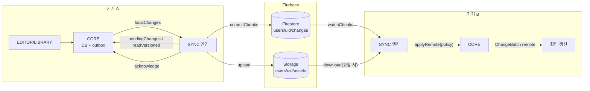
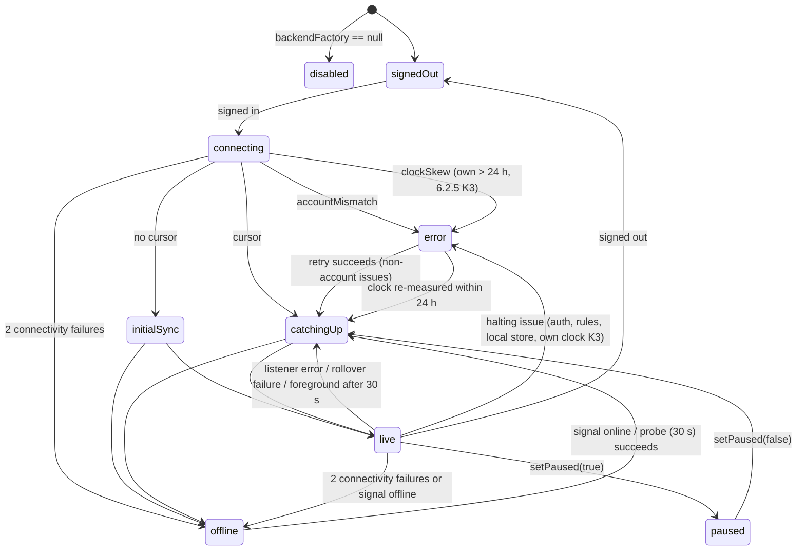

# 07 · SYNC — 계정 · 동기화

> 상태: **3차 수정** (총괄 3차 승인 검토 [00-review.md](00-review.md) '3차 검토' 3.4.7 반영, 재승인 대기) · 작성 2026-11-04 · 1차 수정 2026-11-04 · 2차 수정 2026-11-05 · 3차 수정 2026-11-05
> 기준: [00-overview.md](00-overview.md) 7장 '통합 계약' **v1.2**(변경 이력 7.9 C12-01~09·C11-01~30 — 이 문서와 7장이 다르면 7장이 우선) · 검토: [00-review.md](00-review.md) 3.7(1차), '2차 검토' 2.4.7(지시 번호 `SYNC-2-n`), '3차 검토' 3.4.7(지시 번호 `SYNC-3-n`)
> 마스터 기획서: [docs/PLAN.md](../PLAN.md) v1.1 · 영역 지도: [00-overview.md](00-overview.md)
> 소유 경로: `packages/sync_engine/` · 패키지 이름: `sync_engine`

이 문서만 보고 별도 git worktree에서 SYNC를 구현할 수 있게 쓴다. 코드 블록의 Dart 시그니처는 **계약**이다. 이름·타입을 바꾸려면 총괄 관리자 승인이 필요하다. 메서드 본문은 개발자가 채운다(시그니처 끝의 `;`).

- 다른 영역이 소유한 타입(CORE `SyncStore`·`EntityFieldVersions`·`MergeDecision`·`SyncBadge` 등)은 통합 계약 7장의 이름·형태를 **그대로** 쓰고, SYNC가 다시 정의하거나 다시 export하지 않는다(계약 7.2.0). 이 문서와 7장이 다르면 7장이 우선이다. 계약에 대한 의견은 12.2 '계약 변경 제안'에만 적었다.
- CORE 타입은 `package:note_core/note_core.dart`에서 가져온다. 코드 블록은 CORE 이름을 접두사 없이 쓰고, 계약 블록을 그대로 옮긴 곳(5.1.1, 4.4.1 `syncBadgeOf`, 4.5 `SyncRemoteAssetFetcher`)만 계약 표기(`core.`)를 유지한다. 그 두 파일은 `import 'package:note_core/note_core.dart' as core;`로 가져온다.
- 계약 블록을 옮긴 곳(5.1.1)은 계약 v1.2 원문이다. v1.1에서 SYNC에 들어온 것: C11-03(원격·복구 쓰기의 기기 로컬 필드), C11-04(`ChangeBatch.origin`), C11-05(purge 대기의 `pendingLocalFields = {'*'}`), C11-06(`EntityChange` 힌트), C11-07(시계 보류·해제 기준, 자기 오차 > 24 h면 업로드·받기 모두 멈춤), C11-13(`SyncBadge` 값 동등·`.distinct()`), C11-22(SYNC 공개 표면·`testing.dart` 정리·상태 값 클래스 값 동등), C11-26(`dart_test.yaml` 태그 선언), C11-27(B2 테스트 도우미), C11-30(T16 태그 `integration`). v1.2에서 SYNC에 들어온 것(시그니처 변경 없음): C12-01(`ws check` R15를 B1부터, 태그는 리터럴 — 3.2), C12-02(`EntityChange` 원격 고아 획 주석 — 5.1.1 원문), C12-04(`AuthUser` 값 동등, 7종 — 4.3, SYNC-CP5 승인), C12-05(7.7 5단계 T16 설명 — T16, SYNC-CP6 승인), C12-08(B7 커밋 시점 — 8장), C12-09(쓰기 `Future` 완료 시점 — 5.1.2 S-20).
- 총괄 검토 반영 내역은 13절.

---

## 1. 목적과 범위

### 1.1 목적

SYNC는 한 사용자의 여러 기기 사이에서 노트 데이터를 맞춘다(PLAN F-06, F-07, 7.4).

- 로컬 우선(local-first): 편집은 CORE가 기기에 먼저 저장하고, SYNC는 CORE의 변경 기록(outbox)을 읽어 **백그라운드로** 올린다.
- 다른 기기의 변경을 실시간으로 받아 CORE에 병합 적용한다. 충돌은 **필드 단위 마지막 수정 우선(LWW)** + 집합 병합으로 데이터 손실 없이 푼다.
- 오프라인·끊김·재시도·첫 동기화·증분 동기화를 처리하고, 상태(완료/진행 중/오프라인/오류)를 스트림으로 알린다.
- PDF·이미지·오디오 같은 큰 파일은 내용 해시로 한 번만 올리고, 다른 기기는 필요할 때 받는다.
- Google 로그인(웹 우선)으로 계정을 연결하고, 로그인 전 로컬 데이터를 로그인 시 올린다.

### 1.2 이번 동시 개발 범위

| 구분 | 내용 |
|---|---|
| 엔진 핵심 | 업로드(디바운스 0.5 s / 최대 1 s, 묶음·청크·커밋·ack), 수신(첫 동기화·증분·실시간 구독), 병합 규칙, 재시도·백오프·오프라인 전환, 상태 스트림, 알림(notice) |
| 병합 규칙 | 필드 단위 HLC LWW, 요소 추가/삭제 집합, 분수 인덱스 페이지 순서, 폴더 순환 복구, 삭제 vs 수정(페이지 되살림), 영구 삭제 vs 보류 중 편집(복구 사본), 보내지 않은 로컬 영구 삭제 보호(6.7.4), 24시간 넘는 시계 오차 기록 보류(6.2.5) |
| 원격 형식 | 변경 묶음(change chunk) 이진 코덱 v1, 청크 ID, 범위(scope) 분할, 압축(compaction) |
| 큰 파일 | 에셋 업로드(존재 확인 중복 제거), 요청 시 다운로드, 진행률, 해시 검증, CORE `RemoteAssetFetcher` 구현 `SyncRemoteAssetFetcher`(6.9.3) |
| 계정 | `AuthBackend` 추상화, `AuthService`, 첫 로그인 소유자 재지정(`SyncStore.reassignOwner`) + 업로드, 계정 불일치 차단 |
| 백엔드 추상화 | `SyncBackend`·`RemoteBlobStore` 포트, **메모리 가짜 서버**(여러 기기 공유, 장애 주입, 지연·늦은 가시성 재현) |
| 로컬 경계 | `SyncLocalStore` = CORE `SyncStore`(계약 7.2.10) + CORE `AssetStore`(7.2.11) + 로컬 변경 신호. 가짜 `FakeLocalStore`(7.2.10 문장과 1:1인 메모리 구현), CORE 어댑터 `CoreSyncLocalStore`. 두 구현을 같은 **SyncStore 계약 스위트**로 고정(5.1.4) |
| 화면 연결 값 | `syncBadgeOf(SyncStatus)` → CORE `SyncBadge`(계약 7.2.20, 4.4.1). `syncBadgeProvider` override는 M4에 INFRA |
| Firebase 어댑터 | Firestore·Storage·Auth 어댑터 **설계 + 코드 골격**(가짜 Firestore로 단위 테스트), 보안 규칙·색인 초안. 실제 프로젝트 연결은 하지 않음 |
| 테스트 | 가짜 서버 + 가짜 기기 2~3대 결정적 시나리오 24개(S01~S22, S08b, S14b) + 무작위 수렴 검사, SyncStore 계약 스위트, 브라우저 테스트(`test/web/`: Firebase 진입점 웹 컴파일, 순수 로직). 테스트 도우미(`testing.dart`)는 lib에서 `fake_async`·matcher를 쓰지 않는다(계약 7.2.20 v1.1 — 가상 시간은 `test/`의 `fakeAsync`가 하네스에 넘김, 4.11) |
| 상태 관리 | Riverpod(`package:riverpod` 3.4.3) provider 일체 |

### 1.3 이후 범위 (인터페이스·자리만 지금 준비)

- 앱 연결(M4, INFRA `SyncModule`): provider override(계약 7.3.3), 로그인 화면 `/login`, 설정의 계정·동기화 섹션, 알림 스낵바. **이번 범위의 앱은 `sync_engine`에 의존하지 않는다**(계약 7.1) → Firebase가 들어간 앱 웹 빌드·번들 크기 확인도 M4. 이번에는 SYNC 자체 브라우저 컴파일 테스트로 대신한다(9.1.3).
- Firebase 프로젝트 연결·배포·iPad 실측(2초 목표 확인) → Firebase 프로젝트 생성 후(PLAN 11장 #3), M4.
- 네이티브 Google 로그인(iOS·Android, `google_sign_in` 7.x) → 네이티브 전환 시. 이번에는 `NativeGoogleSignIn` 인터페이스만.
- 2단계 계정 기능: Apple·카카오·이메일 로그인, 계정 전환, 기기 목록·원격 로그아웃, 회원 탈퇴 + 서버 데이터 삭제(서버 함수 필요). 이번에는 `devices` 컬렉션 기록과 `AuthBackend` 확장 지점만.
- 삭제 표시(tombstone) 정리와 고아 에셋 정리(GC) → 방향 승인(계약 7.8): `devices` 문서 커서 최솟값보다 오래된 삭제 표시만, 90일 넘게 안 보인 기기는 제외.
- 노트 내용 지연 다운로드(범위 단위로 필요할 때만 받기), 에셋 미리 받기 정책(`AssetPrefetchPolicy.recentNotes`).
- 여러 탭 동시 실행 시 동기화 담당 탭 선출(Web Locks) → 이후(12.1 Q20). 이번에는 중복 실행해도 멱등이라 안전함만 보장(6.17).
- 되돌리기 충돌 검사를 필드 단위로 좁히기(되돌리려는 필드와 원격이 바꾼 필드가 겹칠 때만 건너뛰기) → CORE 이후 개선 후보(SYNC-S4, CORE 6.7.6). 이번은 엔티티 단위(6.11).
- 보안 규칙 에뮬레이터 테스트(Firebase CLI + Java). 컨테이너에 Java·Node는 있으나 에뮬레이터 내려받기 가능 여부 미확인 → 선택 작업.
- 서버 함수(휴지통 서버 정리, 수식 API 중계) → 제외(7.1 서버 함수는 M7·2단계).

### 1.4 제외 (다른 영역 책임)

- 엔티티 정의, 로컬 DB, outbox 기록·병합, 필드 버전 저장, 원격 적용 트랜잭션 실행, HLC 시계, 분수 인덱스 계산, 휴지통 30일 정리, 되돌리기 히스토리 → CORE
- 화면용 동기화 상태 타입(`SyncDisplayState`·`SyncBadge`·`syncBadgeProvider`)과 원격 에셋 자리(`RemoteAssetFetcher`·`remoteAssetFetcherProvider`) → CORE(계약 7.2.11·7.2.13). SYNC는 값 계산(`syncBadgeOf`)과 구현(`SyncRemoteAssetFetcher`)만
- 동기화 배지 UI → LIBRARY(사이드바)·EDITOR(툴바). 둘 다 `core.syncBadgeProvider`만 읽고 `sync_engine`을 import하지 않음
- 로그인 화면·설정의 계정·동기화 섹션·알림 스낵바·`SyncModule` 연결 → INFRA (M4, 12.1 Q10·Q19)
- Firebase 초기화 코드·`firebase_options.dart`·`FIREBASE_ENABLED`·`app/firebase.json`·Hosting 헤더·CI 배포·사용자 안내서 → INFRA (SYNC는 규칙 파일과 안내 내용 제공, 5.2·6.18)
- PDF 배경의 "내려받는 중" 표시 → PDF (`core.remoteAssetFetcherProvider` 경유 — SYNC에 직접 의존하지 않음)

### 1.5 핵심 결정 요약

| # | 결정 | 근거 (상세 절) |
|---|---|---|
| D1 | 원격 저장 구조는 사용자별 **불변 변경 묶음(change chunk) 로그**. 엔티티별 가변 문서를 쓰지 않는다 | 묶음 1개 = Firestore 쓰기 1회(쓰기 최소화), 받는 기기는 새 데이터만 받음(대역폭), 트랜잭션 없이 충돌 없는 병합, 1 MB 제한은 묶음 크기 상한으로 해결, 보안 규칙 단순 (6.4) |
| D2 | 기록은 항상 **엔티티 전체 스냅숏 + 필드 버전** | 도착 순서와 무관(교환·결합·멱등), 부분 기록 고아 문제 없음, 압축 단순 (6.3) |
| D3 | 필드 단위 LWW 판정은 **HLC**, 증분 동기화 커서는 **서버 타임스탬프** | 오프라인 편집은 '나중에 연결한 쪽'이 아니라 '나중에 고친 쪽'이 이겨야 함 (6.2). **확정**(계약 CD-18) — PLAN 7.4 '서버 시간 기준' 문구는 총괄이 갱신 |
| D4 | 병합 단위는 최상위 JSON 키, 일부는 묶음(이동 = `parentId`+`sortKey`, 휴지통 = `deletedAt`+`trashRootId`) | 의도 단위 보존 (6.3) |
| D5 | 삭제도 LWW 필드. 획·노트·폴더는 삭제 유지, **페이지는 삭제한 기기가 몰랐던 새 획이 있으면 되살림**. 영구 삭제는 최종이며(보내기 전에 받기가 먼저 돌아도 되살아나지 않음) 보류 중 편집은 복구 사본으로 | 양쪽 필기 보존(F-07) (6.7) |
| D6 | 폴더 순환은 순환 안에서 **가장 늦은 이동(HLC 최대)을 최상위로** 옮겨 취소 | 결정적, 모든 기기가 같은 결론 (6.7.2) |
| D7 | 재연결 시 **받기 먼저, 보내기 나중** | 오래된 보류 편집이 최신 원격 값을 덮어쓰지 않게 (6.6) |
| D8 | Firestore SDK 오프라인 캐시는 끈다 | 로컬 DB(CORE)가 진실, iPad Safari 저장 용량 이중 사용 방지 (6.4.6) |
| D9 | 큰 파일은 Storage `users/{uid}/assets/{sha256}`, 업로드 전 존재 확인, 받기는 요청 시 | 중복 제거(5.4), 비용 (6.9) |
| D10 | 엔진은 포트(`SyncLocalStore`, `SyncBackend`)에만 의존한다. 로컬 포트의 멤버는 CORE 계약 타입(`SyncStore`·`AssetStore`) 그대로이고, 병합·코덱 내부만 JSON 수준(`SyncDoc`)으로 동작 | CORE 구현·Firebase 없이 엔진 전체를 결정적으로 테스트(`FakeLocalStore`·가짜 서버). 가짜와 CORE의 의미 차이는 공용 계약 스위트가 잡는다 (4.9, 5.1.4) |
| D11 | 기기는 처음 로그인한 계정에 묶인다. 다른 계정 로그인은 오류로 막는다 | 계정별 데이터 분리(7.6), 전환은 2단계 (6.10) |
| D12 | `HLC millis > min(청크 serverTime, 받는 기기 벽시계) + 24 h`인 기록은 **적용하지 않고 보류(격리)**하고 해제도 같은 기준(`min(serverNow, 벽시계) ≥ releaseAt`). 자기 기기 오차가 24시간을 넘으면 **업로드와 받기를 모두** 멈춘다. 2분~24시간은 적용 + 경고 | CORE `HlcClock.receive`가 받는 기기 벽시계 + 24 h를 넘는 값으로 시계를 올리지 않아, 적용하면 이후 그 필드의 로컬 편집이 늘 지고 outbox에서 조용히 빠진다 (계약 7.2.10 v1.1 — C11-07, 6.2.5) |
| D13 | 화면용 상태·원격 에셋은 CORE 자리(`SyncBadge`·`RemoteAssetFetcher`)에 SYNC가 값·구현을 공급하고 INFRA가 M4에 연결 | 피처 패키지가 `sync_engine`에 의존하지 않음 (계약 7.1 규칙 1, 7.2.20) |

---

## 2. PLAN.md 요구사항 대응표

'이번' = 이번 동시 개발에서 구현·자동 테스트. '이번(골격)' = 코드 골격 + 가짜로 단위 테스트, 실서버 연결은 이후. '이후' = 범위 밖.

### 2.1 기능 명세 (4장)

| 기능 ID / 항목 | PLAN 내용 | 이 계획서의 작업 | 범위 |
|---|---|---|---|
| F-05 | 프리셋 계정 동기화 → 다른 기기에서도 같은 펜 | `penPreset` 기록 동기화, 필드 LWW(6.3), 기본 프리셋 결정적 ID·시드 HLC(CD-07, 6.7.5), S15 | 이번 |
| F-06 1단계 | Google 로그인 — iPad·안드로이드 | `AuthBackend`/`AuthService`(4.3), 웹: `FirebaseAuthBackend` 팝업/리디렉트(6.10) T17 | 이번(골격) / 네이티브 이후 |
| F-06 | 처음부터 모든 데이터를 사용자 ID 기준 저장 | 원격 경로 `users/{uid}/…`, 기록의 `ownerId` 검증, `reassignOwner` 호출, 계정 묶기(6.10) T10 | 이번 |
| F-06 2단계 | 게스트 모드 → 나중에 로그인하면 업로드 | 1단계도 로그인 전 로컬 사용이 기본 → 첫 로그인 시 전체 업로드(6.10.3) S15 | 이번 |
| F-06 2단계 | Apple·카카오·이메일 로그인, 기기 목록·원격 로그아웃, 앱 내 탈퇴 + 데이터 삭제 | `AuthBackend` 확장 지점, `devices/{nodeId}` 문서 기록(6.4.1) | 이후 |
| F-07 | 범위: 한 사용자의 여러 기기 | 사용자별 경로·규칙(6.14) | 이번 |
| F-07 | 로컬 우선, 백그라운드 업로드, 오프라인에서도 모든 기능 동작 | outbox 소비 업로드 파이프라인(6.5), 오프라인 전환(6.8) T8, T10 | 이번 |
| F-07 | 온라인일 때 다른 기기에 2초 이내 반영 | 디바운스 500 ms/최대 1,000 ms + 실시간 구독(6.5, 6.6). S01에서 가상 시간 < 2 s 검증 | 이번(가짜) / 실측 이후 |
| F-07 | 동기화 단위는 획 단위 변경분 | 엔티티 단위 outbox → 바뀐 획 기록만 묶음에 담음(6.4.3) | 이번 |
| F-07 | 충돌: 오프라인 양쪽 편집 후 연결 | 필드 LWW + 받기 먼저(6.3, 6.6) S02 | 이번 |
| F-07 | 획·도형: 추가/삭제 집합 → 양쪽 필기 보존 | 획 ID 집합 + `deletedAt` LWW(6.3, 6.7.3) S02, S05 | 이번 |
| F-07 | 제목·폴더 위치 등 속성: 마지막 수정 우선 | 필드 단위 HLC LWW(6.2, 6.3) S02 | 이번 |
| F-07 | 큰 파일은 별도 저장소, 다른 기기는 열 때 내려받기 | 에셋 파이프라인(6.9), CORE `RemoteAssetFetcher` 구현 `SyncRemoteAssetFetcher`(6.9.3) S09 | 이번(가짜) / 주입 M4 |
| F-07 | 동기화 상태 표시: 완료/진행 중/오프라인/오류 | `SyncStatus.display`(CORE `SyncDisplayState`) → `syncBadgeOf` → CORE `SyncBadge`(4.4, 6.12). 배지는 LIBRARY·EDITOR(`core.syncBadgeProvider`), 연결은 INFRA `SyncModule` | 이번(값·함수) / 연결 M4 |
| F-08 | 그 기기에서 한 편집만 되돌림 | 원격 적용·복구 쓰기를 히스토리 밖으로(계약 7.2.10, 6.11) | 이번 |
| F-13 | 페이지 순서 (두 기기 동시 삽입) | `sortKey` 분수 인덱스 + `id` 동점 처리, LWW(6.7.1) S03 | 이번 |
| F-01 | 폴더 이동 (드래그) | `{parentId, sortKey}` 묶음 LWW, 순환 복구(6.7.2) S04 | 이번 |
| F-16 | 녹음 파일 압축 후 동기화, 용량 표시 | `recording` 기록 + 오디오 에셋은 일반 에셋 파이프라인으로 처리(6.9). 녹음 기능 자체는 M6 | 이번(엔진) / 녹음 이후 |

### 2.2 추가 기능 (5장)

| 항목 | PLAN 내용 | 이 계획서의 작업 | 범위 |
|---|---|---|---|
| 5.1 오프라인 사용 | 연결되면 자동 동기화 (M4) | 연결 신호·백오프 재연결·받기 먼저(6.8) S02, S10, S12 | 이번 |
| 5.1 휴지통 | 동기화로 다른 기기에서도 지워지므로 복구 수단 | 휴지통 필드 묶음 LWW, 영구 삭제 기록, 보류 편집 복구 사본(6.7.4) S07, S08 | 이번 |
| 5.2 버전 기록, 전체 백업/복원 | P1 | 해당 없음(동기화 로그를 버전 기록으로 쓰지 않음) | 이후 |
| 5.4 동기화 | 온라인 시 2초 이내, 데이터 손실 0건 | 결정적 시나리오 + 무작위 수렴 검사(9.1), 손실 0 판정 기준(10장) | 이번 |
| 5.4 보안 | TLS, 본인 데이터만 접근 | Firebase SDK(HTTPS), 규칙 초안(6.14) | 이번(초안) / 배포 이후 |
| 5.4 저장 용량 | 획 데이터 압축, 같은 PDF 한 번만 | CORE 점 코덱을 이진 그대로 묶음에 담음(base64 안 씀, 6.4.4), 에셋 해시 중복 제거(6.9) | 이번 |

### 2.3 기술 스택·아키텍처·기타 (6장, 7장, 8장, 9장, 10장, 12장)

| 항목 | PLAN 내용 | 이 계획서의 작업 | 범위 |
|---|---|---|---|
| 6.2 | 인증·DB·파일: Firebase Auth·Firestore·Storage | 어댑터 골격(4.10) T17 | 이번(골격) |
| 6.2 | 서버 함수(Cloud Functions) | 사용 안 함 | 이후 |
| 6.3 | 개인 사용 무료 사용량, 예산 알림 | 비용 추정(6.15), 예산 알림 안내 내용 INFRA에 제공(6.18) | 이번(추정) |
| 6.3 | 쓰기 횟수 과금 → 0.5~1초 묶어서 업로드 | 디바운스 500/1,000 ms, 묶음 1개 = 쓰기 1회(6.5) | 이번 |
| 6.3 | 문서 1 MB 제한 → 획 데이터 여러 덩어리 | 청크 상한 256 KiB(권장)/1,000,000 B(최대)(6.4.3) | 이번 |
| 7.1 | 동기화 엔진: 변경 큐·실시간 구독·충돌 해결 | 4.5, 6.5~6.8 | 이번 |
| 7.2 | `User` | `users/{uid}` 프로필 문서(6.4.1). `settings`는 `setting` 기록으로 | 이번(골격) |
| 7.2 | `Asset { id(=해시), size, storagePath }` | 업로드 후 `markUploaded`(6.9) | 이번 |
| 7.2 | 모든 항목 `deletedAt`, `sortKey` 분수 인덱스, `schemaVersion` | 병합 규칙(6.3) | 이번 |
| 7.4-1 | 편집 → 로컬 트랜잭션 + 보낼 변경 큐 | CORE outbox 소비(5.1) | 이번 |
| 7.4-2 | 큐를 묶어 전송(0.5~1초 디바운스) | 6.5 | 이번 |
| 7.4-3 | 실시간 구독 → 로컬 반영 → 화면 갱신 | 6.6 (화면 갱신은 CORE `ChangeBatch(origin: remote)`) | 이번 |
| 7.4-4 | 충돌 규칙 4가지 | 6.3, 6.7. 속성 LWW는 HLC 기준(CD-18 — PLAN '서버 시간 기준' 문구는 총괄이 갱신), 24시간 넘는 시계 오차 기록은 보류(6.2.5) | 이번 |
| 7.4-5 | 큰 파일 해시 중복 없이 업로드, 열 때 내려받기 | 6.9 | 이번 |
| 7.4-6 | 장시간 오프라인 후 마지막 동기화 이후 변경분만 | 서버 타임스탬프 커서 + 겹침 5분(6.6) S12 | 이번 |
| 7.5 | 되돌리기도 새 변경으로 동기화 | outbox 일반 처리, LWW(6.11) S20 | 이번 |
| 7.6 | 모든 데이터 `ownerId`, 규칙은 본인만 | 6.10, 6.14 | 이번 |
| 7.6 | `Asset.size` 기록 → 사용자별 용량 계산 | `SyncUsage`(4.5) | 이번 |
| 8장 | 로그인(Google) 화면 | 화면 `/login`은 INFRA(M4). SYNC는 `AuthService`·`authStateProvider` | 이번(API) |
| 8장 | 설정: 계정 · 동기화 상태 · 저장 용량 | INFRA 계정·동기화 섹션(M4)이 `authStateProvider`, `syncStatusProvider`, `syncUsageProvider`를 읽음 | 이번(API) |
| 9.4 | 동기화 충돌 병합 같은 핵심 로직은 자동 테스트 | 9.1 | 이번 |
| 9.5 | Safari가 저장 데이터를 지울 수 있음 | 동기화가 켜지면 서버에 사본 → 지워져도 다시 받기 가능(첫 동기화) | 이번 |
| 10 M0 | Firebase 프로젝트 생성, 예산 알림 | 사용자·INFRA. SYNC는 필요한 설정 목록 제공(6.18) | 제외(의존) |
| 10 M4 | Google 로그인 | T10, T14, T17 (화면·앱 연결은 INFRA M4) | 이번(골격) |
| 10 M4 | 변경 큐 · 업로드 · 실시간 수신 · 충돌 병합 | T4, T8, T9, T11 | 이번 |
| 10 M4 | PDF · 이미지 · 녹음 파일 동기화 | T12 | 이번(가짜) |
| 10 M4 | 동기화 상태 표시, 펜 프리셋 · 설정 동기화 | T10(상태·`syncBadgeOf`), 일반 기록으로 프리셋·설정(synced 키만 — 계약 7.4.6) | 이번 |
| 10 M4 완료 기준 | iPad → 안드로이드 2초, 양쪽 오프라인 수정 후 무손실 | 가짜 시나리오 S01, S02, S18. 실기기 확인 9.2 | 이번(가짜) / 실기기 이후 |
| 10 2단계 | 회원 탈퇴·데이터 삭제, 기기 관리, 사용자별 클라우드 용량 한도 | 확장 지점만 | 이후 |
| 11 #3 | Firebase 프로젝트 생성 | 연결 전제 조건 | 의존 |
| 12 | 동기화 버그로 데이터 손실 | 소프트 삭제 + 보류 편집 보호 + 수렴 자동 테스트(11장) | 이번 |
| 12 | 클라우드 비용 | 비용 추정, 해시 중복 제거, 압축(6.13, 6.15) | 이번 |

---

## 3. 소유 경로와 패키지 구조

```text
packages/sync_engine/
├─ pubspec.yaml                       # 3.1 (계약 7.4.1 형식). 패키지 analysis_options.yaml 없음(루트 적용, R3)
├─ dart_test.yaml                     # tags: scenario, golden, integration(skip) — 내용은 3.2 (계약 7.4.8 v1.1)
├─ README.md                          # 소유 영역 + 이 문서 링크 (B1)
├─ firebase/                          # M4에 app/firebase.json이 ../packages/sync_engine/firebase/* 로 참조 (5.2 I-4)
│  ├─ firestore.rules
│  ├─ storage.rules
│  └─ firestore.indexes.json
├─ lib/
│  ├─ sync_engine.dart                # 공개 API. 순수 Dart (Flutter·Firebase·package:web import 금지)
│  ├─ testing.dart                    # 가짜 서버·기기·하네스. 순수 Dart (웹에서도 컴파일됨). test/에서만 import.
│  │                                  #   fake_async·test·matcher 비의존 (dev 의존 — 계약 7.2.20 v1.1)
│  ├─ firebase.dart                   # Firebase 어댑터 (Flutter 플러그인 import)
│  ├─ platform.dart                   # ConnectivityPlusSignal (Flutter 플러그인 import)
│  └─ src/
│     ├─ common/      server_cursor.dart, errors.dart, cancel_token.dart, varuint.dart, lru_set.dart
│     ├─ model/       sync_doc.dart, records.dart, field_versions_ext.dart (internal), field_units.dart,
│     │               scopes.dart
│     ├─ codec/       chunk_codec.dart, chunk_id.dart, chunk_packer.dart, canonical_json.dart
│     ├─ local/       sync_local_store.dart (포트), core_sync_local_store.dart (CORE 어댑터)
│     ├─ merge/       field_merge.dart, sync_merge_policy.dart, merge_recorder.dart (internal),
│     │               record_gate.dart, folder_cycles.dart, page_resurrection.dart, purge_guard.dart,
│     │               purged_set.dart (internal: 저장된 영구 삭제 + 보내지 않은 로컬 purge 메모리 뷰, 6.7.4)
│     ├─ backend/     sync_backend.dart, remote_chunk.dart, blob_store.dart, profile.dart
│     ├─ auth/        auth_user.dart, auth_backend.dart, auth_service.dart
│     ├─ engine/      sync_engine.dart, engine_controller.dart, serial_executor.dart, push_scheduler.dart,
│     │               backoff.dart, upload_pipeline.dart, download_pipeline.dart, live_listener.dart,
│     │               connectivity.dart, server_clock.dart, held_chunks.dart, meta_keys.dart
│     ├─ assets/      sync_asset_service.dart, asset_uploader.dart, asset_downloader.dart,
│     │               sync_remote_asset_fetcher.dart
│     ├─ status/      sync_status.dart, sync_issue.dart, sync_notice.dart, status_builder.dart,
│     │               sync_badge.dart
│     ├─ compaction/  compactor.dart
│     ├─ config.dart
│     ├─ providers.dart
│     ├─ firebase/    firebase_bindings.dart, firebase_sync_backend.dart, firestore_chunk_mapper.dart,
│     │               firebase_blob_store.dart, firebase_auth_backend.dart, firebase_error_mapper.dart,
│     │               display_mode.dart (조건부 export), display_mode_stub.dart, display_mode_browser.dart
│     ├─ platform/    connectivity_plus_signal.dart
│     └─ testing/     fake_sync_server.dart, fake_sync_backend.dart, fake_network.dart, fake_blob_store.dart,
│                     fake_auth_backend.dart, fake_local_store.dart, fake_sync_store.dart (internal),
│                     fake_asset_store.dart (internal), test_device.dart, synthetic_points.dart,
│                     sync_test_harness.dart, canonical_dump.dart
└─ test/
   ├─ common/ model/ codec/ merge/ testing/ engine/ assets/ status/ auth/ compaction/ firebase/
   ├─ scenarios/                      # S01~S22, S08b, S14b, fuzz (@Tags(['scenario']), 9.1.2)
   │  └─ support/sync_scenario.dart   # syncScenario(): test()·fakeAsync로 SyncTestHarness를 만듦 (test 전용, 4.11)
   ├─ shared/                         # VM·Chrome 양쪽에서 쓰는 테스트 본문 (web/에서 다시 감쌈)
   │  └─ chunk_v1_golden_bytes.dart   # 골든 바이트의 Dart 상수 사본 (Chrome은 파일을 못 읽음 — 6.4.4)
   ├─ contract/                       # SyncStore 계약 스위트 본문 + FakeLocalStore 대상 실행 (5.1.4)
   ├─ integration/                    # 실제 CORE 대상 (@Tags(['integration']), VM, 기본 건너뜀 — T16)
   ├─ goldens/                        # 계약 7.4.8 골든 위치 (@Tags(['golden']) + @TestOn('vm'))
   │  ├─ chunk_v1_golden.bin          # 6.4.4 코덱 바이트 골든 (824 B)
   │  └─ chunk_v1_golden_test.dart    # 바이트·sha-256·청크 ID 비교 + shared 상수 사본 = 파일
   ├─ web/                            # 브라우저 테스트만 (@TestOn('browser'), 계약 7.4.8)
   │  ├─ firebase_compile_test.dart   # firebase.dart·platform.dart 웹 컴파일 확인 (9.1.3)
   │  └─ pure_logic_browser_test.dart # 코덱·varuint·커서·병합 성질을 Chrome에서 한 번 더
   ├─ api_surface_test.dart           # 진입점별 export 목록 (4.0)
   └─ no_dart_io_test.dart            # lib/ 경계 규칙 검사 (3.1 아래)
```

`display_mode.dart`는 한 줄짜리 조건부 export다(계약 7.4.3 형식):
`export 'display_mode_stub.dart' if (dart.library.js_interop) 'display_mode_browser.dart';`

### 3.1 pubspec.yaml (계약 7.4.1 형식 · 7.5 버전 — 01-infra 3.3 표와 같음)

```yaml
name: sync_engine
description: Device-to-device sync engine for noteapp (local-first, Firebase adapters).
publish_to: none
version: 0.0.1
resolution: workspace

environment:
  sdk: ^3.13.0
  flutter: 3.47.9

dependencies:
  flutter:
    sdk: flutter                 # firebase.dart / platform.dart only; sync_engine.dart and testing.dart never import it
  note_core: any                 # workspace sibling: `any`, never path: (R8)
  riverpod: 3.4.3
  web: 1.1.2                     # display_mode_browser.dart only (conditional export)
  meta: 1.19.0
  collection: 1.19.1
  clock: 1.1.3
  crypto: 3.0.8
  firebase_core: 5.1.0
  firebase_auth: 7.0.1
  cloud_firestore: 7.1.0
  firebase_storage: 14.0.1
  connectivity_plus: 7.3.2       # platform.dart only

dev_dependencies:
  flutter_test:
    sdk: flutter
  fake_async: 1.3.3
  fake_cloud_firestore: 4.5.0
  firebase_auth_mocks: 0.16.0
```

- 기반 단계 B1에서 INFRA가 이 내용으로 만든다(계약 7.6). SYNC는 T1에서 같은지만 확인하고, 동시 개발 중 의존을 더하면 결과 보고에 '의존성 추가'로 남긴다(계약 7.4.1).
- 패키지 `analysis_options.yaml`은 두지 않는다(루트 `analysis_options.yaml`이 적용, R3). `dart format` page width 80, `flutter analyze --fatal-infos`(계약 7.4.2).

라이브러리 경계 규칙

- `lib/sync_engine.dart`와 `lib/testing.dart`(그리고 이들이 전이적으로 import하는 `src/` 파일)는 `package:flutter`, `package:firebase_*`, `package:cloud_firestore`, `package:connectivity_plus`, `package:web`을 import하지 않는다(순수 Dart — 계약 7.1).
- `lib/` 전체: `dart:io`·`dart:ffi`·`dart:html`·`dart:js`·`dart:js_util`·`package:js` 금지. `package:web`은 `*_browser.dart`에서만 쓰고, 그 파일은 조건부 import/export로만 불러온다(계약 7.4.3).
- `lib/` 전체(특히 `testing.dart`): dev 의존인 `package:fake_async`·`package:test`·`package:test_api`·`package:matcher`·`package:flutter_test`를 import하지 않는다(계약 7.2.20 v1.1 — C11-22. `depend_on_referenced_packages` lint와 순수 Dart 경계). 가상 시간은 `test/`의 `fakeAsync`가 `Clock`·`elapse`·`flushMicrotasks`로 하네스에 넘기고(4.11), 수렴 검사는 matcher 없이 예외를 던진다(`SyncTestHarness.checkConverged`). 그래서 pubspec 의존은 바뀌지 않는다(`fake_async`는 dev 그대로).
- 다른 패키지의 `src/`와 `package:note_core/testing.dart`·`testing_vm.dart`는 `lib/`에서 import하지 않는다(계약 7.1 규칙 2). `testing_vm.dart`는 `test/integration/`에서만 쓴다.
- `test/no_dart_io_test.dart`가 소스 텍스트로 위 규칙을 검사하고, INFRA `ws check`(R5~R7)가 한 번 더 본다.

### 3.2 dart_test.yaml (계약 7.4.8 v1.1·v1.2 — C11-26, C12-01)

```yaml
# packages/sync_engine/dart_test.yaml
tags:
  scenario: {}        # test/scenarios/ (default run, 9.1.2)
  golden: {}          # test/goldens/ byte golden (VM only, default run, 6.4.4)
  integration:        # test/integration/ — real CORE via openTestNoteStore (T16)
    skip: "integration stage only — ws test --run-skipped -t integration"
```

- 쓰는 태그를 모두 선언한다. `integration`은 여기서 기본 건너뛴다: 동시 개발 중 CORE는 B2 상태라 `openTestNoteStore`가 `UnimplementedError`(계약 7.6)이므로, 선언이 없으면 기본 `ws test`(기본 제외는 `-x bench`뿐)에서 T16이 돌아 실패한다. 통합 단계(계약 7.7 5단계)에 `dart run tool/ws.dart test --run-skipped -t integration`으로 실행한다. `perf`·`bench`는 쓰지 않는다.
- (v1.2 — C12-01) INFRA `ws check` R15가 기반 단계 B1부터 이 규칙(쓰는 태그 선언, `integration` skip)을 위반(종료 1)으로 검사한다. R15 스캐너는 **문자열 리터럴 태그만** 인식하므로 태그는 모두 리터럴로 쓴다: 파일 머리 `@Tags(['scenario'])`(9.1.2 시나리오 파일마다)·`@Tags(['golden'])`(`test/goldens/`)·`@Tags(['integration'])`(`test/integration/`), `syncScenario`(4.11) 안의 `test(…, tags: ['scenario'])`. 변수·상수로 넘기지 않는다.
- 이 파일은 T1(골격)에서 만든다 → 태그를 쓰는 첫 테스트(T3 코덱 골든)보다 먼저 있다(계약 7.4.8 v1.2). B7(빈 틀 + `no_dart_io_test`)에는 태그를 쓰는 테스트가 없어 이 파일이 없어도 R15를 통과한다(계약 7.4.2 '태그를 쓰지 않는 멤버는 `dart_test.yaml`이 없어도 된다').

---

## 4. 공개 API

모든 공개 타입은 아래 4개 진입점에서만 export한다(계약 7.1). CORE 타입은 `package:note_core/note_core.dart`에서 가져오고 **다시 export하지 않는다**(계약 7.2.0 — 통합 R14 검사는 진입점 export 이름이 겹치면 실패한다).

### 4.0 진입점과 export 범위

| 진입점 | 순수 Dart | export |
|---|---|---|
| `sync_engine.dart` | 예 | 4.1~4.9 (`syncBadgeOf`, `SyncRemoteAssetFetcher`, `SyncMergePolicy`, provider 포함) |
| `testing.dart` | 예 | 4.11 (가짜 서버·네트워크·Blob·인증·로컬, `FakeLocalWrite`, `TestDevice`, `SyncTestHarness`(`checkConverged` 포함)). `test/`에서만 import. `fake_async`·matcher를 쓰지 않는다 — `syncScenario`는 `test/scenarios/support/sync_scenario.dart`(export 대상 아님, 계약 7.2.20 v1.1) |
| `firebase.dart` | 아니요 (Flutter·Firebase) | 4.10 Firebase 어댑터 |
| `platform.dart` | 아니요 (Flutter 플러그인) | `ConnectivityPlusSignal` |

- SYNC가 쓰지만 정의하지 않는 CORE 이름(5.1.1): `EntityKind`, `EntityRef`, `Hlc`, `HlcClock`, `OutboxOp`, `OutboxEntry`, `OutboxAck`, `kAllFields`, `EntityFieldVersions`, `VersionedEntity`, `RemoteChange`·`RemoteUpsert`·`RemotePurge`, `MergeDecision`·`KeepLocal`·`TakeRemote`·`WriteMerged`, `RemoteMergePolicy`, `RemoteApplyReport`, `RepairWrite`, `SyncStore`, `AssetStore`, `Asset`, `AssetType`, `SyncEntity`, `EntityJson`, `SyncDisplayState`, `SyncBadge`, `RemoteAssetFetcher`·`RemoteAssetState`·`RemoteAssetProgress`, ID 타입(`FolderId`·`NoteId`·`PageId`·`AssetId`·`OwnerId`·`EpochMillis` 등), `kLocalOwnerId`, `noRetry`, `noteStoreProvider`, `clockProvider`.
- 1차 수정에서 삭제한 SYNC 이름(같은 개념이 CORE에 있음 — 5.1.3 표, 계약 7.2.20 v1.1 '삭제' 행): `SyncDisplayState`, `syncDisplayStateProvider`, `syncClockProvider`, `FieldVersions`, `LocalRecord`, `AssetMeta`, `SyncMergeFn`, `MergeOutcome`·`KeepLocalOutcome`·`TakeRemoteOutcome`·`WriteMergedOutcome`, `LocalApplyReport`·`ApplyOutcomeKind`, 포트 `RepairWrite`·`RepairReason`.
- 2차 수정에서 `testing.dart`에서 뺀 이름(계약 7.2.20 v1.1 '`testing.dart` 정리' 행): `syncScenario`(→ `test/scenarios/support/`), `SyncTestHarness.async`(`FakeAsync` 필드), `SyncTestHarness.expectConverged`(→ matcher 없는 `checkConverged`).
- 계약 7.2.20 v1.1 '추가' 행의 이름: `SyncMergePolicy`(4.9), `FakeLocalWrite`·`FakeSyncServer.commitRaw`·`TestDevice.clockOffset`(4.11). '값 동등' 행의 7종(`SyncStatus`·`SyncIssue`·`AuthState`·`AuthUser`·`AssetAvailability`·`AssetTransferSummary`·`InitialSyncProgress` — `AuthUser`는 v1.2 C12-04)은 4.3~4.5에서 `==`/`hashCode`를 선언한다.
- `test/api_surface_test.dart`가 진입점별 export 목록을 이 표와 대조하고, 위 CORE 이름·삭제 이름·`syncScenario`·`expectConverged`가 SYNC 진입점에서 보이지 않음을 확인한다(T14).

### 4.1 공통 기초 타입

```dart
// lib/src/common/server_cursor.dart
/// Server commit time of a change chunk (Firestore serverTimestamp), microseconds
/// since epoch, UTC. Web-safe int (< 2^53).
@immutable
final class ServerCursor implements Comparable<ServerCursor> {
  const ServerCursor(this.micros);
  static const ServerCursor zero = ServerCursor(0);
  final int micros;

  factory ServerCursor.fromDateTime(DateTime t);       // t.toUtc().microsecondsSinceEpoch
  factory ServerCursor.parse(String text);              // decimal digits only; throws FormatException
  static ServerCursor? tryParse(String? text);
  /// Clamped at zero.
  ServerCursor minus(Duration d);
  DateTime toDateTime();                                // UTC
  static ServerCursor max(ServerCursor a, ServerCursor b);
  @override int compareTo(ServerCursor other);
  bool operator >(ServerCursor other);
  bool operator <(ServerCursor other);
  bool operator >=(ServerCursor other);
  @override String toString();                          // decimal micros
}
```

```dart
// lib/src/common/errors.dart
enum SyncErrorCode {
  network,            // no connection, socket closed, offline
  unavailable,        // Firestore 'unavailable'
  deadlineExceeded,   // timeout (SyncConfig.operationTimeout)
  aborted,
  cancelled,
  resourceExhausted,  // quota
  unauthenticated,
  permissionDenied,
  invalidArgument,    // e.g. document too large
  notFound,
  alreadyExists,
  failedPrecondition, // e.g. missing index
  dataLoss,
  internal,
  unknown;

  /// network, unavailable, deadlineExceeded, aborted, internal, unknown.
  bool get isTransient;
  /// network, unavailable, deadlineExceeded.
  bool get isConnectivity;
}

final class SyncBackendException implements Exception {
  const SyncBackendException(this.code, this.message, {this.cause});
  final SyncErrorCode code;
  final String message;
  final Object? cause;
  @override String toString();
}

enum SignInErrorCode { cancelled, popupBlocked, network, unsupportedPlatform, accountDisabled, misconfigured, unknown }

final class SignInException implements Exception {
  const SignInException(this.code, this.message, {this.cause});
  final SignInErrorCode code;
  final String message;
  final Object? cause;
}

// lib/src/common/cancel_token.dart
final class SyncCancelToken {
  SyncCancelToken();
  bool get isCancelled;
  void cancel();
  Future<void> get whenCancelled;
  /// Throws SyncBackendException(cancelled) if cancelled.
  void throwIfCancelled();
}
```

### 4.2 동기화 데이터 모델 (엔진 내부 표현, 다른 영역은 읽기만)

필드 버전·버전 포함 엔티티·에셋 메타데이터는 CORE 타입(`EntityFieldVersions`, `VersionedEntity`, `Asset` — 계약 7.2.6·7.2.10)을 그대로 쓴다. SYNC가 더 두는 것은 병합·코덱이 다루는 **JSON 표현**(`SyncDoc`)과 청크에 실리는 **기록**(`UpsertRecord`·`PurgeRecord`)뿐이다.

```dart
// lib/src/model/sync_doc.dart
/// JSON view of one entity in CORE's sync/backup wire format (CORE 6.3, contract 7.4.6).
/// Merge and codec work on this map form; the local boundary uses CORE SyncEntity (D10).
@immutable
final class SyncDoc {
  /// [json] is deep-copied and made unmodifiable. json['id'] (setting: json['key']) must
  /// equal [id].
  SyncDoc({required this.kind, required this.id, required Map<String, Object?> json});
  /// entity.toJson(). Local-only and derived fields are not in it (contract 7.2.6).
  factory SyncDoc.fromEntity(SyncEntity entity);
  final EntityKind kind;
  final String id;
  final Map<String, Object?> json;
  EntityRef get ref;
  bool get isDeleted;                 // json['deletedAt'] != null
  /// json['ownerId'] for folder / note / penPreset / asset; null for other kinds.
  String? get ownerId;
  /// json['version'] parsed; null when absent. Throws FormatException when malformed.
  Hlc? get version;
  SyncDoc withFields(Map<String, Object?> changes);   // shallow merge of top-level keys
  /// EntityJson.decode(kind, json). Throws FormatException (the record is skipped, 6.3.5).
  SyncEntity toEntity();
}

// lib/src/model/records.dart — what a change chunk carries (6.4.4)
sealed class SyncRecord {
  const SyncRecord();
  EntityRef get ref;
}
/// Full snapshot of one entity plus CORE field versions (D2). RecordGate checks
/// doc.version == versions.max before apply (CORE rejects violations, contract 7.2.10).
final class UpsertRecord extends SyncRecord {
  const UpsertRecord(this.doc, this.versions);
  /// SyncDoc.fromEntity(local.entity) + local.versions.
  factory UpsertRecord.fromVersioned(VersionedEntity local);
  final SyncDoc doc;
  final EntityFieldVersions versions;
  @override EntityRef get ref;
  /// RemoteUpsert(doc.toEntity(), versions). Throws FormatException.
  RemoteUpsert toRemoteChange();
}
/// Permanent deletion (trash purge) of a folder or note and its trash group.
final class PurgeRecord extends SyncRecord {
  const PurgeRecord(this.ref, this.hlc);
  @override final EntityRef ref;
  final Hlc hlc;
  RemotePurge toRemoteChange();       // RemotePurge(ref.kind, ref.id)
}

// lib/src/model/field_units.dart
/// Merge units (6.3.1). Keys not listed in a group form their own unit.
abstract final class FieldUnits {
  /// Never merged by LWW: identity and derived values (CORE never puts them in
  /// changedFields — CORE 6.3).
  static const Set<String> metaKeys = {'id', 'key', 'version', 'createdAt', 'updatedAt'};
  /// Explicit multi-key groups per kind (table 6.3.1).
  static List<Set<String>> groupsOf(EntityKind kind);
  /// All units for the keys present in either snapshot (metaKeys excluded).
  static List<Set<String>> unitsFor(EntityKind kind, Iterable<String> keys);
}

// lib/src/model/scopes.dart
/// Chunk routing (6.4.3). 'lib' for library-level kinds, else the note id.
abstract final class SyncScopes {
  static const String library = 'lib';
  static String scopeOf(UpsertRecord record, {NoteId? noteIdHint});
  static String scopeOfPurge(PurgeRecord record);       // always 'lib'
}
```

```dart
// lib/src/model/field_versions_ext.dart — internal (not exported).
// Field versions ARE CORE EntityFieldVersions (contract 7.2.10); SYNC only adds arithmetic.
extension EntityFieldVersionsMerge on EntityFieldVersions {
  /// Max over a set of fields (one merge unit, 6.3.1).
  Hlc ofUnit(Iterable<String> fields);
  /// Local-write rule of CORE 6.10.2 (used by FakeLocalStore): '*' → EntityFieldVersions(v),
  /// otherwise each listed field := v, base kept.
  EntityFieldVersions stamped(Iterable<String> fields, Hlc v);
}
/// Normal form of per-field versions: base = min, overrides = fields whose version > base —
/// the same form EntityFieldVersions.fromJson produces ("overrides only > base").
EntityFieldVersions normalizedFieldVersions(Map<String, Hlc> fieldVersions);
```

- 동등 비교: `EntityFieldVersions`는 정규형의 `toJson()`으로 비교한다(병합 성질 테스트, 수렴 검사).

### 4.3 계정

```dart
// lib/src/auth/auth_user.dart
@immutable
final class AuthUser {
  const AuthUser({required this.uid, this.email, this.displayName, this.photoUrl});
  final String uid;            // Firebase uid, 1..128 chars
  final String? email;
  final String? displayName;
  final String? photoUrl;
  /// (contract 7.2.20 v1.2 — C12-04) Value equality over the four fields: one of the seven
  /// value-equality classes, the type of AuthState.user / SyncStatus.user (7.4.4).
  @override bool operator ==(Object other);
  @override int get hashCode;
}

// lib/src/auth/auth_backend.dart
abstract interface class AuthBackend {
  AuthUser? get currentUser;
  /// Emits the current user on listen, then every change.
  Stream<AuthUser?> authStateChanges();
  bool get supportsGoogleSignIn;
  /// Throws SignInException. On web this may navigate away (redirect mode);
  /// the result then arrives via [completePendingSignIn] after reload.
  Future<AuthUser> signInWithGoogle();
  /// Web redirect result after reload; null if none. Never throws for "no result".
  Future<AuthUser?> completePendingSignIn();
  /// Refreshes the id token. Throws SyncBackendException(unauthenticated) if the
  /// session can no longer be refreshed.
  Future<void> refreshSession();
  Future<void> signOut();
}

// lib/src/auth/auth_service.dart
enum AuthStatus { unavailable, initializing, signedOut, signingIn, signedIn }

@immutable
final class AuthState {
  const AuthState({required this.status, this.user, this.lastError});
  static const AuthState unavailable = AuthState(status: AuthStatus.unavailable);
  final AuthStatus status;
  final AuthUser? user;              // non-null iff status == signedIn
  final SignInException? lastError;  // last failed sign-in, cleared on next attempt
  /// (contract 7.2.20 v1.1) Value equality: status, user (AuthUser ==), and lastError by
  /// identity (each failed attempt is a new exception object = a real change).
  @override bool operator ==(Object other);
  @override int get hashCode;
}

/// Thin state holder used by UI (login / settings) and by the engine.
final class AuthService {
  /// [backend] null → AuthStatus.unavailable forever (Firebase not configured).
  AuthService(AuthBackend? backend);
  AuthState get state;
  /// Emits current state on listen, then distinct changes.
  Stream<AuthState> get states;
  bool get isAvailable;
  /// Calls backend.completePendingSignIn() once, then follows authStateChanges.
  Future<void> initialize();
  /// Throws SignInException (state.lastError is also set).
  Future<AuthUser> signInWithGoogle();
  Future<void> signOut();
  Future<void> dispose();
}
```

### 4.4 동기화 상태 · 문제 · 알림

```dart
// lib/src/status/sync_status.dart
// SyncDisplayState is CORE's (contract 7.2.13): used here, never redefined or re-exported.
enum SyncPhase {
  disabled,     // no backend configured (Firebase project not connected)
  signedOut,
  connecting,   // attaching account, profile/device write, clock probe (6.2.4)
  initialSync,  // first full download (no cursor yet)
  catchingUp,   // incremental download since cursor
  live,         // listener active, uploads flowing
  offline,
  paused,       // user paused sync
  error,        // blocking issue present (incl. this device's clock off by > 24 h, 6.2.5 K3)
}

@immutable
final class InitialSyncProgress {
  const InitialSyncProgress({required this.chunksApplied, this.estimatedTotalChunks,
      required this.recordsApplied, required this.startedAt});
  final int chunksApplied;
  final int? estimatedTotalChunks;   // backend count(), may be null
  final int recordsApplied;
  final EpochMillis startedAt;
  double? get fraction;              // null if total unknown; clamped 0..1
  /// (contract 7.2.20 v1.1) Value equality over the four fields.
  @override bool operator ==(Object other);
  @override int get hashCode;
}

@immutable
final class AssetTransferSummary {
  const AssetTransferSummary({this.uploadsPending = 0, this.uploadBytesDone = 0,
      this.uploadBytesTotal = 0, this.downloadsActive = 0, this.downloadBytesDone = 0,
      this.downloadBytesTotal = 0});
  static const AssetTransferSummary idle = AssetTransferSummary();
  final int uploadsPending;
  final int uploadBytesDone, uploadBytesTotal;     // current upload batch
  final int downloadsActive;
  final int downloadBytesDone, downloadBytesTotal;
  bool get isIdle;
  /// (contract 7.2.20 v1.1) Value equality over the six counters.
  @override bool operator ==(Object other);
  @override int get hashCode;
}

@immutable
final class SyncStatus {
  const SyncStatus({required this.phase, required this.display, this.user,
      this.pendingUploads = 0, this.quarantinedUploads = 0, this.isPushing = false,
      this.initialSync, this.assets = AssetTransferSummary.idle, this.lastSyncedAt,
      this.nextRetryAt, this.issues = const [], this.isOnline = true, this.clockSkew});
  final SyncPhase phase;
  final SyncDisplayState display;           // CORE type (7.2.13), derived — 6.12
  final AuthUser? user;
  final int pendingUploads;                 // outbox count (CORE SyncStore.watchPendingCount)
  final int quarantinedUploads;             // entries the server rejected (6.5.6)
  final bool isPushing;
  final InitialSyncProgress? initialSync;   // non-null during initialSync
  final AssetTransferSummary assets;
  final EpochMillis? lastSyncedAt;          // last successful push or applied pull
  final EpochMillis? nextRetryAt;           // while backing off / offline probe
  final List<SyncIssue> issues;             // active issues, blocking first
  final bool isOnline;
  final Duration? clockSkew;                // server - local, median estimate (6.2.4)
  bool get hasBlockingIssue;
  /// (contract 7.2.20 v1.1) Value equality over every field; issues compared element-wise
  /// with ListEquality (package:collection, 7.4.4), user / initialSync / assets by their ==.
  @override bool operator ==(Object other);
  @override int get hashCode;
}

// lib/src/status/sync_issue.dart
enum SyncIssueCode {
  reauthRequired,        // blocking: session expired, user must sign in again
  accountMismatch,       // blocking: device bound to another account (6.10.4)
  permissionDenied,      // blocking: rules/project misconfigured
  backendMisconfigured,  // blocking: failedPrecondition (missing index etc.)
  localStoreFailure,     // blocking: CORE write failed repeatedly
  clockSkew,             // blocking: a clock is off by more than 24 h (6.2.5). nodeId == own
                         //   deviceNodeId → uploads and remote apply paused (K3) or future
                         //   records held back (K4); other nodeId → that device's records held (K1)
  quotaExceeded,         // slowed down (SyncConfig.quotaBackoff)
  entityTooLarge,        // one entity > chunk hard limit, kept local only
  rejectedByServer,      // invalidArgument for one entity, kept local only
  malformedRemoteData,   // undecodable chunk/record skipped
  foreignOwnerData,      // record with another ownerId skipped
  needsAppUpdate,        // chunk format newer than this app, deferred
  clockSkewWarning,      // |server - local| in (2 min, 24 h]: data applied normally (6.2.4)
  assetTooLarge,
  assetUploadFailed,
  assetDownloadFailed,
  assetCorrupt;          // downloaded bytes failed hash check twice

  bool get isBlocking;   // the first six
}

@immutable
final class SyncIssue {
  const SyncIssue({required this.code, required this.message, required this.firstAt,
      required this.lastAt, this.count = 1, this.ref, this.assetId, this.nodeId});
  final SyncIssueCode code;
  final String message;      // English, for developer overlay / logs (UI maps code → 한국어)
  final EpochMillis firstAt, lastAt;
  final int count;
  final EntityRef? ref;
  final AssetId? assetId;
  final String? nodeId;      // clockSkew: the device whose clock is off
  bool get isBlocking => code.isBlocking;
  /// (contract 7.2.20 v1.1) Value equality over all eight fields (EntityRef has value ==).
  @override bool operator ==(Object other);
  @override int get hashCode;
}

// lib/src/status/sync_notice.dart — one-shot events for snackbars (INFRA, M4)
sealed class SyncNotice {
  const SyncNotice({required this.at});
  final EpochMillis at;
}
final class FolderCycleResolved extends SyncNotice {
  const FolderCycleResolved({required super.at, required this.folderId, required this.cycle});
  final FolderId folderId;           // moved to top level
  final List<FolderId> cycle;
}
final class PageRestored extends SyncNotice {
  const PageRestored({required super.at, required this.pageId, this.noteId});
  final PageId pageId;
  final NoteId? noteId;
}
final class NoteRecoveredFromPurge extends SyncNotice {
  const NoteRecoveredFromPurge({required super.at, required this.purgedNoteId, required this.copyNoteId});
  final NoteId purgedNoteId;
  final NoteId copyNoteId;
}
final class InitialSyncCompleted extends SyncNotice {
  const InitialSyncCompleted({required super.at, required this.records, required this.took});
  final int records;
  final Duration took;
}
```

#### 4.4.1 화면용 상태 값 (`syncBadgeOf`, 계약 7.2.20)

```dart
// lib/src/status/sync_badge.dart — contract 7.2.20 verbatim (imports note_core as core)
/// For the app shell's syncBadgeProvider override (M4).
core.SyncBadge syncBadgeOf(SyncStatus status);
```

| `core.SyncBadge` 필드 | 값 |
|---|---|
| `display` | `status.display` |
| `pendingChanges` | `status.pendingUploads` |
| `lastSyncedAt` | `status.lastSyncedAt` |
| `issueCode` | `status.issues` 중 첫 차단 문제(`isBlocking`)의 `code.name`, 없으면 `null`(CORE 주석 "SYNC SyncIssueCode.name of the first blocking issue") |

- 순수 함수. INFRA `SyncModule`이 M4에 `syncBadgeProvider`를 `syncEngine.statusStream.map(syncBadgeOf).distinct()`로 override한다(계약 7.3.3 v1.1 — C11-13). `core.SyncBadge`의 `==`는 네 필드 전부라(계약 7.2.13), **배지 네 필드(`display`·`pendingUploads`·`lastSyncedAt`·첫 차단 문제 코드) 밖의 값(`assets` 전송량, `initialSync` 진행률, `isPushing`, `nextRetryAt`, `clockSkew`, 비차단 문제)만 바뀐 상태 발행은 배지 이벤트를 내지 않는다.** 반대로 `pendingUploads`가 바뀌면 `pendingChanges`가 달라 배지 이벤트가 나고, 위 값의 변화가 `display`를 바꾸면(예: `isPushing`으로 `done` → `inProgress`, 6.12) 그것도 배지 이벤트다(SYNC-3-1 — 2차 수정본의 '대기 수·진행률만 바뀐 상태 → 같은 배지'는 틀린 문장이었다). LIBRARY·EDITOR는 `core.syncBadgeProvider`만 본다.
- `issueCode`별 세분 문구(예: `clockSkew` → '기기 시계를 확인해 주세요')는 M4에 화면 영역이 정한다. 코드 이름은 4.4 `SyncIssueCode` 그대로다.

### 4.5 엔진 · 에셋 서비스

```dart
// lib/src/engine/sync_engine.dart
typedef SyncBackendFactory = Future<SyncBackend> Function(AuthUser user);
enum SyncLifecycle { foreground, background }
enum SyncLogLevel { debug, info, warning, error }
typedef SyncLogSink = void Function(SyncLogLevel level, String message, {Object? error});

@immutable
final class SyncUsage {
  const SyncUsage({required this.uploadedAssetCount, required this.uploadedAssetBytes,
      required this.localOnlyAssetCount, required this.localOnlyAssetBytes});
  final int uploadedAssetCount, uploadedAssetBytes;   // sum of CORE Asset.size with storagePath
  final int localOnlyAssetCount, localOnlyAssetBytes;
}

final class SyncEngine {
  SyncEngine({
    required SyncLocalStore local,
    required AuthService auth,
    SyncBackendFactory? backendFactory,      // null → phase disabled
    SyncConfig config = const SyncConfig(),
    ConnectivitySignal connectivity = const AlwaysOnlineSignal(),
    Clock clock = const Clock(),
    Random? random,                          // backoff jitter; tests pass Random(seed)
    /// Monotonic elapsed time for the server-clock estimate (6.2.4); null → Stopwatch.new.
    /// Tests pass the harness base clock's stopwatch (device clock offsets do not move it).
    Stopwatch Function()? stopwatch,
    SyncLogSink? log,
  });

  SyncStatus get status;
  /// Emits current status on listen, then changes (throttled to
  /// SyncConfig.statusThrottle, phase/display changes are emitted immediately).
  /// A value equal (==) to the last emitted one is not emitted again.
  Stream<SyncStatus> get statusStream;
  Stream<SyncNotice> get notices;            // broadcast
  SyncAssetService get assets;
  bool get isStarted;

  /// Idempotent. Follows auth state: signed in → attach (6.10), signed out → detach.
  Future<void> start();
  /// Skips the debounce: push everything pending and pull once. Completes when
  /// that cycle ends (success or recorded failure). No-op unless phase == live.
  Future<void> syncNow();
  Future<void> setPaused(bool paused);
  /// background → flush pending uploads (no debounce); foreground after
  /// > 30 s in background → reconnect listener (catch-up from cursor).
  void setLifecycle(SyncLifecycle lifecycle);
  /// Pushes until the outbox is empty or [timeout] (default
  /// SyncConfig.backgroundFlushTimeout). True if nothing is left pending.
  Future<bool> flushPendingUploads({Duration? timeout});
  Future<SyncUsage> usage();
  Future<void> dispose();

  @visibleForTesting
  SyncEngineDebug get debug;
}

/// Counters for tests and the developer overlay.
@immutable
final class SyncEngineDebug {
  const SyncEngineDebug({required this.pushCycles, required this.commits,
      required this.chunksSent, required this.recordsSent, required this.chunksReceived,
      required this.recordsApplied, required this.recordsKept, required this.ownChunksSkipped,
      required this.repairsWritten, this.cursor, required this.quarantined,
      required this.heldChunks, this.lastPushLatency, this.lastRemoteApplyLatency});
  final int pushCycles, commits, chunksSent, recordsSent;
  /// ownChunksSkipped: this device's own delta chunks only — its own snapshot chunks
  /// (compaction) are decoded and applied like any other chunk (6.6.3 step 2).
  final int chunksReceived, recordsApplied, recordsKept, ownChunksSkipped, repairsWritten;
  final ServerCursor? cursor;
  final Set<EntityRef> quarantined;
  final int heldChunks;                     // sync.held entries (6.2.5 K1)
  final Duration? lastPushLatency;          // local commit → server commit
  final Duration? lastRemoteApplyLatency;   // chunk serverTime → local apply done
}

// lib/src/engine/connectivity.dart
abstract interface class ConnectivitySignal {
  bool get isOnline;
  Stream<bool> get changes;                 // distinct values
}
final class AlwaysOnlineSignal implements ConnectivitySignal {
  const AlwaysOnlineSignal();
}
/// Test/manual control.
final class ManualConnectivitySignal implements ConnectivitySignal {
  ManualConnectivitySignal({bool online = true});
  void set(bool online);
}
```

```dart
// lib/src/assets/sync_asset_service.dart
enum AssetAvailabilityState {
  local,             // bytes on this device
  remoteReady,       // uploaded; can download
  waitingForUpload,  // metadata known, the source device has not uploaded yet
  downloading,
  queued,            // download requested, waiting for a slot / connection
  offline,           // requested but offline; resumes automatically
  failed,            // see error; retried on next ensureLocal
  unknown,           // no metadata on this device yet
  syncDisabled,      // engine disabled or signed out and bytes not local
}

enum AssetPriority { visible, background }
enum AssetPrefetchPolicy { onDemand, recentNotes }

@immutable
final class AssetAvailability {
  const AssetAvailability({required this.id, required this.state, this.receivedBytes,
      this.totalBytes, this.error});
  final AssetId id;
  final AssetAvailabilityState state;
  final int? receivedBytes, totalBytes;
  final SyncIssue? error;
  double? get progress;
  /// (contract 7.2.20 v1.1) Value equality over the five fields (error by SyncIssue ==).
  @override bool operator ==(Object other);
  @override int get hashCode;
}

abstract interface class SyncAssetService {
  Future<AssetAvailability> availability(AssetId id);
  /// Emits current availability on listen, then changes (by ==) until local.
  Stream<AssetAvailability> watch(AssetId id);
  /// Requests a download if needed. Completes true when bytes are local,
  /// false when it cannot finish now (offline, waitingForUpload, failed, disabled).
  /// Concurrent calls for the same id share one download.
  Future<bool> ensureLocal(AssetId id, {AssetPriority priority = AssetPriority.visible});
  void cancel(AssetId id);
  Stream<AssetTransferSummary> get summary;
}
```

CORE 원격 에셋 자리 구현 — 계약 7.2.20 원문(동작·상태 대응은 6.9.3)

```dart
// lib/src/assets/sync_remote_asset_fetcher.dart — contract 7.2.20 verbatim (imports note_core as core)
/// core.RemoteAssetFetcher over SyncAssetService (M4 wiring by INFRA).
final class SyncRemoteAssetFetcher implements core.RemoteAssetFetcher {
  SyncRemoteAssetFetcher(SyncAssetService service);
}
```

### 4.6 설정값 (`SyncConfig`)

```dart
// lib/src/config.dart
enum DevicePlatform { web, ios, android, other }

@immutable
final class CompactionConfig {
  const CompactionConfig({
    this.enabled = true,
    this.minChunksPerScope = 400,
    this.minInterval = const Duration(hours: 24),
    this.startJitterMax = const Duration(seconds: 60),
    this.maxScopeBytes = 64 * 1024 * 1024,
  });
  final bool enabled;
  final int minChunksPerScope;      // chunks seen in a scope since its last compaction
  final Duration minInterval;       // per scope, per device
  final Duration startJitterMax;    // random delay before starting (reduces concurrent runs)
  final int maxScopeBytes;          // skip scopes larger than this (memory on iPad Safari)
}

@immutable
final class SyncConfig {
  const SyncConfig({
    this.appVersion = '0.0.0',
    this.platform = DevicePlatform.web,
    this.debounce = const Duration(milliseconds: 500),
    this.maxBatchDelay = const Duration(milliseconds: 1000),
    this.maxEntriesPerPush = 500,
    this.chunkSoftLimitBytes = 256 * 1024,
    this.chunkHardLimitBytes = 1000000,
    this.maxRecordsPerChunk = 2000,
    this.maxChunksPerCommit = 16,
    this.maxBytesPerCommit = 8 * 1024 * 1024,
    this.maxBisectSteps = 32,
    this.fetchPageSize = 50,
    this.maxRecordsPerApply = 2000,
    this.maxBytesPerApply = 8 * 1024 * 1024,
    this.cursorOverlap = const Duration(minutes: 5),
    this.listenerRolloverChunks = 500,
    this.listenerRolloverInterval = const Duration(minutes: 15),
    this.listenerRolloverOverlap = const Duration(seconds: 60),
    this.appliedChunkMemory = 4096,
    this.backoffBase = const Duration(seconds: 1),
    this.backoffMax = const Duration(seconds: 60),
    this.backoffJitter = 0.2,
    this.offlineAfterFailures = 2,
    this.offlineProbeInterval = const Duration(seconds: 30),
    this.quotaBackoff = const Duration(minutes: 5),
    this.misconfiguredBackoff = const Duration(minutes: 10),
    this.operationTimeout = const Duration(seconds: 30),
    this.reconnectAfterBackground = const Duration(seconds: 30),
    this.backgroundFlushTimeout = const Duration(seconds: 5),
    this.cycleRepairGrace = const Duration(seconds: 10),
    this.purgeGuardWindow = const Duration(minutes: 10),
    this.clockSkewWarning = const Duration(minutes: 2),
    this.clockSkewLimit = const Duration(hours: 24),      // = CORE HlcClock.maxForwardDrift (7.2.10)
    this.clockSkewRecheck = const Duration(minutes: 5),
    this.futureRecordMargin = const Duration(minutes: 1),
    this.maxHeldChunks = 2000,
    this.statusThrottle = const Duration(milliseconds: 250),
    this.deviceHeartbeat = const Duration(hours: 1),
    this.maxAssetUploadBytes = 300 * 1024 * 1024,
    this.maxAssetDownloadBytes = 512 * 1024 * 1024,
    this.assetUploadConcurrency = 1,
    this.assetDownloadConcurrency = 2,
    this.assetPrefetch = AssetPrefetchPolicy.onDemand,
    this.compaction = const CompactionConfig(),
    this.recoveredNoteTitleSuffix = ' (동기화 복구)',   // approved (12.1 Q14)
  });
  final String appVersion;
  final DevicePlatform platform;
  final Duration debounce, maxBatchDelay;
  final int maxEntriesPerPush;
  final int chunkSoftLimitBytes, chunkHardLimitBytes, maxRecordsPerChunk;
  final int maxChunksPerCommit, maxBytesPerCommit, maxBisectSteps;
  final int fetchPageSize, maxRecordsPerApply, maxBytesPerApply;
  final Duration cursorOverlap;
  final int listenerRolloverChunks;
  final Duration listenerRolloverInterval, listenerRolloverOverlap;
  final int appliedChunkMemory;
  final Duration backoffBase, backoffMax;
  final double backoffJitter;
  final int offlineAfterFailures;
  final Duration offlineProbeInterval, quotaBackoff, misconfiguredBackoff, operationTimeout;
  final Duration reconnectAfterBackground, backgroundFlushTimeout;
  final Duration cycleRepairGrace, purgeGuardWindow, clockSkewWarning, statusThrottle;
  final Duration clockSkewLimit, clockSkewRecheck, futureRecordMargin;   // 6.2.5
  final int maxHeldChunks;
  final Duration deviceHeartbeat;
  final int maxAssetUploadBytes, maxAssetDownloadBytes;
  final int assetUploadConcurrency, assetDownloadConcurrency;
  final AssetPrefetchPolicy assetPrefetch;
  final CompactionConfig compaction;
  final String recoveredNoteTitleSuffix;
  SyncConfig copyWith({/* every field, optional */});
}
```

### 4.7 Riverpod provider

`package:riverpod` 3.4.3만 쓴다(계약 7.4.4: 순수 Dart 주 라이브러리). 이름은 워크스페이스에서 유일하고 `name:` = 변수 이름. 스트림 provider는 `retry: noRetry`(note_core). 앱 셸이 override하는 SYNC provider는 계약 7.3.3 표의 4개(`syncConfigProvider`·`authBackendProvider`·`syncBackendFactoryProvider`·`connectivitySignalProvider`, M4)뿐이고, 나머지는 테스트에서만 override한다.

```dart
// lib/src/providers.dart
// ── App shell overrides (INFRA SyncModule, M4 — contract 7.3.3) ───────────
final syncConfigProvider = Provider<SyncConfig>((ref) => const SyncConfig(), name: 'syncConfigProvider');
/// null = Firebase not configured → AuthStatus.unavailable, SyncPhase.disabled.
final authBackendProvider = Provider<AuthBackend?>((ref) => null, name: 'authBackendProvider');
final syncBackendFactoryProvider = Provider<SyncBackendFactory?>((ref) => null, name: 'syncBackendFactoryProvider');
final connectivitySignalProvider = Provider<ConnectivitySignal>(
    (ref) => const AlwaysOnlineSignal(), name: 'connectivitySignalProvider');

// ── Local store (tests override it; the app shell does not) ──────────────
/// Default adapter over CORE (4.9). Tests override with FakeLocalStore.
final syncLocalStoreProvider = Provider<SyncLocalStore>(
    (ref) => CoreSyncLocalStore(ref.watch(noteStoreProvider)), name: 'syncLocalStoreProvider');

// ── Account ───────────────────────────────────────────────────────────────
final authServiceProvider = Provider<AuthService>((ref) {
  final service = AuthService(ref.watch(authBackendProvider));
  ref.onDispose(service.dispose);
  unawaited(service.initialize());
  return service;
}, name: 'authServiceProvider');
final authStateProvider = StreamProvider<AuthState>(
    (ref) => ref.watch(authServiceProvider).states, retry: noRetry, name: 'authStateProvider');

// ── Engine ────────────────────────────────────────────────────────────────
/// The app shell must read this once at startup (eager init, 5.2 I-2).
final syncEngineProvider = Provider<SyncEngine>((ref) {
  final engine = SyncEngine(
    local: ref.watch(syncLocalStoreProvider),
    auth: ref.watch(authServiceProvider),
    backendFactory: ref.watch(syncBackendFactoryProvider),
    config: ref.watch(syncConfigProvider),
    connectivity: ref.watch(connectivitySignalProvider),
    clock: ref.watch(clockProvider),          // CORE clockProvider (= NoteStore.clock, 7.2.14)
    // log: not passed (null) in this scope — the app-shell slot is SYNC-CP7 (12.2, deferred).
  );
  ref.onDispose(engine.dispose);
  unawaited(engine.start());
  return engine;
}, name: 'syncEngineProvider');

final syncStatusProvider = StreamProvider<SyncStatus>(
    (ref) => ref.watch(syncEngineProvider).statusStream, retry: noRetry, name: 'syncStatusProvider');
final syncNoticesProvider = StreamProvider<SyncNotice>(
    (ref) => ref.watch(syncEngineProvider).notices, retry: noRetry, name: 'syncNoticesProvider');
final syncAssetServiceProvider = Provider<SyncAssetService>(
    (ref) => ref.watch(syncEngineProvider).assets, name: 'syncAssetServiceProvider');
final assetAvailabilityProvider = StreamProvider.autoDispose.family<AssetAvailability, AssetId>(
    (ref, id) => ref.watch(syncAssetServiceProvider).watch(id), retry: noRetry,
    name: 'assetAvailabilityProvider');
final syncUsageProvider = FutureProvider.autoDispose<SyncUsage>(
    (ref) => ref.watch(syncEngineProvider).usage(), retry: noRetry, name: 'syncUsageProvider');
// Removed in revision 1: syncDisplayStateProvider (badges read core.syncBadgeProvider, which
// INFRA overrides with syncBadgeOf — contract 7.3.3) and syncClockProvider (core.clockProvider).
```

- 로그(SYNC-3-5): `SyncEngine(log:)`(`SyncLogSink`, 4.5)를 앱 셸이 넣을 자리가 아직 없다. 이번 범위에서는 `syncEngineProvider`가 `log:`를 넘기지 않는다(= `null`, 로그 없음 — 엔진 오류는 계약 7.4.5대로 `SyncStatus.issues`로 보인다). 자리는 12.2 **SYNC-CP7**(총괄 답: 보류·방향 승인 — 계약 7.9 v1.2 '보류')로 두었다. 방향: SYNC 소유 선택 자리 `syncLogSinkProvider`(기본 `null`)를 두고 `syncEngineProvider`가 그 값을 `log:`로 넘기며, INFRA `SyncModule`이 override해 `AppErrorLog`로 보낸다. 이 provider는 계약 7.3.3 표에 들어갈 때(M4 연결 계획) 정의한다 — 지금 정의하면 계약 밖 SYNC 표면이 생기므로 이 블록에 넣지 않는다.

### 4.8 백엔드 포트 (어댑터 구현자용)

```dart
// lib/src/backend/remote_chunk.dart
enum ChunkKind { delta, snapshot }

/// What the engine writes. The server adds serverTime.
@immutable
final class ChunkWrite {
  const ChunkWrite({required this.id, required this.scope, required this.authorNodeId,
      required this.recordCount, required this.format, required this.kind,
      required this.maxHlc, required this.payload});
  final String id;               // 6.4.5
  final String scope;            // 'lib' or note id
  final String authorNodeId;     // 16 hex
  final int recordCount;         // 1..5000
  final int format;              // ChunkCodec.formatVersion
  final ChunkKind kind;
  final String maxHlc;           // newest record HLC text
  final Uint8List payload;       // <= SyncConfig.chunkHardLimitBytes
}

/// What the engine reads.
@immutable
final class RemoteChunk {
  const RemoteChunk({required this.id, required this.scope, required this.authorNodeId,
      required this.recordCount, required this.format, required this.kind,
      required this.maxHlc, required this.payload, required this.serverTime});
  final String id, scope, authorNodeId, maxHlc;
  final int recordCount, format;
  final ChunkKind kind;
  final Uint8List payload;
  final ServerCursor serverTime;
}

@immutable
final class ChunkPage {
  const ChunkPage(this.chunks, {this.nextPageToken});
  final List<RemoteChunk> chunks;   // ordered by (serverTime, id)
  final Object? nextPageToken;      // opaque; null = no more
}

// lib/src/backend/profile.dart
@immutable
final class UserProfile {
  const UserProfile({required this.uid, this.email, this.displayName});
  final String uid;
  final String? email, displayName;
}

@immutable
final class DeviceInfo {
  const DeviceInfo({required this.nodeId, required this.platform, required this.appVersion,
      this.cursor});
  final String nodeId;
  final DevicePlatform platform;
  final String appVersion;
  final ServerCursor? cursor;       // last applied; for future tombstone GC
}

// lib/src/backend/sync_backend.dart
/// One signed-in user's remote store. All methods throw SyncBackendException.
abstract interface class SyncBackend {
  String get uid;
  /// Atomic: all chunks become visible together, with the same serverTime.
  /// Re-committing an existing id with identical content is allowed (lost ack).
  Future<void> commitChunks(List<ChunkWrite> chunks);
  /// Chunks with serverTime >= since (null = from the beginning), ordered by
  /// (serverTime, id), at most [limit].
  Future<ChunkPage> fetchChunks({ServerCursor? since, Object? pageToken, int limit = 50});
  /// Live query for serverTime >= since. Emits batches of added or modified
  /// chunks (initial result first). Removed chunks are not reported. The stream
  /// ends with an error on disconnect.
  Stream<List<RemoteChunk>> watchChunks({ServerCursor? since});
  /// Approximate count for progress; null if unsupported.
  Future<int?> countChunks({ServerCursor? since});
  /// All chunks of one scope (compaction).
  Future<ChunkPage> fetchScope(String scope, {Object? pageToken, int limit = 50});
  Future<void> deleteChunks(List<String> ids);
  Future<void> upsertProfile(UserProfile profile);
  /// Writes the device document (lastSeenAt = serverTimestamp) and returns that server
  /// time read back from the server: the clock-skew probe (6.2.4).
  Future<ServerCursor> upsertDevice(DeviceInfo device);
  /// Chunks by id; missing ids are omitted (held-chunk release, 6.2.5 K2).
  Future<List<RemoteChunk>> getChunks(List<String> ids);
  RemoteBlobStore get blobs;
  Future<void> close();
}

// lib/src/backend/blob_store.dart
@immutable
final class RemoteBlobInfo {
  const RemoteBlobInfo({required this.path, required this.size, this.sha256, this.contentType});
  final String path;
  final int size;
  final String? sha256;             // custom metadata
  final String? contentType;
}

abstract interface class RemoteBlobStore {
  /// 'users/{uid}/assets/{assetId}'
  String pathFor(AssetId id);
  Future<RemoteBlobInfo?> stat(String path);              // null if missing
  Future<void> upload(String path, Uint8List bytes, {required String contentType,
      required Map<String, String> metadata, void Function(int sent, int total)? onProgress,
      SyncCancelToken? cancel});
  /// Throws SyncBackendException(invalidArgument) if the object is larger than [maxBytes].
  Future<Uint8List> download(String path, {required int maxBytes,
      void Function(int received, int total)? onProgress, SyncCancelToken? cancel});
}
```

### 4.9 로컬 포트 (`SyncLocalStore`) — CORE 계약 타입을 묶은 얇은 포트

이 포트는 SYNC 소유지만 **새 의미를 만들지 않는다**. 멤버는 CORE 계약 7.2.10 `SyncStore`와 7.2.11 `AssetStore` 그대로이고, SYNC가 더하는 것은 보내기 예약 신호 하나다. 엔진은 이 포트만 본다(D10). CORE와의 대응·기대 동작은 5.1.

```dart
// lib/src/local/sync_local_store.dart
abstract interface class SyncLocalStore {
  /// CORE SyncStore (contract 7.2.10): outbox, readVersioned, applyRemote, commitRepairs,
  /// meta KV, reassignOwner, duplicateNoteForRecovery.
  SyncStore get sync;
  /// CORE AssetStore (contract 7.2.11): getAsset, listAssets, readBytes, hasBytes,
  /// putDownloadedBytes, markUploaded, bytesArrived.
  AssetStore get assets;
  /// One event per CORE commit whose ChangeBatch.origin is local, undo or redo — local edits,
  /// repository commands (trash purge included), markUploaded, duplicateNoteForRecovery
  /// (contract 7.2.10 v1.1). Commits with origin remote (applyRemote, commitRepairs,
  /// reassignOwner) do not fire; the engine schedules its own push after commitRepairs
  /// (6.5.1). Each event also marks the local-purge view stale (6.7.4).
  Stream<void> get localChanges;
}

// lib/src/local/core_sync_local_store.dart
/// Production adapter: sync = store.sync, assets = store.assets,
/// localChanges = store.changes where origin ∈ {local, undo, redo}.
final class CoreSyncLocalStore implements SyncLocalStore {
  CoreSyncLocalStore(NoteStore store);
}
```

병합 정책 — CORE `RemoteMergePolicy` 형태 그대로(계약 7.2.10)

```dart
// lib/src/merge/sync_merge_policy.dart
/// SYNC's merge rule (6.3.4), passed as `policy:` to SyncStore.applyRemote. Pure (no I/O,
/// no clock, no randomness): CORE calls it inside the apply transaction (7.3.2 S-2).
abstract final class SyncMergePolicy {
  /// Matches typedef RemoteMergePolicy. A returned WriteMerged always has
  /// entity.version == versions.max.
  static MergeDecision decide(VersionedEntity? local, VersionedEntity remote,
      Set<String>? pendingLocalFields);
}
```

```dart
// lib/src/merge/merge_recorder.dart — internal (not exported)
/// created = TakeRemote with local == null (new to this device), taken = other TakeRemote,
/// merged = WriteMerged, kept = KeepLocal (incl. an unsent local purge, 6.3.4).
enum MergeOutcomeKind { created, taken, merged, kept }

/// Records, per ref, what the policy decided in the applyRemote calls of ONE apply group
/// (6.6.3 step 6) — input of the folder-cycle and page-resurrection checks (6.7).
/// Only calls whose applyRemote returned normally count: a rolled-back call (CORE threw,
/// so nothing was written) must not leave outcomes behind.
///
///   recorder.clear();                          // start of an apply group
///   for each piece (the group, or its bisected halves):
///     recorder.beginCall();
///     try { await sync.applyRemote(piece, policy: recorder.wrap(SyncMergePolicy.decide), …);
///           recorder.commitCall(); }
///     catch (_) { recorder.discardCall(); … bisect / skip … }
///   checks(recorder.outcomes);                 // once, after every piece of the group
final class MergeRecorder {
  /// Starts a fresh scratch map for one applyRemote call. StateError if a call is open.
  void beginCall();
  /// The policy records into the open call's scratch map (overwritten by ref, so a CORE
  /// retry of the same transaction inside one call yields the same map). Pure apart from
  /// that write; StateError if no call is open.
  RemoteMergePolicy wrap(RemoteMergePolicy policy);
  /// applyRemote returned normally: merges the scratch map into [outcomes] and closes the
  /// call. Per ref, `created` wins over a later outcome (a ref appears in at most one call
  /// of a group because step 4 merges records per ref, so this is only a guard); otherwise
  /// the later call wins.
  void commitCall();
  /// applyRemote threw (transaction rolled back): drops the scratch map, closes the call.
  void discardCall();
  /// Committed outcomes of the current apply group.
  Map<EntityRef, MergeOutcomeKind> get outcomes;
  /// Forgets everything (start of the next apply group). StateError if a call is open.
  void clear();
}
```

- CORE `RemoteApplyReport`는 개수만 준다(계약 7.2.10). 참조별 결과가 필요한 검사는 `MergeRecorder`로 얻으므로 CORE 계약을 넓히지 않는다.
- 2차 수정(SYNC-2-3): 1차 수정본은 `applyRemote` 호출마다 `clear()`하고 바로 `outcomes`에 기록했다. 그러면 ① 이분된 묶음에서 앞 조각이 'created'로 기록한 획이 뒤 조각 호출의 `clear()`로 지워져 페이지 되살림(6.7.3 (a))이 일어나지 않고 ② 롤백된 호출(CORE가 던져 아무것도 쓰지 않음)의 기록이 남아 쓰지 않은 변경으로 순환·되살림을 판정할 수 있었다. 위 형태는 성공한 호출만 합치고, 검사는 적용 묶음의 모든 조각이 끝난 뒤 한 번 한다(6.6.3 7~8단계).
- 복구 쓰기는 CORE `typedef RepairWrite = ({SyncEntity entity, Set<String> fields})`를 그대로 쓴다. 엔진이 `SyncDoc.withFields(...).toEntity()`로 엔티티를 만들고 `fields`에는 **병합 단위 전체**를 넣는다(6.7.2, 6.7.3). 복구 이유는 SYNC 알림(`FolderCycleResolved`, `PageRestored`)으로만 남긴다.

### 4.10 Firebase 어댑터 골격 (`package:sync_engine/firebase.dart`)

```dart
// lib/src/firebase/firebase_bindings.dart
enum WebSignInMode { auto, popup, redirect }

@immutable
final class FirebaseSyncOptions {
  const FirebaseSyncOptions({this.webSignInMode = WebSignInMode.auto,
      this.disableFirestorePersistence = true, this.storageBucket});
  final WebSignInMode webSignInMode;
  final bool disableFirestorePersistence;   // D8
  final String? storageBucket;              // null = app default bucket
}

/// Built by the app shell after Firebase.initializeApp (5.2 I-1).
final class FirebaseSyncBindings {
  FirebaseSyncBindings(FirebaseApp app, {FirebaseSyncOptions options = const FirebaseSyncOptions(),
      NativeGoogleSignIn? native});
  final AuthBackend authBackend;
  final SyncBackendFactory backendFactory;
}

/// Native Google sign-in (iOS/Android) — implemented at the native transition
/// with google_sign_in 7.x: authenticate() → idToken.
abstract interface class NativeGoogleSignIn {
  Future<String> obtainIdToken();           // throws SignInException
  Future<void> signOut();
}

// lib/src/firebase/firebase_sync_backend.dart
final class FirebaseSyncBackend implements SyncBackend {
  FirebaseSyncBackend({required FirebaseFirestore firestore, required RemoteBlobStore blobs,
      required String uid, Duration timeout = const Duration(seconds: 30)});
  // implements SyncBackend (6.4.6)
}

// lib/src/firebase/firestore_chunk_mapper.dart
abstract final class FirestoreChunkMapper {
  static const String collection = 'changes';
  /// Document fields for a write; 'su' = FieldValue.serverTimestamp().
  static Map<String, Object?> toFirestore(ChunkWrite chunk);
  /// null when the document is malformed or 'su' is still pending (null).
  static RemoteChunk? fromFirestore(String id, Map<String, Object?> data);
}

// lib/src/firebase/firebase_blob_store.dart
final class FirebaseBlobStore implements RemoteBlobStore {
  FirebaseBlobStore({required FirebaseStorage storage, required String uid});
}

// lib/src/firebase/firebase_auth_backend.dart
final class FirebaseAuthBackend implements AuthBackend {
  FirebaseAuthBackend({required FirebaseAuth auth, WebSignInMode webSignInMode = WebSignInMode.auto,
      NativeGoogleSignIn? native, bool isWeb = kIsWeb, bool Function()? isStandaloneWebApp});
}

// lib/src/firebase/firebase_error_mapper.dart
/// FirebaseException / FirebaseAuthException / TimeoutException → SyncBackendException.
SyncBackendException mapFirebaseError(Object error, {StackTrace? stackTrace});
SignInException mapSignInError(Object error);

// lib/src/platform/connectivity_plus_signal.dart (package:sync_engine/platform.dart)
final class ConnectivityPlusSignal implements ConnectivitySignal {
  ConnectivityPlusSignal({Connectivity? connectivity});
  Future<void> dispose();
}
```

### 4.11 테스트 도우미 (`package:sync_engine/testing.dart`)

앱·INFRA 통합 테스트에서도 쓸 수 있게 공개한다(`test/`에서만 import). 모두 결정적이다.

- **lib는 `fake_async`·`package:test`·matcher를 쓰지 않는다**(계약 7.2.20 v1.1 — C11-22, 총괄 결정 SYNC-2-1). 셋 다 `sync_engine`의 `dependencies`가 아니라(`fake_async`는 dev, `test`·`matcher`는 dev `flutter_test`를 거친 간접 의존) lib에서 쓰면 `depend_on_referenced_packages`(`--fatal-infos` 실패 — 7.3 실험)를 내고, `flutter_test`를 거치면 순수 Dart 경계(3.1)도 깬다. 의존 변경은 없다(INFRA 3.3 표 그대로).
- 가상 시간은 하네스가 **주입받는다**: `SyncTestHarness(clock:, elapse:, flushMicrotasks:)`. 시나리오 테스트는 `test/scenarios/support/sync_scenario.dart`의 `syncScenario`(아래)가 `test()` 안에서 `fakeAsync`를 열고 `async.getClock`·`async.elapse`·`async.flushMicrotasks`를 넘긴다.
- 수렴 검사는 matcher 없이 차이를 담은 `StateError`를 던지는 `checkConverged`다(실패 메시지에 다른 키와 기기별 값). 테스트에서는 그냥 부른다(던지면 실패).

```dart
// lib/src/testing/fake_network.dart
enum FakeOp { any, commit, fetch, watch, count, delete, profile, device, byId, stat, upload, download }

sealed class FakeFault { const FakeFault(); }
/// Fails before the server applies anything.
final class FakeNetworkError extends FakeFault { const FakeNetworkError(); }
/// The server applies the commit, but the client receives a network error.
final class FakeAckLost extends FakeFault { const FakeAckLost(); }
final class FakeErrorCode extends FakeFault { const FakeErrorCode(this.code); final SyncErrorCode code; }
/// Upload/download stops after [fraction] of bytes with a network error.
final class FakeInterrupt extends FakeFault { const FakeInterrupt(this.fraction); final double fraction; }

final class FakeNetworkLink {
  FakeNetworkLink({this.latency = const Duration(milliseconds: 50), bool online = true});
  Duration latency;                         // one way
  bool get online;
  void setOnline(bool online);              // offline → open watch streams end with network error
  void failNext(FakeFault fault, {FakeOp op = FakeOp.any, int times = 1});
  /// Fails commits whose payload matches (for rejectedByServer tests).
  void rejectCommitsWhere(bool Function(ChunkWrite chunk) test, SyncErrorCode code);
  int callCount(FakeOp op);
}

// lib/src/testing/fake_sync_server.dart
@immutable
final class StoredChunk {
  const StoredChunk(this.chunk, {required this.visibleAt});
  final RemoteChunk chunk;
  final ServerCursor visibleAt;             // >= chunk.serverTime (late visibility)
}

final class FakeSyncServer {
  FakeSyncServer({required Clock clock});
  /// Backend for one device; all calls go through [link] (latency, faults).
  FakeSyncBackend connect({required String uid, required FakeNetworkLink link});
  List<StoredChunk> chunksOf(String uid);
  FakeBlobStore blobsOf(String uid);
  Map<String, Map<String, Object?>> profiles, devices;   // uid → data, '$uid/$nodeId' → data
  /// Next commit's chunks become visible this much later than their serverTime.
  void delayVisibilityOfNextCommit(Duration delay);
  /// Stores chunks as if a device had committed them, bypassing any engine (S14b(b):
  /// records whose HLC is far ahead of the server time).
  void commitRaw(String uid, List<ChunkWrite> chunks);
  int writeCount(String uid), readCount(String uid), deleteCount(String uid);
  /// Decodes every chunk of [uid] and merges with FieldMerge (purges applied).
  Map<EntityRef, UpsertRecord> mergedState(String uid);
}

final class FakeSyncBackend implements SyncBackend { /* via FakeSyncServer.connect */ }
final class FakeBlobStore implements RemoteBlobStore {
  Map<String, Uint8List> get objects;
  int uploadCount, downloadCount;
}

// lib/src/testing/fake_auth_backend.dart
final class FakeAuthBackend implements AuthBackend {
  FakeAuthBackend({AuthUser? user, this.supportsGoogleSignIn = true});
  @override final bool supportsGoogleSignIn;
  /// signInWithGoogle() resolves to this user.
  AuthUser nextSignInUser;
  void failNextSignIn(SignInException error);
  void failNextRefresh();                     // refreshSession → unauthenticated
  void setUser(AuthUser? user);               // external change (e.g. token revoked)
}

// lib/src/testing/fake_local_store.dart
/// In-memory SyncLocalStore. `sync` and `assets` implement the CORE contract sentences of
/// 7.2.10 / 7.2.11 (v1.1) one to one (table 5.1.4, locked by the shared SyncStore contract
/// suite that also runs on real CORE). Rows hold real CORE values (EntityJson.decode) with
/// EntityFieldVersions; HLC is note_core HlcClock(nodeId: nodeId, clock: clock).
/// v1.1 points the suite checks (C-09, C-25):
///  - policy pendingLocalFields: entry changedFields, null without entry, {kAllFields} for an
///    op-purge entry (row gone → local == null);
///  - applyRemote / commitRepairs ignore device-local values of the handed-over entity:
///    Note.lastOpenedAt kept (new row null), pageCount / firstPageId recomputed from active
///    pages, Page.contentRevision current + 1 when the page row or its strokes were written
///    (new row 0), Asset.hasLocalBytes kept (new row: whether the fake blob map has the bytes);
///  - ChangeBatch origin: localWrite / localPurge / assets.put / markUploaded /
///    duplicateNoteForRecovery fire localChanges; applyRemote / commitRepairs / reassignOwner
///    do not.
final class FakeLocalStore implements SyncLocalStore {
  FakeLocalStore({required String nodeId, required Clock clock,
      OwnerId ownerId = kLocalOwnerId});
  @override SyncStore get sync;
  @override AssetStore get assets;
  @override Stream<void> get localChanges;

  /// One local commit as CORE records it (CORE 6.5 / 6.10): one fresh HLC for the call;
  /// each write's changedFields ('*' = all) get it in the field versions; 'version' and
  /// 'updatedAt' are set; outbox entries merge (seq kept, rev++, field union, purge wins)
  /// with the noteId / pageId hints; the parent note's updatedAt is bumped without outbox
  /// (C-9); one localChanges event.
  void localWrite(List<FakeLocalWrite> writes);
  /// Trash purge as CORE does it (CORE 6.8): rows of [group] and of the group notes' pages /
  /// strokes / recordings removed, one purge entry per folder / note of the group, their
  /// pending upserts become purges; one localChanges event (origin local).
  void localPurge(EntityRef ref, {required List<EntityRef> group});
  /// Sets the device-local Note.lastOpenedAt like CORE markOpened (no outbox, no
  /// localChanges) — for contract check C-25.
  void markOpened(NoteId noteId);
  /// The next [count] writes through sync / assets throw StateError (localStoreFailure tests).
  /// This models an error thrown without retry; real CORE keeps a failing commit pending
  /// while its write queue retries (5.1.2 S-20), which the fake does not model.
  void failNextWrites(int count);
  Map<EntityRef, VersionedEntity> get rows;
  List<OutboxEntry> get outbox;
  Map<String, String> get meta;
  /// Every row as sorted JSON {entity.toJson(), versions.toJson()}, soft-deleted included,
  /// Note.updatedAt left out (CORE derives it locally — 5.1.2 S-11). For convergence checks.
  Map<String, Object?> canonicalDump();
}

@immutable
final class FakeLocalWrite {
  const FakeLocalWrite(this.kind, this.json, {required this.changedFields});
  final EntityKind kind;
  final Map<String, Object?> json;     // CORE 6.3 keys; 'version' / 'updatedAt' are set by the store
  final Set<String> changedFields;     // JSON keys (no meta keys) or {'*'}
}

// lib/src/testing/test_device.dart
/// A simulated device: FakeLocalStore + SyncEngine + FakeAuthBackend + link.
/// Edit helpers build CORE JSON (CORE 6.3 key table) and call FakeLocalStore.localWrite
/// with the changedFields CORE would record (CORE 6.5 table).
final class TestDevice {
  String get name;
  FakeLocalStore get store;
  SyncEngine get engine;
  FakeAuthBackend get auth;
  FakeNetworkLink get link;
  ManualConnectivitySignal get connectivity;
  /// Wall-clock offset of this device (S14, S14b). Changing it moves the device clock
  /// (HLC, timestamps) but not the engine's monotonic stopwatch (harness base clock).
  Duration get clockOffset;
  set clockOffset(Duration offset);
  void goOffline();                           // link + connectivity
  void goOnline();
  // folders & notes
  String createFolder(String name, {String? parentId});
  String createNote(String title, {String? folderId, int pages = 1});
  void renameNote(String noteId, String title);
  void moveNote(String noteId, String? folderId);
  /// Throws StateError on a local cycle (like CORE FolderCycleException).
  void moveFolder(String folderId, String? parentId);
  void trashNote(String noteId);
  void restoreNote(String noteId);
  void purgeNote(String noteId);
  // pages & strokes
  List<String> pageIdsOf(String noteId);      // active, ordered by (sortKey, id)
  String insertPage(String noteId, {String? afterPageId});
  void deletePage(String pageId);
  /// Points from synthetic_points.dart (StrokePointsBuilder + StrokePointsCodec, seeded).
  String addStroke(String pageId, {int seed = 0, int points = 100});
  void eraseStroke(String strokeId);
  void recolorStroke(String strokeId, int colorArgb);
  void moveStroke(String strokeId, {double dx = 10, double dy = 0});
  List<SyncDoc> activeStrokesOf(String pageId);
  // presets, settings, assets
  /// Rows of CORE ensureDefaults: preset-default-<wireName>, seed HLC Hlc(1, 0, '0'×16),
  /// outbox '*' (CD-07, CORE 6.2.2).
  void seedDefaultPresets();
  void renamePreset(String presetId, String name);
  void setSetting(String key, Object? value); // synced scope only (contract 7.4.6)
  /// store.assets.put(...) — CORE AssetStore semantics (sha-256 id, bytesArrived).
  Future<AssetId> putAsset(Uint8List bytes, {AssetType type = AssetType.pdf,
      String mimeType = 'application/pdf'});
  SyncDoc? doc(EntityKind kind, String id);
}

// lib/src/testing/sync_test_harness.dart — pure Dart: no package:fake_async / test / matcher
// (contract 7.2.20 v1.1). Virtual time is injected by the caller.
final class SyncTestHarness {
  /// [clock] is the base virtual clock (server time, no device offset); [elapse] advances
  /// virtual time and runs due timers and microtasks; [flushMicrotasks] runs pending
  /// microtasks only. With package:fake_async (test/ only):
  ///   SyncTestHarness(clock: async.getClock(start), elapse: async.elapse,
  ///       flushMicrotasks: async.flushMicrotasks)
  SyncTestHarness({required Clock clock, required void Function(Duration duration) elapse,
      required void Function() flushMicrotasks, int seed = 1});
  final FakeSyncServer server;
  /// The injected base clock. Every engine's stopwatch comes from it (6.2.4); device clocks
  /// are this plus TestDevice.clockOffset.
  Clock get serverClock;
  TestDevice device(String name, {String uid = 'user-1', Duration clockOffset = Duration.zero,
      bool signedIn = true, SyncConfig? config, Duration latency = const Duration(milliseconds: 50)});
  /// Flushes microtasks, then calls elapse([step]) until [future] completes; returns its
  /// value or rethrows its error. StateError after [timeout] of virtual time.
  T run<T>(Future<T> future, {Duration timeout = const Duration(minutes: 10),
      Duration step = const Duration(milliseconds: 10)});
  /// Calls the injected elapse, then flushMicrotasks.
  void elapse(Duration duration);
  /// Elapses (in 10 ms steps) until every engine is idle (no pending, not pushing, no
  /// queued work, live or offline) or [max] (then StateError naming the busy devices).
  void settle({Duration max = const Duration(minutes: 5)});
  /// Convergence check without matcher: canonicalDump() equal on all devices (and equal to
  /// server.mergedState when [includeServer]); Note.updatedAt is left out on both sides
  /// (5.1.2 S-11). Throws StateError whose message lists every differing key (first 20)
  /// with each device's value; returns normally when converged.
  void checkConverged(Iterable<TestDevice> devices, {bool includeServer = true});
}
```

```dart
// test/scenarios/support/sync_scenario.dart — test/ only, NOT exported (contract 7.2.20 v1.1)
import 'package:fake_async/fake_async.dart';
import 'package:flutter_test/flutter_test.dart';
import 'package:sync_engine/testing.dart';

/// Default virtual start: 2026-11-01T00:00:00Z.
final DateTime kScenarioStart = DateTime.utc(2026, 11, 1);

/// test() + fakeAsync wrapper:
///   syncScenario('S01 basic', (h) { final a = h.device('A'); …; h.checkConverged([a, b]); });
/// Builds SyncTestHarness(clock: async.getClock(start), elapse: async.elapse,
/// flushMicrotasks: async.flushMicrotasks, seed: seed) inside fakeAsync(…, initialTime: start)
/// and tags the test 'scenario'.
void syncScenario(String description, void Function(SyncTestHarness h) body,
    {int seed = 1, DateTime? start});
```

---

## 5. 사용하는 다른 영역의 계약

SYNC 코드는 `note_core`에만 의존한다(계약 7.1: `sync_engine → note_core`. 앱 셸 → `sync_engine` 간선은 M4에 추가). 이 절의 다른 영역 시그니처는 **통합 계약 7장을 그대로 옮긴 것**이다. 초안이 가정·요청했던 것(초안 5.1.2의 R1~R12, 초안 5.3의 U-3 hook)은 모두 계약에 들어갔다(CD-17, CD-19). 옮긴 블록과 7장이 다르면 7장이 우선이다.

### 5.1 CORE

#### 5.1.1 쓰는 CORE 계약

동기화 창구 — 계약 7.2.10 v1.2 원문(C11-03·04·05·06의 `(v1.1)` 주석, C12-02의 `(v1.2)` 주석 포함)

```dart
// note_core — contract 7.2.10 v1.2 (verbatim)
enum OutboxOp { upsert, purge }
const String kAllFields = '*';
final class EntityRef { const EntityRef(this.kind, this.id); final EntityKind kind; final String id; }
/// CORE 4.6. noteId is ALWAYS set for page / stroke / recording; pageId ALWAYS for stroke.
final class OutboxEntry { /* seq, rev, kind, entityId, noteId, pageId, op, changedFields, hlc,
                             enqueuedAt, ack, ref */ }
final class OutboxAck { const OutboxAck(this.seq, this.rev); final int seq, rev; }

/// Per-field HLC of the last write. Fields without an override carry [base].
@immutable
final class EntityFieldVersions {
  const EntityFieldVersions(this.base, [this.overrides = const {}]);  // overrides only > base
  final Hlc base;
  final Map<String, Hlc> overrides;
  Hlc of(String field);
  Hlc get max;
  /// {"b": "<hlc>", "o": {"<field>": "<hlc>"}} — "o" omitted when empty, keys sorted.
  Map<String, Object?> toJson();
  factory EntityFieldVersions.fromJson(Map<String, Object?> json);   // throws FormatException
}

@immutable
final class VersionedEntity {
  const VersionedEntity(this.entity, this.versions);   // invariant: entity.version == versions.max
  final SyncEntity entity;
  final EntityFieldVersions versions;
}

sealed class RemoteChange { EntityKind get kind; String get id; }
final class RemoteUpsert extends RemoteChange {
  const RemoteUpsert(this.entity, this.versions);
  final SyncEntity entity;
  final EntityFieldVersions versions;
}
final class RemotePurge extends RemoteChange { const RemotePurge(this.kind, this.id); /* ... */ }

sealed class MergeDecision { const MergeDecision(); }
final class KeepLocal extends MergeDecision { const KeepLocal(); }
final class TakeRemote extends MergeDecision {
  const TakeRemote({this.dropPendingLocal = true});   // writes remote entity + remote versions
  final bool dropPendingLocal;
}
final class WriteMerged extends MergeDecision {
  const WriteMerged(this.entity, this.versions, {required this.fieldsToUpload});
  final SyncEntity entity;            // its version must equal versions.max
  final EntityFieldVersions versions;
  /// The entity's outbox entry fields become EXACTLY this set (empty → entry deleted),
  /// rev bumped, seq kept.
  final Set<String> fieldsToUpload;
}
/// SYNC provides the rule; CORE calls it inside the apply transaction.
/// pendingLocalFields = changedFields of the entity's pending outbox entry, null if none.
/// (v1.1) An entry with op == purge (row already gone, so local == null) passes {kAllFields}.
typedef RemoteMergePolicy = MergeDecision Function(
    VersionedEntity? local, VersionedEntity remote, Set<String>? pendingLocalFields);

final class RemoteApplyReport { /* CORE 4.6: taken, kept, merged, purged, affectedNoteIds */ }
typedef RepairWrite = ({SyncEntity entity, Set<String> fields});

abstract interface class SyncStore {
  String get deviceNodeId;                   // 16 hex, HLC node of local writes
  OwnerId get ownerId;
  Future<List<OutboxEntry>> pendingChanges({int limit = 500, int? afterSeq});  // seq order
  Stream<int> watchPendingCount();
  /// Deletes entries whose (seq, rev) still match; newer revs stay pending.
  Future<void> acknowledge(List<OutboxAck> acks);
  /// Snapshots + field versions, including soft-deleted; null = purged or unknown.
  Future<List<VersionedEntity?>> readVersioned(List<EntityRef> refs);
  /// ONE transaction: merge via [policy], write without outbox (except WriteMerged
  /// .fieldsToUpload), advance HLC with receive(max version), store [metaUpdates],
  /// publish ChangeBatch(origin: remote). Remote writes never enter undo history.
  /// Bumps the local Note.updatedAt of affected notes to max(current, applied updatedAt)
  /// without outbox. Purges the trash group for RemotePurge.
  /// (v1.1) Device-local fields of the handed-over entities (TakeRemote: remote entity,
  /// WriteMerged: merged entity — both decoded from JSON, so they hold defaults) are IGNORED:
  ///   Note.lastOpenedAt              = current row value (new row: null)
  ///   Note.pageCount / firstPageId   = recomputed
  ///   Page.contentRevision           = current + 1 when the page row or its strokes were
  ///                                    written (new row: 0)
  ///   Asset.hasLocalBytes (+ CORE's local storage columns) = current row value
  ///                                    (new row: whether the blob store holds the bytes)
  Future<RemoteApplyReport> applyRemote(List<RemoteChange> changes,
      {required RemoteMergePolicy policy, Map<String, String> metaUpdates = const {}});
  /// ONE transaction: stamp EXACTLY [fields] of each entity with one fresh local HLC (SYNC
  /// passes whole merge units), queue them in the outbox, publish ChangeBatch(origin: remote),
  /// not added to undo history. (v1.1) Same device-local field rule as applyRemote: only
  /// [fields] are taken from [RepairWrite.entity]; local-only values are kept / recomputed.
  Future<void> commitRepairs(List<RepairWrite> repairs);
  /// SYNC meta KV: keys start with 'sync.', values ≤ 256 KiB.
  Future<String?> readMeta(String key);
  Future<void> writeMeta(Map<String, String> updates);
  /// First login: every row with ownerId == from gets to; the store's ownerId switches at
  /// runtime and is persisted (next openNoteStore uses it). Existing outbox entries stay.
  /// (v1.1) Publishes ChangeBatch(origin: remote) — no outbox change, so no push is scheduled.
  Future<void> reassignOwner({required OwnerId from, required OwnerId to});
  /// Copies a (possibly trashed) note with its active pages and strokes under new ids,
  /// active, same folder (or top level), title + suffix. null if the note row is gone.
  /// (v1.1) New entities go to the outbox ('*') and ChangeBatch(origin: local) is published.
  Future<NoteId?> duplicateNoteForRecovery(NoteId noteId, {required String titleSuffix});
}
// Removed: readEntities, readCursor, applyRemote(cursorUpdates:), unversioned RemoteMergePolicy.

/// CORE 4.8. (v1.1) Same hints as OutboxEntry: noteId ALWAYS set for page / stroke /
/// recording (for kind == note use id), pageId ALWAYS for stroke.
/// (v1.2) A remote orphan stroke (its page row not here yet) is listed in the batch of the
/// commit that brings its page row (applyRemote, or commitRepairs creating the row), with
/// noteId / pageId — not in the batch of its own commit.
final class EntityChange { /* CORE 4.8 */ }
final class ChangeBatch { /* CORE 4.8: origin, changes, committedAt */ }
```

- (v1.2 — C12-02) SYNC는 `EntityChange`·`ChangeBatch.changes`를 읽지 않는다(`localChanges`는 `origin`만 본다 — 4.9). 이 주석은 SYNC 동작을 바꾸지 않으며, 검사는 CORE 자체 테스트(CORE T7 `change_bus_test`·T14 `commit_repairs_test`)가 한다. SyncStore 계약 스위트(5.1.4)는 포트에 batch 내용이 없어 대상으로 삼지 않는다.

같은 절의 v1.1 bullet 중 SYNC가 기대는 문장(원문 요지 — 해석은 5.1.2)

- `markUploaded(id, storagePath)`는 outbox에 `{storagePath}`를 기록하고 `ChangeBatch(origin: local)`을 낸다(SYNC `localChanges`가 바로 보내기를 예약).
- `ChangeBatch.origin`: 로컬 편집·저장소 명령·`markUploaded`·`duplicateNoteForRecovery` = `local`(되돌리기는 `undo`/`redo`), `applyRemote`·`commitRepairs`·`reassignOwner` = `remote`. SYNC는 `local`/`undo`/`redo`만 보내기 예약 트리거로 쓴다.
- C-9는 로컬 편집 규칙이고, 원격 적용은 `max(현재, 적용값)`이라 원격 획 변경 뒤에도 `Note.updatedAt`이 그대로일 수 있다(SYNC는 수렴 비교에서 노트 `updatedAt`을 뺀다 — S-11).
- 시계: SYNC는 `HLC millis > min(청크 serverTime, 받는 기기 벽시계) + 24 h`인 기록을 적용하지 않고 보류하며(`clockSkew` 차단 문제, 해제 조건도 `min(serverNow, 벽시계) ≥ releaseAt`), 자기 기기의 측정 오차가 24시간을 넘으면 업로드와 원격 적용(받기)을 모두 멈춘다. 2분~24시간 오차는 적용 + 경고(`clockSkewWarning`) — 6.2.5.

원격 에셋 자리 — 계약 7.2.11 중 SYNC가 구현하는 부분(원문)

```dart
// note_core — contract 7.2.11 (verbatim, excerpt)
enum RemoteAssetState { local, downloading, waiting, offline, failed, unavailable }
@immutable
final class RemoteAssetProgress {
  const RemoteAssetProgress(this.state, {this.received, this.total});
  final RemoteAssetState state;
  final int? received, total;
}
/// Download hook so PDF/EDITOR need not depend on sync_engine. Implemented by SYNC
/// (SyncRemoteAssetFetcher), injected by the app shell from M4. null before that.
abstract interface class RemoteAssetFetcher {
  Future<bool> ensureLocal(AssetId id);          // true when bytes are local
  Stream<RemoteAssetProgress> watch(AssetId id);
}
```

화면용 동기화 상태 — 계약 7.2.13 v1.1 원문(C11-13 `==`/`hashCode`)

```dart
// note_core — contract 7.2.13 v1.1 (verbatim)
enum SyncDisplayState { off, done, inProgress, offline, error }   // PLAN F-07 + off

@immutable
final class SyncBadge {
  const SyncBadge({required this.display, this.pendingChanges = 0, this.lastSyncedAt, this.issueCode});
  static const SyncBadge off = SyncBadge(display: SyncDisplayState.off);
  final SyncDisplayState display;
  final int pendingChanges;          // local changes not yet acknowledged
  final EpochMillis? lastSyncedAt;
  final String? issueCode;           // SYNC SyncIssueCode.name of the first blocking issue
  /// (v1.1) Value equality over all four fields (7.4.4) — the M4 override uses .distinct().
  @override bool operator ==(Object other);
  @override int get hashCode;
}

/// Default: off ("이 기기에 저장"). From M4 the app shell overrides it with SYNC's status.
final syncBadgeProvider = StreamProvider<SyncBadge>(
    (ref) => Stream<SyncBadge>.value(SyncBadge.off), name: 'syncBadgeProvider');
```

그 밖에 이름만 쓰는 CORE 계약(정의는 계약 절 그대로이며 여기서 다시 적지 않는다)

| 계약 | 이름 | SYNC 용도 |
|---|---|---|
| 7.2.2 | ID 타입(`FolderId`·`NoteId`·`PageId`·`ElementId`·`PresetId`·`AssetId`·`OwnerId`·`EpochMillis`), `kLocalOwnerId`, `isValidEntityId`, `Hlc`, `HlcClock`, `SortKeys`, `AssetHashMismatchException` | 기록 검증, HLC 비교, 가짜의 HLC·페이지 순서 |
| 7.2.3 | `StrokePoints`, `StrokePointsBuilder`, `StrokePointsCodec` | 가짜 기기의 합성 획 점(`synthetic_points.dart`), 코덱 blob(`points`) |
| 7.2.6 | `SyncEntity`, `EntityKind`, `EntityJson`, `Asset`, `AssetType` | 엔티티 ↔ JSON(`SyncDoc`), 에셋 메타 |
| 7.2.8 | `ChangeOrigin` | `localChanges` 필터 |
| 7.2.11 | `AssetStore` | 에셋 파이프라인(6.9) |
| 7.2.12 | `NoteStore`(`sync`, `assets`, `changes`), `ChangeBatch`·`EntityChange`(7.2.10 끝) | `CoreSyncLocalStore` |
| 7.2.14 | `noteStoreProvider`, `clockProvider`, `noRetry` | provider(4.7) |
| 테스트 전용 | `package:note_core/testing_vm.dart`의 `openTestNoteStore`(VM) — 아래 계약 7.6 블록 | T16 계약 스위트·시나리오(`test/integration/`에서만 import) |

테스트 도우미 — 계약 7.6 'B2 테스트·개발 도우미' 중 SYNC가 쓰는 것(원문 발췌, C11-27·12)

```dart
// package:note_core/testing_vm.dart — VM tests only (lib_exceptions, 7.4.2)
/// Real CORE on NativeDatabase (filePath null = in-memory). deviceNodeId fixes the HLC node.
/// storageInfo: value reported by NoteStore.storageInfo; null = the real backend
/// (in-memory → nativeMemory → notDurable banner).
Future<NoteStore> openTestNoteStore({Clock? clock, IdGenerator? ids,
    OwnerId ownerId = kLocalOwnerId, String? filePath, String? deviceNodeId,
    bool seedDefaultPenPresets = true, StorageInfo? storageInfo});
```

- `openTestNoteStore`는 CORE T6 전까지 `UnimplementedError`(계약 7.6 B2 단계 값) → SYNC T16은 `integration` 태그로 기본 건너뛰고(3.2 `dart_test.yaml`) 통합 단계에만 돈다. 배너용 `storageInfo`는 SYNC와 무관해 넘기지 않는다. 두 기기 테스트는 서로 다른 `deviceNodeId`를 넘긴다.
- CORE `createFakeNoteStore()`(계약 7.6 B2)의 `SyncStore`는 `ownerId`·`deviceNodeId`만 값을 돌려주고 `pendingChanges()` = 빈 목록, `watchPendingCount()` = 0, **그 밖의 멤버는 전부 `UnsupportedError`**(계약 7.6, 'SYNC 계약 테스트는 `openTestNoteStore`로')라 SYNC 테스트에 쓰지 않는다. SYNC는 자체 가짜 `FakeLocalStore`를 둔다(5.1.4).

#### 5.1.2 CORE에 기대하는 동작

계약 문장(7.2.10 v1.1 주석·bullet, 7.3.2 S-1·S-2)과 CORE 계획서 5.4가 이미 보장하는 것을 SYNC 관점에서 모았다. 초안의 S-1~S-5는 승인됐다(7.2.10 bullet). S-9·S-10·S-12·S-17·S-18은 v1.1에서 계약 문장이 된 것을 인용한다. S-20은 v1.2(C12-09)의 쓰기 완료 시점 규칙을 SYNC 호출에 적용한 것이다.

| # | 기대 | 근거 |
|---|---|---|
| S-1 | outbox 엔티티당 1건, seq 순서, 병합 시 seq 유지·rev 증가·`changedFields` 합집합·purge 우선, `(seq, rev)` ack. 내용은 보낼 때 `readVersioned` | 7.2.10, 7.3.2 S-1 |
| S-2 | 정책은 순수 함수로 CORE 트랜잭션 안에서 호출된다. 정책이 던지면 트랜잭션 전체(메타 포함)가 되돌려지고 `applyRemote`가 그대로 던진다 | 7.3.2 S-2, CORE 5.4 S-2 |
| S-3 | `applyRemote(metaUpdates:)`는 받은 변경과 같은 트랜잭션 → 강제 종료 시 유실 없음(같은 쪽을 다시 받음) | 7.2.10 |
| S-4 | 고아 허용: 부모(페이지·노트)가 아직 없는 원격 엔티티도 저장 | 7.2.10 bullet |
| S-5 | 로그인 전 쓰기도 모두 outbox | 7.2.10 bullet |
| S-6 | 원격·복구 쓰기는 `ChangeBatch(origin: remote)`이고 되돌리기 히스토리에 들어가지 않는다 | 7.2.10 |
| S-7 | `RemoteUpsert`의 `entity.version != versions.max`면 호출 **전체**를 `ArgumentError`로 거부, 정책이 준 `WriteMerged`가 불변식을 어기면 롤백 + `StateError` → SYNC는 적용 전 `RecordGate`(6.3.5)로 거르고, 그래도 실패하면 묶음 이분으로 그 기록만 건너뛴다(6.6.3) | 7.2.10, CORE 4.6 |
| S-8 | `commitRepairs`: 호출 1회 = 새 HLC 1개, 지정한 필드만 찍는다(SYNC는 병합 단위 전체를 넘김). 메타 키는 무시, 빈 필드 집합은 `ArgumentError` | 7.2.10, CORE 6.10.4 |
| S-9 | `ChangeBatch` origin: `applyRemote`·`commitRepairs`·`reassignOwner` = `remote` → `localChanges`가 오지 않으므로 SYNC가 `commitRepairs` 뒤 직접 보내기를 예약(`reassignOwner`는 outbox 변화가 없어 예약할 것이 없음). `duplicateNoteForRecovery`·`markUploaded` = `local` → `localChanges`로 보내기가 예약됨 | 7.2.10 v1.1(C11-04 — origin 정리 bullet, `reassignOwner`·`duplicateNoteForRecovery` 주석, `markUploaded` bullet) |
| S-10 | `HlcClock.receive`는 **받는 기기 벽시계** + 24시간을 넘는 원격 값으로 시계를 올리지 않는다(CORE 동작 그대로) → SYNC가 `HLC millis > min(청크 serverTime, 받는 기기 벽시계) + 24 h`인 기록을 보류하고 같은 기준으로 해제(6.2.5) | 7.2.2, 7.2.10 v1.1 시계 bullet(C11-07) |
| S-11 | `Note.updatedAt`은 원격 적용 시 max(현재, 적용값)로 로컬 갱신(outbox 없음), 로컬 편집 때도 로컬 파생(C-9) → 기기마다 다를 수 있어 수렴 비교에서 노트 `updatedAt`은 뺀다(4.11 `canonicalDump`) | 7.2.10, CORE 6.5 |
| S-12 | 원격·복구 쓰기에서 넘겨받은 엔티티(`TakeRemote`의 원격 엔티티, `WriteMerged`의 병합 엔티티, `RepairWrite.entity` — 모두 JSON 디코드 값이라 기본값을 가짐)의 기기 로컬 값은 **무시**된다: `Note.lastOpenedAt` = 현재 행 값(새 행 `null`), `Note.pageCount`·`firstPageId` = 재계산, `Page.contentRevision` = 그 페이지 행이나 그 획이 쓰였으면 현재 + 1(새 행 0), `Asset.hasLocalBytes`(+ CORE 로컬 저장 열) = 현재 행 값(새 행은 blob 저장소에 바이트가 있는지). `commitRepairs`는 `fields`만 `RepairWrite.entity`에서 가져온다. → 원격에서 처음 받은 에셋은 `listAssets(hasLocalBytes: false)`에 나타나 내려받기 대상이 되고(6.9.2), 원격 노트 갱신·페이지 되살림 뒤에도 '최근' 기록이 남는다. 검사 C-25 | 7.2.10 v1.1 `applyRemote`·`commitRepairs` 주석(C11-03, SYNC-CP2 승인) |
| S-13 | 기본 프리셋은 결정적 ID·시드 HLC `Hlc(1, 0, '0'×16)`, outbox `*` → 기기마다 만들어도 하나로 합쳐지고 사용자 편집이 이김(S15) | 7.2.4, CORE 6.2.2 |
| S-14 | `reassignOwner`는 런타임 전환·영속, 기존 outbox 항목 유지 | 7.2.10 |
| S-15 | `duplicateNoteForRecovery`는 휴지통 원본 허용, 사본은 활성·같은 폴더(없으면 최상위)·제목 + 접미사, 행이 없으면 `null` | 7.2.10 |
| S-16 | outbox 힌트: page·stroke·recording의 `noteId`, stroke의 `pageId`는 항상 채움 | 7.2.10 |
| S-17 | `markUploaded(id, storagePath)`가 outbox에 `{storagePath}`를 기록하고 `ChangeBatch(origin: local)` | 7.2.10 v1.1 bullet |
| S-18 | 정책에 넘기는 `pendingLocalFields` = 그 엔티티 outbox 항목의 `changedFields`, 항목이 없으면 `null`, **항목이 `op: purge`면 `{kAllFields}`**(로컬 영구 삭제 대기 — 행이 이미 없어 `local == null`). SYNC 정책은 이때 `KeepLocal`을 돌려 보내지 않은 영구 삭제를 지킨다(6.3.4). 정책이 되살리기를 고르면 CORE는 따르므로 지키는 책임은 SYNC 정책에 있다 | 7.2.10 v1.1 `RemoteMergePolicy` 주석(C11-05), CORE 6.10.3 |
| S-19 | 영구 삭제(로컬 purge)는 묶음의 폴더·노트 행과 그 노트들의 페이지·획·녹음 행을 지우고, outbox에는 묶음의 폴더·노트마다 purge 1건(페이지·획은 없음) | CORE 6.8 — 6.7.4의 하위 기록 버리기가 이 형태에 기댐 |
| S-20 | (v1.2 — C12-09) 쓰기 `Future` 완료 시점: CORE 쓰기는 원격 적용까지 모두 한 쓰기 큐를 거치고 커밋 실패는 무한 재시도하며, 그동안 `Future`는 **완료도 오류도 없다**(CORE 6.9, 계약 7.2.9 v1.2 요약과 같은 규칙). SYNC가 부르는 `applyRemote`·`commitRepairs`·`acknowledge`·`writeMeta`·`reassignOwner`·`duplicateNoteForRecovery`·`markUploaded`와 `putDownloadedBytes`의 메타 커밋 실패도 이렇게 본다(`putDownloadedBytes`의 바이트 청크 쓰기(BlobStore) 실패는 `put`처럼 재시도 없이 오류로 올 수 있다 — 계약 7.2.11 v1.2는 `put`만 명시 → 6.9.2 다운로드 실패로 처리, 다음 `ensureLocal`에 다시 시도) → 엔진은 저장 실패를 예외로 기대하지 않는다: 그 작업에서 직렬 실행기(6.1)가 기다리고(받기·보내기가 멈출 뿐 메모리·outbox·커서는 그대로 — 손실 없음), 시간 제한으로 끊지 않으며(끊어도 CORE 큐의 그 쓰기는 계속 재시도되어 나중에 커밋됨), 사용자에게는 CORE 저장 경고 배너(`storageWarningOf == writeFailing`, LIBRARY·EDITOR — 계약 7.4.5)가 원인을 알린다. 재시도 없이 오는 오류(인자 `ArgumentError`, `WriteMerged` 불변식 `StateError`, 정책 예외 롤백 — S-2·S-7, `AssetHashMismatchException`)만 예외로 처리한다(6.6.3 이분, 6.9.2). 6.5.4·6.6.3의 '저장 실패' 분기(백오프·연속 5회 `localStoreFailure`)는 그 밖에 재시도 없이 던지는 오류(가짜 `failNextWrites` 포함)에 대한 방어다 | CORE 6.9 '쓰기는 모두 단일 직렬 큐(세션 편집, 저장소 명령, 원격 적용)'·'무한 재시도', 계약 7.2.9 v1.2. 계약 7.2.10에 이 문장이 없어 12.2 SYNC-CP8로 문구 보충 제안 |

#### 5.1.3 초안 이름 → 계약 이름, 엔진 동작 → CORE 호출

초안(SYNC 제안·포트) → 확정 계약

| 초안 | 확정(계약) |
|---|---|
| `readEntities` / 포트 `readRecords` | `SyncStore.readVersioned(refs)` → `List<VersionedEntity?>` (7.2.10) |
| `applyRemoteVersioned(…, policy: VersionedMergePolicy, cursorUpdates:)` / 포트 `applyRemote(records, merge: SyncMergeFn, metaUpdates:)` | `SyncStore.applyRemote(changes, policy: RemoteMergePolicy, metaUpdates:)` |
| `VersionedMergePolicy`, 포트 `SyncMergeFn` | `RemoteMergePolicy`(버전 포함 단일 형태) — SYNC 구현은 `SyncMergePolicy.decide` |
| `KeepLocalV`/`TakeRemoteV`/`WriteMergedV`, 포트 `KeepLocalOutcome`/`TakeRemoteOutcome`/`WriteMergedOutcome(record)` | `KeepLocal()` / `TakeRemote({dropPendingLocal})` / `WriteMerged(entity, versions, fieldsToUpload:)` |
| `readCursor` / `applyRemote([], cursorUpdates:)` | `readMeta(key)` / `writeMeta(updates)` / `applyRemote(metaUpdates:)` |
| 포트 `RepairWrite(doc, fields, reason)` (CORE `RepairWrite`와 이름 충돌 — CORE CP-4, 총괄 2차 결정 '기각(불필요)') | CORE `typedef RepairWrite = ({SyncEntity entity, Set<String> fields})`. 포트 클래스와 `RepairReason` 삭제(계약 7.2.20 v1.1 삭제 목록) |
| `store.library.copyItems([NoteRef(id)], …, nameSuffix:)` (R8) | `SyncStore.duplicateNoteForRecovery(noteId, titleSuffix:)` |
| SYNC `FieldVersions` | CORE `EntityFieldVersions` (+ SYNC 내부 확장, 4.2) |
| SYNC `LocalRecord` | CORE `VersionedEntity` |
| 포트 `LocalApplyReport`·`ApplyOutcomeKind` | CORE `RemoteApplyReport`(개수) + SYNC 내부 `MergeRecorder`(참조별 결과, 4.9) |
| 포트 에셋 메서드, SYNC `AssetMeta` | CORE `AssetStore`, `Asset` |
| SYNC `SyncDisplayState`, `syncDisplayStateProvider` | CORE `SyncDisplayState`, CORE `syncBadgeProvider`(값은 `syncBadgeOf`) |
| `RemoteAssetFetcher`·`remoteAssetFetcherProvider` 제안(U-3) | CORE 7.2.11·7.2.14(제안대로), SYNC 구현 `SyncRemoteAssetFetcher` |
| `syncClockProvider` | CORE `clockProvider` |

엔진 동작 → CORE 호출(`CoreSyncLocalStore`는 그대로 넘기기만 한다)

| 엔진 동작 | CORE 호출 | 절 |
|---|---|---|
| 보내기 예약 신호 | `NoteStore.changes`에서 `origin ∈ {local, undo, redo}` | 6.5.1 |
| 대기 수 | `sync.watchPendingCount()` | 6.12 |
| 보낼 항목 | `sync.pendingChanges(limit: 500, afterSeq: …)` | 6.5.2 |
| 보낼 내용 | `sync.readVersioned(refs)` → `UpsertRecord.fromVersioned` | 6.5.2 |
| 보낸 뒤 | `sync.acknowledge(acks)` | 6.5.3 |
| 받은 변경 적용 | `recorder.beginCall()` → `sync.applyRemote(changes, policy: recorder.wrap(SyncMergePolicy.decide), metaUpdates: {'sync.cursor': …})` → 성공 `commitCall()` / 예외 `discardCall()` | 6.6.3 |
| 순환 복구·페이지 되살림 | `sync.commitRepairs([(entity: …, fields: {…})])` | 6.7.2, 6.7.3 |
| 커서·계정 묶기 등 | `sync.readMeta` / `sync.writeMeta` | 6.6.6 |
| 첫 로그인 | `sync.reassignOwner(from: kLocalOwnerId, to: uid)` | 6.10.3 |
| 영구 삭제 보호 | `sync.duplicateNoteForRecovery(noteId, titleSuffix: config.recoveredNoteTitleSuffix)` | 6.7.4 |
| 에셋 올리기 | `assets.listAssets(uploaded: false, hasLocalBytes: true)`, `assets.readBytes`, `assets.markUploaded` | 6.9.1 |
| 에셋 받기 | `assets.hasBytes`, `assets.getAsset`, `assets.putDownloadedBytes`(`AssetHashMismatchException`) | 6.9.2 |
| 저장 용량 | `assets.listAssets()` 합계 | 4.5 `SyncUsage` |

- `EntityJson.decode`가 `FormatException`을 던지는 기록은 적용 전에 건너뛴다(`RecordGate`, `malformedRemoteData`).
- 순환 검출: CORE 5.4 S-4+는 `FolderTree.findCycles()`를 예로 들었지만 엔진은 포트(`SyncStore.readVersioned`)만 보므로 6.7.2를 그 위에서 한다(가짜에서도 같은 코드). 같은 상태에서 두 판정이 같은지 T16이 `FolderTree.findCycles()`와 대조한다.

#### 5.1.4 가짜 `FakeLocalStore`와 SyncStore 계약 스위트

- CORE 공용 가짜 `createFakeNoteStore()`에는 outbox가 없어 SYNC는 자체 가짜를 둔다(계약 7.4.8: 영역 자체 가짜 허용, CORE 값 타입 그대로). `FakeLocalStore.sync`·`assets`는 아래 C-01~C-25를 메모리로 구현하며, 각 항목은 계약 7.2.10·7.2.11 v1.1 문장(또는 bullet)에 1:1로 대응한다.
- 같은 본문의 **공용 계약 스위트** `test/contract/sync_store_contract.dart`가 두 구현을 검사한다. 스위트는 `SyncStoreContractDriver`(로컬 편집을 그 구현의 방식으로 하는 얇은 드라이버: 폴더·노트 만들기, 제목 바꾸기, 획 추가, 휴지통, 영구 삭제, 에셋 넣기, 노트 열기 기록, 기기 로컬 값 읽기(`lastOpenedAt`·`pageCount`·`firstPageId`·`contentRevision`·`hasLocalBytes`), 다시 열기)만 받는다. 가짜는 `localWrite`/`localPurge`/`assets.put`/`markOpened`/`rows`, 실제 CORE는 `NoteStore.library`·`openSession(…).execute(AddStrokes …)`(열기 = N-6 `markOpened`)·`trash`·`assets.put`·`library.getNote`·`content.getPage`·`assets.getAsset`·`openTestNoteStore(filePath:)` 다시 열기로 구현한다.

| 실행 파일 | 대상 | 시점 |
|---|---|---|
| `test/contract/fake_local_store_contract_test.dart` | `FakeLocalStore` | 항상(VM) — T6 |
| `test/integration/core_sync_store_contract_test.dart` | `CoreSyncLocalStore(await openTestNoteStore(deviceNodeId: …))` | `@Tags(['integration'])`, 통합 단계(계약 7.7 5단계 v1.2 — C12-05: "SyncStore 계약 스위트 C-01~C-25(`CoreSyncLocalStore(openTestNoteStore)`)") — T16 |

| # | 계약 문장(7.2.10 / 7.2.11) | 검사 |
|---|---|---|
| C-01 | `deviceNodeId` — 16 hex, HLC node of local writes | 로컬 쓰기의 `version.nodeId == deviceNodeId` |
| C-02 | `pendingChanges({limit, afterSeq})` — seq order | 순서, `limit`, `afterSeq`(그보다 큰 seq만) |
| C-03 | outbox 병합(엔티티당 1건, seq 유지·rev 증가·필드 합집합·purge 우선) | 같은 엔티티 두 번 쓰기 → 1건·같은 seq·rev + 1·합집합, `*` 흡수, purge가 upsert를 이김 |
| C-04 | `noteId` ALWAYS for page / stroke / recording; `pageId` ALWAYS for stroke | 힌트가 채워짐 |
| C-05 | `acknowledge` — deletes entries whose (seq, rev) still match; newer revs stay | 보내는 사이 다시 쓴 항목은 남음 |
| C-06 | `watchPendingCount` | 쓰기·ack 뒤 값 |
| C-07 | `readVersioned` — including soft-deleted; null = purged or unknown; `entity.version == versions.max` | 삭제 표시·영구 삭제·모르는 id, 모든 쓰기 경로 뒤 불변식 |
| C-08 | 로컬 쓰기는 `changedFields`의 필드만 새 HLC, `*` = 전체 초기화 | 제목만 바꾸면 `of('title')`만 새 값, 나머지는 base |
| C-09 | `applyRemote` — policy 인자 `(local, remote, pendingLocalFields)`: `changedFields of the entity's pending outbox entry, null if none`, (v1.1) `An entry with op == purge (row already gone, so local == null) passes {kAllFields}` | 기록 정책이 받은 인자: 항목 없음 → `null`, upsert 대기 → 그 `changedFields`, **로컬 purge 대기(노트 영구 삭제, 아직 안 보냄) 중 같은 노트의 원격 upsert → `local == null`·`pending == {'*'}`**, 정책이 `KeepLocal`이면 행은 없는 채로·purge 항목 유지(C11-05) |
| C-10 | `KeepLocal` → 쓰기 없음, 대기 항목 유지 | |
| C-11 | `TakeRemote` → 원격 엔티티·버전을 그대로(재스탬프 없음), `dropPendingLocal`이면 항목 삭제 | `true`·`false` 둘 다 |
| C-12 | `WriteMerged` → 엔티티·버전 그대로, 항목 필드 = `fieldsToUpload` 정확히(빈 집합 → 삭제, 항목이 없었으면 새로), rev 증가·seq 유지 | 세 경우 |
| C-13 | HLC `receive(max version)` | 적용 뒤 로컬 쓰기 > 받은 최대 버전. 벽시계 + 24 h를 넘는 값은 시계를 올리지 않음 |
| C-14 | `metaUpdates`는 같은 트랜잭션, 정책 예외 → 아무것도 저장되지 않음(메타 포함), `applyRemote`가 그대로 던짐 | |
| C-15 | 원격·복구 쓰기는 `ChangeBatch(origin: remote)`, 히스토리 밖 | `localChanges`가 오지 않음. 실제 CORE: 열린 세션의 `history` 그대로 |
| C-16 | 영향 노트의 `Note.updatedAt` = max(현재, 적용값), outbox 없음 | |
| C-17 | `RemotePurge` → 휴지통 묶음 삭제 + 그 엔티티들의 outbox 항목 삭제 | |
| C-18 | 잘못된 입력 | `entity.version != versions.max` → `ArgumentError`(아무것도 적용 안 됨), 메타 키가 `sync.`가 아니거나 256 KiB 초과 → `ArgumentError`, `WriteMerged` 불변식 위반 → 롤백 + `StateError` |
| C-19 | `commitRepairs` — 호출 1회 = 새 HLC 1개, `fields`만 찍음, outbox 기록, origin remote | 두 엔티티 복구 → 같은 HLC, 다른 필드 버전 유지 |
| C-20 | `readMeta`/`writeMeta` — `sync.` 접두사, ≤ 256 KiB, 한 트랜잭션 | |
| C-21 | `reassignOwner` — ownerId == from 행 → to, 런타임 전환·영속, outbox 유지 | 실제 CORE: 다시 열어도 `to` |
| C-22 | `duplicateNoteForRecovery` — 휴지통 원본 허용, 활성 사본·같은 폴더(없으면 최상위)·제목 + 접미사, 행이 없으면 `null`. (v1.1) `New entities go to the outbox ('*') and ChangeBatch(origin: local) is published` | 새 엔티티 outbox `*`, `ChangeBatch(origin: local)` → `localChanges` 1회(근거: 계약 7.2.10 v1.1 — C11-04) |
| C-23 | `AssetStore` — `markUploaded`가 outbox에 `{storagePath}`를 기록하고 `ChangeBatch(origin: local)`(v1.1 bullet), `putDownloadedBytes`는 해시 검사(`AssetHashMismatchException`), `bytesArrived`, `listAssets(hasLocalBytes:, uploaded:)` 필터 | `markUploaded` 뒤 outbox `{storagePath}`·`localChanges` 1회(근거: 계약 7.2.10 v1.1 — C11-04), 해시 불일치 → 예외·바이트 저장 안 됨, `bytesArrived`가 `put`·`putDownloadedBytes` 뒤 id를 냄 |
| C-24 | 고아 허용(S-4), 로그인 전 쓰기도 outbox(S-5) | 페이지 없는 획 적용 → 페이지 도착 뒤 `readVersioned`로 둘 다 보임 |
| C-25 | (v1.1) `applyRemote`·`commitRepairs`: 넘겨받은 엔티티의 기기 로컬 값은 무시 — `lastOpenedAt` 현재 행 값(새 행 `null`), `pageCount`·`firstPageId` 재계산, `contentRevision` 현재 + 1(새 행 0), `hasLocalBytes` 현재 행 값(새 행은 blob 유무); `commitRepairs`는 `fields`만 가져옴 | 열어 본 노트(`lastOpenedAt` 있음)에 원격 `TakeRemote`·`WriteMerged`·복구 쓰기 → `lastOpenedAt` 그대로, `pageCount`·`firstPageId` = 활성 페이지로 계산한 값. 페이지(또는 그 획)에 원격 쓰기 → `contentRevision` + 1, 원격으로 처음 생긴 페이지 → 0. 바이트 없는 원격 에셋 `TakeRemote` → `hasLocalBytes == false`·`listAssets(hasLocalBytes: false)`에 포함, 바이트가 있는 에셋에 원격 `storagePath` 병합 → `hasLocalBytes == true` 유지(C11-03, S-12). 가짜는 같은 값을 계산하고, 디코드 값(기본값)을 그대로 저장하면 실패해야 한다 |

- 가짜에서 건너뛰는 '실제 CORE 전용' 항목: C-15의 열린 세션 히스토리, C-21의 다시 열기, 저장 실패 재시도(S-20 — 실제 CORE는 재시도 중 `Future`가 끝나지 않고, 가짜 `failNextWrites`는 재시도 없이 던지는 오류 경로만 흉내 낸다). 나머지는 두 구현에서 같은 기대값이어야 한다. 차이가 나면 계약 문장 기준으로 가짜를 고친다(가짜가 계약보다 앞서지 않게).

### 5.2 INFRA (앱 셸 · 웹 · 배포, M4)

이번 범위 앱은 `sync_engine`에 의존하지 않는다(계약 7.1). 아래는 M4에 INFRA `SyncModule`이 할 연결이다(계약 7.3.3, 01-infra 5.5 표와 같음).

```dart
// INFRA SyncModule (M4) — overrides SYNC expects (contract 7.3.3 v1.1)
List<Override> overrides() => [
  // value = syncEngine.statusStream.map(syncBadgeOf).distinct() (C11-13: SyncBadge value ==)
  syncBadgeProvider.overrideWith(
      (ref) => ref.watch(syncEngineProvider).statusStream.map(syncBadgeOf).distinct()),
  remoteAssetFetcherProvider.overrideWith(
      (ref) => SyncRemoteAssetFetcher(ref.watch(syncAssetServiceProvider))),
  syncConfigProvider.overrideWithValue(SyncConfig(appVersion: appVersion, platform: platform)),
  if (firebase != null) authBackendProvider.overrideWithValue(firebase.authBackend),
  if (firebase != null) syncBackendFactoryProvider.overrideWithValue(firebase.backendFactory),
  connectivitySignalProvider.overrideWithValue(ConnectivityPlusSignal()),
];
// firebase = FirebaseSyncBindings(await Firebase.initializeApp(
//     options: DefaultFirebaseOptions.currentPlatform)) — only with --dart-define=FIREBASE_ENABLED=true.
// Root widget: ref.read(syncEngineProvider) once at startup, and
// AppLifecycleListener(onHide: () { engine.setLifecycle(SyncLifecycle.background);
//   engine.flushPendingUploads(); }, onShow: () => engine.setLifecycle(SyncLifecycle.foreground)).
```

| # | 기대 사항 |
|---|---|
| I-1 | 위 override만 한다(계약 7.3.3 `SyncModule` 행). `syncLocalStoreProvider`·`clockProvider`는 override하지 않는다(기본값이 `noteStoreProvider`를 읽음). Firebase 미설정이면 `authBackendProvider`·`syncBackendFactoryProvider`를 override하지 않음 → `SyncPhase.disabled`, 배지는 `off` |
| I-2 | 앱 시작 시 `syncEngineProvider`를 한 번 읽어 엔진을 즉시 시작(지연 생성 금지). 수명 주기 이벤트를 `setLifecycle`/`flushPendingUploads`로 전달(12.1 Q19 확정) |
| I-3 | Firebase 초기화는 `--dart-define=FIREBASE_ENABLED=true`일 때만. `firebase_options.dart`는 프로젝트 생성 후 INFRA가 생성(12.1 Q11) |
| I-4 | `app/firebase.json`이 `../packages/sync_engine/firebase/firestore.rules`, `../packages/sync_engine/firebase/firestore.indexes.json`, `../packages/sync_engine/firebase/storage.rules`를 참조하고(01-infra 6.12 M4 형태), CI가 `firebase deploy --only firestore:rules,firestore:indexes,storage`. firebase-tools가 `../` 경로를 읽는지는 미확인 → 안 되면 INFRA가 배포 직전 세 파일을 복사하는 형태로 바꾼다(01-infra 6.12) |
| I-5 | Auth 리디렉트용 `authDomain` = 앱이 서비스되는 live Hosting 도메인(같은 출처, Safari 추적 방지 대응). 기본 채널은 COOP/COEP가 없어(계약 7.4.9) 팝업 로그인이 동작한다. 격리 헤더를 켜는 실험 채널에서는 리디렉트 고정 |
| I-6 | 사용자 안내서(`docs/guides/` 01·04)에 6.18 목록(Google 로그인 사용 설정, 승인된 도메인, Firestore·Storage 위치는 사용자 선택, 규칙 배포, 요금제·예산 알림, 미리보기 주소는 로그인 확인 대상 아님) 반영 |
| I-7 | 이번 범위에서는 앱 웹 빌드에 Firebase가 없다. Firebase 플러그인의 웹 컴파일은 SYNC `test/web/firebase_compile_test.dart`가 `ws test --platform chrome`에서 확인한다(9.1.3, 7.3 실험). Firebase가 들어간 앱의 `flutter build web`·번들 크기·시작 시간 측정은 M4 연결 때 INFRA(초안 실험: `main.dart.js` 1.39 MB, 7.3) |
| I-8 | 알림 스낵바: 루트 `ScaffoldMessenger`에서 `syncNoticesProvider` 구독, 문구는 INFRA(계약 7.4.5, 12.1 Q13) |
| I-9 | 로그인 화면 `/login`·설정 계정·동기화 섹션은 `authServiceProvider`(`signInWithGoogle`은 버튼 `onPressed` 안에서 바로 — 6.10.1), `authStateProvider`, `syncStatusProvider`, `syncUsageProvider`를 쓴다 |
| I-10 | 로그(SYNC-3-5): 엔진 로그 콜백 `SyncEngine(log:)`를 앱 셸이 넣을 자리는 아직 계약 7.3.3에 없다(12.2 SYNC-CP7 — 보류·방향 승인, 계약 7.9 v1.2 '보류'). 방향: SYNC 소유 선택 자리 `syncLogSinkProvider`(기본 `null`)를 `SyncModule`이 override해 `AppErrorLog`로 보낸다(계약 7.4.5 '로그 콜백 → INFRA 어댑터'). 7.3.3 반영·provider 정의는 M4 연결 계획 때. 그때까지 위 override 목록에 넣지 않고 엔진은 `log: null`(4.7) — 엔진 오류는 `syncStatusProvider`의 `issues`로 보인다 |

### 5.3 EDITOR · LIBRARY · PDF (소비자, 코드 의존 없음)

SYNC는 이들 패키지를 import하지 않고, 이들도 `sync_engine`을 import하지 않는다(계약 7.1 규칙 1). 연결은 CORE 자리 + 앱 셸 override다.

| # | 소비자 | 쓰는 것 | 비고 |
|---|---|---|---|
| U-1 | LIBRARY 사이드바·EDITOR 툴바 배지 | CORE `syncBadgeProvider`(M4부터 값 = `statusStream.map(syncBadgeOf).distinct()` — 계약 7.3.3 v1.1) | 문구·아이콘은 각 영역(LIBRARY 6.16, EDITOR 6.9.1). `issueCode` 세분은 M4 |
| U-2 | INFRA 로그인·계정·동기화 섹션 | `authServiceProvider`, `authStateProvider`, `syncStatusProvider`, `syncUsageProvider`, `syncEngineProvider`(`syncNow`·`setPaused`) | M4 |
| U-3 | INFRA 알림 스낵바 | `syncNoticesProvider` → `FolderCycleResolved`, `PageRestored`, `NoteRecoveredFromPurge`, `InitialSyncCompleted` | M4, 문구 INFRA |
| U-4 | PDF 배경(원본 바이트 없음) | CORE `remoteAssetFetcherProvider`(M4부터 `SyncRemoteAssetFetcher`) + `AssetStore.bytesArrived` | 상태 대응 6.9.3, 계약 7.3.2 P-2 |

---

## 6. 설계 상세

### 6.1 전체 구조와 데이터 흐름



엔진 내부는 단일 직렬 실행기(`SerialExecutor`)로 작업을 한 번에 하나씩 처리한다: 보내기 1회 커밋, 받은 청크 적용 1묶음, 복구 쓰기, 압축 1단계. 실시간 구독 이벤트·디바운스 타이머는 작업을 큐에 넣기만 한다. 보내기·받기가 서로 끼어들 수 있지만(실시간 상태에서) 각 작업은 원자적이고, 아래 규칙으로 동시 실행돼도 안전하다(6.5.5).

### 6.2 시계: 서버 타임스탬프 vs HLC

#### 6.2.1 결정

| 용도 | 사용하는 시계 |
|---|---|
| 필드 단위 LWW(누가 이기는가) | **HLC** — 편집 시점에 CORE가 찍은 `(millis, counter, nodeId)` |
| 증분 동기화 커서(어디부터 받는가) | **서버 타임스탬프** — 청크 문서의 `su = FieldValue.serverTimestamp()` |
| 시계 오차 경고 | 둘의 차이(6.2.4) |

#### 6.2.2 비교

| 기준 | 서버 시간 LWW | HLC LWW (채택) |
|---|---|---|
| 오프라인 편집 | 업로드 시각 기준 → **늦게 연결한 기기가 이김**. 10:00에 B가 오프라인으로 제목 변경, 10:30에 A가 온라인으로 변경, 11:00 B 연결 → B의 더 오래된 편집이 이김 | 편집 시각 기준 → 실제로 나중에 고친 A가 이김 |
| 판정 위치 | 클라이언트는 편집 시점에 서버 시간을 모름 → 서버 쪽 비교(트랜잭션·서버 함수) 필요 | 클라이언트가 결정, 서버는 저장만 → 불변 로그(D1)·트랜잭션 불필요 |
| 시계 오차 | 영향 없음 | 시계가 빠른 기기가 유리. 완화: HLC는 본 값보다 항상 큰 값을 냄(인과 보장), 2분~24시간 차이는 경고, 24시간 넘게 앞선 기록은 적용하지 않고 보류하고 자기 기기 오차가 24시간을 넘으면 멈춤(6.2.5) |
| 결정성 | 서버 순서 | `(millis, counter, nodeId)` 전순서 → 모든 기기가 같은 결론 |
| 개인 사용 적합성 | 한 사람이 기기를 번갈아 쓰는 패턴에서 오프라인 편집이 자주 짐 | 사람의 직관(마지막에 고친 것)과 일치 |

PLAN 7.4는 '서버 시간 기준'이라 적었다. 위 이유로 HLC 기준(커서는 서버 시각)으로 **확정**됐다(계약 CD-18, 12.1 Q8). PLAN 문구는 총괄이 갱신한다.

#### 6.2.3 HLC 비교 규칙

- 비교는 `Hlc.compareTo`(millis → counter → nodeId). 텍스트는 고정 폭이라 문자열 비교와 같다.
- 같은 HLC = 같은 쓰기(노드 하나는 같은 HLC를 두 번 내지 않음) → 값도 같다고 본다(6.3.3 불변식).
- 원격 기록 적용 시 CORE가 `HlcClock.receive(max)`로 시계를 앞당긴다 → 이후 로컬 편집은 본 원격 값보다 크다. 단 벽시계 + 24시간 안의 값일 때만이다(계약 7.2.2) — 그래서 6.2.5.

#### 6.2.4 시계 오차 측정 (`ServerClock`)

- 표본 ① 연결할 때(6.10.3)와 시계 차단(6.2.5 K3) 중 5분마다: `upsertDevice`가 돌려준 서버 시각 `s`(쓰기 1 + 읽기 1)로 `skew = s − (요청 시작 벽시계 + 왕복/2)`. ② 실시간 구독으로 돌아온 자기 청크(`delta`·`snapshot` 모두 — 압축 커밋(6.13 3단계)도 보낸 시각을 맵에 남긴다): `skew = chunk.serverTime − (커밋 시작 벽시계 + 왕복/2)`(보낸 시각·왕복은 메모리 맵, 청크 ID → 시각).
- 왕복은 단조 시계(`Stopwatch`)로 잰다. 최근 5개 표본의 중앙값을 `SyncStatus.clockSkew`로 노출한다.
- **서버 시각 추정** `serverNow()` = 마지막 표본의 서버 시각 + 그 뒤 단조 경과 시간. 사용자가 기기 시계를 바꿔도 추정은 흔들리지 않는다(바뀐 벽시계는 다음 표본의 `skew`에 나타난다). 엔진은 `Stopwatch` 생성 함수를 주입받는다(4.5 `SyncEngine(stopwatch:)`, 테스트는 하네스 기준 시계).
- 판정(계약 7.2.10): |skew| ≤ 2분 정상 · 2분 < |skew| ≤ 24시간 → `clockSkewWarning`(비차단, 적용·보내기 정상) · |skew| > 24시간 → 6.2.5 K3.

#### 6.2.5 24시간 넘는 오차: 보류와 멈춤 (계약 7.2.10 v1.1 — C11-07, CD-18)

CORE `HlcClock.receive`는 **받는 기기 벽시계** + 24시간을 넘는 원격 값으로 시계를 올리지 않는다(계약 7.2.2 `maxForwardDrift`, CORE 동작 그대로). 그런 기록을 적용하면 이 기기의 다음 로컬 편집이 그 기록보다 작은 HLC를 받아 LWW에서 늘 지고, 병합 때 outbox에서 조용히 빠진다. 그래서 적용 자체를 막는다.

기준 시각(계약 7.2.10 v1.1 원문: "`HLC millis > min(청크 serverTime, 받는 기기 벽시계) + 24 h`인 기록을 적용하지 않고 보류 … 해제 조건도 `min(serverNow, 벽시계) ≥ releaseAt` … 자기 기기의 측정 오차가 24시간을 넘으면 업로드와 원격 적용(받기)을 모두 멈춘다")

- `wall` = 엔진 `clock.now()`(= CORE `clockProvider` = `NoteStore.clock`, CORE `HlcClock`이 보는 바로 그 벽시계 — 4.7), millis.
- 받을 때 기준 `g = min(chunk.serverTime(ms), wall)`, 해제 때 기준 `g' = min(serverNow(), wall)`(6.2.4 단조 추정). 둘 다 `RecordGate`에 인자로 넘긴다(게이트는 시계를 직접 읽지 않음 — 결정적 테스트).
- `min`인 이유: 받는 기기 벽시계가 늦으면(2분~24시간, 경고 범위) 기록이 `serverTime + 24 h` 안이어도 `wall + 24 h` 밖일 수 있고, 그러면 CORE가 시계를 올리지 못해 같은 '조용히 지는 편집'이 남는다. 받는 기기 벽시계가 빠르면 `serverTime`이 더 작아 서버 기준과 같다.

| # | 상황 | 동작 |
|---|---|---|
| K1 | 받은 upsert 기록의 `versions.max.millis > g + 24h` (`g = min(청크 serverTime, wall)`) | 그 기록만 **적용하지 않고 보류(격리)**한다. 같은 청크의 다른 기록은 적용하고 커서도 진행한다(보류는 `sync.held`가 기억). `sync.held`에 `{청크 ID: releaseAt}`(= 그 청크에서 보류된 기록의 최대 millis − 24h)를 적용 트랜잭션의 `metaUpdates`로 저장. `clockSkew` 차단 문제(`nodeId` = 청크 작성 기기). 다른 동기화는 계속 |
| K2 | 보류 해제 — `g' = min(serverNow(), wall) ≥ releaseAt` | 그런 청크를 `getChunks`로 다시 받는다. (a) **돌아온 청크**: 기준 `g'`로 K1을 다시 검사해 통과한 기록을 6.6.3으로 적용한다(이때는 받는 기기 벽시계 + 24시간 안이라 CORE 시계도 앞당겨진다). 아직 미래인 기록이 남으면 새 releaseAt으로 다시 보류. 다 적용되면 `sync.held`에서 지우고 문제를 다시 계산한다. (b) **돌아오지 않은 청크 ID**(압축 6.13의 `deleteChunks`로 지워짐 — `getChunks`는 없는 id를 뺀다, 4.8): `sync.held`에서 그 항목을 지우고(`writeMeta`, 또는 같은 차례의 적용 트랜잭션 `metaUpdates`) 문제를 다시 계산한다. 그 기록은 압축 스냅숏 청크(새 `serverTime`, 다른 기기가 작성 — 6.13 '보류 청크가 든 범위는 그 기기가 압축하지 않음')에 들어 있어 이 기기가 평소처럼 받을 때 K1로 다시 판정된다(여전히 미래면 스냅숏 청크 ID로 다시 보류, 아니면 적용). 보류 청크가 `maxHeldChunks`(2,000)를 넘으면 청크 ID 목록 대신 `{"*": [가장 이른 보류 청크의 serverTime, 가장 늦은 releaseAt]}` 한 항목으로 줄이고, `g' ≥` 그 releaseAt이 되면 커서를 그 serverTime − `cursorOverlap`으로 되돌려 그 뒤를 모두 다시 받는다(멱등 — 압축으로 지워진 청크의 기록도 스냅숏 청크로 다시 온다) |
| K3 | 자기 기기 \|skew\| > 24h (6.2.4) | `clockSkew` 차단 문제(`nodeId` = 자기 `deviceNodeId`), 단계 `error`. **업로드와 받기(원격 적용)를 모두 멈춘다**(계약 7.2.10 v1.1 — 12.3 Q-N2 승인). 받기도 멈추는 이유: 늦은 시계면 CORE가 받은 값으로 시계를 못 올려 K1과 같은 '조용히 지는 편집'이 이 기기에서 생긴다. 로컬 편집은 CORE가 계속 저장한다(outbox에 쌓임). `clockSkewRecheck`(5분)마다·포그라운드 복귀·연결 신호 변화 때 다시 재고, 24시간 안이면 `catchingUp`부터 이어간다 |
| K4 | 보내기 전 항목별 검사 | `versions.max.millis > serverNow() + 24h − futureRecordMargin(1분)`인 기록은 **보내지 않고** outbox에 둔다(받는 쪽 K1에 걸릴 기록). 시계를 고친 뒤에도 HLC는 단조라 미래 값이 남는 경우다. 그 항목만 건너뛰고 나머지는 보낸다. 남아 있는 동안 `clockSkew` 차단 문제(`nodeId` = 자기). 매 보내기에서 다시 검사하므로 서버 시각이 따라오면 자동으로 올라간다. 받는 기기 벽시계가 늦어 생기는 보류(K1의 `wall` 쪽)는 받는 쪽이 자기 기준으로 풀므로 보내는 쪽은 서버 시각만 본다 |

- K4 비용: 24시간 넘게 앞선 시계로 쓴 편집과, 시계를 고친 뒤 HLC가 벽시계에 따라잡히기 전까지의 편집은 최대 (오차 − 24시간) 동안 이 기기에만 있다(+48시간이면 약 24시간). 데이터는 보존된다(11장). HLC를 되돌리면 같은 기기의 나중 편집이 앞선 편집에 질 수 있어 **되돌리지 않는다**(12.3 Q-N1 승인 — 사용자 안내 문구는 M4에 INFRA 계정·동기화 섹션이 `clockSkew` 문제로 표시).
- 표본이 아직 없으면(연결 직후 `upsertDevice` 실패 등) 받기는 하되 보내기는 표본을 얻을 때까지 미룬다(K4 기준이 없음). 이때 K1의 `g`는 `min(청크 serverTime, wall)` 그대로(서버 추정이 필요 없음), K2 해제는 표본을 얻은 뒤부터. 30초마다 `upsertDevice`를 다시 시도한다.
- 경계(T4 `record_gate_test`): `max.millis == g + 24h`는 적용, `g + 24h + 1 ms`는 보류. `g`가 `serverTime`일 때(받는 기기 시계가 빠름)와 `wall`일 때(받는 기기 시계가 늦음) 둘 다. 해제는 `g' == releaseAt`에서 풀림, `releaseAt − 1 ms`에서 유지.
- 시나리오: S14(+1시간 → 경고만), S14b(+48시간 4가지 변형, (d)는 받는 기기가 늦은 경우 — 9.1.2).

### 6.3 병합 규칙 (필드 단위 LWW)

#### 6.3.1 병합 단위 표

키 이름은 CORE 계획서 6.3의 엔티티별 JSON 키 표와 대조했다. T16이 CORE 골든 JSON과 다시 대조한다. 표에 없는 키는 **각자 하나의 단위**(기본 규칙)다.

| 종류 | 묶음 단위 (함께 이기고 짐) | 특수 키 |
|---|---|---|
| folder | `{parentId, sortKey}`(이동), `{deletedAt, trashRootId}`(휴지통) | `ownerId` 검증 |
| note | `{folderId, sortKey}`, `{deletedAt, trashRootId}` | `schemaVersion` = 최댓값, `ownerId` 검증 |
| page | `{noteId, sortKey}` | `size`(`[w, h]` 한 키 — CORE 12.3 Q-A)와 `background`는 각자 한 단위 |
| stroke | `{recordingId, recordingOffsetMs}` | `points`, `style`, `deletedAt`은 각자 단위 |
| penPreset | — | `ownerId` 검증 |
| asset | — | `storagePath`: null 아닌 값이 이김(둘 다 값이면 LWW), `ownerId` 검증 |
| recording | — | — |
| setting | `{valueJson, deletedAt}` | — |
| 공통 | — | `metaKeys`(`id`, `key`, `version`, `createdAt`, `updatedAt`)는 LWW 대상 아님(CORE도 `changedFields`에 넣지 않음 — CORE 6.3) |

메타 키 처리: `version` = 병합된 `versions.max`의 텍스트, `updatedAt` = 두 값의 최댓값, `createdAt` = 로컬 값(없으면 원격), `id`/`key` = 같아야 함(다르면 기록 거부). 기기 로컬 필드(`Note.lastOpenedAt` 등)는 JSON에 없으므로 병합 대상이 아니다(계약 7.2.6, 5.1.2 S-12).

#### 6.3.2 두 스냅숏 병합 (`FieldMerge.mergeRecords`, 순수 함수)

```text
mergeRecords(a, b):                      // same kind and id
  units = FieldUnits.unitsFor(kind, keys(a.doc.json) ∪ keys(b.doc.json))
  for each unit U:
    va = a.versions.ofUnit(U); vb = b.versions.ofUnit(U)
    winner = va > vb ? a : vb > va ? b : tieBreak(a, b, U)
    for f in U: out[f] = winner.json[f] (key absent stays absent); outVersions[f] = winner.versions.of(f)
  special keys (6.3.1), meta keys
  return UpsertRecord(SyncDoc(out), normalizedFieldVersions(outVersions))
         // EntityFieldVersions normal form; out['version'] = its max as text (CORE invariant)
tieBreak(a, b, U):                      // only reachable if the invariant 6.3.3 is broken
  compare member versions lexicographically (sorted field names), then canonical JSON
  of the unit values; larger wins
```

성질(테스트로 고정): 교환 `merge(a,b) == merge(b,a)`, 결합 `merge(merge(a,b),c) == merge(a,merge(b,c))`, 멱등 `merge(a,a) == a`(동등 = `doc.json`과 `versions.toJson()` 비교). 무작위 스냅숏 2,000쌍(시드 고정)으로 검사한다.

#### 6.3.3 불변식: 단위 상태는 그 단위의 최대 버전이 결정한다

- 로컬 쓰기는 바뀐 필드만 새 HLC로 찍고, 단위의 나머지 필드는 쓰기 시점의 값·버전을 유지한다.
- 병합은 단위를 **통째로** 가져온다(부분 채택 없음). 복구 쓰기(`commitRepairs`)는 단위 전체를 찍는다.
- 따라서 두 기록의 단위 최대 버전이 같으면 같은 쓰기에서 나온 것이고 단위 값이 같다. tieBreak는 방어용이다.

#### 6.3.4 엔진 정책 (`SyncMergePolicy.decide` = CORE `RemoteMergePolicy`)

```text
SyncMergePolicy.decide(local, remote, pending):       // CORE calls it in the apply transaction
  if local == null:
    if pending != null: return KeepLocal()             // unsent local purge: CORE passes {'*'}
                                                       // for an op-purge entry (7.2.10 v1.1)
    return TakeRemote(dropPendingLocal: true)          // new to this device
  l = UpsertRecord.fromVersioned(local); r = UpsertRecord.fromVersioned(remote)
  merged = mergeRecords(l, r)
  remoteWon = units where r strictly won
  localWon  = units where l strictly won
  p = pending == null ? null : expandAll(pending)       // '*' → every non-meta key of l
  if remoteWon is empty:                     return KeepLocal()        // echo / stale record
  if localWon is empty:                      return TakeRemote(dropPendingLocal: true)
                                             // p ⊆ remoteWon ∪ ties here, server has newer/equal
  upload = p == null ? {} : p ∩ fields(localWon)
  return WriteMerged(merged.doc.toEntity(), merged.versions, fieldsToUpload: upload)
```

- **보내지 않은 로컬 영구 삭제(SYNC-2-2 ①)**: `local == null`인데 `pending != null`이면 그 엔티티는 이 기기에서 영구 삭제됐고 purge가 아직 outbox에 있다(행이 있으면 `local != null`이므로, 행 없는 대기 항목은 purge뿐 — CORE는 그 항목에 `{kAllFields}`를 넘긴다, 계약 7.2.10 v1.1 C11-05). 이때 `TakeRemote`를 돌려주면 CORE가 따르므로(CORE 6.10.3) 원격 upsert가 노트를 되살리고 purge 항목을 지워 영구 삭제가 사라진다 — 받기 먼저(D7)라 오프라인에서 영구 삭제한 기기가 연결하면 바로 생기는 경로다. `KeepLocal`로 행은 없는 채로·purge 항목을 남기고, 다음 보내기에서 purge가 올라가 다른 기기가 지운다(보류 편집은 그쪽 `PurgeGuard`가 복구 사본으로, 6.7.4). 영구 삭제 집합 보기(6.7.4)가 같은 기록을 게이트에서 먼저 버리므로 이 분기는 겹 방어다(보기가 아직 새로 고쳐지지 않은 좁은 틈 포함).
- 결정 타입은 CORE 것(`KeepLocal`, `TakeRemote`, `WriteMerged` — 계약 7.2.10)이다. `WriteMerged.entity`는 병합 JSON을 `EntityJson.decode`한 값이고, 그 JSON의 `version`이 `merged.versions.max`라 CORE 불변식(`entity.version == versions.max`)을 만족한다.
- 보류 중 필드가 원격에 졌으면 outbox에서 빠진다(서버에 더 새 값이 있음). 이겼으면 남는다 → 다음 보내기에서 병합된 스냅숏 전체가 다시 올라간다.
- 정책은 입력만 보고 같은 결과를 낸다(I/O·시계·난수 없음 — 7.3.2 S-2). 예외(디코드 실패 등)는 CORE 트랜잭션 전체를 되돌리므로 엔진이 묶음 이분으로 처리한다(6.6.3).
- **엔티티 버전 하나로는 안 되는 이유**(필드 버전이 필요한 근거, CORE 6.10 반례 테스트와 같은 사례): A가 오프라인으로 제목(t1), B가 오프라인으로 폴더(t2 > t1)를 바꿈. B가 먼저 올림. A는 받기에서 폴더를 가져오고 제목을 올림(t1). B가 A의 기록을 받을 때 "원격 필드 버전 > 로컬 엔티티 버전(t2)"으로 판정하면 t1 < t2라 제목을 거부 → 영구 불일치. 필드 버전이 있으면 B의 제목 버전(t0) < t1이라 정상 채택.

#### 6.3.5 받은 기록 검증 (`RecordGate`, 적용 전)

| 검사 | 실패 시 |
|---|---|
| `kind`가 알려진 값, `isValidEntityId(id)`, `fv` 파싱(`EntityFieldVersions.fromJson`) | 기록 건너뜀, `malformedRemoteData` |
| `e.version`이 있고 `== fv.max` (어기면 CORE가 `applyRemote` 호출 **전체**를 `ArgumentError`로 거부 — 5.1.2 S-7) | 건너뜀, `malformedRemoteData` |
| `EntityJson.decode(kind, e)` 성공 (`UpsertRecord.toRemoteChange`) | 건너뜀, `malformedRemoteData` |
| `ownerId`가 있는 종류는 `ownerId == 현재 uid` | 건너뜀, `foreignOwnerData` |
| `PurgeRecord`는 folder·note만 | 건너뜀, `malformedRemoteData` |
| 영구 삭제 집합(6.7.4 — 저장된 `sync.purged.*` + 보내지 않은 로컬 purge 보기)에 있는 참조(folder·note)의 upsert | 버림(로그만) |
| 영구 삭제된 노트의 **하위 기록**: page·recording은 `e.noteId`, stroke는 청크 `scope`(노트 범위 청크 — 6.4.3)가 영구 삭제 집합의 노트 | 버림(로그만). CORE 고아 허용(S-4)으로 부모 없는 쓰레기 행이 생기는 것을 막는다(SYNC-2-2 ③). 보기가 새로 고쳐지기 전 좁은 틈에 통과한 기록이 남기는 고아 행은 무해하다(6.7.4 '좁은 틈', SYNC-3-3). stroke가 `'lib'` 범위로 왔으면(힌트 없음 — 드묾) 그 페이지 행을 `readVersioned`로 읽어 `noteId`를 보고, 페이지를 모르면 버리지 않는다(고아로 저장 → 페이지가 오면 그 페이지 기록이 이 규칙에 걸려 버려지고, 남은 고아 획은 화면에 나오지 않는다) |
| `fv.max.millis > min(청크 serverTime, 받는 기기 벽시계) + 24 h` (해제 때는 `min(serverNow(), 벽시계)` — 6.2.5) | **적용하지 않고 보류**(6.2.5 K1), `clockSkew` 차단 문제(`nodeId` = 청크 작성 기기). 초안의 '적용하되 경고'는 폐기 |

- '건너뜀'·'버림'은 되돌릴 수 없는 거부(커서 진행), '보류'는 `sync.held`에 남겨 나중에 다시 받는다(K2).
- 게이트 입력: 기록, 청크(`serverTime`·`scope`·`by`), 기준 시각 `g`(6.2.5), 영구 삭제 집합 보기 — 이번 `applyChunks`에서 받은 `PurgeRecord` 대상도 포함한다(같은 묶음에 purge와 그 노트의 하위 기록이 함께 와도 고아 행이 생기지 않게). 게이트는 시계·저장소를 직접 읽지 않는다(위 'lib 범위 획' 조회는 파이프라인이 미리 해서 넘김).

### 6.4 원격 데이터 구조 (Firestore · Storage)

#### 6.4.1 경로

| 경로 | 내용 | 쓰기 |
|---|---|---|
| `users/{uid}` | 프로필 `{email, displayName, createdAt, lastSeenAt, schema: 1}` (PLAN 7.2 User). `createdAt`·`lastSeenAt`은 서버 시간 | 연결 시 1회 + 하루 1회 이하 |
| `users/{uid}/devices/{nodeId}` | `{platform, appVersion, firstSeenAt, lastSeenAt, cursorMicros}`. 쓰기 뒤 `lastSeenAt`을 다시 읽어 시계 표본(6.2.4) | 연결 시 + 1시간마다 이하, 시계 차단(6.2.5 K3) 중에는 5분마다 |
| `users/{uid}/changes/{chunkId}` | **변경 묶음(불변)** — 6.4.2 | 보내기 1회 = 청크 수 |
| Storage `users/{uid}/assets/{assetId}` | 에셋 바이트(`assetId` = sha-256 hex). 메타데이터 `contentType`, `customMetadata {sha256, size, type}` | 에셋마다 1회 |

설정(`setting` 기록)·프리셋도 `changes`에 들어간다. 프로필 문서에는 설정을 두지 않는다.

#### 6.4.2 청크 문서 필드

| 필드 | 타입 | 설명 | 색인 |
|---|---|---|---|
| `fmt` | int | 코덱 형식 버전 = 1 | 제외 |
| `scope` | string | `'lib'` 또는 note id | 복합 `(scope, su)` |
| `by` | string | 작성 기기 nodeId(16 hex) | 제외 |
| `n` | int | 기록 수 1..5000 | 제외 |
| `bytes` | int | `data` 길이 | 제외 |
| `maxHlc` | string | 기록 중 최대 HLC | 제외 |
| `kind` | string | `'delta'` \| `'snapshot'`(압축 결과) | 제외 |
| `data` | Blob | 코덱 v1 페이로드 ≤ 1,000,000 B | 제외 |
| `su` | timestamp | `serverTimestamp()` = 커서 기준 | 단일 필드(자동) |

문서 크기 = 문서 이름(~90 B) + 필드 이름·값 + 32 B → `data` 1,000,000 B여도 1 MiB(1,048,576 B) 미만.

#### 6.4.3 청크 나누기 (`ChunkPacker`)

1. 보낼 기록을 범위(scope)로 나눈다: folder·note·penPreset·setting·asset·purge → `'lib'`, page → `json['noteId']`, stroke·recording → `OutboxEntry.noteId`(계약 7.2.10: 항상 채움 — 5.1.2 S-16. 힌트가 없으면 page 기록을 읽어 찾고, 그래도 없으면 `'lib'`).
2. 범위 안에서 정렬: 종류 순서(folder, note, page, penPreset, setting, asset, recording, stroke) → id. 결정적 페이로드.
3. 순서대로 담다가 다음 기록을 넣으면 `chunkSoftLimitBytes`(256 KiB) 또는 `maxRecordsPerChunk`(2,000)를 넘으면 새 청크. 기록 하나가 256 KiB보다 크면 혼자 한 청크.
4. 기록 하나의 인코딩 크기가 `chunkHardLimitBytes`(1,000,000 B)를 넘으면 그 outbox 항목을 격리(`entityTooLarge`)하고 로컬에만 둔다. 참고: CORE 최대 획(10만 점 × 120 Hz 7.7 B/점 ≈ 770 KB)은 들어간다.
5. 청크를 커밋으로 묶는다: 커밋당 ≤ 16청크, ≤ 8 MiB.

256 KiB 근거: 받는 기기는 문서 전체를 받으므로 작게 유지하되, 첫 동기화 읽기 횟수가 너무 늘지 않게. 필기 중 보내기 1회는 보통 획 1~5개(1~5 KB)라 평소에는 상한에 닿지 않는다.

#### 6.4.4 코덱 v1 (`ChunkCodec`) — 이진 형식

```text
offset 0   : 0x4E 0x43                 magic 'NC'
2          : 0x01                      format version
3          : varuint recordCount       1..5000
records    : recordCount × record
record     : byte op                   0x01 upsert | 0x02 purge
             varuint headerLen         1..1,000,000
             header                    UTF-8 canonical JSON
             (upsert only) varuint blobCount (0..4), then per blob:
               varuint keyLen, key (UTF-8), varuint dataLen, data
end        : no trailing bytes
varuint    : LEB128 as CORE 6.2.4 (arithmetic, max 5 bytes)
upsert header : {"e": <entity JSON without blob keys>, "fv": <EntityFieldVersions JSON>, "id": "...", "k": "<EntityKind.name>"}
purge header  : {"h": "<hlc>", "id": "...", "k": "folder"|"note"}
blob keys     : stroke → "points" (CORE base64 decoded to raw bytes; decode re-encodes base64)
canonical JSON: keys sorted at every level, no whitespace, dart:convert jsonEncode for values
```

- 획 점은 CORE 코덱 바이트를 그대로 담는다(base64 33% 증가 없음, PLAN 5.4 '획 데이터 압축').
- 디코드 오류(`FormatException`): magic·버전 불일치, 개수 0 또는 > 5000, 길이 초과, 남는 바이트, header가 객체가 아님, upsert header에 `e`·`fv`·`id`·`k` 없음, `e.id`(setting은 `e.key`) ≠ `id`.
- 형식 버전 > 1인 청크는 디코드하지 않고 `needsAppUpdate`(6.6.5).
- 실수 직렬화 주의: 웹 `jsonEncode(1.0)` = `"1"`, VM = `"1.0"` → 같은 내용이라도 플랫폼마다 바이트가 다를 수 있다(청크 ID는 같은 기기 안에서만 결정적이면 충분). 읽는 쪽은 CORE `fromJson`이 정수로 된 실수를 받는다(계약 7.4.6).

골든 예시(`test/goldens/chunk_v1_golden.bin`, Python으로 생성·검증 — 7.3). 1차 수정에서 CORE 6.3의 획 JSON 키(전체 `style`)와 CORE 6.2.4 G1 점(widthQ 채널)으로 다시 계산했다. 실수는 정수가 아닌 값만 쓴다(웹·VM 표현 차이 회피).

```text
records:
 1) upsert setting  id "editor.theme"
    e  = {"deletedAt":null,"key":"editor.theme","updatedAt":1793750400000,"valueJson":"\"dark\"",
          "version":"001793750400000-0000-3f2a9c0d11e0b7a4"}
    fv = {"b":"001793750400000-0000-3f2a9c0d11e0b7a4"}                     header 229 B, 0 blobs
 2) upsert stroke   id "s1"
    e  = {"createdAt":1793750400000,"deletedAt":null,"id":"s1","pageId":"p1","recordingId":null,
          "recordingOffsetMs":null,"style":{"color":4279970411,"extras":{},"opacity":0.9,
          "pressureCurve":[0.25,0.25,0.75,0.75],"pressureSensitivity":0.8,"smoothing":0.55,
          "tool":"fountain","width":2.2},"updatedAt":1793750460000,
          "version":"001793750460000-0001-3f2a9c0d11e0b7a4"}
    fv = {"b":"001793750400000-0000-3f2a9c0d11e0b7a4","o":{"style":"001793750460000-0001-3f2a9c0d11e0b7a4"}}
    header 488 B, blob "points" = CORE G1 19 B (01 01 03 D0 0F 64 96 01 A0 1F 32 00 F4 03 32 32 00 54 52)
 3) purge note      {"h":"001793750460000-0001-3f2a9c0d11e0b7a4","id":"n9","k":"note"}   header 66 B
→ total 824 bytes, starts 4E 43 01 03 01 E5 01 7B 22 65 22 3A …
→ sha-256 18ff3577c294b8f5360e5dcbd006c3633d3fbaa39f1e73567898236c7e5f324e
→ chunk id (node 3f2a9c0d11e0b7a4) "3f2a9c0d11e0b7a4-18ff3577c294b8f5360e5dcb"
```

- 골든 위치·태그는 계약 7.4.8 골든 규칙대로(SYNC-2-10): `test/goldens/chunk_v1_golden.bin` + `test/goldens/chunk_v1_golden_test.dart`(`@Tags(['golden'])` + `@TestOn('vm')` — CORE `test/goldens/json/`과 같은 방식). 이미지 골든이 아닌 바이트 골든이지만 같은 자리에 둬 '골든 갱신은 별도 커밋'·태그 선택 실행 규칙을 그대로 받는다. VM 전용인 이유는 계약 7.4.6(JSON 바이트 비교는 VM 전용 — 웹 `jsonEncode(1.0)` = `"1"`)과 파일 읽기(`dart:io`는 test에서만)다.
- 이 VM 테스트는 바이트·sha-256·청크 ID 비교에 더해 `test/shared/chunk_v1_golden_bytes.dart`의 Dart 상수 사본(`const List<int>`)이 파일과 같은지도 본다. Chrome 테스트(`test/web/pure_logic_browser_test.dart`)는 파일을 읽을 수 없으므로 이 상수로 디코드와 디코드 → 인코드 왕복(`encode(decode(b)) == b`)을 본다. 골든은 정수가 아닌 실수만 써서 웹에서도 같은 바이트가 나온다(위 실수 표현 차이 회피). sha-256·청크 ID 단언은 VM 골든 테스트에만 둔다.

#### 6.4.5 청크 ID

`chunkId = '${authorNodeId}-${sha256(payload).hex.substring(0, 24)}'` (41자). 같은 내용 재전송(ack 유실 재시도)은 같은 ID → 서버에 중복이 생기지 않는다. 규칙은 같은 ID 재쓰기를 `su`만 바뀌는 경우에 허용한다(6.14).

#### 6.4.6 Firestore 어댑터 동작 (`FirebaseSyncBackend`)

| 메서드 | 구현 |
|---|---|
| 초기화 | `firestore.settings = const Settings(persistenceEnabled: false)`(D8) — `FirebaseSyncBindings`가 첫 사용 전에 1회 |
| `commitChunks` | `WriteBatch`에 `set(doc(id), toFirestore(chunk))` → `commit().timeout(30 s)`. 한 배치의 문서는 같은 `su`를 받음(실험으로 확인, 7.3) |
| `fetchChunks` | `collection('users/$uid/changes').where('su', isGreaterThanOrEqualTo: Timestamp(since)).orderBy('su').orderBy(FieldPath.documentId).limit(n)`, 다음 쪽은 `startAfterDocument(last)`(쪽 토큰 = 마지막 `DocumentSnapshot`) |
| `watchChunks` | 같은 질의의 `snapshots()` → `docChanges` 중 `added`·`modified`만, `su == null`(아직 서버 미확정, `hasPendingWrites`)인 문서는 건너뜀 |
| `countChunks` | `query.count().get()` (실험으로 확인) |
| `fetchScope` | `where('scope', isEqualTo: s).orderBy('su').orderBy(FieldPath.documentId)` (복합 색인) |
| `deleteChunks` | 400개씩 `WriteBatch.delete` |
| `upsertProfile` | `set(…, SetOptions(merge: true))`, 시간은 `serverTimestamp()` |
| `upsertDevice` | 같은 방식으로 쓰고 `get(const GetOptions(source: Source.server))`로 다시 읽어 `lastSeenAt`(서버 시각)을 돌려줌 — 쓰기 1 + 읽기 1 |
| `getChunks` | id마다 `doc(id).get()`(동시 10개), 없는 id는 빠짐. 보류 해제(6.2.5 K2)에서만 |
| 오류 | `mapFirebaseError`: `FirebaseException.code` 문자열(`unavailable`, `deadline-exceeded`, `permission-denied`, `unauthenticated`, `resource-exhausted`, `invalid-argument`, `aborted`, `not-found`, `already-exists`, `failed-precondition`, `cancelled`, `internal`, `data-loss`, `unknown`) → `SyncErrorCode`, `TimeoutException` → `deadlineExceeded` |

Storage 어댑터(`FirebaseBlobStore`): `stat` = `ref.getMetadata()`(`object-not-found` → null), `upload` = `ref.putData(bytes, SettableMetadata(contentType, customMetadata))`의 `snapshotEvents`로 진행률, 취소 시 `task.cancel()`, `download` = `ref.getData(maxBytes)`(진행률은 시작·끝만). 업로드 중 `permission-denied`가 나면 `stat`으로 이미 있는지·`sha256`이 맞는지 확인해 성공으로 처리(재시도 중 생성된 경우).

### 6.5 업로드 파이프라인

#### 6.5.1 디바운스 (`PushScheduler`)

- 트리거: `localChanges` 이벤트, 연결 직후, 이전 보내기가 상한(500건)에 닿았을 때(즉시), `syncNow`, 백그라운드 전환(즉시), `commitRepairs` 직후(복구 쓰기는 `origin: remote`라 `localChanges`가 오지 않음 — 5.1.2 S-9).
- 첫 트리거 시각 `t0`, 마지막 트리거 시각 `tl`. 실행 시각 = `min(tl + 500 ms, t0 + 1,000 ms)`. 실행 후 `t0` 초기화.
- 보내는 중에 들어온 트리거는 끝난 뒤 위 규칙으로 다시 예약(동시 보내기 없음).
- 단계가 `live`가 아니면 예약만 기억했다가 `live`가 되면 즉시 실행.

2초 예산: 디바운스 ≤ 1.0 s + 커밋 0.15~0.3 s + 구독 전달 0.1~0.3 s + 적용 ≤ 0.1 s ≈ 1.35~1.7 s (서울 리전 가정, 실측 9.2).

#### 6.5.2 보내기 1회 (`UploadPipeline.runOnce`)

```text
0. 시계 차단(6.2.5 K3) 중이거나 시계 표본이 아직 없으면 실행하지 않는다
1. entries = sync.pendingChanges(limit: 500, afterSeq: skipCursor)   // 격리 항목 건너뛰기
   격리 집합(in-memory, (ref, rev))에 있는 항목은 제외; 제외 후 비었고 목록이 가득이면 afterSeq를 마지막 seq로 다시 읽기
2. upsert 항목의 refs → sync.readVersioned → UpsertRecord.fromVersioned
     null → 보낼 것 없음 → ackOnly
   purge 항목 → PurgeRecord(ref, entry.hlc); 커밋이 성공하면 저장된 영구 삭제 집합(sync.purged.*)에
   추가(메타 — 보내기 전부터 메모리 보기에는 있음, 6.7.4)
3. 검사: ownerId가 있는 종류는 doc.ownerId == uid 아니면 격리(로그인 전 행이 재지정되지 않은 경우)
         versions.max.millis > serverNow() + 24h − 1분 → 시계 보류 집합(in-memory, ref → 보낼 수 있는 시각)에
           넣고 이번 회차에서 뺌(6.2.5 K4, ack 안 함 — outbox에 남음). 1단계에서 격리 집합처럼 건너뜀
4. 인코딩·범위·청크·커밋 묶기(6.4.3)
5. 커밋마다: commitChunks → 성공 시 sync.acknowledge(그 커밋에 든 항목 + ackOnly) → 다음 커밋
   실패 시 6.5.4
6. 남은 항목이 있거나 가득 찼으면 즉시 다음 보내기 예약. 시계 보류 항목만 남았으면 그중 가장 이른 '보낼 수 있는 시각'에 예약
```

#### 6.5.3 ack 의미

- 커밋은 원자적 → 성공하면 그 커밋의 모든 항목을 `(seq, rev)`로 ack. 보내는 사이 다시 바뀐 항목은 rev가 달라 남는다 → 다음 회차에 최신 스냅숏으로 재전송.
- 여러 커밋 중 하나가 실패하면 앞의 커밋만 ack된 상태로 멈춘다(S11).

#### 6.5.4 실패 처리

| 오류 | 처리 |
|---|---|
| 연결 계열(`network`, `unavailable`, `deadlineExceeded`) | 백오프 후 같은 보내기 재시도. 연속 2회면 오프라인(6.8) |
| `aborted`, `internal`, `unknown` | 백오프 재시도 |
| ack 유실(서버는 반영) | 재시도 시 같은 청크 ID → 서버에 `su`만 갱신, 중복 없음(S10) |
| `unauthenticated` | `refreshSession()` 1회 후 즉시 재시도. 실패하면 `reauthRequired`(차단) |
| `permissionDenied` | `permissionDenied`(차단), 10분 간격 재시도 |
| `resourceExhausted` | `quotaExceeded`, 5분 뒤 재시도 |
| `failedPrecondition` | `backendMisconfigured`(차단), 10분 간격 |
| `invalidArgument` | 6.5.6 이분 탐색 |
| CORE 커밋 실패(쓰기 큐 재시도 중) | 예외가 오지 않는다 — `acknowledge` 등이 끝날 때까지 기다린다(시간 제한 없음, 손실 없음). 원인 표시는 CORE 저장 경고 배너(5.1.2 S-20, 계약 7.2.9 v1.2) |
| CORE가 재시도 없이 던진 쓰기 오류(ack 등, 가짜 `failNextWrites`) | 백오프 재시도, 연속 5회면 `localStoreFailure`(차단) |

#### 6.5.5 동시 실행 안전성

- 보내기가 읽은 스냅숏(S)을 올리는 사이 받기가 같은 엔티티를 병합하면: `WriteMerged`면 rev가 올라 ack가 무시되고 다음 회차에 재전송, `TakeRemote`면 항목이 지워져 ack는 아무 일도 안 함. 이미 올라간 S는 더 낮은 버전이라 LWW에서 진다 → 안전.
- 같은 기기에서 엔진이 두 개 돌아도(여러 탭) 청크 ID가 내용으로 정해지고 적용이 멱등이라 결과는 같다(비용만 증가).

#### 6.5.6 서버 거부 이분 탐색 (`invalidArgument`)

1. 커밋에 청크가 2개 이상이면 반으로 나눠 각각 커밋(앞 절반 먼저).
2. 청크 1개인데 기록이 2개 이상이면 기록을 반으로 나눠 새 청크 2개로.
3. 기록 1개가 거부되면 그 outbox 항목을 격리(`rejectedByServer`, `ref` 포함), 나머지 진행.
4. 한 보내기에서 나누기는 최대 32회(`maxBisectSteps`), 넘으면 백오프.
5. 격리는 메모리에만 두며 앱 재시작 또는 그 엔티티가 다시 바뀌면(rev 변경) 풀린다. 격리 수는 `SyncStatus.quarantinedUploads`. 시계 보류(6.2.5 K4)는 rev가 아니라 서버 시각으로 풀리며 `quarantinedUploads`에 넣지 않는다(`clockSkew` 문제로 표시).

### 6.6 수신 파이프라인

#### 6.6.1 연결 순서 (받기 먼저, D7)

```text
attach 완료(6.10.3 — upsertDevice로 시계 표본, 6.2.4)
  |skew| > 24h → K3(6.2.5): phase = error(clockSkew), 받기·보내기 없이 5분마다 다시 잼
영구 삭제 집합 보기 = sync.purged.* + outbox의 op purge 항목(6.10.3 6단계, 6.7.4) — 받기 전에
cursor = sync.readMeta('sync.cursor')
  cursor == null → initialSync: fetchChunks(since: null) 쪽 단위 반복
  cursor != null → catchingUp: fetchChunks(since: cursor − 5분) 쪽 단위 반복
  (각 쪽: 6.6.3 적용, 마지막 쪽까지)
→ 해제 시점이 된 보류 청크(6.2.5 K2: min(serverNow(), wall) ≥ releaseAt)가 있으면 getChunks
   → 돌아온 청크는 6.6.3 적용, 돌아오지 않은 id(압축으로 삭제)는 sync.held에서 지움
→ watchChunks(since: cursor − 5분) 시작, phase = live
→ 보내기 시작(대기 중이던 예약 즉시 실행), 에셋 업로더 시작
```

첫 동기화 진행률: 시작 시 `countChunks()`로 전체 추정(없으면 null). 보류 청크 해제 검사는 live 중에도 1분마다 한다.

#### 6.6.2 커서와 겹침

- 커서 = 적용을 끝낸 청크들의 `serverTime` 최댓값(마이크로초). 쪽 적용 트랜잭션 안에서 `sync.cursor` 메타로 저장.
- 재연결·재구독은 `cursor − cursorOverlap(5분)`부터 다시 읽는다. 이유: `serverTimestamp` 값이 정해진 뒤 문서가 실제로 보이기까지 틈이 있을 수 있어 커서 이후에 늦게 보이는 문서를 놓치지 않기 위해(S13). 다시 받은 청크는 같은 세션이면 ID 기억(LRU 4,096개)으로 건너뛰고, 아니어도 병합이 멱등이라 무해.
- 실시간 구독 중에는 커서보다 이른 `serverTime`의 청크가 늦게 와도 적용한다(커서는 최댓값 유지).

#### 6.6.3 청크 묶음 적용 (`DownloadPipeline.applyChunks`)

```text
1. 이미 적용한 청크 ID(세션 LRU) 제외. 같은 ID가 modified로 다시 와도 내용이 같으므로 제외
2. 자기 청크(by == deviceNodeId): 두 종류 모두 시계 오차 표본(6.2.4)
     kind == delta    → 디코드 없이 건너뜀(기록은 이 기기 outbox에서 나와 이미 로컬에 있음),
                        범위 통계만 갱신
     kind == snapshot → 건너뛰지 않는다: 3단계부터 다른 기기 청크와 똑같이 디코드·적용
                        (압축 6.13의 결과. R에는 이 기기가 아직 적용하지 않은 청크 — fetchScope가
                         실시간 구독보다 먼저 본 청크, 늦게 보인 청크(S13) — 가 있을 수 있고 그
                         원본은 압축 4단계에서 지워지므로, 스냅숏으로만 이 기기에 온다.
                         멱등: 이미 있는 기록은 KeepLocal. 범위 통계 n은 더하지 않음 — 6.13 5단계)
3. 나머지 디코드; 오류 청크 → malformedRemoteData, 건너뜀(커서는 진행)
   fmt > 1 → needsAppUpdate, meta['sync.deferredFrom'] = min(serverTime) 기록
4. 영구 삭제 집합 보기가 낡았으면(마지막 새로 고침 뒤 localChanges가 왔으면) 먼저 새로 고침:
   outbox를 pendingChanges(afterSeq)로 끝까지 읽어 op == purge 항목을 보기에 넣음(6.7.4).
   이 조건은 신호에 기대므로 좁은 틈이 남는다 — 무해함과 이유는 6.7.4 '좁은 틈'(SYNC-3-3)
5. RecordGate(6.3.5)로 분류: 건너뛸 기록(malformed·foreign), 버릴 기록(영구 삭제 집합의
   folder·note upsert + 그 노트의 page·stroke·recording), 보류할 기록(K1: g = min(청크
   serverTime, wall) — 6.2.5). 같은 ref의 기록끼리 먼저 mergeRecords(purge가 있으면 purge만 남김)
6. 영구 삭제 보호(PurgeGuard, 6.7.4)를 적용 전에 실행
7. 적용 묶음(group)으로 나눔: ≤ 2,000기록, ≤ 8 MiB. 기록 → RemoteChange(toRemoteChange).
   마지막 묶음의 마지막 조각 트랜잭션에만 metaUpdates
   {sync.cursor, 그리고 바뀐 것만 sync.purged.*·sync.scopeStats·sync.held}
   묶음마다 (MergeRecorder, 4.9):
     recorder.clear(); pieces = [group]; steps = 0
     while pieces is not empty:
       piece = pieces.removeFirst()
       recorder.beginCall()
       try: await sync.applyRemote(piece, policy: recorder.wrap(SyncMergePolicy.decide),
                                   metaUpdates: piece carries meta ? meta : {})
            recorder.commitCall()                     // only successful calls count
       on ArgumentError / StateError / FormatException:
            // 검증을 통과했는데 CORE가 거부했거나 정책이 던짐. 트랜잭션 전체가 되돌려지고
            // 메타도 저장되지 않는다(5.1.2 S-2·S-7)
            recorder.discardCall()                    // rolled back → its outcomes never happened
            piece.length > 1 and steps < maxBisectSteps(32):
                split into halves, put both at the front (front half first, meta on the
                last half); steps++
            piece.length == 1: skip that record (malformedRemoteData); if the piece carried
                meta → sync.writeMeta(meta) (커서가 막히지 않게)
            piece.length > 1 and steps exhausted: 그 조각의 기록을 하나씩 따로 적용
                (각각 beginCall/commitCall|discardCall), 실패하는 기록만 건너뜀 — 항상 진행.
                그 조각이 메타를 가졌으면(SYNC-3-4): 메타는 조각의 **마지막 단건 호출**의
                metaUpdates에만 싣는다(앞 기록이 모두 적용된 뒤 커서·sync.held가 저장됨).
                마지막 기록이 거부돼 건너뛰면 sync.writeMeta(meta)로 저장(커서가 막히지 않게 —
                한 기록 조각 규칙과 같음). 앞 단건 호출에는 메타를 싣지 않는다
       on other exception (CORE가 재시도 없이 던진 쓰기 오류 — 5.1.2 S-20):
            recorder.discardCall(); 같은 조각을 백오프 재시도, 연속 5회면 localStoreFailure(차단)
       (CORE 커밋 실패는 예외가 아니다: 쓰기 큐가 재시도하는 동안 applyRemote가 끝나지 않아
        try의 await에서 기다린다 — S-20)
     묶음 사이에 await Future.delayed(Duration.zero)로 UI 양보
8. 그 묶음의 모든 조각이 끝난 뒤 한 번(recorder.outcomes = 성공한 조각의 결과를 합친 것):
   폴더 순환(6.7.2), 페이지 되살림(6.7.3) → sync.commitRepairs
   → 보내기 예약(origin remote라 localChanges가 오지 않음)
9. 상태 갱신(lastSyncedAt, 지연 측정 = 지금 − serverTime)
```

중간에 앱이 꺼지면 커서가 저장되지 않았으므로 같은 쪽을 다시 받는다(멱등).

- 이분 재시도와 검사(SYNC-2-3): 앞 조각이 성공해 'created'로 기록한 획은 뒤 조각이 실패·분할돼도 `outcomes`에 남는다(1차 수정본은 호출마다 `clear()`해 사라졌다) → 그 획의 페이지가 이 기기에서 삭제된 상태면 8단계에서 되살린다(T9). 롤백된 호출이 정책을 돌리며 기록한 결과는 `discardCall()`로 버려져, 쓰지 않은 변경으로 순환·되살림을 판정하지 않는다.
- 자기 스냅숏 적용(SYNC-3-2 ①): 2차 수정본은 `by == deviceNodeId`인 청크를 모두 건너뛰었다. 그러면 압축한 기기는 R 안에서 아직 받지 않은 기록을 영영 받지 못한다(원본 청크는 압축 4단계가 지우고, 그 기록이 든 스냅숏은 자기 청크라 건너뜀). 이제 자기 청크 중 `delta`만 건너뛰고 `snapshot`은 다른 기기 청크와 같은 경로(게이트 6.3.5, `PurgeGuard`, 적용, 6.7 검사)로 처리한다. 이미 적용한 기록은 정책이 `KeepLocal`(원격이 이긴 단위 없음 — 6.3.4)이라 쓰기가 없고, 처음 보는 기록은 다른 기기에서 받은 것처럼 `created`·`taken`·`merged`가 되어 페이지 되살림·순환 검사도 그대로 돈다. 비용은 압축한 범위 크기만큼 한 번 더 읽고 디코드하는 것(압축은 범위마다 24시간에 최대 1회 — 6.13).
- 메타 위치(SYNC-3-4): 메타(`sync.cursor`, 바뀐 `sync.purged.*`·`sync.scopeStats`·`sync.held`)는 언제나 **그 `applyChunks`의 마지막 `applyRemote` 호출**(마지막 묶음의 마지막 조각 — 이분이면 마지막 절반, 하나씩 적용이면 마지막 단건)과 같은 트랜잭션이거나, 그 호출이 거부됐으면 그 뒤의 `writeMeta` 한 번이다 — 이분이든 하나씩 적용이든 같다. 그래서 커서는 앞의 모든 기록이 적용(또는 거부로 건너뜀)된 뒤에만 앞으로 가고, 중간에 꺼지면 같은 쪽을 다시 받는다(멱등). 메타를 한 단건 호출에 싣고 그 호출이 성공하면 `writeMeta`는 부르지 않는다(두 번 쓰지 않음).
- 검사는 적용 묶음 단위다. 같은 ref는 5단계 병합으로 한 번의 `applyChunks`에서 한 번만 나온다. 판정에 필요한 다른 엔티티(획의 페이지, 폴더의 부모)는 검사 시점에 `readVersioned`로 현재 행을 읽으므로(6.7.2·6.7.3) 앞 묶음에서 적용된 것도 보인다.

#### 6.6.4 실시간 구독 갱신 (rollover)

Firestore 구독은 결과 집합을 메모리에 들고 있으므로 오래 켜 두면 커진다. 구독으로 500청크를 받았거나 15분이 지나면 `since = cursor − 60초`로 새 구독을 연 뒤 옛 구독을 닫는다(새 구독의 첫 결과는 LRU로 거의 다 건너뜀).

#### 6.6.5 새 형식 청크 (`needsAppUpdate`)

`fmt`가 이 앱이 아는 것보다 크면 내용을 적용하지 않고 `sync.deferredFrom`에 그 청크의 가장 이른 `serverTime`을 남긴다(이미 있으면 작은 값). 앱 시작 시 코덱이 지원하는 최대 형식이 `sync.deferredFormat`보다 커졌으면 `cursor = min(cursor, deferredFrom)`으로 되돌려 다시 받고 두 키를 지운다. `sync.deferredFrom`이 있는 동안(이 앱이 읽지 못하는 형식을 본 적이 있음)과 범위 안에 `fmt` > `ChunkCodec.formatVersion`인 청크가 있을 때는 압축하지 않는다(6.13 1단계 — 읽지 못하는 청크를 지우면 모든 기기에서 그 기록이 사라진다, SYNC-3-2 ②).

#### 6.6.6 메타 키 (`meta_keys.dart`)

| 키 | 값 | 갱신 |
|---|---|---|
| `sync.boundUid` | 묶인 계정 uid | 첫 로그인 |
| `sync.cursor` | `ServerCursor` 텍스트 | 적용 트랜잭션 |
| `sync.purged.0` ~ `sync.purged.4` | JSON `{"note:<id>": "<hlc>", …}`. 참조 텍스트의 sha-256 첫 바이트 % 5로 키를 고르고, 키마다 최대 2,000개(약 170 KB), 400일 지난 항목 정리. 보내지 않은 로컬 purge는 여기에 쓰지 않는다(outbox가 원본 — 메모리 보기만, 6.7.4) | 영구 삭제 보내기·받기 |
| `sync.scopeStats` | JSON `{"<scope>": {"n": 청크수, "c": 마지막 압축 millis}}`. 범위가 3,000개를 넘으면 `n`이 작은 것부터 버림(압축 후보 판정만 늦어짐) | 적용 트랜잭션 |
| `sync.held` | JSON `{"<chunkId>": releaseAtMillis}`, 최대 2,000개(넘으면 `{"*": [serverTimeMicros, releaseAtMillis]}` 한 항목으로 줄임 — 6.2.5 K2) | 보류·해제(6.2.5 K1·K2, 적용 트랜잭션) |
| `sync.deferredFrom`, `sync.deferredFormat` | 6.6.5 | 새 형식 청크 |
| `sync.lastProfileAt` | millis | 프로필 쓰기 |

- 모든 키는 `sync.` 접두사, 값 ≤ 256 KiB(UTF-8) — CORE `readMeta`/`writeMeta`/`metaUpdates` 규칙(계약 7.2.10). 초안의 `sync.purged` 한 키(최대 10,000개 ≈ 840 KB)는 이 한도를 넘어 키 5개로 나눴다.

### 6.7 충돌 시나리오별 규칙

#### 6.7.1 페이지 동시 삽입·순서

- 두 기기가 같은 위치(P1 뒤)에 오프라인으로 페이지를 넣으면 `SortKeys.between(P1, P2)`가 같은 키를 낸다. 정렬은 `(sortKey, id)`라 두 페이지 모두 남고 모든 기기에서 같은 순서(S03).
- 같은 페이지를 양쪽에서 옮기면 `{noteId, sortKey}` LWW로 나중 이동이 이긴다.
- 같은 키 사이에 다시 넣기는 CORE의 '동일 키 복구'(CORE 6.6)가 처리 → SYNC 할 일 없음.

#### 6.7.2 폴더 순환 이동 (`FolderCycleDetector`)

```text
input: folder refs whose MergeRecorder outcome in this apply group (committed calls only,
       6.6.3 step 8) was created / taken / merged
for each f (sorted by id), walk parent links via sync.readVersioned (batched per level, cache):
  cur = f; path = [f]
  repeat ≤ 10,000: p = parentId(cur)   (deleted folders are followed too)
    p == null or p missing → no cycle
    p == f → cycle = path
    p ∈ path → cycle = path from p (found again from its own members)
    path.add(p); cur = p
dedupe cycles (sorted id set)
loser = member with max versions.ofUnit({parentId, sortKey}), ties → larger id
if loser's parentId version nodeId == deviceNodeId → repair now
else → recheck after cycleRepairGrace (10 s); still cyclic → repair
repair = (entity: loserDoc.withFields({'parentId': null}).toEntity(),
          fields: {'parentId', 'sortKey'})         // CORE RepairWrite: the whole merge unit;
                                                   // sortKey value unchanged, re-stamped
sync.commitRepairs([repair]) → schedule push (origin remote, no localChanges — 6.5.1)
notice FolderCycleResolved(folderId: loser, cycle)
```

- '한쪽 취소'(PLAN 7.4)의 해석: 순환을 만든 가장 늦은 이동을 취소하고 그 폴더를 최상위로 옮긴다. 이전 부모는 알 수 없으므로(기록은 현재 상태만 담음) 최상위가 결정적이고 안전한 목적지다.
- 여러 기기가 동시에 고쳐도 값이 같아(`parentId = null`) 수렴한다. 유예 10초는 쓰기 중복을 줄이기 위함.
- 첫 동기화가 끝나면 받은 모든 폴더로 한 번 전체 검사.
- 같은 상태에서 CORE `FolderTree.findCycles()`(CORE 5.4 S-4+)와 판정이 같은지 T16에서 대조한다.

#### 6.7.3 삭제 vs 수정

| 대상 | 규칙 | 결과 예 |
|---|---|---|
| 획 | `deletedAt`도 LWW 단위. 수정(`points`/`style`)은 `deletedAt`을 건드리지 않으므로 **삭제 유지**. 되돌리기(삭제 취소)는 새 HLC로 `deletedAt = null` → 이김 | A가 지움, B가 오프라인으로 색 변경 → 지워진 채 색만 B 값(S05) |
| 노트·폴더 | `{deletedAt, trashRootId}` LWW → **휴지통 유지**(30일 안에 복구 가능). 다른 필드 변경은 휴지통 안 항목에 반영 | A가 휴지통으로, B가 제목 변경 → 휴지통에 새 제목(S07) |
| 페이지 | 휴지통이 없어 삭제가 곧 숨김 → **삭제한 기기가 몰랐던 새 획이 있으면 되살림** | 아래 |

페이지 되살림 (`PageResurrection`, 적용 후 검사)

```text
(a) deleter side: for each stroke ref with MergeRecorder outcome 'created' (new to this
    device; committed calls of this apply group, any piece) whose stroke is active:
      page = sync.readVersioned([page ref of the stroke])
      if page.isDeleted and page.versions.of('deletedAt').nodeId == deviceNodeId → resurrect
(b) writer side: for each page ref with outcome taken / merged in this apply group
      where page.isDeleted and page.versions.of('deletedAt').nodeId != deviceNodeId:
      if the outbox (sync.pendingChanges, paged with afterSeq) has a stroke entry with
      pageId == page.id and changedFields ∋ '*' (unsent creation) → resurrect
(a)·(b) both: skip when the page's note row is gone (sync.readVersioned([note ref]) == null —
            the note was purged; see the bullet below)
resurrect = (entity: pageDoc.withFields({'deletedAt': null}).toEntity(), fields: {'deletedAt'})
            → sync.commitRepairs, schedule push; notice PageRestored
```

- 노트 행이 없는 페이지는 되살리지 않는다(SYNC-3-3): 이 기기가 그 페이지를 지웠거나(a) 그 페이지에 획을 썼다면(b) 그 노트 행이 있었으므로, 행이 없다는 것은 노트가 영구 삭제됐다는 뜻이다. 영구 삭제 집합 보기(6.7.4)가 아직 새로 고쳐지지 않았어도 성립하는 조건이라 '좁은 틈'의 고아 페이지 행이 복구 쓰기로 outbox에 들어가 올라가는 일이 없다. 휴지통 노트(행 있음, `deletedAt` 있음)의 페이지는 지금처럼 되살린다.

- (a) 삭제한 A가, 자기가 지울 때 없던 획(B가 쓴 것)을 처음 받으면 되살린다. A가 B의 획을 이미 받은 뒤 지웠다면 그 획은 'created'가 아니므로 삭제 유지(S06c).
- (b) 오프라인으로 그 페이지에 새 획을 쓴 B가 삭제를 받으면 되살린다(아직 아무도 그 획을 모름).
- 제3의 기기는 판단하지 않는다(뒤처진 기기가 잘못 되살리는 것 방지). (a)·(b)의 복구 쓰기를 받아 수렴.
- 알려진 틈: B가 획을 올린 뒤 삭제를 받고, 삭제한 A가 다시는 접속하지 않으면 되살림이 일어나지 않는다(데이터는 삭제된 페이지 안에 보존). 11장 리스크.

#### 6.7.4 영구 삭제(purge) vs 보류 중 편집

- 영구 삭제는 최종이다. 받은 `PurgeRecord`와 보낸 purge는 영구 삭제 집합(`sync.purged.*`, 6.6.6)에 넣고, 그 뒤 도착하는 같은 참조의 upsert와 **그 노트의 하위 기록(page·stroke·recording)**은 버린다(6.3.5 — 오프라인 기기가 옛 노트를 되살리거나 고아 행을 남기지 않게).
- **보내지 않은 로컬 영구 삭제(SYNC-2-2)**: 받기 먼저(D7)라 오프라인에서 영구 삭제한 기기는 purge를 보내기 **전에** 다른 기기의 그 노트 편집을 받는다. 그래서 `PurgedSet`은 저장된 집합에 더해 **outbox의 op purge 항목을 메모리 보기로** 갖는다(저장하지 않음 — outbox가 원본이고, 보내면 6.5.2 2단계가 저장된 집합에 넣는다).
  - 채우는 시점 ① 연결 시(6.10.3 6단계, 받기 전): `pendingChanges(afterSeq)`로 outbox를 끝까지 읽어 op purge 항목(folder·note — CORE는 묶음의 폴더·노트마다 1건, S-19)을 넣는다 ② 로컬 purge 때: `localChanges` 신호(내용 없음 — 포트를 넓히지 않음, 4.9)가 오면 보기를 '낡음'으로 표시하고, 다음 적용(6.6.3 4단계) 전에 같은 방법으로 다시 읽는다. outbox 항목 읽기는 행 내용 없이 대기 목록만이라 가볍고, 낡았을 때만 한다. purge 항목이 이미 있던 upsert 항목을 바꾼 경우 seq가 유지되므로(S-1) '마지막으로 본 seq 뒤만' 읽지 않고 끝까지 읽는다.
  - 효과: 그 노트의 원격 upsert와 하위 기록은 게이트에서 버려지고(6.3.5), 보기가 새로 고쳐지기 전의 좁은 틈에 들어온 노트 upsert도 정책이 `KeepLocal`로 지킨다(6.3.4 — CORE가 purge 대기 항목에 `{'*'}`를 넘김, 계약 7.2.10 v1.1). purge는 다음 보내기에서 올라가고, 다른 기기에서 그 노트를 편집하던 쪽은 아래 `PurgeGuard`로 복구 사본을 만든다(S08b).
  - 보기 항목의 수명: 보내고 ack되면 같은 참조가 저장된 집합에 들어가 있으므로 보기에 남아도 무해하고, 다음 새로 고침 때 outbox에 없으면 빠진다. 로그아웃 뒤 재로그인·앱 재시작은 ①로 다시 만든다.
  - **좁은 틈(SYNC-3-3)**: '낡음' 표시는 `localChanges` 신호(비동기 전달)에 기댄다. 로컬 purge 커밋 뒤 신호가 오기 전에 적용(6.6.3 4·5단계)이 시작되거나, 게이트(5단계)를 지난 뒤 CORE 쓰기 큐에서 적용 트랜잭션보다 purge가 먼저 커밋되면(로컬 purge와 적용이 거의 같은 순간) 노트 N의 page·stroke·recording 기록이 게이트를 통과한다. 그 행은 purge로 이미 없고 outbox 항목도 없으므로(S-19) 정책은 `local == null`·`pending == null` → `TakeRemote` → **고아 행**이 생긴다. N 자신의 upsert는 이 틈에서도 정책이 `KeepLocal`로 지킨다(purge 대기 `{'*'}` — 6.3.4).
  - 4단계 조건을 신호 없는 조건(예: 적용 묶음마다 outbox 끝 seq가 바뀌었는지)으로 바꿔도 이 틈은 닫히지 않는다: ① purge가 이미 있던 upsert 항목을 바꾸면 seq가 유지되어(S-1) 끝 seq가 그대로이고 ② 어떤 검사든 게이트 앞에서 도는데 purge는 게이트와 적용 트랜잭션 사이에 커밋될 수 있으며 ③ 트랜잭션 안의 정책은 엔티티 하나만 보는 순수 함수라 부모 노트가 영구 삭제됐는지 모른다(7.3.2 S-2). 그래서 조건은 그대로 두고 **이 틈의 결과가 무해함**을 보장한다(총괄 SYNC-3-3의 두 안 중 후자).
  - 무해한 이유: (a) **화면에 나오지 않는다** — 부모 노트 행이 없어 어떤 목록·세션에도 잡히지 않는다(CORE 고아 허용 S-4 — 부모가 도착해야 보임, C-24). N은 영구 삭제 집합에 있어 부모가 다시 오지 않는다. (b) **올라가지 않는다** — `TakeRemote`는 outbox에 쓰지 않으므로(계약 7.2.10) 다른 기기로 퍼지지 않고, N의 purge 항목은 남아 그대로 보내진다(다른 기기는 평소처럼 N을 지움). (c) **늘지 않는다** — 신호가 도착한 뒤 다음 적용 전에 보기가 새로 고쳐져 N의 하위 기록은 게이트가 버린다. 고아 행은 틈에 걸린 적용 묶음 하나(≤ 2,000기록) 안의 것뿐이다. (d) **복구 쓰기로 되살아나지 않는다** — 페이지 되살림은 노트 행이 없는 페이지를 건너뛴다(6.7.3 — 보기 새로 고침과 무관한 조건). 고아 획은 그 페이지 행이 없거나 노트 행이 없어 되살림 대상이 아니고, 순환 검사는 폴더만 본다. 남은 행은 로컬 저장 공간만 조금 쓰고, 지우는 일은 이후 범위(삭제 표시·고아 정리 — 1.3)다.
  - 이 틈은 T9 `download_pipeline_test`의 1건으로 재현해 위 (a)~(c)를 확인한다. 시나리오·무작위 수렴 검사는 이 틈을 만들지 않는다(`canonicalDump`는 행 전체를 비교하므로 고아 행이 있으면 다르게 나온다 — 무작위 연산에는 영구 삭제가 없고, S08·S08b의 영구 삭제는 그 기기가 받을 청크가 없는 오프라인 상태에서 한다).
- 보호(`PurgeGuard`, 적용 **전**): 받은 purge가 note N에 대한 것이고, 이 기기 outbox(`sync.pendingChanges`를 `afterSeq`로 끝까지)에 `noteId == N`(페이지·획·녹음) 또는 N 자신의 휴지통 외 필드 항목이 있거나, 최근 10분(`purgeGuardWindow`) 안에 N 범위로 올린 기록이 있으면 → `sync.duplicateNoteForRecovery(N, titleSuffix: config.recoveredNoteTitleSuffix)`(기본 `' (동기화 복구)'`, 12.1 Q14)로 활성 사본을 만든 뒤 purge 적용. 사본은 CORE가 outbox `*`·`ChangeBatch(origin: local)`로 기록하므로(계약 7.2.10 v1.1) `localChanges`로 다음 보내기가 예약된다(5.1.2 S-9). 알림 `NoteRecoveredFromPurge`(S08·S08b).
- 폴더 purge는 CORE가 묶음의 노트마다 purge 1건을 함께 기록하므로(CORE 6.8) 노트 단위 검사로 충분하다.
- 서버 정리: 압축(6.13) 때 purge된 노트 범위의 청크를 지운다(스냅숏은 비고, 지우는 것은 디코드해 병합한 청크만 — 디코드하지 못한 청크는 남김, 6.13 2·4단계).

#### 6.7.5 프리셋·설정·에셋

- 프리셋·설정: 일반 필드 LWW. 기본 프리셋은 결정적 ID·시드 HLC `Hlc(1, 0, '0'×16)`(CD-07)라 기기마다 생성해도 하나로 합쳐지고, 사용자가 고친 값이 항상 이긴다(S15). 설정은 `synced` 키만 기록이 오간다(계약 7.4.6).
- 에셋 메타: 내용 불변, `storagePath`는 null 아닌 값 우선.

### 6.8 재시도 · 백오프 · 오프라인 전환

#### 6.8.1 백오프

`delay(n) = min(backoffMax, backoffBase × 2^(n−1)) × U(1 − jitter, 1 + jitter)` — n은 연속 실패 횟수(1부터), base 1 s, max 60 s, jitter 0.2, `U`는 주입된 `Random`. 예(jitter 제외): 1, 2, 4, 8, 16, 32, 60, 60 … 초. 성공하면 n = 0. 할당량은 최소 5분, 설정 오류·권한 거부는 10분 고정.

#### 6.8.2 단계 전이



- 오프라인 판정: 연결 계열 오류 연속 2회, 또는 `ConnectivitySignal`이 offline. 오프라인 중에는 30초마다 `fetchChunks(limit: 1)`로 탐침하거나, 신호가 online이 되면 즉시 재연결(백오프 초기화).
- 오프라인이어도 로컬 편집은 그대로(CORE). `pendingUploads`가 늘어난다.
- 받기 중 실패: 커서가 저장되지 않은 쪽은 다시 받는다.
- 구독 스트림 오류: 즉시 `catchingUp`으로(백오프 적용).
- 시계 차단(6.2.5 K3) 중에는 받기·적용·보내기를 하지 않고 5분마다 `upsertDevice`로 다시 잰다.
- 차단 문제와 단계: `reauthRequired`·`accountMismatch`·`permissionDenied`·`backendMisconfigured`·`localStoreFailure`와 자기 시계 `clockSkew`(K3)는 단계 `error`(동기화 멈춤, 각자의 재시도 규칙 — 6.5.4). 다른 기기 기록 보류(K1)·자기 미래 항목 보류(K4)의 `clockSkew`는 단계를 바꾸지 않고(`live` 유지) `display`만 `error`로 만든다(6.12).

### 6.9 큰 파일 (에셋)

#### 6.9.1 업로드 (`AssetUploader`)

```text
queue = assets.listAssets(uploaded: false, hasLocalBytes: true) at attach,
        plus every pushed asset record without storagePath
one at a time (assetUploadConcurrency = 1):
  if size > maxAssetUploadBytes (300 MiB) → assetTooLarge, skip
  path = blobs.pathFor(id)
  info = blobs.stat(path); if info != null and (info.sha256 == null or == id)
      → assets.markUploaded(id, path)                                   // dedupe
  else bytes = assets.readBytes(id); upload(path, bytes, contentType: mimeType,
         metadata: {sha256: id, size: '$size', type: type.name}) → assets.markUploaded(id, path)
  failure → per-asset backoff (6.8.1), assetUploadFailed after 3 failures (keeps retrying)
```

- `markUploaded`는 CORE가 outbox에 `{storagePath}`를 기록하고 `origin: local`로 알린다 → 다음 보내기에서 에셋 기록이 올라가 다른 기기가 받을 수 있음을 안다(5.1.2 S-9·S-17).
- 같은 PDF를 두 기기가 가져와도 `stat`에서 걸러져 한 번만 올라간다(S09b).
- 해시는 CORE `AssetStore.put`이 계산한다(내용 주소). 업로드 전 재검증은 하지 않는다(웹에서 수백 MB 해시 비용). 받는 쪽이 검증한다.
- 페이지·에셋 기록은 바이트 업로드와 무관하게 바로 올라간다. 다른 기기는 `storagePath`가 생길 때까지 `waitingForUpload`.

#### 6.9.2 다운로드 (`AssetDownloader`, 요청 시)

```text
ensureLocal(id):
  assets.hasBytes(id) → local
  meta = assets.getAsset(id); null → unknown (watch until the asset record arrives, then continue)
  meta.storagePath == null → waitingForUpload (continue automatically when it is set)
  offline / not live / clock paused (6.2.5 K3) → offline (continue when live)
  queue (visible priority first), ≤ assetDownloadConcurrency (2) at a time:
    bytes = blobs.download(path, maxBytes: maxAssetDownloadBytes)
    assets.putDownloadedBytes(id, bytes)   // CORE verifies sha-256, then emits bytesArrived
      AssetHashMismatchException → retry once → assetCorrupt, failed
  progress → watch(id) stream and AssetTransferSummary
```

- 미리 받기(`recentNotes`)는 이후. 기본은 요청 시만(iPad Safari 저장 용량 고려).
- 다운로드 도중 끊기면 처음부터 다시(웹 `getData`는 이어받기 없음). 300 MiB 이하 권장.
- 도착 알림은 CORE `AssetStore.bytesArrived`가 낸다 → PDF가 실패 캐시를 지우고 다시 그린다(계약 7.3.2 P-2). SYNC는 따로 알리지 않는다.

#### 6.9.3 CORE 원격 에셋 자리 구현 (`SyncRemoteAssetFetcher`)

`core.RemoteAssetFetcher`(계약 7.2.11)를 `SyncAssetService` 위에 얹는다(시그니처는 4.5, 계약 7.2.20 원문). PDF·EDITOR는 `sync_engine`을 모르고 `core.remoteAssetFetcherProvider`만 읽는다(M4 전에는 `null`).

| `RemoteAssetFetcher` | 동작 |
|---|---|
| `ensureLocal(id)` | `service.ensureLocal(id, priority: AssetPriority.visible)` 결과 그대로(바이트가 로컬이면 `true`) |
| `watch(id)` | `service.watch(id)`를 아래 표로 바꾼 스트림. 같은 값이 이어지면 거르고 `local`을 낸 뒤 닫는다 |

| `AssetAvailabilityState` | `RemoteAssetProgress` |
|---|---|
| `local` | `RemoteAssetState.local` |
| `downloading` | `downloading` (`received`, `total`) |
| `queued` | `downloading` (`received: 0`, `total`) |
| `remoteReady` | `waiting` (요청 전 — 보통 `ensureLocal` 직후 `queued`로 바뀜) |
| `waitingForUpload` | `waiting` |
| `unknown` | `waiting` (에셋 기록이 아직 오지 않음) |
| `offline` | `offline` |
| `failed` | `failed` |
| `syncDisabled` | `unavailable` |

### 6.10 로그인 · 계정 연결

#### 6.10.1 웹 Google 로그인 (`FirebaseAuthBackend`)

| 모드 | 동작 |
|---|---|
| `popup` | `signInWithPopup(GoogleAuthProvider()..setCustomParameters({'prompt': 'select_account'}))` |
| `redirect` | `signInWithRedirect(provider)` → 다시 로드된 뒤 `completePendingSignIn()`에서 `getRedirectResult()` |
| `auto`(기본) | 홈 화면에 추가한 독립 실행 모드(`navigator.standalone == true` 또는 `display-mode: standalone`)면 redirect, 아니면 popup. popup이 `popup-blocked`·`operation-not-supported-in-this-environment`로 실패하면 redirect로 재시도 |

- 팝업은 사용자 탭 이벤트 안에서 호출해야 Safari가 막지 않는다 → UI는 버튼 `onPressed`에서 바로 `signInWithGoogle()`.
- 확인한 사실(7.3): `firebase_auth` 7.0.1에 `signInWithPopup`/`signInWithRedirect`/`getRedirectResult`/`signInWithProvider`가 있고, `google_sign_in_web` 1.1.3은 `supportsAuthenticate() => false`(웹에서 `authenticate()` 불가) → 웹은 `firebase_auth`만 쓴다.
- 독립 실행 모드 감지는 `display_mode.dart`의 조건부 export가 고른다: `export 'display_mode_stub.dart' if (dart.library.js_interop) 'display_mode_browser.dart';`(계약 7.4.3, `package:web`은 `display_mode_browser.dart`에서만).
- 기본 웹 배포에는 COOP/COEP가 없어(계약 7.4.9) 팝업 로그인이 동작한다. 로그인 확인은 live 채널에서 한다(9.2).
- 로그인 유지: Firebase Auth 웹 기본 지속성(IndexedDB) 사용.

#### 6.10.2 네이티브 (이후)

iOS·Android는 `google_sign_in` 7.2.0 `GoogleSignIn.instance.authenticate()` → `idToken` → `GoogleAuthProvider.credential(idToken:)` → `signInWithCredential`. 이번에는 `NativeGoogleSignIn` 인터페이스만 두고, 주입이 없으면 `supportsGoogleSignIn = false`(네이티브에서). iOS는 `GIDClientID`·URL scheme, Android는 SHA-1 등록이 필요(네이티브 전환 안내서).

#### 6.10.3 연결(attach) 순서

```text
1. phase = connecting; backend = await backendFactory(user)
2. bound = sync.readMeta('sync.boundUid')
   bound != null && bound != uid → accountMismatch (blocking), stop
3. if sync.ownerId == kLocalOwnerId → sync.reassignOwner(from: kLocalOwnerId, to: uid)   // 첫 로그인 (7.2.10)
   else if sync.ownerId != uid → accountMismatch
4. bound == null → sync.writeMeta({'sync.boundUid': uid})
5. upsertProfile, upsertDevice → 돌려받은 서버 시각 = 시계 표본(6.2.4); |skew| > 24h → K3(6.2.5)
   (실패: 연결 계열이면 offline 후 재시도, 그 외는 문제만 기록하고 계속 — 표본이 없으면
    받기만 하고 보내기는 미룸, 30초마다 upsertDevice 재시도)
6. load purged set (sync.purged.*) and add every op-purge outbox entry (pendingChanges paged by
   afterSeq — unsent local purges, 6.7.4) BEFORE any download; scope stats, held chunks
   (sync.held) → 6.6.1 (받기 먼저 → 보내기)
```

- 로그인 전 데이터: CORE outbox에 모두 쌓여 있으므로(S-5) 6단계의 받기가 끝난 뒤 보내기에서 전부 올라간다. 다른 기기의 로그인 전 데이터는 ID가 달라 합집합이 된다(S15).
- 로그아웃: 구독·타이머·진행 중 작업 취소, `signedOut`. 로컬 데이터·outbox·`boundUid`는 유지 → 같은 계정으로 다시 로그인하면 이어서 동기화.

#### 6.10.4 계정 불일치

이 기기가 묶인 계정과 다른 uid로 로그인하면 동기화하지 않고 `accountMismatch`(차단, 메시지에 묶인 uid) 문제를 띄운다. 계정 전환(로컬 데이터 초기화 또는 이전)은 2단계.

#### 6.10.5 세션 만료

`unauthenticated` → `refreshSession()` 1회 → 성공 시 재시도, 실패 시 `reauthRequired`(차단). `authStateChanges`가 null이 되면 로그아웃 처리.

### 6.11 되돌리기와의 관계 (CORE와 조율)

| 상황 | 동작 | 담당 |
|---|---|---|
| 원격 변경 적용 | `ChangeBatch(origin: remote)`, 히스토리에 넣지 않음 | CORE(계약 7.2.10) |
| 복구 쓰기(순환·되살림) | `sync.commitRepairs` → 히스토리 밖, `origin: remote`. `localChanges`가 오지 않으므로 SYNC가 직접 보내기 예약 | CORE(7.2.10), SYNC 호출 |
| 내 편집을 원격이 바꾼 뒤 되돌리기 | **이번 범위**: CORE 6.7.3 — 엔티티 `version`(+ 별칭)이 달라졌으면 그 엔티티만 건너뜀. 필드 버전이 생겼으므로 '되돌리려는 필드와 원격이 바꾼 필드가 겹칠 때만 건너뛰기'로 좁힐 수 있다 → **CORE 이후 개선 후보**로 기록(SYNC-S4, CORE 1.3·6.7.6). SYNC 쪽 변경은 없다(되돌리기 결과는 일반 로컬 쓰기) | CORE |
| 되돌리기 결과 | 새 HLC로 실제로 바뀐 필드만 기록(CORE 6.7.6) → 다른 기기에 일반 변경처럼 퍼짐, 더 오래된 원격 변경을 이김(PLAN 7.5) | CORE outbox, SYNC 일반 처리(S20) |
| `WriteMerged` 후 버전 | 병합된 엔티티의 `version` = `versions.max` (모든 기기에서 같은 값, CORE가 검사) | SYNC |
| 열린 세션 갱신 | CORE가 영향받은 페이지를 다시 읽어 `PageContentChange(origin: remote)` 발행(N-7). SYNC는 적용 묶음을 ≤ 2,000기록으로 잘라 UI 멈춤을 줄임 | CORE / SYNC |

### 6.12 동기화 상태 계산 (`StatusBuilder`)

`display`의 타입은 CORE `SyncDisplayState`(계약 7.2.13)다.

| `display` | 조건(위에서부터 처음 맞는 것) |
|---|---|
| `off` | phase ∈ {disabled, signedOut, paused} |
| `error` | 차단 문제가 있음(6.2.5 `clockSkew` 포함), 또는 `quarantinedUploads > 0` |
| `offline` | phase == offline |
| `inProgress` | phase ∈ {connecting, initialSync, catchingUp}, 또는 `pendingUploads > 0`, 또는 `isPushing`, 또는 에셋 업로드 대기·진행 |
| `done` | 그 외(live, 대기 0) |

- 발행: 단계·`display`가 바뀌면 즉시, 그 밖(대기 수·진행률)은 250 ms에 최대 1회.
- 에셋 다운로드 진행은 `inProgress`에 넣지 않는다(요청한 화면이 따로 표시).
- 화면용 값은 `syncBadgeOf(status)`(4.4.1)다. INFRA가 M4에 `core.syncBadgeProvider`에 연결하고, LIBRARY·EDITOR 문구('이 기기에 저장'·'동기화됨'·'동기화 중 · n'·'오프라인'·'동기화 오류')는 `display`·`pendingChanges`만 본다.

### 6.13 압축 (compaction)

목적: 불변 로그가 쌓여 첫 동기화가 느려지고 저장 비용이 늘어나는 것을 막는다.

```text
trigger (all): phase live, pendingUploads == 0, foreground, enabled,
               scopeStats[s].n >= 400, now − scopeStats[s].c >= 24 h,
               sync.held not in the collapsed {"*": …} form (6.2.5 K2)
wait random(0..60 s); recheck
1. R = fetchScope(s) all pages (stop if total bytes > 64 MiB → skip scope)
   skip scope this time (nothing committed, nothing deleted) if any of:
     - sync.deferredFrom is set — this app has seen a chunk format it cannot read (6.6.5);
       an outdated app does not rewrite scopes (SYNC-3-2 ②)
     - some chunk of R has fmt > ChunkCodec.formatVersion — its records cannot be merged,
       and deleting it would remove them on every device (SYNC-3-2 ②)
     - some id of R is in sync.held — kept as a simplification: compacting a held chunk
       on this device would only chain delete → K2 (b) → re-hold under the snapshot id;
       correctness no longer needs it, because own snapshot chunks are applied on receive
       (6.6.3 step 2 — only own delta chunks are skipped)
2. decode every chunk of R:
     decode fails (FormatException, 6.4.4 — malformed) → leave it OUT of the snapshot AND
       out of step 4: it stays on the server (every device skips it as malformedRemoteData;
       a fixed app may read it later). merged = the chunks that decoded
   merge per ref over `merged` (mergeRecords), apply purges:
     s == 'lib': keep PurgeRecords, drop upserts of purged refs
     s == noteId and note purged (sync.purged.*) → snapshot = empty
3. pack snapshot records (ChunkKind.snapshot) → commitChunks (all commits must succeed;
   a failure stops here — nothing deleted, the next run starts over)
4. deleteChunks(ids of merged) in batches of 400 — ONLY chunks whose records are in the
   snapshot (malformed chunks of step 2 are never deleted)
5. scopeStats[s] = {n: snapshot chunk count, c: now}
```

- 안전성: 스냅숏을 먼저 커밋하고, **스냅숏에 병합한 청크만** 지운다(디코드하지 못한 청크는 남기고, 읽지 못하는 형식이 든 범위·`sync.deferredFrom`이 있는 기기는 압축하지 않음 — 1·2단계). 압축 중 다른 기기가 쓴 청크는 R에 없으니 남는다. R 안에 이 기기가 아직 적용하지 않은 청크가 있어도(`fetchScope`가 실시간 구독보다 먼저 본 청크, 늦게 보인 청크 — S13) 그 기록은 스냅숏에 들어가고, **이 기기도 자기 스냅숏 청크를 받아 적용**하므로(6.6.3 2단계 — 자기 청크 중 `delta`만 건너뜀) 어느 기기에서도 잃지 않는다. 두 기기가 동시에 압축해도 스냅숏이 중복될 뿐 상태는 같다.
- 2차 수정본의 두 손실 경로(SYNC-3-2, 총괄 3차 검토 확인): ① 자기 청크를 종류와 무관하게 건너뛰어, 압축한 기기가 R 안의 아직 받지 않은 기록을 영영 받지 못함 ② 4단계가 R 전체를 지워 디코드하지 못한 청크(특히 `fmt` > 지원 형식 — 새 앱이 쓴 기록)가 모든 기기에서 사라짐. 위 1·2·4단계와 6.6.3 2단계로 둘 다 막았다(T15).
- 이미 따라잡은 기기는 스냅숏 청크를 한 번 더 받는다(멱등, 그 노트 크기만큼의 읽기·전송).
- 삭제 표시는 스냅숏에 남긴다(오래 오프라인이던 기기가 지운 것을 되살리지 않게). 정리는 이후(방향 승인 — 계약 7.8, 12.1 Q15).
- **보류 청크와 압축(SYNC-2-4)**: 다른 기기가 이 기기의 보류 청크(6.2.5 K1)가 든 범위를 압축하면 4단계 `deleteChunks`가 그 청크를 지운다. 그러면 K2 해제 때 `getChunks` 결과에 그 id가 없다 → `sync.held`에서 지우고 `clockSkew` 문제를 다시 계산한다(K2 (b)). 그 기록은 압축 스냅숏 청크(새 `serverTime`, 작성자 = 압축한 기기)에 병합돼 있어 이 기기가 평소처럼 받고 K1로 다시 판정한다. 압축 스냅숏은 `mergeRecords` 결과라 미래 HLC 기록도 그대로 들어 있다(압축은 K1을 적용하지 않음 — 저장만). 자기 기기는 위 1단계 규칙으로 보류 청크가 든 범위를 압축하지 않는다(단순화를 위해 남긴 규칙 — 자기 스냅숏도 받아 K1로 판정하므로 정확성에는 필요 없음).

### 6.14 보안 규칙 초안

`packages/sync_engine/firebase/firestore.rules`

```text
rules_version = '2';
service cloud.firestore {
  match /databases/{database}/documents {
    function isOwner(uid) { return request.auth != null && request.auth.uid == uid; }

    function validChunk() {
      let d = request.resource.data;
      return d.keys().hasOnly(['fmt', 'scope', 'by', 'n', 'bytes', 'maxHlc', 'kind', 'data', 'su'])
        && d.fmt is int && d.fmt >= 1 && d.fmt <= 16
        && d.scope is string && d.scope.size() >= 1 && d.scope.size() <= 64
        && d.by is string && d.by.matches('^[0-9a-f]{16}$')
        && d.n is int && d.n >= 1 && d.n <= 5000
        && d.data is bytes && d.data.size() <= 1000000
        && d.bytes == d.data.size()
        && d.maxHlc is string && d.maxHlc.size() == 37
        && d.kind in ['delta', 'snapshot']
        && d.su == request.time;
    }

    match /users/{uid} {
      allow read: if isOwner(uid);
      allow create, update: if isOwner(uid)
        && request.resource.data.keys().hasOnly(['email', 'displayName', 'createdAt', 'lastSeenAt', 'schema']);
      allow delete: if false;                       // account deletion: server function (2단계)

      match /devices/{nodeId} {
        allow read: if isOwner(uid);
        allow create, update: if isOwner(uid) && nodeId.matches('^[0-9a-f]{16}$')
          && request.resource.data.keys().hasOnly(['platform', 'appVersion', 'firstSeenAt', 'lastSeenAt', 'cursorMicros']);
        allow delete: if isOwner(uid);
      }

      match /changes/{chunkId} {
        allow read: if isOwner(uid);
        allow create: if isOwner(uid) && validChunk()
          && chunkId.matches('^[0-9a-f]{16}-[0-9a-f]{24}$')
          && chunkId.split('-')[0] == request.resource.data.by;
        // lost-ack retry: identical content, only the server time changes
        allow update: if isOwner(uid) && validChunk()
          && request.resource.data.diff(resource.data).affectedKeys().hasOnly(['su']);
        allow delete: if isOwner(uid);              // compaction
      }
    }
    // everything else is denied by default
  }
}
```

`packages/sync_engine/firebase/storage.rules`

```text
rules_version = '2';
service firebase.storage {
  match /b/{bucket}/o {
    match /users/{uid}/assets/{assetId} {
      allow read: if request.auth != null && request.auth.uid == uid;
      allow create: if request.auth != null && request.auth.uid == uid
        && assetId.matches('^[0-9a-f]{64}$')
        && request.resource.size <= 300 * 1024 * 1024
        && request.resource.metadata.sha256 == assetId;
      allow update: if false;                       // content-addressed, immutable
      allow delete: if request.auth != null && request.auth.uid == uid;   // GC later
    }
  }
}
```

`packages/sync_engine/firebase/firestore.indexes.json`

```json
{
  "indexes": [
    {
      "collectionGroup": "changes",
      "queryScope": "COLLECTION",
      "fields": [
        {"fieldPath": "scope", "order": "ASCENDING"},
        {"fieldPath": "su", "order": "ASCENDING"}
      ]
    }
  ],
  "fieldOverrides": [
    {"collectionGroup": "changes", "fieldPath": "data", "indexes": []},
    {"collectionGroup": "changes", "fieldPath": "maxHlc", "indexes": []},
    {"collectionGroup": "changes", "fieldPath": "by", "indexes": []},
    {"collectionGroup": "changes", "fieldPath": "n", "indexes": []},
    {"collectionGroup": "changes", "fieldPath": "bytes", "indexes": []},
    {"collectionGroup": "changes", "fieldPath": "fmt", "indexes": []},
    {"collectionGroup": "changes", "fieldPath": "kind", "indexes": []}
  ]
}
```

- 전송 구간 암호화(TLS)는 Firebase SDK 기본(PLAN 5.4).
- 규칙 검증: `fake_cloud_firestore`의 규칙 검사는 문서 단위 연산만 지원하고 배치·`request.time`은 미지원(README 확인, 7.3) → 컨테이너에서는 경로 소유권만 검사(T17). 전체 검증은 에뮬레이터(선택) 또는 프로젝트 생성 후 9.2 체크리스트.

### 6.15 비용 추정 (개인 사용, 1단계)

가격·무료 한도는 2026-11-04 `cloud.google.com/firestore/pricing`, `cloud.google.com/storage/pricing`에서 확인(위치마다 다름, Firebase 콘솔의 Storage 무료 조건은 `firebase.google.com` 접근 차단으로 **미확인**).

| 항목 | 무료 한도 | 단가(무료 초과) |
|---|---|---|
| Firestore 읽기 | 50,000/일 | $0.03 / 10만 |
| Firestore 쓰기 | 20,000/일 | $0.09 / 10만 |
| Firestore 삭제 | 20,000/일 | $0.01 / 10만 |
| Firestore 저장 | 1 GiB | 표 기준 약 $0.15 / GiB·월(시간당 단가 환산, 위치별 상이) |
| Firestore 외부 전송 | 10 GiB/월 | — |
| Cloud Storage | 5 GB·월(US-WEST1/US-CENTRAL1/US-EAST1만), Class A 5,000·Class B 50,000/월, 북미 발 전송 100 GB | — |

가정: 기기 2대, 하루 필기 2시간, 획 3,000개/일(획당 기록 ≈ 1.0 KB = 점 100개 × 7.7 B + 헤더 ≈ 250 B), 수정(지우기·이동) 1,000건/일, 보내기 ≈ 2,000회/일(필기 중 최대 1초당 1회).

| 항목 | 하루 | 무료 대비 |
|---|---|---|
| 쓰기 | 청크 2,000 + 기기·프로필 25 ≈ 2,025 | 10% |
| 읽기 | 다른 기기 실시간 2,000 + 재연결·rollover 겹침 ≈ 1,000 ≈ 3,000 | 6% |
| 저장 증가 | (3,000 + 1,000) × 1 KB + 문서 오버헤드 ≈ 4.4 MB | 1 GiB까지 약 8개월(압축 시 약 11개월), 이후 ≈ $0.15/월/GiB |
| 전송 | 4.4 MB × 1대 ≈ 130 MB/월 | 1.3% |
| 새 기기 첫 동기화(1년 뒤) | 압축 없음: 청크 ≈ 73만 개 읽기(≈ $0.20, 하루 무료 초과) / 압축: 노트 500개 × 청크 2~3 ≈ 1,500 읽기 | 압축 필요(6.13) |
| PDF 3 GB | Storage 무료 5 GB 안(US 리전 버킷일 때) | — |

결론: 월 $0 예상, 나쁜 경우도 월 $1 미만. 예산 알림 $1·$5 권장(6.18).

### 6.16 상태 관리 (Riverpod) 세부

- 엔진은 `syncEngineProvider`(앱 수명) 하나. 내부 상태는 엔진이 들고 `statusStream`으로 내보낸다(상태를 provider 여러 개로 쪼개지 않음 → 일관된 스냅숏).
- `syncLocalStoreProvider`는 `noteStoreProvider`를 watch → 저장소가 바뀌면(테스트·재시작) 엔진도 다시 만들어짐.
- 엔진 시계는 CORE `clockProvider`(= `NoteStore.clock`)라 CORE HLC와 같은 시계를 본다(초안의 `syncClockProvider` 삭제 — 계약 7.2.0 한 개념 한 소유).
- `authServiceProvider`와 엔진은 같은 `AuthService`를 공유(로그인 화면 버튼과 엔진이 같은 상태를 봄).
- 앱 셸은 계약 7.3.3 표의 provider만 override한다. `syncLocalStoreProvider`·`clockProvider`는 테스트에서만.
- 테스트: `ProviderContainer(overrides: [syncLocalStoreProvider.overrideWithValue(fake), clockProvider.overrideWithValue(clock), authBackendProvider.overrideWithValue(fakeAuth), syncBackendFactoryProvider.overrideWithValue((u) async => server.connect(...))])` — 이렇게 두 provider를 덮으면 엔진은 `noteStoreProvider`를 읽지 않는다.

### 6.17 웹 제약과 안전장치

- `lib/`에서 `dart:io`·`dart:ffi`·`dart:html`·`dart:js`·`dart:js_util`·`package:js` 금지, `package:web`은 `*_browser.dart`에서만, 조건부 import/export 형식은 계약 7.4.3(검사 테스트, 3.1). 시간 주입은 `package:clock`(CORE `clockProvider`), 단조 경과는 `Stopwatch`(웹은 `performance.now` 기반), 해시는 `package:crypto`(순수 Dart, 웹 동작), base64·UTF-8은 `dart:convert`.
- 64비트 정수 연산 금지: 커서는 마이크로초(< 2^53), varuint는 산술 연산(CORE와 같은 규칙).
- 타이머: Safari 백그라운드 탭은 타이머를 1초 이상으로 늦춤 → 디바운스가 늘어날 뿐 정확성 영향 없음.
- 여러 탭: 같은 IndexedDB·nodeId로 엔진이 2개 돌 수 있음 → 청크 ID 결정성 + 멱등 적용으로 안전(비용만 증가). 리더 선출은 이후.
- 메모리: 받기 쪽 크기 50청크, 적용 묶음 8 MiB, 압축 범위 64 MiB 상한(iPad Safari 탭 메모리).

### 6.18 Firebase 설정 목록 (INFRA 안내서용 내용, M4)

INFRA 안내서 01(프로젝트 만들기)·04(테스트 주소) 반영용이다(5.2 I-6, INFRA-S4와 같은 내용). 위치는 **사용자가 고른다**(12.1 Q16, 00-review 4장 U3).

1. Firebase 프로젝트 생성(사용자, PLAN M0) → 요금제 확인: Storage에 종량제(Blaze)가 필요한지 **미확인**(firebase.google.com 접근 차단) → Blaze로 바꾸면 예산 알림 $1·$5.
2. Authentication → 로그인 방법 → Google 사용 설정, 지원 이메일 지정.
3. Authentication → 설정 → 승인된 도메인에 **live 채널** Hosting 도메인(`<project>.web.app`, 사용자 지정 도메인) 추가. 미리보기 채널 주소는 출처가 달라 로그인 확인 대상이 아니다(계약 7.4.9, 9.2).
4. Firestore 데이터베이스 위치 — 사용자 선택. **권장: `asia-northeast3`(서울, 지연 최소)**. 만든 뒤 바꿀 수 없다고 알려져 있으나 콘솔 문구로 다시 확인(미확인 표시).
5. Storage 버킷 위치 — 사용자 선택. **권장: US 리전(`us-central1` 등)** — Cloud Storage 무료 한도가 US-WEST1·US-CENTRAL1·US-EAST1에만 적용(cloud.google.com 가격표에서 확인, 6.15). Firebase 콘솔에서 Storage 위치를 Firestore와 따로 고를 수 있는지, 새 프로젝트 Storage의 무료 조건은 **미확인**.
6. 웹 앱 등록 → `authDomain`을 live Hosting 도메인으로(5.2 I-5).
7. 규칙·색인 배포: `app/firebase.json`이 `../packages/sync_engine/firebase/*`를 참조, CI에서 배포(5.2 I-4).

---

## 7. 외부 패키지

### 7.1 채택 (2026-11-04 `pub.dev/api/packages/<name>`, `/score`에서 확인 — 버전은 계약 7.5 고정표와 같음)

| 패키지 | 고정 버전 | 용도 | 웹 | Dart 3.13 호환(SDK 제약) | 라이선스 | 비고 |
|---|---|---|---|---|---|---|
| note_core | `any`(워크스페이스 형제, 계약 7.4.1) | 계약 타입 | O(순수 Dart) | — | — | CORE |
| riverpod | 3.4.3 | provider | O (platform:web) | sdk ^3.12.0 | MIT | CORE와 같은 버전 |
| clock | 1.1.3 | 시간 주입 | O | ^3.4.0 | Apache-2.0 | |
| crypto | 3.0.8 | 청크 ID sha-256 | O (wasm-ready) | ^3.4.0 | BSD-3-Clause | |
| meta | 1.19.0 | `@immutable` | O | ^3.5.0 | BSD-3-Clause | |
| collection | 1.19.1 | 동등성·정렬 도우미 | O | ^3.4.0 | BSD-3-Clause | |
| firebase_core | 5.1.0 | Firebase 초기화 타입 | O | ^3.6.0, flutter ≥ 3.27.0 | BSD-3-Clause | 2026-10-23 |
| firebase_auth | 7.0.1 | Google 로그인 | O | ^3.6.0, flutter ≥ 3.16.0 | BSD-3-Clause | 팝업·리디렉트 API 확인 |
| cloud_firestore | 7.1.0 | 변경 묶음 | O | ^3.6.0, flutter ≥ 3.27.0 | BSD-3-Clause | `Blob`, `serverTimestamp`, `count()` |
| firebase_storage | 14.0.1 | 에셋 바이트 | O | ^3.6.0, flutter ≥ 3.27.0 | BSD-3-Clause | wasm-ready 태그 없음(JS 빌드는 무관) |
| connectivity_plus | 7.3.2 | 연결 신호 | O | ≥3.2.0 <4.0.0, flutter ≥ 3.7.0 | BSD-3-Clause | `platform.dart`에서만 |
| web | 1.1.2 | 독립 실행 모드 감지 | O (웹 전용) | ^3.13.0 | BSD-3-Clause | `display_mode_browser.dart`에서만(조건부 export) |
| fake_async (dev) | 1.3.3 | 가상 시간 | O | ^3.3.0 | Apache-2.0 | `test/`에서만(lib 금지 — dev 의존이라 `depend_on_referenced_packages`, 3.1·4.11, 7.3 실험) |
| fake_cloud_firestore (dev) | 4.5.0 | Firestore 어댑터 테스트 | VM 테스트 | ≥3.0.0 <4.0.0, `cloud_firestore ^7.1.0` | BSD-2-Clause | 7.3 실험 |
| firebase_auth_mocks (dev) | 0.16.0 | Auth 어댑터 테스트 | VM 테스트 | ≥2.12.0 <4.0.0, `firebase_auth ^7.0.0` | BSD-2-Clause | `signInWithPopup/Provider` 지원, 리디렉트는 없음 |

### 7.2 검토 후 제외·보류

| 패키지 | 버전 | 이유 |
|---|---|---|
| google_sign_in | 7.2.0 (BSD-3, ^3.7.0, 웹 O) | 웹은 `authenticate()` 미지원(`google_sign_in_web` 1.1.3 `supportsAuthenticate() => false` 확인) → 이번 범위에서 불필요. 네이티브 전환 때 추가 |
| firebase_storage_mocks | 0.8.1 (BSD-2) | `firebase_storage ^13.0.0` 요구 → 14.0.1과 충돌. Storage 어댑터는 얇게 두고 컴파일 + 9.2 수동 확인 |
| flutter_riverpod | — | 엔진은 Flutter 비의존 `riverpod`만 사용(계약 7.4.4: 순수 Dart 주 라이브러리는 `package:riverpod`) |
| uuid | — | 청크 ID는 내용 해시, 엔티티 ID는 CORE가 만듦 |

### 7.3 컨테이너 실험 기록 (`/tmp/claude-0/plan-scratch/sync/`)

| 실험 | 결과 |
|---|---|
| 위 버전 조합 `flutter pub get` (Flutter 3.47.9 / Dart 3.13.7) | 해결 성공 |
| `fake_cloud_firestore` 4.5.0 VM 테스트: `Blob`, `FieldValue.serverTimestamp()`(주입 `Clock`), `WriteBatch`, `where(su >=)`+`orderBy(su)`+`orderBy(documentId)`, `snapshots().docChanges`, `count()` | 모두 동작. **한 배치의 문서는 같은 `su`**(커밋 시각). `startAfter([su, id])`는 가짜에서 실패(`String`/`Timestamp` 비교 오류) → `startAfterDocument` 사용으로 결정 |
| `fake_cloud_firestore` 규칙 검사 | README: 문서 단위 get/set/update/delete만, 배치·컬렉션 질의·`request.time` 미지원 |
| `flutter build web --release`로 `cloud_firestore`·`firebase_auth`(`signInWithPopup`)·`firebase_storage`(`putData` + customMetadata)·`crypto` 참조 코드 컴파일 | 성공(44 s), `main.dart.js` 1.39 MB, wasm dry run 성공 |
| `firebase_auth` 7.0.1 소스 | `signInWithPopup`, `signInWithRedirect`, `getRedirectResult`, `signInWithProvider`(macOS는 Apple만) 존재 |
| 코덱 골든(6.4.4) | Python으로 바이트·sha-256 계산(초안 732 B — 1차 수정에서 다시 계산, 아래) |
| Firestore 한도 문서(`docs.cloud.google.com/firestore/quotas`) | 접근 차단 → 1 MiB 문서 한도는 PLAN 6.3 기준, 커밋당 쓰기 수·요청 크기 한도는 **미확인**(커밋당 16문서·8 MiB로 크게 여유를 둠) |
| 1차 수정: 브라우저 컴파일 테스트(`webcompile/`, 3.1과 같은 의존 + `test/web/firebase_compile_test.dart`, `@TestOn('browser')`) | `flutter test --platform chrome test/web/`에서 `cloud_firestore`(`Blob`·`serverTimestamp`·`count`·`FieldPath.documentId`)·`firebase_auth`(`signInWithPopup`)·`firebase_storage`(`putData` + customMetadata)·`connectivity_plus`·`package:web` 조건부 import를 참조하는 코드가 컴파일·통과(첫 실행 41 s, Firebase 초기화 없음). 없는 클래스를 참조하면 'Failed to compile'로 실패 → 웹 컴파일 오류를 잡는다(확인함) |
| 1차 수정: 코덱 골든 재계산(`golden/golden_v2.py`) | CORE 6.3 획 JSON 키(전체 `style`)·CORE 6.2.4 G1 점 19 B로 다시 계산: 824 B, sha-256 `18ff3577…7e5f324e`, 청크 ID `3f2a9c0d11e0b7a4-18ff3577c294b8f5360e5dcb` |
| 2차 수정: 하네스 주입 방식(`/tmp/claude-0/plan-scratch/sync-v2/harness_probe`, Flutter 패키지 + `clock 1.1.3`, dev `fake_async 1.3.3`·`flutter_lints 6.0.0`, `flutter pub get --offline`) | ① `lib/`에서 `package:fake_async`를 import하면 `flutter analyze`가 `depend_on_referenced_packages` info(→ `--fatal-infos` 실패)를 낸다 — 확인함 ② `Clock`·`elapse`·`flushMicrotasks`를 생성자로 받는 순수 Dart 하네스를 `test/`의 `fakeAsync`(`async.getClock(start)`, `async.elapse`, `async.flushMicrotasks`)로 만들어 `run(Future.delayed(3 s))`가 값 반환·가상 시계 진행 3.00~3.01 s(10 ms 단계), 끝나지 않는 future는 `timeout` 뒤 `StateError`, matcher 없는 차이 검사는 키·값을 담은 `StateError` — 테스트 통과, analyze 0건 |

---

## 8. 작업 분해

순서대로 진행한다. 각 작업은 표의 테스트가 모두 통과하고 `flutter analyze --fatal-infos` 0건이면 완료(계약 7.4.2). 테스트 경로는 `packages/sync_engine/test/` 기준. 기반 단계 B7(계약 7.6: 진입점 4개 빈 틀 + `no_dart_io_test`)은 T1의 앞부분이다. B7 시점(계약 7.6 v1.2 — C12-08): CORE T4(계약 타입 고정) 커밋 뒤에는 작업 트리에서 미리 작성할 수 있지만, B7의 main 커밋과 완료 조건은 B2(CORE T1~T5) 완료 뒤다. SYNC B7은 `ink_engine`을 쓰지 않아 B3을 기다리지 않는다.

| # | 작업 | 내용 | 완료 조건 (통과해야 할 테스트) |
|---|---|---|---|
| T1 | 패키지 골격 (B7 포함) | pubspec(3.1 — B1에서 INFRA가 만든 것과 같은지 확인), `dart_test.yaml`(3.2: 태그 `scenario`·`golden`·`integration`(skip) 선언 — 계약 7.4.8 v1.1), 진입점 4개 export 틀, `display_mode.dart` 조건부 export, 공개 시그니처 파일(4장)의 빈 구현 | `flutter analyze --fatal-infos` 0, `test/no_dart_io_test.dart`(3.1 경계 규칙: 금지 import, `sync_engine.dart`·`testing.dart` 전이 import에 flutter·firebase·web 없음, **`lib/` 어디에도 `package:fake_async`·`package:test`·`package:test_api`·`package:matcher`·`package:flutter_test` 없음**, `package:web`은 `_browser` 파일만, 조건부 import 형식, CORE `testing*.dart`를 `lib/`에서 쓰지 않음), `dart_test.yaml`에 테스트가 쓰는 태그가 모두 선언되고 `integration`에 `skip`이 있음(소스 텍스트 검사 — INFRA `ws check` R15가 B1부터 같은 규칙을 위반(종료 1)으로 검사하므로 `ws check` 0도 완료 조건, 태그는 리터럴만 — 계약 7.4.2·7.4.8 v1.2, C12-01), `test/web/firebase_compile_test.dart`(Chrome: `firebase.dart`·`platform.dart` import, 타입만 참조, Firebase 초기화 없음 — 7.3 실험 형태) |
| T2 | 기초 타입 | `ServerCursor`, `SyncErrorCode`/예외, `SyncCancelToken`, `varuint`, `LruSet`, `SyncDoc`(`fromEntity`·`toEntity`), 기록 타입, `field_versions_ext`, `FieldUnits`, `SyncScopes`, canonical JSON | `common/server_cursor_test.dart`(파싱·비교·minus 0 고정), `common/varuint_test.dart`(CORE 6.2.4 예시와 같은 바이트), `common/lru_set_test.dart`, `model/field_versions_ext_test.dart`(`ofUnit`, `stamped` `*`·필드, `normalizedFieldVersions` = `EntityFieldVersions.fromJson(toJson())` 정규형), `model/field_units_test.dart`(표 6.3.1, CORE 6.3 키 표의 모든 키가 단위에 들어감, 미지정 키 단독 단위, metaKeys 제외), `model/sync_doc_test.dart`(불변·id/key 검사, CORE 엔티티 8종 `fromEntity` → `toEntity` 왕복, 정수로 된 실수 입력), `model/records_test.dart`(`fromVersioned`·`toRemoteChange`, 디코드 오류 → `FormatException`), `codec/canonical_json_test.dart` |
| T3 | 코덱 | `ChunkCodec` v1, `chunkIdOf`, `ChunkPacker`, 골든 파일·상수 사본 | `goldens/chunk_v1_golden_test.dart`(`@Tags(['golden'])` + `@TestOn('vm')`: 골든 824 B 바이트·sha-256·청크 ID, `test/shared/chunk_v1_golden_bytes.dart` 상수 = 파일 — 6.4.4), `codec/chunk_codec_test.dart`(왕복, 오류 11종 `FormatException`, fmt 2 거부), `codec/chunk_packer_test.dart`(범위 분리, 정렬 결정성, 256 KiB·2,000개 경계, 단독 큰 기록, 1,000,000 B 초과 → 격리 목록, 커밋 16청크·8 MiB 경계), `test/web/pure_logic_browser_test.dart`의 코덱 부분(Chrome: 상수 사본으로 골든 디코드·`encode(decode(b)) == b`, varuint, `ServerCursor` 2^53 미만) |
| T4 | 병합 | `FieldMerge.mergeRecords`, `SyncMergePolicy.decide`, `MergeRecorder`, `RecordGate`(6.3.5) | `merge/field_merge_test.dart`(단위·묶음·특수 키·메타 키 표 기반 30케이스 이상), `merge/field_merge_properties_test.dart`(시드 1..20 × 100쌍: 교환·결합·멱등, 동등 = JSON 비교), `merge/sync_merge_policy_test.dart`(CORE `KeepLocal`/`TakeRemote`/`WriteMerged` 분기, `WriteMerged.entity.version == versions.max`, pending `*` 확장, 6.3.4 반례 수렴, `RemoteMergePolicy` 변수에 대입 가능, **보내지 않은 로컬 purge: `local == null`·`pending == {'*'}` → `KeepLocal`, `local == null`·`pending == null` → `TakeRemote(dropPendingLocal: true)`** — SYNC-2-2), `merge/merge_recorder_test.dart`(created/taken/merged/kept — purge 대기 `KeepLocal`은 kept, `beginCall`→`commitCall`만 `outcomes`에 합쳐짐, `discardCall`한 호출의 기록은 사라짐, 두 호출의 결과가 합쳐짐(앞 호출의 created 유지), 호출이 열린 채 `clear`/`beginCall`·닫힌 채 정책 호출 → `StateError`, 같은 입력 두 번 = 같은 결과 — SYNC-2-3), `merge/record_gate_test.dart`(표 6.3.5 각 행, 영구 삭제 집합 노트의 page·stroke(scope)·recording 기록 버림·다른 노트는 통과, **경계(계약 7.2.10 v1.1)**: `g = min(serverTime, wall)` — 받는 기기 시계가 빠를 때(`g = serverTime`)와 늦을 때(`g = wall`) 각각 `g + 24 h` 적용·`g + 24 h + 1 ms` 보류, 해제 기준 `min(serverNow, wall) == releaseAt` 풀림·`− 1 ms` 유지 — SYNC-2-5), 브라우저 파일의 병합 성질 부분(Chrome, 시드 1..3) |
| T5 | 가짜 서버 | `FakeSyncServer`, `FakeSyncBackend`, `FakeNetworkLink`, `FakeBlobStore` | `testing/fake_sync_server_test.dart`(원자 커밋·같은 su, (su,id) 정렬·쪽 나눔, watch 초기·추가·modified, 늦은 가시성, 오프라인 시 스트림 오류, 장애 5종, 규칙 흉내: uid·크기·같은 ID 재쓰기, 카운터, `upsertDevice`가 서버 시각 반환, `getChunks`, `commitRaw`), `testing/fake_blob_store_test.dart`(중단·재시도·stat) |
| T6 | 가짜 로컬 + 계약 스위트 + 하네스 | `FakeLocalStore`(`sync`·`assets` 메모리 구현 — purge 대기 `{'*'}`·기기 로컬 필드 규칙 포함, 4.11), `FakeLocalWrite`, `TestDevice` 편집 도우미, `synthetic_points.dart`, `canonicalDump`, `SyncTestHarness`(`Clock`·`elapse`·`flushMicrotasks` 주입, `checkConverged` — lib는 `fake_async`·matcher 비의존), `test/scenarios/support/sync_scenario.dart`(`syncScenario`: `test()` + `fakeAsync`), `test/contract/sync_store_contract.dart`(C-01~C-25 본문 + `SyncStoreContractDriver`, 5.1.4) | `contract/fake_local_store_contract_test.dart`(스위트 전부 — 실제 CORE 전용 항목 제외. C-09 purge 대기 `{'*'}`, C-22·C-23 origin `local`, C-25 기기 로컬 필드 포함), `testing/test_device_test.dart`(편집 도우미의 JSON 키 = CORE 6.3 표, `changedFields` = CORE 6.5 표, `EntityJson.decode` 성공), `testing/fake_local_store_test.dart`(`localPurge`(하위 행 삭제·purge 항목·`localChanges` 1회), `markOpened`, `failNextWrites`, `canonicalDump` 정렬·노트 `updatedAt` 제외), `testing/sync_test_harness_test.dart`(`fakeAsync`로 만든 하네스: `run`이 future 값 반환·가상 시계 진행, 끝나지 않으면 `timeout` 뒤 `StateError`, `settle` 상한, `checkConverged`가 같으면 통과·다르면 다른 키와 기기별 값을 담은 `StateError`, 기기 시계 = 기준 + `clockOffset`) |
| T7 | 스케줄러·백오프 | `PushScheduler`, `Backoff`, `SerialExecutor` | `engine/push_scheduler_test.dart`(fake_async: 연속 입력 시 1,000 ms에 실행, 단발 입력 500 ms, 보내는 중 입력은 끝난 뒤 재예약, live 아님 → 보류 후 즉시), `engine/backoff_test.dart`(시드 고정 지연 수열, 상한 60 s, 할당량 5분), `engine/serial_executor_test.dart` |
| T8 | 업로드 | `UploadPipeline` | `engine/upload_pipeline_test.dart`(정상 커밋·ack, 보내는 중 수정 → 남음, ackOnly, purge 기록·영구 삭제 집합, ownerId 불일치 격리, 여러 커밋 중간 실패, ack 유실 재시도 같은 ID, invalidArgument 이분 탐색·격리·afterSeq 진행, unauthenticated → refresh, K4: 미래 HLC 기록만 남고 나머지 전송·서버 시각이 따라오면 전송, 시계 표본이 없으면 보내기 보류, `commitRepairs` 뒤 보내기 예약) |
| T9 | 수신 | `DownloadPipeline`, `LiveListener`, `HeldChunks` | `engine/download_pipeline_test.dart`(첫 동기화 쪽 반복·커서 저장, 겹침 5분, **자기 `delta` 청크만 건너뜀·자기 `snapshot` 청크는 적용(이미 있는 기록 kept·쓰기 0, 없던 기록 created) — SYNC-3-2 ①**, LRU 중복 제거, 디코드 오류 건너뜀, fmt 2 → deferredFrom, 적용 묶음 2,000기록 분할·마지막 묶음만 메타, 중간 실패 → 같은 쪽 재수신 멱등, **`applyRemote`가 끝나지 않는 동안(테스트 래퍼의 완료되지 않는 `Completer` — CORE 커밋 재시도 흉내) 다음 묶음·보내기를 시작하지 않고 예외·`localStoreFailure` 없음, 완료시키면 이어서 진행·커서 저장**(5.1.2 S-20, 계약 7.2.9 v1.2), `applyRemote`가 `ArgumentError`를 던지는 기록 하나 → 이분으로 그 기록만 건너뜀·메타는 마지막 조각에(그 기록이 메타 조각이면 `writeMeta`로 커서 진행), **이분된 묶음의 앞 조각에서 created된 획(그 페이지는 이 기기가 삭제) → 뒤 조각 실패·분할 뒤에도 8단계에서 페이지 되살림·`PageRestored` 1회**, 롤백된 조각의 정책 기록으로는 되살림·순환 복구가 일어나지 않음, 검사는 묶음당 1회(SYNC-2-3), **이분 횟수 소진(`maxBisectSteps: 1`) 뒤 메타 조각을 하나씩 적용 → 커서·`sync.held`는 마지막 단건 호출의 `metaUpdates`로만 저장(앞 단건 호출에는 메타 없음 — 테스트 쪽 `SyncStore` 감시 래퍼로 호출별 `metaUpdates` 확인), 마지막 기록이 거부되면 `writeMeta` 1회로 저장·커서 진행·거부된 기록만 건너뜀**(SYNC-3-4), 영구 삭제 보기: 연결 시 outbox purge 항목 반영·`localChanges` 뒤 다음 적용 전에 새로 고침·그 노트의 원격 upsert와 하위 기록 버림·고아 행 0(SYNC-2-2), **좁은 틈 재현(적용 도중 `localPurge` → 신호 전달 전에 다음 묶음 적용): 노트 N의 page·stroke 고아 행이 생기지만 outbox에 그 행 항목 없음·N 행 없음·N purge 항목 유지 후 보내짐·노트 행 없는 고아 페이지는 되살리지 않음·다음 묶음의 N 하위 기록은 버려짐**(6.7.4, SYNC-3-3)), `engine/held_chunks_test.dart`(K1 보류·`sync.held`·문제 표시·같은 청크의 다른 기록은 적용, K1 기준 `min(serverTime, wall)`(받는 기기가 늦으면 `serverTime + 24 h` 안이어도 보류), K2 해제 `min(serverNow, wall) ≥ releaseAt`·적용·문제 해제, **보류 청크가 압축으로 지워짐 → `getChunks`에 없음 → `sync.held`에서 지우고 문제 재계산 → 그 기록이 든 스냅숏 청크는 K1로 다시 판정(아직 미래면 새 id·releaseAt으로 보류, 아니면 적용)**(SYNC-2-4), 2,000개 초과 → 커서 되돌림), `engine/live_listener_test.dart`(rollover 500청크·15분, 스트림 오류 → catchingUp) |
| T10 | 엔진·상태 | `SyncEngine`, `EngineController` 단계 전이, `StatusBuilder`, `syncBadgeOf`, `ServerClock`, 연결·수명 주기, 계정 연결 | `engine/engine_state_test.dart`(6.8.2 전이 전부, K3 포함), `engine/auth_attach_test.dart`(첫 로그인 `reassignOwner` + boundUid, 같은 계정 재로그인, 다른 계정 → accountMismatch, 로그아웃 유지), `status/status_builder_test.dart`(표 6.12, 250 ms 발행 제한, `display`가 CORE `SyncDisplayState`), `status/sync_badge_test.dart`(필드 대응 4개, 첫 차단 문제 코드, 비차단 문제만이면 `null`, **배지 밖 필드(`assets`·`initialSync`·`isPushing`(`display`는 같게)·`nextRetryAt`·`clockSkew`·비차단 문제)만 다른 두 상태 → 같은 `SyncBadge`(`==`) → `statusStream.map(syncBadgeOf).distinct()`가 1번만 냄**, **`pendingUploads`만 다른 두 상태 → 다른 `SyncBadge`(`pendingChanges`) → 2번 냄** — 계약 7.2.13·7.3.3 v1.1, SYNC-3-1), `status/value_equality_test.dart`(계약 7.2.20 v1.2 값 동등 7종 `SyncStatus`·`SyncIssue`·`AuthState`·`AuthUser`(C12-04)·`AssetAvailability`·`AssetTransferSummary`·`InitialSyncProgress`: 같은 값 → `==`·같은 `hashCode`, 필드 하나 다름 → `!=`, 내용이 같은 다른 `issues` 리스트 객체 → `==`, `AuthState.lastError`는 다른 예외 객체면 `!=`; `statusStream`이 같은 값을 연속으로 내지 않음 — SYNC-2-8), `engine/lifecycle_test.dart`(background → 즉시 flush, 30 s 후 foreground → 재구독), `engine/server_clock_test.dart`(표본·중앙값, 단조 추정 — 벽시계를 바꿔도 `serverNow` 유지, 경계 2분·24시간), `engine/clock_skew_guard_test.dart`(K3: 보내기·받기(적용) 모두 멈춤 — 계약 7.2.10 v1.1, 로컬 쓰기는 계속, 5분 뒤 다시 재서 재개) |
| T11 | 충돌 규칙 | `FolderCycleDetector`, `PageResurrection`, `PurgeGuard`, `PurgedSet` | `merge/folder_cycles_test.dart`(2·3 노드 순환, 삭제된 폴더 경유, 패자 선택, 유예 10 s, 동시 복구 수렴, `commitRepairs` 필드 = `{parentId, sortKey}`), `merge/page_resurrection_test.dart`((a)·(b)·제3 기기 비판단·이미 알던 획은 유지, 입력 = `MergeRecorder` 결과, **노트 행이 없는 페이지(영구 삭제된 노트의 고아 행)는 (a)·(b) 모두 되살리지 않음·휴지통 노트의 페이지는 되살림** — 6.7.3, SYNC-3-3), `merge/purge_guard_test.dart`(보류 항목·최근 10분 → `duplicateNoteForRecovery`, 없으면 그냥 purge), `merge/purged_set_test.dart`(키 5개 분배, 키마다 2,000개, 400일 정리, 값 256 KiB 미만, 보내지 않은 로컬 purge 메모리 보기: 메타에 쓰지 않음·`contains`는 저장분 ∪ 보기·보낸 뒤 저장분으로 옮김) |
| T12 | 에셋 | `AssetUploader`, `AssetDownloader`, `SyncAssetService`, `SyncRemoteAssetFetcher` | `assets/asset_sync_test.dart`(stat 중복 제거, 300 MiB 초과, 업로드 60% 중단 후 재시도, waitingForUpload → remoteReady 자동 진행, 동시 요청 1회 다운로드, 해시 불일치 1회 재시도 → assetCorrupt, 오프라인 대기 후 재개, 진행률 스트림, usage 합계), `assets/sync_remote_asset_fetcher_test.dart`(6.9.3 상태 대응 9종, `ensureLocal` 전달, `watch`가 `local` 뒤 닫힘·같은 값 연속 제거, `RemoteAssetFetcher` 변수에 대입 가능) |
| T13 | 시나리오 | 9.1.2의 S01~S22, S08b, S14b + 무작위 수렴. 모두 `test/scenarios/support/sync_scenario.dart`의 `syncScenario`로 쓰고 수렴은 `h.checkConverged` | `scenarios/s01_*.dart` ~ `scenarios/s22_*.dart`, `scenarios/s08b_*.dart`, `scenarios/s14b_*.dart`(변형 (a)~(d)), `scenarios/fuzz_convergence_test.dart` 모두 통과(태그 `scenario`), 전체 실행 시간 < 90 s |
| T14 | provider·AuthService·공개 표면 | `providers.dart`, `AuthService`, 진입점 export | `providers_test.dart`(override 조합: 미설정 → disabled/unavailable, 가짜 연결 → live, 상태 provider 첫 값, 엔진 시계 = `clockProvider`), `auth/auth_service_test.dart`(initialize의 completePendingSignIn, 로그인 실패 lastError, 상태 순서), `api_surface_test.dart`(진입점별 export = 4.0 표, CORE 이름과 삭제 이름(4.0 — 1차·2차)이 보이지 않음, `testing.dart`에 `syncScenario`·`expectConverged`·`FakeAsync` 없음·`SyncTestHarness.checkConverged` 있음 — 계약 7.2.20 v1.1) |
| T15 | 압축 | `Compactor` | `compaction/compactor_test.dart`(트리거 조건, 이 기기가 보류 중인 청크가 든 범위·`sync.held` 축약 형태면 압축하지 않음(SYNC-2-4), 스냅숏 = 병합 상태(미래 HLC 기록 포함), 압축 중 다른 기기 쓰기 보존, 동시 압축 2기기, purge된 노트 범위의 디코드한 청크 삭제, 64 MiB 초과 건너뜀, 압축 후 새 기기 첫 동기화가 같은 상태·읽기 수 감소. SYNC-3-2: **① `fmt` 2 청크(`commitRaw`)가 든 범위 → 압축 안 함·서버 청크 그대로(`commitChunks`·`deleteChunks` 0), `sync.deferredFrom`이 있는 기기도 압축 안 함 ② malformed 청크(`commitRaw`로 깨진 페이로드)가 든 범위 → 나머지만 스냅숏·삭제, malformed 청크는 서버에 남음(삭제되지 않음) ③ 이 기기가 아직 받지 않은 청크가 R에 든 채 압축(`Compactor` 단위 실행: 다른 기기 청크가 서버에 있고 이 기기 로컬에는 아직 적용되지 않은 상태에서 압축 — 실제로는 `fetchScope`가 실시간 구독보다 먼저 본 경우, S13 늦은 가시성) → 원본 청크가 지워진 뒤 엔진을 연결해 받으면 이 기기가 자기 스냅숏 청크를 받아 그 기록이 적용됨(`created`), 다른 기기와 수렴·손실 0**) |
| T16 | CORE 통합 | `CoreSyncLocalStore`(얇은 어댑터 — 계약 타입만 쓰므로 T6 직후 컴파일) | 통합 단계(계약 7.7 5단계 v1.2 — C12-05: "SYNC T16(태그 `integration`: 실제 CORE 2개로 S01·S02·S05·S15 + JSON 키 대조 + SyncStore 계약 스위트 C-01~C-25(`CoreSyncLocalStore(openTestNoteStore)`) + 폴더 순환 판정 대조(`FolderTree.findCycles()`))" — 아래 파일 4개가 그 네 항목과 1:1. 태그 `integration`(C11-30), 실행 `dart run tool/ws.dart test --run-skipped -t integration`, 기본 실행에서는 3.2 `dart_test.yaml`이 건너뜀, VM): `integration/core_sync_store_contract_test.dart`(실제 CORE `openTestNoteStore(deviceNodeId: …)` 대상 계약 스위트 C-01~C-25 전부 + 실제 CORE 전용 항목), `integration/core_scenarios_test.dart`(실제 CORE 2개로 S01·S02·S05·S15), `integration/core_json_keys_test.dart`(표 6.3.1의 키 = CORE 골든 JSON 키), `integration/core_folder_cycles_test.dart`(6.7.2 판정 = `FolderTree.findCycles()`) |
| T17 | Firebase 어댑터 골격 | `FirebaseSyncBindings`, `FirebaseSyncBackend`, `FirestoreChunkMapper`, `FirebaseBlobStore`, `FirebaseAuthBackend`, 오류 변환, `ConnectivityPlusSignal`, 규칙·색인 파일 | `firebase/firestore_chunk_mapper_test.dart`(필드 왕복, su null → null), `firebase/firebase_sync_backend_test.dart`(fake_cloud_firestore: 커밋·쪽 나눔·watch·count·fetchScope·delete, 같은 ID 재커밋, `upsertDevice` 서버 시각 반환, `getChunks`), `firebase/firebase_auth_backend_test.dart`(firebase_auth_mocks: 팝업 성공·취소 오류 변환·authStateChanges·로그아웃, 모드 선택 auto/standalone은 주입 함수로), `firebase/firebase_error_mapper_test.dart`(코드 14종), `firebase/rules_ownership_test.dart`(fake_cloud_firestore 규칙: 남의 uid 경로 거부 — 문서 단위만), 엔진을 `FirebaseSyncBackend`(가짜 Firestore) 위에서 S01 1회, `test/web/firebase_compile_test.dart` 확장(어댑터 클래스 전부 참조) |

의존: T1→T2→T3→T5(청크 타입만 필요)→T7→T4→T6→T8→T9→T10→T11→T12→T13→T14→T15→T17→T16. CORE 기반 단계 B2(계약 7.6)가 `Hlc`·`HlcClock`·`SortKeys`·엔티티와 JSON·점 코덱·`EntityFieldVersions`의 **동작 구현**과 동기화 창구 타입을 넣으므로 T2부터 실제 CORE 값 타입을 쓴다. B2가 늦으면 T1, T5(청크 타입만), T7을 먼저 끝낸다.

---

## 9. 테스트 계획

### 9.1 컨테이너 자동 테스트 (`flutter test`, 기기 불필요)

#### 9.1.1 원칙

- 모든 시간은 가상 시간이다. `test/` 쪽 `fakeAsync`가 하네스에 `Clock`(`async.getClock(start)`)·`elapse`·`flushMicrotasks`를 넘기고(`test/scenarios/support/sync_scenario.dart`의 `syncScenario`, 4.11), `lib/testing.dart`는 `fake_async`·matcher에 의존하지 않는다(계약 7.2.20 v1.1 — C11-22). 엔진·가짜 서버·가짜 로컬은 같은 가상 시계를 쓰고, 기기별 시계 오차는 `Clock` 래퍼로 준다. 실제 시간 대기 금지(계약 7.4.8).
- 무작위는 `Random(seed)`만(백오프 지터, 합성 데이터, 무작위 수렴 검사). 같은 시드 = 같은 결과.
- 수렴 판정 `h.checkConverged(devices)`(matcher 없음 — 다르면 다른 키와 기기별 값을 담은 `StateError`를 던져 테스트가 실패): 모든 기기의 `canonicalDump()`(삭제 표시 포함 모든 엔티티 JSON + 필드 버전, 키 정렬)가 같고, 서버 `mergedState`와도 같다.
- **손실 0 판정**: 시나리오 중 어느 기기에서든 만든 획 ID 집합 ⊆ 끝난 뒤 모든 기기의 획 ID 집합(삭제 표시 포함), 그리고 '삭제하지 않은 획'은 모든 기기에서 활성. 예외(S08·S08b): 영구 삭제한 기기가 알던 그 노트의 획은 의도한 삭제라 대상에서 빼고, 몰랐던 획(다른 기기가 보류 중이던 편집)은 복구 사본에 점 내용(`StrokePoints.contentEquals`)·스타일이 같은 획이 있으면 보존으로 본다(사본은 새 ID).
- 기본 지연: 한 방향 50 ms(가짜 링크). 2초 검사는 150 ms로 올려 보수적으로.
- 가짜 로컬의 의미는 SyncStore 계약 스위트(5.1.4)로 CORE와 같게 고정한다. 시나리오가 기대는 CORE 동작이 계약과 다르면 스위트가 먼저 실패한다.
- 시계: 기기 시계 = 하네스 기준 가상 시계 + 기기 오프셋(`TestDevice.clockOffset`). 엔진의 단조 경과(`Stopwatch`)는 기준 시계에서 만든다 → 오프셋을 바꿔도 서버 시각 추정은 흔들리지 않는다(6.2.4).

#### 9.1.2 시나리오 (`test/scenarios/`)

| # | 파일 | 시나리오 | 기대 |
|---|---|---|---|
| S01 | `s01_basic_propagation_test.dart` | A가 획 1개 추가(지연 150 ms) | B에 1.9 s(가상) 안에 활성, 청크 쓰기 1회(프로필·기기 문서 제외), B의 청크 읽기 1회 |
| S02 | `s02_offline_both_then_connect_test.dart` | A·B 오프라인. A: 획 100 + 노트 제목 변경, B: 획 80 + 같은 노트 폴더 이동. 연결 순서 A→B, B→A, 동시 3가지 | 획 180 모두, 제목 = A, 폴더 = B, 수렴, 손실 0 |
| S03 | `s03_concurrent_page_insert_test.dart` | A·B 오프라인으로 같은 페이지 뒤에 새 페이지 | 두 페이지 모두, 같은 순서(sortKey 같음 → id 순) |
| S04 | `s04_folder_cycle_test.dart` | A: X를 Y 안으로, B: Y를 X 안으로(오프라인). 3노드 변형(X→Y, Y→Z, Z→X) | 순환 없음, 늦은 이동 폴더가 최상위, 알림, 복구 쓰기 ≤ 기기 수, 수렴 |
| S05 | `s05_stroke_delete_vs_recolor_test.dart` | A가 획 지움, B가 오프라인으로 같은 획 색 변경 | 양쪽 모두 삭제 상태, style = B, 수렴 |
| S06 | `s06_page_delete_vs_new_strokes_test.dart` | (a) A가 페이지 삭제, B가 오프라인으로 그 페이지에 획 추가 (b) B가 먼저 올린 뒤 A가 모르고 삭제 (c) A가 B 획을 받은 뒤 삭제 | (a)(b) 페이지 되살림·B 획 보임·알림 (c) 삭제 유지 |
| S07 | `s07_trash_vs_rename_test.dart` | A가 노트를 휴지통으로, B가 오프라인으로 제목 변경. 이어서 B가 복원 | 휴지통에 새 제목 → 복원(새 HLC)이 이겨 활성 |
| S08 | `s08_purge_vs_pending_test.dart` | A가 영구 삭제, B가 오프라인으로 그 노트에 획 추가 후 연결 | B에 복구 사본(제목 + 접미사, B의 획 포함), A에도 사본 도착, 원본은 모두 사라짐, 이후 옛 원본 upsert는 버려짐 |
| S08b | `s08b_unsent_purge_receive_first_test.dart` | 노트 N(페이지 2·획 20)이 양쪽에 있음. A·B 오프라인. A: N을 휴지통 → 영구 삭제(purge는 outbox에만). B: N 제목 변경 + 획 5개 추가. B가 먼저 연결해 올림 → 그다음(B 업로드 뒤 10분 안) A 연결(받기 먼저, D7) | A: 받기 동안 N의 note upsert는 버려지고(영구 삭제 보기) 보기를 우회한 경우도 정책이 `KeepLocal`(purge 대기 `{'*'}`), B의 page·stroke 기록도 버려짐 → A에 N과 그 하위 행 0(고아 행 0), A의 purge 항목 유지 → 이어서 보냄. B: purge를 받아 `PurgeGuard`(최근 10분 업로드) → 복구 사본(제목 = B 제목 + `' (동기화 복구)'`, B 획 5개 + 원래 획 20개) 생성 후 N purge, `NoteRecoveredFromPurge`. 끝: A·B 모두 N 없음·사본 있음, 수렴, 손실 0(9.1.1 예외 규칙). 1차 수정본 동작이면 A에서 N이 되살아나고 purge 항목이 사라짐(SYNC-2-2). 두 방어(보기·정책 분기)는 엔진 설정 없이 단위 테스트가 따로 확인한다(T4 정책, T9 보기·게이트) |
| S09 | `s09_large_asset_test.dart` | (a) A가 50 MB PDF 에셋 + 노트. B가 노트 열어 `ensureLocal` (b) B도 같은 PDF 가져옴 (c) 업로드 60%에서 끊김 | (a) waitingForUpload → remoteReady → downloading → local, 바이트 동일 (b) 업로드 1회만 (c) 재시도 후 성공 |
| S10 | `s10_commit_failures_test.dart` | 커밋 직전 네트워크 오류 / ack 유실 | 백오프 1·2 s 뒤 성공 / 서버 청크 중복 없음(같은 ID), outbox 비고 수렴 |
| S11 | `s11_backlog_partial_failure_test.dart` | 획 3,000개 밀린 상태(커밋 여러 번), 두 번째 커밋 실패 | 첫 커밋 항목만 ack, 재시도로 나머지, 순서 무관 수렴 |
| S12 | `s12_incremental_after_long_offline_test.dart` | C가 30일(가상) 오프라인 동안 A·B가 청크 2,000개 생성 | C는 `since = cursor − 5분` 이후만 읽음(읽기 수 검사), 수렴 |
| S13 | `s13_late_visibility_test.dart` | 서버가 어떤 커밋을 su보다 3 s 늦게 보이게 함, 그 사이 B 재연결 | B가 겹침 덕분에 놓치지 않음 |
| S14 | `s14_clock_skew_test.dart` | B 시계 +1시간, A·B가 같은 필드를 번갈아 변경 | 결정적 결과(HLC 순서), B에 `clockSkewWarning`(비차단, `display` 영향 없음), 적용·보내기 정상, 손실 0 |
| S14b | `s14b_clock_skew_48h_test.dart` | (a) B 시계 +48시간으로 연결한 뒤 획 10개·제목 변경 (b) 가짜 서버에 HLC가 서버 시각 +48시간인 청크를 직접 넣음(`commitRaw`) (c) (a) 다음 B 시계를 바로잡음(`clockOffset = 0`) (d) **받는 기기가 늦음**(계약 7.2.10 v1.1, SYNC-2-5): A 시계 −2시간(경고 범위), 서버 시각 T에 HLC = T + 23시간인 노트 제목 기록을 `commitRaw`로 넣고, 해제 뒤 A가 같은 제목을 바꿈 | (a) B: `clockSkew` 차단(자기 `nodeId`), 서버 청크 쓰기 0, A 상태 불변(`canonicalDump` 같음) (b) A: 그 기록 보류·`clockSkew` 차단(`nodeId` = 넣은 기기)·A 상태 불변, 가상 24시간이 더 지나 해제되면 적용 (c) B 보내기 재개, 미래 HLC 기록은 서버 시각이 `hlc − 24 h`를 지날 때까지 B에 남음 → 이후 A에 도착. 끝에 수렴·손실 0(B 획 10개 모두 A에) (d) A: `clockSkewWarning`(자기 시계, 비차단). 기록은 `serverTime + 24 h` 안이지만 `min(T, A 벽시계 T − 2 h) + 24 h = T + 22 h`를 넘어 **보류**(`clockSkew` 차단, `nodeId` = 넣은 기기), A 상태 불변. 가상 1시간 뒤 `min(serverNow, A 벽시계) ≥ releaseAt(= T − 1 h)`이 되어 해제·적용되고 A의 HLC가 그 기록 이상으로 올라감 → A의 제목 변경이 A·B 모두에서 **이김**(조용히 지지 않음. 서버 시각만 보던 1차 규칙이면 바로 적용돼 A의 편집이 졌을 경우). 수렴 |
| S15 | `s15_first_login_upload_test.dart` | 로그인 전 A에 노트 3개·기본 프리셋, B에 노트 2개·기본 프리셋. 둘 다 로그인 | reassignOwner, 노트 5개, 프리셋 5개(중복 없음), A가 고친 프리셋 값 유지 |
| S16 | `s16_account_mismatch_test.dart` | user-1로 묶인 기기에서 user-2 로그인 | accountMismatch, 서버 user-2 경로에 쓰기 0 |
| S17 | `s17_redelivery_idempotent_test.dart` | 모든 청크를 다시 전달(커서 초기화 흉내) | 로컬 쓰기 0(전부 kept), outbox 0 |
| S18 | `s18_three_devices_concurrent_test.dart` | 3대가 온·오프라인을 오가며 같은 노트 편집 | 수렴, 손실 0 |
| S19 | `s19_compaction_during_writes_test.dart` | A가 압축하는 동안 B가 같은 범위에 쓰기, 이후 새 기기 D 첫 동기화 | 상태 동일, D 읽기 수 < 압축 전의 10% |
| S20 | `s20_undo_vs_remote_test.dart` | A 획 추가 → B 삭제 → A가 '삭제 취소' 쓰기(새 HLC로 `deletedAt = null`) | 활성으로 수렴 |
| S21 | `s21_server_rejects_entity_test.dart` | 서버가 특정 획 기록만 invalidArgument로 거부 | 그 항목만 격리(rejectedByServer, display error), 나머지 수렴 |
| S22 | `s22_auth_expiry_test.dart` | unauthenticated → refresh 성공 / refresh 실패 | 재시도 성공 / reauthRequired, 재로그인 후 이어서 |
| — | `fuzz_convergence_test.dart` | 시드 1..20, 기기 3대, 무작위 연산 500개(획 추가·지우기·이동·색, 페이지 삽입·삭제·이동, 노트 이름·이동·휴지통·복원, 폴더 이동, 설정) + 무작위 오프라인·장애 | 마지막에 모두 온라인 → settle → 수렴, 손실 0, 순환 없음 |

#### 9.1.3 기타 자동 검사와 실행 경로

- `no_dart_io_test.dart`(3.1 경계 규칙 — `lib/`의 dev 패키지 import 금지 포함), 코덱 바이트 골든(`test/goldens/`, `@Tags(['golden'])` + `@TestOn('vm')` — 6.4.4), Firebase 어댑터 단위 테스트(T17, VM — `fake_cloud_firestore`·`firebase_auth_mocks`는 VM 전용), `api_surface_test.dart`(4.0).
- 브라우저 테스트(계약 7.4.8): `test/web/` 한 곳, 파일 첫 줄 `@TestOn('browser')`. 준비할 자산이 없어 `tool/prepare_web_test.dart`는 두지 않는다.
  - `firebase_compile_test.dart`: `firebase.dart`·`platform.dart`를 import하고 타입만 참조한다(Firebase 초기화 없음). 이번 범위 앱은 `sync_engine`에 의존하지 않으므로(계약 7.1) **Firebase 플러그인·`package:web` 조건부 import의 웹 컴파일 오류는 이 테스트가 잡는다**. 컨테이너에서 같은 형태로 통과·컴파일 오류 검출을 확인했다(7.3). 앱 웹 빌드·번들 크기 확인은 M4 연결 때 INFRA.
  - `pure_logic_browser_test.dart`: 코덱·varuint·`ServerCursor`·병합 성질을 Chrome에서 한 번 더(웹의 정수·실수 표현). 본문은 `test/shared/`에 두고 VM 테스트와 같이 쓴다.
- 태그(`dart_test.yaml` 3.2 — 계약 7.4.8 v1.1·v1.2, 쓰는 태그는 모두 선언, 리터럴로만 씀 — `ws check` R15가 B1부터 검사, C12-01): `scenario`(시나리오, 기본 실행), `golden`(코덱 바이트 골든, 기본 실행), `integration`(T16, `skip`으로 기본 건너뜀 — 통합 단계(계약 7.7 5단계)에 `dart run tool/ws.dart test --run-skipped -t integration`). T16의 태그 이름은 `integration`이다(계약 7.7 v1.1 C11-30 — 1차의 `core-integration` 표기는 계약에서 고쳐짐).
- T16 범위는 계약 7.7 5단계 v1.2 문구(C12-05, SYNC-CP6 승인)와 같다: 실제 CORE 2개로 S01·S02·S05·S15(`core_scenarios_test`) + JSON 키 대조(`core_json_keys_test`) + SyncStore 계약 스위트 C-01~C-25(`CoreSyncLocalStore(openTestNoteStore)` — `core_sync_store_contract_test`) + 폴더 순환 판정 대조(`FolderTree.findCycles()` — `core_folder_cycles_test`). 통합 담당은 이 네 파일이 모두 통과해야 SYNC 통합 완료로 본다.
- CI: INFRA `ws test`(VM)와 `ws test --platform chrome`(`test/web/`)이 이 패키지를 포함한다(01-infra 4.2).

### 9.2 사용자가 iPad에서 확인할 항목 (Firebase 프로젝트 생성 + 통합 후, 웹 빌드)

준비: 반드시 **live 채널** 테스트 주소에서 확인한다. 미리보기 채널 주소는 출처가 달라 로그인(`authDomain`)·저장 데이터·홈 화면 앱이 따로라 로그인·동기화 확인 대상이 아니다(계약 7.4.9, 6.18). iPad Safari(탭)와 두 번째 기기(다른 브라우저 또는 휴대폰 브라우저, 안드로이드 태블릿이 있으면 그것)에서 같은 live 주소를 연다.

- [ ] Safari 탭에서 'Google로 로그인' → 팝업으로 로그인되고, 앱을 다시 열어도 로그인 유지
- [ ] 홈 화면에 추가한 앱에서 로그인 → 리디렉트로 돌아와 로그인됨
- [ ] 로그인 전에 만든 노트가 로그인 후 두 번째 기기에 나타남
- [ ] iPad에서 획을 쓰면 두 번째 기기에 2초 안에 보임(10번 반복, 대략 측정)
- [ ] 동기화 상태 표시(라이브러리 사이드바·에디터 툴바 아이콘)가 쓰는 동안 '진행 중' → 멈추면 '완료'
- [ ] iPad 비행기 모드 → 상태 '오프라인', 필기 계속 가능 → 두 번째 기기에서도 같은 노트에 다른 필기 → 비행기 모드 해제 → 양쪽 필기 모두 남음
- [ ] 두 기기에서 같은 위치에 페이지를 하나씩 끼운 뒤 연결 → 두 페이지 모두, 양쪽 순서 같음
- [ ] 노트 제목을 양쪽에서 다르게 바꿈(오프라인) → 나중에 바꾼 쪽 제목
- [ ] iPad에서 PDF 가져오기 → 두 번째 기기에서 노트를 열면 '내려받는 중' 후 PDF 표시
- [ ] 같은 PDF를 두 번째 기기에서도 가져옴 → 업로드가 바로 끝남(중복 제거)
- [ ] 펜 프리셋 이름을 바꾸면 다른 기기에도 반영
- [ ] 로그아웃 후에도 노트가 남아 있고, 다시 로그인하면 이어서 동기화
- [ ] 설정 화면에 계정·동기화 상태·저장 용량이 표시됨
- [ ] (개발자 표시) 업로드 지연·원격 반영 지연 수치 확인(`SyncEngineDebug.lastPushLatency`, `lastRemoteApplyLatency`)
- [ ] (선택) 두 번째 기기의 날짜를 이틀 뒤로 바꾸고 접속 → 그 기기에 '동기화 오류'(시계) 표시, iPad 노트는 그대로 → 날짜를 되돌리면 이어서 동기화(이틀 뒤 시각으로 쓴 편집은 최대 하루 뒤 반영 — 6.2.5)

---

## 10. 완료 기준

1. 8장 T1~T15, T17의 모든 테스트 통과, `flutter analyze --fatal-infos` 0건(계약 7.4.2 — `lib/`에 dev 패키지 import가 없어 `depend_on_referenced_packages` 0), `dart format` 변경 없음, `no_dart_io_test` 통과, `ws check`(계약 V1 R1~R15 — R15는 B1부터, C12-01) 위반 0, `dart_test.yaml`(3.2)로 기본 `ws test`에서 T16이 건너뛰어짐.
2. 시나리오 S01~S22·S08b·S14b와 무작위 수렴 검사(시드 20개)가 통과 — **수렴 + 손실 0**(9.1.1 판정) + S01 가상 지연 < 2 s. S08b는 보내지 않은 영구 삭제가 받기 먼저에서도 유지되고 고아 행 0. S14b는 받는 기기 상태 불변·손실 0·문제 표시, (d) 받는 기기가 늦어도 해제 뒤 그 기기의 편집이 이김.
3. SyncStore 계약 스위트(5.1.4)가 `FakeLocalStore`에서 통과(T6)하고, 통합 단계에 실제 CORE(`openTestNoteStore`)에서도 통과(T16, 계약 7.7 5단계 v1.2 — C12-05: 계약 스위트 C-01~C-25 + S01·S02·S05·S15 + JSON 키 대조 + 폴더 순환 판정 대조). 압축(T15)은 디코드하지 못한 청크·읽지 못하는 형식이 든 범위를 지우지 않고, 압축한 기기도 자기 스냅숏으로 R의 기록을 받는다(SYNC-3-2).
4. `lib/sync_engine.dart`와 `lib/testing.dart`가 Flutter·Firebase 없이 컴파일(순수 Dart 경계)되고, `test/web/firebase_compile_test.dart`가 `ws test --platform chrome`에서 통과(Firebase 진입점 웹 컴파일). Firebase가 들어간 앱 웹 빌드 확인은 M4(이번 범위 앱은 `sync_engine` 미의존 — 계약 7.1).
5. 공개 API·provider 이름이 4장(= 계약 7.2.20 v1.1·v1.2 표면 — 삭제·변경·추가·`testing.dart` 정리·값 동등 7종(`AuthUser` 포함, 계약 7.2.20 v1.2 — C12-04))과 같고, CORE 이름을 다시 정의·export하지 않는다(`SyncDisplayState` 등 — 통합 R14 교집합 0).
6. Firebase 규칙·색인 파일이 `packages/sync_engine/firebase/`에 있고, M4에 `app/firebase.json`이 `../packages/sync_engine/firebase/*`로 참조할 수 있다(INFRA `hosting_config_test` M4 픽스처).
7. (M4, Firebase 프로젝트 생성 후) 9.2 체크리스트 사용자 확인(live 채널).

---

## 11. 리스크와 대응

| 리스크 | 영향 | 대응 |
|---|---|---|
| 가짜 로컬(`FakeLocalStore`)과 실제 CORE의 의미 차이 | 시나리오는 통과하는데 통합에서 깨짐 | 계약 7.2.10 문장과 1:1인 공용 계약 스위트를 두 구현에 돌림(5.1.4), 실제 CORE 2개로 핵심 시나리오 재실행(T16) |
| `serverTimestamp` 값과 문서 가시성 사이 틈 | 증분 동기화에서 청크 누락 | 커서 5분 겹침 + 실시간 구독은 커서와 무관하게 적용, S13 |
| 시계가 크게 틀린 기기 | 그 기기 편집이 계속 이기거나, 받은 기기의 로컬 편집이 조용히 짐 | HLC 인과 보장, 2분~24시간 경고, 24시간 초과는 받는 쪽 보류(기준 `min(청크 serverTime, 받는 기기 벽시계)` — 받는 기기가 늦어도 막음)·자기 오차 > 24 h면 업로드·받기 모두 멈춤·항목별 보류(6.2.5, 계약 7.2.10 v1.1), S14·S14b(a)~(d) |
| 24시간 넘게 앞선 시계로 쓴 편집 | 시계를 고친 뒤에도 최대 (오차 − 24시간) 동안 그 기기에만 있음(K4) | 데이터 보존, `clockSkew` 문제로 표시, 안내 문구('기기 시계가 맞지 않아 일부 변경을 아직 보내지 못했어요')는 M4에 INFRA 계정·동기화 섹션, HLC를 되돌리지 않음(같은 기기 편집 순서 보존) — 12.3 Q-N1 승인 |
| 보류 청크가 다른 기기의 압축으로 지워짐 | 해제 때 `getChunks`가 못 찾아 보류가 영영 안 풀리거나 기록을 잃음 | 없는 id는 `sync.held`에서 지우고 문제 재계산, 기록은 스냅숏 청크로 다시 와 K1 재판정(6.2.5 K2 (b)). 자기 기기는 보류 청크가 든 범위를 압축하지 않음(6.13). T9·T15 |
| 압축이 기록을 지움(자기 스냅숏을 건너뛰어 압축한 기기가 R 안의 아직 받지 않은 기록을 못 받음, 해석하지 못하는 청크까지 삭제) | 압축한 기기, 또는 `fmt` > 지원 형식·깨진 청크면 **모든 기기**에서 기록 손실 | 자기 청크는 `delta`만 건너뛰고 `snapshot`은 디코드·적용(멱등, 6.6.3 2단계). 지우는 것은 스냅숏에 병합한 청크만 — 디코드 실패 청크는 스냅숏에도 삭제 대상에도 넣지 않고, `fmt` > `ChunkCodec.formatVersion` 청크가 든 범위나 `sync.deferredFrom`이 있는 기기는 압축하지 않음(6.13 1·2·4단계). T15 3건(SYNC-3-2) |
| 로컬 purge와 적용이 겹치는 좁은 틈 | 영구 삭제한 노트의 page·stroke·recording 고아 행이 이 기기에 남음 | 무해함 보장: 화면·outbox에 없음, purge는 그대로 보내짐, 노트 행 없는 페이지는 되살리지 않음, 다음 적용부터 게이트가 버림(6.7.4 '좁은 틈', 6.7.3). 정리는 이후(1.3). T9·T11 (SYNC-3-3) |
| CORE 저장 실패가 오래감(쓰기 큐 무한 재시도) | `applyRemote`·`acknowledge` 등이 끝나지 않아 동기화가 멈춘 것처럼 보임 | 손실 없음(메모리·outbox·커서 그대로), 시간 제한으로 끊지 않음, 원인은 CORE 저장 경고 배너(`writeFailing`)로 보임, 복구되면 이어서 진행(5.1.2 S-20, 계약 7.2.9 v1.2). T9 |
| 받기 먼저와 보내지 않은 영구 삭제 | 오프라인에서 영구 삭제한 노트가 연결 직후 받은 다른 기기 편집으로 되살아나고 purge가 사라짐, 하위 고아 행 | 영구 삭제 보기에 outbox purge 항목(연결 시·로컬 purge 뒤), 정책 `local == null && pending != null → KeepLocal`(CORE가 `{'*'}`), 게이트가 하위 기록 버림(6.3.4·6.3.5·6.7.4). S08b |
| 이분 재시도 중 검사 입력 손실·오염 | 페이지 되살림 누락(새 획이 삭제된 페이지에 숨음) 또는 쓰지 않은 변경으로 복구 쓰기 | `MergeRecorder`가 성공한 호출만 합치고 검사는 적용 묶음당 1회(4.9, 6.6.3). T9 |
| Firestore 구독 결과 집합 증가(장시간 필기) | iPad Safari 메모리 | 500청크·15분마다 구독 갱신(6.6.4) |
| 불변 로그 증가 | 첫 동기화 느림·저장 비용 | 범위 단위 압축(6.13), 비용 추정 6.15 |
| 페이지 되살림의 알려진 틈(6.7.3) | 드물게 새 획이 삭제된 페이지 안에 숨음(삭제는 안 됨) | 데이터는 보존. 이후 '삭제된 페이지 복구' UI 또는 버전 기록으로 꺼낼 수 있음 |
| 영구 삭제와 동시 업로드 경쟁 | 드물게 오프라인 편집이 버려짐 | 받기 먼저 + 최근 10분 업로드도 보호 대상(6.7.4) |
| 메타 값 256 KiB 한도(계약 7.2.10) | 영구 삭제 집합·범위 통계가 커지면 메타 쓰기가 `ArgumentError` | 영구 삭제 집합을 키 5개로 분할, 범위 통계 상한(6.6.6), `purged_set_test`로 크기 검사 |
| 여러 탭 동시 실행 | 쓰기·읽기 비용 2배 | 멱등이라 정확성 영향 없음, 리더 선출은 이후 |
| Safari 팝업 차단·ITP | 로그인 실패 | 독립 실행 모드는 리디렉트, 팝업 실패 시 리디렉트 재시도, `authDomain` = live Hosting 도메인(I-5), 로그인 확인은 live 채널에서만(9.2) |
| 실험 채널의 격리 헤더(OPFS용)와 Auth 팝업 충돌 | 그 채널에서 팝업 로그인 불가 | 기본 채널은 COOP/COEP 없음(계약 7.4.9). 실험 채널(`web-experiment`)에서는 리디렉트 고정 |
| 큰 PDF(수백 MB) 메모리·업로드 | 웹 탭 크래시, 실패 | 업로드 300 MiB·다운로드 512 MiB 상한, 순차 업로드, 이후 네이티브에서 스트리밍 |
| Firebase 패키지 웹 번들 크기·시작 시간 | 앱 시작 2초 목표(5.4) | 이번 범위 앱은 `sync_engine` 미의존이라 영향 없음. 웹 컴파일은 `firebase_compile_test`로 확인, 크기·시작 시간은 M4 연결 때 INFRA가 측정(I-7). Firebase 미설정 빌드는 초기화하지 않음 |
| Firestore 한도(커밋 쓰기 수 등) 미확인 | 커밋 실패 | 커밋당 16문서·8 MiB로 여유, invalidArgument 이분 탐색 |
| 가짜 Firestore와 실제의 차이 | 실서버에서만 나는 버그 | 엔진은 `SyncBackend` 계약 테스트 위에서 검증, 어댑터는 얇게, 9.2 실측 |
| CORE 기반 단계(B2) 지연 | SYNC 착수 지연 | 작업 순서로 흡수(T1, T5, T7 먼저) |
| 동시 개발 중 B2 CORE로 통합 테스트가 돎 | `openTestNoteStore` = `UnimplementedError`(계약 7.6)로 기본 `ws test` 실패 | `dart_test.yaml`에 `integration` skip 선언(3.2, 계약 7.4.8 v1.1), T1 검사 |

---

## 12. 총괄 관리자에게 묻는 질문 · 계약 변경 제안

### 12.1 1차 질문(Q1~Q20) 처리 결과

| Q | 총괄 답 (00-review 3.7) | 이 문서 반영 |
|---|---|---|
| 1 필드 버전(R1·R2) | 수용(계약 7.2.10, CORE-M5) | 4.2, 4.9, 5.1, 6.3 |
| 2 `commitRepairs`(R4) | 수용 | 4.9, 5.1.2 S-8, 6.7.2, 6.7.3 |
| 3 outbox 보완(R3·R9·R11) | 수용(`afterSeq`, 힌트 항상, `{storagePath}` 기록) | 5.1.2 S-16·S-17, 6.5.2, 6.9.1 |
| 4 기본 프리셋(R7) | 수용, 이름은 CORE가 한국어로(CD-07) | 5.1.2 S-13, 6.7.5, 4.11 `seedDefaultPresets` |
| 5 `reassignOwner`(R6) | 수용, 이번 범위에 구현 | 5.1.2 S-14, 6.10.3 |
| 6 실수 JSON(R10) | 수용(CORE-M9) | 4.2, 6.4.4 |
| 7 기반 단계 구현(R12) | 수용(계약 7.6 B2) | 8장 의존 |
| 8 PLAN 7.4 문구 | 승인(LWW = HLC, 커서 = 서버 시각). PLAN 갱신은 총괄 | 1.5 D3, 6.2.2 |
| 9 원격 에셋 hook | CORE `RemoteAssetFetcher`(제안대로) | 4.5, 6.9.3 |
| 10 화면 소유 | INFRA(로그인 화면·계정 섹션·알림 스낵바, M4). 배지는 LIBRARY·EDITOR가 `syncBadgeProvider`로 | 1.4, 5.3 |
| 11 Firebase 파일 위치 | 승인. `FIREBASE_ENABLED`·`firebase_options.dart`는 INFRA(M4) | 3, 5.2 I-3·I-4 |
| 12 COOP/COEP와 로그인 | COOP/COEP 없음 → 팝업 사용 가능. `authDomain` = Hosting 도메인은 M4 안내서에 | 5.2 I-5, 6.10.1, 11장 |
| 13 삭제 vs 수정 정책 | 승인(페이지만 되살림, 노트·폴더는 휴지통 유지). 알림 문구는 INFRA | 6.7.3, 5.3 U-3 |
| 14 복구 사본 접미사 | `' (동기화 복구)'` 승인 | 4.6, 6.7.4 |
| 15 삭제 표시 정리 | 방향 승인, 구현은 이후 | 1.3 |
| 16 Firestore·Storage 위치 | 사용자 선택으로 안내(SYNC-S3) | 6.18 |
| 17 휴지통 노트 복사(R8) | `SyncStore.duplicateNoteForRecovery`(휴지통 원본 허용) | 5.1.3, 6.7.4 |
| 18 원격 적용 시 노트 수정일 | 예. 로컬 `updatedAt` = max(현재, 적용값), outbox 없음 | 5.1.2 S-11, 4.11 `canonicalDump` |
| 19 엔진 시작 책임 | 예, INFRA(M4 `SyncModule`) | 5.2 I-2 |
| 20 여러 탭 리더 선출 | 이후로 미룸(멱등이라 안전) | 1.3, 6.17 |

### 12.2 계약 변경 제안과 결정

1차 수정에서 낸 제안 SYNC-CP0~CP4는 총괄 2차 승인 검토(00-review '2차 검토' 2.2)에서 모두 **승인**되어 계약 v1.1에 들어갔다. 이 문서는 v1.1 문장대로 고쳤다(13.2).

| # | 대상 | 제안 | 이유 | 결정 (계약 v1.1) |
|---|---|---|---|---|
| SYNC-CP0 | 7.2.20 (SYNC 4장 승인 표면) | 1차 수정에서 바뀐 SYNC 소유 이름을 승인 표면으로 갱신. 삭제: `SyncDisplayState`(계약 지시), `syncDisplayStateProvider`, `syncClockProvider`(→ CORE `clockProvider`), `FieldVersions`, `LocalRecord`, `AssetMeta`, `SyncMergeFn`, `MergeOutcome` 계열, `LocalApplyReport`·`ApplyOutcomeKind`, 포트 `RepairWrite`·`RepairReason`. 변경: `SyncLocalStore`(= `sync`·`assets`·`localChanges`), `SyncBackend.upsertDevice`(서버 시각 반환)·`getChunks` 추가, `SyncIssueCode.clockSkew` 차단화·`clockSkewWarning` 추가, `SyncIssue.nodeId`, `SyncConfig` 시계 필드 4개, `SyncEngine(stopwatch:)`, `SyncEngineDebug.heldChunks`. 추가: `SyncMergePolicy`, `FakeLocalWrite`, `FakeSyncServer.commitRaw`, `TestDevice.clockOffset` | 계약 7.2.0(한 개념 = 한 소유)·7.2.10·7.2.13을 반영한 결과다. 다른 영역이 쓰는 이름(7.3.1 X16·X17, 7.3.3: `syncEngineProvider`·`authServiceProvider`·`syncNoticesProvider`·`FirebaseSyncBindings`·`syncBadgeOf`·`SyncRemoteAssetFetcher`·설정 provider 4개)은 그대로 | **승인**(수용 + 보충) — 계약 7.2.20 v1.1 표면 갱신 표(C11-22). 총괄 보충: `testing.dart` 정리(SYNC-2-1 → 4.11)와 상태 값 클래스 6종 값 동등(SYNC-2-8 → 4.3~4.5) |
| SYNC-CP1 | 7.2.10 마지막 bullet(시계 오차 상한) | 받는 쪽 보류 조건을 `HLC millis > min(청크 serverTime, 받는 기기 벽시계) + 24 h`로 | CORE `HlcClock.receive`의 기준은 **받는 기기 벽시계** + 24시간이다. 받는 기기가 2분~24시간 늦으면 `serverTime + 24 h` 안이지만 벽시계 + 24 h 밖인 기록이 적용되어, 이 규칙이 막으려던 '조용히 지는 편집'이 좁은 범위로 남는다. 바꾸면 `RecordGate` 조건 하나만 바뀐다(6.2.5) | **승인**(수용 + 보충) — 계약 7.2.10 v1.1 시계 bullet(C11-07). 해제 조건도 같은 기준 `min(serverNow, 벽시계) ≥ releaseAt`, Q-N2(받기도 멈춤)를 같은 문장에 → 6.2.5·6.3.5·T4·S14b(d) |
| SYNC-CP2 | 7.2.10 `applyRemote`·`commitRepairs` 문서 주석 | "기기 로컬 필드(7.2.6: `Note.lastOpenedAt`·`pageCount`·`firstPageId`, `Page.contentRevision`, `Asset.hasLocalBytes`)는 원격·복구 쓰기에서 CORE가 유지하거나 다시 계산한다. 정책·복구가 넘긴 엔티티의 이 값은 무시한다" 명시 | SYNC가 넘기는 엔티티는 JSON에서 디코드한 것이라 이 값들이 기본값이다(7.2.6: JSON 제외). 명시가 없으면 `TakeRemote`가 '최근 노트' 기록이나 에셋 바이트 보유 표시를 지울 수 있다. CORE 6.10.3은 `pageCount`/`firstPageId` 재계산만 적었다 | **승인** — 계약 7.2.10 v1.1 `applyRemote`·`commitRepairs` 주석(C11-03), 필드별 규칙까지 → 5.1.2 S-12, 5.1.4 C-25, `FakeLocalStore` |
| SYNC-CP3 | 7.3.3 `syncBadgeProvider` 값 | `syncEngine.statusStream.map(syncBadgeOf)` → `syncEngine.statusStream.map(syncBadgeOf).distinct()` | 상태는 진행률·전송량 변화로 250 ms마다 나올 수 있는데 배지 값은 그대로인 경우가 많다(LIBRARY 5.5 Y-1이 `distinct`를 기대). `SyncBadge`는 값 동등(7.4.4) | **승인** — 계약 7.2.13(`SyncBadge` `==`/`hashCode`)·7.3.3 `.distinct()`(C11-13) → 4.4.1, 5.2, T10 |
| SYNC-CP4 | 7.7 5단계 표기 | "SYNC T16(`core-integration`: …)" → "SYNC T16(태그 `integration`: …)" | 7.4.8 태그 목록과 INFRA 실행 옵션(`ws test --run-skipped -t integration`)은 `integration`이다. SYNC는 `integration` 태그를 쓴다(9.1.3) | **승인** — 계약 7.7 5단계 T16 태그 `integration`(C11-30) → 3.2, 9.1.3, T16 |

2차 수정에서 낸 제안 SYNC-CP5·CP6 — 총괄 3차 승인 검토(00-review '3차 검토' 3.2)에서 **승인**되어 계약 v1.2에 들어갔다. 이 문서는 v1.2 문장대로 고쳤다(13.3 SYNC-3-6).

| # | 대상 | 제안 | 이유 | 결정 (계약 v1.2) |
|---|---|---|---|---|
| SYNC-CP5 | 7.2.20 v1.1 '값 동등' 행 | 6종 목록에 `AuthUser`를 더한다(또는 '6종과 그 필드 타입' 표기) | `AuthState.user`·`SyncStatus.user`가 `AuthUser`라 `AuthUser`가 값 동등이 아니면 두 클래스의 값 동등이 성립하지 않는다(같은 사용자 정보로 다시 만든 객체가 `!=`). 이 문서는 이미 `AuthUser`에 `==`/`hashCode`를 둔다(4.3) — 계약과 충돌하지 않는 보충이라 승인 전에도 그대로 구현 | **승인 — 계약 v1.2 C12-04**(7.2.20 '값 동등' 7종) → 4.0, 4.3 `AuthUser` 주석, T10 `value_equality_test`, 10절 5 |
| SYNC-CP6 | 7.7 5단계 SYNC T16 설명 | "SYNC T16(태그 `integration`: 실제 CORE 2개로 S01·S02·S05·S15 + JSON 키 대조)" → "… + **SyncStore 계약 스위트 C-01~C-25**(`CoreSyncLocalStore(openTestNoteStore)`) + 폴더 순환 판정 대조" | 통합 단계에서 가짜와 실제 CORE의 의미 차이를 잡는 핵심 검사는 계약 스위트다(5.1.4, 11장 첫 행). 7.7 문구에 빠져 있으면 통합 담당이 T16의 일부만 돌려 '통합 완료'를 판정할 수 있다. 실행 명령(`ws test --run-skipped -t integration`)은 같아 영향은 문구뿐 | **승인 — 계약 v1.2 C12-05**(7.7 5단계) → 5.1.4 실행 표, T16, 9.1.3, 10절 3 |

3차 수정의 계약 변경 제안(계획서는 현재 계약 v1.2대로 썼다 — 승인되면 7장 문구만 바뀌고 SYNC 동작은 그대로)

| # | 대상 | 제안 | 이유 | 결정 |
|---|---|---|---|---|
| SYNC-CP7 | 7.3.3 앱 셸 연결 표 | `SyncEngine(log:)`(`SyncLogSink`, 4.5)를 앱 셸이 넣을 자리: SYNC 소유 선택 자리 `syncLogSinkProvider = Provider<SyncLogSink?>((ref) => null, name: 'syncLogSinkProvider')`를 두고 `syncEngineProvider`가 그 값을 `log:`로 넘기며, INFRA `SyncModule`이 override해 `AppErrorLog`로 보낸다(7.3.3 `SyncModule` 행에 추가) | 계약 7.4.5는 '순수 Dart 패키지는 … 로그 콜백으로 알리고 INFRA 어댑터가 `AppErrorLog`로 넘긴다'인데 7.3.3 표에 SYNC 로그 콜백을 넣을 자리가 없다(4.7 provider는 `log:`를 넘길 방법이 없음). 이번 범위(앱이 `sync_engine`에 의존하지 않음)에는 영향이 없다 | **보류(방향 승인)** — 총괄 답(00-review '3차 검토' 3.2·3.4.7 SYNC-3-5, 계약 7.9 v1.2 '보류'): 방향은 위 그대로 승인, 7.3.3 표 반영은 M4 연결 계획 때. 이번 범위에서는 `log:` = `null`이고 provider를 정의하지 않는다(4.7 bullet, 5.2 I-10) |
| SYNC-CP8 | 7.2.10 `SyncStore` 문서 주석(또는 7.2.9 v1.2 '쓰기 `Future`의 완료 시점' bullet) | 한 줄 추가: "`SyncStore` writes (`acknowledge`, `applyRemote`, `commitRepairs`, `writeMeta`, `reassignOwner`, `duplicateNoteForRecovery`) and `AssetStore.markUploaded` / the metadata commit of `putDownloadedBytes` follow the write-Future rule of 7.2.9 (pending while the write queue retries; only argument / state errors and policy rollbacks complete with an error)." | 계약 7.2.9 v1.2 요약은 저장소 메서드·`flush`만 적었고 `SyncStore`는 7.2.10에 따로 있어 같은 규칙이 적용되는지 계약에서 읽히지 않는다. CORE 6.9('쓰기는 모두 단일 직렬 큐 — 원격 적용 포함', 무한 재시도)로는 그렇다. 3차 검토가 PDF에서 찾은 결함('저장 실패를 예외로 기대')과 같은 종류라, SYNC 2차 수정본도 `acknowledge`·`applyRemote` 저장 실패를 예외로 가정했다(6.5.4·6.6.3 — 이번에 5.1.2 S-20으로 고침). 계약에 적으면 CORE·SYNC 구현자가 같은 의미로 읽는다. SYNC 설계는 어느 쪽이든 동작한다(기다림 또는 예외 → 백오프) | 제안(총괄 결정 대기) |

다른 영역 제안에 대한 결정(1차 수정의 SYNC 의견 → 총괄 결정)

- CORE CP-4(SYNC 포트 `RepairWrite`와 CORE `typedef RepairWrite`의 이름 충돌): **기각(불필요)** — SYNC가 포트 클래스와 `RepairReason`을 지우고 CORE 타입을 그대로 쓴다(4.9). 계약 7.2.20 v1.1 삭제 목록에 기록됨.
- CORE CP-5(`ChangeBatch` origin 명시): **수용** — 계약 7.2.10 v1.1(C11-04): `markUploaded`·`duplicateNoteForRecovery` = `local`, `reassignOwner` = `remote`, 전체 origin 정리 bullet. SYNC는 이 값으로 보내기를 예약한다(5.1.2 S-9, 5.1.4 C-22·C-23).

### 12.3 새 질문 (2차 결정)

| # | 질문 | SYNC 기본안 | 총괄 답 (00-review '2차 검토' 2.4.7 SYNC-2-5·2-9) | 반영 |
|---|---|---|---|---|
| Q-N1 | 24시간 넘게 앞선 시계로 쓴 편집은 시계를 고친 뒤에도 최대 (오차 − 24시간) 동안 그 기기에만 남는다(6.2.5 K4). 사용자 안내('기기 시계가 맞지 않아 일부 변경을 아직 보내지 못했어요')를 INFRA 계정·동기화 섹션에 두는 것으로 충분한가 | 충분. HLC는 되돌리지 않는다(같은 기기 편집 순서 보존) | **승인** — 안내 문구는 M4 INFRA 계정·동기화 섹션(`clockSkew` 문제 → 문구), HLC는 되돌리지 않음 | 6.2.5 K4 bullet, 11장 |
| Q-N2 | 자기 기기 시계 차단(K3)에서 계약은 '업로드 중지'만 적었다. SYNC는 원격 적용(받기)도 멈춘다(늦은 시계에서 받은 값으로 HLC가 안 올라가 로컬 편집이 조용히 지는 것 방지). 이 해석으로 확정해도 되는가 | 받기·적용도 멈춤 | **승인** — 계약 7.2.10 v1.1 '업로드와 원격 적용(받기)을 모두 멈춘다'(C11-07) | 6.2.5 K3, 6.8.2, T10 `clock_skew_guard_test` |

새로 열린 질문은 없다.

---

## 13. 검토 반영 내역

### 13.1 1차 수정 (총괄 1차 검토 00-review.md 3.7 반영, 2026-11-04)

필수 수정

| # | 반영 내용 | 위치 |
|---|---|---|
| SYNC-M1 | pubspec: `note_core: any`(path 삭제), `environment.flutter: 3.47.9`, 외부 의존은 7.5 정확 버전으로 01-infra 3.3 표와 같은 목록, `version: 0.0.1`. 패키지 `analysis_options.yaml` 삭제(트리·T1). `display_mode_web.dart` → `display_mode_browser.dart` + `display_mode.dart` 조건부 export(계약 7.4.3 형식). 경계 규칙에 금지 import 전부·`package:web`은 `_browser`만·CORE `testing*.dart`를 `lib/`에서 쓰지 않음 추가 | 3, 3.1, 6.10.1, 6.17, 7.1, 8 T1 |
| SYNC-M2 | 5.1을 계약 7.2.10 원문으로 교체: `readVersioned`, 버전 포함 `RemoteMergePolicy`, `KeepLocal`/`TakeRemote`/`WriteMerged(entity, versions, fieldsToUpload:)`, `applyRemote(policy:, metaUpdates:)`, `readMeta`/`writeMeta`, `commitRepairs(List<RepairWrite>)`(병합 단위 전체 전달), `SyncStore.duplicateNoteForRecovery`. 초안 이름 → 계약 이름 표와 엔진 동작 → CORE 호출 표(5.1.3). 계약과 다른 자체 정의를 남기지 않도록 포트를 CORE 타입으로 바꿈: `SyncLocalStore` = `sync`(CORE `SyncStore`)·`assets`(CORE `AssetStore`)·`localChanges`, 병합 정책 = `SyncMergePolicy.decide`(CORE 결정 타입 반환), 참조별 결과는 내부 `MergeRecorder`. 중복 개념 삭제(`FieldVersions` → `EntityFieldVersions`, `LocalRecord` → `VersionedEntity`, `AssetMeta` → `Asset`, 결정 타입·포트 `RepairWrite` → CORE). `FakeLocalStore`를 7.2.10 문장과 1:1인 메모리 구현으로 정의(C-01~C-24 표), 공용 계약 스위트를 `FakeLocalStore`(T6)·`CoreSyncLocalStore(openTestNoteStore)`(T16, `integration` 태그) 둘 다에 | 1.2, 1.5 D10, 4.0, 4.2, 4.9, 4.11, 5.1, 6.3.4, 6.5.2, 6.6.3, 6.7, 6.9, 8 T2·T4·T6·T16 |
| SYNC-M3 | `SyncDisplayState` 정의·export 삭제 → `SyncStatus.display`는 CORE 타입, `syncDisplayStateProvider` 삭제. `syncBadgeOf(SyncStatus)`(4.4.1, 계약 원문)와 필드 대응표, `SyncRemoteAssetFetcher implements core.RemoteAssetFetcher`(4.5, 계약 원문)와 상태 대응표(6.9.3). 테스트 `status/sync_badge_test.dart`(T10), `assets/sync_remote_asset_fetcher_test.dart`(T12) | 4.0, 4.4, 4.4.1, 4.5, 4.7, 6.9.3, 6.12, 8 |
| SYNC-M4 | 6.3.5의 '적용하되 경고'를 폐기하고 6.2.5 신설: K1 받은 기록 `HLC millis > 청크 serverTime + 24 h` → 적용하지 않고 보류(`sync.held`, `clockSkew` 차단 문제·`nodeId`), K2 서버 시각이 따라오면 다시 받아 적용, K3 자기 측정 오차 > 24 h → 업로드(와 원격 적용) 중지, K4 보내기 전 미래 HLC 항목 보류. 측정은 `upsertDevice` 서버 시각 + 자기 청크 메아리, 서버 시각 추정은 단조 경과 기반(6.2.4). `SyncIssueCode.clockSkew`(차단)·`clockSkewWarning`(2분~24시간, 비차단). 시나리오 S14b(+48 h: 받는 기기 상태 불변·손실 0·문제 표시) | 1.5 D12, 4.4, 4.5, 4.6, 4.8, 6.2.4, 6.2.5, 6.3.5, 6.5.2, 6.6, 9.1.2, 8 T8·T9·T10 |
| SYNC-M5 | 5.2 I-7을 'SYNC 자체 브라우저 컴파일 테스트'로: `test/web/firebase_compile_test.dart`(`@TestOn('browser')`, `firebase.dart`·`platform.dart` import, 초기화 없이 타입 참조). 컨테이너에서 같은 형태로 실험해 통과와 컴파일 오류 검출을 확인(7.3). 앱 빌드 확인은 M4. 10장 해당 항목 갱신 | 3, 5.2 I-7, 7.3, 8 T1·T17, 9.1.3, 10 |

권장 수정

| # | 반영 내용 | 위치 |
|---|---|---|
| SYNC-S1 | '루트 `firebase.json`' → `app/firebase.json`이 `../packages/sync_engine/firebase/{firestore.rules, firestore.indexes.json, storage.rules}`를 참조(M4, 01-infra 6.12 형태와 같음). firebase-tools의 `../` 경로 처리 미확인은 INFRA 대안(배포 직전 복사)을 따름 | 3, 5.2 I-4, 6.18, 10 |
| SYNC-S2 | 9.2 준비 문구: 로그인·동기화 확인은 live 채널에서만(미리보기 채널은 출처가 달라 `authDomain`·저장소가 따로 — 계약 7.4.9) | 9.2, 6.18 |
| SYNC-S3 | 6.18: Firestore·Storage 위치를 사용자 선택으로, 권장안(Firestore `asia-northeast3`, Storage US 리전) + 미확인 표시 | 6.18 |
| SYNC-S4 | 6.11: 필드 버전 기반 '겹칠 때만 건너뛰기' 축소를 CORE 이후 개선 후보로 기록(이번은 엔티티 단위) | 1.3, 6.11 |

함께 고친 것

| 항목 | 내용 | 위치 |
|---|---|---|
| 메타 값 한도 | 계약 7.2.10 메타 값 ≤ 256 KiB에 맞춰 `sync.purged`를 키 5개로 나누고 `sync.scopeStats`에 상한(초안의 10,000개 한 키 ≈ 840 KB는 한도 초과) | 6.6.6, 11, 8 T11 |
| `applyRemote` 실패 처리 | CORE가 호출 전체를 `ArgumentError`로 거부하거나 정책 예외로 롤백하는 경우(계약 7.2.10) 묶음 이분으로 그 기록만 건너뜀 | 6.3.5, 6.6.3, 8 T9 |
| 보내기 예약 | `commitRepairs`는 `origin: remote`라 `localChanges`가 오지 않음 → 엔진이 직접 예약. `duplicateNoteForRecovery`·`markUploaded`는 CORE CP-5대로 `local` | 4.9, 5.1.2 S-9, 6.5.1 |
| 엔진 시계 | `syncClockProvider` 삭제, CORE `clockProvider` 사용 | 4.7, 6.16 |
| 코덱 골든 | CORE 6.3 획 키·CORE G1(widthQ) 점으로 다시 계산(824 B, sha-256 `18ff3577…`) | 6.4.4, 7.3 |
| 병합 단위 표 | CORE 6.3 키 표와 대조(page `size` 한 키 — CORE Q-A) | 6.3.1 |
| 앱 셸 연결 예시 | 초안의 `main()` 예시를 계약 7.3.3 `SyncModule` override 목록으로 교체, override하지 않는 provider 명시 | 5.2 |
| 질문 답변 | Q1~Q20 처리 결과 → 12.1, 계약 변경 제안 → 12.2 | 12 |

미반영 항목: 없음(필수 5건·권장 4건 전부 반영).

### 13.2 2차 수정 (총괄 2차 승인 검토 00-review.md '2차 검토' 2.4.7 반영 · 통합 계약 v1.1, 2026-11-05)

필수

| # | 피드백 | 반영 내용 | 위치 |
|---|---|---|---|
| SYNC-2-1 | (C11-22, 총괄 방법 결정) `lib/testing.dart`에서 `fake_async`·matcher 제거 | lib는 `fake_async`·`package:test`·`test_api`·matcher·`flutter_test`를 import하지 않는다(의존 변경 없음 — `fake_async`는 dev 그대로). `SyncTestHarness({required Clock clock, required elapse, required flushMicrotasks, seed})`로 바꾸고 `FakeAsync` 필드 삭제, `run`은 주입된 `elapse`를 10 ms 단계로 불러 future를 기다림. `syncScenario`는 `test/scenarios/support/sync_scenario.dart`(test 전용, `test()` + `fakeAsync`, export 안 함)로 옮김. `expectConverged` → matcher 없이 다른 키·기기별 값을 담은 `StateError`를 던지는 `SyncTestHarness.checkConverged`. scratch 실험으로 lib의 dev 의존 import가 `depend_on_referenced_packages`를 내는 것과 주입 하네스가 `fakeAsync`로 동작하는 것을 확인(7.3). 4.0 export 표·삭제 이름 목록, 3 트리, 3.1 경계 규칙, T1 `no_dart_io_test`, T6(하네스·지원 파일·`sync_test_harness_test`), T13(지원 파일 사용), T14 `api_surface_test`(`syncScenario`·`expectConverged`·`FakeAsync` 없음, `checkConverged` 있음), 9.1.1 문구 | 1.2, 3, 3.1, 4.0, 4.11, 7.1, 7.3, 8 T1·T6·T13·T14, 9.1.1 |
| SYNC-2-2 | (C11-05) 받기 먼저에서 보내지 않은 로컬 purge가 되살아남 | ① 6.3.4 정책: `local == null && pending != null` → `KeepLocal()`(CORE가 op purge 항목에 `{kAllFields}` — 계약 7.2.10 v1.1 원문 인용), `MergeOutcomeKind`는 이 경우 kept ② 영구 삭제 집합에 '보내지 않은 로컬 purge' 메모리 보기: 연결 시(6.10.3 6단계, 받기 전)와 로컬 purge 때(`localChanges` → 보기 '낡음' → 다음 적용 전 outbox를 끝까지 읽어 op purge 항목 반영, seq 유지 때문에 끝까지 읽음) ③ `RecordGate`가 영구 삭제 집합 노트의 하위 기록(page·recording `noteId`, stroke 청크 `scope`, `'lib'` 범위 획은 페이지 조회)을 버림 ④ 시나리오 S08b(대조군 포함), T4 `sync_merge_policy_test` 두 분기·`merge_recorder_test` kept, T9 보기 새로 고침·고아 행 0, T11 `purged_set_test` 메모리 보기. `FakeLocalStore`는 purge 대기 `{'*'}`을 넘기고(4.11 주석·C-09), `localPurge`가 하위 행 삭제. 5.1.2에 S-18(`pendingLocalFields`)·S-19(CORE purge 형태) 추가 | 4.9, 4.11, 5.1.2, 5.1.4 C-09, 6.3.4, 6.3.5, 6.5.2, 6.6.1, 6.6.3 4·5단계, 6.6.6, 6.7.4, 6.10.3, 8 T4·T6·T9·T11, 9.1.1(손실 0 예외), 9.1.2 S08b, 10, 11 |
| SYNC-2-3 | 6.6.3 7~8단계·4.9 `MergeRecorder` | `MergeRecorder`를 `beginCall()`/`wrap()`/`commitCall()`/`discardCall()`/`outcomes`/`clear()`로: 호출마다 임시 맵, `applyRemote`가 정상 반환한 뒤에만 합침(같은 ref면 created 우선), 실패·롤백 호출은 버림. 6.6.3을 적용 묶음 단위 루프로 다시 씀(조각마다 begin→commit/discard, 이분, 한 기록이면 건너뛰고 메타 조각이면 `writeMeta`, 이분 횟수 소진 시 하나씩 적용) → 8단계 검사는 묶음의 모든 조각이 끝난 뒤 한 번. 6.7.2·6.7.3 입력을 '묶음의 성공한 호출'로 명시. T9 `download_pipeline_test`에 '이분된 묶음의 앞 조각에서 created된 획 → 되살림'·'롤백된 조각으로는 복구 없음'·'검사 묶음당 1회', T4 `merge_recorder_test` 새 API | 4.9, 5.1.3, 6.6.3, 6.7.2, 6.7.3, 8 T4·T9, 11 |
| SYNC-2-4 | 6.2.5 K2·6.13 압축된 보류 청크 | K2를 (a) 돌아온 청크 (b) 돌아오지 않은 id로 나눔: (b)는 `sync.held`에서 지우고 문제 재계산, 기록은 압축 스냅숏 청크(새 `serverTime`)로 다시 받아 K1 재판정. 축약 형태(`"*"`)도 커서 되돌림으로 스냅숏을 다시 받음. 함께 찾은 구멍: 자기 기기가 보류 청크가 든 범위를 압축하면 자기 스냅숏 청크는 받을 때 건너뛰므로(6.6.3 2단계) 기록이 영영 안 옴 → 6.13 트리거에 '보류 청크가 든 범위·축약 형태면 압축 안 함'. T9 `held_chunks_test` 압축 삭제 케이스, T15 `compactor_test` 건너뜀 케이스 | 6.2.5 K2, 6.6.1, 6.13, 8 T9·T15, 11 |

계약 반영

| # | 피드백 | 반영 내용 | 위치 |
|---|---|---|---|
| SYNC-2-5 | (C11-07) SYNC-CP1·Q-N2 승인 | 6.2.5를 계약 7.2.10 v1.1 문장 기준으로 다시 씀: K1 `g = min(청크 serverTime, wall) + 24 h`, K2 해제 `min(serverNow(), wall) ≥ releaseAt`, K3 업로드·받기 모두 멈춤(Q-N2 승인), `wall` = 엔진 `clock`(= CORE `NoteStore.clock`), 게이트는 기준 시각을 인자로 받음, 경계값 명시. 6.3.5 표 행, D12, S-10, T4 `record_gate_test` 경계값(받는 기기 시계가 빠름/늦음 × 적용/보류, 해제 경계), T9 `held_chunks_test`, T10 `clock_skew_guard_test`(받기도 멈춤), S14b (d) '받는 기기가 늦은' 변형(−2 h 기기에 T + 23 h 기록 → 보류 → 1시간 뒤 해제 → 그 기기 편집이 이김). 12.2 CP1·12.3 Q-N2 '승인' | 1.5 D12, 5.1.1 bullet, 5.1.2 S-10, 6.2.5, 6.3.5, 8 T4·T9·T10, 9.1.2 S14b, 10, 11, 12.2, 12.3 |
| SYNC-2-6 | (C11-03) SYNC-CP2 승인 | 5.1.1 블록을 계약 7.2.10 v1.1 원문으로 교체(`applyRemote`·`commitRepairs` 기기 로컬 필드 주석 포함). 5.1.2 S-12를 계약 인용 + 필드별 규칙으로. 5.1.4 계약 스위트에 C-25(원격·복구 쓰기 뒤 `lastOpenedAt` 유지, `pageCount`·`firstPageId` 재계산, `contentRevision` + 1/새 행 0, `hasLocalBytes` 유지/새 행은 blob 유무)와 드라이버 기능(노트 열기 기록, 로컬 값 읽기). `FakeLocalStore`가 같은 값을 계산(4.11 주석, `markOpened` 추가). 12.2 CP2 '승인' | 4.11, 5.1.1, 5.1.2 S-12, 5.1.4, 8 T6, 12.2 |
| SYNC-2-7 | (C11-04) CP-5 승인 | C-22·C-23의 `origin: local` 근거를 '계약 7.2.10 v1.1'로(C-23에 `markUploaded` → `ChangeBatch(origin: local)` 검사 추가), S-9 근거를 v1.1 하나로(`reassignOwner`는 예약할 것 없음 명시), 'CP-5 승인 조건'·'승인되지 않으면 … 직접 예약' 대안 문장 삭제. 12.2 다른 영역 제안 줄: CP-4 '기각(불필요)', CP-5 '수용(C11-04)' | 5.1.2 S-9, 5.1.3, 5.1.4 C-22·C-23, 12.2 |
| SYNC-2-8 | (C11-22·13·30) CP0·CP3·CP4 승인, 값 동등 | `SyncStatus`·`SyncIssue`·`AuthState`·`AssetAvailability`·`AssetTransferSummary`·`InitialSyncProgress`에 `==`/`hashCode` 선언과 주석(리스트는 `ListEquality`, `AuthState.lastError`는 동일성), 필드 타입인 `AuthUser`에도(→ 12.2 SYNC-CP5 문구 보충 제안). `statusStream`·`SyncAssetService.watch`는 `==`로 같은 값 연속 발행 안 함. 4.4.1·5.2 override 값에 `.distinct()`(계약 7.3.3 v1.1), 5.1.1 `SyncBadge` 블록 v1.1 원문. T10 `status/value_equality_test.dart`·`sync_badge_test` distinct 케이스. T16 태그 `integration` 확인(3.2 `dart_test.yaml`, 9.1.3, T16 실행 명령). 12.2 CP0·CP3·CP4 '승인' | 4.3, 4.4, 4.4.1, 4.5, 5.1.1, 5.2, 5.3 U-1, 8 T10·T16, 9.1.3, 12.2 |
| SYNC-2-9 | Q-N1 승인 | 12.3 Q-N1 '승인 — 안내 문구는 M4 INFRA 계정·동기화 섹션, HLC는 되돌리지 않음', 6.2.5 K4 bullet·11장 행에 같은 내용. 이 13.2 표 | 6.2.5, 11, 12.3, 13.2 |

권장

| # | 피드백 | 반영 내용 | 위치 |
|---|---|---|---|
| SYNC-2-10 | 코덱 바이트 골든 위치 | 계약 7.4.8대로 `test/goldens/chunk_v1_golden.bin` + `test/goldens/chunk_v1_golden_test.dart`(`@Tags(['golden'])` + `@TestOn('vm')`)로 옮기고 `test/fixtures/` 삭제. `dart_test.yaml`에 `golden` 선언. Chrome은 파일을 읽을 수 없으므로 `test/shared/chunk_v1_golden_bytes.dart` 상수 사본을 두고 VM 골든 테스트가 사본 = 파일을 확인 | 3, 3.2, 6.4.4, 8 T3, 9.1.3 |

통합 계약 v1.1 중 위 지시 밖에서 확인·반영한 것

| 계약 항목 | 반영 |
|---|---|
| C11-05·06 (7.2.10 `RemoteMergePolicy`·`EntityChange` 주석) | 5.1.1 블록에 원문. SYNC는 `EntityChange`를 쓰지 않음(`localChanges`는 origin만 봄) |
| C11-12·27 (7.6 B2 도우미, `openTestNoteStore(storageInfo:)`) | 5.1.1에 `openTestNoteStore` 원문 발췌, `createFakeNoteStore`의 `SyncStore` 멤버 처리(값 2개·빈 목록·0·나머지 `UnsupportedError`)를 계약 문장대로, B2 단계 `UnimplementedError` → T16은 통합 단계에만 |
| C11-26 (7.4.8 `dart_test.yaml` 태그 선언) | 3.2 신설(`scenario`·`golden`·`integration` skip), T1에서 선언 검사, 10장 1, 11장 행 |
| C11-30 (7.7 T16 태그·5단계 명령) | T16·9.1.3에 `dart run tool/ws.dart test --run-skipped -t integration`. T16 범위 문구 보충은 12.2 SYNC-CP6 제안 |
| 7.4.6 시간 규칙(순수 Dart는 `package:clock` 주입, 테스트는 `fake_async`/가짜 시계) | 하네스 주입 방식이 그대로 따름(9.1.1) |

함께 고친 것

| 항목 | 내용 | 위치 |
|---|---|---|
| 상태 줄·머리말 | 계약 v1.1 기준, 2차 수정 날짜, v1.1에서 SYNC에 들어온 C11 목록 | 머리말 |
| 시나리오 수 | 23개 → 24개(S08b), 손실 0 판정에 영구 삭제 예외(사본 획과 내용 대응) | 1.2, 9.1.1, 10 |
| 메타 키 | `sync.purged.*`에 보내지 않은 로컬 purge를 쓰지 않음(outbox가 원본) 명시 | 6.6.6 |
| 5.1.3 표 | CP-4 결정 표기, 받은 변경 적용 행을 `beginCall`/`commitCall`/`discardCall`로 | 5.1.3 |
| 리스크 | 보류 청크 압축 삭제, 받기 먼저와 보내지 않은 purge, 이분 재시도 검사 입력, B2 CORE로 통합 테스트가 도는 위험 4행 추가 | 11 |

미반영 항목: 없음(필수 4건·계약 5건·권장 1건 전부 반영). 새 계약 변경 제안 2건(12.2 SYNC-CP5 `AuthUser` 값 동등 문구, SYNC-CP6 7.7 T16 범위 문구)은 문구 보충이며 계획서는 현재 계약대로 썼다.

### 13.3 3차 수정 (총괄 3차 승인 검토 00-review.md '3차 검토' 3.4.7 반영 · 통합 계약 v1.2, 2026-11-05)

필수

| # | 피드백 | 반영 내용 | 위치 |
|---|---|---|---|
| SYNC-3-1 | (필수·작음) 4.4.1 bullet·T10의 '대기 수만 바뀐 상태 → 같은 `SyncBadge`'는 틀림(`pendingChanges = pendingUploads`, `SyncBadge ==`는 네 필드 전부) | 4.4.1 bullet → '배지 네 필드(`display`·`pendingUploads`·`lastSyncedAt`·첫 차단 문제 코드) 밖의 값(`assets` 전송량, `initialSync` 진행률, `isPushing`, `nextRetryAt`, `clockSkew`, 비차단 문제)만 바뀐 상태 발행은 배지 이벤트를 내지 않는다' + 반대 경우(`pendingUploads` 변화, `display`를 바꾸는 변화는 이벤트) 한 문장. T10 `sync_badge_test`를 두 경우로: 배지 밖 필드만 다름 → 같은 배지 → `.distinct()` 1번, `pendingUploads`만 다름 → 다른 배지 → 2번. 12.2 SYNC-CP3 이유 칸 '대기 수·진행률 변화로' → '진행률·전송량 변화로' | 4.4.1, 8 T10, 12.2 |
| SYNC-3-2 | (필수) 압축 데이터 손실 경로 | ① 6.6.3 2단계: 자기 청크는 `kind == delta`만 디코드 없이 건너뛰고, 자기 `snapshot`은 3단계부터 디코드·적용(멱등 — 이미 있는 기록 `KeepLocal`, 범위 통계 `n`은 더하지 않음), 시계 표본은 두 종류 모두(6.2.4 ②에 압축 커밋 시각 기록). 근거 bullet(R 안의 아직 받지 않은 기록은 스냅숏으로만 온다)과 `SyncEngineDebug.ownChunksSkipped` 주석(자기 delta만). 6.13 '안전성' bullet을 '스냅숏에 병합한 청크만 지움 + 압축한 기기도 자기 스냅숏을 받아 적용'으로, 1단계의 `sync.held` 규칙 주석의 근거를 '단순화로 남김 — 정확성에는 불필요(자기 스냅숏 적용)'로 고침(보류 청크 범위 제외 규칙은 유지). ② 6.13 1단계: `sync.deferredFrom`이 있거나 R에 `fmt` > `ChunkCodec.formatVersion` 청크가 있으면 그 범위를 건너뜀(커밋·삭제 없음). 2단계: 디코드 실패(malformed) 청크는 스냅숏에 넣지 않고 4단계 삭제 대상에서도 뺌 — 4단계는 `deleteChunks(ids of merged)`(스냅숏에 병합한 청크만). 3단계 커밋 실패 시 삭제 없이 멈춤 명시. 6.6.5·6.7.4 서버 정리 문장도 같게. ③ T15 `compactor_test` 3건: `fmt` 2 범위(·`deferredFrom` 기기) 압축 안 함·서버 청크 그대로, malformed 청크 삭제 안 됨(나머지만 압축), 아직 받지 않은 청크가 든 R → 자기 스냅숏으로 그 기록 적용(`created`)·수렴. T9 `download_pipeline_test` '자기 delta만 건너뜀·자기 snapshot 적용'. 11장 리스크 1행(압축 기록 손실). 10절 3에 한 줄 | 4.5 `SyncEngineDebug`, 6.2.4, 6.6.3, 6.6.5, 6.7.4, 6.13, 8 T9·T15, 10, 11 |

권장

| # | 피드백 | 반영 내용 | 위치 |
|---|---|---|---|
| SYNC-3-3 | 6.7.4·6.3.5 보내지 않은 로컬 purge의 좁은 틈 | 두 안 중 **'고아 행이 무해함을 6.7.4에 명시'**를 택하고, 4단계 조건을 바꾸지 않는 이유를 적었다: 신호 없는 조건(outbox 끝 seq 비교)도 ① purge가 기존 upsert 항목을 바꾸면 seq가 유지되고(S-1) ② 어떤 검사든 게이트 앞에서 도는데 purge는 게이트와 적용 트랜잭션 사이에 커밋될 수 있으며 ③ 트랜잭션 안 정책은 부모 노트를 모르는 순수 함수라 틈을 닫지 못한다. 무해한 이유 (a) 화면에 안 나옴(S-4) (b) outbox에 없어 안 올라감, purge는 그대로 보내짐 (c) 다음 적용부터 게이트가 버려 틈 하나의 묶음으로 한정 (d) 되살림 대상 아님 — 이를 보장하려고 6.7.3 페이지 되살림에 '노트 행이 없는 페이지는 (a)·(b) 모두 건너뜀'(보기 새로 고침과 무관한 조건)을 추가(그대로 두면 이 기기가 전에 지운 페이지의 고아 행이 (a)로 되살아나 outbox로 올라갈 수 있었다). 6.6.3 4단계·6.3.5 표에 6.7.4 참조. T9 틈 재현 1건, T11 `page_resurrection_test` 1건, 11장 1행 | 6.3.5, 6.6.3, 6.7.3, 6.7.4, 8 T9·T11, 11 |
| SYNC-3-4 | 6.6.3 7단계 '이분 소진 → 하나씩 적용'의 메타 위치 | 메타는 그 조각의 **마지막 단건 호출**의 `metaUpdates`에만 싣고(앞 기록이 모두 적용된 뒤 커서·`sync.held` 저장), 마지막 기록이 거부되면 `writeMeta(meta)` 1회. 메타 위치 규칙 bullet(이분·하나씩 모두 '마지막 성공 쓰기 트랜잭션 또는 그 뒤 `writeMeta` 한 번', 두 번 쓰지 않음). T9에 1건(`maxBisectSteps: 1`, 감시 래퍼로 호출별 `metaUpdates` 확인, 마지막 기록 거부 → `writeMeta`) | 6.6.3, 8 T9 |
| SYNC-3-5 | `SyncLogSink` 자리를 12.2 SYNC-CP7로 | 12.2에 SYNC-CP7(제안: `syncLogSinkProvider`(기본 `null`) + `syncEngineProvider`가 `log:`로 전달 + INFRA `SyncModule` override) — 결정 칸에 총괄 답 '보류(방향 승인), 7.3.3 반영은 M4 연결 계획 때(계약 7.9 v1.2 보류)'. 이번 범위는 `log:` = `null`: 4.7 `syncEngineProvider` 주석·bullet(provider는 계약 반영 뒤 정의 — 지금은 넣지 않음), 5.2 I-10 | 4.7, 5.2, 12.2 |

계약 반영 · 절차

| # | 피드백 | 반영 내용 | 위치 |
|---|---|---|---|
| SYNC-3-6 | (계약 C12-04·05) | 12.2 SYNC-CP5·CP6 결정 칸 '승인 — 계약 v1.2 C12-04·C12-05'(표를 결정 열이 있는 형태로). 4.3 `AuthUser` 주석 → '(contract 7.2.20 v1.2 — C12-04) … one of the seven value-equality classes', 4.0 bullet·T10 `value_equality_test`·10절 5의 '값 동등 6종' → '7종(`AuthUser` 포함, 계약 7.2.20 v1.2)'. 9.1.3·T16·5.1.4 실행 표·10절 3을 계약 7.7 5단계 v1.2 문구와 대조: T16 파일 4개(`core_scenarios_test` S01·S02·S05·S15, `core_json_keys_test`, `core_sync_store_contract_test` C-01~C-25, `core_folder_cycles_test` `FolderTree.findCycles()`)가 계약의 네 항목과 1:1임을 확인하고 계약 문구를 T16·9.1.3에 인용 | 4.0, 4.3, 5.1.4, 8 T10·T16, 9.1.3, 10, 12.2 |
| SYNC-3-7 | (절차) | 이 13.3 표. 머리 상태 줄 '3차 수정'·계약 **v1.2**(C12-01~09), 검토 지시 번호 `SYNC-3-n`, 머리말 'v1.2에서 SYNC에 들어온 것' 목록 | 머리말, 13.3 |

통합 계약 v1.2 중 위 지시 밖에서 확인·반영한 것

| 계약 항목 | 반영 |
|---|---|
| C12-01 (7.4.2·7.4.8·7.6 B1·7.7 V1 — R15를 B1부터, 태그는 리터럴, `dart_test.yaml`은 첫 태그 테스트보다 먼저) | SYNC는 이미 맞음(총괄 확인 — T1에서 `dart_test.yaml`, T3 골든이 첫 태그 테스트). 3.2에 리터럴 규칙(`@Tags([...])`·`syncScenario`의 `tags: ['scenario']`)과 '첫 태그 테스트보다 먼저' 문장, T1 완료 조건에 `ws check` 0, 9.1.3 태그 bullet, 10절 1 '`ws check`(V1 R1~R15) 위반 0' |
| C12-02 (7.2.10 `EntityChange` 원격 고아 획 주석) | 5.1.1 블록을 계약 7.2.10 v1.2 원문으로(주석 세 줄 추가 — 스크립트로 계약 블록과 글자 그대로 같음을 확인). SYNC는 `EntityChange`를 읽지 않아 동작 변경 없음, 검사는 CORE T7·T14 — 5.1.1 bullet |
| C12-08 (7.6 B3~B7 시점) | 8장 머리말: B7은 CORE T4 뒤 작업 트리에서 미리 작성 가능, main 커밋·완료 조건은 B2(CORE T1~T5) 완료 뒤, SYNC는 `ink_engine`을 쓰지 않아 B3을 기다리지 않음 |
| C12-09 (7.2.9·7.2.11 쓰기 `Future` 완료 시점) | SYNC도 CORE 쓰기의 소비자다: 5.1.2 S-20 신설(CORE 커밋 실패는 쓰기 큐 재시도 중 `Future`가 끝나지 않음 → 엔진은 예외로 기대하지 않고 기다림·시간 제한 없음·손실 없음·원인은 CORE 저장 경고 배너, 재시도 없이 오는 오류만 예외 처리). 2차 수정본은 `acknowledge`·`applyRemote`의 저장 실패를 예외(백오프 → 연속 5회 `localStoreFailure`)로 가정했다(PDF-3-1과 같은 종류) → 6.5.4 표를 '커밋 실패 = 기다림'과 '재시도 없이 던진 오류 = 백오프' 두 행으로, 6.6.3 의사코드의 예외 분기 문구, 5.1.4·4.11 `failNextWrites` 주석(재시도 없는 오류만 흉내), T9 1건(끝나지 않는 `applyRemote` 동안 다음 작업 없음·예외 없음 → 완료 뒤 이어감), 11장 1행. 계약 7.2.10에 이 규칙이 없어 12.2 **SYNC-CP8**(문구 보충) 제안 |
| C12-03·06·07 (INK 주석, PDF B4 provider, PDF 하이라이트 색) | SYNC 해당 없음(확인) |
| 계약 블록 대조 | 5.1.1의 7.2.10(v1.2)·7.2.13 블록은 계약 블록과 줄 단위로 같고, 7.2.11 발췌·7.6 `openTestNoteStore` 발췌·4.4.1 `syncBadgeOf`·4.5 `SyncRemoteAssetFetcher`(7.2.20)는 계약 본문에 글자 그대로 들어 있음을 스크립트로 확인했다. 계약과 다른 자체 정의는 없다 |

함께 고친 것

| 항목 | 내용 | 위치 |
|---|---|---|
| 6.13 보류 청크 문장 | '자기 기기는 보류 청크가 든 범위를 압축하지 않음'을 단순화 규칙으로 표시(자기 스냅숏 적용으로 정확성에는 불필요). 6.2.5 K2 (b)의 '다른 기기가 작성' 문장은 이 규칙이 남아 있으므로 그대로 | 6.13 |
| 13.2 SYNC-2-4 행 | 그 행의 '자기 스냅숏 청크는 받을 때 건너뛰므로(6.6.3 2단계)'는 2차 수정 당시의 근거다. 3차에서 그 규칙을 SYNC-3-2 ①로 바꿨으므로 현재 규칙은 6.6.3 2단계·6.13 1단계를 따른다(이력이라 13.2 문장은 고치지 않음) | 13.2(참고) |

미반영 항목: 없음(필수 2건·권장 3건·계약 1건·절차 1건 전부 반영). SYNC-3-3은 두 안 중 '무해함 명시'를 택했고(4단계 조건 변경으로는 틈이 닫히지 않는 이유를 6.7.4에 적음), 무해함의 전제를 지키려고 페이지 되살림에 노트 행 확인을 더했다. 새 계약 변경 제안: SYNC-CP7(보류 — 총괄 답을 미리 받음), SYNC-CP8(`SyncStore` 쓰기 완료 시점 문구 보충 — 계획서는 현재 계약대로 썼고 어느 결정이든 SYNC 설계는 그대로 동작).
