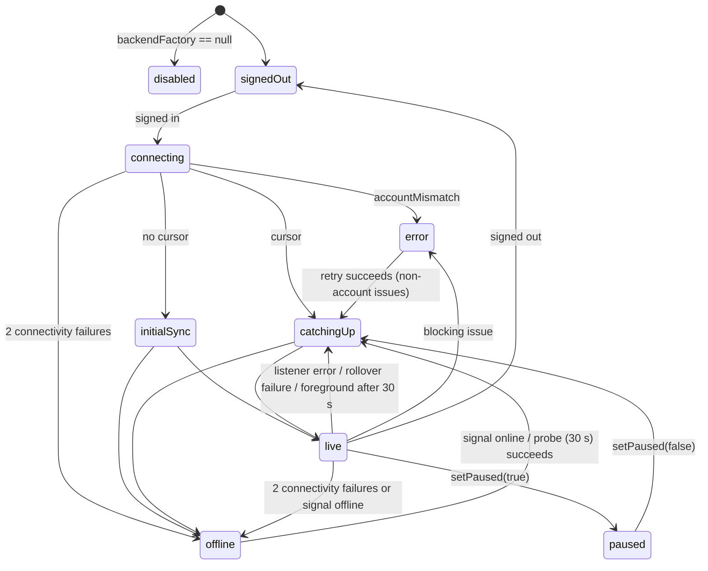

# 07 · SYNC — 계정 · 동기화

> 상태: 초안 (총괄 관리자 검토 전) · 작성일: 2026-11-04
> 마스터 기획서: [docs/PLAN.md](../PLAN.md) v1.1 · 영역 지도: [00-overview.md](00-overview.md)
> 소유 경로: `packages/sync_engine/` · 패키지 이름: `sync_engine`

이 문서만 보고 별도 git worktree에서 SYNC를 구현할 수 있게 쓴다. 코드 블록의 Dart 시그니처는 **계약**이다. 이름·타입을 바꾸려면 총괄 관리자 승인이 필요하다. 메서드 본문은 개발자가 채운다(시그니처 끝의 `;`).

---

## 1. 목적과 범위

### 1.1 목적

SYNC는 한 사용자의 여러 기기 사이에서 노트 데이터를 맞춘다(PLAN F-06, F-07, 7.4).

- 로컬 우선(local-first): 편집은 CORE가 기기에 먼저 저장하고, SYNC는 CORE의 변경 기록(outbox)을 읽어 **백그라운드로** 올린다.
- 다른 기기의 변경을 실시간으로 받아 CORE에 병합 적용한다. 충돌은 **필드 단위 마지막 수정 우선(LWW)** + 집합 병합으로 데이터 손실 없이 푼다.
- 오프라인·끊김·재시도·첫 동기화·증분 동기화를 처리하고, 상태(완료/진행 중/오프라인/오류)를 스트림으로 알린다.
- PDF·이미지·오디오 같은 큰 파일은 내용 해시로 한 번만 올리고, 다른 기기는 필요할 때 받는다.
- Google 로그인(웹 우선)으로 계정을 연결하고, 로그인 전 로컬 데이터를 로그인 시 올린다.

### 1.2 이번 동시 개발 범위

| 구분 | 내용 |
|---|---|
| 엔진 핵심 | 업로드(디바운스 0.5 s / 최대 1 s, 묶음·청크·커밋·ack), 수신(첫 동기화·증분·실시간 구독), 병합 규칙, 재시도·백오프·오프라인 전환, 상태 스트림, 알림(notice) |
| 병합 규칙 | 필드 단위 HLC LWW, 요소 추가/삭제 집합, 분수 인덱스 페이지 순서, 폴더 순환 복구, 삭제 vs 수정(페이지 되살림), 영구 삭제 vs 보류 중 편집(복구 사본) |
| 원격 형식 | 변경 묶음(change chunk) 이진 코덱 v1, 청크 ID, 범위(scope) 분할, 압축(compaction) |
| 큰 파일 | 에셋 업로드(존재 확인 중복 제거), 요청 시 다운로드, 진행률, 해시 검증 |
| 계정 | `AuthBackend` 추상화, `AuthService`, 첫 로그인 소유자 재지정 + 업로드, 계정 불일치 차단 |
| 백엔드 추상화 | `SyncBackend`·`RemoteBlobStore` 포트, **메모리 가짜 서버**(여러 기기 공유, 장애 주입, 지연·늦은 가시성 재현) |
| 로컬 포트 | `SyncLocalStore` 포트(엔진이 CORE에 바라는 것), 가짜 구현 `FakeLocalStore`, CORE 어댑터 `CoreSyncLocalStore` |
| Firebase 어댑터 | Firestore·Storage·Auth 어댑터 **설계 + 코드 골격**(가짜 Firestore로 단위 테스트), 보안 규칙·색인 초안. 실제 프로젝트 연결은 하지 않음 |
| 테스트 | 가짜 서버 + 가짜 기기 2~3대 결정적 시나리오 22개 + 무작위 수렴 검사 |
| 상태 관리 | Riverpod(`package:riverpod`) provider 일체 |

### 1.3 이후 범위 (인터페이스·자리만 지금 준비)

- Firebase 프로젝트 연결·배포·iPad 실측(2초 목표 확인) → Firebase 프로젝트 생성 후(PLAN 11장 #3), 통합 단계 이후.
- 네이티브 Google 로그인(iOS·Android, `google_sign_in` 7.x) → 네이티브 전환 시. 이번에는 `NativeGoogleSignIn` 인터페이스만.
- 2단계 계정 기능: Apple·카카오·이메일 로그인, 계정 전환, 기기 목록·원격 로그아웃, 회원 탈퇴 + 서버 데이터 삭제(서버 함수 필요). 이번에는 `devices` 컬렉션 기록과 `AuthBackend` 확장 지점만.
- 삭제 표시(tombstone) 정리와 고아 에셋 정리(GC) → `devices` 문서의 커서 최소값 기준(12절 Q15).
- 노트 내용 지연 다운로드(범위 단위로 필요할 때만 받기), 에셋 미리 받기 정책(`AssetPrefetchPolicy.recentNotes`).
- 여러 탭 동시 실행 시 동기화 담당 탭 선출(Web Locks). 이번에는 중복 실행해도 멱등이라 안전함만 보장(6.17).
- 보안 규칙 에뮬레이터 테스트(Firebase CLI + Java). 컨테이너에 Java·Node는 있으나 에뮬레이터 내려받기 가능 여부 미확인 → 선택 작업.
- 서버 함수(휴지통 서버 정리, 수식 API 중계) → 제외(7.1 서버 함수는 M7·2단계).

### 1.4 제외 (다른 영역 책임)

- 엔티티 정의, 로컬 DB, outbox 기록·병합, 원격 적용 트랜잭션 실행, HLC 시계, 분수 인덱스 계산, 휴지통 30일 정리, 되돌리기 히스토리 → CORE
- 로그인 화면·설정 화면·동기화 상태 배지 UI → 소유 영역 미정(12절 Q10). SYNC는 API만 제공
- Firebase 초기화 코드·`firebase_options.dart`·`firebase.json`·Hosting 헤더·CI 배포·사용자 안내서 → INFRA (SYNC는 규칙 파일과 안내 내용 제공)
- PDF 배경 렌더링 중 "다운로드 중" 표시 → PDF·EDITOR (SYNC는 에셋 상태 API 제공)

### 1.5 핵심 결정 요약

| # | 결정 | 근거 (상세 절) |
|---|---|---|
| D1 | 원격 저장 구조는 사용자별 **불변 변경 묶음(change chunk) 로그**. 엔티티별 가변 문서를 쓰지 않는다 | 묶음 1개 = Firestore 쓰기 1회(쓰기 최소화), 받는 기기는 새 데이터만 받음(대역폭), 트랜잭션 없이 충돌 없는 병합, 1 MB 제한은 묶음 크기 상한으로 해결, 보안 규칙 단순 (6.4) |
| D2 | 기록은 항상 **엔티티 전체 스냅숏 + 필드 버전** | 도착 순서와 무관(교환·결합·멱등), 부분 기록 고아 문제 없음, 압축 단순 (6.3) |
| D3 | 필드 단위 LWW 판정은 **HLC**, 증분 동기화 커서는 **서버 타임스탬프** | 오프라인 편집은 '나중에 연결한 쪽'이 아니라 '나중에 고친 쪽'이 이겨야 함 (6.2). PLAN 7.4 '서버 시간 기준'을 바꾸는 제안 → 12절 Q8 |
| D4 | 병합 단위는 최상위 JSON 키, 일부는 묶음(이동 = `parentId`+`sortKey`, 휴지통 = `deletedAt`+`trashRootId`) | 의도 단위 보존 (6.3) |
| D5 | 삭제도 LWW 필드. 획·노트·폴더는 삭제 유지, **페이지는 삭제한 기기가 몰랐던 새 획이 있으면 되살림**. 영구 삭제는 최종이며 보류 중 편집은 복구 사본으로 | 양쪽 필기 보존(F-07) (6.7) |
| D6 | 폴더 순환은 순환 안에서 **가장 늦은 이동(HLC 최대)을 최상위로** 옮겨 취소 | 결정적, 모든 기기가 같은 결론 (6.7.2) |
| D7 | 재연결 시 **받기 먼저, 보내기 나중** | 오래된 보류 편집이 최신 원격 값을 덮어쓰지 않게 (6.6) |
| D8 | Firestore SDK 오프라인 캐시는 끈다 | 로컬 DB(CORE)가 진실, iPad Safari 저장 용량 이중 사용 방지 (6.4.6) |
| D9 | 큰 파일은 Storage `users/{uid}/assets/{sha256}`, 업로드 전 존재 확인, 받기는 요청 시 | 중복 제거(5.4), 비용 (6.9) |
| D10 | 엔진은 포트(`SyncLocalStore`, `SyncBackend`)에만 의존하고 **JSON 수준(`SyncDoc`)** 으로 동작 | CORE 구현·Firebase 없이 엔진 전체를 결정적으로 테스트 (5.1) |
| D11 | 기기는 처음 로그인한 계정에 묶인다. 다른 계정 로그인은 오류로 막는다 | 계정별 데이터 분리(7.6), 전환은 2단계 (6.10) |

---

## 2. PLAN.md 요구사항 대응표

'이번' = 이번 동시 개발에서 구현·자동 테스트. '이번(골격)' = 코드 골격 + 가짜로 단위 테스트, 실서버 연결은 이후. '이후' = 범위 밖.

### 2.1 기능 명세 (4장)

| 기능 ID / 항목 | PLAN 내용 | 이 계획서의 작업 | 범위 |
|---|---|---|---|
| F-05 | 프리셋 계정 동기화 → 다른 기기에서도 같은 펜 | `penPreset` 기록 동기화, 필드 LWW(6.3), 기본 프리셋 결정적 ID 요청(5.1 R7), S15 | 이번 |
| F-06 1단계 | Google 로그인 — iPad·안드로이드 | `AuthBackend`/`AuthService`(4.3), 웹: `FirebaseAuthBackend` 팝업/리디렉트(6.10) T17 | 이번(골격) / 네이티브 이후 |
| F-06 | 처음부터 모든 데이터를 사용자 ID 기준 저장 | 원격 경로 `users/{uid}/…`, 기록의 `ownerId` 검증, `reassignOwner` 호출, 계정 묶기(6.10) T10 | 이번 |
| F-06 2단계 | 게스트 모드 → 나중에 로그인하면 업로드 | 1단계도 로그인 전 로컬 사용이 기본 → 첫 로그인 시 전체 업로드(6.10.3) S15 | 이번 |
| F-06 2단계 | Apple·카카오·이메일 로그인, 기기 목록·원격 로그아웃, 앱 내 탈퇴 + 데이터 삭제 | `AuthBackend` 확장 지점, `devices/{nodeId}` 문서 기록(6.4.1) | 이후 |
| F-07 | 범위: 한 사용자의 여러 기기 | 사용자별 경로·규칙(6.14) | 이번 |
| F-07 | 로컬 우선, 백그라운드 업로드, 오프라인에서도 모든 기능 동작 | outbox 소비 업로드 파이프라인(6.5), 오프라인 전환(6.8) T8, T10 | 이번 |
| F-07 | 온라인일 때 다른 기기에 2초 이내 반영 | 디바운스 500 ms/최대 1,000 ms + 실시간 구독(6.5, 6.6). S01에서 가상 시간 < 2 s 검증 | 이번(가짜) / 실측 이후 |
| F-07 | 동기화 단위는 획 단위 변경분 | 엔티티 단위 outbox → 바뀐 획 기록만 묶음에 담음(6.4.3) | 이번 |
| F-07 | 충돌: 오프라인 양쪽 편집 후 연결 | 필드 LWW + 받기 먼저(6.3, 6.6) S02 | 이번 |
| F-07 | 획·도형: 추가/삭제 집합 → 양쪽 필기 보존 | 획 ID 집합 + `deletedAt` LWW(6.3, 6.7.3) S02, S05 | 이번 |
| F-07 | 제목·폴더 위치 등 속성: 마지막 수정 우선 | 필드 단위 HLC LWW(6.2, 6.3) S02 | 이번 |
| F-07 | 큰 파일은 별도 저장소, 다른 기기는 열 때 내려받기 | 에셋 파이프라인(6.9) S09 | 이번(가짜) |
| F-07 | 동기화 상태 표시: 완료/진행 중/오프라인/오류 | `SyncStatus.display`(4.4, 6.12) | 이번(API) / 화면은 12절 Q10 |
| F-08 | 그 기기에서 한 편집만 되돌림 | 원격 적용·복구 쓰기를 히스토리 밖으로(CORE와 조율, 6.11) | 이번 |
| F-13 | 페이지 순서 (두 기기 동시 삽입) | `sortKey` 분수 인덱스 + `id` 동점 처리, LWW(6.7.1) S03 | 이번 |
| F-01 | 폴더 이동 (드래그) | `{parentId, sortKey}` 묶음 LWW, 순환 복구(6.7.2) S04 | 이번 |
| F-16 | 녹음 파일 압축 후 동기화, 용량 표시 | `recording` 기록 + 오디오 에셋은 일반 에셋 파이프라인으로 처리(6.9). 녹음 기능 자체는 M6 | 이번(엔진) / 녹음 이후 |

### 2.2 추가 기능 (5장)

| 항목 | PLAN 내용 | 이 계획서의 작업 | 범위 |
|---|---|---|---|
| 5.1 오프라인 사용 | 연결되면 자동 동기화 (M4) | 연결 신호·백오프 재연결·받기 먼저(6.8) S02, S10, S12 | 이번 |
| 5.1 휴지통 | 동기화로 다른 기기에서도 지워지므로 복구 수단 | 휴지통 필드 묶음 LWW, 영구 삭제 기록, 보류 편집 복구 사본(6.7.4) S07, S08 | 이번 |
| 5.2 버전 기록, 전체 백업/복원 | P1 | 해당 없음(동기화 로그를 버전 기록으로 쓰지 않음) | 이후 |
| 5.4 동기화 | 온라인 시 2초 이내, 데이터 손실 0건 | 결정적 시나리오 + 무작위 수렴 검사(9.1), 손실 0 판정 기준(10장) | 이번 |
| 5.4 보안 | TLS, 본인 데이터만 접근 | Firebase SDK(HTTPS), 규칙 초안(6.14) | 이번(초안) / 배포 이후 |
| 5.4 저장 용량 | 획 데이터 압축, 같은 PDF 한 번만 | CORE 점 코덱을 이진 그대로 묶음에 담음(base64 안 씀, 6.4.4), 에셋 해시 중복 제거(6.9) | 이번 |

### 2.3 기술 스택·아키텍처·기타 (6장, 7장, 8장, 9장, 10장, 12장)

| 항목 | PLAN 내용 | 이 계획서의 작업 | 범위 |
|---|---|---|---|
| 6.2 | 인증·DB·파일: Firebase Auth·Firestore·Storage | 어댑터 골격(4.10) T17 | 이번(골격) |
| 6.2 | 서버 함수(Cloud Functions) | 사용 안 함 | 이후 |
| 6.3 | 개인 사용 무료 사용량, 예산 알림 | 비용 추정(6.15), 예산 알림 안내 내용 INFRA에 제공(6.18) | 이번(추정) |
| 6.3 | 쓰기 횟수 과금 → 0.5~1초 묶어서 업로드 | 디바운스 500/1,000 ms, 묶음 1개 = 쓰기 1회(6.5) | 이번 |
| 6.3 | 문서 1 MB 제한 → 획 데이터 여러 덩어리 | 청크 상한 256 KiB(권장)/1,000,000 B(최대)(6.4.3) | 이번 |
| 7.1 | 동기화 엔진: 변경 큐·실시간 구독·충돌 해결 | 4.5, 6.5~6.8 | 이번 |
| 7.2 | `User` | `users/{uid}` 프로필 문서(6.4.1). `settings`는 `setting` 기록으로 | 이번(골격) |
| 7.2 | `Asset { id(=해시), size, storagePath }` | 업로드 후 `markUploaded`(6.9) | 이번 |
| 7.2 | 모든 항목 `deletedAt`, `sortKey` 분수 인덱스, `schemaVersion` | 병합 규칙(6.3) | 이번 |
| 7.4-1 | 편집 → 로컬 트랜잭션 + 보낼 변경 큐 | CORE outbox 소비(5.1) | 이번 |
| 7.4-2 | 큐를 묶어 전송(0.5~1초 디바운스) | 6.5 | 이번 |
| 7.4-3 | 실시간 구독 → 로컬 반영 → 화면 갱신 | 6.6 (화면 갱신은 CORE `ChangeBatch(origin: remote)`) | 이번 |
| 7.4-4 | 충돌 규칙 4가지 | 6.3, 6.7 | 이번 |
| 7.4-5 | 큰 파일 해시 중복 없이 업로드, 열 때 내려받기 | 6.9 | 이번 |
| 7.4-6 | 장시간 오프라인 후 마지막 동기화 이후 변경분만 | 서버 타임스탬프 커서 + 겹침 5분(6.6) S12 | 이번 |
| 7.5 | 되돌리기도 새 변경으로 동기화 | outbox 일반 처리, LWW(6.11) S20 | 이번 |
| 7.6 | 모든 데이터 `ownerId`, 규칙은 본인만 | 6.10, 6.14 | 이번 |
| 7.6 | `Asset.size` 기록 → 사용자별 용량 계산 | `SyncUsage`(4.5) | 이번 |
| 8장 | 로그인(Google) 화면 | 화면은 12절 Q10. SYNC는 `AuthService` | 이번(API) |
| 8장 | 설정: 계정 · 동기화 상태 · 저장 용량 | `authStateProvider`, `syncStatusProvider`, `syncUsageProvider` | 이번(API) |
| 9.4 | 동기화 충돌 병합 같은 핵심 로직은 자동 테스트 | 9.1 | 이번 |
| 9.5 | Safari가 저장 데이터를 지울 수 있음 | 동기화가 켜지면 서버에 사본 → 지워져도 다시 받기 가능(첫 동기화) | 이번 |
| 10 M0 | Firebase 프로젝트 생성, 예산 알림 | 사용자·INFRA. SYNC는 필요한 설정 목록 제공(6.18) | 제외(의존) |
| 10 M4 | Google 로그인 | T10, T14, T17 | 이번(골격) |
| 10 M4 | 변경 큐 · 업로드 · 실시간 수신 · 충돌 병합 | T4, T8, T9, T11 | 이번 |
| 10 M4 | PDF · 이미지 · 녹음 파일 동기화 | T12 | 이번(가짜) |
| 10 M4 | 동기화 상태 표시, 펜 프리셋 · 설정 동기화 | T10(상태), 일반 기록으로 프리셋·설정 | 이번 |
| 10 M4 완료 기준 | iPad → 안드로이드 2초, 양쪽 오프라인 수정 후 무손실 | 가짜 시나리오 S01, S02, S18. 실기기 확인 9.2 | 이번(가짜) / 실기기 이후 |
| 10 2단계 | 회원 탈퇴·데이터 삭제, 기기 관리, 사용자별 클라우드 용량 한도 | 확장 지점만 | 이후 |
| 11 #3 | Firebase 프로젝트 생성 | 연결 전제 조건 | 의존 |
| 12 | 동기화 버그로 데이터 손실 | 소프트 삭제 + 보류 편집 보호 + 수렴 자동 테스트(11장) | 이번 |
| 12 | 클라우드 비용 | 비용 추정, 해시 중복 제거, 압축(6.13, 6.15) | 이번 |

---

## 3. 소유 경로와 패키지 구조

```text
packages/sync_engine/
├─ pubspec.yaml
├─ analysis_options.yaml              # include: ../../analysis_options.yaml (INFRA 루트 규칙)
├─ firebase/                          # 배포는 INFRA firebase.json이 참조 (5.2 I-4)
│  ├─ firestore.rules
│  ├─ storage.rules
│  └─ firestore.indexes.json
├─ lib/
│  ├─ sync_engine.dart                # 공개 API. 순수 Dart (Flutter·Firebase import 금지)
│  ├─ testing.dart                    # 가짜 서버·기기·하네스. 순수 Dart (웹에서도 컴파일됨)
│  ├─ firebase.dart                   # Firebase 어댑터 (Flutter 플러그인 import)
│  ├─ platform.dart                   # ConnectivityPlusSignal (Flutter 플러그인 import)
│  └─ src/
│     ├─ common/      server_cursor.dart, errors.dart, cancel_token.dart, varuint.dart, lru_set.dart
│     ├─ model/       sync_doc.dart, field_versions.dart, records.dart, field_units.dart, scopes.dart, asset_meta.dart
│     ├─ codec/       chunk_codec.dart, chunk_id.dart, chunk_packer.dart, canonical_json.dart
│     ├─ local/       sync_local_store.dart (포트), core_sync_local_store.dart (CORE 어댑터)
│     ├─ merge/       field_merge.dart, merge_policy.dart, folder_cycles.dart, page_resurrection.dart,
│     │               purge_guard.dart, purged_set.dart
│     ├─ backend/     sync_backend.dart, remote_chunk.dart, blob_store.dart, profile.dart
│     ├─ auth/        auth_user.dart, auth_backend.dart, auth_service.dart
│     ├─ engine/      sync_engine.dart, engine_controller.dart, serial_executor.dart, push_scheduler.dart,
│     │               backoff.dart, upload_pipeline.dart, download_pipeline.dart, live_listener.dart,
│     │               connectivity.dart, clock_skew.dart, meta_keys.dart
│     ├─ assets/      sync_asset_service.dart, asset_uploader.dart, asset_downloader.dart
│     ├─ status/      sync_status.dart, sync_issue.dart, sync_notice.dart, status_builder.dart
│     ├─ compaction/  compactor.dart
│     ├─ config.dart
│     ├─ providers.dart
│     ├─ firebase/    firebase_bindings.dart, firebase_sync_backend.dart, firestore_chunk_mapper.dart,
│     │               firebase_blob_store.dart, firebase_auth_backend.dart, firebase_error_mapper.dart,
│     │               display_mode.dart, display_mode_web.dart, display_mode_stub.dart
│     ├─ platform/    connectivity_plus_signal.dart
│     └─ testing/     fake_sync_server.dart, fake_sync_backend.dart, fake_network.dart, fake_blob_store.dart,
│                     fake_auth_backend.dart, fake_local_store.dart, test_device.dart,
│                     sync_test_harness.dart, canonical_dump.dart, opaque_points.dart
└─ test/
   ├─ common/ model/ codec/ merge/ testing/ engine/ assets/ compaction/ scenarios/ firebase/ integration/
   ├─ fixtures/chunk_v1_golden.bin   # 6.4.4 골든 (732 B)
   └─ no_dart_io_test.dart           # lib/ 아래 dart:io·dart:html import 금지 검사
```

### 3.1 pubspec.yaml (확정 버전 — 7절 근거)

```yaml
name: sync_engine
description: Device-to-device sync engine for noteapp (local-first, Firebase adapters).
publish_to: none
resolution: workspace            # INFRA 루트 워크스페이스

environment:
  sdk: ^3.13.0
  flutter: ">=3.47.0"

dependencies:
  flutter:
    sdk: flutter                 # firebase.dart / platform.dart 전용. lib/sync_engine.dart는 import 안 함
  note_core:
    path: ../note_core           # 워크스페이스에서는 INFRA 방식(path 또는 workspace)에 맞춤
  riverpod: 3.4.3
  clock: 1.1.3
  crypto: 3.0.8
  meta: 1.19.0
  collection: 1.19.1
  firebase_core: 5.1.0
  firebase_auth: 7.0.1
  cloud_firestore: 7.1.0
  firebase_storage: 14.0.1
  connectivity_plus: 7.3.2
  web: 1.1.2                     # display_mode_web.dart (조건부 import) 전용

dev_dependencies:
  flutter_test:
    sdk: flutter
  fake_async: 1.3.3
  fake_cloud_firestore: 4.5.0
  firebase_auth_mocks: 0.16.0
```

라이브러리 경계 규칙: `lib/sync_engine.dart`와 `lib/testing.dart`(그리고 이들이 export하는 `src/` 파일)는 `package:flutter`, `package:firebase_*`, `package:cloud_firestore`, `package:connectivity_plus`, `package:web`, `dart:io`, `dart:html`을 import하지 않는다. `test/no_dart_io_test.dart`가 소스 텍스트로 검사한다.

---

## 4. 공개 API

모든 공개 타입은 `package:sync_engine/sync_engine.dart`에서 export한다(가짜는 `testing.dart`, Firebase는 `firebase.dart`, 연결 신호 구현은 `platform.dart`). CORE 타입(`EntityKind`, `EntityRef`, `Hlc`, `OutboxEntry`, `OutboxAck`, `OwnerId`, `NoteId`, `PageId`, `FolderId`, `AssetId`, `EpochMillis`, `kLocalOwnerId`, `noRetry`, `noteStoreProvider`)은 `package:note_core/note_core.dart`에서 가져온다.

### 4.1 공통 기초 타입

```dart
// lib/src/common/server_cursor.dart
/// Server commit time of a change chunk (Firestore serverTimestamp), microseconds
/// since epoch, UTC. Web-safe int (< 2^53).
@immutable
final class ServerCursor implements Comparable<ServerCursor> {
  const ServerCursor(this.micros);
  static const ServerCursor zero = ServerCursor(0);
  final int micros;

  factory ServerCursor.fromDateTime(DateTime t);       // t.toUtc().microsecondsSinceEpoch
  factory ServerCursor.parse(String text);              // decimal digits only; throws FormatException
  static ServerCursor? tryParse(String? text);
  /// Clamped at zero.
  ServerCursor minus(Duration d);
  DateTime toDateTime();                                // UTC
  static ServerCursor max(ServerCursor a, ServerCursor b);
  @override int compareTo(ServerCursor other);
  bool operator >(ServerCursor other);
  bool operator <(ServerCursor other);
  bool operator >=(ServerCursor other);
  @override String toString();                          // decimal micros
}
```

```dart
// lib/src/common/errors.dart
enum SyncErrorCode {
  network,            // no connection, socket closed, offline
  unavailable,        // Firestore 'unavailable'
  deadlineExceeded,   // timeout (SyncConfig.operationTimeout)
  aborted,
  cancelled,
  resourceExhausted,  // quota
  unauthenticated,
  permissionDenied,
  invalidArgument,    // e.g. document too large
  notFound,
  alreadyExists,
  failedPrecondition, // e.g. missing index
  dataLoss,
  internal,
  unknown;

  /// network, unavailable, deadlineExceeded, aborted, internal, unknown.
  bool get isTransient;
  /// network, unavailable, deadlineExceeded.
  bool get isConnectivity;
}

final class SyncBackendException implements Exception {
  const SyncBackendException(this.code, this.message, {this.cause});
  final SyncErrorCode code;
  final String message;
  final Object? cause;
  @override String toString();
}

enum SignInErrorCode { cancelled, popupBlocked, network, unsupportedPlatform, accountDisabled, misconfigured, unknown }

final class SignInException implements Exception {
  const SignInException(this.code, this.message, {this.cause});
  final SignInErrorCode code;
  final String message;
  final Object? cause;
}

// lib/src/common/cancel_token.dart
final class SyncCancelToken {
  SyncCancelToken();
  bool get isCancelled;
  void cancel();
  Future<void> get whenCancelled;
  /// Throws SyncBackendException(cancelled) if cancelled.
  void throwIfCancelled();
}
```

### 4.2 동기화 데이터 모델 (엔진 내부 표현, 다른 영역은 읽기만)

```dart
// lib/src/model/sync_doc.dart
/// An entity in CORE's sync/backup JSON wire format (CORE 6.3). The engine works
/// on this map form so that it never needs CORE's typed classes (D10).
@immutable
final class SyncDoc {
  /// [json] is deep-copied and made unmodifiable. json['id'] must equal [id]
  /// (for settings the id is the key).
  SyncDoc({required this.kind, required this.id, required Map<String, Object?> json});
  final EntityKind kind;
  final String id;
  final Map<String, Object?> json;
  EntityRef get ref;
  bool get isDeleted;                 // json['deletedAt'] != null
  /// Owner of folder/note/penPreset/asset; null for kinds without ownerId.
  String? get ownerId;
  SyncDoc withFields(Map<String, Object?> changes);   // shallow merge of top-level keys
}

// lib/src/model/field_versions.dart
/// Per-field HLC of the last write. Fields without an override carry [base].
/// JSON: {"b": "<hlc>", "o": {"style": "<hlc>"}} — "o" omitted when empty,
/// override keys sorted.
@immutable
final class FieldVersions {
  FieldVersions(this.base, [Map<String, Hlc> overrides = const {}]); // drops overrides <= base
  final Hlc base;
  final Map<String, Hlc> overrides;   // unmodifiable, only values > base
  Hlc of(String field);
  /// Max over a set of fields (a merge unit).
  Hlc ofUnit(Iterable<String> fields);
  Hlc get max;
  /// Local write: '*' resets to FieldVersions(v); otherwise sets each field to v.
  FieldVersions stamped(Iterable<String> fields, Hlc v);
  Map<String, Object?> toJson();
  factory FieldVersions.fromJson(Map<String, Object?> json);   // throws FormatException
  @override bool operator ==(Object other);
  @override int get hashCode;
}

// lib/src/model/records.dart
sealed class SyncRecord {
  const SyncRecord();
  EntityRef get ref;
}
/// Full snapshot of one entity plus field versions (D2).
final class UpsertRecord extends SyncRecord {
  const UpsertRecord(this.doc, this.versions);
  final SyncDoc doc;
  final FieldVersions versions;
  @override EntityRef get ref;
}
/// Permanent deletion (trash purge) of a folder or note and its trash group.
final class PurgeRecord extends SyncRecord {
  const PurgeRecord(this.ref, this.hlc);
  @override final EntityRef ref;
  final Hlc hlc;
}

/// Local copy as stored by CORE: snapshot + per-field versions.
@immutable
final class LocalRecord {
  const LocalRecord(this.doc, this.versions);
  final SyncDoc doc;
  final FieldVersions versions;
  UpsertRecord toUpsert();
}

// lib/src/model/field_units.dart
/// Merge units (6.3). Keys not listed in a group form their own unit.
abstract final class FieldUnits {
  /// Never merged by LWW: identity and derived values.
  static const Set<String> metaKeys = {'id', 'key', 'version', 'createdAt', 'updatedAt'};
  /// Explicit multi-key groups per kind (table 6.3.1).
  static List<Set<String>> groupsOf(EntityKind kind);
  /// All units for the keys present in either snapshot (metaKeys excluded).
  static List<Set<String>> unitsFor(EntityKind kind, Iterable<String> keys);
}

// lib/src/model/scopes.dart
/// Chunk routing (6.4.3). 'lib' for library-level kinds, else the note id.
abstract final class SyncScopes {
  static const String library = 'lib';
  static String scopeOf(UpsertRecord record, {NoteId? noteIdHint});
  static String scopeOfPurge(PurgeRecord record);       // always 'lib'
}

// lib/src/model/asset_meta.dart
@immutable
final class AssetMeta {
  const AssetMeta({required this.id, required this.type, required this.mimeType,
      required this.size, this.fileName, this.storagePath, required this.hasLocalBytes});
  final AssetId id;            // sha-256 hex
  final String type;           // 'pdf' | 'image' | 'audio' (CORE AssetType.name)
  final String mimeType;
  final int size;              // bytes
  final String? fileName;
  final String? storagePath;   // null = not uploaded yet
  final bool hasLocalBytes;
}
```

### 4.3 계정

```dart
// lib/src/auth/auth_user.dart
@immutable
final class AuthUser {
  const AuthUser({required this.uid, this.email, this.displayName, this.photoUrl});
  final String uid;            // Firebase uid, 1..128 chars
  final String? email;
  final String? displayName;
  final String? photoUrl;
}

// lib/src/auth/auth_backend.dart
abstract interface class AuthBackend {
  AuthUser? get currentUser;
  /// Emits the current user on listen, then every change.
  Stream<AuthUser?> authStateChanges();
  bool get supportsGoogleSignIn;
  /// Throws SignInException. On web this may navigate away (redirect mode);
  /// the result then arrives via [completePendingSignIn] after reload.
  Future<AuthUser> signInWithGoogle();
  /// Web redirect result after reload; null if none. Never throws for "no result".
  Future<AuthUser?> completePendingSignIn();
  /// Refreshes the id token. Throws SyncBackendException(unauthenticated) if the
  /// session can no longer be refreshed.
  Future<void> refreshSession();
  Future<void> signOut();
}

// lib/src/auth/auth_service.dart
enum AuthStatus { unavailable, initializing, signedOut, signingIn, signedIn }

@immutable
final class AuthState {
  const AuthState({required this.status, this.user, this.lastError});
  static const AuthState unavailable = AuthState(status: AuthStatus.unavailable);
  final AuthStatus status;
  final AuthUser? user;              // non-null iff status == signedIn
  final SignInException? lastError;  // last failed sign-in, cleared on next attempt
}

/// Thin state holder used by UI (login / settings) and by the engine.
final class AuthService {
  /// [backend] null → AuthStatus.unavailable forever (Firebase not configured).
  AuthService(AuthBackend? backend);
  AuthState get state;
  /// Emits current state on listen, then distinct changes.
  Stream<AuthState> get states;
  bool get isAvailable;
  /// Calls backend.completePendingSignIn() once, then follows authStateChanges.
  Future<void> initialize();
  /// Throws SignInException (state.lastError is also set).
  Future<AuthUser> signInWithGoogle();
  Future<void> signOut();
  Future<void> dispose();
}
```

### 4.4 동기화 상태 · 문제 · 알림

```dart
// lib/src/status/sync_status.dart
enum SyncPhase {
  disabled,     // no backend configured (Firebase project not connected)
  signedOut,
  connecting,   // attaching account, profile/device write
  initialSync,  // first full download (no cursor yet)
  catchingUp,   // incremental download since cursor
  live,         // listener active, uploads flowing
  offline,
  paused,       // user paused sync
  error,        // blocking issue present
}

/// What the UI shows (PLAN F-07). off = not signed in / disabled / paused.
enum SyncDisplayState { off, done, inProgress, offline, error }

@immutable
final class InitialSyncProgress {
  const InitialSyncProgress({required this.chunksApplied, this.estimatedTotalChunks,
      required this.recordsApplied, required this.startedAt});
  final int chunksApplied;
  final int? estimatedTotalChunks;   // backend count(), may be null
  final int recordsApplied;
  final EpochMillis startedAt;
  double? get fraction;              // null if total unknown; clamped 0..1
}

@immutable
final class AssetTransferSummary {
  const AssetTransferSummary({this.uploadsPending = 0, this.uploadBytesDone = 0,
      this.uploadBytesTotal = 0, this.downloadsActive = 0, this.downloadBytesDone = 0,
      this.downloadBytesTotal = 0});
  static const AssetTransferSummary idle = AssetTransferSummary();
  final int uploadsPending;
  final int uploadBytesDone, uploadBytesTotal;     // current upload batch
  final int downloadsActive;
  final int downloadBytesDone, downloadBytesTotal;
  bool get isIdle;
}

@immutable
final class SyncStatus {
  const SyncStatus({required this.phase, required this.display, this.user,
      this.pendingUploads = 0, this.quarantinedUploads = 0, this.isPushing = false,
      this.initialSync, this.assets = AssetTransferSummary.idle, this.lastSyncedAt,
      this.nextRetryAt, this.issues = const [], this.isOnline = true, this.clockSkew});
  final SyncPhase phase;
  final SyncDisplayState display;           // derived, 6.12
  final AuthUser? user;
  final int pendingUploads;                 // outbox count (CORE watchPendingCount)
  final int quarantinedUploads;             // entries the server rejected (6.5.6)
  final bool isPushing;
  final InitialSyncProgress? initialSync;   // non-null during initialSync
  final AssetTransferSummary assets;
  final EpochMillis? lastSyncedAt;          // last successful push or applied pull
  final EpochMillis? nextRetryAt;           // while backing off / offline probe
  final List<SyncIssue> issues;             // active issues, blocking first
  final bool isOnline;
  final Duration? clockSkew;                // server - local estimate (6.2.4)
  bool get hasBlockingIssue;
}

// lib/src/status/sync_issue.dart
enum SyncIssueCode {
  reauthRequired,        // blocking: session expired, user must sign in again
  accountMismatch,       // blocking: device bound to another account (6.10.4)
  permissionDenied,      // blocking: rules/project misconfigured
  backendMisconfigured,  // blocking: failedPrecondition (missing index etc.)
  localStoreFailure,     // blocking: CORE write failed repeatedly
  quotaExceeded,         // slowed down (SyncConfig.quotaBackoff)
  entityTooLarge,        // one entity > chunk hard limit, kept local only
  rejectedByServer,      // invalidArgument for one entity, kept local only
  malformedRemoteData,   // undecodable chunk/record skipped
  foreignOwnerData,      // record with another ownerId skipped
  needsAppUpdate,        // chunk format newer than this app, deferred
  clockSkew,             // |server - local| > SyncConfig.clockSkewWarning
  assetTooLarge,
  assetUploadFailed,
  assetDownloadFailed,
  assetCorrupt;          // downloaded bytes failed hash check twice

  bool get isBlocking;   // first five
}

@immutable
final class SyncIssue {
  const SyncIssue({required this.code, required this.message, required this.firstAt,
      required this.lastAt, this.count = 1, this.ref, this.assetId});
  final SyncIssueCode code;
  final String message;      // English, for developer overlay / logs (UI maps code → 한국어)
  final EpochMillis firstAt, lastAt;
  final int count;
  final EntityRef? ref;
  final AssetId? assetId;
  bool get isBlocking => code.isBlocking;
}

// lib/src/status/sync_notice.dart — one-shot events for snackbars
sealed class SyncNotice {
  const SyncNotice({required this.at});
  final EpochMillis at;
}
final class FolderCycleResolved extends SyncNotice {
  const FolderCycleResolved({required super.at, required this.folderId, required this.cycle});
  final FolderId folderId;           // moved to top level
  final List<FolderId> cycle;
}
final class PageRestored extends SyncNotice {
  const PageRestored({required super.at, required this.pageId, this.noteId});
  final PageId pageId;
  final NoteId? noteId;
}
final class NoteRecoveredFromPurge extends SyncNotice {
  const NoteRecoveredFromPurge({required super.at, required this.purgedNoteId, required this.copyNoteId});
  final NoteId purgedNoteId;
  final NoteId copyNoteId;
}
final class InitialSyncCompleted extends SyncNotice {
  const InitialSyncCompleted({required super.at, required this.records, required this.took});
  final int records;
  final Duration took;
}
```

### 4.5 엔진 · 에셋 서비스

```dart
// lib/src/engine/sync_engine.dart
typedef SyncBackendFactory = Future<SyncBackend> Function(AuthUser user);
enum SyncLifecycle { foreground, background }
enum SyncLogLevel { debug, info, warning, error }
typedef SyncLogSink = void Function(SyncLogLevel level, String message, {Object? error});

@immutable
final class SyncUsage {
  const SyncUsage({required this.uploadedAssetCount, required this.uploadedAssetBytes,
      required this.localOnlyAssetCount, required this.localOnlyAssetBytes});
  final int uploadedAssetCount, uploadedAssetBytes;   // sum of Asset.size with storagePath
  final int localOnlyAssetCount, localOnlyAssetBytes;
}

final class SyncEngine {
  SyncEngine({
    required SyncLocalStore local,
    required AuthService auth,
    SyncBackendFactory? backendFactory,      // null → phase disabled
    SyncConfig config = const SyncConfig(),
    ConnectivitySignal connectivity = const AlwaysOnlineSignal(),
    Clock clock = const Clock(),
    Random? random,                          // backoff jitter; tests pass Random(seed)
    SyncLogSink? log,
  });

  SyncStatus get status;
  /// Emits current status on listen, then changes (throttled to
  /// SyncConfig.statusThrottle, phase/display changes are emitted immediately).
  Stream<SyncStatus> get statusStream;
  Stream<SyncNotice> get notices;            // broadcast
  SyncAssetService get assets;
  bool get isStarted;

  /// Idempotent. Follows auth state: signed in → attach (6.10), signed out → detach.
  Future<void> start();
  /// Skips the debounce: push everything pending and pull once. Completes when
  /// that cycle ends (success or recorded failure). No-op unless phase == live.
  Future<void> syncNow();
  Future<void> setPaused(bool paused);
  /// background → flush pending uploads (no debounce); foreground after
  /// > 30 s in background → reconnect listener (catch-up from cursor).
  void setLifecycle(SyncLifecycle lifecycle);
  /// Pushes until the outbox is empty or [timeout] (default
  /// SyncConfig.backgroundFlushTimeout). True if nothing is left pending.
  Future<bool> flushPendingUploads({Duration? timeout});
  Future<SyncUsage> usage();
  Future<void> dispose();

  @visibleForTesting
  SyncEngineDebug get debug;
}

/// Counters for tests and the developer overlay.
@immutable
final class SyncEngineDebug {
  const SyncEngineDebug({required this.pushCycles, required this.commits,
      required this.chunksSent, required this.recordsSent, required this.chunksReceived,
      required this.recordsApplied, required this.recordsKept, required this.ownChunksSkipped,
      required this.repairsWritten, this.cursor, required this.quarantined,
      this.lastPushLatency, this.lastRemoteApplyLatency});
  final int pushCycles, commits, chunksSent, recordsSent;
  final int chunksReceived, recordsApplied, recordsKept, ownChunksSkipped, repairsWritten;
  final ServerCursor? cursor;
  final Set<EntityRef> quarantined;
  final Duration? lastPushLatency;          // local commit → server commit
  final Duration? lastRemoteApplyLatency;   // chunk serverTime → local apply done
}

// lib/src/engine/connectivity.dart
abstract interface class ConnectivitySignal {
  bool get isOnline;
  Stream<bool> get changes;                 // distinct values
}
final class AlwaysOnlineSignal implements ConnectivitySignal {
  const AlwaysOnlineSignal();
}
/// Test/manual control.
final class ManualConnectivitySignal implements ConnectivitySignal {
  ManualConnectivitySignal({bool online = true});
  void set(bool online);
}
```

```dart
// lib/src/assets/sync_asset_service.dart
enum AssetAvailabilityState {
  local,             // bytes on this device
  remoteReady,       // uploaded; can download
  waitingForUpload,  // metadata known, the source device has not uploaded yet
  downloading,
  queued,            // download requested, waiting for a slot / connection
  offline,           // requested but offline; resumes automatically
  failed,            // see error; retried on next ensureLocal
  unknown,           // no metadata on this device yet
  syncDisabled,      // engine disabled or signed out and bytes not local
}

enum AssetPriority { visible, background }
enum AssetPrefetchPolicy { onDemand, recentNotes }

@immutable
final class AssetAvailability {
  const AssetAvailability({required this.id, required this.state, this.receivedBytes,
      this.totalBytes, this.error});
  final AssetId id;
  final AssetAvailabilityState state;
  final int? receivedBytes, totalBytes;
  final SyncIssue? error;
  double? get progress;
}

abstract interface class SyncAssetService {
  Future<AssetAvailability> availability(AssetId id);
  /// Emits current availability on listen, then changes until local.
  Stream<AssetAvailability> watch(AssetId id);
  /// Requests a download if needed. Completes true when bytes are local,
  /// false when it cannot finish now (offline, waitingForUpload, failed, disabled).
  /// Concurrent calls for the same id share one download.
  Future<bool> ensureLocal(AssetId id, {AssetPriority priority = AssetPriority.visible});
  void cancel(AssetId id);
  Stream<AssetTransferSummary> get summary;
}
```

### 4.6 설정값 (`SyncConfig`)

```dart
// lib/src/config.dart
enum DevicePlatform { web, ios, android, other }

@immutable
final class CompactionConfig {
  const CompactionConfig({
    this.enabled = true,
    this.minChunksPerScope = 400,
    this.minInterval = const Duration(hours: 24),
    this.startJitterMax = const Duration(seconds: 60),
    this.maxScopeBytes = 64 * 1024 * 1024,
  });
  final bool enabled;
  final int minChunksPerScope;      // chunks seen in a scope since its last compaction
  final Duration minInterval;       // per scope, per device
  final Duration startJitterMax;    // random delay before starting (reduces concurrent runs)
  final int maxScopeBytes;          // skip scopes larger than this (memory on iPad Safari)
}

@immutable
final class SyncConfig {
  const SyncConfig({
    this.appVersion = '0.0.0',
    this.platform = DevicePlatform.web,
    this.debounce = const Duration(milliseconds: 500),
    this.maxBatchDelay = const Duration(milliseconds: 1000),
    this.maxEntriesPerPush = 500,
    this.chunkSoftLimitBytes = 256 * 1024,
    this.chunkHardLimitBytes = 1000000,
    this.maxRecordsPerChunk = 2000,
    this.maxChunksPerCommit = 16,
    this.maxBytesPerCommit = 8 * 1024 * 1024,
    this.maxBisectSteps = 32,
    this.fetchPageSize = 50,
    this.maxRecordsPerApply = 2000,
    this.maxBytesPerApply = 8 * 1024 * 1024,
    this.cursorOverlap = const Duration(minutes: 5),
    this.listenerRolloverChunks = 500,
    this.listenerRolloverInterval = const Duration(minutes: 15),
    this.listenerRolloverOverlap = const Duration(seconds: 60),
    this.appliedChunkMemory = 4096,
    this.backoffBase = const Duration(seconds: 1),
    this.backoffMax = const Duration(seconds: 60),
    this.backoffJitter = 0.2,
    this.offlineAfterFailures = 2,
    this.offlineProbeInterval = const Duration(seconds: 30),
    this.quotaBackoff = const Duration(minutes: 5),
    this.misconfiguredBackoff = const Duration(minutes: 10),
    this.operationTimeout = const Duration(seconds: 30),
    this.reconnectAfterBackground = const Duration(seconds: 30),
    this.backgroundFlushTimeout = const Duration(seconds: 5),
    this.cycleRepairGrace = const Duration(seconds: 10),
    this.purgeGuardWindow = const Duration(minutes: 10),
    this.clockSkewWarning = const Duration(minutes: 2),
    this.statusThrottle = const Duration(milliseconds: 250),
    this.deviceHeartbeat = const Duration(hours: 1),
    this.maxAssetUploadBytes = 300 * 1024 * 1024,
    this.maxAssetDownloadBytes = 512 * 1024 * 1024,
    this.assetUploadConcurrency = 1,
    this.assetDownloadConcurrency = 2,
    this.assetPrefetch = AssetPrefetchPolicy.onDemand,
    this.compaction = const CompactionConfig(),
    this.recoveredNoteTitleSuffix = ' (동기화 복구)',   // LIBRARY may override (12절 Q14)
  });
  final String appVersion;
  final DevicePlatform platform;
  final Duration debounce, maxBatchDelay;
  final int maxEntriesPerPush;
  final int chunkSoftLimitBytes, chunkHardLimitBytes, maxRecordsPerChunk;
  final int maxChunksPerCommit, maxBytesPerCommit, maxBisectSteps;
  final int fetchPageSize, maxRecordsPerApply, maxBytesPerApply;
  final Duration cursorOverlap;
  final int listenerRolloverChunks;
  final Duration listenerRolloverInterval, listenerRolloverOverlap;
  final int appliedChunkMemory;
  final Duration backoffBase, backoffMax;
  final double backoffJitter;
  final int offlineAfterFailures;
  final Duration offlineProbeInterval, quotaBackoff, misconfiguredBackoff, operationTimeout;
  final Duration reconnectAfterBackground, backgroundFlushTimeout;
  final Duration cycleRepairGrace, purgeGuardWindow, clockSkewWarning, statusThrottle;
  final Duration deviceHeartbeat;
  final int maxAssetUploadBytes, maxAssetDownloadBytes;
  final int assetUploadConcurrency, assetDownloadConcurrency;
  final AssetPrefetchPolicy assetPrefetch;
  final CompactionConfig compaction;
  final String recoveredNoteTitleSuffix;
  SyncConfig copyWith({/* every field, optional */});
}
```

### 4.7 Riverpod provider

`package:riverpod` 3.4.3만 쓴다(CORE와 같은 버전). 스트림 provider는 `noRetry`(note_core)로 자동 재시도를 끈다.

```dart
// lib/src/providers.dart
// ── App shell overrides (INFRA, 5.2) ──────────────────────────────────────
final syncConfigProvider = Provider<SyncConfig>((ref) => const SyncConfig(), name: 'syncConfigProvider');
/// null = Firebase not configured → AuthStatus.unavailable, SyncPhase.disabled.
final authBackendProvider = Provider<AuthBackend?>((ref) => null, name: 'authBackendProvider');
final syncBackendFactoryProvider = Provider<SyncBackendFactory?>((ref) => null, name: 'syncBackendFactoryProvider');
final connectivitySignalProvider = Provider<ConnectivitySignal>(
    (ref) => const AlwaysOnlineSignal(), name: 'connectivitySignalProvider');
final syncClockProvider = Provider<Clock>((ref) => const Clock(), name: 'syncClockProvider');
/// Default adapter over CORE (5.1). Tests override with FakeLocalStore.
final syncLocalStoreProvider = Provider<SyncLocalStore>(
    (ref) => CoreSyncLocalStore(ref.watch(noteStoreProvider)), name: 'syncLocalStoreProvider');

// ── Account ───────────────────────────────────────────────────────────────
final authServiceProvider = Provider<AuthService>((ref) {
  final service = AuthService(ref.watch(authBackendProvider));
  ref.onDispose(service.dispose);
  unawaited(service.initialize());
  return service;
}, name: 'authServiceProvider');
final authStateProvider = StreamProvider<AuthState>(
    (ref) => ref.watch(authServiceProvider).states, retry: noRetry, name: 'authStateProvider');

// ── Engine ────────────────────────────────────────────────────────────────
/// The app shell must read this once at startup (eager init, 5.2 I-2).
final syncEngineProvider = Provider<SyncEngine>((ref) {
  final engine = SyncEngine(
    local: ref.watch(syncLocalStoreProvider),
    auth: ref.watch(authServiceProvider),
    backendFactory: ref.watch(syncBackendFactoryProvider),
    config: ref.watch(syncConfigProvider),
    connectivity: ref.watch(connectivitySignalProvider),
    clock: ref.watch(syncClockProvider),
  );
  ref.onDispose(engine.dispose);
  unawaited(engine.start());
  return engine;
}, name: 'syncEngineProvider');

final syncStatusProvider = StreamProvider<SyncStatus>(
    (ref) => ref.watch(syncEngineProvider).statusStream, retry: noRetry, name: 'syncStatusProvider');
/// Convenience for badges: off until the first status arrives.
final syncDisplayStateProvider = Provider<SyncDisplayState>(
    (ref) => ref.watch(syncStatusProvider).value?.display ?? SyncDisplayState.off,
    name: 'syncDisplayStateProvider');
final syncNoticesProvider = StreamProvider<SyncNotice>(
    (ref) => ref.watch(syncEngineProvider).notices, retry: noRetry, name: 'syncNoticesProvider');
final syncAssetServiceProvider = Provider<SyncAssetService>(
    (ref) => ref.watch(syncEngineProvider).assets, name: 'syncAssetServiceProvider');
final assetAvailabilityProvider = StreamProvider.autoDispose.family<AssetAvailability, AssetId>(
    (ref, id) => ref.watch(syncAssetServiceProvider).watch(id), retry: noRetry,
    name: 'assetAvailabilityProvider');
final syncUsageProvider = FutureProvider.autoDispose<SyncUsage>(
    (ref) => ref.watch(syncEngineProvider).usage(), retry: noRetry, name: 'syncUsageProvider');
```

### 4.8 백엔드 포트 (어댑터 구현자용)

```dart
// lib/src/backend/remote_chunk.dart
enum ChunkKind { delta, snapshot }

/// What the engine writes. The server adds serverTime.
@immutable
final class ChunkWrite {
  const ChunkWrite({required this.id, required this.scope, required this.authorNodeId,
      required this.recordCount, required this.format, required this.kind,
      required this.maxHlc, required this.payload});
  final String id;               // 6.4.5
  final String scope;            // 'lib' or note id
  final String authorNodeId;     // 16 hex
  final int recordCount;         // 1..5000
  final int format;              // ChunkCodec.formatVersion
  final ChunkKind kind;
  final String maxHlc;           // newest record HLC text
  final Uint8List payload;       // <= SyncConfig.chunkHardLimitBytes
}

/// What the engine reads.
@immutable
final class RemoteChunk {
  const RemoteChunk({required this.id, required this.scope, required this.authorNodeId,
      required this.recordCount, required this.format, required this.kind,
      required this.maxHlc, required this.payload, required this.serverTime});
  final String id, scope, authorNodeId, maxHlc;
  final int recordCount, format;
  final ChunkKind kind;
  final Uint8List payload;
  final ServerCursor serverTime;
}

@immutable
final class ChunkPage {
  const ChunkPage(this.chunks, {this.nextPageToken});
  final List<RemoteChunk> chunks;   // ordered by (serverTime, id)
  final Object? nextPageToken;      // opaque; null = no more
}

// lib/src/backend/profile.dart
@immutable
final class UserProfile {
  const UserProfile({required this.uid, this.email, this.displayName});
  final String uid;
  final String? email, displayName;
}

@immutable
final class DeviceInfo {
  const DeviceInfo({required this.nodeId, required this.platform, required this.appVersion,
      this.cursor});
  final String nodeId;
  final DevicePlatform platform;
  final String appVersion;
  final ServerCursor? cursor;       // last applied; for future tombstone GC
}

// lib/src/backend/sync_backend.dart
/// One signed-in user's remote store. All methods throw SyncBackendException.
abstract interface class SyncBackend {
  String get uid;
  /// Atomic: all chunks become visible together, with the same serverTime.
  /// Re-committing an existing id with identical content is allowed (lost ack).
  Future<void> commitChunks(List<ChunkWrite> chunks);
  /// Chunks with serverTime >= since (null = from the beginning), ordered by
  /// (serverTime, id), at most [limit].
  Future<ChunkPage> fetchChunks({ServerCursor? since, Object? pageToken, int limit = 50});
  /// Live query for serverTime >= since. Emits batches of added or modified
  /// chunks (initial result first). Removed chunks are not reported. The stream
  /// ends with an error on disconnect.
  Stream<List<RemoteChunk>> watchChunks({ServerCursor? since});
  /// Approximate count for progress; null if unsupported.
  Future<int?> countChunks({ServerCursor? since});
  /// All chunks of one scope (compaction).
  Future<ChunkPage> fetchScope(String scope, {Object? pageToken, int limit = 50});
  Future<void> deleteChunks(List<String> ids);
  Future<void> upsertProfile(UserProfile profile);
  Future<void> upsertDevice(DeviceInfo device);
  RemoteBlobStore get blobs;
  Future<void> close();
}

// lib/src/backend/blob_store.dart
@immutable
final class RemoteBlobInfo {
  const RemoteBlobInfo({required this.path, required this.size, this.sha256, this.contentType});
  final String path;
  final int size;
  final String? sha256;             // custom metadata
  final String? contentType;
}

abstract interface class RemoteBlobStore {
  /// 'users/{uid}/assets/{assetId}'
  String pathFor(AssetId id);
  Future<RemoteBlobInfo?> stat(String path);              // null if missing
  Future<void> upload(String path, Uint8List bytes, {required String contentType,
      required Map<String, String> metadata, void Function(int sent, int total)? onProgress,
      SyncCancelToken? cancel});
  /// Throws SyncBackendException(invalidArgument) if the object is larger than [maxBytes].
  Future<Uint8List> download(String path, {required int maxBytes,
      void Function(int received, int total)? onProgress, SyncCancelToken? cancel});
}
```

### 4.9 로컬 포트 (`SyncLocalStore`) — 엔진이 CORE에 바라는 것

이 포트는 SYNC 소유다. 기본 구현 `CoreSyncLocalStore`는 CORE `NoteStore`/`SyncStore`를 감싼다(5.1에서 대응표). 엔진은 이 포트만 본다.

```dart
// lib/src/local/sync_local_store.dart
typedef SyncMergeFn = MergeOutcome Function(
    LocalRecord? local, UpsertRecord remote, Set<String>? pendingFields);

sealed class MergeOutcome { const MergeOutcome(); }
/// No write. Pending outbox entry (if any) stays.
final class KeepLocalOutcome extends MergeOutcome { const KeepLocalOutcome(); }
/// Write remote snapshot + versions. dropPending deletes this entity's outbox entry.
final class TakeRemoteOutcome extends MergeOutcome {
  const TakeRemoteOutcome({this.dropPending = true});
  final bool dropPending;
}
/// Write merged snapshot + versions. The outbox entry's fields become exactly
/// [fieldsToUpload] (empty → entry deleted); its rev is bumped.
final class WriteMergedOutcome extends MergeOutcome {
  const WriteMergedOutcome(this.record, {required this.fieldsToUpload});
  final UpsertRecord record;
  final Set<String> fieldsToUpload;
}

enum ApplyOutcomeKind { created, taken, merged, kept, purged, skipped }

@immutable
final class LocalApplyReport {
  const LocalApplyReport({required this.outcomes, required this.affectedNoteIds});
  final Map<EntityRef, ApplyOutcomeKind> outcomes;
  final Set<NoteId> affectedNoteIds;
  int count(ApplyOutcomeKind kind);
}

enum RepairReason { folderCycle, pageResurrection }

@immutable
final class RepairWrite {
  const RepairWrite({required this.doc, required this.fields, required this.reason});
  final SyncDoc doc;            // desired snapshot (other fields unchanged)
  final Set<String> fields;     // fields to re-stamp with a fresh HLC and upload
  final RepairReason reason;
}

abstract interface class SyncLocalStore {
  /// 16 lowercase hex; equals the HLC node id of local writes.
  String get deviceNodeId;
  OwnerId get ownerId;
  /// Fires after each commit with origin local/undo/redo (not remote/repair).
  Stream<void> get localChanges;
  Stream<int> watchPendingCount();
  /// Ordered by seq. [afterSeq] skips entries with seq <= afterSeq.
  Future<List<OutboxEntry>> pendingChanges({int limit = 500, int? afterSeq});
  /// Snapshots including soft-deleted ones; null = purged or unknown.
  Future<List<LocalRecord?>> readRecords(List<EntityRef> refs);
  /// Deletes entries whose (seq, rev) still match.
  Future<void> acknowledge(List<OutboxAck> acks);
  /// One transaction: for each UpsertRecord call [merge] with the current local
  /// state and pending fields, write the outcome without creating outbox entries
  /// (except WriteMergedOutcome.fieldsToUpload); for each PurgeRecord purge the
  /// trash group; advance the HLC to the max version seen; store [metaUpdates].
  /// Writes are published as ChangeBatch(origin: remote).
  Future<LocalApplyReport> applyRemote(List<SyncRecord> records,
      {required SyncMergeFn merge, Map<String, String> metaUpdates = const {}});
  /// One transaction: each repair is written with a fresh local HLC on [fields]
  /// (expanded to their merge units), queued in the outbox, not added to any
  /// undo history, published as ChangeBatch(origin: remote).
  Future<void> commitRepairs(List<RepairWrite> repairs);
  Future<String?> readMeta(String key);
  Future<void> writeMeta(Map<String, String> updates);
  /// First login (6.10.3). After it, ownerId == to.
  Future<void> reassignOwner({required OwnerId from, required OwnerId to});
  /// Copies a (possibly trashed) note with its active pages and strokes under new
  /// ids, active, in the same folder (or top level). Returns the copy id, or null
  /// if the note does not exist.
  Future<NoteId?> duplicateNoteForRecovery(NoteId noteId, {required String titleSuffix});

  // Assets
  Future<AssetMeta?> getAsset(AssetId id);
  Future<List<AssetMeta>> listAssets({bool? hasLocalBytes, bool? uploaded});
  Future<Uint8List?> readAssetBytes(AssetId id);
  /// Verifies sha-256; throws AssetHashMismatchException (note_core) on mismatch.
  Future<void> putDownloadedAssetBytes(AssetId id, Uint8List bytes);
  /// Sets storagePath (queued for upload as field 'storagePath').
  Future<void> markAssetUploaded(AssetId id, String storagePath);
}
```

### 4.10 Firebase 어댑터 골격 (`package:sync_engine/firebase.dart`)

```dart
// lib/src/firebase/firebase_bindings.dart
enum WebSignInMode { auto, popup, redirect }

@immutable
final class FirebaseSyncOptions {
  const FirebaseSyncOptions({this.webSignInMode = WebSignInMode.auto,
      this.disableFirestorePersistence = true, this.storageBucket});
  final WebSignInMode webSignInMode;
  final bool disableFirestorePersistence;   // D8
  final String? storageBucket;              // null = app default bucket
}

/// Built by the app shell after Firebase.initializeApp (5.2 I-1).
final class FirebaseSyncBindings {
  FirebaseSyncBindings(FirebaseApp app, {FirebaseSyncOptions options = const FirebaseSyncOptions(),
      NativeGoogleSignIn? native});
  final AuthBackend authBackend;
  final SyncBackendFactory backendFactory;
}

/// Native Google sign-in (iOS/Android) — implemented at the native transition
/// with google_sign_in 7.x: authenticate() → idToken.
abstract interface class NativeGoogleSignIn {
  Future<String> obtainIdToken();           // throws SignInException
  Future<void> signOut();
}

// lib/src/firebase/firebase_sync_backend.dart
final class FirebaseSyncBackend implements SyncBackend {
  FirebaseSyncBackend({required FirebaseFirestore firestore, required RemoteBlobStore blobs,
      required String uid, Duration timeout = const Duration(seconds: 30)});
  // implements SyncBackend (6.4.6)
}

// lib/src/firebase/firestore_chunk_mapper.dart
abstract final class FirestoreChunkMapper {
  static const String collection = 'changes';
  /// Document fields for a write; 'su' = FieldValue.serverTimestamp().
  static Map<String, Object?> toFirestore(ChunkWrite chunk);
  /// null when the document is malformed or 'su' is still pending (null).
  static RemoteChunk? fromFirestore(String id, Map<String, Object?> data);
}

// lib/src/firebase/firebase_blob_store.dart
final class FirebaseBlobStore implements RemoteBlobStore {
  FirebaseBlobStore({required FirebaseStorage storage, required String uid});
}

// lib/src/firebase/firebase_auth_backend.dart
final class FirebaseAuthBackend implements AuthBackend {
  FirebaseAuthBackend({required FirebaseAuth auth, WebSignInMode webSignInMode = WebSignInMode.auto,
      NativeGoogleSignIn? native, bool isWeb = kIsWeb, bool Function()? isStandaloneWebApp});
}

// lib/src/firebase/firebase_error_mapper.dart
/// FirebaseException / FirebaseAuthException / TimeoutException → SyncBackendException.
SyncBackendException mapFirebaseError(Object error, {StackTrace? stackTrace});
SignInException mapSignInError(Object error);

// lib/src/platform/connectivity_plus_signal.dart (package:sync_engine/platform.dart)
final class ConnectivityPlusSignal implements ConnectivitySignal {
  ConnectivityPlusSignal({Connectivity? connectivity});
  Future<void> dispose();
}
```

### 4.11 테스트 도우미 (`package:sync_engine/testing.dart`)

앱·INFRA 통합 테스트에서도 쓸 수 있게 공개한다. 모두 결정적이며 `fake_async`의 가상 시간으로 돈다.

```dart
// lib/src/testing/fake_network.dart
enum FakeOp { any, commit, fetch, watch, count, delete, profile, device, stat, upload, download }

sealed class FakeFault { const FakeFault(); }
/// Fails before the server applies anything.
final class FakeNetworkError extends FakeFault { const FakeNetworkError(); }
/// The server applies the commit, but the client receives a network error.
final class FakeAckLost extends FakeFault { const FakeAckLost(); }
final class FakeErrorCode extends FakeFault { const FakeErrorCode(this.code); final SyncErrorCode code; }
/// Upload/download stops after [fraction] of bytes with a network error.
final class FakeInterrupt extends FakeFault { const FakeInterrupt(this.fraction); final double fraction; }

final class FakeNetworkLink {
  FakeNetworkLink({this.latency = const Duration(milliseconds: 50), bool online = true});
  Duration latency;                         // one way
  bool get online;
  void setOnline(bool online);              // offline → open watch streams end with network error
  void failNext(FakeFault fault, {FakeOp op = FakeOp.any, int times = 1});
  /// Fails commits whose payload matches (for rejectedByServer tests).
  void rejectCommitsWhere(bool Function(ChunkWrite chunk) test, SyncErrorCode code);
  int callCount(FakeOp op);
}

// lib/src/testing/fake_sync_server.dart
@immutable
final class StoredChunk {
  const StoredChunk(this.chunk, {required this.visibleAt});
  final RemoteChunk chunk;
  final ServerCursor visibleAt;             // >= chunk.serverTime (late visibility)
}

final class FakeSyncServer {
  FakeSyncServer({required Clock clock});
  /// Backend for one device; all calls go through [link] (latency, faults).
  FakeSyncBackend connect({required String uid, required FakeNetworkLink link});
  List<StoredChunk> chunksOf(String uid);
  FakeBlobStore blobsOf(String uid);
  Map<String, Map<String, Object?>> profiles, devices;   // uid → data, '$uid/$nodeId' → data
  /// Next commit's chunks become visible this much later than their serverTime.
  void delayVisibilityOfNextCommit(Duration delay);
  int writeCount(String uid), readCount(String uid), deleteCount(String uid);
  /// Decodes every chunk of [uid] and merges with FieldMerge (purges applied).
  Map<EntityRef, UpsertRecord> mergedState(String uid);
}

final class FakeSyncBackend implements SyncBackend { /* via FakeSyncServer.connect */ }
final class FakeBlobStore implements RemoteBlobStore {
  Map<String, Uint8List> get objects;
  int uploadCount, downloadCount;
}

// lib/src/testing/fake_auth_backend.dart
final class FakeAuthBackend implements AuthBackend {
  FakeAuthBackend({AuthUser? user, this.supportsGoogleSignIn = true});
  @override final bool supportsGoogleSignIn;
  /// signInWithGoogle() resolves to this user.
  AuthUser nextSignInUser;
  void failNextSignIn(SignInException error);
  void failNextRefresh();                     // refreshSession → unauthenticated
  void setUser(AuthUser? user);               // external change (e.g. token revoked)
}

// lib/src/testing/fake_local_store.dart
/// In-memory SyncLocalStore that emulates CORE semantics the engine relies on:
/// outbox merge (CORE 6.10), (seq, rev) ack, transactional applyRemote with
/// merge callback, HLC (note_core HlcClock), repairs, meta, assets with sha-256.
final class FakeLocalStore implements SyncLocalStore {
  FakeLocalStore({required String nodeId, required Clock clock,
      OwnerId ownerId = kLocalOwnerId, String idPrefix = 'id'});
  /// Local edit as CORE would record it: stamps HLC, updates versions with
  /// [changedFields] ('*' = all), sets 'version'/'updatedAt', merges the outbox
  /// entry, emits localChanges.
  void localWrite(SyncDoc doc, Set<String> changedFields, {NoteId? noteId, PageId? pageId});
  void localPurge(EntityRef ref, {required List<EntityRef> group});
  /// Fail the next N applyRemote/commitRepairs/acknowledge calls (localStoreFailure tests).
  void failNextWrites(int count);
  Map<EntityRef, LocalRecord> get records;
  List<OutboxEntry> get outbox;
  Map<String, String> get meta;
  String newId();
  Map<String, Object?> canonicalDump();       // sorted, includes versions; for convergence
}

// lib/src/testing/test_device.dart
/// A simulated device: FakeLocalStore + SyncEngine + FakeAuthBackend + link.
/// Edit helpers build CORE-shaped JSON (keys of table 6.3.1).
final class TestDevice {
  String get name;
  FakeLocalStore get store;
  SyncEngine get engine;
  FakeAuthBackend get auth;
  FakeNetworkLink get link;
  ManualConnectivitySignal get connectivity;
  void goOffline();                           // link + connectivity
  void goOnline();
  // folders & notes
  String createFolder(String name, {String? parentId});
  String createNote(String title, {String? folderId, int pages = 1});
  void renameNote(String noteId, String title);
  void moveNote(String noteId, String? folderId);
  /// Throws StateError on a local cycle (like CORE FolderCycleException).
  void moveFolder(String folderId, String? parentId);
  void trashNote(String noteId);
  void restoreNote(String noteId);
  void purgeNote(String noteId);
  // pages & strokes
  List<String> pageIdsOf(String noteId);      // active, ordered by (sortKey, id)
  String insertPage(String noteId, {String? afterPageId});
  void deletePage(String pageId);
  String addStroke(String pageId, {int seed = 0, int points = 100});
  void eraseStroke(String strokeId);
  void recolorStroke(String strokeId, int colorArgb);
  void moveStroke(String strokeId, {double dx = 10, double dy = 0});
  List<SyncDoc> activeStrokesOf(String pageId);
  // presets, settings, assets
  void seedDefaultPresets();                  // deterministic ids, seed version (5.1 R7)
  void renamePreset(String presetId, String name);
  void setSetting(String key, Object? value);
  String putAsset(Uint8List bytes, {String type = 'pdf', String mimeType = 'application/pdf'});
  SyncDoc? doc(EntityKind kind, String id);
}

// lib/src/testing/sync_test_harness.dart
final class SyncTestHarness {
  SyncTestHarness(this.async, {int seed = 1, DateTime? start});
  final FakeAsync async;
  final FakeSyncServer server;
  Clock get serverClock;
  TestDevice device(String name, {String uid = 'user-1', Duration clockOffset = Duration.zero,
      bool signedIn = true, SyncConfig? config, Duration latency = const Duration(milliseconds: 50)});
  /// Elapses virtual time until [future] completes (StateError after [timeout]).
  T run<T>(Future<T> future, {Duration timeout = const Duration(minutes: 10)});
  void elapse(Duration duration);
  /// Elapses until every engine is idle (no pending, not pushing, no queued
  /// work, live or offline) or [max].
  void settle({Duration max = const Duration(minutes: 5)});
  /// canonicalDump() equal on all devices (and equal to server.mergedState when
  /// [includeServer]).
  void expectConverged(Iterable<TestDevice> devices, {bool includeServer = true});
}
/// fakeAsync wrapper: syncScenario('name', (h) { ... }).
void syncScenario(String description, void Function(SyncTestHarness h) body, {int seed = 1});
```

---

## 5. 사용하는 다른 영역의 계약

SYNC 코드는 `note_core`에만 의존한다(의존 방향: `sync_engine → note_core`, 앱 셸 → `sync_engine`). 다른 영역 계획서는 동시에 작성 중이라 이 절의 시그니처는 **SYNC가 가정·요구하는 것**이다. 작성 시점 저장소에 있던 `02-core.md` 초안의 동기화 창구(4.6, 6.10)와 이름을 맞췄으며, 부족한 부분은 R 번호로 변경 요청한다. 총괄 관리자가 7장 '통합 계약'에 확정해 주길 요청한다.

### 5.1 CORE

#### 5.1.1 기존 CORE 계약에서 그대로 쓰는 것

```dart
// note_core — used as is
enum EntityKind { folder, note, page, stroke, penPreset, asset, recording, setting }
final class EntityRef { const EntityRef(this.kind, this.id); final EntityKind kind; final String id; }
enum OutboxOp { upsert, purge }
const String kAllFields = '*';
final class OutboxEntry { int seq; int rev; EntityKind kind; String entityId; NoteId? noteId;
    PageId? pageId; OutboxOp op; Set<String> changedFields; Hlc hlc; EpochMillis enqueuedAt;
    OutboxAck get ack; EntityRef get ref; }
final class OutboxAck { const OutboxAck(this.seq, this.rev); }
final class Hlc implements Comparable<Hlc> { /* parse, tryParse, toString (fixed width), compareTo, nodeId */ }
final class HlcClock { /* now(), receive() — FakeLocalStore uses it */ }
abstract final class SortKeys { static String between(String? a, String? b); /* TestDevice */ }
bool isValidEntityId(String id);
abstract final class EntityJson { static SyncEntity decode(EntityKind kind, Map<String, Object?> json); }
abstract interface class SyncEntity { Map<String, Object?> toJson(); /* ... */ }
abstract interface class SyncStore { /* pendingChanges, acknowledge, readEntities, applyRemote,
    readCursor, reassignOwner, deviceNodeId, watchPendingCount */ }
abstract interface class NoteStore { SyncStore get sync; AssetStore get assets;
    LibraryRepository get library; Stream<ChangeBatch> get changes; OwnerId get ownerId; }
final class ChangeBatch { ChangeOrigin origin; List<EntityChange> changes; }
final class AssetHashMismatchException extends NoteCoreException {}
Duration? noRetry(int retryCount, Object error);
final noteStoreProvider = Provider<NoteStore>(...);
```

기대 사항(기존 계약의 SYNC 관점 해석)

| # | 기대 사항 |
|---|---|
| S-1 | outbox는 `(kind, entityId)`마다 1건, `seq` 오름차순, 병합 시 `seq` 유지·`rev` 증가, `changedFields` 합집합, `purge`가 이김(CORE 6.10과 동일) |
| S-2 | 원격 적용·복구 쓰기는 `ChangeBatch(origin: remote)`로 발행되고 되돌리기 히스토리에 들어가지 않는다(CORE 6.7.3) |
| S-3 | `applyRemote`의 메타(커서) 갱신은 같은 트랜잭션 → 강제 종료 시 받은 변경 유실 없음 |
| S-4 | 고아 허용: 부모가 아직 없는 원격 엔티티도 저장한다(CORE 6.10) |
| S-5 | 로그인 전에도 모든 로컬 쓰기는 outbox에 쌓인다(첫 로그인 업로드의 전제) |

#### 5.1.2 SYNC가 요청하는 CORE 변경 (R1~R12)

| # | 요청 | 왜 필요한가 | 없으면 |
|---|---|---|---|
| **R1** | **엔티티 행마다 필드 버전(`FieldVersions` 동등 데이터) 저장**. 로컬 쓰기: `changedFields`의 각 필드 = 새 HLC(`*` → 전체 초기화). `readEntities`와 함께 읽을 수 있어야 함 | 도착 순서와 무관한 필드 LWW(D2)는 로컬 쪽 필드 버전이 있어야만 정확하다. 엔티티 버전 하나로 대신하면 '서로 다른 필드를 양쪽에서 고친' 기본 시나리오에서 한쪽 변경이 영원히 사라진다(6.3.4 반례) | **차단**: 정확한 병합 불가 |
| R2 | `RemoteMergePolicy`가 로컬·원격 필드 버전을 받고, `TakeRemote`/`WriteMerged`가 쓸 필드 버전을 함께 저장 | R1을 병합에 반영 | 차단 |
| R3 | `pendingChanges({int limit, int? afterSeq})` | 서버가 거부한 항목(격리) 뒤의 항목을 계속 보내기, 영구 삭제 보호 검사에서 outbox 전체 훑기 | 격리 항목이 500개를 넘으면 업로드 정지 |
| R4 | `commitRepairs(List<RepairWrite>)`: 새 로컬 HLC로 지정 필드(병합 단위로 확장)를 찍어 쓰고 outbox에 기록, 히스토리 밖, `origin: remote` | 폴더 순환 복구·페이지 되살림을 '원격 우선 적용' 경로로 쓰기. SYNC는 HLC 시계를 갖지 않음(같은 nodeId로 다른 시계를 돌리면 HLC 충돌) | 복구 불가 |
| R5 | 메타 쓰기: `readCursor/cursorUpdates`를 SYNC 메타 저장소로 사용 허용(키 접두사 `sync.`, 값 최대 256 KiB) + `applyRemote([], cursorUpdates: …)`를 단독 메타 쓰기로 허용 | 커서·계정 묶기·영구 삭제 집합·범위 통계 저장(6.6.6) | 메타 영속 불가 |
| R6 | `reassignOwner(from, to)`: 행의 `ownerId` 변경 + **저장소 `ownerId`를 런타임에 `to`로 전환하고 영속**(다음 실행도 `to`로 열림). 이미 outbox에 있는 항목은 그대로(전체 스냅숏을 보내므로 새 ownerId가 실림) | 로그인 후 질의가 `owner_id = 'local'`로 남으면 데이터가 안 보임 | 로그인 직후 라이브러리가 빈 화면 |
| R7 | 기본 프리셋 5종을 **결정적 ID**(`preset-default-ballpoint` 등 `PenTool.wireName` 기반)와 **최초 버전** `Hlc(1, 0, '0000000000000000')`로 생성 | 기기마다 새 ID로 만들면 동기화 후 프리셋이 10개가 됨. 최초 버전은 어떤 실제 편집에도 짐 | 프리셋 중복(S15 실패) |
| R8 | `copyItems`가 휴지통에 있는 노트도 복사 허용(사본은 활성) — 또는 동등한 `duplicateNoteForRecovery` | 영구 삭제 vs 보류 중 편집 복구 사본(6.7.4) | 오프라인 편집 손실 가능 |
| R9 | `OutboxEntry.noteId`를 page·stroke·recording에 **항상** 채움, `pageId`를 stroke에 항상 채움 | 청크 범위(scope) 결정, 페이지 되살림 검사 | 스코프를 읽기로 찾아야 해 느려짐 |
| R10 | `fromJson`이 실수 필드에 정수도 허용(`(v as num).toDouble()`) | 웹 `jsonEncode(1.0)`은 `"1"`을 낸다 → 웹 기기가 올린 기록을 VM/네이티브가 읽음 | 기기 간 디코드 오류 |
| R11 | `markUploaded(id, path)`가 outbox에 `{storagePath}`를 기록 | 다른 기기가 다운로드 가능 여부를 앎(6.9) | 다른 기기가 영원히 `waitingForUpload` |
| R12 | **기반 단계에 구현 포함**: `Hlc`, `HlcClock`, `SortKeys`, `isValidEntityId`, `EntityKind`, `EntityRef`, outbox 타입(4.1·4.6의 순수 타입) | SYNC 가짜·테스트가 처음부터 이 구현에 의존 | SYNC T4 이후 착수 지연 |

R1·R2·R4의 CORE 쪽 시그니처 제안(이름은 CORE가 정해도 됨, 의미만 계약)

```dart
// note_core (proposal) — lib/src/sync/field_versions.dart
@immutable
final class EntityFieldVersions {           // same semantics as SYNC FieldVersions (4.2)
  const EntityFieldVersions(this.base, [this.overrides = const {}]);
  final Hlc base;
  final Map<String, Hlc> overrides;
  Map<String, Object?> toJson();            // {"b": "...", "o": {...}}
  factory EntityFieldVersions.fromJson(Map<String, Object?> json);
}

@immutable
final class VersionedEntity {
  const VersionedEntity(this.entity, this.versions);
  final SyncEntity entity;
  final EntityFieldVersions versions;
}

// SyncStore additions
abstract interface class SyncStore {
  // ... existing ...
  Future<List<OutboxEntry>> pendingChanges({int limit = 500, int? afterSeq});         // R3
  Future<List<VersionedEntity?>> readVersioned(List<EntityRef> refs);                  // R1
  Future<RemoteApplyReport> applyRemoteVersioned(List<RemoteChange> changes,           // R2
      {required VersionedMergePolicy policy, Map<String, String> cursorUpdates = const {}});
  Future<void> commitRepairs(List<({SyncEntity entity, Set<String> fields})> repairs); // R4
}

/// R2: pendingLocalFields is null when there is no outbox entry.
typedef VersionedMergePolicy = VersionedMergeDecision Function(
    VersionedEntity? local, VersionedEntity remote, Set<String>? pendingLocalFields);
sealed class VersionedMergeDecision { const VersionedMergeDecision(); }
final class KeepLocalV extends VersionedMergeDecision { const KeepLocalV(); }
final class TakeRemoteV extends VersionedMergeDecision { const TakeRemoteV({this.dropPendingLocal = true}); final bool dropPendingLocal; }
final class WriteMergedV extends VersionedMergeDecision {
  const WriteMergedV(this.entity, this.versions, {required this.fieldsToUpload});
  final SyncEntity entity;
  final EntityFieldVersions versions;
  final Set<String> fieldsToUpload;
}
// RemoteUpsert gains an optional versions field (null = uniform entity.version).
```

저장 크기 참고(CORE 판단용): 대부분의 행은 덮어쓴 필드가 없어 `{"b": version}`만 필요하다. `base`를 기존 `version` 열로 대체하고 `overrides`만 별도 열(JSON, 보통 NULL)로 두면 행당 추가 비용은 수정된 행에만 생긴다.

#### 5.1.3 포트 ↔ CORE 대응 (`CoreSyncLocalStore`)

| 포트 메서드 | CORE 호출 | 변환 |
|---|---|---|
| `deviceNodeId`, `ownerId` | `store.sync.deviceNodeId`, `store.ownerId` | — |
| `localChanges` | `store.changes.where(origin ∈ {local, undo, redo})` | `void` 이벤트 |
| `watchPendingCount` | `store.sync.watchPendingCount()` | — |
| `pendingChanges` | `store.sync.pendingChanges(limit, afterSeq)` (R3) | — |
| `readRecords` | `readVersioned` (R1) | `entity.toJson()` → `SyncDoc`, versions → `FieldVersions` |
| `acknowledge` | `store.sync.acknowledge` | — |
| `applyRemote` | `applyRemoteVersioned` (R2) | `UpsertRecord` → `EntityJson.decode` → `RemoteUpsert`; `PurgeRecord` → `RemotePurge`; 정책 콜백 안에서 `VersionedEntity` ↔ `LocalRecord` 변환 후 SYNC `SyncMergeFn` 호출 |
| `commitRepairs` | `commitRepairs` (R4) | `SyncDoc` → 엔티티 |
| `readMeta`/`writeMeta` | `readCursor` / `applyRemote([], cursorUpdates:)` (R5) | — |
| `reassignOwner` | `store.sync.reassignOwner` (R6) | — |
| `duplicateNoteForRecovery` | `store.library.copyItems([NoteRef(id)], targetFolderId: folderId, nameSuffix: suffix)` (R8) | 반환 ref의 id |
| 에셋 메서드 | `store.assets.getAsset/listAssets/readBytes/putDownloadedBytes/markUploaded` | `Asset` → `AssetMeta` |

`EntityJson.decode`가 `FormatException`을 던지면 그 기록은 `skipped` + `malformedRemoteData` 문제로 처리한다.

#### 5.1.4 테스트용 가짜

SYNC는 CORE 구현 없이 테스트하기 위해 `FakeLocalStore`(4.11)를 직접 만든다. CORE 의미(S-1~S-5, R1~R5)를 메모리에서 흉내 내며, 엔티티는 JSON 맵(`SyncDoc`)으로만 다룬다(획 점은 불투명 base64 바이트 — `opaque_points.dart`가 시드로 결정적 생성). 통합 단계에서 `CoreSyncLocalStore`를 CORE의 `createFakeNoteStore()`/`openTestNoteStore()` 위에서 같은 시나리오 일부(S01, S02, S05, S15)로 다시 돌린다(T16).

### 5.2 INFRA (앱 셸 · 웹 · 배포)

```dart
// app shell (INFRA) — expected wiring
Future<void> main() async {
  final store = await openNoteStore(const NoteStoreConfig());
  FirebaseSyncBindings? firebase;
  if (const bool.fromEnvironment('FIREBASE_ENABLED')) {
    final app = await Firebase.initializeApp(options: DefaultFirebaseOptions.currentPlatform);
    firebase = FirebaseSyncBindings(app);
  }
  runApp(ProviderScope(overrides: [
    noteStoreProvider.overrideWithValue(store),
    syncConfigProvider.overrideWithValue(const SyncConfig(appVersion: '0.1.0', platform: DevicePlatform.web)),
    if (firebase != null) authBackendProvider.overrideWithValue(firebase.authBackend),
    if (firebase != null) syncBackendFactoryProvider.overrideWithValue(firebase.backendFactory),
    connectivitySignalProvider.overrideWithValue(ConnectivityPlusSignal()),
  ], child: const NoteApp()));
}

// In the root widget: ref.read(syncEngineProvider) once, and
// AppLifecycleListener(onHide: () { engine.setLifecycle(SyncLifecycle.background);
//   engine.flushPendingUploads(); }, onShow: () => engine.setLifecycle(SyncLifecycle.foreground));
```

| # | 기대 사항 |
|---|---|
| I-1 | 위와 같이 provider override. Firebase 미설정(기본)이면 아무것도 override하지 않음 → `SyncPhase.disabled` |
| I-2 | 앱 시작 시 `syncEngineProvider`를 한 번 읽어 엔진을 즉시 시작(지연 생성 금지). 수명 주기 이벤트를 `setLifecycle`/`flushPendingUploads`로 전달 |
| I-3 | Firebase 초기화는 `--dart-define=FIREBASE_ENABLED=true`일 때만. `firebase_options.dart`는 프로젝트 생성 후 INFRA가 생성 |
| I-4 | 루트 `firebase.json`이 `packages/sync_engine/firebase/firestore.rules`, `storage.rules`, `firestore.indexes.json`을 참조하고 CI가 `firebase deploy --only firestore:rules,firestore:indexes,storage` |
| I-5 | Auth 리디렉트용 `authDomain` = 앱이 서비스되는 Hosting 도메인(같은 출처, Safari 추적 방지 대응). 팝업을 쓰려면 `Cross-Origin-Opener-Policy: same-origin`을 쓰지 않음(`same-origin-allow-popups` 또는 없음). CORE Q2(COOP/COEP)와 함께 결정(12절 Q12) |
| I-6 | 사용자 안내서(`docs/guides/`)에 6.18 목록(Google 로그인 사용 설정, 승인된 도메인, Firestore·Storage 위치, 규칙 배포, 예산 알림) 반영 |
| I-7 | 웹 빌드에 Firebase 플러그인이 포함됨 → 기반 단계에서 `flutter build web` 통과·번들 크기 확인(실험: 1.39 MB `main.dart.js`, 7.3절) |

### 5.3 EDITOR · LIBRARY · PDF (소비자, 코드 의존 없음)

SYNC는 이들 패키지를 import하지 않는다. 이들이 SYNC를 쓰는 방법(제안 — 각 계획서와 맞춰 확정 요청)

| # | 소비자 | 사용 |
|---|---|---|
| U-1 | 상태 배지·설정 화면(소유 영역 12절 Q10) | `syncStatusProvider`, `syncDisplayStateProvider`, `authStateProvider`, `authServiceProvider.signInWithGoogle/signOut`, `syncUsageProvider` |
| U-2 | 스낵바(앱 셸 또는 LIBRARY) | `syncNoticesProvider` → `FolderCycleResolved`, `PageRestored`, `NoteRecoveredFromPurge` 문구 |
| U-3 | PDF·EDITOR 배경 렌더링 | 에셋 바이트가 없을 때(`AssetStore.readBytes == null`) 다운로드 요청과 진행률 표시 — 이들은 `sync_engine`에 의존하지 않으므로 CORE에 둔 hook 인터페이스를 통해야 함(12절 Q9) |

U-3 hook 제안(CORE 소유, SYNC가 구현, 앱 셸이 연결)

```dart
// note_core (proposal)
enum RemoteAssetState { local, downloading, waiting, offline, failed, unavailable }
@immutable
final class RemoteAssetProgress {
  const RemoteAssetProgress(this.state, {this.received, this.total});
  final RemoteAssetState state;
  final int? received, total;
}
abstract interface class RemoteAssetFetcher {
  Future<bool> ensureLocal(AssetId id);
  Stream<RemoteAssetProgress> watch(AssetId id);
}
final remoteAssetFetcherProvider = Provider<RemoteAssetFetcher?>((ref) => null);

// sync_engine: adapter the app shell installs
final class SyncRemoteAssetFetcher implements RemoteAssetFetcher {
  SyncRemoteAssetFetcher(SyncAssetService service);
}
```

---

## 6. 설계 상세

### 6.1 전체 구조와 데이터 흐름


엔진 내부는 단일 직렬 실행기(`SerialExecutor`)로 작업을 한 번에 하나씩 처리한다: 보내기 1회 커밋, 받은 청크 적용 1묶음, 복구 쓰기, 압축 1단계. 실시간 구독 이벤트·디바운스 타이머는 작업을 큐에 넣기만 한다. 보내기·받기가 서로 끼어들 수 있지만(실시간 상태에서) 각 작업은 원자적이고, 아래 규칙으로 동시 실행돼도 안전하다(6.5.5).

### 6.2 시계: 서버 타임스탬프 vs HLC

#### 6.2.1 결정

| 용도 | 사용하는 시계 |
|---|---|
| 필드 단위 LWW(누가 이기는가) | **HLC** — 편집 시점에 CORE가 찍은 `(millis, counter, nodeId)` |
| 증분 동기화 커서(어디부터 받는가) | **서버 타임스탬프** — 청크 문서의 `su = FieldValue.serverTimestamp()` |
| 시계 오차 경고 | 둘의 차이(6.2.4) |

#### 6.2.2 비교

| 기준 | 서버 시간 LWW | HLC LWW (채택) |
|---|---|---|
| 오프라인 편집 | 업로드 시각 기준 → **늦게 연결한 기기가 이김**. 10:00에 B가 오프라인으로 제목 변경, 10:30에 A가 온라인으로 변경, 11:00 B 연결 → B의 더 오래된 편집이 이김 | 편집 시각 기준 → 실제로 나중에 고친 A가 이김 |
| 판정 위치 | 클라이언트는 편집 시점에 서버 시간을 모름 → 서버 쪽 비교(트랜잭션·서버 함수) 필요 | 클라이언트가 결정, 서버는 저장만 → 불변 로그(D1)·트랜잭션 불필요 |
| 시계 오차 | 영향 없음 | 시계가 빠른 기기가 유리. 완화: HLC는 본 값보다 항상 큰 값을 냄(인과 보장), CORE가 24시간 이상 앞선 원격 값은 시계에 반영하지 않음, 2분 이상 차이면 경고 |
| 결정성 | 서버 순서 | `(millis, counter, nodeId)` 전순서 → 모든 기기가 같은 결론 |
| 개인 사용 적합성 | 한 사람이 기기를 번갈아 쓰는 패턴에서 오프라인 편집이 자주 짐 | 사람의 직관(마지막에 고친 것)과 일치 |

PLAN 7.4는 '서버 시간 기준'이라 적었다. 위 이유로 HLC로 바꾸는 것을 제안한다(12절 Q8, 승인 시 PLAN 7.4 문구 갱신).

#### 6.2.3 HLC 비교 규칙

- 비교는 `Hlc.compareTo`(millis → counter → nodeId). 텍스트는 고정 폭이라 문자열 비교와 같다.
- 같은 HLC = 같은 쓰기(노드 하나는 같은 HLC를 두 번 내지 않음) → 값도 같다고 본다(6.3.3 불변식).
- 원격 기록 적용 시 CORE가 `HlcClock.receive(max)`로 시계를 앞당긴다 → 이후 로컬 편집은 본 원격 값보다 크다.

#### 6.2.4 시계 오차 측정

- 자기 청크가 실시간 구독으로 돌아오면 `skew = chunk.serverTime − (보낸 시각 + 왕복 시간/2)`. 보낸 시각·왕복은 메모리 맵(청크 ID → 보낸 시각, 커밋 완료 시각).
- 최근 5개 표본의 중앙값을 `SyncStatus.clockSkew`로 노출. `|skew| > 2분`이면 `clockSkew` 문제(비차단). 데이터는 바꾸지 않는다.

### 6.3 병합 규칙 (필드 단위 LWW)

#### 6.3.1 병합 단위 표

키 이름은 CORE 6.3 JSON 키(필드 이름 camelCase)로 가정했다. T16에서 CORE 골든 픽스처와 대조하고 다르면 이 표를 갱신한다. 표에 없는 키는 **각자 하나의 단위**(기본 규칙)이므로 키 이름이 달라도 병합은 올바르고 묶음 의미만 달라진다.

| 종류 | 묶음 단위 (함께 이기고 짐) | 특수 키 |
|---|---|---|
| folder | `{parentId, sortKey}`(이동), `{deletedAt, trashRootId}`(휴지통) | `ownerId` 검증 |
| note | `{folderId, sortKey}`, `{deletedAt, trashRootId}` | `schemaVersion` = 최댓값, `ownerId` 검증 |
| page | `{noteId, sortKey}` | — |
| stroke | `{recordingId, recordingOffsetMs}` | `points`, `style`, `deletedAt`은 각자 단위 |
| penPreset | — | `ownerId` 검증 |
| asset | — | `storagePath`: null 아닌 값이 이김(둘 다 값이면 LWW), `ownerId` 검증 |
| recording | — | — |
| setting | `{valueJson, deletedAt}` | — |
| 공통 | — | `metaKeys`(`id`, `key`, `version`, `createdAt`, `updatedAt`)는 LWW 대상 아님 |

메타 키 처리: `version` = 병합된 `versions.max`의 텍스트, `updatedAt` = 두 값의 최댓값, `createdAt` = 로컬 값(없으면 원격), `id`/`key` = 같아야 함(다르면 기록 거부).

#### 6.3.2 두 스냅숏 병합 (`FieldMerge.mergeRecords`, 순수 함수)

```text
mergeRecords(a, b):                      // same kind and id
  units = FieldUnits.unitsFor(kind, keys(a.doc.json) ∪ keys(b.doc.json))
  for each unit U:
    va = a.versions.ofUnit(U); vb = b.versions.ofUnit(U)
    winner = va > vb ? a : vb > va ? b : tieBreak(a, b, U)
    for f in U: out[f] = winner.json[f] (key absent stays absent); outVersions[f] = winner.versions.of(f)
  special keys (6.3.1), meta keys
  return UpsertRecord(out, FieldVersions(base = min over all field versions in out,
                                         overrides = fields whose version > base))
tieBreak(a, b, U):                      // only reachable if the invariant 6.3.3 is broken
  compare member versions lexicographically (sorted field names), then canonical JSON
  of the unit values; larger wins
```

성질(테스트로 고정): 교환 `merge(a,b) == merge(b,a)`, 결합 `merge(merge(a,b),c) == merge(a,merge(b,c))`, 멱등 `merge(a,a) == a`. 무작위 스냅숏 2,000쌍(시드 고정)으로 검사한다.

#### 6.3.3 불변식: 단위 상태는 그 단위의 최대 버전이 결정한다

- 로컬 쓰기는 바뀐 필드만 새 HLC로 찍고, 단위의 나머지 필드는 쓰기 시점의 값·버전을 유지한다.
- 병합은 단위를 **통째로** 가져온다(부분 채택 없음). 복구 쓰기(R4)는 단위 전체를 찍는다.
- 따라서 두 기록의 단위 최대 버전이 같으면 같은 쓰기에서 나온 것이고 단위 값이 같다. tieBreak는 방어용이다.

#### 6.3.4 엔진 정책 (`MergePolicy.decide` → `SyncMergeFn`)

```text
decide(local, remote, pending):
  if local == null: return TakeRemote(dropPending: true)
  merged = mergeRecords(local.toUpsert(), remote)
  remoteWon = units where remote strictly won
  localWon  = units where local strictly won
  p = pending == null ? null : expandAll(pending)       // '*' → every non-meta key of local
  if remoteWon is empty:                     return KeepLocal          // echo / stale record
  if localWon is empty:                      return TakeRemote(dropPending: true)
                                             // p ⊆ remoteWon ∪ ties here, server has newer/equal
  upload = p == null ? {} : p ∩ fields(localWon)
  return WriteMerged(merged, fieldsToUpload: upload)
```

- 보류 중 필드가 원격에 졌으면 outbox에서 빠진다(서버에 더 새 값이 있음).
- 보류 중 필드가 이겼으면 남는다 → 다음 보내기에서 병합된 스냅숏 전체가 다시 올라간다.
- **엔티티 버전 하나로는 안 되는 이유(R1 근거)**: A가 오프라인으로 제목(t1), B가 오프라인으로 폴더(t2 > t1)를 바꿈. B가 먼저 올림. A는 받기에서 폴더를 가져오고 제목을 올림(t1). B가 A의 기록을 받을 때 "원격 필드 버전 > 로컬 엔티티 버전(t2)"으로 판정하면 t1 < t2라 제목을 거부 → 영구 불일치. 필드 버전이 있으면 B의 제목 버전(t0) < t1이라 정상 채택.

#### 6.3.5 받은 기록 검증 (적용 전)

| 검사 | 실패 시 |
|---|---|
| `kind`가 알려진 값, `isValidEntityId(id)`, `versions` 파싱 | 기록 건너뜀, `malformedRemoteData` |
| `ownerId`가 있는 종류는 `ownerId == 현재 uid` | 건너뜀, `foreignOwnerData` |
| `PurgeRecord`는 folder·note만 | 건너뜀, `malformedRemoteData` |
| 영구 삭제 집합(6.7.4)에 있는 참조의 upsert | 버림(로그만) |
| 버전 millis > 서버 시간 + 24 h | 적용은 하되 `clockSkew` 문제 |

### 6.4 원격 데이터 구조 (Firestore · Storage)

#### 6.4.1 경로

| 경로 | 내용 | 쓰기 |
|---|---|---|
| `users/{uid}` | 프로필 `{email, displayName, createdAt, lastSeenAt, schema: 1}` (PLAN 7.2 User). `createdAt`·`lastSeenAt`은 서버 시간 | 연결 시 1회 + 하루 1회 이하 |
| `users/{uid}/devices/{nodeId}` | `{platform, appVersion, firstSeenAt, lastSeenAt, cursorMicros}` | 연결 시 + 1시간마다 이하 |
| `users/{uid}/changes/{chunkId}` | **변경 묶음(불변)** — 6.4.2 | 보내기 1회 = 청크 수 |
| Storage `users/{uid}/assets/{assetId}` | 에셋 바이트(`assetId` = sha-256 hex). 메타데이터 `contentType`, `customMetadata {sha256, size, type}` | 에셋마다 1회 |

설정(`setting` 기록)·프리셋도 `changes`에 들어간다. 프로필 문서에는 설정을 두지 않는다.

#### 6.4.2 청크 문서 필드

| 필드 | 타입 | 설명 | 색인 |
|---|---|---|---|
| `fmt` | int | 코덱 형식 버전 = 1 | 제외 |
| `scope` | string | `'lib'` 또는 note id | 복합 `(scope, su)` |
| `by` | string | 작성 기기 nodeId(16 hex) | 제외 |
| `n` | int | 기록 수 1..5000 | 제외 |
| `bytes` | int | `data` 길이 | 제외 |
| `maxHlc` | string | 기록 중 최대 HLC | 제외 |
| `kind` | string | `'delta'` \| `'snapshot'`(압축 결과) | 제외 |
| `data` | Blob | 코덱 v1 페이로드 ≤ 1,000,000 B | 제외 |
| `su` | timestamp | `serverTimestamp()` = 커서 기준 | 단일 필드(자동) |

문서 크기 = 문서 이름(~90 B) + 필드 이름·값 + 32 B → `data` 1,000,000 B여도 1 MiB(1,048,576 B) 미만.

#### 6.4.3 청크 나누기 (`ChunkPacker`)

1. 보낼 기록을 범위(scope)로 나눈다: folder·note·penPreset·setting·asset·purge → `'lib'`, page → `json['noteId']`, stroke·recording → `OutboxEntry.noteId`(R9; 없으면 page 기록을 읽어 찾고, 그래도 없으면 `'lib'`).
2. 범위 안에서 정렬: 종류 순서(folder, note, page, penPreset, setting, asset, recording, stroke) → id. 결정적 페이로드.
3. 순서대로 담다가 다음 기록을 넣으면 `chunkSoftLimitBytes`(256 KiB) 또는 `maxRecordsPerChunk`(2,000)를 넘으면 새 청크. 기록 하나가 256 KiB보다 크면 혼자 한 청크.
4. 기록 하나의 인코딩 크기가 `chunkHardLimitBytes`(1,000,000 B)를 넘으면 그 outbox 항목을 격리(`entityTooLarge`)하고 로컬에만 둔다. 참고: CORE 최대 획(10만 점 × 120 Hz 7.7 B/점 ≈ 770 KB)은 들어간다.
5. 청크를 커밋으로 묶는다: 커밋당 ≤ 16청크, ≤ 8 MiB.

256 KiB 근거: 받는 기기는 문서 전체를 받으므로 작게 유지하되, 첫 동기화 읽기 횟수가 너무 늘지 않게. 필기 중 보내기 1회는 보통 획 1~5개(1~5 KB)라 평소에는 상한에 닿지 않는다.

#### 6.4.4 코덱 v1 (`ChunkCodec`) — 이진 형식

```text
offset 0   : 0x4E 0x43                 magic 'NC'
2          : 0x01                      format version
3          : varuint recordCount       1..5000
records    : recordCount × record
record     : byte op                   0x01 upsert | 0x02 purge
             varuint headerLen         1..1,000,000
             header                    UTF-8 canonical JSON
             (upsert only) varuint blobCount (0..4), then per blob:
               varuint keyLen, key (UTF-8), varuint dataLen, data
end        : no trailing bytes
varuint    : LEB128 as CORE 6.2.4 (arithmetic, max 5 bytes)
upsert header : {"e": <entity JSON without blob keys>, "fv": <FieldVersions JSON>, "id": "...", "k": "<EntityKind.name>"}
purge header  : {"h": "<hlc>", "id": "...", "k": "folder"|"note"}
blob keys     : stroke → "points" (CORE base64 decoded to raw bytes; decode re-encodes base64)
canonical JSON: keys sorted at every level, no whitespace, dart:convert jsonEncode for values
```

- 획 점은 CORE 코덱 바이트를 그대로 담는다(base64 33% 증가 없음, PLAN 5.4 '획 데이터 압축').
- 디코드 오류(`FormatException`): magic·버전 불일치, 개수 0 또는 > 5000, 길이 초과, 남는 바이트, header가 객체가 아님, upsert header에 `e`·`fv`·`id`·`k` 없음, `e.id`(setting은 `e.key`) ≠ `id`.
- 형식 버전 > 1인 청크는 디코드하지 않고 `needsAppUpdate`(6.6.5).
- 실수 직렬화 주의: 웹 `jsonEncode(1.0)` = `"1"`, VM = `"1.0"` → 같은 내용이라도 플랫폼마다 바이트가 다를 수 있다(청크 ID는 같은 기기 안에서만 결정적이면 충분). 읽는 쪽은 R10.

골든 예시(`test/fixtures/chunk_v1_golden.bin`, Python으로 생성·검증, 실수는 정수가 아닌 값만 사용)

```text
records:
 1) upsert setting  id "editor.theme"
    e  = {"deletedAt":null,"key":"editor.theme","updatedAt":1793750400000,"valueJson":"\"dark\"",
          "version":"001793750400000-0000-3f2a9c0d11e0b7a4"}
    fv = {"b":"001793750400000-0000-3f2a9c0d11e0b7a4"}                     header 229 B, 0 blobs
 2) upsert stroke   id "s1"
    e  = {"createdAt":1793750400000,"deletedAt":null,"id":"s1","pageId":"p1","recordingId":null,
          "recordingOffsetMs":null,"style":{"color":4278190080,"opacity":0.5,"tool":"ballpoint","width":1.5},
          "updatedAt":1793750460000,"version":"001793750460000-0001-3f2a9c0d11e0b7a4"}
    fv = {"b":"001793750400000-0000-3f2a9c0d11e0b7a4","o":{"style":"001793750460000-0001-3f2a9c0d11e0b7a4"}}
    header 396 B, blob "points" = CORE golden 19 B (01 01 03 D0 0F 64 96 01 A0 1F 32 00 E8 07 64 64 00 54 52)
 3) purge note      {"h":"001793750460000-0001-3f2a9c0d11e0b7a4","id":"n9","k":"note"}   header 66 B
→ total 732 bytes, starts 4E 43 01 03 01 E5 01 7B 22 65 22 3A …
→ sha-256 17813bbd6a344891dd46adc75cbd5e0234ec5ac306ab1801bdf61a5d9196b6d8
→ chunk id (node 3f2a9c0d11e0b7a4) "3f2a9c0d11e0b7a4-17813bbd6a344891dd46adc7"
```

#### 6.4.5 청크 ID

`chunkId = '${authorNodeId}-${sha256(payload).hex.substring(0, 24)}'` (41자). 같은 내용 재전송(ack 유실 재시도)은 같은 ID → 서버에 중복이 생기지 않는다. 규칙은 같은 ID 재쓰기를 `su`만 바뀌는 경우에 허용한다(6.14).

#### 6.4.6 Firestore 어댑터 동작 (`FirebaseSyncBackend`)

| 메서드 | 구현 |
|---|---|
| 초기화 | `firestore.settings = const Settings(persistenceEnabled: false)`(D8) — `FirebaseSyncBindings`가 첫 사용 전에 1회 |
| `commitChunks` | `WriteBatch`에 `set(doc(id), toFirestore(chunk))` → `commit().timeout(30 s)`. 한 배치의 문서는 같은 `su`를 받음(실험으로 확인, 7.3) |
| `fetchChunks` | `collection('users/$uid/changes').where('su', isGreaterThanOrEqualTo: Timestamp(since)).orderBy('su').orderBy(FieldPath.documentId).limit(n)`, 다음 쪽은 `startAfterDocument(last)`(쪽 토큰 = 마지막 `DocumentSnapshot`) |
| `watchChunks` | 같은 질의의 `snapshots()` → `docChanges` 중 `added`·`modified`만, `su == null`(아직 서버 미확정, `hasPendingWrites`)인 문서는 건너뜀 |
| `countChunks` | `query.count().get()` (실험으로 확인) |
| `fetchScope` | `where('scope', isEqualTo: s).orderBy('su').orderBy(FieldPath.documentId)` (복합 색인) |
| `deleteChunks` | 400개씩 `WriteBatch.delete` |
| `upsertProfile/Device` | `set(…, SetOptions(merge: true))`, 시간은 `serverTimestamp()` |
| 오류 | `mapFirebaseError`: `FirebaseException.code` 문자열(`unavailable`, `deadline-exceeded`, `permission-denied`, `unauthenticated`, `resource-exhausted`, `invalid-argument`, `aborted`, `not-found`, `already-exists`, `failed-precondition`, `cancelled`, `internal`, `data-loss`, `unknown`) → `SyncErrorCode`, `TimeoutException` → `deadlineExceeded` |

Storage 어댑터(`FirebaseBlobStore`): `stat` = `ref.getMetadata()`(`object-not-found` → null), `upload` = `ref.putData(bytes, SettableMetadata(contentType, customMetadata))`의 `snapshotEvents`로 진행률, 취소 시 `task.cancel()`, `download` = `ref.getData(maxBytes)`(진행률은 시작·끝만). 업로드 중 `permission-denied`가 나면 `stat`으로 이미 있는지·`sha256`이 맞는지 확인해 성공으로 처리(재시도 중 생성된 경우).

### 6.5 업로드 파이프라인

#### 6.5.1 디바운스 (`PushScheduler`)

- 트리거: `localChanges` 이벤트, 연결 직후, 이전 보내기가 상한(500건)에 닿았을 때(즉시), `syncNow`, 백그라운드 전환(즉시).
- 첫 트리거 시각 `t0`, 마지막 트리거 시각 `tl`. 실행 시각 = `min(tl + 500 ms, t0 + 1,000 ms)`. 실행 후 `t0` 초기화.
- 보내는 중에 들어온 트리거는 끝난 뒤 위 규칙으로 다시 예약(동시 보내기 없음).
- 단계가 `live`가 아니면 예약만 기억했다가 `live`가 되면 즉시 실행.

2초 예산: 디바운스 ≤ 1.0 s + 커밋 0.15~0.3 s + 구독 전달 0.1~0.3 s + 적용 ≤ 0.1 s ≈ 1.35~1.7 s (서울 리전 가정, 실측 9.2).

#### 6.5.2 보내기 1회 (`UploadPipeline.runOnce`)

```text
1. entries = pendingChanges(limit: 500, afterSeq: skipCursor)   // 격리 항목 건너뛰기
   격리 집합(in-memory, (ref, rev))에 있는 항목은 제외; 제외 후 비었고 목록이 가득이면 afterSeq를 마지막 seq로 다시 읽기
2. upsert 항목의 refs → readRecords
     record == null → 보낼 것 없음 → ackOnly
   purge 항목 → PurgeRecord(ref, entry.hlc), 영구 삭제 집합에 추가(meta)
3. ownerId 검사: ownerId가 있는 종류는 doc.ownerId == uid 아니면 격리(로그인 전 행이 재지정되지 않은 경우)
4. 인코딩·범위·청크·커밋 묶기(6.4.3)
5. 커밋마다: commitChunks → 성공 시 acknowledge(그 커밋에 든 항목 + ackOnly) → 다음 커밋
   실패 시 6.5.4
6. 남은 항목이 있거나 가득 찼으면 즉시 다음 보내기 예약
```

#### 6.5.3 ack 의미

- 커밋은 원자적 → 성공하면 그 커밋의 모든 항목을 `(seq, rev)`로 ack. 보내는 사이 다시 바뀐 항목은 rev가 달라 남는다 → 다음 회차에 최신 스냅숏으로 재전송.
- 여러 커밋 중 하나가 실패하면 앞의 커밋만 ack된 상태로 멈춘다(S11).

#### 6.5.4 실패 처리

| 오류 | 처리 |
|---|---|
| 연결 계열(`network`, `unavailable`, `deadlineExceeded`) | 백오프 후 같은 보내기 재시도. 연속 2회면 오프라인(6.8) |
| `aborted`, `internal`, `unknown` | 백오프 재시도 |
| ack 유실(서버는 반영) | 재시도 시 같은 청크 ID → 서버에 `su`만 갱신, 중복 없음(S10) |
| `unauthenticated` | `refreshSession()` 1회 후 즉시 재시도. 실패하면 `reauthRequired`(차단) |
| `permissionDenied` | `permissionDenied`(차단), 10분 간격 재시도 |
| `resourceExhausted` | `quotaExceeded`, 5분 뒤 재시도 |
| `failedPrecondition` | `backendMisconfigured`(차단), 10분 간격 |
| `invalidArgument` | 6.5.6 이분 탐색 |
| CORE 쓰기 실패(ack 등) | 백오프 재시도, 연속 5회면 `localStoreFailure`(차단) |

#### 6.5.5 동시 실행 안전성

- 보내기가 읽은 스냅숏(S)을 올리는 사이 받기가 같은 엔티티를 병합하면: `WriteMerged`면 rev가 올라 ack가 무시되고 다음 회차에 재전송, `TakeRemote`면 항목이 지워져 ack는 아무 일도 안 함. 이미 올라간 S는 더 낮은 버전이라 LWW에서 진다 → 안전.
- 같은 기기에서 엔진이 두 개 돌아도(여러 탭) 청크 ID가 내용으로 정해지고 적용이 멱등이라 결과는 같다(비용만 증가).

#### 6.5.6 서버 거부 이분 탐색 (`invalidArgument`)

1. 커밋에 청크가 2개 이상이면 반으로 나눠 각각 커밋(앞 절반 먼저).
2. 청크 1개인데 기록이 2개 이상이면 기록을 반으로 나눠 새 청크 2개로.
3. 기록 1개가 거부되면 그 outbox 항목을 격리(`rejectedByServer`, `ref` 포함), 나머지 진행.
4. 한 보내기에서 나누기는 최대 32회(`maxBisectSteps`), 넘으면 백오프.
5. 격리는 메모리에만 두며 앱 재시작 또는 그 엔티티가 다시 바뀌면(rev 변경) 풀린다. 격리 수는 `SyncStatus.quarantinedUploads`.

### 6.6 수신 파이프라인

#### 6.6.1 연결 순서 (받기 먼저, D7)

```text
attach 완료 → cursor = meta['sync.cursor']
  cursor == null → initialSync: fetchChunks(since: null) 쪽 단위 반복
  cursor != null → catchingUp: fetchChunks(since: cursor − 5분) 쪽 단위 반복
  (각 쪽: 6.6.3 적용, 마지막 쪽까지)
→ watchChunks(since: cursor − 5분) 시작, phase = live
→ 보내기 시작(대기 중이던 예약 즉시 실행), 에셋 업로더 시작
```

첫 동기화 진행률: 시작 시 `countChunks()`로 전체 추정(없으면 null).

#### 6.6.2 커서와 겹침

- 커서 = 적용을 끝낸 청크들의 `serverTime` 최댓값(마이크로초). 쪽 적용 트랜잭션 안에서 `sync.cursor` 메타로 저장.
- 재연결·재구독은 `cursor − cursorOverlap(5분)`부터 다시 읽는다. 이유: `serverTimestamp` 값이 정해진 뒤 문서가 실제로 보이기까지 틈이 있을 수 있어 커서 이후에 늦게 보이는 문서를 놓치지 않기 위해(S13). 다시 받은 청크는 같은 세션이면 ID 기억(LRU 4,096개)으로 건너뛰고, 아니어도 병합이 멱등이라 무해.
- 실시간 구독 중에는 커서보다 이른 `serverTime`의 청크가 늦게 와도 적용한다(커서는 최댓값 유지).

#### 6.6.3 청크 묶음 적용 (`DownloadPipeline.applyChunks`)

```text
1. 이미 적용한 청크 ID(세션 LRU) 제외. 같은 ID가 modified로 다시 와도 내용이 같으므로 제외
2. by == deviceNodeId인 청크: 디코드 없이 건너뜀, 시계 오차 표본(6.2.4), 범위 통계만 갱신
3. 나머지 디코드; 오류 청크 → malformedRemoteData, 건너뜀(커서는 진행)
   fmt > 1 → needsAppUpdate, meta['sync.deferredFrom'] = min(serverTime) 기록
4. 검증(6.3.5), 같은 ref의 기록끼리 먼저 mergeRecords(purge가 있으면 purge만 남김)
5. 영구 삭제 보호(6.7.4)를 적용 전에 실행
6. 적용 묶음으로 나눔: ≤ 2,000기록, ≤ 8 MiB. 마지막 묶음의 트랜잭션에만 metaUpdates
   {sync.cursor, sync.purged(바뀌었으면), sync.scopeStats}
7. applyRemote(batch, merge: MergePolicy.decide) — 묶음 사이에 await Future.delayed(Duration.zero)로 UI 양보
8. 적용 후 검사: 폴더 순환(6.7.2), 페이지 되살림(6.7.3) → commitRepairs
9. 상태 갱신(lastSyncedAt, 지연 측정 = 지금 − serverTime)
```

중간에 앱이 꺼지면 커서가 저장되지 않았으므로 같은 쪽을 다시 받는다(멱등).

#### 6.6.4 실시간 구독 갱신 (rollover)

Firestore 구독은 결과 집합을 메모리에 들고 있으므로 오래 켜 두면 커진다. 구독으로 500청크를 받았거나 15분이 지나면 `since = cursor − 60초`로 새 구독을 연 뒤 옛 구독을 닫는다(새 구독의 첫 결과는 LRU로 거의 다 건너뜀).

#### 6.6.5 새 형식 청크 (`needsAppUpdate`)

`fmt`가 이 앱이 아는 것보다 크면 내용을 적용하지 않고 `sync.deferredFrom`에 그 청크의 가장 이른 `serverTime`을 남긴다(이미 있으면 작은 값). 앱 시작 시 코덱이 지원하는 최대 형식이 `sync.deferredFormat`보다 커졌으면 `cursor = min(cursor, deferredFrom)`으로 되돌려 다시 받고 두 키를 지운다.

#### 6.6.6 메타 키 (`meta_keys.dart`)

| 키 | 값 | 갱신 |
|---|---|---|
| `sync.boundUid` | 묶인 계정 uid | 첫 로그인 |
| `sync.cursor` | `ServerCursor` 텍스트 | 적용 트랜잭션 |
| `sync.purged` | JSON `{"note:<id>": "<hlc>", …}` 최대 10,000개, 400일 지난 항목 정리 | 영구 삭제 보내기·받기 |
| `sync.scopeStats` | JSON `{"<scope>": {"n": 청크수, "c": 마지막 압축 millis}}` | 적용 트랜잭션 |
| `sync.deferredFrom`, `sync.deferredFormat` | 6.6.5 | 새 형식 청크 |
| `sync.lastProfileAt` | millis | 프로필 쓰기 |

### 6.7 충돌 시나리오별 규칙

#### 6.7.1 페이지 동시 삽입·순서

- 두 기기가 같은 위치(P1 뒤)에 오프라인으로 페이지를 넣으면 `SortKeys.between(P1, P2)`가 같은 키를 낸다. 정렬은 `(sortKey, id)`라 두 페이지 모두 남고 모든 기기에서 같은 순서(S03).
- 같은 페이지를 양쪽에서 옮기면 `{noteId, sortKey}` LWW로 나중 이동이 이긴다.
- 같은 키 사이에 다시 넣기는 CORE의 '동일 키 복구'(CORE 6.6)가 처리 → SYNC 할 일 없음.

#### 6.7.2 폴더 순환 이동 (`FolderCycleDetector`)

```text
input: folder refs whose outcome in this apply was created / taken / merged (LocalApplyReport)
for each f (sorted by id), walk parent links via readRecords (batched per level, cache):
  cur = f; path = [f]
  repeat ≤ 10,000: p = parentId(cur)   (deleted folders are followed too)
    p == null or p missing → no cycle
    p == f → cycle = path
    p ∈ path → cycle = path from p (found again from its own members)
    path.add(p); cur = p
dedupe cycles (sorted id set)
loser = member with max versions.ofUnit({parentId, sortKey}), ties → larger id
if loser's parentId version nodeId == deviceNodeId → repair now
else → recheck after cycleRepairGrace (10 s); still cyclic → repair
repair = RepairWrite(doc: loser.withFields({'parentId': null}), fields: {'parentId', 'sortKey'},
                     reason: folderCycle)   // sortKey value unchanged, re-stamped as a unit
notice FolderCycleResolved(folderId: loser, cycle)
```

- '한쪽 취소'(PLAN 7.4)의 해석: 순환을 만든 가장 늦은 이동을 취소하고 그 폴더를 최상위로 옮긴다. 이전 부모는 알 수 없으므로(기록은 현재 상태만 담음) 최상위가 결정적이고 안전한 목적지다.
- 여러 기기가 동시에 고쳐도 값이 같아(`parentId = null`) 수렴한다. 유예 10초는 쓰기 중복을 줄이기 위함.
- 첫 동기화가 끝나면 받은 모든 폴더로 한 번 전체 검사.

#### 6.7.3 삭제 vs 수정

| 대상 | 규칙 | 결과 예 |
|---|---|---|
| 획 | `deletedAt`도 LWW 단위. 수정(`points`/`style`)은 `deletedAt`을 건드리지 않으므로 **삭제 유지**. 되돌리기(삭제 취소)는 새 HLC로 `deletedAt = null` → 이김 | A가 지움, B가 오프라인으로 색 변경 → 지워진 채 색만 B 값(S05) |
| 노트·폴더 | `{deletedAt, trashRootId}` LWW → **휴지통 유지**(30일 안에 복구 가능). 다른 필드 변경은 휴지통 안 항목에 반영 | A가 휴지통으로, B가 제목 변경 → 휴지통에 새 제목(S07) |
| 페이지 | 휴지통이 없어 삭제가 곧 숨김 → **삭제한 기기가 몰랐던 새 획이 있으면 되살림** | 아래 |

페이지 되살림 (`PageResurrection`, 적용 후 검사)

```text
(a) deleter side: for each stroke outcome 'created' (new to this device) that is active:
      page = readRecords(page of stroke)
      if page.isDeleted and page.versions.of('deletedAt').nodeId == deviceNodeId → resurrect
(b) writer side: for each page ref with outcome taken / merged in this apply
      where page.isDeleted and page.versions.of('deletedAt').nodeId != deviceNodeId:
      if outbox has a stroke entry with pageId == page.id and changedFields ∋ '*' (unsent creation)
        → resurrect
resurrect = RepairWrite(doc: page.withFields({'deletedAt': null}), fields: {'deletedAt'},
                        reason: pageResurrection); notice PageRestored
```

- (a) 삭제한 A가, 자기가 지울 때 없던 획(B가 쓴 것)을 처음 받으면 되살린다. A가 B의 획을 이미 받은 뒤 지웠다면 그 획은 'created'가 아니므로 삭제 유지(S06c).
- (b) 오프라인으로 그 페이지에 새 획을 쓴 B가 삭제를 받으면 되살린다(아직 아무도 그 획을 모름).
- 제3의 기기는 판단하지 않는다(뒤처진 기기가 잘못 되살리는 것 방지). (a)·(b)의 복구 쓰기를 받아 수렴.
- 알려진 틈: B가 획을 올린 뒤 삭제를 받고, 삭제한 A가 다시는 접속하지 않으면 되살림이 일어나지 않는다(데이터는 삭제된 페이지 안에 보존). 11장 리스크.

#### 6.7.4 영구 삭제(purge) vs 보류 중 편집

- 영구 삭제는 최종이다. 받은 `PurgeRecord`와 보낸 purge는 `sync.purged` 집합에 넣고, 그 뒤 도착하는 같은 참조의 upsert는 버린다(오프라인 기기가 옛 노트를 되살리지 않게).
- 보호(`PurgeGuard`, 적용 **전**): 받은 purge가 note N에 대한 것이고, 이 기기 outbox에 `noteId == N`(페이지·획·녹음) 또는 N 자신의 휴지통 외 필드 항목이 있거나, 최근 10분(`purgeGuardWindow`) 안에 N 범위로 올린 기록이 있으면 → `duplicateNoteForRecovery(N, titleSuffix: ' (동기화 복구)')`로 활성 사본을 만든 뒤 purge 적용. 알림 `NoteRecoveredFromPurge`(S08).
- 폴더 purge는 CORE가 묶음의 노트마다 purge 1건을 함께 기록하므로(CORE 6.8) 노트 단위 검사로 충분하다.
- 서버 정리: 압축(6.13) 때 purge된 노트 범위의 청크를 모두 지운다.

#### 6.7.5 프리셋·설정·에셋

- 프리셋·설정: 일반 필드 LWW. 기본 프리셋은 결정적 ID·최초 버전(R7)이라 기기마다 생성해도 하나로 합쳐지고, 사용자가 고친 값이 항상 이긴다(S15).
- 에셋 메타: 내용 불변, `storagePath`는 null 아닌 값 우선.

### 6.8 재시도 · 백오프 · 오프라인 전환

#### 6.8.1 백오프

`delay(n) = min(backoffMax, backoffBase × 2^(n−1)) × U(1 − jitter, 1 + jitter)` — n은 연속 실패 횟수(1부터), base 1 s, max 60 s, jitter 0.2, `U`는 주입된 `Random`. 예(jitter 제외): 1, 2, 4, 8, 16, 32, 60, 60 … 초. 성공하면 n = 0. 할당량은 최소 5분, 설정 오류·권한 거부는 10분 고정.

#### 6.8.2 단계 전이



- 오프라인 판정: 연결 계열 오류 연속 2회, 또는 `ConnectivitySignal`이 offline. 오프라인 중에는 30초마다 `fetchChunks(limit: 1)`로 탐침하거나, 신호가 online이 되면 즉시 재연결(백오프 초기화).
- 오프라인이어도 로컬 편집은 그대로(CORE). `pendingUploads`가 늘어난다.
- 받기 중 실패: 커서가 저장되지 않은 쪽은 다시 받는다.
- 구독 스트림 오류: 즉시 `catchingUp`으로(백오프 적용).

### 6.9 큰 파일 (에셋)

#### 6.9.1 업로드 (`AssetUploader`)

```text
queue = listAssets(uploaded: false, hasLocalBytes: true) at attach, plus every pushed asset record without storagePath
one at a time (assetUploadConcurrency = 1):
  if size > maxAssetUploadBytes (300 MiB) → assetTooLarge, skip
  path = blobs.pathFor(id)
  info = blobs.stat(path); if info != null and (info.sha256 == null or == id) → markAssetUploaded(id, path)   // dedupe
  else bytes = readAssetBytes(id); upload(path, bytes, contentType: mimeType,
         metadata: {sha256: id, size: '$size', type}) → markAssetUploaded(id, path)
  failure → per-asset backoff (6.8.1), assetUploadFailed after 3 failures (keeps retrying)
```

- 같은 PDF를 두 기기가 가져와도 `stat`에서 걸러져 한 번만 올라간다(S09b).
- 해시는 CORE `AssetStore.put`이 계산한다(내용 주소). 업로드 전 재검증은 하지 않는다(웹에서 수백 MB 해시 비용). 받는 쪽이 검증한다.
- 페이지·에셋 기록은 바이트 업로드와 무관하게 바로 올라간다. 다른 기기는 `storagePath`가 생길 때까지 `waitingForUpload`.

#### 6.9.2 다운로드 (`AssetDownloader`, 요청 시)

```text
ensureLocal(id):
  hasLocalBytes → local
  meta = getAsset(id); null → unknown (watch until the asset record arrives, then continue)
  meta.storagePath == null → waitingForUpload (continue automatically when it is set)
  offline / not live → offline (continue when live)
  queue (visible priority first), ≤ assetDownloadConcurrency (2) at a time:
    bytes = download(path, maxBytes: maxAssetDownloadBytes)
    putDownloadedAssetBytes(id, bytes)   // CORE verifies sha-256
      AssetHashMismatchException → retry once → assetCorrupt, failed
  progress → watch(id) stream and AssetTransferSummary
```

- 미리 받기(`recentNotes`)는 이후. 기본은 요청 시만(iPad Safari 저장 용량 고려).
- 다운로드 도중 끊기면 처음부터 다시(웹 `getData`는 이어받기 없음). 300 MiB 이하 권장.

### 6.10 로그인 · 계정 연결

#### 6.10.1 웹 Google 로그인 (`FirebaseAuthBackend`)

| 모드 | 동작 |
|---|---|
| `popup` | `signInWithPopup(GoogleAuthProvider()..setCustomParameters({'prompt': 'select_account'}))` |
| `redirect` | `signInWithRedirect(provider)` → 다시 로드된 뒤 `completePendingSignIn()`에서 `getRedirectResult()` |
| `auto`(기본) | 홈 화면에 추가한 독립 실행 모드(`navigator.standalone == true` 또는 `display-mode: standalone`)면 redirect, 아니면 popup. popup이 `popup-blocked`·`operation-not-supported-in-this-environment`로 실패하면 redirect로 재시도 |

- 팝업은 사용자 탭 이벤트 안에서 호출해야 Safari가 막지 않는다 → UI는 버튼 `onPressed`에서 바로 `signInWithGoogle()`.
- 확인한 사실(7.3): `firebase_auth` 7.0.1에 `signInWithPopup`/`signInWithRedirect`/`getRedirectResult`/`signInWithProvider`가 있고, `google_sign_in_web` 1.1.3은 `supportsAuthenticate() => false`(웹에서 `authenticate()` 불가) → 웹은 `firebase_auth`만 쓴다.
- 독립 실행 모드 감지는 `display_mode_web.dart`(`package:web`)와 `display_mode_stub.dart`를 `dart.library.js_interop` 조건부 import로 고른다.
- 로그인 유지: Firebase Auth 웹 기본 지속성(IndexedDB) 사용.

#### 6.10.2 네이티브 (이후)

iOS·Android는 `google_sign_in` 7.2.0 `GoogleSignIn.instance.authenticate()` → `idToken` → `GoogleAuthProvider.credential(idToken:)` → `signInWithCredential`. 이번에는 `NativeGoogleSignIn` 인터페이스만 두고, 주입이 없으면 `supportsGoogleSignIn = false`(네이티브에서). iOS는 `GIDClientID`·URL scheme, Android는 SHA-1 등록이 필요(네이티브 전환 안내서).

#### 6.10.3 연결(attach) 순서

```text
1. phase = connecting; backend = await backendFactory(user)
2. bound = readMeta('sync.boundUid')
   bound != null && bound != uid → accountMismatch (blocking), stop
3. if local.ownerId == kLocalOwnerId → reassignOwner(from: 'local', to: uid)      // R6, 첫 로그인
   else if local.ownerId != uid → accountMismatch
4. bound == null → writeMeta({'sync.boundUid': uid})
5. upsertProfile, upsertDevice (실패: 연결 계열이면 offline 후 재시도, 그 외는 문제만 기록하고 계속)
6. load purged set, scope stats → 6.6.1 (받기 먼저 → 보내기)
```

- 로그인 전 데이터: CORE outbox에 모두 쌓여 있으므로(S-5) 6단계의 받기가 끝난 뒤 보내기에서 전부 올라간다. 다른 기기의 로그인 전 데이터는 ID가 달라 합집합이 된다(S15).
- 로그아웃: 구독·타이머·진행 중 작업 취소, `signedOut`. 로컬 데이터·outbox·`boundUid`는 유지 → 같은 계정으로 다시 로그인하면 이어서 동기화.

#### 6.10.4 계정 불일치

이 기기가 묶인 계정과 다른 uid로 로그인하면 동기화하지 않고 `accountMismatch`(차단, 메시지에 묶인 uid) 문제를 띄운다. 계정 전환(로컬 데이터 초기화 또는 이전)은 2단계.

#### 6.10.5 세션 만료

`unauthenticated` → `refreshSession()` 1회 → 성공 시 재시도, 실패 시 `reauthRequired`(차단). `authStateChanges`가 null이 되면 로그아웃 처리.

### 6.11 되돌리기와의 관계 (CORE와 조율)

| 상황 | 동작 | 담당 |
|---|---|---|
| 원격 변경 적용 | `ChangeBatch(origin: remote)`, 히스토리에 넣지 않음 | CORE |
| 복구 쓰기(순환·되살림) | `commitRepairs` → 히스토리 밖, `origin: remote` | CORE(R4), SYNC 호출 |
| 내 편집을 원격이 바꾼 뒤 되돌리기 | CORE 6.7.3: 엔티티 `version`이 달라졌으면 그 엔티티만 건너뜀. R1이 들어오면 '되돌리려는 필드'와 '원격이 바꾼 필드'가 겹칠 때만 건너뛰도록 좁힐 수 있음(CORE 선택) | CORE |
| 되돌리기 결과 | 새 HLC로 기록 → 다른 기기에 일반 변경처럼 퍼짐, 더 오래된 원격 변경을 이김(PLAN 7.5) | CORE outbox, SYNC 일반 처리(S20) |
| `WriteMerged` 후 버전 | 병합된 엔티티의 `version` = `versions.max` (모든 기기에서 같은 값) | SYNC |
| 열린 세션 갱신 | CORE가 영향받은 페이지를 다시 읽어 `PageContentChange(origin: remote)` 발행. SYNC는 적용 묶음을 ≤ 2,000기록으로 잘라 UI 멈춤을 줄임 | CORE / SYNC |

### 6.12 동기화 상태 계산 (`StatusBuilder`)

| `display` | 조건(위에서부터 처음 맞는 것) |
|---|---|
| `off` | phase ∈ {disabled, signedOut, paused} |
| `error` | 차단 문제가 있음, 또는 `quarantinedUploads > 0` |
| `offline` | phase == offline |
| `inProgress` | phase ∈ {connecting, initialSync, catchingUp}, 또는 `pendingUploads > 0`, 또는 `isPushing`, 또는 에셋 업로드 대기·진행 |
| `done` | 그 외(live, 대기 0) |

- 발행: 단계·`display`가 바뀌면 즉시, 그 밖(대기 수·진행률)은 250 ms에 최대 1회.
- 에셋 다운로드 진행은 `inProgress`에 넣지 않는다(요청한 화면이 따로 표시).

### 6.13 압축 (compaction)

목적: 불변 로그가 쌓여 첫 동기화가 느려지고 저장 비용이 늘어나는 것을 막는다.

```text
trigger (all): phase live, pendingUploads == 0, foreground, enabled,
               scopeStats[s].n >= 400, now − scopeStats[s].c >= 24 h
wait random(0..60 s); recheck
1. R = fetchScope(s) all pages (stop if total bytes > 64 MiB → skip scope)
2. decode, merge per ref (mergeRecords), apply purges:
     s == 'lib': keep PurgeRecords, drop upserts of purged refs
     s == noteId and note purged (sync.purged) → snapshot = empty
3. pack snapshot records (ChunkKind.snapshot) → commitChunks (all commits must succeed)
4. deleteChunks(ids of R) in batches of 400
5. scopeStats[s] = {n: snapshot chunk count, c: now}
```

- 안전성: 스냅숏을 먼저 커밋하고, 자기가 읽은 청크(R)만 지운다. 압축 중 다른 기기가 쓴 청크는 R에 없으니 남는다. 두 기기가 동시에 압축해도 스냅숏이 중복될 뿐 상태는 같다.
- 이미 따라잡은 기기는 스냅숏 청크를 한 번 더 받는다(멱등, 그 노트 크기만큼의 읽기·전송).
- 삭제 표시는 스냅숏에 남긴다(오래 오프라인이던 기기가 지운 것을 되살리지 않게). 정리는 이후(12절 Q15).

### 6.14 보안 규칙 초안

`packages/sync_engine/firebase/firestore.rules`

```text
rules_version = '2';
service cloud.firestore {
  match /databases/{database}/documents {
    function isOwner(uid) { return request.auth != null && request.auth.uid == uid; }

    function validChunk() {
      let d = request.resource.data;
      return d.keys().hasOnly(['fmt', 'scope', 'by', 'n', 'bytes', 'maxHlc', 'kind', 'data', 'su'])
        && d.fmt is int && d.fmt >= 1 && d.fmt <= 16
        && d.scope is string && d.scope.size() >= 1 && d.scope.size() <= 64
        && d.by is string && d.by.matches('^[0-9a-f]{16}$')
        && d.n is int && d.n >= 1 && d.n <= 5000
        && d.data is bytes && d.data.size() <= 1000000
        && d.bytes == d.data.size()
        && d.maxHlc is string && d.maxHlc.size() == 37
        && d.kind in ['delta', 'snapshot']
        && d.su == request.time;
    }

    match /users/{uid} {
      allow read: if isOwner(uid);
      allow create, update: if isOwner(uid)
        && request.resource.data.keys().hasOnly(['email', 'displayName', 'createdAt', 'lastSeenAt', 'schema']);
      allow delete: if false;                       // account deletion: server function (2단계)

      match /devices/{nodeId} {
        allow read: if isOwner(uid);
        allow create, update: if isOwner(uid) && nodeId.matches('^[0-9a-f]{16}$')
          && request.resource.data.keys().hasOnly(['platform', 'appVersion', 'firstSeenAt', 'lastSeenAt', 'cursorMicros']);
        allow delete: if isOwner(uid);
      }

      match /changes/{chunkId} {
        allow read: if isOwner(uid);
        allow create: if isOwner(uid) && validChunk()
          && chunkId.matches('^[0-9a-f]{16}-[0-9a-f]{24}$')
          && chunkId.split('-')[0] == request.resource.data.by;
        // lost-ack retry: identical content, only the server time changes
        allow update: if isOwner(uid) && validChunk()
          && request.resource.data.diff(resource.data).affectedKeys().hasOnly(['su']);
        allow delete: if isOwner(uid);              // compaction
      }
    }
    // everything else is denied by default
  }
}
```

`packages/sync_engine/firebase/storage.rules`

```text
rules_version = '2';
service firebase.storage {
  match /b/{bucket}/o {
    match /users/{uid}/assets/{assetId} {
      allow read: if request.auth != null && request.auth.uid == uid;
      allow create: if request.auth != null && request.auth.uid == uid
        && assetId.matches('^[0-9a-f]{64}$')
        && request.resource.size <= 300 * 1024 * 1024
        && request.resource.metadata.sha256 == assetId;
      allow update: if false;                       // content-addressed, immutable
      allow delete: if request.auth != null && request.auth.uid == uid;   // GC later
    }
  }
}
```

`packages/sync_engine/firebase/firestore.indexes.json`

```json
{
  "indexes": [
    {
      "collectionGroup": "changes",
      "queryScope": "COLLECTION",
      "fields": [
        {"fieldPath": "scope", "order": "ASCENDING"},
        {"fieldPath": "su", "order": "ASCENDING"}
      ]
    }
  ],
  "fieldOverrides": [
    {"collectionGroup": "changes", "fieldPath": "data", "indexes": []},
    {"collectionGroup": "changes", "fieldPath": "maxHlc", "indexes": []},
    {"collectionGroup": "changes", "fieldPath": "by", "indexes": []},
    {"collectionGroup": "changes", "fieldPath": "n", "indexes": []},
    {"collectionGroup": "changes", "fieldPath": "bytes", "indexes": []},
    {"collectionGroup": "changes", "fieldPath": "fmt", "indexes": []},
    {"collectionGroup": "changes", "fieldPath": "kind", "indexes": []}
  ]
}
```

- 전송 구간 암호화(TLS)는 Firebase SDK 기본(PLAN 5.4).
- 규칙 검증: `fake_cloud_firestore`의 규칙 검사는 문서 단위 연산만 지원하고 배치·`request.time`은 미지원(README 확인, 7.3) → 컨테이너에서는 경로 소유권만 검사(T17). 전체 검증은 에뮬레이터(선택) 또는 프로젝트 생성 후 9.2 체크리스트.

### 6.15 비용 추정 (개인 사용, 1단계)

가격·무료 한도는 2026-11-04 `cloud.google.com/firestore/pricing`, `cloud.google.com/storage/pricing`에서 확인(위치마다 다름, Firebase 콘솔의 Storage 무료 조건은 `firebase.google.com` 접근 차단으로 **미확인**).

| 항목 | 무료 한도 | 단가(무료 초과) |
|---|---|---|
| Firestore 읽기 | 50,000/일 | $0.03 / 10만 |
| Firestore 쓰기 | 20,000/일 | $0.09 / 10만 |
| Firestore 삭제 | 20,000/일 | $0.01 / 10만 |
| Firestore 저장 | 1 GiB | 표 기준 약 $0.15 / GiB·월(시간당 단가 환산, 위치별 상이) |
| Firestore 외부 전송 | 10 GiB/월 | — |
| Cloud Storage | 5 GB·월(US-WEST1/US-CENTRAL1/US-EAST1만), Class A 5,000·Class B 50,000/월, 북미 발 전송 100 GB | — |

가정: 기기 2대, 하루 필기 2시간, 획 3,000개/일(획당 기록 ≈ 1.0 KB = 점 100개 × 7.7 B + 헤더 ≈ 250 B), 수정(지우기·이동) 1,000건/일, 보내기 ≈ 2,000회/일(필기 중 최대 1초당 1회).

| 항목 | 하루 | 무료 대비 |
|---|---|---|
| 쓰기 | 청크 2,000 + 기기·프로필 25 ≈ 2,025 | 10% |
| 읽기 | 다른 기기 실시간 2,000 + 재연결·rollover 겹침 ≈ 1,000 ≈ 3,000 | 6% |
| 저장 증가 | (3,000 + 1,000) × 1 KB + 문서 오버헤드 ≈ 4.4 MB | 1 GiB까지 약 8개월(압축 시 약 11개월), 이후 ≈ $0.15/월/GiB |
| 전송 | 4.4 MB × 1대 ≈ 130 MB/월 | 1.3% |
| 새 기기 첫 동기화(1년 뒤) | 압축 없음: 청크 ≈ 73만 개 읽기(≈ $0.20, 하루 무료 초과) / 압축: 노트 500개 × 청크 2~3 ≈ 1,500 읽기 | 압축 필요(6.13) |
| PDF 3 GB | Storage 무료 5 GB 안(US 리전 버킷일 때) | — |

결론: 월 $0 예상, 나쁜 경우도 월 $1 미만. 예산 알림 $1·$5 권장(6.18).

### 6.16 상태 관리 (Riverpod) 세부

- 엔진은 `syncEngineProvider`(앱 수명) 하나. 내부 상태는 엔진이 들고 `statusStream`으로 내보낸다(상태를 provider 여러 개로 쪼개지 않음 → 일관된 스냅숏).
- `syncLocalStoreProvider`는 `noteStoreProvider`를 watch → 저장소가 바뀌면(테스트·재시작) 엔진도 다시 만들어짐.
- `authServiceProvider`와 엔진은 같은 `AuthService`를 공유(로그인 화면 버튼과 엔진이 같은 상태를 봄).
- 테스트: `ProviderContainer(overrides: [syncLocalStoreProvider.overrideWithValue(fake), authBackendProvider.overrideWithValue(fakeAuth), syncBackendFactoryProvider.overrideWithValue((u) async => server.connect(...)), syncClockProvider.overrideWithValue(clock)])`.

### 6.17 웹 제약과 안전장치

- `dart:io`, `dart:html` 금지(검사 테스트). 시간 주입은 `package:clock`, 해시는 `package:crypto`(순수 Dart, 웹 동작), base64·UTF-8은 `dart:convert`.
- 64비트 정수 연산 금지: 커서는 마이크로초(< 2^53), varuint는 산술 연산(CORE와 같은 규칙).
- 타이머: Safari 백그라운드 탭은 타이머를 1초 이상으로 늦춤 → 디바운스가 늘어날 뿐 정확성 영향 없음.
- 여러 탭: 같은 IndexedDB·nodeId로 엔진이 2개 돌 수 있음 → 청크 ID 결정성 + 멱등 적용으로 안전(비용만 증가). 리더 선출은 이후.
- 메모리: 받기 쪽 크기 50청크, 적용 묶음 8 MiB, 압축 범위 64 MiB 상한(iPad Safari 탭 메모리).

### 6.18 Firebase 설정 목록 (INFRA 안내서용 내용)

1. Firebase 프로젝트 생성(사용자, PLAN M0) → Blaze 요금제 필요 여부 확인(Storage, 미확인) → 예산 알림 $1·$5.
2. Authentication → 로그인 방법 → Google 사용 설정, 지원 이메일 지정.
3. Authentication → 설정 → 승인된 도메인에 Hosting 도메인(`<project>.web.app`, 사용자 지정 도메인) 추가.
4. Firestore 데이터베이스 생성 — 위치 제안: `asia-northeast3`(서울, 지연 최소) — 결정 필요(12절 Q16).
5. Storage 버킷 — 무료 한도는 US 리전에만 적용(확인됨, GCS Always Free) → `us-central1` 제안.
6. 웹 앱 등록 → `authDomain`을 Hosting 도메인으로(5.2 I-5).
7. CI에서 규칙·색인 배포(5.2 I-4).

---

## 7. 외부 패키지

### 7.1 채택 (2026-11-04 `pub.dev/api/packages/<name>`, `/score`에서 확인)

| 패키지 | 고정 버전 | 용도 | 웹 | Dart 3.13 호환(SDK 제약) | 라이선스 | 비고 |
|---|---|---|---|---|---|---|
| note_core | path | 계약 타입 | — | — | — | CORE |
| riverpod | 3.4.3 | provider | O (platform:web) | sdk ^3.12.0 | MIT | CORE와 같은 버전 |
| clock | 1.1.3 | 시간 주입 | O | ^3.4.0 | Apache-2.0 | |
| crypto | 3.0.8 | 청크 ID sha-256 | O (wasm-ready) | ^3.4.0 | BSD-3-Clause | |
| meta | 1.19.0 | `@immutable` | O | ^3.5.0 | BSD-3-Clause | |
| collection | 1.19.1 | 동등성·정렬 도우미 | O | ^3.4.0 | BSD-3-Clause | |
| firebase_core | 5.1.0 | Firebase 초기화 타입 | O | ^3.6.0, flutter ≥ 3.27.0 | BSD-3-Clause | 2026-10-23 |
| firebase_auth | 7.0.1 | Google 로그인 | O | ^3.6.0, flutter ≥ 3.16.0 | BSD-3-Clause | 팝업·리디렉트 API 확인 |
| cloud_firestore | 7.1.0 | 변경 묶음 | O | ^3.6.0, flutter ≥ 3.27.0 | BSD-3-Clause | `Blob`, `serverTimestamp`, `count()` |
| firebase_storage | 14.0.1 | 에셋 바이트 | O | ^3.6.0, flutter ≥ 3.27.0 | BSD-3-Clause | wasm-ready 태그 없음(JS 빌드는 무관) |
| connectivity_plus | 7.3.2 | 연결 신호 | O | ≥3.2.0 <4.0.0, flutter ≥ 3.7.0 | BSD-3-Clause | `platform.dart`에서만 |
| web | 1.1.2 | 독립 실행 모드 감지 | O (웹 전용) | ^3.13.0 | BSD-3-Clause | 조건부 import |
| fake_async (dev) | 1.3.3 | 가상 시간 | O | ^3.3.0 | Apache-2.0 | |
| fake_cloud_firestore (dev) | 4.5.0 | Firestore 어댑터 테스트 | VM 테스트 | ≥3.0.0 <4.0.0, `cloud_firestore ^7.1.0` | BSD-2-Clause | 7.3 실험 |
| firebase_auth_mocks (dev) | 0.16.0 | Auth 어댑터 테스트 | VM 테스트 | ≥2.12.0 <4.0.0, `firebase_auth ^7.0.0` | BSD-2-Clause | `signInWithPopup/Provider` 지원, 리디렉트는 없음 |

### 7.2 검토 후 제외·보류

| 패키지 | 버전 | 이유 |
|---|---|---|
| google_sign_in | 7.2.0 (BSD-3, ^3.7.0, 웹 O) | 웹은 `authenticate()` 미지원(`google_sign_in_web` 1.1.3 `supportsAuthenticate() => false` 확인) → 이번 범위에서 불필요. 네이티브 전환 때 추가 |
| firebase_storage_mocks | 0.8.1 (BSD-2) | `firebase_storage ^13.0.0` 요구 → 14.0.1과 충돌. Storage 어댑터는 얇게 두고 컴파일 + 9.2 수동 확인 |
| flutter_riverpod | — | 엔진은 Flutter 비의존 `riverpod`만 사용(CORE Q14와 같은 이유) |
| uuid | — | 청크 ID는 내용 해시, 엔티티 ID는 CORE가 만듦 |

### 7.3 컨테이너 실험 기록 (`/tmp/claude-0/plan-scratch/sync/`)

| 실험 | 결과 |
|---|---|
| 위 버전 조합 `flutter pub get` (Flutter 3.47.9 / Dart 3.13.7) | 해결 성공 |
| `fake_cloud_firestore` 4.5.0 VM 테스트: `Blob`, `FieldValue.serverTimestamp()`(주입 `Clock`), `WriteBatch`, `where(su >=)`+`orderBy(su)`+`orderBy(documentId)`, `snapshots().docChanges`, `count()` | 모두 동작. **한 배치의 문서는 같은 `su`**(커밋 시각). `startAfter([su, id])`는 가짜에서 실패(`String`/`Timestamp` 비교 오류) → `startAfterDocument` 사용으로 결정 |
| `fake_cloud_firestore` 규칙 검사 | README: 문서 단위 get/set/update/delete만, 배치·컬렉션 질의·`request.time` 미지원 |
| `flutter build web --release`로 `cloud_firestore`·`firebase_auth`(`signInWithPopup`)·`firebase_storage`(`putData` + customMetadata)·`crypto` 참조 코드 컴파일 | 성공(44 s), `main.dart.js` 1.39 MB, wasm dry run 성공 |
| `firebase_auth` 7.0.1 소스 | `signInWithPopup`, `signInWithRedirect`, `getRedirectResult`, `signInWithProvider`(macOS는 Apple만) 존재 |
| 코덱 골든(6.4.4) | Python으로 바이트·sha-256 계산 |
| Firestore 한도 문서(`docs.cloud.google.com/firestore/quotas`) | 접근 차단 → 1 MiB 문서 한도는 PLAN 6.3 기준, 커밋당 쓰기 수·요청 크기 한도는 **미확인**(커밋당 16문서·8 MiB로 크게 여유를 둠) |

---

## 8. 작업 분해

순서대로 진행한다. 각 작업은 표의 테스트가 모두 통과하고 `flutter analyze` 경고 0이면 완료. 테스트 경로는 `packages/sync_engine/test/` 기준.

| # | 작업 | 내용 | 완료 조건 (통과해야 할 테스트) |
|---|---|---|---|
| T1 | 패키지 골격 | pubspec(3.1), 라이브러리 4개 export 틀, `analysis_options.yaml`, 공개 시그니처 파일(4장)의 빈 구현(기반 단계와 공유) | `flutter analyze` 0, `test/no_dart_io_test.dart`(lib/의 금지 import 검사, `sync_engine.dart`·`testing.dart` 전이 import에 flutter·firebase 없음) |
| T2 | 기초 타입 | `ServerCursor`, `SyncErrorCode`/예외, `SyncCancelToken`, `varuint`, `LruSet`, `SyncDoc`, `FieldVersions`, 기록 타입, `FieldUnits`, `SyncScopes`, canonical JSON | `common/server_cursor_test.dart`(파싱·비교·minus 0 고정), `common/varuint_test.dart`(CORE 6.2.4 예시와 같은 바이트), `common/lru_set_test.dart`, `model/field_versions_test.dart`(stamped `*`·필드, ofUnit, JSON 왕복, base 이하 override 제거), `model/field_units_test.dart`(표 6.3.1, 미지정 키 단독 단위, metaKeys 제외), `model/sync_doc_test.dart`(불변·id 검사), `codec/canonical_json_test.dart` |
| T3 | 코덱 | `ChunkCodec` v1, `chunkIdOf`, `ChunkPacker` | `codec/chunk_codec_test.dart`(골든 732 B 바이트 일치·sha-256·ID, 왕복, 오류 11종 FormatException, fmt 2 거부), `codec/chunk_packer_test.dart`(범위 분리, 정렬 결정성, 256 KiB·2,000개 경계, 단독 큰 기록, 1,000,000 B 초과 → 격리 목록, 커밋 16청크·8 MiB 경계) |
| T4 | 병합 | `FieldMerge.mergeRecords`, `MergePolicy.decide`, 검증(6.3.5) | `merge/field_merge_test.dart`(단위·묶음·특수 키·메타 키 표 기반 30케이스 이상), `merge/field_merge_properties_test.dart`(시드 1..20 × 100쌍: 교환·결합·멱등), `merge/merge_policy_test.dart`(KeepLocal/TakeRemote/WriteMerged 분기, pending `*` 확장, 6.3.4 반례가 정상 수렴) |
| T5 | 가짜 서버 | `FakeSyncServer`, `FakeSyncBackend`, `FakeNetworkLink`, `FakeBlobStore` | `testing/fake_sync_server_test.dart`(원자 커밋·같은 su, (su,id) 정렬·쪽 나눔, watch 초기·추가·modified, 늦은 가시성, 오프라인 시 스트림 오류, 장애 5종, 규칙 흉내: uid·크기·같은 ID 재쓰기, 카운터), `testing/fake_blob_store_test.dart`(중단·재시도·stat) |
| T6 | 가짜 로컬 | `FakeLocalStore`, `TestDevice` 편집 도우미, `canonicalDump` | `testing/fake_local_store_test.dart`(outbox 병합 규칙 = CORE 6.10: seq 유지·rev 증가·필드 합집합·purge 우선, ack (seq,rev), applyRemote 원자성·메타 동시 저장·HLC receive, commitRepairs 새 HLC·outbox, reassignOwner, duplicateNoteForRecovery, failNextWrites), `testing/test_device_test.dart`(편집 도우미가 만드는 JSON 키·changedFields가 6.3.1·CORE 6.10과 일치) |
| T7 | 스케줄러·백오프 | `PushScheduler`, `Backoff`, `SerialExecutor` | `engine/push_scheduler_test.dart`(fake_async: 연속 입력 시 1,000 ms에 실행, 단발 입력 500 ms, 보내는 중 입력은 끝난 뒤 재예약, live 아님 → 보류 후 즉시), `engine/backoff_test.dart`(시드 고정 지연 수열, 상한 60 s, 할당량 5분), `engine/serial_executor_test.dart` |
| T8 | 업로드 | `UploadPipeline` | `engine/upload_pipeline_test.dart`(정상 커밋·ack, 보내는 중 수정 → 남음, ackOnly, purge 기록·영구 삭제 집합, ownerId 불일치 격리, 여러 커밋 중간 실패, ack 유실 재시도 같은 ID, invalidArgument 이분 탐색·격리·afterSeq 진행, unauthenticated → refresh) |
| T9 | 수신 | `DownloadPipeline`, `LiveListener` | `engine/download_pipeline_test.dart`(첫 동기화 쪽 반복·커서 저장, 겹침 5분, 자기 청크 건너뜀, LRU 중복 제거, 디코드 오류 건너뜀, fmt 2 → deferredFrom, 적용 묶음 2,000기록 분할·마지막 묶음만 커서, 중간 실패 → 같은 쪽 재수신 멱등), `engine/live_listener_test.dart`(rollover 500청크·15분, 스트림 오류 → catchingUp) |
| T10 | 엔진·상태 | `SyncEngine`, `EngineController` 단계 전이, `StatusBuilder`, 연결·수명 주기, 계정 연결, 시계 오차 | `engine/engine_state_test.dart`(6.8.2 전이 전부), `engine/auth_attach_test.dart`(첫 로그인 reassign + boundUid, 같은 계정 재로그인, 다른 계정 → accountMismatch, 로그아웃 유지), `status/status_builder_test.dart`(표 6.12, 250 ms 발행 제한), `engine/lifecycle_test.dart`(background → 즉시 flush, 30 s 후 foreground → 재구독), `engine/clock_skew_test.dart`(중앙값·2분 경고) |
| T11 | 충돌 규칙 | `FolderCycleDetector`, `PageResurrection`, `PurgeGuard`, `PurgedSet` | `merge/folder_cycles_test.dart`(2·3 노드 순환, 삭제된 폴더 경유, 패자 선택, 유예 10 s, 동시 복구 수렴), `merge/page_resurrection_test.dart`((a)·(b)·제3 기기 비판단·이미 알던 획은 유지), `merge/purge_guard_test.dart`(보류 항목·최근 10분 → 사본, 없으면 그냥 purge), `merge/purged_set_test.dart`(10,000개·400일 정리) |
| T12 | 에셋 | `AssetUploader`, `AssetDownloader`, `SyncAssetService` | `assets/asset_sync_test.dart`(stat 중복 제거, 300 MiB 초과, 업로드 60% 중단 후 재시도, waitingForUpload → remoteReady 자동 진행, 동시 요청 1회 다운로드, 해시 불일치 1회 재시도 → assetCorrupt, 오프라인 대기 후 재개, 진행률 스트림, usage 합계) |
| T13 | 시나리오 | 9.1.2의 S01~S22 + 무작위 수렴 | `scenarios/s01_*.dart` ~ `scenarios/s22_*.dart`, `scenarios/fuzz_convergence_test.dart` 모두 통과, 전체 시나리오 실행 시간 < 60 s |
| T14 | provider·AuthService | `providers.dart`, `AuthService` | `providers_test.dart`(override 조합: 미설정 → disabled/unavailable, 가짜 연결 → live, 상태 provider 첫 값), `auth/auth_service_test.dart`(initialize의 completePendingSignIn, 로그인 실패 lastError, 상태 순서) |
| T15 | 압축 | `Compactor` | `compaction/compactor_test.dart`(트리거 조건, 스냅숏 = 병합 상태, 압축 중 다른 기기 쓰기 보존, 동시 압축 2기기, purge된 노트 범위 전부 삭제, 64 MiB 초과 건너뜀, 압축 후 새 기기 첫 동기화가 같은 상태·읽기 수 감소) |
| T16 | CORE 어댑터 | `CoreSyncLocalStore` (R1~R11 반영된 CORE 계약 기준) | 컴파일 + `integration/core_sync_local_store_test.dart`(태그 `core-integration`: CORE `openTestNoteStore()` 2개로 S01·S02·S05·S15, 키 표 6.3.1과 CORE 골든 JSON 키 대조). CORE 구현 전에는 `skip`으로 두고 통합 단계에서 통과 |
| T17 | Firebase 어댑터 골격 | `FirebaseSyncBindings`, `FirebaseSyncBackend`, `FirestoreChunkMapper`, `FirebaseBlobStore`, `FirebaseAuthBackend`, 오류 변환, `ConnectivityPlusSignal`, 규칙·색인 파일 | `firebase/firestore_chunk_mapper_test.dart`(필드 왕복, su null → null), `firebase/firebase_sync_backend_test.dart`(fake_cloud_firestore: 커밋·쪽 나눔·watch·count·fetchScope·delete, 같은 ID 재커밋), `firebase/firebase_auth_backend_test.dart`(firebase_auth_mocks: 팝업 성공·취소 오류 변환·authStateChanges·로그아웃, 모드 선택 auto/standalone은 주입 함수로), `firebase/firebase_error_mapper_test.dart`(코드 14종), `firebase/rules_ownership_test.dart`(fake_cloud_firestore 규칙: 남의 uid 경로 거부 — 문서 단위만), 그리고 엔진을 `FirebaseSyncBackend`(가짜 Firestore) 위에서 S01 1회 |

의존: T1→T2→T3→T5(청크 타입만 필요)→T7→T4(CORE `Hlc` 구현 필요, R12)→T6(CORE `HlcClock`·`SortKeys` 구현 필요)→T8→T9→T10→T11→T12→T13→T14→T15→T17→T16. R12가 늦으면 T4·T6 이전 작업(T1~T3, T5, T7)을 먼저 끝낸다.

---

## 9. 테스트 계획

### 9.1 컨테이너 자동 테스트 (`flutter test`, 기기 불필요)

#### 9.1.1 원칙

- 모든 시간은 `fake_async` 가상 시간. 엔진·가짜 서버·가짜 로컬은 같은 가상 시계를 쓰고, 기기별 시계 오차는 `Clock` 래퍼로 준다.
- 무작위는 `Random(seed)`만(백오프 지터, 합성 데이터, 무작위 수렴 검사). 같은 시드 = 같은 결과.
- 수렴 판정 `expectConverged`: 모든 기기의 `canonicalDump()`(삭제 표시 포함 모든 엔티티 JSON + 필드 버전, 키 정렬)가 같고, 서버 `mergedState`와도 같다.
- **손실 0 판정**: 시나리오 중 어느 기기에서든 만든 획 ID 집합 ⊆ 끝난 뒤 모든 기기의 획 ID 집합(삭제 표시 포함), 그리고 '삭제하지 않은 획'은 모든 기기에서 활성.
- 기본 지연: 한 방향 50 ms(가짜 링크). 2초 검사는 150 ms로 올려 보수적으로.

#### 9.1.2 시나리오 (`test/scenarios/`)

| # | 파일 | 시나리오 | 기대 |
|---|---|---|---|
| S01 | `s01_basic_propagation_test.dart` | A가 획 1개 추가(지연 150 ms) | B에 1.9 s(가상) 안에 활성, 청크 쓰기 1회(프로필·기기 문서 제외), B의 청크 읽기 1회 |
| S02 | `s02_offline_both_then_connect_test.dart` | A·B 오프라인. A: 획 100 + 노트 제목 변경, B: 획 80 + 같은 노트 폴더 이동. 연결 순서 A→B, B→A, 동시 3가지 | 획 180 모두, 제목 = A, 폴더 = B, 수렴, 손실 0 |
| S03 | `s03_concurrent_page_insert_test.dart` | A·B 오프라인으로 같은 페이지 뒤에 새 페이지 | 두 페이지 모두, 같은 순서(sortKey 같음 → id 순) |
| S04 | `s04_folder_cycle_test.dart` | A: X를 Y 안으로, B: Y를 X 안으로(오프라인). 3노드 변형(X→Y, Y→Z, Z→X) | 순환 없음, 늦은 이동 폴더가 최상위, 알림, 복구 쓰기 ≤ 기기 수, 수렴 |
| S05 | `s05_stroke_delete_vs_recolor_test.dart` | A가 획 지움, B가 오프라인으로 같은 획 색 변경 | 양쪽 모두 삭제 상태, style = B, 수렴 |
| S06 | `s06_page_delete_vs_new_strokes_test.dart` | (a) A가 페이지 삭제, B가 오프라인으로 그 페이지에 획 추가 (b) B가 먼저 올린 뒤 A가 모르고 삭제 (c) A가 B 획을 받은 뒤 삭제 | (a)(b) 페이지 되살림·B 획 보임·알림 (c) 삭제 유지 |
| S07 | `s07_trash_vs_rename_test.dart` | A가 노트를 휴지통으로, B가 오프라인으로 제목 변경. 이어서 B가 복원 | 휴지통에 새 제목 → 복원(새 HLC)이 이겨 활성 |
| S08 | `s08_purge_vs_pending_test.dart` | A가 영구 삭제, B가 오프라인으로 그 노트에 획 추가 후 연결 | B에 복구 사본(제목 + 접미사, B의 획 포함), A에도 사본 도착, 원본은 모두 사라짐, 이후 옛 원본 upsert는 버려짐 |
| S09 | `s09_large_asset_test.dart` | (a) A가 50 MB PDF 에셋 + 노트. B가 노트 열어 `ensureLocal` (b) B도 같은 PDF 가져옴 (c) 업로드 60%에서 끊김 | (a) waitingForUpload → remoteReady → downloading → local, 바이트 동일 (b) 업로드 1회만 (c) 재시도 후 성공 |
| S10 | `s10_commit_failures_test.dart` | 커밋 직전 네트워크 오류 / ack 유실 | 백오프 1·2 s 뒤 성공 / 서버 청크 중복 없음(같은 ID), outbox 비고 수렴 |
| S11 | `s11_backlog_partial_failure_test.dart` | 획 3,000개 밀린 상태(커밋 여러 번), 두 번째 커밋 실패 | 첫 커밋 항목만 ack, 재시도로 나머지, 순서 무관 수렴 |
| S12 | `s12_incremental_after_long_offline_test.dart` | C가 30일(가상) 오프라인 동안 A·B가 청크 2,000개 생성 | C는 `since = cursor − 5분` 이후만 읽음(읽기 수 검사), 수렴 |
| S13 | `s13_late_visibility_test.dart` | 서버가 어떤 커밋을 su보다 3 s 늦게 보이게 함, 그 사이 B 재연결 | B가 겹침 덕분에 놓치지 않음 |
| S14 | `s14_clock_skew_test.dart` | B 시계 +1시간, A·B가 같은 필드를 번갈아 변경 | 결정적 결과(HLC 순서), B에 clockSkew 경고, 손실 0 |
| S15 | `s15_first_login_upload_test.dart` | 로그인 전 A에 노트 3개·기본 프리셋, B에 노트 2개·기본 프리셋. 둘 다 로그인 | reassignOwner, 노트 5개, 프리셋 5개(중복 없음), A가 고친 프리셋 값 유지 |
| S16 | `s16_account_mismatch_test.dart` | user-1로 묶인 기기에서 user-2 로그인 | accountMismatch, 서버 user-2 경로에 쓰기 0 |
| S17 | `s17_redelivery_idempotent_test.dart` | 모든 청크를 다시 전달(커서 초기화 흉내) | 로컬 쓰기 0(전부 kept), outbox 0 |
| S18 | `s18_three_devices_concurrent_test.dart` | 3대가 온·오프라인을 오가며 같은 노트 편집 | 수렴, 손실 0 |
| S19 | `s19_compaction_during_writes_test.dart` | A가 압축하는 동안 B가 같은 범위에 쓰기, 이후 새 기기 D 첫 동기화 | 상태 동일, D 읽기 수 < 압축 전의 10% |
| S20 | `s20_undo_vs_remote_test.dart` | A 획 추가 → B 삭제 → A가 '삭제 취소' 쓰기(새 HLC로 `deletedAt = null`) | 활성으로 수렴 |
| S21 | `s21_server_rejects_entity_test.dart` | 서버가 특정 획 기록만 invalidArgument로 거부 | 그 항목만 격리(rejectedByServer, display error), 나머지 수렴 |
| S22 | `s22_auth_expiry_test.dart` | unauthenticated → refresh 성공 / refresh 실패 | 재시도 성공 / reauthRequired, 재로그인 후 이어서 |
| — | `fuzz_convergence_test.dart` | 시드 1..20, 기기 3대, 무작위 연산 500개(획 추가·지우기·이동·색, 페이지 삽입·삭제·이동, 노트 이름·이동·휴지통·복원, 폴더 이동, 설정) + 무작위 오프라인·장애 | 마지막에 모두 온라인 → settle → 수렴, 손실 0, 순환 없음 |

#### 9.1.3 기타 자동 검사

- `no_dart_io_test.dart`(6.17), 골든 바이트(6.4.4), Firebase 어댑터 단위 테스트(T17).
- CI: INFRA의 `flutter test packages/sync_engine` 단계에 포함. 시나리오 태그 `scenario`(느리면 분리 실행).

### 9.2 사용자가 iPad에서 확인할 항목 (Firebase 프로젝트 생성 + 통합 후, 웹 빌드)

준비: iPad Safari(탭)와 두 번째 기기(다른 브라우저 또는 휴대폰 브라우저, 안드로이드 태블릿이 있으면 그것)에서 테스트 주소를 연다.

- [ ] Safari 탭에서 'Google로 로그인' → 팝업으로 로그인되고, 앱을 다시 열어도 로그인 유지
- [ ] 홈 화면에 추가한 앱에서 로그인 → 리디렉트로 돌아와 로그인됨
- [ ] 로그인 전에 만든 노트가 로그인 후 두 번째 기기에 나타남
- [ ] iPad에서 획을 쓰면 두 번째 기기에 2초 안에 보임(10번 반복, 대략 측정)
- [ ] 동기화 상태 표시가 쓰는 동안 '진행 중' → 멈추면 '완료'
- [ ] iPad 비행기 모드 → 상태 '오프라인', 필기 계속 가능 → 두 번째 기기에서도 같은 노트에 다른 필기 → 비행기 모드 해제 → 양쪽 필기 모두 남음
- [ ] 두 기기에서 같은 위치에 페이지를 하나씩 끼운 뒤 연결 → 두 페이지 모두, 양쪽 순서 같음
- [ ] 노트 제목을 양쪽에서 다르게 바꿈(오프라인) → 나중에 바꾼 쪽 제목
- [ ] iPad에서 PDF 가져오기 → 두 번째 기기에서 노트를 열면 '내려받는 중' 후 PDF 표시
- [ ] 같은 PDF를 두 번째 기기에서도 가져옴 → 업로드가 바로 끝남(중복 제거)
- [ ] 펜 프리셋 이름을 바꾸면 다른 기기에도 반영
- [ ] 로그아웃 후에도 노트가 남아 있고, 다시 로그인하면 이어서 동기화
- [ ] 설정 화면에 계정·동기화 상태·저장 용량이 표시됨
- [ ] (개발자 표시) 업로드 지연·원격 반영 지연 수치 확인(`SyncEngineDebug.lastPushLatency`, `lastRemoteApplyLatency`)

---

## 10. 완료 기준

1. 8장 T1~T15, T17의 모든 테스트 통과, `flutter analyze` 경고 0, `no_dart_io_test` 통과.
2. 시나리오 S01~S22와 무작위 수렴 검사(시드 20개)가 통과 — **수렴 + 손실 0**(9.1.1 판정) + S01 가상 지연 < 2 s.
3. `lib/sync_engine.dart`와 `lib/testing.dart`가 Flutter·Firebase 없이 컴파일(순수 Dart 경계), 앱 웹 빌드에 `firebase.dart` 포함 시 `flutter build web` 통과(INFRA 기반 단계에서 확인).
4. 4장 공개 API와 provider 이름이 이 문서와 일치(변경은 총괄 관리자 승인).
5. 5.1.2 R1~R12에 대한 CORE 결정이 반영된 `CoreSyncLocalStore`가 컴파일되고, CORE 구현이 들어온 통합 단계에서 T16 통과.
6. Firebase 규칙·색인 파일이 `packages/sync_engine/firebase/`에 있고 INFRA 배포 설정에서 참조 가능.
7. (이후, Firebase 프로젝트 생성 후) 9.2 체크리스트 사용자 확인.

---

## 11. 리스크와 대응

| 리스크 | 영향 | 대응 |
|---|---|---|
| CORE가 필드 버전(R1·R2)을 받아들이지 않음 | 정확한 병합 불가 → 데이터 불일치 | 차단 요소로 12절 Q1 최우선. 엔진은 포트 뒤에 있어 저장 위치(CORE 열 / 별도 표)는 바뀌어도 됨 |
| `serverTimestamp` 값과 문서 가시성 사이 틈 | 증분 동기화에서 청크 누락 | 커서 5분 겹침 + 실시간 구독은 커서와 무관하게 적용, S13 |
| 시계가 크게 틀린 기기 | 그 기기 편집이 계속 이김 | HLC 인과 보장, CORE 24 h 상한, 2분 오차 경고(사용자에게 시계 확인 안내) |
| Firestore 구독 결과 집합 증가(장시간 필기) | iPad Safari 메모리 | 500청크·15분마다 구독 갱신(6.6.4) |
| 불변 로그 증가 | 첫 동기화 느림·저장 비용 | 범위 단위 압축(6.13), 비용 추정 6.15 |
| 페이지 되살림의 알려진 틈(6.7.3) | 드물게 새 획이 삭제된 페이지 안에 숨음(삭제는 안 됨) | 데이터는 보존. 이후 '삭제된 페이지 복구' UI 또는 버전 기록으로 꺼낼 수 있음 |
| 영구 삭제와 동시 업로드 경쟁 | 드물게 오프라인 편집이 버려짐 | 받기 먼저 + 최근 10분 업로드도 보호 대상(6.7.4) |
| 여러 탭 동시 실행 | 쓰기·읽기 비용 2배 | 멱등이라 정확성 영향 없음, 리더 선출은 이후 |
| Safari 팝업 차단·ITP | 로그인 실패 | 독립 실행 모드는 리디렉트, 팝업 실패 시 리디렉트 재시도, `authDomain` 같은 출처(I-5) |
| COOP 헤더(OPFS용)와 Auth 팝업 충돌 | 팝업 로그인 불가 | `same-origin` 사용 시 리디렉트 고정(Q12) |
| 큰 PDF(수백 MB) 메모리·업로드 | 웹 탭 크래시, 실패 | 업로드 300 MiB·다운로드 512 MiB 상한, 순차 업로드, 이후 네이티브에서 스트리밍 |
| Firebase 패키지 웹 번들 크기·시작 시간 | 앱 시작 2초 목표(5.4) | Firebase 미설정 빌드에서는 초기화하지 않음, INFRA가 기반 단계에서 측정(I-7) |
| Firestore 한도(커밋 쓰기 수 등) 미확인 | 커밋 실패 | 커밋당 16문서·8 MiB로 여유, invalidArgument 이분 탐색 |
| 가짜 Firestore와 실제의 차이 | 실서버에서만 나는 버그 | 엔진은 `SyncBackend` 계약 테스트 위에서 검증, 어댑터는 얇게, 9.2 실측 |
| 다른 영역 계약 지연(R12) | SYNC 착수 지연 | 작업 순서로 흡수(T1~T3, T5, T7 먼저) |

---

## 12. 총괄 관리자에게 묻는 질문

1. **[차단] CORE 필드 버전 저장(R1·R2)**: 엔티티 행마다 필드별 HLC를 저장하고, 병합 정책이 로컬·원격 필드 버전을 주고받도록 CORE 계약(4.6)을 넓혀 달라. 근거는 6.3.4 반례. 저장 방식(기존 `version` = base, override JSON 열)은 CORE 재량.
2. **CORE `commitRepairs`(R4)**: 순환 복구·페이지 되살림 쓰기를 CORE가 새 HLC로 찍고 outbox에 넣으며 히스토리에 넣지 않는 API를 추가해 달라. SYNC는 HLC 시계를 갖지 않는다.
3. **CORE outbox 보완(R3·R9·R11)**: `pendingChanges(afterSeq:)`, page·stroke·recording의 `noteId`(stroke는 `pageId`도) 항상 채움, `markUploaded`의 `{storagePath}` outbox 기록.
4. **기본 프리셋(R7)**: 결정적 ID(`preset-default-<tool>`)와 최초 버전 `Hlc(1, 0, '0'×16)`로 생성. CORE Q12(이름 언어)와 함께 결정.
5. **`reassignOwner` 의미(R6)**: 저장소 `ownerId`를 런타임에 바꾸고 영속(다음 실행도 uid로 열림)하는 것을 CORE 계약으로 확정.
6. **실수 JSON(R10)**: 웹 `jsonEncode(1.0) == "1"` 때문에 CORE `fromJson`이 실수 필드에 정수를 허용해야 한다. CORE 골든 테스트에 웹 형식 사례 추가 요청.
7. **기반 단계 구현 포함(R12)**: `Hlc`, `HlcClock`, `SortKeys`, `isValidEntityId`, outbox 타입을 시그니처가 아니라 구현까지 기반 단계 커밋에 넣어 달라(SYNC 가짜가 의존).
8. **PLAN 7.4 '서버 시간 기준' 변경**: 필드 LWW는 HLC, 커서는 서버 시간(6.2)으로 확정하고 PLAN 문구를 고칠지(CORE Q7(e)와 같은 사안).
9. **원격 에셋 받기 hook(U-3)**: PDF·EDITOR가 `sync_engine`에 의존하지 않고 다운로드를 요청할 수 있게 `RemoteAssetFetcher` 인터페이스를 CORE에 둘지(제안), 아니면 앱 셸이 콜백을 각 영역에 넘길지.
10. **화면 소유**: 로그인 화면, 설정의 '계정 · 동기화 상태 · 저장 용량', 툴바·라이브러리의 동기화 상태 배지, 알림 스낵바를 어느 영역이 만들지(INFRA 앱 셸 제안). SYNC는 API만 제공.
11. **Firebase 파일 위치**: 규칙·색인 파일을 `packages/sync_engine/firebase/`에 두고 INFRA `firebase.json`이 참조(I-4)하는 안 승인. `FIREBASE_ENABLED` dart-define과 `firebase_options.dart` 생성은 INFRA.
12. **COOP/COEP와 로그인(CORE Q2 연계)**: OPFS를 위해 `COOP: same-origin`을 켜면 Auth 팝업이 동작하지 않는다 → 그때는 리디렉트 고정. `authDomain`을 Hosting 도메인으로 두는 것(I-5)을 INFRA 설정에 포함 요청.
13. **삭제 vs 수정 정책 확정**: 페이지만 되살리고 노트·폴더는 휴지통 유지(6.7.3)하는 안을 EDITOR·LIBRARY UX와 맞춰 확정. 되살림·순환 복구 알림 문구는 UI 영역 소유.
14. **복구 사본 제목 접미사**: 기본값 `' (동기화 복구)'`를 LIBRARY 문구 규칙(L-1)에 맞춰 정하고 `SyncConfig.recoveredNoteTitleSuffix`로 넘길지.
15. **삭제 표시 정리(CORE Q8 연계)**: 이번 범위에서는 정리하지 않는다. 이후 `devices/{nodeId}.cursorMicros`의 최솟값보다 오래된 삭제 표시만 정리하는 안을 제안(오래 오프라인인 기기가 되살리지 않게, 90일 넘게 안 보인 기기는 제외).
16. **Firestore·Storage 위치**: Firestore `asia-northeast3`(서울, 지연), Storage `us-central1`(무료 한도) 제안 — 사용자가 프로젝트 만들 때 정하도록 INFRA 안내서에 넣을지.
17. **휴지통 노트 복사(R8)**: `copyItems`가 휴지통의 노트를 원본으로 허용해야 영구 삭제 복구 사본을 만들 수 있다. 허용 또는 별도 API.
18. **원격 적용 시 노트 수정일**: 원격 획 적용으로 바뀐 노트의 로컬 `updatedAt`도 CORE가 올려 줄지(CORE는 노트 `updatedAt` 자동 갱신을 outbox에 넣지 않으므로 기기마다 '수정일 정렬'이 달라질 수 있음).
19. **엔진 시작 책임(I-2)**: 앱 셸이 시작 시 `syncEngineProvider`를 읽고 `AppLifecycleListener`로 `setLifecycle`·`flushPendingUploads`를 부르는 것을 INFRA 책임으로 확정.
20. **여러 탭 리더 선출**: 이번 범위에서 제외(멱등이라 안전)해도 되는지.
