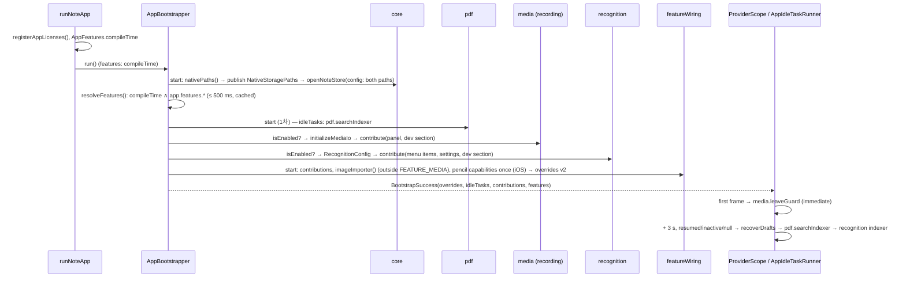

# 01. 기반 · 빌드 · 배포 · 플랫폼 설정 (INFRA) — 2차 라운드(M5·M6·M7) 상세 계획서

> 상태: **승인 · 계약 v2.3** (동시 개발 착수 2026-11-06 — 계약 v2.2(C22-01~08)·v2.3(C23-01~07)이 바꾼 문장의 인용을 맞췄다(C22-09, 13.8). 최종 승인 2026-11-05 · 통합 계약 v2.2 — [00-review.md '최종 승인'](00-review.md#최종-승인), 이 영역의 개발 중 반영 항목은 그 절의 '영역별 개발 중 반영' 표) · 승인한 판본: 수정 2회차 + 총괄 직접 수정(13.7). 이 계획서와 계약이 다르면 계약이 우선이다. 이전 상태: **수정 2회차** (통합 계약 **v2.1** 기준 — 2026-11-05 현재 최신판, 변경 이력 C21-01~35. 수정 1회차: 총괄 검토 [00-review.md](00-review.md) 3.1 INFRA-M1~M15·공통 결정 CD2-01~25와 대리 검토 [reviews/infra.md](reviews/infra.md) 반영. 수정 2회차: 총괄 재검토 4건 — v1 DB 사본 API를 CORE CP-17로(옛 CP16 거둠), 바탕 HEAD `b6c9d0a`(`bb1bc60`의 기본 브랜치 비교·`FULL_RUN`·잡 60분), 영역 브랜치 `media` 규칙 하나로, 안내서 05의 07 안내 줄. 항목별 반영 위치는 [13절](#13-검토-반영-내역) — 수정 2회차는 [13.6](#136-수정-2회차-총괄-재검토-4건))
>
> 기준: 2차 개요 [00-overview.md](00-overview.md) 7장 **통합 계약 v2.1**(이하 '계약 7.x') · 1차 계약 v1.5(1차 통합 반영 — 시그니처는 v1.4와 같음, 이하 '1차 7.x') · 1차 INFRA 계획서 `/home/user/wt/infra/docs/plans/01-infra.md`(이하 '1차 INFRA n.n') · 조사 [01-hooks](research/01-hooks.md) · [02-audio-stylus](research/02-audio-stylus.md) · [03-recognition](research/03-recognition.md) · [04-native](research/04-native.md) · 판정 [judgement.md](drafts/judgement.md) · 마스터 기획서 [PLAN.md](../../PLAN.md) F-03·F-10~F-16, 7.6, 9.5, 10장 M5~M7
> 작성 기준일: 2026-11-05 · 검증 환경: Flutter 3.47.9 / Dart 3.13.7(`/opt/flutter`), 리눅스 컨테이너(CPU 4), 헤드리스 Chrome
> 바탕 코드: **1차 통합 HEAD** — `/home/user/noteapp`(브랜치 `claude/note-app-planning-bk29xb`, 지금 **`b6c9d0a`**. 수정 1회차가 바탕으로 잡은 `18c5ae5` 뒤에 커밋 8개가 더 있다: `88808e3`(문서 — 계약 v1.5), `446518e`(INK 코드 — 올가미 퇴화 규칙 주석·시험, 동작·API 변화 없음), `d22d350`(EDITOR 계획서·진행 기록), `54bb561`(1차 INFRA 계획서 R6 문구), **`bb1bc60`(INFRA 코드·CI — 기본 브랜치 비교·`--all-if-no-base`·잡 60분)**, 진행 기록 3개 — 계약 2.5·CD2-01, 확인함). 원격에는 `main`이 없고 **기본 브랜치 = 개발 브랜치**다. 이 계획서에서 '`main`에 커밋'(계약 7.6)·'통합 브랜치'는 저장소의 기본 브랜치(지금 개발 브랜치, `main`이 생겨 기본 브랜치가 되면 `main`)를 뜻하고, CI 조건은 `FULL_RUN`(`main` 또는 기본 브랜치)으로 적는다. live 배포만 `main` 전용이다(3.0 `bb1bc60` 행). 1차 INFRA 작업 트리 `/home/user/wt/infra`(`1a62fba`)에는 통합 커밋(`52de08c`·`d5938c6`·`5adf710`·`3cf0b84`)이 없다 — 달라진 것은 [3.0 표](#30-1차-통합에서-바뀐-것-바탕--통합-head). '전체'라고 적은 설정 블록(3.2·4.3.1)·시험 수·CI 시간·웹 크기 기준은 통합 HEAD 값이다. 그 밖의 파일 줄 번호 인용(1차 작업 트리 기준으로 남은 것)은 기반 단계 시작 때 고친다.
>
> 이 문서에서 **(확인함)** 은 이 컨테이너에서 실행하거나 소스를 읽어 확인한 사실이고(임시 작업은 `/tmp/claude-0/plan57-scratch/infra57/`, 수정 1회차는 `…/infra-rev/`), **(미확인)** 은 문서·기억에 근거해 구현·CI·실기기에서 다시 확인할 사항이다. 계약과 다르게 해야 할 것은 바꾸지 않고 12.2 '계약 변경 제안'에만 적는다.
>
> 목차: 개요 6장의 공통 목차(1~12절) + **13절 '검토 반영 내역'** + 부록 A(확장 지점·자리 사용표 — 초안의 13절)·부록 B(네이티브·권한 요구표 — 초안의 14절)·부록 C(통합 시험용 위젯 키) — CD2-25의 공통 모양. 다른 계획서가 'INFRA 14절'로 가리키는 것은 부록 B다.

---

## 1. 목적과 범위

### 1.1 목적

1. 2차의 새 서비스 패키지 3개(`media_io`·`ink_recognition`·`pencil_bridge`)를 앱 셸에 **연결**한다: `MediaModule`·`RecognitionModule`을 더하고, 계약 7.3.3 override 표를 그대로 구현하고, 기능 스위치(`AppFeatures`, D14)로 끈 모듈은 시작하지도 연결하지도 않는다 — (v2.1, D17) `FEATURE_MEDIA`는 녹음만 끄고, 이미지 삽입·이미지 페이지는 스위치 밖에서 늘 연결한다.
2. 안드로이드 APK와 (계정 뒤) iOS 앱이 **실제로 쓸 수 있는 상태**가 되도록 네이티브 설정을 갖춘다: 네이티브 저장 경로(공통-1), 매니페스트 권한·서비스, 고정 서명, iOS 배포 대상 15.5·Podfile·Info.plist, macOS 컴파일 확인 워크플로.
3. 컨테이너에서 네이티브를 빌드할 수 없다는 제약(조사 04 요약 1)을 **정적 시험으로 메운다**: `native_config_test`(설정 파일 파싱)·`ws native-reqs`(플러그인 요구 사항 대 앱 값)·새 검사 규칙(R4 확장·R16).
4. Apple Pencil 더블탭·스퀴즈·호버·배럴 롤을 받는 **iOS 플러그인 `pencil_bridge`**(Swift + Dart 이벤트 디코딩)와 앱 어댑터 `PencilStylusExtrasSource`를 만든다(M5-9).
5. 2차 시험 방식(Chrome 가짜 마이크 `media`, Firebase 에뮬레이터 `emulator`)을 `ws`·CI에 넣고, 웹 예산(`main.dart.js`·시작 글꼴)을 측정·감시하고, 사용자가 실기기에서 확인할 **안내서·체크리스트**를 갱신한다.

### 1.2 이번 범위

| 단계 | 작업 (8절 ID) | 등급(계약 3.4) |
|---|---|---|
| 기반 단계 (계약 7.6) | **R2-B1**(v2.1 보강): 루트 의존·lock(간접 고정·`integration_test` 포함 — 계약 7.5의 모든 새 행), 새 패키지 3개 골격(pubspec·README·빈 진입점·스모크 시험 — `pencil_bridge`는 빈 `register(with:)` Swift·`Package.swift`·podspec까지), `packages/ink_engine/pubspec.yaml` 의존 4줄(CP3 — 한 번 예외), `workspace_rules.yaml` v2(R8 v2·`native_only_imports`·`pinned_external`·R16 `plugin_free_members`·`plugin_packages`·`generated_files` `*.steps.dart`·`lib_exceptions` `testing_web.dart`)와 검사 코드(R4④·R16), 태그 `media`·`emulator`, `tool/chrome-fakemedia`·`media` 자동 래퍼, 무거운 시험 잠금(고정 경로·`with-heavy-lock`), `app/firebase.json`의 `functions`, `functions.yml` 골격(`hashFiles` 가드), `.gitignore`(계약 7.4.7)·`.gitattributes`(`binary`), `firebase-tools` 14일 재확인 | P-A |
| | **R2-B2i**: `app/test/fakes/counting_note_store.dart`에 `NoteStore` 새 getter 4개 위임(R2-B2·R2-B7a와 한 묶음) | P-A |
| INFRA 동시 개발의 앞 작업 (계약 7.6 표의 R2-B8a·B8b — **다른 영역의 동시 개발 시작 조건이 아니다**, D24) | **R2-B8a**: 부트스트랩 확장·`AppFeatures`(D14·D17)·`MediaModule`(녹음만)·`RecognitionModule`·색인기 주입 이음새·7.3.3 연결(이미지 가져오기는 `FeatureWiringModule`이 스위치와 무관하게 직접)·유휴 작업 v2.1. **R2-B8b**: 라우팅 `?page=&focus=`·`pencil_bridge` Dart 표면(이벤트 디코딩)·`PencilStylusExtrasSource`(가짜 채널 시험) | P-A |
| 동시 개발 (8.2) | **J0**(첫 작업): 네이티브 설정 파일(매니페스트·Info.plist·pbxproj·Podfile·xcconfig)·`tool/src/native_config.dart`·`native_config_test`, 웹 빌드 실측(웹 예산 기준·글꼴 묶음별 한도 제안), CI 단계별 시간 실측·6.16 재계산·잡 분리. J1~J22: `ws native-reqs`, 고정 서명·`android.yml` v2, `ios-compile.yml`, 네이티브 저장 경로, 개발자 메뉴(기능 스위치·v1 DB 사본), 유휴 작업 실행기, 남은 녹음 초안 자동 복구, 색인기 시작·종료, 자리 변환(선택 메뉴·삽입 메뉴·녹음 패널·이미지 가져오기·개발자 표시), `pencil_bridge` Swift 구현, 설정·앱 정보 v2, `--dart-define`·CI 잡 분리, `functions` 잡, 웹 예산 검사, 안내서 v2, 앱 스모크 v2 골격·기능 스위치 시험 | P-A / P-B / P-C (8.2 표) |
| 통합 (계약 7.7 7단계, 8.3) | H1~H8: 영역 병합마다 lock 재생성, 실제 모듈 연결 확인, V5·V6 스모크 완성, V12 네이티브 요구 검사, V15 기능 스위치, V4 웹 예산, V13·V14 CI 실행, 9단계 릴리스 웹 빌드 Playwright 스모크(컨테이너), (U19 승인 시) `ios-compile.yml` 1회, 미리보기 배포(Hosting이 있을 때) | P-A (iOS 컴파일 실행은 U19) |

R2-B8a·B8b와 J0는 INFRA 작업 트리에서 하고, 끝날 때마다 체크포인트로 `main` 병합을 요청한다. 다른 영역은 앱 셸을 import하지 않으므로 이 작업을 기다리지 않는다(계약 7.6.2 '동시 개발 시작 조건 = R2-B1~R2-B6이 `main`에 있음').

### 1.3 이후 범위

- **실연결 미니 라운드**(계약 3.3·D16, INFRA + SYNC): `app/pubspec.yaml`·`allowed_dependencies`에 `sync_engine` 추가, `SyncModule`(1차 7.3.3 M4 행), 로그인 화면(`/login`)·리디렉션, 설정 '계정 · 동기화' 섹션, `RecognitionConfig.idTokenProvider`를 `firebase_auth`로 채우기, `cloud_functions` 채택 여부, **iOS SwiftPM + CocoaPods 혼합 모드에서 Firebase 중복 의존 컴파일 확인**(조사 04 4.4), 수식 함수 배포 주소를 `MATH_ENDPOINT`로.
- TestFlight 실제 업로드·서명 방식 확정(계정 가입 뒤 — 이번에는 워크플로 초안·안내서만 갱신), 무료 Apple ID 사이드로드(U4).
- Play 배포용 업로드 키·Play 앱 서명(지금의 고정 키는 사이드로드 시험용).
- `permission_handler`('설정 앱 열기' 버튼)와 그에 따른 compileSdk 37 검토(계약 7.4.3).
- 앱 수준 `PrivacyInfo.xcprivacy`(업로드 뒤 ITMS-91053 경고가 오면 — 조사 04 4.5).
- 잠금 화면 재생 제어(M6-3 이후 항목), 발표 모드(외부 화면).
- 네이티브(안드로이드·iOS) 파일 저장·공유 — 1차 백업 내보내기와 v1 DB 사본 내보내기(6.18) 둘 다 지금은 웹의 공유·내려받기만 있다.

### 1.4 제외 (다른 영역 책임)

| 항목 | 담당 | INFRA가 하는 일 |
|---|---|---|
| 녹음·재생·이미지 선택 구현, 녹음 패널 UI, 웹 녹음기·초안 조각 저장, 포그라운드 서비스 시작·알림, 오디오 세션 | PDF(`media_io`) | 모듈 시작·override·자리 변환·초안 복구 호출, 매니페스트·Info.plist 키 |
| 인식 엔진·ML Kit 어댑터·색인기·변환 UI·도형 판정기·인식 설정 화면 | LIBRARY(`ink_recognition`) | 모듈 시작·override·동작 → 메뉴 변환·색인기 시작/종료, Podfile·배포 대상 |
| 서버 함수 코드·에뮬레이터 시험 스크립트·수식 비교 도구 | SYNC(`functions/`) | `app/firebase.json` `functions`·`emulators` 항목, `functions.yml` 워크플로, `.gitignore` |
| 파일 DB·파일 블롭 저장 구현(공통-1), 검색 색인, 녹음 저장소 | CORE | `path_provider`로 두 경로를 넘김, 저장 공간 섹션 표시 |
| 펜 버튼·Pencil 동작 매핑·설정 화면의 Pencil 항목, 개발자 표시 오버레이 | EDITOR | `stylusExtrasProvider` override(어댑터), 개발자 표시 섹션 연결 |
| `NoteSans` 글꼴 파일·지연 적재, KaTeX 글꼴 | INK | 웹 예산 측정, OFL 고지(앱 정보 '오픈소스 라이선스') |
| PDF 전역 텍스트 색인기 | PDF(`pdf_io`) | 유휴 시간 `start()`·종료 `dispose()` |

### 1.5 핵심 결정 요약

1차 INFRA 1.5의 D1~D12는 그대로 유효하다. 2차에서 더하는 결정(수정 1회차에서 바뀐 것은 '(v2.1)'):

| # | 결정 | 근거 |
|---|---|---|
| D2-1 | 모듈 순서 `core` → `pdf` → `media` → `recognition` → `featureWiring`(계약 7.3.3). 새 두 모듈은 **비필수**(실패·시간 초과 시 그 기능만 꺼짐) | 1차 PDF 규칙과 같음 |
| D2-2 | 기능 스위치는 **컴파일 상수 AND 개발자 메뉴 값**. 컴파일 상수(`--dart-define=FEATURE_*=false`)가 꺼지면 개발자 메뉴로 켤 수 없다. 개발자 메뉴 값은 CORE 설정(`app.features.*`, `device` — 계약 7.4.4 `app.*`)에 두고 **다음 시작부터** 적용한다(실행 중 재연결 없음 — 1차 D4) | PLAN 7.6, 계약 D14. 상수로 끄면 dart2js가 그 모듈이 끌어오는 코드를 뺀다 |
| D2-3 | 꺼진 모듈은 `AppModule.isEnabled(context)`가 false → `start`·`overrides`·기여·유휴 작업 모두 없음, 시작 보고 결과 `skipped`(INFRA 내부 enum 값 추가) | '시작하지도 연결하지도 않는다'(7.3.3)를 부트스트래퍼 한 곳에서 지킴 |
| D2-4 | (v2.1) override가 아닌 연결(초안 복구·색인기 시작)은 새 훅 **`AppModule.idleTasks()`** 로 한다. 루트 `ProviderScope` 안의 `AppIdleTaskRunner`가 첫 프레임 3초 뒤·앱이 보일 때(생명 주기 `resumed`·`inactive`·값 없음 — `hidden`·`paused`·`detached`면 기다림)·한 번에 하나씩 **데이터 보호 먼저**(`media.recoverDrafts` → `pdf.searchIndexer` → `recognition.indexer` — 모듈 순서가 아니라 `AppIdleTask.priority`) 실행하고, scope가 사라질 때 정리 함수를 역순으로 부른다. 녹음 이탈 경고는 유휴 대기열 밖(`immediate`)에서 첫 프레임 직후 바로 건다 | 계약 7.3.3 v2.1 '시점과 순서'(CP15 수정). `AppModule`은 overrides만 만들고 컨테이너를 모른다(1차 4.5.4) — 색인기 provider는 `noteStoreProvider`에 의존하므로 scope가 생긴 뒤에야 읽을 수 있다 |
| D2-5 | 여러 자리에 걸친 provider(`editorExtensionsProvider`·`devOverlaySectionsProvider`)는 **`FeatureWiringModule`이 한 번만** override하고, 값은 시작된 모듈(PDF·미디어·인식)의 기여를 모아 만든다 | 같은 provider 두 번 override 금지(1차 6.5) |
| D2-6 | 네이티브 저장 경로: `getApplicationSupportDirectory()/noteapp/` 아래 `noteapp.sqlite`(DB)·`assets/`(블롭). INFRA는 `noteapp/`까지만 만들고 블롭 루트(`assets/`)와 그 아래는 CORE가 만든다(계약 7.2.6 v2.1). 앱 셸이 두 경로를 **모두** 넘기는지는 정적 시험이 본다 | 계약 7.2.6. 1차 셸은 경로를 넘기지 않아 1차 APK는 노트를 저장하지 못했다 |
| D2-7 | (v2.1) 안드로이드 release 서명: `app/android/key.properties`가 **있을 때만** 고정 키, 없으면 debug 키. CI는 시크릿 4개가 있을 때만 그 파일을 만든다. **저장소 변수 `ANDROID_CERT_SHA256`가 있으면(= 고정 키를 쓰기로 함) 서명 재료가 없을 때 잡이 실패**하고(아티팩트 없음), 지문이 다르면 실패한다. debug 서명이면 아티팩트 이름이 `noteapp-debug-signed-<run>`이다 | 조사 04 3.5 A, U20, 계약 V14·CD2-23. 고정 키를 쓰기로 한 뒤 debug APK가 조용히 나오면 '지우고 설치' → 기기 노트 손실 |
| D2-8 | iOS: 배포 대상 15.5(pbxproj 3곳) + **`app/ios/Podfile`을 커밋**(Flutter 템플릿 + ML Kit `post_install`) + `Debug/Release.xcconfig`에 Pods include를 미리 넣는다. SwiftPM은 켠 채 둔다(혼합 모드 — ML Kit 두 플러그인만 pod) | 조사 04 4.3·4.4, 9 권장 4·5. 리눅스 `pub get`은 Podfile을 만들지 않으므로 손으로 만든다 |
| D2-9 | `ios-compile.yml`은 **수동 + 입력 `confirm=yes`**, 러너 라벨 `macos-26` 고정, 45분 제한, `flutter build ios --release --no-codesign`(선택 입력으로 서명 없는 `ipa`) | 조사 04 9 권장 3, U19(통합 뒤 1회 — 승인되면 V14 완료 조건) |
| D2-10 | `pencil_bridge`는 SwiftPM(`ios/pencil_bridge/Package.swift`)과 CocoaPods(`ios/pencil_bridge.podspec`)를 **둘 다** 둔다. 혼합 모드에서는 SwiftPM으로 들어가고, 나중에 SwiftPM을 끄는 선택(조사 04 Q12)을 해도 빌드된다. (v2.1) R2-B1에 빈 `register(with:)` Swift까지 둔다 | Flutter `podhelper.rb` 327–334: `Package.swift`가 있는 플러그인은 pod 설치에서 빠짐(조사 04 4.4). `pluginClass`만 있고 Swift 클래스가 없으면 `GeneratedPluginRegistrant`가 깨진다(검토 S-6) |
| D2-11 | Swift는 컨테이너에서 컴파일할 수 없으므로(`swift`·`xcrun` 없음 — 확인함) **채널 이름·이벤트 키·`#available` 가드를 Dart 시험이 Swift 소스에서 직접 대조**한다. 실제 컴파일은 `ios-compile.yml`, 동작은 TestFlight 뒤 | 계약 3.1 M5-9 '실기기 확인 TF 뒤' |
| D2-12 | (v2.1) `media` 태그 시험은 `ws test`가 **자동으로** `tool/chrome-fakemedia`를 Chrome으로 쓰고, `media`·`emulator`·전체 Chrome 실행은 **고정 경로** `/tmp/noteapp-heavy-tests.lock`(환경 변수 `NOTEAPP_HEAVY_LOCK`) 잠금으로 한 번에 하나만 돈다. 잠금을 쥔 프로세스는 자식에게 `NOTEAPP_HEAVY_LOCK_HELD=1`을 넘기고, npm·셸은 `ws with-heavy-lock -- <명령>`으로 감싼다. 재시도·`--member-timeout` 동안 잠금을 유지한다 | 계약 5장 '동시 실행 부하', 7.4.6 v2.1(CD2-19). 에이전트마다 `$TMPDIR`가 다를 수 있다 |
| D2-13 | 플러그인 요구 사항 검사(`ws native-reqs`)는 앱의 실제 플러그인 목록을 `app/.flutter-plugins-dependencies`(pub get이 만드는 생성 파일)에서 읽는다 — 워크스페이스 전체가 아니라 **앱이 실제로 끌어오는 것만**. (v2.1) `plugin_packages`가 그 파일의 `dependencyGraph` 이름 집합과 같은지도 본다(NR6) | 워크스페이스 `package_config.json`에는 앱이 의존하지 않는 `sync_engine`의 Firebase 플러그인도 있다. 파일 키 `plugins.<플랫폼>[]`(`name`·`path`·`native_build`·`dependencies`·`dev_dependency`·`shared_darwin_source`)·`dependencyGraph`(앱용 패키지 포함 — 확인함, 통합 HEAD `app/.flutter-plugins-dependencies`) |
| D2-14 | (v2.1) 웹 녹음 중 보호: 녹음 중에는 ① 새 버전 배너의 '새로고침'을 막고 안내 ② 웹 `beforeunload` 이탈 경고를 건다(INFRA `WebPlatform`). 이탈 경고 구독은 시작 성공 화면 직후 바로 건다(유휴 작업 밖 — 긴 초안 복구가 앞에 있어도 그동안 시작한 녹음이 보호됨) | D13·D19 — 탭이 닫히면 마지막 1초를 잃고 복구 흐름으로 간다. 막을 수 있는 이탈은 막는다 |
| D2-15 | (v2.1) **`FEATURE_MEDIA`는 녹음만** 끈다: `MediaModule` = 녹음 전용(오디오 override·녹음 패널·`media` 개발자 섹션·초안 복구·이탈 경고). 이미지 가져오기(`editorImageImporterProvider` — 이미지 삽입·이미지 페이지, P-A)는 `FeatureWiringModule`이 media_io의 `supportedImageSources()`·`importImageForNote`로 **스위치와 무관하게** 직접 연결한다(계약 7.3.3 행의 주체 그대로, `MediaModule` 시작 실패와도 무관) | D17, 계약 7.3.3 v2.1. `importImageForNote`는 `initializeMediaIo` 없이 동작한다(7.2.12). 컴파일 상수로 끄면 `MediaModule`을 만들지 않으므로 녹음 경로 코드만 빠진다 |
| D2-16 | (v2.1) 두 색인기(`final class`)의 앱 셸 시험은 **모듈 생성자 주입 이음새**로 한다: `PdfModule`·`RecognitionModule`이 `IndexerHandleReader`(시작·종료 함수 레코드를 돌려주는 함수)를 받고, 생산 코드는 provider를 읽어 감싸고 시험은 기록용 레코드를 넣는다. provider override 가짜는 쓰지 않는다. 실제 색인기는 가짜 저장소로 '두 번 `dispose`해도 안전'만 본다 | CD2-17, 계약 7.2.11·7.2.12·7.3.3 v2.1. Dart 3 `final class`는 다른 라이브러리에서 `implements`·`extends`할 수 없다 |
| D2-17 | (v2.1) R2-B8을 세션 크기로 **R2-B8a**(부트스트랩·스위치·모듈·연결·유휴 작업)·**R2-B8b**(라우팅·`pencil_bridge` Dart·어댑터)로 나누고, 네이티브 설정·`native_config_test`·웹 빌드 실측·CI 단계별 시간 실측은 **J0**로 내린다. 셋 다 다른 영역의 시작 조건이 아니다 | CD2-05, 계약 7.6.2 v2.1, D24 |
| D2-18 | (v2.1) 안드로이드 기기 자동 백업을 끈다(`android:allowBackup="false"` — 확정). iOS는 기본값 | D20·U27, 계약 7.4.3 v2.1 |

## 2. PLAN.md 요구사항 대응표

범위 표기: **이번** = 이번 라운드에 완료 · **공동** = 다른 영역이 주, INFRA는 연결·설정 · **초안** = 파일·문서만(실행·검증은 이후) · **이후**. 등급은 계약 3.4.

| PLAN 위치 | 요구사항 | 이 계획서의 작업 (8절 ID) | 등급 | 범위 |
|---|---|---|---|---|
| 1.3 대상 기기 | iPad + 안드로이드 태블릿 | J2 `android.yml` v2·고정 서명, J3 `ios-compile.yml`, J0 네이티브 설정 | P-A / P-C | 이번 / 초안(iOS 실행) |
| 2 개발 환경 | Mac 없음 → GitHub Actions 빌드 | J2, J3, J16 `functions.yml` | P-A / P-B | 이번 |
| 2 Apple 개발자 계정 | 나중에 | J3 `ios-testflight.yml` 갱신(라벨·서명 단계 분리), J18 안내서 06 | P-C | 초안 |
| F-03 붓펜·캘리그래피(배럴 롤) | Pencil Pro 롤로 펜촉 각 | J12 `pencil_bridge` `PencilRoll`, J13 어댑터 → `StylusBarrelRoll` | P-B | 공동(INK·EDITOR 주) / TF 뒤 확인 |
| F-03 호버 미리보기 | 펜이 닿기 전 위치·굵기 | J12 `PencilHover`(호버 높이 `z`) → `StylusHoverPose` | P-B | 공동(EDITOR 주) |
| F-10 손글씨 → 텍스트 | 엔진 교체 구조, 한국어+영어 | R2-B8a·J8 `RecognitionModule`, J9 선택 메뉴 변환, J0 Podfile·15.5, `native_only_imports`(ML Kit) | P-B | 공동(LIBRARY 주) |
| F-11 도형 + 자동 보정 | 펜 멈추면 반듯한 도형 | `RecognitionModule`이 `recognitionOverrides()`로 `inkShapeFitterProvider` 연결(X31) | P-B | 공동(INK·LIBRARY·EDITOR 주) |
| F-12 제스처 사용자 지정 | 동작 변경·끄기 | (EDITOR 주) INFRA는 설정 화면 틀에 그대로 | P-A | 다른 영역 |
| F-12 S펜 측면 버튼 | 지우개 전환 | 플러그인 불필요(계약 3.1 M5-8). 안내서 08 A-2 | P-A | 다른 영역 / 체크리스트 |
| F-12 Apple Pencil 더블탭·스퀴즈 | 지우개 전환 / 도구 팔레트 | R2-B8b·J12·J13 `pencil_bridge` + `PencilStylusExtrasSource` → `stylusExtrasProvider`(X35) | P-B | 이번(Dart·Swift 작성·컴파일) / TF 뒤 확인 |
| F-13 이미지 페이지 | 페이지 추가 시트 '이미지' | R2-B8a `FeatureWiringModule`이 `editorImageImporterProvider`를 직접 연결(X29 — 기능 스위치 밖, D2-15) | P-A | 공동(EDITOR·INK·PDF 주) |
| F-14 수식 | 엔진 비교 구조, 키는 서버 | J8 `RecognitionConfig.mathEndpoint`(`FEATURE_MATH_ENGINE`·`MATH_ENDPOINT`), R2-B1·J16 `app/firebase.json` `functions`·`functions.yml` | P-B | 공동(LIBRARY·SYNC 주) |
| F-16 녹음 | 시작·일시정지·정지·여러 녹음 | R2-B8a·J7 `MediaModule`(X28 — 녹음 전용), J9 녹음 패널 자리(X29), J0 Info.plist `NSMicrophoneUsageDescription`, 매니페스트 `RECORD_AUDIO` | P-A | 공동(PDF 주) |
| F-16 백그라운드 녹음 | 앱 전환·화면 꺼짐에도 | J0 매니페스트 `FOREGROUND_SERVICE(_MICROPHONE)`·`POST_NOTIFICATIONS`·서비스 선언, Info.plist `UIBackgroundModes: audio` | P-B | 공동(PDF 주) / APK·TF 확인 |
| F-16 '타인 음성 동의' 안내 | 녹음 시작 시 | (PDF 주) | P-A | 다른 영역 |
| F-16 용량 표시 | | J14 저장 공간 섹션 '녹음·이미지·PDF' 용량(`AssetStorageUsage.bytesByType`) | P-B | 이번 |
| 5.2 손글씨 검색 색인 | | J8 `handwritingIndexerProvider` 유휴 시작·종료(X32) | P-B | 공동(LIBRARY·CORE 주) |
| 5.2 라이브러리 전역 PDF 검색 | (1차 7.8 이후 항목) | J10 `pdfSearchIndexerProvider` 유휴 시작·종료(X33) | P-A | 공동(PDF·CORE 주) |
| 8 IA: 검색 결과 → 그 페이지·위치 | | J11 `?page=&focus=` 라우팅, `LibraryScreen.onOpenNoteAt` → `EditorScreen.initialFocusRectPt`(X34) | P-A | 이번 |
| 8 IA: 설정 | 인식 설정 | J14 `recog.settings` 섹션(인식 모듈이 시작됐을 때만) | P-B | 이번(틀) |
| 7.6 기능 스위치 | 유료가 될 기능은 스위치로 | R2-B8a `AppFeatures`(녹음 스위치 = 녹음만 — D2-15), J5 개발자 메뉴, J19 V15 시험 | P-A | 이번 |
| 7.6 `Asset.size` 기록 | 용량 계산 | J14 저장 공간 섹션(위) | P-B | 이번 |
| 9.5 단계 A 한계 | 웹에서 안 되는 기능 | 계약 7.4.2 대체 동작의 연결, 안내서 04·08 | P-A | 이번 |
| 9.5 단계 B | macOS 빌드 → TestFlight | J3 `ios-compile.yml`(계정 없이 컴파일), `ios-testflight.yml` 갱신 | P-C | 초안 |
| 9.5 macOS 10배 과금 | 마일스톤 단위로만 | `ios-compile.yml` 수동 + 확인 입력, 6.16 예산 | P-C | 이번 |
| 9.5 안드로이드 | Actions APK 설치 | J2 고정 서명(덮어 설치), J4 네이티브 저장 경로, 안내서 05·07 | P-A | 이번 |
| 10 ★ 네이티브 전환 | Pencil 호버·스퀴즈·롤 연동 | J12·J13 | P-B | 이번(코드) / TF 뒤 |
| 10 M5 | 펜 버튼 (S펜·Pencil) | 위 F-12 행 | P-A / P-B | 공동 |
| 10 M6 | 녹음·백그라운드·재생 바, 필기 연동 | 위 F-16 행, J19 V5 스모크 녹음 단계 | P-A | 공동 |
| 10 M7 | 손글씨→텍스트, 검색 색인, 수식 | 위 F-10·F-14·5.2 행 | P-A / P-B | 공동 |
| 12 리스크 | 웹 저장 데이터 삭제 | 안내서 04: B-1 절차(배포 전 백업 내보내기 → 실제 노트가 있는 출처에 배포 → 개발자 메뉴에 v1 사본), DB v2 뒤 웹 배포 되돌리기 금지(계약 위험 9), 개발자 메뉴 'v1 DB 사본 내보내기·지우기'(J14b) | P-A | 이번 |
| 12 리스크 | 클라우드 비용 | 6.16 Actions 시간 예산, `functions`는 에뮬레이터만(배포 없음) | P-A | 이번 |

---

## 3. 소유 경로와 패키지 구조

소유 경로(계약 2.1·2.2): 루트 `pubspec.yaml`·`pubspec.lock`·`analysis_options.yaml`·`.gitignore`·`.gitattributes`, `app/`, `.github/`, `tool/`, `docs/guides/`, **`packages/pencil_bridge/`(새)**. 표기: **[새]** 이번에 만드는 파일, **[변경]** 1차 파일을 고침, 표기 없음 = 1차(통합 HEAD) 그대로. 괄호 안은 그 일을 하는 작업 ID(8절).

### 3.0 1차 통합에서 바뀐 것 (바탕 = 통합 HEAD)

1차 INFRA 작업 트리(`1a62fba`)와 1차 통합 HEAD(`/home/user/noteapp` `b6c9d0a` — 수정 2회차에 `18c5ae5`에서 옮김)의 차이 중 이 계획서가 딛고 서는 것(확인함 — 통합 HEAD의 파일과 `docs/plans/progress/infra.md` '통합 단계' 절):

| 묶음 | 통합 커밋 | 바뀐 것 | 이 계획서에 반영한 곳 |
|---|---|---|---|
| 워크스페이스·lock·R14 | `52de08c`(G1·G3·INFRA-O1) | 루트 `workspace`에 `packages/ink_engine/example`(멤버 `ink_lab`), 루트 dev `analyzer: 13.3.0`(R14 export 이름 검사 — `tool/export_names.dart`를 별도 프로세스로, `ws check` 약 59초), `workspace_rules.yaml`: `allowed_dependencies.ink_lab: [note_core, ink_engine]`·새 키 `app_members: [noteapp, ink_lab]`(R14 제외)·`lib_exceptions`에 `packages/ink_engine/example/lib/`·`pinned_external`에 `analyzer`. `ws affected`는 중첩 멤버 파일을 가장 안쪽 멤버에만 넣는다(`memberOfPath`). `web-experiment.yml` 입력 `target`(`app`·`ink_lab`) | 3.2·4.3.1 '전체' 블록, 6.2 R14 대상 |
| `ws test` 실행 | `5adf710` | 멤버 실행마다 시간 제한(chrome 기본 15분 `defaultChromeMemberTimeout`, vm 없음, `--member-timeout <분>`), 넘으면 프로세스 트리를 끝내고 **1회 재시도**(`timeoutRetries`), 밖에서 온 신호 → `INTERRUPTED`·남은 멤버 실행 안 함, `TerminationGuard`(SIGINT·SIGTERM → 130·143). Chrome은 `locateChrome`(`tool/src/flutter_runner.dart` — `CHROME_EXECUTABLE`이 있으면 그 값, 없으면 PATH의 `chromeExecutableNames`)이 찾아 `TestRunner.chrome`으로 넘기고, 멤버 실행마다 환경 변수 `CHROME_EXECUTABLE`로 내보낸다(`tool/src/test_command.dart` 394행). 종료 코드: 2 = 인자 오류(`usageExitCode`), 3 = 환경 오류(`environmentExitCode`, R14 해석 실패도 3), 79 = 맞는 시험 없음(`noTestsRanExitCode`), 130·143 = 신호. **4는 비어 있다**. (검토 M-1은 이 함수를 `resolveChrome`이라 불렀다 — 실제 이름은 `locateChrome`) | 4.2 `test`·`with-heavy-lock`, 6.13 |
| `android.yml` | `d5938c6` | `push.branches: [main, claude/note-app-planning-bk29xb]`(기본 브랜치에 파일이 있어야 **Run workflow**가 보이므로, 병합 전에는 개발 브랜치 푸시가 APK를 받는 길 — 병합 뒤 그 줄을 지운다 → 이 주석은 `bb1bc60`에서 고쳐짐, 아래 행), main 밖 빌드 채널 `preview`, 아티팩트 `noteapp-apk-<run>`, 안내서 05 '개발 브랜치에서 받기' | 6.10.3 트리거·아티팩트 이름 |
| 앱 셸·스모크 | `3cf0b84` | V5·V6를 실제 모듈로(`app/test/support/smoke_scenario.dart`를 VM·Chrome이 함께 씀), URL·딥링크 라우팅 수정, 스모크 순서 = 1차 v1.5 C15-04(획 → 되돌리기 → 다시 실행 → 닫기 → 다시 열기, 새 세션은 되돌리기 없음) | 9.1 V5 단계 표 |
| CI 기본 브랜치 비교 (수정 2회차) | `bb1bc60` | 원격에 `main`이 없어(기본 브랜치 = 개발 브랜치) `--affected-since origin/main`이 모든 푸시에서 종료 코드 3으로 실패하던 것을 고침. **`ws test --all-if-no-base`**(`--affected-since`와 함께만 — 기준 ref가 없거나 HEAD와 병합 기준이 없으면(`MissingBaseException`) 종료 3 대신 전 멤버(또는 `--package` 멤버) 시험, 그 밖의 git 실패는 여전히 3). `ci.yml`: job `env`에 `DEFAULT_BRANCH: ${{ github.event.repository.default_branch }}`·**`FULL_RUN: ${{ github.ref == 'refs/heads/main' \|\| github.ref_name == github.event.repository.default_branch }}`** — `FULL_RUN`이면 `check --strict`·전 멤버 VM·Chrome, 아니면 `check`·`--affected-since "origin/$DEFAULT_BRANCH" --all-if-no-base`. live 채널은 여전히 `main`만(개발 브랜치는 기본 브랜치여도 미리보기 채널). 잡 제한 **25분 → 60분**(2코어 러너 전체 실행 추정 30~40분 — 미측정). `android.yml` 주석 '개발 브랜치가 기본 브랜치라 **Run workflow**가 이미 보인다 — `main`이 생겨 기본 브랜치가 되면 개발 브랜치 줄을 지운다'. 안내서 02·04에 'live 주소는 `main`이 생긴 뒤부터 — 지금은 개발 브랜치 미리보기 주소로 시험', 05에 '`main`이 없는 지금은 기본 브랜치인 개발 브랜치 푸시가 APK를 만들고 **Run workflow**도 거기서 보인다'. `workflows_test` 푸시별 시나리오 5개(아래 6.16) — `origin/main` 글자 금지, `refs/heads/main`은 Channel 단계에만. 진행 기록: `dart test tool/test` **306건** 통과(G4의 295건 + 11), '기본 브랜치 푸시마다 전체 실행 → 월 2,000분이면 약 50회' | 머리말, 4.2 `test`, 6.10.3, 6.13 CI, **6.16**(출발점·잡 표·조건), 6.21(04·05 바탕), 8.2 J15, 8.3 H1, 11 위험 16 |
| 측정값(G4, 2026-11-05) | — | 루트 analyze 10초, `ws check`·`--strict` 59·58초, `dart test tool/test` 295건 54초, `ws test`(VM, 8멤버) **8분 49초**, `ws test --platform chrome`(7멤버) **8분 2초**, `cd app && flutter build web --release` 1분 52초 — `main.dart.js` 4,633,843 B(gzip **1,366,038 B**) | 4.3.3·6.15 웹 예산 기준, 6.16 CI 시간 |

### 3.1 저장소 전체

```
/ (repo root)
├─ pubspec.yaml                 [변경, R2-B1] workspace에 새 멤버 3개, dev 의존 xml 7.0.1 (CP2 — 승인) — 3.2
├─ pubspec.lock                 [변경, R2-B1] 재생성 (기존 변화 xml 7.1.0 → 7.0.1, CP1 간접 고정 2줄, integration_test가 끌어오는 hosted 항목)
├─ analysis_options.yaml        [변경, R2-B1] exclude에 'functions/**' 추가
├─ .gitignore                   [변경, R2-B1] 계약 7.4.7 목록(functions/node_modules/·lib/·eval-out/·.env.local·.secret.local, firebase-debug*.log),
│                                             서명 재료(*.keystore *.p8 *.p12 *.mobileprovision) — functions/.env.demo-noteapp은 무시하지 않음(시험)
├─ .gitattributes               [변경, R2-B1] tool/chrome-fakemedia·*.sh·*.swift·Podfile → eol=lf; *.ttf *.otf *.webm *.m4a *.sqlite → binary (계약 7.4.5)
├─ app/                         [변경] 3.4
├─ functions/                   (SYNC 소유 — R2-B7b. INFRA는 만들지 않음, 워크플로·.gitignore·firebase.json만)
├─ packages/
│  ├─ note_core/ ink_engine/ (+ example = ink_lab) feature_editor/ feature_library/ pdf_io/ sync_engine/   (각 영역)
│  ├─ media_io/                 (PDF 소유 — R2-B1에서 INFRA가 골격만 만들어 넘김, 3.3)
│  ├─ ink_recognition/          (LIBRARY 소유 — 같음)
│  └─ pencil_bridge/            [새] INFRA 소유 — 3.3
├─ tool/                        [변경] 3.5
├─ .github/                     [변경] 3.6
└─ docs/guides/                 [변경] 3.7
```

`.gitignore`(R2-B1) 추가분 — 1차 줄은 그대로:

```gitignore
# Server functions (SYNC, contract 7.4.7). functions/.env.demo-noteapp is committed (demo values only).
functions/node_modules/
functions/lib/
functions/eval-out/
functions/.env.local
functions/.secret.local
firebase-debug*.log
# More signing material (Android upload / iOS distribution — never in git).
*.keystore
*.p8
*.p12
*.mobileprovision
```

`.gitattributes`(R2-B1) 추가분:

```gitattributes
tool/chrome-fakemedia text eol=lf
*.sh text eol=lf
*.swift text eol=lf
Podfile text eol=lf
# Fonts, recording samples, DB fixtures (contract 7.4.5 v2.1)
*.ttf binary
*.otf binary
*.webm binary
*.m4a binary
*.sqlite binary
```

시험(`tool/test/repo_hygiene_test.dart`, R2-B1 — `git check-ignore`·`git check-attr`로 실제 규칙을 묻는다, 저장소 밖 git이 없으면 건너뜀): `functions/.env.demo-noteapp`·`functions/package.json`·`functions/package-lock.json`이 **무시되지 않음**, `functions/.env.local`·`functions/.secret.local`·`functions/lib/x.js`·`functions/node_modules/a`·`functions/eval-out/r.json`·`firebase-debug.log`·`firebase-debug.123.log`·`app/android/key.properties`·`x.jks`·`x.p12`가 무시됨, `*.ttf`·`*.webm`·`*.sqlite` 표본 경로가 `binary`(`-text -diff`), `tool/chrome-fakemedia`가 `eol=lf`.

### 3.2 루트 `pubspec.yaml`

전체(R2-B1 뒤 — 통합 HEAD의 파일에 2차 줄만 더함):

```yaml
# Workspace root (INFRA, docs/plans/m5-7/01-infra.md 3.2). No lib/: the root
# package only hosts the workspace scripts in tool/ and their tests.
name: noteapp_workspace
publish_to: none
environment:
  sdk: ^3.13.0
  # Exact pin. CI reads this value (flutter-version-file); every member uses
  # the same environment block (ws check R2).
  flutter: 3.47.9
workspace:
  - app
  - packages/note_core
  - packages/ink_engine
  - packages/feature_editor
  - packages/feature_library
  - packages/pdf_io
  - packages/sync_engine
  # ink lab (03-ink T23, INFRA-O1): an app, not a public package — R14 skips
  # it (tool/workspace_rules.yaml `app_members`).
  - packages/ink_engine/example
  # 2차 service packages (contract 7.1 v2.1).
  - packages/media_io          # PDF
  - packages/ink_recognition   # LIBRARY
  - packages/pencil_bridge     # INFRA
dev_dependencies:
  flutter_lints: 6.0.0
  yaml: 3.1.4
  args: 2.7.0
  path: 1.9.1
  test: 1.31.1
  image: 4.12.0
  crypto: 3.0.8
  # R14 export name check (tool/src/export_names.dart, integration step G3);
  # the version test 1.31.1 already resolves (contract 7.5).
  analyzer: 13.3.0
  # 2차 (contract 7.5 v2.1, CP2): native_config_test parses AndroidManifest /
  # Info.plist. Already resolved transitively at 7.0.1 — no lock change.
  xml: 7.0.1
```

`functions/`는 워크스페이스 멤버가 아니다(계약 7.1 규칙 6). `ws` R1은 `app`·`packages/*`(와 루트가 적은 중첩 멤버)만 멤버 후보로 보므로 `functions/`가 있어도 위반이 아니다(1차 `workspace.dart`의 멤버 탐색 범위 — R2-B1에서 `workspace_test`에 `package.json`만 있는 `functions/` 사례 하나 추가).

### 3.3 새 패키지 골격 (R2-B1)

INFRA가 R2-B1에서 **골격만** 만들어 소유 영역에 넘긴다(1차 B1과 같은 방식). 골격 = `pubspec.yaml`(계약 7.5의 의존 전부 — 간접 고정·v2.1 추가 행 포함), `README.md`(소유 영역·진입점·웹/네이티브 경계 한 단락), 빈 진입점, `test/<name>_smoke_test.dart`(진입점 import + `expect(true, isTrue)`), `dart_test.yaml`(쓰는 태그 선언·`skip:` — R15: media_io `media`·`integration`, ink_recognition `emulator`·`integration`). 진입점 본문(계약 표면)은 R2-B4(PDF)·R2-B6(LIBRARY)가 채운다.

`media_io/pubspec.yaml`은 **06-pdf 3.4 확정본**이다 — 계약 7.5 v2.1의 CP-PDF-9 직접 의존 **6줄**(`plugin_platform_interface` 제외)과 CP1 간접 고정 2줄을 승인된 값으로 넣는다(승인 대기 표시 없음):

```yaml
# packages/media_io/pubspec.yaml (R2-B1, PDF 소유로 넘김 — 06-pdf 3.4, 계약 7.5 v2.1)
name: media_io
description: Recording, playback and image import services (PDF area). Plugins stay here.
publish_to: none
resolution: workspace
environment: {sdk: ^3.13.0, flutter: 3.47.9}
dependencies:
  flutter: {sdk: flutter}
  flutter_web_plugins: {sdk: flutter}            # CP-PDF-9: registerMediaWebPlugins (testing.dart, web side)
  note_core: any
  flutter_riverpod: 3.4.3
  material_ui: 1.10.0
  web: 1.1.2                                     # *_browser.dart only
  meta: 1.19.0
  collection: 1.19.1
  image: 4.12.0
  record: 7.1.2                                  # native only (web recording = own MediaRecorder — D13)
  just_audio: 0.10.6
  audio_session: 0.2.4
  flutter_foreground_task: 11.0.3                # *_native.dart only (native_only_imports)
  image_picker: 1.2.4
  path_provider: 2.1.6                           # *_native.dart only (native_only_imports)
  image_picker_ios: 0.8.13+13                    # 간접 고정 (contract 7.5)
  shared_preferences_android: 2.5.3              # 간접 고정 (contract 7.5 v2.1 — CP1)
  shared_preferences_foundation: 2.6.0           # 간접 고정 (contract 7.5 v2.1 — CP1)
  record_web: 2.1.3                              # CP-PDF-9: registerMediaWebPlugins only (not used to record)
  just_audio_web: 0.4.16                         # CP-PDF-9: registerMediaWebPlugins
  record_platform_interface: 2.1.0               # CP-PDF-9: FakeRecordPlatform (testing.dart, VM)
  just_audio_platform_interface: 4.6.0           # CP-PDF-9: FakeJustAudioPlatform (testing.dart, VM)
  image_picker_platform_interface: 2.11.2        # CP-PDF-9: FakeImagePickerPlatform (testing.dart, VM)
  # plugin_platform_interface is NOT listed (contract 7.5 v2.1): MockPlatformInterfaceMixin is
  # @visibleForTesting — an analysis error in lib/ (invalid_use_of_visible_for_testing_member: error).
dev_dependencies:
  flutter_test: {sdk: flutter}
  fake_async: 1.3.3

# packages/ink_recognition/pubspec.yaml (R2-B1, LIBRARY 소유로 넘김)
name: ink_recognition
description: Handwriting / math recognition ports, ML Kit adapter, indexer, conversion UI (LIBRARY area).
publish_to: none
resolution: workspace
environment: {sdk: ^3.13.0, flutter: 3.47.9}
dependencies:
  flutter: {sdk: flutter}
  note_core: any
  ink_engine: any
  flutter_riverpod: 3.4.3
  material_ui: 1.10.0
  meta: 1.19.0
  collection: 1.19.1
  google_mlkit_digital_ink_recognition: 0.16.1   # *_native.dart only, `as mlkit`
  http: 1.6.0
dev_dependencies:
  flutter_test: {sdk: flutter}
  fake_async: 1.3.3
```

```yaml
# packages/ink_engine/pubspec.yaml — the 4 lines R2-B1 adds under `dependencies:` (contract 7.6
# R2-B1 'one-time exception', CP3 approved). Every other INK line (fonts under flutter: assets:)
# is INK's R2-B3 work.
  flutter_math_fork: 0.7.4
  flutter_svg: 2.3.0                   # 간접 고정
  vector_graphics: 1.2.3               # 간접 고정
  vector_graphics_compiler: 1.3.0      # 간접 고정
```

- lock 변화(확인함): media_io의 CP-PDF-9 6줄은 모두 1차 lock에 간접으로 있는 판이라 변화가 없다(06-pdf 6.1 E7 — `plugin_platform_interface`도 같지만 이번에는 넣지 않음). CP1 2줄은 계약 확인 작업 공간(`designA/ws`)의 해석과 비교해 lock 2줄을 바꾼다(`shared_preferences_android 2.5.4 → 2.5.3`·`shared_preferences_foundation 2.6.1 → 2.6.0` — 둘 다 1차 lock에는 없던 새 항목, 6.1). `integration_test`(앱 dev, SDK)는 `flutter_driver` → `webdriver 3.2.0`(2026-09-09)·`sync_http 0.3.1` 같은 hosted 항목을 새로 넣는다(검토 S-5 — R2-B1에서 함께 해석해 lock을 한 번에 만든다).
- LIBRARY는 `google_mlkit_commons`를 **직접 의존하지 않는다**(05-library 297행) — 간접으로만 해석되고 `pinned_external`에도 올리지 않는다(4.3.1). 직접 import가 생기면 LIBRARY가 의존성 요청을 낸다(6.1).

`packages/pencil_bridge/` (INFRA 소유):

```
packages/pencil_bridge/
├─ pubspec.yaml                      [새, R2-B1] Flutter plugin, iOS만 (pluginClass PencilBridgePlugin)
├─ README.md                         [새, R2-B1] 이벤트 와이어 형식(4.4.3 표), 웹·안드로이드 = 지원 안 함
├─ dart_test.yaml                    [새, R2-B1] 태그 없음(VM 시험만)
├─ lib/
│  ├─ pencil_bridge.dart             [새, R2-B1 빈 진입점 → R2-B8b] 공개 진입점 (계약 7.2.13) — 웹 안전, dart:io 없음
│  └─ src/
│     ├─ pencil_bridge_impl.dart     [새, R2-B8b] 채널·브로드캐스트 스트림(캐시, asBroadcastStream 없음)·첫 구독 시 attach
│     ├─ pencil_events.dart          [새, R2-B8b] PencilEvent 계열·PencilCapabilities 값 타입
│     └─ wire.dart                   [새, R2-B8b] 채널 이름·키 상수·디코더 (Swift와 대조 시험 대상)
├─ ios/
│  ├─ pencil_bridge.podspec          [새, R2-B1] CocoaPods용 (s.platform :ios '15.0', source_files 'pencil_bridge/Sources/pencil_bridge/**/*.swift')
│  └─ pencil_bridge/
│     ├─ Package.swift               [새, R2-B1] SwiftPM용 (.iOS("15.0"), FlutterFramework 의존 — Flutter 3.47.9 템플릿)
│     └─ Sources/pencil_bridge/
│        ├─ PencilBridgePlugin.swift [새, R2-B1 빈 등록 → J12 구현] R2-B1: `public static func register(with:)`만 있는 빈 클래스
│        │                            (채널 없음 — R2-B1~J12 사이 main의 iOS 빌드가 GeneratedPluginRegistrant의 클래스 참조로
│        │                            깨지지 않게, 검토 S-6). J12: 등록·채널·attach/detach·UIPencilInteractionDelegate (~250줄)
│        └─ PencilRollRecognizer.swift [새, J12] 쓰는 중 UITouch.rollAngle을 읽는 수동 관찰 인식기 (~60줄)
└─ test/
   ├─ pencil_bridge_smoke_test.dart  [새, R2-B1] 진입점 import
   ├─ pencil_bridge_test.dart        [새, R2-B8b] VM: 모의 EventChannel·MethodChannel → 디코딩, 구독 수와 listen/cancel, 비 iOS 빈 스트림
   ├─ pencil_wire_contract_test.dart [새, R2-B1 일부 → J12] VM: Swift 소스의 클래스 이름·Package.swift·podspec(R2-B1), 채널 이름·type·키·#available 가드 = Dart 상수(J12)
   └─ api_surface_test.dart          [새, R2-B8b] 진입점이 계약 7.2.13 이름만 export
```

```yaml
# packages/pencil_bridge/pubspec.yaml
name: pencil_bridge
description: Apple Pencil double tap, squeeze, hover and barrel roll events (iOS only; other platforms report unsupported).
publish_to: none
version: 0.1.0
resolution: workspace
environment: {sdk: ^3.13.0, flutter: 3.47.9}
dependencies:
  flutter: {sdk: flutter}
dev_dependencies:
  flutter_test: {sdk: flutter}
flutter:
  plugin:
    platforms:
      ios:
        pluginClass: PencilBridgePlugin
```

```swift
// ios/pencil_bridge/Sources/pencil_bridge/PencilBridgePlugin.swift — R2-B1 (empty registration)
import Flutter
import UIKit

public final class PencilBridgePlugin: NSObject, FlutterPlugin {
  public static func register(with registrar: FlutterPluginRegistrar) {}
}
```

외부 의존이 없다(`@immutable`·`Offset`은 `package:flutter/foundation.dart`). 형제 의존도 없다(계약 7.1 `pencil_bridge: []`). SwiftPM 경로 규약(`ios/<이름>/Package.swift`, `Sources/<이름>/`)과 `FlutterFramework` 의존은 Flutter 3.47.9 `templates/plugin_swift_package_manager/ios.tmpl`과 같다(확인함). 빈 Swift는 컨테이너에서 컴파일되지 않으므로(D2-11) R2-B1의 `pencil_wire_contract_test`가 클래스 이름 = `pluginClass`, `FlutterPlugin` 채택, `register(with:)` 시그니처 문자열, `Package.swift`·podspec의 대상 경로를 대조한다.

### 3.4 `app/`

```
app/
├─ pubspec.yaml                       [변경, R2-B1] + media_io, ink_recognition, pencil_bridge, path_provider 2.1.6; dev + integration_test(sdk — 계약 7.5 v2.1, R2-B1에서 함께 해석)
├─ firebase.json                      [변경, R2-B1] + "functions", "emulators" (6.14)
├─ android/
│  ├─ app/build.gradle.kts            [변경, J2] key.properties가 있을 때만 release 고정 서명 (6.10.2)
│  └─ app/src/main/AndroidManifest.xml [변경, J0] INTERNET·RECORD_AUDIO·FOREGROUND_SERVICE(_MICROPHONE)·POST_NOTIFICATIONS, 서비스 선언, 라벨 '필기노트', allowBackup="false", 부팅 수신기 제거 (6.10.1)
├─ ios/
│  ├─ Podfile                         [새, J0] Flutter 템플릿 + platform 15.5 + ML Kit post_install (6.11.2)
│  ├─ Flutter/Debug.xcconfig          [변경, J0] #include? Pods-Runner.debug.xcconfig
│  ├─ Flutter/Release.xcconfig        [변경, J0] #include? Pods-Runner.release.xcconfig
│  ├─ Runner.xcodeproj/project.pbxproj [변경, J0] IPHONEOS_DEPLOYMENT_TARGET 15.0 → 15.5 (3곳)
│  └─ Runner/Info.plist               [변경, J0] 마이크·사진·카메라 설명(계약 7.4.3 v2.1 문구), UIBackgroundModes audio, ITSAppUsesNonExemptEncryption false
├─ integration_test/
│  └─ native_smoke_test.dart          [새, P-C, J21] 안드로이드 에뮬레이터 잡용 (6.10.5)
├─ lib/src/
│  ├─ features/
│  │  ├─ app_features.dart            [새, R2-B8a] AppFeature, AppFeatures, AppFeatureKeys, resolveFeature (4.6.1)
│  │  └─ feature_switch_section.dart  [새] 설정 'app.features' 섹션 (개발자 메뉴)
│  ├─ bootstrap/
│  │  ├─ app_module.dart              [변경, R2-B8a] isEnabled, idleTasks, fallbackContribution, AppModuleContext.features·contribute
│  │  ├─ app_bootstrapper.dart        [변경, R2-B8a] skipped 결과, idleTasks 수집, 늦은 기여 버림, features 인자
│  │  ├─ bootstrap_app.dart           [변경, R2-B8a·J6] ProviderScope 안에 AppIdleTaskRunner
│  │  ├─ idle_tasks.dart              [새, R2-B8a — J6 마무리] AppIdleTask(priority·immediate), AppIdlePriority, AppIdleContext, AppIdleTaskRunner (4.6.2)
│  │  └─ startup_report.dart          [변경] StartupStepOutcome.skipped
│  ├─ storage/
│  │  ├─ native_storage_paths.dart    [새] 조건부 export (stub / native) + types export
│  │  ├─ native_storage_paths_types.dart  [새] NativeStoragePaths 값 타입
│  │  ├─ native_storage_paths_stub.dart   [새] 웹: null
│  │  └─ native_storage_paths_native.dart [새] path_provider (native_only_imports)
│  ├─ modules/
│  │  ├─ core_module.dart             [변경, J4] 비동기 config (네이티브 두 경로)
│  │  ├─ pdf_module.dart              [변경, R2-B8a·J10] 유휴 작업: 색인기 시작/종료 (주입 이음새 IndexerHandleReader)
│  │  ├─ idle_indexers.dart           [새, R2-B8a] IndexerHandle·IndexerHandleReader, readPdfSearchIndexer·readHandwritingIndexer (D2-16)
│  │  ├─ media_module.dart            [새, R2-B8a·J7] 녹음 전용: initializeMediaIo · mediaIoOverrides · 녹음 패널·media 섹션 기여 · 초안 복구 · 이탈 경고
│  │  ├─ media_wiring.dart            [새, R2-B8a] 녹음 패널·이미지 가져오기(FeatureWiringModule이 씀)·개발자 표시 섹션 변환
│  │  ├─ recognition_module.dart      [새, R2-B8a·J8] RecognitionConfig · recognitionOverrides · 색인기 시작/종료 (주입 이음새)
│  │  ├─ recognition_wiring.dart      [새, R2-B8a·J9] RecognitionAction ↔ EditorSelection/InsertMenuItem, 섹션
│  │  ├─ pencil_wiring.dart           [새, R2-B8b] PencilPort (정적 PencilBridge를 감싼 주입점)
│  │  ├─ search_wiring.dart           [새, J9] 검색 색인 상태 → 개발자 표시 줄
│  │  ├─ feature_wiring_module.dart   [변경, R2-B8a·B8b] 자리 v2 · editorImageImporterProvider(스위치 밖 — 직접) · stylusExtrasProvider
│  │  ├─ pdf_wiring.dart              (1차 그대로)
│  │  └─ production_modules.dart      [변경, R2-B8a] core, pdf, media(녹음 — kFeatureMedia), recognition, featureWiring
│  ├─ pencil/
│  │  └─ pencil_stylus_extras.dart    [새, R2-B8b] PencilStylusExtrasSource + 변환 함수 (4.6.5)
│  ├─ routing/                        [변경, R2-B8b]
│  │  ├─ app_routes.dart              [변경] focus 질의 키, note(…, focus:), FocusRectCodec
│  │  ├─ app_router.dart              [변경] EditorRouteArgs.initialFocusRectPt
│  │  ├─ app_navigator.dart           [변경] openNote(…, focusRectPt:)
│  │  └─ screen_builders.dart         [변경] LibraryScreen.onOpenNoteAt, EditorScreen.initialFocusRectPt
│  ├─ settings/
│  │  ├─ settings_sections.dart       [변경] recog.settings · app.features 항목, 시작 보고 기반 표시
│  │  ├─ storage_section.dart         [변경, J14] 종류별 용량, 검색 색인 상태·다시 만들기
│  │  ├─ v1_copy_section.dart         [새, J14b] 개발자 메뉴 'v1 DB 사본 내보내기·지우기' (계약 7.2.7 v2.1, CORE CP-17)
│  │  ├─ backup_export.dart           [변경, J14b] BackupFile.mimeType을 필드로(기본 'application/json' — v1 사본이 같은 흐름을 씀)
│  │  └─ about_section.dart           [변경, J14] 기능 상태 줄, Pencil 능력 줄
│  ├─ app/licenses.dart               [새] NoteSans OFL을 LicenseRegistry에 등록
│  ├─ update/update_banner.dart       [변경] 녹음 중에는 새로고침 대신 안내
│  ├─ web/web_platform*.dart          [변경, J7] setLeaveGuard (beforeunload)
│  └─ errors/diagnostic_report.dart   [변경] 기능 상태·skipped 단계 표시
└─ test/
   ├─ fakes/counting_note_store.dart  [변경, R2-B2i] getter 4개 위임
   ├─ fakes/fake_pencil_port.dart     [새, R2-B8b]
   ├─ fakes/recording_indexer_handle.dart [새, R2-B8a] start·dispose 횟수를 세는 IndexerHandle (D2-16)
   ├─ support/smoke_v2_fakes.dart     [새, J19] 모듈 주입 인자 묶음 — 녹음기·재생기(CORE FakeAudioRecorder·FakeAudioPlayback)·이미지 선택기·인식기·수식 엔진(recog 가짜)
   ├─ support/smoke_v2_scenario.dart  [새, J19] V5·V6 공용 시나리오 (1차 smoke_scenario.dart 방식)
   ├─ features/  bootstrap/idle_tasks_test.dart  storage/  modules/  pencil/  routing/  settings/  [새·변경] (9.1 표)
   ├─ integration/app_smoke_v2_test.dart       [새] V5 (태그 integration)
   ├─ integration/feature_switch_test.dart     [새] V15 (태그 integration)
   └─ web/app_smoke_v2_browser_test.dart        [새] V6 (태그 integration)
```

### 3.5 `tool/`

```
tool/
├─ ws.dart
├─ chrome-fakemedia                 [새, R2-B1] bash 래퍼 (실행 비트 100755, LF)
├─ export_names.dart                (1차 통합 G3 그대로 — R14 해석기 스크립트)
├─ workspace_rules.yaml             [변경, R2-B1] 4.3.1
├─ native_requirements.yaml         [새, J1] 4.3.2 (영역 계획서 부록 B의 입력을 모음)
├─ web_budget.yaml                  [새, J17] 4.3.3
├─ web_assets.yaml                  (1차 그대로)
├─ src/
│  ├─ rules.dart                    [변경, R2-B1] R4④ Platform 금지, R16, R15 태그 4종
│  ├─ native_reqs.dart              [새, J1] 플러그인 요구 스캐너 (podspec·Package.swift·gradle)
│  ├─ native_config.dart            [새, J0] 매니페스트·plist·pbxproj·Podfile·gradle 읽기 (시험과 native-reqs 공용)
│  ├─ web_budget.dart               [새, J17]
│  ├─ heavy_lock.dart               [새, R2-B1] 무거운 시험 잠금 — 고정 경로·NOTEAPP_HEAVY_LOCK_HELD·낡은 잠금 회수 (6.13)
│  ├─ lock_age.dart                 [새, J20, P-C] 게시 14일 규칙 검사
│  ├─ test_command.dart             [변경, R2-B1 잠금·media 래퍼 / J15 --dart-define] locateChrome·재시도 구조 위에
│  └─ cli.dart                      [변경] with-heavy-lock(R2-B1), native-reqs, web-budget, lock-age 명령
└─ test/
   ├─ rules_test.dart               [변경] R4④·R16·R8 v2·R9 간접 고정·R15 새 태그
   ├─ native_config_test.dart       [새, J0] V12 — 커밋된 app/android·app/ios 파일 검사 + 앱 셸이 네이티브 두 경로를 넘기는지(정적)
   ├─ repo_hygiene_test.dart        [새, R2-B1] .gitignore(.env.demo-noteapp 미무시)·.gitattributes binary (3.1)
   ├─ native_reqs_test.dart         [새] 픽스처 플러그인 + 실제 워크스페이스(설치돼 있으면)
   ├─ chrome_fakemedia_test.dart    [새] bash -n, 실행 비트, 가짜 chrome에 플래그 전달
   ├─ heavy_lock_test.dart          [새, R2-B1] 형식 호환·중첩 넘김·재시도 동안 유지·낡은 잠금 (6.13)
   ├─ web_budget_test.dart          [새]
   ├─ lock_age_test.dart            [새, P-C]
   ├─ workflows_test.dart           [변경] functions.yml(hashFiles 가드)·ios-compile.yml·android.yml v2(서명 실패 분기·아티팩트 이름)·ci.yml 잡 분리·android-emulator.yml
   ├─ hosting_config_test.dart      [변경] functions·emulators 항목 허용·검사
   ├─ test_command_test.dart        [변경] media 래퍼·잠금(재시도 동안 유지)·NOTEAPP_HEAVY_LOCK_HELD·dart-define
   ├─ guides_test.dart              [변경] 안내서 9개
   └─ fixtures/native/…             [새] 가짜 플러그인 podspec·Package.swift·build.gradle, 가짜 .flutter-plugins-dependencies
```

### 3.6 `.github/`

```
.github/workflows/
├─ ci.yml                 [변경] J0 실측 뒤 잡 분리(6.16 — 1차 `bb1bc60`의 `DEFAULT_BRANCH`·`FULL_RUN`·`--all-if-no-base` 위에), native-reqs, web-budget, media 태그 단계(`FULL_RUN` 푸시·수동), lock-age(P-C)
├─ android.yml            [변경] 고정 서명(시크릿 있을 때), 고정 키 저장소에서 서명 재료 없음 → 실패, debug 서명 아티팩트 이름, 인증서 지문 확인, NDK 캐시, 요약
├─ ios-compile.yml        [새] 수동 + confirm, macos-26, --no-codesign (+ 선택 ipa)
├─ ios-testflight.yml     [변경] 라벨 macos-26, 서명 단계 분리(클라우드 / 수동 인증서) — 여전히 초안
├─ functions.yml          [새] R2-B1 골격(hashFiles 가드) → J16 완성 (npm ci·test·에뮬레이터 + Dart emulator 태그)
├─ android-emulator.yml   [새, P-C] 수동, reactivecircus/android-emulator-runner@v2
└─ web-experiment.yml     (1차 그대로)
```

### 3.7 `docs/guides/`

| 파일 | 2차 | 내용 |
|---|---|---|
| `README.md` | [변경] | 순서표에 07·08 추가 |
| `01-firebase-project.md` | [변경] | (v2.1, 계약 3.7) 맨 위에 '2차는 **Hosting(Spark 무료, 결제 계정 없음)만** — 동기화·로그인·Functions(Blaze)는 실연결 미니 라운드와 별개'. Spark로 만들고 Hosting만 켜는 순서(약 15분, U24) |
| `02`·`03` | 그대로 | (`03`에 'Functions 배포는 실연결 미니 라운드' 한 줄) |
| `04-ipad-web-test.md` | [변경] | (바탕 `bb1bc60` — '`main` 전에는 live 주소가 비어 있고 개발 브랜치 미리보기 주소로 시험') B 체크리스트 v2.1의 절차: **B-1**(배포 전 백업 내보내기 → 실제 노트가 있는 출처(`main` 뒤 live 홈 화면 앱, 그 전에는 개발 브랜치 미리보기 주소 — 그때는 DB v2 병합 푸시가 곧 배포라 병합 전에 백업)에 2차 배포 → 첫 실행 → 개발자 메뉴에 v1 사본), 미리보기 채널은 데이터가 따로이고 7일 뒤 만료, Safari 마이크 허용, 녹음 중 탭 닫지 않기, B-15(키보드 없는 텍스트 선택·붙여넣기)·B-16(녹음 패널 열린 채 마침표) 하는 법, 웹 배포 되돌리기 금지. 항목 표는 08 |
| `05-android-apk.md` | [변경] | (바탕 `bb1bc60` — '`main` 전에는 기본 브랜치인 개발 브랜치 푸시가 APK를 만들고 **Run workflow**도 거기서') **고정 키 등록은 07(키는 Claude가 파일 두 개로 건넴)** 한 줄, 고정 서명 뒤 덮어 설치(처음 한 번만 지우고 설치 — 1차 debug APK는 노트를 저장하지 못했다), **'설치되지 않음'이 뜨면 앱을 지우지 말고 Claude에게 알려 주세요**, 아티팩트 이름 `noteapp-debug-signed-<run>`은 '덮어 설치할 수 없는 시험판', 마이크·알림 권한, ML Kit 모델 Wi-Fi |
| `06-ios-testflight.md` | [변경] | 클라우드 서명 = Admin 키 필요 가능성, App Manager 키 + 수동 인증서 경로, `ios-compile.yml` 실행 방법, `ITSAppUsesNonExemptEncryption` |
| `07-android-signing.md` | [새] | 고정 서명 키: Claude가 컨테이너에서 만들어 **파일로** 건넴(U20 ① — 이 세션의 `gh`는 인증되지 않아 Claude가 시크릿을 넣을 수 없다) → 사용자가 GitHub에 시크릿 4개 + 변수 `ANDROID_CERT_SHA256` 등록 → 키 파일 사본을 따로 보관 |
| `08-device-checklist.md` | [새] | 계약 7.8 A·B·C 문구를 **그대로**(v2.1 A-1 정정·B-1 절차·B-15·B-16 포함) 체크박스로 + 결과 보고 양식 |

---

## 4. 공개 API

INFRA의 '공개 API'는 ① 모든 영역이 지키는 워크스페이스 규약(`ws` 명령·검사 규칙·설정 파일), ② `pencil_bridge` 패키지(계약 7.2.13), ③ 앱 셸이 다른 영역에 보장하는 런타임 규약이다. ④ 앱 셸 내부 API는 다른 영역이 import하지 않지만 시험·검토를 위해 시그니처 전체를 적는다(1차 INFRA 4.5와 같은 방식).

### 4.1 워크스페이스 규약 v2 (모든 영역)

1차 INFRA 4.1 그대로 + 아래.

| # | 규약 | 근거 |
|---|---|---|
| W2-1 | 새 멤버 3개(`media_io`·`ink_recognition`·`pencil_bridge`)의 형제 의존은 `allowed_dependencies` v2 안에서만(R8). 서비스 패키지 ↔ 피처 패키지 import 금지(계약 7.1 규칙 4)는 R8 표로 기계적으로 지켜진다 | 계약 7.1 |
| W2-2 | `native_only_imports`에 `package:google_mlkit_digital_ink_recognition/`·`package:google_mlkit_commons/`·`package:flutter_foreground_task/`·`package:path_provider/` 추가 — `lib/`에서는 `*_native.dart`(또는 `*_io.dart`)에서만 import(R4②) | 계약 7.4.1, C2-29 |
| W2-3 | **R4④(새)**: `lib/`에서 `dart:io`의 `Platform`을 쓰지 않는다(`*_native.dart` 안에서도). 플랫폼 판정은 `kIsWeb` + `defaultTargetPlatform`, 기능 판정은 서비스의 능력 API | 계약 7.4.1 |
| W2-4 | **R16(새, v2.1)**: `plugin_free_members`(`feature_editor`·`feature_library`·`ink_engine`·`note_core`)의 `dependencies`·`dev_dependencies`에 플러그인이 없다. `pdf_io`·`sync_engine`은 기존 예외만 허용한다(`plugin_exceptions` — `pdf_io: [file_picker]`, `sync_engine`: Firebase 4종·`connectivity_plus`). `plugin_packages`는 앱이 해석한 플러그인 **전부**(`app/.flutter-plugins-dependencies`의 `dependencyGraph` 이름 — v2.2 C22-03, `plugins.<플랫폼>`이 아님)이고 `ws native-reqs`가 그 `dependencyGraph`와 같은지 본다(NR6) | 계약 7.4.1 v2.1·v2.2(C22-03), C2-29, CD2-20 |
| W2-5 | 태그 `media`(Chrome 가짜 마이크)·`emulator`(Firebase 에뮬레이터)는 패키지 `dart_test.yaml`에 선언하고 `skip:`을 단다(R15 `skip_by_default_tags`에 추가). `media` 시험 파일은 `RecordPluginWeb.registerWith`·`JustAudioPlugin.registerWith`(또는 `media_io` `testing.dart`의 `registerMediaWebPlugins()`)를 직접 부른다 | 계약 7.4.6 |
| W2-6 | (v2.1) `media`·`emulator` 태그는 `ws test`로 돌린다: `-t media --platform chrome`이면 `ws`가 `tool/chrome-fakemedia`를 Chrome으로 쓰고, `media`·`emulator`·전체 Chrome 실행은 무거운 시험 잠금(고정 경로 `/tmp/noteapp-heavy-tests.lock`, `NOTEAPP_HEAVY_LOCK`으로 바꿈)을 잡는다 — 영역이 `CHROME_EXECUTABLE`을 직접 바꾸지 않는다. npm·셸 스크립트는 `dart run tool/ws.dart with-heavy-lock -- <명령>`으로 감싸고, 그 안의 `ws test`는 `NOTEAPP_HEAVY_LOCK_HELD=1`을 보고 잠금을 다시 잡지 않는다 | 계약 5장·7.4.6 v2.1, D2-12 (CP10 승인, CD2-19) |
| W2-7 | 플러그인을 새로 쓰거나 판을 바꾸는 영역은 그 계획서 부록 B(네이티브·권한 요구 — 초안의 14절)를 적고, INFRA가 `tool/native_requirements.yaml`·네이티브 설정에 넣는다. `ws native-reqs`가 0이어야 통합한다(V12) | 계약 7.4.3·7.4.6 |
| W2-8 | 외부 의존 판은 게시 14일 이상(직접·간접). 14일이 안 된 간접 의존이 해석되면 끌어오는 멤버 pubspec에 정확한 판 + 주석 `# 간접 고정`, `pinned_external`에도 올린다(R9) | 계약 7.5 |
| W2-9 | `functions/`는 Dart 검사(R1~R16) 대상이 아니다. 루트 분석 `exclude`에 `functions/**`를 둔다 | 계약 7.1 규칙 6 |

### 4.2 `tool/ws.dart` 명령 v2

1차 INFRA 4.2의 명령과 1차 통합의 `ws test` 구조(3.0 — 멤버 시간 제한·1회 재시도·신호 처리·`locateChrome`, `bb1bc60`의 `--affected-since <ref> --all-if-no-base` — 기준이 없으면 전 멤버)는 그대로 동작한다. 바뀌거나 새로 생기는 것만 적는다. 종료 코드는 통합 HEAD 값(0·1·2 인자·3 환경·79 시험 없음·130/143 신호)에 **4 = 무거운 시험 잠금 대기 시간 초과** 하나만 더한다(4는 지금 비어 있음 — 확인함).

| 명령 | 옵션 | 동작 | 종료 코드 |
|---|---|---|---|
| `check` | (그대로) | R1~R16(R11 형식·R14 export 포함). 새 위반 줄 형식 `R4 <경로>:<줄>: dart:io Platform is not allowed (계약 7.4.1)` · `R16 <멤버>: depends on plugin '<패키지>' (계약 7.4.1)` | 0 / 1 / 2 / 3 |
| `test` | + `--dart-define <K=V>`(반복, J15) · `--no-heavy-lock` · `--heavy-lock-timeout <분>`(기본 20) | (R2-B1) 태그 옵션에 `media`가 있고 `--platform chrome`이면 `locateChrome`이 찾은 Chrome을 `NOTEAPP_REAL_CHROME`으로, `<repo>/tool/chrome-fakemedia`를 `TestRunner.chrome`(= 실행마다 `CHROME_EXECUTABLE`)으로 넘긴다. 무거운 시험(태그 `media`·`emulator`, 또는 멤버를 고르지 않은 `--platform chrome` 전체 실행)이면 **실행 계획을 만든 뒤 첫 멤버 전에** 잠금을 잡고, 모든 멤버(시간 초과 뒤 재시도·`--member-timeout` 포함)가 끝날 때까지 쥐고 있다가 푼다 — 재시도 사이에 다른 프로세스가 끼어들지 않는다. 환경에 `NOTEAPP_HEAVY_LOCK_HELD=1`이 있으면 잡지 않는다(감싼 쪽이 이미 쥠). 다른 프로세스가 쥐고 있으면 그 PID·시작 시각·명령을 1분마다 출력하며 기다리고, 시간 초과면 종료 코드 4. `--dart-define`은 각 `flutter test`에 그대로(V15). 요약 표 끝에 '잠금 대기 n초' | 0 / 1 / 2 / 3 / 4 / 130·143 |
| `with-heavy-lock` (새, R2-B1) | `[--timeout <분>] -- <명령> [인자…]` | 무거운 시험 잠금을 잡고(`test`와 같은 파일·형식·대기·낡은 잠금 회수) `<명령>`을 `NOTEAPP_HEAVY_LOCK_HELD=1`을 더한 환경으로 실행한 뒤 풀고, 그 명령의 종료 코드를 그대로 돌려준다. 이미 `NOTEAPP_HEAVY_LOCK_HELD=1`이면 잠금 없이 실행만 한다. 신호를 받으면 자식 트리를 끝내고 잠금을 푼다(1차 `TerminationGuard`). SYNC `scripts/emulator_suite.sh`·통합 8단계 `emulator` 실행이 쓴다(SYNC RQ-5 — bash 쪽 잠금 구현을 따로 두지 않는다, 계약 7.4.6) | 명령의 코드 / 2 / 4 |
| `native-reqs` (새, J1) | `--app <dir>`(기본 `app`) · `--json` · `--requirements <file>`(기본 `tool/native_requirements.yaml`) | 6.3 알고리즘. 표(플러그인·iOS 최소·SwiftPM·CocoaPods·minSdk·compileSdk·요구 키) 출력, 위반은 `NR<n> <플러그인>: <설명>` | 0 / 1 / 3(`.flutter-plugins-dependencies` 없음 — '먼저 `flutter pub get`') |
| `web-budget` (새, J17) | `measure --build-dir <dir>` · `check --build-dir <dir> [--budget tool/web_budget.yaml]` | `measure`: `main.dart.js`(원본·gzip), `FontManifest.json`의 글꼴별 크기(원본·gzip)·묶음별(KaTeX·아이콘) 합계, `report_assets` 크기를 표로 출력(`GITHUB_STEP_SUMMARY`가 있으면 거기에도). `check`: 같은 측정 + 4.3.3 한도 대조(값이 `null`인 한도는 표시만), 금지 글꼴 이름이 `FontManifest.json`에 있으면 위반 | 0 / 1 |
| `lock-age` (새, J20, P-C) | `--since <git-ref>` · `--min-days <n>`(기본 14) · `--now <YYYY-MM-DD>`(시험용) | `pubspec.lock`에서 `<ref>` 대비 새로 생기거나 판이 바뀐 `hosted` 항목마다 pub.dev API(`/api/packages/<이름>`)의 그 판 `published`를 읽어 `n`일 미만이면 위반. 네트워크 오류는 경고(종료 0) | 0 / 1 |

### 4.3 tool 설정 파일 형식

#### 4.3.1 `tool/workspace_rules.yaml` v2 (R2-B1)

통합 HEAD 파일의 키는 그대로 두고 값을 늘리고 새 키 3개(`plugin_free_members`·`plugin_exceptions`·`plugin_packages`)와 `forbidden_io_members`를 더한다. 전체(R2-B1 뒤):

```yaml
# Data for `dart run tool/ws.dart check` (INFRA, docs/plans/m5-7/01-infra.md 4.3.1 and 6.2,
# contract 00-overview 7.1 / 7.4.1 / 7.5 v2.1). Rules checked: R1-R16 (R16 since R2-B1).

allowed_dependencies:          # workspace sibling edges (R8) = 00-overview 7.1 (v2.1)
  note_core: []
  ink_engine: [note_core]
  feature_editor: [note_core, ink_engine]
  feature_library: [note_core]
  pdf_io: [note_core, ink_engine]
  sync_engine: [note_core]
  media_io: [note_core]                       # 2차 service package (PDF)
  ink_recognition: [note_core, ink_engine]    # 2차 service package (LIBRARY)
  pencil_bridge: []                           # 2차 service package (INFRA)
  # 7.1: the app may use every package, but this scope's app does NOT depend on
  # sync_engine. The sync_engine edge is added together with app/pubspec.yaml at
  # the 실연결 mini round (contract 3.3, D6).
  noteapp: [note_core, ink_engine, feature_editor, feature_library, pdf_io,
            media_io, ink_recognition, pencil_bridge]
  # 7.1 optional row: the ink lab app packages/ink_engine/example (INFRA-O1).
  ink_lab: [note_core, ink_engine]

app_members: [noteapp, ink_lab]  # R14: apps — their lib/ is not a public entry point

pure_dart_members: [note_core]  # R2: no `sdk: flutter` deps, no package:flutter/ imports

pinned_external:               # R9: must be identical wherever declared = 00-overview 7.5 (all rows, v2.1)
  # --- 1차 (v1.5) ---
  flutter_riverpod: 3.4.3
  riverpod: 3.4.3
  material_ui: 1.10.0
  go_router: 18.1.2
  cupertino_icons: 2.0.0
  web: 1.1.2
  meta: 1.19.0
  collection: 1.19.1
  clock: 1.1.3
  crypto: 3.0.8
  drift: 2.35.3
  sqlite3: 3.8.0
  idb_shim: 2.11.2
  uuid: 4.6.0
  pdfrx: 2.11.0
  pdfium_dart: 0.4.1
  ffi: 2.2.0
  file_picker: 13.3.2
  firebase_core: 5.1.0
  firebase_auth: 7.0.1
  cloud_firestore: 7.1.0
  firebase_storage: 14.0.1
  connectivity_plus: 7.3.2
  test: 1.31.1
  build_runner: 2.16.1
  drift_dev: 2.35.2
  fake_async: 1.3.3
  perfect_freehand: 2.5.2+1
  fake_cloud_firestore: 4.5.0
  firebase_auth_mocks: 0.16.0
  flutter_lints: 6.0.0
  yaml: 3.1.4
  args: 2.7.0
  path: 1.9.1
  image: 4.12.0
  analyzer: 13.3.0             # root dev (tool/), R14 — integration step G3
  # --- 2차 (contract 7.5 v2.1) ---
  record: 7.1.2
  just_audio: 0.10.6
  audio_session: 0.2.4
  flutter_foreground_task: 11.0.3
  image_picker: 1.2.4
  image_picker_ios: 0.8.13+13              # 간접 고정
  shared_preferences_android: 2.5.3        # 간접 고정 (CP1)
  shared_preferences_foundation: 2.6.0     # 간접 고정 (CP1)
  record_web: 2.1.3                        # media_io direct (CP-PDF-9)
  just_audio_web: 0.4.16                   # media_io direct (CP-PDF-9)
  record_platform_interface: 2.1.0         # media_io direct (CP-PDF-9)
  just_audio_platform_interface: 4.6.0     # media_io direct (CP-PDF-9)
  image_picker_platform_interface: 2.11.2  # media_io direct (CP-PDF-9)
  path_provider: 2.1.6
  google_mlkit_digital_ink_recognition: 0.16.1
  http: 1.6.0
  flutter_math_fork: 0.7.4
  flutter_svg: 2.3.0                       # 간접 고정
  vector_graphics: 1.2.3                   # 간접 고정
  vector_graphics_compiler: 1.3.0          # 간접 고정
  xml: 7.0.1                               # root dev (CP2)
  # (SDK packages flutter_web_plugins / integration_test have no version to pin.)

forbidden_imports:
  lib: [dart:io, dart:ffi, dart:html, dart:js, dart:js_util, package:js/]
  lib_and_test: [package:flutter/material.dart, package:flutter/cupertino.dart]

native_only_imports:           # R4: in lib/, only from files ending with native_suffixes
  - package:ffi/
  - package:pdfium_dart/
  - package:drift/native.dart
  - package:google_mlkit_digital_ink_recognition/   # 2차 (contract 7.4.1)
  - package:google_mlkit_commons/                   # 2차
  - package:flutter_foreground_task/                # 2차
  - package:path_provider/                          # 2차

forbidden_io_members: [Platform]   # R4④ (2차): dart:io identifiers banned in lib/ even in *_native.dart

test_only_entrypoints: [testing.dart, testing_vm.dart, testing_web.dart]   # 2차: + testing_web.dart (C2-39)
  # R4: a lib/ file must not import/export package:<member>/<entry> for these entries.
  # Checked on package: URIs. Relative imports between the SAME package's
  # lib/testing*.dart files are allowed (e.g. testing_vm.dart → 'testing.dart');
  # a relative URI from any other lib/ file that resolves to lib/testing*.dart is a violation.

lib_exceptions:                # R4 exceptions (00-overview 7.4.2); a trailing '/' = whole directory
  - packages/note_core/lib/testing_vm.dart   # VM test helper (dart:ffi, drift native); imported from test/ only
  - packages/note_core/lib/testing_web.dart  # 2차 (C2-39): browser test helper (real web store); test/web/ only
  - packages/ink_engine/example/lib/         # ink lab app (1.3, INFRA-O1): lib/ uses the testing.dart fakes

web_only_imports: [dart:js_interop, dart:js_interop_unsafe, package:web/]
native_suffixes: [_io.dart, _native.dart]
web_suffixes: [_browser.dart]
generated_files: ['*.g.dart', '*.freezed.dart', 'schema_versions.dart', '*.steps.dart']   # R11 skip; 2차: drift make-migrations steps (C21-11)
fixture_dirs: [tool/test/fixtures/]   # skipped by R11 format and by root analysis (6.2 exclude): checker test fixtures
skip_by_default_tags: [integration, perf, media, emulator]   # R15; 2차: media, emulator (contract 7.4.6)
global_triggers: [pubspec.yaml, pubspec.lock, analysis_options.yaml, tool/, .github/workflows/]

# --- R16 (2차, contract 7.4.1 v2.1) ---
plugin_free_members: [feature_editor, feature_library, ink_engine, note_core]   # no plugin at all
plugin_exceptions:             # members with 1차 plugin deps: only these, never extended
  pdf_io: [file_picker]
  sync_engine: [firebase_core, firebase_auth, cloud_firestore, firebase_storage, connectivity_plus]
plugin_packages:               # = every plugin the app resolves (names of app/.flutter-plugins-dependencies
                               #   `dependencyGraph`: app-facing, platform, web-only, transitive, dev) — NR6
  [android_file_picker, audio_session, file_picker, file_picker_darwin, file_picker_linux,
   file_picker_web, file_selector_linux, file_selector_macos, file_selector_windows,
   flutter_foreground_task, flutter_plugin_android_lifecycle, google_mlkit_commons,
   google_mlkit_digital_ink_recognition, image_picker, image_picker_android, image_picker_for_web,
   image_picker_ios, image_picker_linux, image_picker_macos, image_picker_windows, integration_test,
   jni, jni_flutter, just_audio, just_audio_web, path_provider, path_provider_android,
   path_provider_foundation, path_provider_linux, path_provider_windows, pdfium_flutter,
   pencil_bridge, record, record_android, record_ios, record_linux, record_macos, record_web,
   record_windows, shared_preferences, shared_preferences_android, shared_preferences_foundation,
   shared_preferences_linux, shared_preferences_web, shared_preferences_windows, url_launcher,
   url_launcher_android, url_launcher_ios, url_launcher_linux, url_launcher_macos, url_launcher_web,
   url_launcher_windows, windows_file_picker]
```

- **1차 통합 HEAD에 없던 것**: 새 멤버 3행·`noteapp` 3개, `pinned_external` 2차 묶음, `native_only_imports` 4줄, `forbidden_io_members`, `test_only_entrypoints`·`lib_exceptions`의 `testing_web.dart`, `generated_files`의 `*.steps.dart`, `skip_by_default_tags`의 2개, R16 세 키. `ink_lab` 행·`app_members`·`analyzer`·ink lab `lib_exceptions`는 통합 HEAD 그대로다(3.0).
- **`plugin_packages` 값**(53개)은 계약 확인 작업 공간의 2차 lock(`infra57/ws/pubspec.lock`)을 바탕으로, 앱의 직접 의존(+ 멤버 의존·`integration_test`)에서 닿는 패키지 중 pubspec에 `flutter: plugin:`이 있는 것을 pub 캐시에서 계산한 것이다(확인함 — `infra-rev/plugins.py`; 통합 HEAD의 `dependencyGraph` 21개는 모두 포함). R2-B1에서 `flutter pub get` 뒤 실제 `app/.flutter-plugins-dependencies`의 `dependencyGraph`와 맞춰 확정한다(NR6이 차이를 위반으로 낸다). 앱이 끌어오지 않는 `sync_engine`의 Firebase 플러그인은 여기 없다 — `plugin_exceptions.sync_engine`은 실연결 미니 라운드에서 앱이 `sync_engine`에 의존할 때 의미가 생기고, 그때 이 목록에 Firebase 플러그인이 들어온다.
- **R16 판정**: `plugin_free_members`의 직접 의존(`dependencies`·`dev_dependencies` 키) ∩ 플러그인 = ∅, `plugin_exceptions` 멤버는 ∩ 플러그인 ⊆ 예외. '플러그인'은 `plugin_packages` 목록 **또는** 그 패키지 pubspec에 `flutter: plugin:`이 있는 것(`.dart_tool/package_config.json`으로 위치를 찾음)이다 — 목록에 아직 없는 새 플러그인도 잡는다. 1차 `pdf_io`가 직접 의존하는 플러그인은 `file_picker`뿐이다(`pdfrx`·`pdfium_dart`는 `flutter: plugin:`이 없다 — 계약 7.4.1 v2.1 정정. 플러그인은 그 아래 `pdfium_flutter`). 예외 값 자체가 늘면(1차 값과 다르면) 위반 — 규칙 코드에 상수로도 둔다.
- `MockPlatformInterfaceMixin`을 `lib/`에서 쓰지 않는 것(CD2-20)은 따로 규칙을 두지 않는다 — `plugin_platform_interface`가 어느 `lib/` 멤버의 직접 의존도 아니어서 import가 분석 경고 `depend_on_referenced_packages`(`flutter_lints` — `--fatal-infos`에서 실패)로 막히고, `@visibleForTesting` 사용은 루트 `analysis_options.yaml`의 `invalid_use_of_visible_for_testing_member: error`가 막는다.

#### 4.3.2 `tool/native_requirements.yaml` (J1, 새)

영역 계획서 부록 B(네이티브·권한 요구 — 초안의 14절)의 요구를 한 파일에 모은다. `ws native-reqs`와 `tool/test/native_config_test.dart`가 함께 읽는다.

```yaml
app:
  ios_deployment_target: '15.5'        # pbxproj 3곳 + Podfile platform + $iOSVersion
  android_min_sdk: flutter              # 'flutter' = Flutter default (FlutterExtension.kt; 24 in 3.47.9)
  android_compile_sdk: flutter          # 36 in 3.47.9
  android_label: 필기노트
  android_allow_backup: false          # D20 확정 (contract 7.4.3 v2.1, U27)
  ios_display_name: 필기노트
cocoapods_only_allowed: [google_mlkit_digital_ink_recognition, google_mlkit_commons]   # V12
plugins:                                # every native plugin the app pulls in must be listed (NR1)
  record_android:  {area: PDF, android_permissions: [RECORD_AUDIO]}
  record_ios:      {area: PDF, ios_plist_keys: [NSMicrophoneUsageDescription]}
  just_audio:      {area: PDF}
  audio_session:   {area: PDF, ios_background_modes: [audio]}
  flutter_foreground_task:
    area: PDF
    android_permissions: [FOREGROUND_SERVICE, FOREGROUND_SERVICE_MICROPHONE, POST_NOTIFICATIONS]
    android_services:
      - {name: com.pravera.flutter_foreground_task.service.ForegroundService,
         foregroundServiceType: microphone, exported: 'false', stopWithTask: 'true'}   # Q7 확정 (06-pdf 부록 B)
    android_removed:                    # tools:node="remove" (계약 7.4.3)
      - {tag: receiver, name: com.pravera.flutter_foreground_task.service.RebootReceiver}
      - {tag: uses-permission, name: android.permission.RECEIVE_BOOT_COMPLETED}
  image_picker_ios: {area: PDF, ios_plist_keys: [NSPhotoLibraryUsageDescription, NSCameraUsageDescription]}
  image_picker_android: {area: PDF}
  google_mlkit_digital_ink_recognition: {area: LIBRARY, android_permissions: [INTERNET]}
  google_mlkit_commons: {area: LIBRARY}
  pencil_bridge:   {area: INFRA}
  # 1차 플러그인 (요구 없음): file_picker_*, pdfium_flutter, path_provider_*, url_launcher_*, jni*,
  # shared_preferences_*, image_picker_* (나머지 플랫폼), integration_test (app dev — iOS Package.swift 있음)
plugins_without_requirements: [android_file_picker, file_picker_darwin, pdfium_flutter, jni,
  jni_flutter, path_provider_android, path_provider_foundation, url_launcher_android,
  url_launcher_ios, shared_preferences_android, shared_preferences_foundation,
  flutter_plugin_android_lifecycle, integration_test]
app_extra:
  android_permissions: [INTERNET]      # release manifest (지금 debug·profile에만 — 조사 04 요약 4)
  ios_plist:
    ITSAppUsesNonExemptEncryption: false
```

플러그인 이름은 `.flutter-plugins-dependencies`에 실제로 나오는 이름(연합 플러그인은 플랫폼 구현 패키지 이름)을 쓴다. 표의 영역 열은 그 요구를 낸 계획서다. 위 값은 계약 7.4.3·조사 02 4.2·조사 04 3.3을 바탕으로 하고, PDF·LIBRARY 계획서 부록 B와 대조했다(`stopWithTask="true"`·`allowAutoRestart: false` — 00-review Q7 확정). NR1은 iOS·안드로이드 플러그인만 보므로 웹 전용(`record_web`·`just_audio_web`·`image_picker_for_web`·`shared_preferences_web`·`*_web`)과 데스크톱 구현은 이 목록에 없어도 된다(`plugin_packages`에는 있다 — NR6).

#### 4.3.3 `tool/web_budget.yaml` (J17, 새)

(v2.1, C21-25·00-review Q4) 기준은 **1차 통합 빌드 실측**이고 한도는 '기준 + 300 KB(gzip)'로 시작한다. 시작 글꼴은 묶음별(KaTeX / 아이콘) 한도를 **J0 실측 뒤** 정해 총괄에 다시 제안한다 — 그 전에는 합계 한도만 쓰고 묶음별 값은 `null`(표시만)이다.

```yaml
# bytes. baseline: 1차 integration G4 measurement (main.dart.js 4,633,843 B raw) — contract 7.4.5 v2.1.
# J0 re-measures the 2차 main after R2-B8b and proposes the next limits; H5 sets the 3라운드 baseline.
baseline:
  main_dart_js_gzip: 1366038
  main_dart_js_raw: 4633843
limits:
  main_dart_js_gzip_growth_max: 300000   # vs baseline (00-review Q4)
  main_dart_js_gzip_max: 1666038         # = baseline + growth until J0
  startup_fonts_gzip_max: 400000         # all FontManifest.json fonts (KaTeX 20 files ≈ 371 KB gzip)
  startup_fonts_raw_max: 700000
  startup_font_bundles:                  # per bundle (contract 7.4.5 v2.1) — null = report only until J0
    katex: {family_prefix: packages/flutter_math_fork/, gzip_max: null}
    icons: {families: [MaterialIcons, CupertinoIcons, packages/cupertino_icons/CupertinoIcons], gzip_max: null}
forbidden_font_families: [NoteSans, packages/ink_engine/NoteSans]   # lazy-loaded (contract 7.4.5)
report_assets:
  - assets/packages/record_web/assets/js/record.worklet.js           # built in, unused on web (D13)
```

### 4.4 `pencil_bridge` (INFRA 소유 패키지)

#### 4.4.1 계약 정의 (계약 7.2.13 그대로)

```dart
// package:pencil_bridge/pencil_bridge.dart — web-safe: no dart:io; isSupported =
// !kIsWeb && defaultTargetPlatform == TargetPlatform.iOS. Other platforms: empty stream.
abstract final class PencilBridge {
  static bool get isSupported;
  static Future<PencilCapabilities> capabilities();
  /// Broadcast. Attaches UIPencilInteraction + hover / roll recognizers on first listen
  /// (key window may not exist at plugin registration under UIScene), detaches on last cancel.
  static Stream<PencilEvent> get events;
}
sealed class PencilEvent { const PencilEvent(this.timestamp); final Duration timestamp; }
final class PencilTap extends PencilEvent { final String preferredAction; final Offset? position; final double? z; }
final class PencilSqueeze extends PencilEvent { final String phase, preferredAction; final Offset? position;
  final double? z, roll; }
final class PencilHover extends PencilEvent { final Offset position; final double? z, altitude, azimuth, roll; }
final class PencilRoll extends PencilEvent { final double angle; }   // while drawing, throttled ≤ 60 Hz
@immutable final class PencilCapabilities { final String os; final bool squeeze, hover, roll,
  prefersPencilOnlyDrawing; final String preferredTapAction, preferredSqueezeAction; }
// Swift: ios/pencil_bridge/Sources/pencil_bridge/PencilBridgePlugin.swift (SwiftPM + podspec),
// channels 'dev.noteapp/pencil/events' (EventChannel) and 'dev.noteapp/pencil/methods'.
// INFRA app adapter: PencilStylusExtrasSource implements StylusExtrasSource (string → enum mapping).
```

#### 4.4.2 INFRA가 정하는 세부 (계약 본문이 생략한 부분)

```dart
// lib/pencil_bridge.dart — the only entry point; exports exactly the contract names.
export 'src/pencil_bridge_impl.dart' show PencilBridge;
export 'src/pencil_events.dart'
    show PencilEvent, PencilTap, PencilSqueeze, PencilHover, PencilRoll, PencilCapabilities;

// src/pencil_bridge_impl.dart
abstract final class PencilBridge {
  /// !kIsWeb && defaultTargetPlatform == TargetPlatform.iOS (tests: debugDefaultTargetPlatformOverride).
  static bool get isSupported;
  /// Not supported → PencilCapabilities.unsupported, no channel call. On iOS: method 'capabilities'
  /// on 'dev.noteapp/pencil/methods'; PlatformException / MissingPluginException are rethrown
  /// (the app adapter logs them and keeps NoStylusExtras).
  static Future<PencilCapabilities> capabilities();
  /// Not supported → const Stream.empty(). Else one cached stream:
  /// EventChannel.receiveBroadcastStream().map(PencilWire.decode).where(non-null) — already a
  /// broadcast stream (map / where keep it), so NO asBroadcastStream(): that would keep the native
  /// subscription after the last cancel. The first listener triggers native attach (onListen), the
  /// last cancel detaches (onCancel); a later listener attaches again (contract 7.2.13).
  /// Undecodable maps are dropped (counted in debugDroppedEvents) — never an error event.
  static Stream<PencilEvent> get events;
  @visibleForTesting
  static int get debugDroppedEvents;
  @visibleForTesting
  static void debugReset();             // forget the cached stream and the counter
}

// src/pencil_events.dart — value types (== / hashCode / toString on all of them)
sealed class PencilEvent { const PencilEvent(this.timestamp); final Duration timestamp; }
final class PencilTap extends PencilEvent {
  const PencilTap(super.timestamp, {required this.preferredAction, this.position, this.z});
  final String preferredAction;            // wire name of UIPencilPreferredAction (4.4.3)
  final Offset? position;                  // global logical px; iOS 17.5+ hoverPose only
  final double? z;                         // hover height 0..1 (zOffset)
}
final class PencilSqueeze extends PencilEvent {
  const PencilSqueeze(super.timestamp, {required this.phase, required this.preferredAction,
      this.position, this.z, this.roll});
  final String phase;                      // began | changed | ended | cancelled
  final String preferredAction;
  final Offset? position; final double? z, roll;
}
final class PencilHover extends PencilEvent {
  const PencilHover(super.timestamp, {required this.position, this.z, this.altitude, this.azimuth,
      this.roll});
  final Offset position; final double? z, altitude, azimuth, roll;   // rad for angles
}
final class PencilRoll extends PencilEvent {
  const PencilRoll(super.timestamp, {required this.angle});
  final double angle;                      // rad, UITouch.rollAngle while drawing
}
@immutable
final class PencilCapabilities {
  const PencilCapabilities({required this.os, this.squeeze = false, this.hover = false,
      this.roll = false, this.prefersPencilOnlyDrawing = false,
      this.preferredTapAction = 'unknown', this.preferredSqueezeAction = 'unknown'});
  static const PencilCapabilities unsupported = PencilCapabilities(os: '');
  final String os;                         // UIDevice.systemVersion, '' when unsupported
  final bool squeeze, hover, roll, prefersPencilOnlyDrawing;
  final String preferredTapAction, preferredSqueezeAction;
  /// Decodes the 'capabilities' method result; missing keys keep the defaults.
  factory PencilCapabilities.fromWire(Map<Object?, Object?> map);
}

// src/wire.dart — the constants the Swift source must repeat (pencil_wire_contract_test)
abstract final class PencilWire {
  static const String eventChannel = 'dev.noteapp/pencil/events';
  static const String methodChannel = 'dev.noteapp/pencil/methods';
  static const String capabilitiesMethod = 'capabilities';
  static const Set<String> types = {'tap', 'squeeze', 'hover', 'roll'};
  static const Set<String> actions = {'ignore', 'switchEraser', 'switchPrevious',
      'showColorPalette', 'showInkAttributes', 'showContextualPalette', 'runSystemShortcut', 'unknown'};
  static const Set<String> phases = {'began', 'changed', 'ended', 'cancelled'};
  /// null = drop (unknown type, missing required key, wrong value type).
  static PencilEvent? decode(Object? event);
}
```

#### 4.4.3 이벤트 와이어 형식 (EventChannel 값 = `Map<String, Object?>`)

| `type` | 필수 키 | 선택 키 | Dart |
|---|---|---|---|
| (모두) | `type`(String), `t`(double, 초 — `ProcessInfo.systemUptime` 기준 단조 시각) | | `timestamp = Duration(microseconds: (t * 1e6).round())` — 앱 어댑터가 `StylusExtraEvent.timestamp`로 그대로 넘긴다(CP-E6, 계약 7.2.10 v2.1 'iOS: same base as PencilEvent.timestamp') |
| `tap` | `action`(String) | `x`,`y`(double — 둘 다 있을 때만 위치), `z` | `PencilTap` |
| `squeeze` | `phase`, `action` | `x`,`y`,`z`,`roll` | `PencilSqueeze` |
| `hover` | `x`,`y` | `z`,`altitude`,`azimuth`,`roll` | `PencilHover` |
| `roll` | `angle` | | `PencilRoll` |

- 숫자는 `num`으로 받아 `toDouble()`(Swift `CGFloat`·`Double`이 표준 메시지 코덱에서 double로 온다 — int가 와도 받는다). 모르는 `type`·`action`·`phase` 문자열: `type`이 모르는 값이면 버리고, `action`·`phase`는 문자열 그대로 둔다(해석은 앱 어댑터 — 앞으로 iOS가 새 값을 더해도 플러그인을 고치지 않게).
- `capabilities` 결과: `{os: String, squeeze: bool, hover: bool, roll: bool, prefersPencilOnlyDrawing: bool, preferredTapAction: String, preferredSqueezeAction: String}`.
- 좌표는 FlutterViewController 뷰 좌표(UIKit pt) = Flutter 전역 논리 px다(FlutterView가 창 전체를 덮는다는 전제 — 조사 02 9.3, (미확인) 실기기 C-1).

#### 4.4.4 Swift 구조 (요지 — 상세는 6.12)

```swift
// ios/pencil_bridge/Sources/pencil_bridge/PencilBridgePlugin.swift
public final class PencilBridgePlugin: NSObject, FlutterPlugin, FlutterStreamHandler,
    UIPencilInteractionDelegate, UIGestureRecognizerDelegate {
  public static func register(with registrar: FlutterPluginRegistrar)  // channels only — no UI work; keeps registrar
  // FlutterStreamHandler
  public func onListen(withArguments: Any?, eventSink: @escaping FlutterEventSink) -> FlutterError?  // attach
  public func onCancel(withArguments: Any?) -> FlutterError?                                         // detach
  // attach (onListen): registrar.viewController?.view first (FlutterPlugin.h 373 — the Flutter
  //   view this engine draws into; image_picker_ios uses the same), else the key window's root view
  //   (UIWindowScene.keyWindow, iOS 15+); none yet → observe UIWindow.didBecomeKeyNotification once.
  //   Adds UIPencilInteraction(delegate: self), UIHoverGestureRecognizer (allowedTouchTypes
  //   [.pencil], delegate self → shouldRecognizeSimultaneouslyWith = true) and
  //   PencilRollRecognizer (17.5+, same delegate).
  // UIPencilInteractionDelegate
  public func pencilInteractionDidTap(_ interaction: UIPencilInteraction)            // < 17.5
  @available(iOS 17.5, *) public func pencilInteraction(_: UIPencilInteraction, didReceiveTap: UIPencilInteraction.Tap)
  @available(iOS 17.5, *) public func pencilInteraction(_: UIPencilInteraction, didReceiveSqueeze: UIPencilInteraction.Squeeze)
  // method channel 'capabilities' → os, squeeze (17.5+), hover (16.1+), roll (17.5+),
  //   prefersPencilOnlyDrawing, preferredTapAction, preferredSqueezeAction (17.5+)
  //   (squeeze / roll = OS availability only, not the pencil model — CD2-24)
  // UIGestureRecognizerDelegate: gestureRecognizer(_:shouldRecognizeSimultaneouslyWith:) → true
}
// PencilRollRecognizer.swift — passive UIGestureRecognizer: cancelsTouchesInView = false,
//   delaysTouchesBegan/Ended = false, never recognizes; reads UITouch.rollAngle (.pencil, 17.5+),
//   throttled to ≤ 60 Hz → {type: roll, t, angle}.
```

### 4.5 앱 셸 런타임 규약 (다른 영역이 기대할 수 있는 것)

| # | 규약 |
|---|---|
| S2-1 | 모듈 순서 `core`(필수) → `pdf` → `media` → `recognition` → `featureWiring`(모두 비필수). 기능 스위치로 꺼진 모듈은 override·자리 기여·유휴 작업이 **하나도** 없다 → 각 자리의 기본값(숨김·지원 안 함)이 보인다(계약 7.3.3, E-7). (v2.1) `media`는 **녹음 전용**이라 꺼지면 녹음만 사라지고, 이미지 삽입·이미지 페이지(`editorImageImporterProvider`)는 `featureWiring`이 스위치·`media` 시작 결과와 무관하게 연결한다(D17). 시작 실패·시간 초과면 override·유휴 작업이 없고 기여는 그 모듈의 `fallbackContribution()`만 남는다 — `media`는 녹음 패널만 남겨 '이 기기에서 녹음할 수 없어요'를 보인다(계약 7.3.3 첫 행), 나머지는 없음. 시간 초과 뒤 늦게 끝난 모듈의 `contribute`는 버리고 기록한다(v2.1) |
| S2-2 | 계약 7.3.3 표의 '이번' 행이 전부, 각각 **한 번만** override된다(시험: `overrides_unique_test` v2·V5). `editorExtensionsProvider`·`devOverlaySectionsProvider`는 `FeatureWiringModule`이 한 번에 모아 만든다. (v2.1) 시험·스모크의 가짜도 모듈 생성자 주입 인자로 들어가므로 override의 출처는 언제나 실제 모듈 경로다(같은 provider를 시험이 따로 override하지 않는다) |
| S2-3 | 자리 항목 순서: `selectionMenuItems` = `recognitionSelectionActions()` 순서 그대로, `insertMenuItems` = `recognitionInsertActions()` 순서 그대로, `moreMenuItems`·`addPageSources` = PDF 목록(1차 그대로). id·label·icon은 원본 그대로 옮긴다 |
| S2-4 | 개발자 표시 섹션 id(순서): `pdf.render`(1차) · `media`('녹음', `mediaDevOverlayLinesProvider`) · `recog.indexer`('손글씨 색인', (v2.1) `recognitionDevOverlayLinesProvider` — CP4 승인) · `search.index`('검색 색인', CORE `searchIndexProvider.status`) |
| S2-5 | (v2.1) 유휴 작업(override가 아닌 연결, 계약 7.3.3 '시점과 순서'): 루트 화면 첫 프레임 3초 뒤, 앱이 보일 때(생명 주기 `resumed`·`inactive`·값 없음 — `hidden`·`paused`·`detached`면 기다림), 한 번에 하나씩 **데이터 보호 먼저**: `media.recoverDrafts`(`pendingDrafts()` → 각각 `recoverDraft()` — 복구 대상 판단은 `pendingDrafts()`만 따름) → `pdf.searchIndexer`(`start()`) → `recognition.indexer`(`start()`, null이면 없음). 녹음 이탈 경고(`media.leaveGuard`)는 대기열 밖에서 첫 프레임 직후 바로 건다. 루트 `ProviderScope`가 사라질 때(재시도·종료) 정리 함수를 역순으로 부른다. **색인기 `dispose()`는 여러 번 불려도 안전하다**(계약 7.2.11·7.2.12 v2.1) |
| S2-6 | 라우트 `/notes/<noteId>?page=<pageId>&focus=<l>,<t>,<r>,<b>`(page pt, 소수 1자리까지). `focus`는 `page`와 함께일 때만 의미가 있고, 해석할 수 없으면 버린다(페이지는 그대로 연다). `LibraryScreen.onOpenNoteAt(noteId, pageId, rect)` → 이 주소 → `EditorScreen(initialPageId:, initialFocusRectPt:)` |
| S2-7 | 컴파일 상수(`--dart-define`): `FEATURE_MEDIA`(녹음)·`FEATURE_RECOGNITION`(인식 + 자동 도형 보정)·`FEATURE_MATH_ENGINE`(bool, 기본 true), `MATH_ENDPOINT`(문자열, 기본 '' — 개발용 에뮬레이터 주소만, 미리보기·live 빌드에는 넣지 않음 — Q6 확정), 1차 `APP_*` 빌드 정보 |
| S2-8 | INFRA 설정 키(접두사 `app.` — 계약 7.4.4 v2.1): `app.features.media`·`app.features.recognition`·`app.features.mathEngine`(bool, 기본 true, `device`). 값은 다음 시작부터 |
| S2-9 | 설정 화면 섹션 순서: `app.storage` · `editor.input` · `editor.pen` · `editor.page`(일반) · `library.newNote`(일반) · **`recog.settings`**('인식', 인식 모듈이 시작됐을 때만) · `editor.developer` · **`app.features`**('기능 켜고 끄기') · **`app.v1Copy`**('이전 판 DB 사본', v2.1) · `app.about` |
| S2-10 | 네이티브 저장 경로: `<ApplicationSupport>/noteapp/noteapp.sqlite`·`<ApplicationSupport>/noteapp/assets/`. INFRA는 `noteapp/`까지 만들고 **두 경로를 모두** `NoteStoreConfig`에 넘긴다. `assets/`(블롭 루트)는 CORE가 만든다(계약 7.2.6 v2.1). 웹은 1차 그대로(경로 없음) |
| S2-11 | 웹에서 녹음 중(`audioRecorderServiceProvider.status.isActive` — UI 판단에만 씀)에는 `beforeunload` 이탈 경고가 걸리고, 새 버전 배너의 '새로고침'은 안내만 한다(D2-14). 경고 구독은 시작 성공 화면 직후 바로 건다 |
| S2-12 | 네이티브 설정: 부록 B 표의 키·권한·서비스가 모두 들어 있다(V12). 영역은 이 파일들을 직접 고치지 않는다 |

### 4.6 앱 셸 내부 API (시그니처 전체)

1차 INFRA 4.5의 API는 아래에 적지 않은 것은 그대로다.

#### 4.6.1 기능 스위치 — `src/features/`

```dart
enum AppFeature { media, recognition, mathEngine }

/// FEATURE_* compile-time constants. Used directly in productionModules() so that dart2js drops
/// the code only a switched-off module reaches (6.6). (v2.1, D17) FEATURE_MEDIA = recording only;
/// image import stays. FEATURE_RECOGNITION also turns off automatic shape correction.
const bool kFeatureMedia = bool.fromEnvironment('FEATURE_MEDIA', defaultValue: true);
const bool kFeatureRecognition = bool.fromEnvironment('FEATURE_RECOGNITION', defaultValue: true);
const bool kFeatureMathEngine = bool.fromEnvironment('FEATURE_MATH_ENGINE', defaultValue: true);
const String kMathEndpoint = String.fromEnvironment('MATH_ENDPOINT');

@immutable
final class AppFeatures {
  const AppFeatures({this.media = true, this.recognition = true, this.mathEngine = true});
  static const AppFeatures compileTime = AppFeatures(media: kFeatureMedia,
      recognition: kFeatureRecognition, mathEngine: kFeatureMathEngine);
  static const AppFeatures all = AppFeatures();
  /// 'false' / '0' / 'off' / 'no' (case-insensitive) → false; missing or anything else → true.
  factory AppFeatures.parse(Map<String, String> values);
  final bool media, recognition, mathEngine;      // media = recording (D17)
  /// mathEngine counts only together with recognition.
  bool isOn(AppFeature feature);
  AppFeatures and(AppFeatures other);          // field-wise AND (build ∧ developer menu)
  // ==, hashCode, toString → 'media on · recognition off · mathEngine off'
}

abstract final class AppFeatureKeys {
  static final SettingKey<bool> media =
      SettingKey.boolean('app.features.media', true, scope: SettingScope.device);
  static final SettingKey<bool> recognition =
      SettingKey.boolean('app.features.recognition', true, scope: SettingScope.device);
  static final SettingKey<bool> mathEngine =
      SettingKey.boolean('app.features.mathEngine', true, scope: SettingScope.device);
  static SettingKey<bool> of(AppFeature feature);
}

/// What the modules saw at this start (BootstrapSuccess.features). Overridden by BootstrapApp.
final appFeaturesProvider =
    Provider<AppFeatures>((ref) => AppFeatures.compileTime, name: 'appFeaturesProvider');

/// Settings section 'app.features' (6.6): three switches '녹음' · '인식(자동 도형 보정 포함)' ·
/// '수식 엔진' over AppFeatureKeys; a switch whose
/// compile-time value is false is disabled with '이 빌드에서 꺼져 있어요'. After a change:
/// '다시 시작하면 적용돼요' + [다시 시작] (web: store.flush() then web.reload(); native: text only
/// '앱을 완전히 닫았다가 다시 열어 주세요').
class FeatureSwitchSection extends ConsumerWidget { const FeatureSwitchSection({super.key}); }
```

#### 4.6.2 부트스트랩 확장 — `src/bootstrap/`

```dart
enum StartupStepOutcome { ok, failedNonCritical, timedOut, failedCritical, skipped }   // + skipped

abstract class AppModule {
  /* 1차 4.5.4 그대로 — id, label, critical, startTimeout, start, overrides, onStartAbandoned,
     resetLocalData */
  /// false → skipped: no start(), no overrides(), no contribution, no idle tasks (D2-3).
  /// Called by AppBootstrapper right before start(); its own time limit is 1 s (timeout → skipped
  /// is NOT used: a timeout counts as enabled = true so a slow settings read never hides a feature).
  Future<bool> isEnabled(AppModuleContext context) async => true;
  /// Idle-time work after a successful start (6.5). Called once, after overrides().
  List<AppIdleTask> idleTasks() => const [];
  /// Contribution kept INSTEAD of the module's own when start() failed or timed out (non-critical).
  /// Default null. MediaModule: the recording panel only (계약 7.3.3: '녹음할 수 없어요').
  ShellContribution? fallbackContribution() => null;
}

final class AppModuleContext {
  AppModuleContext({/* 1차 */ required this.buildInfo, required this.runtimeInfo, required this.web,
      required this.ownerId, required this.errorLog, this.compileTimeFeatures = AppFeatures.all});
  final AppFeatures compileTimeFeatures;
  /// compileTimeFeatures AND the developer-menu settings of the NoteStore published by CoreModule
  /// (all three keys read once, ≤ 500 ms, cached). No store / read failure → compileTimeFeatures
  /// (failure logged, source module).
  Future<AppFeatures> resolveFeatures();
  Future<bool> featureOn(AppFeature feature);      // (await resolveFeatures()).isOn(feature)
  /// Shell contributions of the modules started so far (6.7). Throws StateError for a second
  /// contribution of the same moduleId. (v2.1, C21-20) Once the bootstrapper has recorded an
  /// outcome for that module (failed / timed out → abandoned), a late call is ignored and logged
  /// once ('late contribution of <moduleId> ignored', source module) — it never joins
  /// FeatureWiringModule's assembly or doubles the fallback contribution.
  void contribute(ShellContribution contribution);
  List<ShellContribution> get contributions;       // module order, recorded outcomes only
  /* publish / require / maybe / outcomeOf / isStarted / recordOutcome — 1차 그대로 */
}

@immutable
final class ShellContribution {                    // what one module adds to INFRA-assembled slots
  const ShellContribution({required this.moduleId, this.selectionMenuItems = const [],
      this.insertMenuItems = const [], this.recordingPanel,
      this.devOverlaySections = const [], this.settingsSections = const []});
  final String moduleId;
  final List<EditorSelectionMenuItem> selectionMenuItems;
  final List<EditorInsertMenuItem> insertMenuItems;
  final EditorPanelBuilder? recordingPanel;
  // (v2.1, D2-15) no imageImporter: image import is wired by FeatureWiringModule itself,
  // outside FEATURE_MEDIA and independent of MediaModule's start.
  final List<DevOverlaySection Function(Ref ref)> devOverlaySections;
  final List<SettingsSectionEntry> settingsSections;
}

final class BootstrapSuccess extends BootstrapResult {
  /* 1차: overrides, startedModules, report */
  final List<AppIdleTask> idleTasks;               // started modules' tasks (runner orders by priority)
  final List<ShellContribution> contributions;
  final AppFeatures features;                      // resolveFeatures() result of this attempt
}

final class AppBootstrapper {
  AppBootstrapper({/* 1차 인자 */, AppFeatures features = AppFeatures.all});   // runNoteApp: compileTime
}
```

```dart
// src/bootstrap/idle_tasks.dart
/// (v2.1, contract 7.3.3 '시점과 순서') Lower runs first — data protection before indexing.
abstract final class AppIdlePriority {
  static const int dataProtection = 0;             // media.recoverDrafts
  static const int searchIndex = 10;               // pdf.searchIndexer
  static const int recognition = 20;               // recognition.indexer
}

/// Work a module asks for once the app is on screen (6.5).
@immutable
final class AppIdleTask {
  const AppIdleTask({required this.id, required this.priority, required this.run,
      this.delay = const Duration(seconds: 3), this.immediate = false});
  final String id;                                 // '<moduleId>.<name>', unique (test)
  final int priority;                              // AppIdlePriority; ties keep module order
  final Duration delay;                            // from the first frame under the root scope
  /// true: runs right after the first frame, outside the one-at-a-time queue, without the
  /// lifecycle wait and without delay (media.leaveGuard — one cheap subscription, D2-14).
  final bool immediate;
  final Future<void> Function(AppIdleContext context) run;
}

abstract interface class AppIdleContext {
  /// Same as ProviderContainer.read on the root container.
  T read<T>(ProviderListenable<T> provider);
  /// Run in reverse registration order when the root ProviderScope is disposed (retry, app
  /// shutdown); each awaited ≤ 2 s; a throw is logged (source module) and the rest still run.
  void onDispose(FutureOr<void> Function() callback);
  bool get isDisposed;
  AppErrorLog get errorLog;
  WebPlatform get web;
}

/// Sits inside the root ProviderScope (BootstrapApp: ProviderScope → AppLifecycleBridge →
/// AppIdleTaskRunner → NoteApp). After the first frame: immediate tasks at once; the others in
/// priority order, one at a time, each after its delay and only while the lifecycle state is
/// resumed, inactive or null (hidden / paused / detached → wait — the web sends inactive on
/// window blur, iPad shows system pickers as inactive). A task's throw → errorLog (source module,
/// summary 'idle task <id> failed'), the next runs.
class AppIdleTaskRunner extends StatefulWidget {
  const AppIdleTaskRunner({super.key, required this.tasks, required this.errorLog,
      required this.web, required this.child});
  final List<AppIdleTask> tasks;
  final AppErrorLog errorLog;
  final WebPlatform web;
  final Widget child;
}
```

#### 4.6.3 저장 경로 — `src/storage/`

```dart
// native_storage_paths.dart
export 'native_storage_paths_stub.dart'
    if (dart.library.io) 'native_storage_paths_native.dart' show resolveNativeStoragePaths;

@immutable
final class NativeStoragePaths {                   // (defined in native_storage_paths_types.dart)
  const NativeStoragePaths({required this.databasePath, required this.assetDirectoryPath});
  final String databasePath;                       // <support>/noteapp/noteapp.sqlite
  final String assetDirectoryPath;                 // <support>/noteapp/assets
}
/// Web / stub: null. Native: path_provider getApplicationSupportDirectory(), creates
/// '<support>/noteapp/' (recursive). Throws on failure (CoreModule logs and continues without paths
/// → CORE storageUnavailable → startup error screen).
Future<NativeStoragePaths?> resolveNativeStoragePaths();
```

#### 4.6.4 모듈 — `src/modules/`

```dart
final class CoreModule extends AppModule {
  CoreModule({/* 1차: open, deleteLocalData, configFor */,
      Future<NativeStoragePaths?> Function() nativePaths = resolveNativeStoragePaths});
  /// start(): paths = await nativePaths() (throw → errorLog, paths = null); when non-null
  /// context.publish<NativeStoragePaths>(paths); then 1차 sequence with configFor(context).
}
/// 1차 + native: when context.maybe<NativeStoragePaths>() is non-null, BOTH
/// nativeDatabasePath and nativeAssetDirectoryPath are set from it (계약 7.2.6 — both or
/// neither; the 1차 shell passed none, so the 1차 APK could not keep notes). Static test: J0.
NoteStoreConfig defaultNoteStoreConfig(AppModuleContext context);

// src/modules/idle_indexers.dart — (v2.1, D2-16 / CD2-17) start / stop seam of the two indexers.
// Both are `final class` (contract 7.2.11 · 7.2.12), so tests never override their providers with
// fakes; they pass a recording IndexerHandleReader to the module constructor instead.
typedef IndexerHandle = ({void Function() start, Future<void> Function() dispose});
typedef IndexerHandleReader = IndexerHandle? Function(AppIdleContext context);
/// (start: indexer.start, dispose: indexer.dispose) of context.read(pdfSearchIndexerProvider).
IndexerHandle? readPdfSearchIndexer(AppIdleContext context);
/// Same over context.read(handwritingIndexerProvider); null when that provider is null.
IndexerHandle? readHandwritingIndexer(AppIdleContext context);
/// Shared body of both idle tasks: h = reader(c); null → nothing; else h.start();
/// c.onDispose(h.dispose). A start() throw is logged by the runner (no dispose registered).
Future<void> runIndexerTask(AppIdleContext context, IndexerHandleReader reader);

final class PdfModule extends AppModule {
  PdfModule({/* 1차: initialize, pdfOverrides */,
      IndexerHandleReader indexer = readPdfSearchIndexer});
  /// [AppIdleTask(id: 'pdf.searchIndexer', priority: AppIdlePriority.searchIndex,
  ///   run: (c) => runIndexerTask(c, indexer))]
  @override List<AppIdleTask> idleTasks();
}

/// (v2.1, D2-15 / D17) Recording only: FEATURE_MEDIA / app.features.media turn exactly this off.
/// Image import is NOT here (FeatureWiringModule.imageImporter).
final class MediaModule extends AppModule {
  MediaModule({
    Future<void> Function({MediaIoConfig config}) initialize = initializeMediaIo,
    List<Override> Function({MediaIoConfig? config}) mediaOverrides = mediaIoOverrides,
    EditorPanelBuilder recordingPanel = mediaRecordingPanel,
    MediaIoConfig config = const MediaIoConfig(),
  });
  static const String moduleId = 'media';
  // id 'media', label '녹음 준비 중', critical false, startTimeout 5 s
  /// context.featureOn(AppFeature.media)
  @override Future<bool> isEnabled(AppModuleContext context);
  /// await initialize(config: config); context.contribute(ShellContribution(moduleId: 'media',
  ///   recordingPanel: recordingPanel, devOverlaySections: [mediaDevOverlaySection]))
  @override Future<void> start(AppModuleContext context);
  @override List<Override> overrides();            // mediaOverrides(config: config) — X28, the only audio override
  /// ShellContribution(moduleId: 'media', recordingPanel: recordingPanel) — the panel then reads the
  /// default UnsupportedAudioRecorder and shows its '이 기기에서 녹음할 수 없어요' state.
  @override ShellContribution? fallbackContribution();
  /// (v2.1, C21-20) start() went past 5 s: waits for the late start future (≤ 10 s) and only logs
  /// 'media started late — ignored'. initializeMediaIo holds nothing to release (idempotent, no
  /// listener, no service started); its late contribute() is dropped by AppModuleContext and its
  /// overrides were never applied, so the app keeps the default 'cannot record' recorder.
  @override Future<void> onStartAbandoned();
  /// [AppIdleTask(id: 'media.leaveGuard', priority: AppIdlePriority.dataProtection, immediate: true,
  ///   run: leave guard 6.17), AppIdleTask(id: 'media.recoverDrafts',
  ///   priority: AppIdlePriority.dataProtection, run: 6.5.2)]
  @override List<AppIdleTask> idleTasks();
}

final class RecognitionModule extends AppModule {
  RecognitionModule({
    List<Override> Function({RecognitionConfig config}) overridesFor = recognitionOverrides,
    List<RecognitionAction> Function() selectionActions = recognitionSelectionActions,
    List<RecognitionAction> Function() insertActions = recognitionInsertActions,
    IndexerHandleReader indexer = readHandwritingIndexer,
    String mathEndpoint = kMathEndpoint,
  });
  static const String moduleId = 'recognition';
  // id 'recognition', label '인식 준비 중', critical false, startTimeout 3 s
  @override Future<bool> isEnabled(AppModuleContext context);   // featureOn(recognition)
  /// config = RecognitionConfig(mathEndpoint: await context.featureOn(AppFeature.mathEngine) &&
  ///   mathEndpoint.isNotEmpty ? Uri.parse(mathEndpoint) : null)   // idTokenProvider: null (실연결 뒤)
  /// context.contribute(ShellContribution(moduleId: 'recognition',
  ///   selectionMenuItems: selectionActions().map(selectionMenuItemOf),
  ///   insertMenuItems: insertActions().map(insertMenuItemOf),
  ///   devOverlaySections: [recognitionIndexerSection],
  ///   settingsSections: [SettingsSectionEntry(id: 'recog.settings', title: '인식',
  ///       builder: (_) => const RecognitionSettingsSection())]))
  @override Future<void> start(AppModuleContext context);
  @override List<Override> overrides();            // overridesFor(config: config) — X31·X32
  /// [AppIdleTask(id: 'recognition.indexer', priority: AppIdlePriority.recognition,
  ///   run: (c) => runIndexerTask(c, indexer))]   // reader → null on web / no recognizer
  @override List<AppIdleTask> idleTasks();
}

final class FeatureWiringModule extends AppModule {
  FeatureWiringModule({/* 1차: importPdf, exportPdf, moreMenuActions, addPageActions */,
      PencilPort pencil = const PencilPort(),
      /// (v2.1, D2-15) Image import outside FEATURE_MEDIA: production = mediaImageImporterOrNull
      /// (media_io supportedImageSources + importImageForNote — works without initializeMediaIo).
      EditorImageImporter? Function() imageImporter = mediaImageImporterOrNull});
  /// pdfAvailable = context.isStarted('pdf'); contributions = context.contributions;
  /// importer = imageImporter() (throw → errorLog, null);
  /// if (pencil.isSupported) capabilities = await pencil.capabilities() — read ONCE per app start
  /// (≤ 500 ms; throw / timeout → errorLog + kPencilFallbackCapabilities — the override stays,
  /// 계약 7.3.3 row; an iPadOS setting change applies on the next start, 계약 7.2.10 v2.1)
  @override Future<void> start(AppModuleContext context);
  /// In this order:
  ///   ...featureEditorOverrides(), ...featureLibraryOverrides(),
  ///   pageThumbnailRendererProvider ← ink (1차),
  ///   if (pdfAvailable) libraryPdfImportActionProvider, libraryPdfExportActionProvider (1차),
  ///   if (any of pdf / contributions has editor items) editorExtensionsProvider.overrideWithValue(
  ///       EditorExtensions(moreMenuItems: pdf…, addPageSources: pdf…,
  ///         selectionMenuItems: ⋃ c.selectionMenuItems, insertMenuItems: ⋃ c.insertMenuItems,
  ///         recordingPanel: the media contribution's panel)),
  ///   if (importer != null) editorImageImporterProvider.overrideWithValue(importer),
  ///   devOverlaySectionsProvider.overrideWith((ref) => [if (pdfAvailable) pdfRenderStatsSection(ref),
  ///       for c in contributions for f in c.devOverlaySections f(ref), searchIndexSection(ref)]),
  ///   if (pencil.isSupported) stylusExtrasProvider.overrideWithValue(
  ///       PencilStylusExtrasSource(capabilities: capabilities, events: pencil.events)),
  @override List<Override> overrides();
}

/// The production start sequence. A module that is off at compile time is not even constructed —
/// dart2js drops what only it reaches (6.6: FEATURE_MEDIA=false drops the recording path,
/// not media_io's image import used by FeatureWiringModule).
List<AppModule> productionModules() => [
  CoreModule(),
  PdfModule(),
  if (kFeatureMedia) MediaModule(),
  if (kFeatureRecognition) RecognitionModule(),
  FeatureWiringModule(),
];
/// Same list for tests with injected modules / features (V15).
List<AppModule> modulesFor({required AppFeatures features, CoreModule? core, PdfModule? pdf,
    MediaModule? media, RecognitionModule? recognition, FeatureWiringModule? wiring});
```

#### 4.6.5 연결 함수 · 펜슬 어댑터

```dart
// src/modules/media_wiring.dart
/// (ctx, panel) => RecordingPanel(noteId: panel.noteId, tapToSeek: panel.tapToSeek,
///   onTapToSeekChanged: panel.setTapToSeek, onClose: panel.close)
Widget mediaRecordingPanel(BuildContext context, EditorPanelContext panel);
/// (v2.1, D2-15) sources = supportedImageSources(); empty → null (E-7 hides image insert / image
/// page); else EditorImageImporter(sources: sources, pick: importImageForNote). FeatureWiringModule's
/// default — not gated by FEATURE_MEDIA, not tied to MediaModule's start.
EditorImageImporter? mediaImageImporterOrNull();
/// DevOverlaySection(id: 'media', title: '녹음', lines: ref.watch(mediaDevOverlayLinesProvider))
DevOverlaySection mediaDevOverlaySection(Ref ref);
/// pendingDrafts() → recoverDraft() one by one (6.5.2). Returns the number recovered.
Future<int> recoverPendingRecordings(core.AudioRecorderService recorder, AppErrorLog errorLog);

// src/modules/recognition_wiring.dart
RecognitionTarget recognitionTargetOfSelection(EditorSelectionContext selection);
/// execute is wrapped: the id of the last object added by the command (AddObjects, also inside
/// CompositeCommand — last wins) is remembered; done() → insert.selectObject(thatId) when one was
/// added, else nothing (계약 7.3.1 X30 v2.1 — CP13 승인). recog calls done only after a
/// replacement (toText · toMath).
RecognitionTarget recognitionTargetOfInsert(EditorInsertContext insert);
EditorSelectionMenuItem selectionMenuItemOf(RecognitionAction action);
/// RecognitionAction.isVisible is not used: EditorInsertMenuItem has no visibility hook (Q10 —
/// recog.mathPad has none).
EditorInsertMenuItem insertMenuItemOf(RecognitionAction action);
/// (v2.1, CP4 = CP-L2 승인) DevOverlaySection(id: 'recog.indexer', title: '손글씨 색인',
///   lines: ref.watch(recognitionDevOverlayLinesProvider)) — the same shape as the media section.
DevOverlaySection recognitionIndexerSection(Ref ref);

// src/modules/search_wiring.dart
/// DevOverlaySection(id: 'search.index', title: '검색 색인', lines: ≤ 4 Hz lines over
/// searchIndexProvider.status: '대기 n · 재구축 중|대기 · 마지막 재구축 <시각|없음>')
DevOverlaySection searchIndexSection(Ref ref);

// src/modules/pencil_wiring.dart — injection point over the static PencilBridge (tests fake it)
class PencilPort {
  const PencilPort();
  bool get isSupported => PencilBridge.isSupported;
  Future<PencilCapabilities> capabilities() => PencilBridge.capabilities();
  Stream<PencilEvent> get events => PencilBridge.events;
}

// src/pencil/pencil_stylus_extras.dart (X35)
final class PencilStylusExtrasSource implements StylusExtrasSource {
  /// [capabilities] is the value FeatureWiringModule read once at app start (계약 7.2.10 v2.1).
  PencilStylusExtrasSource({required PencilCapabilities capabilities,
      required Stream<PencilEvent> events});
  @override bool get isSupported => true;
  @override StylusCapabilities get capabilities;   // stylusCapabilitiesOf(capabilities), fixed for the run
  /// events.map(stylusEventOf).where(non-null) — broadcast (the source is), no asBroadcastStream;
  /// every event carries timestamp: PencilEvent.timestamp (CP-E6).
  @override Stream<StylusExtraEvent> get events;
}
StylusCapabilities stylusCapabilitiesOf(PencilCapabilities c);   // 6.12.3 표
/// Used when the capabilities call failed on iOS: os '?', everything false (→ only doubleTap true).
const PencilCapabilities kPencilFallbackCapabilities = PencilCapabilities(os: '?');
StylusExtraEvent? stylusEventOf(PencilEvent event);              // null = dropped (unknown phase)
StylusPreferredAction stylusPreferredActionOf(String wire);      // unknown string → unknown
StylusSqueezePhase? stylusSqueezePhaseOf(String wire);           // unknown string → null
```

#### 4.6.6 라우팅 v2 — `src/routing/`

```dart
abstract final class AppRoutes {
  /* 1차 */
  static const String focusQueryKey = 'focus';
  /// '/notes/<id>' [+ '?page=<pageId>' [+ '&focus=' + FocusRectCodec.encode(focus)]].
  /// focus without pageId is ignored (asserted in debug).
  static String note(String noteId, {String? pageId, Rect? focus});
}
abstract final class FocusRectCodec {
  /// 'l,t,r,b' — each value rounded to 0.1 pt, no trailing '.0', commas NOT percent-encoded.
  static String encode(Rect rect);
  /// null unless exactly 4 comma-separated finite numbers with l ≤ r, t ≤ b, |v| ≤ 100000.
  /// Accepts '%2C' too (go_router already decodes query values).
  static Rect? decode(String? value);
}
@immutable
final class EditorRouteArgs {
  const EditorRouteArgs({required this.noteId, this.initialPageId, this.initialFocusRectPt});
  final String noteId; final String? initialPageId;
  final Rect? initialFocusRectPt;                  // null when initialPageId is null
  // ==, hashCode, toString
}
abstract interface class AppNavigator {
  void openLibrary({String? folderId});
  void openNote(String noteId, {String? pageId, Rect? focusRectPt});   // push
  void closeNote();
  void openSettings();
  void closeSettings();
}
// screen_builders.dart (production):
//   LibraryScreen(…, onOpenNoteAt: (noteId, pageId, rect) =>
//       navigator.openNote(noteId, pageId: pageId, focusRectPt: rect))
//   EditorScreen(…, initialPageId: args.initialPageId, initialFocusRectPt: args.initialFocusRectPt)
```

#### 4.6.7 설정·앱 정보·웹 v2

```dart
// settings_sections.dart
/// Overridden by BootstrapApp with BootstrapSuccess.contributions.
final shellContributionsProvider = Provider<List<ShellContribution>>((ref) => const [],
    name: 'shellContributionsProvider');
/// S2-9 order; contributed entries go after 'library.newNote' in contribution order;
/// 'app.features' after 'editor.developer'. Ids stay unique (assert).
List<SettingsSectionEntry> defaultSettingsSections(
    {List<SettingsSectionEntry> contributed = const []});
// settingsSectionsProvider = defaultSettingsSections(contributed: ⋃ shellContributions.settingsSections)

// storage_section.dart — added rows (6.18): '첨부 파일 n개 · x MB (녹음 a · 이미지 b · PDF c)'
//   from AssetStore.usage().bytesByType; '검색 색인: 대기 n개' + [다시 만들기] → SearchIndex.rebuild()
//   (confirm dialog, button disabled while rebuilding).

// about_section.dart — added rows: '기능: 녹음 켬 · 인식 꺼짐(개발자 메뉴) · 수식 엔진 꺼짐(빌드)'
//   (appFeaturesProvider + startupReportProvider outcomes), 'Apple Pencil: iOS 17.5 · 스퀴즈 · 호버 · 롤'
//   when stylusExtrasProvider.isSupported.

// app/licenses.dart
/// LicenseRegistry entry 'NoteSans (Noto Sans KR subset)' with the text of
/// 'packages/ink_engine/assets/fonts/OFL.txt' (12.2 CP5). Missing asset → no entry, logged once.
void registerAppLicenses({AssetBundle? bundle, AppErrorLog? errorLog});

// settings/backup_export.dart — (v2.1, J14b) BackupFile.mimeType becomes a field; 1차 callers unchanged.
final class BackupFile {
  const BackupFile({required this.bytes, required this.fileName, this.mimeType = 'application/json'});
  final Uint8List bytes; final String fileName; final String mimeType;
}

// settings/v1_copy_section.dart — (v2.1, CD2-23, contract 7.2.7 '개발자 메뉴 v1 DB 사본 내보내기·지우기';
//   calls CORE CP-17 in package:note_core/dev_tools.dart — 02-core 6.12.4, declared in B2-α, works from T24 — 5.1)
/// The three CP-17 calls, injected by v1_copy_section_test. Defaults are the CORE functions.
@immutable
final class V1CopyApi {
  const V1CopyApi({this.info = v1DatabaseCopyInfo, this.read = readV1DatabaseCopy,
      this.delete = deleteV1DatabaseCopy});
  final Future<V1DatabaseCopyInfo?> Function(NoteStore store) info;
  final Stream<Uint8List> Function(NoteStore store) read;
  final Future<void> Function(NoteStore store) delete;
}

/// Developer section 'app.v1Copy' (title '이전 판 DB 사본'). Calls api.info(store) each time it is shown
/// and after a delete. Five states (6.18):
///  - copy     info != null, failure == null → '사본 있음: <yyyy-MM-dd HH:mm> · <크기> · 정상 열기 <normalOpens>번'
///             + '<info.fileName>' + [내보내기] [지우기].
///  - failed   info.failure != null → '사본을 만들지 못했어요(<quota: 저장 공간 부족 | io: 읽기·쓰기 오류 |
///             other: 알 수 없는 오류>) — 이전 판 데이터는 새 판으로 옮겨졌어요', no buttons (CORE 6.12.4: a
///             failed copy never blocks the migration; bytes is 0).
///  - none     info == null → '사본 없음' (new DB, deleted, expired, fakes — and every build before CORE T24:
///             the B2-α declaration returns null, and with kDatabaseSchemaVersion 1 no upgrade runs).
///  - pending  api.info throws UnimplementedError → '이 판의 저장소에서는 아직 볼 수 없어요', no buttons,
///             no AppErrorLog record (a CORE build between declaration and implementation).
///  - error    any other error → '사본 정보를 읽지 못했어요' + one AppErrorLog record (source manual).
/// [내보내기] → the 1차 backup two-step flow. Step 1 (prepare): listen to api.read(store) and collect the
/// ≤ 4 MiB chunks (BytesBuilder(copy: false); '준비 중… <x> MB / <info.bytes> MB', [취소] cancels the
/// subscription — nothing is written). Step 2: BackupReadySheet(BackupFile(bytes, fileName: info.fileName,
/// mimeType: v1CopyMimeType(info.fileName))) → share / download, the browser call starting inside the tap
/// (1차 deliverBackup). The file name is CORE's, never made here: 'noteapp-v1-backup.sqlite' (native, a
/// SQLite file) or 'noteapp-v1-backup.sql.txt' (web, the canonical dump). A stream error (StateError: no
/// copy any more, UnimplementedError, I/O) → '사본을 읽지 못했어요' + one record; the sheet does not open.
/// [지우기] → confirm '이전 판 DB 사본을 지워요. 되돌릴 수 없어요.' → api.delete(store) → info again
/// (→ 'none'). Error → '사본을 지우지 못했어요' + one record. Buttons are disabled while either runs.
class V1CopySection extends ConsumerStatefulWidget {
  const V1CopySection({super.key, this.api = const V1CopyApi()});
  final V1CopyApi api;
}
/// '.sqlite' → 'application/vnd.sqlite3', '.txt' → 'text/plain', anything else 'application/octet-stream'.
String v1CopyMimeType(String fileName);

// web/web_platform.dart — added
abstract interface class WebPlatform {
  /* 1차 */
  /// Web: adds / removes a 'beforeunload' listener that asks the browser to confirm leaving.
  /// Non-web: no-op. Idempotent.
  void setLeaveGuard(bool enabled);
}
```

---

## 5. 사용하는 다른 영역의 계약

아래 코드 블록은 계약 7장 **v2.1**을 **글자 그대로** 옮긴 것이다(수정 1회차에서 v2.1 본문으로 다시 복사 — 발췌는 블록 위에 출처 절을 적고, 생략한 곳은 `// …` 주석 한 줄로 표시. 블록 밖 '(v2.1)' 문장도 계약 본문 그대로다). 1차 계약 v1.5에서 쓰던 것(1차 INFRA 5.1~5.6)은 그대로 쓴다.

(동시 개발 착수 — C22-09) 기반 단계(R2-B1~R2-B6, `main` `5843ec3`)가 끝나 아래 블록은 **가정이 아니라 실제 타입**이다: INFRA가 쓰는 이름은 각 영역 진입점(`note_core.dart`·`dev_tools.dart`·`testing.dart`, `feature_editor.dart`, `feature_library.dart`, `ink_recognition.dart`(+`testing.dart`), `pdf_io.dart`, `media_io.dart`(+`testing.dart`), `ink_engine.dart`(+`testing.dart`))에 계약 시그니처 그대로 있고 각 영역 `api_surface_test`가 지킨다. 계약 v2.2·v2.3이 바꾼 것 중 이 절에 걸리는 것: C22-01(CP-17 v1 사본 API — 아래 CORE 블록, 이제 계약 7.2.7), C22-03(R16 `plugin_packages` = `dependencyGraph` — 4.1 W2-4), C23-01(`firebase-tools` **15.34.1** — 5.6), C23-07(`FakeInkShapeFitter.result`, Chrome 시험의 `useInkTestFonts()`, `InkMathRenderer.layout`의 WidgetsBinding — 5.5·9.1).

### 5.1 CORE (`package:note_core/note_core.dart`)

계약 7.2.6 — 저장소 묶음·이미지 타입·네이티브 경로(INFRA: `NoteStoreConfig.nativeAssetDirectoryPath`, 저장 공간 섹션의 `bytesByType`, `CountingNoteStore` 위임):

```dart
enum ImageImportSource { photos, camera, files, clipboard }

@immutable
final class ImportedImage {
  const ImportedImage({required this.asset, required this.pixelWidth, required this.pixelHeight});
  final Asset asset;                             // AssetType.image, already in AssetStore
  final int pixelWidth, pixelHeight;
}

abstract final class ImageImportLimits {
  static const int maxLongSidePx = 2048;         // larger photos are downscaled (media_io)
  static const int maxBytes = 8 * 1024 * 1024;   // after re-encoding
  static const Set<String> storedMimeTypes = {'image/jpeg', 'image/png'};   // HEIC/WebP/GIF converted
}

// AssetStorageUsage — 추가
final class AssetStorageUsage { /* v1.4 */ final Map<AssetType, int> bytesByType; }

// NoteStoreConfig — 추가
final class NoteStoreConfig { /* v1.4 */ final String? nativeAssetDirectoryPath; }   // file BlobStore root (native)

// NoteStore — 깨짐(CORE 구현만): new getters
abstract interface class NoteStore {
  /* v1.4 */
  RecordingRepository get recordings;
  RecordingDraftStore get recordingDrafts;
  HandwritingRepository get handwriting;
  SearchIndex get search;
}
```

- 네이티브 저장(공통-1): `nativeDatabasePath`와 `nativeAssetDirectoryPath`가 모두 있으면 CORE는 파일 DB + 파일 블롭 저장소(`*_native.dart`, 청크 4 MiB 파일)를 쓴다. 둘 중 하나라도 없으면 1차처럼 `storageUnavailable`. 앱 셸이 `path_provider`의 앱 지원 디렉터리로 두 경로를 넘긴다(INFRA).
- (v2.1) 네이티브 블롭 루트 디렉터리가 없으면 CORE가 만든다(INFRA는 경로만 넘긴다). 앱 셸이 네이티브에서 두 경로를 모두 넘기는지는 INFRA 정적 시험이 본다(1차 셸은 넘기지 않아 1차 APK가 노트를 저장하지 못했다).

계약 7.2.4 발췌 — 오디오 포트(INFRA: 초안 복구 `pendingDrafts`·`recoverDraft`, 녹음 중 판정 `status.isActive`(UI만), provider 이름 — override는 `mediaIoOverrides()`만):

```dart
// lib/src/media/audio_ports.dart — (v2.0) pure Dart ports. Implemented by media_io, consumed
// by EDITOR (and media_io's own panel). One recorder and one player per app.
enum AudioSupport { supported, unsupported, permissionDenied, permissionPermanentlyDenied }
enum RecorderPhase { idle, starting, recording, paused, finishing }

@immutable
final class RecorderStatus {
  const RecorderStatus({this.phase = RecorderPhase.idle, this.recordingId, this.noteId,
      this.activeMs = 0, this.backgroundCapable = false, this.interrupted = false,
      this.mimeType, this.crossPlatformPlayable = true, this.error});
  final RecorderPhase phase;
  final RecordingId? recordingId;
  final NoteId? noteId;                          // the note the recording belongs to
  final int activeMs;                            // audio-timeline length so far (pauses excluded)
  final bool backgroundCapable;                  // native FGS / UIBackgroundModes; false on web
  final bool interrupted;                        // paused by the system / hidden tab, not the user
  final String? mimeType;                        // what is actually being written
  final bool crossPlatformPlayable;              // false for webm/opus (iOS native can't play it)
  final Object? error;
  bool get isActive;                             // recording || paused (UI only — recovery uses pendingDrafts)
  // ==, hashCode (1차 7.4.4), (v2.1, CP-7) copyWith
}

abstract interface class AudioRecorderService {
  RecorderStatus get status;
  Stream<RecorderStatus> get statusStream;       // emits current value on listen
  Future<AudioSupport> checkSupport({bool requestPermission = false});
  /// [recordingId] is generated by the caller (core.idGeneratorProvider) BEFORE start so the
  /// first stroke can link to it. Throws StateError when another recording is active and
  /// (v2.1, CP-PDF-5) UnsupportedError when checkSupport() != supported (fakes too).
  Future<void> start({required RecordingId recordingId, required NoteId noteId});
  Future<void> pause();
  Future<void> resume();
  /// Finishes the file, stores Asset(audio) then Recording (M-1). null when nothing was recorded.
  /// (v2.1, CP-PDF-5) If storing fails the draft is kept and stop() throws — the next start-up
  /// recovery finishes it with the same recordingId (createRecording is idempotent per id).
  Future<Recording?> stop();
  Future<void> cancel();                         // discards the draft; no Recording row
  /// Audio-timeline ms now (pauses excluded); null unless phase == recording. Synchronous and
  /// cheap — EDITOR calls it at pen down (R-1, R-2).
  int? offsetNowMs();
  /// (v2.1, CP6 = CP-PDF-3 + PDF review M-5) Drafts to recover. Excludes this app's active session
  /// (phase starting … finishing), drafts being recovered, and drafts updated within
  /// max(10 s, 5 × the chunk interval) — they may belong to another tab that is still recording
  /// (D19). The recovery decision uses this list only (callers do not look at status.isActive).
  Future<List<RecordingDraft>> pendingDrafts();
  Future<Recording?> recoverDraft(String draftId);
}
// … (PlaybackPhase · PlaybackStatus · AudioPlaybackService — 계약 7.2.4 본문 그대로, INFRA는 쓰지 않음)
// Defaults: web/VM without media_io → unsupported (no throw on read).
final audioRecorderServiceProvider = Provider<AudioRecorderService>(
    (ref) => const UnsupportedAudioRecorder(), name: 'audioRecorderServiceProvider');
final audioPlaybackServiceProvider = Provider<AudioPlaybackService>(
    (ref) => const UnsupportedAudioPlayback(), name: 'audioPlaybackServiceProvider');
final recordingRepositoryProvider = Provider<RecordingRepository>(/* store.recordings */);
final noteRecordingsProvider =
    StreamProvider.autoDispose.family<List<Recording>, NoteId>(/* watchRecordings */);
// testing.dart: FakeAudioRecorder (controllable clock, phases, interruptions),
//               FakeAudioPlayback (manual position, speed) — 1차 7.4.8 공용 가짜
```

계약 7.2.5 발췌 — 검색 색인 상태(INFRA: 개발자 표시 `search.index` 섹션, 저장 공간 섹션 '다시 만들기'):

```dart
@immutable
final class SearchIndexStatus {
  const SearchIndexStatus({this.pendingOwners = 0, this.rebuilding = false, this.lastRebuildAt});
  final int pendingOwners; final bool rebuilding; final EpochMillis? lastRebuildAt;
}

abstract interface class SearchIndex implements SearchIndexWriter {
  /// normalize → bigram phrase query (FTS5) or LIKE fallback for 1-char queries; trashed notes
  /// excluded; results grouped by page, best score first. (v2.1) At most 2,000 candidates, most
  /// recent units first; candidates are judged without reading body excerpts or rects — only the
  /// returned hits read them. createFakeNoteStore uses the same judgement and order (CP-14).
  Future<List<PageSearchHit>> searchPages(String query, {int limit = 100, NoteId? withinNote});
  Stream<SearchIndexStatus> get status;
  /// Drops and rebuilds derived rows (also run when normalizerVersion changes).
  Future<void> rebuild({Set<SearchSource>? sources});
}
final searchIndexProvider = Provider<SearchIndex>(/* store.search */);
```

계약 7.6 발췌 — 기반 단계 시험 도우미(INFRA: 앱 스모크 v2·기능 스위치 시험·초안 복구 시험 — `abandon()`):

```dart
/// Controllable recorder: no real time, no plugin. stop() writes Asset(audio, 'audio/mp4',
/// silent bytes) then Recording (M-1) into [store]. (v2.1) start() with support != supported
/// throws UnsupportedError (as the real recorder); recording writes drafts to
/// store.recordingDrafts; pendingDrafts() follows the 7.2.4 exclusion rule. With the real
/// in-memory CORE inside testWidgets, asset writes go through idb_shim timers — pump / runAsync.
final class FakeAudioRecorder implements AudioRecorderService {
  FakeAudioRecorder({required NoteStore store, AudioSupport support = AudioSupport.supported});
  void advance(Duration elapsed);        // recorder clock; offsetNowMs() follows (pauses excluded)
  void interrupt();                      // system / hidden-tab pause → interrupted = true
  int stopDurationErrorMs = 0;           // durationMs = clock + this (R-3)
  /// (v2.1, CP-8) Closed tab / killed app: in-memory state dropped, phase idle, the draft written
  /// so far stays for pendingDrafts() / recoverDraft() of a new recorder (V16 shape).
  Future<void> abandon();
}
final class FakeAudioPlayback implements AudioPlaybackService {
  FakeAudioPlayback();
  void setPositionMs(int positionMs);    // positionMs() returns it; seekMs() also sets it
  /// (v2.1, CP-8) Calls in order: 'open:<recordingId>', 'play', 'pause', 'seek:<ms>', 'speed:<x>', 'close'.
  List<String> get calls;
}
```

CORE CP-17 발췌 — v1 사본 개발자 도구(INFRA: 개발자 메뉴 `app.v1Copy` — `V1CopySection`, 4.6.7·6.18). 계약 7.2.7 v2.1은 메뉴만 INFRA에 두고 사본을 읽고 지울 표면을 정하지 않았다. 아래는 02-core 6.12.4의 'CORE 확정 세부' 블록을 **글자 그대로** 옮긴 것이고, CORE가 02-core 12.1 CP-17로 계약 반영을 요청했고 **계약 v2.2 C22-01로 승인**됐다(00-overview 7.2.7 — `dev_tools.dart` 함수, 기반 단계 B2-α에 선언돼 `main`에 있음). CORE B2-α(T22)가 선언하고(`v1DatabaseCopyInfo` → `null`, 나머지 `UnimplementedError('CORE T24')`), T24가 동작을 채운다(02-core 8.1 B2 상태 표). 가짜 저장소는 `null`·아무것도 안 함:

```dart
// package:note_core/dev_tools.dart — (v2.1) CORE 확정 세부, CP-17
@immutable
final class V1DatabaseCopyInfo {
  const V1DatabaseCopyInfo({required this.createdAt, required this.bytes,
      required this.normalOpens, required this.fileName, this.failure});
  final EpochMillis createdAt;
  final int bytes;
  final int normalOpens;
  /// 'noteapp-v1-backup.sqlite' (native, a SQLite file) | 'noteapp-v1-backup.sql.txt' (web, the canonical dump)
  final String fileName;
  /// Set when the copy could not be made ('quota' | 'io' | 'other'); bytes is 0 then.
  final String? failure;
}
/// null when there is no copy and no failure record (new DB, deleted, or a store without one — fakes).
Future<V1DatabaseCopyInfo?> v1DatabaseCopyInfo(NoteStore store);
/// The copy in ≤ 4 MiB chunks (INFRA writes a file / web download). StateError when there is none.
Stream<Uint8List> readV1DatabaseCopy(NoteStore store);
/// Deletes the copy and its kv record; no-op when none.
Future<void> deleteV1DatabaseCopy(NoteStore store);
```

INFRA가 기대하는 CORE 동작: C-13(색인 실패가 원천 쓰기를 실패시키지 않음 — 저장 공간 섹션의 '다시 만들기'는 멱등), 7.2.6 '두 경로가 모두 있어야 파일 DB + 파일 블롭, 하나라도 없으면 `storageUnavailable`'·'블롭 루트는 CORE가 만든다'(v2.1), R2-B2의 `NoteStore` getter 4개(`CountingNoteStore`가 위임 — R2-B2i), 7.2.7 v2.1 '업그레이드 직전 v1 사본'(개발자 메뉴는 INFRA — 위 CP-17 블록, 5.9 R-9) — 사본 파일 이름(`fileName`)·실패 분류(`failure`)·조각 크기는 CORE가 정하고 INFRA는 만들지 않는다, `FakeAudioRecorder`는 실제 메모리 CORE와 함께 쓸 때 에셋 쓰기가 `idb_shim` 타이머를 거치므로 `testWidgets` 안에서 `pump`·`runAsync`로 시간을 진행한다(7.6 블록 주석).

### 5.2 EDITOR (`package:feature_editor/feature_editor.dart`)

계약 7.2.10 — 확장 지점(INFRA: `FeatureWiringModule`이 모두 채움):

```dart
// --- extension points: 추가 ---
@immutable
class EditorExtensions {
  const EditorExtensions({this.moreMenuItems = const [], this.addPageSources = const [],
      this.appBarTrailing, this.selectionMenuItems = const [], this.insertMenuItems = const [],
      this.recordingPanel});
  /* v1.4: moreMenuItems, addPageSources, appBarTrailing (still reserved) */
  final List<EditorSelectionMenuItem> selectionMenuItems;   // recog: toText, copyText, toMath, editMath
  final List<EditorInsertMenuItem> insertMenuItems;         // recog: mathPad
  final EditorPanelBuilder? recordingPanel;                 // media_io RecordingPanel; null → mic button hidden
}

@immutable
class EditorSelectionContext {
  const EditorSelectionContext({required this.noteId, required this.pageId, required this.pageSize,
      required this.strokes, required this.objects, required this.boundsPt, required this.execute,
      required this.clearSelection});
  final String noteId, pageId;
  final core.PageSize pageSize;
  final List<core.Stroke> strokes;               // selected, z order
  final List<core.PageObject> objects;           // selected, z order
  final Rect boundsPt;                           // page pt
  /// Runs ONE command on the note session (one undo step). Throws like NoteSession.execute
  /// (ReadOnlyNoteException …); the caller shows the message.
  final void Function(core.EditCommand command) execute;
  final VoidCallback clearSelection;
}
@immutable
class EditorSelectionMenuItem {
  const EditorSelectionMenuItem({required this.id, required this.label, required this.icon,
      required this.onSelected, this.isVisible});
  final String id; final String label; final IconData icon;
  final Future<void> Function(BuildContext context, EditorSelectionContext selection) onSelected;
  final bool Function(EditorSelectionContext selection)? isVisible;
}
@immutable
class EditorInsertContext {
  const EditorInsertContext({required this.noteId, required this.pageId, required this.pageSize,
      required this.visibleRectPt, required this.execute, required this.selectObject});
  final String noteId, pageId; final core.PageSize pageSize;
  final Rect visibleRectPt;                      // insert near its center
  final void Function(core.EditCommand command) execute;
  final void Function(String objectId) selectObject;   // select what was just inserted
}
@immutable
class EditorInsertMenuItem {
  const EditorInsertMenuItem({required this.id, required this.label, required this.icon,
      required this.onSelected});
  final String id; final String label; final IconData icon;
  final Future<void> Function(BuildContext context, EditorInsertContext insert) onSelected;
}
typedef EditorPanelBuilder = Widget Function(BuildContext context, EditorPanelContext panel);
@immutable
class EditorPanelContext {
  const EditorPanelContext({required this.noteId, required this.tapToSeek,
      required this.setTapToSeek, required this.close});
  final String noteId;
  final ValueListenable<bool> tapToSeek;         // EDITOR owns the flag (finger tap on a recorded stroke → seek)
  final ValueChanged<bool> setTapToSeek;
  final VoidCallback close;
}

/// Image picking + normalization lives in media_io; EDITOR only calls this slot.
@immutable
class EditorImageImporter {
  const EditorImageImporter({required this.sources, required this.pick});
  final Set<core.ImageImportSource> sources;
  final Future<core.ImportedImage?> Function(BuildContext context, core.ImageImportSource source) pick;
}
final editorImageImporterProvider = Provider<EditorImageImporter?>((ref) => null,
    name: 'editorImageImporterProvider');      // null → image insert / image page hidden

class EditorScreen extends ConsumerStatefulWidget {
  const EditorScreen({/* v1.4 */, this.initialFocusRectPt});
  /// With initialPageId: bring this page rect (pt) into view and flash it (search hits).
  final Rect? initialFocusRectPt;
}
```

- (v2.1) **자리 콜백의 시작과 `context`**: EDITOR는 `EditorSelectionMenuItem.onSelected`·`EditorInsertMenuItem.onSelected`·`EditorImageImporter.pick`을 사용자 누름 처리(`onPressed`) 안에서 **동기적으로** 부른다 — 돌아온 Future를 기다리는 일과 메뉴·시트 닫기는 그 뒤다. 넘기는 `context`는 메뉴가 아니라 **에디터 본문**의 것이고, 항목이 끝날 때까지 에디터가 열려 있으면 mounted다. 받는 쪽은 브라우저 API(파일 선택 input, `navigator.clipboard.read`·`writeText`)를 첫 `await` 전에 부르고, `ProviderScope.containerOf`·`ScaffoldMessenger`·`Navigator`도 첫 `await` 전에 잡는다. iPad Safari는 사용자 동작 직후에만 선택기·클립보드를 연다 [추측 — 7.8 B-3·B-11에서 확인].
- (v2.1) `isVisible`은 메뉴를 그릴 때마다 불린다 — 가볍게, provider를 읽지 않는다(CP-L5). 그 예외는 항목을 숨기고 보고만 한다(E-7 예외).

계약 7.2.10 — 스타일러스(INFRA: `PencilStylusExtrasSource`가 구현):

- Pencil 항목은 `stylusExtrasProvider.capabilities`가 지원할 때만 설정 화면에 보인다. (v2.1) `squeeze`·`barrelRoll` 능력은 OS 가용성(iPadOS 17.5+)일 뿐 펜 종류가 아니다 — 스퀴즈·롤 설정은 그 기기에서 첫 스퀴즈·롤 이벤트를 받은 뒤 보인다(Pencil 2·USB-C 펜슬에서 쓸 수 없는 항목을 숨김, U1).

```dart
// --- stylus extras: 깨짐(구독자 없음) / 추가 ---
// (v2.1, CP-E6) base class gains an optional event time; subclasses pass super.timestamp.
//   sealed class StylusExtraEvent { const StylusExtraEvent({this.timestamp}); final Duration? timestamp; }
//   iOS: same base as PencilEvent.timestamp (systemUptime); null when the source has none.
enum StylusPreferredAction { ignore, switchEraser, switchPrevious, showColorPalette,
  showInkAttributes, showContextualPalette, runSystemShortcut, unknown }
enum StylusSqueezePhase { began, changed, ended, cancelled }
final class StylusDoubleTap extends StylusExtraEvent {
  const StylusDoubleTap({this.preferredAction = StylusPreferredAction.unknown, this.hoverPosition});
  final StylusPreferredAction preferredAction; final Offset? hoverPosition;   // global logical px
}
final class StylusSqueeze extends StylusExtraEvent {
  const StylusSqueeze({this.phase = StylusSqueezePhase.ended,
      this.preferredAction = StylusPreferredAction.unknown, this.hoverPosition});
  final StylusSqueezePhase phase; final StylusPreferredAction preferredAction; final Offset? hoverPosition;
}
final class StylusBarrelRoll extends StylusExtraEvent { const StylusBarrelRoll(this.angle); final double angle; }  // v1.4
final class StylusHoverPose extends StylusExtraEvent {
  const StylusHoverPose({required this.position, this.height, this.altitude, this.azimuth, this.roll});
  final Offset position;                         // global logical px
  final double? height;                          // 0..1 (UIKit zOffset)
  final double? altitude, azimuth, roll;         // rad
}
@immutable
class StylusCapabilities {
  const StylusCapabilities({this.doubleTap = false, this.squeeze = false, this.barrelRoll = false,
      this.hoverPose = false, this.prefersPencilOnlyDrawing = false});
  final bool doubleTap, squeeze, barrelRoll, hoverPose, prefersPencilOnlyDrawing;
  static const StylusCapabilities none = StylusCapabilities();
}
abstract interface class StylusExtrasSource {
  bool get isSupported;                          // v1.4
  StylusCapabilities get capabilities;           // (v2.0) read once at app start — (v2.1) a change in
                                                 // iPadOS settings applies on the next app start
  Stream<StylusExtraEvent> get events;           // v1.4
}
```

INFRA가 기대하는 EDITOR 동작: E-7(자리가 비면 해당 UI 숨김, 자리 콜백 예외는 `FlutterError.reportError` 후 사용자 문구, (v2.1) `isVisible` 예외는 숨김 + 보고만), 자리 콜백은 누름 처리 안에서 동기적으로 시작하고 에디터 본문 `context`를 넘긴다(v2.1 — INFRA의 자리 변환 함수도 첫 `await` 전에 원본 콜백을 부른다), `initialFocusRectPt`는 `initialPageId`와 함께일 때만 쓴다, 부록 C 위젯 키(04-editor 부록 C — V5가 씀), Stylus 하위 클래스 생성자는 `super.timestamp` 선택 인자를 받는다(R2-B5).

### 5.3 LIBRARY (`package:feature_library/feature_library.dart`, `package:ink_recognition/ink_recognition.dart`)

계약 7.2.11 — 라이브러리:

```dart
// feature_library — 추가
typedef LibraryOpenNoteAt = void Function(String noteId, String pageId, Rect? focusRectPt);
class LibraryScreen extends ConsumerStatefulWidget {
  const LibraryScreen({/* v1.4 */, this.onOpenNoteAt});
  /// Content search hit → page + rect (page pt). null → onOpenNote(noteId) (page ignored).
  final LibraryOpenNoteAt? onOpenNoteAt;
}
// Search results view: groups '폴더' · '노트' (v1.4) + '노트 내용' (PageSearchHit, source badge
// 손글씨 / PDF / 텍스트 / 수식). Grouped by note, then page. Uses CORE results as-is (L-1).
```

계약 7.2.11 발췌 — 인식(INFRA: `RecognitionModule`·`recognition_wiring.dart`·`recog.indexer` 섹션):

```dart
// --- providers: overridden ONLY through recognitionOverrides() ---
final handwritingRecognizerProvider = Provider<HandwritingRecognizer>(
    (ref) => const UnsupportedHandwritingRecognizer(), name: 'handwritingRecognizerProvider');
final mathRecognizerProvider = Provider<MathRecognizer>(
    (ref) => const ManualOnlyMathRecognizer(), name: 'mathRecognizerProvider');
@immutable final class RecognitionConfig {
  const RecognitionConfig({this.mathEndpoint, this.idTokenProvider});
  final Uri? mathEndpoint;                       // callable URL (emulator in dev); null → manual only
  final Future<String?> Function()? idTokenProvider;   // M4 auth later; null → no Authorization header
}
/// web: unsupported handwriting; native: ML Kit (*_native.dart); math: CallableMathRecognizer
/// (package:http, callable protocol) when mathEndpoint != null. Also overrides
/// ink.inkShapeFitterProvider with GeometricShapeFitter on every platform.
List<Override> recognitionOverrides({RecognitionConfig config = const RecognitionConfig()});

// --- editor actions (INFRA wraps into EditorSelectionMenuItem / EditorInsertMenuItem) ---
@immutable final class RecognitionTarget {        // same fields as EditorSelectionContext / EditorInsertContext
  const RecognitionTarget({required this.noteId, required this.pageId, required this.pageSize,
      this.strokes = const [], this.objects = const [], required this.areaPt, required this.execute,
      required this.done});
  final String noteId, pageId; final core.PageSize pageSize;
  final List<core.Stroke> strokes; final List<core.PageObject> objects;
  final Rect areaPt;                             // selection bounds or visible rect
  final void Function(core.EditCommand command) execute;
  final VoidCallback done;                       // clearSelection / selectObject wrapper
}
@immutable final class RecognitionAction {
  const RecognitionAction({required this.id, required this.label, required this.icon,
      required this.run, this.isVisible});
  final String id; final String label; final IconData icon;
  final Future<void> Function(BuildContext context, RecognitionTarget target) run;
  /// (v2.1, CP-L5) Called on every menu build: cheap, reads no provider; never hides just because
  /// no engine is available (7.4.2 '보이되 안내').
  final bool Function(RecognitionTarget target)? isVisible;
}
/// (v2.1, CP-L6) recog.copyText: strokes → recognized text (copy button in the sheet); no strokes
/// and one MathObject → its LaTeX, one TextBoxObject → its text (copied before the first await —
/// 7.2.10 rule).
List<RecognitionAction> recognitionSelectionActions();   // recog.toText, recog.copyText, recog.toMath, recog.editMath
List<RecognitionAction> recognitionInsertActions();      // recog.mathPad

// --- background indexing ---
final class HandwritingIndexer {
  HandwritingIndexer({required core.NoteStore store, required HandwritingRecognizer recognizer,
      required ValueListenable<bool> enabled,
      ValueListenable<bool>? foreground});        // (v2.1, CP-L10) default: AppLifecycleListener
  /// Watches NoteStore.changes (stroke → pageId; (v2.1) handwriting → abandon that page's job and
  /// requeue it), waits for idle (≥ 3 s no local input on that page, 30 s after a remote change),
  /// asks stalePages first (no point decode), recognizes line by line yielding between lines, writes
  /// with HandwritingRepository.update (merged with what is stored — G-4). (v2.1) Fresh = same
  /// sourceRev and language; another engine id / version / device is fresh. Start-up catch-up:
  /// notesWithStalePages(). Never runs on web. dispose() is idempotent.
  void start();
  Future<void> dispose();
  ValueListenable<HandwritingIndexerStatus> get status;
}
// (v2.1, CP-L1) status fields (05-library 4.4.1 — toString() is the one-line overlay form):
enum HandwritingIndexerPhase { off, disabled, waitingModel, idle, waitingInput, recognizing, paused }
@immutable final class HandwritingIndexerStatus {
  const HandwritingIndexerStatus({this.phase = HandwritingIndexerPhase.off, this.languageTag,
      this.queuedPages = 0, this.indexedPages = 0, this.failedPages = 0, this.currentPageId,
      this.lastError});
  final HandwritingIndexerPhase phase; final String? languageTag;
  final int queuedPages, indexedPages, failedPages; final String? currentPageId, lastError;
}
/// (v2.1, CP-L2 = INFRA CP4) Developer overlay lines; same shape as mediaDevOverlayLinesProvider.
final recognitionDevOverlayLinesProvider = Provider<ValueListenable<List<String>>>(/* … */);
final handwritingIndexerProvider = Provider<HandwritingIndexer?>(/* null unless recognizer available */);
class RecognitionSettingsSection extends ConsumerWidget { const RecognitionSettingsSection({super.key}); }
// testing.dart: FakeHandwritingRecognizer, FakeMathRecognizer, SyntheticHandwriting (lines),
//               (v2.1) SyntheticShapes — 7.6
```

- (v2.1) `HandwritingIndexer`·`PdfSearchIndexer`는 `final class`다. 앱 셸의 시작·종료 시험은 provider override 가짜가 아니라 INFRA 모듈 생성자의 주입 이음새로 한다(7.3.3).

계약 7.6 발췌 — 인식 가짜(INFRA: 앱 스모크 v2의 인식기·수식 엔진 주입 인자, 자리 변환 시험, 자동 도형 경로):

```dart
// package:ink_recognition/testing.dart (test/ only)
final class FakeHandwritingRecognizer implements HandwritingRecognizer {
  /// [answer] default: '줄 <n>' for the n-th call; engineId 'fake'.
  FakeHandwritingRecognizer({String Function(HandwritingLineInput line)? answer,
      bool isAvailable = true, Duration latency = Duration.zero});
  // (v2.1, CP-L4) calls, failNext, modelStates, ensureModelCalls, disposed — 05-library 4.3
}
final class FakeMathRecognizer implements MathRecognizer {
  FakeMathRecognizer({String latex = r'x^2', RecognitionFailure? failWith,
      Duration latency = Duration.zero});
  // (v2.1, CP-L4) calls, alternatives, isAvailable — 05-library 4.3
}
abstract final class SyntheticHandwriting {   // fixed-seed lines as core.Stroke lists
  /// (v2.1) stroke ids 'syn_<seed>_l<line>_<n>' (CP-L4)
  static List<core.Stroke> lines({required String pageId, int lineCount = 5, int seed = 1});
}
/// (v2.1) Paths that GeometricShapeFitter with the default ShapeFitTuning always judges as the
/// named shape — app smoke tests drive pointers along it and hold (V5 '합성 멈춤').
abstract final class SyntheticShapes {
  static List<Offset> rectanglePath(Rect boundsPt, {int pointsPerSide = 24});
}
```

INFRA가 기대하는 LIBRARY 동작: G-1(웹에서 ML Kit을 부르지 않음 — `RecognitionModule`은 웹에서도 그대로 시작한다), G-2(색인기는 마지막 입력 3초 뒤·한 줄씩·앱이 뒤로 가면 멈춤 — INFRA는 `start()`만 부른다), G-3(동의 전에는 서버 호출 없음 — INFRA는 `mathEndpoint`만 넘긴다), `RecognitionSettingsSection`은 1차 설정 섹션 규약(1차 7.4.11: `Column`만, `Scaffold`·스크롤 없음)을 지킨다, `recognitionOverrides()`가 override하는 provider는 정확히 3개(`handwritingRecognizerProvider`·`mathRecognizerProvider`·`ink.inkShapeFitterProvider`) — V5의 주입 인자가 같은 집합을 쓴다(9.1).

### 5.4 PDF (`package:pdf_io/pdf_io.dart`, `package:media_io/media_io.dart`)

계약 7.2.12 — PDF:

```dart
// pdf_io — 규칙 / 추가
/// The ONLY override of ink.pageBackgroundBuildersProvider (v1.4 rule kept):
///   [pdfBackgroundLayerBuilder, ...ink.defaultPageBackgroundBuilders(ref)] (+ pdfIoConfigProvider).
List<Override> pdfIoOverrides({PdfIoConfig? config});
/// Library-wide PDF text index (1차 7.8 이후 항목): watches PDF assets / PdfBackground pages,
/// extracts with PdfTextService, writes core.SearchIndexWriter (source pdf, rects as page
/// fractions). Skips owners whose sourceRev is current. Idle-time, one PDF page per slice.
/// (v2.1) Pauses while SearchIndex.status.rebuilding is true (drops its queue) and re-judges every
/// asset afterwards. The public constructor stays as below — CP-PDF-1 rejected: the document pool
/// and the schedule gate are injected inside pdf_io (provider / src-only factory), no new public
/// type. dispose() is idempotent.
final class PdfSearchIndexer {
  PdfSearchIndexer(core.NoteStore store);
  void start();
  Future<void> dispose();
}
final pdfSearchIndexerProvider = Provider<PdfSearchIndexer>(/* started by INFRA PdfModule */);
// Export (06-pdf 6.11 확장, 내부): order = InkPageVectors L-1; ImageObject / image background →
// PDF image object (JPEG inline, PNG via bitmap); TextBoxObject → text object with embedded
// InkFonts.noteSans (searchable; falls back to raster when InkFonts.covers(text) is false, font
// loading fails or (v2.1, CP-PDF-8) InkTextVector.lines is empty; a text box background is a
// vector rect under the text); MathObject → raster 300 dpi (U17); tape → covered; laser → none.
// (v2.1) Every raster and image decode ≤ 4 Mpx (16 MiB RGBA, 7.4.5) — dpi / target size lowered.
```

계약 7.2.12 — 미디어:

```dart
// package:media_io/media_io.dart — web-safe entry
Future<void> initializeMediaIo({MediaIoConfig config = const MediaIoConfig()});   // idempotent
@immutable
final class MediaIoConfig {
  const MediaIoConfig({this.bitRate = 64000, this.sampleRate = 44100, this.allowNonAacOnWeb = true,
      this.webDraftChunkMs = 1000, this.androidForegroundService = true});
  final int bitRate;                             // AAC-LC mono (U8)
  final int sampleRate;
  final bool allowNonAacOnWeb;                   // Chrome: opus/webm with a warning (crossPlatformPlayable false)
  final int webDraftChunkMs;                     // web: MediaRecorder timeslice; each chunk appended to RecordingDraftStore (loss ≤ 1 s)
  final bool androidForegroundService;           // microphone FGS while recording (M6-2)
}
/// Overrides core.audioRecorderServiceProvider and core.audioPlaybackServiceProvider.
List<Override> mediaIoOverrides({MediaIoConfig? config});

/// EditorImageImporter parts (INFRA wraps them).
Set<core.ImageImportSource> supportedImageSources();          // web: photos, camera, files (+ clipboard when navigator.clipboard.read exists)
/// Pick → decode → downscale to ImageImportLimits → re-encode (JPEG for photos, PNG when alpha)
/// → AssetStore.put(type: image). null = cancelled (or a handled error shown as a message).
/// (v2.1) Opens the system picker / clipboard read before its first await (7.2.10 rule); a long
/// normalization shows a preparing sheet (showModalBottomSheet — CP-PDF-11) after the pick.
/// Works without initializeMediaIo (image import is outside FEATURE_MEDIA — D17).
Future<core.ImportedImage?> importImageForNote(BuildContext context, core.ImageImportSource source);

/// Recording + playback panel for EditorExtensions.recordingPanel (INFRA adapts EditorPanelContext).
/// Record / pause / stop, recordings list (rename, delete, size), play / pause, ±10 s, speed
/// 0.5–2.0, scrubber, tap-to-seek toggle, consent notice on first record (F-16), web hidden-tab notice,
/// '복구된 녹음' badge on recordings made by recoverDraft().
class RecordingPanel extends ConsumerWidget {
  const RecordingPanel({super.key, required this.noteId, required this.tapToSeek,
      required this.onTapToSeekChanged, required this.onClose});
  final String noteId; final ValueListenable<bool> tapToSeek;
  final ValueChanged<bool> onTapToSeekChanged; final VoidCallback onClose;
}
/// Developer overlay lines: encoder support table, last recording MIME / duration / clock error (R-3).
final mediaDevOverlayLinesProvider = Provider<ValueListenable<List<String>>>(/* … */);
// testing.dart — 7.6 (v2.1: no MockPlatformInterfaceMixin; platform fakes are VM-only)
```

계약 7.6 발췌 — 미디어 가짜:

```dart
// package:media_io/testing.dart (test/ only) — (v2.1, CP-PDF-6 + PDF review M-1)
// registerMediaWebPlugins() — Chrome tests call it (flutter test --platform chrome does not run
//   the plugin registrant).
// VM only (assert !kIsWeb): FakeRecordPlatform extends RecordPlatform, FakeJustAudioPlatform
//   extends JustAudioPlatform, FakeImagePickerPlatform extends ImagePickerPlatform — plain
//   `extends` (the token check passes); NO MockPlatformInterfaceMixin (@visibleForTesting → an
//   analysis error in lib/). installFakeMediaPlatforms({bool micPermission = true}) →
//   MediaFakePlatforms. For media_io's own service tests; the web recorder is MediaRecorder, so
//   these have no effect in Chrome — Chrome tests and the app smoke override CORE's audio ports
//   with FakeAudioRecorder / FakeAudioPlayback (INFRA: through module injection arguments).
```

INFRA가 기대하는 PDF 동작: M-1·M-2(웹 녹음 조각 1초, 가려지면 일시정지, 탭이 닫힌 초안은 INFRA가 다음 실행 때 **묻지 않고** 복구), 7.2.12 '남은 초안은 INFRA `MediaModule`이 유휴 시간에 `pendingDrafts()` → 각각 `recoverDraft()`로 묻지 않고 녹음으로 만든다(제목 '복구된 녹음') — (v2.1) 복구 대상 판단은 `pendingDrafts()`만 따른다·초안별 시도 횟수 `media.recoverAttempts`는 media가 센다', `initializeMediaIo`는 멱등이고 해제할 자원이 없다(`MediaModule.onStartAbandoned`의 전제), `importImageForNote`는 `initializeMediaIo` 없이 동작한다(D17 — 스위치 밖 연결의 전제), `PdfSearchIndexer.dispose()`는 멱등, `pdfIoOverrides()`가 `ink.pageBackgroundBuildersProvider`의 유일한 override(1차 규칙 유지).

### 5.5 INK (`package:ink_engine/ink_engine.dart`)

계약 7.2.9 발췌 — 기본 배경 빌더(INFRA: `pdf_module_test`가 PDF 시작 실패 때 기본 목록이 `[image, template]`인지 확인) · 벡터 내보내기(V5 '내보내기 구조' — 개수만 단언) · 글꼴(INFRA: 웹 예산 '금지 글꼴', OFL 고지):

```dart
/// The default list INK uses AND the list pdf_io must keep after its own builder.
List<PageBackgroundLayerBuilder> defaultPageBackgroundBuilders(Ref ref);   // [image, template]
// pageBackgroundBuildersProvider default (v2.0) = defaultPageBackgroundBuilders(ref).
// Rule kept: overridden ONLY through pdfIoOverrides() — which now returns
// [pdfBuilder, ...ink.defaultPageBackgroundBuilders(ref)].
// …
final class InkPageVectors {
  /* v1.4: highlighterGroups, inkShapes (now also ShapeObject outlines/fills and dashed strokes
     pre-split into dash segments — PDF needs no dash operator), bounds */
  final List<InkImageVector> underlay;          // image objects
  final List<InkAnnotationVector> annotations;  // text boxes, math (z order)
  final List<InkFillShape> cover;               // tape strokes (always covered in exports)
}
// …
abstract final class InkFonts {
  static const String noteSans = 'NoteSans';    // text boxes; packages/ink_engine/assets/fonts/
  static Future<void> ensureLoaded();           // lazy FontLoader — not in FontManifest (no startup download)
  static Future<Uint8List> noteSansBytes({bool bold = false});   // PDF embedding
  // (v2.1) both fail after InkTuning.fontLoadTimeoutMs (5 s) instead of waiting forever;
  // Chrome tests use useInkTestFonts() (7.6 — rootBundle does not answer there)
  static bool covers(String text);              // every char in the bundled subset?
}
```

계약 7.6 발췌 — INK 시험 도우미(INFRA: V6·Chrome 앱 시험의 `setUpAll`):

```dart
/// Installs the small bundled test font (base64 Hangul + Latin subset) as the InkFonts source.
/// Every Chrome test that touches InkFonts / InkTextLayout (EDITOR, LIBRARY, PDF, INFRA) calls it
/// in setUpAll. Web safe.
Future<void> useInkTestFonts();
```

INFRA는 `inkShapeFitterProvider`를 직접 override하지 않는다(X31 — `recognitionOverrides()`만, 시험의 주입 인자도 `RecognitionModule.overridesFor`를 거친다). 페이지 벡터는 1차 `InkVectorExport.exportPage(InkPageContent.fromCore(…))`로 얻는다(03-ink 6장).

### 5.6 SYNC (`functions/`)

계약 7.2.13 — 서버 함수 형식(INFRA: `app/firebase.json`·`functions.yml`만, 형식 자체는 쓰지 않음):

```text
functions/ (SYNC) — Node 22, TypeScript, firebase-functions 7.4.0, firebase-admin 14.5.0
callable recognizeMath  (region asia-northeast3, maxInstances 2, timeout 30 s, memory 256 MiB)
  auth   : request.auth required; uid ∈ OWNER_UIDS (defineString) else permission-denied
  secrets: MATH_API_KEY (+ engine-specific) via defineSecret — never in the app or the repo
  in     : { v: 1, engine?: 'auto' | 'mathpix' | 'claude' | 'gemini' | 'fake',
             strokes?: { x: number[][], y: number[][], t?: number[][] },   // page pt, ≤ 512 KB
             //   (v2.1, CP-L8) x, y: page pt with 1 decimal; t: integer ms from the first
             //   sample of the first stroke
             pngBase64?: string (≤ 2 MB), locale?: 'ko' | 'en' }
  out    : { latex: string, confidence?: number, alternatives?: string[],
             engine: string, engineVersion: string, ms: number }
           (v2.1) engineVersion = the engine / model that actually answered (a server-side
           fallback may switch models — taken from the engine response, fallback logged)
  errors : unauthenticated | permission-denied | invalid-argument | resource-exhausted
           (daily cap per uid, Firestore counter) | unavailable | internal
  rules  : (v2.1, CP-S3) engine omitted = 'auto' = server MATH_ENGINE; 'fake' only where
           ALLOW_FAKE_ENGINE (demo project); v ≠ 1 → invalid-argument; unknown input keys ignored;
           input the engine cannot take (strokes only, image engine) → invalid-argument;
           unavailable = engine not configured / temporarily down (engine 429 included — not
           resource-exhausted); internal = unreadable or refused engine response.
           (CP-S6) daily counter in top-level Firestore `fnQuota` (TTL expireAt, clients denied by
           default — no rules file change); the default emulator run uses QUOTA_STORE=memory.
  App Check: enforceAppCheck false this round (sideloaded APK cannot pass Play Integrity).
tool   : functions/tool/math_eval.ts — reads fixtures (stroke JSON + expected LaTeX), calls each
         engine with keys from developer env vars, writes the 03-recognition 6.6 score table.
```

계약 7.4.7 v2.1(INFRA 몫): `.env.local`·`.secret.local`·`node_modules/`·`lib/`·`eval-out/`·`firebase-debug*.log`는 `.gitignore`(INFRA), **`functions/.env.demo-noteapp`은 커밋**(어떤 무시 규칙에도 걸리지 않음을 INFRA 시험이 확인 — 3.1 `repo_hygiene_test`), CI `functions` 잡은 `npm ci && npm test && npm run test:emulator`(firebase-tools **15.34.1**(v2.3, C23-01) = `functions/package.json` devDependency, 스크립트 `build`·`test`·`test:emulator`, `--config ../app/firebase.json` — CP11 승인), `npm test` 시험 수 > 0, **`functions/`가 없는 커밋에서는 잡을 건너뛴다(`hashFiles('functions/package.json')` 가드)**. 에뮬레이터 사용자 `owner-uid`·`stranger-uid`. INFRA가 기대하는 SYNC 쪽 스크립트 이름은 5.9 R-6(수락됨 — 07-sync RQ-4).

### 5.7 동작 보장 중 INFRA가 지키는 것

| # | 보장 | INFRA의 구현 |
|---|---|---|
| X28 | `mediaIoOverrides()`가 오디오 provider의 유일한 override | `MediaModule.overrides()` 한 곳(V5의 가짜 녹음기도 이 경로 — 주입 인자 `mediaOverrides`). `overrides_unique_test` v2가 오디오 provider override 출처가 하나인지 단언 |
| X29·X30 | 자리 변환은 INFRA가 하고, `RecognitionTarget` ↔ 에디터 문맥은 1:1. (v2.1) `done` = 삽입 문맥은 마지막에 추가된 객체 `selectObject`, 선택 문맥은 `clearSelection` | `recognition_wiring.dart`의 순수 함수 4개 + 단위 시험(필드 하나하나 대응, `done` 두 갈래) |
| X31 | `inkShapeFitterProvider`의 유일한 override = `recognitionOverrides()` | INFRA 코드에 `inkShapeFitterProvider` 문자열이 없음(시험이 `app/lib`을 grep — 시험 쪽 주입 묶음 `smoke_v2_fakes.dart`는 `RecognitionModule.overridesFor`로만 넣음) |
| X34 | 주소 `?page=<id>&focus=l,t,r,b` | `FocusRectCodec`(왕복 시험), 라우터 시험 |
| X35 | 웹·안드로이드는 `NoStylusExtras` 그대로 | `PencilPort.isSupported`가 false면 override 없음(시험) |
| 7.3.3 | 꺼진 모듈은 시작·연결 안 함, (v2.1) `FEATURE_MEDIA`는 녹음만·이미지 가져오기는 스위치 밖, 유휴 작업 시점·순서·늦은 기여 버림 | `isEnabled` false → `skipped`(부트스트래퍼 시험), `FeatureWiringModule.imageImporter`(스위치와 무관), `AppIdleTaskRunner`(6.5.1), `AppModuleContext.contribute`(늦은 호출 무시), V15 |
| 7.4.10 | V5 스모크가 자리마다 한 번씩 연다 | `app_smoke_v2_test` 단계 표(9.1) |

### 5.8 동시 개발 중 쓰는 것 (다른 영역 구현이 아직 없을 때)

INFRA는 의존 대상이 '전부'다(계약 4.3). 기반 단계 뒤 `main`에는 각 영역의 **계약 표면 + 단순 구현**(R2-B2~B6)이 있으므로 컴파일은 실제 패키지로 하고, 동작이 비어 있는 곳만 아래 가짜를 쓴다. (v2.1, D2-16) 가짜는 **INFRA 모듈 생성자의 주입 인자**로만 넣는다 — `final class`인 두 색인기를 비롯해 다른 영역 provider를 시험에서 따로 override하지 않는다.

| 대상 | 기반 단계에 있는 것 (계약 7.6) | INFRA 시험이 쓰는 가짜 | 실제와 맞춰 보는 시점 |
|---|---|---|---|
| CORE 저장소 | `createFakeNoteStore()` v2, `openTestNoteStore` | `CountingNoteStore(inner: createFakeNoteStore())` (1차), 메모리 CORE(`NoteStoreConfig(inMemory: true)`) | H2·V5 (실제 CORE v2) |
| CORE 네이티브 저장 | 필드만(R2-B2), 파일 DB·블롭은 CORE 동시 개발 | `nativePaths`에 임시 디렉터리를 돌려주는 함수 + `open` 가짜가 받은 `NoteStoreConfig`를 기록 | H2 (`core_module_test` 네이티브 경로 사례를 실제 `openNoteStore`로 — VM 파일 DB) |
| CORE v1 사본 API (수정 2회차) | CORE CP-17 선언(B2-α — `v1DatabaseCopyInfo` → `null`, 나머지 `UnimplementedError('CORE T24')`) | `V1CopySection(api: V1CopyApi(info:, read:, delete:))` — 다섯 상태와 조각 스트림을 시험이 만든다(4.6.7) | H2 (T24 뒤 실제 CP-17 + VM 파일 DB → '사본 없음'), 실기기 B-1 |
| 오디오 포트 | `Unsupported*` 기본값, `FakeAudioRecorder`(v2.1: `abandon()`·초안·`UnsupportedError`)·`FakeAudioPlayback`(v2.1: `calls`) — CORE `testing.dart` | `MediaModule(initialize: no-op, mediaOverrides: ({config}) => [audioRecorderServiceProvider.overrideWith((ref) => FakeAudioRecorder(store: ref.watch(noteStoreProvider))), audioPlaybackServiceProvider.overrideWithValue(FakeAudioPlayback())])` — 주입 인자(`test/support/smoke_v2_fakes.dart`) | H3 (V5는 끝까지 가짜 녹음기 — 계약 V5 문장. 실제 녹음은 PDF V8·V16) |
| media_io | `initializeMediaIo` 동작, `mediaIoOverrides()` = 빈 목록, `supportedImageSources()` = 빈 집합, `importImageForNote` = null, `RecordingPanel` 자리표시 | `MediaModule.recordingPanel`(시험용 위젯), `FeatureWiringModule.imageImporter`(`() => EditorImageImporter(sources: {photos}, pick: 가짜 ImportedImage)`) | H2 (실제 media_io: 소스가 비어 있지 않음, 패널 열기) |
| ink_recognition | `recognitionOverrides()`(도형 판정기만 `NoShapeFitter`), 동작 목록 빈 목록, `HandwritingIndexer.start()` 아무것도 안 함, `HandwritingIndexerStatus`·`recognitionDevOverlayLinesProvider`, `RecognitionSettingsSection` 자리표시, `testing.dart` 가짜 엔진·`SyntheticShapes` | `RecognitionModule`의 주입 인자: `selectionActions: () => [시험용 RecognitionAction 2개]`, `insertActions: () => [1개]`, `overridesFor`(가짜 엔진 + `GeometricShapeFitter` — 9.1), **`indexer`: 기록용 `IndexerHandleReader`**(`test/fakes/recording_indexer_handle.dart` — start·dispose 횟수) | H2 (실제 동작 4+1개 id, 실제 색인기 '두 번 `dispose` 안전') |
| pdf_io | `pdfIoOverrides()` v2, `PdfSearchIndexer.start()` 아무것도 안 함 | **`PdfModule(indexer: 기록용 IndexerHandleReader)`** — provider override 가짜 없음 | H2 (실제 `PdfSearchIndexer`를 가짜 저장소로 만들어 `start()` → `dispose()` 두 번) |
| EDITOR 자리 | `EditorExtensions` v2·문맥 타입(R2-B5) | 문맥 값 객체를 시험에서 직접 만든다(`EditorSelectionContext(…)` — 생성자 공개) | H3 (실제 에디터 화면에서 자리 열기 — V5, 부록 C 키) |
| LIBRARY | `onOpenNoteAt`(받기만, R2-B6) | 라우터 시험은 자리표시 화면(`AppScreenBuilders.placeholders()`)으로 | H3 (검색 결과 누름 → 에디터 위치) |
| `pencil_bridge` 네이티브 | (INFRA 자신) Swift는 컨테이너에서 못 돌림 | 모의 채널(`TestDefaultBinaryMessengerBinding` `setMockStreamHandler`·`setMockMethodCallHandler` — 계약 7.4.6 v2.1 '어댑터 자체 시험은 채널 가짜 허용'), `FakePencilPort` | `ios-compile.yml`(컴파일, U19), TestFlight 뒤(동작, C-1) |
| `functions/` | SYNC R2-B7b 골격(R2-B1 바로 뒤) | `functions.yml`의 셸 단계를 `bash -n`·YAML 구조 시험으로 | H6 (CI 실행), 컨테이너 1회(6.13 `emulator` 경로) |

### 5.9 다른 영역에 보내는 요청 (변경 요청 — 검토 결과 반영)

| # | 대상 | 요청 | 결과 (00-review·각 계획서) |
|---|---|---|---|
| R-1 | 모든 플러그인 사용 영역(PDF·LIBRARY) | 계획서 부록 B에 플러그인별 iOS 키·안드로이드 권한·서비스 속성(`stopWithTask` 등)·minSdk를 4.3.2 형식으로 적는다 | 받아들임 — PDF 부록 B(`stopWithTask="true"`·`allowAutoRestart: false`), LIBRARY 부록 B. `native_requirements.yaml`(J1)·J0 네이티브 설정의 입력 |
| R-2 | PDF | `pendingDrafts()`는 진행 중 초안을 빼고 돌려준다(CP6) | 수정 승인 — 계약 7.2.4 v2.1(starting~finishing·복구 중·최근 갱신 초안 제외, '복구 판단은 이 목록만'). INFRA는 `status.isActive`로 건너뛰지 않는다(6.5.2) |
| R-3 | PDF·LIBRARY | `PdfSearchIndexer.dispose()`·`HandwritingIndexer.dispose()`는 멱등 | 받아들임 — 계약 7.2.11·7.2.12 v2.1 |
| R-4 | LIBRARY | `recognitionDevOverlayLinesProvider`(CP4) | 승인(= CP-L2) — 계약 7.2.11 v2.1 |
| R-5 | INK | `NoteSans` OFL 원문을 패키지 에셋 `packages/ink_engine/assets/fonts/OFL.txt`로(CP5) | 승인 — 계약 7.4.5 v2.1(파일 단위 에셋 — 글꼴 두 파일 + `OFL.txt`) |
| R-6 | SYNC | `functions/package.json`에 `firebase-tools: 15.34.1`(v2.3, C23-01) devDependency·스크립트 `build`·`test`·`test:emulator`, `--config ../app/firebase.json`(CP11) | 받아들임 — 07-sync RQ-4, 계약 7.4.7 v2.1 |
| R-7 | LIBRARY | `emulator` 시험은 함수 주소를 `NOTEAPP_FUNCTIONS_URL`(기본 `http://127.0.0.1:5001/demo-noteapp/asia-northeast3/recognizeMath`)·`FIREBASE_AUTH_EMULATOR_HOST`로 읽는다 | 받아들임(05-library) |
| R-8 | INK | R2-B1이 `packages/ink_engine/pubspec.yaml`에 의존 4줄을 넣는다(CP3) | 승인 — 계약 7.6 R2-B1 '한 번 예외' |
| R-9 (새) | CORE | 개발자 메뉴 'v1 DB 사본 내보내기·지우기'(계약 7.2.7 v2.1 — INFRA 몫)가 쓸 공개 API를 `dev_tools.dart`에 둔다: 사본 정보·사본 읽기·사본 지우기 | CORE가 같은 때 따로 정의했다 — **CORE CP-17**(02-core 6.12.4: `V1DatabaseCopyInfo`·`v1DatabaseCopyInfo`·`readV1DatabaseCopy`(≤ 4 MiB 조각 `Stream`)·`deleteV1DatabaseCopy`, B2-α 선언·T24 동작). INFRA는 자기 제안(옛 12.2 CP16 — `LegacyDbCopyInfo`·`Future<Uint8List>`)을 거두고 CP-17 이름·모양을 그대로 쓴다(5.1 블록, 4.6.7, J14b). 요청은 CP-17로 충족 |
| R-10 (새) | SYNC | `scripts/emulator_suite.sh`는 `dart run tool/ws.dart with-heavy-lock -- …`로 감싸고, 안쪽 Dart 시험은 `NOTEAPP_HEAVY_LOCK_HELD`를 받는다(07-sync RQ-5에 대한 INFRA 답 — SYNC-M10) | `with-heavy-lock`은 R2-B1(4.2). R2-B7b가 R2-B1 바로 뒤라 셸 쪽 잠금 구현은 필요 없다 |

## 6. 설계 상세

1차 INFRA 6장의 절은 아래에서 바꾸는 것만 적는다. 각 절 제목에 이어받는 1차 절을 밝힌다.

### 6.1 워크스페이스 · 의존성 · lock 정책 (1차 INFRA 6.1 이어받음)

- **R2-B1에서 한 번에**: 계약 7.5 v2.1의 새 의존 **전부**(추가 행 포함 — `media_io` 직접 6줄(CP-PDF-9)·간접 고정 2줄(CP1), 루트 dev `xml`(CP2), 앱 dev `integration_test`)를 각 pubspec에 미리 넣고 lock을 만든다. 바탕 lock은 1차 통합 HEAD의 것이다(1차 G1 뒤 `analyzer` `direct dev` 한 줄만 바뀐 상태). 기존 잠금 변화는 `xml 7.1.0 → 7.0.1` 한 건이고(계약 7.5), 추가는 계약 확인 때 44개 + `integration_test`가 끌어오는 hosted 항목(`webdriver 3.2.0`·`sync_http 0.3.1` 등 — 검토 S-5에서 확인, 정확한 목록은 R2-B1 진행 기록)이다. 이번 계획 작성 때 계약 확인 작업 공간(`designA/ws`)의 lock과 바탕 lock을 비교해 같은 결과를 다시 얻었다(확인함 — `/tmp/claude-0/plan57-scratch/infra57/lockdiff.py`).
- **게시 14일 규칙 재확인에서 찾은 것** (확인함, 2026-11-05 pub.dev API): 추가 44개 중 `shared_preferences_android 2.5.4`(2026-10-27)·`shared_preferences_foundation 2.6.1`(2026-10-27)이 **9일**밖에 안 됐다. 둘 다 `flutter_foreground_task 11.0.3` → `shared_preferences 2.5.6`(제약 `^2.3.4`·`^2.5.0`)이 끌어온다. `media_io` pubspec에 `shared_preferences_android: 2.5.3`(2026-10-22)·`shared_preferences_foundation: 2.6.0`(2026-10-17)을 간접 고정하면 해석이 되고 lock 변화는 이 두 줄뿐이다(확인함 — `infra57/ws`에서 `flutter pub get`, "Changed 2 dependencies"). (v2.1) **CP1 승인** — 계약 7.5 표에 들어갔으므로 R2-B1에 넣는다.
- 나머지 추가분은 모두 14일 이상이다: `file_selector_macos 0.9.5+2`(10-19, 17일)가 가장 가깝다. `image_picker_ios`·`flutter_svg`·`vector_graphics`·`vector_graphics_compiler`의 간접 고정은 계약 7.5 그대로다. CP-PDF-9의 6개는 모두 14일 이상이고 최신판이다(06-pdf 3.4 — `record_web 2.1.3` 2026-09-11, `just_audio_web 0.4.16` 2025-05-13, `record_platform_interface 2.1.0` 2026-06-10, `just_audio_platform_interface 4.6.0` 2025-08-13, `image_picker_platform_interface 2.11.2` 2026-10-06).
- (v2.3, C23-01) 고정 판은 **`firebase-tools 15.34.1`**(2026-10-21 게시 — 14일 통과)이다. 아래 15.34.2 문장은 C23-01 전의 계획이다: **`firebase-tools 15.34.2`**(2026-10-28 게시)는 R2-B1 커밋 날 14일이 지났는지 다시 본다(계약 7.5 v2.1 — **2026-11-11부터 통과**). 그 전에 R2-B1을 커밋하게 되면 `functions.yml` 골격의 `npx firebase` 단계는 R2-B7b가 들어올 때까지 어차피 건너뛰므로(`hashFiles` 가드 — 6.14) 판 문자열만 두고 진행 기록에 '11-11 이후 재확인'을 적는다. SYNC R2-B7b(`functions/package.json` devDependency)도 같은 날짜 규칙을 따른다.
- **기반 단계를 실제로 하는 날에 다시 계산한다**: 14일 판정은 채택하는 날 기준이다. R2-B1 작업 첫 단계에서 `ws lock-age --since <1차 통합 HEAD>`(J20 전이면 같은 스크립트를 임시로)을 돌려, 그 사이 새로 14일을 넘긴 판이 있어도 **계약 표의 판을 그대로 쓴다**(바꾸면 계약 변경). 그 사이 계약 판이 회수(retract)되면 총괄에게 알린다.
- **lock 소유**: lock은 INFRA만 다시 만든다(1차 7.4.1). 동시 개발 중 영역이 의존을 바꿔야 하면 '의존성 요청' → INFRA가 `infra` 브랜치에서 lock을 다시 만들고 총괄이 병합(1차와 같음). 통합 단계에서는 영역 병합마다 INFRA가 `flutter pub get` → `--enforce-lockfile` 확인(H1).
- **`packages/ink_engine/pubspec.yaml`**: `flutter_math_fork` 계열 4줄을 R2-B1이 넣는다 — (v2.1) CP3 승인(계약 7.6 R2-B1 '한 번 예외'). INK의 다른 줄은 건드리지 않는다.
- **루트 dev `xml 7.0.1`**: `native_config_test`가 매니페스트·plist를 정확히 파싱하려고 쓴다(정규식으로는 주석·속성 순서에 약함). 이미 간접으로 7.0.1이 잠기므로 lock은 바뀌지 않는다. (v2.1) CP2 승인.
- **`integration_test`(앱 dev, SDK)**: 계약 7.5 v2.1 행. 플러그인이라 `.flutter-plugins-dependencies`에 `dev_dependency: true`로 들어오므로 `plugin_packages`(NR6)·`plugins_without_requirements`(NR1)에 넣는다(iOS `Package.swift`가 있어 NR5는 괜찮음 — 검토 S-5). J21(에뮬레이터 잡)이 쓰기 전부터 lock에 있어 J21 때 lock이 바뀌지 않는다.

### 6.2 정적 분석과 검사 규칙 v2 (1차 INFRA 6.2 이어받음)

`analysis_options.yaml`: `exclude`에 `functions/**`만 더한다(Node 코드·`node_modules`). 나머지 1차 그대로.

`ws check` 규칙 변경:

| ID | 2차 변경 | 구현 (`tool/src/rules.dart`) | 단계 |
|---|---|---|---|
| R4② | `native_only_imports`에 4개 추가(4.3.1) | 1차 코드 그대로, 목록만 | R2-B1 |
| R4① · R4③ | `test_only_entrypoints`·`lib_exceptions`에 `note_core/lib/testing_web.dart`(C2-39) | 목록만 — `lib/`에서 `package:note_core/testing_web.dart` import는 위반, 그 파일 자체의 `package:web/`·drift web import는 예외 | R2-B1 |
| R11 | `generated_files`에 `*.steps.dart`(drift `make-migrations` 단계 도우미 — C21-11) | 목록만 | R2-B1 |
| **R4④** (새) | `lib/`에서 `dart:io`를 import한 파일(=`*_native.dart`·`*_io.dart`·`lib_exceptions`)에 식별자 `Platform`(목록 `forbidden_io_members`)이 나오면 위반. `import 'dart:io' show Platform`도 위반. `TargetPlatform`·`defaultTargetPlatform`은 다른 토큰이라 해당 없음 | 1차 `dart_tokens.dart`(주석·문자열을 뺀 토큰 열)로 식별자 토큰만 본다 → `io.Platform`도 잡힌다. `lib_exceptions` 파일은 면제(VM 시험 도우미 `testing_vm.dart`는 `dart:io` `Platform`을 쓰지 않음 — 확인 시험) | R2-B1 |
| R8 | `allowed_dependencies` v2(새 3행, `noteapp`에 3개) | 목록만 | R2-B1 |
| R9 | `pinned_external` v2(간접 고정 포함) | 목록만. 간접 고정 줄의 주석 `# 간접 고정`이 있는지는 검사하지 않는다(사람이 읽는 표시) | R2-B1 |
| R15 | `skip_by_default_tags`에 `media`·`emulator` | 목록만 | R2-B1 |
| **R16** (새, v2.1) | `plugin_free_members`(`feature_editor`·`feature_library`·`ink_engine`·`note_core`)의 `dependencies`·`dev_dependencies` 키 ∩ 플러그인 = ∅, `plugin_exceptions` 멤버(`pdf_io: [file_picker]`·`sync_engine`: Firebase 4종·`connectivity_plus`)는 ∩ 플러그인 ⊆ 예외. '플러그인' = `plugin_packages` ∪ pubspec에 `flutter: plugin:`이 있는 패키지(목록에 아직 없는 새 플러그인도 잡음). 예외 목록 자체가 늘면(1차 값과 다르면) 위반 — 예외 값을 규칙 코드에 상수로도 둔다 | pubspec 맵에서 키만 + `.dart_tool/package_config.json`으로 찾은 의존 패키지의 pubspec. 출력 `R16 pdf_io: depends on plugin 'image_picker' (계약 7.4.1)` | R2-B1 |
| R14 | 진입점 대상에 새 3개 패키지(`app_members` — `noteapp`·`ink_lab` — 는 그대로 제외) | 1차 G3 구현 그대로(별도 프로세스 `tool/export_names.dart`, 멤버 목록을 워크스페이스에서 읽으므로 코드 변경 없음). 2차 새 이름 겹침 후보: `Ink`(ML Kit — `as mlkit`이라 export되지 않음), `TextCandidate`·`RecognitionAction` 등은 유일. `note_core/testing_web.dart`도 진입점으로 비교 대상 | R2-B1(진입점이 생김)·H2 |

R4④가 `dart:io`를 import하지 않은 파일의 `Platform`(예: 다른 패키지의 같은 이름 클래스)을 잡지 않는 것은 의도다(계약은 `dart:io` `Platform`만 금지). 시험(`rules_test.dart`): 위반 3경우(직접·`show`·`as io` 접두어), 비위반 3경우(`TargetPlatform`, `defaultTargetPlatform`, `dart:io` 없는 파일의 `Platform` 이름), `lib_exceptions` 면제. R16: `plugin_free_members`에 플러그인 1개(위반), 목록에 없는 픽스처 플러그인(pubspec `flutter: plugin:` — 위반), `pdf_io`의 `file_picker`(비위반)·`pdf_io`에 `image_picker`(위반)·예외 목록 확장(위반), `pdfrx`(플러그인 아님 — 비위반). `rules_test`의 `pinned_external` 스냅숏은 4.3.1 전체로 갱신.

### 6.3 `ws native-reqs` — 플러그인 요구 사항 검사 (새, J1)

조사 04 3.7의 파이썬 시제품(23행)을 Dart로 옮기고 위반 판정을 더한다.

입력: `app/.flutter-plugins-dependencies`(JSON — `plugins.{ios,android,web}[]`의 `name`·`path`·`native_build`·`dependencies`, 확인함), `tool/native_requirements.yaml`, 앱 설정 값(`tool/src/native_config.dart` — pbxproj·Podfile·`build.gradle.kts`, Flutter 기본값은 `$FLUTTER_ROOT/packages/flutter_tools/gradle/src/main/kotlin/FlutterExtension.kt`의 `minSdkVersion`·`compileSdkVersion` 줄 — 없으면 `native_requirements.yaml`의 `flutter_defaults` 대체값 24·36).

플러그인마다 읽는 것 (`path` 아래):

| 항목 | 파일 | 패턴 |
|---|---|---|
| iOS 최소 (pod) | `ios/*.podspec` 또는 `darwin/*.podspec` | `s.platform = :ios, 'x'` · `s.ios.deployment_target = 'x'` (둘 다 있으면 큰 값) |
| iOS 최소 (SwiftPM) | `ios/<name>/Package.swift` 또는 `darwin/<name>/Package.swift` | `.iOS("x")` · `.iOS(.vNN)` · `.iOS(.vNN_M)` |
| SwiftPM 지원 | 같은 파일 존재 | 있으면 SwiftPM(혼합 모드에서 pod 설치에서 빠짐 — Flutter `podhelper.rb` 327–334) |
| 안드로이드 minSdk | `android/build.gradle(.kts)` | `minSdk(Version)? *=? *(\d+)` · `minSdkVersion(\d+)` |
| 안드로이드 compileSdk | 같은 파일 | `compileSdk(Version)? *=? *(\d+)` |

판정(위반 = 종료 1, 경고 = 표에 표시만):

| # | 판정 | 종류 |
|---|---|---|
| NR1 | 앱의 iOS·안드로이드 플러그인 중 `plugins`·`plugins_without_requirements` 어디에도 없는 것 | 위반 — 새 플러그인은 요구를 적어야 들어온다(W2-7) |
| NR2 | 플러그인 iOS 최소 > 앱 배포 대상 | 위반 |
| NR3 | 플러그인 minSdk > 앱 minSdk | 위반 |
| NR4 | 플러그인 compileSdk > 앱 compileSdk | 경고(Flutter는 로그만 내고 빌드한다 — 조사 04 3.1) |
| NR5 | SwiftPM이 없는(CocoaPods 전용) iOS 플러그인 집합 ≠ `cocoapods_only_allowed` | 위반 (V12 'ML Kit 둘뿐') |
| NR6 | (v2.1) `workspace_rules.yaml` `plugin_packages` ≠ `.flutter-plugins-dependencies` `dependencyGraph`의 이름 집합(앱용 패키지·플랫폼 구현·웹 전용·간접·dev `integration_test` 모두 — 계약 7.4.1 v2.1 '해석된 플러그인 전부'). 빠진 것·남는 것을 따로 출력 | 위반 — 목록 누락이 드러난다(R16이 그 목록을 씀) |
| NR7 | 플러그인 요구(`ios_plist_keys`·`android_permissions`·`android_services`·`android_removed`·`ios_background_modes`)가 앱 파일에 없음 | 위반 (`native_config_test`와 같은 판정 함수 — 명령은 사람이 읽는 표, 시험은 CI 게이트) |

출력 예:

```
plugin                               ios(pod) spm  minSdk compileSdk  requirements
google_mlkit_digital_ink_recognition 15.5     no   21     36          INTERNET
record_ios                           12.0     yes  -      -           NSMicrophoneUsageDescription
...
app: ios 15.5 · minSdk 24 (flutter) · compileSdk 36 (flutter) · CocoaPods-only: google_mlkit_commons, google_mlkit_digital_ink_recognition
NR0 violations: 0
```

시험(`native_reqs_test.dart`): `tool/test/fixtures/native/` 가짜 플러그인 6개(pod만·SwiftPM만·둘 다·`.iOS(.v16)`·gradle kts·groovy)와 가짜 `.flutter-plugins-dependencies`로 NR1~NR7 각각 위반 1·비위반 1(NR6은 빠짐·남음 두 경우), 그리고 **실제 워크스페이스 사례**(pub 캐시가 있으면 — CI·컨테이너 모두 있음): 현재 앱에서 위반 0, CocoaPods 전용 = ML Kit 둘, `plugin_packages` = `dependencyGraph`(R2-B1에서 53개로 확정 — 4.3.1, H4에서 실제 플러그인이 다 들어온 뒤 다시).

### 6.4 앱 시작 순서 v2 (1차 INFRA 6.4 이어받음)



| 모듈 | id · 라벨 | 필수 | 시간 제한 | `isEnabled` | `start` | `overrides` | 기여 | 유휴 작업 (우선순위) |
|---|---|---|---|---|---|---|---|---|
| `CoreModule` | `core` · 노트 저장소 여는 중 | 예 | 20 s | — | (네이티브) 두 경로 → `openNoteStore` | `noteStoreProvider` | — | — |
| `PdfModule` | `pdf` · PDF 엔진 준비 중 | 아니오 | 10 s | — | `initializePdfIo` | `pdfIoOverrides()` | — | `pdf.searchIndexer` (10) |
| `MediaModule` (녹음) | `media` · 녹음 준비 중 | 아니오 | 5 s | `featureOn(media)` | `initializeMediaIo(config)` | `mediaIoOverrides()` | 녹음 패널·`media` 섹션 | `media.leaveGuard` (즉시), `media.recoverDrafts` (0) |
| `RecognitionModule` | `recognition` · 인식 준비 중 | 아니오 | 3 s | `featureOn(recognition)` | `RecognitionConfig` 결정 | `recognitionOverrides(config)` | 선택·삽입 메뉴, `recog.settings`, `recog.indexer` 섹션 | `recognition.indexer` (20) |
| `FeatureWiringModule` | `featureWiring` · 화면 연결 중 | 아니오 | 1 s | — | PDF 여부·기여 수집·이미지 가져오기(스위치 밖)·Pencil 능력(≤ 500 ms, 한 번) | 6.7 표 | — | — |

- `isEnabled`는 시작 보고에 `skipped`로 남고 오류 기록을 만들지 않는다. `isEnabled` 자체가 던지거나 1초를 넘기면 '켬'으로 보고 계속한다(설정 읽기 문제로 기능이 사라지지 않게 — 오류 기록은 남김).
- 비필수 모듈이 `start`에서 실패하면 그 모듈의 기여는 버리고(`contribute`가 `start` 도중에 불렸어도 — 부트스트래퍼가 `moduleId`로 제거) 대신 `fallbackContribution()`이 있으면 그것을 넣는다. 지금 대체 기여가 있는 것은 `MediaModule`(녹음 패널만 — 계약 7.3.3 첫 행 '시작 실패 시 … 녹음 패널은 이 기기에서 녹음할 수 없어요')뿐이다. 기능 스위치로 꺼진 모듈은 대체 기여도 없다(패널·마이크 버튼이 숨음). 이미지 가져오기는 어느 경우에도 남는다(D2-15).
- (v2.1, C21-20 — 검토 S-3) **시간 초과 뒤 늦은 기여**: 1차 규칙대로 시간 초과한 `start`는 취소되지 않고 계속 돈다(`onStartAbandoned`가 정리). 부트스트래퍼가 그 모듈의 결과(`timedOut`)를 기록한 순간부터 `AppModuleContext.contribute(moduleId: 그 모듈)`는 **무시하고 한 번 기록**한다 — 늦게 들어온 기여가 대체 기여와 겹치거나 `FeatureWiringModule`이 모은 뒤에 끼어들지 않는다. `FeatureWiringModule`은 마지막 모듈이라 그 앞의 결과가 모두 기록된 뒤 기여를 읽는다. `MediaModule.onStartAbandoned`는 4.6.4.
- 1차 시간 목표(캐시된 재방문 `sinceNavigationStart ≤ 2,000 ms`, 빈 DB `bootstrapElapsed ≤ 500 ms`)는 그대로다. 2차 모듈 셋은 동기 작업뿐이라(media 초기화 < 10 ms 목표 — PDF 계획서 확인) 합계 +50 ms 이하를 목표로 하고 J0·H5에서 앱 정보의 단계별 시간으로 잰다.

### 6.5 유휴 작업 (새, D2-4 — v2.1 규칙)

#### 6.5.1 실행기

계약 7.3.3 v2.1 '시점과 순서'를 그대로 구현한다: 이탈 경고는 즉시, 그 밖은 첫 프레임 3초 뒤·앱이 보일 때·한 번에 하나씩·데이터 보호 먼저, 종료는 역순, 늦은 기여는 버림(6.4).

1. `BootstrapApp`이 성공 화면을 `ProviderScope → AppLifecycleBridge → AppIdleTaskRunner → NoteApp`으로 만든다.
2. `AppIdleTaskRunner.initState` → `addPostFrameCallback`으로 첫 프레임을 기다린다. 그 직후 `immediate` 작업(`media.leaveGuard`)을 모두 시작한다 — 대기열·생명 주기 대기·지연 없이, 서로 기다리지 않는다.
3. 나머지 작업은 `priority` 오름차순(같으면 모듈 순서)으로 하나씩: `delay`(첫 프레임 기준 — 앞 작업이 이미 그 시간을 넘겼으면 바로) → 생명 주기가 **`resumed`·`inactive`·값 없음(`null`)**이 될 때까지 대기(`hidden`·`paused`·`detached`면 기다림 — Flutter 웹은 창 `blur`에 `inactive`를 보내고(엔진 `app_lifecycle_state.dart` 95행), iPad는 시스템 선택기·키보드 보조 창이 떠 있는 동안 `inactive`라 `resumed`만 기다리면 멈춘다 — 검토 S-2) → `SchedulerBinding.instance.scheduleTask(…, Priority.idle)`로 프레임 사이에서 시작 → `await task.run(context)`. 순서는 `media.recoverDrafts`(0) → `pdf.searchIndexer`(10) → `recognition.indexer`(20)이다 — 긴 초안 복구(3시간 녹음 — CORE 위험 8)가 색인기보다 먼저 끝나 데이터 보호가 앞선다.
4. 작업이 던지면 `AppErrorRecord(source: module, summary: 'idle task <id> failed: …')`를 남기고 다음 작업으로 간다. 한 작업이 30초를 넘겨도 다음 작업은 기다린다(취소하지 않음 — 복구 중인 녹음을 끊지 않게). 30초 넘으면 기록 한 줄.
5. `dispose`(루트 scope가 사라짐 — '다시 시도'·앱 종료): 대기 중인 작업은 시작하지 않고, 등록된 `onDispose` 콜백을 역순으로 각 2초 제한으로 부른다. 그 뒤 `isDisposed = true` — 진행 중이던 `run`이 나중에 `onDispose`를 등록하면 즉시 부른다. 색인기 `dispose()`는 멱등이므로(계약 v2.1) provider가 스스로 `ref.onDispose`를 걸어 두 번 불려도 안전하다.
6. `AppIdleContext.read`는 `ProviderScope.containerOf(context, listen: false).read`다. 작업이 provider를 오래 쓰려면(`listen`) 스스로 구독하고 `onDispose`에서 끊는다.

시험(`app/test/bootstrap/idle_tasks_test.dart`, fake_async + 위젯): 첫 프레임 전에는 실행 안 함 · `immediate`는 첫 프레임 직후 지연·대기열 없이(앞의 긴 작업이 있어도) · 우선순위 순서(모듈 순서와 다르게 등록해도 0 → 10 → 20) · 지연 · **생명 주기 표**(`resumed`·`inactive`·`null` → 실행, `hidden`·`paused`·`detached` → 대기 후 보이면 실행) · 한 번에 하나 · 실패 기록 후 다음 실행 · dispose 역순·2초 제한·늦은 등록 즉시 호출 · 시작 실패(`BootstrapFailure`) 화면에서는 실행기 없음 · 재시도 때 이전 실행기의 정리가 새 scope 전에 끝남. 부트스트래퍼 시험(`app_bootstrapper_test` v2): 시간 초과한 모듈이 나중에 `contribute` → 무시·기록 1건·`contributions`에 없음·대체 기여 1개만.

#### 6.5.2 `media.recoverDrafts` (D13, M-2, 계약 7.2.4 v2.1 · 7.2.12)

```text
recorder = read(audioRecorderServiceProvider)
drafts = await recorder.pendingDrafts()          // 0개면 끝. 복구 대상 판단은 이 목록만 —
                                                 // status.isActive로 건너뛰거나 다시 걸러내지 않는다
for d in drafts (startedAt 오름차순):
  try   await recorder.recoverDraft(d.draftId)   // media_io: 시도 횟수 기록(media.recoverAttempts)·제목 '복구된 녹음'·에셋·녹음 행
  catch → errorLog(source module, 'recoverDraft <draftId> failed'), 다음 초안
```

- **묻지 않는다**(계약 7.2.12·M-2 v2.1 정리). 결과는 녹음 패널의 '복구된 녹음' 배지로만 보인다. 복구 건수·'복구하지 못한 녹음이 있어요'(시도 2회 초과)는 media_io가 패널·개발자 표시 `media` 섹션에 보인다.
- (v2.1) 진행 중인 녹음·다른 탭이 쓰는 초안·복구 중인 초안은 `pendingDrafts()`가 이미 뺀다(계약 7.2.4 — starting~finishing, 최근 갱신 max(10 s, 5 × 조각 간격)). 초안 작성 때의 `status.isActive` 확인·재시도 타이머(초안 v2.0)는 지웠다 — 계약이 '호출자는 `status.isActive`를 보지 않는다'고 정했다.
- 웹에서 앱이 시작될 때 주로 동작한다(탭 닫힘·새로고침 뒤). 네이티브는 media_io가 초안 저장소를 쓰는 경우에만 남은 것이 있다.
- 시험(`media_module_test`): **CORE `FakeAudioRecorder.abandon()`**(CP-8 — 검토 S-13)으로 초안을 만든다: 녹음기 A `start` → `advance(3 s)` → `abandon()` → CORE 가짜 저장소의 시계를 최근 갱신 창(10초) 넘게 진행 → 같은 저장소의 새 녹음기 B를 주입 인자로 넣은 `MediaModule`의 유휴 작업 실행 → 녹음 행 1개·원래 `recordingId`. 0개·2개(오름차순)·한 개가 던짐(다음 계속·기록 1건)·최근 갱신 창 안의 초안(대상 아님 — `pendingDrafts`가 뺌, INFRA는 그대로 따름). V16 자체(실제 웹 녹음기·실제 웹 저장소)는 PDF `media` 태그 시험이다.

### 6.6 기능 스위치 `AppFeatures` (D14·D17, D2-2·D2-3·D2-15)

계약 7.3.3 v2.1 기능 스위치 문단과 V15를 **한 문장**으로 쓴다: **`FEATURE_MEDIA=false`는 녹음만, `FEATURE_RECOGNITION=false`는 인식 메뉴·인식 설정·색인기와 자동 도형 보정, `FEATURE_MATH_ENGINE=false`는 수식 엔진만 끈다. 이미지 삽입·이미지 페이지는 어느 조합에서도 남는다.** 6.6 표·9.1 `feature_switch_test`·12.2(CP14 승인)·V15 문장이 모두 이 문장이다.

| 스위치 | 컴파일 상수 | 개발자 메뉴 키 | 끄면 빠지는 것 | 남는 것 |
|---|---|---|---|---|
| 녹음 | `FEATURE_MEDIA` | `app.features.media` | `MediaModule` 전체 = 녹음(오디오 override → 기본 '지원 안 함', 녹음 패널·마이크 버튼, `media` 개발자 섹션, 초안 복구, 이탈 경고) | **이미지 삽입·이미지 페이지**(`editorImageImporterProvider` — `FeatureWiringModule`이 직접), 녹음 행·획의 녹음 연결 데이터(CORE), 이미지 객체 표시(INK) |
| 인식 | `FEATURE_RECOGNITION` | `app.features.recognition` | `RecognitionModule`(손글씨·수식 엔진, **도형 판정기 → 자동 도형 보정**, 선택·삽입 메뉴, 인식 설정, 색인기) | 수식 객체 표시·LaTeX(INK), 텍스트 상자·PDF·수식 검색(CORE 색인), 도형 도구(수동) — EDITOR는 `inkShapeFitterProvider`가 `NoShapeFitter`면 보정 토글을 숨긴다(04-editor) |
| 수식 엔진 | `FEATURE_MATH_ENGINE` | `app.features.mathEngine` | `RecognitionConfig.mathEndpoint` = null | 수식 입력 패드의 LaTeX 직접 입력·미리보기 |

- 컴파일 상수가 false면 `productionModules()`가 그 모듈을 **만들지도 않는다**(`if (kFeatureMedia) MediaModule()`). `FeatureWiringModule`은 녹음·인식 코드를 기여(`ShellContribution`)로만 받으므로, dart2js가 그 모듈만 닿는 코드를 버린다 — `FEATURE_MEDIA=false`면 **녹음 경로**(`initializeMediaIo`·`mediaIoOverrides`·`RecordingPanel`과 그 아래 `record`·`just_audio`·`audio_session`·`flutter_foreground_task` 호출 코드)만 빠지고, `FeatureWiringModule`이 쓰는 media_io 이미지 코드(`supportedImageSources`·`importImageForNote`·`image`)는 남는다. J0에서 `FEATURE_MEDIA=false FEATURE_RECOGNITION=false` 웹 빌드의 `main.dart.js`를 한 번 재서 차이를 기록한다(V15 보조 — 줄지 않으면 원인을 찾아 기록, 실패로 보지는 않음).
- **도형 판정기도 인식 스위치로 꺼진다**: `inkShapeFitterProvider`의 유일한 override가 `recognitionOverrides()`이기 때문이다(X31). 계약 V15 v2.1이 '자동 도형 보정'을 차이 목록에 넣었다(CP14 승인).
- 개발자 메뉴(`app.features` 섹션): 스위치 3개 — '녹음'(설명 '녹음·녹음 패널. 이미지 넣기는 꺼지지 않아요'), '인식'('손글씨·수식 인식, 자동 도형 보정'), '수식 엔진'. 컴파일 상수로 꺼진 것은 비활성 + '이 빌드에서 꺼져 있어요'. 바꾸면 '다시 시작하면 적용돼요' + [다시 시작](웹: `store.flush()` → `web.reload()`, 네이티브: 안내 문구만). 녹음 중이면 [다시 시작]을 막는다(6.17). live 채널에서도 보인다(Q3 확정 — 개인용, 기본 모두 켬).
- 수익화 때(PLAN 7.6)는 이 스위치를 '구독 상태'로 바꿔 끼울 수 있게, 모듈이 읽는 곳을 `AppModuleContext.featureOn` 하나로 둔다.
- 시험: `app_features_test`(parse 표, `and`, `isOn(mathEngine)`은 recognition 없으면 false, `toString`), `app_module_context_test` 보강(설정 읽기 500 ms 초과·예외 → 컴파일 값 + 기록, 캐시 1회 읽기), `feature_switch_section_test`(문구·비활성 표시·저장·다시 시작 버튼·녹음 중 막기), `production_modules_test`(`modulesFor` 조합 4가지 — 미디어 끔에서도 `FeatureWiringModule.imageImporter`가 기본값), V15 `feature_switch_test`(9.1).

### 6.7 연결 v2 — override 표 (1차 INFRA 4.5.9·6.8 이어받음)

계약 7.3.3 추가 행과 v2.1 문단(그대로):

| provider (정의) | override 주체 (INFRA 모듈) | 값 | 시점 |
|---|---|---|---|
| `audioRecorderServiceProvider`, `audioPlaybackServiceProvider` (CORE) | `MediaModule` → `mediaIoOverrides()` | media_io 구현. 시작 실패 시 override 없음(기본 = 지원 안 함 → 녹음 패널은 '이 기기에서 녹음할 수 없어요') | 이번 |
| `ink.pageBackgroundBuildersProvider` (INK) | `PdfModule` → `pdfIoOverrides()` (v1.4 행 그대로) | `[pdf, image, template]`. PDF 시작 실패 시 override 없음 → 기본 `[image, template]` | 이번 |
| `handwritingRecognizerProvider`, `mathRecognizerProvider` (recog), `ink.inkShapeFitterProvider` (INK) | `RecognitionModule` → `recognitionOverrides(config)` | 웹: 손글씨 지원 안 함, 네이티브: ML Kit, 수식: `mathEndpoint`가 있을 때만 서버, 도형: `GeometricShapeFitter` | 이번 |
| `editorExtensionsProvider` (EDITOR) | `FeatureWiringModule` (v1.4 행 확장) | + `selectionMenuItems`·`insertMenuItems`(recog 동작 변환), `recordingPanel`(media `RecordingPanel` 감쌈) | 이번 |
| `editorImageImporterProvider` (EDITOR) | `FeatureWiringModule` | `EditorImageImporter(sources: supportedImageSources(), pick: importImageForNote)` | 이번 |
| `devOverlaySectionsProvider` (EDITOR) | `FeatureWiringModule` (v1.4 행 확장) | + 미디어 섹션(`mediaDevOverlayLinesProvider`), 인식 색인기 상태 섹션 | 이번 |
| `stylusExtrasProvider` (EDITOR) | `FeatureWiringModule` | `PencilBridge.isSupported`면 `PencilStylusExtrasSource`, 아니면 override 없음 | 이번 |
| `core.recordingRepositoryProvider` 등 CORE 새 provider | — | `noteStoreProvider`에서 파생(override 없음) | — |

override가 아닌 연결: `MediaModule`이 앱 시작 뒤 유휴 시간에 남은 녹음 초안을 복구하고(7.2.12, M-2), `PdfModule`이 `pdfSearchIndexerProvider`를, `RecognitionModule`이 `handwritingIndexerProvider`를 앱 시작 뒤 유휴 시간에 `start()`하고 종료 때 `dispose()`한다. 라우터는 `LibraryScreen.onOpenNoteAt`을 `AppRoutes.note(noteId, pageId:, focus:)`로 잇는다.

(v2.1, CP15 수정) **시점과 순서**: 녹음 이탈 경고(웹 `beforeunload`)는 유휴 작업이 아니라 시작 성공 화면 직후 바로 건다(구독 하나라 비용이 없다). 유휴 작업은 루트 화면 첫 프레임 3초 뒤, 앱이 보일 때(생명 주기 `resumed`·`inactive`·값 없음 — `hidden`·`paused`·`detached`면 기다림; 웹은 창 `blur`에도 `inactive`를 보낸다), 한 번에 하나씩 **데이터 보호 먼저**: `media.recoverDrafts` → `pdf.searchIndexer` → `recognition.indexer`. 종료는 scope가 사라질 때 역순이고 색인기 `dispose()`는 멱등이다. 시간 초과 뒤 늦게 끝난 비필수 모듈의 기여는 버리고 기록한다.

(v2.1) **시험 이음새**: 두 색인기는 `final class`라 provider override로 가짜를 넣지 않는다. 앱 셸 시험은 INFRA 모듈 생성자의 주입 인자(시작·종료 함수)로 횟수를 보고, 실제 색인기는 가짜 저장소로 '두 번 `dispose`해도 안전'만 본다. 앱 스모크(V5·V6)의 녹음기·재생기·이미지 선택기·인식기·수식 엔진 가짜도 모듈 주입 인자로 넣고, override의 출처·횟수는 실제 모듈 경로로 확인한다(Riverpod는 같은 provider 두 번 override를 막는다).

기능 스위치(D14, PLAN 7.6): INFRA `AppFeatures`가 `--dart-define=FEATURE_MEDIA=false`·`FEATURE_RECOGNITION=false`·`FEATURE_MATH_ENGINE=false`(기본 모두 true)와 개발자 메뉴 값을 읽어, 꺼진 모듈은 **시작하지도 연결하지도 않는다**(위 표의 해당 행 override 없음 → 각 자리의 기본값 '숨김·지원 안 함'). `FEATURE_MATH_ENGINE=false`는 `RecognitionConfig.mathEndpoint`를 null로 둔다(수식 객체·LaTeX 직접 입력은 남음). 유료가 될 기능은 이 스위치로 켜고 끈다. (v2.1, D17) `FEATURE_MEDIA=false`는 **녹음만** 끈다(오디오 override·녹음 패널·초안 복구·이탈 경고). `editorImageImporterProvider`(이미지 삽입·이미지 페이지 — P-A)는 스위치와 무관하게 연결한다(`importImageForNote`는 `initializeMediaIo` 없이 동작). `FEATURE_RECOGNITION=false`는 `recognitionOverrides()`를 빼므로 자동 도형 보정도 꺼진다(`inkShapeFitterProvider` 기본 `NoShapeFitter` — EDITOR는 그때 보정 토글을 숨김).

INFRA 구현 세부:

| 행 | 모듈 · 함수 | 조건 | 세부 |
|---|---|---|---|
| 오디오 2개 | `MediaModule.overrides()` = `mediaIoOverrides(config: config)` | media(녹음) 켬 · 시작 성공 | 시작 실패 → override 없음, 대체 기여로 녹음 패널은 남아 `UnsupportedAudioRecorder` 상태('이 기기에서 녹음할 수 없어요')를 보인다. 기능 스위치 꺼짐 → override·패널 모두 없음(마이크 버튼 숨김) |
| 배경 빌더 | `PdfModule.overrides()` = `pdfIoOverrides()` | pdf 시작 성공 | 1차 그대로. 실패 시 INK 기본 `[image, template]` — `pdf_module_test`가 `defaultPageBackgroundBuilders` 길이 2 확인 |
| 인식 3개 | `RecognitionModule.overrides()` = `recognitionOverrides(config: config)` | recognition 켬 · 시작 성공 | `config.mathEndpoint`: `featureOn(mathEngine)` ∧ `MATH_ENDPOINT` ≠ '' 일 때만 `Uri.parse`. 잘못된 URI → null + 기록 |
| `editorExtensionsProvider` | `FeatureWiringModule` | PDF 성공 또는 기여에 에디터 항목이 하나라도 있으면 | `EditorExtensions(moreMenuItems: pdf, addPageSources: pdf, selectionMenuItems: 기여 합, insertMenuItems: 기여 합, recordingPanel: media 기여)`. `appBarTrailing`은 null(1차 예약 그대로) |
| `editorImageImporterProvider` | `FeatureWiringModule.imageImporter`(기본 `mediaImageImporterOrNull`) | (v2.1) **기능 스위치·`MediaModule` 시작과 무관** — `supportedImageSources()`가 비어 있지 않으면 | 빈 집합(R2-B4 단순 구현 등)이면 override 없음 → 이미지 삽입·이미지 페이지 숨김(E-7). `importImageForNote`는 `initializeMediaIo` 없이 동작(계약 7.2.12 v2.1) |
| `devOverlaySectionsProvider` | `FeatureWiringModule` | 언제나(검색 색인 섹션) | `[pdf.render?, media?, recog.indexer?, search.index]` (S2-4). 각 섹션의 `lines`는 provider dispose 때 정리(1차 `pdfRenderStatsSection` 방식) |
| `stylusExtrasProvider` | `FeatureWiringModule` | `PencilPort.isSupported`(계약 7.3.3 그대로) | `PencilStylusExtrasSource(capabilities:, events: pencil.events)` (6.12.3). 능력은 시작 때 **한 번** 읽는다(계약 7.2.10 v2.1). 조회가 실패·500 ms 초과면 `kPencilFallbackCapabilities`(더블탭만 참) + 오류 기록 |

- **기여 합치기 규칙**: 기여는 모듈 순서(media → recognition)대로 이어 붙인다. 같은 `id`의 메뉴 항목이 두 기여에 있으면 디버그 assert + 오류 기록, 뒤의 것을 버린다(id는 `recog.*`·`media.*` 접두사라 겹치지 않아야 정상). 결과가 기록된 모듈의 늦은 `contribute`는 이미 버려졌다(6.4).
- **자리 변환** (`recognition_wiring.dart`, X30 '1:1' — v2.1 `done` 규칙):

| `RecognitionTarget` 필드 | 선택(`EditorSelectionContext`)에서 | 삽입(`EditorInsertContext`)에서 |
|---|---|---|
| `noteId`·`pageId`·`pageSize` | 같은 이름 | 같은 이름 |
| `strokes` · `objects` | `strokes` · `objects` | `const []` · `const []` |
| `areaPt` | `boundsPt` | `visibleRectPt` |
| `execute` | `execute` 그대로 | `execute`를 감싸 마지막으로 추가된 객체 id를 기억(`AddObjects.objects.last.id`, `CompositeCommand` 안도 재귀 — 마지막 것) |
| `done` | `clearSelection` | 기억한 id가 있으면 `selectObject(id)`, 없으면 아무것도 안 함 |

  메뉴 항목: `EditorSelectionMenuItem(id: a.id, label: a.label, icon: a.icon, onSelected: (ctx, s) => a.run(ctx, recognitionTargetOfSelection(s)), isVisible: a.isVisible == null ? null : (s) => a.isVisible!(recognitionTargetOfSelection(s)))`. `onSelected`는 `a.run`을 **동기적으로 바로** 부르고 그 Future를 돌려준다(감싸는 쪽이 첫 `await` 전에 아무것도 기다리지 않음 — 계약 7.2.10 v2.1 자리 콜백 동기 시작). 삽입 항목은 `isVisible` 자리가 없어 `RecognitionAction.isVisible`을 쓰지 않는다(Q10 — `recog.mathPad`에 없음).
- **녹음 패널**: `(ctx, panel) => RecordingPanel(noteId: panel.noteId, tapToSeek: panel.tapToSeek, onTapToSeekChanged: panel.setTapToSeek, onClose: panel.close)`.
- **중복 없음 시험** (`overrides_unique_test` v2): 모든 모듈이 시작된 경우·각 비필수 모듈이 하나씩 실패한 경우·기능 3개 끈 경우에 `Override.origin` 집합 크기 = 목록 길이, 그리고 계약 7.3.3 '이번' 행의 provider가 기대한 경우에만 정확히 한 번 나오는지(표 주도 시험 — `editorImageImporterProvider`는 기능 3개 끈 경우에도 한 번).
- 시험 파일: `feature_wiring_module_test`(v2 — 기여 0·1·2개, PDF 실패, 미디어 끔·실패에서도 이미지 가져오기 있음, 소스 빈 집합 → 없음, Pencil 있음/없음/능력 조회 실패), `recognition_wiring_test`(표의 필드마다, 삽입 `execute` 감싸기: `AddObjects` 1개·`CompositeCommand` 안·추가 없음, `onSelected`가 첫 마이크로태스크 전에 `run`을 부름), `media_wiring_test`(패널 인자 전달, 빈 소스 → `mediaImageImporterOrNull()` null).

### 6.8 라우팅 `?page=&focus=` (1차 INFRA 6.6 이어받음, X34)

- `AppRoutes.note(noteId, pageId:, focus:)` → `/notes/<id>?page=<pageId>&focus=120,80,320.5,200`. `FocusRectCodec.encode`는 각 값을 0.1 pt로 반올림하고 끝의 `.0`을 뗀다(주소가 짧고 사람이 읽기 쉽게). 쉼표는 질의에서 허용되는 구분 문자라(RFC 3986 sub-delims) 인코딩하지 않는다. go_router가 `%2C`로 받은 값도 디코딩해 주므로 `decode`는 둘 다 받는다.
- 해석 실패(4개가 아님·숫자 아님·무한대·`l > r`·`t > b`·절댓값 > 100000) → focus 없음, **페이지는 연다**. `page` 없이 `focus`만 있으면 버린다. 새로고침해도 같은 주소라 같은 위치로 다시 간다(검색 결과에서 열고 새로고침하는 경우).
- `GoRouterAppNavigator.openNote(noteId, pageId:, focusRectPt:)` = `push`(1차와 같음 — 닫으면 검색 화면으로 돌아감).
- 시험: `app_routes_test`(왕복 20경우 — 소수·음수·0 크기·큰 값, 잘못된 값 9경우), `app_router_test`(자리표시 화면에서 인자 전달, 새로고침 같은 위치, `%2C`), `production_screens_test`(`LibraryScreen.onOpenNoteAt` 호출 → 에디터 인자).

### 6.9 네이티브 저장 경로 (공통-1, 새)

- `resolveNativeStoragePaths()`(`*_native.dart`, `path_provider` — `native_only_imports`): `getApplicationSupportDirectory()` → `<dir>/noteapp/` 를 `create(recursive: true)` → `NativeStoragePaths('<dir>/noteapp/noteapp.sqlite', '<dir>/noteapp/assets')`. 하위 디렉터리(`assets/`)·파일은 CORE가 만든다(계약 7.2.6 v2.1 '블롭 루트 디렉터리가 없으면 CORE가 만든다' — CORE `*_native.dart` 파일 블롭 4 MiB 청크, 검토 S-16).
- 위치(미확인 — 실기기 A-1): 안드로이드 `Context.getFilesDir()` 아래(앱 삭제 시 함께 삭제, 다른 앱 접근 불가), iOS `Library/Application Support/`. 두 경로가 같은 상위 디렉터리라 같은 볼륨이다(CORE 부록 B '임시 파일 `rename`은 같은 디렉터리 안에서만').
- **기기 백업 대상**(확정 — D20·U27, 계약 7.4.3 v2.1): iOS는 기본값 그대로(Application Support는 iCloud·기기 백업에 들어감 — 실연결 미니 라운드에서 다시 본다). 안드로이드는 `android:allowBackup="false"`로 자동 백업을 끈다 — 자동 백업은 앱 데이터 25 MB 상한을 넘으면 아예 하지 않고(PDF·녹음이 있으면 곧 넘음 — 미확인, Android 문서 기억), 실행 중 SQLite 파일 복사본이 DB와 블롭 사이에서 어긋날 수 있고, 다른 기기로 복원하면 기기 식별·HLC 노드 id가 복제되어 동기화 전제와 충돌한다(D20). CORE 초안 권장('DB·블롭은 백업 대상')과 달랐던 것은 총괄 결정으로 닫혔다(검토 X-4). 노트 보존은 앱의 '백업 내보내기'(1차)와 실연결 뒤 동기화로 한다 — 안내서 05에 '앱을 지우거나 기기를 바꾸면 노트가 돌아오지 않아요. 백업 내보내기를 해 두세요'.
- `CoreModule.start`: 경로 함수가 던지면 오류 기록(source module) 후 경로 없이 연다 → CORE가 `storageUnavailable` → 시작 오류 화면('이 기기에서 노트 저장소를 열 수 없어요', 지우기 버튼 없음 — 1차 `canResetAfter`). 웹은 stub이 null을 돌려 1차와 똑같다.
- 'iPad 웹 → 네이티브 iPad'의 노트 이전은 이번 범위가 아니다(웹 IndexedDB와 앱 파일은 따로 — 백업 내보내기로만, 안내서 06에 한 줄).
- `deleteLocalNoteData(config)`('이 기기 데이터 지우기')는 같은 config(두 경로 포함)를 넘기므로 CORE가 파일을 지운다(1차 `resetLocalData` 그대로).
- 시험: `native_storage_paths_test`(VM — `PathProviderPlatform.instance`를 가짜로 바꿔 임시 디렉터리: 경로 문자열·디렉터리 생성·실패 전파), `core_module_test` 보강(경로 있음 → config **두 필드 모두**, 경로 함수 실패 → 기록 + 두 필드 모두 없음, 웹 stub null). (v2.1, CORE 검토 S-11·X-6) **앱 셸 정적 시험**(`tool/test/native_config_test.dart`의 '앱 셸 경로' 묶음, J0): `app/lib/src/storage/native_storage_paths.dart`가 `if (dart.library.io) 'native_storage_paths_native.dart'`로 조건부 export하고 그 파일만 `package:path_provider/`를 import, `defaultNoteStoreConfig` 본문(토큰 열)에 `nativeDatabasePath:`와 `nativeAssetDirectoryPath:`가 둘 다 같은 `NativeStoragePaths` 값에서 나옴, `productionModules()`의 `CoreModule()`이 `nativePaths`·`configFor`를 바꾸지 않음(기본값 = `resolveNativeStoragePaths`·`defaultNoteStoreConfig`) — 1차처럼 셸이 경로를 빠뜨리면 컨테이너 시험이 먼저 깨진다. H2에서 실제 CORE VM 파일 DB로 한 번(`openNoteStore` → 노트 1개 → 닫고 다시 열기 → 남아 있음).

### 6.10 안드로이드 (1차 INFRA 6.13 `android.yml`·6.14 이어받음)

#### 6.10.1 `main` 매니페스트 (J0)

```xml
<manifest xmlns:android="http://schemas.android.com/apk/res/android"
    xmlns:tools="http://schemas.android.com/tools">
    <!-- 2차 (계약 7.4.3, tool/native_requirements.yaml) -->
    <uses-permission android:name="android.permission.INTERNET"/>              <!-- release에도 (ML Kit 모델·서버 함수) -->
    <uses-permission android:name="android.permission.RECORD_AUDIO"/>          <!-- record_android도 병합하지만 명시 -->
    <uses-permission android:name="android.permission.FOREGROUND_SERVICE"/>
    <uses-permission android:name="android.permission.FOREGROUND_SERVICE_MICROPHONE"/>
    <uses-permission android:name="android.permission.POST_NOTIFICATIONS"/>
    <uses-permission android:name="android.permission.RECEIVE_BOOT_COMPLETED" tools:node="remove"/>
    <application
        android:label="필기노트"
        android:name="${applicationName}"
        android:icon="@mipmap/ic_launcher"
        android:allowBackup="false">                                       <!-- D20 (contract 7.4.3 v2.1) -->
        <activity …1차 그대로…/>
        <!-- flutter_foreground_task 11.0.3: the app declares the service (README 'Warning: Do not change service name') -->
        <service
            android:name="com.pravera.flutter_foreground_task.service.ForegroundService"
            android:foregroundServiceType="microphone"
            android:exported="false"
            android:stopWithTask="true"/>
        <!-- no auto start on boot (계약 7.4.3) -->
        <receiver
            android:name="com.pravera.flutter_foreground_task.service.RebootReceiver"
            tools:node="remove"/>
        <meta-data android:name="flutterEmbedding" android:value="2"/>
    </application>
    <queries>…1차 그대로…</queries>
</manifest>
```

- 서비스 이름·라이브러리 매니페스트 내용은 pub 캐시의 `flutter_foreground_task-11.0.3/android/src/main/AndroidManifest.xml`·README 44–76행에서 확인함. 라이브러리가 병합하는 `WAKE_LOCK`·`RestartReceiver`는 그대로 둔다.
- `RECORD_AUDIO`를 명시하는 이유: `FOREGROUND_SERVICE_MICROPHONE` 서비스는 `RECORD_AUDIO` 허가가 있어야 시작된다(조사 02 4.2). 병합을 믿지 않고 정적 시험이 볼 수 있게 한다. 계약 7.4.3 목록에 없지만 같은 뜻이라 계약 변경이 아니다.
- `stopWithTask="true"`(사용자가 최근 앱에서 지우면 서비스도 끝남)·`allowAutoRestart: false`는 확정이다(00-review Q7 — PDF 부록 B와 같음).
- 라벨 `필기노트`는 iOS `CFBundleDisplayName`과 같다(조사 04 요약 4).
- `android:allowBackup="false"`는 확정이다(D20 — 6.9). 매니페스트·Info.plist·pbxproj·Podfile·xcconfig는 J0(INFRA 동시 개발 첫 작업)에서 넣는다 — 다른 영역은 이 파일을 기다리지 않는다(계약 7.6.2 v2.1, CP8 수정 승인).

#### 6.10.2 release 고정 서명 (`app/android/app/build.gradle.kts`, J2)

```kotlin
import java.io.FileInputStream
import java.util.Properties

// app/android/key.properties is written by CI from secrets (gitignored). Absent → debug key (1차).
val keystorePropertiesFile = rootProject.file("key.properties")
val keystoreProperties = Properties().apply {
    if (keystorePropertiesFile.exists()) FileInputStream(keystorePropertiesFile).use { load(it) }
}

android {
    // … 1차 그대로 …
    signingConfigs {
        if (keystorePropertiesFile.exists()) {
            create("release") {
                storeFile = file(keystoreProperties.getProperty("storeFile"))
                storePassword = keystoreProperties.getProperty("storePassword")
                keyAlias = keystoreProperties.getProperty("keyAlias")
                keyPassword = keystoreProperties.getProperty("keyPassword")
            }
        }
    }
    buildTypes {
        release {
            signingConfig = if (keystorePropertiesFile.exists())
                signingConfigs.getByName("release") else signingConfigs.getByName("debug")
        }
    }
}
```

`native_config_test`는 이 분기(파일 존재 검사·`release`/`debug` 두 갈래·`key.properties` 이름)를 정규식으로 확인한다. 컨테이너에서 Gradle을 돌릴 수 없으므로 실제 서명은 `android.yml`이 확인한다(V14).

#### 6.10.3 `android.yml` v2 (J2)

바탕은 1차 통합 HEAD의 `android.yml`(3.0 — `push.branches: [main, claude/note-app-planning-bk29xb]`, `workflow_dispatch`, 아티팩트 `noteapp-apk-<run>`, `bb1bc60` 주석 '개발 브랜치가 기본 브랜치라 **Run workflow**가 이미 보인다')이다.

| 단계 | 내용 |
|---|---|
| 트리거·러너 | (R2-B1, 총괄 지시 — 6.16 'R2-B1 정책') **`workflow_dispatch`만**(push 트리거 없음 — 개발 브랜치가 기본 브랜치라 **Run workflow**가 된다), `ubuntu-latest`, 30분, `contents: read`. 아래 이 칸의 나머지는 R2-B1 전 기록이다 — 통합 HEAD(`push`: `main` + 개발 브랜치, `workflow_dispatch`). (수정 2회차 — `bb1bc60`) 원격에 `main`이 없고 개발 브랜치가 **기본 브랜치**라 **Run workflow**는 지금도 보이고, 개발 브랜치 푸시가 곧 통합 브랜치 푸시다. 개발 브랜치 줄은 **`main`이 생겨 기본 브랜치가 된 뒤** 지운다(그때 안내서 05의 '개발 브랜치에서 받기' 절도 지움). 2차 영역 브랜치(`area2/*`)는 푸시로 돌지 않는다 — 필요하면 **Run workflow**의 **Use workflow from**에서 그 브랜치를 골라 수동 실행(그 브랜치에 `android.yml`이 있어야 한다) |
| NDK 캐시 (새) | `actions/cache@v6` path `/usr/local/lib/android/sdk/ndk/28.2.13676358`, key `ndk-28.2.13676358` — 러너에 Flutter 기본 NDK 28.2가 없다(조사 04 요약 6). 첫 실행 시간은 J0·H6에서 재서 6.16에 적는다 |
| 빌드 훅 네트워크 (새, 검토 X-4) | `sqlite3 3.8.0` 빌드 훅이 CI에서 GitHub 릴리스(sqlite3 바이너리)를 받는다(02-core) — 1차와 같은 `.dart_tool/hooks_runner` 캐시 키를 쓰고, 캐시가 빗나가면 받는다는 주석·단계 이름('Build hooks (downloads sqlite3 when not cached)')으로 드러낸다 |
| 서명 재료 (새) | 잡 `env`로 시크릿 4개(`ANDROID_KEYSTORE_BASE64`·`ANDROID_KEYSTORE_PASSWORD`·`ANDROID_KEY_ALIAS`·`ANDROID_KEY_PASSWORD`)와 변수 `ANDROID_CERT_SHA256`(`vars.`)를 받는다. 단계 `signing`(`id: signing`): 네 값이 모두 있으면 `base64 -d > "$RUNNER_TEMP/release.jks"`, `app/android/key.properties`에 4줄(`storeFile=$RUNNER_TEMP/release.jks` 등), `mode=release` 출력. **하나라도 없고 `ANDROID_CERT_SHA256`이 있으면**(= 고정 키를 쓰기로 한 저장소 — 시크릿 삭제·이름 오타·`pull_request`·포크 실행) `::error::` '고정 키 서명 재료가 없어요 — 이 APK는 덮어 설치할 수 없어 만들지 않아요(docs/guides/07-android-signing.md)'와 함께 **잡 실패**(빌드·아티팩트 없음 — D2-7, 계약 V14 v2.1). 둘 다 없으면(고정 키 전) `mode=debug`. 1차 6.13 '`if`에서 secrets 직접 참조 불가' 규칙 — 조건은 `env.` 값으로만 |
| 빌드 | 1차 그대로(`flutter build apk --release --split-per-abi …`) |
| 서명 확인 (새) | `$ANDROID_HOME/build-tools/<가장 높은 판>/apksigner verify --print-certs <apk>` → `SHA-256 digest` 줄. `mode=release`이고 `ANDROID_CERT_SHA256`가 있는데 지문이 다르면 **실패**. 실행 요약에 '고정 키 (지문 앞 16자)' 또는 'debug 키 — 이전 APK 위에 덮어 설치할 수 없어요. 설치가 안 되면 앱을 지우지 말고 알려 주세요' |
| 정리 (새) | `if: always()` — `key.properties`·`release.jks` 삭제 |
| 올리기 | 아티팩트 7일(1차). (v2.1) 이름이 서명을 드러낸다: `mode=release` → `noteapp-apk-<run>`(통합 HEAD 이름 그대로), `mode=debug` → **`noteapp-debug-signed-<run>`**(계약 V14 v2.1) — 아티팩트만 받는 사용자도 덮어 설치할 수 없는 판임을 안다(안내서 05) |

시험(`workflows_test` 추가): 서명 단계가 `env.`·`vars.` 조건만 쓰는지(`if`에 `secrets.` 없음), **세 갈래 표**(시크릿 4개 있음 → release·이름 `noteapp-apk-`, 시크릿 없음 + 변수 있음 → 실패·빌드 단계 실행 안 됨, 둘 다 없음 → debug·이름 `noteapp-debug-signed-`) — 서명 단계 `run` 셸 조각을 `bash -n`과 가짜 환경 세 가지로 실제 실행해 종료 코드·`$GITHUB_OUTPUT` 내용을 확인, 아티팩트 `name` 식이 `mode` 출력으로 두 이름을 만드는지, `key.properties` 경로가 `build.gradle.kts`의 `rootProject.file("key.properties")`와 같은지, 정리 단계가 `always()`인지, `apksigner` 출력 파싱 셸 조각을 고정 표본 출력(가짜 `apksigner`)으로 실행(일치·불일치), 트리거 = `workflow_dispatch`만(R2-B1 — `workflows_test`가 push 트리거가 없음을 단언).

#### 6.10.4 고정 키 만들기 (안내서 07, 사용자와 함께 — U20 ①, 파일로 전달)

(v2.1) 이 세션의 `gh`는 인증되지 않아(`GH_TOKEN` 무효 — 00-review 1장, 2026-11-05) Claude가 저장소 시크릿·변수를 직접 넣을 수 없다(검토 S-10·Q-3의 답). 그래서 개인키를 대화 본문에 붙이지 않고 **파일로** 건넨다:

1. Claude가 컨테이너에서 `keytool -genkeypair -v -storetype PKCS12 -keyalg RSA -keysize 4096 -validity 10000 -alias noteapp-sideload -dname "CN=noteapp sideload"`(OpenJDK 21 `keytool` 있음 — 확인함)로 키를 만든다. 위치는 저장소 밖 임시 폴더(`/tmp/claude-0/…`), 비밀번호는 무작위 32자.
2. Claude가 **파일 두 개**를 만들어 사용자에게 파일로 보낸다(대화 첨부 — 본문에 붙여 넣지 않음): `noteapp-signing-secrets.txt`(GitHub 설정 화면에 그대로 붙일 네 줄: `ANDROID_KEYSTORE_BASE64`·`ANDROID_KEYSTORE_PASSWORD`·`ANDROID_KEY_ALIAS`·`ANDROID_KEY_PASSWORD` 값 — base64는 한 줄, 줄바꿈 없음 — 과 변수 `ANDROID_CERT_SHA256` 값), `noteapp-sideload.p12`(키 파일 사본 — 백업). 대화에는 인증서 SHA-256 지문(공개값)만 적는다.
3. 사용자가 iPad·PC에서 GitHub 저장소 Settings → Secrets and variables → Actions에 시크릿 4개, Variables에 `ANDROID_CERT_SHA256`를 등록한다(안내서 07 — 붙여 넣을 칸 이름과 흔한 실수: 앞뒤 공백·줄바꿈). 두 파일은 비밀번호 관리자나 개인 드라이브에 **따로 보관**한다(잃으면 '지우고 다시 설치' — 노트 손실).
4. 등록을 확인하는 방법: `main`(또는 개발 브랜치)에 푸시 → `android.yml` 요약이 '고정 키 (지문 앞 16자)'이고 아티팩트 이름이 `noteapp-apk-<run>`. 확인되면 Claude가 컨테이너의 키·두 파일을 지운다.
5. 처음 한 번은 기존 앱(1차 debug 서명 APK — 노트를 저장하지 못했다)을 지우고 설치해야 한다(그 뒤로는 덮어 설치). 앱 ID(`dev.noteapp.noteapp`, U21)는 이 전에 확정한다.

이 키는 사이드로드 시험용이다. Play 배포 때는 Play 앱 서명 + 업로드 키를 따로 쓴다(1.3 이후 범위). 사용자가 나중에 Claude에 시크릿 권한을 주면(U20 ③) 2·3을 Claude가 `gh secret set`·`gh variable set`으로 한다(그때 권한 확인부터). 수동 워크플로로 만드는 ②는 아티팩트 보관 기간 동안 개인키가 GitHub에 남아 쓰지 않는다.

#### 6.10.5 안드로이드 에뮬레이터 잡 (P-C, J21)

`android-emulator.yml`(수동만, `ubuntu-latest` + KVM 권한 단계, `reactivecircus/android-emulator-runner@v2`, `api-level: 34`, `target: google_apis`, `arch: x86_64`, 30분) → `cd app && flutter test integration_test/native_smoke_test.dart`. 시험 내용: 네이티브 경로로 `openNoteStore` → 노트 1개 → 다시 열기, `ImageImportSource` 목록, (모델 받기가 되면) ML Kit `en` 모델로 합성 획 'hi' 인식, 녹음 2초(에뮬레이터 마이크 — 소리 없음) → 녹음 행. 사용자에게 안드로이드 기기가 없을 때(U2) 네이티브 경로를 자동으로 보는 유일한 수단이다. 조사 04 3.4: macOS의 1/10 비용. `integration_test`는 Flutter SDK 패키지라 고정표 대상이 아니다.

### 6.11 iOS (1차 INFRA 6.15 이어받음)

#### 6.11.1 배포 대상 (J0)

`app/ios/Runner.xcodeproj/project.pbxproj`의 `IPHONEOS_DEPLOYMENT_TARGET = 15.0;` 3곳(1차 작업 트리 363·490·542행 — 확인함)을 `15.5`로. Flutter 3.47.9의 `AppFrameworkInfo.plist`에는 `MinimumOSVersion`이 없다(확인함) — 따로 고칠 곳 없음. 사용자 iPad Pro 13"(M4 이후)은 iPadOS 26이라 기기 제약은 없다(조사 04 4.3, 미확인).

#### 6.11.2 `app/ios/Podfile` (J0, 커밋)

리눅스 `pub get`은 Podfile을 만들지 않는다(조사 04 4.4). Flutter 3.47.9 템플릿(`templates/cocoapods/Podfile-ios`, 확인함)에 ML Kit README의 줄(`google_mlkit_digital_ink_recognition-0.16.1/README.md` 47–76, 확인함)을 합친다:

```ruby
platform :ios, '15.5'
$iOSVersion = '15.5'                    # ML Kit minimum (계약 7.4.3)

ENV['COCOAPODS_DISABLE_STATS'] = 'true'
project 'Runner', { 'Debug' => :debug, 'Profile' => :release, 'Release' => :release }

def flutter_root
  # … Flutter 템플릿 그대로 (Generated.xcconfig에서 FLUTTER_ROOT) …
end
require File.expand_path(File.join('packages', 'flutter_tools', 'bin', 'podhelper'), flutter_root)
flutter_ios_podfile_setup

target 'Runner' do
  use_frameworks!
  flutter_install_all_ios_pods File.dirname(File.realpath(__FILE__))
  target 'RunnerTests' do
    inherit! :search_paths
  end
end

post_install do |installer|
  installer.pods_project.build_configurations.each do |config|
    config.build_settings['EXCLUDED_ARCHS[sdk=*]'] = 'armv7'
    config.build_settings['IPHONEOS_DEPLOYMENT_TARGET'] = $iOSVersion
  end
  installer.pods_project.targets.each do |target|
    flutter_additional_ios_build_settings(target)
    target.build_configurations.each do |config|
      if Gem::Version.new($iOSVersion) > Gem::Version.new(config.build_settings['IPHONEOS_DEPLOYMENT_TARGET'])
        config.build_settings['IPHONEOS_DEPLOYMENT_TARGET'] = $iOSVersion
      end
    end
  end
end
```

- 혼합 모드: Flutter는 SwiftPM을 지원하지 않는 플러그인(ML Kit 둘)만 pod로 설치하고 나머지는 SwiftPM으로 넣는다(조사 04 4.4). `podhelper.rb`가 Podfile이 있으면 다시 만들지 않는다(`cocoapods.dart` `setupPodfile` 261–264행 — 확인함).
- `Podfile.lock`은 컨테이너에서 만들 수 없다. `ios-compile.yml`이 만든 것을 아티팩트로 남기고, **첫 성공 뒤 커밋한다**(00-review Q2 — 다음 실행의 pod 판 고정, 캐시 키에도 넣음).

#### 6.11.3 xcconfig (J0)

`app/ios/Flutter/Debug.xcconfig`·`Release.xcconfig` 첫 줄에 `#include? "Pods/Target Support Files/Pods-Runner/Pods-Runner.<debug|release>.xcconfig"`(파일이 없어도 오류가 아닌 `#include?`). Flutter는 빌드 때 이 줄이 없으면 스스로 더한다(`cocoapods.dart` `addPodsDependencyToFlutterXcconfig` 286–310행 — 확인함). 미리 넣어 두면 CI 빌드가 저장소 파일을 바꾸지 않는다.

#### 6.11.4 `Info.plist` 키 (J0 — 문구 확정)

| 키 | 값 | 요구 |
|---|---|---|
| `NSMicrophoneUsageDescription` | 노트에 녹음을 붙이려면 마이크가 필요해요. | `record_ios`(M6) |
| `UIBackgroundModes` | `[audio]` | 백그라운드 녹음(M6-2) |
| `NSPhotoLibraryUsageDescription` | 사진을 노트에 넣으려면 사진 보관함에 접근해야 해요. | `image_picker_ios`(M5-3, 심사 정책 — 조사 04 4.5) |
| `NSCameraUsageDescription` | 사진을 찍어 노트에 넣으려면 카메라가 필요해요. | `image_picker_ios` 카메라(M5-3 `ImageImportSource.camera`) |
| `ITSAppUsesNonExemptEncryption` | `false` | TestFlight 업로드마다 수출 규정 질문 생략(HTTPS만 씀 — 미확인) |
| `CFBundleDisplayName` | 필기노트 (1차 그대로) | |

Pencil 더블탭·스퀴즈·호버는 키가 필요 없다(조사 04 4.5). 문구는 해요체(1차 7.4.11)이고 **확정**이다(계약 7.4.3 v2.1 — `NSPhotoLibraryUsageDescription` = '사진을 노트에 넣으려면 사진 보관함에 접근해야 해요.'; PDF 부록 B의 제안 문구('…열어야 해요')는 이것으로 맞춘다 — PDF에 알림, 13절 X-1). `native_config_test`가 키 존재·**문구 글자 그대로**·`UIBackgroundModes`에 `audio`를 확인한다.

#### 6.11.5 `ios-compile.yml` (새, J3 — 실행은 U19)

| 항목 | 설정 |
|---|---|
| 트리거 | `workflow_dispatch`만. 입력 `confirm`(문자열, 'macOS 10배 과금 확인: yes 입력'), `ipa`(bool, 기본 false — 서명 없는 `xcarchive`도 만들기). 실행 시점: U19 승인 시 통합 뒤 1회(V14 완료 조건), 거절이면 '미확인'으로 기록하고 **첫 TestFlight 빌드 전에 필수**(계약 V14 v2.1 — 검토 S-7) |
| 게이트 | 잡 `if: inputs.confirm == 'yes'`. 저장소 변수 게이트는 두지 않는다(계정이 필요 없고 수동 + 확인 입력이면 충분) |
| 러너 / 제한 | `macos-26`(라벨 고정 — `-latest`는 옮겨 감, 조사 04 9 권장 3), `timeout-minutes: 45`, `concurrency: ios-compile`(취소 안 함) |
| 캐시 | flutter-action `cache: true`, `actions/cache@v6`: `~/Library/Caches/CocoaPods`·`app/ios/Pods` key `pods-${{ hashFiles('pubspec.lock', 'app/ios/Podfile') }}`, 빌드 훅 캐시(1차와 같은 키) |
| 단계 | 체크아웃 → Flutter → 캐시 → `flutter pub get --enforce-lockfile` → `ws build-info --channel experiment` → `set -o pipefail; cd app && flutter build ios --release --no-codesign --build-number=$GITHUB_RUN_NUMBER --dart-define-from-file=../build/build_info.json 2>&1 \| tee "$RUNNER_TEMP/ios-build.log"` → (`ipa`면) `flutter build ipa --no-codesign …` → 요약(걸린 시간, 'This will become an error' 경고 줄 수와 플러그인 이름, `Podfile.lock`의 pod 수) → 아티팩트(`Podfile.lock`, 빌드 로그, `ipa`면 `xcarchive` zip) 7일 |
| 시크릿 | 없음 |

잡아내는 것: ML Kit pod와 배포 대상 불일치, 혼합 모드 중복 심볼, `pencil_bridge` Swift 컴파일 오류, UIScene과 플러그인 등록 충돌(조사 04 4.2). 시뮬레이터 빌드는 쓰지 않는다(ML Kit pod가 arm64 시뮬레이터를 막음 — 조사 04 4.2).

#### 6.11.6 `ios-testflight.yml` 갱신 (J3, 초안 유지)

러너 `macos-latest` → `macos-26`. 서명을 두 갈래로 나눈다: 저장소 변수 `IOS_SIGNING_MODE`가 `manual`이면 시크릿 `IOS_DIST_P12_BASE64`·`IOS_DIST_P12_PASSWORD`·`IOS_PROFILE_BASE64`를 임시 키체인·프로파일 폴더에 넣고 수동 서명으로 export, 아니면(기본 `cloud`) 1차의 `-allowProvisioningUpdates`. 클라우드 서명은 API 키가 Admin이어야 할 수 있다는 보고(조사 04 요약 11)를 주석과 안내서 06에 적는다. 계정 가입 전이라 실행하지 않는다(초안).

#### 6.11.7 SwiftPM · CocoaPods 감시

- 이번 라운드 앱에는 Firebase 네이티브가 없어(계약 3.3) 혼합 모드 중복 위험이 없다. 실연결 미니 라운드에서 `ios-compile.yml`을 다시 돌린다(1.3).
- CocoaPods trunk 읽기 전용(2026-12-02, 조사 04 요약 8)은 **이미 올라간 pod를 받는 데는 영향이 없다**(미확인 — 2차 자료). ML Kit iOS 판이 더 나오지 않을 수 있다는 위험은 11절.

### 6.12 `pencil_bridge` (M5-9, D2-10·D2-11)

#### 6.12.1 Dart 쪽 (R2-B8b)

- `isSupported` = `!kIsWeb && defaultTargetPlatform == TargetPlatform.iOS`. `dart:io` 없음(웹 안전 — 계약 7.4.1, R4④ 대상도 아님).
- `events`(v2.1 — 검토 M-8): 처음 접근 때 `EventChannel(PencilWire.eventChannel).receiveBroadcastStream().map(PencilWire.decode).where((e) => e != null).cast<PencilEvent>()`를 **한 번 만들어 캐시**한다. `receiveBroadcastStream()`은 이미 브로드캐스트이고 `map`·`where`·`cast`도 브로드캐스트를 유지하므로 **`asBroadcastStream()`을 쓰지 않는다** — `asBroadcastStream()`은 `onCancel` 없이 쓰면 첫 구독 때 원본을 구독한 뒤 원본이 끝날 때까지 그 구독을 놓지 않아, 마지막 구독자가 취소해도 EventChannel `cancel`이 네이티브로 가지 않는다(호버·롤 인식기가 붙은 채 남음 — 계약 7.2.13 'detaches on last cancel' 위반). 브로드캐스트 EventChannel 스트림은 첫 구독에 `listen`, 구독자가 0이 되면 `cancel`을 네이티브로 보내고, 다시 구독하면 `listen`을 또 보낸다 → attach/detach가 구독 수를 따른다.
- 디코딩 실패(모르는 `type`, 필수 키 없음, 숫자가 아님)는 이벤트를 버리고 `debugDroppedEvents`만 센다 — 예외를 스트림에 흘리지 않는다(EDITOR 구독자가 오류 처리 없이 써도 되게).
- 채널 오류(`PlatformException`)는 캐시한 스트림에 `handleError`를 걸어 버리고 한 번만 `debugPrint`한다(브로드캐스트 유지).
- 시험(`pencil_bridge_test`, VM — 모의 `setMockStreamHandler`가 `onListen`·`onCancel` 횟수를 셈): 구독자 둘 → 둘 다 이벤트 받음 → 하나 취소(cancel 0회) → 나머지 취소 → **cancel 1회** → 다시 구독 → **listen 2회째** → 이벤트 다시 받음. `PencilBridge.events`를 두 번 읽어도 같은 스트림(캐시) — `identical`.

#### 6.12.2 Swift 쪽 (`PencilBridgePlugin.swift` ~250줄, `PencilRollRecognizer.swift` ~60줄)

| 부분 | 구현 | 가용성 |
|---|---|---|
| 등록 | `register(with:)`에서 채널 두 개와 핸들러만 만든다. UI 작업 없음(UIScene에서는 등록 시점에 창이 없을 수 있음 — 조사 02 9.2) | 15.0 |
| attach | (v2.1, 검토 S-8) `onListen`: 먼저 `registrar.viewController?.view`(`FlutterPluginRegistrar.viewController` — Flutter `FlutterPlugin.h` 373행, 확인함; `image_picker_ios`도 같은 경로) — 이 엔진이 그리는 Flutter 뷰라 외부 화면·여러 장면에서도 맞는 뷰다. 없으면 `UIApplication.shared.connectedScenes`의 `UIWindowScene.keyWindow`(15.0+) → `rootViewController.view`, 그것도 없으면 `UIWindow.didBecomeKeyNotification`을 한 번 기다린다. 붙이는 것: `UIPencilInteraction`(delegate self), `UIHoverGestureRecognizer`(`allowedTouchTypes = [.pencil]`, `cancelsTouchesInView = false`, **delegate self — `gestureRecognizer(_:shouldRecognizeSimultaneouslyWith:)` → `true`**: 엔진 쪽 호버 인식기도 YES라 두 인식기가 함께 돈다 — `FlutterViewController.mm` 2088행, 검토 확인), `PencilRollRecognizer`(17.5+, 같은 delegate) | 15.0 / 17.5 |
| detach | `onCancel`: 셋을 떼고 알림 관찰을 끊고 `eventSink = nil` | |
| 더블탭 | 17.5+ `pencilInteraction(_:didReceiveTap:)` → `tap.hoverPose`가 있으면 `x`·`y`(`view` 좌표 → 창 좌표)·`z`(zOffset), 없으면 위치 없음. 17.5 미만 `pencilInteractionDidTap(_:)` → 위치 없음. `action` = `UIPencilInteraction.preferredTapAction` | 12.1 / 17.5 |
| 스퀴즈 | 17.5+ `pencilInteraction(_:didReceiveSqueeze:)` → `phase`(`began`·`changed`·`ended`·`cancelled`), `action` = `preferredSqueezeAction`, `hoverPose`의 위치·`z`·`rollAngle` | 17.5 |
| 호버 | 인식기 `.began`·`.changed` → `location(in: view)`, `zOffset`(16.1+), `altitudeAngle`·`azimuthAngle(in:)`(16.4+), `rollAngle`(17.5+). 16 ms보다 짧은 간격은 버린다(≤ 60 Hz) | 13.0 / 16.1 / 16.4 / 17.5 |
| 롤 | `PencilRollRecognizer`: `touchesBegan/Moved`에서 `touch.type == .pencil`인 것의 `rollAngle`을 ≤ 60 Hz로 보낸다. 인식하지 않는다(`state`를 바꾸지 않음 → 끝에 `.failed`), `cancelsTouchesInView = false`, `delaysTouchesBegan = false`, `delaysTouchesEnded = false` — Flutter 터치 처리를 막지 않는다 | 17.5 |
| 동작 이름 | `switch` + `@unknown default: "unknown"` — `ignore`·`switchEraser`·`switchPrevious`·`showColorPalette`·`showInkAttributes`·`showContextualPalette`(17.5)·`runSystemShortcut`(17.5) | |
| `capabilities` | `os` = `UIDevice.current.systemVersion`, `squeeze`·`roll` = 17.5+, `hover` = 16.1+, `prefersPencilOnlyDrawing` = `UIPencilInteraction.prefersPencilOnlyDrawing`, 선호 동작 둘 | |
| 시각 `t` | `ProcessInfo.processInfo.systemUptime`(이벤트 timestamp와 같은 기준) | |

- 쓰는 중 롤과 Flutter `PointerEvent`의 정확한 짝짓기는 하지 않는다. EDITOR가 '펜 다운 순간의 최근 롤 값'을 쓴다(계약 7.2.9 끝 문단, 조사 02 9.3).
- 개인정보 매니페스트(`PrivacyInfo.xcprivacy`)는 이 플러그인이 '필수 사유 API'를 쓰지 않으므로 두지 않는다(템플릿 주석 기준 — 미확인).

#### 6.12.3 앱 어댑터 `PencilStylusExtrasSource` (X35 — R2-B8b, J13)

| `PencilEvent` | `StylusExtraEvent` | 비고 |
|---|---|---|
| `PencilTap(preferredAction, position, z)` | `StylusDoubleTap(preferredAction: stylusPreferredActionOf(a), hoverPosition: position, timestamp: t)` | `z`는 버림(계약 타입에 없음) |
| `PencilSqueeze(phase, preferredAction, position, z, roll)` | `StylusSqueeze(phase: stylusSqueezePhaseOf(p), preferredAction: …, hoverPosition: position, timestamp: t)` | 모르는 `phase` → 이벤트 버림 |
| `PencilHover(position, z, altitude, azimuth, roll)` | `StylusHoverPose(position: position, height: z, altitude:, azimuth:, roll:, timestamp: t)` | |
| `PencilRoll(angle)` | `StylusBarrelRoll(angle, timestamp: t)` | |

- (v2.1, CP-E6 승인 — 계약 7.2.10 v2.1) **모든 행에서 `timestamp: t` = `PencilEvent.timestamp`**(Swift `ProcessInfo.systemUptime` 기준 — 계약 주석 'iOS: same base as PencilEvent.timestamp'). EDITOR의 하위 클래스 생성자는 `super.timestamp` 선택 인자를 받는다(R2-B5). 시험은 네 종류 모두 값이 그대로 넘어가는지 본다.

| `PencilCapabilities` | `StylusCapabilities` |
|---|---|
| (iOS면 언제나) | `doubleTap: true` — UIKit은 연결된 펜슬이 더블탭을 지원하는지 알려 주지 않는다. USB-C 펜슬이면 이벤트가 오지 않을 뿐이다(U1) |
| `squeeze` | `squeeze` |
| `roll` | `barrelRoll` |
| `hover` | `hoverPose` |
| `prefersPencilOnlyDrawing` | `prefersPencilOnlyDrawing` |

- (v2.1, 계약 7.2.10 v2.1·CD2-24 — 검토 S-9) `squeeze`·`roll`은 **OS 가용성(iPadOS 17.5+)일 뿐 펜 종류가 아니다** — Pencil 2·USB-C 펜슬에서도 참이다. 그래서 '스퀴즈·롤 설정은 그 기기에서 첫 스퀴즈·롤 이벤트를 받은 뒤 보인다'(EDITOR 설정 화면이 `events`로 판단 — U1). INFRA 어댑터는 능력 값을 바꾸지 않고 그대로 옮긴다. INFRA 앱 정보 Pencil 줄도 같은 규칙: 'Apple Pencil: iOS 17.5 · 더블탭 · 호버'에 스퀴즈·롤은 이번 실행에서 그 이벤트를 받은 뒤에만 붙인다('· 스퀴즈(받음)').
- (v2.1) **능력은 앱 시작 때 한 번** 읽는다(`FeatureWiringModule.start`) — 어댑터의 `capabilities`는 그 실행 동안 바뀌지 않는다. iPadOS 설정(선호 동작·'Apple Pencil로만 그리기')을 바꾸면 **다음 시작 때** 반영된다. 안내서 08 C-1에 '설정을 바꾼 뒤에는 앱을 완전히 닫았다 열어 주세요'를 적는다.

문자열 → `StylusPreferredAction`: 같은 이름이면 그 값, 아니면 `unknown`. `FeatureWiringModule`은 계약 7.3.3 행대로 `PencilBridge.isSupported`이면 언제나 override한다. 능력 조회가 실패하거나(채널 없음·`MissingPluginException`) 500 ms를 넘기면 `kPencilFallbackCapabilities`(모두 거짓 → `doubleTap`만 참)로 만들고 오류를 기록한다 — 설정 화면에는 더블탭 항목만 보이고, 플러그인이 정말 고장이면 이벤트가 오지 않을 뿐이다(이벤트 스트림 오류는 6.12.1대로 버림).

#### 6.12.4 시험 · 한계

| 시험 | 내용 | 환경 |
|---|---|---|
| `packages/pencil_bridge/test/pencil_bridge_test.dart` | `debugDefaultTargetPlatformOverride = iOS` + 모의 스트림 핸들러로 4종 이벤트 디코딩·위치 둘 중 하나만 있으면 위치 없음·모르는 `type` 버림·int 숫자 받음, (v2.1, 검토 M-8) **두 구독 → 하나 취소(cancel 0회) → 모두 취소 → cancel 1회 → 다시 구독 → listen 2회째 → 이벤트 받음**, 스트림 캐시(`identical`), 안드로이드·웹 대체 경로(빈 스트림·`unsupported`, 채널 호출 0회), `capabilities` 디코딩·빠진 키 기본값·`PlatformException` 전파 | VM (계약 7.4.6 v2.1 — 서비스 패키지 어댑터의 채널 가짜 허용) |
| `pencil_wire_contract_test.dart` | Swift 소스(`ios/pencil_bridge/Sources/**/*.swift`)를 읽어 (R2-B1) ⓪ 클래스 이름 = `pluginClass`·`FlutterPlugin` 채택·`register(with registrar: FlutterPluginRegistrar)` (J12) ① 채널 이름 문자열 2개 ② `"type"` 값 4개 ③ 이벤트 키 집합(4.4.3 표) ④ 동작 이름 8개 ⑤ `didReceiveSqueeze`·`rollAngle`·`preferredSqueezeAction` 사용이 `@available(iOS 17.5, *)` 또는 `#available(iOS 17.5, *)` 블록 안 ⑥ `pubspec.yaml` `pluginClass` = Swift 클래스 이름 ⑦ `Package.swift` `.iOS("15.0")`·podspec `:ios, '15.0'` ≤ 앱 15.5 ⑧ podspec `source_files`가 실제 Swift 파일을 덮음 ⑨ (v2.1) `registrar.viewController`를 attach 대상으로 먼저 씀·`shouldRecognizeSimultaneouslyWith` → `true` 구현이 있음 | VM (Swift 컴파일 없음) |
| `api_surface_test.dart` | 진입점 export = 계약 7.2.13 이름 6개(+ `PencilBridge`) | VM |
| `app/test/pencil/pencil_stylus_extras_test.dart` | 6.12.3 두 표의 모든 행, (v2.1) 네 종류 모두 `timestamp` 전달, `capabilities`가 생성 때 값 그대로(실행 중 불변), 모르는 phase 버림, 브로드캐스트·마지막 취소가 원본 구독을 끊음, `isSupported` true | VM |
| `feature_wiring_module_test` | `FakePencilPort` 지원 → override + 받은 능력 / 미지원 → override 없음 / 능력 실패·시간 초과 → override + 대체 능력 + 기록 1건 | VM |
| `ios-compile.yml` | Swift 컴파일 | macOS CI (U19 — 승인 시 V14 완료 조건, 거절이면 첫 TestFlight 빌드 전 필수) |
| 실기기 C-1 | 더블탭·스퀴즈·롤·호버 높이 | TestFlight 뒤 |

한계: `registrar.viewController`가 없는 구성(앱 확장 등 — 이 앱에는 없음), `UIHoverGestureRecognizer`가 Flutter의 자체 호버 처리와 겹치는지(동시 인식을 명시했지만 체감은 조사 02 D8 — 실기기 B-12/C-1), 롤 인식기가 Flutter 터치 지연을 만드는지 — 모두 TestFlight 뒤에만 확인된다(11절). Swift 컴파일 오류는 '등록 실패'가 아니라 **앱 전체 iOS 빌드 실패**다 — 대책은 11절 위험 1.

### 6.13 시험 실행 지원 — `media` · `emulator` · 무거운 시험 잠금 · `--dart-define` (1차 통합 `ws test` 위에)

바탕은 1차 통합 HEAD의 `ws test`(3.0): 멤버마다 `TestRunner._runTarget`이 시간 제한·1회 재시도로 `flutter test`를 돌리고, Chrome은 `locateChrome` 결과를 `TestRunner.chrome` → 실행마다 `CHROME_EXECUTABLE`로 넘긴다. 2차는 그 구조를 바꾸지 않고 **바깥에** 두 가지를 얹는다 — Chrome 실행 파일 바꿔 끼우기(래퍼)와 실행 전체를 감싸는 잠금.

- **`tool/chrome-fakemedia`** (R2-B1):

```bash
#!/usr/bin/env bash
# Chrome with a fake microphone / camera for `media`-tagged tests (contract 7.4.6). `ws test -t media
# --platform chrome` passes this file as CHROME_EXECUTABLE and the Chrome that locateChrome found as
# NOTEAPP_REAL_CHROME.
set -euo pipefail
real="${NOTEAPP_REAL_CHROME:-}"
if [[ -z "$real" ]]; then
  for c in /usr/local/bin/chrome-nosandbox google-chrome google-chrome-stable chromium chromium-browser; do
    if command -v "$c" >/dev/null 2>&1; then real="$(command -v "$c")"; break; fi
  done
fi
[[ -n "$real" ]] || { echo 'chrome-fakemedia: no Chrome found' >&2; exit 3; }
exec "$real" --use-fake-device-for-media-stream --use-fake-ui-for-media-stream \
  --autoplay-policy=no-user-gesture-required "$@"
```

  플래그는 조사 02 14절 래퍼와 같다(그 래퍼로 Chrome 녹음 → 재생 실측 — 조사 02 5.2). 파일 모드 100755·LF(`.gitattributes`). `exec`라 1차 프로세스 트리 종료(시간 초과 → SIGTERM → 5초 → SIGKILL)가 실제 Chrome까지 그대로 닿는다. 시험(`chrome_fakemedia_test.dart`): `bash -n`, 실행 비트, 가짜 'chrome' 스크립트(받은 인자를 파일에 씀)를 `NOTEAPP_REAL_CHROME`으로 주고 실행 → 세 플래그 + 원래 인자 순서 그대로, 실제 Chrome이 없으면 종료 3.
- **`media` 래퍼 연결**(R2-B1, `test_command.dart`): `-t media`(또는 `--tags`에 `media` 포함) + `--platform chrome`이면 `cli.dart`가 `locateChrome`으로 찾은 값을 `NOTEAPP_REAL_CHROME`으로 실행 환경에 더하고, `TestRunner.chrome`에는 `<repo>/tool/chrome-fakemedia`를 넣는다 — 나머지(멤버 순서·시간 제한·재시도·요약·종료 코드)는 그대로다. 영역은 `CHROME_EXECUTABLE`을 직접 바꾸지 않는다(계약 7.4.6 v2.1, CP10 승인).
- **무거운 시험 잠금**(R2-B1, `heavy_lock.dart` — 계약 7.4.6 v2.1·CD2-19):
  - **경로**: 고정 `/tmp/noteapp-heavy-tests.lock`(환경 변수 `NOTEAPP_HEAVY_LOCK`이 있으면 그 경로). `$TMPDIR`를 쓰지 않는다 — 에이전트 세션마다 다를 수 있어 '컨테이너 전역'이 보장되지 않는다(검토 S-4). 기록 로그는 같은 폴더의 `noteapp-heavy-tests.log`(시작·끝·대기 시간 한 줄씩).
  - **형식**(한 줄, 공백 구분): `<pid> <시작 ISO-8601 UTC> <명령 — 첫 120자>`. 잡기 = 배타 생성(`File.create(exclusive: true)`). 이미 있으면 첫 칸의 PID가 살아 있는지 본다(`kill -0` — `/proc/<pid>` 확인과 같음): 죽었으면 낡은 잠금으로 지우고 다시 잡는다, 살아 있으면 1분마다 '잠금 대기: pid … 시작 … 명령 …'을 출력하며 기다리고 `--heavy-lock-timeout`(기본 20분)을 넘으면 종료 코드 4. 형식이 깨진 파일(빈 파일·숫자 아님)은 만든 지 1분이 지났으면 낡은 것으로 본다.
  - **대상**: `ws test`가 태그 `media`·`emulator`를 돌릴 때, 그리고 멤버를 고르지 않은 `--platform chrome` 전체 실행(계약 7.4.6 '전체 Chrome 실행'). `--package`로 고른 Chrome 실행·VM 실행은 잡지 않는다(영역의 평소 작업 — 계약 5장 '바꾼 패키지만').
  - **넘김**: 잠금을 쥔 `ws`는 모든 자식(`flutter test`·준비 스크립트)에 `NOTEAPP_HEAVY_LOCK_HELD=1`을 넘긴다. 그 환경에서 시작된 `ws test`·`ws with-heavy-lock`은 잠금을 다시 잡지 않는다 — SYNC `emulator_suite.sh`(잠금) 안의 LIBRARY Dart 시험(`ws test -t emulator`)이 자기 잠금을 20분 기다리다 4로 끝나던 중첩 교착을 없앤다(SYNC 검토 X-2).
  - **재시도 동안 유지**: 잠금은 `TestRunner.run` **바깥**에서 잡고(실행 계획을 만든 뒤 첫 멤버 전) 모든 멤버가 끝난 뒤 푼다. 그래서 멤버의 시간 초과 → 트리 종료 → 1회 재시도, `--member-timeout`으로 늘인 실행, 준비 스크립트 모두 같은 잠금 안이다 — 재시도 사이에 다른 에이전트의 무거운 시험이 끼어들지 않는다. 신호(SIGINT·SIGTERM)로 끝날 때도 `TerminationGuard`가 자식 트리를 끝낸 뒤 잠금을 푼다(130·143 종료 전). 프로세스가 강제로 죽으면(SIGKILL) 다음 실행이 PID로 낡은 잠금을 회수한다.
  - **`ws with-heavy-lock -- <명령>`**(R2-B1): 같은 잠금을 잡고 `<명령>`을 `NOTEAPP_HEAVY_LOCK_HELD=1` 환경으로 실행한 뒤 푼다(4.2). npm·셸 스크립트용(SYNC RQ-5 — bash 쪽 구현을 따로 두지 않는다). R2-B7b(SYNC `functions/` 골격)가 R2-B1 바로 뒤에 병합되므로 SYNC가 셸 잠금을 임시로 만들 필요가 없다.
  - **형식 호환 시험**(`heavy_lock_test.dart`, R2-B1 — 00-review INFRA-M10): ① 문서의 형식대로 손으로 쓴 잠금 파일(다른 구현·옛 판이 쓴 것과 같은 모양 — SYNC 07-sync RQ-5의 '승인 전 셸 잠금'도 이 형식)을 살아 있는 PID로 두면 `ws test -t media`·`with-heavy-lock`이 기다리고, 죽은 PID면 회수한다 ② `with-heavy-lock`이 쓴 파일을 `ws test`가 같은 형식으로 읽는다(왕복) ③ 깨진 파일 1분 규칙 ④ `NOTEAPP_HEAVY_LOCK_HELD=1`이면 잡지 않음(중첩 — 바깥 `with-heavy-lock` 안의 `ws test -t emulator`가 즉시 시작) ⑤ 두 프로세스 동시 → 하나만 실행·나머지 대기 ⑥ 시간 초과 종료 코드 4 ⑦ **재시도 동안 유지**: 가짜 프로세스 실행기로 첫 실행 시간 초과 → 재시도 사이에 다른 프로세스가 잡으려 하면 대기 ⑧ `NOTEAPP_HEAVY_LOCK` 경로 바꾸기 ⑨ SIGTERM → 잠금 파일 없음(`process` 태그, 실제 `dart run tool/ws.dart`).
- **`emulator` 태그 실행 경로**(계약 7.4.6 v2.1 '컨테이너에서 전역 잠금으로 돌리고 CI에서 반복', 7.7.1 8단계): 컨테이너에서도 한 번의 명령으로 돈다 —

```bash
dart run tool/ws.dart with-heavy-lock -- \
  npx --prefix functions firebase emulators:exec --config app/firebase.json \
    --only functions,auth --project demo-noteapp \
    "dart run tool/ws.dart test --run-skipped -t emulator"
```

  바깥 `with-heavy-lock`이 잠금을 잡고, 에뮬레이터 안의 `ws test -t emulator`는 `NOTEAPP_HEAVY_LOCK_HELD=1`을 물려받아 다시 잡지 않는다. SYNC `npm run test:emulator`(`emulator_suite.sh`)도 같은 방식으로 감싼다(5.9 R-10). 두 시험을 한 번의 에뮬레이터 실행으로 합치는 것은 SYNC·LIBRARY 판단(07-sync 6.8.11). 시작 전에 포트(5001·9099)가 비어 있는지 본다(`ss -ltn` — SYNC 위험 R9). 이 명령은 안내서가 아니라 `tool/README`(개발자용)와 진행 기록 양식에 둔다. 시험: `test_command_test`(태그 `emulator` → 잠금 잡음·`HELD`면 안 잡음), `workflows_test`(`functions.yml`의 같은 명령 문자열을 실제 인자 해석기로 확인).
- **`--dart-define`**(J15): `flutter test`에 그대로(V15 — `FEATURE_*=false`). 시험: `test_command_test`(인자 순서·여러 개·멤버마다 같음).
- **CI**(`ci.yml`, J15 — 잡 분리는 6.16): 'Media tests (Chrome fake mic)' 단계는 `heavy` 잡 안에 있고 **`FULL_RUN` 푸시(`main` 또는 기본 브랜치 — 지금 개발 브랜치, `bb1bc60`)와 수동 실행(입력 `integration`)에서만** 돈다(`dart run tool/ws.dart test --platform chrome --run-skipped -t media`). (수정 2회차 — 하나로 정함) **영역 브랜치 푸시에서는 `media_io`가 영향받아도 돌지 않는다**: 영역 브랜치 푸시는 체크포인트·통합 때만이라(6.16 운영) 그 푸시에서 잡을 하나 더 띄우는 것보다, `media_io`를 바꾼 영역(주로 PDF)이 컨테이너에서 `ws test --package media_io --platform chrome --run-skipped -t media`(전역 잠금 아래)를 돌려 진행 기록에 남기고, 통합 단계의 `FULL_RUN` 푸시가 CI에서 한 번 더 돌리는 편이 싸다. CI 러너는 잡마다 따로라 잠금이 늘 비어 있지만 같은 명령을 쓴다. `emulator`는 `functions.yml`에서만(6.14).
- 결과 요약 표에 '잠금 대기 n초'를 더한다. 시험: `test_command_test` v2(가짜 프로세스 실행기로 환경 변수 `CHROME_EXECUTABLE`·`NOTEAPP_REAL_CHROME`·`NOTEAPP_HEAVY_LOCK_HELD`·인자 확인, 래퍼는 `media` + chrome일 때만, 잠금 범위 = 첫 멤버 전 ~ 마지막 멤버 뒤 — 재시도 포함).

### 6.14 서버 함수 CI · `app/firebase.json` (계약 7.4.7, J16 · 골격은 R2-B1)

`app/firebase.json` 추가(R2-B1):

```json
{
  "hosting": { "…": "1차 그대로" },
  "functions": [
    {
      "source": "../functions",
      "codebase": "default",
      "ignore": ["node_modules", ".git", "firebase-debug.log", "firebase-debug.*.log", "*.local",
                 "src", "test", "test-emulator", "tool", "lib/test", "lib/test-emulator", "lib/tool", "scripts", "eval-out"],
      "predeploy": ["npm --prefix \"$RESOURCE_DIR\" run build"]
    }
  ],
  "emulators": {
    "functions": { "host": "127.0.0.1", "port": 5001 },
    "auth": { "host": "127.0.0.1", "port": 9099 },
    "ui": { "enabled": false },
    "singleProjectMode": true
  }
}
```

- `source: "../functions"`(저장소 루트)는 에뮬레이터에서 동작함이 확인됐다(조사 04 6.4). 호스트를 `127.0.0.1`로 적는 것은 컨테이너에 IPv6가 없어 `::1` 확인 경고가 나기 때문이다(조사 04 6.4).
- Node 런타임은 `functions/package.json`의 `engines.node "22"`(SYNC)가 정한다 — 여기서 `runtime`을 겹쳐 적지 않는다.
- `ignore`의 뒤쪽 9개는 SYNC RQ-6(배포 꾸러미에 시험·도구가 들어가지 않게)이다 — 배포는 미니 라운드지만 에뮬레이터에 영향이 없어 R2-B1에서 함께 넣는다(한 번에 끝냄). `.env.demo-noteapp`은 `*.local` 패턴에 걸리지 않는다(데모 값 — 커밋, 계약 7.4.7 v2.1).
- `hosting_config_test` 갱신: `functions`·`emulators`는 위 모양만 허용, 1차 M4 키(규칙·색인)는 여전히 없음.

`functions.yml`(R2-B1 골격 → J16 완성):

| 항목 | 설정 |
|---|---|
| 트리거 | `push`(모든 브랜치, `paths: functions/**, app/firebase.json, .github/workflows/functions.yml, packages/ink_recognition/**`), `workflow_dispatch` |
| 가드 (v2.1, 검토 S-11) | 체크아웃 뒤의 **모든 단계**에 `if: hashFiles('functions/package.json') != ''`(단계 수준 — `hashFiles`는 잡 수준 `if`에서 쓸 수 없다, GitHub 문서의 컨텍스트 표 — 기억, 미확인 → `workflows_test`가 단계마다 있는지 본다). R2-B1 시점에는 `functions/`가 없다(R2-B7b가 만듦). 트리거 경로에 `app/firebase.json`·워크플로 파일이 있어 R2-B1 푸시만으로 돌지만, 가드 덕에 `setup-node`의 `cache-dependency-path`·`npm ci`가 실패하지 않고 단계들이 '건너뜀'이 되며 요약에 'functions/ 없음 — 건너뜀'(계약 7.4.7 v2.1) |
| 러너 / 제한 | `ubuntu-latest`, `timeout-minutes: 15`, `contents: read`, `concurrency: functions-${{ github.ref }}`(취소) |
| 단계 | 체크아웃 → `actions/setup-node@v6`(`node-version: '22'`, `cache: npm`, `cache-dependency-path: functions/package-lock.json`) → `cd functions && npm ci` → `npm test`(돌린 시험 수 > 0 — 계약 7.4.7: 요약에서 `# tests N`을 읽어 0이면 실패) → `npm run test:emulator` → flutter-action → `flutter pub get --enforce-lockfile` → **Dart emulator 시험**: `npx --prefix functions firebase emulators:exec --config app/firebase.json --only functions,auth --project demo-noteapp "dart run tool/ws.dart test --package ink_recognition --run-skipped -t emulator"`(6.13과 같은 모양 — CI 러너는 잠금이 비어 있어 `with-heavy-lock` 없이) |
| 비밀값·환경 | 없음. 에뮬레이터는 커밋된 `functions/.env.demo-noteapp`(SYNC — `OWNER_UIDS=owner-uid` 등)을 읽는다. `.env.local`·`.secret.local`은 만들지 않는다(가짜 엔진은 키를 쓰지 않음 — 계약 7.4.7 v2.1, 검토 S-11의 '더미 값 주체' 질문은 이것으로 닫힘) |
| 골격(R2-B1) | 가드 + 첫 세 단계(npm ci·test). `test:emulator`·Dart 단계는 SYNC 골격(R2-B7b)·LIBRARY emulator 시험이 생긴 뒤 J16에서 켠다 |

- firebase-tools는 `functions/package.json` devDependencies의 `15.34.1`(v2.3, C23-01)을 `npx`로 쓴다(5.9 R-6). `ci.yml`·`web-experiment.yml` 배포 단계의 `firebaseToolsVersion`도 15.34.1이다. 러너의 Node 22.23.4(조사 04 3.4)와 같은 줄기다.
- `setup-node`는 `@v6`(`using: node24`)로 고정한다. `@v7`도 있으나 게시일을 확인하지 못해(github.com API 접근 불가) 보수적으로 고른다(7.4). 시험(`workflows_test`): 경로 필터, (v2.1) 체크아웃 뒤 모든 단계의 `if`가 `hashFiles('functions/package.json') != ''`(잡 수준 `if`에는 없음), `npm ci`만(설치 `npm install` 금지), 시험 수 > 0 확인 단계, 비밀값 없음, `emulators:exec` 인자(`--project demo-noteapp`, `--only functions,auth`, `--config app/firebase.json`), Dart 단계의 `ws` 인자를 실제 인자 해석기로 확인(1차 I13 방식).

### 6.15 웹 예산 (1차 INFRA 6.13 예산표 이어받음, 계약 7.4.5 v2.1, J0·J17)

| 측정 항목 | 1차 통합 값 (확인함 — G4) | 2차 예상 | 한도 (`web_budget.yaml`) |
|---|---|---|---|
| `main.dart.js` | **4,633,843 B, gzip 1,366,038 B**(1차 통합 G4 — I15 자리표시 상태보다 +1.89 MB). 초안의 '2,747,922 B · gzip 814,437 B'(I15)는 기준에서 뺐다 | + `flutter_math_fork` 해석기·위젯, media·recog 웹 코드, 객체 렌더 | 기준 대비 gzip +300,000 B 이하 = **gzip 1,666,038 B 이하**(계약 7.4.5 v2.1·00-review Q4 — J0 실측 뒤 다시 제안) |
| 시작 글꼴 (`FontManifest.json` 전부) | MaterialIcons 11,060 B(트리 셰이킹) + CupertinoIcons 1,472 B (gzip 약 7 KB — I15 값, J0에서 통합 빌드로 다시 잼) | + KaTeX 20개 640,372 B(gzip 370,984 B — 확인함, pub 캐시) → 합계 gzip 약 378 KB(한도까지 약 22 KB — 검토 S-15) | 합계 gzip 400,000 B · 원본 700,000 B 이하. **묶음별(KaTeX / 아이콘) 한도는 J0 실측 뒤** 총괄에 제안(계약 7.4.5 v2.1) — 그때까지 `null`(표시만) |
| `NoteSans` | 없음 | `FontManifest.json`에 **없어야** 함(지연 적재) | 금지 글꼴 |
| `record_web` 워크릿 | 없음 | `assets/packages/record_web/assets/js/record.worklet.js`(빌드에 들어감, 웹 녹음에는 안 씀 — D13) | 표시만 |
| 기능 스위치 끈 빌드 | — | `FEATURE_MEDIA=false FEATURE_RECOGNITION=false`의 `main.dart.js`(녹음 경로·인식 코드만 빠짐 — 이미지 가져오기는 남음, 6.6) | 표시만(J0·H5 각 1회) |

- `ws web-budget check`는 CI 웹 빌드 뒤(`finalize-web` 다음)에 돌고, 실패하면 배포 전에 멈춘다. 한도를 넘기면 원인 영역에 알리고(예: KaTeX → INK가 포크해 지연 적재 — 계약 7.4.5·U15, 아이콘 → 아이콘 수 줄이기), 총괄 승인 없이 한도를 올리지 않는다.
- **J0 실측**(R2-B8b 뒤, 동시 개발 첫 체크포인트): `cd app && flutter build web --release` → `ws web-budget measure` 표를 진행 기록·이 표에 남기고, `main.dart.js` 증가분이 +300 KB 안인지, KaTeX·아이콘 묶음 값으로 묶음별 한도를 제안한다(아이콘이 2차 UI로 늘 여유를 두고 KaTeX는 실측 + 5%). 기준값(`baseline`)은 H5에서 2차 통합 뒤 한 번 더 고친다(그 값은 3라운드 기준).
- **J0 실측 결과**(2026-11-06, 작업 트리 `area2/infra` — R2-B8b `6e7b753` 뒤, 다른 영역은 기반 단계 표면 상태라 그 2차 구현 코드는 아직 없음. `dart:io` gzip, 파일별 gzip의 합 — `ws finalize-web`과 같은 방식):

  | 측정 항목 | 값 | 비교 |
  |---|---|---|
  | `main.dart.js` (기본 빌드) | 4,694,993 B, gzip **1,382,988 B** | 1차 기준 대비 gzip +16,950 B(+1.2%), R2-final 대비 +7,505 B(R2-B8a·B8b 셸 연결). 한도 1,666,038 B까지 283,050 B |
  | `main.dart.js` (`FEATURE_MEDIA`·`FEATURE_RECOGNITION`·`FEATURE_MATH_ENGINE` = false) | 4,682,895 B, gzip 1,379,757 B | 기본 빌드 대비 gzip −3,231 B(지금은 `media_io`·`ink_recognition`이 기반 단계 표면이라 작음 — H5에서 다시) |
  | 시작 글꼴 합계 (`FontManifest.json` 14개 패밀리·22개 파일) | 원본 661,088 B, gzip **382,428 B** | 합계 한도 400,000 B까지 17,572 B |
  | ㄴ KaTeX (`packages/flutter_math_fork/` 12개 패밀리·20개 파일) | 원본 640,372 B, gzip 371,014 B | |
  | ㄴ 아이콘 (MaterialIcons 트리 셰이킹 19,244 B · CupertinoIcons 1,472 B) | 원본 20,716 B, gzip 11,414 B (10,391 + 1,023) | |
  | `NoteSans` | `FontManifest.json`·`AssetManifest`에 없음(지연 적재 지켜짐) — 빌드 산출물 `assets/packages/ink_engine/fonts/`에 파일 3개(466,936 + 466,440 + OFL 4,388 B) | 금지 글꼴 규칙 통과 |
  | `record_web` 워크릿 | 11,762 B(표시만) | |
  | 빌드 시간 | 컴파일 260초(기본, 부하 평균 8)·136초(기능 끈 빌드) | 1차 117초 — 다른 에이전트와 CPU 공유 |

  **묶음별 한도 제안**(총괄 결정 — 계약 7.4.5 v2.1): 위 규칙('KaTeX는 실측 + 5%, 아이콘은 여유')을 그대로 쓰면 KaTeX 389,565 B + 아이콘 실측 11,414 B가 이미 합계 한도 400,000 B를 넘는다. 그래서 합계 400,000 B를 지키는 쪽으로 **KaTeX `gzip_max: 380,000`**(실측 + 2.4% — 글꼴 파일은 `flutter_math_fork` 판이 바뀔 때만 바뀜)·**아이콘 `gzip_max: 20,000`**(실측의 약 1.75배 — 2차 UI 아이콘 추가 여유)을 제안한다. 합계 한도를 410,000 B로 올리고 KaTeX 389,565 B(+5%)를 쓰는 안은 총괄이 고를 수 있게 함께 적는다. `main.dart.js` 한도는 그대로(기준 + 300 KB) — 다른 영역 2차 구현이 들어오는 H5에서 다시 잰다.
- 메모리 예산(계약 7.4.5 v2.1 — 웹 합계 296 MB, 래스터·디코드 4 Mpx 상한)은 각 영역 몫이고, INFRA는 실기기 B-13 결과(개발자 표시 '앱 캐시 합계' ≤ 300 MB)를 안내서 08 보고 양식으로 받는다.

### 6.16 GitHub Actions 사용 시간 예산 · CI 잡 분리 (1차 INFRA 6.13 이어받음 — v2.1 재계산, J0)

**1차 통합 실측으로 다시 본 출발점**(3.0 — 컨테이너 4 CPU, 다른 에이전트와 CPU 공유): `ws check` 59초 + analyze 10초 + `dart test tool/test` 54초 + `ws test` VM 8분 49초 + Chrome 8분 2초 + 웹 빌드 1분 52초 ≈ **21분**, 여기에 체크아웃·Flutter·캐시·`pub get`(약 2~3분 — 미측정)이 붙는다. 1차 `ci.yml`은 지금(`bb1bc60`) **단일 잡 `timeout-minutes: 60`**이다 — 25분이던 제한(1차 진행 기록 G5 경고)을, 기본 브랜치(= 개발 브랜치) 푸시가 `FULL_RUN`으로 전 멤버를 돌게 되면서 올렸고, 그 주석은 비공개 저장소 2코어 러너의 전체 실행을 **30~40분**(추정, 미측정 — 로컬 4코어 21분의 약 1.5~2배)으로 본다. 아래 잡 분리·월 분 추정은 이 2코어 추정을 쓴다. 2차는 멤버 3개(각자 VM·Chrome 시험), `media` 단계, `native-reqs`·`web-budget`, 통합 태그 확대가 더해진다 — 초안의 '1회 9분·월 1,080분'은 성립하지 않는다(검토 M-6).

**실측과 R2-B1 정책 (총괄 지시, 2026-11-05 — 비공개 저장소 월 2,000분)**: 1차 통합 뒤 기본 브랜치 **전체 실행 1회 = 약 30분**(GitHub 2코어 러너 실측 — VM 테스트 15분 · Chrome 테스트 10분 · 웹 빌드 1분 · 나머지(준비·검사·분석·도구 시험·배포) 약 4분). 위 '30~40분'은 이 값으로 바꾼다. 그대로면 월 2,000분이 기본 브랜치 푸시 약 66회분이라 R2-B1에서 다음을 적용했다(`ci.yml` 'Test scope' 단계·`android.yml`·`functions.yml`, `workflows_test`):
- **기본 브랜치 푸시**(`main`이 아닐 때 — 지금 개발 브랜치): 직전 푸시 이후 바뀐 멤버만 — `--affected-since <github.event.before> --all-if-no-base`. `before`가 `0000…`이거나 없으면(새 브랜치·수동 실행) 전체, 기록에 없는 `before`(강제 푸시)는 `--all-if-no-base`가 전체로 돌린다. 기본 브랜치 푸시는 자기 변경만 시험하므로 다음 푸시가 취소·대체하면 그 변경이 시험되지 않는다 → 이 푸시들만 실행마다 따로 `concurrency` 그룹(`run_id`)을 쓴다. `check --strict`는 기본 브랜치에서 계속 돈다(1분 미만). 전역 경로(`pubspec.yaml`·`pubspec.lock`·`analysis_options.yaml`·`tool/`·`.github/workflows/` — `global_triggers`)가 바뀐 푸시는 여전히 전 멤버다.
- **수동 실행 입력 `full`**(기본 끔): 켜면 전체(+ `check --strict`), 끄면 위와 같은 범위(기본 브랜치의 수동 실행은 `before`가 없어 전체).
- **`main` 푸시**: 그대로 전체 + `check --strict` + live 채널. 영역 브랜치 푸시: 그대로 기본 브랜치 대비 바뀐 멤버.
- **`android.yml`**: push 트리거를 없애고 `workflow_dispatch`만(개발 브랜치가 기본 브랜치라 **Run workflow**가 된다 — 안내서 05). **`functions.yml`**(새): `functions/**`·`app/firebase.json`·워크플로 자신·`packages/ink_recognition/**` 경로가 바뀐 푸시와 수동만. `ios-compile.yml`(J3)·`ios-testflight.yml`·`android-emulator.yml`(J21)·`web-experiment.yml`은 수동만.
- 실행 요약에 '시험 범위:' 줄(전체 / `<before 7자>` 이후 / 기본 브랜치 대비)을 낸다. 아래 J15 잡 분리의 `FULL_RUN`은 이 정의를 따른다(`heavy`는 `FULL_RUN` 푸시와 수동 `integration`만).

**J0 완료 조건**(R2-B8b 뒤 첫 체크포인트 푸시 — 사용자가 GitHub에 올린 뒤): `ci.yml` 단계별 시간 표(1차 I13의 'Start clock' + 단계마다 `$SECONDS` 기록 → 요약)를 실행 1회 이상 읽어, 아래 표의 '추정'을 **실측으로 바꾸고 월 분을 다시 계산**해 진행 기록과 이 절에 적는다. 실측이 표보다 크면 아래 절약 장치를 순서대로 켠다.

**잡 분리안**(J15 — J0 실측으로 확정, 같은 워크플로 안의 잡 5개, `needs`로 순서. 검토 M-6의 4묶음 중 'check·analyze·VM'을 VM이 9분이라 둘로 나눔):

| 잡 | 내용 | 제한 | 언제 |
|---|---|---|---|
| `check` | 체크아웃·Flutter·캐시·`pub get --enforce-lockfile`, `ws check`(`FULL_RUN`이면 `--strict` — 1차 `bb1bc60` 그대로), analyze, `dart test tool/test`, `ws native-reqs`. 잡 `outputs.full_run: ${{ env.FULL_RUN }}` | 15분 | 모든 푸시 |
| `vm` | `ws test`(`FULL_RUN`이면 전 멤버, 아니면 `--affected-since "origin/$DEFAULT_BRANCH" --all-if-no-base` — 1차 `bb1bc60` 그대로) | 30분 | 모든 푸시(`needs: check`) |
| `chrome` | `ws test --platform chrome`(`FULL_RUN`이면 전 멤버·`--member-timeout` 기본 15분, 아니면 `vm`과 같은 `--affected-since "origin/$DEFAULT_BRANCH" --all-if-no-base`) | 30분 | 모든 푸시(`needs: check`) |
| `heavy` | 통합 태그 VM·Chrome(`-t integration`), `-t media`(Chrome 가짜 마이크) | 30분 | **`FULL_RUN` 푸시와 수동 실행(입력 `integration`)만** — 잡 `if: (github.event_name == 'push' && needs.check.outputs.full_run == 'true') \|\| inputs.integration == true`(`needs: check`). 영역 브랜치 푸시에서는 `media_io`가 영향받아도 돌지 않는다(6.13 CI) |
| `web` | 웹 빌드 → `finalize-web` → `ws web-budget check` → (Hosting 시크릿이 있으면) 배포 → 요약 | 15분 | 모든 푸시(`needs: [vm, chrome]` — 시험이 실패하면 배포 안 함). live 채널은 `main`만(1차 Channel 단계 그대로 — 기본 브랜치인 개발 브랜치는 미리보기) |

- (수정 2회차 — `bb1bc60`) **기준 브랜치와 `FULL_RUN`은 1차 식을 그대로 옮긴다**: `DEFAULT_BRANCH: ${{ github.event.repository.default_branch }}`·`FULL_RUN: ${{ github.ref == 'refs/heads/main' || github.ref_name == github.event.repository.default_branch }}`를 1차 잡 `env`에서 **워크플로 `env`**로 올려 다섯 잡의 단계가 같은 값을 읽는다. 잡 수준 `if`에서는 `env` 문맥을 읽을 수 없어(GitHub 문맥 표 — 기억, 미확인 → J15 `workflows_test` + 첫 푸시로 확인) `heavy`는 `check` 잡 출력 `full_run`을 본다. `--affected-since origin/main`처럼 `main`을 기준으로 박으면 `main`이 없는 지금 원격에서 `bb1bc60`이 고친 **종료 코드 3 실패가 되살아나므로** 어느 워크플로에도 `origin/main` 글자를 두지 않는다(1차 `workflows_test` 단언 유지). `main`이 생겨 기본 브랜치가 되면 식은 그대로 두고 `android.yml`의 개발 브랜치 줄만 지운다(6.10.3). (R2-B1) `FULL_RUN`은 이제 'Test scope' 단계가 정하고(위 'R2-B1 정책'), `android.yml`은 수동 실행만이라 지울 줄이 없다.
- 병렬로 나누면 **벽시계는 줄지만 사용 분은 는다** — 잡마다 준비(체크아웃·Flutter 캐시 복원·`pub get`·빌드 훅 캐시)가 반복되어 잡당 약 2~3분이 더 든다(추정 — J0에서 잼). 1차 단일 잡 60분(`bb1bc60`)은 잡별 제한으로 바뀌어 한 잡이 늘어도 나머지가 막히지 않는다.
- **시간 제한 대책**(J15 완료 조건에 넣음 — 수정 1회차의 '25분 제한 대책'. 1차 제한은 `bb1bc60`에서 60분이 됐지만 2차는 잡별 제한이라 대책은 그대로 둔다): ① 잡 분리(위) ② 영역 브랜치 푸시는 affected만(`--all-if-no-base` 포함 — 1차 장치 그대로), `media`·통합 태그(`heavy`)는 **`FULL_RUN` 푸시·수동만**(영역 브랜치는 `media_io`가 영향받아도 돌지 않음 — 6.13 CI) ③ Chrome 잡은 1차 `--member-timeout`(기본 15분)·1회 재시도 그대로 — 멈춘 멤버 하나가 잡 전체 시간을 먹지 않게 ④ 그래도 넘으면 Chrome 잡을 멤버 묶음 둘로(`--package` 목록 — 행렬 2개) 나눈다 ⑤ 잡 제한은 실측 × 1.5로 정하고(위 표의 값은 2코어 추정에서 잡은 임시값, 1차 단일 잡 60분은 나눈 잡에 쓰지 않음), 올릴 때는 진행 기록에 근거를 남긴다.

| 워크플로 | 1회 (R2-B1 실측·추정 — J0·H6에서 실측으로 바꿈) | 월 가정 (2차 동안) | 월 분 |
|---|---|---|---|
| `ci.yml` 전체 실행(`main` 푸시·수동 `full`·직전 푸시 없는 기본 브랜치 실행·전역 경로가 바뀐 푸시) | 30분 실측(1차 통합 뒤) + 2차 멤버 3개·`media` 등 약 5 = 약 35분 | 12회 (INFRA `tool/`·lock 변경 푸시 포함) | 420 |
| `ci.yml` 기본 브랜치 푸시(직전 푸시 이후 바뀐 멤버) | 약 12분(추정 — 준비·검사·분석·도구 시험·웹 빌드·배포 약 8 + 바뀐 멤버 시험 약 4) | 25회 | 300 |
| `ci.yml` 영역 브랜치 푸시(기본 브랜치 대비 바뀐 멤버, 체크포인트·통합 때만) | 약 12분(추정, 같음) | 25회 | 300 |
| `android.yml` (수동만) | 9분 (첫 회 NDK 내려받기 +5분 — 미측정) | 5회 | 45 |
| `functions.yml` (경로·수동만) | 3분 (npm ci 1 + 시험 1 + Flutter·Dart 1 — J16 뒤) | 20회 | 60 |
| `ios-compile.yml` | 20분 × 10배 | 1회 (U19 기본값) | 200 |
| `android-emulator.yml` (P-C) | 15분 | 1회 | 15 |
| `web-experiment.yml` | 6분 | 1회 | 6 |
| `ios-testflight.yml` | — | 0 (계정 전) | 0 |
| 합계 | | | 약 1,346 (월 2,000분의 약 67% — R2-B1 전 정책의 약 3,066에서 줄임) |

- (R2-B1 전 추정 — 기록) 기본 브랜치 푸시가 모두 전체 실행이던 정책에서는 `FULL_RUN` 푸시 약 55분 × 30회 + 영역 브랜치 20분 × 50회 + `android.yml` 9분 × 15회(푸시마다) … = 약 3,066분이었다. 2차 동안의 운영 규칙은 그대로 둔다: 영역 브랜치는 **체크포인트·통합 때만** 푸시(계약 7.4.9), 기본 브랜치 푸시는 묶어서(기반 단계 묶음별·통합 단계별 1회), `ios-compile.yml`은 통합 뒤 1회. 기본 브랜치 푸시가 이제 바뀐 멤버만 돌므로 묶음 규칙의 효과는 전역 경로(`tool/`·lock)를 바꾸는 INFRA 푸시에서 가장 크다 — INFRA는 `tool/` 변경을 체크포인트마다 한 번에 올린다. J0 실측이 추정보다 크면 J15 절약 장치(위 ①~⑤)를 켜고, 월 사용량이 1,600분(80%)을 넘으면 총괄에게 알린다(INFRA-F3·Q15).
- 저장소를 공개로 바꾸면(U19) 제한이 풀리지만 사용자는 비공개를 유지한다(3.7). 월 사용량은 GitHub 설정의 Billing에서 보이며, 80%를 넘으면 브라우저 시험 브랜치 실행을 끄는 수동 입력(`ci.yml` `workflow_dispatch` 입력 `browser: false`)을 쓴다.

### 6.17 녹음 중 보호 (D2-14 — v2.1 시점)

| 상황 | 동작 | 구현 |
|---|---|---|
| 웹에서 녹음 중 탭 닫기·새로고침·주소 이동 | 브라우저 이탈 확인 창 | `media.leaveGuard` — (v2.1) **`immediate` 작업**: 시작 성공 화면의 첫 프레임 직후 바로(유휴 대기열·생명 주기 대기 밖 — 긴 초안 복구가 앞에 있어도 그동안 시작한 녹음이 보호된다, 검토 S-1·계약 7.3.3 v2.1). `audioRecorderServiceProvider.statusStream` 구독 → `web.setLeaveGuard(status.isActive)`, 정리 때 구독 취소 + `setLeaveGuard(false)`. iPad Safari는 `beforeunload` 확인 창을 띄우지 않을 수 있다(미확인 — 실기기 B-14). 그래도 복구(6.5.2)가 있다 |
| 새 버전 배너 [새로고침] | 녹음 중이면 새로 고치지 않고 '녹음 중에는 새로 고칠 수 없어요. 녹음을 멈춘 뒤 눌러 주세요.' | `UpdateBanner`가 누를 때 `ref.read(audioRecorderServiceProvider).status.isActive` 확인(녹음이 꺼졌으면 `Unsupported*` → 언제나 false) |
| 기능 스위치 [다시 시작] | 같은 안내 | `FeatureSwitchSection` |
| 시작 오류 화면 [새로고침] | 해당 없음(녹음이 있을 수 없음) | — |

`status.isActive`는 여기(UI 판단)에만 쓴다 — 초안 복구는 `pendingDrafts()`만 따른다(계약 7.2.4 v2.1 'UI only — recovery uses pendingDrafts').

시험: `media_module_test`(가짜 녹음기 상태 전이 → `FakeWebPlatform.leaveGuard` 기록, **첫 프레임 직후 3초 지연 전에 이미 구독됨**, 앞에 30초짜리 복구 작업이 있어도 구독됨), `update_banner_test`·`feature_switch_section_test`(녹음 중 안내, `reload` 호출 0회), 브라우저 시험 `web_platform_browser_test`에 `setLeaveGuard` 두 번 켜고 끄기(리스너 1개만).

### 6.18 설정 · 앱 정보 v2 (1차 INFRA 4.5.8 이어받음)

| 섹션 | 2차 변경 |
|---|---|
| `app.storage` 저장 공간 | + '첨부 파일 n개 · x MB (녹음 a MB · 이미지 b MB · PDF c MB)' — `AssetStore.usage()`의 `bytesByType`(C2-14 — 계약 표의 '앱 정보'를 '저장 공간'으로, 12.2 CP9). + '검색 색인: 대기 n개 · 재구축 중' + [다시 만들기](확인 창 '검색 색인을 처음부터 다시 만들어요. 시간이 걸릴 수 있어요.' → `searchIndexProvider.rebuild()`, 진행 중 비활성) — 색인이 이상할 때의 복구 수단(C-13). 1차의 '보일 때 한 번 새로 조회' 규칙을 그대로 따른다 |
| `recog.settings` 인식 (새, 기여) | `RecognitionSettingsSection()`(LIBRARY). 인식 모듈이 시작됐을 때만 |
| `app.features` 기능 켜고 끄기 (새) | 6.6 |
| `app.v1Copy` 이전 판 DB 사본 (새, v2.1 — J14b) | 계약 7.2.7 v2.1 '업그레이드 직전 v1 사본'의 개발자 메뉴('v1 DB 사본 내보내기·지우기' — INFRA, CD2-23). CORE CP-17(5.1 블록)을 부른다. 상태 다섯 가지(4.6.7): **사본 있음**(만든 시각·크기·정상 열기 횟수·파일 이름 + [내보내기]·[지우기]), **사본 실패**(`failure` `quota`·`io`·`other` → '사본을 만들지 못했어요(저장 공간 부족 / 읽기·쓰기 오류 / 알 수 없는 오류)' — 단추 없음, CORE 6.12.4가 '실패는 개발자 메뉴에 보인다'고 한 자리), **사본 없음**(`null` — 새 DB·지움·수명 끝·가짜 저장소, 그리고 CORE T24 전의 모든 빌드: B2-α 선언이 `null`을 돌려주고 DB가 v1이라 이주도 없다), **아직 볼 수 없음**(`v1DatabaseCopyInfo`가 `UnimplementedError` — 선언과 구현 사이의 CORE 빌드, 기록 없음), **읽기 오류**(그 밖의 예외 — 기록 1건). [내보내기]는 1차 백업 두 단계 흐름: 준비 = `readV1DatabaseCopy`의 조각(≤ 4 MiB)을 모아 한 덩어리로(진행 'x MB / 전체 MB'·[취소]) → `BackupReadySheet`의 공유·내려받기(브라우저 호출은 누름 안에서 동기 시작). 파일 이름은 **`info.fileName` 그대로**(웹 `noteapp-v1-backup.sql.txt` = 정규 덤프, 네이티브 `noteapp-v1-backup.sqlite` = SQLite 파일), MIME은 이름의 확장자에서(`v1CopyMimeType` — `.sqlite` → `application/vnd.sqlite3`, `.txt` → `text/plain`). 준비 중 메모리는 사본 크기의 약 두 배(조각 + 합친 덩어리 — 1차 백업 JSON을 한 덩어리로 만드는 것과 같은 방식. CORE 추정 획 10만 개 ≈ 76 MB [추측] — 11절 위험 19). 네이티브에서는 1차 백업과 같이 `WebPlatform`의 공유·내려받기가 없어 시트의 두 단추가 1차 `backupUnsupported` 문구('이 기기에서는 이 방법으로 백업 파일을 저장할 수 없어요. …')를 낸다 — 네이티브 파일 공유는 1차 백업과 함께 이후 범위다. B-1(사본 확인)은 웹 live에서 하므로 막히지 않는다. 안내서 04 B-1이 이 섹션을 가리킨다('개발자 메뉴에 v1 사본 있음') |
| `app.about` 앱 정보 | + 기능 상태 한 줄, + (iOS 네이티브) Apple Pencil 능력 한 줄, '오픈소스 라이선스'에 `NoteSans` OFL(`registerAppLicenses` — 12.2 CP5), 진단 정보 복사에 기능 상태·`skipped` 단계 |

- 섹션 순서는 S2-9. 기여 섹션 id 중복은 디버그 assert(시험).
- 시험: `settings_sections_test`(기여 0·1개 순서, `app.features`·`app.v1Copy` 위치), `v1_copy_section_test`(가짜 `V1CopyApi`를 섹션 생성자로 주입 — **다섯 상태**: 사본 있음(웹 이름 `noteapp-v1-backup.sql.txt`·네이티브 이름 `noteapp-v1-backup.sqlite` 두 경우의 표시), 사본 실패(`quota`·`io`·`other` 세 문구, 단추 없음), 사본 없음(`null`), 아직 볼 수 없음(`UnimplementedError('CORE T24')` — 기록 0건), 읽기 오류(`StateError` — 기록 1건). 내보내기: 조각 3개(4 MiB·4 MiB·1 바이트)를 이은 바이트 = 시트에 넘긴 `BackupFile.bytes`, `fileName` = `info.fileName`, `mimeType` = `v1CopyMimeType` 결과(두 이름), 준비 중 [취소] → 구독 취소·시트 안 열림, 스트림 오류 → 문구·기록 1건. 지우기: 확인 창 → `delete` 1회 → 다시 조회 → '사본 없음', 취소 → `delete` 0회, 지우기 오류 문구. `v1CopyMimeType` 표 3행), `backup_export_test`(1차 + `BackupFile` 기본 MIME `application/json` 그대로), `storage_section_test`(종류별 용량 3가지·0바이트 표시 '0 MB'·`rebuild` 확인 창·진행 중 비활성·실패 문구), `about_section_test`(기능 줄 4가지 — 모두 켬·빌드에서 끔·개발자 메뉴로 끔·시작 실패), `licenses_test`(가짜 에셋 번들 — 있음/없음).

### 6.19 오류 처리 (1차 INFRA 6.7 이어받음)

| 실패 | 결과 | 기록 (`AppErrorLog`) |
|---|---|---|
| `MediaModule.start`(`initializeMediaIo`) 실패·5초 초과 | 오디오 override·초안 복구·이탈 경고 없음, 녹음 패널은 대체 기여로 남아 '이 기기에서 녹음할 수 없어요'(계약 7.3.3), **이미지 가져오기는 그대로**(D2-15), 앱은 뜬다. 시간 초과 뒤 늦게 끝나면 `onStartAbandoned`가 기록만 하고 늦은 기여는 버린다 | source module 1건(1차 비필수 규칙) + 늦게 끝나면 1건 |
| `RecognitionModule.start` 실패 | 인식 메뉴·도형 보정·인식 설정 없음 | 같음 |
| `isEnabled`(설정 읽기) 예외·1초 초과 | '켬'으로 보고 계속 | 1건 |
| 네이티브 경로 함수 예외 | CORE가 `storageUnavailable` → 시작 오류 화면 | 1건 + 시작 오류 |
| Pencil 능력 조회 실패·시간 초과 | 대체 능력(더블탭만)으로 연결 | 1건 |
| 유휴 작업 예외 | 그 작업만 실패, 다음 작업 실행 | 1건 'idle task <id> failed' |
| 결과가 기록된 모듈의 늦은 `contribute` (v2.1) | 무시(대체 기여·조립된 자리에 영향 없음) | 1건 'late contribution of <moduleId> ignored' |
| `imageImporter()`(이미지 소스 조회) 예외 | 이미지 가져오기 override 없음(삽입 메뉴의 이미지·페이지 추가 시트 '이미지' 숨김) | 1건 |
| `recoverDraft` 하나 실패 | 다음 초안 계속, 그 초안은 남음(다음 실행 때 다시 시도 — 시도 2회가 쌓이면 media가 자동 복구에서 빼고 '복구하지 못한 녹음이 있어요', 계약 7.2.12 v2.1) | 1건 |
| 자리 콜백 예외(메뉴·패널) | EDITOR가 `FlutterError.reportError` → 1차 전역 처리기가 기록(E-7) | 1건(source flutter) |
| `MATH_ENDPOINT`가 잘못된 URI | `mathEndpoint` null(수식은 직접 입력만) | 1건 |

### 6.20 웹과 네이티브 차이 (INFRA가 다루는 것)

| 항목 | 웹 (iPad Safari) | 안드로이드 APK | iOS (컴파일 / TF 뒤) |
|---|---|---|---|
| 저장 경로 | 1차 IndexedDB/OPFS | `path_provider` 파일 DB + 파일 블롭 | 같음 |
| `MediaModule` | 시작(웹 녹음기, 초안 복구가 주로 여기서) | 시작(포그라운드 서비스) | 시작(`UIBackgroundModes`) |
| `RecognitionModule` | 시작(손글씨 지원 안 함 — 메뉴는 보이고 안내, 도형 판정기는 동작) | 시작(ML Kit) | 같음 |
| `stylusExtrasProvider` | 기본 `NoStylusExtras` | 기본 | `PencilStylusExtrasSource` |
| 이탈 경고 | `beforeunload` | 없음(no-op) | 없음 |
| 권한 | 브라우저 대화상자(마이크 — HTTPS) | 매니페스트 + 실행 중 요청(media) | Info.plist + 실행 중 요청 |
| 확인 방법 | 컨테이너 Chrome·미리보기 배포·B 체크리스트 | `android.yml`·A 체크리스트 | `ios-compile.yml`·C 체크리스트 |

### 6.21 사용자 안내서 v2 (1차 INFRA 6.16 이어받음, J18 — v2.1 문구)

공통 형식(1차 `guides_test`가 검사): 맨 위 '소요 시간 · 준비물 · 끝나면 Claude에게 알려줄 것', `##` 첫 제목 '준비물', '확인 방법', 마지막 '문제 해결', '화면이 다르면 스크린샷을 보내 주세요', 해요체.

| 파일 | 2차 내용 |
|---|---|
| `01-firebase-project.md` | (v2.1, 계약 3.7·CD2-02·03) 맨 위에 **'2차 라운드에서는 Hosting만 씁니다 — Spark(무료) 요금제, 결제 계정 없음. 동기화·로그인·서버 함수(Blaze)는 나중의 실연결 단계에서 따로 켜요'**. 순서를 'Spark로 프로젝트 만들기 → Hosting 시작 → 02로 시크릿 연결'(약 15분 — U24)로 앞에 두고, 1차의 Firestore·Auth·Storage 단계는 '실연결 때(지금은 하지 않음)' 절로 옮긴다. Hosting(Spark)은 실연결이 아니라는 문장(계약 3.7 '실연결 아님') |
| `04-ipad-web-test.md` | (바탕 — 1차 `bb1bc60`, 수정 2회차) 1차 04에는 이미 'live 주소에는 `main`에 올린 코드만 배포돼요. `main`이 아직 없는 지금은 live 주소가 비어 있으니, Claude가 알려 주는 개발 브랜치 미리보기 주소로 시험해 주세요(새로 배포될 때마다 7일이 다시 늘어나요)'가 있다(1차 `guides_test`가 검사). 2차 문구는 그 위에 쓰고, `main`이 생긴 뒤 그 단락을 고친다. (v2.1, 계약 7.8 B·C21-33) B 체크리스트 v2.1의 절차 부분: **B-1** — ① 지금 쓰는 홈 화면 앱 주소(`main`이 생긴 뒤면 live 주소, 그 전이면 개발 브랜치 미리보기 주소 — 위 1차 단락)에 실제 노트가 있으면 **배포 전에 '백업 내보내기'** ② 그 출처에 2차 배포 — 개발 브랜치 미리보기라면 개발 브랜치가 기본 브랜치라 **2차 DB v2가 든 병합 푸시가 곧 그 출처로의 배포**다. 그래서 Claude가 그 병합(통합 1단계 CORE — 8.3 H1) 전에 ①을 먼저 요청한다는 문장을 둔다 ③ 홈 화면 앱 첫 실행 → 노트가 그대로 열림 ④ 설정 → 개발자 → '이전 판 DB 사본'에 사본이 있음(6.18). 08의 B-1·B 머리말은 계약 문장 그대로('live 채널')이고, 04가 '`main` 전에는 개발 브랜치 미리보기 주소가 그 자리'라고 풀어 쓴다. 실제 노트가 없으면 1차 빌드로 노트 몇 개를 만든 뒤 같은 절차. 미리보기 주소는 데이터가 따로이고 7일 뒤 사라짐(1차 문구 그대로). **B-15**(키보드 없이 텍스트 상자: 두 번 탭 낱말 선택·선택 손잡이·붙여넣기 메뉴, 편집 중 두 손가락 스크롤·핀치) 하는 법, **B-16**(녹음 패널을 연 채 재생하지 않고 녹음된 글씨 위에 마침표 → 점이 남음, 손가락 탭 → 그 시점부터 재생, 재생 중 펜 점 → 그 시점으로 이동) 하는 법. Safari 마이크 허용(주소창 'aA' → 웹 사이트 설정 → 마이크), 녹음 중 탭 닫지 않기·닫혀도 다음에 '복구된 녹음', 웹 배포를 옛 판으로 되돌리지 않는다는 안내. 항목 표는 08 |
| `05-android-apk.md` | (바탕 — 1차 `bb1bc60`, 수정 2회차) 1차 05는 '`main`이 아직 없는 지금은 저장소의 기본 브랜치인 개발 브랜치 `claude/note-app-planning-bk29xb`에 코드가 올라갈 때 만들어져요'·'개발 브랜치에서 받기(`main`이 생기기 전)'·'이 브랜치가 기본 브랜치라 **Run workflow** 버튼이 보여요'를 담고 있다 — 2차 문구는 그 위에 쓰고, `main`이 생겨 기본 브랜치가 되면 그 절을 지운다(6.10.3). (수정 2회차, INFRA-M15) **'고정 키 등록은 07을 보세요(키는 Claude가 파일 두 개로 건네요 — Claude는 GitHub 설정을 직접 바꿀 수 없어요)'** 한 줄을 '새 버전으로 바꿀 때' 절에 둔다. (v2.1, 계약 7.8 A-1·V14·CD2-23) 고정 서명 뒤 덮어 설치 — **처음 한 번은 기존 앱(1차 debug APK — 노트를 저장하지 못했다)을 지우고 설치**, 그 뒤로는 덮어 설치. **'앱이 설치되지 않음'이 뜨면 앱을 지우지 말고 Claude에게 알려 주세요**(지우면 기기의 노트가 사라져요). 아티팩트 이름 `noteapp-debug-signed-<번호>`는 '덮어 설치할 수 없는 시험판 — 실제 노트가 든 기기에는 설치하지 마세요', `noteapp-apk-<번호>`는 고정 키 판. 첫 녹음 때 마이크·알림 허가, ML Kit 언어 모델은 Wi-Fi에서 받기(약 20 MB/언어 — 미확인), 기기 자동 백업에 노트가 들어가지 않음(D20 — '앱을 지우거나 기기를 바꾸면 노트가 돌아오지 않아요. 백업 내보내기를 해 두세요'), 체크리스트는 08 |
| `06-ios-testflight.md` | 클라우드 서명 = Admin 키가 필요할 수 있음, App Manager 키 + 수동 인증서 경로(CSR은 Claude가 컨테이너 openssl로), `ios-compile.yml`을 언제·어떻게 돌리는지(확인 입력 yes, 10배 과금 — U19 승인 시 통합 뒤 1회, 아니면 첫 TestFlight 전 필수), 웹 노트를 앱으로 옮기는 법(백업 내보내기 → 앱에서 가져오기는 이후 — 지금은 안 됨을 명시, Q12) |
| `07-android-signing.md` (새) | (v2.1, U20 ①) 6.10.4 절차: Claude가 키를 만들어 **파일 두 개**(`noteapp-signing-secrets.txt`·`noteapp-sideload.p12`)로 건넴 → 사용자가 GitHub Settings → Secrets and variables → Actions에 시크릿 4개·변수 `ANDROID_CERT_SHA256` 등록(칸 이름 표, 앞뒤 공백·줄바꿈 주의) → 두 파일을 따로 보관 → 확인(다음 APK 요약 '고정 키', 아티팩트 `noteapp-apk-`). 'Claude는 이 저장소의 GitHub 설정을 직접 바꿀 수 없어요(권한이 없어요)'. 문제 해결: 지문 불일치로 CI 실패 → 시크릿이 바뀜, '고정 키 서명 재료가 없어요'로 실패 → 시크릿 이름 오타·삭제 |
| `08-device-checklist.md` (새) | 계약 7.8 A·B·C의 **문구를 그대로**(v2.1 — A-1 정정 '고정 키 2차 APK 두 판 사이 덮어 설치 … 처음 한 번은 기존 앱을 지우고 설치 … 설치되지 않음이 뜨면 앱을 지우지 말고 알린다', A-4 `en` 모델, B 머리말 'Hosting이 생긴 뒤 — 통합 미리보기 채널에서, B-1만 실제 노트가 있는 live 채널', B-1·B-3·B-8·B-9·B-11·B-13 보강, B-15·B-16) 체크박스로 + 항목마다 '무엇을 보고 어떻게 알려 줄지'(예: A-5 녹음 시계 오차 10회 — 개발자 표시 `media` 섹션의 줄을 사진으로), 결과 보고 양식(기기·판·항목 번호·통과/실패·메모), B-13 복합 시나리오 순서, C-1에 'iPadOS Pencil 설정을 바꾼 뒤에는 앱을 완전히 닫았다 열기'(능력은 시작 때 한 번) |

`guides_test` 갱신: 파일 9개, README 순서(01 → 02 → 04 → 08, 그 밖은 '필요할 때'), 07·08 형식, **08이 계약 7.8의 항목 번호(A-1~A-6, B-1~B-16, C-1~C-4)를 빠짐없이 담고 각 항목 문장이 계약 7.8 표의 문장과 글자 그대로 같은지**(계약 파일을 읽어 표 셀을 대조 — `docs/plans/m5-7/00-overview.md`가 `main`에 들어온 뒤), 01 첫 단락에 'Spark'·'Hosting만'·'실연결', 05에 '앱을 지우지 말고'·`noteapp-debug-signed-`(= `android.yml` 아티팩트 이름 식)·(수정 2회차) **'고정 키 등록은 07'·'파일 두 개'와 `07-android-signing.md` 링크**, 07에 시크릿 4개·변수 이름(= `android.yml` env), 04에 B-1 절차 네 단계와 '이전 판 DB 사본'(= 설정 섹션 제목 문자열). 1차 `bb1bc60` 사례('02, 04: live는 `main`만' — 1차 04·02 문장, 05 '개발 브랜치에서 받기'·**Run workflow**)는 그대로 둔다. 단 그 사례는 `ci.yml` 잡이 하나라고 보고 Channel 단계를 `jobs.values.single`에서 찾으므로, 잡 분리(J15) 때 `web` 잡에서 찾도록 같이 고친다.

### 6.22 성능 목표

| 항목 | 목표 | 측정 |
|---|---|---|
| 시작(2차 모듈 3개 추가분) | `bootstrapElapsed` +50 ms 이하(빈 DB) | 앱 정보 단계별 시간, J0·H5 |
| 유휴 작업 | 프레임 사이에서 시작, 동기 부분 < 4 ms. 이탈 경고는 첫 프레임 직후 | 위젯 시험 + 개발자 표시 프레임 시간(실기기) |
| CI `ci.yml` main | 잡별 제한 안(6.16), 벽시계 ≤ 30분 | J0 단계별 시간 표·H6 |
| Pencil 이벤트 | 호버·롤 ≤ 60 Hz(네이티브에서 거름) | Swift 코드 시험(문자열 대조) · C-1 |
| 개발자 표시 줄 | ≤ 4 Hz(1차 규칙) | `search_wiring` 시험 |
| `ws native-reqs` | 5초 이하(플러그인 60개) | `native_reqs_test` 실제 워크스페이스 사례 시간 출력 |
| `ws check`(R16·R4④ 추가) | 1차 대비 +2초 이하 | I15와 같은 방식으로 기록 |

---

## 7. 외부 패키지

### 7.1 INFRA가 직접 쓰는 Dart 패키지 (2차 추가분)

| 패키지 | 판 | 쓰는 곳 | 웹 | 라이선스 | 비고 |
|---|---|---|---|---|---|
| `path_provider` | 2.1.6 | `app` (`src/storage/native_storage_paths_native.dart`만) | 웹 구현 있으나 쓰지 않음(stub이 null) | BSD-3-Clause | 계약 7.5. 1차 잠금에 이미 간접으로 있음 — lock 변화 없음 |
| `xml` | 7.0.1 | 루트 dev (`tool/src/native_config.dart`·시험) | — (도구) | MIT | 계약 7.5 v2.1(CP2 승인). 7.0.1은 2026-04-25 게시(확인함), `flutter_math_fork` 계열 때문에 이미 7.0.1로 잠김 → lock 변화 없음 |
| (SDK) `integration_test` | Flutter 3.47.9 | `app` dev (R2-B1에서 해석, 쓰는 것은 J21 에뮬레이터 잡) | — | BSD-3-Clause | 계약 7.5 v2.1 행. SDK 패키지라 판 고정 대상은 아니지만 hosted 간접 항목(`webdriver`·`sync_http` 등)이 lock에 들어온다. 플러그인이라 `plugin_packages`·`plugins_without_requirements`에 있다 |
| (SDK) `flutter_web_plugins` | Flutter 3.47.9 | `app`(1차 그대로) · `media_io`(CP-PDF-9) | 웹 | BSD-3-Clause | 판 고정 대상 아님 |

1차 INFRA 7.1의 패키지(`flutter_riverpod 3.4.3`·`material_ui 1.10.0`·`go_router 18.1.2`·`cupertino_icons 2.0.0`·`web 1.1.2`·`fake_async 1.3.3`, 루트 dev `flutter_lints`·`yaml`·`args`·`path`·`test`·`image`·`crypto`·`analyzer`)는 그대로다. `pencil_bridge`는 외부 의존이 없다.

### 7.2 R2-B1에서 각 pubspec에 넣는 것 (계약 7.5 v2.1 표 그대로)

| 패키지 | 버전 | 쓰는 멤버 | 비고 |
|---|---|---|---|
| `record` | 7.1.2 | media_io | 연합 플러그인(`record_web 2.1.3`, `record_android 2.2.0`, `record_ios 2.1.1` …). 7.0부터 안드로이드 백그라운드 서비스 없음 |
| `just_audio` | 0.10.6 | media_io | `just_audio_web 0.4.16` |
| `audio_session` | 0.2.4 | media_io | |
| `flutter_foreground_task` | 11.0.3 | media_io (`*_native.dart`) | `shared_preferences 2.5.6` 끌어옴 |
| `image_picker` | 1.2.4 | media_io | `image_picker_for_web 3.1.1`, `image_picker_android 0.8.13+25` |
| `image_picker_ios` | 0.8.13+13 | media_io (간접 고정) | 0.8.13+14는 2026-10-29 게시(7일)라 채택하지 않음. +13은 2026-10-22 |
| `shared_preferences_android` / `shared_preferences_foundation` | 2.5.3 / 2.6.0 | media_io (간접 고정 — v2.1, CP1) | `flutter_foreground_task` → `shared_preferences 2.5.6`이 끌어오는 2.5.4·2.6.1은 2026-10-27 게시(14일 미만). lock 변화 2줄 [확인 — INFRA] |
| `flutter_web_plugins`(SDK) · `record_web` · `just_audio_web` · `record_platform_interface` · `just_audio_platform_interface` · `image_picker_platform_interface` | SDK / 2.1.3 / 0.4.16 / 2.1.0 / 4.6.0 / 2.11.2 | media_io (직접 — v2.1, CP-PDF-9) | `testing.dart`의 웹 등록·가짜 플랫폼이 `lib/`에 있어 `dependencies`여야 한다. 모두 1차 잠금에 간접으로 있어 lock 변화 없음. `plugin_platform_interface`는 넣지 않는다(`MockPlatformInterfaceMixin`은 `@visibleForTesting` — `lib/`에서 분석 오류) |
| `path_provider` | 2.1.6 | media_io (`*_native.dart`), app (`*_native.dart`) | 1차 잠금에 이미 간접으로 있음 |
| `image` | 4.12.0 | media_io | 1차 루트 dev와 같은 버전(JPEG 재인코딩) |
| `google_mlkit_digital_ink_recognition` | 0.16.1 | ink_recognition (`*_native.dart`, `as mlkit`) | `google_mlkit_commons 0.13.0`. 안드로이드 `digital-ink-recognition:19.0.0`, iOS pod 15.5 |
| `http` | 1.6.0 | ink_recognition | callable 클라이언트 |
| `flutter_math_fork` | 0.7.4 | ink_engine | 2025-05 이후 갱신 없음 — 깨지면 포크(위험 #6) |
| `flutter_svg` | 2.3.0 | ink_engine (간접 고정) | 최신 2.3.2(2026-10-28)는 2주 미만. 2.3.0은 2026-05-08 |
| `vector_graphics` | 1.2.3 | ink_engine (간접 고정) | 최신 1.2.6(2026-11-02) 대신 |
| `vector_graphics_compiler` | 1.3.0 | ink_engine (간접 고정) | 최신 1.3.4(2026-10-29) 대신 |
| `flutter_riverpod` / `material_ui` / `meta` / `collection` / `web` | v1.4 값 | + media_io, ink_recognition (`web`은 media_io `*_browser.dart`) | |
| (npm) `firebase-functions` / `firebase-admin` / `typescript` / `@types/node` | 7.4.0 / 14.5.0 / 6.0.3 / 22.20.5 | functions/ | 조사 04 6.4에서 설치·에뮬레이터 실행 확인 |
| (npm) `@anthropic-ai/sdk` | 1.1.0 | functions/ (v2.1, CP-S5 — P-C Claude 어댑터만) | 2026-10-21 게시, Apache-2.0. 쓰는 매개변수(`fallbacks`·`output_config`)가 타입에 있음 [확인 — SYNC 검토]. 간접 의존 판은 lock 만들 때 확인 |
| (도구) `firebase-tools` | 15.34.1 (v2.3, C23-01) | CI, (v2.1) `functions/` devDependency | (v2.3) 15.34.1(2026-10-21 게시)로 내림 — 15.34.2는 실연결 미니 라운드 때 다시 판단. 이전 문장: v1.4 INFRA 고정값. 2026-10-28 게시라 (v2.1) R2-B1·R2-B7b 커밋 때 14일이 지났는지 다시 확인한다(2026-11-11부터 통과) |
| `xml` | 7.0.1 | 루트 dev (v2.1, CP2 — `native_config_test`) | 이미 간접으로 7.0.1, lock 변화 없음 |
| `integration_test`(SDK) | SDK | `app` dev (v2.1 — INFRA J21) | `webdriver`·`sync_http` 등 hosted 항목이 lock에 새로 들어오므로 R2-B1에서 함께 해석한다. 플러그인이라 `plugin_packages`에도 |

넣지 않음: `permission_handler`(권한은 7.4.3), `cloud_functions`·`firebase_auth`(실연결 미니 라운드), `apple_pencil_double_tap`·`stylet`(참고 구현만 — 직접 만든 `pencil_bridge`), `one_dollar_unistroke_recognizer`(도형 판정 정확도·전역 상태 — 조사 03 4.2), `super_clipboard`, `audioplayers`, `flutter_sound`/`taudio`.

(v2.1) 위 추가 행은 R2-B1에서 다시 해석해 lock 변화를 진행 기록에 남긴다.

INFRA가 초안에서 제안한 행(CP1 `shared_preferences_*` 간접 고정, CP2 `xml`)과 PDF의 CP-PDF-9(6개), `integration_test`·`@anthropic-ai/sdk`(CP-S5)는 모두 v2.1에서 위 표에 들어갔다(C21-28).

### 7.3 도구 · GitHub Actions (1차 INFRA 7.3 이어받음)

| 항목 | 고정 | 확인 결과 |
|---|---|---|
| `actions/setup-node` (새) | `@v6` | v6 `action.yml`이 `using: 'node24'`(확인함 — raw 파일). v7도 있으나 게시일 미확인이라 보수적으로 v6 |
| `reactivecircus/android-emulator-runner` (새, P-C) | `@v2` | v2 `action.yml` 있음, v3 없음(확인함 — raw 파일) |
| macOS 러너 | `macos-26` | arm64, Xcode 26.6 기본, CocoaPods 1.17.0(조사 04 4.1 — runner-images README 확인) |
| Node (functions 잡) | 22 | 러너 기본 22.23.4(조사 04 3.4), 계약 7.4.7 |
| `firebase-tools` | 15.34.1 (v2.3, C23-01) | `ci.yml`·`web-experiment.yml` 배포 단계, `functions/package.json` devDependencies로(5.9 R-6). 이전 문장: 1차 고정값 15.34.2, 2026-10-28 게시 — R2-B1·R2-B7b 커밋 날 14일 재확인(11-11부터 통과, 6.1) |
| Playwright (H7, 새) | 컨테이너 설치본 1.63.0 | 저장소 의존 아님(스크래치 스크립트 — 1차 G4 방식), `/opt/node22/bin/playwright --version` 확인함 |
| 그 밖 | 1차 그대로 | `actions/checkout@v7`·`cache@v6`·`setup-java@v6`·`upload-artifact@v7`·`subosito/flutter-action@v2`·`FirebaseExtended/action-hosting-deploy@v0` |

### 7.4 검토 후 쓰지 않음 (2차)

| 후보 | 이유 |
|---|---|
| `apple_pencil_double_tap 2.0.0` | 롤·호버 높이 없음, 진입점이 `dart:io` `Platform.isIOS`를 불러 웹에서 예외(조사 02 9.2) — 직접 만든 `pencil_bridge`(계약 7.5 '넣지 않음') |
| `stylet 0.1.4` | 나온 지 두 달, 웹에서 DOM 포인터를 따로 받아 INK 입력과 겹침(조사 02 9.2) |
| `permission_handler 13.0.2` | 계약 7.4.3. compileSdk 37 요구, iOS 구현 게시 3일 |
| `flutter_launcher_icons` 등 네이티브 아이콘 도구 | 1차 이후 범위 그대로(네이티브 앱 아이콘은 1차 `gen_icons`의 PNG를 손으로 넣는 것을 TestFlight 때 검토) |
| `fastlane` | 러너에 있으나(조사 04 4.1) 1인 개발에 과함. 업로드만 필요하면 TestFlight 때 다시 본다 |

---

## 8. 작업 분해

등급은 계약 3.4(P-A 2차 완료 조건 / P-B 미뤄도 완료 / P-C 여유). 완료 조건은 **컨테이너에서 실행 가능한 시험 파일**이다(GitHub·실기기에서만 확인되는 것은 그 사실을 적는다). 각 작업 끝에 `ws check`·`ws analyze`·`dart test tool/test`·영향받은 패키지 `ws test`를 돌리고(계약 5장 부하 규칙 — 전체 Chrome 실행은 잠금 안), 진행 기록(`docs/plans/progress/infra.md`의 '2차' 절 — 계약 7.6.2 이정표 커밋 양식)에 커밋을 적는다.

### 8.1 기반 단계 (계약 7.6 — `main`에 커밋)

| 단계 | 작업 | 완료 조건 |
|---|---|---|
| **R2-B1** (P-A, 약 1.5세션) | ① 바탕 확인: 1차 통합 HEAD에서 `flutter pub get --enforce-lockfile`·`ws check --strict` 0, 3.0 표의 값(멤버 8개·`app_members`·`analyzer`) 확인, `ws lock-age` 대용 확인(6.1), `firebase-tools 15.34.2` 14일 재확인(2026-11-11부터 통과) ② 루트 `pubspec.yaml`(3.2 전체 — 멤버 3줄 + dev `xml`) ③ `packages/{media_io,ink_recognition,pencil_bridge}/` 골격(3.3 — pubspec(media_io = 06-pdf 3.4 확정본)·README·빈 진입점·스모크 시험·`dart_test.yaml`) + **`pencil_bridge/ios/**`: 빈 `register(with:)` Swift·`Package.swift`·podspec**(검토 S-6) + `packages/ink_engine/pubspec.yaml` 의존 4줄(CP3) + `app/pubspec.yaml`에 새 의존 4개·dev `integration_test` ④ `flutter pub get` → lock(기존 변화 `xml` 한 건, CP1 2줄, `integration_test`의 hosted 항목만 — 다른 변화가 있으면 멈추고 총괄에게) → `app/.flutter-plugins-dependencies` `dependencyGraph`로 `plugin_packages` 확정 ⑤ `workspace_rules.yaml` v2(4.3.1 전체 — `testing_web.dart`·`*.steps.dart` 포함) + `rules.dart` R4④·R16 + `rules_test` ⑥ `tool/chrome-fakemedia` + `.gitattributes`(3.1) + `chrome_fakemedia_test` ⑦ 무거운 시험 잠금: `heavy_lock.dart`·`ws with-heavy-lock`·`ws test`의 잠금(재시도 동안 유지·`NOTEAPP_HEAVY_LOCK_HELD`)·`media` 래퍼(6.13) + `heavy_lock_test`(형식 호환 포함)·`test_command_test` ⑧ `app/firebase.json` `functions`·`emulators`(6.14 — RQ-6 `ignore` 포함) + `hosting_config_test` ⑨ `.github/workflows/functions.yml` 골격(`hashFiles` 가드) + `workflows_test` ⑩ `.gitignore`(3.1 — 계약 7.4.7 목록) + `repo_hygiene_test`(`.env.demo-noteapp` 미무시) ⑪ `analysis_options.yaml` exclude `functions/**` | `flutter pub get --enforce-lockfile` · `ws check` 0·`--strict` 0 · `ws test`(VM — 새 멤버 스모크 3개) · `dart test tool/test`(`rules_test`·`chrome_fakemedia_test`·`heavy_lock_test`·`test_command_test`·`hosting_config_test`·`workflows_test`·`repo_hygiene_test`·`workspace_test`(R1이 `functions/` 무시)) · `ws test --package pencil_bridge`(`pencil_wire_contract_test`의 R2-B1 묶음 — 클래스 이름·`Package.swift`·podspec) |
| **R2-B2i** (P-A, R2-B2·R2-B7a와 한 묶음) | `app/test/fakes/counting_note_store.dart`에 `recordings => inner.recordings`, `recordingDrafts => inner.recordingDrafts`, `handwriting => inner.handwriting`, `search => inner.search` 4줄. 바탕은 CORE B2-α 해시(계약 7.6.2) | INFRA 기존 시험 전부(`ws test --package noteapp`), 총괄의 묶음 병합 뒤 `ws check`·analyze |

순서(계약 7.6.2 v2.1): R2-B1 → R2-B7b(SYNC `functions/` 골격 — 바로 뒤 따로 병합) → (R2-B2 + R2-B7a + R2-B2i 묶음) → R2-B3 → (R2-B4·B5·B6). **동시 개발 시작 조건 = R2-B1~R2-B6이 `main`에 있음**이다. R2-B1의 `functions.yml`은 `functions/`가 없으면 건너뛰므로(`hashFiles` 가드) R2-B7b 전에도 CI가 깨지지 않는다.

### 8.1b INFRA 동시 개발의 앞 작업 — R2-B8a · R2-B8b (계약 7.6.2 표, 다른 영역의 시작 조건 아님)

R2-B8a·B8b는 B4·B5·B6의 계약 표면을 컴파일에 쓰므로 그 뒤에 INFRA 작업 트리(`/home/user/wt2/infra`)에서 한다. **다른 영역은 앱 셸을 import하지 않으므로 이 두 작업을 기다리지 않는다**(D24, 계약 7.6.2 v2.1 — 검토 M-5·Q-4). 각각 끝나면 체크포인트로 `main` 병합을 요청한다(총괄). 초안의 R2-B8 ⑧ 네이티브 설정·`native_config_test`와 ⑩ 웹 빌드 실측은 J0로 옮겼다.

| 단계 | 작업 | 세션 추정 | 완료 조건 |
|---|---|---|---|
| **R2-B8a** (P-A) | ① `AppFeatures`·`kFeature*`·`AppFeatureKeys`·`appFeaturesProvider`(4.6.1 — 섹션 UI 제외, `FEATURE_MEDIA` = 녹음만) ② `AppModule.isEnabled`·`idleTasks`·`fallbackContribution`, `AppModuleContext.resolveFeatures/featureOn/contribute`(늦은 기여 무시·기록), `ShellContribution`(`imageImporter` 없음), `StartupStepOutcome.skipped`, `BootstrapSuccess` 확장 ③ 유휴 작업 v2.1: `AppIdleTask`(`priority`·`immediate`)·`AppIdlePriority`·`AppIdleContext`·`AppIdleTaskRunner`(즉시 작업·우선순위·생명 주기 `resumed`·`inactive`·`null`·한 번에 하나·역순 정리) ④ `idle_indexers.dart`(`IndexerHandle`·리더 2개·`runIndexerTask`) + `PdfModule` 유휴 작업(주입 이음새) ⑤ `MediaModule`(녹음 전용 — 패널·`media` 섹션 기여, 대체 기여, `onStartAbandoned`, 유휴 작업 두 개의 등록만 — 본문은 J7) ⑥ `RecognitionModule`(설정·기여·유휴 작업 — 기반 단계의 빈 동작 목록이어도 연결 경로 완성) ⑦ `FeatureWiringModule` v2 overrides(6.7 표 — 기여 합치기, **이미지 가져오기 직접(스위치 밖)**, 개발자 표시) + `production_modules.dart`·`modulesFor` ⑧ `overrides_unique_test` v2 | 약 1.5세션 | `ws check` 0, `ws analyze` 0, `ws test`(VM·Chrome — `--package noteapp`, 체크포인트에서 전체), `dart test tool/test`. 시험 파일: `app_features_test`·`app_bootstrapper_test` v2(skipped·실패 모듈 기여 제거·대체 기여·**늦은 기여 무시**)·`idle_tasks_test`(6.5.1 표 전부)·`media_module_test`(시작·대체 기여·`onStartAbandoned`·꺼짐 → 기여 없음)·`recognition_module_test`(설정 4조합·**주입 이음새로 start 1회·dispose 1회**)·`pdf_module_test` v2(같은 이음새)·`feature_wiring_module_test` v2(미디어 끔·실패에서도 이미지 가져오기)·`production_modules_test`·`overrides_unique_test` v2 |
| **R2-B8b** (P-A) | ① 라우팅 `?page=&focus=`(`FocusRectCodec`·`EditorRouteArgs`·`AppNavigator`·화면 빌더) ② `pencil_bridge` Dart 표면(4.4.2 — 디코딩, 캐시 스트림·`asBroadcastStream` 없음) ③ `PencilStylusExtrasSource`·`PencilPort`·`FeatureWiringModule`의 Pencil override(능력 한 번, `timestamp` 전달) — 가짜 채널 시험 | 약 1세션 | 같은 검사 + `app_routes_test`·`app_router_test`·`production_screens_test`·`pencil_bridge_test`(두 구독 → 모두 취소 → cancel 1회 → 다시 구독 → listen 2회째)·`api_surface_test`(pencil)·`pencil_stylus_extras_test`·`feature_wiring_module_test`(Pencil 3경우) |

### 8.2 동시 개발 단계 (INFRA 작업 트리 `/home/user/wt2/infra`, 브랜치 `area2/infra`)

| ID | 등급 | 작업 | 선행 | 완료 조건 (시험 파일) |
|---|---|---|---|---|
| **J0** | P-A | (v2.1, 첫 작업 — 계약 7.6.2) ① 네이티브 설정 파일: 6.10.1 매니페스트, 6.11.1~6.11.4 배포 대상 3곳·Podfile·xcconfig·Info.plist(확정 문구) — PDF·LIBRARY 부록 B 반영 ② `tool/src/native_config.dart` + `tool/test/native_config_test.dart`(앱 셸 두 경로 정적 묶음 포함 — 6.9) ③ 웹 빌드 실측: `cd app && flutter build web --release` → `main.dart.js`·시작 글꼴 묶음별·기능 끈 빌드(6.15) → 묶음별 글꼴 한도 제안 ④ **CI 단계별 시간 실측**: 첫 체크포인트 푸시의 `ci.yml` 단계 시간 표 → 6.16 표를 실측으로 바꾸고 월 분 재계산, 잡 분리안 확정(J15로) | ①② R2-B1(B2~B6를 기다리는 동안 시작 가능), ③ R2-B8b, ④ 첫 체크포인트 푸시 | `dart test tool/test/native_config_test.dart`, 웹 빌드 성공 + 측정 표(진행 기록·6.15), CI 실측 표·재계산(진행 기록·6.16). **다른 영역의 시작 조건이 아니다** |
| J1 | P-A | `ws native-reqs`(6.3) + `tool/native_requirements.yaml`(4.3.2, 영역 부록 B 반영) + `tool/src/native_reqs.dart` + 픽스처 | J0 | `tool/test/native_reqs_test.dart`(NR1~NR7 위반·비위반 — NR6 `dependencyGraph` 대조, 실제 워크스페이스 위반 0), `ws native-reqs` 0 |
| J2 | P-A | 고정 서명(`build.gradle.kts` 6.10.2), `android.yml` v2(6.10.3 — 서명 재료 없음 → 실패, debug 서명 아티팩트 이름) | J0 | `native_config_test`(서명 분기), `workflows_test`(**서명 세 갈래**·지문·정리·NDK 캐시 단계, 셸 조각 `bash -n` + 가짜 환경 실행 + 가짜 `apksigner`). **실제 APK 서명은 GitHub에서만**(H6, V14) |
| J3 | P-B | `ios-compile.yml`(6.11.5), `ios-testflight.yml` 갱신(6.11.6) | J0 | `workflows_test`(트리거·게이트·라벨 `macos-26`·45분·`--no-codesign`·`pipefail`·아티팩트·시크릿 없음 / testflight 두 서명 갈래). **실행은 U19**(H6 — 승인 시 V14 완료 조건) |
| J4 | P-A | 네이티브 저장 경로(6.9): `resolveNativeStoragePaths`·`CoreModule` 경로 publish·`defaultNoteStoreConfig` v2(두 경로 모두) | R2-B8a | `app/test/storage/native_storage_paths_test.dart`, `core_module_test`(경로 사례 3개 — 두 필드 모두·둘 다 없음), J0 정적 묶음. H2에 실제 CORE 파일 DB 사례 |
| J5 | P-A | 개발자 메뉴 `FeatureSwitchSection`(6.6 — 스위치 문구 '녹음'·'이미지 넣기는 꺼지지 않아요'), 설정 섹션 배치(S2-9) | R2-B8a | `feature_switch_section_test`, `settings_sections_test` v2, `app_module_context_test`(설정 읽기·캐시·시간 초과) |
| J6 | P-A | 유휴 작업 실행기 마무리(대부분 R2-B8a로 옮김): 30초 기록, `BootstrapApp` 재시도 때 이전 실행기 정리 순서, 늦은 `onDispose` 등록 | R2-B8a | `idle_tasks_test` 보강, `bootstrap_app_test`(성공 화면에 실행기, 재시도 때 정리 순서) |
| J7 | P-A | `MediaModule` 완성: `media.recoverDrafts`(6.5.2 — `pendingDrafts()`만 따름), `media.leaveGuard`(즉시)·`WebPlatform.setLeaveGuard`(6.17), 업데이트 배너 보호 | R2-B8a | `media_module_test`(**`FakeAudioRecorder.abandon()`로 만든 초안** 복구 0·1·2·실패, 최근 갱신 창 안 초안 제외, 이탈 경고가 3초 전에 걸림·긴 복구 뒤에도, 시작 실패 → 녹음 패널 대체 기여만·꺼짐 → 기여 없음), `update_banner_test` v2, `web_platform_browser_test`(Chrome — `setLeaveGuard` 리스너 1개) |
| J8 | P-A (색인기 P-B) | `RecognitionModule` 완성: `MATH_ENDPOINT`·`FEATURE_MATH_ENGINE` → `RecognitionConfig`, `recognition.indexer` 유휴 작업, `recog.settings` 기여, `recog.indexer` 섹션(`recognitionDevOverlayLinesProvider`) | R2-B8a | `recognition_module_test`(설정 4조합·잘못된 URI·리더가 null(웹·인식기 없음) → 작업 없음·**기록용 `IndexerHandleReader`로 start 1회·dispose 1회·dispose 두 번 불려도 한 번 기록** — provider override 가짜 없음) |
| J9 | P-A | 자리 변환(6.7): `recognition_wiring.dart`·`media_wiring.dart`·`search_wiring.dart`, `FeatureWiringModule` 합치기 규칙·중복 id | R2-B8a | `recognition_wiring_test`(`done` 두 갈래·동기 시작), `media_wiring_test`, `search_wiring_test`(≤ 4 Hz), `feature_wiring_module_test` v2 |
| J10 | P-A | `PdfModule` v2: `pdf.searchIndexer` 유휴 작업(주입 이음새) | R2-B8a | `pdf_module_test` v2(**기록용 리더로 start 1회·dispose 1회**·PDF 실패 시 작업 없음 — provider override 가짜 없음). 실제 `PdfSearchIndexer`의 '두 번 `dispose` 안전'은 H2 |
| J11 | P-A | 검색 결과 → 위치로 열기 마무리(라이브러리 콜백·에디터 인자, 새로고침) | R2-B8b | `app_router_test`·`production_screens_test`(R2-B8b 사례 + 새로고침·`%2C`·잘못된 focus) |
| J12 | P-B | `pencil_bridge` Swift 구현(6.12.2 — `registrar.viewController` 먼저·동시 인식 delegate) + 와이어 대조 시험 | R2-B8b | `packages/pencil_bridge/test/pencil_wire_contract_test.dart`(①~⑨), `pencil_bridge_test`(보강). **컴파일은 `ios-compile.yml`**(U19) |
| J13 | P-B | Pencil 어댑터 마무리: 능력 조회 시간 제한·실패 처리, `timestamp` 전달, 앱 정보 Pencil 줄(스퀴즈·롤은 이벤트 받은 뒤) | J12 | `pencil_stylus_extras_test`, `feature_wiring_module_test`(Pencil 4경우), `about_section_test` |
| J14 | P-A (용량·색인 줄 P-B) | 설정·앱 정보 v2(6.18): 종류별 용량, 검색 색인 줄·다시 만들기, 기능 상태 줄, `registerAppLicenses`, 진단 보고 | J5 | `storage_section_test` v2, `about_section_test` v2, `licenses_test`, `diagnostic_report_test` v2 |
| **J14b** | P-A | (v2.1, CD2-23) 개발자 메뉴 `V1CopySection`('v1 DB 사본 내보내기·지우기' — 6.18, 계약 7.2.7) + `BackupFile.mimeType` 필드 | J14, CORE B2-α(CP-17 선언 — `main`에 있으므로 동시 개발 시작부터 컴파일된다). 실제 사본은 CORE T24 뒤(그 전에는 '사본 없음' — 가짜 `V1CopyApi`로 시험이 다 돈다) | `v1_copy_section_test`(다섯 상태·내보내기 `info.fileName`·MIME·조각 잇기·취소·지우기), `backup_export_test`, `settings_sections_test`(위치). T24가 들어온 뒤 H2에서 실제 CP-17 함수 + 실제 CORE VM 파일 DB(새 DB)로 '사본 없음' 1회 — 사본 만들기 자체는 CORE `v1_copy_test`·V7, 실사용은 B-1 |
| J15 | P-A | `ws test --dart-define`(6.13), **`ci.yml` 잡 분리(6.16 — J0 실측으로 확정, 1차 `bb1bc60`의 `FULL_RUN`·기본 브랜치 비교 위에)**·media 단계·native-reqs·web-budget 단계, 시간 제한 대책 | R2-B1, J0 ④ | `test_command_test` v2, `workflows_test`(잡 5개·`needs`·잡별 제한 = 실측 × 1.5·조건 — 워크플로 `env`의 `DEFAULT_BRANCH`·`FULL_RUN` 식이 1차와 글자 그대로, `check` 출력 `full_run`. **1차 푸시별 시나리오 5개**(개발 브랜치 = 기본 → 전체 / `area/infra`(기본 = 개발 브랜치) → affected / `main`(기본 아님) → 전체·live / `main`(기본) → 전체·live / `feature/x`(기본 = `main`) → affected)를 잡 수준으로 넓혀 각 시나리오에서 `vm`·`chrome` 명령 = 전체 또는 `--affected-since origin/<기본 브랜치> --all-if-no-base`, **`heavy` 잡 `if`가 `FULL_RUN` 푸시면 참·영역 브랜치 푸시면 거짓(`media_io`가 바뀐 경우도)·수동 입력 `integration`이면 참**, 워크플로 글자에 `origin/main` 없음·`refs/heads/main`은 `FULL_RUN` 식과 Channel 단계에만), 첫 푸시에서 모든 잡이 제한 안(진행 기록) |
| J16 | P-B | `functions.yml` 완성(6.14) | R2-B7b(SYNC 골격), LIBRARY emulator 시험 | `workflows_test`(가드·트리거 경로·`npm ci`·시험 수 > 0·`emulators:exec` 인자·Dart `ws` 인자 해석). **실행은 GitHub**(H6, V13). 컨테이너에서는 6.13의 `emulator` 경로를 한 번 실행해 진행 기록에 남긴다(잠금 안) |
| J17 | P-A | `ws web-budget`(6.15) + `web_budget.yaml`(4.3.3 — 기준 = 1차 통합 실측) + CI 단계 | J0 ③ | `tool/test/web_budget_test.dart`(가짜 빌드 폴더: 한도 안·밖, 금지 글꼴, gzip 계산, 묶음별 `null` = 표시만, 요약 출력) |
| J18 | P-A | 안내서 v2(6.21 — 01 Hosting만, 04 B-1·B-15·B-16(바탕 `bb1bc60` 문구 위에), 05 '지우지 말고 알려 주세요'·'고정 키 등록은 07(파일 두 개)', 07 파일 전달, 08 계약 7.8 글자 그대로) | J2·J3·J14b | `tool/test/guides_test.dart` v2(08 ↔ 계약 7.8 문장 대조 포함) |
| J19 | P-A | 앱 스모크 v2 골격(V5·V6) + 기능 스위치 시험(V15) — **가짜는 모듈 주입 인자**(`smoke_v2_fakes.dart`), 지금 되는 단계까지(9.1 표) | J7~J9 | `app/test/integration/app_smoke_v2_test.dart`(태그 integration, 지금 되는 단계: 시작·모듈 5개·override 표·자리 4개가 비어 있지 않음·라우팅), `feature_switch_test.dart`(태그 integration), `app/test/web/app_smoke_v2_browser_test.dart`(`setUpAll(useInkTestFonts)`) — `ws test --run-skipped -t integration --package noteapp` |
| J20 | P-C | `ws lock-age`(4.2) + `ci.yml`의 lock 변경 시 단계(경고 단계 — Q8 확정) | R2-B1 | `tool/test/lock_age_test.dart`(가짜 HTTP: 13일·14일·네트워크 오류) |
| J21 | P-C | `android-emulator.yml` + `app/integration_test/native_smoke_test.dart`(6.10.5 — `integration_test`는 R2-B1에서 이미 lock에) | J4 | `workflows_test`(구조). 실행은 GitHub 수동(U2 '없음'이면 넣음 — Q5) |
| J22 | P-A | 동시 개발 마감 확인(1차 I15와 같은 방식): 전체 시험·측정·진행 기록 | 전부 | `ws check` 0·`--strict` 0, `ws analyze` 0, `dart test tool/test`, `ws test`(VM·Chrome — 잠금 안), `ws test --run-skipped -t integration --package noteapp`, `ws native-reqs` 0, `cd app && flutter build web --release` + `ws web-budget check`, 6.13 `emulator` 경로 1회 |

작업량(계약 2.4의 단위로 다시 잼): 앱 연결(R2-B8a, J5·J6·J7·J8·J9·J10·J11) 3.5, 네이티브 저장 경로 0.5, 안드로이드(J2·J21) 1.5, iOS(J0 중 iOS·J3) 1.5, `ws` 규칙·정적 시험·요구 검사(R2-B1 ⑤·J1·J0 ②) 2, 시험 실행 지원·잠금·CI 잡 분리·functions(R2-B1 ⑦·J15·J16) 1.5, 웹 예산(J0 ③·J17) 0.5, `pencil_bridge`(R2-B8b·J12·J13) 2.5, 안내서·체크리스트(J18) 1, 기능 스위치(R2-B8a ①·J5) 0.5, 개발자 메뉴 v1 사본(J14b) 0.25, 스모크·마감(J19·J22·H8) 1.25 → **합계 16.5**(초안 15.5보다 +1: CI 잡 분리·잠금 형식 호환·v1 사본 섹션·Playwright 스모크). P-B·P-C를 빼면 12.

### 8.3 통합 단계 (계약 7.7 — INFRA는 7번째, lock은 매 단계)

| ID | 작업 | 완료 조건 |
|---|---|---|
| H1 | 영역 병합(CORE → INK → SYNC → PDF → LIBRARY → EDITOR)마다 lock 재생성·`--enforce-lockfile`·`ws check --strict`·`ws native-reqs`(새 플러그인이 들어오면 NR1·NR6이 잡음). (수정 2회차 — `bb1bc60`) **CORE 병합(DB v2) 푸시 전에**: 통합 브랜치가 기본 브랜치(= 개발 브랜치)라 그 푸시가 곧 개발 브랜치 미리보기 주소로의 배포다. U25가 '미리보기 주소에 있음'(또는 사용자가 그 주소를 홈 화면 앱으로 써 왔음)이면 안내서 04 B-1 ①(백업 내보내기)을 먼저 받고 푸시한다 | 각 단계 검사 0, (해당 시) 백업 내보내기 완료 답을 진행 기록에 |
| H2 | INFRA 병합: 실제 모듈 연결 — 실제 `mediaIoOverrides()`·`recognitionOverrides()`(override provider 집합 = V5 주입 묶음의 집합)·동작 목록·`supportedImageSources()`로 `feature_wiring_module_test`·`overrides_unique_test`의 '실제 패키지' 사례, **실제 색인기 두 개를 가짜 저장소로 만들어 `start()` → `dispose()` → `dispose()`(안전)**, 실제 CORE VM 파일 DB(J4), (수정 2회차) `V1CopySection` 기본 `V1CopyApi`(실제 CORE CP-17)로 새 파일 DB → '사본 없음', R14(새 3개 진입점 + `testing_web.dart`) | 해당 시험 + `ws check`(R14 포함) 0 |
| H3 | **V5·V6 앱 스모크 v2 완성**(9.1 단계 표 — 실제 화면 문구·위젯 키는 각 영역 부록 C). (총괄 직접 수정 — 계약 v2.2 C22-07, 13.7) **V5b**(자동 도형 앱 스모크, P-B — 9.1 단계 표 아래)는 INK T39·EDITOR E2-15·LIBRARY L2-06이 **모두** 병합됐을 때만 만든다. 하나라도 빠졌으면 파일을 만들지 않고 진행 기록 '2차 통합' 절에 '미룸 — V5b, 빠진 작업(T39/E2-15/L2-06)'을 적는다(2차 완료 판정을 막지 않음 — 계약 7.7.2 'P-B에 기대는 기준'). 뒤에 셋이 모두 들어오면 그 병합 때 만든다 | `ws test --run-skipped -t integration --package noteapp`(VM — V5·(해당 시) V5b), `--platform chrome`(V6 — V5 본 흐름만) |
| H4 | **V12**: 실제 플러그인 전부가 들어온 상태에서 `ws native-reqs` 0(NR6 — `plugin_packages` = `dependencyGraph`), CocoaPods 전용 = ML Kit 둘, `native_config_test` | `dart test tool/test/native_config_test.dart tool/test/native_reqs_test.dart`, `ws native-reqs` |
| H5 | **V15** 기능 스위치(`--dart-define` 3개 false — 차이 = 녹음 버튼·인식 메뉴·수식 엔진·자동 도형 보정(총괄 직접 수정 — C22-07: '자동 도형 보정'은 EDITOR E2-15·LIBRARY L2-06이 모두 병합됐을 때만 기대 목록에 넣고, 아니면 빼고 진행 기록에 '미룸'), 이미지 삽입·이미지 페이지는 모든 조합에서 남음), **V4** 웹 빌드·`web-assets verify`·`ws web-budget check`(기준값 갱신), 기능 끈 빌드 크기 기록 | `ws test --run-skipped -t integration --package noteapp --dart-define FEATURE_MEDIA=false --dart-define FEATURE_RECOGNITION=false --dart-define FEATURE_MATH_ENGINE=false`, `ws web-budget check` |
| H6 | GitHub: `ci.yml`(잡 5개 — `heavy` 포함), **V14** `android.yml`(고정 키 저장소면 지문 확인, 서명 재료가 없으면 실패하는지 1회 — 시크릿 없는 포크 브랜치 또는 `workflow_dispatch` 입력으로; 고정 키 전이면 `noteapp-debug-signed-<run>`), **V13** `functions.yml`, (U19 승인 시) `ios-compile.yml` 1회 → 결과(걸린 시간·경고·`Podfile.lock` — 첫 성공 뒤 커밋, Q2)를 진행 기록·6.16 표에 | 실행 기록(진행 기록에 링크·시간) |
| H7 | (v2.1, 계약 7.7.1 9단계·3.7) **릴리스 웹 빌드 Playwright 스모크**(컨테이너 — 1차 G4 방식): `app/build/web`를 127.0.0.1 정적 서버(Hosting처럼 없는 경로 → `index.html`, `Cache-Control: no-cache`)로 띄우고 Playwright Chromium(컨테이너의 Playwright 1.63.0 — 확인함, 1032×1376, `ko-KR`, deviceScaleFactor 1, 가짜 마이크 플래그 `--use-fake-device-for-media-stream --use-fake-ui-for-media-stream`)으로 연다. CanvasKit은 빌드의 `canvaskit/`, Google Fonts는 프록시 경유 `curl`로 넘기고 그 밖의 외부 요청은 막는다(1차 G4와 같음). 흐름(접근성 트리의 버튼 이름으로): 첫 프레임 → '새 노트' → 에디터 → 텍스트 상자에 '안녕 hello' 입력 → 도형 → 삽입 메뉴에 이미지 출처가 보임(파일 선택은 `setInputFiles`로 PNG 1개) → 녹음 패널 → 2초 녹음 → 정지 → 녹음 1개 → 뒤로 → 라이브러리 검색 '안녕' → 결과 누름 → 주소 `?page=…&focus=…` → 새로고침 → 같은 위치. `127.0.0.1`은 보안 문맥이라 마이크·저장소가 된다(계약 3.7 — 같은 와이파이 http 주소로는 대체 불가). 스크립트·스크린숏은 스크래치(커밋하지 않음), 절차·결과는 진행 기록 | 콘솔 오류 0·페이지 오류 0·실패한 요청 0, 흐름 전 단계 통과(진행 기록 표) |
| H8 | Hosting이 있으면(U24) 미리보기 배포 → 사용자에게 안내서 08 B 체크리스트 전달(B-1만 live — `main` 전이면 개발 브랜치 미리보기 주소, 배포 전 백업 내보내기, 04), (기기가 있으면) A, 결과를 받아 PLAN 갱신용으로 총괄에게. Hosting이 없으면 'iPad 확인 대기'로 기록(2차 완료 판정에는 영향 없음 — 계약 3.7) | 진행 기록 '2차 통합' 절 |

### 8.4 가짜와 실제를 맞춰 보는 시점

5.8 표의 '맞춰 보는 시점' 열 그대로: 저장소·자리·라우팅은 H2·H3, 색인기는 주입 이음새(J8·J10) → 실제 색인기 '두 번 `dispose` 안전'(H2), 오디오는 V5에서도 가짜(계약 V5 문장 — 모듈 주입 인자) — 실제 녹음은 PDF V8·V16과 H7 Playwright 스모크(가짜 마이크), Pencil 네이티브는 `ios-compile.yml`(컴파일)과 TestFlight 뒤(동작).

## 9. 테스트 계획

### 9.1 컨테이너 자동 시험

| 파일 | 환경 · 태그 | 내용 |
|---|---|---|
| `tool/test/rules_test.dart` (v2) | VM (`dart test`) | R4② 새 4개, R4④ 위반 3·비위반 3·예외, R4 `testing_web.dart`, R8 v2(서비스↔피처 간선 위반), R9 간접 고정·`pinned_external` 스냅숏(4.3.1 전체), R11 `*.steps.dart` 건너뜀, R15 `media`·`emulator` skip 누락, R16(6.2 사례 표) |
| `tool/test/native_config_test.dart` (새, J0) | VM | 커밋된 파일 검사: 매니페스트(권한 5개·`RECEIVE_BOOT_COMPLETED` 제거·서비스 속성 4개(`stopWithTask` 포함)·부팅 수신기 제거·라벨 `필기노트`·`allowBackup="false"`·`xmlns:tools`), `build.gradle.kts` 서명 분기, Info.plist(키 5개·**문구 글자 그대로**(계약 7.4.3 v2.1)·`UIBackgroundModes` ∋ `audio`·`ITSAppUsesNonExemptEncryption` false), pbxproj `IPHONEOS_DEPLOYMENT_TARGET = 15.5;` **정확히 3번**·15.0 없음, Podfile(`platform :ios, '15.5'`·`$iOSVersion = '15.5'`·`EXCLUDED_ARCHS[sdk=*]`·`flutter_additional_ios_build_settings`), xcconfig `#include?` 2개, `native_requirements.yaml`의 요구가 모두 충족, **앱 셸 두 경로 정적 묶음**(6.9) |
| `tool/test/native_reqs_test.dart` (새) | VM | 6.3 NR1~NR7(NR6 = `dependencyGraph` 대조), 실제 워크스페이스 |
| `tool/test/chrome_fakemedia_test.dart` (새, R2-B1) | VM | 6.13 |
| `tool/test/heavy_lock_test.dart` (새, R2-B1) | VM (+ `process` 태그 1건) | 6.13 형식 호환 ①~⑨ — 고정 경로·`NOTEAPP_HEAVY_LOCK`·`NOTEAPP_HEAVY_LOCK_HELD`·재시도 동안 유지·`with-heavy-lock` 종료 코드 전달·SIGTERM 정리 |
| `tool/test/repo_hygiene_test.dart` (새, R2-B1) | VM (git) | 3.1 — `.env.demo-noteapp` 미무시, 계약 7.4.7 무시 목록, `binary` 목록 |
| `tool/test/web_budget_test.dart` (새) | VM | 6.15 |
| `tool/test/lock_age_test.dart` (새, P-C) | VM | 4.2 |
| `tool/test/test_command_test.dart` (v2) | VM | `media` 래퍼(`CHROME_EXECUTABLE`·`NOTEAPP_REAL_CHROME` — `locateChrome` 결과), 잠금 범위(첫 멤버 전 ~ 마지막 멤버 뒤, 재시도 포함), `HELD`면 안 잡음, `--dart-define` 전달, 잠금 대기 요약, 1차 통합 시험 7건 그대로 |
| `tool/test/workflows_test.dart` (v2) | VM | 1차 통합 HEAD(`bb1bc60`)의 사례(개발 브랜치 트리거, **푸시별 `FULL_RUN` 시나리오 5개**·`origin/main` 금지 — 잡 분리 뒤에는 같은 다섯 시나리오로 `check` 출력·`vm`·`chrome` 명령·`heavy` 잡 `if`까지, J15) + `android.yml` v2(서명 세 갈래·아티팩트 이름 두 가지·지문·정리), `ios-compile.yml`, `ios-testflight.yml` 두 갈래, `functions.yml`(`hashFiles` 가드·시험 수 > 0), `android-emulator.yml`, `ci.yml` 잡 5개(`needs`·잡별 제한·`heavy` 조건) — 액션 판 = 7.3 표, 권한·`if`에 `secrets.` 없음, `ws` 호출을 실제 인자 해석기로 |
| `tool/test/hosting_config_test.dart` (v2) | VM | `functions`(RQ-6 `ignore` 포함)·`emulators` 모양 |
| `tool/test/guides_test.dart` (v2) | VM | 9개 파일 형식, **08의 항목 = 계약 7.8 표 문장 글자 그대로**(A-1~A-6, B-1~B-16, C-1~C-4), 01·04·05·07의 필수 문구(6.21) |
| `tool/test/workspace_test.dart` (보강) | VM | `functions/`(package.json만 있는 디렉터리)가 멤버로 잡히지 않음, 멤버 11개(ink lab 포함) |
| `app/test/features/app_features_test.dart`, `feature_switch_section_test.dart` | VM | 6.6 |
| `app/test/bootstrap/app_bootstrapper_test.dart` (v2), `app_module_context_test.dart`, `idle_tasks_test.dart`, `bootstrap_app_test.dart` (v2) | VM (fake_async) | `skipped`, 실패 모듈 기여 제거·`fallbackContribution`, **늦은 기여 무시**, 기능 해석 캐시·시간 초과, 6.5.1(즉시·우선순위·생명 주기 표) |
| `app/test/storage/native_storage_paths_test.dart` | VM | 6.9 |
| `app/test/modules/{core,pdf,media,recognition,feature_wiring,production}_module(s)_test.dart`, `{media,recognition,search,pdf}_wiring_test.dart` | VM | 6.4~6.7, 6.17 — 색인기는 **기록용 `IndexerHandleReader`**(provider override 가짜 없음, D2-16), 초안 복구는 **`FakeAudioRecorder.abandon()`**, 이미지 가져오기는 스위치·미디어 시작과 무관 |
| `app/test/bootstrap/overrides_unique_test.dart` (v2) | VM | 6.7 표 주도 |
| `app/test/pencil/pencil_stylus_extras_test.dart` | VM | 6.12.3(`timestamp`·능력 고정) |
| `app/test/routing/{app_routes,app_router,production_screens}_test.dart` (v2) | VM | 6.8 |
| `app/test/settings/{settings_sections,storage_section,about_section,v1_copy_section,backup_export}_test.dart` (v2), `app/test/app/licenses_test.dart`, `app/test/update/update_banner_test.dart` (v2), `app/test/errors/diagnostic_report_test.dart` (v2) | VM | 6.17·6.18 |
| `app/test/web/web_platform_browser_test.dart` (v2) | Chrome | `setLeaveGuard` |
| `packages/pencil_bridge/test/*` | VM | 6.12.4(두 구독 → 모두 취소 → cancel 1 → 다시 구독 → listen 2) |
| `app/test/integration/app_smoke_v2_test.dart` | VM · `integration` | **V5** — 아래 단계 표 |
| `app/test/integration/app_smoke_shape_assist_test.dart` (P-B — 총괄 직접 수정, C22-07) | VM · `integration` | **V5b** — 단계 표 아래. INK T39·EDITOR E2-15·LIBRARY L2-06이 모두 병합됐을 때만 만든다(H3) |
| `app/test/web/app_smoke_v2_browser_test.dart` | Chrome · `integration` | **V6** — 같은 단계(`setUpAll(useInkTestFonts)` — 계약 7.4.6 v2.1, 웹 런타임에 `dart:io`·네이티브 전용 플러그인 호출 없음: 오류 로그 0건, `MissingPluginException` 0건) |
| `app/test/integration/feature_switch_test.dart` | VM · `integration` | **V15** — 기능 끈 구성(주입 + `--dart-define` 두 방식)에서 1차 V5 범위 스모크 통과 + 켠 구성과의 차이가 **녹음 버튼·인식 메뉴·수식 엔진·자동 도형 보정뿐**((C22-07) '자동 도형 보정'은 E2-15·L2-06이 모두 병합됐을 때만 기대 목록에 — H5)이고 **이미지 삽입·이미지 페이지는 모든 조합(8가지)에서 남음**(위젯·provider 값 비교 표 — 6.6 문장, 계약 V15 v2.1) |

**앱 스모크 v2 단계**(계약 V5 v2.1 — 메모리 CORE + 실제 모듈. **가짜는 모듈 주입 인자**(`app/test/support/smoke_v2_fakes.dart`)로만 넣는다: `MediaModule(initialize: no-op, mediaOverrides: FakeAudioRecorder·FakeAudioPlayback override)`, `FeatureWiringModule(imageImporter: 가짜 사진 1장)`, `RecognitionModule(overridesFor: [FakeHandwritingRecognizer, FakeMathRecognizer, GeometricShapeFitter()] — 실제 `recognitionOverrides()`와 같은 provider 3개, H2가 집합을 대조)`. override의 출처·횟수는 실제 모듈 경로로 확인한다 — 시험이 같은 provider를 따로 override하지 않는다(Riverpod 디버그가 두 번 override를 막는다). 위젯 키는 각 계획서 부록 C(EDITOR 04-editor 부록 C, INFRA 부록 C). **시간 진행**: `FakeAudioRecorder` + 실제 메모리 CORE는 에셋 쓰기가 `idb_shim` 타이머를 거치므로 녹음 `stop()`·에셋 저장·검색 색인 대기는 `tester.runAsync`(실제 시간) 안에서 하고, 그 밖은 `pump`로 프레임을 진행한다(계약 7.6 `FakeAudioRecorder` 주석, CORE 검토 X-6):

| # | 단계 (계약 V5 순서) | 확인 | 지금(J19) / 통합(H3) |
|---|---|---|---|
| 1 | 실제 모듈 5개로 시작(주입 인자 가짜) | `BootstrapSuccess`, 시작 보고 5단계 ok, override 출처 중복 없음, 7.3.3 '이번' 행 전부 한 번, 오디오·인식 override의 출처가 `MediaModule`·`RecognitionModule` | J19 |
| 2 | 새 노트 → 획 1개 → 텍스트 상자 입력('안녕 hello' — `editor.toolbar.text`·`editor.textEditor`) → 도형 도구 사각형(`editor.toolbar.shape`·`editor.shapePopup.kind.rectangle`). (총괄 직접 수정 — 계약 v2.2 C22-07) 합성 '멈춤'으로 자동 도형은 이 흐름에서 떼어 **V5b**(아래)로 옮겼다 | 획 1·`TextBoxObject` 1·`ShapeObject` 1(도구, `ShapeKind.rectangle`), 되돌리기 사슬 길이 | H3 |
| 3 | 가짜 가져오기로 이미지 1개(자리 1 — `editor.toolbar.insert` → `editor.insert.image.photos`) | `ImageObject` 1개 | H3 (자리 연결은 J19) |
| 4 | 올가미로 전부 선택 → (v2.1, CP-E8) **선택 메뉴의 90° 돌리기**(`editor.selectionMenu.rotate90` — 회전 핸들 끌기 대신 결정적 경로)·색 변경(`editor.selectionMenu.color` → `editor.recolor.swatch.<argb>`)·잘라내기(`editor.selectionMenu.cut`) → 길게 누르기 컨텍스트 메뉴 '붙여넣기'(1차 키) | 획·객체 수 유지, 회전 각 90°(객체 frame 회전), 색 바뀜, 잘라내기 뒤 0개 → 붙여넣기 뒤 원래 개수 | H3 |
| 5 | **되돌리기 사슬 → 닫기 → 다시 열기**(1차 v1.5 C15-04 순서): 되돌리기를 끝까지 → 다시 실행으로 원래 상태 → 에디터 닫기 → 라이브러리에서 다시 열기 | 다시 연 노트에 모두 유지(같은 내용 — CORE 저장소 대조), 다시 연 세션은 되돌리기 없음(버튼 비활성) | H3 |
| 6 | 녹음 패널 열기(자리 2 — `editor.toolbar.mic` → `editor.panelSlot`) → 녹음(가짜) 시작 → `FakeAudioRecorder.advance`로 시간을 진행하며 획 3개 → 정지(`runAsync` 안) | 녹음 행 1개, 획 3개의 `recordingId`·증가하는 `recordingOffsetMs` | H3 (패널 열기는 J19) |
| 7 | 재생: `FakeAudioPlayback.setPositionMs`로 위치를 옮기며 강조 대상이 바뀜 → 획 탭(손가락 — 패널 열림 상태, 계약 R-5 v2.1) → 그 시점 탐색 | `FakeAudioPlayback.calls`에 `'seek:<offset − preRoll>'`·`'play'`, 강조 대상(INK `playbackFocus` getter) | H3 |
| 8 | 선택 메뉴(자리 3)·삽입 메뉴(자리 4)를 한 번씩 열기 | recog 항목 id가 보임(`editor.ext.recog.*`), 가짜 인식기 호출 | J19 (자리 항목 존재) / H3 (실행) |
| 9 | 라이브러리 검색 → 텍스트 상자 글자('안녕') → 결과 누름 | 주소 `?page=…&focus=…`, 에디터 `initialFocusRectPt`(`editor.focusFlash`) | H3 (라우팅은 J19) |
| 10 | 내보내기 구조 확인 — (v2.1, 검토 S-12) **INK `InkPageVectors` v2의 개수**: 각 페이지를 `InkVectorExport.exportPage(InkPageContent.fromCore(…))`로 → `underlay`의 이미지 1, `annotations`의 텍스트 1(·수식은 이 노트에 없으면 0), `inkShapes`의 도형 조각(`objectId` 있음) — 실제 PDFium 합성은 **V11**(PDF `integration`) | 개수 표 | H3 |

**V5b 자동 도형 앱 스모크**(총괄 직접 수정 — 계약 v2.2 C22-07, **P-B**: INK T39·EDITOR E2-15·LIBRARY L2-06이 모두 병합됐을 때만 만들고 판정에 넣는다. 아니면 '미룸' — H3). `app/test/integration/app_smoke_shape_assist_test.dart`(VM · `integration`, V5와 같은 주입 인자 — `RecognitionModule`의 `GeometricShapeFitter()`가 실제 판정기): 실제 모듈로 시작 → 새 노트 → 펜 도구로 포인터를 **`SyntheticShapes.rectanglePath(rect)`**(recog `testing.dart` — 기본 `ShapeFitTuning`이 늘 사각형으로 판정하는 경로, 크기 조건은 pt 기준 — 05-library 4.3)를 따라 움직이고 INK 멈춤 시간(`InkTuning.shapeHoldMs`)보다 오래 유지(`pump`) → 떼기 → `ShapeObject`(`ShapeKind.rectangle`) 1·획 0·되돌리기 1단계 → 되돌리기 → 도형·획 없음 → 다시 실행 → 도형 1 → 에디터 닫기 → 다시 열기 → 도형 유지·다시 연 세션은 되돌리기 없음(C15-04). V6(Chrome)은 V5 본 흐름만 돈다. 실패하면 원인을 좁히는 시험은 INK `hold_detector_test`(T39)·EDITOR E2-21b `shape_assist_smoke_test`·LIBRARY L2-I3 `shape_assist_flow_test`다.

### 9.2 GitHub에서만 확인되는 것

| 항목 | 워크플로 | 시점 | 기록 |
|---|---|---|---|
| CI 단계별 시간(6.16 재계산의 입력) | `ci.yml` | J0(첫 체크포인트 푸시), J15 뒤, H6 | 단계 시간 요약 → 진행 기록·6.16 |
| release APK 빌드·고정 서명·지문(V14), 고정 키 저장소에서 서명 재료 없음 → 실패, debug 서명 아티팩트 이름 | `android.yml` | H6(통합 때 1회 — 시크릿이 없으면 debug 서명 이름 확인만) | 실행 요약, 진행 기록 |
| 첫 NDK 내려받기 시간 | `android.yml` | J0·H6 | 6.16 표 |
| 서버 함수 시험·Dart emulator 시험(V13 — CI 반복) | `functions.yml` | J16 뒤 첫 푸시, H6 | 실행 기록(컨테이너 1회는 6.13 경로) |
| iOS 컴파일(Swift·ML Kit pod·혼합 모드) | `ios-compile.yml` | H6(U19 승인 시 — V14 완료 조건, 1회) | `Podfile.lock`·경고 수 |
| 안드로이드 에뮬레이터 네이티브 스모크 | `android-emulator.yml` | P-C, 기기가 없을 때 | 실행 기록 |
| media 태그(Chrome 가짜 마이크) | `ci.yml` `heavy` 잡(main) | H6 | 실행 기록(컨테이너에서도 PDF가 먼저 돌림) |

### 9.3 실기기 확인 (계약 7.8 — 안내서 08로 전달)

계약 7.8 v2.1의 A·B·C 표 전부를 안내서 08에 **문구 그대로** 옮긴다(번호·문장 대조 시험). B는 Firebase Hosting이 생긴 뒤(U24 — 계약 3.7)이고, 그 전에는 H7 Playwright 스모크가 일부를 대신한다. 그중 INFRA 작업이 직접 판정되는 항목:

| 체크리스트 | 항목 | INFRA가 확인하는 것 |
|---|---|---|
| A (APK) | A-1 | (v2.1) 고정 키 2차 APK 두 판 사이 덮어 설치 → 노트·이미지·녹음 남음(네이티브 두 경로). 처음 한 번은 1차 debug APK를 지우고 설치. '설치되지 않음'이면 지우지 않고 알림 |
| A | A-3 | 매니페스트 포그라운드 서비스 선언·알림 허가 흐름(녹음 중 알림 보임) |
| A | A-4 | `INTERNET`이 release에 있어 ML Kit 모델이 받아짐 |
| A | A-6 | 앱 이름 '필기노트', 가로·세로·분할 화면 |
| B (iPad 웹) | B-1 | (v2.1) 배포 전 백업 내보내기 → 실제 노트가 있는 출처(live)에 배포 → 노트 열림 → 개발자 메뉴 '이전 판 DB 사본'에 사본 있음(J14b) |
| B | B-8·B-9·B-14 | 녹음 중 이탈 경고(Safari가 띄우는지)·새 버전 배너 보호·탭 닫기 뒤 '복구된 녹음'(초안 복구 유휴 작업) |
| B | B-10 | 검색 결과 → 그 페이지·위치(`?page=&focus=` 주소, 새로고침해도 같은 위치) |
| B | B-12 | Pencil 호버가 웹에서 `kind: stylus`로 오는가(EDITOR 개발자 표시 — INFRA는 기록 양식만) |
| B | (INFRA 추가) | 설정 '기능 켜고 끄기'로 녹음을 끄고 다시 시작 → 녹음 버튼 사라짐 → 다시 켬 |
| C (TF 뒤) | C-1 | `pencil_bridge`: 더블탭(선호 동작 따르기)·스퀴즈(단계·위치)·롤·호버 높이, 앱 정보 Pencil 능력 줄(스퀴즈·롤은 이벤트를 받은 뒤), iPadOS 설정 변경은 다시 시작 뒤 반영, 마지막 구독 취소 뒤 인식기가 떨어짐(개발자 표시) |
| C | C-2 | `UIBackgroundModes: audio`로 백그라운드 녹음 |
| C | (INFRA 추가) | 마이크·사진·카메라 권한 문구가 시스템 창에 해요체로 보임 |

### 9.4 시험 부하 규칙 (계약 5장)

- 평소: 바꾼 패키지만(`ws test --package …` 또는 `--affected-since`), `dart test tool/test`는 바꾼 파일만(`dart test tool/test/<file>`). 전체 `ws test`·Chrome 전체는 체크포인트(R2-B8a·B8b 끝, J22, H 단계)에만 — 전체 Chrome은 잠금 안(6.13).
- `media`·`emulator`·전체 Chrome은 고정 경로 잠금(`/tmp/noteapp-heavy-tests.lock`)으로 한 번에 하나 — 시작·끝 시각이 잠금 로그(`/tmp/noteapp-heavy-tests.log`)와 진행 기록에 남는다. npm·셸에서는 `ws with-heavy-lock -- …`.
- 웹 빌드(`flutter build web --release`, 약 1분 52초 — 1차 통합 G4)는 J0·J22·H5·H7에서만.

---

## 10. 완료 기준

2차 INFRA가 '완료'라는 것은 아래가 모두 참이라는 뜻이다(P-B·P-C를 자르면 그 행은 '이후'로 옮겨 적는다).

1. 기반 단계 R2-B1·R2-B2i가 계약 7.6.2 v2.1 순서대로 `main`에 들어가고, 각 단계 뒤 `ws check`·analyze·`ws test`(VM·Chrome)·`dart test tool/test`가 통과했다. R2-B8a·R2-B8b·J0가 INFRA 동시 개발의 앞 작업으로 끝나고 각 완료 조건(8.1b·8.2)을 통과했다 — 다른 영역의 시작을 막지 않았다.
2. 계약 7.3.3의 '이번' 행이 전부 구현되고 각각 한 번만 override된다(`overrides_unique_test` v2, V5). 꺼진·실패한 모듈은 override·기여·유휴 작업이 없고, 늦은 기여는 버려진다. 이미지 가져오기는 기능 스위치·`MediaModule`과 무관하게 연결된다. 유휴 작업은 v2.1 규칙(이탈 경고 즉시, 데이터 보호 먼저, `resumed`·`inactive`·`null`, 역순 정리)대로 돈다(`idle_tasks_test`).
3. **V1**(`ws check` R1~R16 위반 0), **V2**(analyze 0·형식 변경 없음), **V3**(INFRA 시험 전부 — Chrome 시험은 `useInkTestFonts`), **V4**(웹 빌드·`web-assets verify`·`ws web-budget check` 통과 — 기준 = 1차 통합 실측 + 300 KB, 6.15 표 갱신), **V5**·**V6**(앱 스모크 v2 — 가짜는 모듈 주입 인자. (총괄 직접 수정 — C22-07) 자동 도형 단계는 V5b(P-B)로 떼었고 V5b는 INK T39·EDITOR E2-15·LIBRARY L2-06이 모두 병합됐을 때만 판정에 든다 — 아니면 진행 기록에 '미룸'), **V12**(`native_config_test`·`ws native-reqs` 0·CocoaPods 전용 = ML Kit 둘·`plugin_packages` = `dependencyGraph`), **V15**(기능 스위치 — 차이 = 녹음 버튼·인식 메뉴·수식 엔진·자동 도형 보정, 이미지 삽입·이미지 페이지는 모든 조합에서 남음)가 컨테이너에서 통과한다.
4. **V13**(`functions.yml` — 컨테이너 1회 + CI 반복)·**V14**(`android.yml` APK — 고정 키 또는 debug 서명 이름, 고정 키 저장소에서 서명 재료가 빠지면 실패)가 GitHub에서 한 번씩 성공했다(P-B인 V13은 SYNC 서버 함수가 들어온 경우). U19 승인 시 `ios-compile.yml` 1회 성공(V14 완료 조건 — 거절이면 '미확인'으로 기록, 첫 TestFlight 빌드 전 필수).
5. 네이티브 저장 경로가 연결돼 안드로이드 APK가 노트를 파일에 저장한다(앱 셸이 두 경로를 넘기는지 정적 시험 + H2 VM 파일 DB 사례 통과 — 실기기 A-1은 기기가 있을 때).
6. `pencil_bridge`의 Dart 디코딩(마지막 취소 → detach 포함)·와이어 대조 시험과 앱 어댑터 시험(`timestamp` 전달)이 통과하고, Swift 소스가 저장소에 있다(P-B).
7. CI 단계별 시간이 실측되고(J0) 6.16 예산이 다시 계산되었으며, `ci.yml`의 모든 잡이 잡별 제한 안에서 끝난다(J15·H6).
8. 무거운 시험 잠금이 고정 경로·중첩 넘김·재시도 동안 유지로 동작하고(`heavy_lock_test`), `emulator` 태그가 컨테이너에서 한 번 돌았다(6.13 경로).
9. 통합 9단계 Playwright 스모크(H7)가 콘솔 오류 0으로 통과했다. Hosting이 있으면 미리보기 배포 뒤 안내서 08을 전달했다(H8 — 없으면 '대기'로 기록).
10. 안내서 01·04·05·07·08이 2차(v2.1) 내용으로 갱신되고(`guides_test` — 08 ↔ 계약 7.8 문장 대조), 개발자 메뉴에 'v1 DB 사본 내보내기·지우기'가 있다(J14b — CORE CP-17 = 계약 v2.2 C22-01, 다섯 상태 시험).
11. 진행 기록에 측정값(웹 예산·시작 시간·CI 시간)과 계획과 다르게 한 점이 남아 있다.

## 11. 리스크와 대응

| # | 리스크 | 영향 | 대응 |
|---|---|---|---|
| 1 | (v2.1, 검토 S-7) Swift(`pencil_bridge`)를 컨테이너에서 컴파일조차 할 수 없다(`swift`·`xcrun` 없음 — 확인함). Swift 컴파일 오류는 '등록 실패'가 아니라 **앱 전체 iOS 빌드 실패**다 | 첫 iOS 빌드(계정 뒤)에서 iOS 전체가 막힘 | R2-B1의 빈 등록 Swift(그 뒤 `main`이 늘 iOS 빌드 가능한 모양), 와이어 대조 시험(6.12.4)으로 Dart와 어긋남을 막고, `apple_pencil_double_tap`·`stylet`·`image_picker_ios` 소스(조사 02 9.2)의 검증된 API 호출 모양만 쓴다. `ios-compile.yml` 1회를 **Swift가 들어간 뒤·첫 TestFlight 빌드 전에 필수**로 둔다(U19 승인 시 통합 뒤 — V14). 실패하면 대안: 앱 `pubspec.yaml`에서 `pencil_bridge` 의존을 잠시 빼고 `FeatureWiringModule`의 `PencilPort`를 '지원 안 함'으로(영향은 그 한 곳 — Pencil은 P-B), 고친 뒤 되돌린다 |
| 2 | 손으로 커밋한 Podfile이 Flutter 템플릿·ML Kit 요구와 어긋나거나, Flutter 판을 올릴 때 낡는다 | iOS 빌드 실패 | 템플릿 줄을 그대로 두고 ML Kit 줄만 더함(6.11.2), `native_config_test`가 핵심 줄 확인. Flutter 판 올림 체크리스트(진행 기록)에 'Podfile 템플릿 비교' |
| 3 | SwiftPM + CocoaPods 혼합 모드가 Flutter 다음 판에서 오류가 되거나, CocoaPods trunk 읽기 전용(2026-12-02) 뒤 ML Kit iOS 판이 끊김 | iOS 인식 불가 | 이번에는 경고만(조사 04 4.4). 인식은 포트 뒤라 엔진 교체 가능(계약 위험 11). `ios-compile.yml` 요약이 경고 줄을 센다. 혼합 모드를 끄는 선택(`enable-swift-package-manager: false`)은 실연결 미니 라운드에서 Firebase와 함께 판단 |
| 4 | Gradle 매니페스트 병합을 컨테이너에서 돌릴 수 없어 `tools:node="remove"`·서비스 선언이 실제로 어떻게 합쳐지는지 모름 | 녹음 시작 때 충돌(안드로이드 14+ FGS 형식 검사) | 서비스 이름·형식은 플러그인 README·라이브러리 매니페스트에서 그대로 가져옴(확인함). `android.yml`이 병합 오류를 잡고(H6), 기기가 없으면 에뮬레이터 잡(P-C)으로 녹음 2초 시험 |
| 5 | 고정 서명 키를 잃거나 바뀜, 또는 (v2.1) 고정 키를 쓰기로 한 뒤 debug 서명 APK가 조용히 나옴 | 덮어 설치 불가 → 앱 지우기 → 기기 노트 손실 | 키 파일 사본을 사용자가 따로 보관(안내서 07), 저장소 변수 `ANDROID_CERT_SHA256`가 있으면 **서명 재료가 없을 때 잡 실패·지문 불일치 실패**(D2-7, V14), debug 서명이면 아티팩트 이름 `noteapp-debug-signed-<run>`, 안내서 05 '설치가 안 되면 앱을 지우지 말고 알려 주세요', 사이드로드 전용 키 |
| 6 | 키를 건네는 것 자체의 노출 | 시험용 키 유출 → 남이 같은 서명 APK를 만들 수 있음 | (v2.1) 대화 본문이 아니라 **파일로** 건네고(6.10.4), 등록 확인 뒤 컨테이너 사본을 지운다. 시험용 키라 피해가 작다(Play 업로드 키 아님) |
| 7 | 초안 복구 유휴 작업이 녹음 시작·다른 탭과 경쟁 | 진행 중인 녹음이 잘못 '복구된 녹음'이 됨 | (v2.1) 복구 대상 판단은 `pendingDrafts()`만 — 진행 중 세션·복구 중·최근 갱신 초안을 계약이 뺀다(7.2.4, CP6 수정 승인). INFRA는 다시 거르지 않는다(이중 판단이 어긋나지 않게) |
| 8 | iPad Safari가 `beforeunload` 확인 창을 띄우지 않음(미확인) | 탭 닫힘 막지 못함 | 복구가 본 대책(D13, 손실 ≤ 1초), 이탈 경고는 덤(성공 화면 직후 즉시 걸림). B-14에서 확인 |
| 9 | 개발자 메뉴로 기능을 끄고 잊어버림 | '녹음이 사라졌다' 혼란 | 앱 정보 기능 상태 줄, 진단 정보에 포함, 섹션 문구 '꺼져 있어요'를 굵게. 기본은 모두 켬. 녹음 스위치는 이미지 넣기를 끄지 않는다(문구에 명시) |
| 10 | `.flutter-plugins-dependencies`는 Flutter 내부 생성 파일이라 형식이 바뀔 수 있음 | `ws native-reqs` 고장 | Flutter 3.47.9 고정(1차 D10). 읽기 실패는 종료 코드 3 + '파일 형식이 바뀌었을 수 있어요' — Flutter 판 올림 때 시험(`native_reqs_test` 실제 워크스페이스 사례)이 먼저 깨진다 |
| 11 | KaTeX 글꼴(gzip 371 KB)·아이콘 증가로 웹 예산 초과 — 시작 글꼴 여유 약 22 KB(검토 S-15) | iPad 첫 로드 느려짐 | `ws web-budget check`가 배포 전에 멈춤, J0 실측 뒤 묶음별 한도(KaTeX / 아이콘), INK 포크·지연 적재(계약 7.4.5, U15). 한도는 총괄 승인으로만 변경 |
| 12 | 게시 14일 규칙 위반 간접 의존 | 덜 검증된 판 채택 | CP1 승인으로 계약 표에 고정. `ws lock-age`(P-C)로 다음부터 기계적으로 잡는다. `firebase-tools`는 11-11 재확인 |
| 13 | 앱 셸 연결(기여·자리 변환·유휴 작업)이 커져 통합 때 실수(계약 위험 14) | 자리 누락·중복 override | 표 주도 `overrides_unique_test`, 기여 합치기 단위 시험, V5가 자리 4개를 한 번씩 연다, 가짜도 모듈 경로(같은 provider 두 번 override 없음) |
| 14 | Pencil 좌표 가정(UIKit pt = Flutter 전역 논리 px)이 분할 화면·Stage Manager에서 틀림 | 스퀴즈 팔레트·호버 위치 어긋남 | attach 대상을 `registrar.viewController`의 뷰로(6.12.2) — FlutterView 기준 좌표. C-1에서 분할 화면 항목 추가 |
| 15 | CORE 네이티브 저장(파일 DB·블롭) 구현이 늦음 | APK 실사용(A-1~A-5) 불가 | INFRA 경로 코드는 J4로 먼저 끝내 두고(정적 시험이 두 경로를 지킴), CORE 시험이 VM 파일 DB로 돌아가는지 H2에서 확인. 늦으면 A 체크리스트 전체를 '이후'로(공통-1은 P-A이므로 총괄 판단) |
| 16 | (v2.1, 검토 M-6, 수정 2회차) Actions 무료 시간 초과·잡 시간 제한 — 1차 통합 실측(로컬 합계 약 21분, 2코어 러너 전체 실행 추정 30~40분 — `bb1bc60`이 단일 잡을 60분으로 올림)에 2차 멤버 3개·`media`·통합 태그가 더해짐, 기본 브랜치(= 개발 브랜치) 푸시마다 `FULL_RUN` | 통합 브랜치 CI 실패, 월말 CI 멈춤 | J0 실측·6.16 재계산(완료 조건), 잡 분리(잡별 제한), 브랜치 affected(`--all-if-no-base`)·`heavy`는 `FULL_RUN` 푸시·수동만, 영역 브랜치는 체크포인트·통합 때만 푸시, 기본 브랜치 푸시는 묶어서, `ios-compile.yml` 월 1회, 에뮬레이터 잡 수동 |
| 17 | 안드로이드 개발자 인증(2027 전 세계 예정)·Node 22 지원 종료(2027-04-30) | 시험 APK 설치 방법·서버 함수 런타임 변화 | 안내서 05에 감시 항목, 실연결 미니 라운드에서 함수 런타임 재확인(계약 위험 12·15) |
| 18 | (v2.1) 무거운 시험 잠금이 다른 에이전트의 강제 종료로 남음 | 다음 무거운 시험이 20분 기다리다 4로 끝남 | PID 생존 확인으로 낡은 잠금 회수, 형식이 깨진 파일 1분 규칙, 대기 중 1분마다 쥔 PID·명령 출력(사람이 판단 가능) |
| 19 | (v2.1, 수정 2회차) T24(실제 사본)가 늦음(CP-17은 C22-01로 승인), 큰 웹 사본 | 개발자 메뉴 'v1 DB 사본'으로 B-1 마지막 확인 불가 / 내보내기 준비 중 메모리 부족 | CP-17은 B2-α에 선언되므로 섹션은 동시 개발 첫날부터 컴파일되고 T24 전에는 '사본 없음'(DB가 v1이라 이주도 없음 — 맞는 표시). B-1은 사본 확인 없이도 '노트가 열림'까지는 판정. 준비 중 메모리는 사본 크기의 약 두 배 — 사본 크기를 먼저 보이고, iPad에서 실패하면 진단 기록으로 남는다(기록 1건). 덩어리를 합치지 않는 내려받기(Blob 조각)는 필요할 때 `WebPlatform`에 더한다 |

## 12. 총괄에게 묻는 질문 · 계약 변경 제안

### 12.1 질문 (답이 없으면 '기본 진행'대로 한다)

초안의 Q1~Q13과 검토 Q-1~Q-5는 00-review 3.1 '질문 답'으로 모두 닫혔다 — 답과 반영 위치:

| # | 질문 (요지) | 답 (00-review) | 반영 |
|---|---|---|---|
| Q1 | 고정 키 전달 방식 | U20 기본값 ① — 키는 **파일로**. 이 세션의 `gh`는 인증되지 않음 | 6.10.4, 안내서 07 |
| Q2 | 첫 `ios-compile` 성공 뒤 `Podfile.lock` 커밋 | 커밋한다 | 6.11.2 |
| Q3 | 기능 스위치 섹션을 live에서도 | 보인다 | 6.6 |
| Q4 | 웹 예산 한도 | 기준 = 1차 실측(gzip 1,366,038 B) + 300 KB, 시작 글꼴은 묶음별 — J0 뒤 다시 제안 | 4.3.3, 6.15 |
| Q5 | 안드로이드 에뮬레이터 잡 | U2 답에 따름(없으면 넣음) | J21 |
| Q6 | `MATH_ENDPOINT`는 개발 빌드에만 | 맞다 | S2-7 |
| Q7 | `stopWithTask`·`native_requirements` 초기값 | `stopWithTask="true"`, `allowAutoRestart: false` 확정 | 4.3.2, 6.10.1 |
| Q8 | `ws lock-age`를 CI에 | 넣는다(경고 단계) | J20 |
| Q9 | 기능 끈 웹 빌드 별도 배포 | 아니오 | 6.15(크기 기록만) |
| Q10 | `recog.mathPad`의 `isVisible` | 필요 없다 | 4.6.5 |
| Q11 | media 설정 섹션 | 없음 | 4.6.7(없음) |
| Q12 | 웹 → 네이티브 노트 이전 | 범위 밖 | 안내서 06 |
| Q13 | 안드로이드 자동 백업 | 끈다(D20, U27) | D2-18, 6.9 |
| 검토 Q-1 | 1차 통합 HEAD로 바탕을 옮기는 시점 | 지금(이번 수정) | 머리말, 3.0 |
| 검토 Q-2 | `FEATURE_MEDIA` 범위 | 녹음만(D17) | D2-15, 6.6 |
| 검토 Q-3 | `gh secret set` 가능 여부 | 안 된다 | 6.10.4 |
| 검토 Q-4 | R2-B8을 기다리지 않고 동시 개발 시작 | 된다 | 8.1b |
| 검토 Q-5 | `ios-compile` 1회를 필수로 | U19 승인 시 V14 완료 조건 | 6.11.5, 10절 4 |

이번 수정에서 새로 묻는 것:

| # | 질문 | 기본 진행 |
|---|---|---|
| Q14 | R2-B8a·R2-B8b·J0를 끝날 때마다 `main`에 병합해도 되나? (다른 영역은 앱 셸을 import하지 않아 충돌이 없고, CI·APK가 새 연결로 일찍 돈다) | 끝날 때마다 병합을 요청한다(체크포인트) |
| Q15 | J0 실측에서 월 Actions 사용이 2,000분을 넘으면, 2차 동안 영역 브랜치 푸시를 '체크포인트·통합 때만'으로 묶는 운영(6.16)을 모든 영역에 공지해도 되나? | 공지한다(계약 7.4.9 '푸시는 체크포인트·통합 때만'과 같은 뜻) |
| Q16 | (수정 2회차 — CORE CP-17로 바꿈) CORE CP-17(`dev_tools.dart` v1 사본 함수 4개)이 받아들여지는가? 02-core 12.2 Q11은 B2-α 전 판정을 요청했다 | 받아들여진다고 보고 J14b를 CP-17 모양으로 만든다(B2-α 선언으로 컴파일, T24 전에는 '사본 없음'). 거절되면 02-core Q11 기본값대로 CORE가 함수를 지우고, INFRA는 `app.v1Copy` 항목을 S2-9에서 빼고 `v1_copy_section.dart`·시험을 지운다(안내서 04 B-1 ④·08 B-1의 '개발자 메뉴에 v1 사본' 확인도 빠짐 — 총괄 판정에 따름) |

총괄 답(최종 승인 2026-11-05 — 00-review '최종 승인'): **Q14** 된다 — R2-B8a·R2-B8b·J0는 각 완료 조건과 기반 단계 검사 묶음(`ws check`·analyze·`ws test` VM·Chrome·`dart test tool/test`)을 통과한 뒤 총괄이 체크포인트로 `main`에 병합한다. 다른 영역 작업 트리는 바탕을 다시 옮기지 않는다(앱 셸을 import하지 않음). **Q15** 공지한다 — 총괄이 J0 실측 결과와 함께 모든 영역에 알린다(7.4.9 '푸시는 체크포인트·통합 때만'). **Q16** 받아들인다 — CORE CP-17은 계약 v2.2 C22-01(00-overview 7.2.7 `dev_tools.dart` 블록)이다. J14b는 지금 모양 그대로 만들고 10 #10의 '거절되면' 갈래는 쓰지 않는다.

### 12.2 계약 변경 제안 (승인 전에는 이 계획서를 계약대로 유지)

초안의 CP1~CP15는 v2.1에서 모두 판정됐다(00-review 2.2). 이 계획서는 판정 결과대로 고쳤다:

| # | 계약 절 | 제안 (요지) | 판정 (v2.1) | 이 계획서의 반영 |
|---|---|---|---|---|
| CP1 | 7.5 | `shared_preferences_android 2.5.3`·`_foundation 2.6.0` 간접 고정 | 승인(C21-28) | 3.3 media_io pubspec, 4.3.1 `pinned_external`, 6.1 |
| CP2 | 7.5 | 루트 dev `xml 7.0.1` | 승인 | 3.2, 4.3.1, 7.1 |
| CP3 | 7.6 R2-B1 | INK pubspec 4줄을 R2-B1이 넣음 | 승인(한 번 예외) | 3.3, 8.1 ③ |
| CP4 | 7.2.11 | `recognitionDevOverlayLinesProvider` | 승인(= CP-L2) | 4.6.5, S2-4 |
| CP5 | 7.4.5 | `NoteSans` OFL 원문 에셋 | 승인 | 4.6.7(1차 그대로) |
| CP6 | 7.2.4·7.2.12 | `pendingDrafts()`가 진행 중 초안 제외 | 수정 승인(= CP-PDF-3 — starting~finishing·복구 중·최근 갱신까지, 호출자는 `isActive`를 보지 않음) | 6.5.2(재시도·`isActive` 확인 삭제) |
| CP7 | 7.4.1 R16 | `ink_engine`·`note_core`도 플러그인 없음, `plugin_packages` 완전성은 `native-reqs`가 | 승인(대상 정정 — `pdf_io` 예외 `[file_picker]`) | 4.3.1, 6.2, 6.3 NR6 |
| CP8 | 7.6 | 네이티브 설정·`native_config_test` 경로 명시 | 수정 승인(R2-B8이 아니라 **J0**) | 8.2 J0 |
| CP9 | 7.0 C2-14 | '앱 정보' → '저장 공간 섹션' 문구 | 승인 | 6.18 |
| CP10 | 7.4.6 | `media` 자동 래퍼·전역 잠금 | 승인(+ 고정 경로·`HELD`·`with-heavy-lock`) | 6.13 |
| CP11 | 7.4.7 | `firebase-tools` devDependency·스크립트 이름·`--config` | 승인 | 6.14, 5.9 R-6 |
| CP12 | 7.4.4 | `app.*` 접두사 | 승인 | S2-8 |
| CP13 | 7.3.1 X30 | 삽입 문맥 `done` = 마지막 추가 객체 선택 | 승인(= CP-L3) | 4.6.5, 6.7 |
| CP14 | 7.7 V15 | 차이 목록에 '자동 도형 보정' | 승인 | 6.6, 9.1 V15 |
| CP15 | 7.3.3 | 유휴 작업 시점·순서 | 수정 승인(순서를 **우선순위**로 — 데이터 보호 먼저, 이탈 경고 즉시, `inactive`·`null`도 실행, 늦은 기여 버림) | D2-4, 4.6.2, 6.5 |

이번 수정에서 새로 제안하는 것:

| # | 계약 절 | 제안 | 분류 | 영향 영역 | 이유 |
|---|---|---|---|---|---|
| ~~CP16~~ | 7.2.7 · 7.1(`dev_tools.dart`) | **거둠(수정 2회차)** — 같은 표면을 CORE가 **CP-17**(02-core 6.12.4·12.1)로 먼저 정의했다: `V1DatabaseCopyInfo{EpochMillis createdAt, int bytes, int normalOpens, String fileName, String? failure}`·`v1DatabaseCopyInfo(store)`·`Stream<Uint8List> readV1DatabaseCopy(store)`(≤ 4 MiB 조각)·`deleteV1DatabaseCopy(store)`. INFRA는 CP-17을 지지하고 그대로 쓴다(5.1 블록, 4.6.7, 6.18, J14b). 옛 CP16 모양(`LegacyDbCopyInfo{DateTime createdAt, int bytes}`·`Future<Uint8List> readLegacyDbCopy`)은 쓰지 않는다 — 웹 사본이 SQLite 파일이 아니라 정규 덤프라 파일 이름을 CORE가 알아야 하고, 한 번에 읽는 `Uint8List`는 큰 웹 사본에서 메모리를 한 번 더 쓴다 | — | CORE(CP-17 구현), INFRA(J14b) | 같은 기능의 API가 두 벌이면 B2-α 선언과 J14b가 서로 컴파일되지 않는다 |
| CP17 | 7.4.1 | (INFRA 번호 — CORE의 CP-17과 다른 제안) 문구 정리: '`ws native-reqs`가 `.flutter-plugins-dependencies`와 같은지 검사' → '… `.flutter-plugins-dependencies`의 **`dependencyGraph` 이름 집합**과 같은지'(`plugins.<플랫폼>` 목록에는 앱용 패키지 `file_picker`·`path_provider`·`url_launcher`가 없다 — 확인함, 통합 HEAD) | 규칙(문구) | INFRA | 비교 대상을 하나로 고정해 R16의 `pdf_io: [file_picker]` 예외가 목록에서 빠지지 않게 |

판정(최종 승인, 계약 v2.2): **CP17 승인**(C22-03 — 00-overview 7.4.1 문장을 이 제안대로 고쳤다. 총괄이 1차 통합 HEAD `app/.flutter-plugins-dependencies`에서 `plugins.<플랫폼>`에 `file_picker`·`path_provider`·`url_launcher`가 없고 `dependencyGraph`에는 있음을 다시 확인했다).

## 13. 검토 반영 내역

수정 1회차(2026-11-05) — 총괄 검토 [00-review.md](00-review.md) 3.1(INFRA-M1~M15·권장·질문 답)과 공통 결정 CD2-01~25, 대리 검토 [reviews/infra.md](reviews/infra.md)(M-1~M-8·S-1~S-16·X-1~X-6·C-1~C-8·Q-1~Q-5), 계약 v2.1 변경 이력(C21-01~35 중 INFRA 몫)을 반영했다. 계약 블록(4.4.1·5절·6.7·7.2)은 v2.1 본문에서 다시 글자 그대로 복사했다(5절은 생성 스크립트로 계약 줄을 그대로 뽑아 확인 — `infra-rev/gen5.py`).

수정 2회차(2026-11-05) — 총괄 재검토 4건을 반영했다(13.6). 계약 판은 v2.1 그대로다(00-overview 7.9에 v2.1 뒤 변경 없음). 새로 옮긴 정의는 CORE CP-17 블록(02-core 6.12.4 — 계약 반영 대기) 하나이고, 02-core 원문에서 스크립트로 잘라 글자 그대로 넣었다(5.1).

### 13.1 반드시 고칠 것 (00-review 3.1)

| # | 할 일 | 반영 (무엇을 어떻게 · 위치) |
|---|---|---|
| INFRA-M1 | 바탕을 1차 통합 HEAD로, '1차 통합에서 바뀐 것' 표, '전체' 블록, J15를 `resolveChrome`·재시도 구조 위에, 웹 예산 기준 | 머리말 바탕 줄을 `/home/user/noteapp` `18c5ae5`로. **3.0 표**(워크스페이스·lock·R14 `52de08c`, `ws test` 시간 제한·재시도·신호 `5adf710` — 종료 코드 2·3·79·130/143, 4는 비어 있음 확인, `android.yml` 개발 브랜치 푸시 `d5938c6`, 스모크 `3cf0b84`, G4 측정값). **3.2·4.3.1을 통합 HEAD 파일 + 2차 줄로 전체 교체**(ink lab 멤버·`ink_lab` 행·`app_members`·`analyzer`·ink lab `lib_exceptions` 포함). J15·R2-B1 ⑦을 통합 구조 위에: `locateChrome`(실제 이름 — 검토의 `resolveChrome`) 결과를 `NOTEAPP_REAL_CHROME`으로, 래퍼를 `TestRunner.chrome`(= `CHROME_EXECUTABLE`)으로, 잠금은 `TestRunner.run` 바깥에서 **재시도·`--member-timeout` 동안 유지**(4.2, 6.13). `android.yml` 트리거를 통합 HEAD 값으로(6.10.3). 웹 예산 기준 = 1차 실측 `main.dart.js` gzip 1,366,038 B, 한도 = +300,000 B(1,666,038 B)(4.3.3, 6.15) |
| INFRA-M2 | 색인기 시험을 모듈 생성자 주입 이음새로, provider override 가짜 삭제, 실제 색인기는 '두 번 `dispose` 안전'만 | D2-16, 4.6.4 `idle_indexers.dart`(`IndexerHandle`·`IndexerHandleReader`·`readPdfSearchIndexer`·`readHandwritingIndexer`·`runIndexerTask`), `PdfModule(indexer:)`·`RecognitionModule(indexer:)`. 5.8 표의 ink_recognition·pdf_io 행, J8·J10 완료 조건, 9.1 모듈 시험 행에서 'provider override 가짜'를 지우고 기록용 리더(`test/fakes/recording_indexer_handle.dart`)로. 실제 색인기는 H2에서 가짜 저장소로 `start` → `dispose` → `dispose` |
| INFRA-M3 | media_io pubspec = PDF 확정본, `pinned_external`, `plugin_packages` = 해석된 플러그인 전부, R16 대상, `pdf_io` 행, `google_mlkit_commons` 줄 | 3.3 media_io pubspec을 06-pdf 3.4 확정본으로(CP-PDF-9 **6줄** — `plugin_platform_interface` 제외·이유 주석, CP1 2줄 — 승인 대기 표시 삭제). 4.3.1 `pinned_external`에 2차 행 전부(CP-PDF-9 5개 hosted·CP1 2개·`xml`). `plugin_packages`를 **앱이 해석하는 플러그인 53개**(웹 전용·간접·dev `integration_test`·`pencil_bridge` 포함 — pub 캐시로 계산, R2-B1에서 `dependencyGraph`로 확정)로, NR6을 `dependencyGraph` 동치 대조로(6.3, D2-13). R16 `plugin_free_members` = `feature_editor`·`feature_library`·`ink_engine`·`note_core`, `plugin_exceptions.pdf_io: [file_picker]`(`pdfrx`·`pdfium_dart`는 플러그인 아님)(4.1 W2-4, 4.3.1, 6.2). `google_mlkit_commons`는 `pinned_external`에서 빼고 '직접 의존하지 않음'으로 정리(3.3) |
| INFRA-M4 | `FEATURE_MEDIA` = 녹음만, 이미지 가져오기를 스위치와 떼어 연결, 6.6·9.1·CP14·V15 문장 통일 | D2-15: `MediaModule` = 녹음 전용, 이미지 가져오기는 **`FeatureWiringModule`이 직접**(`imageImporter` 인자, 기본 `mediaImageImporterOrNull` — 계약 7.3.3 행의 주체 그대로, `MediaModule` 시작 실패와도 무관). `ShellContribution.imageImporter` 삭제(4.6.2). 6.6 첫 문단에 한 문장('녹음만 … 이미지 삽입·이미지 페이지는 어느 조합에서도 남는다')을 두고 6.6 표·dart2js 문장('녹음 경로만 빠짐')·9.1 `feature_switch_test`·12.2 CP14·H5가 같은 문장을 쓴다. S2-1·6.7·6.19·부록 A.2도 같은 규칙 |
| INFRA-M5 | R2-B8 → B8a·B8b, 네이티브 설정·`native_config_test`·웹 빌드 실측은 J0, '다른 영역 시작 조건 아님' | 1.2 표(행 분리·문장), D2-17, **8.1b**(B8a ①~⑧ 약 1.5세션·B8b ①~③ 약 1세션, 각각 완료 조건), 8.2 **J0**(①② R2-B1 뒤 시작 가능, ③ B8b 뒤, ④ 첫 체크포인트 푸시 — '다른 영역의 시작 조건이 아니다'), 6.10.1·6.11.1~4 제목의 R2-B8 → J0, 2절 대응표·3.4·3.5 작업 ID, 10절 1 |
| INFRA-M6 | J0에서 CI 단계별 시간 실측·6.16 재계산을 완료 조건으로, 잡 분리안·25분 제한 대책 | 6.16 전면 교체: 1차 통합 실측(로컬 합계 약 21분 + 준비, 단일 잡 25분)에서 출발, **J0 완료 조건 = 단계 시간 실측 → 표 교체·월 분 재계산**, 잡 분리안 5개(`check`·`vm`·`chrome`·`heavy`(main·수동만)·`web`)와 '병렬은 분을 늘림', 추정 월 2,066분 → 운영 제한(영역 브랜치는 체크포인트·통합 때만), 25분 제한 대책 ①~⑤를 J15 완료 조건에(8.2 J15). 11절 위험 16. (수정 2회차: 바탕 `bb1bc60`에 맞춰 조건을 `FULL_RUN`·기본 브랜치 비교로, 제한 60분·2코어 추정으로 월 분 재계산 — 13.6) |
| INFRA-M7 | `ANDROID_CERT_SHA256`가 있는데 서명 재료 없으면 실패, debug 아티팩트 이름, 안내서 05, `workflows_test` | D2-7, 6.10.3 서명 단계(세 갈래 — 고정 키 저장소에서 재료 없음 → `::error::` + 잡 실패·아티팩트 없음), 아티팩트 이름 `noteapp-apk-<run>` / `noteapp-debug-signed-<run>`, 요약 문구, `workflows_test` 세 갈래 실제 셸 실행. 안내서 05 '설치가 안 되면 앱을 지우지 말고 Claude에게 알려 주세요'·아티팩트 이름 뜻(6.21). H6에 실패 분기 1회 확인. 11절 위험 5 |
| INFRA-M8 | `PencilBridge.events`에서 `asBroadcastStream` 제거 + 시험 | 4.4.2 `events` 문서(캐시 = `receiveBroadcastStream().map().where()` — 이미 브로드캐스트, `asBroadcastStream` 없음 이유), 6.12.1 전면 교체, 6.12.4·8.1b 시험(두 구독 → 하나 취소 cancel 0 → 모두 취소 cancel 1 → 다시 구독 listen 2 → 이벤트, 캐시 `identical`). 어댑터도 `asBroadcastStream` 없이(4.6.5) |
| INFRA-M9 | 유휴 작업 v2.1 | D2-4, S2-5, 4.6.2(`AppIdlePriority`·`AppIdleTask.priority`·`immediate`, `AppModuleContext.contribute`의 늦은 호출 무시·기록, 실행기 문서), 6.4(늦은 기여 문단·표 우선순위 열), **6.5 전면 교체**(이탈 경고 즉시 → `recoverDrafts`(0) → `pdf.searchIndexer`(10) → `recognition.indexer`(20), 생명 주기 `resumed`·`inactive`·`null` 실행 / `hidden`·`paused`·`detached` 대기, 생명 주기 표 시험), 6.5.2에서 `status.isActive` 확인·재시도 삭제(계약 7.2.4 v2.1 '복구 판단은 `pendingDrafts()`만'), 4.6.4 **`MediaModule.onStartAbandoned`** 정의, 6.17 즉시 구독. 유휴 작업 id를 계약 문구대로 `recognition.indexer`로 바꿈 |
| INFRA-M10 | 잠금 고정 경로·`NOTEAPP_HEAVY_LOCK_HELD`·`ws with-heavy-lock`·형식 호환 시험, `emulator` 컨테이너 경로 | D2-12, 4.1 W2-6, 4.2(`test`·`with-heavy-lock` 행, 종료 코드 4), **6.13 잠금 절**(경로 `/tmp/noteapp-heavy-tests.lock`·`NOTEAPP_HEAVY_LOCK`, 형식, 대상(전체 Chrome 포함), 넘김, 재시도 동안 유지, 신호 정리, 형식 호환 시험 ①~⑨), `emulator` 실행 명령(바깥 `with-heavy-lock` + `emulators:exec` 안 `ws test -t emulator`), 5.9 R-10(SYNC `emulator_suite.sh` 감싸기). R2-B1 ⑦로 앞당김(계약 R2-B1 경로). 9.4 잠금 로그 경로 |
| INFRA-M11 | R2-B1 보강 | 8.1 R2-B1 ①~⑪: 빈 `register(with:)` Swift·`Package.swift`·podspec(3.3 블록·트리, `pencil_wire_contract_test` R2-B1 묶음), `integration_test` 해석(3.4·6.1·7.1, `plugins_without_requirements`·`plugin_packages`), INK pubspec 4줄(3.3 블록), `.gitignore`(3.1 블록 — 계약 7.4.7 목록 + `eval-out/`·`firebase-debug*.log`) + **`repo_hygiene_test`**(`.env.demo-noteapp` 미무시), `.gitattributes` `binary`(3.1 블록), `functions.yml` `hashFiles` 가드(6.14), `generated_files` `*.steps.dart`·`lib_exceptions`·`test_only_entrypoints` `testing_web.dart`(4.3.1, 6.2), `firebase-tools` 14일 재확인(6.1 — 11-11부터 통과) |
| INFRA-M12 | V5 단계 표 | 9.1 V5 단계 표 교체: 가짜 = 모듈 주입 인자(`smoke_v2_fakes.dart` — 녹음기·재생기·이미지·인식기·수식 엔진, 인식 override 집합 = 실제와 같은 3개), 4단계 선택 메뉴 `editor.selectionMenu.rotate90`(CP-E8, EDITOR 부록 C 키), 5단계 **되돌리기 → 다시 실행 → 닫기 → 다시 열기**(C15-04, 새 세션 되돌리기 없음), 2단계 `SyntheticShapes.rectanglePath`, 10단계 `InkPageVectors` 개수(실제 PDFium은 V11), 6·7단계 `FakeAudioRecorder.advance`·`FakeAudioPlayback.calls`·`runAsync`/`pump` 시간 진행, 초안 복구 시험은 `abandon()`(6.5.2·J7) |
| INFRA-M13 | `allowBackup=false` 확정, Info.plist 문구 확정(PDF에 알림), 개발자 메뉴 'v1 DB 사본 내보내기·지우기', 앱 셸 두 경로 정적 시험 | D2-18·6.9·6.10.1·4.3.2·부록 B(확정 표시, X-4 결정), 6.11.4(문구 확정·`native_config_test`가 문구 글자 그대로 — PDF 부록 B 문구를 이것으로 맞추라고 13.3 X-1에 기록), **J14b `V1CopySection`**(4.6.7·6.18·S2-9·8.2, CORE API 요청 5.9 R-9 — 수정 2회차에 CP16을 거두고 CORE CP-17로 맞춤, 13.6), **앱 셸 정적 시험**(6.9·J0 — 조건부 export·두 필드·`productionModules()`의 `CoreModule()` 기본값) |
| INFRA-M14 | Pencil 어댑터: `timestamp`, 능력은 시작 때 한 번, 스퀴즈·롤은 첫 이벤트 뒤, X30 `done`, `recognitionDevOverlayLinesProvider` | 6.12.3(모든 행 `timestamp: t`, 능력 OS 가용성 문단·첫 이벤트 뒤 규칙 — EDITOR 설정·INFRA 앱 정보 줄, 시작 때 한 번·다시 시작 때 반영 → 안내서 08 C-1), 4.4.3 표 `t` 행, 4.6.4·4.6.5(능력 한 번), 4.4.4 Swift 주석(OS 가용성), X30 `done`(4.6.5·5.7·6.7 — 계약 v2.1 문장), CP4 `recognitionIndexerSection`(4.6.5·S2-4) |
| INFRA-M15 | 안내서 01·04·05·08, 통합 9단계 Playwright 스모크 | 6.21 표 교체(01 'Hosting(Spark)만 — 실연결과 별개', 04 B-1 절차 네 단계·B-15·B-16, 05 고정 키·'지우지 말고'·아티팩트 이름, 07 **파일로 전달**(U20 ① — `gh` 인증 불가), 08 계약 7.8 문구 그대로 + `guides_test`의 문장 대조), 3.7 표, **H7 Playwright 스모크**(8.3 — 1차 G4 방식, 1032×1376·`ko-KR`·가짜 마이크, 흐름·완료 조건), H8 배포·전달(Hosting이 있을 때). (수정 2회차: 05에 '고정 키 등록은 07(키는 Claude가 파일 두 개로 건넴)' 줄 + `guides_test` 05 필수 문구 — 13.6) |

### 13.2 대리 검토 항목 (reviews/infra.md)

| # | 반영 |
|---|---|
| M-1~M-8 | 위 INFRA-M1~M8과 같다 |
| S-1 유휴 순서 | 반영 — INFRA-M9(이탈 경고 즉시, 데이터 보호 먼저) |
| S-2 `resumed`만 실행 | 반영 — `resumed`·`inactive`·`null` 실행(6.5.1) |
| S-3 늦은 `contribute` | 반영 — 무시 + 기록, `MediaModule.onStartAbandoned`(4.6.2·4.6.4·6.4) |
| S-4 잠금 경로 | 반영 — 고정 경로(INFRA-M10) |
| S-5 `integration_test` | 반영 — R2-B1에서 해석, `plugin_packages`·`plugins_without_requirements`(INFRA-M11) |
| S-6 빈 플러그인 | 반영 — 빈 `register(with:)` Swift·`Package.swift`·podspec(INFRA-M11) |
| S-7 Swift 실패 = iOS 전체 실패 | 반영 — 11절 위험 1 대응 문장 교체(첫 TestFlight 전 `ios-compile` 필수, 실패 시 앱 pubspec에서 `pencil_bridge`를 잠시 빼는 대안 — 영향은 `FeatureWiringModule` 한 곳), 6.11.5·6.12.4 |
| S-8 attach 대상·동시 인식 | 반영 — `registrar.viewController?.view` 먼저(Flutter `FlutterPlugin.h` 373행 확인함), 키 창은 대체 경로, 호버·롤 인식기 delegate `shouldRecognizeSimultaneouslyWith` → `true`, 와이어 대조 시험 ⑨(4.4.4·6.12.2·6.12.4) |
| S-9 스퀴즈·롤 능력 뜻 | 반영 — INFRA-M14(CD2-24 — EDITOR가 첫 이벤트 뒤 보이기, INFRA 앱 정보 줄도 같은 규칙) |
| S-10 서명 키 전달 | 반영 — `gh`가 인증되지 않음(00-review)이라 Claude 등록은 불가 → **파일 두 개로 전달**(6.10.4), 권한이 생기면 ③ 경로 |
| S-11 `functions.yml` 골격 | 반영 — `hashFiles` 가드(6.14). 더미 `.env.local`·`.secret.local`은 만들지 않는다 — 커밋된 `.env.demo-noteapp`을 에뮬레이터가 읽고 가짜 엔진은 키를 쓰지 않는다(계약 7.4.7 v2.1) |
| S-12 V5 PDF 내보내기 | 반영 — `InkPageVectors` 개수, 실제 PDFium은 V11(INFRA-M12) |
| S-13 초안 복구 가짜 | 반영 — CORE `FakeAudioRecorder.abandon()`(CP-8 승인)으로(6.5.2). INFRA 자체 `ScriptedAudioRecorder`는 두지 않는다(계약 가짜로 충분) |
| S-14 `.gitattributes` | 반영 — `*.ttf`·`*.otf`·`*.webm`·`*.m4a`·`*.sqlite` → `binary`(3.1, 계약 7.4.5 v2.1 목록 그대로) |
| S-15 시작 글꼴 여유 | 반영 — 묶음별(KaTeX / 아이콘) 한도는 J0 실측 뒤 제안, 그때까지 `null`(4.3.3·6.15) |
| S-16 `assets/` 생성 주체 | 반영 — CORE가 만든다(계약 7.2.6 v2.1, C21-10), INFRA는 `noteapp/`까지(D2-6·S2-10·6.9) |
| C-1 A-1 문구 | 계약 7.8 v2.1에서 정정됨 → 안내서 08이 그 문구 그대로(6.21), 9.3 A-1 |
| C-2 색인기 시험 | 계약 7.2.11·7.3.3 v2.1 '시험 이음새' → INFRA-M2 |
| C-3 V15 차이 | 계약 V15 v2.1 → INFRA-M4 |
| C-4 7.5 표·R16 예외 | 계약 7.4.1·7.5 v2.1 → INFRA-M3, 7.2(계약 표 그대로 다시 복사) |
| C-5 R2-B8 시작 조건 | 계약 7.6.2 v2.1 → INFRA-M5 |
| C-6 유휴 순서 | 계약 7.3.3 v2.1 → INFRA-M9 |
| C-7 V5 문장 | 계약 V5 v2.1('주입 인자') → INFRA-M12 |
| C-8 초안 복구 '묻지 않음' | 계약 7.3.2 M-2 v2.1 정리 → 6.5.2 '묻지 않는다' 그대로 |
| Q-1~Q-5 | 12.1 표(답과 반영 위치) |

### 13.3 다른 영역과 걸린 것 (reviews/infra.md X-1~X-6)

| # | 반영 |
|---|---|
| X-1 (PDF) | CP-PDF-9 6줄 수용(3.3), 색인기는 INFRA 이음새(PDF 변경 없음 — CP-PDF-1 기각), **`NSPhotoLibraryUsageDescription`은 INFRA 문구로 확정**('…사진 보관함에 접근해야 해요.' — 계약 7.4.3 v2.1): PDF 부록 B의 '…열어야 해요'를 이것으로 맞추도록 PDF에 알린다(INFRA는 06-pdf를 고치지 않는다 — 총괄 공지 몫). `stopWithTask="true"`·`dispose` 멱등 일치 확인 |
| X-2 (LIBRARY) | `HandwritingIndexer`도 주입 이음새(INFRA-M2), `google_mlkit_commons` 줄 정리(3.3·4.3.1), R-7 수락 확인(5.9), 에뮬레이터 사용자 `owner-uid`·`stranger-uid`(계약 7.4.7 v2.1 — 5.6) |
| X-3 (EDITOR) | CP-E6 `timestamp`(6.12.3), CP-E8 선택 메뉴 90°(9.1), 부록 C 키(9.1 V5 표), `NoShapeFitter`면 보정 토글 숨김(6.6) |
| X-4 (CORE) | `allowBackup="false"` 총괄 결정(D20)으로 확정(6.9), CP-8 `abandon()`(6.5.2), `app.*` 접두사(CP12), sqlite3 빌드 훅 네트워크 단계 명시(6.10.3 — `ios-compile.yml`은 1차 빌드 훅 캐시 키 그대로), 블롭 루트는 CORE(S-16) |
| X-5 (INK) | CP3·CP5·CP7 승인 확인, `binary` 글꼴(S-14), KaTeX 예산(S-15) |
| X-6 (SYNC) | 07-sync RQ-1~RQ-6 확인: RQ-1(`app/firebase.json`)·RQ-3(`functions.yml` 순서)·RQ-4(R-6) 그대로, RQ-2(`.gitignore` + `.env.demo-noteapp` 미무시 시험 — 3.1), RQ-5(`with-heavy-lock` — R2-B1, 5.9 R-10), RQ-6(배포 `ignore` 9개 — 6.14, R2-B1에서 함께) |

### 13.4 공통 결정·계약 v2.1 중 INFRA 몫 (00-review 2.1, 00-overview 7.9)

| 항목 | 반영 |
|---|---|
| CD2-01·C21-01·02 | 머리말 기준·바탕(v2.1·v1.5·통합 HEAD), 3.0 |
| CD2-02·03·04·C21-03·31 | 3.7·6.21 안내서 01(Hosting만), H7 Playwright 스모크·H8(Hosting이 있을 때), Firebase 없는 동안 `MATH_ENDPOINT` 없음(S2-7) |
| CD2-05·C21-29 | INFRA-M5·M11 |
| CD2-16·C21-20 | INFRA-M4·M9 |
| CD2-17·C21-15·16 | INFRA-M2 |
| CD2-18 | INFRA-M9 |
| CD2-19·C21-26 | INFRA-M10, Chrome 시험 `useInkTestFonts`(5.5·9.1 V6), 어댑터 채널 가짜 허용(5.8·6.12.4) |
| CD2-20·C21-21·28 | INFRA-M3, `firebase-tools` 14일(6.1), `MockPlatformInterfaceMixin` 금지(4.3.1 문단) |
| CD2-23·C21-23·33 | INFRA-M7·M13·M15 |
| CD2-24·C21-14·18 | INFRA-M14 |
| CD2-25 | 목차를 1~12 + 13 검토 반영 + 부록 A·B·C로(초안 13·14 → 부록 A·B, 초안 15 → 13, 부록 C 새로) |
| C21-05·11 | `testing_web.dart`(R4 진입점·예외), `*.steps.dart`(R11), v1 사본 메뉴(J14b) |
| C21-10 | 블롭 루트는 CORE, 두 경로 정적 시험(6.9) |
| C21-25 | 웹 예산 기준·묶음별 한도·`binary` 목록(4.3.3·6.15·3.1) |
| C21-27 | `.gitignore`·`.env.demo-noteapp`·`hashFiles` 가드·스크립트·글롭(3.1·5.6·6.14) |
| C21-32 | V5(9.1)·V14(6.10.3)·V15(6.6·9.1) |

### 13.5 반영하지 않은 것

| 항목 | 이유 |
|---|---|
| 검토 M-3의 다른 안('NR6 범위를 R16 대상 멤버의 직접 의존으로 좁힘') | 총괄 조정(00-review 2.4) — `plugin_packages`를 해석된 플러그인 전부로 두고 R16을 플러그인 없는 멤버에만. 이쪽으로 했다 |
| 검토 M-4의 다른 안(`ImageImportModule` 분리) | 계약 7.3.3 행의 override 주체가 이미 `FeatureWiringModule`이고, 새 모듈은 계약 모듈 순서를 바꾼다 — `FeatureWiringModule`의 주입 인자로 했다(D2-15) |
| 검토 S-13의 INFRA 자체 `ScriptedAudioRecorder` | CP-8(`FakeAudioRecorder.abandon()`)이 승인되어 계약 가짜로 같은 모양을 만든다 — 가짜를 둘로 늘리지 않는다 |
| 검토 S-11의 '에뮬레이터 시험 전 더미 `.env.local`·`.secret.local` 생성 단계' | 계약 7.4.7 v2.1이 커밋된 `.env.demo-noteapp`·키 없는 가짜 엔진으로 정했다 — 만들 파일이 없다 |
| 검토 M-1의 줄 번호 인용 전부 갱신 | CD2-01이 '나머지 줄 번호 인용은 기반 단계 시작 때' — '전체' 블록·시험 수·CI 시간·웹 크기 기준만 이번에 고쳤다 |
| 검토 M-6의 4묶음 잡 분리 그대로 | VM 시험만 9분이라 'check·analyze·VM'을 `check`·`vm` 둘로 나눠 5잡으로 했다(6.16) — 묶음 수는 J0 실측으로 확정 |

### 13.6 수정 2회차 (총괄 재검토 4건)

| # | 지적 | 반영 (무엇을 어떻게 · 위치) |
|---|---|---|
| 1 | [영역 간 시그니처] v1 DB 사본 API가 INFRA 안(12.2 CP16·5.9 R-9·4.6.7·J14b·Q16 — `LegacyDbCopyInfo{DateTime createdAt, int bytes}`·`legacyDbCopyInfo`·`Future<Uint8List> readLegacyDbCopy`·`deleteLegacyDbCopy`)과 CORE 안(02-core 6.12.4 CP-17, B2-α T22 선언 — `V1DatabaseCopyInfo{EpochMillis createdAt, bytes, normalOpens, fileName, String? failure}`·`v1DatabaseCopyInfo`·`Stream<Uint8List> readV1DatabaseCopy`(≤ 4 MiB 조각)·`deleteV1DatabaseCopy`) 두 벌 | **CP16을 거두고**(12.2 — 줄은 남기고 '거둠'과 이유를 적음) **CORE CP-17 이름·모양을 그대로 쓴다**. 5.1에 CP-17 블록을 02-core 6.12.4에서 글자 그대로 옮김(판정 대기·B2-α 선언·T24 동작·가짜는 `null`). 4.6.7: `V1CopyApi`(세 함수 주입, 기본값 = CORE 함수)·`V1CopySection`(`ConsumerStatefulWidget`)·`v1CopyMimeType`. 고정 파일 이름 `noteapp-v1-copy-….sqlite`·고정 MIME `application/vnd.sqlite3`을 버리고 **`info.fileName`**(웹 `noteapp-v1-backup.sql.txt` 정규 덤프 / 네이티브 `noteapp-v1-backup.sqlite`) + 이름 확장자에서 MIME(`.sqlite` → `application/vnd.sqlite3`, `.txt` → `text/plain`). 내보내기 준비는 **`Stream`을 받아 조각을 모은다**(진행·취소, 스트림 오류 → 문구·기록 1건). 1차 `BackupFile.mimeType`을 필드로(기본 `application/json` — 1차 호출 그대로, 3.4 트리). 상태를 **다섯**으로 다시 정의: 사본 있음 / **사본 실패**(`failure` `quota`·`io`·`other` 문구 — CORE가 '개발자 메뉴에 보인다'고 한 자리, 단추 없음) / 사본 없음(`null` — CP-17이 B2-α에 선언되므로 **T24 전 빌드는 이 상태**, DB가 v1이라 이주도 없어 맞는 표시) / 아직 볼 수 없음(`UnimplementedError` — 선언과 구현 사이, 기록 없음) / 읽기 오류(그 밖 — 기록 1건). 옛 'API 없음(승인 전)' 상태는 없앴다. 6.18 행·시험 문장(`v1_copy_section_test` **다섯 상태**·두 파일 이름·조각 잇기·취소·지우기, `backup_export_test`), 5.9 R-9(결과 = CP-17로 충족), 8.2 J14b(의존 = B2-α, T24 뒤 H2에서 실제 CP-17로 '사본 없음' 1회), 8.3 H2, 9.1 시험 목록, 10절 10, 11 위험 19(거절·T24 지연·큰 웹 사본 메모리), 12.1 Q16(CP-17 수락 여부 — 거절이면 섹션 제거), 1.3(네이티브 파일 공유는 이후), 13.1 M13, 5.8 표에 'CORE v1 사본 API' 가짜 행(`V1CopyApi` 주입). INFRA 12.2의 CP17(`native-reqs` 문구)은 CORE CP-17과 다른 제안이라 번호를 그대로 두고 표에 그 뜻을 적음 |
| 2 | [바탕 HEAD 이동] `/home/user/noteapp` HEAD = `b6c9d0a`, `18c5ae5` 뒤 코드·CI 커밋(`446518e`·`d22d350`·`54bb561`·`bb1bc60`), 머리말 '그 뒤 `88808e3`은 문서만'은 사실과 다름. `bb1bc60`: 원격에 `main` 없음(기본 = 개발 브랜치), `--affected-since "origin/$DEFAULT_BRANCH" --all-if-no-base`, `FULL_RUN`, 잡 25 → 60분, `android.yml` 주석, 안내서 02·04·05 | 확인함(`git log 18c5ae5..b6c9d0a` 8개, `git diff --stat` — `446518e`은 INK 코드·시험이지만 동작·API 변화 없음, `d22d350`·`54bb561`은 문서만, `bb1bc60`이 INFRA 코드·CI, '전체' 블록의 파일(루트 pubspec·`workspace_rules.yaml`)은 바뀌지 않음). **머리말** 바탕 줄을 `b6c9d0a`와 커밋 목록으로 고치고, '`main`에 커밋'·통합 브랜치 = 저장소 기본 브랜치(지금 개발 브랜치)·CI 조건은 `FULL_RUN`·live만 `main` 전용이라는 읽는 법을 더함. **3.0 표에 `bb1bc60` 행**(`--all-if-no-base` 뜻·`DEFAULT_BRANCH`·`FULL_RUN` 식·잡 60분·주석·안내서·`workflows_test` 시나리오 5개·`dart test tool/test` 306건), `d5938c6` 행에 '주석은 `bb1bc60`에서 고쳐짐'. 4.2 첫 문단에 `--all-if-no-base`. **6.16**: 출발점의 '단일 잡 `timeout-minutes: 25`' → '`bb1bc60` 뒤 단일 잡 60분, 2코어 러너 전체 실행 추정 30~40분'. 잡 표 `vm`·`chrome`의 `--affected-since origin/main` → **`--affected-since "origin/$DEFAULT_BRANCH" --all-if-no-base`**(그대로 구현하면 종료 코드 3 실패가 되살아난다는 이유를 새 문단에), `check`의 'main `--strict`' → '`FULL_RUN`이면 `--strict`', `heavy`의 'main 푸시' → **`FULL_RUN` 푸시·수동**(잡 `if`는 `env`를 못 읽어 `check` 출력 `full_run` — 미확인 표시), `web`에 'live는 `main`만'. `FULL_RUN`·`DEFAULT_BRANCH` 식은 1차 글자 그대로 워크플로 `env`로. 2코어 추정으로 월 분 재계산(합계 2,066 → 약 3,066, 운영 제한 뒤 약 1,740 — 기본 브랜치 푸시 묶기 추가), '25분 제한 대책' → '시간 제한 대책'. **6.10.3** 트리거 문장('개발 브랜치가 기본 브랜치라 Run workflow가 이미 보인다 — `main`이 기본 브랜치가 된 뒤 줄을 지운다', 영역 브랜치는 Use workflow from으로 수동). **`workflows_test`**: 9.1 행·J15 완료 조건에 1차 푸시별 `FULL_RUN` 시나리오 5개를 잡 수준(`check` 출력·`vm`·`chrome` 명령·`heavy` `if`)으로 넓히고 `origin/main` 금지 유지. **6.21·3.7 안내서 04·05**: 1차 `bb1bc60` 바탕 문구('`main` 전 live 주소 없음 — 개발 브랜치 미리보기', '개발 브랜치 푸시가 APK·Run workflow') 위에 2차 문구, B-1의 '실제 노트가 있는 출처'를 `main` 전에는 개발 브랜치 미리보기 주소로 풀어 쓰고, 그때는 DB v2 병합 푸시가 곧 배포라 **8.3 H1에 'CORE 병합 푸시 전에 B-1 ① 백업 내보내기'**를 더함(H8 문구도). `guides_test`: 1차 '02, 04 live는 `main`만' 사례가 `jobs.values.single`을 쓰므로 잡 분리 때 `web` 잡으로 고친다고 적음. 그 밖: 3.6 트리, 6.13 CI, 8.2 J15·J18, 11 위험 16, 13.1 M6에 표시, `lock-age --since <1차 통합 HEAD>` |
| 3 | [계획서 안 불일치] 영역 브랜치의 `media` 실행 규칙: 6.13 CI·6.16 `heavy` 행은 '`media_io`가 영향받으면 `media`', 6.16 대책 ②·J15(`heavy`는 main·수동만)는 아님 | **'영역 브랜치 푸시에서는 `media_io`가 영향받아도 돌지 않는다'로 하나로 정함**(근거: 00-review INFRA-M6 '`media`·integration은 main·수동만', 영역 브랜치 푸시는 체크포인트·통합 때만이라 잡을 하나 더 띄우는 것보다 컨테이너 확인이 싸다, 월 분 예산). `media_io`를 바꾼 영역은 컨테이너에서 `ws test --package media_io --platform chrome --run-skipped -t media`(잠금 아래)를 진행 기록에 남기고 통합 `FULL_RUN` 푸시가 CI에서 다시 돌린다. 6.13 CI 항목·6.16 `heavy` 행·대책 ②·J15 `workflows_test` 단언('`heavy` 잡 `if`가 영역 브랜치 푸시면 **`media_io`가 바뀐 경우도** 거짓, `FULL_RUN` 푸시·수동 입력이면 참')·9.1 행·위험 16을 같은 문장으로 |
| 4 | [INFRA-M15 문구] 총괄 표는 '안내서 05에 고정 키 전달(파일로, `gh` 불가)'을 요구했는데 07에만 있고 05 행에는 07을 가리키는 줄이 없음 | 6.21 05 행에 **'고정 키 등록은 07을 보세요(키는 Claude가 파일 두 개로 건네요 — Claude는 GitHub 설정을 직접 바꿀 수 없어요)'** 한 줄('새 버전으로 바꿀 때' 절), 3.7 05 행에 같은 요지, `guides_test`의 05 필수 문구에 '고정 키 등록은 07'·'파일 두 개'·`07-android-signing.md` 링크를 더함(6.21 끝 문단), 8.2 J18, 13.1 M15 |

### 13.7 총괄 직접 수정 (2026-11-05, 최종 승인 — 계약 v2.2)

INFRA는 승인 상태다. EDITOR 12.2 Q16(V5의 자동 도형 단계가 P-B 작업 셋에 묶여 V5 전체·2차 통합 완료가 P-B에 묶임)에 총괄이 계약 v2.2 C22-07로 답하면서, 이 계획서의 V5 단계 표가 계약과 어긋나지 않게 총괄이 직접 고쳤다. 같은 때 판정한 CP17·Q14~Q16의 답을 12장에 적었다.

| # | 근거 | 무엇을 어떻게 바꿨나 | 위치 |
|---|---|---|---|
| 1 | 계약 v2.2 C22-07(00-overview 7.7.2 'P-B에 기대는 기준'·V5b) | V5 2단계에서 '합성 멈춤으로 자동 도형'을 빼고 기대값을 `ShapeObject` 1(도구)로. 자동 도형은 새 **V5b** `app/test/integration/app_smoke_shape_assist_test.dart`(VM, P-B)로 옮겨 단계·기대값·원인 좁히기 시험을 9.1 단계 표 아래에 적었다. V5b는 INK T39·EDITOR E2-15·LIBRARY L2-06이 모두 병합됐을 때만 H3에서 만들고, 아니면 '미룸'(2차 완료 판정을 막지 않음). V6은 V5 본 흐름만 | 8.3 H3, 9.1 파일 표·2단계·V5b 문단, 10 #3 |
| 2 | 같은 규칙의 V15 행 | 기대 차이 목록의 '자동 도형 보정'은 EDITOR E2-15·LIBRARY L2-06이 모두 병합됐을 때만 넣는다 | 8.3 H5, 9.1 V15 행 |
| 3 | 미판정 CP·질문 | CP17 승인(C22-03), Q14 된다(총괄 체크포인트 병합), Q15 공지한다, Q16 받아들인다(CORE CP-17 = C22-01) | 12.1, 12.2 |

### 13.8 동시 개발 착수 — 계약 인용 맞추기 (2026-11-06, C22-09 · 계약 v2.3)

| # | 계약 | 이 계획서에서 바꾼 곳 |
|---|---|---|
| 1 | C22-01 (CP-17 승인) | 5.1 CP-17 블록 머리 '판정 대기' → 승인, 10 #10·11 #19의 '거절되면' 갈래 삭제(12.1 Q16 답은 기록으로 남김). 00-review INFRA-F2 처리 |
| 2 | C22-03 (R16 `dependencyGraph`) | 4.1 W2-4 R16 행 |
| 3 | C23-01 (`firebase-tools` 15.34.1) | 5.6·5.9 R-6·6.1·6.14·7.2·7.3 표. 코드: `ci.yml`·`web-experiment.yml` 배포 단계 `firebaseToolsVersion` 15.34.1(`workflows_test`) |
| 4 | C23-04 (R2-B1 CI 세부 승인) | 바꿀 문장 없음(6.16·6.10.3이 이미 그 정책) |
| 5 | C23-07 (`useInkTestFonts`·WidgetsBinding) | 5절 머리 문단. J19 `app_smoke_v2_browser_test`는 이미 `setUpAll(useInkTestFonts)` |
| 6 | 5절 '가정' | 5절 머리 문단 — 블록 = `main` `5843ec3`의 실제 타입 |

00-review '최종 승인'의 INFRA 항목: INFRA-F1(V5에 자동 도형 없음 — J19·H3·H5에서 지킴), INFRA-F2(위 1), INFRA-F3(B8a·B8b·J0 체크포인트 병합 요청 — 진행 기록 '### 동시 개발'·결과 보고), INFRA-F4(H1 — 통합 단계).

## 부록 A. 확장 지점 · 자리 사용표 (초안의 13절)

### A.1 INFRA가 여는 자리

| 자리 | 종류 | 누가 채우나 | 비고 |
|---|---|---|---|
| `ShellContribution` (메뉴·패널·개발자 표시·설정 섹션) | INFRA 내부 값 타입 | INFRA의 `MediaModule`·`RecognitionModule` (영역 패키지는 모름) | 다음 라운드 서비스 모듈도 같은 구조로 더한다 — 피처 패키지·서비스 패키지 계약은 그대로. (v2.1) 이미지 가져오기는 기여가 아니다(`FeatureWiringModule.imageImporter`) |
| `AppModule.idleTasks()` (`priority`·`immediate`) | INFRA 내부 훅 | `PdfModule`·`MediaModule`·`RecognitionModule` | 6.5 |
| `IndexerHandleReader` (모듈 생성자) | INFRA 시험 이음새 | 생산: provider 리더, 시험: 기록용 | D2-16 |
| 설정 섹션 슬롯 (`recog.settings` 위치) | 설정 화면 순서 | LIBRARY의 `RecognitionSettingsSection` | S2-9 |
| 개발자 표시 섹션 id `media`·`recog.indexer`·`search.index` | `devOverlaySectionsProvider` 값 | media(`mediaDevOverlayLinesProvider`), recog(`recognitionDevOverlayLinesProvider` — CP4), CORE(`SearchIndex.status`) | S2-4 |
| 설정 키 `app.features.*` | CORE 설정(`device`) | INFRA | 계약 7.4.4 v2.1 |
| `tool/native_requirements.yaml` 행 | 검사 입력 | 플러그인 쓰는 영역의 부록 B | W2-7 |
| 태그 `media`·`emulator` 실행, `ws with-heavy-lock` | `ws` | PDF·LIBRARY·SYNC 시험·npm 스크립트 | W2-5·W2-6, 6.13 |

### A.2 INFRA가 채우는 자리 (계약 7.3.3 + 1차)

| 자리 (정의 영역) | 채우는 값 | INFRA 위치 | 조건 |
|---|---|---|---|
| `audioRecorderServiceProvider`·`audioPlaybackServiceProvider` (CORE) | `mediaIoOverrides()` | `MediaModule` | 녹음 켬·시작 성공 |
| `ink.pageBackgroundBuildersProvider` (INK) | `pdfIoOverrides()` (1차) | `PdfModule` | pdf 시작 성공 |
| `handwritingRecognizerProvider`·`mathRecognizerProvider`·`ink.inkShapeFitterProvider` | `recognitionOverrides(config)` | `RecognitionModule` | recognition 켬·시작 성공 |
| `editorExtensionsProvider` (EDITOR) | PDF 메뉴(1차) + `selectionMenuItems` id `recog.toText`·`recog.copyText`·`recog.toMath`·`recog.editMath` + `insertMenuItems` id `recog.mathPad` + `recordingPanel`(media `RecordingPanel`) | `FeatureWiringModule` | 하나라도 기여가 있으면 |
| `editorImageImporterProvider` (EDITOR) | `EditorImageImporter(sources: supportedImageSources(), pick: importImageForNote)` | `FeatureWiringModule`(직접 — `mediaImageImporterOrNull`) | (v2.1) 기능 스위치·`MediaModule`과 무관, 소스가 비어 있지 않음 |
| `devOverlaySectionsProvider` (EDITOR) | `pdf.render`(1차)·`media`·`recog.indexer`·`search.index` | `FeatureWiringModule` | 섹션마다 해당 모듈 |
| `stylusExtrasProvider` (EDITOR) | `PencilStylusExtrasSource`(능력 시작 때 한 번, `timestamp` 전달) | `FeatureWiringModule` | `PencilBridge.isSupported`(iOS 네이티브) |
| `LibraryScreen.onOpenNoteAt` (LIBRARY) | `navigator.openNote(noteId, pageId:, focusRectPt:)` | `screen_builders.dart` | 언제나 |
| `EditorScreen.initialFocusRectPt` (EDITOR) | 주소의 `focus` | `screen_builders.dart` | `page`와 함께일 때 |
| `pdfSearchIndexerProvider` (PDF) · `handwritingIndexerProvider` (recog) | `start()` / `dispose()` | 유휴 작업(우선순위 10·20, 주입 이음새) | 6.5 |
| `audioRecorderServiceProvider.pendingDrafts()`·`recoverDraft()` (CORE 포트, media 구현) | 호출(묻지 않음) | 유휴 작업 `media.recoverDrafts`(우선순위 0) | 6.5.2 |
| 1차 행 전부(`noteStoreProvider`(두 경로), PDF 가져오기·내보내기, 썸네일 렌더러 …) | 1차 그대로 | 1차 모듈 | 1차 |

## 부록 B. 네이티브 · 권한 요구표 (초안의 14절)

INFRA 자신(`pencil_bridge`·앱)의 요구와, 다른 영역 플러그인의 요구 중 INFRA가 앱 설정에 넣는 것(J0). 다른 영역 행의 값은 그 영역 계획서 부록 B와 대조했다(계약 7.4.3 v2.1, 00-review Q7).

| 플러그인 (영역) | iOS 최소 | SwiftPM | Info.plist | 안드로이드 권한·선언 | minSdk / compileSdk | 확인 |
|---|---|---|---|---|---|---|
| `pencil_bridge` (INFRA) | 15.0 (스퀴즈·롤 17.5, 호버 높이 16.1 — 실행 중 가용성 검사) | 있음 + podspec (R2-B1 빈 등록부터) | 없음 | 없음(iOS 전용) | — | 와이어 대조 시험, `ios-compile.yml`, C-1 |
| 앱 자체 (INFRA) | 배포 대상 **15.5** (pbxproj 3곳, Podfile) | 혼합 모드 | `CFBundleDisplayName`=필기노트, `ITSAppUsesNonExemptEncryption`=false | `INTERNET`(main), 라벨 `필기노트`, `allowBackup="false"`(**D20 확정**) | 24 / 36 (Flutter 기본) | `native_config_test` |
| `google_mlkit_digital_ink_recognition` 0.16.1 + `google_mlkit_commons` 0.13.0(간접) (LIBRARY) | **15.5** | **없음 (CocoaPods 전용)** — Podfile `post_install`(armv7 제외·배포 대상) | 없음 | `INTERNET`(모델 받기) | 21 / 36 | NR2·NR5, A-4·C-3 |
| `record` 7.1.2 (`record_ios` 2.1.1 · `record_android` 2.2.0) (PDF) | 12.0 | 있음 | `NSMicrophoneUsageDescription` = '노트에 녹음을 붙이려면 마이크가 필요해요.' | `RECORD_AUDIO`(병합 + 명시) | 24 / 36 | A-3·B-8·C-2 |
| `audio_session` 0.2.4 · `just_audio` 0.10.6 (PDF) | 12.0 | 있음 | `UIBackgroundModes: [audio]` | 없음 | 16~24 / 35 | C-2 |
| `flutter_foreground_task` 11.0.3 (PDF) | 12.0 (iOS 쪽 쓰지 않음) | 있음 | 없음 | `FOREGROUND_SERVICE`, `FOREGROUND_SERVICE_MICROPHONE`, `POST_NOTIFICATIONS`, `<service …ForegroundService foregroundServiceType="microphone" exported="false" stopWithTask="true">`(**확정**, `allowAutoRestart: false`), `RebootReceiver`·`RECEIVE_BOOT_COMPLETED` 제거 | 21 / 35 | A-3 |
| `image_picker` 1.2.4 (`image_picker_ios` 0.8.13+13 · `_android` 0.8.13+25) (PDF) | 15.0 | 있음 | `NSPhotoLibraryUsageDescription` = '사진을 노트에 넣으려면 사진 보관함에 접근해야 해요.'(**확정** — 계약 7.4.3 v2.1, PDF 부록 B를 이것으로), `NSCameraUsageDescription` = '사진을 찍어 노트에 넣으려면 카메라가 필요해요.' | 없음(안드로이드 사진 선택기) | 24 / Flutter 값 | B-3, A(사진) |
| `path_provider` 2.1.6 (INFRA 앱·PDF) | (기존) | 있음 | 없음 | 없음 | (기존) | A-1 |
| `integration_test` (SDK, 앱 dev — INFRA J21) | (SDK) | 있음 | 없음 | 없음 | (SDK) | NR1 `plugins_without_requirements` |
| 1차 플러그인(`file_picker`·`pdfrx`/`pdfium_flutter`·`url_launcher`·`jni`) | ≤ 15.0 | 있음 | 없음(1차) | 없음(1차) | ≤ 24 / ≤ 35 | 1차 |

## 부록 C. 통합 시험용 위젯 키 (INFRA — V5·V6·H7)

계약은 아니지만 INFRA 앱 스모크(V5·V6)와 H7 Playwright 스모크(접근성 이름)가 쓴다. 다른 영역의 키는 각 계획서 부록 C(EDITOR 04-editor 부록 C가 V5의 대부분). 바꿀 때 진행 기록에 적는다. 1차 키(`backup-share` 등)는 그대로다.

| 키 (`ValueKey<String>`) | 위젯 | 접근성 이름(H7) |
|---|---|---|
| `app.features.switch.media` · `.recognition` · `.mathEngine` | 개발자 메뉴 기능 스위치 | '녹음' · '인식' · '수식 엔진' |
| `app.features.restart` | [다시 시작] | '다시 시작' |
| `app.v1Copy.export` · `app.v1Copy.delete` | v1 DB 사본 내보내기·지우기 | '내보내기' · '지우기' |
| `app.storage.rebuildIndex` | 검색 색인 [다시 만들기] | '다시 만들기' |
| `app.about.features` · `app.about.pencil` | 앱 정보 기능 상태 줄·Pencil 줄 | — |
| `app.update.reload` | 새 버전 배너 [새로고침](녹음 중 안내 확인용) | '새로고침' |
