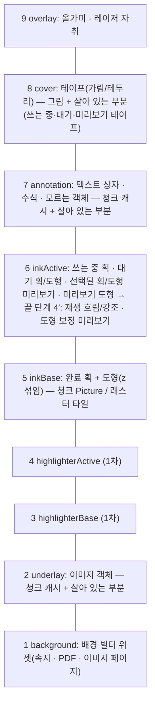

# 03 · INK — 필기 엔진 · 페이지 렌더 (2차 라운드 M5·M6·M7)

> 상태: **승인 · 계약 v2.6** (2차 통합 단계 2026-11-06 — v2.6(C26-01~04)에 INK 몫 없음, 8.3 I-1~I-7 결과는 13.7·[progress/ink.md](../progress/ink.md) '## 2차 / ### 통합 단계') · 이전 상태: **승인 · 계약 v2.5** (동시 개발 중 v2.4(INK 몫 없음 — 시그니처 변경 없음)·v2.5(C25-02 `developerValues` 공개·C25-03 B14·B17 기준·C25-04 T39 이번 라운드) 반영 2026-11-06 — 13.5; 독립 검토 보완 2.1(B20 타이머 다시 걸기 순서) — 13.6) · 이전 상태: **승인 · 계약 v2.3** (최종 승인 2026-11-05 · 동시 개발 착수 2026-11-06 — 7.6.2 마지막 bullet·C22-09대로 5.10 '가정' 블록을 실제 타입으로 바꾸고 v2.2(C22-07·08)·v2.3(C23-03·06·07)이 바꾼 문장을 맞췄다. [00-review.md '최종 승인'](00-review.md#최종-승인) '영역별 개발 중 반영'의 INK-F1~F3 처리는 13.4) · 승인한 판본: 수정 1회차. 이 계획서와 계약이 다르면 계약이 우선이다. 이전 상태: **수정 1회차** (통합 계약 **v2.1** 기준 — 총괄 검토 [00-review.md](00-review.md) 3.3 INK-M1~M12와 대리 검토 [reviews/ink.md](reviews/ink.md) 반영, 13절에 항목별 반영 내역)
>
> 작성 2026-11-05 · 수정 2026-11-05 · 영역 ID: **INK** · 소유 경로: `packages/ink_engine/`(새 `assets/fonts/`·`tool/fonts/` 포함) · 2차 작업 트리 `/home/user/wt2/ink`(`area2/ink`)
> 기준 문서: [00-overview.md](00-overview.md) 7장 '통합 계약 v2.1'(변경 이력 7.9 C21-01~35 중 INK 몫: C21-01·02·06·07·13·19·25·26·29·30·31·32·33 — 이 문서와 다르면 **계약이 우선**) · 1차 계약 v1.5(1차 [00-overview.md](../00-overview.md) 7장 — 1차 통합 반영, 시그니처는 v1.4와 같음) · 마스터 기획서 [PLAN.md](../../PLAN.md) F-03·F-11·F-12·F-13·F-14·F-15·F-16, 5.1·5.2, 7.2·7.3, 10장 M5~M7 · 조사 [01-hooks](research/01-hooks.md)·[02-audio-stylus](research/02-audio-stylus.md)·[03-recognition](research/03-recognition.md)·[04-native](research/04-native.md) · 판정 [judgement.md](drafts/judgement.md)
> 바탕 코드(v2.1, CD2-01 — 읽기 전용): **1차 통합 HEAD** `/home/user/noteapp` 브랜치 `claude/note-app-planning-bk29xb` `18c5ae5` — (v2.2, C22-08) 계약의 바탕은 그 뒤 8커밋을 더한 **`b6c9d0a`**이고 INK 경로 차이는 아래 `446518e`뿐이다(INK-F1: 2차 작업 트리는 그 판의 `lasso_polygon.dart`·`lasso_options.dart`에서 시작). `packages/ink_engine`은 영역 끝 `17d19bb`(`/home/user/wt/ink`, T00~T23 완료, `progress/ink.md` 세션 10)과 `lib/`·`test/`가 같고 `example/`만 다르다(ink lab 워크스페이스 멤버 등록 `52de08c`·`1689f7e`) [확인 — `git diff --stat 17d19bb 18c5ae5 -- packages/ink_engine`]. 통합 뒤 `446518e`(v1.5 C15-01 — 올가미 퇴화 기준 주석 문구 + 경계 시험 1개, 동작·API 변화 없음)가 더 있다. 통합 확인 수치: `ws test --package ink_engine` VM 780개(골든 17장)·Chrome 193개 통과. 파일 경로·줄 번호 인용은 1차 작업 트리 기준이고 기반 단계 시작 때 통합 HEAD 기준으로 고친다(CD2-01) · 이어받는 1차 계획서: `/home/user/wt/ink/docs/plans/03-ink.md`(승인 v0.4, 이하 '1차 03-ink' — 통합 HEAD에서는 v1.5 문구 반영본).
> 확인 환경: Flutter 3.47.9 / Dart 3.13.7(`/opt/flutter`), 헤드리스 Chrome. 이 문서의 [확인] 실험은 `/tmp/claude-0/plan57-scratch/ink57/`(`math_probe/` — 화면 밖 수식 배치·래스터, 이미지 목표 크기 디코드, 한글 문단 배치 / `font/` — Noto Sans KR 부분 집합 크기)와 수정 1회차의 `/tmp/claude-0/plan57-scratch/ink57rev/`(fonttools 4.67.0 부분 집합 재생성·결정성)에서 돌렸다. 외부 패키지 소스 인용은 pub 캐시(`flutter_math_fork 0.7.4`·`flutter_svg 2.3.0`·`vector_graphics 1.2.3`)다.

**표기 규칙** (1차 03-ink 표기 그대로 + 아래)

- 좌표 pt(페이지 기준, 원점 좌상단, y 아래), 각도 라디안(설정 값 `nibAngleDeg`만 도), 시간: 입력 µs · 점 `t` ms · `createdAt` 벽시계 ms · 재생 위치·`recordingOffsetMs` 오디오 타임라인 ms(R-2)
- `core.X` = `package:note_core/note_core.dart`, `fm.X` = `package:flutter_math_fork/flutter_math.dart`(INK 안에서만, 접두어 필수 — `MathStyle`이 CORE와 겹친다), `tex.X` = `package:flutter_math_fork/tex.dart`
- '객체' = `core.PageObject`(도형·텍스트 상자·이미지·수식·모르는 객체), '요소' = 획 + 객체(`core.PageElement`)
- 절 번호: 이 문서 안은 'n.m', 개요 2차 계약은 '7.x', 1차 계약은 '1차 7.x', 1차 INK 계획서는 '1차 03-ink n.m'
- 코드 블록은 본문을 생략한 시그니처다. **4장·5장의 계약 블록은 개요 7장 원문을 글자 그대로 옮겼다**(주석 포함). INK가 정하는 세부는 블록 밖 표나 'INK 확정 세부' 블록에 따로 적는다
- [확인] = 코드를 읽거나 명령을 실행해 확인함, [추측] = 확인하지 않은 판단(근거와 함께), 표기 없음 = INK 설계 결정
- 작업 번호는 1차 T00~T23에 이어 **T24부터** 쓴다

---

## 1. 목적과 범위

### 1.1 목적

1차 INK는 "포인터 샘플 → 벡터 획 → 화면 / 썸네일 / PDF 벡터"를 맡았다. 2차는 같은 원칙 위에 세 가지를 더한다.

1. **획이 아닌 페이지 요소의 렌더 한 곳**: CORE가 새로 정의하는 페이지 객체 4종(도형·텍스트 상자·이미지·수식)과 `UnknownObject`를 INK가 그리고, 적중·올가미·선택·변형·지우개 기하를 획과 같은 경로로 처리한다. 화면·썸네일·PDF 벡터가 **같은 층 순서(L-1)와 같은 렌더 의미**를 쓴다(K-8).
2. **새 펜 5종의 렌더 의미 확정**: 1차에서 볼펜으로 대체해 그리던 붓펜·캘리그래피·점선·레이저·암기 테이프를 제 모양으로 그린다. 저장·동기화 형식(점 코덱 v1, `Stroke.bounds` 공식 K-1)은 바꾸지 않는다.
3. **녹음·인식과 맞닿는 렌더 기능**: 재생 위치에 따른 필기 강조(K-7 — 기본 래스터를 다시 만들지 않음), 녹음된 획 적중, 자동 도형 보정의 '멈춤' 감지와 미리보기(판정은 포트 `InkShapeFitter` 뒤 LIBRARY `ink_recognition`), 수식 렌더(`flutter_math_fork`)와 텍스트 글꼴(`NoteSans`, 지연 적재).

설계 원칙 (1차 1.1의 5원칙을 그대로 지키고 더함)

6. **객체는 CORE 값 그대로 그린다**: INK는 객체를 다시 정의하지 않고 `core.PageObject`를 감싼 내부 렌더 뷰(Expando 캐시, 1차 `InkStroke.of`와 같은 동일성 규칙 K-4)만 둔다. (v2.1) 변형 미리보기·대기 표시는 CORE `PageObject.transformed(m, scaleWidth: true)` — 해석기 `TransformElements`가 부르는 **같은 함수**(7.2.2 단일 규칙: 도형 굵기 × s, 텍스트 상자·수식 글자 크기 × s, 이미지는 frame만) — 의 결과를 그대로 그려 '미리보기 = 커밋 결과'를 지킨다. INK는 굵기·글자 크기 배율을 따로 계산하지 않는다.
7. **렌더 외곽 ⊆ CORE `bounds`**(K-1·K-6): 새 펜과 객체 모두 증명이 있는 기하만 쓴다(6.2~6.13). 불변식 시험을 VM·Chrome 둘 다에서 돌린다.
8. **재생·미리보기·숨김은 기본 캐시를 건드리지 않는다**: (v2.1) 재생 흐림·강조와 도형 보정 미리보기는 **층 4′**(ink 위·annotation 아래 — `inkActive` 층의 끝 단계), 레이저·올가미·선택 표시는 overlay 층, 객체 미리보기는 각 층의 '살아 있는 부분'에만 그린다. 기본 그림(청크·타일)은 내용·숨김 집합이 바뀔 때만 다시 기록한다. 화면에만 있는 표시도 가린 테이프와 텍스트·수식의 픽셀을 바꾸지 않는다(K-9).

### 1.2 이번 범위

| 묶음 | 내용 | 개요 3.1 | 등급 (3.4) |
|---|---|---|---|
| 추가 펜 5종 | 붓펜(필압 크게·긴 taper, `filledOutline`), 캘리그래피(`nibOutline` — 타원 펜촉, 고정 각 + 펜 다운 롤), 점선(`dashedPolyline` — 대시 분할, 원형 캡), 레이저(`transientTrail` — overlay, `InkEdit` 없음, `laserFadeMs` 뒤 사라짐), 암기 테이프(cover 층, 사각 캡, 가림/테두리, 드러냄 상태 비저장) | M5-10~12 | P-A |
| 층 규칙 | L-1 7층: background·underlay·highlighter·ink·annotation·cover·overlay + (v2.1) 층 4′(ink 위 살아 있는 표시 — `inkActive` 끝). `InkRenderLayer`·`InkLayer`·`InkRenderMethod` 값 추가, `InkPageView` 층 9개 | M5 전반 | P-A |
| 페이지 객체 렌더 | 도형(폴리라인·타원, 채우기, 실선·파선·점선, 화살표 머리), 텍스트 상자(`NoteSans`, frame으로 자름, 회전), 이미지 객체(표시 버킷 디코드), 수식(contain 맞춤, 래스터 캐시), `UnknownObject` 자리표시 | M5-2·3·5, M7-5 | P-A |
| 객체 편집 기하 | `select`(획 + 객체), `hitTestObject`, 올가미 `includeObjects`(중심 포함), 선택 변형·삭제·복제·색 변경, 지우개 `eraseShapes`, `InkEdit` v2·대기 표시, `setHiddenObjectIds`·`setPreviewObjects` | M5-1·2·5 | P-A |
| 자동 도형 보정 | 획 세션의 멈춤 감지(500 ms·8 px), `InkShapeFitter` 포트 호출, 층 4′ 미리보기, `InkEdit(addShape)`. 판정 알고리즘은 LIBRARY | M5-6 | **P-B** |
| 재생 강조 | `setPlaybackFocus`(안 쓴 획 흐림 + 최근 획 강조, 층 4′, K-7·K-9), `hitTestRecorded` | M6-4 | P-A |
| 배경 · 이미지 | `ImageBackgroundLayerBuilder`(화면·still), `InkImageCache`, `defaultPageBackgroundBuilders`, `InkBackgroundSpec.imageFit` | M5-3·4 | P-A |
| 썸네일 v2 | 이미지 배경·객체 합성(2초 안에 준비 안 되면 `null`), 페이지 패널 위젯도 같은 순서 | M5-4 | P-A |
| 벡터 내보내기 v2 | `underlay`·`annotations`·`cover`, 점선 미리 분할, 도형 외곽선·채우기를 `inkShapes`에 | M5-2~5, M7-5 | P-A |
| 수식 · 글꼴 | `InkMathRenderer`(`validate`·`layout`·`rasterize` — (v2.1) 비동기 SVG 적재 대기·4 Mpx), `MathPreview`, `InkFonts`(지연 적재·PDF 바이트·`covers`·5초 상한), `InkTextLayout`(`measure`·(v2.1) `measureSync`·`textStyleOf`·`strutStyleOf`·`rasterize`), 글꼴 파일·라이선스 원문 | M5-2, M7-5·6 | P-A |
| 불변식 · 벤치 | K-1(새 펜)·K-6~K-9 시험, 벤치 B12~B20 | — | P-A |
| ink lab 예제 v2 | `example/`에 새 펜·객체·재생 막대 | — | P-C |

### 1.3 이후 범위 (이번에는 자리만 두거나 하지 않음)

- 별·화살표 자동 판정(도형 도구로만 — 3.6), 그리드 스냅·자(F-11 P1)
- 객체 z 순서 바꾸기(맨 앞/뒤 — D2), 이미지 자르기·투명도, 텍스트 부분 서식·목록·표
- 점별 배럴 롤 채널(점 코덱 v2) — 이번에는 펜 다운 순간 롤을 획 스타일 각에 더함(7.2.9 문단)
- 암기 테이프 드러냄 상태 저장·학습 기록(U10), 발표 모드(외부 화면)
- PDF 벡터 수식(서버 SVG·자체 글리프 — 조사 03 8.3 P2·P3), 수식 KaTeX 글꼴 지연 적재(포크 — U15, 예산 초과 시)
- annotation·underlay 층의 래스터 타일(측정 뒤 판단 — 6.22, 11장)
- 다크 모드 페이지 색 반전(1차 1.3 그대로)

### 1.4 제외 (다른 영역 책임) — 경계표 (1차 1.4에 더함)

| 항목 | INK | 담당 영역 |
|---|---|---|
| 객체 모델·JSON·`bounds` 공식·명령 해석·되돌리기 | 렌더 의미·`InkEdit.toCommand()`까지 | CORE |
| 도형 도구 끌기·핸들·꼭짓점 편집·텍스트 입력(IME)·이미지 고르기·삽입 흐름 | 미리보기를 같은 렌더로 그림(`setPreviewObjects` — 숨김보다 우선), 편집 중 숨김(`setHiddenObjectIds`), 높이 측정(`InkTextLayout.measure`·`measureSync`), 편집기 글자 모양(`textStyleOf`·`strutStyleOf`) | EDITOR |
| 도형 판정 알고리즘(`GeometricShapeFitter`, 합성 1,400개 시험) | 멈춤 감지·포트 호출·미리보기·`addShape` 편집 | LIBRARY(`ink_recognition`) |
| 녹음·재생·위치 계산(외삽) | 위치(int ms)를 받아 그리기만(`setPlaybackFocus`) | PDF(`media_io`) → EDITOR(Ticker) |
| 펜 다운 시점의 녹음 연결(R-1) | `InkStrokeMeta`를 받아 획에 넣음(1차 그대로) | EDITOR |
| 배럴 롤 수신·펜 다운 롤을 `nibAngleDeg`에 더하기 | `nibAngleDeg`를 읽어 그리기만 | EDITOR(+ INFRA `pencil_bridge`) |
| 테이프를 언제 탭으로 토글할지, 레이저·테이프 선택 UI | 적중·상태 API(`hitTestTape`·`toggleTape`) | EDITOR |
| 이미지 바이트 들여오기·정규화(JPEG/PNG, 2048 px) | 디코드·표시만 | PDF(`media_io`) |
| PDF 파일 합성(이미지·텍스트 객체·래스터 수식), 글꼴 넣기 | 벡터 v2·`InkMathRenderer.rasterize`·`InkTextLayout.rasterize`·`noteSansBytes` 제공 | PDF(`pdf_io`) |
| 수식 인식·LaTeX 편집 창·수식 입력 패드 | `validate`·`layout`·`MathPreview`·`InkPageView` 제공 | LIBRARY(`ink_recognition`) |
| 글꼴 라이선스 고지 화면, 웹 예산 측정·검사 | 라이선스 원문 파일(`assets/fonts/OFL.txt`)만 | INFRA |

### 1.5 1차 대비 바뀌는 INK 공개 표면 (7.0.1 중 INK 행)

| # | 변경 | 분류 | 이 문서 |
|---|---|---|---|
| C2-04 | `InkStyleExtras` 새 키 6개, `InkTapeStyle`, `StrokeStyleInk` 새 getter·`withInkExtras` | 추가 | 4.1, 6.2 |
| C2-18 | `InkPageContent.fromCore(objects:)`, 컨트롤러 `hitTestObject`·`setHiddenObjectIds`·`setPreviewObjects`·`setPlaybackFocus`·`hitTestRecorded`·테이프 API, `select`가 객체 id도 받음, `beginStroke(shapeAssist:)`·`StrokeSession.shapePreview`, `InkSelection.objectIds/allIds/objects`, `LassoOptions.includeObjects`, `EraserSpec.eraseShapes`, `InkEdit.addedObjects/updatedObjects`, `InkShapeFitter`·`inkShapeFitterProvider`. (v2.1) + 읽기 getter `previewObjects`·`hiddenObjectIds`·`playbackFocus`·`StrokeSession.shapeAssist`, `InkEdit.removedObjectIds` | 추가 | 4.2~4.6 |
| C2-19 | `InkEditKind.addShape`, `InkRenderMethod` +3, `InkLayer.cover`, `InkRenderLayer` +3 | 깨짐(형식상) — INK 밖 exhaustive switch 없음 [확인 — EDITOR는 `InkRenderLayer.overlay`·`InkEditKind.addStroke` 값 비교, PDF는 `InkBlendMode`·`InkCap`만 switch(`ink_vectorizer.dart` 45·54), `InkCap`은 값을 더하지 않는다] | 4.1, 4.6 |
| C2-20 | `pageBackgroundBuildersProvider` 기본값 = `defaultPageBackgroundBuilders(ref)` = `[image, template]` | 규칙 | 4.7, 6.11 |
| C2-21 | `InkBackgroundSpec.imageFit`, `ImageBackgroundLayerBuilder`·`InkImageCache`, `InkPageVectors.underlay/annotations/cover`, 썸네일 객체 합성, `InkMathRenderer`·`MathPreview`·`InkFonts`·`InkTextLayout`. (v2.1) + `InkTextLayout.measureSync`·`textStyleOf`·`strutStyleOf`·`rasterize`, `InkFillShape.objectId`, `InkRenderConfig` 예산 필드(`imageCacheBytes`·`mathRasterCacheBytes`) | 추가 | 4.7~4.10 |
| C2-33 | 색 하드코딩 예외: `InkTuning.playbackEmphasisArgb`·`playbackDimOpacity`·`laserArgb` | 규칙 | 4.10, 6.26 |
| C2-37 | 레이저 `StrokeSession.end()`가 `InkEdit`을 만들지 않음(K-9) | 규칙 | 6.6 |
| (v2.5) C25-02 | `InkDiagnostics.developerValues`(`Map<String, num>` — 키 `playbackPaintUs`·`annotationPaintUs`·`mathCacheBytes`, 값이 없으면 키 없음) | 추가 | 6.8.3, 6.19-6, 6.22 |

### 1.6 INK 내부 단계

| 단계 | 포함 작업 (8장) | 다른 영역에 주는 것 |
|---|---|---|
| **R2-B3** (기반 단계, 7.6) | T24·T25·T26a·T26b | 7.2.9 공개 표면 전부를 단순하지만 동작하는 구현으로 → EDITOR가 객체 도구·선택·텍스트 측정을, PDF가 벡터 v2 필드(`InkVectorFixtures`)·배경 목록·텍스트 래스터를, recog가 `InkShapeFitter`·`MathPreview`·`validate`를 첫날부터 쓴다 |
| **INK-δ** (M5 지원) | T27~T35, T37a·T37b, T38, T39 | 새 펜 5종(+ 펜 미리보기), 객체 렌더 최종, 적중·선택·지우개, 미리보기·숨김, 자동 도형 보정 |
| **INK-ε** (M6 지원) | T40 | 재생 강조·녹음 획 적중 |
| **INK-ζ** (M7·출력 지원) | T36, T41, T42 | 수식 래스터·캐시, 썸네일 v2, 벡터 내보내기 v2 |
| **INK-η** (기준 확정) | T43, (T44 P-C) | 벤치 B12~B20, 메모리 예산 확인, ink lab v2 |

---

## 2. PLAN.md 요구사항 대응표

### 2.1 기능 명세 (PLAN 4장)

| PLAN 항목 | 요구 | INK가 하는 일 | 작업 | 확인 |
|---|---|---|---|---|
| F-03 붓펜 | 필압 민감도 큼, 획 끝 가늘어짐 | `PenProfile.brush`(게인 0.90, 0.20~2.20, 속도 가늘어짐 0.30, taper 2.5/5.0) | T27 | 웹 B-6 |
| F-03 캘리그래피 | 펜촉 각도에 따라 굵기 변화(Pencil Pro는 배럴 롤) | 타원 펜촉 외곽선(`nibAngleDeg`·`nibAspect`), 롤은 EDITOR가 펜 다운 때 각에 더함 | T28 | 웹 B-6, TF C-1 |
| F-03 점선/파선 | 선 스타일 | 중심선 대시 분할(`dash` × 굵기), 원형 캡, PDF용 미리 분할 | T29, T42 | 웹 B-6, V11 |
| F-03 레이저 | 잠시 후 사라지는 선 | overlay 자취, `laserFadeMs`(기본 1.5초) 뒤 사라짐, 저장 안 함(K-9) | T30 | 웹 B-6 |
| F-03 암기 테이프 | 가렸다가 탭하면 보임 | cover 층, 가림(단색·줄무늬)/드러냄(테두리), 상태 비저장, 썸네일·PDF는 가림 | T31 | 웹 B-6 |
| F-03 품질 | 벡터 저장·확대해도 선명·PDF 벡터 | 새 펜 모두 점 코덱 v1 그대로·외곽선 벡터, 텍스트 글리프 벡터, 수식만 래스터(U17) | T27~T29, T34, T36 | 웹 B-6·B-11 |
| F-10 손글씨 → 텍스트 | 변환 결과 텍스트 상자 | 텍스트 상자 렌더·높이 측정(`InkTextLayout.measure`) | T26a, T34 | APK A-4(recog) |
| F-11 도형 도구 | 직선·화살표·사각형·원/타원·삼각형·다각형·별, 테두리 색·굵기·선 스타일·채우기 | 도형 렌더 7종(기하 2종으로), 실선·파선·점선, 채우기, 화살표 머리 | T33 | 웹 B-4 |
| F-11 자동 도형 보정 | 펜을 잠시 멈추면 반듯한 도형 | 멈춤 감지(500 ms·8 px) → 포트 → 층 4′ 미리보기(결과와 같은 층) → `addShape` | T39 | 웹 B-4 |
| F-11 편집 핸들 | 크기·회전·꼭짓점 이동 | 미리보기 객체를 같은 렌더로(`setPreviewObjects`), 선택 변형 미리보기 = CORE `transformed(m, scaleWidth: true)`(해석기와 같은 함수 — 굵기·글자 크기까지) | T37a, T38 | 웹 B-4·B-5 |
| F-12 Pencil 배럴 롤 | 캘리그래피 각 | `followBarrelRoll` 키 소유, 각 읽기 | T24, T28 | TF C-1 |
| F-13 이미지 페이지 | 페이지 종류 '이미지' | `ImageBackgroundLayerBuilder`(contain·cover·fill), 썸네일 still | T35, T41 | 웹 B-3 |
| F-14 수식 렌더 | 깔끔한 수식 표시, 이동·크기·색, 다시 편집 | `InkMathRenderer`·`MathPreview`, frame에 contain 맞춤, 래스터 캐시, (v2.1) 루트·늘어나는 괄호·화살표(SVG 기호)를 적재 뒤에만 래스터 | T26b, T36 | 웹 B-11 |
| F-14 실시간 미리보기 | 쓰는 중 미리보기 | `MathPreview` 위젯(recog 패드가 씀 — R2-B3부터 실제 동작) | T26b | 웹 B-11 |
| F-15 PDF 출력 | 필기 벡터 | 벡터 v2(L-1 순서, 점선 분할, 도형 외곽선), 수식 300 dpi 래스터 함수, (v2.1) 텍스트 상자 래스터 대체 함수(CP-PDF-7) | T42, T36, T26a | V11 |
| F-16 필기 강조 | 재생하면 그 시점 필기 강조 | `setPlaybackFocus`(흐림·강조, 층 4′, K-7·K-9) | T40 | 웹 B-8 |
| F-16 필기 탭 → 재생 | 그 시점부터 재생 | `hitTestRecorded`(EDITOR가 `seekMs(offset − preRoll)`) | T40 | 웹 B-8 |

### 2.2 추가 기능 (PLAN 5장) · 아키텍처 (7장) · 로드맵 (10장)

| 항목 | INK가 하는 일 | 작업 |
|---|---|---|
| 5.1 올가미 고급(회전·색 변경·잘라내기·붙여넣기) | 획 + 객체 선택·회전 미리보기·색 변경 편집(`recolorStrokes` → `RestyleStrokes` + `UpdateObjects`) | T37a |
| 5.1 텍스트 상자 | 렌더·글꼴·높이 측정, 편집 중 숨김 | T34, T38 |
| 5.1 이미지 삽입 | 이미지 객체 렌더·캐시, 놓는 중 미리보기 | T35, T38 |
| 5.2 레이저 포인터·암기 테이프 | 6.6·6.7 | T30, T31 |
| 5.4 성능(획 10만, 60fps) | 객체가 든 페이지 벤치(B14·B16·B17), 재생 프레임 비용(B15) | T43 |
| 5.4 측정(개발자 표시) | 진단 경고 키 추가(`imageDecodeFailed` 등), 이미지·수식 캐시 통계 | T35, T36 |
| 7.2 데이터 모델 `Shape`·`TextBox`·`MathObject`·`ImageObject` | CORE 정의 그대로 렌더(INK는 재정의하지 않음) | T32a |
| 7.3 렌더링 전략(배경 → 형광펜 → 필기·도형·텍스트 → 선택) | L-1로 구체화(이미지는 형광펜 아래, 텍스트·수식은 필기 위, 테이프는 그 위, 화면 전용 재생·도형 미리보기는 필기 바로 위 층 4′) | T25, T32b |
| 10장 M5 '추가 펜' | 6.2~6.7 | T27~T31 |
| 10장 M6 '재생 시 필기 강조' | 6.19 | T40 |
| 10장 M7 '수식 렌더링' | 6.12 | T26b, T36 |

---

## 3. 소유 경로와 패키지 구조

`[새]` = 2차에 생기는 파일, `[바뀜]` = 1차 파일을 넓힘. 표시 없는 1차 파일은 그대로다(1차 03-ink 3장 트리). INK는 이번에도 **플러그인을 쓰지 않는다**(순수 Flutter 패키지 — 부록 B).

```text
packages/ink_engine/
├─ pubspec.yaml                          [바뀜] flutter_math_fork + 간접 고정 3, flutter: assets(파일 단위 3개 — 3.1)
├─ dart_test.yaml                        (그대로: golden, bench)
├─ README.md                             [바뀜] 2차 사용 예(객체·재생·수식·글꼴)
├─ THIRD_PARTY_NOTICES.md                [바뀜] Noto Sans KR(OFL 1.1) 부분 집합, flutter_math_fork(Apache-2.0 — R2-B3에서 확인)·KaTeX 글꼴(MIT)
├─ assets/fonts/                         [새]
│  ├─ NoteSans-Regular.ttf               466,936 B (gzip -9 213,615) — 6.10.1 (C23-06)
│  ├─ NoteSans-Bold.ttf                  466,440 B (gzip -9 216,764)
│  ├─ OFL.txt                            라이선스 원문 (INFRA R-5 — 앱 정보 화면이 읽음)
│  └─ README.md                          원본 주소·sha256·부분 집합 규칙·재생성 명령 (저장소 문서 — 앱 자산이 아님, 3.1)
├─ tool/fonts/                           [새] 개발자 전용(빌드·시험에 안 쓰임)
│  ├─ make_note_sans.py                  fonttools 4.67.0: 원본 → wght 400/700 고정 → 부분 집합 → 이름 바꿈 → 범위표 Dart 생성 → 시험 글꼴(6.10.1)
│  └─ test_font_chars.txt                시험 글꼴에 넣을 한글 음절 목록(4.12 `useInkTestFonts`)
├─ lib/
│  ├─ ink_engine.dart                    [바뀜] show 목록 v2 (4.0)
│  ├─ testing.dart                       [바뀜] 4.12 (+ `useInkTestFonts`·`InkVectorFixtures` — 7.6 계약)
│  ├─ dev_tools.dart                     (그대로)
│  └─ src/
│     ├─ tuning.dart                     [바뀜] 2차 상수 (6.26)
│     ├─ testing/ink_test_font.dart      [새] 시험 글꼴 base64 상수 + useInkTestFonts 본문 (testing.dart만 export — 4.12)
│     ├─ testing/vector_fixtures.dart    [새] InkVectorFixtures (testing.dart만 export — 4.12)
│     ├─ providers.dart                  [바뀜] inkShapeFitterProvider, inkImageCacheProvider, defaultPageBackgroundBuilders
│     ├─ model/ink_layer.dart            [바뀜] InkLayer.cover
│     ├─ model/ink_stroke.dart           [바뀜] 레이저(저장된 비정상 획) 대체 프로필 규칙
│     ├─ pen/pen_profile.dart            [바뀜] brush·calligraphy·dashed·laser·tape 프로필, InkRenderMethod +3
│     ├─ pen/style_ink.dart              [바뀜] InkStyleExtras 키, InkTapeStyle, StrokeStyleInk getter·withInkExtras
│     ├─ geometry/outline_generator.dart [바뀜] 렌더 방식별 분기(OutlineSpec), 사각 캡
│     ├─ geometry/nib_outline.dart       [새] 타원 펜촉 외곽선 (6.4)
│     ├─ geometry/dash.dart              [새] 호 길이 대시 분할 (6.5, 도형 점선도)
│     ├─ geometry/shape_path.dart        [새] ShapeGeometry → Path·외곽선 다각형·화살표 (6.9)
│     ├─ object/                         [새] 페이지 객체 렌더 (6.8~6.13)
│     │  ├─ object_view.dart             InkObjectView(Expando 캐시) — 층 배정·bounds·종류별 준비물
│     │  ├─ object_index.dart            객체 격자 색인(64 pt)
│     │  ├─ object_hit.dart              hitTestObject·지우개 닿음·올가미 중심
│     │  ├─ shape_painter.dart
│     │  ├─ text_painter.dart            문단 캐시·frame 자르기·회전
│     │  ├─ image_painter.dart           이미지 객체·자리표시
│     │  ├─ math_painter.dart            contain 맞춤·래스터 캐시 사용
│     │  └─ unknown_painter.dart         자리표시
│     ├─ image/image_cache.dart          [새] InkImageCache (6.11) — 그리는 중 참조 수·버킷 낮추기·자산별 알림
│     ├─ image/raster_ledger.dart        [새] 내부: 래스터 바이트 장부(웹은 타일과 공유 96 MB — 6.22)
│     ├─ image/image_header.dart         [새] 내부: PNG IHDR·JPEG SOF에서 픽셀 크기만 읽기 (6.11.1)
│     ├─ image/deferred_asset_store.dart [새] 내부: 저장소 override가 없는 컨테이너에서 예외 없게 (6.11.4)
│     ├─ background/image_builder.dart   [새] ImageBackgroundLayerBuilder
│     ├─ background/background_spec.dart [바뀜] imageFit
│     ├─ background/builder_choice.dart  [바뀜] 이미지 캐시 찾기(imageCacheOf)
│     ├─ math/math_renderer.dart         [새] InkMathRenderer, InkMathLayout
│     ├─ math/math_preview.dart          [새] MathPreview
│     ├─ math/offscreen_host.dart        [새] 내부: 화면 밖 RenderView 파이프라인 — 배치 호스트(동기)·래스터 호스트(큐, 비동기 SVG 적재 대기) (6.12.2)
│     ├─ math/math_raster_cache.dart     [새] 내부: 8 MB LRU(그리는 중 참조 수·버킷 낮추기 — 6.12.3)
│     ├─ text/fonts.dart                 [새] InkFonts
│     ├─ text/text_layout.dart           [새] InkTextLayout(measure·measureSync·textStyleOf·strutStyleOf·rasterize) + 내부 문단 빌더
│     ├─ text/note_sans_coverage.dart    [새] 생성 파일: 부분 집합 코드 포인트 범위표
│     ├─ shape/shape_assist.dart         [새] ShapeAssist, InkShapeFitter, InkShapeFit, NoShapeFitter
│     ├─ shape/hold_detector.dart        [새] 내부: 멈춤 감지 (6.18)
│     ├─ edit/ink_edit.dart              [바뀜] addShape, addedObjects/updatedObjects/removedObjectIds, toCommand v2.1
│     ├─ edit/lasso_options.dart         [바뀜] includeObjects
│     ├─ edit/eraser_spec.dart           [바뀜] eraseShapes
│     ├─ export/vector_export.dart       [바뀜] underlay·annotations·cover, 점선·도형, InkFillShape.objectId
│     ├─ interop/core_interop.dart       [바뀜] 객체 복사·색 변경·ShapeStyle 만들기
│     └─ render/
│        ├─ ink_page_content.dart        [바뀜] objects(+ 내부 층별 목록)
│        ├─ ink_page_controller.dart     [바뀜] 객체·숨김·미리보기·재생·테이프·레이저
│        ├─ ink_page_view.dart           [바뀜] 층 9개
│        ├─ pen_preview.dart             [바뀜] 새 펜 5종 미리보기(렌더 방식별 — 6.2)
│        ├─ render_config.dart           [바뀜] imageCacheBytes·mathRasterCacheBytes (CP-INK-5)
│        ├─ base_cache.dart              [바뀜] InkContentDiff 객체, 청크 항목 일반화(획 | 도형)
│        ├─ layer_cache.dart             [새] underlay·annotation 청크 캐시, cover 그림
│        ├─ layer_painters.dart          [바뀜] L-1 순서 전체(썸네일 공용)
│        ├─ selection.dart               [바뀜] 객체 id·bounds·편집
│        ├─ sessions.dart                [바뀜] shapeAssist·shapePreview, 레이저·테이프 세션 규칙, 지우개 eraseShapes
│        ├─ laser.dart                   [새] 내부: 레이저 자취 수명·그리기
│        ├─ tape_layer.dart              [새] 내부: cover 층 그림·드러냄 집합
│        ├─ playback.dart                [새] InkPlaybackFocus·InkPlaybackStyle + 내부 재생 색인·흐림 블록(층 4′ — inkActive 끝)
│        ├─ thumbnail.dart               [바뀜] 객체·이미지 합성
│        └─ thumbnail_renderer.dart      [바뀜] 객체·이미지 합성, 2초 준비 기한
├─ test/
│  ├─ foundation/b3_v2_smoke_test.dart   [새] R2-B3
│  ├─ unit/
│  │  ├─ api_surface_test.dart           [바뀜] 7.2.9 이름·시그니처 전부
│  │  ├─ export_list_test.dart           [바뀜] 4.0 show 목록 v2
│  │  ├─ no_platform_imports_test.dart   [바뀜] flutter_math_fork 허용, material 금지 유지
│  │  ├─ providers_test.dart             [바뀜] 새 provider·저장소 없는 컨테이너
│  │  ├─ pen/{pen_profile,style_ink}_test.dart          [바뀜]
│  │  ├─ geometry/{nib_outline,dash,square_cap,shape_path}_test.dart   [새] (square_cap은 테이프 점 획 정사각형만 — 1차 사각 캡 재사용)
│  │  ├─ model/bounds_invariant_test.dart                [바뀜] 새 펜 5종(K-1)
│  │  ├─ model/object_bounds_invariant_test.dart         [새] K-6
│  │  ├─ object/{object_view,object_hit,object_index}_test.dart        [새]
│  │  ├─ edit/{ink_edit,selection,lasso,stroke_eraser,partial_eraser}_test.dart  [바뀜] 객체
│  │  ├─ shape/hold_detector_test.dart   [새]
│  │  ├─ render/{content_diff,playback_index,laser_lifetime,tape_state,layer_order}_test.dart  [새·바뀜]
│  │  ├─ text/{fonts,coverage_table,text_layout,text_raster}_test.dart    [새]
│  │  ├─ math/{math_validate,math_layout,offscreen_queue}_test.dart       [새]
│  │  ├─ image/{image_cache,image_working_set,image_header}_test.dart     [새]
│  │  ├─ testing/{test_font,vector_fixtures}_test.dart                    [새] 4.12 도우미
│  │  └─ export/vector_export_v2_test.dart                [새]
│  ├─ widget/
│  │  ├─ objects_render_test.dart        [새] 층·회전·자르기·자리표시
│  │  ├─ object_preview_hidden_test.dart [새]
│  │  ├─ shape_assist_test.dart          [새]
│  │  ├─ playback_focus_test.dart        [새] K-7
│  │  ├─ laser_test.dart · tape_test.dart [새]
│  │  ├─ pen_preview_test.dart           [바뀜] v2 — 새 펜 5종
│  │  ├─ image_background_test.dart      [새]
│  │  ├─ math_render_test.dart · math_preview_test.dart   [새]
│  │  └─ thumbnail_v2_test.dart          [새]
│  ├─ goldens/
│  │  ├─ pens_p1_golden_test.dart        [새] 5종 S곡선 + 테이프 가림/드러냄/줄무늬 + 펜 미리보기 장
│  │  └─ shapes_golden_test.dart         [새] 도형 7종 × 선 스타일·채우기·화살표 (글자 없음)
│  ├─ web/                               [바뀜] K-1 v2·K-6·외곽선 결정성·이미지 디코드·화면 밖 수식 래스터(SVG 기호 표본)·시험 글꼴(`useInkTestFonts`)
│  └─ support/                           [바뀜] object_scripts.dart, png_bytes.dart, delayed_svg_loader.dart(6.12.2 시험 이음새용 지연 BytesLoader)
├─ benchmark/                            [바뀜] B12~B20 (`object_bench_test.dart`, `playback_bench_test.dart`, `pen_p1_bench_test.dart`)
└─ example/                              [바뀜] (P-C) 새 펜·객체·재생 막대
```

### 3.1 pubspec.yaml (v2)

```yaml
# packages/ink_engine/pubspec.yaml — 1차 7.4.1 형식, 7.5 버전
name: ink_engine
publish_to: none
version: 0.0.1
resolution: workspace
environment:
  sdk: ^3.13.0
  flutter: 3.47.9
dependencies:
  flutter:
    sdk: flutter
  note_core: any
  riverpod: 3.4.3
  meta: 1.19.0
  flutter_math_fork: 0.7.4
  flutter_svg: 2.3.0              # 간접 고정 (flutter_math_fork → 최신 2.3.2는 게시 14일 미만)
  vector_graphics: 1.2.3          # 간접 고정 (최신 1.2.6 대신)
  vector_graphics_compiler: 1.3.0 # 간접 고정 (최신 1.3.4 대신)
dev_dependencies:
  flutter_test:
    sdk: flutter
  fake_async: 1.3.3
  perfect_freehand: 2.5.2+1
flutter:
  assets:                          # FontManifest가 아니다: 웹 첫 로드에 받지 않음 (7.4.5)
    - assets/fonts/NoteSans-Regular.ttf
    - assets/fonts/NoteSans-Bold.ttf
    - assets/fonts/OFL.txt         # (v2.1) 파일 단위 — 폴더의 README.md는 앱 자산에 넣지 않음
```

- 의존 4줄은 INFRA R2-B1이 lock을 한 번에 만들 때 넣는다(INFRA 5.9 R-8·12.2 CP3 — 총괄 승인, R2-B1 한 번 예외, 12.3). `flutter: assets:` 블록은 INK가 R2-B3(T26a)에서 넣는다(lock과 무관). (v2.3, C23-03) 기반 단계 지시에서 빠져 총괄이 `5843ec3`에서 넣었고, 이후 이 블록의 소유는 INK다 — `pubspec_assets_test`는 동시 개발 첫 작업으로 더한다.
- (v2.1, C21-25) **자산은 파일 단위**로 적는다: `NoteSans` 두 파일 + `OFL.txt`. 폴더(`assets/fonts/`)를 통째로 적으면 `README.md`까지 앱 번들·웹 빌드 `assets/`에 실린다(INFRA `web-assets verify`가 모르는 파일로 볼 수 있음 — 검토 X-10). `.gitattributes`의 `*.ttf binary`는 INFRA R2-B1이 넣는다(7.4.5 `binary` 목록). `pubspec_assets_test`(T26a, VM)가 `pubspec.yaml`의 `flutter.assets` = 이 세 줄이고 각 파일이 있음을 확인한다.
- `fonts:`로 선언하지 않는 이유: Flutter 웹은 `FontManifest.json`의 글꼴을 시작 때 모두 내려받는다(조사 03 8.2-3 [확인]). `assets:`는 `rootBundle.load` 때만 받는다. INFRA `web_budget.yaml`의 `forbidden_font_families: [NoteSans, packages/ink_engine/NoteSans]`가 이를 검사한다(INFRA 4.3.3).
- `flutter_math_fork`는 플러그인이 아니고 순수 Dart다. `provider 6.1.5+1`·`tuple 2.0.2`를 끌어온다(7.5 해석 결과에 포함). INK 코드는 `provider`·`flutter_svg`를 import하지 않는다. (v2.1) `package:vector_graphics/vector_graphics.dart`의 `VectorGraphic`·`BytesLoader`는 `math/offscreen_host.dart`의 적재 판정과 시험 이음새에서만 import한다(6.12.2 — `dependencies:`에 고정돼 있으므로 `depend_on_referenced_packages` 분석 규칙을 통과한다. INFRA R9 간접 고정 목록과는 무관 — 판은 그대로 1.2.3).
- 자기 패키지 에셋 키: 패키지 시험에서 `packages/ink_engine/assets/fonts/…`와 `assets/fonts/…` 둘 다 VM `rootBundle.load`로 읽힌다 [확인 — `math_probe/test/own_asset_test.dart`]. INK 코드는 언제나 `packages/ink_engine/…` 키를 쓴다(앱에서 의존 패키지 에셋 키와 같게).

### 3.2 dart_test.yaml

1차 그대로(`golden`·`bench` 두 태그). INK는 `integration`·`perf`·`media`·`emulator` 태그를 쓰지 않는다. 새 골든 2개는 `@Tags(['golden'])`·`@TestOn('vm')` 리터럴, 새 벤치는 `benchmark/`(`@Tags(['bench'])`).

---
## 4. 공개 API

4.1~4.9의 계약 블록·L-1 표·`toCommand` 표·4.9 아래 글머리는 개요 7.2.9 **v2.1 원문**이다(수정 1회차에 7장 줄을 스크립트로 그대로 다시 붙였다 — 블록을 주제별로 빈 줄 자리에서 나눴을 뿐 줄은 고치지 않았다). `(v2.1)` 표시는 계약의 표시 그대로다. `/* v1.4 */`는 1차 계약(1차 7.2.15·7.2.16 = 1차 03-ink 4장, v1.5에서도 시그니처 같음) 그대로라는 뜻이다. INK가 정하는 세부(계약이 `/* INK */`로 남긴 멤버, 매개변수 타입, 내부 상수, 동작 규칙)는 4.10에 모았다(CP-INK-11 — 계약이 4.10·4.12를 단일 출처로 가리킨다).

### 4.0 공통 규칙과 진입점

- 1차 03-ink 4.0 규칙 그대로: 공개 이름은 `lib/ink_engine.dart`의 `show` 목록이 전부(R14, `export_list_test`), 값 타입은 `@immutable` + `==`/`hashCode`, 잘못된 인자 `ArgumentError`, 상태 위반 `StateError`, **렌더 경로는 예외를 던지지 않는다**(그 요소를 건너뛰거나 자리표시를 그리고 `InkDiagnostics.onWarning` + `FlutterError.reportError(library: 'ink_engine')`).
- CORE와 같은 개념을 정의하지 않는다: 객체·기하·스타일·`ImageFit`·명령은 `core.` 타입이다. `flutter_math_fork`의 이름(`Math`, `MathOptions`, `MathStyle` …)은 다시 export하지 않는다.
- 새 공개 이름(2차, 22개): `InkTapeStyle`, `InkPlaybackFocus`, `InkPlaybackStyle`, `ShapeAssist`, `InkShapeFitter`, `InkShapeFit`, `NoShapeFitter`, `inkShapeFitterProvider`, `ImageBackgroundLayerBuilder`, `InkImageCache`, `inkImageCacheProvider`, `defaultPageBackgroundBuilders`, `InkImageVector`, `InkAnnotationVector`, `InkTextVector`, `InkTextLine`, `InkMathVector`, `InkMathRenderer`, `InkMathLayout`, `MathPreview`, `InkFonts`, `InkTextLayout`. [확인] 1차 작업 트리 9개 패키지 진입점에 같은 이름이 없다(`grep -rn` — R2-B3 커밋 전 다시 확인). `MathPreview`는 recog가 그대로 쓰고 같은 이름의 위젯을 만들지 않는다(12.2 Q9 — 닫음). (v2.1) v2.1이 더한 것은 모두 **기존 이름의 멤버**(읽기 getter, `InkEdit.removedObjectIds`, `InkTextLayout`의 정적 함수 넷, `InkFillShape.objectId`, `InkRenderConfig` 필드 둘)이거나 `testing.dart`의 이름(`useInkTestFonts`, `InkVectorFixtures` — 4.12)이라 `ink_engine.dart`의 새 이름 수는 22개 그대로다.

```dart
// lib/ink_engine.dart — the complete list of exported names (v2.0)
library;

export 'src/background/background_builder.dart'
    show PageBackgroundContext, PageBackgroundLayerBuilder, PageBackgroundStillRenderer;
export 'src/background/background_spec.dart' show InkBackgroundSpec, InkBackgroundKind;
export 'src/background/image_builder.dart' show ImageBackgroundLayerBuilder;            // (v2.0)
export 'src/background/template_builder.dart' show TemplateBackgroundLayerBuilder;
export 'src/background/template_vectors.dart'
    show TemplateVectors, TemplateVectorItem, TemplateLine, TemplateDot;
export 'src/diagnostics/diagnostics.dart' show InkDiagnostics, InkStatsSnapshot, LatencySummary;
export 'src/diagnostics/ink_clock.dart' show InkClock;
export 'src/edit/eraser_spec.dart' show EraserSpec, EraserMode;
export 'src/edit/ink_edit.dart' show InkEdit, InkEditKind;
export 'src/edit/lasso_options.dart' show LassoOptions;
export 'src/edit/selection_geometry.dart' show SelectionGeometry, SelectionHandle;
export 'src/export/vector_export.dart'
    show InkVectorExport, InkPageVectors, InkHighlighterGroup, InkHighlighterLine, InkFillShape,
        InkExportOptions, InkBlendMode,
        InkImageVector, InkAnnotationVector, InkTextVector, InkTextLine, InkMathVector; // (v2.0)
export 'src/geometry/vector_path.dart' show InkVectorPath, InkPathVerb;
export 'src/image/image_cache.dart' show InkImageCache;                                // (v2.0)
export 'src/input/ink_sample.dart' show InkSample, InkPointerKind;
export 'src/input/predictor.dart' show InkPredictor, NoopPredictor;
export 'src/input/pressure_capability.dart'
    show PressureCapability, PressureSource, PressureCapabilityState, PressureCapabilityStore,
        PressureCapabilityNotifier;
export 'src/input/pressure_mode.dart' show PressureMode, PressureModeNotifier;
export 'src/input/sample_adapter.dart' show InkSampleAdapter;
export 'src/math/math_preview.dart' show MathPreview;                                  // (v2.0)
export 'src/math/math_renderer.dart' show InkMathRenderer, InkMathLayout;              // (v2.0)
export 'src/model/ink_layer.dart' show InkLayer;
export 'src/model/ink_points.dart' show InkPoints;
export 'src/model/ink_stroke.dart' show InkStroke;
export 'src/pen/pen_profile.dart' show PenProfile, InkCap, InkRenderMethod;
export 'src/pen/style_ink.dart'
    show StrokeStyleInk, InkStyleExtras, HighlighterStraightening, InkTapeStyle;      // (v2.0) InkTapeStyle
export 'src/providers.dart'
    show inkRenderConfigProvider, inkClockProvider, pressureModeProvider,
        pressureCapabilityProvider, inkCoreServicesProvider, inkCachePoolProvider,
        inkDiagnosticsProvider, pencilGrainProvider, pageBackgroundBuildersProvider,
        inkPageControllerProvider, inkPageThumbnailRendererProvider,
        inkShapeFitterProvider, inkImageCacheProvider, defaultPageBackgroundBuilders;  // (v2.0)
export 'src/render/cache_pool.dart' show InkCachePool, InkCacheStats;
export 'src/render/ink_page_content.dart' show InkPageContent;
export 'src/render/ink_page_controller.dart'
    show InkPageController, InkCoreServices, InkRenderLayer, InkPageRenderStats;
export 'src/render/ink_page_view.dart' show InkPageView, InkPageGeometry;
export 'src/render/pen_preview.dart' show PenPreviewPainter, PenPreviewShape;
export 'src/render/pencil_grain.dart' show PencilGrain;
export 'src/render/playback.dart' show InkPlaybackFocus, InkPlaybackStyle;            // (v2.0)
export 'src/render/render_config.dart' show InkRenderConfig;
export 'src/render/selection.dart' show InkSelection;
export 'src/render/sessions.dart'
    show InkGestureSession, StrokeSession, EraserSession, LassoSession, LiveStrokeGeometry;
export 'src/render/thumbnail.dart' show InkPageThumbnail;
export 'src/render/thumbnail_renderer.dart' show InkPageThumbnailRenderer;
export 'src/shape/shape_assist.dart'
    show ShapeAssist, InkShapeFitter, InkShapeFit, NoShapeFitter;                     // (v2.0)
export 'src/stroke/stroke_meta.dart' show InkStrokeMeta;
export 'src/text/fonts.dart' show InkFonts;                                            // (v2.0)
export 'src/text/text_layout.dart' show InkTextLayout;                                 // (v2.0)
export 'src/tuning.dart' show InkTuning;
```

### 4.1 펜 extras · 렌더 방식 · 층 (7.2.9)

```dart
// --- style extras keys (INK owns; CORE stores in StrokeStyle.extras) — 추가 ---
abstract final class InkStyleExtras {
  static const String highlighterStraightening = 'hlStraight';   // v1.4
  static const String nibAngleDeg = 'nibAngleDeg';     // calligraphy, [0, 180), default 45
  static const String nibAspect = 'nibAspect';         // calligraphy, minor/major (0.1..1], default 0.25
  static const String followBarrelRoll = 'rollNib';    // calligraphy, bool, default true (native Pencil Pro)
  static const String dash = 'dash';                   // dashed, [on, off, …] × width, default [4, 3]
  static const String laserFadeMs = 'laserFadeMs';     // laser, [300, 5000], default 1500
  static const String tapeStyle = 'tapeStyle';         // tape, 'solid' | 'striped', default 'solid'
}
enum InkTapeStyle { solid, striped }
extension StrokeStyleInk on core.StrokeStyle {
  /* v1.4: profile, previewRadius, highlighterStraightening, withHighlighterStraightening */
  double get nibAngleDeg; double get nibAspect; bool get followBarrelRoll;
  List<double> get dashPattern; int get laserFadeMs; InkTapeStyle get tapeStyle;
  core.StrokeStyle withInkExtras({double? nibAngleDeg, double? nibAspect, bool? followBarrelRoll,
      List<double>? dashPattern, int? laserFadeMs, InkTapeStyle? tapeStyle});
}
// PenProfile.of (v2.0): brush → filledOutline (high pressure gain, long taper);
// calligraphy → nibOutline; dashed → dashedPolyline (round caps); laser → transientTrail;
// tape → filledOutline, square cap, layer cover.
enum InkRenderMethod { filledOutline, strokedPolyline, nibOutline, dashedPolyline, transientTrail }  // 깨짐(값 추가)
enum InkLayer { highlighter, ink, cover }                                                             // 깨짐(값 추가)
enum InkRenderLayer { background, underlay, highlighterBase, highlighterActive, inkBase, inkActive,
  annotation, cover, overlay }                                                                        // 깨짐(값 추가)
```

`StrokeStyle.defaultsFor`(CORE)의 P1 5종 값은 v1.4 값을 유지하고 extras 기본값만 위 표로 채운다(색·굵기 조정은 INK가 렌더를 확정한 뒤 CORE에 변경 요청). 모든 새 펜은 1차 K-1(`Stroke.bounds` 공식)을 지킨다: 캘리그래피 펜촉 반길이 = `width·f/2` = `2·width·widthQ`, 테이프 사각 캡 0.7071·w ≤ 0.75·w, 점선 원형 캡.

**층 규칙 L-1** (아래에서 위로, 조사 01 R3 + PLAN 7.3):

| 순서 | 층 | 내용 | 층 안의 순서 |
|---|---|---|---|
| 1 | background | 종이·속지·PDF·이미지 배경 | — |
| 2 | underlay | `ImageObject` | `compareOrder` |
| 3 | highlighter | 형광펜 획 | `compareOrder` (v1.4) |
| 4 | ink | 일반 획 + `ShapeObject` | `compareOrder` — 도형과 획이 섞인다 |
| 4′ | (v2.1) ink 위 살아 있는 표시(`inkActive` 끝 — 기본 그림·타일과 무관하게 매 paint) | 재생 흐림·강조(K-7), 자동 도형 보정 미리보기 | — |
| 5 | annotation | `TextBoxObject`, `MathObject`, `UnknownObject` 자리표시 | `compareOrder` |
| 6 | cover | 암기 테이프 획(드러낸 것은 테두리만) | `compareOrder` |
| 7 | overlay | 선택 표시, 올가미, 레이저 자취. (v2.1) 재생 강조·도형 보정 미리보기는 4′로 옮겼다 — overlay에 두면 테이프·텍스트 위에 획 모양이 드러난다 | — |

- INK 풀이(계약 밖): 층 4′는 새 `InkRenderLayer` 값이 아니라 `inkActive` 층 painter의 **마지막 단계**다(같은 `CustomPaint` — 6.1). 그래서 `InkRenderLayer` 값은 v2.0 그대로 9개이고, 4′에 그린 것은 그 위 `annotation`·`cover` 층 그림에 덮인다(K-9 v2.1 문장 — 9.3).

### 4.2 페이지 내용 (7.2.9)

```dart
// --- content: 추가 ---
final class InkPageContent {
  factory InkPageContent.fromCore({required core.Page page, required List<core.Stroke> strokes,
      List<core.PageObject> objects = const [], required int revision});
  List<core.PageObject> get objects;
}
```

- 1차 `fromCore` 규칙(삭제된 것 제외, `compareOrder` 정렬 확인 O(n), 다른 페이지 요소 → `ArgumentError`)을 `objects`에도 똑같이 적용한다. `==`는 획과 객체 모두 **동일성**으로 비교한다(K-4).
- 층 배정(L-1)은 `InkPageContent` 안에서 한 번 한다: `ImageObject` → underlay, `ShapeObject` → ink(획과 `compareOrder`로 섞임), `TextBoxObject`·`MathObject`·`UnknownObject` → annotation. 층별 목록은 내부 접근자(`@internal`)로만 쓴다(6.8).

### 4.3 페이지 컨트롤러 추가 · 재생 강조 · 테이프 (7.2.9)

```dart
// --- page controller: 추가 ---
final class InkPageController extends ChangeNotifier {
  /* v1.4 */
  /// ids may mix strokes and objects; unknown ids ignored.
  InkSelection select(Set<String> elementIds);
  /// Topmost object at the point (annotation → ink → underlay); UnknownObject included.
  core.PageObject? hitTestObject(Offset pagePoint, {double tolerance = 4.0});
  /// Not drawn (e.g. the text box under EDITOR's EditableText). Selection still sees them.
  void setHiddenObjectIds(Set<String> ids);
  /// Transient objects drawn with the same renderer (shape tool drag, vertex drag, image being
  /// placed). An entry whose id equals a committed object REPLACES it on screen; the others are
  /// drawn in their L-1 layer. (v2.1) A preview is drawn even when its id is hidden (preview wins
  /// over setHiddenObjectIds). Empty list = none. Never stored, never exported.
  void setPreviewObjects(List<core.PageObject> objects);
  // (v2.1) read-only views of what was set (EDITOR tests observe their own calls — EDITOR M-1)
  Set<String> get hiddenObjectIds;
  List<core.PageObject> get previewObjects;
  InkPlaybackFocus? get playbackFocus;
  // playback (M6)
  void setPlaybackFocus(InkPlaybackFocus? focus);           // null = off (K-7)
  InkStroke? hitTestRecorded(Offset pagePoint, {String? recordingId, double tolerance = 8.0});
  // memorization tape (state per controller, never stored — U10)
  InkStroke? hitTestTape(Offset pagePoint);
  bool isTapeRevealed(String strokeId);
  void toggleTape(String strokeId);
  /// Applies to the tapes present now; tapes that arrive later start covered. (v2.1) EDITOR keeps
  /// the note-level 'show all' and re-applies it after every updateContent. Lifetime = controller.
  void setAllTapesRevealed(bool revealed);
}
@immutable
final class InkPlaybackFocus {
  const InkPlaybackFocus({required this.recordingId, required this.positionMs,
      this.style = InkPlaybackStyle.dimUnwritten, this.recentWindowMs = 2000});
  final String recordingId;
  final int positionMs;                          // audio timeline, same scale as Stroke.recordingOffsetMs
  final InkPlaybackStyle style;
  /// Strokes that started in (positionMs − recentWindowMs, positionMs] get the emphasis outline
  /// (both styles). dimUnwritten also draws unwritten ink-layer strokes at
  /// InkTuning.playbackDimOpacity ((v2.1, CP-INK-8) highlighter / tape strokes are not dimmed —
  /// emphasis outline only). Drawn in layer 4′, never over annotation / cover (K-9).
  /// Strokes of other recordings / without a recording: unchanged.
  final int recentWindowMs;
}
enum InkPlaybackStyle { dimUnwritten, highlightRecent }
```

### 4.4 획 세션 · 레이저 (7.2.9)

```dart
// beginStroke (v1.4) + shapeAssist — 추가
StrokeSession beginStroke(InkSample first, {required core.StrokeStyle style,
    required double viewScale, InkStrokeMeta meta = const InkStrokeMeta(),
    ShapeAssist shapeAssist = ShapeAssist.off});
enum ShapeAssist { off, holdToSnap }
// StrokeSession — 추가: after the pen holds still ≥ InkTuning.shapeHoldMs (500) within
// InkTuning.shapeHoldRadiusPx (8 logical px) the session asks inkShapeFitterProvider; a fit
// shows in layer 4′ (v2.1); moving again cancels it; end() then yields InkEdit(addShape).
final class StrokeSession implements InkGestureSession {   // (v2.1 정정) final as in v1.4 — no outside implementations
  /* v1.4 */
  ValueListenable<InkShapeFit?> get shapePreview;
  ShapeAssist get shapeAssist;                   // (v2.1) what beginStroke received
}
// laser: StrokeSession.end() returns null (no InkEdit, E-3); the trail fades over laserFadeMs.
```

### 4.5 자동 도형 보정 포트 (7.2.9)

```dart
/// (v2.0) Shape recognition port. INK detects the hold; the fitter decides.
abstract interface class InkShapeFitter {
  /// Centerline points of the stroke so far (page pt). null = not a shape (keep the stroke).
  InkShapeFit? fit(List<Offset> points, {required double viewScale});
}
@immutable
final class InkShapeFit {
  const InkShapeFit({required this.kind, required this.geometry, required this.score});
  final core.ShapeKind kind; final core.ShapeGeometry geometry; final double score;   // score [0,1]
}
final class NoShapeFitter implements InkShapeFitter { const NoShapeFitter(); }
/// Overridden ONLY through ink_recognition's recognitionOverrides() (7.3.3).
final inkShapeFitterProvider = Provider<InkShapeFitter>((ref) => const NoShapeFitter(),
    name: 'inkShapeFitterProvider');
```

### 4.6 선택 · 올가미 · 지우개 · 편집 결과 (7.2.9)

```dart
// --- selection / lasso / eraser / edit: 추가 ---
final class InkSelection {
  /* v1.4: strokeIds, strokes, bounds, previewTransform, setPreviewTransform, commitTransform,
     delete, duplicate, recolor — now also cover objects (recolor: shape stroke color, text and
     math color; images unchanged) */
  Set<String> get objectIds;
  Set<String> get allIds;
  List<core.PageObject> get objects;
}
final class LassoOptions { /* v1.4 */ final bool includeObjects; }   // default true: object center inside → selected
final class EraserSpec { /* v1.4 */ final bool eraseShapes; }        // default true: touching a shape removes it whole
enum InkEditKind { addStroke, eraseStrokes, splitStrokes, transformStrokes, recolorStrokes,
  deleteStrokes, duplicateStrokes, addShape }                          // 깨짐(값 추가)
final class InkEdit {
  /* v1.4 */
  final List<core.PageObject> addedObjects;     // addShape, duplicateStrokes
  final List<core.PageObject> updatedObjects;   // recolorStrokes on objects
  /// (v2.1, INK C-3) Which of removedIds are objects — public optional constructor argument
  /// (default const {}); removedIds keeps every removed id; part of ==. A public-constructed
  /// eraseStrokes with a shape id therefore removes the shape instead of being ignored.
  final Set<String> removedObjectIds;
}
```

| `InkEditKind` | `toCommand()` (v2.0) |
|---|---|
| `addShape` | `core.AddObjects(pageId: …, objects: addedObjects)` |
| `eraseStrokes`, `deleteStrokes` | (v2.1) `removedObjectIds`가 비면 `core.RemoveStrokes`(v1.4), 아니면 `core.RemoveElements(elementIds: removedIds)` |
| `splitStrokes` | (v2.1, CP-INK-2) `removedObjectIds`가 비면 v1.4(`SplitStrokes`), 아니면 `core.CompositeCommand([SplitStrokes(획 조각) 또는 RemoveStrokes, RemoveElements(removedObjectIds)])`(빈 쪽은 뺌) — 한 제스처 = 한 명령 |
| `transformStrokes` | `core.TransformElements`(획 + 객체 — 이름은 v1.4 유지) |
| `recolorStrokes` | `core.CompositeCommand([RestyleStrokes, UpdateObjects])`(빈 쪽은 뺌) |
| `duplicateStrokes` | `core.CompositeCommand([AddStrokes, AddObjects])`(빈 쪽은 뺌) |
| 그 밖 | v1.4 |

- (v2.1) `splitStrokes` 행은 CP-INK-2 승인(R2-B3 전 — C21-13)으로 계약에 들어갔다. 초안의 '승인 전 대체 규칙'(6.15)은 없앴다.
- 명령은 v2.1 7.2.3 모양(이름 있는 인자 + `const` + `label`, CD2-06)으로 만든다: `core.AddObjects(pageId: pageId, objects: addedObjects)`, `core.RemoveElements(pageId: pageId, elementIds: removedIds.toList())`(1차처럼 `Set` → `List`, 순서 무관 — 중복은 CORE가 무시), `core.UpdateObjects(pageId: pageId, objects: updatedObjects)`. '빈 쪽은 뺌'으로 하나만 남으면 `CompositeCommand`로 감싸지 않고 **그 명령 하나**를 낸다(EDITOR 04-editor 5.1.2 붙여넣기 행 '한쪽이 비면 남은 명령 하나만'과 같은 규칙). 세부는 4.10 `InkEdit` 행.

### 4.7 배경 · 이미지 캐시 (7.2.9)

```dart
// --- backgrounds: 추가 / 규칙 ---
final class InkBackgroundSpec { /* v1.4 */ final core.ImageFit? imageFit; }   // kind == image
final class ImageBackgroundLayerBuilder
    implements PageBackgroundLayerBuilder, PageBackgroundStillRenderer {
  const ImageBackgroundLayerBuilder({required this.assets, required this.images});
  final core.AssetStore assets; final InkImageCache images;
}
/// Decoded image cache shared by image objects, image backgrounds and thumbnails.
/// Budget (v2.1, 7.4.5): web — shares the 96 MB raster ledger with the tiles; native 128 MB.
/// Decodes at the display bucket (no full-res decode). (v2.1) Entries drawn by live pictures are
/// counted and not evicted; a request over budget gets the next lower bucket (no evict / re-decode
/// loop); change notices name the asset, so only chunks that draw it are re-recorded. Budgets are
/// InkRenderConfig fields (CP-INK-5: imageCacheBytes, mathRasterCacheBytes).
final class InkImageCache { /* INK */ }
final inkImageCacheProvider = Provider<InkImageCache>(/* reads core.assetStoreProvider */);
/// The default list INK uses AND the list pdf_io must keep after its own builder.
List<PageBackgroundLayerBuilder> defaultPageBackgroundBuilders(Ref ref);   // [image, template]
// pageBackgroundBuildersProvider default (v2.0) = defaultPageBackgroundBuilders(ref).
// Rule kept: overridden ONLY through pdfIoOverrides() — which now returns
// [pdfBuilder, ...ink.defaultPageBackgroundBuilders(ref)].
```

### 4.8 벡터 내보내기 v2 (7.2.9)

```dart
// --- vector export v2 (paint order = L-1): 추가 ---
final class InkPageVectors {
  /* v1.4: highlighterGroups, inkShapes (now also ShapeObject outlines/fills and dashed strokes
     pre-split into dash segments — PDF needs no dash operator), bounds */
  final List<InkImageVector> underlay;          // image objects
  final List<InkAnnotationVector> annotations;  // text boxes, math (z order)
  final List<InkFillShape> cover;               // tape strokes (always covered in exports)
}
@immutable final class InkImageVector { final String assetId; final core.ElementFrame frame;
  final int pixelWidth, pixelHeight; }
sealed class InkAnnotationVector { core.ElementFrame get frame; }
final class InkTextVector extends InkAnnotationVector {
  final core.TextBoxObject object;
  final List<InkTextLine> lines;                // laid out with InkFonts.noteSans, frame-local pt
}
@immutable final class InkTextLine { final String text; final double x, baselineY, width; }
final class InkMathVector extends InkAnnotationVector { final core.MathObject object; }
// (v2.1, CP-INK-1) InkFillShape + `final String? objectId` — ShapeObject id for shape pieces (then
//   strokeId = object id, tool = core.PenTool.ballpoint placeholder), null for strokes.
// (v2.1, CP-INK-10) UnknownObject is never exported (screen / thumbnail placeholder only).
// (v2.1, CP-INK-9) PDF awaits InkFonts.ensureLoaded() before export; when fonts are not loaded
//   InkTextVector.lines is empty (→ PDF raster fallback).
```

### 4.9 수식 · 글꼴 · 텍스트 배치 (7.2.9)

```dart
// --- math, fonts, text layout: 추가 ---
abstract final class InkMathRenderer {
  /// null = renderable; else a short English error (unknown command …) for the LaTeX editor.
  static String? validate(String latex);
  static InkMathLayout? layout(String latex, {required double fontSizePt});   // size in pt
  /// Offscreen raster (thumbnails, PDF at 300 dpi, screen cache buckets). Web (CanvasKit) safe.
  /// (v2.1) Waits for asynchronously loaded glyph pictures (\sqrt, stretchy arrows / braces —
  /// flutter_svg) before capturing, bounded in count and time; returns null rather than an
  /// incomplete image. Requests are served one at a time. Output ≤ 4 Mpx (7.4.5): pixelsPerPt is
  /// lowered to fit.
  static Future<ui.Image?> rasterize(String latex, {required int colorArgb,
      required double fontSizePt, required double pixelsPerPt});
}
@immutable final class InkMathLayout { final Size sizePt; final double baselinePt; }
/// flutter_math_fork Math.tex with explicit textStyle (fontSize, color) — never SelectableMath.
class MathPreview extends StatelessWidget {
  const MathPreview({super.key, required this.latex, required this.fontSize, required this.color,
      this.onError});
}
abstract final class InkFonts {
  static const String noteSans = 'NoteSans';    // text boxes; packages/ink_engine/assets/fonts/
  static Future<void> ensureLoaded();           // lazy FontLoader — not in FontManifest (no startup download)
  static Future<Uint8List> noteSansBytes({bool bold = false});   // PDF embedding
  // (v2.1) both fail after InkTuning.fontLoadTimeoutMs (5 s) instead of waiting forever;
  // Chrome tests use useInkTestFonts() (7.6 — rootBundle does not answer there)
  static bool covers(String text);              // every char in the bundled subset?
}
abstract final class InkTextLayout {
  /// Height EDITOR writes into TextBoxObject.frame for the given width (same metrics INK paints with).
  static Future<Size> measure(String text, core.TextBoxStyle style, {required double widthPt});
  /// (v2.1) Same value as measure once InkFonts is loaded; null before (EDITOR live drafts).
  static Size? measureSync(String text, core.TextBoxStyle style, {required double widthPt});
  /// (v2.1, CP-INK-3) The paragraph style INK paints with. EDITOR's text editor uses exactly these
  /// with zero inner padding, so the text does not jump when the session ends (E-6).
  static TextStyle textStyleOf(core.TextBoxStyle style);
  static StrutStyle strutStyleOf(core.TextBoxStyle style);   // forceStrutHeight: true, height = lineHeight
  /// (v2.1, CP-PDF-7) Frame-size raster on a transparent background (box background not drawn),
  /// same 4 Mpx cap as InkMathRenderer.rasterize — PDF raster fallback.
  static Future<ui.Image?> rasterize(core.TextBoxObject object, {required double pixelsPerPt});
}
```

- 썸네일(`InkPageThumbnailRenderer`): 이미지 배경·객체를 합성한다. 이미지·글꼴·수식이 2초 안에 준비되지 않으면 `null`(1차 규칙: 호출자는 캐시하지 않고 다시 시도). (v2.1, CP-INK-6) 썸네일 렌더러·`InkPageThumbnail`·컨트롤러는 배경 빌더 목록의 첫 `ImageBackgroundLayerBuilder.images`를 이미지 객체 캐시로 쓴다(목록에 없으면 자리표시 — `pdfIoOverrides()`가 기본 목록을 유지해야 하는 이유). `inkImageCacheProvider`·`defaultPageBackgroundBuilders`는 `core.assetStoreProvider`를 지연으로 읽는다. 텍스트 상자 페이지의 썸네일도 `NoteSans` 적재를 일으킨다(7.4.5 '처음 그릴 때'에 썸네일 포함).
- 웹 캘리그래피: 방위각이 항상 0이므로 `nibAngleDeg` 고정 각만 쓴다. 네이티브 iPad에서 `followBarrelRoll`이 켜져 있고 Pencil Pro 롤(7.2.10 `StylusBarrelRoll`)이 오면, EDITOR가 **펜 다운 순간의 롤 값**을 그 획 스타일의 `nibAngleDeg`에 더해 넘긴다. 획마다 고정 각이 되어 다시 열어도 같은 모양으로 그려지고, 점 코덱 v1(점별 롤 채널 없음)을 바꾸지 않는다(조사 02 9.3 '최근 롤 값 근사').
- (v2.1, CP-INK-7) 레이저 자취 색은 `InkTuning.laserArgb` 고정이고 `StrokeStyle.colorArgb`를 쓰지 않는다(EDITOR 펜 선택기는 레이저 색을 숨김).
- (v2.1, CP-INK-11) 계약이 INK에 맡긴 세부(`InkTuning` 상수, `testing.dart` v2, `MathPreview.onError`의 형 `ValueChanged<String>?`, `InkImageCache` 멤버)는 03-ink 4.10·4.12가 단일 출처다.
- (v2.1) 미리보기·대기 표시의 객체 변형은 CORE `PageObject.transformed(m, scaleWidth:)`를 그대로 쓴다(7.2.2 — 해석기와 같은 함수라 미리보기 = 커밋).

### 4.10 INK 확정 세부 (계약이 INK에 맡긴 것)

계약이 `/* INK */`로 남겼거나 매개변수 타입·기본값을 적지 않은 자리다. (v2.1, CP-INK-11) 계약 7.2.9가 이 절과 4.12를 **단일 출처**로 가리킨다. 바꿀 때는 진행 기록 '변경 요청'으로 소비 영역(EDITOR·PDF·recog)에 알리고, 시그니처를 바꾸는 변경은 7.4.9 절차를 따른다.

```dart
// --- INK-decided details (NOT contract text) ---

// pen/style_ink.dart — StrokeStyleInk getters read extras leniently (missing / wrong type /
// out of range → the default; never throws). Wire values are JSON numbers / strings.
//   nibAngleDeg      num  → value mod 180 in [0, 180)           default 45
//   nibAspect        num  → clamp (0.1 .. 1]  (≤ 0.1 → 0.1)       default 0.25
//   followBarrelRoll bool                                         default true
//   dashPattern      List<num>, even length 2..8, each clamp [0, 50], Σ ≥ 0.5 → else [4, 3]
//   laserFadeMs      num  → round, clamp [300, 5000]              default 1500
//   tapeStyle        'solid' | 'striped'                          default InkTapeStyle.solid
// withInkExtras writes only the given keys (others kept, like withHighlighterStraightening);
// numbers are written as given (double), the tape style as its name.
// (v2.1, C2-38) CORE Stroke.transformed adds the rotation (deg) to 'nibAngleDeg' (missing → 45)
// and folds into [0, 180) — the same key and default this getter reads (8.3 I-1 checks it).

// pen/pen_profile.dart — new static const profiles (values: 6.2 table)
//   PenProfile.brush, .calligraphy, .dashed, .laser, .tape; PenProfile.of(tool) maps the
//   five P1 tools to them (R2-B3: still ballpoint, T27~T31 switch them one by one).

// render/render_config.dart — (v2.1, CP-INK-5 승인) two optional budget fields
final class InkRenderConfig {
  // const InkRenderConfig({/* v1.4 fields */, this.imageCacheBytes,
  //     this.mathRasterCacheBytes = 8 * 1024 * 1024});
  /// Decoded-image budget. null = platform rule: native → own ledger of 128 MiB; web → the
  /// SAME ledger as the raster tiles (rasterBudgetBytes, 96 MiB in webDefaults — 7.4.5).
  /// A value → an own ledger of that size (tests, or a native override).
  final int? imageCacheBytes;
  final int mathRasterCacheBytes;              // 8 MiB on both platforms (7.4.5)
}

// image/image_cache.dart
final class InkImageCache {
  /// [budgetBytes] / [pool] null → InkRenderConfig.platformDefault rule above (web without a
  /// pool: an own 96 MiB ledger — tests only). inkImageCacheProvider passes the app pool.
  InkImageCache({required core.AssetStore assets, int? budgetBytes, InkCachePool? pool});
  int get budgetBytes;
  /// Decoded image of [assetId] at the bucket for [longSidePx]: the smallest
  /// InkTuning.imageBucketsPx ≥ longSidePx, never above the source size, lowered one bucket at a
  /// time while it does not fit the budget (6.11.3 — computed before decoding, one decode);
  /// else the best decoded one so far; null = none yet (a decode is queued). Never throws. The
  /// cache owns the handle: callers draw it at once and never dispose it. A Picture that keeps
  /// drawing it is pinned by INK's painters (below); an unpinned entry may be evicted.
  ui.Image? peek(String assetId, {required int longSidePx, int? pixelWidth, int? pixelHeight});
  /// Same, waiting for that bucket's decode. null = bytes not on this device or undecodable.
  Future<ui.Image?> load(String assetId, {required int longSidePx, int? pixelWidth,
      int? pixelHeight});
  /// (v2.1) One event per (asset, bucket) change: a decode finished, core.AssetStore.bytesArrived
  /// brought a missing asset (bucket 0 = 'ask again'), an entry was evicted or capped to a lower
  /// bucket. Broadcast, delivered asynchronously. Listeners re-record only what draws [assetId].
  Stream<({String assetId, int bucket})> get changes;
  ({int images, int bytes, int pinnedBytes, int queued, int failures, int downgraded}) get stats;
  void dispose();
  // @internal (INK painters only — not exported, not in testing.dart):
  //   InkRasterPin pin(String assetId, int bucket);  // counted in the budget, never evicted
  //   void InkRasterPin.release();                    // when the Picture that drew it is disposed
}

// math/math_preview.dart — parameter types the contract left open
class MathPreview extends StatelessWidget {
  // const MathPreview({super.key, required this.latex, required this.fontSize,
  //     required this.color, this.onError});
  final String latex;
  final double fontSize;                       // logical px (the pad's display size)
  final Color color;
  /// Called once per distinct (latex, message) after the frame (never during build) with
  /// InkMathRenderer.validate's message. The widget then shows nothing (size 0).
  final ValueChanged<String>? onError;
}
```

| 항목 | INK 결정 | 근거 |
|---|---|---|
| `InkPageController.select(ids)` | 입력 순서는 무시하고 결과는 z 순서. 획·객체가 섞여도 된다. 비어 있으면 1차처럼 선택 해제 + 빈 `InkSelection` | 7.2.9 주석, 1차 4.8 |
| `hitTestObject` | **숨긴 객체 포함**(선택은 숨김을 봄 — 편집 중인 텍스트 상자를 다시 누를 수 있게), 미리보기 객체 제외, 대기 삭제(pending removed) 제외. 같은 점에 여럿이면 annotation → ink(도형) → underlay, 층 안에서는 z가 큰 것 | 7.2.9 주석 |
| `setHiddenObjectIds(ids)` · `hiddenObjectIds` | 지금 없는 id도 기억한다(나중에 그 객체가 들어오면 숨김). 같은 집합이면 아무것도 하지 않음. (v2.1) getter는 마지막으로 받은 집합의 수정 불가 사본(없는 id 포함 그대로) | E-6, C21-13 |
| `setPreviewObjects(list)` · `previewObjects` | 모든 객체의 `pageId == controller.pageId`가 아니면 `ArgumentError`. 같은 id가 두 번이면 뒤의 것을 그린다. 적중·선택·내보내기·썸네일에 들어가지 않는다. (v2.1) **미리보기 > 숨김**: 숨김 집합에 있는 id라도 미리보기 항목은 그린다(EDITOR 시트 초안이 숨긴 원본 자리에 보이게 — 6.17). getter는 마지막 호출의 목록 그대로(수정 불가 사본 — 중복도 그대로) | 7.2.9 주석, C21-13 |
| `playbackFocus` | (v2.1) 마지막으로 받은 값 그대로(정규화 — 아래 행 — 는 그리기 쪽 내부 값에만 적용). `null` = 꺼짐 | C21-13 |
| `hitTestRecorded(p, recordingId:, tolerance:)` | `recordingId == null`이면 녹음 연결이 있는 아무 획. 대상은 모든 도구(테이프 포함), 적중은 1차 `hitTest`와 같은 정밀 거리 | R-4·R-5 |
| `InkPlaybackFocus` | `positionMs < 0` → 0, `recentWindowMs`는 [0, 60000]으로 자름. 같은 값 다시 설정 → 아무것도 안 함 | K-7 |
| 테이프 API | `toggleTape`·`isTapeRevealed`에 테이프가 아닌 id → 무시·false. `setAllTapesRevealed(true)`는 **지금 있는** 테이프만 드러냄(뒤에 들어온 테이프는 가린 채 시작 — v2.1 계약 문장). 노트 단위 '모두 보이기'는 EDITOR가 들고 `updateContent` 뒤마다 다시 부른다(검토 X-6 (a) — 그때 방금 그린 테이프도 드러나는 것이 '모두 보이기'의 뜻). 테이프가 지워지면 그 id는 집합에서 빠짐. 상태 수명 = 컨트롤러 수명(6.7, 12.2 Q2 — 수용) | U10, C21-13 |
| `ShapeAssist.holdToSnap` | 형광펜·레이저·테이프에서는 무시(항상 off) | 6.18 |
| `StrokeSession` | (v2.1) **`final class` 유지**(1차 `render/sessions.dart` 195 `final class StrokeSession implements InkGestureSession` — 계약 문구 정정 C21-13). 밖에서 구현·상속하지 않는다(EDITOR 시험도 실제 세션을 씀). `shapeAssist` getter = `beginStroke`가 받은 값 그대로(형광펜 등에서 무시하더라도 받은 값 — 실제로 맞췄는지는 `shapePreview`로 본다) | C21-13, EDITOR C-2 |
| `StrokeSession.shapePreview` | 맞춘 도형이 보일 때만 값, 다시 움직이면·`end`·`cancel` 뒤 `null` | 7.2.9 |
| `InkShapeFitter.fit` 예외 | 잡아서 `null`로 다룸 + 경고 `shapeFitterThrew` | 4.0 렌더 경로 규칙 |
| `InkEdit` v2.1 | `removedObjectIds`는 공개 생성자의 선택 이름 인자(기본 `const {}`), `removedIds`의 부분 집합(`const` 생성자 `assert` + `toCommand`가 아니면 `ArgumentError`), `==`·`hashCode`에 포함. INK 세션·선택은 지운 객체 id를 여기에 넣는다(초안의 비공개 `_objectIds`는 없앰 — 6.16). 색 변경의 획/객체 구분은 `updatedObjects`의 id(나머지 `targetIds` = 획). `toCommand`: 7.2.9 v2.1 표 + 4.6 글머리(이름 있는 인자 명령, 빈 쪽을 뺀 뒤 하나면 그 명령만). `isEmpty`(6.16)이면 1차처럼 `StateError`. (S-14) `InkSelection.recolor`가 바꿀 것이 없으면(이미지·모르는 객체만 선택) 1차처럼 `InkEdit`을 돌려주되 `isEmpty == true` — EDITOR는 실행하지 않는다(EDITOR는 그 경우 '색'을 숨김 — 04-editor E2-07) | C21-07·13, CP-INK-2 |
| `InkMathRenderer.validate` 문구 | 빈 문자열 `'Empty formula'`, 길이 초과 `'Formula is too long'`, 해석기 `ParseException.message`(예 `"Expected '}', got 'EOF'"`, `'Undefined control sequence: \foo'` [확인]), 배치 실패 `BuildException.message`, 그 밖 `'Unsupported formula'` | 조사 03 8.1 |
| `InkMathRenderer.layout`·`rasterize` 단위·상한 | `fontSizePt` = 논리 px(페이지 pt를 논리 단위로 그림), `pixelsPerPt` = 기기 px / pt. (v2.1) 래스터는 **픽셀 수 ≤ `InkTuning.maxRasterPixels`(4 Mpx = 4,194,304 = 16 MiB RGBA)**, 그리고 텍스처 안전값 긴 변 ≤ `maxRasterSidePx`(8192)가 되게 `pixelsPerPt`를 낮춘다(7.4.5). 비동기 SVG 기호 적재를 기다리고(횟수·시간 상한) 넘으면 `null` + `mathRasterFailed`, 요청은 큐로 하나씩(6.12.2). (S-9) `layout`은 동기이고 **프레임 단계 밖에서만** 부른다 — build·layout·paint 중(`SchedulerBinding.schedulerPhase`가 `persistentCallbacks`)이면 `StateError`. `rasterize`는 언제 불러도 되고(paint 안에서 요청해도 됨) 작업은 큐에서 타이머 차례에 돈다 | 6.12, C21-13·25 |
| `InkFonts.ensureLoaded()` | 보통·굵게 두 파일을 한 번에 적재하고 Future를 기억한다. 실패하면 그 오류로 끝나고(기억한 Future를 지움 — 다음 호출은 다시 시도), 화면은 대체 글꼴로 그린다. (v2.1) **`InkTuning.fontLoadTimeoutMs`(5,000) 안에 끝나지 않으면 `TimeoutException`**으로 끝난다(같은 규칙 — 다음 호출 재시도, 늦게 온 바이트는 버림). **암묵 호출**(`measure`·`measureSync`·`rasterize`·그리기·썸네일)은 실패 뒤 `InkTuning.fontRetryAfterMs`(30,000) 동안 새 적재를 시작하지 않고 대체 글꼴로 간다(멈춘 `rootBundle`에서 호출마다 5초를 기다리지 않게). 직접 부른 `ensureLoaded()`는 언제나 다시 시도한다. Chrome 시험의 `rootBundle`은 응답하지 않으므로 그 시험은 `useInkTestFonts`(4.12) | 6.10, C21-13·26 |
| `InkFonts.noteSansBytes({bold})` | 같은 시간 상한(5초 → `TimeoutException`). 읽은 바이트를 기억해 두 번째부터 즉시 | 같음 |
| `InkFonts.covers(text)` | 공백·제어 문자(`\n`·`\t`)는 덮인 것으로 본다. 나머지 코드 포인트가 모두 부분 집합 범위표에 있으면 true. 시험 글꼴(4.12)을 써도 범위표는 실제 부분 집합 것 | 6.10.1 |
| `InkTextLayout.measure` | 반환 `Size(widthPt, max(문단 높이, 한 줄 높이))`. 진행 중이거나 새로 시작한 글꼴 적재를 기다린다(최대 5초. 실패·시간 초과, 또는 30초 안에 실패한 적이 있으면 대체 글꼴로 잰 값 — 예외 없음). 안쪽 여백 없음 — 글자는 frame 왼쪽 위에서 시작 | 6.10.2 |
| `InkTextLayout.measureSync` | (v2.1) 적재가 **끝났으면**(성공, 또는 실패·시간 초과 — `measure`가 대체 글꼴 값을 낼 상태) `measure`와 같은 값, 적재 시도 전·진행 중이면 `null`이고 적재를 시작해 둔다. 동기 — EDITOR가 시트 초안 높이를 키 입력마다 갱신해도 된다(문단 배치 한 번, 캐시 없음 — 검토 X-4) | C21-13 |
| `InkTextLayout.textStyleOf`·`strutStyleOf` | (v2.1, CP-INK-3) 6.10.2 표 그대로: `TextStyle(fontFamily: 'NoteSans', fontSize: fontSizePt, height: lineHeight, color: Color(colorArgb), fontWeight: bold ? w700 : w400)`, `StrutStyle(fontFamily: 'NoteSans', fontSize: fontSizePt, height: lineHeight, forceStrutHeight: true)`. 정렬은 계약 밖이라 EDITOR가 `start → TextAlign.left`·`center`·`end → right`(LTR — 6.10.2)로 같게 둔다. 글꼴이 아직 없을 때도 같은 값(가족 이름만 — 엔진이 대체 글꼴로 그림) | C21-13, E-6 |
| `InkTextLayout.rasterize` | (v2.1, CP-PDF-7) frame 로컬(회전 전) 사각형 크기 `⌈w·k⌉ × ⌈h·k⌉`, `k = pixelsPerPt`를 4 Mpx·8192 상한에 맞게 낮춘 값. **투명 바탕**(상자 배경색은 그리지 않음 — PDF가 벡터 사각형으로 깐다), frame으로 자름, 화면과 같은 문단(6.10.2·6.10.3). 글꼴 적재를 기다리고(실패·시간 초과면 대체 글꼴), `PictureRecorder` → `Picture.toImage`(VM·CanvasKit 공통). frame 폭·높이 0 → `null`, 그 밖 실패 → `null` + 경고 `textRasterFailed`(예외 없음) | C21-13·16, 7.4.5 |
| 벡터 `InkTextVector.lines` | `NoteSans`가 적재되지 않았으면 **빈 목록**(PDF는 래스터로 대체 — CP-INK-9 승인, 계약 문장) | 7.2.9 v2.1 |
| 벡터 `InkFillShape.objectId` | (v2.1, CP-INK-1) 도형 조각이면 그 `ShapeObject` id(이때 `strokeId` = 객체 id, `tool` = `core.PenTool.ballpoint` 자리 값), 획이면 `null` | 7.2.9 v2.1 |
| `UnknownObject` | 화면·썸네일에는 자리표시, 벡터 내보내기에는 넣지 않음(CP-INK-10 승인, 계약 문장) | 6.13 |

### 4.11 Riverpod provider (v2)

| provider | 정의 | 2차 변경 |
|---|---|---|
| `inkShapeFitterProvider` | 7.2.9 원문(기본 `NoShapeFitter`) | 새. 앱 연결은 `recognitionOverrides()`만(X31). **시험은** `FakeInkShapeFitter`로 override해도 된다(1차 시험 override 관례) |
| `inkImageCacheProvider` | `Provider<InkImageCache>` — `core.assetStoreProvider`를 **처음 디코드할 때** 읽는 지연 저장소(6.11.4), `ref.watch(inkRenderConfigProvider).imageCacheBytes`, 웹 공유 장부를 위한 `ref.watch(inkCachePoolProvider)`로 만들고, `ref.onDispose(cache.dispose)` | 새 |
| `pageBackgroundBuildersProvider` | 기본값 `defaultPageBackgroundBuilders(ref)` = `[ImageBackgroundLayerBuilder(assets: 지연 저장소, images: ref.watch(inkImageCacheProvider)), const TemplateBackgroundLayerBuilder()]` | 규칙(C2-20). override는 여전히 `pdfIoOverrides()`만 |
| `inkPageControllerProvider` | 1차 + 도형 판정기를 **읽는 함수**로 넘김: `shapeFitter: () => ref.read(inkShapeFitterProvider)` — 획을 시작할 때마다 읽으므로 override가 바뀌면 다음 획부터(1차 `pressureMode: () => ref.read(...)`와 같은 방식 — 검토 S-12. provider 본문에서 한 번 읽어 두면 그렇게 되지 않는다) | 동작 |
| `inkPageThumbnailRendererProvider` | 1차 그대로(배경 빌더 목록에서 이미지 캐시를 찾음 — 6.20, 계약 v2.1 문장) | 동작 |
| 그 밖 1차 provider 9개 | 그대로 | — |

- **저장소 override가 없는 컨테이너**에서도 `pageBackgroundBuildersProvider`·`inkPageControllerProvider`·`inkImageCacheProvider` 읽기가 예외 없이 된다(1차 EDITOR·PDF 시험 호환 — CORE `noteStoreProvider` 기본값은 `UnimplementedError` [확인 `note_core/lib/src/providers.dart` 34]). 그런 컨테이너에서 이미지를 그리려 하면 그때 자리표시 + 경고 `imageStoreUnavailable`.
- `ink_engine`은 이번에도 `package:riverpod`만 의존한다(`flutter_riverpod` 없음). `defaultPageBackgroundBuilders(Ref ref)`의 `Ref`는 `package:riverpod`의 것이다.

### 4.12 테스트 도우미 (`testing.dart` v2) · 개발 도구

`testing.dart`는 test/ 전용·웹 안전(1차 4.14 규칙). 2차 추가(모두 추가 — 다른 영역 시험이 그대로 컴파일). 아래 첫 블록은 **계약 7.6 원문**(v2.1 — 다른 영역이 기반 단계부터 쓰는 두 이름)이고, 둘째 블록이 INK 쪽 전체 목록이다.

```dart
// package:ink_engine/testing.dart — (v2.1) contract additions (INK 4.12 is the full list:
// createTestPageController(shapeFitter:), FakeInkShapeFitter, SyntheticInk.loopThenHold /
// pageContentWith, loadKatexFontsForTest (VM), debugSetInkFontSource, testPngBytes)
/// Installs the small bundled test font (base64 Hangul + Latin subset) as the InkFonts source.
/// Every Chrome test that touches InkFonts / InkTextLayout (EDITOR, LIBRARY, PDF, INFRA) calls it
/// in setUpAll. Web safe.
Future<void> useInkTestFonts();
/// Hand-built vector export values (PDF tests before INK T42). Each factory takes every public
/// field of its value type as a named argument with the same name and type.
abstract final class InkVectorFixtures {
  static InkPageVectors pageVectors({/* highlighterGroups, inkShapes, underlay, annotations, cover, bounds */});
  static InkFillShape fillShape({/* strokeId, tool, path, colorArgb, opacity, objectId */});
  static InkHighlighterGroup highlighterGroup({/* … */});
  static InkHighlighterLine highlighterLine({/* … */});
  static InkImageVector imageVector({/* assetId, frame, pixelWidth, pixelHeight */});
  static InkTextVector textVector({/* object, lines */});
  static InkTextLine textLine({/* text, x, baselineY, width */});
  static InkMathVector mathVector({/* object */});
}
```

```dart
// package:ink_engine/testing.dart — INK-owned test surface (v2.0 + v2.1, full list)
/// createTestPageController v2: + shapeFitter (default NoShapeFitter). v1.4 arguments unchanged.
/// Image objects: pass backgroundBuilders: [ImageBackgroundLayerBuilder(assets: store.assets,
/// images: InkImageCache(assets: store.assets)), const TemplateBackgroundLayerBuilder()]
/// (the controller finds its image cache in that list — 6.20); without it → placeholders.
InkPageController createTestPageController({/* v1.4 args */, InkShapeFitter? shapeFitter});
/// Scripted fitter: returns [result] when the stroke's point count ≥ [minPoints], counts calls.
final class FakeInkShapeFitter implements InkShapeFitter {
  FakeInkShapeFitter({InkShapeFit? fit, this.minPoints = 8});
  /// (v2.3, C23-07) Settable result. Not `fit`: that name is InkShapeFitter.fit.
  InkShapeFit? result;
  final int minPoints;
  int get calls;
  List<List<Offset>> get received;
}
abstract final class SyntheticInk {
  /* v1.4: line, wave, page, pageContent */
  /// Samples that draw a closed loop then hold still for [holdMs] (shape assist tests).
  static List<InkSample> loopThenHold({required Rect bounds, int holdMs = 600, int hz = 120});
  /// InkPageContent with strokes AND objects (v2 fromCore).
  static InkPageContent pageContentWith({String pageId = 'p1', List<core.Stroke> strokes = const [],
      List<core.PageObject> objects = const [], int revision = 1});
}
/// KaTeX fonts of flutter_math_fork through FontLoader (VM only — rootBundle does not answer
/// under `flutter test --platform chrome` [확인]). Call once in setUpAll.
Future<void> loadKatexFontsForTest();
/// Makes InkFonts read its bytes from [source] instead of rootBundle (null restores).
void debugSetInkFontSource(Future<Uint8List> Function({required bool bold})? source);
/// (v2.1) = debugSetInkFontSource(<bundled test font>) + await InkFonts.ensureLoaded(). Idempotent.
Future<void> useInkTestFonts();
/// (v2.1) see the contract block above; fields default as described below.
abstract final class InkVectorFixtures { /* 8 factories */ }
/// PNG bytes of a solid / two-tone image (dart:ui encode — web safe) for image tests.
Future<Uint8List> testPngBytes({required int width, required int height, int argb = 0xFF3366CC});
```

- **`useInkTestFonts`**(v2.1, C21-26·30): 시험 글꼴은 `lib/src/testing/ink_test_font.dart`의 base64 상수 하나(`testing.dart`만 export — 앱·다른 패키지 `lib/`는 `testing.dart`를 import하지 않는다, R4①). 내용 = ASCII U+0020–007E + 한글 호환 자모 + `tool/fonts/test_font_chars.txt`의 한글 음절(다른 영역이 계획서에 적은 시험 문장 글자 — '안녕 hello'·'줄 1'·'한글 텍스트 상자'·'검색' 등 — 과 자주 쓰는 음절 약 250자), **보통 한 벌**(굵게 요청에도 같은 바이트 — 굵게 너비는 실제와 다르다). 목표 TTF ≤ 64 KiB(base64 ≤ 88 KiB). `make_note_sans.py --test-font`가 만든다(6.10.1). 시험 글꼴에 없는 글자는 대체 글꼴로 그려진다 — **Chrome 시험은 크기·줄 위치 같은 수치를 단언하지 않고** '멈추지 않음·비어 있지 않음·frame 안'만 본다(수치 단언은 VM의 실제 글꼴). 다른 영역이 Chrome 시험 문장에 새 글자를 쓰면 진행 기록 '변경 요청'으로 목록에 더한다(INK가 다시 생성). VM 시험에서도 부를 수 있지만 그러면 실제 글꼴 수치가 아니다.
- **`InkVectorFixtures`**(v2.1, PDF 검토 X-7·C-5): 각 팩토리는 값 타입의 공개 필드 전부를 같은 이름·형의 이름 인자로 받는다(계약). 기본값: 목록 필드 `const []`, null 가능 필드(`objectId` 등) `null`, `InkFillShape.opacity` 1.0, `bounds`는 생략하면 내용 경로·frame의 합집합(빈 페이지 `Rect.zero`), 나머지는 `required`. 내부 생성자를 그대로 부르므로 `==`·`hashCode`는 `exportPage`가 만든 값과 같은 규칙이다. 시험 `unit/testing/vector_fixtures_test.dart`가 '`exportPage` 결과를 필드별로 다시 만들면 `==`'를 확인한다(PDF가 T42 전에 쓰는 값이 실제 값과 같은 모양이라는 보장).
- 객체 고정 자료는 CORE `PageObjectFixtures`(7.6)를 쓴다(INK가 따로 만들지 않음).
- `dev_tools.dart`(`InkDevTools.syntheticStrokes`)는 그대로. 객체가 많은 합성 페이지는 CORE CP-9(`seedSyntheticNote(objectsPerPage:)` — 승인, P-C)를 쓴다.

### 4.13 기반 단계 R2-B3 — 단순하지만 동작하는 구현 (7.6 R2-B3)

7.2.9 공개 표면 **전부를 최종 시그니처로** 커밋하고 본문은 아래처럼 둔다. EDITOR·PDF·recog는 이것만으로 객체 도구·선택·삭제·변형, 배경 목록·벡터 필드, 도형 포트·수식 미리보기를 첫날부터 시험한다. 각 행은 오른쪽 작업이 시그니처를 바꾸지 않고 교체한다. (v2.1) 이 표가 7.6.2 R2-B3 문장의 상세이고, EDITOR CP-E3(`setPreviewObjects` 같은 id 대체·`hitTestTape`·`hitTestRecorded`·레이저 `end() == null`)은 아래 행으로 이미 충족된다(12.3).

| 표면 | R2-B3 동작 | 최종 작업 |
|---|---|---|
| `InkStyleExtras` 새 키, `InkTapeStyle`, `StrokeStyleInk` 새 getter·`withInkExtras` | **최종 구현**(4.10 표) | T24 |
| `InkRenderMethod`·`InkLayer`·`InkRenderLayer`·`InkEditKind` 새 값 | 값만. `PenProfile.of`는 P1 5종을 여전히 볼펜 프로필로(7.6 원문) | T27~T31 |
| 레이저 | 쓰는 동안 볼펜처럼 활성 층에 그리고 `end()` → `null`(K-9, C2-37은 R2-B3 적용) — 사라지는 효과 없음 | T30 |
| `InkPageContent.fromCore(objects:)`·`objects` | **최종 구현**(정렬·삭제 제외·층 배정) | T24 |
| 객체 렌더 | L-1 층에 경계 상자 + 기본 그리기: 도형은 폴리라인·타원 외곽선(실선, 채우기·화살표 없음), 텍스트 상자는 `NoteSans`가 적재돼 있으면 그것, 아니면 시스템 글꼴 `Paragraph`(자름·회전 포함), 이미지는 회색 상자, (v2.1 정리) **`MathObject`는 연한 상자(래스터 없음)**, `UnknownObject`는 빗금 상자 | T32a~T36 |
| `InkPageView` | 층 9개(L-1). underlay·annotation·cover 층은 매 paint 단순 기록(캐시 없음), 층 4′는 비어 있음 | T32b |
| `select`·`InkSelection.objectIds/allIds/objects` | 동작. 미리보기 변형(`PageObject.transformed(m, scaleWidth: true)` 그대로 — v2.1)·`commitTransform`·`delete`·`duplicate`·`recolor`가 객체를 포함한 `InkEdit`(toCommand 최종) | T37a |
| `hitTestObject` | frame `contains`(도형도 frame) | T37a |
| `LassoOptions.includeObjects` | 동작(중심 포함, 최종과 같음) | T37a |
| `EraserSpec.eraseShapes` | 지우개 원과 도형 `bounds` 겹침 → 통째로 지움(`removedObjectIds`에 도형 id) | T37b |
| `InkEdit` v2.1(`removedObjectIds` 포함)·`toCommand` | **최종 구현**(7.2.9 v2.1 표 그대로 — CP-INK-2 승인으로 대체 규칙 없음) | T24 |
| `setHiddenObjectIds`·`setPreviewObjects` | 동작(같은 id 대체, 미리보기 > 숨김, 매 paint 다시 그림) | T38 |
| (v2.1) 읽기 getter `hiddenObjectIds`·`previewObjects`·`playbackFocus`·`StrokeSession.shapeAssist` | **최종 구현**(4.10 표) | T24 |
| `beginStroke(shapeAssist:)`·`shapePreview` | 받기만(`shapeAssist` getter는 받은 값), `shapePreview`는 늘 `null`(→ `addShape`가 나오지 않음) | T39 |
| `InkShapeFitter`·`InkShapeFit`·`NoShapeFitter`·`inkShapeFitterProvider` | **최종 구현** | T24 |
| `setPlaybackFocus` | 상태만 저장(그리기 없음 — getter는 값을 돌려줌) | T40 |
| `hitTestRecorded` | 동작(1차 `hitTest` + 녹음 id 거르기) | T40 |
| 테이프 API | 상태만(드러냄 집합 동작, `hitTestTape`는 bounds), 그리기는 볼펜 | T31 |
| `InkBackgroundSpec.imageFit` | **최종 구현** | T24 |
| `InkRenderConfig.imageCacheBytes`·`mathRasterCacheBytes` | **최종 필드**(기본값 포함 — 4.10) | T24 |
| `ImageBackgroundLayerBuilder` | 종이 색(`build`·`renderStill`) | T35 |
| `InkImageCache`·`inkImageCacheProvider` | 시그니처만 동작: `peek` → `null`, `load` → `null`, `changes` 알림 없음 | T35 |
| `defaultPageBackgroundBuilders`·`pageBackgroundBuildersProvider` 기본값 | **최종 구현**(지연 저장소 포함) | T24 |
| `InkPageVectors.underlay/annotations/cover`·`InkFillShape.objectId` | 빈 목록·`null`(획 항목은 1차 그대로 — 점선·테이프도 1차처럼 채움 외곽선) | T42 |
| 썸네일(렌더러·위젯) | 1차 그대로(획만) | T41 |
| `InkMathRenderer.validate` | **실제 동작**(`flutter_math_fork` 해석기 + 배치 — 7.6 원문) | T26b |
| `InkMathRenderer.layout` | **실제 동작**(배치 호스트 — EDITOR·recog가 frame을 만들 수 있게. [확인] VM·Chrome 실험) | T26b |
| `InkMathRenderer.rasterize` | `null` | T36 |
| `MathPreview` | (v2.1 정리) **위젯은 실제 `Math.tex` 동작** — recog 패드 미리보기 시험을 기반 단계부터 실제로 돌려도 된다(LIBRARY에 알림 — 검토 X-9) | T26b |
| `InkFonts`·`InkTextLayout.measure`·`measureSync`·`textStyleOf`·`strutStyleOf`·`rasterize` | **실제 동작**(글꼴 파일·라이선스 원문 포함, 5초 상한 — 7.6 원문) | T26a |
| `testing.dart` v2(`useInkTestFonts`·`InkVectorFixtures` 포함) | 실제 | T24·T26a |

R2-B3 완료 조건: 8.1의 T24·T25·T26a·T26b 시험 + 1차 INK 시험 전부(VM·Chrome·골든) + `flutter analyze --fatal-infos` 0 + `ws check` 0 + 앱 웹 빌드(R2-B8)에 포함 가능. 시점: CORE B2-α(계약 타입 커밋) 해시 뒤 작업 트리에서 쓰기 시작할 수 있고, `main` 커밋은 R2-B2·B7a·B2i 묶음 병합 뒤(7.6.2 순서). R2-B4·B5·B6은 이 커밋 뒤다. **T24 커밋 해시를 '이정표'로 알린다**(8.5). **C2-19 확인**: 커밋 직전 `grep -rn "InkLayer\.\|InkRenderLayer\.\|InkRenderMethod\.\|InkEditKind\." packages/ app/ --include=*.dart | grep -v packages/ink_engine/`로 INK 밖 exhaustive switch가 없음을 다시 본다(7.0.2).

---
## 5. 사용하는 다른 영역의 계약

INK의 형제 의존은 이번에도 `note_core` 하나다(7.1). 아래 블록은 개요 7장 원문이다. INK가 **제공**하는 쪽(EDITOR·PDF·recog·INFRA가 INK를 부르는 규약)은 5.6~5.9에 소비자별로 적는다.

### 5.1 제공 → 소비 (7.3.1 중 INK 행)

| # | 제공 | 소비 | 인터페이스 | 핵심 규칙 |
|---|---|---|---|---|
| X25 | INK | EDITOR | 객체 렌더·`select`·`hitTestObject`·`setHiddenObjectIds`, `ShapeAssist`·`shapePreview`, `InkEdit` v2, `setPlaybackFocus`·`hitTestRecorded`, 테이프 API, `InkTextLayout`, `MathPreview`, `InkFonts` | K-6~K-9 |
| X26 | INK | PDF | `InkPageVectors` v2, `InkMathRenderer.rasterize`, `InkFonts.noteSansBytes`, `defaultPageBackgroundBuilders` | L-1 순서로 그린다 |
| X27 | INK | recog | `InkShapeFitter`(구현), `MathPreview`, `InkPageView`(수식 패드), `InkMathRenderer.validate` | |
| X31 | recog | INFRA → INK | `recognitionOverrides()` 안의 `inkShapeFitterProvider` override | `inkShapeFitterProvider`의 유일한 override |

1차 X8~X11(INK ↔ CORE·EDITOR·PDF·INFRA)은 그대로 유효하다.

### 5.2 CORE — 페이지 객체 (7.2.2 원문)

INK가 그리는 대상이다. INK는 이 타입을 읽기만 하고(`bounds`·`frame`·기하·스타일), 변형 미리보기·대기 표시는 (v2.1) `PageObject.transformed(m, scaleWidth: true)`(CORE — 해석기와 같은 단일 규칙)의 결과를 그린다. 아래 블록·글머리는 7.2.2 v2.1 원문이다(결정 글머리 4개는 옮기지 않았다).

```dart
// lib/src/common/geometry.dart — (v2.0) added
@immutable
final class PagePoint {
  const PagePoint(this.x, this.y);               // pt, page coordinates, y down
  final double x, y;
  PagePoint transformed(Affine2 m);
}

/// (v2.0) Rotated box in page pt. [rect] is the UNROTATED box; [rotation] (rad, clockwise
/// on screen because y is down) turns it about rect's center.
@immutable
final class ElementFrame {
  const ElementFrame(this.rect, {this.rotation = 0});
  final PageRect rect;                           // width, height in [0, 14400] (a straight line's frame may be flat)
  final double rotation;                         // normalized to (-pi, pi]
  PagePoint get center;
  List<PagePoint> get corners;                   // tl, tr, br, bl after rotation
  PageRect get bounds;                           // AABB of corners
  /// Similarity transforms (move / uniform scale / rotate) are exact: center' = m(center),
  /// width·s, height·s, rotation + m.rotation, s = m.uniformScale. Other transforms are
  /// approximated the same way (EDITOR sends non-uniform resizes as UpdateObjects).
  ElementFrame transformed(Affine2 m);
  bool contains(PagePoint p, {double tolerance = 0});
  List<double> toJson();                         // [left, top, right, bottom, rotation]
  factory ElementFrame.fromJson(List<Object?> json);   // FormatException on bad input; (v2.1) never normalizes
  // (v2.1, CP-4) static const double maxSide = 14400 (= PageSize.maxSide; fromJson rejects larger);
  //   ElementFrame normalized() — sides clamped [0, maxSide] around the center, rotation folded
  //   into (-pi, pi]; ==, hashCode. PagePoint: ==, hashCode (no JSON of its own).
}
```

```dart
// lib/src/model/stroke.dart — PageElement stays sealed; the new subtypes are `part` files
// of this library (page_object.dart, shape_object.dart, …).
sealed class PageElement implements SyncEntity { /* v1.4: id, pageId, bounds, createdAt, updatedAt */ }
final class Stroke extends PageElement { /* v1.4 */ }

/// (v2.0) Every page element that is not a Stroke: EntityKind.pageObject, table
/// `page_objects`, subtype chosen by JSON `type`.
sealed class PageObject extends PageElement {
  const PageObject();
  @override EntityKind get kind => EntityKind.pageObject;
  String get type;                               // 'shape' | 'text' | 'image' | 'math' | unknown
  ElementFrame get frame;
  @override EpochMillis? get deletedAt;
  @override Hlc? get version;
  /// Assets this object references (ImageObject: {assetId}); others empty.
  Set<AssetId> get referencedAssets;
  /// (v2.1) THE object transform rule. CORE's resolver (TransformElements) and every preview
  /// (INK selection / pending display, EDITOR) call this same function (INK review M-2):
  ///   frame / geometry transformed by m; s = m.uniformScale;
  ///   ShapeObject: style.strokeWidth × s clamped [0.1, 30] when [scaleWidth];
  ///   TextBoxObject: style.fontSizePt × s clamped [6, 144] (CP-2 — wrap width and text scale
  ///   together, so the frame height still fits; K-6);
  ///   MathObject: style.fontSizePt × s clamped [6, 144]; ImageObject: frame only;
  ///   UnknownObject: returns itself unchanged.
  PageObject transformed(Affine2 m, {bool scaleWidth = true});
  /// Paste / duplicate / page copy: new id, page and createdAt; version and deletedAt cleared.
  PageObject copyTo({required ElementId id, required PageId pageId, required EpochMillis createdAt});
  PageObject copyWithMeta({EpochMillis? updatedAt, EpochMillis? deletedAt,
      bool clearDeletedAt = false, Hlc? version});
  /// (v2.1, CP-4) History memory estimate (02-core 4.3 formula).
  int get estimatedBytes;
  @override Map<String, Object?> toJson();
  /// Dispatches on `type`; an unknown type → UnknownObject (never throws for that reason).
  /// (v2.1, CP-6) A known type with an enum name this app does not know (`shape`, `dash`,
  /// `arrowHeads`, `align`) is also read as UnknownObject. Never normalizes (remote values
  /// round-trip unchanged; normalization happens when a LOCAL command is resolved).
  factory PageObject.fromJson(Map<String, Object?> json);
}

abstract final class PageObjectLimits {
  static const int maxObjectsPerPage = 2000;
  static const int maxTextLength = 10000;        // TextBoxObject.text, String.length
  static const int maxLatexLength = 4000;
  static const int maxPolylinePoints = 64;
}
```

```dart
// --- shapes ---
enum ShapeKind { line, arrow, rectangle, ellipse, triangle, polygon, star }
enum LineDash { solid, dashed, dotted }          // INK renders; dash lengths in multiples of strokeWidth
enum ArrowHeads { none, end, both }

@immutable
final class ShapeStyle {
  const ShapeStyle({required this.strokeColorArgb, this.strokeWidth = 2.0, this.strokeOpacity = 1.0,
      this.dash = LineDash.solid, this.fillColorArgb, this.fillOpacity = 1.0,
      this.arrowHeads = ArrowHeads.none});
  static const double minWidth = 0.1, maxWidth = 30.0;   // = StrokeStyle range
  final int strokeColorArgb;                     // alpha forced to 0xFF by normalized() (1차 K-5와 같음)
  final double strokeWidth;                      // pt
  final double strokeOpacity;                    // [0.05, 1]
  final LineDash dash;
  final int? fillColorArgb;                      // null = no fill
  final double fillOpacity;                      // [0, 1]
  final ArrowHeads arrowHeads;                   // line / arrow only; others ignore it
  /// Arrowhead length in pt: max(6, 3 * strokeWidth). Part of the bounds rule below.
  double get arrowHeadLength;
  ShapeStyle normalized();
  ShapeStyle copyWith({int? strokeColorArgb, double? strokeWidth, double? strokeOpacity,
      LineDash? dash, int? fillColorArgb, bool clearFill = false, double? fillOpacity,
      ArrowHeads? arrowHeads});
  Map<String, Object?> toJson();
  factory ShapeStyle.fromJson(Map<String, Object?> json);
}

/// Shape geometry in ABSOLUTE page pt. Vertex editing moves PolylineGeometry.points.
sealed class ShapeGeometry {
  const ShapeGeometry();
  ShapeGeometry transformed(Affine2 m);
  ElementFrame get frame;                        // polyline: AABB of points (rotation 0); ellipse: its frame
  Object toJson();                               // {"poly":[x0,y0,…],"closed":bool} | {"ellipse":[l,t,r,b,rot]}
  factory ShapeGeometry.fromJson(Object? json);
  // Templates (pure geometry, used by EDITOR's shape tool and the shape fitter):
  static PolylineGeometry line(PagePoint a, PagePoint b);
  static PolylineGeometry rectangle(PageRect r, {double rotation = 0});         // 4 points, clockwise from top-left
  static EllipseGeometry ellipse(PageRect r, {double rotation = 0});
  static PolylineGeometry triangle(PageRect r);                                 // isosceles, apex up
  static PolylineGeometry regularPolygon(PageRect r, int sides, {double rotation = 0});   // 3..12
  static PolylineGeometry star(PageRect r, {int points = 5, double innerRatio = 0.5});    // 2·points vertices
}
final class PolylineGeometry extends ShapeGeometry {
  const PolylineGeometry(this.points, {required this.closed});
  final List<PagePoint> points;                  // 2..PageObjectLimits.maxPolylinePoints
  final bool closed;
}
final class EllipseGeometry extends ShapeGeometry {
  const EllipseGeometry(this.ellipseFrame);
  final ElementFrame ellipseFrame;               // bounding box before rotation
}

final class ShapeObject extends PageObject {
  ShapeObject({required this.id, required this.pageId, required this.shapeKind,
      required this.geometry, required this.style, required this.createdAt, int? updatedAt,
      this.deletedAt, this.version});
  @override String get type => 'shape';
  final ShapeKind shapeKind;                     // UI meaning only; geometry is the truth
  final ShapeGeometry geometry;
  final ShapeStyle style;
  @override ElementFrame get frame => geometry.frame;
  /// Derived, identical on every device (K-6):
  ///   geometry.frame.bounds.inflate(style.strokeWidth * 0.75
  ///       + (arrowHeads != none && shapeKind is line|arrow ? style.arrowHeadLength : 0))
  @override PageRect get bounds;
  ShapeObject copyWith({ShapeKind? shapeKind, ShapeGeometry? geometry, ShapeStyle? style,
      EpochMillis? updatedAt});
  // id, pageId, createdAt, updatedAt, deletedAt, version — as Stroke
}
```

```dart
// --- text boxes, images, math ---
enum TextAlignKind { start, center, end }

@immutable
final class TextBoxStyle {
  const TextBoxStyle({this.fontSizePt = 16, this.colorArgb = 0xFF1A1A1A, this.bold = false,
      this.align = TextAlignKind.start, this.lineHeight = 1.4, this.backgroundArgb});
  static const double minFontSize = 6, maxFontSize = 144;
  final double fontSizePt;
  final int colorArgb;                           // alpha 0xFF
  final bool bold;
  final TextAlignKind align;
  final double lineHeight;                       // [1.0, 3.0], multiple of fontSizePt
  final int? backgroundArgb;                     // null = transparent
  TextBoxStyle normalized();
  TextBoxStyle copyWith({double? fontSizePt, int? colorArgb, bool? bold, TextAlignKind? align,
      double? lineHeight, int? backgroundArgb, bool clearBackground = false});
  Map<String, Object?> toJson();
  factory TextBoxStyle.fromJson(Map<String, Object?> json);
}

final class TextBoxObject extends PageObject {
  TextBoxObject({required this.id, required this.pageId, required this.frame, required this.text,
      required this.style, required this.createdAt, int? updatedAt, this.deletedAt, this.version});
  @override String get type => 'text';
  /// frame.rect.width = wrap width; height = laid-out height written by EDITOR with
  /// INK InkTextLayout.measure (7.2.9). INK clips the text to the frame (K-6).
  @override final ElementFrame frame;
  final String text;                             // plain text, '\n' = line break, ≤ maxTextLength
  final TextBoxStyle style;
  @override PageRect get bounds => frame.bounds;
  TextBoxObject copyWith({ElementFrame? frame, String? text, TextBoxStyle? style, EpochMillis? updatedAt});
}

final class ImageObject extends PageObject {
  ImageObject({required this.id, required this.pageId, required this.frame, required this.assetId,
      required this.pixelWidth, required this.pixelHeight, required this.createdAt, int? updatedAt,
      this.deletedAt, this.version});
  @override String get type => 'image';
  @override final ElementFrame frame;            // aspect = pixel aspect unless the user unlocks it
  final AssetId assetId;                         // AssetType.image, mime image/jpeg | image/png (7.2.6)
  final int pixelWidth, pixelHeight;             // intrinsic size of the stored bytes
  @override PageRect get bounds => frame.bounds;
  @override Set<AssetId> get referencedAssets => {assetId};
  ImageObject copyWith({ElementFrame? frame, EpochMillis? updatedAt});
}

@immutable
final class MathStyle {
  const MathStyle({this.colorArgb = 0xFF1A1A1A, this.fontSizePt = 18});
  static const double minFontSize = 6, maxFontSize = 144;   // (v2.1, CP-5)
  final int colorArgb;
  final double fontSizePt;                       // [6, 144]; scaled by TransformElements
  MathStyle normalized();                        // (v2.1) alpha 0xFF, size clamped
  MathStyle copyWith({int? colorArgb, double? fontSizePt});   // (v2.1)
  Map<String, Object?> toJson();
  factory MathStyle.fromJson(Map<String, Object?> json);
}

final class MathObject extends PageObject {
  MathObject({required this.id, required this.pageId, required this.frame, required this.latex,
      required this.style, this.engineId, required this.createdAt, int? updatedAt, this.deletedAt,
      this.version});
  @override String get type => 'math';
  /// Laid out by INK InkMathRenderer at style.fontSizePt when inserted / edited; INK draws the
  /// formula contain-fitted into the frame (K-6), so devices with other metrics stay inside.
  @override final ElementFrame frame;
  final String latex;                            // ≤ maxLatexLength; INK validate() == null before insert
  final MathStyle style;
  final String? engineId;                        // provenance: 'manual', 'mathpix/…', 'claude/…'
  @override PageRect get bounds => frame.bounds;
  MathObject copyWith({ElementFrame? frame, String? latex, MathStyle? style, String? engineId,
      EpochMillis? updatedAt});
}

/// Object written by a newer app (or, v2.1 CP-6, a known type with an unknown enum name). It can
/// be selected, deleted and copied as a whole and is synced unchanged; it cannot be transformed or
/// edited. JSON round-trips key-for-key (C-12).
final class UnknownObject extends PageObject {
  /// (v2.1, CP-4) rawJson must carry id, pageId, type, createdAt, updatedAt (FormatException
  /// otherwise); kept as an unmodifiable deep copy; frame / deletedAt / version read from it.
  UnknownObject(Map<String, Object?> rawJson);
  @override final String type;
  final Map<String, Object?> rawJson;
  /// From rawJson['frame'] when decodable, else ElementFrame(PageRect(0, 0, 1, 1)).
  @override final ElementFrame frame;
  @override PageRect get bounds => frame.bounds;
  /// (v2.1) A string `assetId` key in rawJson is reported (so a later asset GC keeps it).
  @override Set<AssetId> get referencedAssets;
  /// (v2.1) rawJson with the meta keys (id, pageId, createdAt, updatedAt, deletedAt, version) set
  /// to the current values; every other key as read. ==, hashCode: deep equality of toJson().
  @override Map<String, Object?> toJson();
}
```

- `EntityKind`(깨짐): `enum EntityKind { folder, note, page, stroke, penPreset, asset, recording, setting, pageObject, handwriting }` — 뒤에 둘을 더한다. 이름(wire)은 enum 이름 그대로다.
- `Stroke.compareOrder(PageElement a, PageElement b)`는 그대로 객체에도 쓴다(createdAt → id).
- 붙여넣기·복제된 객체는 `copyTo`로 새 `createdAt`(= 붙여넣은 시각 + i, 1차 획 클립보드 규칙과 같음)을 받는다.
- (v2.1, CP-4·CP-5) 4종의 공통 필드(`id`·`pageId`·`createdAt`·`updatedAt`(생성자 `updatedAt ?? createdAt`)·`deletedAt`·`version`)와 값 `==`·`hashCode`는 종류마다 같다. 스타일 정규화: `ShapeStyle.normalized()`는 `strokeColorArgb`·`fillColorArgb` 알파를 0xFF로(불투명도는 `*Opacity`가 가짐), `TextBoxStyle.backgroundArgb` 알파는 그대로(반투명 배경 허용). 정규화는 **로컬 명령 해석 때만** 하고 `fromJson`은 하지 않는다. 세부 표·`estimatedBytes` 공식은 02-core 4.3·6.2.3이 단일 출처다.
- (v2.1) 소비자는 객체 종류를 Dart 타입(`is TextBoxObject`, `switch`)으로 나눈다. `type` 문자열은 저장 형식용이다(`UnknownObject`도 `'shape'` 같은 알려진 이름을 가질 수 있다).

INK가 이 정의에 기대는 점

- **K-6의 기준은 CORE `bounds`다**(1차 K-1에서 `Stroke.bounds`가 기준인 것과 같다). INK는 `bounds`를 다시 계산하지 않고(`interop.rectOf(object.bounds)`), 렌더 외곽이 그 안에 드는 기하만 쓴다(6.9~6.13). `ShapeStyle.arrowHeadLength`는 화살표 머리 기하의 입력이다(6.9.4).
- `ElementFrame.rotation`은 y가 아래인 화면에서 시계 방향이다 → INK는 `canvas.rotate(rotation)`을 그대로 쓴다(`Affine2.rotation = atan2(b, a)`와 같은 부호 [확인 `note_core/lib/src/common/geometry.dart` 164]).
- CORE CP-5(스타일 정규화)·CP-6(모르는 enum 이름 → `UnknownObject`)은 승인돼 위 원문에 들어갔다. INK는 그대로 따른다: 채움 투명도는 `fillOpacity`만, 텍스트 배경은 `backgroundArgb`의 알파 그대로, 모르는 도형 종류·선 모양은 `UnknownObject` 자리표시. 정규화는 로컬 명령 해석 때만이므로 INK는 원격에서 온 정규화 안 된 값(예: 채움 알파 ≠ 0xFF)도 받는다 — 도형 painter는 `strokeColorArgb`·`fillColorArgb`의 알파를 무시하고 `*Opacity`만 쓴다(K-5와 같은 뜻).
- (v2.1, CD2-07) **객체 변형의 단일 규칙 = `PageObject.transformed(m, {scaleWidth = true})`**. CORE 해석기(`TransformElements`)와 INK 미리보기·대기 표시가 같은 함수를 부른다(검토 M-2). INK `toCommand`는 `TransformElements(…, scaleStrokeWidth: true)`(1차 `edit/ink_edit.dart` 87–92)를 내므로 INK는 미리보기에서도 `scaleWidth: true`로 부른다 → 도형 굵기 × s([0.1, 30]), 텍스트 상자·수식 글자 크기 × s([6, 144], CORE CP-2 승인 — 감싸는 폭과 글자가 함께 커져 frame 높이가 그대로 맞음, K-6), 이미지는 frame만, `UnknownObject`는 그대로. INK는 배율을 따로 계산하지 않는다(12.3).
- (v2.1, C2-38 — CP-INK-4 수정 승인) 획 쪽 `Stroke.transformed`는 캘리그래피 획의 `nibAngleDeg`에 회전각(도)을 더해 [0, 180)으로 접는다(키가 없으면 45로 보고 더함 — 02-core 6.2.7). 이로써 캘리그래피 획도 행렬 미리보기 = 커밋 결과다(6.4).

### 5.3 CORE — 페이지 내용 · 명령 (7.2.3 원문)

```dart
final class PageContent {                                         // 추가
  PageContent({required this.page, required List<Stroke> strokes,
      List<PageObject> objects = const [], required this.revision});
  final List<PageObject> objects;              // active only, Stroke.compareOrder
  PageObject? objectById(ElementId id);
  PageElement? elementById(ElementId id);       // stroke or object
  int get objectCount;
  // page, strokes, revision, strokeById, strokeCount — v1.4
}
// PageContentChange.added/removed/updated: element ids (strokes AND objects) — v1.4 type, wider meaning

final class PageDraft {                                           // 추가
  const PageDraft({this.id, required this.size, required this.background,
      this.strokes = const [], this.objects = const []});
  final List<PageObject> objects;              // copied with new ids by InsertPages / DuplicatePages
  factory PageDraft.copyOf(PageContent content); // strokes AND objects
}
```

```dart
// (v2.1, CP-1) new commands in the v1.4 command shape — const, named arguments, label.
// EditCommand is sealed; the only exhaustive switch is CORE's resolver.
/// objects: new ids, version == null, pageId == this.pageId. ≤ PageObjectLimits.maxObjectsPerPage.
final class AddObjects extends EditCommand {
  const AddObjects({required this.pageId, required this.objects});
  final PageId pageId; final List<PageObject> objects;
  @override String get label => 'add-objects';
}
/// Replace by id (same id, same type). UnknownObject or a missing id → ArgumentError before any
/// change. Only JSON keys whose value changed get a new field version (1차 7.2.10, C-11).
final class UpdateObjects extends EditCommand {
  const UpdateObjects({required this.pageId, required this.objects});
  final PageId pageId; final List<PageObject> objects;
  @override String get label => 'update-objects';
}
/// Removes strokes AND objects by id; unknown / already deleted / repeated ids ignored (like
/// RemoveStrokes). (v2.1) A List like every v1.4 id list (RemoveStrokes.strokeIds,
/// TransformElements.elementIds) — callers write [id], not {id}.
final class RemoveElements extends EditCommand {
  const RemoveElements({required this.pageId, required this.elementIds});
  final PageId pageId; final List<ElementId> elementIds;
  @override String get label => 'remove-elements';
}

// changed meaning — 규칙 (v1.4 constructors are named; shown here as v1.4 defines them)
// TransformElements({pageId, elementIds, transform, scaleStrokeWidth = true}): strokes as v1.4
//   (Stroke.transformed(m, scaleWidth:) — (v2.1) calligraphy nib angle turns with it, C2-38) AND
//   objects via PageObject.transformed(m, scaleWidth: scaleStrokeWidth) — the single rule (7.2.2).
// ClearPage({pageId, filter = StrokeFilter.all, includeObjects = false}) — 추가 (named, optional):
//   includeObjects removes every PageObject too (filter applies to strokes only).
// InsertPages / DuplicatePages: PageDraft.objects copied with new ids.
// DeletePages / note purge / note copy / backup: objects follow strokes (CORE 동작 계약).
```

- INK가 내는 명령은 4.6 표(`InkEdit.toCommand`)뿐이다. `UpdateObjects`는 색 변경(`recolorStrokes`)에서만 INK가 만든다(나머지 `UpdateObjects`는 EDITOR가 만든다). (v2.1, CP-1 승인 — 검토 X-2) 모든 새 명령은 위 블록의 이름 있는 인자 모양으로 만들고, `ink_edit_test`(T24)도 그 모양으로 단언한다. `RemoveElements.elementIds`는 `List`라 `removedIds.toList()`를 넘긴다.
- `PageContentChange.added/removed/updated`에 객체 id가 섞여 온다. INK는 EDITOR가 넘기는 `InkPageContent`만 보고(`updateContent`), `PageContentChange`를 직접 구독하지 않는다(1차와 같음).

### 5.4 CORE — 시험 도우미 (7.6 원문 중 INK가 쓰는 것)

```dart
// package:note_core/testing.dart — v2.0 additions (web-safe, test/ only)
/// v1.4 signature unchanged. v2.0 behaviour: page objects (AddObjects / UpdateObjects /
/// RemoveElements / TransformElements / ClearPage.includeObjects / PageDraft.objects), recordings
/// (RecordingRepository), recording drafts (memory), handwriting (HandwritingRepository, (v2.1)
/// incl. update / notesWithStalePages) and a memory SearchIndex that applies (v2.1, CP-14) the
/// SAME judgement, candidate order and ranking code as the real FTS index — results AND order
/// equal the real store for the 7.7 V10 query set. openTestNoteStore (testing_vm.dart) is the
/// real CORE v2.
NoteStore createFakeNoteStore({/* v1.4 args */});
abstract final class PageObjectFixtures {
  static ShapeObject shape({required String pageId, ShapeKind kind = ShapeKind.rectangle,
      PageRect rect = const PageRect(100, 100, 300, 220), int createdAt = 1, String? id});
  static TextBoxObject textBox({required String pageId, String text = '안녕 hello',
      PageRect rect = const PageRect(100, 300, 400, 340), int createdAt = 1, String? id});
  static ImageObject image({required String pageId, required AssetId assetId,
      PageRect rect = const PageRect(100, 400, 300, 550), int pixelWidth = 400,
      int pixelHeight = 300, int createdAt = 1, String? id});
  static MathObject math({required String pageId, String latex = r'\frac{a}{b}',
      PageRect rect = const PageRect(100, 600, 200, 650), int createdAt = 1, String? id});
  static UnknownObject unknown({required String pageId, String type = 'sticker',
      PageRect rect = const PageRect(400, 100, 450, 150), String? id});
}
```

- INK 시험은 `PageObjectFixtures`로 객체를 만들고, 커밋 인계 시험(1차 `fake_store_handoff_test` 방식)은 `createFakeNoteStore()` v2 세션에서 `InkEdit.toCommand()`를 `execute`한다. 이미지 바이트는 `testPngBytes`(4.12)로 만들어 `store.assets.put(type: image, mimeType: 'image/png')`. (v2.1) '미리보기 = 커밋' 단언(T37a)은 이 가짜 저장소의 해석기 결과(`content.objects`)와 미리보기에 그린 값을 비교한다 — 가짜도 실제 해석기 코드(`PageObject.transformed`)를 쓴다.

### 5.5 CORE — 동작 보장 (7.3.2 중 INK가 기대는 것)

| # | 보장 | INK가 쓰는 곳 |
|---|---|---|
| C-11 | `TransformElements`는 획과 객체를 한 커밋으로 바꾼다 | 선택 변형 대기 표시가 획·객체를 한 `updateContent`에서 함께 정리(6.16) |
| 7.2.2 (v2.1) | 객체 변형 = `PageObject.transformed(m, scaleWidth:)` 하나(해석기·미리보기 공용) | 선택 미리보기·대기 표시(6.8.4·6.14·6.16) — 미리보기 = 커밋 |
| C2-38 (v2.1) | `Stroke.transformed`가 캘리그래피 펜촉 각을 회전과 함께 돌림 | 캘리그래피 회전 미리보기를 행렬로(6.4) |
| C-12 | `UnknownObject`는 JSON을 키 하나 빠짐없이 보존 | INK는 `UnknownObject`를 바꾸지 않는다(변형 미리보기·색 변경에서 뺌, 6.14) |
| 1차 K-1 근거 | `Stroke.bounds = pointBounds.inflate(width · max(2·maxWidthQ, 0.75))` | 새 펜 5종 증명(6.3~6.7) |
| 1차 K-5 | 색 알파 0xFF로 정규화 | 색 변경 편집이 `opaqueArgb`(1차 그대로) |
| N-1(1차) | `execute` 안에서 `pageChanges`가 동기 발행 | 대기 표시 인계(1차 R6 그대로) |

### 5.6 EDITOR — INK를 부르는 규약 (X25)

| 흐름 | EDITOR가 하는 것 | INK가 보장하는 것 |
|---|---|---|
| 페이지 표시 | `InkPageContent.fromCore(page:, strokes:, objects: content.objects, revision:)`를 `updateContent`로 | 객체가 L-1 층에 그려짐, diff는 동일성(K-4) |
| 새 펜 | 펜 선택기에서 P1 5종 스타일(`StrokeStyle.defaultsFor` + `withInkExtras`)로 `beginStroke` | 렌더 방식은 `PenProfile.of`가 정함 |
| 배럴 롤 | `followBarrelRoll && 롤 있음`이면 펜 다운 순간 `style.withInkExtras(nibAngleDeg: base + 롤(도))` | 그 획 내내 고정 각(7.2.9 문단) |
| 레이저 | `end()`가 `null`이면 커밋하지 않음(E-3). 펜 선택기는 레이저 색을 숨김(CP-INK-7) | 레이저는 언제나 `null`(K-9), 자취는 INK가 지움, 색은 `InkTuning.laserArgb` 고정 |
| 테이프 | 탭 → `hitTestTape(p)` → `toggleTape(id)`. 다른 도구 상태 규칙은 EDITOR. (v2.1, 검토 X-6 (a)) 노트 단위 '모두 보이기'는 EDITOR가 들고 **`updateContent` 뒤마다** `setAllTapesRevealed(true)`를 다시 부른다(INK 의미는 '지금 있는 테이프만' 그대로). 테이프의 투명도 설정은 가림에 쓰이지 않는다(6.7 — EDITOR는 테이프에서 투명도 조절을 숨겨도 된다) | 상태 비저장(K-9), 가린 테이프는 불투명 |
| 도형 도구 끌기·꼭짓점·이미지 놓기 | 매 이동 `setPreviewObjects([...])`, 끝나면 `[]` + 명령. (v2.1, 검토 X-5) 빈 텍스트 상자를 끌어 만드는 동안의 사각형은 EDITOR가 **자기 overlay에** 그린다 | 미리보기 = 커밋 렌더(같은 painter). 빈 글·배경 없는 텍스트 상자는 아무것도 그리지 않는다(6.10.3 — INK 변경 없음) |
| 텍스트 편집 | 편집 시작 `setHiddenObjectIds({id})`, 끝 `{}`(E-6). (v2.1, CP-INK-3 승인) 편집기(`EditableText`)는 `InkTextLayout.textStyleOf(style)`·`strutStyleOf(style)` + **안쪽 여백 0** + 정렬 대응(4.10)을 그대로 쓴다. 높이: 세션 끝은 `measure`, 시트(안 A) 초안은 키 입력마다 `measureSync`로 frame 높이를 갱신해(`null`이면 앞 높이 유지) `setPreviewObjects([draft])`(검토 X-4) | 편집기와 같은 글꼴·줄 높이·글자 위치로 그림(세션 끝에 글자가 튀지 않음 — E-6). 미리보기 > 숨김이라 숨긴 원본 자리에 초안이 보인다 |
| 수식 삽입·편집 | `InkMathRenderer.validate(latex) == null` 확인 → `layout`으로 frame 크기 | frame에 contain(K-6) |
| 선택 | 올가미(`LassoOptions(includeObjects: true)` 기본) 또는 `select(ids)` → `InkSelection.objects`·`bounds`로 핸들 | 획·객체 같은 미리보기·편집 |
| 자동 도형 | 설정이 켜져 있으면 `beginStroke(shapeAssist: ShapeAssist.holdToSnap)` | 멈춤 감지·미리보기·`addShape` |
| 재생 | Ticker마다 `setPlaybackFocus(InkPlaybackFocus(recordingId:, positionMs: playback.positionMs()))`, 끝나면 `null` | K-7(매 프레임 불러도 됨) |
| 탭 재생 | `hitTestRecorded(p, recordingId:)` → `seekMs(max(0, offset − preRollMs))` | 정밀 적중 |
| 커밋 실패 | `discardEdit(edit)`(1차 v1.1) | 객체 대기 표시도 함께 정리 |

- EDITOR 시험은 **실제 INK**를 쓴다(INK 가짜 없음 — 개요 4.3 표의 EDITOR 행, `InkPageController`·`StrokeSession`은 `final class`). 자동 도형은 `FakeInkShapeFitter`(4.12)로 `inkShapeFitterProvider`를 시험에서 override한다. (v2.1, EDITOR 검토 M-1) EDITOR 시험은 자기가 부른 값을 읽기 getter(`hiddenObjectIds`·`previewObjects`·`playbackFocus`·`StrokeSession.shapeAssist`)로 확인한다 — R2-B3부터 최종 동작(4.13).
- (v2.1, C21-26) **Chrome 시험에서 `InkFonts`·`InkTextLayout`을 쓰면 `setUpAll(useInkTestFonts)`**(4.12 — `rootBundle`이 응답하지 않는다. 그대로 두면 5초 상한 뒤 대체 글꼴로 가서 멈추지는 않지만 시험이 느려지고 글꼴 경로를 보지 못한다). EDITOR `web/text_input_browser_test.dart`(세션 끝 `measure`)가 해당한다. 수치(높이·줄 위치)는 VM 시험에서 단언한다. 수식(`MathPreview`)이 든 Chrome 시험은 KaTeX 글꼴을 적재하지 않고 '비어 있지 않음·frame 안'만 단언한다.
- EDITOR가 지금 INK enum을 값 비교로만 쓴다는 것을 R2-B3 직전에 다시 확인한다(7.0.2, 4.13).

### 5.7 PDF — 벡터 v2 · 수식 래스터 · 글꼴 (X26)

| PDF가 하는 것 | INK가 주는 것 |
|---|---|
| 페이지마다 `InkVectorExport.exportPage(InkPageContent.fromCore(page:, strokes:, objects:, revision: 0))` | 7.2.9 `InkPageVectors` v2. 목록마다 L-1 순서이고, PDF는 `underlay → highlighterGroups → inkShapes → annotations → cover` 순으로 그린다(K-8) |
| 텍스트 상자 → PDF 텍스트 객체(검색 가능) | `InkTextVector.lines`(frame 안 pt, 기준선·폭), `InkFonts.noteSansBytes(bold:)`, `InkFonts.covers(text)`. **내보내기 전에 `await InkFonts.ensureLoaded()`** — 적재되지 않았으면 `lines`가 빈 목록이라 래스터로 대체(CP-INK-9 승인 — 계약 문장, PDF CP-PDF-8과 짝). (v2.1) 두 함수 모두 5초 상한(`TimeoutException`) |
| (v2.1) 텍스트 상자 래스터 대체(덮지 못한 글자·`lines` 빈 목록·글꼴 실패) | `InkTextLayout.rasterize(object, pixelsPerPt: 300 / 72)`(CP-PDF-7 승인): frame 로컬 크기, **투명 바탕**(배경색은 PDF가 벡터 사각형으로 아래에), frame으로 자름, 화면과 같은 문단, 4 Mpx 상한(쪽 크기 상자는 dpi가 낮아짐 — 7.4.5). PDF는 이것을 frame 변환으로 놓는다 — PDF `text_raster.dart`에 6.10.2 표를 옮길 필요가 없다 |
| 수식 → 300 dpi 래스터 | `InkMathRenderer.rasterize(latex, colorArgb:, fontSizePt:, pixelsPerPt: 300 / 72)` + `layout`(크기) — frame 안 contain 배치는 PDF가 같은 공식(6.12.4)으로. (v2.1) 결과는 SVG 기호(루트·늘어나는 괄호·화살표)까지 적재된 뒤의 그림이고, 적재가 상한 안에 끝나지 않으면 `null`(PDF는 자리 처리 — 루트 없는 래스터가 PDF에 들어가지 않음). 픽셀 수 4 Mpx 상한 |
| 이미지 객체 → PDF 이미지 | `InkImageVector(assetId, frame, pixelWidth, pixelHeight)` — 바이트는 PDF가 `AssetStore`에서 직접(INK 캐시를 쓰지 않음) |
| 이미지 페이지 | INK 벡터에 없음(배경). PDF가 `ImageBackground.fit`으로 직접 배치 — INK `ImageBackgroundLayerBuilder`의 fit 공식(6.11.5)과 같게 |
| 테이프 | `cover`(항상 가림 — K-9), 줄무늬는 PDF에서 단색(12.2 Q8) |
| 레이저 | 저장되지 않으므로 없음 |
| 배경 빌더 목록 | `pdfIoOverrides()` = `[pdfBuilder, ...ink.defaultPageBackgroundBuilders(ref)]`(7.2.12) — 이 목록에서 이미지 캐시를 찾으므로(6.20) 기본 빌더를 빼면 썸네일 이미지가 자리표시가 된다 |

- PDF 1차 코드는 `InkFillShape`의 `path`·`colorArgb`·`opacity`만 읽는다 [확인 `pdf_io/lib/src/ink_adapter/ink_vectorizer.dart` 61–66] → 도형 외곽선·채우기를 `inkShapes`에 넣어도 PDF 코드는 그대로 동작한다. (v2.1, CP-INK-1 승인) 도형 조각은 `InkFillShape.objectId`(= 객체 id)로 구별한다.
- PDF 시험의 INK 쪽 가정: R2-B3에서는 v2 목록이 비어 있다(4.13). (v2.1, 검토 X-7) 그동안 PDF는 **`InkVectorFixtures`**(4.12 — 공개 필드 전부를 이름 인자로)로 v2 값을 손으로 만들어 벡터화 시험을 하고, INK T42 커밋(이정표 — 8.5) 뒤 실제 `exportPage` 값으로 바꾼다(통합 태그 `integration`).
- (v2.1) PDF의 Chrome 시험(V11 'VM·Chrome' 한글 추출 포함)은 `setUpAll(useInkTestFonts)`를 부른다 — 그때 `noteSansBytes`는 시험 글꼴 바이트이므로, 추출을 단언하는 문장은 시험 글꼴 글자 목록(`tool/fonts/test_font_chars.txt`) 안에서 고른다(없는 글자는 '변경 요청'으로 더함). 실제 글꼴 추출은 VM 시험이 본다.

### 5.8 LIBRARY · 인식 (`ink_recognition`, X27 · X31)

| recog가 하는 것 | INK가 주는 것 |
|---|---|
| `GeometricShapeFitter implements ink.InkShapeFitter` | 포트 시그니처(4.5), 입력 = 지금까지의 중심선 점(page pt, 안정 점 + 꼬리, 최소 2점), `viewScale`(논리 px / pt — 화면 거리 문턱을 쓸 때), 호출은 멈춤마다 1회·UI 스레드·동기(시제품 평균 66 µs [확인 조사 03 4.2]) |
| `recognitionOverrides()`가 `inkShapeFitterProvider` override(X31) | 기본 `NoShapeFitter` |
| 수식 입력 패드: `InkPageView` + 저장하지 않는 임시 `core.Page` | 1차 `InkPageContent.fromCore` 미리보기 방식 그대로, 패드 획은 레이저가 아닌 펜으로(커밋하지 않고 recog가 보관) |
| 패드 미리보기 | `MathPreview(latex:, fontSize:, color:, onError:)` — (v2.1 정리, 검토 X-9) **R2-B3부터 실제 `Math.tex` 동작**(연한 상자는 페이지 위 `MathObject`의 R2-B3 렌더일 뿐) → 패드 미리보기 시험을 기반 단계부터 실제로 돌려도 된다 |
| LaTeX 편집 창 검증 | `InkMathRenderer.validate` |
| 변환 결과 텍스트 상자 높이 | `InkTextLayout.measure` |
| (v2.1) 자동 도형 보정 흐름 시험 | LIBRARY `ink_recognition/test/integration/shape_assist_flow_test.dart`가 INK `createTestPageController(shapeFitter: GeometricShapeFitter())`로 합성 '멈춤' 경로를 돌린다(7.7.1 5단계 — 의존 방향상 INK 쪽에 둘 수 없다, 8.3 I-4) |

- `InkShapeFit.geometry`는 **절대 page pt**(7.2.2 `ShapeGeometry`)이고, INK는 그대로 `ShapeObject.geometry`로 쓴다. `score`는 INK가 쓰지 않는다(개발자 표시만).
- (v2.1) recog의 Chrome 시험(변환 결과 상자 높이 `measure`, 패드 `MathPreview`)도 `setUpAll(useInkTestFonts)` + KaTeX는 적재 없이 단언(5.6과 같은 규칙).

### 5.9 INFRA (앱 셸 · 빌드)

| 항목 | 내용 |
|---|---|
| override | `inkShapeFitterProvider` ← `RecognitionModule`(`recognitionOverrides`), `pageBackgroundBuildersProvider` ← `PdfModule`(`pdfIoOverrides`). PDF 시작 실패 → 기본 `[image, template]`(7.3.3) |
| 라이선스 | `packages/ink_engine/assets/fonts/OFL.txt`를 INFRA `registerAppLicenses`가 `LicenseRegistry`에 올린다(INFRA R-5 — 동의, 12.3) |
| 웹 예산 | `NoteSans`는 `FontManifest.json`에 없어야 함(INFRA `forbidden_font_families`), KaTeX 20개(gzip 370,984 B)는 시작 글꼴 예산 안 — (v2.1) 한도는 묶음별(KaTeX / 아이콘)로 INFRA J0 실측 뒤 정한다(7.4.5). 메모리: 개발자 표시 '앱 캐시 합계' ≤ 300 MB(B-13·I-B11 같은 기준) |
| pubspec | R2-B1이 `flutter_math_fork` + 간접 고정 3줄을 INK pubspec에 넣음(INFRA CP3 — 총괄 승인, 12.3). (v2.1) `flutter: assets:`는 파일 단위(3.1), `.gitattributes`의 `*.ttf binary`는 INFRA R2-B1 |
| Chrome 시험 글꼴 | (v2.1, C21-26) INFRA의 Chrome 시험(V6 스모크 등)이 텍스트 상자를 그리면 `setUpAll(useInkTestFonts)` — V3 '글꼴 적재에서 멈추지 않음' |
| 기능 스위치 | `FEATURE_RECOGNITION=false`면 `inkShapeFitterProvider` override 없음 → `NoShapeFitter`(자동 도형 안 됨, 수식·텍스트 렌더는 남음) |

### 5.10 동시 개발 중 가짜와 가정

| 의존 | 개발 중 쓰는 것 | 실제와 맞춰 보는 시점 |
|---|---|---|
| CORE 값 타입·명령·`PageObjectFixtures` | R2-B2 실제(순수 Dart — B2-α 해시부터 선언, B2-β에서 `transformed` 단일 규칙·JSON 동작) | 기반 단계부터 실제 |
| CORE 저장소 | `createFakeNoteStore()` v2(객체·에셋 동작). 실제 CORE의 객체 DB(T27)는 통합 2단계에서 | 통합 2단계(INK 병합 직후 INK 시험을 실제 CORE `openTestNoteStore`로 한 번 — `fake_store_handoff_test`의 실제판) |
| 도형 판정기 | `FakeInkShapeFitter`(4.12) | 통합 5단계(recog `GeometricShapeFitter` + INK 멈춤 감지 — LIBRARY 합성 시험 V9) |
| 녹음 위치 | 정수 ms를 시험이 직접 넣음(INK는 오디오 포트를 쓰지 않음) | 통합 6단계 E-2x(EDITOR가 `FakeAudioPlayback`으로) |
| 이미지 바이트 | `testPngBytes` → 가짜 저장소 `put` | 통합 4단계(media 실제 JPEG/PNG — PDF `integration`) |
| KaTeX 글꼴 | VM: `loadKatexFontsForTest()`(실제 글꼴), Chrome: 적재 없이(대체 글꼴 — 크기 단언 대신 '비어 있지 않음'·contain 단언) | 실기기 B-11 |
| `NoteSans` | VM: 실제 에셋, Chrome: (v2.1) `useInkTestFonts()`(4.12 — 시험 글꼴 base64, `testing.dart` 공개라 다른 영역도 씀) | 실기기 B-2·B-10 |
| 가정 블록 (교체됨) | (v2.3, 동시 개발 착수) 가정 대신 **실제 타입**: CORE `note_core` v2 표면(B2-α `main` 커밋 + B2-β 동작 — 객체 6종·`ElementFrame`·`transformed`·JSON·`createFakeNoteStore` v2·`PageObjectFixtures`·`FakeAudioRecorder`/`FakeAudioPlayback`), INK 자기 표면 `fd3370f`(T24~T26b). 다른 영역 2차 구현은 이 작업 트리에서 기반 단계 표면이므로 INK 시험은 계약 표면 + 7.6 시험 도우미만 쓴다 | 기반 단계부터 실제(5.2~5.4 인용은 v2.3 계약과 같음 — C23-01~07에 INK가 인용한 계약 블록을 바꾼 것은 없고 C23-07의 `FakeInkShapeFitter.result`는 4.12에 반영) |

---
## 6. 설계 상세

1차 03-ink 6장(입력·필압·스무딩·중심선·외곽선·형광펜·연필·렌더 파이프라인·캐시·공간 색인·지우개·올가미·선택 변형·벡터)은 그대로 유효하다. 아래는 바뀌거나 더하는 것만 적고, 절마다 이어받는 1차 절을 밝힌다.

### 6.1 층 스택 · 데이터 흐름 (1차 6.1 · 6.12 확장)

`InkPageView`는 배경 위젯 위에 `RepaintBoundary` + `CustomPaint`를 층마다 하나씩 쌓는다(1차 6.12). 2차 층 9개(= `InkRenderLayer` 값 순서):



| L-1 층 | `InkRenderLayer` | 기본 그림(캐시) | 살아 있는 부분(매 paint) |
|---|---|---|---|
| background | `background` | 배경 빌더 위젯(1차) | — |
| underlay | `underlay` | 이미지 객체 청크 그림(6.8.4) | 선택 변형 중·대기·미리보기 이미지 |
| highlighter | `highlighterBase`·`highlighterActive` | 1차 그대로 | 1차 그대로 |
| ink | `inkBase`·`inkActive` | 획 + `ShapeObject` 청크 그림·래스터 타일(1차 L2·L3) | 쓰는 중 획(새 펜 포함), 대기·선택·미리보기 획과 도형 |
| (4′) | `inkActive`의 끝 단계 | — | (v2.1) 재생 흐림·강조(6.19), 도형 보정 미리보기(6.18) |
| annotation | `annotation` | 텍스트·수식·모르는 객체 청크 그림 | 선택 변형 중·대기·미리보기 객체 |
| cover | `cover` | 테이프 페이지 그림 | 쓰는 중·대기·선택 미리보기 테이프 |
| overlay | `overlay` | — | 올가미(1차), 레이저(6.6). 선택 표시(핸들)는 EDITOR가 그린다(1차와 같음) |

- **층 4′**(v2.1, CD2-09 — 검토 M-1·S-11): `inkActive` painter는 ① 1차 살아 있는 항목(쓰는 중·대기·선택 미리보기·미리보기 도형)을 그린 뒤 ② 끝 단계로 재생 흐림·강조와 도형 보정 미리보기를 그린다. 그 위 `annotation`·`cover` 층이 따로 쌓이므로 4′의 베일·외곽선은 **텍스트 상자·수식과 가린 테이프 아래**에 놓인다 → 테이프 아래 안 쓴 글씨의 모양이 재생 중에 드러나지 않고(K-9 v2.1), 텍스트 글자가 옅어지지 않는다. 도형 보정 미리보기도 커밋 결과(`ShapeObject` — ink 층)와 같은 높이에 보인다(검토 S-11). `inkActive`는 1차부터 '매 paint 다시 그리는 층'이고 기본 그림·타일과 무관하므로 K-7(기본 래스터를 다시 만들지 않음)이 그대로다. overlay에는 올가미·레이저만 남는다.

데이터 흐름은 1차 그대로다(EDITOR가 CORE 내용으로 `InkPageContent`를 만들어 `updateContent` → diff → 캐시 갱신, 제스처 → 세션 → `InkEdit` → EDITOR가 `toCommand()`를 실행 → `updateContent`가 대기 표시를 정리). 2차에 더해지는 입력은 셋이다: 표시 상태(`setHiddenObjectIds`·`setPreviewObjects`), 재생 위치(`setPlaybackFocus`), 테이프 상태(`toggleTape`). 셋 다 **기본 그림을 다시 기록하지 않거나**(재생·미리보기), 바뀐 요소가 든 청크·그림만 다시 기록한다(숨김·테이프).

### 6.2 새 펜 공통 — 프로필 값 (1차 6.9 확장)

| 항목 | 붓펜 `brush` | 캘리그래피 `calligraphy` | 점선 `dashed` | 레이저 `laser` | 암기 테이프 `tape` |
|---|---|---|---|---|---|
| 기본 굵기·색·투명도 ¹ | 2.0 · 0xFF1F1F1F · 1.0 | 2.5 · 0xFF1F1F1F · 1.0 | 1.0 · 0xFF1F1F1F · 1.0 | 3.0 · 0xFFFF3B30 · 1.0 | 14.0 · 0xFF7E57C2 · 1.0 |
| 기본 스무딩 ¹ | 0.5 | 0.5 | 0.5 | 0.5 | 0.3 |
| 기본 extras ¹ | — | `{'nibAngleDeg': 45}` | `{'dash': [4, 3]}` | — | — |
| extras 읽기 기본값(빠진 키) | — | 각 45, 비율 0.25, 롤 따르기 true | `[4, 3]` | 사라짐 1500 ms | `solid` |
| pressureGain | 0.90 | 0.35 | 0 | 0 | 0 |
| minFactor / maxFactor | 0.20 / 2.20 | 0.60 / 1.40 | 1 / 1 | 1 / 1 | 1 / 1 |
| velocityThinning | 0.30 | 0 | 0 | 0 | 0 |
| taperStart / taperEnd (× 굵기) | 2.5 / 5.0 | 0 / 0 | 0 / 0 | 0 / 0 | 0 / 0 |
| taperMinFactor | 0.08 | 1 | 1 | 1 | 1 |
| 캡 | round | (펜촉 반타원) | round | round | **square** |
| 렌더 방식 | `filledOutline` | `nibOutline` | `dashedPolyline` | `transientTrail` | `filledOutline` |
| 층 `InkLayer` | ink | ink | ink | ink(저장 안 됨) | **cover** |

¹ CORE `StrokeStyle.defaultsFor`의 값(v1.4 그대로 [확인 `note_core/lib/src/model/pen_style.dart` 80–108]). 7.2.9 문단대로 INK는 이 값을 바꾸지 않고, 렌더를 확정한 뒤 바꿀 값이 있으면 CORE에 변경 요청한다(후보: 캘리그래피 기본 굵기 2.5 → 4.0 — 실기기 B-6 뒤, 12.2 Q7).

- `pen_profile_test` v2가 `defaultsFor` 10종을 이 표와 대조한다(1차 규칙 — 어긋나면 실패).
- 필압·taper·굵기 계수 굽기는 1차 6.7 K1~K6·F1~F8을 그대로 쓴다. 붓펜의 f 상한 2.20은 K6 포화(4) 아래, 캘리그래피·점선·테이프는 f를 1 근처에 묶어 `widthQ`가 거의 일정하다(점선·테이프는 정확히 `kNominalWidthQ` 0.25).
- **K-1(렌더 외곽 ⊆ `Stroke.bounds`)**: 팽창 = `w · max(2·maxWidthQ, 0.75)`. 붓펜은 1차 채움 펜 증명(외곽 정점이 `disk(p_i, r_i)` 위) 그대로. 나머지 셋은 6.4·6.5·6.7에 증명을 적는다. 레이저는 저장되지 않으므로 해당 없음(저장된 비정상 레이저 획은 볼펜 대체 — 6.6.5).

**펜 미리보기 (`PenPreviewPainter` v2 — 검토 M-6)**: EDITOR 펜 선택기·고급 설정의 미리보기 획은 INK `PenPreviewPainter`가 그린다(04-editor — 'INK 일'). 1차 painter는 형광펜이 아니면 `paintFillStroke(canvas, stroke, sample.outline!)`로 그린다(`render/pen_preview.dart` 51–68 [확인]) — 레이저(`transientTrail`)는 채움 외곽선이 없어 `outline!`에서 멈추고, 캘리그래피·점선·테이프는 렌더 방식별 생성기 없이 볼펜 모양이 된다. 2차는 **렌더 방식으로 갈라** 화면 painter와 같은 함수를 부른다(미리보기 = 실제 획 모양):

| 펜 | 미리보기 |
|---|---|
| 붓펜 | `filledOutline` + 붓펜 프로필(합성 필압 곡선 — 1차 `penPreviewStrokeOf`의 필압 표본 그대로) |
| 캘리그래피 | `nibOutline` — `style.nibAngleDeg`·`nibAspect` 반영(미리보기 S곡선에서 굵고 가는 대비가 보임) |
| 점선 | `dashedPolyline` — `style.dashPattern` × 굵기 |
| 레이저 | **정지 그림**: 빛(폭 × `laserGlowWidthFactor`, 불투명도 `laserGlowOpacity`) + 심(불투명), 색 `InkTuning.laserArgb`, 사라지는 효과·타이머 없음(미리보기는 다시 그리기를 예약하지 않음) |
| 암기 테이프 | 가린 모양(사각 캡 채움, 불투명 — 6.7-3) + `tapeStyle == striped`면 줄무늬. 드러냄 테두리는 그리지 않음 |

`InkLayer` 분기(1차 `pen_preview.dart` 56·175행 `== highlighter`)는 6.7-5의 점검 목록에 들어간다. 시험: `widget/pen_preview_test.dart` v2(펜 10종 × 모양 2 — 잉크 픽셀 > 0·예외 없음, 레이저 픽셀 색 = `laserArgb`, 테이프 줄무늬 패턴, 캘리그래피 각 0°와 90°의 굵기 분포가 다름) + `goldens/pens_p1_golden_test.dart`의 **미리보기 장** 1장(새 펜 5종 미리보기 칸). 각 펜 작업(T27~T31)이 자기 칸을 더한다.

### 6.3 붓펜 (`filledOutline`)

1차 채움 펜 경로(6.7 → 6.8 → 6.12 R5)를 프로필 값만 바꿔 쓴다. 특징은 세 가지다: ① 필압 게인이 커서 가볍게 대면 0.2배, 세게 누르면 2.2배 ② 빠르게 그으면 30%까지 가늘어짐(실제 필압일 때만 — 1차 K3) ③ 시작 2.5·끝 5.0배 굵기 길이의 taper(전체 길이의 40% 상한). 가상 필압(웹 손가락·USB-C 펜슬)에서도 속도 기반 필압으로 굵기 변화가 생긴다(1차 6.5). 실기기 판정 항목: 끝 가늘어짐이 '붓 끝'처럼 보이는가(B-6) — 값은 `PenProfile.brush` 한 곳에서 고친다.

### 6.4 캘리그래피 — 타원 펜촉 외곽선 (`nibOutline`, 새)

**모양**: 점 `p_i`마다 펜촉 타원 `E_i`를 둔다. 긴 반지름 `a_i = r_i = max(minRadiusPt, 2·w·widthQ_i)`, 짧은 반지름 `b_i = k·a_i`(`k = nibAspect`), 긴 축 방향 `θ = nibAngleDeg·π/180`(화면 시계 방향). 획 = 펜촉 타원이 중심선을 따라 쓸고 간 영역(Minkowski 합)이다. 진행 방향이 긴 축과 나란하면 가늘고(폭 `2b`), 수직이면 굵다(폭 `2a`).

**외곽선 알고리즘** (1차 6.8 O1~O9 중 O4·O6만 바뀜)

| 단계 | 내용 |
|---|---|
| N1 점 획 | 점 1개 또는 길이 < 1e-3 → 펜촉 타원 하나를 다각형으로(분할 수 = O6 규칙 × 2) |
| N2 방향 | O2 그대로(구간 단위벡터 `d_i`, 접선 `τ_i`, 법선 `n_i`) |
| N3 꺾임 | O3 그대로(dot < −0.17이면 다각형을 나눔) |
| N4 좌우 점 | 타원의 **지지점**: `M = R(θ)·diag(a_i, b_i)`, `s_i(n) = M·(Mᵀn) / ‖Mᵀn‖` → `L_i = p_i + s_i(n_i)`, `R_i = p_i − s_i(n_i)`(타원은 중심 대칭). `k = 1`이면 `s = a·n` → 1차 O4와 같다 |
| N5 역행 억제 | O5 그대로(펜촉이 획 방향과 거의 나란할 때 생기는 작은 꼬임을 건너뜀) |
| N6 캡 | 끝 캡 = `L_n`에서 `R_n`까지 진행 방향(앞) 쪽 반타원 호, 시작 캡 = 뒤쪽 반타원 호. 호는 타원 매개변수 각 `φ`로 등분(분할 수 = O6의 `clamp(⌈π·a/0.75⌉, 4, 16)`) |
| N7 방향·평활·AA | O7·O8 그대로(nonzero, 2차 베지어 평활) |

**K-1 증명**: 외곽선의 모든 정점은 어떤 `E_i` 경계 위에 있고 `E_i ⊂ disk(p_i, a_i)`(`b_i ≤ a_i`) → 평활 경로는 정점의 볼록 껍질 안 → 외곽 ⊆ ∪ disk(p_i, a_i) ⊆ `pointBounds.inflate(max a_i)` ≤ `w·max(2·maxWidthQ, 0.75)` — 1차 채움 펜 증명과 같은 부등식이다(계약 문장 '캘리그래피 펜촉 반길이 = `2·width·widthQ`'). 시험: `bounds_invariant_test` v2(각 0·45·90·135°, 비율 0.1·0.25·1, 굵기 0.1·2.5·30, 최대 필압, 점 획, 되돌아오기 + 무작위 300획, 허용 0.01 pt, VM·Chrome).

**각의 출처**

| 환경 | 각 |
|---|---|
| 웹(iPad Safari) | `style.nibAngleDeg`만(방위각 항상 0 — 1차 6.2 W4) |
| 네이티브 + `followBarrelRoll` + Pencil Pro 롤 | EDITOR가 펜 다운 순간 롤(도)을 더한 스타일로 `beginStroke` → INK는 그 값을 획 내내 쓴다(점별 롤 없음 — 점 코덱 v1 유지) |
| 저장된 획 | 스타일 extras에 각이 들어 있어 다시 열어도·다른 기기에서도 같은 모양 |

- 점의 방위각(`azimuth` 채널)은 쓰지 않는다(획 모양이 펜을 쥔 방향에 따라 매번 달라지는 것을 피함, 계약 '획마다 고정 각').
- **회전 변형**(v2.1, CP-INK-4 → C2-38 수정 승인): CORE `Stroke.transformed`가 캘리그래피 획의 `nibAngleDeg`에 회전각(도)을 더해 [0, 180)으로 접는다(키가 없으면 45로 보고 더함 — 02-core 6.2.7). 펜촉 타원을 점과 함께 돌린 모양은 원래 외곽선을 그대로 돌린 모양과 같으므로(Minkowski 합은 회전과 바뀜, 타원은 180° 대칭) **1차 행렬 미리보기가 그대로 커밋 결과와 같다** — 초안의 '회전이면 다시 기록' 경로는 없앴다. 균등 배율도 굵기(`scaleStrokeWidth: true`)와 펜촉이 함께 커져 행렬과 같다. 비등방 변형은 1차 규칙(다시 기록) 그대로. 각의 부호: `m.rotation = atan2(b, a)`(y 아래 — 화면 시계 방향)와 INK `θ = nibAngleDeg·π/180`(화면 시계 방향)이 같은 방향이다. 키·기본값 대조는 통합 1단계(8.3 I-1).
- 라이브(쓰는 중): 1차 64점 청크 고정 방식 그대로 — 고정 청크 외곽선은 같은 펜촉 생성기로 만든다(`LiveStrokeGeometry.frozenPath`).
- 적중·지우개 반지름은 `radiusAt(i) = a_i`(원판, 보수적)를 쓴다. 가는 방향에서 최대 `a − b`만큼 넓게 닿는 근사다(굵기 2.5 기본에서 1 pt 안 — 체감 없음 [추측], B-6에서 확인).
- 성능 목표 B12: 외곽선 200점 ≤ 0.2 ms, 1000점 ≤ 0.6 ms(VM, 1차 B1의 1.2배 — 지지점 계산 몫).

### 6.5 점선 — 대시 분할 (`dashedPolyline`, 새)

**패턴**: `P = dashPattern`(4.10 규칙, 기본 `[4, 3]`)의 각 값 × 굵기 `w` → `[on₀, off₀, on₁, off₁, …]` pt. 획 시작에서 위상 0(언제나 대시로 시작). 굵기 계수는 1(프로필 게인 0)이라 반지름 `r = w/2`로 일정하다.

| 단계 | 내용 |
|---|---|
| D1 호 길이 | 저장된 중심선(양자화 점)의 누적 길이 `s` |
| D2 대시 구간 | 패턴을 따라 보이는 구간 `[a_k, b_k]`를 만든다. `b_k − a_k ≥ 2r`이면 중심선 구간 `[a_k + r, b_k − r]`의 캡슐(원형 캡 덕분에 보이는 길이 = `on·w`), 아니면 `(a_k + b_k)/2`의 점(지름 `w`) — `[0, 2]` 같은 패턴은 점선 |
| D3 조각 점 | 구간 끝점은 `InkPoints.lerpAt`(1차 부분 지우개와 같은 보간)으로 만들고, 사이 점은 원래 점 |
| D4 외곽선 | 조각마다 1차 채움 외곽선(O1~O8, 원형 캡) → 한 획의 모든 조각을 **한 경로의 여러 윤곽**으로(nonzero) |
| D5 상한 | 한 획 대시 수 ≤ `InkTuning.dashMaxSegments`(4096). 넘으면 패턴을 같은 비율로 늘려 맞춘다(아주 긴 획 + 아주 촘촘한 패턴에서 메모리 방지) |

- **K-1 증명**: 모든 윤곽은 `disk(p, r)`의 합집합 안(원형 캡 채움 외곽선) → 1차 증명 그대로.
- 라이브: 끝난 대시의 외곽선을 고정 경로에 붙이고(append-only), 열린 대시 + 원시 꼬리만 매 프레임 다시 만든다. 대시 경계는 안정 점 기준 누적 길이로 정해 펜을 뗄 때 패턴이 튀지 않는다(F1 끝점 추가로 마지막 대시만 바뀜).
- 적중·지우개·올가미는 **빈 칸을 포함한 중심선 전체**로 판정한다(빈 칸을 눌러도 그 획이 맞음 — 단순하고 예측 가능).
- 부분 지우개 조각은 자기 시작점에서 위상 0으로 다시 시작한다(잘린 자리에서 패턴이 한 번 어긋남 — 알려진 차이, 9.6 B-6에서 거슬리는지 기록).
- 벡터 내보내기: 한 획 = `InkFillShape` 하나, `path`에 대시 윤곽 전부(7.2.9 '점선은 대시 조각으로 미리 나눠 — PDF에 대시 연산자 불필요'). 같은 분할기를 도형 점선(6.9.3)에도 쓴다.
- 성능 목표 B13: 1000점 획 기본 패턴 외곽선 ≤ 0.8 ms.

### 6.6 레이저 — 사라지는 자취 (`transientTrail`, 새)

1. **세션**: `beginStroke(style: laser)`는 1차 빌더(입력 정규화·스무딩)를 그대로 쓰되, 점을 overlay 층의 자취로 보낸다(`InkRenderLayer.overlay` 다시 그리기). `end()`는 언제나 `null`을 돌려주고 대기 표시를 만들지 않는다(**K-9**, E-3). `cancel()`은 자취를 바로 지운다.
2. **수명**: 자취 점마다 입력 시각(`InkClock` µs)을 둔다. 펜을 댄 동안에는 `laserFadeMs`보다 오래된 꼬리가 서서히 사라지고(긴 원을 그려도 화면이 차지 않음), 펜을 떼면 남은 자취 전체가 그 순간부터 `laserFadeMs`에 걸쳐 투명해진 뒤 지워진다. 자취는 동시에 `InkTuning.laserMaxTrails`(16)개까지 — 넘으면 가장 오래된 것부터 지움.
3. **그리기**: 중심선 폴리라인을 `strokeWidth = style.width`, 둥근 캡·이음으로 두 번 — 바깥 빛(폭 × `laserGlowWidthFactor` 2.5, 불투명도 `laserGlowOpacity` 0.3) 위에 심(불투명도 1). 색은 **`InkTuning.laserArgb`**(종이 위 표시 색 — 7.4.10 예외, 기본 펜 색 0xFFFF3B30과 같은 값). 꼬리 투명도는 구간을 8단계로 묶어 그린다(그리기 호출 수 제한).
4. **프레임**: 보이는 자취가 있으면 다음 프레임을 예약해 overlay만 다시 그린다(기본 층은 건드리지 않음). 시계는 `InkClock`이라 시험은 `FakeInkClock` + `pump`로 결정적이다.
5. **저장된 레이저 획(비정상 데이터)**: 1차 앱은 레이저를 고를 수 없어 실제로는 없다. 동기화·백업으로 들어오면 볼펜 대체 프로필로 ink 층에 그려 보이고 지울 수 있게 한다(사라지지 않음). 레이저 획은 썸네일·벡터에서도 같은 대체로 그린다.
6. 자동 도형 보정·`InkStrokeMeta`(녹음 연결)는 레이저에서 무시한다.
7. (v2.1, CP-INK-7 승인 — 계약 문장) 자취 색은 `InkTuning.laserArgb` 고정이고 `style.colorArgb`는 쓰지 않는다(EDITOR 펜 선택기는 레이저 색을 숨김).
8. **시계 기준**(검토 S-8): 자취 수명은 `InkClock.nowUs()`끼리만 비교한다(입력 처리 때 찍은 `nowUs`로 점 시각을 기록 — 이벤트 시각 `InkSample.timeUs`를 섞지 않음). 1차 `InkClock.alignedWithEventTimestamps`는 네이티브에서 false라(`diagnostics/ink_clock.dart` 13) 두 시계를 빼면 틀린다.

### 6.7 암기 테이프 — cover 층 (새)

1. **프로필**: `filledOutline` + **사각 캡**, 굵기 계수 1 고정(`widthQ = 0.25` → 반지름 `w/2`). (v2.1, 검토 S-2) 사각 캡은 1차 채움 외곽선 생성기에 **이미 있다**(`geometry/outline_generator.dart` 149·166–167·324–374 — `_cap(square:)`, 모서리 `r·√2`, `InkCap.square`는 형광펜이 씀 [확인]) → 테이프는 그것을 그대로 쓰고, 새로 만드는 것은 점 획(O1)의 정사각형(한 변 `w`, 축 정렬, 모서리 거리 0.7071·w)뿐이다.
2. **K-1 증명**: 사각 캡 모서리는 `p`에서 `r·√2 = 0.7071·w` 거리 ≤ `0.75·w`(팽창의 하한 항) → 성립(계약 문장 '테이프 사각 캡 0.7071·w ≤ 0.75·w'). 나머지 정점은 `disk(p_i, r)` 위. `widthQ`가 0.25로 고정이어야 이 부등식이 서므로 테이프 프로필의 필압·taper는 0이다(값을 바꾸면 `bounds_invariant_test`가 실패).
3. **가림(기본)**: 외곽선을 테이프 색으로 **불투명하게** 채운다 — (v2.1) `style.opacity`는 가림에 쓰지 않는다(반투명 테이프는 가리지 못하고, K-9 v2.1 '재생 강조가 가린 테이프 픽셀을 바꾸지 않음'의 전제가 된다. CORE 기본 테이프 투명도는 1.0이라 1차 값과 같음). `tapeStyle == striped`면 그 위에 45° 사선 줄무늬(간격 `tapeStripeSpacingPt` 6, 굵기 `tapeStripeWidthPt` 1.5, 색 = 테이프 색을 15% 어둡게 **계산**)를 외곽선 경로로 잘라 그린다.
4. **드러냄**: 외곽선 경로를 1 논리 px(`1 / viewScale` pt) 선으로만 그림(테이프 색, 불투명도 0.6). 아래 글씨가 보인다.
5. **층**: 테이프 획은 inkBase 청크에 들어가지 않고 cover 층 페이지 그림 하나에 모인다. (v2.1, 검토 S-3) 1차 코드에는 '형광펜이 아니면 ink'로 처리하는 곳이 여럿이라 `InkLayer.cover`를 더할 때 **모든 분기를 점검한다** — `render/sessions.dart` 52·208(`_layer` → `inkActive`), `export/vector_export.dart` 155(→ `inkShapes`), `render/ink_page_controller.dart` 687·701·719·807~825·1059~1171, `render/pen_preview.dart` 56·175, `render/thumbnail_renderer.dart` 120(`!= ink → continue`라 테이프를 건너뜀), `render/layer_painters.dart` 27–51(`switch`), `render/base_cache.dart` 559·583 [확인 — `grep -n 'InkLayer\.'` 1차 작업 트리]. 887행의 `s.layer == InkLayer.ink` 거르기만 그대로 맞다. T31 완료 조건에 이 목록의 각 자리 시험이 있다. 드러냄 토글·테이프 내용 변경 때만 그 그림을 다시 기록한다(테이프는 한 페이지에 수십 개 이하 [추측] — B14에 200개 경우 포함). 쓰는 중·대기·선택 미리보기 테이프는 cover 층 살아 있는 부분에 그린다(L-1: 테이프는 쓰는 중에도 글씨를 가린다).
6. **드러냄 상태**: 컨트롤러의 `Set<String>`. 저장·동기화·되돌리기와 무관(K-9, U10). 컨트롤러가 사라지면(페이지가 화면 밖으로 나가 autoDispose) 다시 가린다 — 개요의 '다시 열면 모두 가림'보다 짧은 수명이라 12.2 Q2로 묻는다.
7. **적중**: `hitTestTape(p)`는 공간 색인 후보 중 `tool == tape`인 획의 정밀 거리(≤ 반지름 — 테이프 띠 안)로, 대기 삭제 제외, 가장 위(z). 지우개·올가미·색 변경은 다른 획과 같다(테이프도 지워지고 선택된다).
8. **썸네일·벡터**: 언제나 가린 모양(K-9) — 벡터는 `cover` 목록에 `InkFillShape`(단색, 줄무늬는 PDF에서 단색 — 12.2 Q8).

### 6.8 페이지 객체 렌더 공통 (새)

#### 6.8.1 내부 표현

- `InkObjectView`(내부): `core.PageObject` 인스턴스마다 Expando로 하나(1차 `InkStroke.of`와 같은 동일성 규칙). 갖는 것: 층(underlay·ink·annotation), `bounds` Rect(CORE 값), 종류별 준비물(도형 경로·점선 경로·화살표, 텍스트 문단, 이미지 표시 크기) — 모두 지연 계산·인스턴스 수명. 수식 배치 크기는 여기서 `layout`으로 재지 않고 래스터 캐시 항목이 갖는 값을 쓴다(painter는 프레임 단계 안에서 `layout`을 부르지 않는다 — 6.12.2).
- ink 층 항목 = 획과 도형을 `compareOrder`로 병합한 목록(두 정렬 목록의 병합, O(n)). 1차 청크 캐시(`InkChunkCache`)의 항목 타입을 내부 `InkLayerItem`(획 | 도형)으로 일반화한다(공개 표면 변화 없음).
- 객체 공간 색인: 1차 격자 색인과 같은 64 pt 칸, id → bounds. 적중·지우개·올가미 후보.

#### 6.8.2 diff (1차 6.12 R2 확장)

`InkContentDiff`에 객체의 추가·삭제·변경(같은 id, 다른 인스턴스)을 더한다. 끝부분 추가(z 맨 위)인 도형은 1차 R3처럼 청크 `appended` 그림으로, 그 밖은 닿는 청크를 dirty로. underlay·annotation도 같은 규칙(자기 청크 캐시). 같은 인스턴스 목록이면 아무것도 안 한다(K-4).

#### 6.8.3 층별 캐시

| 층 | 캐시 | 무효화 |
|---|---|---|
| ink(도형) | 1차 ink 청크·래스터 타일에 함께 | 도형 diff, 숨김 집합 변화, 미리보기로 대체되는 id 집합 변화 |
| underlay | 이미지 청크 그림(청크 크기 = `chunkSizePt`, 래스터 타일 없음) | 이미지 diff, 숨김·대체 변화, (v2.1) `InkImageCache.changes`의 `(assetId, bucket)` — **그 자산을 그리는 청크만**(청크마다 그린 자산 집합을 기억), 버킷 변화(6.11.2) |
| annotation | 텍스트·수식·모르는 객체 청크 그림(래스터 타일 없음) | diff, 숨김·대체 변화, 글꼴 적재 완료, 수식 래스터 준비·버킷 변화(그 수식 키를 그리는 청크만) |
| cover | 테이프 페이지 그림 | 테이프 diff, 드러냄 변화 |

- underlay·annotation을 래스터 타일로 만들지 **않는** 이유: 이미지(텍스처 한 번 그리기)와 글리프 문단은 그림 재생 비용이 작고, 타일을 더하면 메모리 예산(96 MB)을 나눠 써야 한다. 웹에서 재생 비용이 크면 ink와 같은 타일 경로를 켠다(같은 `InkChunkCache` 일반화라 스위치 하나 — 11장). (보완 1.1) 재는 값 둘(I-B12): ① 개발자 값 `annotationPaintUs` = annotation 층 **paint**(객체를 그린 paint만 — 청크 기록 + 청크 그림 + 살아 있는 객체)의 p95(µs, 진단이 켜진 동안, 내부 `InkDiagnostics.developerValues` — `playbackPaintUs`와 같은 길). 층마다 RepaintBoundary라 필기 중에는 annotation 층이 paint되지 않으므로 이 값은 페이지 표시·스크롤·상자 끌기·획 끝의 비용이다(> 4 ms면 새로 보이는 페이지의 annotation 청크 기록 시간 나누기 — 6.13, T43 B14 변경 요청). ② 필기 중 웹이 매 프레임 남겨 둔 annotation 그림을 다시 그리는 비용은 엔진 래스터 단계라 Dart paint로 잴 수 없다 — 텍스트 상자 100개 페이지와 같은 필기만 있는 페이지에서 각각 필기하며 `InkStatsSnapshot.frameRasterP95Ms`를 기록하고 **그 차이 > 4 ms면 annotation 타일을 켠다**.

#### 6.8.4 그리기 공통

- 모든 객체는 자기 frame 좌표계에서 그린다: `canvas.save(); translate(center); rotate(rotation); translate(−w/2, −h/2)` → 종류별 그리기 → `restore()`(도형은 기하가 절대 좌표라 변환 없이 그린다).
- 대기 표시(1차 R6)·선택 미리보기(R7)·`setPreviewObjects`가 바꾼 객체는 기본 그림에서 빼고(숨김 집합) 살아 있는 부분에서 그린다. (v2.1, CD2-07 — 검토 M-2) 선택 미리보기·변형 대기 표시의 객체는 **`PageObject.transformed(m, scaleWidth: true)`**(CORE 7.2.2 단일 규칙 — 해석기 `TransformElements`가 `toCommand`의 `scaleStrokeWidth: true`로 부르는 바로 그 함수) 결과를 같은 painter로 그린다 → 도형 굵기·텍스트 상자·수식 글자 크기까지 **미리보기 = 커밋 결과**. INK는 배율을 따로 적용하지 않는다(초안의 `transformed(m)`만 부르던 문장은 굵기 배율을 빠뜨렸다). 비등방 크기 조절을 EDITOR가 `UpdateObjects`로 보낼 때는 EDITOR가 미리보기 객체를 직접 넘긴다(EDITOR도 같은 함수 — 7.2.2).
- 화면 그리기에서 객체 스타일의 색 알파는 무시하고 `*Opacity`만 쓴다(원격의 정규화 안 된 값 — 5.2).
- 렌더 경로는 예외를 던지지 않는다: 준비물을 못 만들면 그 객체 자리에 자리표시(6.13 모양)를 그리고 경고.

### 6.9 도형 렌더 (`ShapeObject`)

#### 6.9.1 경로

| 기하 | 화면 경로 |
|---|---|
| `PolylineGeometry(points, closed)` | `moveTo(p0) lineTo(p1…)`, `closed`면 `close()` |
| `EllipseGeometry(ellipseFrame)` | `addOval(frame.rect)`를 frame 중심으로 `rotation` 회전(`Path.transform`) |

- 테두리: `PaintingStyle.stroke`, `strokeWidth = style.strokeWidth`, `StrokeCap.round`, `StrokeJoin.round`, 색 = `strokeColorArgb`(알파 0xFF) × `strokeOpacity`. 한 경로를 한 번에 그어 자기 겹침이 진해지지 않는다.
- 채우기: `fillColorArgb != null`이고 닫힌 폴리라인 또는 타원이면 `PaintingStyle.fill`, 색 × `fillOpacity`. 채우기 → 테두리 순서.
- 열린 폴리라인(직선·화살표)은 채우기 색이 있어도 채우지 않는다(채울 영역이 없음).

#### 6.9.2 선 스타일

| `LineDash` | 패턴 (× `strokeWidth`) | 그리기 |
|---|---|---|
| `solid` | — | 경로 그대로 |
| `dashed` | `[4, 3]` | 6.5 분할기로 대시 조각 → 조각마다 둥근 캡 |
| `dotted` | `[0, 2]` | 지름 `strokeWidth` 점 |

- 타원 점선은 타원을 폴리라인으로 표본화해 분할한다(구간 수 = `clamp(⌈둘레 / 2 pt⌉, 32, 256)`). 실선 타원은 정확한 `addOval`.
- 닫힌 도형의 패턴은 첫 꼭짓점에서 위상 0, 경로 끝에서 끊긴다(사각형 왼쪽 위 모서리에 대시가 걸치는 일이 있다 — 알려진 모양).

#### 6.9.3 화살표 머리 (`line`·`arrow`, `arrowHeads != none`)

- 끝점 `E`, 마지막 구간 방향 `d`(길이 0인 구간은 건너뜀, 모든 구간이 0이면 머리 없음), 법선 `n`, 길이 `L = style.arrowHeadLength`(CORE: `max(6, 3·w)`), 반각 `α = InkTuning.arrowHeadHalfAngleDeg`(25°).
- 머리 = 꼭짓점 `E`, `E − L·(cos α·d − sin α·n)`, `E − L·(cos α·d + sin α·n)`의 **채운 삼각형**(테두리 색·투명도). 두 변의 길이가 정확히 `L`이다.
- 선은 삼각형 밑변 중점 `B = E − L·cos α·d`까지만 긋는다(둥근 캡이 뾰족한 끝 밖으로 나오지 않게). `both`면 시작점에도 같은 규칙.
- (검토 S-10) **겹침이 진해지지 않게**: 선의 둥근 캡(반지름 `w/2`)은 삼각형 안으로 들어가므로 `strokeOpacity < 1`이면 그 자리가 두 번 칠해진다. 화면은 투명도 < 1인 화살표 도형을 `saveLayer(bounds, 불투명도 = strokeOpacity)` 안에서 선·머리를 불투명으로 그려 투명도를 한 번만 적용한다(투명도 1이면 레이어 없이 — 비용은 반투명 화살표에만). 벡터 내보내기는 선 외곽선 다각형과 머리 삼각형을 **한 `InkFillShape` 경로**(윤곽 방향을 같게 — 넓이 부호를 맞춘 뒤 nonzero 합집합)로 내 PDF에서도 한 번만 칠해진다(6.9.5). 시험: `shape_path_test`(윤곽 방향 일치), `objects_render_test`(투명도 0.5 화살표의 겹친 자리 픽셀 = 선 가운데 픽셀).

#### 6.9.4 K-6 증명 (도형)

CORE `bounds = geometry.frame.bounds.inflate(0.75·w + (화살표 ? L : 0))`.

1. 폴리라인 테두리: 둥근 이음·캡 선은 폴리라인에서 `w/2` 안 → 꼭짓점 AABB(= `frame.bounds`, 폴리라인 frame은 점들의 AABB) + `w/2` ⊂ 팽창 `0.75·w`.
2. 타원 테두리: 타원 둘레 ⊂ 회전된 frame 사각형 ⊂ `frame.bounds` → 선은 + `w/2` 안. 점선 표본점도 둘레 위.
3. 채우기: 닫힌 폴리라인·타원 내부 ⊂ `frame.bounds`.
4. 화살표 머리: 세 꼭짓점이 `E`에서 거리 ≤ `L` → `E ∈ frame.bounds`이므로 머리 ⊂ `frame.bounds.inflate(L)`. 밑변이 선보다 짧아도 길어도 같다.
5. 점선 점: 반지름 `w/2`.

시험: `object_bounds_invariant_test`(도형 7종 × 회전 0·30·90° × 굵기 0.1·2·30 × 선 스타일 3 × 화살표 3 × 채우기 유무 + 무작위 200개 — 렌더 픽셀의 경계 ⊆ `bounds`(허용 1 기기 px — AA 번짐은 1차 6.7-6과 같이 대상 밖)와 기하 단언(경로 bounds ⊆ CORE bounds, 0.01 pt)), VM·Chrome.

#### 6.9.5 내보내기 · 적중용 다각형

- 벡터 내보내기는 채우기 경로(폴리라인 그대로, 타원은 4개 3차 베지어 k = 0.5523 + 회전)와 **테두리 외곽선 다각형**(1차 채움 외곽선 생성기를 반지름 `w/2` 고정으로 — 닫힌 폴리라인은 첫 점을 끝에 다시 붙여 둥근 이음, 타원은 표본 폴리라인, 화살표 머리는 같은 경로에 — 6.9.3)을 만든다(6.21). 도형 조각의 `InkFillShape.objectId` = 객체 id(CP-INK-1). 화면은 GPU 선 긋기, PDF는 외곽선 채움이라 픽셀 차가 있을 수 있다(1 px 안 — `vector_export_v2_test`가 화면 래스터와 내보낸 경로 래스터의 차 < 1%).
- (T42 구현) 테두리 외곽선 생성기는 1차 O3 꺾임 분할 문턱(`sharpCornerCos` −0.17 ≈ 100°) 대신 **10°**(cos 0.9848)를 쓴다 — 90° 모서리를 한 덩어리로 두면 안쪽 변 점이 모서리 이등분선 위 `r`(변에서 `r·cos 45°`)에 놓여 사각형 테두리가 PDF에서 15 % 얇아진다. 10° 넘는 꼭짓점마다 나눈 덩어리의 둥근 캡이 화면의 둥근 이음과 같은 합집합이 된다. 점선 점은 벡터 내보내기에서 내접 다각형 대신 **4개 3차 베지어 원**(k = 0.5523, 같은 방향)이다(`shapeOutlineOf`의 내접 다각형은 K-6 기하 시험용으로 그대로). 화면(GPU 선 긋기)과의 차는 가장자리 픽셀뿐이다(`vector_export_v2_test` 실측: 잉크 −0.04 %, 24 단계 넘게 다른 픽셀 0.34 %·최대 73).
- 적중·지우개는 테두리 거리(≤ 허용 + `w/2`)와 채운 도형 내부(nonzero)로 판정한다(6.14·6.15).

### 6.10 텍스트 상자 · 글꼴 (`TextBoxObject`, `InkFonts`, `InkTextLayout`)

#### 6.10.1 글꼴 `NoteSans` (U7)

| 항목 | 내용 |
|---|---|
| 원본 | Noto Sans KR 가변 글꼴 `ofl/notosanskr/NotoSansKR[wght].ttf`(google/fonts, 10,414,588 B, sha256 `194018e6…61e252`) — OFL 1.1 [확인 — `raw.githubusercontent.com`의 `main`에서 받음]. (검토 S-7) README·생성 도구에는 `main` 대신 **커밋 해시가 든 주소**를 적는다. (v2.3, C23-06) 고정 커밋은 google/fonts **`24ddc1f`**(2026-11-06에 `main`이 가리키던 커밋 — 그 파일을 마지막으로 바꾼 커밋을 찾을 GitHub API가 없었다). sha256 대조가 같은 바이트를 보장한다 |
| 부분 집합 | 한글 음절 KS X 1001 2,350자(EUC-KR 2바이트로 인코딩되는 것) + 한글 호환 자모 U+3131–318E + ASCII U+0020–007E + Latin-1 U+00A0–00FF + 문장 부호·기호 40자(‘’“”…·–—•※→←↑↓、。「」『』〈〉《》【】₩℃№™①~⑩) = 2,674 코드 포인트, 글리프 2,718 |
| 굵기 | `wght` 400(보통)·700(굵게)으로 고정(fontTools `instancer`) |
| 크기 | (v2.3, C23-06) 보통 **466,936 B**(sha256 `b8acd7a9…c1041`, gzip -9 213,615 B), 굵게 **466,440 B**(`f53c5385…fc624`, gzip -9 216,764 B), 글리프 2,718 [확인 — R2-B3 `make_note_sans.py`, fonttools 4.67.0, 두 번 실행 같은 바이트]. 계획 때 값(보통 466,924 B·굵게 466,484 B)은 이름을 바꾸지 않은 시험 출력이라 다르다 — 아래 '이름' 행 |
| 이름 | 내부 이름표를 `NoteSans`로 바꾼다(원본 이름 'Noto Sans KR'을 수정본에 쓰지 않음, Reserved Font Name 'Source'도 쓰지 않음). `make_note_sans.py`가 name ID 1·2·3·4·6을 고치고 16·17·21·22·25·256 이상(가변 글꼴 이름)을 지운다(v2.3, C23-06 — 원본 이름이 수정본에 남지 않게) |
| 생성 | `packages/ink_engine/tool/fonts/make_note_sans.py`(원본 주소·sha256 확인 → 고정 → 부분 집합 → 이름 → `lib/src/text/note_sans_coverage.dart` 범위표 생성, `--test-font`면 시험 글꼴(ASCII + 자모 + `tool/fonts/test_font_chars.txt`, 보통 한 벌)을 base64 Dart 상수 `lib/src/testing/ink_test_font.dart`로 — 4.12). 개발자 전용, 빌드·CI는 부르지 않는다. **도구 판**(검토 S-7): fonttools **4.67.0**(PyPI 게시 2026-10-14 — 게시 14일 규칙(7.5)과 같은 취지로 4.68.0(2026-10-27) 대신), brotli는 넣지 않는다(TTF만 만듦 — woff2 압축에만 필요). **결정성**: `TTFont(..., recalcTimestamp=False)`로 저장해 `head.modified`가 실행 시각으로 바뀌지 않게 한다 [확인 — 그대로 두면 실행마다 sha256이 달라지고(4.67.0 두 번), `recalcTimestamp=False`면 두 번 실행이 같은 바이트: (계획 때 이름 바꾸기 전 출력) 보통 `badec544…48deff`·굵게 `f140b6a8…1b1199` — 최종 이름 바꾼 판의 해시는 '크기' 행]. 초안에 적은 결과 해시(`37605b5c…`·`2147f4d0…`)는 이 이유로 다시 만들 수 없는 값이라 버리고, `assets/fonts/README.md`에 명령·원본 해시·결정적 결과 해시를 적는다(T26a가 개발자 기계에서 같은 해시를 확인) |
| 적재 | `InkFonts.ensureLoaded()`: `rootBundle.load('packages/ink_engine/assets/fonts/NoteSans-{Regular,Bold}.ttf')` → `FontLoader('NoteSans')`에 둘 다 → `load()`. 처음 텍스트 상자를 그릴 때(**썸네일 포함** — 7.4.5 v2.1, 또는 `measure`·PDF 내보내기 때) 한 번. 웹 첫 로드에 받지 않는다(7.4.5). (v2.1) 전체에 `fontLoadTimeoutMs`(5초) 상한, 실패 뒤 암묵 호출은 30초 쉼(4.10) |
| 적재 시간 | VM `FontLoader` 4 ms(보통 파일) [확인 `math_probe/test/text_layout_test.dart`]. 웹은 내려받기(약 430 KB gzip) + 등록 — 실기기 B-2에서 첫 상자 지연을 기록 |
| 덮지 않는 글자 | `covers(text) == false`면 화면은 Flutter 대체 글꼴(웹은 `fonts.gstatic.com` — 온라인일 때만), PDF는 래스터(7.2.12 — `InkTextLayout.rasterize`). 기본 2,350자 유지(U7 기본값 — 총괄 답) |

- `note_sans_coverage.dart`는 정렬된 `[시작, 끝]` 범위 목록 + 이분 탐색이다. KS X 1001 한글 2,350자는 11,172자 사이에 띄엄띄엄 있어 범위가 약 1,650개(`Int32List` 약 13 KB)다 [확인 — 문장 부호 40자를 빼고 셈 1,616개]. `coverage_table_test`(VM)가 TTF `cmap`(포맷 4)을 직접 읽어 범위표와 같은지 확인한다(글꼴만 바꾸고 표를 안 바꾸는 실수 방지).
- 굵게 파일을 따로 늦게 받지 않는 이유: 같은 family에 나중에 굵기를 더 등록하는 동작이 웹·네이티브에서 같은지 확인하지 못했다 [추측]. 두 파일을 한 번에 적재해 결정적으로 둔다(늘어나는 것은 첫 적재 약 217 KB gzip).

#### 6.10.2 배치 (`InkTextLayout`)

```text
ParagraphStyle(textAlign: start→left, center→center, end→right (LTR), maxLines: none,
               textHeightBehavior: default)
StrutStyle(fontFamily: 'NoteSans', fontSize: style.fontSizePt, height: style.lineHeight,
           forceStrutHeight: true)        // 줄 높이 = fontSize × lineHeight, 한글·라틴 섞여도 같다
TextStyle(fontFamily: 'NoteSans', fontSize, height: lineHeight, color: colorArgb,
          fontWeight: bold ? w700 : w400)
layout(ParagraphConstraints(width: frame.rect.width))
```

- `measure(text, style, widthPt)` = `Size(widthPt, max(paragraph.height, fontSize·lineHeight))`. 빈 문자열도 한 줄 높이. 안쪽 여백은 없다(글자가 frame 왼쪽 위에서 시작 — 배경색은 frame 전체).
- **줄바꿈**: Flutter 문단은 한글 낱말 안에서도 음절 사이에서 줄을 바꾼다 [확인 — 폭 200 pt에서 '줄바|꿈'으로 나뉨]. EDITOR의 편집기(`EditableText`)도 같은 엔진이라 편집 중·편집 뒤 모양이 같다. 낱말 단위 줄바꿈(CSS `keep-all`)은 이번에 하지 않는다(12.2 Q3).
- 문단 캐시: `InkObjectView`가 (객체 인스턴스, 글꼴 적재 여부)마다 배치한 `ui.Paragraph`를 갖는다. 회전·이동은 캔버스 변환이라 다시 배치하지 않는다.
- (v2.1, CP-INK-3 승인) EDITOR 편집기와 글자 위치를 정확히 맞추도록 위 `TextStyle`·`StrutStyle`을 **`InkTextLayout.textStyleOf`·`strutStyleOf`로 공개**한다(INK 문단 빌더도 이 두 함수로 만든다 — 한 곳). EDITOR는 안쪽 여백 0·정렬 대응(4.10)으로 쓴다. 시험 `text_layout_test`: 두 함수의 값 = 그리기에 쓴 값, `EditableText`(같은 스타일·여백 0)의 첫 줄 기준선·줄 높이 = INK 문단(VM, 실제 글꼴).
- (v2.1) `measureSync`는 같은 문단 빌더로 동기 배치한다(적재가 끝났을 때만 — 4.10). `measure` = `measureSync`가 값을 낼 수 있게 된 뒤의 같은 계산이다.
- (v2.1, CP-PDF-7) `rasterize(object, pixelsPerPt:)`: `PictureRecorder`에 frame 로컬 좌표계(회전 없음)로 ② `clipRect` ③ `drawParagraph`만(① 배경은 그리지 않음 — 투명 바탕) → `Picture.toImage(⌈w·k⌉, ⌈h·k⌉)`(`canvas.scale(k)`), `k`는 4 Mpx·8192 상한으로 낮춘 `pixelsPerPt`. PDF는 배경 사각형을 벡터로 깐 뒤 이 이미지를 frame 변환으로 놓는다. 화면 문단과 같은 빌더라 PDF 래스터와 화면 글자가 어긋나지 않는다.

#### 6.10.3 그리기

annotation 층에서 frame 좌표계(6.8.4)로: ① `backgroundArgb != null`이면 frame 사각형 채움 ② `clipRect(frame 로컬 사각형)` ③ `drawParagraph(p, Offset.zero)`. 글리프는 벡터라 확대해도 선명하다(그림 재생 — 래스터 타일 없음). 글꼴이 아직 없으면 시스템 글꼴로 그려 두고(문단 캐시 키에 적재 여부), 적재가 끝나면 annotation 청크를 dirty로 해 다시 그린다. 빈 글이고 배경이 없는 상자는 아무것도 그리지 않는다 — 빈 상자를 끌어 만드는 동안의 테두리는 EDITOR가 자기 overlay에 그린다(검토 X-5, 총괄 판정 — INK 변경 없음).

- **K-6**: frame 사각형으로 자르므로 렌더 ⊆ frame의 회전 사각형 ⊆ `frame.bounds` = CORE `bounds`.
- 편집 중(E-6)에는 EDITOR가 `setHiddenObjectIds`로 숨기고 그 자리에 편집기를 띄운다.

### 6.11 이미지 객체 · 이미지 배경 · `InkImageCache`

#### 6.11.1 디코드

- `ui.instantiateImageCodec(bytes, targetWidth:, targetHeight:, allowUpscaling: false)`로 **표시 버킷 크기로** 디코드한다 [확인 — VM·Chrome 모두 1600×1200 PNG → 400×300]. 원본 해상도 디코드는 하지 않는다(7.2.9 주석). 한 장의 디코드도 4 Mpx 상한 안이다(7.4.5 — 버킷 상한 4096²은 원본이 그보다 작아 실제로는 M-3의 2048 px 긴 변 안. 큰 원본이 동기화로 들어와도 목표 크기가 상한을 넘지 않게 자름).
- `ui.ImageDescriptor`의 `width`·`height`는 **웹에서 지원되지 않는다** [확인 — Chrome에서 `Unsupported operation: ImageDescriptor.width is not supported on web`] → 쓰지 않는다. 이미지 객체는 `pixelWidth`·`pixelHeight`(CORE)로 목표 크기를 정한다. (검토 S-4) 이미지 배경(픽셀 크기가 모델에 없음)은 초안처럼 원본 해상도로 한 번 디코드하지 않고 **바이트 머리에서 크기만 읽는다**: 내부 `image/image_header.dart`가 PNG `IHDR`(8바이트 서명 뒤 첫 청크의 너비·높이)·JPEG `SOFn`(마커 `FFC0`~`FFCF` 중 `C4`·`C8`·`CC` 제외의 높이·너비)을 순수 Dart로 읽는다(웹 안전, media가 JPEG/PNG만 저장 — M-3). 읽지 못하면 `targetWidth`만 주고(비율 유지) 버킷 크기로 디코드한 결과의 크기에서 비율을 얻는다. 그래서 이미지 페이지 50장 노트를 넘길 때 장마다 16 MB 일시 디코드가 생기지 않는다. 시험 `unit/image/image_header_test.dart`(PNG·기준선 JPEG·점진 JPEG·EXIF 앞 JPEG·잘린 바이트 → `null`).
- 동시 디코드 ≤ `InkTuning.maxConcurrentImageDecodes`(2). 요청은 '보이는 것 먼저'(호출 순서 = 그리기 순서).

#### 6.11.2 버킷

버킷 `InkTuning.imageBucketsPx = [128, 256, 512, 1024, 2048, 4096]`. 필요한 긴 변 = frame 긴 변(pt) × `deviceScale`(1차 `setViewport` 값, 없으면 2) → 그 이상인 가장 작은 버킷, 단 원본 긴 변을 넘지 않는다. (v2.1) 그 버킷이 예산에 들어가지 않으면 한 단계 낮은 버킷으로 — 그래도 넘치면 다시 한 단계(6.11.3, 디코드 전에 계산하므로 디코드는 한 번). 확대해서 더 큰 버킷이 필요하면 지금 버킷으로 그리면서(늘려 그림) 새 디코드를 요청하고, `changes`의 `(assetId, bucket)` 알림에 **그 자산을 그리는 underlay 청크만** 다시 기록한다. 썸네일은 썸네일 크기로 요청한다.

#### 6.11.3 캐시 — 참조 수 · 공유 장부 · 버킷 낮추기 (v2.1, 검토 M-4)

초안의 LRU는 장부일 뿐 실제 메모리를 묶지 못했다: 청크 `Picture`가 이미지를 그리면 그 그림이 이미지를 붙잡으므로 캐시가 쫓아내 `dispose()`해도 메모리는 그림이 사라질 때까지 남고(L2 청크 그림은 개수 제한 없음), 반대로 보이는 작업 집합이 예산보다 크면 '디코드 A가 B를 쫓아냄 → 다시 기록 → B가 `null` → B 디코드 → A를 쫓아냄 …'이 끝없이 돌았다. 2차 규칙:

| 규칙 | 내용 |
|---|---|
| 장부 | 키 `(assetId, bucket)`, 값 `ui.Image`, 바이트 `w·h·4`. **웹은 래스터 타일과 한 장부**(`InkCachePool`의 타일 LRU와 같은 `InkRasterLedger` — 예산 `rasterBudgetBytes` 96 MiB, 7.4.5 v2.1), 네이티브는 이미지만의 장부 128 MiB(타일은 1차 128 MiB 따로). 예산은 `InkRenderConfig.imageCacheBytes`(CP-INK-5 승인 — 4.10). 시험은 작은 예산을 준 캐시로 |
| 참조 수(고정) | painter가 이미지를 청크 `Picture`에 그리면 그 항목을 **고정**(`pin`)하고, 그 그림이 버려질 때(청크 다시 기록·컨트롤러 dispose) 푼다(`release`). 고정된 바이트도 예산에 센다. **고정된 항목은 쫓아내지 않는다** → 장부 = 그림이 실제로 붙잡은 메모리(그림이 쓰는 이미지는 캐시가 `dispose`하지 않으므로 초안의 'dispose 뒤 그림 재생' 추측에 기대지 않는다). 썸네일 래스터는 그리는 동안만 고정 |
| 쫓아내기 | 새 항목·새 타일이 들어올 때 **고정되지 않은** 항목만 LRU로 쫓아낸다(웹은 타일과 이미지를 같은 순서로 — 쫓겨난 타일은 1차처럼 주인이 벡터 그림으로 그리고 다시 만들지 않음). 쫓아낸 이미지는 `changes`(그 자산·버킷) |
| 버킷 낮추기 | 요청한 버킷의 바이트가 `예산 − 고정 바이트`(쫓아낼 수 있는 것을 다 쫓아낸 뒤)에 들어가지 않으면 **한 단계 낮은 버킷**으로, 그래도 넘치면 다시 한 단계(최소 128). 그 자산에 '상한 버킷'을 기억해 `peek`이 더 큰 버킷을 다시 요청하지 않는다 — 고정이 풀려 그 위 버킷이 통째로 들어갈 자리가 생길 때만 상한을 올린다(올렸다 내렸다 반복 없음). 최소 버킷(128, 64 KB)은 넘쳐도 받는다(`stats.downgraded`·넘친 바이트를 개발자 표시) → 마지막에 모든 객체가 그려진다 |
| 알림 | `changes`는 `(assetId, bucket)`을 낸다(검토 S-6). 컨트롤러는 청크마다 그린 자산 집합을 기억해 **그 자산을 그리는 청크만** 다시 기록한다(초안의 전역 `Listenable`은 어느 디코드든 마운트된 모든 컨트롤러의 underlay를 다시 기록하게 했다) |
| 유한성 | 위 규칙으로 자산마다 다시 기록은 '자리표시 → 첫 디코드' 1회 + '상한이 오를 때' 1회 이하 → 보이는 작업 집합이 예산을 넘어도 청크 다시 기록 횟수 ≤ 자산 수 × 2(시험 — T35) |

- 바이트 없음(`readBytes` → `null`, 아직 동기화되지 않은 에셋): 자리표시 + 그 id를 기다림 목록에 → `core.AssetStore.bytesArrived`가 그 id를 내면 다시 디코드하고 `changes` 알림. 디코드 실패: 자리표시 + 경고 `imageDecodeFailed`(내용이 바뀌기 전까지 다시 시도하지 않음).
- 핸들 규칙: 캐시가 핸들을 가진다. painter는 받은 이미지를 바로 `Picture`에 그리고(고정과 함께) 보관하지 않는다. 고정되지 않은 항목만 쫓겨날 때 `dispose()`된다.

#### 6.11.4 저장소 연결 — 지연 저장소

`inkImageCacheProvider`·`defaultPageBackgroundBuilders`는 `core.assetStoreProvider`를 **만들 때 읽지 않는다**. 내부 `DeferredAssetStore implements core.AssetStore`가 메서드가 처음 불릴 때 `ref.read(core.assetStoreProvider)`를 부르고 위임한다(9개 멤버 전부 위임 — CORE가 멤버를 더하면 컴파일이 깨져 바로 안다). 그래서 CORE 저장소 override가 없는 시험 컨테이너에서도 컨트롤러·배경 목록을 읽을 수 있다(4.11). 저장소가 없으면 디코드 요청이 실패 → 자리표시 + 경고 `imageStoreUnavailable`.

#### 6.11.5 그리기

- **이미지 객체**(underlay 층): frame 좌표계에서 `drawImageRect(image, 원본 전체, frame 로컬 사각형, FilterQuality.medium)` — 비율을 푼 frame은 늘려 그린다(계약 '비율은 사용자가 풀 때만 다름'). **K-6**: frame 안.
- **자리표시**(디코드 전·바이트 없음·실패): frame을 종이 대비 색(종이 색에서 계산 — 밝은 종이는 8% 어둡게, 어두운 종이는 8% 밝게)으로 채우고 대각선 두 개. 색 리터럴 없음(7.4.10).
- **이미지 배경**(`ImageBackgroundLayerBuilder.build`): 종이 색을 채운 뒤 `fit`대로 — `contain`: 페이지 안에 비율 유지·가운데, `cover`: 페이지를 덮게 비율 유지·가운데·페이지로 자름, `fill`: 늘림. `ImageFit`이 없으면(`imageFit == null`) `contain`. 위젯은 `InkImageCache.changes`에서 자기 자산 id만 듣는 `StatefulWidget`이고(그리는 동안 그 항목을 고정), 레이아웃 크기·painter 배율은 `ctx.viewScale`만, 버킷은 `ctx.deviceScale`로(1차 7.2.16 v1.1 배율 규칙).
- **`renderStill`**: `load(longSidePx: pixelSize 긴 변)` → 종이 + 이미지 합성 `ui.Image`. 바이트 없음·실패 → `null`(1차 규칙: 썸네일 `null` → 호출자가 나중에 다시).
- `handles(spec)` = `spec.kind == InkBackgroundKind.image && spec.assetId != null`.

### 6.12 수식 렌더 (`MathObject`, `InkMathRenderer`, `MathPreview`)

#### 6.12.1 검증 (`validate`)

`tex.TexParser(latex, const tex.TexParserSettings()).parse()` → `tex.SyntaxTree(greenRoot: …)` → `buildWidget(fm.MathOptions(style: fm.MathStyle.display, fontSize: 18, color: 검정))`까지 해 본다(배치 단계 오류도 잡음). 문구는 4.10 표. [확인 `math_probe/lib/offscreen.dart`] `\frac{a` → `Expected '}', got 'EOF'`, `\foo` → `Undefined control sequence: \foo`, `\tag{1}` → `Undefined control sequence: \gdef`(조사 03과 같음).

#### 6.12.2 화면 밖 배치 · 래스터 (내부 `OffscreenMathHost`)

```text
RenderView(view: PlatformDispatcher.instance.implicitView (없으면 views.first),
           configuration: ViewConfiguration(logicalConstraints: BoxConstraints(maxWidth: 4000, maxHeight: 4000),
                                            devicePixelRatio: 1),
           child: RenderPositionedBox(topLeft, child: RenderRepaintBoundary))
PipelineOwner(rootNode: renderView) · renderView.prepareInitialFrame()
BuildOwner(focusManager: FocusManager(), onBuildScheduled: () => rebuildRequested = true)
    · RenderObjectToWidgetAdapter(container: boundary,
    child: Directionality(ltr, fm.Math.tex(latex, options: MathOptions(display, fontSize, color),
                                           textStyle: TextStyle(fontSize, color))))
buildScope → finalizeTree → flushLayout            ⇒ layout: boundary.size, 기준선 = getDistanceToBaseline(alphabetic)
(rasterize만) settle: while (SVG 기호 적재 중 || rebuildRequested) — 상한 안에서
    await Future<void>.delayed(InkTuning.mathSvgPollMs)   // 이벤트 루프 양보: isolate·microtask가 끝나게
    if (rebuildRequested) { rebuildRequested = false; buildScope → finalizeTree → flushLayout }
flushCompositingBits → flushPaint → boundary.toImage(pixelRatio: k)   ⇒ rasterize (k = 4 Mpx 상한으로 낮춘 pixelsPerPt)
```

- [확인 2026-11-05, Flutter 3.47.9] 이 파이프라인은 화면 트리와 따로 VM `flutter test`와 `flutter test --platform chrome`(CanvasKit) 둘 다에서 돈다: `\sum_{k=1}^{n} k^2` 18 pt → 300 dpi 래스터가 VM 193×222(잉크 픽셀 5,040), Chrome 507×222(대체 글꼴). 배치 크기는 KaTeX 글꼴 적재 여부에 따라 달라진다(`\frac{a}{b}+\sqrt{x^2}` 18 pt: 글꼴 없음 97.8×32.3, KaTeX 71.3×32.3 — 높이·깊이는 KaTeX 수치표, 너비는 실제 글자 측정). 앱에서는 KaTeX 글꼴이 `FontManifest`로 시작 때 적재된다.
- **비동기 SVG 기호 적재**(v2.1, 검토 M-3): `flutter_math_fork 0.7.4`는 `\sqrt`(`ast/nodes/sqrt.dart`), `\vec`·`\overrightarrow`·`\xrightarrow`(`accent.dart`·`stretchy_op.dart`), 늘어나는 구분 기호(`render/svg/delimiter.dart` — `\left\{`를 키우는 `buildCustomSizedDelimWidget`), `\oint` 계열을 `SvgPicture.string`으로 그린다(`render/svg/svg_string.dart` 56–64 — 크기 고정 `Container` 안) [확인]. `flutter_svg 2.3.0`의 문자열 적재는 `compute(...)`(`loaders.dart` 159)이고, 이 `compute`는 **debug·웹에서는 같은 isolate에서 `SynchronousFuture`, 네이티브 profile·release에서는 isolate**다(`utilities/compute.dart` 10–25) [확인]. 그 위 `vector_graphics 1.2.3` `VectorGraphic`은 `_loadAssetBytes()`에서 `await _loadPicture(...)`(`loadBytes().then(decodeVectorGraphics)`) 뒤 `setState`로 그림을 붙이고, 그 전 build는 **자리 상자**만 둔다(`vector_graphics.dart` 401–436·445–520 — 그림이 있으면 `FittedBox` 자식) [확인]. 그래서 초안처럼 build → paint를 한 번에 하면 루트 기호 없는 수식이 찍히고(release에서 확실, debug에서도 `await` 한 번만큼의 틈), 그 래스터가 화면 수식(6.12.3)·썸네일·PDF 300 dpi에 모두 쓰인다.
- **기다림 규칙**(`rasterize`만 — 배치 크기는 고정 크기 `Container`라 적재와 무관해 `layout`은 기다리지 않는다): 첫 build·layout 뒤 ① 호스트 트리의 모든 `VectorGraphic` 요소가 그림 자식(`FittedBox`)을 가졌고 ② `BuildOwner.onBuildScheduled`가 다시 오지 않았으면 찍는다. 아니면 `InkTuning.mathSvgPollMs`(4 ms)씩 이벤트 루프를 양보하며 다시 build·layout을 반복한다. 상한: 다시 build `mathSvgSettleMaxRebuilds`(8)회, 전체 `mathSvgSettleMs`(1,000 ms). 넘으면 **`null` + 경고 `mathRasterFailed`** — 루트가 빠진 래스터는 캐시·썸네일·PDF에 들어가지 않는다(화면은 자리표시 후 다음 요청에서 다시 시도, 썸네일은 2초 규칙으로 `null`, PDF는 자리 처리 — 5.7). `vector_graphics`의 `VectorGraphic` 타입만 import한다(3.1 — 판 고정 1.2.3, 판을 올리면 `offscreen_queue_test`가 판정 방식을 다시 본다).
- **요청 큐**: 호스트는 isolate마다 **둘**이다 — 배치 호스트(동기 `layout`·`validate` 전용, 기다리지 않음)와 래스터 호스트(`rasterize` 전용). 래스터 요청은 FIFO 큐로 **하나씩** 처리해 기다리는 동안 다른 요청이 트리를 덮어쓰지 않는다(화면 캐시·썸네일·PDF 요청이 겹쳐도). 같은 (latex, 색, 크기, 배율) 요청이 큐에 있으면 같은 `Future`를 준다. 큐 처리는 언제나 타이머 차례(`Future.delayed(Duration.zero)`)에서 시작하므로 painter가 paint 중에 요청해도 바깥 프레임 단계 안에서 `buildScope`를 돌리지 않는다.
- **프레임 단계 밖**(검토 S-9): 바깥 앱의 build·layout·paint 중에 다른 `BuildOwner`의 `buildScope`를 돌리면 디버그 단언에 걸릴 수 있다 → `layout`(동기)은 `SchedulerBinding.instance.schedulerPhase == persistentCallbacks`이면 `StateError`(EDITOR·recog는 이벤트 처리·`Future`에서 부른다 — 삽입·편집 때만). painter는 `layout`을 부르지 않는다(contain 배율은 래스터 캐시 항목이 함께 가진 배치 크기로 — 6.12.3). 시험 `unit/math/offscreen_queue_test.dart`가 '바깥 build 안 `layout` → `StateError`', 'paint 안 `rasterize` 요청 → 다음 타이머 차례에 처리'를 확인한다.
- **시험 이음새**(총괄 답 Q5 — 내부 `@visibleForTesting`, `testing.dart`에 넣지 않음): `OffscreenMathHost.debugExtraSvgLoader`(기본 `null`)에 `BytesLoader`를 주면 래스터 호스트가 수식 옆에 그 로더를 쓰는 `VectorGraphic` 하나를 더 둔다. 시험은 `test/support/delayed_svg_loader.dart`(`Future.delayed(d)` 뒤 작은 SVG 바이트를 내는 `BytesLoader`)로 **네이티브 release의 'isolate 적재 → 나중 `setState`' 경로를 컨테이너(VM debug·Chrome)에서 재현**한다: 지연 30 ms → 래스터에 그 그림 잉크 > 0(기다렸음), 지연 2,000 ms → `null` + `mathRasterFailed`, 지연 중 두 번째 요청 → 첫 요청이 끝난 뒤 처리(큐). 루트 등 실제 기호 표본은 T36 `math_render_test`(9장).
- 호스트는 트리를 다시 만들지 않고 위젯만 바꿔 다시 build한다. `MathOptions`를 직접 주므로 `MediaQuery`·`DefaultTextStyle`·`Theme`가 필요 없다(`SelectableMath` 금지 — 조사 03 8.2). 배치 비용: 연립방정식 `cases` 배열 20회 200 ms(디버그 VM) [확인] → 한 번 ~10 ms. `layout`은 EDITOR·recog가 삽입·편집 때만 부른다(매 프레임 아님).
- (v2.1, 7.4.5) 래스터 상한은 **픽셀 수 ≤ `maxRasterPixels`(4 Mpx)**와 긴 변 ≤ `maxRasterSidePx`(8192 — 텍스처 안전값)이다: `k = min(pixelsPerPt, √(4,194,304 / (lw·lh)), 8192 / max(lw, lh))`. 초안의 '긴 변 4096'만으로는 임시 16 MB가 성립하지 않았다(쪽 크기 상자 300 dpi ≈ 24 MiB). 잘못된 LaTeX → `null`.

#### 6.12.3 화면 그리기 · 캐시

- annotation 층에서 수식은 **래스터 이미지**로 그린다(글자마다 `RichText`인 위젯 트리를 매 프레임 그리지 않음). 캐시 키 `(latex, colorArgb, fontSizePt, 버킷)`, 버킷 = `InkRenderConfig.scaleBuckets`에서 `deviceScale` 이상인 가장 작은 값(최대 4) × contain 배율. 항목은 이미지와 **배치 크기**(pt — 래스터 작업이 함께 잰 값, contain 계산용)를 갖는다. 예산 `InkRenderConfig.mathRasterCacheBytes`(8 MiB — CP-INK-5 승인).
- (v2.1, 검토 M-4) 이미지 캐시와 **같은 규칙**: 청크 그림이 그린 항목은 고정(참조 수)해 예산에 세고 쫓아내지 않으며, 들어가지 않는 요청은 한 단계 낮은 배율 버킷으로(최소 버킷은 넘쳐도 받음), 상한을 기억해 다시 요청하지 않고, 바뀜 알림은 그 수식 키를 그리는 annotation 청크만 다시 기록하게 한다(초안의 '8 MiB LRU'만으로는 200×50 pt 수식 13개(버킷 4 — 약 640 KB씩)에서 넘쳐 다시 래스터 ↔ 쫓아내기가 돌았다).
- 래스터가 아직 없으면 frame 안에 연한 자리표시(6.11.5 색 규칙)를 그리고 래스터를 요청(큐) → 준비되면 그 수식을 그리는 annotation 청크 dirty. `null`(SVG 적재 시간 초과)이면 자리표시를 두고 다음 내용 갱신·배율 변화 때 다시 요청한다(같은 키는 `mathRasterRetryMs` 5,000 ms 안에 다시 요청하지 않음 — 반복 실패가 큐를 막지 않게).
- `\text{한글}`: KaTeX_Main에 한글이 없어 대체 글꼴로 그려진다(웹은 온라인일 때 gstatic — 조사 03 8.2-4). 이번에는 받아들인다(12.2 Q4 — 총괄 답 수용).

#### 6.12.4 contain 맞춤 (K-6)

배치 크기 `(lw, lh)`(`layout(latex, fontSizePt: style.fontSizePt)`), frame 크기 `(fw, fh)` → 배율 `s = min(fw/lw, fh/lh)`, 그림 크기 `(lw·s, lh·s)`를 frame 가운데에. `s`는 1이 정상(EDITOR가 배치 크기로 frame을 만듦)이고, 다른 기기의 글꼴 수치로 조금 다를 때만 1에서 벗어난다. **K-6**: frame 안. PDF도 같은 공식을 쓴다(5.7).

#### 6.12.5 `MathPreview`

`Directionality`가 없으면 LTR로 감싸고 `fm.Math.tex(latex, options: …, textStyle: TextStyle(fontSize, color), onErrorFallback: (e) => const SizedBox.shrink())`. 오류는 `addPostFrameCallback`으로 `onError(validate 문구)`를 (latex, 문구)마다 한 번. 래스터가 아닌 위젯 트리라 패드에서 크기를 바꿔도 선명하다.

### 6.13 `UnknownObject` 자리표시

annotation 층, frame 좌표계: frame을 종이 대비 색(6.11.5) 반투명으로 채우고, 1 논리 px 점선 테두리(frame 안쪽으로 반 px 들임) + 45° 빗금. **K-6**: frame 안. 선택·삭제·복사는 되고(C-12 — INK는 객체를 바꾸지 않음), 변형 미리보기·색 변경에서 빠진다. 벡터 내보내기에는 넣지 않는다(내용을 모름 — CP-INK-10 승인, 계약 v2.1 문장).

### 6.14 적중 · 올가미 · 선택 · 변형 (1차 6.18 · 6.21 · 6.22 확장)

| API | 획 (1차) | 객체 (2차) |
|---|---|---|
| `hitTest(p)` | 그대로(획만) | — |
| `hitTestObject(p, tolerance)` | — | 후보 = 객체 색인(`bounds.inflate(tol)`). 텍스트·수식·이미지·모르는 객체: `frame.contains(p, tolerance)`. 도형: 테두리까지 거리 ≤ `tol + w/2`, 또는 채운 도형이면 내부(nonzero). 순서 4.10 표 |
| `strokeIdsInRect` | 그대로(획만) | — |
| 올가미 | 1차 포함 규칙(중심선 길이 ≥ 50%) | `includeObjects`면 **frame 중심**이 nonzero 안 → 선택(모든 종류). 후보 = 다각형 bounds와 겹치는 객체 |
| `select(ids)` | 획 id | 객체 id도. z 순서 |

`InkSelection` v2

- `strokeIds`(획만, 1차 의미)·`objectIds`·`allIds`·`objects`(z 순서 = `compareOrder`)·`strokes`(1차).
- `bounds` = 획 `SelectionGeometry.boundsOf(strokes)` ∪ 객체 CORE `bounds`. 회전된 객체도 AABB(EDITOR의 단일 객체 회전 핸들은 `objects[0].frame`으로 그린다).
- `setPreviewTransform(m)`: 획은 1차(닮음 → 행렬 — (v2.1) 캘리그래피도 C2-38로 행렬, 비등방 → 다시 기록), 객체는 (v2.1) **`object.transformed(m, scaleWidth: true)`**(CORE 단일 규칙 — `commitTransform`이 내는 `TransformElements(scaleStrokeWidth: true)`를 해석기가 적용하는 것과 같은 함수)를 살아 있는 부분에 그림(`UnknownObject`는 제자리). 도형 2배 → 테두리 굵기 2배, 텍스트 상자·수식 2배 → 글자 크기 2배([6, 144]로 자름)가 미리보기에서도 보인다. 미리보기 중 원래 자리의 객체는 숨긴다(청크 dirty 한 번).
- `commitTransform()` → `transformStrokes(targetIds: allIds − UnknownObject ids, transform)`. 
- `delete()` → `deleteStrokes(removedIds: allIds, removedObjectIds: objectIds)`(v2.1 — 객체가 섞이면 `RemoveElements`).
- `duplicate(offset)` → `duplicateStrokes(added: 획 사본, addedObjects: 객체.copyTo(새 id, pageId, createdAt: base + k).transformed(이동))` — `k`는 획·객체를 합친 z 순위(1차 '+ z rank' 규칙 확장). `UnknownObject` 사본은 `transformed`가 자기 자신을 돌려주므로 제자리 사본이다.
- `recolor(argb)` → `recolorStrokes(targetIds: 획 + 색을 바꿀 객체, colorArgb, updatedObjects: 바꾼 객체)` — 도형은 `style.strokeColorArgb`(채우기는 그대로), 텍스트 상자는 `style.colorArgb`, 수식은 `style.colorArgb`, 이미지·모르는 객체는 빠짐(7.2.9 주석). 바꿀 대상이 하나도 없으면(이미지·모르는 객체만 선택) `isEmpty`인 편집을 돌려준다 — `toCommand`는 `StateError`, EDITOR는 실행하지 않음(4.10, 검토 S-14).

### 6.15 지우개 — `eraseShapes` (1차 6.19 · 6.20 확장)

- 닿음: 지우개가 쓸고 간 캡슐(1차)과 **도형**의 테두리 거리 ≤ `R + w/2`, 또는 채운 도형 내부와 겹침 → 그 도형을 통째로 지운다(획 지우개·부분 지우개 모두, U22). 텍스트·이미지·수식·모르는 객체는 지우개가 지우지 않는다(선택 → 삭제로만).
- 필터: `StrokeFilter.highlighterOnly`면 도형을 지우지 않는다(형광펜만 지우는 모드). `all`·`exceptHighlighter`는 지운다.
- 미리보기: 닿은 도형은 바로 숨김(1차 R7과 같음 — 그 청크 다시 기록).
- 결과: 획 지우개 → `eraseStrokes(removedIds: 획 + 도형, removedObjectIds: 도형)` → `RemoveElements`(도형이 없으면 1차 `RemoveStrokes`). 부분 지우개 → `splitStrokes(removedIds: 획 원본 + 도형, removedObjectIds: 도형, added: 조각)` → (v2.1, CP-INK-2 승인 — 계약 표) `CompositeCommand([SplitStrokes(획 조각) 또는 RemoveStrokes, RemoveElements(removedObjectIds)])`(빈 쪽은 뺌 — 도형만 닿았으면 `RemoveElements` 하나). 한 제스처 = 한 명령 = 되돌리기 1단계(7.2.3 매핑 표 v2.1 행 — 되돌리기 한 번에 조각과 도형이 함께 돌아온다). 초안의 '승인 전 대체 규칙'은 없앴다.

### 6.16 편집 결과 v2 · 대기 표시 (1차 6.12 R6 · 6.23 확장)

- (v2.1, 검토 C-3 → C21-13) 지운 객체 id는 **공개 필드 `removedObjectIds`**(공개 생성자의 선택 인자, 기본 `const {}`, `removedIds`의 부분 집합)에 둔다. 초안의 비공개 `_objectIds`는 같은 공개 필드의 두 `InkEdit`이 다른 명령을 내고, 공개 생성자로 만든 `eraseStrokes`에 도형 id를 넣으면 `RemoveStrokes`가 되어 **도형이 조용히 무시되는** 문제가 있었다 — 이제 공개 생성자로도 같은 명령이 나온다. `toCommand()`는 이것으로 `RemoveStrokes`/`RemoveElements`·`SplitStrokes`/`CompositeCommand`를 고른다(4.6 표). `recolorStrokes`에서 `RestyleStrokes`에 넣을 획 id = `targetIds − updatedObjects의 id`(객체 쪽은 `updatedObjects`가 이미 구분). `==`·`hashCode`에 포함.
- `isEmpty` v2: `addShape` → `addedObjects` 빔, `duplicateStrokes` → `added`와 `addedObjects` 둘 다 빔, `recolorStrokes` → `targetIds` 빔 또는 `colorArgb == null`, 나머지 1차.
- 대기 표시(R6)를 객체로 넓힌다: `addedIds`에 `addedObjects` id, 해소 조건 = 내용에 그 id의 객체가 있음 / 지운 id 없음 / 대상 id의 객체 인스턴스가 커밋 때와 다름(변형·색 변경). 해소 전 표시: 새 객체는 자기 층 살아 있는 부분, 지운 객체는 숨김, 변형 대상은 (v2.1) `transformed(m, scaleWidth: true)`(해석기와 같은 함수 — 커밋 결과와 같은 굵기·글자 크기), 색 변경 대상은 `updatedObjects`의 값. `discardEdit`·`discardPending`·시간 초과(3 s)는 1차 그대로 객체에도.

### 6.17 숨김 · 미리보기 객체

- `setHiddenObjectIds(ids)`: 숨김 집합을 바꾸고, 새로 숨거나 다시 보이는 객체가 든 청크(도형 → ink, 이미지 → underlay, 그 밖 → annotation)만 dirty. 같은 집합이면 무시.
- `setPreviewObjects(list)`: 목록을 바꾸고 **해당 층의 살아 있는 부분만 다시 그린다**(도형 → `inkActive`, 이미지 → `underlay`, 텍스트·수식·모르는 객체 → `annotation`). (v2.1, C21-13 — EDITOR S-8) **미리보기 > 숨김**: 미리보기 항목은 그 id가 `setHiddenObjectIds`에 있어도 그린다. EDITOR 시트(안 A)가 편집 중인 상자를 숨긴 채 같은 id의 초안(`measureSync`로 높이를 갱신)을 미리보기로 보낼 때 초안이 보이는 이유다. 숨김은 '커밋된 그 객체를 기본 그림에서 뺌'만 뜻한다. 목록의 id가 커밋된 객체와 같으면 그 객체를 기본 그림에서 숨기는데, 이 '대체 id 집합'이 바뀔 때만 청크를 다시 기록한다 → 도형 끌기·꼭짓점 끌기처럼 매 포인터 이동마다 불러도 기본 그림은 처음 한 번만 바뀐다(성능 목표: 미리보기 1개 갱신 ≤ 0.5 ms — B14 일부).
- 미리보기 객체는 수식이면 래스터 캐시를 함께 쓰고, 이미지면 같은 캐시를 쓴다(놓는 중인 이미지가 바로 보이게 EDITOR는 삽입 전에 에셋을 저장해 둔다 — media `importImageForNote`가 `AssetStore.put`까지 함).

### 6.18 자동 도형 보정 — 멈춤 감지 · 미리보기 (새, P-B)

```text
beginStroke(shapeAssist: holdToSnap)   (형광펜·레이저·테이프면 off로 취급)
  anchor = 첫 샘플 위치, anchorTimeUs = 첫 샘플 시각, fired = false
  샘플마다:
    if |p − anchor| > shapeHoldRadiusPx / viewScale (pt):
        anchor = p; anchorTimeUs = 샘플 시각; fired = false
        if shapePreview != null: shapePreview = null      // 다시 움직임 → 취소, 획이 이어짐
    if !fired && 샘플 시각 − anchorTimeUs ≥ shapeHoldMs: fire()
  타이머: anchor가 바뀔 때마다 shapeHoldMs 뒤 확인(펜을 멈추면 샘플이 오지 않는 플랫폼 대비)
  fire(): fired = true; points = 지금까지의 중심선(안정 점 + 원시 꼬리, page pt)
          fit = try fitter.fit(points, viewScale: viewScale) catch → null(경고)
          if fit != null: shapePreview = fit
end(): shapePreview != null → InkEdit(addShape, addedObjects: [ShapeObject(...)]) — 획은 저장 안 함
       아니면 1차 addStroke
```

- 문턱값은 `InkTuning.shapeHoldMs`(500)·`shapeHoldRadiusPx`(8 논리 px — 확대 배율과 무관하게 손 떨림 기준)(7.2.9). 시간은 `InkSample.timeUs`·`InkClock`(1차 6.3)으로 재고, 타이머는 `dart:async Timer`(시험: `fake_async`/`testWidgets` + `FakeInkClock`). **시계 기준**(검토 S-8): 멈춤 판정은 샘플 시각(`InkSample.timeUs`)끼리만 빼고, 샘플이 오지 않을 때의 확인은 타이머 자체의 경과(`shapeHoldMs`)로 한다 — 이벤트 시각과 `InkClock.nowUs()`를 서로 빼지 않는다(네이티브에서 `alignedWithEventTimestamps == false`, 6.6-8).
- 미리보기: (v2.1, CD2-09 — 검토 S-11) **층 4′**(`inkActive`의 끝 단계 — 6.1)에 도형 painter(6.9)로 펜 스타일 그대로 그리고, 그동안 쓰는 중 획은 `inkActive`에서 그리지 않는다(원래 획이 사라지고 반듯한 도형이 보임). 커밋된 `ShapeObject`가 그려질 ink 층 바로 위이므로 **미리보기와 결과가 같은 높이**다(초안의 overlay는 텍스트 상자·테이프 위에 보이다가 커밋 뒤 그 아래로 내려갔다).
- 만드는 객체: `ShapeObject(id: services.newStrokeId(), pageId, shapeKind: fit.kind, geometry: fit.geometry, style: ShapeStyle(strokeColorArgb: style.colorArgb, strokeWidth: style.width, strokeOpacity: style.opacity, dash: tool == dashed ? LineDash.dashed : LineDash.solid).normalized(), createdAt: 펜 다운 nowMillis)`. 녹음 중에 만든 도형은 녹음 연결이 없다(`ShapeObject`에 녹음 필드가 없음 — 알려진 차이).
- 판정 비용은 포트 쪽(시제품 66 µs). INK 쪽 멈춤 확인 비용은 샘플당 거리 계산 하나(B20 ≤ 0.02 ms).
- 진단: `onShapeFit(kind, score, accepted)`를 개발자 표시 카운터로(경고 키가 아닌 통계 — 내부).
- (T39 구현 확정 — INK 결정, 계약 표면 불변) ① 멈춤 감지는 내부 `shape/hold_detector.dart` `HoldDetector`(세션이 `holdToSnap` + 허용 도구 + fitter일 때만 만듦 — 그 밖에는 타이머도 없음). 반경 경계는 포함(정확히 반경이면 그대로), 거꾸로 가는 샘플 시각은 직전 값(1차 6.3 (1)과 같음), 유한하지 않은 위치는 무시. 타이머는 anchor가 바뀔 때마다 새로 걸고 발동·`end`·`cancel`에서 끈다(테스트 위젯이 '남은 타이머'에 걸리지 않음). (보완 2.1, B20) 다시 걸 때는 **새 타이머를 먼저 만들고 옛 타이머를 끈다** — 거꾸로 하면 VM 타이머 힙이 anchor 이동마다 이벤트 핸들러에 메시지를 두 번 보내 빠른 직선 최악 경우가 0.02 ms 기준을 넘나들었다(`benchmark/README.md` '보완 2.1'). 걸리는 타이머·발동 시각·S-8은 같다. ② `addSamples`는 샘플마다 빌더 → 감지 순서로 넣는다(묶음 중간의 멈춤은 그 샘플까지의 중심선으로 판정). ③ 펜을 뗀 샘플(`end(last)`)은 '다시 움직임'으로 보지 않는다 — 미리보기가 있으면 그대로 확정. ④ fitter 예외는 멈출 때마다 경고 `shapeFitterThrew`, `FlutterError.reportError`는 세션마다 한 번(6.24 '한 번' 규칙). ⑤ 층 4′ 안 순서는 재생 강조 → 도형 미리보기(가장 새 요소라 위) → 시험 훅. 미리보기 도형은 `end()`가 만들 `ShapeObject`와 같은 값(자리 id만 다름)이라 **미리보기 = 대기 표시 = 커밋 픽셀**(시험 `widget/shape_assist_test.dart`). ⑥ `onShapeFit`은 미리보기가 끝날 때 한 번(`end` 확정 = accepted, 다시 움직임·`cancel` = 아님) 세는 내부 통계(`InkDiagnostics.shapeFitStats`, `@internal`)이고 `developerValues` 키가 아니다(키 셋은 C25-02로 고정). ⑦ 롤오버(펜을 500초 넘게 댐, 6.7 F8)로 끝난 앞부분도 도형이 대신한다(그런 획에 멈춤 미리보기가 뜰 일은 없다고 보고 단순화).

### 6.19 재생 강조 (새, K-7)

**입력**: `setPlaybackFocus(InkPlaybackFocus(recordingId, positionMs = p, style, recentWindowMs = W))`(EDITOR가 Ticker마다). `null` = 끔.

**재생 색인**(내부, 녹음 id마다): 그 녹음에 연결된 획(`source.recordingId == id`)의 `(획, offset = recordingOffsetMs, tLast = 마지막 점 t)`를 `offset` 오름차순으로. 내용 diff가 그 녹음의 획을 바꿀 때만 다시 만든다(O(n log n)).

**상태** (R-4)

| 상태 | 조건 | `dimUnwritten` | `highlightRecent` |
|---|---|---|---|
| 쓴 획 | `offset + tLast ≤ p` | 그대로 | 그대로 |
| 쓰는 중 | `offset ≤ p < offset + tLast` | 이미 쓴 부분은 그대로, 남은 점(`offset + t(i) > p`)만 흐림 | 그대로 |
| 안 쓴 획 | `offset > p` | 흐림 | 그대로 |
| 최근 획 | `p − W < offset ≤ p` | 강조 외곽 | 강조 외곽 |
| 다른 녹음·녹음 없음 | — | 그대로 | 그대로 |

**그리기 (v2.1 — 층 4′, `inkActive` 끝 단계만. 기본 층·타일은 그대로 K-7, annotation·cover 아래라 K-9)**

초안은 overlay(맨 위)에 그려 ① 가린 테이프 아래 안 쓴 획 모양대로 베일(종이 색)이 테이프 위에 칠해져 **가린 글씨의 모양이 드러났고**, 강조 외곽선은 두 스타일 모두 테이프 위에 획 윤곽을 그었으며 ② 안 쓴 획 위 텍스트 상자·수식 글자가 획 모양으로 옅어졌다(검토 M-1). 녹음하며 필기하고 테이프로 가린 뒤 재생하며 복습하는 흐름(PLAN 5.2 '학습용')에서 바로 걸린다. 층 4′는 ink 바로 위·annotation 아래라 베일·외곽선이 그 위 `annotation`·`cover` 층 그림에 덮인다 — 테이프 영역·텍스트 픽셀은 재생 중에도 재생 끔 상태와 같다(시험 — T40).

1. **흐림** = 안 쓴 획 외곽선 위에 **종이 색 × (1 − `playbackDimOpacity`)**를 덮는 '베일'. 불투명 획은 종이 쪽으로 옅어져 `playbackDimOpacity`(0.25) 농도처럼 보인다. 외곽선은 1차 L1 캐시(`InkCachePool.outlineFor`)를 쓴다.
2. **블록 그림**: 재생 색인을 64개(`InkTuning.playbackVeilBlock`)씩 블록으로 나누고 블록마다 베일 그림을 한 번 기록해 둔다. 프레임마다 그리는 것 = 경계 `k`(첫 안 쓴 획 번호) 뒤의 **통째로 안 쓴 블록 그림들** + 경계 블록의 부분 그림(경계가 그 블록 안에서 움직일 때만 다시 기록, ≤ 64획) + 쓰는 중 획의 남은 점 외곽선(보통 1획). 탐색(seek)으로 경계가 멀리 뛰어도 블록 목록만 바뀐다.
3. **강조** = 최근 창 안의 획 외곽선을 `playbackEmphasisArgb`로 2 논리 px(`playbackEmphasisWidthPx / viewScale` pt) 테두리 긋기(불투명도 0.8). 창 안 획 집합이 바뀔 때만 그 그림을 다시 기록.
4. **대상 층**: 흐림은 ink 층 획(볼펜·만년필·연필·마커·붓펜·캘리그래피·점선)에만. **형광펜·테이프는 흐리지 않는다**(층 4′의 형광펜 베일은 그 위 층 4 글씨까지 옅게 하고, 테이프는 이미 가림) — 강조 외곽은 모든 녹음 획에(CP-INK-8 승인 — 계약 주석 v2.1). 테이프 획의 강조 외곽은 층 4′에 그려지므로 테이프 몸체(cover)에 덮이고 바깥 반 폭(1 논리 px)만 테이프 가장자리 밖에 고리로 보인다 — 테이프 영역 안 픽셀은 바뀌지 않는다(K-9). 가린 테이프는 불투명이다(6.7-3).
5. 어두운 종이: 베일 색이 종이 색이라 어두운 종이에서도 같은 원리로 옅어진다. PDF 배경 위의 획: 획 영역만 덮으므로 PDF는 덮이지 않는다(획이 투명도 < 1이면 그 아래 PDF도 조금 옅어짐 — 알려진 차이). 같은 ink·도형 층에서 안 쓴 획과 겹친 다른 획(녹음 없음·다른 녹음·도형)도 겹친 자리만 옅어진다 — 알려진 차이(초안과 같음, 층 4′가 그 위 텍스트·테이프는 지킨다).
6. **웹 프레임 비용**(검토 S-1): 웹 CanvasKit은 매 프레임 장면 전체를 다시 그리므로(1차 6.14) 재생 중에는 블록 베일 그림(안 쓴 획 외곽선 채움 수천 개)이 프레임마다 다시 래스터된다. B15는 VM 기록 비용만 잰다 → 개발자 표시 키 `playbackPaintUs`(층 4′ 단계의 paint 시간 p95)를 두고 I-B9의 기록 항목으로 넣는다. p95 > 4 ms면 대체 경로: 통째로 안 쓴 블록의 베일을 `Picture.toImageSync`로 래스터해 이미지로 그린다(타일과 같은 배율 버킷 규칙, 래스터 공유 장부에 세움 — 6.22, 11장).

**비용 (K-7)**: `setPlaybackFocus` 한 번 = `inkActive` 층 다시 그리기 예약(1차부터 매 paint 다시 그리는 살아 있는 층 — 기본 그림·타일과 무관) + (경계 블록·창 집합이 바뀌었을 때만) 그 그림 재기록. 기본 그림·타일 재기록 0회(시험: 청크 기록·타일 생성 카운터가 600프레임 재생 동안 변하지 않음 — `playback_focus_test`). 성능 목표 B15: 획 3,000개 녹음, 16 ms씩 600프레임 → 프레임당 평균 ≤ 0.5 ms, 최대 ≤ 4 ms(색인 만들기 제외).

`hitTestRecorded(p, recordingId:, tolerance: 8)`: 공간 색인 후보 → 녹음 id 거르기(4.10) → 1차 정밀 거리 ≤ 허용 → 가장 위. 대기 삭제 제외.

### 6.20 썸네일 v2 (1차 6.17 확장)

`InkPageThumbnailRenderer.render(core.PageContent)`와 `InkPageThumbnail` 위젯이 같은 순서(K-8)로 합성한다.

| 단계 | 내용 |
|---|---|
| 1 | 크기 계산(1차) |
| 2 | 배경: still 렌더러(1차). 이미지 배경은 `ImageBackgroundLayerBuilder.renderStill`(6.11.5) |
| 3 | 준비: 이미지 객체 디코드(썸네일 버킷, 그리는 동안 고정), 텍스트 상자가 있으면 `InkFonts.ensureLoaded()`(웹은 이때 `NoteSans` 약 430 KB를 받는다 — 7.4.5 v2.1 '처음 그릴 때'에 썸네일 포함, 검토 S-15), 수식 래스터(썸네일 배율 — SVG 기호 적재를 기다림, 6.12.2). **전부 합쳐 `InkTuning.thumbnailObjectWaitMs`(2000) 안에 끝나지 않거나 하나라도 바이트가 없거나 수식 래스터가 `null`이면 `null`**(7.2.9 — 호출자는 캐시하지 않고 나중에 다시) |
| 4 | 그리기: underlay 이미지 → 형광펜 그룹 → ink(획 + 도형, z) → annotation(텍스트·수식·모르는 객체) → cover(테이프, 항상 가림) |
| 5 | PNG(1차) |

- 이미지 캐시는 **배경 빌더 목록에서 찾는다**: 목록의 첫 `ImageBackgroundLayerBuilder`의 `images`(공개 필드 — 7.2.9). 렌더러·위젯·컨트롤러 모두 같은 규칙이라 생성자를 바꾸지 않는다. 목록에 없으면(1차식 목록을 넘긴 시험) 이미지 객체는 자리표시로 그린다. (v2.1) 이 규칙은 CP-INK-6 승인으로 계약 문장이 됐다(4.9 아래 글머리).
- 위젯(`InkPageThumbnail`)은 `null`을 돌려줄 수 없으므로 준비되지 않은 것은 자리표시로 래스터하고, `InkImageCache.changes`(그 페이지 자산 id만)·글꼴 적재·수식 래스터 완료 때 한 번 다시 래스터한다(1차 '연필 질감 준비 뒤 다시' 규칙과 같은 방식).
- 성능 목표 B18: 객체 50개(이미지 10, 캐시 적중) + 획 1,000개, 512 px ≤ 800 ms.
- (T41 구현) 렌더러는 **준비(3단계)를 배경(2단계)보다 먼저** 한다 — 준비가 안 되면 아무것도 그리지 않고 `null`(fake 시간 시험이 엔진 작업 없이 끝난다). 파싱되지 않는 수식은 준비 대상이 아니라 6.13 자리표시로 그린다(영원히 준비되지 않으므로 `null`로 두지 않음). 글꼴은 암묵 적재(`InkFontsDebug.loadImplicitly` — 30초 쉼 존중) 뒤 `NoteSans`가 적재되지 않았으면 `null`. 그리기는 `render/page_composite.dart`의 `paintPageComposite`(렌더러·위젯 공용). 1차처럼 다른 페이지 id의 획도 그린다(1차 시험이 기대 — 객체도 같은 규칙).
- (T41 발견·고침, T36 보강) 수식 래스터 호스트는 **시스템 글꼴 변경(`NoteSans` 적재) 뒤 다음 작업에서 트리를 새로 만든다** — 글꼴 변경은 트리의 문단마다 다음 프레임에만 풀리는 대기 표시를 남기고, 그 전에 문단을 떼면 `RenderObject.detach` assert(디버그·시험)에 걸려 옛 수식이 그대로 남았다(그 뒤 모든 래스터가 글꼴 변경 전 수식). 옛 트리는 자기 파이프라인에 붙은 채 버린다(글꼴 변경마다 작은 트리 하나).

### 6.21 벡터 내보내기 v2 (1차 6.24 확장)

`InkVectorExport.exportPage(content)` 결과(목록마다 z 순서, 목록 사이는 L-1 순서):

| 목록 | 내용 |
|---|---|
| `underlay` | 이미지 객체 → `InkImageVector(assetId, frame, pixelWidth, pixelHeight)` |
| `highlighterGroups` | 1차 그대로 |
| `inkShapes` | ink 층 항목을 z 순서로: 획(1차 채움 외곽선, 캘리그래피는 펜촉 외곽선, 점선은 대시 윤곽 한 경로), 도형(채우기 `InkFillShape` → 테두리 외곽선·화살표 `InkFillShape`, 6.9.5). 저장된 레이저 획은 볼펜 대체 |
| `annotations` | 텍스트 상자 → `InkTextVector(object, lines)`(6.10.2 문단의 줄: `computeLineMetrics` + `getLineBoundary`, frame 로컬 pt, frame 높이 아래로 시작하는 줄은 뺌, 줄 끝 `\n` 제외), 수식 → `InkMathVector(object)`. 모르는 객체는 뺌 |
| `cover` | 테이프 → 가린 모양 `InkFillShape`(단색, 불투명도 1 — 6.7-3) |
| `bounds` | 전부의 합집합 |

- `exportStrokes(strokes)`(1차 시그니처)는 획만 받는다: 점선 분할·테이프 `cover`·캘리그래피 외곽선이 같이 적용된다.
- `isEmpty`(1차 getter) = 모든 목록이 빔.
- (v2.1, CP-INK-1 승인) 도형 조각은 `InkFillShape.objectId` = 객체 id이고 `strokeId`도 객체 id, `tool`은 `core.PenTool.ballpoint`(자리 값 — 의미 없음). 획 조각은 `objectId == null`. 화살표 선과 머리는 한 조각(6.9.3).
- 줄 텍스트는 `NoteSans`가 적재돼 있을 때만 채운다(CP-INK-9 승인 — PDF가 내보내기 전에 `ensureLoaded`를 기다림).
- (T42 구현) 줄은 annotation 층이 그리는 **같은 문단**(`textBoxParagraphOf` — 인스턴스·적재 여부마다 캐시)에서 읽는다: `computeLineMetrics`의 `left`·`baseline`·`width`, 줄 글자 범위는 `getLineNumberAt`(코드 단위마다 — 빈 줄은 `''`), 줄 끝 줄바꿈(`\n`·`\r\n`·`\r`·U+2028·U+2029)은 뺀다. 줄 윗변(앞 줄 높이 합) ≥ frame 높이면 그 줄부터 뺀다. 그리기 frame이 없는 객체(변 ≤ 0·무한)는 화면처럼 내보내지 않는다.
- 모르는 객체는 넣지 않는다(CP-INK-10 승인).
- 성능 목표 B17: 도형 200개 + 텍스트 상자 100개 + 획 1,000개 — (v2.5, C25-03) 디버그 VM ≤ 100 ms, iPad 릴리스 ≤ 60 ms(9.6)(글꼴 적재 뒤).

### 6.22 캐시와 메모리 v2 (1차 6.13 확장, 7.4.5 v2.1)

| 캐시 | 키·수명 | 예산 (네이티브 / 웹) |
|---|---|---|
| L1 외곽선 (1차) | 획 동일성, 전역 LRU — 펜촉·대시 외곽선, 도형 외곽선(재생 베일용 아님)도 여기 | 64 / 32 MB (1차) |
| L2 청크 그림 (1차) | 페이지 컨트롤러 수명 — ink(획 + 도형), underlay, annotation, cover | 벡터, 개수 제한 없음 — 그림이 붙잡는 이미지·수식 래스터는 아래 장부에 고정으로 셈(6.11.3) |
| L3 래스터 타일 (1차) | inkBase만 | 네이티브 128 MB(1차) / **웹: 아래 공유 장부** |
| 이미지 디코드 (새) | (assetId, 버킷), 전역(`inkImageCacheProvider`), 그리는 중 고정 | 네이티브 **128 MB** / 웹: 아래 공유 장부 |
| (v2.1) **웹 래스터 공유 장부** | 타일 + 이미지 객체·이미지 배경 디코드가 한 LRU(`InkRasterLedger` — 고정 항목은 쫓아내지 않고, 넘치면 이미지는 한 단계 낮은 버킷, 쫓겨난 타일은 벡터로 그림) | 웹 **96 MB** (1차 타일 96 + 초안 이미지 48을 합침 — 7.4.5 D22) |
| 수식 래스터 (새) | (latex, 색, 크기, 버킷), 전역, 그리는 중 고정 | **8 / 8 MB** |
| 문단·도형 경로 (새) | 객체 인스턴스(Expando — 객체가 사라지면 같이) | 작음(측정만) |
| 재생 베일 블록 (새) | 컨트롤러 + 녹음 id, `setPlaybackFocus(null)`이면 해제 | 벡터(웹 대체 경로를 켜면 공유 장부에 셈 — 6.19-6) |

- 예산 값은 `InkRenderConfig`(1차 `rasterBudgetBytes`·`outlineBudgetBytes` + v2.1 `imageCacheBytes`·`mathRasterCacheBytes` — CP-INK-5 승인, 4.10)에 있다. 시험은 작은 값을 넘겨 장부 규칙을 본다(T35·T36).
- INK 앱 관리 캐시 최대 합계(v2.1): **웹 32 + 96 + 8 = 136 MB**, 네이티브 64 + 128 + 128 + 8 = 328 MB(네이티브에는 300 MB 탭 상한이 없다 — 1차 7.4.10).
- (v2.1, CD2-10 — 검토 M-5) 웹 **앱 캐시 합계 296 MB ≤ 300 MB**(7.4.5 표): INK 136 + PDF 미리보기 24·타일 64·썸네일 16 + PDF 내보내기 임시 16 + CORE 되돌리기 32 + 웹 녹음 조각 8. 초안의 'INK 184 MB — 나머지는 PDF·CORE·녹음, 300 MB 안' 문장은 틀렸다(초안 예산을 더하면 328~352 MB). DB 메모리 사본·CanvasKit·wasm 힙·재생 `Blob`은 이 합계 밖이다(7.4.5).
- 개발자 표시: `InkImageCache.stats`(고정 바이트·버킷 낮춤 횟수 포함), 수식 캐시 바이트(내부 → `InkDiagnostics` 경고 없이 통계 — (v2.5, C25-02) 공개 `InkDiagnostics.developerValues['mathCacheBytes']`: 진단이 켜진 동안 페이지 paint(inkBase 층, 객체를 그린 annotation 층)가 그 풀의 수식 래스터 캐시 바이트를 알림, 풀이 아직 캐시를 만들지 않았으면 키 없음), 1차 `InkCacheStats`(웹은 공유 장부의 타일·이미지 몫을 나눠 보임). 이 값들이 INFRA 개발자 표시의 **'앱 캐시 합계'**(7.4.5 v2.1 — B-13·I-B11의 같은 기준)에 들어간다.

### 6.23 웹과 네이티브 차이

| 항목 | 웹 (iPad Safari, CanvasKit) | 네이티브 |
|---|---|---|
| 캘리그래피 각 | `nibAngleDeg` 고정(방위각 0) | + Pencil Pro 펜 다운 롤(EDITOR) |
| 이미지 디코드 | `instantiateImageCodec(target…)` 동작 [확인], `ImageDescriptor.width` 없음 [확인] | 같은 경로(`ImageDescriptor` 안 씀) |
| 이미지 예산 | (v2.1) 타일과 공유 장부 96 MB | 128 MB(타일 따로 128 MB) |
| 수식 화면 밖 배치·래스터 | 동작 [확인 Chrome] | 동작 [확인 VM] |
| 수식 SVG 기호 적재 | `flutter_svg` `compute` = 같은 isolate(`SynchronousFuture`) — 그래도 `await` 틈이 있어 기다림 규칙이 필요 | **profile·release는 isolate** — 기다리지 않으면 루트 기호가 빠진다(6.12.2, 11장). 컨테이너 시험은 지연 로더 이음새로 재현 |
| KaTeX 글꼴 | 시작 때 `FontManifest`로 적재(gzip 371 KB — U15) | 앱 번들 |
| `NoteSans` | 첫 텍스트 상자 때 `rootBundle`(HTTP)로 약 430 KB gzip | 앱 번들에서 바로 |
| 덮지 않는 글자 | gstatic 대체 글꼴(온라인일 때만, 오프라인이면 두부) | 시스템 대체 글꼴 |
| `\text{한글}`(수식) | 같은 대체 규칙 | 같음 |
| 시험의 `rootBundle` | **`flutter test --platform chrome`에서 응답하지 않음** [확인 — 8초 시간 초과, 의존·자기 패키지 에셋 모두] → (v2.1) 글꼴 함수는 5초 상한으로 끝나고, Chrome 시험은 **`useInkTestFonts()`**(`testing.dart` 공개 — 다른 영역도 같은 한 줄, 7.4.6), KaTeX는 적재 없이 단언 | VM 시험은 `rootBundle` 정상(7 ms) [확인] |
| 레이저·재생 프레임 | rAF(60/120 Hz) | vsync |

### 6.24 오류 처리 (1차 4.0 규칙 확장)

| 상황 | 동작 | 경고 키 (`InkDiagnostics.onWarning`) |
|---|---|---|
| 이미지 바이트 없음 | 자리표시, `bytesArrived`로 다시 | `imageMissing` |
| 이미지 디코드 실패 | 자리표시, 다시 시도 안 함 | `imageDecodeFailed` |
| 저장소 없음(시험 컨테이너) | 자리표시 | `imageStoreUnavailable` |
| `NoteSans` 적재 실패·(v2.1) 5초 초과 | 시스템 글꼴로 그림, `ensureLoaded`·`noteSansBytes` Future는 오류(`TimeoutException` 포함), 암묵 호출은 30초 쉼(4.10) | `fontLoadFailed` |
| 수식 해석·배치 실패(저장된 잘못된 LaTeX) | 자리표시(6.13 모양) | `mathInvalid` |
| 수식 래스터 실패·(v2.1) SVG 기호 적재 상한 초과 | 자리표시(5초 안에 같은 키 다시 요청 안 함), 래스터 `null` | `mathRasterFailed` |
| (v2.1) 텍스트 상자 래스터 실패 | `null` | `textRasterFailed` |
| (v2.1) 수식 `layout`을 프레임 단계 안에서 부름 | `StateError`(호출 규칙 위반 — 렌더 경로가 아님) | — |
| (v2.1) 이미지·수식이 최소 버킷에서도 예산을 넘음 | 그래도 그림(넘친 바이트를 통계에) | — (통계 `downgraded`) |
| `InkShapeFitter.fit` 예외 | 도형 없음(획 유지) | `shapeFitterThrew` |
| 모르는 객체 | 자리표시(오류 아님) | — |
| `setPreviewObjects`에 다른 페이지 객체 | `ArgumentError` | — |
| 끝난 세션에 샘플 | `StateError`(1차) | — |

경고는 1차처럼 `FlutterError.reportError(library: 'ink_engine')`도 한 번 낸다(같은 키·같은 객체는 한 번).

### 6.25 성능 목표 (1차 9.1 벤치 B1~B11에 더함 — 9.5)

| ID | 측정 | VM 기준 |
|---|---|---|
| B12 | 캘리그래피 외곽선 200점 / 1000점 | ≤ 0.2 / ≤ 0.6 ms |
| B13 | 점선 외곽선 1000점(기본 패턴) | ≤ 0.8 ms |
| B14 | 객체 페이지: 도형 200 + 텍스트 100 + 수식 20(래스터 캐시 적중) + 이미지 20(캐시 적중) + 테이프 50 — `fromCore` + diff + 층 청크 첫 기록 | (v2.5, C25-03) **디버그 VM ≤ 25 ms** (+ 미리보기 1개 갱신 ≤ 0.5 ms) — 원래 기준 12 ms는 iPad 릴리스 빌드 실측(9.6)으로 판정 |
| B15 | 재생: 녹음 획 3,000개, 16 ms 간격 600프레임 `setPlaybackFocus` + 층 4′ paint(기록 비용 — 웹 래스터 비용은 `playbackPaintUs`로 실기기 I-B9) | 평균 ≤ 0.5 ms, 최대 ≤ 4 ms |
| B16 | `hitTestObject` 객체 2,000개 페이지 | ≤ 0.2 ms |
| B17 | 벡터 내보내기: 도형 200 + 텍스트 100 + 획 1,000 | (v2.5, C25-03) **디버그 VM ≤ 100 ms** — 원래 기준 60 ms는 iPad 릴리스 빌드 실측(9.6)으로 판정 |
| B18 | 썸네일: 객체 50(이미지 10, 캐시 적중) + 획 1,000, 512 px | ≤ 800 ms |
| B19 | `InkMathRenderer.layout` 보통 수식(분수·루트·첨자) | 참고 기록(디버그 VM — 약 10 ms [확인 범위]) |
| B20 | 멈춤 감지 샘플당 비용 | ≤ 0.02 ms |

### 6.26 상수 표 (`InkTuning` 추가 — 1차 6.28에 더함)

| 이름 | 값 | 근거 |
|---|---|---|
| `shapeHoldMs` | 500 | 7.2.9, U14 |
| `shapeHoldRadiusPx` | 8 | 7.2.9 (논리 px) |
| `playbackEmphasisArgb` | 0xFFFF8A00 | 7.4.10 예외(흰·검정 종이 모두 대비) |
| `playbackDimOpacity` | 0.25 | 7.4.10 예외 |
| `playbackEmphasisWidthPx` | 2.0 | 6.19 |
| `playbackVeilBlock` | 64 | 6.19 |
| `laserArgb` | 0xFFFF3B30 | 7.4.10 예외(= CORE 레이저 기본 색) |
| `laserMaxTrails` | 16 | 6.6 |
| `laserGlowWidthFactor` / `laserGlowOpacity` | 2.5 / 0.3 | 6.6 |
| `laserFadeSteps` | 8 | 6.6 (꼬리 투명도 단계) |
| `dashMaxSegments` | 4096 | 6.5 |
| `arrowHeadHalfAngleDeg` | 25 | 6.9.3 |
| `ellipseDashSegmentPt` / 최소·최대 구간 | 2.0 / 32 / 256 | 6.9.2 |
| `tapeStripeSpacingPt` / `tapeStripeWidthPt` | 6 / 1.5 | 6.7 |
| `tapeRevealedBorderOpacity` | 0.6 | 6.7 |
| `placeholderTint` | 0.08 | 6.11.5 (종이 대비 계산 비율) |
| `imageBucketsPx` | `[128, 256, 512, 1024, 2048, 4096]` | 6.11.2 |
| `maxConcurrentImageDecodes` | 2 | 6.11.1 |
| `maxRasterPixels` | 4,194,304 (4 Mpx = 16 MiB RGBA) | (v2.1) 7.4.5 — 수식·텍스트 래스터 공통(초안 `mathMaxRasterPx` 4096 대체) |
| `maxRasterSidePx` | 8192 | 텍스처 안전값(6.12.2) |
| `mathSvgPollMs` / `mathSvgSettleMaxRebuilds` / `mathSvgSettleMs` | 4 / 8 / 1000 | (v2.1) 6.12.2 — 비동기 SVG 적재 기다림 |
| `mathRasterRetryMs` | 5000 | 6.12.3 |
| `fontLoadTimeoutMs` | 5000 | (v2.1) 7.2.9 계약 값 — 4.10 |
| `fontRetryAfterMs` | 30000 | 4.10(암묵 호출의 재시도 간격) |
| `thumbnailObjectWaitMs` | 2000 | 7.2.9 |

(v2.1, CP-INK-5 승인) 예산은 `InkTuning` 상수가 아니라 1차 규칙('예산·시간은 `InkRenderConfig`')대로 `InkRenderConfig` 필드다 — `imageCacheBytes`(null = 네이티브 128 MiB 자기 장부 / 웹 타일과 공유 96 MiB), `mathRasterCacheBytes`(8 MiB). 초안의 `imageCacheBytesNative`·`imageCacheBytesWeb`·`mathRasterCacheBytes` 상수는 만들지 않는다. `tuning_test` v2가 색 상수 세 개가 계약 이름 그대로 있는지, `shapeHoldMs`·`shapeHoldRadiusPx`·`fontLoadTimeoutMs`가 7.2.9 값인지 확인한다.

---
## 7. 외부 패키지

### 7.1 채택 (7.5 고정표의 `ink_engine` 행 그대로)

| 패키지 | 버전 | 쓰는 곳 | 웹 | 라이선스 | 비고 |
|---|---|---|---|---|---|
| `flutter_math_fork` | 0.7.4 | `lib/src/math/` (`as fm`, `tex.dart`는 `as tex`) | ✔ 순수 Dart [확인 VM·Chrome] | Apache-2.0(KaTeX 글꼴 MIT) [확인 — R2-B3 `THIRD_PARTY_NOTICES.md`] | 2025-05 이후 갱신 없음 — 깨지면 포크(위험 #6). `provider 6.1.5+1`·`tuple 2.0.2`를 끌어옴 |
| `flutter_svg` | 2.3.0 | 간접 고정만(INK 코드는 import 안 함) | ✔ | MIT | 최신 2.3.2(2026-10-28)는 게시 14일 미만 |
| `vector_graphics` | 1.2.3 | 간접 고정 + (v2.1) `math/offscreen_host.dart`에서 `VectorGraphic`·`BytesLoader`만 import(SVG 기호 적재 판정·시험 이음새 — 6.12.2) | ✔ | BSD-3 | 최신 1.2.6(2026-11-02) 대신 |
| `vector_graphics_compiler` | 1.3.0 | 간접 고정 | — (빌드 도구) | BSD-3 | 최신 1.3.4(2026-10-29) 대신. `xml 7.1.0 → 7.0.1` 하향의 원인(7.5) |
| `riverpod` / `meta` | 3.4.3 / 1.19.0 | 1차 그대로 | ✔ | MIT / BSD-3 | — |
| (dev) `fake_async` / `perfect_freehand` | 1.3.3 / 2.5.2+1 | 1차 그대로 | — | — | — |
| 글꼴 에셋 `NoteSans` | Noto Sans KR 2.004 부분 집합 | `assets/fonts/` | ✔(지연) | OFL 1.1 | 6.10.1. 원문 `assets/fonts/OFL.txt`, `THIRD_PARTY_NOTICES.md`에 기록 |

- [확인] 이 네 줄을 넣은 패키지는 `flutter pub get --offline`으로 해석된다(`/tmp/claude-0/plan57-scratch/ink57/math_probe` — `xml 7.0.1`이 잠김, 계약 7.5와 같음).
- 글꼴 생성 도구는 개발자 기계 전용이다(저장소·CI 의존에 넣지 않고 `assets/fonts/README.md`에 판을 적는다). (v2.1, 검토 S-7) 판은 **fonttools 4.67.0**(PyPI 2026-10-14 — pub 의존이 아니라 7.5 '게시 14일 규칙'의 직접 대상은 아니지만 같은 취지로 4.68.0(2026-10-27) 대신)으로 고정하고, brotli는 넣지 않는다(TTF만 — woff2용). 4.67.0으로 다시 만든 부분 집합이 4.68.0과 같은 크기·글리프 수임을 확인했다 [확인 — `ink57rev/`].

### 7.2 검토 후 넣지 않음

| 후보 | 이유 |
|---|---|
| `flutter_tex 5.3.0` | WebView 기반 — 캔버스 위 객체·PDF 래스터에 부적합(조사 03 8.1) |
| `latext`·`hyper_render_math` | `flutter_math_fork`를 감쌀 뿐 |
| `one_dollar_unistroke_recognizer` | 도형 판정은 recog 몫, 정확도·전역 상태 문제(조사 03 4.2) |
| `google_fonts` | 실행 중 내려받기(오프라인 불가)·FontManifest 밖 관리 — 번들 부분 집합이 맞음 |
| 이미지 디코드 패키지(`image`) | `dart:ui` `instantiateImageCodec`으로 충분(웹 포함 [확인]). `image`는 media_io가 재인코딩에만 씀 |

---

## 8. 작업 분해

완료 조건 = 적힌 시험이 `packages/ink_engine`에서 `flutter test`(VM)로, "(웹)"은 `flutter test --platform chrome test/web/<파일>`로 통과 + 루트 `flutter analyze --fatal-infos` 0 + `dart format` 변경 없음 + `ws check` 위반 0(1차 8장 규칙). 경로는 `test/` 기준. 등급은 개요 3.4. 작업 번호는 수정 1회차에 T26 → T26a·T26b, T32 → T32a·T32b, T37 → T37a·T37b로 나눴다(검토 S-5 — 한 세션 크기, 먼저 끝난 쪽을 알릴 수 있게).

### 8.1 기반 단계 R2-B3 (동시 개발 시작 전 `main`에 커밋 — 7.6)

| # | 작업 | 산출물 | 완료 조건 |
|---|---|---|---|
| T24 | 계약 표면 v2.1 · 값·명령 | 4.0 show 목록, enum 새 값, `InkStyleExtras` 키·`InkTapeStyle`·`StrokeStyleInk` 최종, `InkPageContent.fromCore(objects:)` 최종, **`InkEdit` v2.1(`removedObjectIds`) + `toCommand` 최종(7.2.9 v2.1 표 — 이름 있는 인자 명령, CP-INK-2)**, `InkShapeFitter`·`InkShapeFit`·`NoShapeFitter`·`ShapeAssist`·provider 3개(`inkShapeFitterProvider`·`inkImageCacheProvider`·`defaultPageBackgroundBuilders` + 지연 저장소, 컨트롤러는 판정기를 읽는 함수로 — 4.11), `InkBackgroundSpec.imageFit`, `InkPlaybackFocus`·`InkPlaybackStyle`, **읽기 getter 4개**(`hiddenObjectIds`·`previewObjects`·`playbackFocus`·`StrokeSession.shapeAssist`), `StrokeSession` `final class` 그대로, **`InkRenderConfig.imageCacheBytes`·`mathRasterCacheBytes`**(CP-INK-5), `testing.dart` v2(4.12 — `InkVectorFixtures` 최종, `useInkTestFonts`는 선언 + T26a에서 본문) | `unit/api_surface_test.dart` v2.1(7.2.9 이름·생성자·메서드·getter 전부를 타입 단언으로 — `StrokeSession`은 1차 선언 `final class … implements InkGestureSession` 그대로), `unit/export_list_test.dart` v2(4.0 목록 = show 집합 — 22개 그대로), `unit/pen/style_ink_test.dart` v2(4.10 읽기 규칙 전부: 빠진 키·잘못된 타입·범위 밖, `withInkExtras`가 다른 키 보존, CORE `defaultsFor` 값과 같이 읽힘), `unit/edit/ink_edit_test.dart` v2.1(`toCommand` 표 전부를 **이름 있는 인자 모양**으로: 획만 → `RemoveStrokes`, `removedObjectIds` 있음 → `RemoveElements(elementIds: removedIds 전부)`, **공개 생성자로 만든 `eraseStrokes`에 도형 id + `removedObjectIds` → 도형도 지워지는 명령**(C-3), 부분 지우개 + 도형 → `Composite[SplitStrokes|RemoveStrokes, RemoveElements]`·도형만 → `RemoveElements` 하나, 색 변경 → `Composite[RestyleStrokes, UpdateObjects]`·빈 쪽 빼고 하나면 그 명령만, 복제 → `Composite[AddStrokes, AddObjects]`, `addShape` → `AddObjects`, `removedObjectIds ⊄ removedIds` → `ArgumentError`, `isEmpty` v2·빈 색 변경 → `StateError`, `==`가 `removedObjectIds`를 봄), `unit/render/content_diff_test.dart` v2(객체 정렬·삭제 제외·다른 페이지 `ArgumentError`·`==` 동일성), `unit/render/controller_getters_test.dart`(새 — 읽기 getter가 받은 값 그대로·수정 불가, 없는 id·중복 포함, `shapeAssist` = 받은 값), `unit/providers_test.dart` v2(새 provider `name:`, **CORE 저장소 override 없는 컨테이너**에서 `pageBackgroundBuildersProvider`·`inkPageControllerProvider`·`inkImageCacheProvider` 읽기 예외 없음, 기본 목록 = `[ImageBackgroundLayerBuilder, TemplateBackgroundLayerBuilder]`, **판정기 override를 바꾸면 다음 획부터 새 판정기**(S-12)), `unit/testing/vector_fixtures_test.dart`(새 — 팩토리 8개가 공개 필드 전부를 받음, `exportPage` 결과를 필드별로 다시 만들면 `==`) |
| T25 | 층 9개 · 객체 단순 렌더 · 선택 | `InkPageView` 층 9개, 객체 단순 그리기(4.13 표), `select`·`InkSelection` v2·`hitTestObject`(frame)·올가미 `includeObjects`·지우개 `eraseShapes`(bounds)·`setHiddenObjectIds`·`setPreviewObjects`(같은 id 대체·**미리보기 > 숨김**), 레이저 `end()` → `null`, 테이프·재생 상태 API | `foundation/b3_v2_smoke_test.dart`(위젯: CORE 가짜 저장소 + `PageObjectFixtures` 4종 + `unknown` → 각 층에 픽셀(겹치는 자리의 위 층 색 = L-1), 올가미로 획 + 객체 선택 → 이동 커밋 → `TransformElements` 한 개 → `updateContent` 뒤 대기 빔, 삭제 → `RemoveElements`, 복제 → `Composite`, 색 변경 → `Composite`, 지우개가 도형만 지움(텍스트는 안 지움), 숨김 → 그 자리 픽셀 없음, 미리보기 객체 → 픽셀 있음·내용 불변, **숨긴 id와 같은 id의 미리보기 → 픽셀 있음**, 레이저 `end()` == null·`pendingIds` 빔·내용 불변(K-9), `toggleTape` 상태, `hitTestTape` bounds, `hitTestRecorded`), `unit/no_platform_imports_test.dart` v2(`package:flutter/material.dart`·`cupertino.dart` 금지 유지, `dart:io`·`Platform` 없음) |
| T26a | 글꼴 · 텍스트 측정 · 텍스트 래스터 · 시험 글꼴 (**EDITOR 이정표**) | `assets/fonts/` 4개 파일(`NoteSans` 2개·`OFL.txt`·`README.md`), `pubspec.yaml` `flutter: assets:` 파일 단위 3줄(3.1), `tool/fonts/make_note_sans.py`(fonttools 4.67.0, `recalcTimestamp=False`, `--test-font`)·`test_font_chars.txt`, `note_sans_coverage.dart`, `lib/src/testing/ink_test_font.dart`, `InkFonts` 최종(5초 상한·암묵 호출 30초 쉼), `InkTextLayout` 최종(`measure`·`measureSync`·`textStyleOf`·`strutStyleOf`·`rasterize`), `useInkTestFonts` 본문, `THIRD_PARTY_NOTICES.md` | `unit/text/fonts_test.dart`(VM: `ensureLoaded` 한 번만 적재·두 번째는 같은 Future, `noteSansBytes` 크기 = 파일, 실패 주입 → 오류·다음 호출 재시도, **끝나지 않는 원본 주입 → `fake_async` 5초에 `TimeoutException`(두 함수 모두)·늦게 온 바이트 버림·암묵 호출은 30초 안에 다시 시도하지 않음·직접 호출은 다시 시도**, `covers`: 한글 2,350자 표본·'똠'(KS X 1001 밖) false·공백/개행 true), `unit/text/coverage_table_test.dart`(TTF cmap 포맷 4 = 범위표), `unit/text/text_layout_test.dart`(높이 = 줄 수 × 강제 strut 줄 높이 — (v2.3, C23-06) 엔진이 강제 strut 줄 높이를 **정수 pt로 반올림**하므로(16 × 1.4 = 22.4 → 줄마다 22) 한 줄 상자 = `max(문단 높이, fontSize × lineHeight)` = 22.4, n줄 = n × 22. 시험은 '줄마다 같은 높이(± 0.5)·합 = n × 실제 줄 높이·`EditableText`와 글자 픽셀이 같음'으로 단언, 빈 글 = 한 줄, 정렬 3종 줄 x, 굵게가 다른 너비, **`measureSync`: 적재 전 `null` → 적재 뒤 `measure`와 같은 값, 적재 실패 뒤 대체 글꼴 값**, **`textStyleOf`·`strutStyleOf` = 그리기에 쓴 값, 같은 스타일·여백 0 `EditableText`의 첫 줄 기준선·줄 높이 = INK 문단**), `unit/text/text_raster_test.dart`(새 — 크기 `⌈w·k⌉×⌈h·k⌉`, 배경색이 있어도 글자 없는 자리 알파 0(투명 바탕), frame 밖 글자 잘림, 쪽 크기 상자 300 dpi → 픽셀 수 ≤ 4 Mpx, frame 0 → `null`), `unit/pubspec_assets_test.dart`(새 — `flutter.assets` = 세 파일·파일이 있음·README 없음), `unit/testing/test_font_test.dart`(새 — `useInkTestFonts` 두 번 불러도 됨, 범위표는 실제 부분 집합), (웹) `web/fonts_web_test.dart`(`useInkTestFonts`로 적재·`measure`가 1초 안에 값, 시험 글꼴 없이 `ensureLoaded` → 5초에 `TimeoutException` — 멈추지 않음) |
| T26b | 수식 검증 · 배치 · 미리보기 (**recog가 기다림**) | `InkMathRenderer.validate`·`layout` 최종(`rasterize` → `null`), `MathPreview` 최종, `OffscreenMathHost`의 배치 호스트(래스터 호스트는 T36) | `unit/math/math_validate_test.dart`(조사 03의 43개 표본: 42개 null·`\tag` 오류, 빈 글·길이 초과 문구), `unit/math/math_layout_test.dart`(`loadKatexFontsForTest` 뒤 `\frac{a}{b}` 크기 > 0·기준선 ∈ (0, 높이), 글꼴 크기 2배 → 크기 ≈ 2배(±2%), 잘못된 LaTeX → null, **바깥 build 안에서 부르면 `StateError`**(S-9)), `widget/math_preview_test.dart`(정상 → 크기 > 0, 오류 → 크기 0 + `onError` 한 번·build 중 호출 없음), (웹) `web/offscreen_math_web_test.dart`(KaTeX 적재 없이 `layout` non-null) |

- 순서: T24 → T25, T24 → (T26a ∥ T26b). **T24 커밋 해시를 이정표로 알린다**(EDITOR R2-B5·PDF R2-B4·LIBRARY R2-B6이 그 위에서 컴파일한다 — 8.5). T26a 해시도 알린다(EDITOR 텍스트 편집 시험·PDF 텍스트 래스터·Chrome 시험 글꼴이 기다림).
- (v2.1) R2-B3 착수 전 총괄 결정이 필요하던 CP-INK-2(부분 지우개 + 도형의 `toCommand`)·CP-INK-5(예산 필드 위치)는 **승인됐다**(00-review 2.3 'CP-INK-2·5 결정 시점' — 지금 승인). 초안의 '결정이 없으면 대체 규칙·`InkTuning` 상수' 갈래는 없앴다.

### 8.2 동시 개발

| # | 작업 | 선행 | 등급 | 완료 조건 (시험 파일) |
|---|---|---|---|---|
| T27 | 붓펜 프로필 · 외곽선 생성기 일반화(`OutlineSpec`) · 점 획 사각 캡 · 펜 미리보기 v2 틀 | B3 | P-A | `unit/pen/pen_profile_test.dart` v2(10종 프로필 값 = 6.2 표, `defaultsFor` 대조, `PenProfile.of` 매핑), `unit/geometry/square_cap_test.dart`(검토 S-2 — **1차 사각 캡을 그대로 씀**: 형광펜 사각 캡 결과가 1차와 같음, 새로 더한 테이프 점 획 = 한 변 `w` 정사각형), `unit/model/bounds_invariant_test.dart` v2(붓펜·테이프 사각 캡 추가, 무작위 300획), (웹) `web/geometry_on_web_test.dart` v2(같은 본문 감싸기), `goldens/pens_p1_golden_test.dart`(붓펜 S곡선 + **펜 미리보기 장**의 붓펜 칸 — 나머지 4종은 각 작업에서 칸 추가), `widget/pen_preview_test.dart` v2(렌더 방식 분기 — 1차 펜 미리보기 픽셀 불변, 붓펜 잉크 > 0·예외 없음, P1 5종 모두 예외 없음(아직 볼펜 대체인 것 포함)) |
| T28 | 캘리그래피 `nibOutline` | T27 | P-A | `unit/geometry/nib_outline_test.dart`(지지점 공식: 각 0°에서 수평 진행 폭 = 2b·수직 진행 폭 = 2a(±0.01 pt), 비율 1 → 1차 외곽선과 면적 차 < 1%, 점 획 = 타원, 꺾임 분할, 각 = 0·45·90·135° 회전 대칭), `bounds_invariant_test` v2(6.4 표 조건), `unit/edit/selection_test.dart` v2(**캘리그래피 회전 30° 행렬 미리보기 = 가짜 저장소 커밋 결과(C2-38 — CORE가 각을 돌림) 픽셀 차 < 1%**, 2배 배율도 같음), `pen_preview_test` v2(캘리그래피 각 0°·90°의 굵기 분포가 다름), `pens_p1_golden_test` 칸 추가, (웹) 외곽선 결정성 체크섬 = VM |
| T29 | 점선 `dashedPolyline` + 공용 대시 분할기 | T27 | P-A | `unit/geometry/dash_test.dart`(`[4, 3]` × 1 pt: 보이는 대시 길이 4 ± 0.05, 빈 칸 3 ± 0.05, `[0, 2]` → 점 지름 = 굵기, 위상 0 시작, 잘못된 패턴 → 기본, 4096 상한 → 패턴 확대, 조각 끝점 = `lerpAt`), `unit/render/live_dash_test.dart`(쓰는 중 고정 대시 append-only, 떼어도 앞 대시 불변), `bounds_invariant_test` v2(점선), `pen_preview_test` v2(대시 간격), `pens_p1_golden_test` 칸 추가 |
| T30 | 레이저 `transientTrail` | B3 | P-A | `unit/render/laser_lifetime_test.dart`(`FakeInkClock`: 쓰는 중 `laserFadeMs`보다 오래된 꼬리 투명도 감소, 뗀 뒤 `laserFadeMs`에 0, 그다음 자취 제거, 17번째 자취 → 가장 오래된 것 제거, `laserFadeMs` 300·5000 경계, **이벤트 시각이 `InkClock`과 어긋난 샘플(네이티브 흉내)에서도 수명이 맞음**(S-8)), `widget/laser_test.dart`(overlay 픽셀만 바뀜·inkBase 청크 기록 0, `end()` == null·`pendingIds` 빔·`updateContent` 없음(K-9), `cancel` → 즉시 사라짐, 색 = `InkTuning.laserArgb`(스타일 색을 바꿔도 — CP-INK-7), 저장된 레이저 획 → 볼펜 대체로 보임), `pen_preview_test` v2(**레이저 미리보기 예외 없음·정지 그림·픽셀 색 = `laserArgb`·다시 그리기 예약 없음**), `pens_p1_golden_test` 미리보기 칸 |
| T31 | 암기 테이프 cover 층 · 드러냄 | T27 | P-A | `unit/render/tape_state_test.dart`(토글·`setAllTapesRevealed`(이후 테이프는 가림)·지운 테이프 id 빠짐·테이프 아닌 id 무시), `widget/tape_test.dart`(가림: 아래 글씨 픽셀이 안 보임(테이프 색), **스타일 투명도 0.3이어도 가림은 불투명**, 드러냄: 테두리 픽셀만·글씨 보임, 줄무늬 픽셀 패턴, 쓰는 중 테이프가 텍스트 상자 위(L-1 cover > annotation), `hitTestTape` 띠 안/밖, 토글이 inkBase 청크를 다시 기록하지 않음), **`InkLayer.cover` 분기 점검**(검토 S-3 — 6.7-5 목록의 자리마다: 쓰는 중 테이프가 `inkActive`가 아닌 cover 살아 있는 부분, 벡터 `cover`, 썸네일에 테이프 있음(1차 `!= ink → continue`), `layer_painters` 순서, 펜 미리보기, 대기·선택 미리보기 테이프 — 시험 이름을 목록 행에 대응), `pen_preview_test` v2(테이프 가림·줄무늬 칸), `pens_p1_golden_test` 칸 추가(가림·줄무늬·드러냄) |
| T32a | 객체 내부 표현 · diff · 색인 | B3 | P-A | `unit/object/object_view_test.dart`(Expando 동일성, 층 배정, ink 층 병합 순서 = `compareOrder`), `unit/render/content_diff_test.dart` v2(객체 추가·삭제·변경·끝부분 추가 → appended), `unit/object/object_index_test.dart`(무작위 객체 1,000·질의 500 = 전수 결과) |
| T32b | 청크 항목 일반화 · 층 캐시 · 층 4′ 단계 | T32a | P-A | 1차 `InkChunkCache` 항목을 `InkLayerItem`(획 \| 도형)으로, underlay·annotation·cover 청크 캐시, **청크마다 그린 자산·수식 키 집합**(6.11.3 알림용), `inkActive` 끝 단계 훅(4′). `widget/objects_render_test.dart`(층 순서 L-1 — 이미지 < 형광펜 < 획·도형(z 섞임) < **4′** < 텍스트 < 테이프, 객체 하나 바꿈 → 그 청크만 다시 기록(카운터), 같은 내용 다시 → 기록 0), 1차 L1~L3·appended 시험 그대로 통과 |
| T33 | 도형 렌더 · K-6 | T32b | P-A | `unit/geometry/shape_path_test.dart`(폴리라인·타원 경로, 화살표 삼각형 꼭짓점·변 길이 = L, 선 끝 = 밑변 중점, 길이 0 구간 건너뜀, 타원 점선 표본 수 범위, **벡터용 선 외곽선 + 머리 윤곽 방향이 같음**(S-10)), `unit/model/object_bounds_invariant_test.dart`(6.9.4 조건 전부 + 텍스트·수식·이미지·모르는 객체, VM), (웹) `web/object_bounds_web_test.dart`(같은 본문), `widget/objects_render_test.dart` 추가(**투명도 0.5 화살표의 선·머리 겹친 자리 픽셀 = 선 가운데 픽셀**), `goldens/shapes_golden_test.dart`(7종 × 실선·파선·점선, 채우기, 화살표 end·both — 글자 없음) |
| T34 | 텍스트 상자 렌더 최종 | T26a, T32b | P-A | `widget/objects_render_test.dart` 추가(텍스트가 frame 밖 픽셀 0(자름), 회전 30°에서도, 배경색 채움, 빈 글·배경 없음 → 픽셀 0, 글꼴 적재 전 → 시스템 글꼴로 그림 → 적재 뒤 다시 그림(annotation 청크만)), `unit/text/text_layout_test.dart` 추가(`measure` 값 = 그린 문단 높이, `rasterize` 글자 픽셀 위치 = 화면 문단) |
| T35 | 이미지 객체 · `InkImageCache`(참조 수·버킷 낮추기·자산별 알림) · 웹 공유 장부 · 이미지 배경 | T32b | P-A | `unit/image/image_cache_test.dart`(버킷 선택·원본보다 크지 않음, **고정 항목은 쫓겨나지 않고 예산에 셈·풀면 쫓아낼 수 있음**, 고정 안 된 것만 LRU로 쫓겨날 때 dispose, **들어가지 않는 요청 → 한 단계(또는 여러 단계) 낮은 버킷을 디코드 한 번으로, 상한 기억 — 자리가 통째로 날 때만 올림**, 최소 버킷은 넘쳐도 받음(`downgraded`), 동시 디코드 ≤ 2, 바이트 없음 → `bytesArrived` 뒤 디코드·`changes(assetId, 0)`, 디코드 실패 → 다시 시도 안 함, **`changes`는 바뀐 자산 id·버킷만**), `unit/image/image_working_set_test.dart`(새 — **작업 집합 > 예산**: 예산을 작게 준 캐시 + 이미지 객체 20개가 다 보이는 페이지 → underlay 청크 다시 기록 횟수 ≤ 자산 수 × 2, 마지막에 20개 모두 이미지 픽셀(자리표시 없음), 다른 페이지 컨트롤러의 청크 다시 기록 0, 끝없는 디코드 없음(디코드 수 ≤ 자산 수 × 2)), `unit/image/raster_ledger_test.dart`(새 — 웹 규칙: 타일 + 이미지가 한 예산, 고정 이미지는 남고 타일이 먼저 쫓겨나 주인에게 알림, 네이티브 규칙: 따로), `unit/image/image_header_test.dart`(S-4), `widget/image_background_test.dart`(contain·cover·fill 픽셀 배치, `imageFit == null` → contain, `renderStill` 크기·바이트 없음 → null, 배율 규칙 `ancestorScale`, **헤더로 크기를 얻어 원본 해상도 디코드 없음**(디코드 크기 단언)), `widget/objects_render_test.dart` 추가(이미지 frame 회전·자리표시·확대 시 더 큰 버킷 요청), (웹) `web/image_decode_web_test.dart`(목표 크기 디코드·`ImageDescriptor` 안 씀·헤더 읽기) |
| T36 | 수식 렌더 최종 · 래스터 호스트(큐·SVG 적재 대기) · 래스터 캐시 | T26b, T32b | P-A | `widget/math_render_test.dart`(`tester.runAsync`: `rasterize` 300 dpi 크기·잉크 픽셀 > 0, **SVG 기호 표본 `\sqrt{x}`·`\sqrt[3]{x}`·`\vec{v}`·`\xrightarrow{f}`·`\left\{\begin{array}{l}a\\b\end{array}\right.` — 기호 자리(루트: 배치 상자 왼쪽 위 / 벡터: 위쪽 띠 / 화살표: 가운데 띠 / 괄호: 왼쪽 띠) 잉크 픽셀 > 0**, 잘못된 LaTeX → null, **큰 수식 300 dpi → 픽셀 수 ≤ 4 Mpx·긴 변 ≤ 8192**, frame contain(가운데·frame 밖 픽셀 0), 래스터 전 자리표시 → 준비 뒤 다시 그림(그 수식을 그리는 청크만), 캐시 8 MiB — 고정·버킷 낮추기·**작업 집합 > 예산에서 다시 기록 유한**(이미지와 같은 단언), 색 바꿈 → 새 래스터), `unit/math/offscreen_queue_test.dart`(새 — 이음새 `debugExtraSvgLoader` + `test/support/delayed_svg_loader.dart`: **지연 30 ms → 그 그림 잉크 > 0(기다림), 지연 2,000 ms → `null` + `mathRasterFailed`, 기다리는 중 두 번째 요청 → 첫 요청 뒤 처리, 같은 키 → 같은 Future, paint 안 요청 → 다음 타이머 차례에 처리**, `layout`은 래스터가 기다리는 중에도 즉시(호스트 둘)), (웹) `web/offscreen_math_web_test.dart` 추가(Chrome: 같은 SVG 기호 표본 잉크 > 0, 지연 로더 이음새 같은 단언 — KaTeX 적재 없이) |
| T37a | 적중 · 올가미 · 선택 · 변형 | T33~T36 | P-A | `unit/object/object_hit_test.dart`(종류별 규칙·순서·숨김 포함·미리보기 제외·대기 삭제 제외, 빈 도형 안쪽 = 안 맞음, 채운 도형 = 맞음), `unit/edit/lasso_test.dart` v2(중심 포함 규칙·`includeObjects: false`), `unit/edit/selection_test.dart` v2(`bounds` 합집합, `UnknownObject` 제자리, 복제 `createdAt` 순위·사본 이동, 색 변경 대상 표(이미지 제외)·**이미지만 선택 → `isEmpty` 편집**, (v2.1, 검토 M-2) **도형 2배 배율 미리보기의 테두리 굵기 = 가짜 저장소에서 `toCommand` 실행 뒤 `content.objects`의 `strokeWidth`(= 원래 × 2)**, **텍스트 상자 2배 미리보기 글자 크기 = 커밋 뒤 `fontSizePt`(× 2, [6, 144])**, 수식도 같음, 이미지는 frame만, 미리보기 그림 픽셀 = 커밋 뒤 그림 픽셀(차 < 1%)) |
| T37b | 지우개 · 대기 표시 v2 · 인계 | T37a | P-A | `unit/edit/stroke_eraser_test.dart`·`partial_eraser_test.dart` v2(도형 통째로·텍스트 제외·`highlighterOnly` 제외·한 제스처 한 편집, **`removedObjectIds` = 닿은 도형**, 부분 지우개 + 도형 → `Composite`·도형만 → `RemoveElements`), `unit/interop/fake_store_handoff_test.dart` v2(가짜 저장소: 객체 변형·삭제·복제·색 변경·지우기 → `toCommand` 실행 → `updateContent` 뒤 대기 빔, **변형 대기 표시 픽셀 = 커밋 뒤 픽셀(도형 굵기 포함 — 튐 없음)**, `discardEdit`로 바로 원상, 부분 지우개 + 도형 되돌리기 1번에 조각·도형이 함께 돌아옴) |
| T38 | 숨김 · 미리보기 객체 최종 | T32b | P-A | `widget/object_preview_hidden_test.dart`(숨김 → 픽셀 없음·`hitTestObject`는 맞음, 미리보기 같은 id 대체·다른 id 추가, **숨긴 id의 미리보기 → 그림(미리보기 > 숨김)**, 미리보기 60회 갱신 동안 기본 청크 기록 = 처음 1회, 다른 페이지 객체 → `ArgumentError`, 빈 목록 → 원상, getter = 받은 값) |
| T39 | 자동 도형 보정 발동 · 미리보기 | T33 | **P-B** | `unit/shape/hold_detector_test.dart`(`fake_async`: 8 px 안 500 ms → 1회 발동, 499 ms → 없음, 반경 밖으로 움직임 → 취소·다시 멈춤 → 다시 발동, `viewScale` 2 → pt 반경 절반, 샘플이 안 와도 타이머로 발동, **이벤트 시각과 `InkClock`이 어긋나도 같은 결과**(S-8)), `widget/shape_assist_test.dart`(`FakeInkShapeFitter`: **미리보기가 층 4′ — 겹친 텍스트 상자 글자 픽셀 불변·테이프 아래**, 쓰는 중 획 숨김, `end()` → `addShape` → `AddObjects` 한 개·획 없음, fit null → `addStroke`, 형광펜·테이프·레이저는 호출 0, fitter 예외 → 획 유지·경고, 스타일 → `ShapeStyle` 대응(점선 펜 → dashed)) |
| T40 | 재생 강조 · `hitTestRecorded` | T32b | P-A | `unit/render/playback_index_test.dart`(오프셋 정렬, 경계 이분 탐색, R-4 상태 표 전부, 다른 녹음·녹음 없음 무관, 내용 변경 → 그 녹음만 다시 만듦), `widget/playback_focus_test.dart`(**K-7**: 600프레임 재생 동안 inkBase 청크 기록·타일 생성 카운터 불변, 경계가 블록 안에서 움직일 때 재기록 획 수 ≤ 64 + 쓰는 중 획, 흐림 = 종이 대비 농도(픽셀 비교), 형광펜·테이프 흐리지 않음, 강조 테두리 색, `highlightRecent`는 흐림 없음, `null` → 층 4′ 표시 없음, (v2.1, 검토 M-1 — **K-9**) **(a) 안 쓴 녹음 획 위에 가린 테이프 → 600프레임 동안 테이프 영역(외곽선 안) 픽셀 = 재생 끔 상태 픽셀, `dimUnwritten`·`highlightRecent` 두 스타일 모두**, **(b) 안 쓴 획 위 텍스트 상자·수식 → 글자 영역 픽셀 = 재생 끔 상태**, 테이프 획 자체가 최근 창에 들어도 테이프 안 픽셀 불변(바깥 고리만), 개발자 표시 `playbackPaintUs` 키가 값을 냄), `unit/edit/hit_test_test.dart` 추가(`hitTestRecorded` 녹음 id 거르기·허용 8 pt), (통합 단계 — INFRA 변경 요청) `web/playback_web_test.dart`(Chrome: 2^31 ms 넘는 오프셋 정확, `dimUnwritten`·`highlightRecent` 칠하기, `InkPageView` 재생 프레임·탐색 오류 없음 — 오프셋 목록은 `Int64List`가 아닌 `List<int>`, 1차 7.4.3 웹 안전 수치) |
| T41 | 썸네일 v2 | T33~T36 | P-A | `widget/thumbnail_v2_test.dart`(`tester.runAsync`: 층 순서 K-8(겹친 자리 픽셀), 이미지 배경 still, 이미지·글꼴·수식 준비 뒤 PNG, 바이트 없음 → null, 2초 초과 주입 → null, **수식 래스터 `null`(SVG 적재 시간 초과 주입) → null**, 테이프 항상 가림, 위젯은 자리표시 → 준비 뒤 다시 래스터 1회(그 자산 알림만), 빌더 목록에 이미지 빌더 없음 → 자리표시) |
| T42 | 벡터 내보내기 v2 | T29, T31, T33~T36 | P-A | `unit/export/vector_export_v2_test.dart`(목록 배정·z 순서(K-8), 점선 → 한 `InkFillShape`에 대시 윤곽 n개, 테이프 → `cover`(드러냄 상태와 무관, 불투명도 1), 도형 채우기 → 테두리 순서, **도형 조각 `objectId` = 객체 id·획 `null`**, 화살표 선 + 머리 한 조각, 텍스트 줄(글꼴 적재 뒤: 줄 수·기준선·x·폭이 화면 문단과 같음, 적재 전: 빈 목록), 수식·이미지 벡터 필드, 모르는 객체 없음, 레이저 볼펜 대체, 내보낸 경로 래스터 vs 화면 래스터 차 < 1%, **`InkVectorFixtures`로 다시 만든 값 `==` 실제 값**), 1차 `vector_export_test` 그대로 통과 |
| T43 | 벤치 B12~B20 · 메모리 · 진단 | T27~T42 | P-A | `benchmark/pen_p1_bench_test.dart`(B12·B13·B20), `benchmark/object_bench_test.dart`(B14·B16·B17·B18·B19), `benchmark/playback_bench_test.dart`(B15) — JSON 한 줄 출력, `benchmark/README.md`에 실측 기록. 미달은 원인·조정안을 결과 보고에. annotation 층 웹 그림 재생 비용·`playbackPaintUs` 측정 방법(개발자 표시 키) 문서화, 웹 앱 캐시 합계(INK 몫 ≤ 136 MB) 개발자 표시 확인 |
| T44 | ink lab 예제 v2 | T27~T40 | P-C | `example/test/smoke_test.dart` v2(새 펜 5종·도형·텍스트·이미지(합성 PNG)·수식·재생 막대 화면이 뜸), `flutter build web` 성공 |

- 병렬화: T27 → (T28, T29, T31) / T30은 B3 뒤 언제든 / T32a → T32b → (T33, T34, T35, T36, T38) → T37a → T37b → (T41, T42) / T39는 T33 뒤 / T40은 T32b 뒤 / T43은 끝.
- (v2.5, C25-04) T39는 자르지 않고 이번 라운드에 한다(F-11 핵심 — EDITOR E2-15·LIBRARY L2-06은 끝남). T44는 미룬다.
- 일정이 밀리면 자를 것(3.4): T44(P-C) → T39(P-B — `NoShapeFitter`처럼 `shapePreview`가 늘 `null`인 B3 동작으로 남겨도 계약은 지켜짐) → 테이프 줄무늬·레이저 꼬리 투명도(쓰는 중 꼬리는 떼고 나서만 사라지게 단순화). M-1·M-3·M-4 규칙(층 4′·SVG 적재 대기·참조 수)은 자르지 않는다(필기·수식을 가리거나 잃는 경로).

### 8.3 통합 단계 몫 (7.7)

| # | 7.7.1 단계 | INK가 하는 일 |
|---|---|---|
| I-1 | 1단계 CORE 병합 뒤 | INK 시험 전부를 CORE v2 위에서 다시(1차 시험 + 2차 시험), 실제 CORE `openTestNoteStore`로 `fake_store_handoff_test` 실제판 1회. (v2.1) C2-38 키 대조: `core.Stroke.transformed`(회전 30°) 뒤 INK `style.nibAngleDeg`가 `45 + 30`(키가 없던 획) — CORE 내부 상수와 `InkStyleExtras.nibAngleDeg`가 같은 글자임을 동작으로 확인 |
| I-2 | **2단계 INK 병합** | 검사 + 골든(1차 17장 + 2차) + 불변식 K-1(새 펜)·K-6(객체) VM·Chrome + K-7·K-8·K-9 시험(층 4′ 픽셀 불변 포함) + 벤치 1회(B1~B20, 부하 낮을 때) |
| I-3 | 4단계 PDF | `integration`(객체 내보내기 — V11: 텍스트 한글 추출·이미지 수·수식 래스터(루트·연립방정식 기호 포함)·점선 조각)이 실패하면 INK 벡터 v2·`rasterize` 쪽 원인 수정 |
| I-4 | 5단계 LIBRARY | (v2.1, C21-31) 자동 도형 보정 흐름은 **LIBRARY `ink_recognition/test/integration/shape_assist_flow_test.dart`가 INK `createTestPageController(shapeFitter:)`로** recog `GeometricShapeFitter` + INK 멈춤 감지를 함께 돌린다(V9의 INK 부분 — 의존 방향상 INK 쪽에 둘 수 없다). INK는 실패하면 멈춤 감지·미리보기 쪽 원인을 고친다. 수식 패드 `MathPreview` |
| I-5 | 6단계 EDITOR | E-2x(실제 INK + 실제 CORE: 객체 도구·혼합 선택·텍스트 편집 숨김·녹음 강조·탭 재생) 실패 시 INK 원인 수정 |
| I-6 | 7단계 INFRA | V5·V6 스모크 v2(벡터 v2 이미지·텍스트·수식 개수) · (v2.2, C22-07 — INK-F3) 합성 '멈춤'으로 자동 도형은 **V5b**(P-B, VM — T39·EDITOR E2-15·LIBRARY L2-06이 모두 병합됐을 때 INFRA H3) — 실패 원인이 멈춤 감지·미리보기면 INK가 고친다, 웹 예산(V4: `NoteSans`가 `FontManifest`에 없음, 자산 파일 단위, KaTeX 시작 글꼴 바이트), V3 Chrome 시험이 `useInkTestFonts`로 멈추지 않음 |
| I-7 | 끝 | 진행 기록 '2차' 절, README v2. 실기기 합격 판정(9.6 — 통합 뒤, 영역 완료 조건 아님)의 결과를 받아 불합격 항목을 `PenProfile`·`InkTuning` 조정 작업으로 연다 |

### 8.4 작업량

| 묶음 (개요 2.4 단위) | 개요 추정 | 이 계획 |
|---|---|---|
| 추가 펜 5종 | 4 | 4.5 (T27·T28·T29·T30·T31 + 펜 미리보기 v2 +0.5) |
| 객체 렌더·캐시·층 | 3 | 3.5 (T32a·T32b·T33·T34 + T25 일부, 층 4′·청크별 자산 집합 +0.5) |
| 객체 적중·올가미·선택·숨김 | 2 | 2 (T37a·T37b·T38) |
| 도형 보정 발동·미리보기 | 1 | 1 (T39) |
| 이미지 배경·이미지 캐시·썸네일 | 2 | 2.5 (T35 참조 수·공유 장부·헤더 읽기 +0.5, T41) |
| 벡터 v2·글꼴·수식 래스터 | 2.5 | 3.5 (T26a·T26b·T36·T42 — 화면 밖 호스트·글꼴 생성 도구 +0.5, 시험 글꼴·텍스트 래스터·SVG 적재 대기·큐 +0.5) |
| 재생 강조·테이프·레이저 상태 | 1 | 1 (T40, 테이프·레이저 상태는 펜 묶음에) |
| 기반 단계 계약 표면 | (위에 나뉨) | 0.5 (T24 시험 v2.1) |
| 벤치·예제 | — | 0.5 (T43, T44는 P-C) |
| **합계** | **15.5** | **19** |

- +3.5 중 1.5는 초안의 기반 단계 표면 시험·화면 밖 수식 호스트·벤치 몫이고, 2는 수정 1회차의 검토 반영(층 4′, SVG 적재 대기·큐, 참조 수·공유 장부, 펜 미리보기, 시험 글꼴·텍스트 래스터)이다. 1차 INK가 24작업을 10세션에 끝낸 속도로 보면 동시 개발 기간 안이다(11장) — 넘치면 8.2의 자를 순서대로.

### 8.5 이정표 커밋 (v2.1, CD2-05 — 진행 기록 양식에 고정)

진행 기록 `docs/plans/progress/ink.md`의 '이정표' 표에 아래 행을 커밋할 때마다 채운다(커밋 해시·날짜). 기다리는 영역은 이 표로 시점을 판단한다(7.6.2).

| 이정표 | 커밋 | 날짜 | 되는 것 | 기다리는 영역 |
|---|---|---|---|---|
| T24 표면 | | | 7.2.9 v2.1 공개 표면 전부 컴파일·기본 동작, `InkVectorFixtures` | EDITOR R2-B5·PDF R2-B4·LIBRARY R2-B6(그 위에서 컴파일), PDF 벡터화 시험(손으로 만든 v2 값) |
| T26a 글꼴·측정 | | | `InkFonts`·`InkTextLayout`(`measure`·`measureSync`·`textStyleOf`·`strutStyleOf`·`rasterize`) 실제 동작, `useInkTestFonts` | EDITOR 텍스트 편집기 글자 모양·시트 초안 높이·Chrome 시험, PDF 텍스트 래스터 대체·Chrome 시험, LIBRARY 변환 상자 높이, INFRA V3 Chrome |
| T33 도형 렌더 | | | 도형 7종 최종 모양(선 스타일·채우기·화살표) | EDITOR 도형 도구·꼭짓점 편집 화면 확인 |
| T34 텍스트 렌더 | | | 텍스트 상자 최종 그리기(자름·회전·배경) | EDITOR E-6 '세션 끝에 글자가 튀지 않음' 확인 |
| T36 수식 래스터 | | | `rasterize`(SVG 기호 적재 대기·4 Mpx)·화면 수식 래스터 | recog 패드(페이지 위 수식 표시), PDF 수식 래스터 시험 전환 |
| T42 벡터 v2 | | | `InkPageVectors` v2 실제 값(`objectId`·`cover`·`annotations`·`underlay`) | PDF 객체 벡터화 시험을 `InkVectorFixtures` → 실제 `exportPage`로 전환(통합 태그 `integration`) |

---

## 9. 테스트 계획

### 9.1 실행 명령과 부하 규칙

```text
cd packages/ink_engine
flutter test                                   # VM 단위·위젯·골든 (test/web 제외 — @TestOn('browser'))
flutter test --platform chrome test/web        # 브라우저 (= ws test --platform chrome 의 INK 몫)
flutter test --update-goldens test/goldens/pens_p1_golden_test.dart   # 골든 갱신 (별도 커밋)
flutter test benchmark/ --concurrency=1        # 벤치 (부하가 CPU 4보다 낮을 때, 1차 메모)
```

- 같은 컨테이너에서 다른 영역이 시험을 돌린다(5장): 평소에는 바꾼 파일의 시험 + `ws test --affected-since`만, Chrome 전체·벤치는 체크포인트 때만. 벤치는 시작·끝 시각과 `uptime`을 진행 기록에 남긴다.
- 실제 시간 대기 금지(1차): 멈춤 감지·레이저·재생은 `fake_async`·`FakeInkClock`·`tester.pump`로.

### 9.2 시험 묶음

| 종류 | 위치 | 실행 | 2차 추가 |
|---|---|---|---|
| 기반 단계 스모크·API 표면 | `test/foundation/`, `unit/api_surface_test.dart`, `unit/export_list_test.dart` | VM | `b3_v2_smoke_test`, v2 표면 |
| 단위 | `test/unit/**` | VM | 펜·기하·객체·재생·레이저·테이프·글꼴·수식·캐시·내보내기 |
| 위젯·픽셀 | `test/widget/**` | VM(`tester.runAsync` 픽셀) | 객체 렌더·미리보기·숨김·도형 보정·재생(층 4′ 픽셀 불변)·레이저·테이프·이미지 배경·수식(SVG 기호)·썸네일·펜 미리보기 v2 |
| 골든 | `test/goldens/` | VM(`@TestOn('vm')`, 허용 0.5%) | `pens_p1`(붓펜·캘리그래피·점선·테이프 3상태 + 펜 미리보기 장), `shapes`(도형) — 글자·수식 없음(7.4.6) |
| 브라우저 | `test/web/**` | Chrome | K-1 v2·K-6 감싸기, 펜촉·대시 결정성 체크섬, 이미지 목표 디코드·헤더, 화면 밖 수식 배치·래스터(SVG 기호 표본·지연 로더), 시험 글꼴(`useInkTestFonts`)·5초 상한 |
| 벤치 | `benchmark/**` | `flutter test benchmark/` | B12~B20 |

- **글자 골든 금지**(7.4.6): `NoteSans`·수식은 픽셀 단언(frame 밖 0, 잉크 > 0, 배치 수치)으로만 본다.
- **통합 태그**: INK 패키지에는 `integration`·`media`·`emulator` 태그 시험이 없다. 실제 INK가 들어가는 통합 검증은 다른 영역의 통합 시험이 맡는다 — PDF `integration`(V11 객체 내보내기), EDITOR E-2x(실제 INK + 실제 CORE), INFRA V5·V6 앱 스모크 v2(합성 '멈춤' 자동 도형 포함). INK는 8.3 I-1·I-2에서 자기 시험을 실제 CORE v2 위에서 다시 돌린다.
- 결정성: 1차 체크섬 방식(산술만, VM = Chrome)을 펜촉·대시 외곽선에 더한다(`web/determinism_test.dart` v2).
- CORE 의존 시험은 `createFakeNoteStore()` v2 + `PageObjectFixtures`(5.4). 이미지 바이트는 `testPngBytes`.
- (v2.1, C21-26) INK의 Chrome 시험 중 `InkFonts`·`InkTextLayout`을 쓰는 것은 모두 `setUpAll(useInkTestFonts)`이다(다른 영역과 같은 규칙 — 5.6~5.9). 5초 상한 자체를 보는 `fonts_web_test`의 한 경우만 예외. KaTeX는 Chrome에서 적재하지 않는다(배치·잉크 픽셀만 단언).
- 수식 래스터·이미지 디코드 시험은 `tester.runAsync`(실제 비동기)에서 돈다 — SVG 적재 기다림(`mathSvgPollMs`)이 `fake_async`의 가짜 시간에서 멈추지 않게.

### 9.3 계약 보장 ↔ 시험

| 보장 | 시험 |
|---|---|
| 1차 K-1 (새 펜 5종 포함) | `unit/model/bounds_invariant_test.dart` v2 + (웹) 감싸기 |
| 1차 K-2~K-5 | 1차 시험 그대로 |
| K-6 객체 렌더 ⊆ `bounds` | `unit/model/object_bounds_invariant_test.dart` + (웹) `web/object_bounds_web_test.dart`, `widget/objects_render_test.dart`(텍스트·수식 frame 밖 0) |
| K-7 재생이 기본 래스터를 다시 만들지 않음 | `widget/playback_focus_test.dart`(카운터), B15, 웹은 `playbackPaintUs`(I-B9) |
| K-8 그리기 순서 = L-1, 화면 = 썸네일 = 벡터 | `unit/render/layer_order_test.dart`(같은 고정 페이지를 화면 캡처·썸네일 PNG·벡터 목록으로 — 겹친 자리 위 요소 색이 셋 다 같음), `widget/thumbnail_v2_test.dart`, `unit/export/vector_export_v2_test.dart` |
| K-9 레이저 `InkEdit` 없음, 테이프 상태 비저장·내보내기 가림, (v2.1) 화면의 재생 흐림·강조와 도형 보정 미리보기가 가린 테이프와 annotation 층(텍스트·수식) 픽셀을 바꾸지 않음(층 4′) | `widget/laser_test.dart`, `widget/tape_test.dart`, `vector_export_v2_test`(cover), `thumbnail_v2_test`, **`widget/playback_focus_test.dart`(a)(b) — 두 스타일, 600프레임**, `widget/shape_assist_test.dart`(미리보기 아래 텍스트 픽셀 불변) |
| 7.2.2 v2.1 객체 변형 단일 규칙(미리보기 = 커밋) | `unit/edit/selection_test.dart` v2(도형 굵기·텍스트·수식 글자 크기), `unit/interop/fake_store_handoff_test.dart` v2(대기 표시 = 커밋 픽셀) |
| 7.2.9 v2.1 `toCommand` 표(`removedObjectIds`·CP-INK-2) | `unit/edit/ink_edit_test.dart` v2.1 |
| 7.2.9 v2.1 이미지·수식 캐시 규칙(고정·버킷 낮추기·자산별 알림) | `unit/image/image_cache_test.dart`·`image_working_set_test.dart`·`raster_ledger_test.dart`, `widget/math_render_test.dart` |
| 7.2.9 v2.1 수식 래스터 비동기 적재 대기·4 Mpx·큐 | `widget/math_render_test.dart`(SVG 기호 표본), `unit/math/offscreen_queue_test.dart`(이음새), (웹) `web/offscreen_math_web_test.dart` |
| 7.2.9 v2.1 글꼴 5초 상한, 7.4.6 Chrome 시험 글꼴 | `unit/text/fonts_test.dart`, (웹) `web/fonts_web_test.dart`, `unit/testing/test_font_test.dart` |
| E-3(1차) 레이저 저장 안 함 — INK 쪽 | `b3_v2_smoke_test`(R2-B3부터) |
| E-6 편집 중 숨김 | `widget/object_preview_hidden_test.dart` |
| C2-19 enum 값 추가가 INK 밖을 깨지 않음 | R2-B3 직전 `grep`(4.13) + 통합 때 `ws test` |

### 9.4 골든 운영 (1차 9.2에 더함)

- 새 골든 이미지: `pens_p1_*.png`(붓펜·캘리그래피·점선 S곡선 각 1장, 테이프 가림·줄무늬·드러냄 1장, (v2.1, 검토 M-6) **펜 미리보기 장 1장** — `PenPreviewPainter` 새 펜 5종 칸), `shapes_*.png`(실선 7종 1장, 파선·점선 1장, 채우기·화살표 1장) — 각 ≤ 400×400, 불투명 배경.
- 1차 골든 17장은 바뀌지 않아야 한다(1차 펜·속지 렌더 경로 불변 확인 — 외곽선 생성기 일반화 T27의 회귀 검사).

### 9.5 벤치마크

6.25 표(B12~B20). 1차 B1~B11도 다시 돌려 1차 수치보다 10% 넘게 나빠지지 않았는지 확인한다(외곽선 생성기 일반화·청크 항목 일반화의 회귀). Chrome 수치는 참고로만.

### 9.6 실기기 체크리스트 (7.8 중 INK 몫 + INK 추가)

**합격 판정**(v2.1, 검토 M-8 — 10장의 초안 7항을 옮김): 아래 표는 **통합 뒤 사용자가 하는 합격 판정이고 INK 영역 완료 조건이 아니다**(개요 5장 — 2차 완료 판정은 컨테이너 시험 7.7 V1~V16, 실기기 확인 7.8은 합격 판정). 판정 대상: B 표 I-B1~I-B10 합격, I-B11·I-B13 확인, (v2.5, C25-03) I-B14 판정(B14·B17의 원래 기준), I-B12·기록 항목은 기록만. I-B1('붓 끝이 자연스러움')처럼 주관 항목이 있으므로 **불합격 항목은 `PenProfile`·`InkTuning` 값 조정 작업**(8.3 I-7)으로 이어지고, 영역 완료를 되돌리지 않는다. B 표는 Firebase Hosting이 생긴 뒤(7.8 B 머리 v2.1 — U24) 통합 미리보기 채널에서 한다.

**B. iPad 웹(Safari, 홈 화면 앱) — Hosting 뒤 통합 미리보기 배포 직후**

| # | 확인 | 방법 | 합격 기준 | 7.8 |
|---|---|---|---|---|
| I-B1 | 새 펜 필기감 | 붓펜·캘리그래피(각 45°·0°)·점선으로 한글·영문 문장 | 붓 끝 가늘어짐 자연스러움, 캘리그래피 굵기 대비가 보임, 점선 간격 일정·떼는 순간 튐 없음 | B-6 |
| I-B2 | 레이저 | 원·밑줄을 그리고 떼기, 연속으로 여러 번 | 1.5초 안에 부드럽게 사라짐, 저장되지 않음(다시 열면 없음), 프레임 끊김 없음 | B-6 |
| I-B3 | 테이프 | 글씨 위 테이프 → 탭 → 다시 탭, 줄무늬 | 가림/드러냄 즉시, 썸네일·PDF는 가림, 다시 열면 가림 | B-6 |
| I-B4 | 도형 | 7종 × 실선·파선·점선·채우기·화살표, 400% 확대 | 선명, 화살표 끝이 뾰족(선 캡이 튀어나오지 않음) | B-4 |
| I-B5 | 자동 도형 | 원·사각형·삼각형을 그리고 0.5초 멈춤 | 미리보기가 바로 보이고 떼면 도형, 다시 움직이면 취소, 오인식 체감 기록 | B-4 |
| I-B6 | 텍스트 상자 렌더 | 한글·영문·굵게·정렬·회전, 400% 확대, 첫 상자 표시 지연, (v2.1) 텍스트 상자가 든 노트가 있는 라이브러리를 앱을 새로 연 뒤 처음 열기 | 글자 선명, frame 밖으로 안 나감, 첫 적재 지연 기록(목표 ≤ 1초, Wi-Fi), **라이브러리 첫 표시 지연 기록**(썸네일이 `NoteSans`를 받음 — 7.4.5 v2.1, 검토 S-15), 편집 끝에 글자가 튀지 않음(B-15와 함께) | B-2·B-15 |
| I-B7 | 이미지 | 사진 객체 확대·축소·회전, 이미지 페이지 contain·cover | 확대하면 곧 선명(더 큰 버킷), 탭 재로드 없음 | B-3 |
| I-B8 | 수식 | 분수·적분·행렬·연립, (v2.1) **루트(`\sqrt{x}`·`\sqrt[3]{x}`)·벡터 화살표(`\vec{v}`)·늘어나는 화살표(`\xrightarrow{f}`)·연립방정식(`\left\{ … \right.`)**, 크기·색 바꿈, 400% 확대, PDF 내보내기 | 렌더 정확(루트·괄호 기호가 빠지지 않음 — 화면·썸네일·PDF 모두), 확대 후 잠시 뒤 선명, frame 안 | B-11 |
| I-B9 | 재생 강조 | 녹음 중 쓴 3쪽 노트(테이프로 가린 부분·텍스트 상자 포함)를 재생·2배속·탐색 | 안 쓴 필기가 옅고 쓰는 순간 진해짐, 최근 획 테두리, **가린 테이프 아래 글씨 모양이 드러나지 않고 텍스트 글자가 옅어지지 않음**(층 4′), 프레임 끊김 없음(개발자 표시 프레임 p95 ≤ 16.7 ms), (v2.1, 검토 S-1) **`playbackPaintUs` p95 기록** — > 4 ms면 블록 베일 래스터 대체 경로를 켬(6.19-6) | B-8 |
| I-B10 | 올가미 + 객체 | 획(캘리그래피 포함) + 도형 + 텍스트 + 이미지를 함께 선택 → 회전 15°·2배 크기·색 변경 | 미리보기와 손을 뗀 결과가 같음 — 도형 굵기·텍스트 글자 크기·캘리그래피 펜촉 방향까지(7.2.2 단일 규칙·C2-38) | B-5 |
| I-B11 | 복합 메모리 | B-13 노트(PDF 200쪽 + 이미지 20 + 녹음 30분)에서 스크롤·재생·내보내기 | (v2.1, CD2-10) **개발자 표시 '앱 캐시 합계' ≤ 300 MB**(B-13과 같은 기준 — INK·PDF·CORE·녹음 합계, 7.4.5), INK 몫(외곽선 + 래스터 공유 장부 + 수식 ≤ 136 MB)은 기록, 탭 재로드 없음, 사진이 많은 페이지에서 이미지가 사라지거나 깜박이지 않음(버킷 낮춤 횟수 기록) | B-13 |
| I-B12 | annotation 재생 비용 | 텍스트 상자 100개 페이지를 열고·스크롤하고·상자를 끈 뒤 필기, 같은 필기만 있는 페이지에서도 필기 | (보완 1.1) `annotationPaintUs` p95 기록 — > 4 ms면 annotation 청크 기록 시간 나누기(6.13), 두 페이지 필기 중 `frameRasterP95Ms` 차이 기록 — > 4 ms면 annotation 타일 켬(6.8.3) | — |
| I-B13 | 썸네일 | 객체가 든 페이지 패널·라이브러리 표지 | 이미지·텍스트·수식이 보이고 테이프는 가림 | B-3 |
| I-B14 | (v2.5, C25-03) 객체 페이지 첫 기록 · 벡터 내보내기 | 릴리스(AOT) 빌드에서 B14 작업량(도형 200 + 텍스트 100 + 수식 20 + 이미지 20 + 테이프 50 페이지를 처음 그림)과 B17 작업량(도형 200 + 텍스트 100 + 획 1,000 `exportPage`)을 잰다 — 기기에서 재는 수단(profile 모드 통합 시험 또는 ink lab v2 벤치 화면 — T44는 미룸)은 통합 단계 8.3 I-2에서 정한다. 그 전까지 판정은 6.25 디버그 VM 기준 | 원래 기준 **B14 ≤ 12 ms · B17 ≤ 60 ms**(6.25) — 넘으면 `benchmark/README.md` '미달 원인과 조정안'의 ②(annotation 청크 시간 나누기 · L1 외곽선 캐시 재사용)를 INK 작업으로 연다 | — |

**A. 안드로이드 APK** (기기가 있을 때 — U2)

| # | 확인 | 합격 기준 |
|---|---|---|
| I-A1 | S펜 필압으로 붓펜·캘리그래피 | 필압 굵기 변화가 iPad 웹과 비슷 |
| I-A2 | 이미지 예산(네이티브 128 MB)·수식·텍스트 렌더 | B 표 I-B6~I-B8과 같은 결과 — (v2.1) **release APK에서 루트·연립방정식 기호가 화면·썸네일·PDF에 있음**(네이티브 release에서만 `flutter_svg`가 isolate로 적재 — 6.12.2, 11장) |

**C. TestFlight 뒤** (2차 완료 조건 아님)

| # | 확인 |
|---|---|
| I-C1 | Pencil Pro 배럴 롤 캘리그래피(펜 다운 각이 획에 고정되는지, 다시 열어도 같은 모양) — 7.8 C-1 |
| I-C2 | 네이티브 필기 지연(새 펜 포함) — 7.8 C-4 |

---

## 10. 완료 기준

모두 **컨테이너에서 도는 시험·검사**로 판정한다(개요 5장 — 7.7 V1~V16과 같은 원칙).

1. 8.1 T24·T25·T26a·T26b, 8.2 T27~T43 완료 조건 모두 충족(T44는 P-C 선택, T39는 P-B — 빠지면 보고에 명시)
2. `flutter analyze --fatal-infos` 0, `dart format` 변경 없음, `ws check` R1~R16 위반 0, 패키지 안에 `analysis_options.yaml` 없음, `lib/`에 금지 import 없음(`dart:io`·`Platform`·material·cupertino)
3. `flutter test`(VM, 골든 포함)·`flutter test --platform chrome test/web` 전부 통과(Chrome 시험은 `useInkTestFonts` — 글꼴 적재에서 멈추지 않음, V3), 1차 INK 시험·골든 17장 그대로 통과
4. 벤치 B1~B20 VM 기준 충족(미달은 사유·조정안 보고)
5. 공개 API = 4장 = 계약 7.2.9 v2.1(`api_surface_test`·`export_list_test`). 계약과 다르게 해야 하는 것은 7.4.9 절차로 총괄 승인 뒤에만(v2.1에서 초안의 CP-INK-1~11은 모두 승인돼 '승인 전 대체 규칙'은 없다)
6. 다른 영역 경로 수정 없음(필요한 것은 진행 기록 '변경 요청'·'의존성 요청'). 이정표 커밋(8.5)을 진행 기록에 남김

(v2.1, 검토 M-8) 초안의 7항 '통합 뒤 9.6 B 표를 사용자가 확인하고 I-B1~I-B10 합격'은 영역 완료가 사용자 기기 확인에 묶이므로 완료 기준에서 빼고 **9.6 머리의 합격 판정**으로 옮겼다(불합격은 `PenProfile`·`InkTuning` 조정 작업 — 8.3 I-7).

---

## 11. 리스크와 대응

| 리스크 | 영향 | 대응 |
|---|---|---|
| `flutter_math_fork 0.7.4` 갱신 중단·내부 옛 API(`textScaleFactorOf`) | Flutter 판 올림 때 깨짐 | 순수 Dart라 포크 가능(위험 #6). INK는 `MathOptions`를 직접 줘 `MediaQuery` 경로를 피함(6.12.2). 화면 밖 호스트는 `Math.tex`만 의존 |
| 화면 밖 `RenderView` 파이프라인이 Flutter 판에 따라 바뀜 | `layout`·`rasterize` 실패 | 3.47.9에서 VM·Chrome 확인함 [확인]. 실패하면 `null`(자리표시) — 앱은 계속 동작. 시험이 판 올림 때 바로 잡음 |
| (v2.1, 검토 M-3) **네이티브 release에서만 드러나는 경로** — `flutter_svg`의 `compute`가 profile·release에서만 isolate를 띄워, 루트·늘어나는 괄호·화살표 같은 SVG 기호가 첫 build에 없다 | 기다리지 않으면 안드로이드 APK·TestFlight에서 루트 없는 수식이 화면·썸네일·PDF 300 dpi에 들어간다. 컨테이너 `flutter test`(debug)·웹은 같은 isolate라 일부만 드러남 | 래스터 호스트가 모든 `VectorGraphic`이 그림을 가질 때까지 양보·다시 build(상한 8회·1초), 넘으면 `null` + `mathRasterFailed`(불완전 래스터를 캐시·PDF에 넣지 않음), 요청 큐(6.12.2). 컨테이너는 지연 `BytesLoader` 이음새로 그 경로를 재현(T36 `offscreen_queue_test`), 실기기는 release APK I-A2·iPad I-B8에서 루트·연립방정식 표본을 본다. 판정이 `vector_graphics 1.2.3`의 자리 상자/`FittedBox` 구조에 기대므로 판을 올리면 같은 시험이 다시 본다 |
| 웹 첫 텍스트 상자 때 글꼴 430 KB 내려받기 | 첫 상자 지연(느린 망) | 지연 적재(시작은 빠름), 적재 전 시스템 글꼴로 먼저 그림, I-B6에서 지연 기록. 크면 보통만 먼저(굵게 분리 — 6.10.1 확인 뒤) |
| 부분 집합 밖 글자(KS X 1001 밖 한글 8,822자 — 예 '똠', 한자) | 화면 대체 글꼴(웹은 온라인일 때만), PDF 래스터 | `covers()`·PDF 래스터 대체(7.2.12). 사용 빈도가 높으면 KS X 1001 외 상용 한글(조합 11,172자 — 약 2 MB/굵기 [추측])로 바꿀지 사용자에게(U7) |
| 한글 음절 사이 줄바꿈 | 낱말이 잘려 보임 | 편집기와 같은 동작이라 일관됨. 불만이 크면 INK가 직접 줄을 나누는 `keep-all` 배치(편집기와 맞추려면 EDITOR와 함께 — 12.2 Q3) |
| 캘리그래피 회전 뒤 굵기 방향 | (v2.1 해소) CORE C2-38이 각을 돌려 회전한 글씨가 그림처럼 같이 돈다 | 행렬 미리보기 = 커밋(6.4). 남은 위험: CORE 키 상수와 INK 키가 어긋남 → 통합 1단계 대조(8.3 I-1) |
| 재생 베일(종이 색 덮기)이 형광펜·반투명 획 아래 배경을 옅게 함 | 흐림 모양이 기대와 다름 | 형광펜·테이프는 흐리지 않음(CP-INK-8 승인), 투명 획은 알려진 차이, I-B9에서 확인. (v2.1) 베일은 층 4′라 테이프·텍스트 위에는 그려지지 않는다(K-9) |
| (v2.1, 검토 S-1) 웹 재생 중 매 프레임 베일 벡터 재생 비용(CanvasKit은 장면 전체를 매 프레임 다시 그림) | 녹음 획이 많은 페이지 재생 중 프레임 저하 | `playbackPaintUs` p95를 I-B9에 기록 → > 4 ms면 통째로 안 쓴 블록의 베일을 `toImageSync`로 래스터해 이미지로 그림(타일 배율 버킷, 공유 장부에 셈 — 6.19-6). VM B15는 기록 비용만 본다 |
| annotation·underlay 그림 재생 비용(웹 CanvasKit은 매 프레임 장면 전체 재생 — 1차 6.14) | 텍스트·이미지가 많은 페이지에서 필기 중 프레임 저하 | 이미지 = 텍스처 1회, 수식 = 래스터, 텍스트만 문단 재생. (보완 1.1) I-B12 측정 — 필기 중 프레임 래스터 p95 차이(텍스트 상자 100개 페이지 − 같은 필기만 있는 페이지) > 4 ms → ink와 같은 청크 래스터 타일을 켬(같은 `InkChunkCache` — 스위치 하나), `annotationPaintUs`(층 paint) > 4 ms → annotation 청크 기록 시간 나누기 |
| 이미지 디코드 메모리(v2.1: 웹은 타일과 공유 장부 96 MB) | 사진 많은 노트에서 탭 재로드, 공유 장부라 이미지가 많으면 타일이 벡터로 돌아가 필기 프레임이 느려질 수 있음 | 표시 버킷 디코드, 그리는 중 고정 + 넘치면 낮은 버킷(작업 집합이 예산 안으로), 동시 2개, `PageObjectLimits`·M-3(2048 px), 헤더로 크기 읽기(원본 디코드 없음). I-B11에서 '앱 캐시 합계 ≤ 300 MB'·버킷 낮춤 횟수·타일 쫓겨남을 기록 |
| 작업 집합 > 예산에서 다시 기록 ↔ 다시 디코드 반복(초안 — 검토 M-4) | 무한 디코드·깜박임·배터리 | 고정 항목은 쫓아내지 않고 요청 버킷을 낮춤, 상한 기억(통째로 들어갈 때만 올림), 자산별 알림 → 자산마다 다시 기록 ≤ 2회(T35·T36 시험). 초안의 'dispose 뒤 그림 재생' 추측에 기대지 않는다(그리는 이미지는 dispose하지 않음) |
| (v2.1) 웹 앱 캐시 합계가 300 MB에 꽉 참(296 MB 배정) | 다른 영역이 예산을 넘기면 탭 재로드 | 영역마다 개발자 표시에 자기 몫을 냄(7.4.5), INK는 136 MB를 넘지 않게 장부가 강제(고정 + 낮은 버킷). 넘침은 B-13·I-B11에서 기록 → 총괄 재배분 |
| `rootBundle`이 Chrome 시험에서 응답 없음 [확인] | 글꼴 시험이 웹에서 안 되고, (검토 M-7) 다른 영역의 Chrome 시험(EDITOR·LIBRARY·PDF·INFRA)이 글꼴 적재에서 멈춤 | (v2.1) `ensureLoaded`·`noteSansBytes` 5초 상한(멈추지 않음) + **`useInkTestFonts()`를 `testing.dart`에 공개**(base64 시험 글꼴 — 모든 영역이 `setUpAll`에서 한 줄, 7.4.6·V3), KaTeX는 적재 없이 단언. 시험 글꼴에 없는 글자는 '변경 요청'으로 더함 |
| (v2.1) 시험 글꼴과 실제 글꼴의 수치 차이 | Chrome 시험에서 높이·줄 위치 단언이 실제와 다름 | Chrome 시험은 수치를 단언하지 않는다(4.12). 수치는 VM의 실제 글꼴 시험만 |
| 자동 도형 오인식·문턱값 | 사용자 불만 | 판정은 recog(합성 1,400 + 실기기 표본 U18), INK 문턱은 시간·반경 두 개뿐(`InkTuning`), 설정으로 끔(U14) |
| 객체 2,000개 한도 페이지의 diff·색인 비용 | 프레임 저하 | B14·B16 기준, 객체 색인 격자, 청크 단위 무효화 |
| 테이프 드러냄 상태가 페이지를 벗어나면 초기화 | 다시 가려짐(혼란) | 계약 U10('저장 안 함') 범위 안. 노트 화면 수명으로 늘릴지 12.2 Q2 |
| 점선 부분 지우개 조각의 패턴 위상 어긋남 | 잘린 자리 모양 | 알려진 차이, I-B1에서 거슬리는지 기록 → 필요하면 `Stroke.fragment` 시작 호 길이를 extras에(CORE와 상의) |
| `InkFillShape.tool`이 도형 조각에서 의미 없음 | PDF·다른 소비자가 오해 | (v2.1) CP-INK-1 승인 — `objectId`로 구별, `tool`은 자리 값으로 계약 주석에 적힘 |

---

## 12. 총괄에게 묻는 질문 · 계약 변경 제안

### 12.1 계약 변경 제안 — 판정 결과 (v2.1: 모두 받아들여짐, 00-review 2.2)

| # | 7장 | 제안 | 분류 | 영향 | 이유 | 판정 (v2.1) |
|---|---|---|---|---|---|---|
| CP-INK-1 | 7.2.9 벡터 | `InkFillShape`에 `final String? objectId`(도형 조각이면 그 `ShapeObject` id, 획이면 null)를 더하고, 도형 조각의 `strokeId` = 객체 id, `tool` = `core.PenTool.ballpoint`(자리 값)를 주석으로 적는다 | 추가 + 규칙 | PDF(읽기만 — 1차 코드는 `tool`을 안 씀 [확인]) | `inkShapes`에 도형을 넣으라는 계약에 맞추려면 `tool`(필수 `core.PenTool`)에 넣을 값이 없다 | **승인**(C21-13) — 7.2.9 벡터 주석, 4.10·6.21 |
| CP-INK-2 | 7.2.9 `toCommand` 표 | `splitStrokes`에 객체 id가 섞이면(부분 지우개가 도형에 닿음, `eraseShapes` + U22) → `core.CompositeCommand([SplitStrokes(획) 또는 RemoveStrokes, RemoveElements(객체)])`(빈 쪽은 뺌) 행 추가 | 규칙 | EDITOR(실행만), CORE(복합 명령 — 이미 있음) | 표에 이 경우가 없어 '그 밖 v1.4'(`SplitStrokes`)로는 도형이 지워지지 않는다. 한 제스처 = 한 명령을 지키는 유일한 형태. **R2-B3 전 결정 필요** | **승인**(R2-B3 전 — C21-07·13) — `toCommand` 표 `splitStrokes` 행, 6.15 대체 규칙 삭제 |
| CP-INK-3 | 7.2.9 `InkTextLayout` | `static TextStyle textStyleOf(core.TextBoxStyle style)`·`static StrutStyle strutStyleOf(core.TextBoxStyle style)` 추가 + '안쪽 여백 0, 줄 높이 강제 strut' 규칙 문장 | 추가 + 규칙 | EDITOR(편집기 글꼴) | 편집 중 `EditableText`와 INK 그림의 글자 위치가 픽셀 단위로 같아야 편집 끝에 글자가 튀지 않는다(E-6). 없으면 EDITOR가 6.10.2 표를 복사해 두 곳이 어긋날 수 있다 | **승인**(C21-13) — `textStyleOf`·`strutStyleOf`, EDITOR가 사용(4.10·5.6) |
| CP-INK-4 | 1차 7.2.3 `Stroke.transformed`(CORE) | 캘리그래피 획(`tool == calligraphy`이고 extras에 `nibAngleDeg`가 있음)을 변형할 때 각도에 `m.rotation`(도)을 더해 [0, 180)으로(뒤집기는 EDITOR가 보내지 않음). CORE는 키 이름만 INK에서 받는다(`InkStyleExtras.nibAngleDeg` 문자열 상수) | 규칙(CORE 동작) | CORE, (SYNC 없음 — 스타일 필드 단위 그대로) | 회전한 캘리그래피 글씨가 그림처럼 같이 돌게(WYSIWYG). 승인 전에는 '미리보기 = 다시 기록'으로 결과와만 맞춘다(6.4) | **수정해서 승인** → C2-38(CORE 동작 변경, 키가 없으면 45로 보고 더함 — C21-04) — 6.4 행렬 미리보기 |
| CP-INK-5 | 7.4.5 · 1차 7.2.16 `InkRenderConfig` | `InkRenderConfig`에 `imageCacheBytes`(네이티브 128 MiB / 웹 48 MiB)·`mathRasterCacheBytes`(8 MiB) 선택 필드 추가 | 추가 | INK, (EDITOR 시험이 `InkRenderConfig`를 직접 만들면 그대로 컴파일 — 선택 인자) | 1차 규칙 '예산·시간은 `InkRenderConfig`'(시험에서 예산을 줄여 LRU를 볼 수 있게). 거절되면 `InkTuning` 상수로 | **승인**(R2-B3 전) — `InkRenderConfig.imageCacheBytes`·`mathRasterCacheBytes`(4.10). 웹 이미지 값은 48 MiB가 아니라 타일과 공유 장부(96 MB — CD2-10) |
| CP-INK-6 | 7.2.9 썸네일 문단 | '썸네일 렌더러·`InkPageThumbnail`·컨트롤러는 배경 빌더 목록의 첫 `ImageBackgroundLayerBuilder.images`를 이미지 객체 캐시로 쓴다 — 목록에 없으면 자리표시' 문장 추가, `inkImageCacheProvider`·`defaultPageBackgroundBuilders`는 `core.assetStoreProvider`를 지연으로 읽는다 | 규칙 | PDF(`pdfIoOverrides`가 기본 빌더를 유지해야 하는 이유가 하나 더), INFRA·EDITOR 시험 | 생성자를 바꾸지 않고 이미지를 합성하는 방법을 계약에 드러냄. 저장소 없는 시험 컨테이너 호환 | **승인**(C21-13) — 4.9 아래 글머리 |
| CP-INK-7 | 7.4.10 · 7.2.9 레이저 | 레이저 자취 색은 `InkTuning.laserArgb` 고정이고 `StrokeStyle.colorArgb`는 쓰지 않는다(EDITOR 펜 선택기는 레이저 색을 숨김) — 문장 명시 | 규칙 | EDITOR(선택기) | 7.4.10이 '레이저 색'을 하드코딩 예외로 둔 뜻을 분명히. 사용자가 색을 고르게 하려면 거꾸로 '펜 색, 기본 = laserArgb'로(12.2 Q1) | **승인**(C21-13) — 4.9 아래 글머리, 6.6-7 |
| CP-INK-8 | 7.2.9 `InkPlaybackFocus` 주석 | `dimUnwritten`의 흐림 대상을 'ink 층 획'으로 좁힘(형광펜·테이프는 흐리지 않고 강조 외곽만) | 규칙 | EDITOR(설명 문구) | K-7을 지키는 베일 방식(v2.1: 층 4′)에서 형광펜을 흐리면 그 위 글씨까지 옅어진다(6.19) | **승인**(C21-13) — `InkPlaybackFocus` 주석, 6.19-4 |
| CP-INK-9 | 7.2.9 벡터 · 7.2.12 PDF | 'PDF는 내보내기 전에 `await InkFonts.ensureLoaded()`. 적재되지 않았으면 `InkTextVector.lines`는 빈 목록(→ PDF 래스터 대체)' 문장 추가 | 규칙 | PDF | `exportPage`는 동기라 글꼴 적재를 기다릴 수 없다. 대체 글꼴로 잰 줄을 넣으면 PDF에 넣은 `NoteSans`와 위치가 어긋난다 | **승인**(C21-13) — 벡터 주석, PDF CP-PDF-8과 짝 |
| CP-INK-10 | 7.2.9 벡터 | `UnknownObject`는 벡터 내보내기에 넣지 않는다(화면·썸네일 자리표시만) 문장 | 규칙 | PDF | 내용을 모르는 객체를 PDF에 상자로 남기지 않음 | **승인**(C21-13) — 벡터 주석 |
| CP-INK-11 | 7.2.9 (정보) | `InkTuning` 새 상수(6.26 — 계약 이름 5개 외 19개 + 예산 3개), `testing.dart` v2 추가(4.12), `MathPreview.onError` 타입 `ValueChanged<String>?`, `InkImageCache` 멤버(4.10) — INK 소유 표면의 추가로 기록 | 추가(정보) | EDITOR·recog 시험 | 계약이 INK에 맡긴 자리를 계약 문서에서 찾을 수 있게(7.2.9 `/* INK */` 옆에 '03-ink 4.10' 참조) | **승인**(C21-13) — 4.9 아래 글머리(4.10·4.12가 단일 출처) |

- (v2.1) 수정 1회차에 새로 올리는 계약 변경 제안은 **없다**. 검토 C-1~C-8(층 4′·`StrokeSession` 선언·`removedObjectIds`·웹 메모리 합계·벡터 값 생성·CP-INK-2·5 결정 시점·R2-B3 `MathPreview` 문구)은 모두 v2.1에서 닫혔다(13.2). 계약이 INK에 맡긴 새 자리(`InkImageCache` 멤버 v2.1, `InkRenderConfig` 필드 기본값, 래스터 상한 상수, `useInkTestFonts` 글자 목록, `InkVectorFixtures` 기본값)는 4.10·4.12에 적었다(CP-INK-11 — 단일 출처).

### 12.2 질문 — 총괄 답 (00-review 3.3)

| # | 질문 | 기본값 (답이 없으면) | 총괄 답 → 반영 |
|---|---|---|---|
| Q1 | 레이저 색: 고정(`InkTuning.laserArgb`) vs 펜 색 | 고정(CP-INK-7). 발표에서 색을 바꾸고 싶다는 피드백이 오면 펜 색으로 | **고정**(CP-INK-7 승인) — 6.6-7 |
| Q2 | 테이프 드러냄 상태 수명: 페이지 컨트롤러(페이지가 화면 밖으로 나가면 다시 가림) vs 노트 화면(EDITOR가 집합을 들고 있다가 컨트롤러에 다시 넣음) | 컨트롤러 수명(이번). 불편하면 EDITOR가 `setAllTapesRevealed`/`toggleTape`로 복원하는 것으로 INK 변경 없이 늘릴 수 있다 | **컨트롤러 수명 수용** — EDITOR가 노트 단위 '모두 보이기'만 `updateContent` 뒤마다 다시 적용(검토 X-6 (a), 계약 v2.1 문장) — 4.10·5.6 |
| Q3 | 텍스트 상자 한글 줄바꿈: 음절 단위(Flutter 기본, 편집기와 같음) vs 낱말 단위(`keep-all`) | 음절 단위 | **음절 단위** — 6.10.2 |
| Q4 | 수식 안 `\text{한글}`: 대체 글꼴(웹은 온라인일 때만) 수용 | 수용(이번). 필요하면 KaTeX 포크 때 `NoteSans`를 대체 family로 | **수용** — 6.12.3 |
| Q5 | 재생 흐림에서 형광펜 제외(CP-INK-8) | 제외 | **제외**(CP-INK-8 승인) — 6.19-4 |
| Q6 | 글꼴 파일 두 개(약 933 KB)·생성 스크립트(파이썬, 개발자 전용)를 저장소에 넣는 것 | 넣는다(`.gitattributes` 이진 — INFRA). 스크립트는 `packages/ink_engine/tool/fonts/` | **넣는다**(`*.ttf binary` — INFRA R2-B1, 7.4.5) — 3.1 |
| Q7 | 캘리그래피 기본 굵기 2.5 pt(펜촉 길이 2.5 pt)가 얇음 — 실기기 뒤 4.0으로 CORE에 변경 요청해도 되는가 | 실기기 I-B1 뒤 판단(7.2.9 문단 절차) | **실기기 뒤 판단** — 9.6 합격 판정 → 8.3 I-7 |
| Q8 | PDF에서 줄무늬 테이프를 단색으로 내보내는 것 | 단색 | **단색** — 6.7-8 |
| Q9 | LIBRARY(recog)와 이름 확인: INK `MathPreview`를 recog가 그대로 쓰는가(recog가 같은 이름의 위젯을 만들지 않는가) | INK `MathPreview`만 쓴다 | **닫음**(recog는 INK `MathPreview`만 — 05-library) — 4.0 |

대리 검토의 질문(reviews/ink.md '질문')에 대한 총괄 답: ① 층 이동(C-1) **수락**(CD2-09 — 6.1·6.19) ② 웹 메모리 **CD2-10**(래스터 공유 장부 96 MB — 6.22) ③ 테이프 '모두 보이기'는 **EDITOR 쪽 (a)**(INK 의미 그대로 — 4.10) ④ 텍스트 문단 모양 공유는 CP-INK-3·CP-PDF-7 **둘 다**(4.9·4.10) ⑤ SVG 적재 시험 이음새는 **내부 `@visibleForTesting`**(6.12.2) ⑥ 부분 집합은 **U7 기본 2,350자 유지**(6.10.1).

### 12.3 다른 영역 요청에 대한 INK 답

| 요청 | 답 |
|---|---|
| INFRA R-5 · CP5 — `NoteSans` 라이선스 원문을 `packages/ink_engine/assets/fonts/OFL.txt`로 | 동의. T26a 산출물, (v2.1) `flutter: assets:`에 **파일 단위**로 포함(`NoteSans` 2개 + `OFL.txt`, README 제외 — 3.1, C21-25) |
| INFRA R-8 · CP3 — `flutter_math_fork` + 간접 고정 3줄을 R2-B1이 INK pubspec에 넣음 | **A안 동의**(총괄 승인 — R2-B1의 한 번 예외). INK는 R2-B3(T26a)에서 같은 파일에 `flutter: assets:` 블록만 더한다 |
| INFRA CP7 — `plugin_free_members`에 `ink_engine` 포함 | 동의(INK는 플러그인을 쓰지 않는다 — 부록 B) |
| INFRA 검토 S-14·X-5 / INK 검토 X-10 — `.gitattributes`·자산 | 동의 — `*.ttf binary`는 INFRA R2-B1(7.4.5 목록), INK는 자산을 파일 단위로 적어 README가 웹 빌드 `assets/`에 실리지 않게 한다(`web-assets verify`가 모르는 파일을 보지 않음) |
| INFRA V3·V6 — Chrome 시험 글꼴 | `useInkTestFonts()`(4.12)를 `setUpAll`에서. T26a 이정표 뒤 쓸 수 있다(8.5) |
| CORE CP-1 — 새 명령 이름 있는 인자 + `const` + `label`, `RemoveElements.elementIds: List` | 동의(총괄 승인 — C21-07). `toCommand`가 그 모양으로 만들고 `removedIds.toList()`를 넘긴다(4.6·5.3) |
| CORE CP-2 — `TransformElements`가 텍스트 상자 글자 크기도 배율 | 동의(총괄 승인). (v2.1) `PageObject.transformed(m, scaleWidth:)` 단일 규칙 안에 들어갔고 INK 미리보기·대기 표시는 그 함수를 `scaleWidth: true`로 부르므로 도형 굵기까지 커밋과 같다(5.2·6.8.4 — 검토 M-2) |
| CORE CP-5·CP-6 — 스타일 정규화·모르는 enum → `UnknownObject` | 동의(승인). INK는 그 결과를 그대로 그림(5.2) — 원격의 정규화 안 된 색 알파는 무시 |
| CORE CP-9 — `seedSyntheticNote(objectsPerPage:)` | 찬성(승인, P-C). INK 벤치 B14와 iPad I-B11에 씀 |
| CORE C2-38(CP-INK-4 수정 승인) — 캘리그래피 각을 변형과 함께 | 동의. INK는 행렬 미리보기로 맞추고 통합 1단계에 키를 대조한다(6.4·8.3 I-1) |
| EDITOR CP-E3 — R2-B3 문장에 `setPreviewObjects`(같은 id 대체)·`hitTestTape`·`hitTestRecorded`·레이저 `end() == null` | **동의 — 4.13 표로 이미 충족**(총괄: R2-B3 문장을 4.13 표 + 읽기 getter로 정리 — 7.6.2) |
| EDITOR 검토 M-1·C-1 — 관찰용 읽기 getter | 동의 — `hiddenObjectIds`·`previewObjects`·`playbackFocus`·`StrokeSession.shapeAssist`, R2-B3(T24) 최종(4.10·4.13) |
| EDITOR 검토 C-2 — `StrokeSession` 선언 | 동의 — `final class` 유지(계약 문구 정정, 4.10) |
| EDITOR 검토 X-2·S-7 / INK X-3 — 텍스트 편집기 글자 모양 | CP-INK-3 승인 — 편집기는 `textStyleOf`·`strutStyleOf` + 안쪽 여백 0 + 정렬 대응(4.10·5.6) |
| EDITOR 검토 X-3·S-8 / INK X-4 — 시트 초안 높이·숨김 | `measureSync`(적재 뒤 동기 값) + 미리보기 > 숨김(4.10·6.17) |
| INK 검토 X-5 — 빈 상자 끌기 테두리 | EDITOR가 자기 overlay에 직접 그린다(총괄 판정 — INK 변경 없음, 6.10.3) |
| INK 검토 X-6 — 테이프 '모두 보이기' | EDITOR가 `updateContent` 뒤마다 다시 적용(INK 의미 그대로 — 4.10) |
| PDF CP-PDF-7 — `InkTextLayout.rasterize(TextBoxObject, pixelsPerPt:)` | **동의**(총괄 승인 — C21-13·16). frame 크기·투명 바탕·4 Mpx 상한, 화면과 같은 문단 빌더(4.10·6.10.2). T26a에서 실제 동작(R2-B3에 포함) → PDF `text_raster.dart`는 6.10.2 표를 옮기지 않고 이것을 부른다 |
| PDF CP-PDF-8 — 래스터 대체 조건에 '`InkTextVector.lines`가 빔'(CP-INK-9와 짝) | **동의**(승인). INK는 글꼴이 적재되지 않았으면 `lines`를 빈 목록으로 낸다(계약 v2.1 벡터 주석) |
| PDF 검토 M-2·X-1 / INK X-7·C-5 — 벡터 v2 값을 손으로 만들기 | `InkVectorFixtures`(계약 7.6 v2.1 — 4.12). T24 최종 |
| PDF 검토 M-3·C-5 — 내보내기 래스터·디코드 4 Mpx | INK `rasterize`(수식·텍스트) 모두 4 Mpx 상한으로 `pixelsPerPt`를 낮춘다(7.4.5 — 6.12.2) |
| LIBRARY 검토 X-2·S-14 / INK C-8·X-9 — `MathPreview` R2-B3 동작 | R2-B3부터 실제 `Math.tex` 동작(연한 상자는 페이지 위 `MathObject` 렌더) — 패드 미리보기 시험을 기반 단계부터 실제로(4.13·5.8) |
| LIBRARY 검토 S-7·X-2 — 도형 보정 흐름 시험 위치 | `ink_recognition/test/integration/shape_assist_flow_test.dart`가 INK `createTestPageController(shapeFitter:)`로(C21-31 — 8.3 I-4). INK는 `FakeInkShapeFitter`·`SyntheticInk.loopThenHold`를 그대로 공개 |

---

## 13. 검토 반영 내역

수정 1회차(2026-11-05). 기준: 총괄 검토 [00-review.md](00-review.md) 3.3(INK-M1~M12·권장·질문 답)과 2장 공통 결정(CD2-01~25), 대리 검토 [reviews/ink.md](reviews/ink.md)(M-1~M-8·S-1~S-15·X-1~X-10·C-1~C-8·질문 1~6), 계약 v2.1(00-overview 7장 — 변경 이력 C21-01~35 중 INK 몫 C21-01·02·06·07·13·19·25·26·29·30·31·32·33). 계약 원문 블록은 7장 줄을 스크립트로 그대로 다시 붙였다(손으로 고친 줄 없음 — 13.3).

### 13.1 반드시 고칠 것 (INK-M1~M12)

| # | 근거 | 무엇을 어떻게 바꿨나 | 위치 |
|---|---|---|---|
| 공통 | CD2-01, C21-01·02 | 머리말 상태 줄을 '수정 1회차 · 계약 v2.1'로, 1차 계약 기준을 v1.5로, **바탕 코드를 1차 통합 HEAD `18c5ae5`**로 바꿨다. `packages/ink_engine`은 영역 끝 `17d19bb`과 `lib/`·`test/`가 같고 `example/`만 다름(`git diff --stat` [확인]), 통합 뒤 `446518e`(문구·시험 1개)와 통합 확인 수치(VM 780·Chrome 193)를 적었다. 줄 번호 인용은 CD2-01대로 기반 단계 시작 때 고친다. 1.5 표에 v2.1 추가 표면(C2-18·C2-21 v2.1 문장)을 더했다 | 머리말, 1.5 |
| INK-M1 | 검토 M-1·S-11, CD2-09, C21-13·19 | 재생 흐림·강조와 도형 보정 미리보기를 **층 4′(`inkActive` painter의 끝 단계)**로 옮겼다 — 그 위 `annotation`·`cover` 층에 덮여 가린 테이프·텍스트·수식 픽셀이 바뀌지 않고, 도형 미리보기가 결과와 같은 높이가 된다. overlay에는 올가미·레이저만 남겼다(선택 핸들은 1차처럼 EDITOR). 4′는 새 `InkRenderLayer` 값이 아님을 4.1에 적었다. 테이프 획의 강조 외곽은 몸체에 덮이고 바깥 고리만 보인다는 것을 밝혔다. **INK 결정 하나를 더했다**: 가린 테이프는 `style.opacity`와 상관없이 불투명으로 채운다(반투명이면 가림도, '테이프 픽셀 불변' 보장도 성립하지 않음 — CORE 기본 투명도 1.0이라 기본 동작은 같음, EDITOR에 투명도 조절을 숨겨도 된다고 알림). T40 `playback_focus_test`에 (a) 안 쓴 녹음 획 위 가린 테이프 영역 픽셀 = 재생 끔 상태(두 스타일·600프레임) (b) 텍스트 상자·수식 글자 픽셀 불변, T39에 '미리보기 아래 텍스트 픽셀 불변'을 넣었다. 9.3 K-9 행에 v2.1 문장 | 1.1 원칙 8, 1.2, 2.1, 4.1 L-1 표·풀이, 4.3·4.4 원문, 6.1, 6.7-3, 6.18, 6.19, 8.2 T31·T39·T40, 9.3, 9.6 I-B9, 11 |
| INK-M2 | 검토 M-2, CD2-07, C21-06 | 객체 미리보기·변형 대기 표시를 **CORE `PageObject.transformed(m, scaleWidth: true)` 그대로**(해석기가 `toCommand`의 `scaleStrokeWidth: true`로 부르는 같은 함수)로 고쳤다 — 도형 굵기·텍스트 상자·수식 글자 크기까지 미리보기 = 커밋, INK는 배율을 따로 계산하지 않는다. 원칙 6·6.8.4·6.14·6.16·5.2(CP-2 동의 문장)·12.3의 `transformed(m)` 문장을 정정했다. `selection_test` v2(T37a)에 '도형 2배 미리보기 굵기 = 가짜 저장소 `toCommand` 실행 뒤 `content.objects`의 굵기', '텍스트 상자 2배 미리보기 글자 크기 = 커밋 뒤 `fontSizePt`'(수식도), 미리보기 픽셀 = 커밋 픽셀을, `fake_store_handoff_test` v2(T37b)에 '대기 표시 픽셀 = 커밋 픽셀'을 넣었다. 같은 단일 규칙 문맥으로 CP-INK-4 수정 승인(C2-38 — CORE가 캘리그래피 각을 돌림)도 반영해 6.4의 '회전이면 다시 기록' 경로를 없애고 행렬 미리보기 = 커밋으로 바꿨다(T28 시험, 8.3 I-1 키 대조) | 1.1, 2.1, 5.2, 5.5, 6.4, 6.8.4, 6.14, 6.16, 8.2 T28·T37a·T37b, 8.3 I-1, 9.6 I-B10, 11, 12.3 |
| INK-M3 | 검토 M-3, 총괄 답 Q5, C21-13 | 6.12.2를 다시 썼다: `flutter_math_fork`가 `\sqrt`·`\vec`·`\xrightarrow`·늘어나는 구분 기호를 `SvgPicture.string`으로 그리고 `flutter_svg`의 `compute`가 네이티브 release에서만 isolate이며 `VectorGraphic`이 적재 전엔 자리 상자라는 것을 pub 캐시 소스로 확인해 인용했다. 래스터 호스트는 첫 build·layout 뒤 **모든 `VectorGraphic`이 그림 자식(`FittedBox`)을 갖고 `onBuildScheduled`가 오지 않을 때까지** `mathSvgPollMs`(4 ms)씩 양보하며 다시 build(상한 8회·1,000 ms), 넘으면 **`null` + `mathRasterFailed`**. 호스트를 배치용(동기)·래스터용(FIFO 큐, 같은 키는 같은 Future, 타이머 차례에서 시작)으로 나눴다. 시험 이음새는 내부 `@visibleForTesting` `OffscreenMathHost.debugExtraSvgLoader` + `test/support/delayed_svg_loader.dart`(지연 `BytesLoader`)로 release 경로를 컨테이너에서 재현한다. T36에 `\sqrt{x}`·`\sqrt[3]{x}`·`\vec{v}`·`\xrightarrow{f}`·`\left\{\begin{array}{l}a\\b\end{array}\right.` 표본(기호 자리 잉크 > 0, VM·Chrome)과 `offscreen_queue_test`를, 11장에 '네이티브 release에서만 드러나는 경로' 위험을, 9.6 I-A2·I-B8에 루트·연립방정식 표본을 넣었다. 검토 S-9(프레임 단계 밖)도 여기서 정했다 — `layout`은 build·layout·paint 중이면 `StateError`, painter는 `layout`을 부르지 않고 래스터 캐시 항목의 배치 크기를 쓴다 | 2.1, 3 트리, 3.1, 4.10, 6.12.2, 6.12.3, 6.23, 6.24, 6.26, 7.1, 8.2 T26b·T36·T41, 9.2, 9.3, 9.6, 11 |
| INK-M4 | 검토 M-4·S-6, CD2-10, C21-13 | 6.11.3을 '참조 수 · 공유 장부 · 버킷 낮추기'로 다시 썼다: 청크 그림이 그린 항목을 **고정해 예산에 세고 쫓아내지 않음**, 고정 안 된 것만 LRU, 들어가지 않는 요청은 **한 단계씩 낮은 버킷**(디코드 전에 계산 — 디코드 한 번), 상한을 기억해 자리가 통째로 날 때만 올림, 최소 버킷은 넘쳐도 받음(모두 그려짐), **`changes`가 `(assetId, bucket)`을 알리고** 컨트롤러는 그 자산을 그리는 청크만 다시 기록(청크별 자산 집합 — T32b). 4.10 `InkImageCache` 멤버(`Stream<({String assetId, int bucket})> changes`, 내부 `pin`/`release`, `stats` 확장, `pool` 인자)를 고쳤다. 수식 래스터 캐시도 같은 규칙(6.12.3). T35에 `image_working_set_test`('작업 집합 > 예산 → 다시 기록 ≤ 자산 수 × 2·모두 그려짐·다른 페이지 0'), `raster_ledger_test`, 고정 항목 시험을, T36에 수식 쪽 같은 단언을 넣었다. **CP-INK-5 승인**으로 예산을 `InkRenderConfig.imageCacheBytes`·`mathRasterCacheBytes`로 옮기고 `InkTuning` 예산 상수 안을 없앴다. 초안의 'dispose 뒤 그림 재생' 추측 의존을 없앴다(그리는 이미지는 dispose하지 않음) | 4.10, 4.11, 6.8.3, 6.11.2, 6.11.3, 6.11.5, 6.12.3, 6.20, 6.22, 6.26, 8.2 T32b·T35·T36, 9.3, 11, 12.1 |
| INK-M5 | 검토 M-5, CD2-10, C21-25 | 6.22를 v2.1 예산으로 다시 썼다: **웹 래스터 공유 장부 96 MB(타일 + 이미지 디코드)**, 수식 8 MB, 외곽선 32 MB → INK 웹 136 MB(네이티브 328 MB), 웹 앱 캐시 합계 296 MB의 구성(INK 136 + PDF 24·64·16 + 16 + CORE 32 + 녹음 8)을 적고 초안의 '184 MB, 300 MB 안' 문장이 틀렸음을 밝혔다. **I-B11 기준 = 개발자 표시 '앱 캐시 합계' ≤ 300 MB**(B-13과 같은 값), INK 몫은 기록 | 6.22, 6.23, 8.2 T43, 9.6 I-B11, 11 |
| INK-M6 | 검토 M-6 | 6.2에 '펜 미리보기' 표를 더했다 — 렌더 방식으로 갈라 화면과 같은 함수를 부름(레이저 = 빛 + 심 정지 그림·`laserArgb`·다시 그리기 없음, 테이프 = 가림·줄무늬, 캘리그래피 = 각·비율, 점선 = 대시, 붓펜). 1차 `outline!` 문제를 인용했다. T27~T31 완료 조건에 `widget/pen_preview_test.dart` v2(펜마다 잉크 > 0·예외 없음·레이저 색)와 `pens_p1_golden_test`의 **미리보기 장** 칸을, 트리에 `render/pen_preview.dart` `[바뀜]`을 넣었다 | 3 트리, 6.2, 8.2 T27~T31, 9.2, 9.4 |
| INK-M7 | 검토 M-7, CD2-19, C21-13·26 | `ensureLoaded`·`noteSansBytes`에 **5초 상한**(`InkTuning.fontLoadTimeoutMs` 5,000 → `TimeoutException`, 다음 직접 호출 재시도). **INK 결정 하나를 더했다**: 실패 뒤 암묵 호출(`measure`·`measureSync`·`rasterize`·그리기·썸네일)은 30초(`fontRetryAfterMs`) 동안 새 적재를 시작하지 않는다 — 멈춘 `rootBundle`에서 호출마다 5초를 기다리지 않게. **`useInkTestFonts()`를 `testing.dart`에 공개**(계약 7.6 원문 블록을 4.12에 옮김, 시험 글꼴은 `lib/src/testing/ink_test_font.dart` base64 — ASCII + 자모 + `tool/fonts/test_font_chars.txt` 음절, 보통 한 벌, ≤ 64 KiB TTF), 초안의 `test/support/note_sans_mini.dart`를 없앴다. 5.6~5.9에 'Chrome 시험은 `setUpAll(useInkTestFonts)` — 수치는 VM에서, KaTeX는 적재 없이 단언'과 PDF Chrome 추출 문장은 시험 글꼴 글자 안에서 고른다는 안내를 넣었다. T26a에 시간 상한·재시도·Chrome 시험을 넣었다 | 3 트리, 4.9 원문, 4.10, 4.12, 5.6~5.10, 6.10.1, 6.23, 6.24, 6.26, 8.2 T26a, 9.2, 11 |
| INK-M8 | 검토 M-8 | 10장 7항(실기기 합격)을 빼고 **9.6 머리의 '합격 판정(통합 뒤, 영역 완료 조건 아님)'**으로 옮겼다 — 불합격 항목은 `PenProfile`·`InkTuning` 조정 작업(8.3 I-7). 10장 머리에 '모두 컨테이너 시험으로 판정'을 적었다 | 8.3 I-7, 9.6, 10 |
| INK-M9 | C21-13, CD2-08 | R2-B3(T24)에 **읽기 getter 4개**(`hiddenObjectIds`·`previewObjects`·`playbackFocus`·`StrokeSession.shapeAssist` — 받은 값 그대로·수정 불가, `controller_getters_test`), **`StrokeSession` `final class`**(계약 문구 정정 원문 + 4.10 '`final` 유지' 행), **`InkEdit.removedObjectIds` + `toCommand` 표**(CP-INK-2 승인 원문, 6.15 대체 규칙 삭제, 6.16의 비공개 `_objectIds`를 공개 필드로, 부분 집합 검사·`==` 포함·'하나만 남으면 그 명령' 규칙), **미리보기 > 숨김**(6.17·T25·T38), `textStyleOf`·`strutStyleOf`·`measureSync` 동작(4.10·6.10.2·T26a — `measureSync`는 적재가 끝났으면 `measure`와 같은 값, 아니면 `null`), **`InkVectorFixtures`**(4.12 원문 + 기본값 규칙, `vector_fixtures_test`), 4.13 표의 `MathPreview` 실제 동작 문구('`MathObject`는 연한 상자, `MathPreview` 위젯은 실제 `Math.tex`')를 넣었다 | 4.3·4.4·4.6 원문, 4.6 글머리, 4.10, 4.12, 4.13, 5.6, 5.8, 6.15~6.17, 8.1 T24·T25·T26a, 8.2 T38 |
| INK-M10 | C21-13·16, CP-PDF-7·8, CP-E3 | **`InkTextLayout.rasterize`**(CP-PDF-7): frame 로컬 크기·**투명 바탕**(배경은 PDF 벡터)·frame 자름·화면과 같은 문단 빌더·`PictureRecorder` → `Picture.toImage`, 0 크기 → `null`, 실패 → `null` + `textRasterFailed`(4.10·6.10.2·T26a `text_raster_test`). 수식·텍스트 래스터 상한을 **픽셀 수 4 Mpx**(`maxRasterPixels` 4,194,304)로 바꾸고 텍스처 안전값으로 긴 변 8192(`maxRasterSidePx`)를 보조로 뒀다(초안 `mathMaxRasterPx` 4096 대체). CP-INK-1·3·5~11 승인을 본문에 반영(`objectId`·`textStyleOf`·예산 필드·썸네일 문장·레이저 색·형광펜 흐림 제외·글꼴 적재 뒤 내보내기·모르는 객체 제외·단일 출처)하고 12.1에 '판정' 열을 더했다. 12.3에 **EDITOR CP-E3 = 4.13 표로 충족(동의)**, **PDF CP-PDF-7·8 동의**와 EDITOR·PDF·LIBRARY 검토의 INK 관련 항목 답을 적었다 | 4.9 원문, 4.10, 5.7, 6.10.2, 6.12.2, 6.21, 6.26, 8.1 T26a, 12.1, 12.3 |
| INK-M11 | C21-31·29, 검토 S-5 | 8.3 I-4를 'LIBRARY `ink_recognition/test/integration/shape_assist_flow_test.dart`가 INK `createTestPageController(shapeFitter:)`로'로 고쳤다(5.8에도). **T26 → T26a(글꼴·측정·텍스트 래스터·시험 글꼴 — EDITOR 이정표)·T26b(수식 검증·배치·미리보기 — recog)**로 나누고, 검토 S-5대로 T32 → T32a·T32b, T37 → T37a·T37b도 나눴다. **이정표 T24·T26a·T33·T34·T36·T42**를 8.5 표(커밋·날짜·되는 것·기다리는 영역 — 진행 기록 양식)로 고정했다. 작업량 17 → 19 | 1.6, 2.1, 4.13, 5.8, 8.1~8.5 |
| INK-M12 | C21-25, 검토 X-10 | `flutter: assets:`를 **파일 단위**로(`NoteSans-Regular.ttf`·`NoteSans-Bold.ttf`·`OFL.txt` — 폴더의 `README.md`는 앱 자산에서 뺌), `pubspec_assets_test`(T26a) 추가, `.gitattributes`(`*.ttf binary`)는 INFRA R2-B1 몫으로 적었다 | 3 트리, 3.1, 5.9, 12.3, 부록 B |

### 13.2 권장 · 영역 간 · 계약 · 질문 (대리 검토)

| # | 처리 | 위치 |
|---|---|---|
| S-1 | 반영: 개발자 표시 키 `playbackPaintUs`(층 4′ paint p95)를 I-B9 기록 항목으로, > 4 ms면 통째로 안 쓴 블록 베일을 `toImageSync`로 래스터하는 대체 경로(공유 장부에 셈)를 6.19-6·11장에 | 6.19, 9.6 I-B9, 11, T40·T43 |
| S-2 | 반영: 사각 캡은 1차 생성기에 이미 있음(`outline_generator.dart` 149·166–167·324–374 [확인])을 적고, 테이프는 그것을 쓰며 점 획 정사각형만 더함 — T27 `square_cap_test` 범위 축소 | 6.7-1, 3 트리, 8.2 T27 |
| S-3 | 반영: `InkLayer.cover` 분기 점검 목록(`sessions.dart` 52·208, `vector_export.dart` 155, `ink_page_controller.dart` 687·701·719·807~825·1059~1171, `pen_preview.dart` 56·175, `thumbnail_renderer.dart` 120, `layer_painters.dart` 27–51, `base_cache.dart` 559·583 — grep으로 다시 확인)을 6.7-5에, 자리마다 시험을 T31에 | 6.7, 8.2 T31 |
| S-4 | 반영: 이미지 배경은 원본 해상도로 디코드하지 않고 PNG `IHDR`·JPEG `SOFn` 헤더에서 크기만 읽는다(못 읽으면 `targetWidth`만 준 버킷 디코드) — `image_header.dart`·`image_header_test` | 3 트리, 6.11.1, 8.2 T35 |
| S-5 | 반영(INK-M11): T26·T32·T37을 둘씩 나눔 | 8 |
| S-6 | 반영(INK-M4): `changes`가 `(assetId, bucket)`을 알림 | 4.10, 6.11.3 |
| S-7 | 반영: fonttools **4.67.0**으로 고정(같은 크기·글리프 수 [확인 — `ink57rev/`]), brotli 제외, 원본은 커밋 해시 주소로(이번 세션은 GitHub API가 막혀 해시를 T26a에서 고정 — sha256 대조가 같은 바이트 보장). 다시 만들면서 **fonttools가 `head.modified`를 실행 시각으로 써서 결과 해시가 실행마다 달라진다**는 것을 찾아 `recalcTimestamp=False`(두 번 실행 같은 바이트 [확인])를 생성 규칙에 넣고, 초안의 결과 해시는 다시 만들 수 없는 값이라 버렸다 | 6.10.1, 7.1 |
| S-8 | 반영: 레이저 수명은 `InkClock`끼리만, 멈춤 감지는 샘플 시각끼리 + 타이머 — 섞지 않는다(T30·T39에 어긋난 시계 시험) | 6.6-8, 6.18, 8.2 T30·T39 |
| S-9 | 반영(INK-M3): `layout`은 프레임 단계 밖에서만(`StateError`), 래스터 큐는 타이머 차례에서 시작 | 4.10, 6.12.2, 8.1 T26b |
| S-10 | 반영: 반투명 화살표는 `saveLayer` 안에서 선·머리를 불투명으로 그려 투명도를 한 번만, 벡터는 선 외곽선 + 머리를 윤곽 방향을 맞춘 한 `InkFillShape`로 | 6.9.3, 6.9.5, 6.21, 8.2 T33·T42 |
| S-11 | 반영(INK-M1): 도형 보정 미리보기도 층 4′ | 6.18 |
| S-12 | 반영: `inkPageControllerProvider`는 판정기를 읽는 함수(`() => ref.read(inkShapeFitterProvider)`)로 넘긴다 — `providers_test` 시험 | 4.11, 8.1 T24 |
| S-13 | 반영(INK-M10): 12.3에 CP-E3(4.13으로 충족)·CP-PDF-7·8 답, Q9 닫음 | 12.2, 12.3 |
| S-14 | 반영: 바꿀 것이 없는 `recolor`는 `isEmpty` 편집, `toCommand`는 `StateError`, EDITOR는 실행하지 않음 | 4.10, 6.14, 8.2 T37a |
| S-15 | 반영: 썸네일도 `NoteSans` 적재를 일으킨다(계약 v2.1 문장 — 4.9 아래 글머리), I-B6에 '라이브러리 첫 표시 지연'을 기록 항목으로 | 6.10.1, 6.20, 9.6 I-B6 |
| X-1 (CORE) | 총괄 조정대로 별도 도우미 대신 `PageObject.transformed(m, {scaleWidth})` 자체가 단일 규칙(CD2-07) — INK-M2 | 5.2, 6.8.4 |
| X-2 (CORE) | CP-1 승인(이름 있는 인자 + `const` + `label`, `elementIds: List`) — `toCommand`·`ink_edit_test`를 그 모양으로 | 4.6, 5.3, 8.1 T24 |
| X-3 (EDITOR) | CP-INK-3 승인 — EDITOR 편집기가 `textStyleOf`·`strutStyleOf` + 여백 0 + 정렬 대응 사용, Chrome 시험 글꼴 안내 | 4.10, 5.6, 12.3 |
| X-4 (EDITOR) | `measureSync`(적재 뒤 동기 값, 적재 전 `null`)로 시트 초안 높이를 키 입력마다 갱신 + 미리보기 > 숨김 | 4.10, 5.6, 6.17 |
| X-5 (EDITOR) | 총괄 판정: EDITOR가 빈 상자 끌기 사각형을 자기 overlay에 그림 — INK 변경 없음(빈·배경 없는 상자는 아무것도 그리지 않음을 6.10.3에 적음) | 5.6, 6.10.3, 12.3 |
| X-6 (EDITOR) | 총괄 판정 (a): EDITOR가 `updateContent` 뒤마다 `setAllTapesRevealed(true)`를 다시 부름 — INK 의미('지금 있는 테이프만') 그대로, 계약 v2.1 문장 원문 | 4.3 원문, 4.10, 5.6 |
| X-7 (PDF) | `InkVectorFixtures`(계약 7.6 v2.1) — T24 최종, PDF는 T42 이정표 전까지 이것으로 | 4.12, 5.7, 8.5 |
| X-8 (PDF) | CP-PDF-7·8 동의 — `InkTextLayout.rasterize`(T26a 실제 동작), `lines` 빈 목록 규칙. PDF V11 Chrome은 `useInkTestFonts` | 4.10, 5.7, 12.3 |
| X-9 (LIBRARY) | `MathPreview`는 R2-B3부터 실제 동작 — 패드 미리보기 시험을 기반 단계부터 실제로 돌려도 된다고 5.8·4.13에 | 4.13, 5.8 |
| X-10 (INFRA) | INK-M12(자산 파일 단위), `.gitattributes`는 INFRA | 3.1, 12.3 |
| C-1 | v2.1 L-1 층 4′·K-9 문장(C21-13·19) — 원문 옮김 | 4.1, 9.3 |
| C-2 | `final class StrokeSession implements InkGestureSession` + `shapeAssist`(C21-13) — 원문 옮김, 4.10 '`final` 유지' | 4.4, 4.10 |
| C-3 | `InkEdit.removedObjectIds`(공개 선택 인자, `==` 포함) — 원문 옮김 | 4.6, 6.16 |
| C-4 | 7.4.5 재배분(296 MB, C21-25) — 6.22에 구성 | 6.22 |
| C-5 | `InkVectorFixtures`(C21-30) — 원문 옮김 | 4.12 |
| C-6 | `PageObject.transformed` 단일 규칙(C21-06) — 5.2 원문 옮김 | 5.2 |
| C-7 | CP-INK-2·5 R2-B3 전 승인 — 8.1에 '결정 필요' 갈래 삭제 | 8.1 |
| C-8 | 7.6.2 R2-B3 문장 정리('`MathObject`는 연한 상자, `MathPreview` 위젯은 실제') — 4.13 행 | 4.13 |
| 질문 1~6 | 총괄 답(층 이동 수락·CD2-10·EDITOR (a)·둘 다·내부 `@visibleForTesting`·U7 기본) — 12.2 끝 문단과 각 위치에 반영 | 12.2 |
| 계획 Q1~Q9 | 총괄 답(Q1 고정 · Q2 컨트롤러 수명 수용 · Q3 음절 · Q4 수용 · Q5 제외 · Q6 넣음 · Q7 실기기 뒤 · Q8 단색 · Q9 닫음) — 12.2 표에 '총괄 답' 열 | 12.2 |

- **검토 항목 밖에서 INK가 새로 정한 것**(다음 검토에서 볼 것): ① 가린 테이프는 불투명(6.7-3 — INK-M1 시험의 전제) ② 글꼴 실패 뒤 암묵 호출 30초 쉼(4.10 — INK-M7) ③ 래스터 긴 변 보조 상한 8192(6.12.2 — 4 Mpx만으로는 가늘고 긴 수식이 텍스처 한도를 넘을 수 있음) ④ 수식 호스트 둘(배치·래스터 — 기다리는 동안 동기 `layout`이 트리를 덮어쓰지 않게) ⑤ 같은 키 수식 래스터 실패 뒤 5초 재요청 금지(`mathRasterRetryMs`) ⑥ 화면 그리기에서 객체 스타일의 색 알파 무시(원격의 정규화 안 된 값 — 5.2). 모두 INK 내부이거나 계약이 INK에 맡긴 자리(CP-INK-11)라 계약 변경은 없다.

### 13.3 계약 원문 대조

- 4.1~4.9의 Dart 블록·L-1 표·`toCommand` 표·4.9 아래 글머리 5개, 5.2의 블록 4개·글머리 5개, 5.3의 블록 2개, 5.4 블록, 4.12의 계약 블록은 00-overview 7.2.9·7.2.2·7.2.3·7.6(v2.1)에서 스크립트로 잘라 붙였고, 붙인 뒤 '계획서의 모든 계약 블록이 개요 본문에 그대로 들어 있음'을 다시 대조했다(일치). 블록을 나눈 자리는 개요 블록의 빈 줄이다(4.2~4.6 = 7.2.9 둘째 블록의 다섯 조각, 4.7~4.9 = 셋째 블록의 세 조각).
- 4.10(INK 확정 세부)·4.12 둘째 블록(INK 전체 목록)은 계약 원문이 아니다(CP-INK-11 — 계약이 이 두 절을 단일 출처로 가리킨다).


### 13.4 동시 개발 착수 정리 (2026-11-06 — 7.6.2 마지막 bullet·C22-09, 계약 v2.3)

| 항목 | 처리 |
|---|---|
| 상태 줄 | '승인 · 계약 v2.3' |
| 5.10 '가정' 블록 | 실제 타입 행으로 바꿈(CORE B2-α·B2-β, INK `fd3370f`) |
| C22-07 (V5b) | 8.3 I-6 — 합성 멈춤 자동 도형은 V5b(INK-F3) |
| C22-08 (바탕 `b6c9d0a`) | 머리말 바탕 줄(INK-F1 — R2-B3이 `446518e` 판에서 시작, 진행 기록 '## 2차') |
| C23-03 (글꼴 `assets:` 블록) | 3.1 아래 글머리 — 총괄이 `5843ec3`에서 넣음, 이후 INK 소유. `pubspec_assets_test`는 동시 개발 첫 작업 |
| C23-06 (글꼴 사실) | 6.10.1 원본·크기·이름 행, 8.1 T26a 줄 높이 문장, (보완 1.1) 3장 트리의 두 파일 크기(계획 때 값이 남아 있었음 — 검토 지적) |
| C23-07 (`FakeInkShapeFitter.result`) | 4.12 둘째 블록 |
| R2-B3 라이선스 확인 | 3장 트리·7.1 표: `flutter_math_fork`는 Apache-2.0 |
| INK-F1 | R2-B3에서 처리(바탕 판에서 시작, 올가미 규칙 불변) |
| INK-F2 | T39(P-B)를 미루면 진행 기록 '## 2차'에 `T39 미룸`을 적고, 들어오면 그 병합 때 LIBRARY L2-I3·EDITOR E2-21b·INFRA V5b를 다시 돌리도록 알린다 — 진행 기록 '다음 세션 메모'에 고정 |
| INK-F3 | 8.3 I-6 |
| C22-01~06 | INK가 인용한 문장 없음(`dev_tools.dart` v1 사본·R-3·M-4·내보내기 임시 예산은 CORE·PDF 몫) |

### 13.5 계약 v2.4 · v2.5 반영 (2026-11-06, 동시 개발 중 — 총괄 결정)

| 항목 | 처리 |
|---|---|
| 상태 줄 | '승인 · 계약 v2.5' |
| C24-01·C24-02 | INK 몫 없음(시작 글꼴 예산은 INFRA `tool/web_budget.yaml`, 병합 순서는 총괄) |
| C25-01 (CP-18 색인 질의 예산) | INK 몫 없음(CORE) |
| C25-02 (`InkDiagnostics.developerValues`) | 1.5 표 새 행, 6.22 개발자 표시 글머리(`mathCacheBytes` 출처), 9.6 I-B9·I-B12는 이미 키 이름으로 적혀 있음. 코드: `@internal` 제거(이름·뜻 그대로), `mathCacheBytes` 추가 — 진행 기록 '변경 요청 (동시 개발)' 1의 결과 |
| C25-03 (B14 ≤ 25 ms · B17 ≤ 100 ms, 디버그 VM) | 6.21 끝 글머리, 6.25 B14·B17 행, 9.6 새 I-B14(원래 기준 12·60 ms = iPad 릴리스 실측 — 기록 항목), `benchmark/README.md` 기준 표·벤치 기준값 — 진행 기록 '변경 요청 (동시 개발)' 2의 결과 |
| C25-04 (T39 이번 라운드, T44 미룸) | 8.2 아래 글머리, 6.18 끝 'T39 구현 확정' 글머리. INK-F2('T39 미룸')는 해당 없게 됨 — 대신 T39 병합 때 LIBRARY L2-I3·EDITOR E2-21b·INFRA V5b를 다시 돌리도록 결과 보고에 알린다(진행 기록 '다음 세션 메모') |

### 13.6 독립 검토 보완 2.1 (2026-11-06, 동시 개발 중)

| 항목 | 처리 |
|---|---|
| 1. B20 빠른 직선(샘플마다 anchor 이동)이 0.02 ms 기준을 넘나듦(검토 9회 중 6회 미달 — 중앙값 0.0196~0.0261, 기록값 0.0124 재현 안 됨) | 지적 맞음. 원인은 타이머를 '끄고 새로 거는' 순서(VM 타이머 힙이 이벤트 핸들러에 anchor 이동마다 메시지 둘). 검토가 낸 (a)·(b) 대신 **새 타이머를 먼저 만들고 옛 것을 끄게** 바꿨다(6.18 '구현 확정' ①) — 동작·시각·S-8 그대로, 시계를 더하지 않음. (a)는 anchor 이동 시각을 잴 시계가 필요한데 `Stopwatch`는 `fake_async`·`testWidgets`에서 움직이지 않고 `FakeInkClock`은 펌프와 따로 움직여 타이머 시험이 발동하지 않는다. (b)는 필요 없어짐(기준 0.02 ms는 두 케이스 모두 판정, 6.25 B20 행 그대로). 고친 뒤 14회 모두 충족 — 빠른 직선 0.0048~0.0081, 필기선 0.0011~0.0025 ms. 시험 `unit/shape/hold_detector_test.dart` '샘플마다 anchor 이동: 대기 타이머는 늘 하나, 마지막 이동 뒤 500 ms에 발동' 추가 |

### 13.7 2차 통합 단계 (2026-11-06, 계약 v2.6 — 7.7.1 2단계)

- 계약 v2.6(C26-01 V8 판정식·C26-02 `pdfDevOverlayLinesProvider`·C26-03 구 강조·C26-04 U+0002)에 INK 몫은 없다 — 이 문서의 계약 인용 블록은 그대로다.
- 8.3 I-1의 'fake_store_handoff_test 실제판 1회'는 한 번 돌리고 버리지 않고 시험에 남겼다: `unit/interop/fake_store_handoff_test.dart`의 모든 경우가 가짜 저장소와 실제 CORE `openTestNoteStore()` 양쪽에서 돈다(`@TestOn('vm')`).
- 9.6 I-B14의 기기 측정 수단은 T44(ink lab v2 벤치 화면)가 미뤄졌으므로 **profile 모드 통합 시험**으로 정한다(8.3 I-2 — `benchmark/object_bench_test.dart`의 B14·B17 작업량).
- 6.14(`hitTestObject` — 빈 도형은 테두리만)·6.15(지우개 — 빈 도형 안쪽은 안전)·6.21(점선 = 한 `InkFillShape`의 대시 하위 경로) 규칙은 바꾸지 않았다. 통합에서 이 규칙과 다르게 기대한 다른 영역 시험(EDITOR VM 4개 — 기반 단계 frame/bounds 적중 전제, PDF V11 — 점선 조각을 `InkFillShape` 개수로 셈)은 변경 요청으로 보냈다(진행 기록 '통합 단계'). 패키지 README에 다른 영역이 만나는 규칙을 적었다(I-7 README v2).

---

## 14. 펜 종류 늘리기 (2026-11-14, 계약 v2.11 C211-01~C211-03)

사용자 요청('잠금화면 앱을 만들 때 구현했던 펜들을 참고해서')으로 펜 8개를 더한다. 질감 — 크레파스·분필·수채·스프레이, 꾸미기 — 네온·젤리·무지개·반짝이. 연필·붓펜은 잠금화면 앱의 종이 결 방식이 더 나은 곳만 다듬는다. 움직이는 펜(잠금화면 앱의 반짝이·무지개 애니메이션)은 **멈춘 그림**으로 옮긴다: 무지개 = 획 길이를 따라 색상이 바뀜, 반짝이 = 씨앗으로 정한 별빛.

- **프로필**: `PenProfile.of`가 새 펜을 `pen/profiles/texture_profiles.dart`(질감 트랙)·`decor_profiles.dart`(꾸미기 트랙)의 상수로 보낸다. 기반 값은 마커·볼펜에 가깝다(잉크 층, 채운 외곽선, 질감 없음).
- **그리기 표**: `render/pens/pen_renderer.dart`의 `penRendererOf(tool)` → `PenRenderer`(`paintCommitted`·`paintLive`·`vectorPieces`). 기본 `PenRenderer.fill` = 1차 채우기(연필은 결 셰이더 포함)라 펜별 파일이 비어 있어도 화면·썸네일·PDF가 볼펜처럼 그려지고 멈추지 않는다. 펜마다 파일 하나(`render/pens/texture/*_pen.dart` 6개 — 연필·붓펜 포함, `render/pens/decor/*_pen.dart` 4개).
- **길목**: 확정 획은 `paintFillStroke` 하나로 모인다(페이지 조각 그림·덮어 그리기·미리보기·선택 미리보기·썸네일 `layer_painters`·`page_composite`·펜 미리보기). 그리는 중은 `ink_page_controller`가 `PenLiveFrame`(외곽선 경로, 중심선 `livePoints`, 경계, 불투명도, 씨앗 = 펜 내린 ms = 확정 획의 `createdAt`, 결)을 넘긴다. PDF는 `vector_export`의 `_stroke`가 조각마다 `InkFillShape`를 만든다(같은 `strokeId`·`tool`, 색 알파 0xFF, 불투명도 0~1) — `pdf_io`는 그대로.
- **규칙**: 결정적(무작위는 `pens/pen_random.dart`의 `penSeed`·`PenRandom`만 — MINSTD, 산술만, 웹 = VM), K-1(그림은 `core.Stroke.bounds` 안 = 중심선에서 2 · width · maxWidthQ 안 — 외곽선 반지름의 약 4배), 확정 획은 조각 그림에 한 번 기록되므로 몇 ms 걸려도 되지만 `paintLive`는 매 프레임이라 점 수에 비례하는 작은 비용으로.
- **시험**: `test/unit/render/pens/pen_renderer_test.dart`(기반 — 모든 잉크 층 펜의 픽셀·PDF 조각이 경계 안, 두 번 그려도 같은 바이트, 씨앗 수열 고정). 펜별 골든·결정성 시험은 트랙이 더한다.
- **질감 트랙** (`render/pens/texture/`, 잠금화면 앱 `TextureBrushes.kt`의 모양을 옮김):
  - **결 타일**(`texture_tiles.dart`): 256² 두 장 — 결(빨강 크레파스 왁스·초록 분필·파랑 연필 흑연)과 물(빨강 번짐·초록 가루·파랑 얼룩). 채널마다 MINSTD 잡음을 상자 흐림으로 뭉갠 뒤 순위로 펴서 문턱 t = 비는 넓이 t. 산술만(VM·크롬 바이트 같음, `test/web/texture_tiles_checksum_test.dart`). 연필 결과 **같은 비동기 단계**에서 만들고 결 이미지에 묶어 둔다(`TextureTiles.of(grain)`) — 결이 있으면 타일도 있다는 규칙이라 기존 '결 없으면 다시 기록' 흐름을 그대로 쓴다. 칠하기는 `ImageShader`(페이지에 붙음, 0.25 pt/칸 — `InkTuning.textureTexelPt`, 기울기) + `ColorFilter.matrix`(알파 = 기울기·채널 + 오프셋).
  - **뼈대·띠**(`texture_geometry.dart`): 저장된 중심선을 굵기에 비례한 간격(약 0.4 · width, 0.6 pt 이상, 입력 점의 2배·최대 1,200점, 굵기마다 1점은 보장)으로 다시 찍고, 왼쪽·오른쪽 반지름 띠를 **외곽선 생성기 자체**로 만든다(중심선을 (rl − rr)/2 옮기고 반지름 (rl + rr)/2) — 모서리·끝 모양·PDF 경로가 다른 펜과 같은 코드. 모든 반지름은 K-1 한도(`Spine.limit` = width · max(2 · maxWidthQ, 0.75) − 0.02)로 자른다. 주의: 이 한도는 '외곽선 반지름의 4배'가 아니라 **가장 굵은 곳의 외곽선 반지름**(바닥 0.75 · width)이라, 번짐·가루·안개의 여유는 보통 힘에서 반지름의 0.5배 남짓이다.
  - **화면 = 썸네일 = PDF**: 펜마다 같은 띠에서 두 모습 — 타일이 있으면 결 문턱으로 칠한 질감(한 획 = saveLayer 하나), 없거나 PDF면 평평한 반투명 조각(덮임 단계 → 알파 계단, 가루·물방울 = 원). 띠·가루 자리는 획마다 한 번 계산해 공용 캐시(`TextureGeometryCache`, LRU, `InkTuning.textureGeometryBudgetBytes` = 24 MiB)에 둔다. 씨앗 = `createdAt`과 호 길이 칸.
  - **크레파스**: 왁스 막 + 덮임 8단계(왁스 결 20°, 힘이 셀수록 가운데가 꽉 참) + 홈 4줄(dstOut, 화면만) + 시작·끝·꺾인 곳 쌓임. **분필**: 가루 안개 2겹 + 가루 막 + 덮임 6단계(분필 결 −18°) + 선 밖 가루 덩이(뒤쪽·휘는 바깥쪽에 많음, 화면과 PDF가 같은 원). **수채**: 번짐 고리 3겹(바깥 띠 − 몸통, 뒤집은 다각형으로 nonzero 고리) + 옅은 몸통(밝은 색은 더 진하게) + 물감 양 4단계 + 얼룩·알갱이(화면) + 가장자리 테(누른 곳일수록 넓음) + 끝 고임 + 자기 겹침 덧칠(화면만). **스프레이**: 안개 = 획 자신의 외곽선을 굵기 배수로 10~24겹(가우스가 되도록 알파), 물방울 = 거듭제곱 크기 5종(누른 곳·휘는 바깥에 많음, 한도 밖은 버림) — 질감 없음이라 화면과 PDF가 같은 조각.
  - **연필 다듬기**: 어두운 색만 차가운 흑연 회색 쪽으로(`pencilColour`, PDF 색도 같음). 모양은 1차 결 채우기 그대로(검토에서 띠 방식은 되돌림 — 아래). PDF는 조각 하나. **붓펜 다듬기**: 먹이 줄면(긴 획·가벼운 곳·끝) 붓털 4~12가닥이 차례로 마르는 비백 — 몸통에서 뒤집은 다각형으로 뚫어 화면과 PDF가 같은 구멍.
  - **그리는 중**: 프레임에 힘(widthQ)이 없어 간단한 모습(외곽선 경로에 주 결 칠하기, 스프레이는 중심선 안개)이고 펜을 떼면 전체 모습으로 바뀐다(받아들인 차이). 프로필: 크레파스·분필·수채·스프레이는 `textured: true`. PDF의 연필 결 계수(× 0.85)는 연필에만 곱한다(`vector_export` `_fillOpacity`) — 질감 펜은 평평한 조각 알파를 화면 질감에 맞춰 둔다.
  - **비용**: 타일 생성은 처음 한 번(VM 시험에서 결 포함 약 120 ms, JIT 포함 — 채널 6개를 엔진 왕복 사이사이로 나눠 한 번에 멈추지 않음). 페이지 기록은 벤치 B3t(아래). 지운 조각은 `createdAt`이 같아도 호 길이가 다시 시작해 가루·물방울이 섞인다(받아들임).
  - **시험**: `test/unit/render/pens/texture/texture_pens_test.dart`(타일 있음 — 픽셀·PDF 조각 K-1, 같은 바이트, 씨앗, 힘, PDF 조각, 그리는 중, 타일 고르기·체크섬, 비트 연산 없음), 골든 `pens_texture_golden_test.dart`(`texture_pens_white/black/vectors.png`), 바뀐 골든 `pens_real_pressure`·`pens_simulated_pressure`·`pens_p1_brush`·`pens_p1_preview`·`pen_preview`·`partial_erase`.
- **질감 트랙 검토 반영** (2026-11-14):
  - **비용**: 뼈대 과샘플(입력의 약 6배)·잡음 해시(표본마다 `_mix` 수십 번)·띠마다 RDP가 첫 기록의 대부분이었다. 간격을 위처럼 줄이고, 잡음은 MINSTD 표 두 장(4096·4093칸)의 합으로, 띠는 RDP 없이 외곽선을 만든 뒤 한 번 훑어 0.1 pt 안의 점을 버린다(`decimate`, 부분집합이라 K-1 유지). 띠 수도 줄임(크레파스 11→8, 분필 9→6, 수채 11→9, 스프레이 안개 10~24→8~16). 타일 칠하기(셰이더+필터)는 재사용. B3 작업량(획 2000 × 150점, 획당 약 400 pt) 첫 기록: 연필 5.4 s→0.25 s(1차와 같음), 붓펜 7.5 s→0.9 s, 크레파스 10 s→2.7 s. 벤치 **B3t**: 연필·붓펜은 B3 작업량(≤ 500 / 1,500 ms), 새 펜은 획 1000 × 40점(≤ 1,000 ms, 스프레이 1,200 ms) — 측정 중앙값 250·913·391·437·540·838 ms.
  - **메모리**: 뼈대·띠를 획에 붙여 두던 Expando(획이 사는 동안 무한) → 공용 LRU(24 MiB). 페이지가 그보다 크면 다시 기록할 때 다시 계산한다.
  - **PDF 크기**: 같은 짧은 획 120개 기준 좌표 수 ÷ 볼펜이 붓펜 1.35, 크레파스 4.0, 분필 7.4, 수채 8.8, 스프레이 13.5(검토 전 2.7~17). 붓펜 번짐 띠를 없앴고(번짐 = 회색 그림자처럼 보임), 수채 번짐은 몸통을 되풀이하지 않는 겹친 띠로, 분필 가루는 크기마다 원 한 조각으로.
  - **PDF 톤**: 평평한 조각 알파를 펜마다 맞춤(`_flatGain` 등) — 시험이 PDF ÷ 화면 잉크 양을 0.85~1.15로 묶는다(측정 0.90~1.05). 래스터로 PDF에 넣는 방법은 쓰지 않는다(C211-01: 벡터 조각만, `pdf_io` 그대로) — 크레파스·분필의 PDF는 결 없는 반투명 단계로 남는다(알려진 한계).
  - **확대**: 타일 칸을 0.25 pt로 줄이고 분필 결을 잘게 — 확대해도 뭉개진 얼룩 대신 또렷한 알갱이. 스프레이 안개는 화면에서 가루 채널로 흩뿌려(알파 a ± 0.8a, 평균 a) 등고선 고리가 사라지고, 층 가장자리가 획을 따라 조금씩 흔들린다. 물방울·가루는 뼈대 표본 사이를 보간해 넓고 성긴 획에서 줄 서지 않는다.
  - **연필**: 띠 방식은 1차보다 옅고(잉크 −26 %), 점이 사라지고, 확대하면 가장자리가 겹쳐 보이며 20배 느려 '분명히 낫다'가 아니었다 → 1차 결 채우기 + 흑연 색만.
  - **짧은 획**: 붓펜은 3~8 폭 길이에서 비백이 서서히 생겨 짧은 막대가 갈라지지 않는다. 수채는 저장 테이퍼를 없애고 그리기에서 끝마다 길이의 1/4까지만 가늘게, 4 폭보다 짧으면 가장 굵은 반지름의 0.8을 유지(마름모 대신 막대). 필압 폭도 0.6~1.45로 좁힘.
  - **그리는 중**: 열린 조각과 굳은 조각이 겹치는 이음매가 진해지던 것 — 경로를 불투명 마스크로 한 번 그리고 칠하기를 srcIn으로(`paintMasked`). 그리는 중 잉크 양을 확정 획의 0.88~1.05로 맞춤(수채가 펜을 떼면 진해지던 것). 스프레이 그리는 중 안개는 층을 둘씩 합치지 않는다. 스프레이 물방울은 여전히 펜을 뗄 때 나타난다(프레임에 힘이 없음 — 받아들임).
  - **기타**: 타일 생성 중 예외가 나면 타일 없이 결을 내보낸다(펜은 평평한 모습). 수채 색 바꾸기 미리보기가 미리보기 색의 밝기 보정을 쓴다. 시험 `texture_review_test.dart`(비용·캐시·톤·이음매·짧은 획·미리보기 색), 웹 시험에 잡음 표 값 추가.
- **꾸미기 트랙** (네온·젤리·무지개·반짝이, `render/pens/decor/`): 펜마다 층 목록(`decor_kit.dart`의 `DecorLayer` — 모양 하나·불투명 색 하나·알파 하나)을 차례로 칠하고, 같은 목록이 PDF 조각이 된다(화면 = PDF). 그리는 중에는 같은 층을 중심선의 둥근 선으로 그린다.
  - K-1 바로잡기: widthQ = f / 4라 경계 여유는 `width · max(2 · maxWidthQ, 0.75)` = 가장 굵은 곳의 외곽선 반지름(최소 0.75 · width)이다 — '외곽선 반지름의 약 4배'가 아니다(기반 파일 `pen_renderer.dart` 머리 주석도 검토 반영 때 고침). 굵기 1배 펜(반지름 0.5 · width)의 빛·별은 0.75 · width까지만 닿는다. `OutlineGenerator`는 반지름 0.05 pt 밑을 그리지 않으므로 가장 가는 펜에서 옆으로 민 윤기 줄은 빼고 그린다(`tubeOutline(within:)`).
  - **메모리**: 층 모양은 `Expando`가 아니라 네 펜이 함께 쓰는 LRU(`decorGeometry`, 40 MiB)에 둔다. 넘치면 오래 안 쓴 획부터 버리고 다시 그릴 때 새로 만든다(결정적이라 같은 조각). 젤리 몸통은 L1 외곽선을 그대로 써 사본을 두지 않는다.
  - **그리는 중 비용**: 무지개·반짝이는 지난 프레임과 같은 점에만 기대는 부분(띠·알갱이·별)을 프레임 사이에 남긴다(`LiveSpineCache` — 기댄 점이 바뀌면 처음부터). 한 프레임은 새 끝부분만 만든다.
  - **네온**: 잠금화면 앱 `drawGlow`의 비율 그대로(바깥 빛 3겹 → 안쪽 빛 → 펜 색 심 → 흰 심지), 바깥 빛 = 0.75 · width. 압력 반응 없음(고른 관) — 그리는 중 = 확정(점 하나의 심지도 같게 고침). 옅은 색(흰색 등)은 바깥 빛을 회보라로 물들여 흰 종이에서도 보인다. 기본 굵기 6. 굵기 값은 빛까지의 폭이라 보이는 심(0.47 · width)은 같은 굵기의 다른 펜보다 가늘다(알려진 성질).
  - **젤리**: 몸통 = 획 외곽선(볼펜처럼 압력), 빛 쪽으로 흰 윤기 줄(알파 0.45 — 잠금화면 앱 그대로)과 그 곁의 옅고 좁은 밝은 결(반지름 0.2 · width, 알파 0.2 — 넓은 띠는 속이 빈 풍선 글씨처럼 보였다), 옅은 색은 바깥 테·반대쪽 그늘. 빛 쪽은 획 처음 2 · width의 방향으로 한 번 정한다. 점 하나는 조금 큰 방울 + 짧은 윤기 호.
  - **무지개**: 잠금화면 앱 팔레트 7색이 획 길이를 따라 돈다. 한 바퀴 = **12 · width로 고정**(길이에 따라 늘이지 않는다 — 그리는 동안 앞부분 색이 흐르지 않고, 짧은 자모는 이웃한 두세 빛만 보인다). 시작 색 = 펜 색의 색상에 가장 가까운 팔레트 자리(회색·검정은 빨강). 몸통을 한 바퀴에 72칸(띠 ≥ 0.3 pt) 띠로 자르고 같은 칸의 띠를 한 조각으로 모은다(획마다 조각 ≤ 72 + 윤기 2). 띠는 중심선을 양쪽으로 민 다각형(맞닿는 자른 면, 급한 굽이에 둥근 쐐기, 양 끝 반원). 화면·불투명 PDF는 띠가 다음 띠 밑으로 ε만큼 들어가 이음매가 없고, 반투명 PDF는 ε 없이 맞닿아 겹치는 곳이 없다(화면 한 층과 평균 색 차 1 % 안). 그리는 중에는 같은 띠를 외곽선으로 잘라 그린다(띠 자리·색이 확정과 같다). 점 하나는 잠금화면 앱의 무지개 구슬(비스듬히 휜 띠·옅은 검은 테·흰 윤기·반사광, 그리는 중과 같음) — 색상환은 버렸다.
  - **반짝이**: 몸통(펜 색 조금 짙게, 반지름 0.3 · width) + 네 빛깔 알갱이(팔각형, 0.5 pt부터 원) + 반짝이는 몫은 밝기 고정 + 흰 네 갈래 별(펜 색 빛무리, 흰 종이용 짙은 테). 씨앗 = `createdAt`. 알갱이 간격 ≥ 0.08 pt, 별 간격 ≥ 3 pt이고 알갱이 2,500개·별 자리 160개마다 그 뒤 간격이 두 배 — 이미 놓인 알갱이는 길어져도 움직이지 않고(그리는 중 = 확정), 가늘고 긴 획도 길이당 비용이 묶인다. 점 하나의 별은 두 개(마침표·i 점이 별 뭉치로 보이지 않게). 압력 반응 없음. 기본 굵기 6.
  - 비용(VM, JIT): 2,000점 획 기록 네온 0.5 ms·젤리 0.4 ms·무지개 1.6 ms(조각 74)·반짝이 6 ms, 그리는 중(500점) 0.1~0.5 ms/프레임, 0.1~1 pt 반짝이 3,000 pt 획의 자라는 프레임 ≤ 6 ms(검토 때 1 pt에서 17~26 ms, 0.3 pt에서 약 1 s). 손글씨 27획 PDF 좌표(획당): 무지개 15.2 → 4.2 KB, 반짝이 16.8 → 9.6 KB.
  - 남은 한계: 부분 지우기·10만 점 넘는 획의 나눈 조각은 `createdAt`이 같아 반짝이 무늬가 조각마다 처음부터 다시 나온다(위험 6). 맞히기·지우개·올가미는 외곽선(반지름 0.5 · width)만 본다 — 네온 빛·별의 바깥 1/4은 그려지지만 잡히지 않고, 반짝이 몸통은 맞히는 넓이보다 가늘다. 긴 반짝이 획 500개 쪽은 기하가 LRU를 넘쳐 다시 기록할 때 새로 만든다(약 0.6 s). PDF 내용 압축(`pdf_io`)은 이 트랙 밖.
  - 시험: `test/unit/render/pens/decor/decor_pens_test.dart`(화면 = PDF, 결정성, 그리는 중 ≈ 확정, 자라는 프레임 = 새 프레임, 이상한 widthQ와 가장 가는 굵기의 K-1, PDF 내보내기, 무지개 색이 길이에 따라 흐르지 않음·반투명 PDF 평균 색·구슬, 반짝이 비용·알갱이 고정·점의 별 수, 기하 LRU 예산), 골든 `test/goldens/pens_decor_golden_test.dart`(`decor_*.png`).
- **통합** (2026-11-14): 두 트랙을 합침. `images_golden_test`는 `texture_*`·`decor_*` 그림을 접두어로 따로 세고(1차 17장·2차 목록과 별개), 새 펜 그림 8장의 목록을 확인한다. `vector_export_test`는 꾸미기 쪽의 '조각이 획마다 이어진다' 검사를 쓴다. 편집기에서 크레파스 아이콘을 `format_paint`로 바꿈(볼펜 `edit`과 헷갈림). 결+타일 준비 시간(측정): 타일 전 크롬 65 ms → 지금 VM 약 0.12 s, 크롬 wasm 0.19 s, 크롬 디버그 컴파일러(DDC) 1.3 s — 썸네일의 결 기다림 1 s를 DDC에서만 넘어서, 공용 썸네일 시험은 웹 디버그에서 결을 먼저 기다린다(앱 빌드는 해당 없음). 크롬 시험은 `test/web` 전체를 한 번에 돌리면 `fonts_web_test` 적재에서 멈출 때가 있어(이번에 한 번) 나눠 돌렸다.

## 부록 A. 확장 지점 · 자리 사용표 (개요 6장 13절)

INK가 **여는** 자리:

| 자리 | 종류 | 채우는 쪽 | 규칙 |
|---|---|---|---|
| `inkShapeFitterProvider` | 포트 provider(기본 `NoShapeFitter`) | recog `recognitionOverrides()`만(X31). 시험은 `FakeInkShapeFitter` | 꺼진 기능(`FEATURE_RECOGNITION=false`)이면 override 없음 → 자동 도형 없음 |
| `pageBackgroundBuildersProvider` | 확장 지점 목록(기본 `defaultPageBackgroundBuilders` = `[image, template]`) | PDF `pdfIoOverrides()`만 — `[pdf, ...defaultPageBackgroundBuilders(ref)]` | 1차 규칙 유지(C2-20). 기본 빌더를 빼면 이미지 페이지·이미지 썸네일이 자리표시(CP-INK-6) |
| `PageBackgroundLayerBuilder`·`PageBackgroundStillRenderer` | 인터페이스(1차) | PDF, INK 자신(속지·이미지) | 1차 그대로 |
| `InkStyleExtras` 키 | 저장 형식 확장점(CORE `StrokeStyle.extras`) | INK만 정의 | 새 키는 INK가 선언, CORE는 맵을 그대로 저장 |
| `InkRenderMethod`·`InkLayer`·`InkRenderLayer`·`InkEditKind` | enum(값 추가 = 형식상 깨짐) | INK만 | INK 밖 exhaustive switch 금지 권고(R2-B3 grep) |

INK가 **채우는** 자리: 없음(INK는 `note_core`에만 의존 — CORE 포트·EDITOR 자리를 구현하지 않는다). `core.pageThumbnailRendererProvider`는 1차처럼 INFRA가 `inkPageThumbnailRendererProvider` 값으로 채운다(1차 7.3.3).

## 부록 B. 네이티브 · 권한 요구표 (개요 6장 14절)

| 항목 | 요구 |
|---|---|
| 플러그인 | **없음**(`flutter_math_fork`·`flutter_svg` 계열은 순수 Dart — `native_only_imports`·`plugin_packages`와 무관). INFRA CP7 `plugin_free_members`에 `ink_engine` |
| iOS 배포 대상·Info.plist 키 | 없음(INFRA 값 그대로) |
| 안드로이드 권한·minSdk·compileSdk | 없음 |
| 에셋 | (v2.1, 파일 단위) `packages/ink_engine/assets/fonts/NoteSans-Regular.ttf`·`NoteSans-Bold.ttf`(약 933 KB)·`OFL.txt` — 앱 번들·웹 빌드에 들어가고 웹에서는 필요할 때만 받음. 같은 폴더의 `README.md`는 저장소 문서라 자산에 넣지 않는다(3.1). KaTeX 글꼴 20개(640,372 B, gzip 370,984 B)는 `flutter_math_fork`가 `fonts:`로 선언 → 웹 시작 때 받음(U15, INFRA 예산표) |
| 웹 | 서비스 워커 없음(1차 7.4.9) → `NoteSans`·KaTeX는 HTTP 캐시에만. 부분 집합 밖 글자는 gstatic 대체(온라인) |
