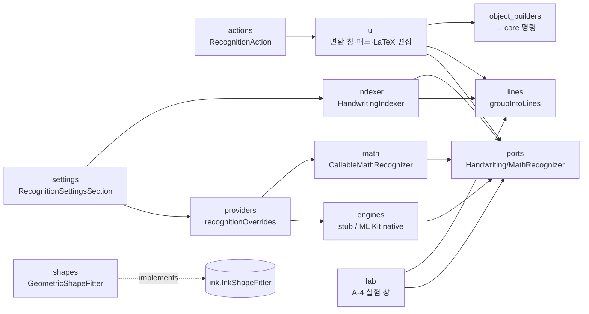

# 05 · LIBRARY (2차) — 라이브러리 화면 · 인식

> 상태: **승인 · 계약 v2.3** (2026-11-06 동시 개발 착수 — 계약 7.6.2 마지막 bullet·C22-09: 5.8 '가정'을 실제 타입으로 바꿈, v2.2·v2.3이 바꾼 문장의 인용 맞춤(4.3·5.3·5.9·9.3·부록 A의 V5 → **V5b**(C22-07), C23-07 `FakeInkShapeFitter.result`·`useInkTestFonts`·WidgetsBinding), 00-review '최종 승인' LIBRARY-F1~F3은 8.2·9.3·10 그대로 — 진행 기록 '## 2차' 절). 이전: **승인** (최종 승인 2026-11-05 · 통합 계약 **v2.2** — [00-review.md '최종 승인'](00-review.md#최종-승인), 이 영역의 개발 중 반영 항목은 그 절의 '영역별 개발 중 반영' 표) · 승인한 판본: 수정 2회차. 계약 v2.2(C22-01~09)가 바꾼 문장의 인용은 개발 착수 때 맞춘다(C22-09) — 그때까지 이 계획서와 계약이 다르면 계약이 우선이다. 이전 상태: **수정 2회차** (통합 계약 **v2.1** 기준 — 2026-11-05 현재 최신판, 변경 이력 C21-01~35. 수정 1회차: 총괄 검토 [00-review.md](00-review.md) 3.5 LIBRARY-M1~M11·공통 결정 CD2-01~25와 대리 검토 [reviews/library.md](reviews/library.md) 반영. 수정 2회차: 총괄 재검토 3건 — 에뮬레이터 완료 명령을 `npx --prefix functions firebase …`(INFRA 6.13 정식 경로)로, 취소 시험을 `MockClient.streaming` + 'cancel 전 `RequestAbortedException`' 경우로, `SyntheticShapes.rectanglePath` 크기 조건을 pt 기준으로. 항목별 반영 위치는 [13절](#13-검토-반영-내역) — 수정 2회차는 [13.4](#134-수정-2회차-총괄-재검토-3건)). 초안은 v2.0 기준이었다
>
> 작성 2026-11-05 · 수정 2026-11-05 · 영역 ID **LIBRARY** · 소유 경로 `packages/feature_library/`, `packages/ink_recognition/`(새) · 기준: [00-overview.md 7장 '통합 계약 v2.1'](00-overview.md)(변경 이력 7.9 C21-01~35 중 LIBRARY 몫: C21-01·02·07·09·13·14·15·17·18·19·20·24·26·29·30·31·32·33) — **이 문서와 7장이 다르면 7장이 우선**한다. 7장이 덮어쓰지 않은 곳은 1차 계약 v1.5(1차 통합 반영 — 시그니처는 v1.4와 같음, 1차 [00-overview.md](../00-overview.md) 7장)가 그대로 유효하다.
> 이어받는 문서: 1차 LIBRARY 계획서(승인, 계약 v1.4 — `/home/user/wt/library/docs/plans/05-library.md`, 이하 **'1차 계획서'**) · 바탕 코드(v2.1, CD2-01): **1차 통합 HEAD** `/home/user/noteapp` `18c5ae5`(브랜치 `claude/note-app-planning-bk29xb`). `packages/feature_library`의 `lib/`는 1차 영역 끝 `ec403be`(`/home/user/wt/library`, L0~L20)와 같고, 통합 커밋 `aabcabe`가 `test/integration/core_contract_test.dart`의 닫기 방식만 고쳐 L21이 실제 CORE에서 10건 통과했다(`git diff --stat ec403be 18c5ae5 -- packages/feature_library` — 그 파일 하나 [확인]). 통합 뒤 시험 수: VM 626 + 1 skip(골든 4장 포함), `integration` 10, Chrome(`test/web`) 17(1차 진행 기록 '통합 단계'). `lib/` 12,021줄, 읽기 전용으로 확인. 줄 번호 인용은 CD2-01대로 기반 단계 시작 때 고친다 · 조사: [01-hooks](research/01-hooks.md) 3.10·R6·R7 · [03-recognition](research/03-recognition.md) 전부 · [04-native](research/04-native.md) 요약 7·12, 4.3·7절 · [02-audio-stylus](research/02-audio-stylus.md)(해당 없음 — 확인만) · 판정 [judgement.md](drafts/judgement.md)
> 함께 본 영역 계획서(수정 1회차): [01-infra.md](01-infra.md)(4.6 `RecognitionModule`·주입 이음새·`recognition_wiring.dart`, 5.3, 5.9 R-1·R-3·R-4·R-7, 12.2 CP4·CP13·CP14), [02-core.md](02-core.md)(4.6, 5.5, 6.9.3 `stalePages`·`notesWithStalePages`, 6.9.4 `update`·경합 사례 1~7, 6.10), [03-ink.md](03-ink.md)(4.12 시험 도우미 `createTestPageController(shapeFitter:)`·`useInkTestFonts`, 4.13 R2-B3 표), [04-editor.md](04-editor.md)(4.3.1 자리 콜백 동기 시작·본문 `context`, 5.3, 6.7.4, 6.20 도형 표본 링 버퍼, 부록 A), [07-sync.md](07-sync.md)(6.8.11 에뮬레이터 규약·E1~E10, 6.9.1 수식 고정 자료 형식)
> 절 표기: 이 라운드 계약의 절은 **'7.x'**, 1차 계약의 절은 **'1차 7.x'**, 1차 계획서의 절은 **'1차 6.x'**로 적는다.
> 확인 표기: **(확인함)** 은 이 컨테이너에서 실행하거나 소스를 읽어 확인한 사실이고(임시 작업 `/tmp/claude-0/plan57-scratch/library57/`), **(미확인)** 은 구현·CI·실기기에서 다시 볼 사항이다. 계약과 다르게 해야 할 것은 바꾸지 않고 12.1 '계약 변경 제안'에만 적는다.

## 목차

1. 목적과 범위
2. PLAN.md 요구사항 대응표
3. 소유 경로와 패키지 구조
4. 공개 API
5. 사용하는 다른 영역의 계약
6. 설계 상세
7. 외부 패키지
8. 작업 분해
9. 테스트 계획
10. 완료 기준
11. 리스크와 대응
12. 총괄에게 묻는 질문 · 계약 변경 제안
13. 검토 반영 내역
- 부록 A. 확장 지점 · 자리 사용표 (개요 6장 13절)
- 부록 B. 네이티브 · 권한 요구표 (개요 6장 14절)
- 부록 C. 통합 시험용 위젯 키 (INFRA V5·V6)

---

## 1. 목적과 범위

### 1.1 목적

LIBRARY는 2차에 패키지 둘을 가진다(계약 2.1·2.3).

1. **`feature_library`(1차 패키지 확장)** — 1차의 제목 검색 화면에 **'노트 내용' 묶음**(손글씨·PDF·텍스트 상자·수식)을 더하고, 결과를 누르면 **그 페이지·그 위치**로 노트를 연다(`LibraryScreen.onOpenNoteAt`). 결과 순서·발췌·사각형은 CORE가 정하고 LIBRARY는 그대로 보인다(1차 L-1).
2. **`ink_recognition`(새 서비스 패키지, 전부 LIBRARY)** — M7 인식과 M5 자동 도형 판정의 **엔진 쪽 전부**: 손글씨 엔진 포트와 ML Kit 어댑터(`*_native.dart`, `as mlkit`), 웹 '지원 안 함', 모델 관리, 줄 나누기(`groupIntoLines`), 검색용 색인기(`HandwritingIndexer`), 수식 엔진 포트와 서버 호출 클라이언트(`CallableMathRecognizer`)·동의 게이트(G-3), 변환 UI(텍스트 변환 창·수식 입력 패드·LaTeX 편집 창), 도형 판정기(`GeometricShapeFitter` — INK 포트 구현), 인식 설정 섹션, 시험 가짜.

`ink_recognition`은 피처 패키지(`feature_editor` 등)를 import하지 않고, 피처 패키지도 이것을 import하지 않는다(계약 7.1 규칙 4). 에디터에 보이는 메뉴·창은 INFRA가 `RecognitionAction`을 `EditorSelectionMenuItem`·`EditorInsertMenuItem`으로 감싸 넣는다(X30). LIBRARY가 1차에 만든 검색 화면이 M7의 첫 소비자(손글씨 검색)라 한 손에 두었다(계약 2.3).

### 1.2 이번 범위

등급은 계약 3.4, 작업 ID는 8절이다. '웹'은 iPad Safari, 'APK'는 안드로이드 release APK, 'TF'는 TestFlight 뒤.

| # (계약 3.1) | 기능 | 패키지 | 등급 | 작업 | 웹 | 실기기 확인 |
|---|---|---|---|---|---|---|
| M7-2·3·4 | 검색 결과 '노트 내용' 묶음: 출처 배지(손글씨·PDF·텍스트·수식), 발췌 + 일치 강조, 쪽 번호, 노트별 묶기, 잘림 안내 | feature_library | P-A | L2-01·02·04 | ✔ | 웹 B-10 |
| M7-2·3·4 | 결과 → 그 페이지·위치로 열기(`onOpenNoteAt`, 사각형 = 일치 사각형 합집합) | feature_library | P-A | L2-03 | ✔ | 웹 B-10 |
| M7-2 | 손글씨 색인기 `HandwritingIndexer`(낡은 페이지 재인식 → (v2.1) `HandwritingRepository.update`로 저장된 값과 한 트랜잭션에서 병합 — G-4) — 완료 판정은 가짜 엔진 | ink_recognition | P-A | L2-10a·10b·11 | ✘ (웹에서는 돌지 않음 — G-1) | APK |
| M7-1·2 | `HandwritingTrace`, `groupIntoLines`, `SyntheticHandwriting` | ink_recognition | P-A | L2-05 | ✔ (순수 Dart) | — |
| 공통 | 포트·실패 타입·`UnsupportedHandwritingRecognizer`·`ManualOnlyMathRecognizer`·provider·`recognitionOverrides`·설정 키·문구 | ink_recognition | P-A | L2-07 | ✔ | — |
| M7-5 | 수식 객체 입력·편집 UI: LaTeX 직접 입력 + 미리보기(수식 입력 패드의 직접 입력 경로), 다시 편집, LaTeX 복사 | ink_recognition | P-A | L2-12·13·14 | ✔ | 웹 B-11 |
| M7-1·6 | 인식 설정 섹션: 언어·외부 전송 동의·자동 색인(P-A), 모델 받기·지우기(P-B) | ink_recognition | P-A / P-B | L2-18 | ✔ (웹은 '지원 안 함' 안내) | 웹, APK |
| M7-1 | ML Kit 어댑터·모델 관리(`ko`·`en`) | ink_recognition | P-B | L2-08 | ✘ | **APK가 첫 판정**, iPad는 TF 뒤 |
| M7-1 | 혼용 전략 B(두 모델 결과 고르기) 함수 — 실험 비교용 | ink_recognition | P-B | L2-09 | — | APK A-4 |
| M7-1 | 텍스트 변환 창: 후보 고르기·직접 편집·텍스트 상자로 바꾸기·복사 | ink_recognition | P-B | L2-15 | 창은 뜨고 '이 기기(웹)에서는…' 안내 | APK |
| M7-6 | `CallableMathRecognizer`(`package:http`, callable 규약)·동의 게이트 | ink_recognition | P-B | L2-16 (에뮬레이터 시험은 (v2.1) 통합 몫 L2-I6) | ✔ (엔진 연결 뒤) | Firebase·엔진 계정 뒤 |
| M7-6 | 수식 입력 패드 손글씨 경로(멈춤 1초 미리보기), 손글씨 → 수식 바꾸기(`recog.toMath`) | ink_recognition | P-B | L2-17a·17b | ✔ (엔진 연결 뒤) | 같음 |
| M7-6 | (v2.1, SYNC X-6) 수식 고정 자료 내보내기 — 수식 패드의 개발자 동작(07-sync 6.9.1 형식) | ink_recognition | P-C | L2-22 | ✔ | 엔진 비교 실험 때 |
| M5-6 | `GeometricShapeFitter`(INK `InkShapeFitter` 구현) — 합성 1,400개 V9, (v2.1) INK 멈춤 감지와의 흐름 시험(통합 L2-I3), 실기기 표본 판정·회귀 | ink_recognition | P-B | L2-06 | ✔ | 웹 B-4(문턱값 실제 획으로) |
| M7-1 | A-4 품질 실험 준비: 실험 창(문장 30줄·CER·지연·JSON 복사) | ink_recognition | P-B | L2-19 | ✘ | APK A-4 |
| 공통 | 웹 보장 G-1(ML Kit 미호출) Chrome 묶음 | 둘 다 | P-A | L2-20 | ✔ | — |

### 1.3 이후 범위 (이번에는 자리만 두거나 하지 않음)

| 항목 | 이유 · 자리 |
|---|---|
| 웹(iPad Safari) 손글씨 인식 — 서버 경유 이미지 OCR(조사 03 W2) | U5 기본값 '불필요'. 포트(`HandwritingRecognizer`) 뒤에 어댑터 하나로 더할 수 있다(`engineId`가 결과에 남음) |
| 수식 엔진 실제 호출·엔진 결정·비교 실험 실행(F-14 '직접 손글씨로 비교') | Firebase(Blaze)·로그인·엔진 계정 뒤(계약 3.1 M7-6). 이번에는 클라이언트 + 에뮬레이터 시험까지 |
| 획마다 실시간 수식 미리보기 | 멈춤 1초 뒤 1회(조사 03 Q7, 계약 3.6) |
| 낱말 단위 하이라이트 | ML Kit이 위치를 주지 않음(조사 03 3.5). 줄 사각형으로 한다 |
| 검색 결과 행의 다중 선택·끌기·⋯ 메뉴 | '노트 내용' 행은 라이브러리 항목이 아니다. 노트 머리 행을 누르면 노트가 열린다 |
| 출처별 필터·검색 기록 | 실사용 피드백 뒤(PLAN 5.2) |
| `cloud_functions` 전환·`idTokenProvider` 채우기 | 실연결 미니 라운드(계약 3.3·D10·D16) |
| 별·화살표 자동 판정 | 계약 3.6, U14 |

### 1.4 제외 (다른 영역 책임)

| 항목 | 담당 | LIBRARY와의 경계 |
|---|---|---|
| 인식 결과 엔티티·저장·`stalePages`·검색 색인(FTS5)·정규화·질의·발췌·점수·PDF 사각형 변환 | CORE | LIBRARY는 (v2.1) `HandwritingRepository.update`·`stalePages`·`notesWithStalePages`를 부르고 `LibrarySearchResult.pages`를 그대로 보인다. 병합 트랜잭션은 CORE, 병합 규칙(확정 줄 유지)은 recog(6.9.4) |
| 자동 도형 보정의 '멈춤 감지·미리보기·확정', 수식 렌더(`MathPreview`·`InkMathRenderer`), 텍스트 상자 높이 측정, 임시 페이지 그리기 | INK | LIBRARY는 판정만(`InkShapeFitter.fit`) 하고, 렌더·측정은 INK API를 부른다 |
| 선택 메뉴·삽입 메뉴 자리 UI, 실행기(`ExtensionRunner`), 결과 위치 깜빡임(`initialFocusRectPt`), 자동 도형 보정 켜기/끄기 설정 | EDITOR | LIBRARY는 자리 항목의 내용(`RecognitionAction`)만 만든다 |
| `RecognitionModule`·자리 변환(`RecognitionTarget` ↔ 문맥)·색인기 유휴 시작/종료·라우트 `?page=&focus=`·Podfile·Info.plist·기능 스위치·개발자 표시 섹션 | INFRA | LIBRARY는 14절(부록 B) 요구와 5.8 답을 준다 |
| `recognizeMath` 서버 함수·키 보호·에뮬레이터·엔진 비교 도구 | SYNC(`functions/`) | LIBRARY는 callable 형식(7.2.13) 클라이언트와 Dart 쪽 `emulator` 시험 |
| PDF 텍스트 색인기(`PdfSearchIndexer`) | PDF | 결과(`source: pdf`)를 보이기만 한다 |

### 1.5 1차 대비 바뀌는 LIBRARY 공개 표면 (7.0.1 중 LIBRARY 행)

| # | 변경 | 분류 | LIBRARY에서의 적용 |
|---|---|---|---|
| C2-26 | `LibraryScreen.onOpenNoteAt`(선택), `typedef LibraryOpenNoteAt` | 추가 | R2-B6에서 생성자·필드(받기만), 동작은 L2-03 |
| C2-11 | `LibrarySearchResult.pages`·`pagesTruncated` | 추가 + 규칙 | 소비만(CORE 정의). L2-01 |
| C2-01 | 새 패키지 `ink_recognition`(허용 의존 `note_core`·`ink_engine`) | 규칙 | INFRA R2-B1 골격 → R2-B6에서 계약 표면 |
| C2-28 | X21·X22·X27·X30~X32·X36, 동작 보장 G-1~G-3, override 행(`recognitionOverrides`) | 규칙 | 9.3 표로 시험에 묶음 |
| C2-29 | `native_only_imports`에 ML Kit 둘, R16(`feature_library`는 플러그인 없음) | 규칙 | ML Kit은 `src/engines/mlkit_recognizer_native.dart` 한 파일에서만 import |
| C2-30 | 설정 키 접두사 `recog.*`, `recog.mathConsent` | 규칙 | 4.4.3 |
| C2-31 | 태그 `emulator` | 규칙 | `ink_recognition/dart_test.yaml`에 선언·기본 skip(3.3) |

`feature_library`의 기존 공개 이름 11개(1차 4.1)는 그대로다. 새로 내보내는 이름은 `LibraryOpenNoteAt` 하나다.

(v2.1) v2.0 초안 대비 LIBRARY 표면·규칙이 바뀐 곳(7.9 변경 이력 — 모두 아직 아무도 구현하지 않은 2차 표면이거나 기본값이 있는 추가):

| # | 변경 | 분류 | LIBRARY에서의 적용 |
|---|---|---|---|
| C21-15 | `HandwritingIndexer(foreground:)`(CP-L10), 손글씨 변경 구독·`update`·신선함(`sourceRev` + 언어)·`notesWithStalePages` 주석, `HandwritingIndexerStatus`·`HandwritingIndexerPhase`(CP-L1), `recognitionDevOverlayLinesProvider`(CP-L2), `ensureModel`·`groupIntoLines`·`isVisible`·`copyText` 주석 | 추가 + 규칙 | 4.2 원문, 4.4.1·4.4.7·4.4.9, 6.9 |
| C21-09 | CORE `HandwritingRepository.update`·`notesWithStalePages`, `userConfirmed` 유지 규칙(규칙 주인 = recog 6.9.4), 신선함 정의 | 추가 + 규칙 | 5.2 원문, 6.9.3·6.9.4, 6.13.5 |
| C21-19 | G-2 보강(`stalePages` 먼저·줄 사이 양보), G-4(새 — `update` 병합·복사 경로 `flush`) | 규칙 | 5.1, 6.9, 6.13.5 |
| C21-30 | `testing.dart` 추가 멤버(CP-L4)·`SyntheticHandwriting` 획 id·`SyntheticShapes.rectanglePath`, 'words' 삭제 | 추가 | 4.3 원문, B6-b |
| C21-14 | 자리 콜백은 누름 처리 안에서 동기 시작·에디터 본문 `context`, 받는 쪽은 브라우저 API·`containerOf`를 첫 `await` 전에 | 규칙 | 5.4, 6.3, 6.13.6 |
| C21-07 | 새 명령 = 이름 있는 인자 + `const` + `label`, `RemoveElements.elementIds: List` | 규칙(2차 표면) | 5.2 원문, 6.13.4·6.15 `object_builders.dart` |
| C21-24 | recog 설정 키 4개 확정(CP-L9) | 규칙 | 4.4.3 |
| C21-26 | `emulator` 태그는 컨테이너(전역 잠금) + CI, 어댑터 자체 시험의 채널 가짜 허용, Chrome 시험 `useInkTestFonts` | 규칙 | 3.3, 6.7.5, 6.11.7, 9.1 |
| C21-17 | `strokes` 좌표·시간 기준(CP-L8), `engineVersion` = 실제 응답 판 | 규칙 | 5.6, 6.11.3 |
| C21-18 | X22에 `update`·`notesWithStalePages`, X30 `done` 규칙(CP-L3) | 규칙 | 5.1, 6.16 |
| C21-20 | `FEATURE_RECOGNITION=false`가 자동 도형 보정도 끔, 유휴 작업 순서(`recognition.indexer`는 마지막), 시험 이음새는 INFRA 모듈 주입 인자 | 규칙 | 5.5 |
| C21-31·32 | 통합 5단계에 도형 보정 흐름 시험(`ink_recognition/test/integration/`), V9 생성기·계산법, V13 컨테이너 기준 | 규칙 | 6.5·6.6, 8.3 |
| C21-33 | 7.8 A-4에 영어 모델, B-11 선택 메뉴 경로 복사 | 규칙 | 6.20, 9.4 |

### 1.6 핵심 결정 요약

| # | 결정 | 근거 |
|---|---|---|
| L2-D1 | '노트 내용' 묶음은 CORE `pages`를 **순서 그대로 노트별로 안정 묶음**(노트의 첫 등장 순서, 노트 안은 CORE 순서)하고 노트마다 3쪽까지 보인 뒤 '더 보기'로 편다 | 계약 7.2.11 주석 'Grouped by note, then page. Uses CORE results as-is' + 1차 L-1 |
| L2-D2 | 결과를 누르면 `focusRectPt` = 그 결과 `rects`의 합집합(비면 `null`), `onOpenNoteAt`이 없으면 `onOpenNote(noteId)` | 계약 7.2.11 `LibraryScreen.onOpenNoteAt` 주석 |
| L2-D3 | `groupIntoLines`: ① 가까운 획을 '글자 상자'로 합침(가로로 넓게·세로로 좁게 — (v2.1) E-L5) ② 글자 상자를 왼쪽부터 이웃 사슬로 줄에 붙임(기울어진 줄 대응) ③ 점·삐침 같은 작은 상자는 가까운 줄에 붙임 ④ 줄은 읽기 순서, 줄 안 획은 **쓴 시간 순서**. `gapFactor`의 단위는 글자 상자 높이의 중앙값(계약 주석 — CP-L7). (v2.1) 시제품이 좁힌 합성 자료(6.6)에서 획 정확도 99.97~100%·줄 수 차 ≤ 1(7.3 E-L5) | 조사 03 3.5(줄 단위·우리가 만든다), ML Kit은 획 순서가 입력 특징 [추측], E-L5 |
| L2-D4 | 색인기: 페이지마다 마지막 로컬 입력 3초 뒤(원격 변경은 30초 뒤), (v2.1) **`flush` → `stalePages` 먼저**(점 디코드 없음)·낡았을 때만 `loadPage`, 한 번에 한 줄·줄 사이 양보, **획 id 집합이 같은 줄은 다시 인식하지 않고 재사용**, 앱이 `resumed`가 아니면 줄 사이에서 멈춤. (v2.1) 쓰기는 `HandwritingRepository.update`(트랜잭션 안에서 저장된 최신 값과 병합 — 6.9.4), 작업 중인 페이지에 `handwriting` 변경이 오면 그 작업을 버리고 대기열 앞으로. 신선함 = `sourceRev` + 언어(엔진 판·기기는 보지 않음). 따라잡기 = `notesWithStalePages()` | G-2·G-4, 계약 7.2.5·7.2.11 (v2.1) 주석, 조사 03 3.5 '그 줄만 다시 인식', 검토 M-1·S-1·S-3·S-4 |
| L2-D5 | ML Kit 어댑터: 언어별 인식기 캐시, 호출 직렬화(FIFO), `PlatformException` → `RecognitionFailure` 표(6.7.3). 시험은 **메서드 채널 가짜로 VM에서**(확인함 — 7.3 E-L1) | 조사 03 7.4 '채널 인자 변환만 단위 시험' → 채널 전체 흐름까지 시험 가능함을 확인 |
| L2-D6 | iOS의 'Wi-Fi에서만'은 의존을 더하지 않고 **받기 전 두 번 누르기 경고**(같은 자리 단추 문구 — 대화상자 없음)로 지키며, iOS 색인기는 모델을 스스로 받지 않는다. (v2.1) 안드로이드에서 사용자가 누른 받기는 Wi-Fi를 기다리는 동안 [지금 셀룰러로 받기]를 준다(검토 S-9) | 계약 7.2.11 (v2.1) `ensureModel` 주석('on iOS the app asks before downloading'), 플러그인이 iOS에서 인자를 무시(조사 03 3.3), 12.2 Q2 승인 |
| L2-D7 | `CallableMathRecognizer`: `http.AbortableRequest`(취소), 동의를 **네트워크 전에** 확인(G-3), 보낼 것은 고른 영역의 획 + 그 영역 PNG(렌더러 자리가 있을 때), 획 JSON 512 KB를 넘으면 점을 줄인다 | 계약 7.2.13 입력 한도, G-3 |
| L2-D8 | 변환 UI는 recog 바닥 시트(`showModalBottomSheet`, 화면 높이 50% 이하)이고 `RecognitionAction.run`은 **예외를 밖으로 던지지 않는다**(실패는 시트 안 문구) | 7.4.10, G-1 |
| L2-D9 | `recog.copyText`는 선택이 획이면 인식 결과를(창의 [복사] 단추), 수식 객체 하나면 LaTeX를, 텍스트 상자 하나면 그 글을 시스템 클립보드에 넣는다 — PLAN F-14 'LaTeX 복사'를 계약 id 변경 없이. (v2.1) 바로 복사는 `run`의 **첫 `await` 전에** `Clipboard.setData`를 부르고 `containerOf`·`ScaffoldMessenger`도 첫 `await` 전에 잡는다. B-11에서 웹 붙여넣기가 실패하면 웹만 LaTeX 편집 창 경유로 바꾼다 | 계약 7.2.11 (v2.1, CP-L6) `copyText` 주석, 7.2.10 자리 콜백 동기 시작(CD2-15) |
| L2-D10 | '복사'(획을 남기는 경우)로 고친 줄은 `userConfirmed: true`로 쓰고, 페이지 전체를 다시 인식한 게 아니면 `sourceRev`를 낡은 값으로 둬 색인기가 나머지 줄을 채우게 한다. (v2.1) 클립보드에 먼저 넣은 뒤 `await store.flush()` → `loadPage`로 방금 쓴 획까지 보고, 쓰기는 `HandwritingRepository.update`(같은 병합 함수 — 6.9.4) | 계약 7.2.5, G-4, CORE 6.9.4 '확정 줄 규칙은 recog가 `transform` 안에서' |
| L2-D11 | `GeometricShapeFitter` = 조사 03 시제품 + 입력 평활화 + '약한 꼭짓점' 보정(삼각형·사각형의 닫힘 갈고리). 3개 시드에서 V9 문턱 모두 통과(확인함 — 7.3 E-L3) | V9 |
| L2-D12 | 수식 입력 패드 = INK `InkPageView` + 저장하지 않는 임시 `core.Page` + 펜을 뗀 뒤 1초 멈춤에 인식 + **손으로 고친 LaTeX가 엔진 결과보다 우선** | 계약 7.2.11 첫 글머리, F-14 '고쳐 쓰기·직접 편집' |
| L2-D13 | 설정 키 4개: `recog.language`(synced, `'ko'`), `recog.mathConsent`(synced, false), `recog.autoIndex`(device, ~~false~~ → **true** — 손글씨 검색 변경, 6.19a), `recog.modelWifiOnly`(device, true) | 7.4.4 (v2.1 확정 — CP-L9), U16(변경 — v2.9 C29-01) |
| L2-D14 | (v2.1) **확정 줄 유지 규칙**: 옛 확정 줄의 획 id ≥ 80%가 새 줄에 남고 더해진 글자 상자가 모두 그 줄 글자 높이 중앙값 이하면 확정 글을 그대로(`userConfirmed` 유지), 아니면 엔진 글 + `userConfirmed: false` + 옛 확정 글을 `alternatives` 맨 앞에. 색인기·변환 창·(실연결 뒤) 원격 결과가 같은 엔티티를 쓰므로 병합은 `update`의 `transform` 안에서 저장된 최신 값에 대해 한다 | 계약 7.2.5 (v2.1) `userConfirmed` 주석('Rule owner: recog'), 검토 M-1·S-2 |
| L2-D15 | (v2.1) 에뮬레이터 시험(`callable_emulator_test`)은 SYNC `functions/`가 병합된 뒤(통합 3단계 뒤)의 통합 몫 L2-I6이고, 완료 판정은 **컨테이너**의 `dart run tool/ws.dart with-heavy-lock -- npx --prefix functions firebase emulators:exec --config app/firebase.json --only functions,auth --project demo-noteapp "dart run tool/ws.dart test --run-skipped -t emulator --package ink_recognition"`(전역 잠금을 넘김 — (수정 2회차) `firebase`는 PATH에 없고 `functions/package.json` devDependency로만 고정되므로 `npx --prefix functions`로 그 판을 부른다, 01-infra 6.13과 같은 글자) + CI 반복. 단언은 SYNC 가짜 엔진 값(E1~E9)과 같다 | 계약 7.4.6·7.7.1 8단계·V13 (v2.1), 검토 S-6, 01-infra 6.13, 07-sync RQ-4 |
| L2-D16 | (v2.1) 자동 도형 보정 흐름 시험은 LIBRARY가 `ink_recognition/test/integration/shape_assist_flow_test.dart`에 INK `createTestPageController(shapeFitter:)`로 쓴다(INK 패키지 시험은 `ink_recognition`을 import할 수 없음). 실기기 도형 표본의 판정·회귀도 LIBRARY, 모으기는 EDITOR 링 버퍼(12.2 Q7) | 계약 7.7.1 5단계 (v2.1), 검토 S-7 |

---

## 2. PLAN.md 요구사항 대응표

### 2.1 기능 명세 (PLAN 4장)

| PLAN | 요구 | 이번 처리 | 작업 | 완료 판정 시험 |
|---|---|---|---|---|
| F-10 | 올가미로 선택한 손글씨를 텍스트로 변환 → 텍스트 상자로 바꾸기 | `recog.toText` → 텍스트 변환 창 → `CompositeCommand([RemoveElements, AddObjects([TextBoxObject])])` 한 번 | L2-12·15 | `widget/conversion_sheet_test.dart` |
| F-10 | … 또는 클립보드로 복사 | `recog.copyText`(획 → 창 → [복사], 고친 줄 `userConfirmed` — (v2.1) `flush` 뒤 `update`로 병합) | L2-15 | 같음 |
| F-10 | 한국어 + 영어 혼용 인식 필수 | ML Kit `ko` 기본 + 창의 언어 바꾸기(전략 A + D), 전략 B 함수는 실험 비교용 | L2-08·09·15·19 | `native/mlkit_adapter_test.dart`, `unit/mixed_language_test.dart`, 실기기 A-4 |
| F-10 | 후보 단어 선택, 직접 편집 | 줄마다 후보 칩(≤ 5) + 편집 칸 | L2-15 | `widget/conversion_sheet_test.dart` |
| F-10 | 엔진: ML Kit(기기 안) | `*_native.dart` 어댑터, 웹은 `RecognizerUnsupported` | L2-07·08 | `native/mlkit_adapter_test.dart`, `web/recognition_browser_test.dart` |
| F-10 | 같은 인식 결과로 손글씨 검색 색인 | `HandwritingIndexer` → (v2.1) `HandwritingRepository.update`(저장된 값과 병합, CORE가 색인) | L2-10a·10b·11 | `unit/indexer_test.dart`·`unit/indexer_merge_test.dart`, 통합 `integration/real_core_indexer_test.dart` |
| F-11 | 자동 도형 보정: 손으로 그리고 멈추면 반듯한 도형 | 판정기 `GeometricShapeFitter`(발동·미리보기·확정은 INK·EDITOR) | L2-06, L2-I3 | `unit/shape_fitter_test.dart`(V9), (v2.1) 통합 `integration/shape_assist_flow_test.dart`(INK 멈춤 감지와 함께) |
| F-14 | 수식 입력 영역에 손으로 쓰면 LaTeX로 인식 → 깔끔한 수식 | 수식 입력 패드 → `MathRecognizer` → `MathPreview` → `AddObjects(objects: [MathObject])` | L2-14·16·17a | `widget/math_pad_engine_test.dart` |
| F-14 | 쓰는 중 실시간 미리보기 | 펜을 뗀 뒤 1초 멈춤마다 인식(계약 7.2.11). (v2.1) `MathPreview`는 R2-B3부터 실제 `Math.tex` 동작이라 미리보기를 기반 단계부터 실제로 단언 | L2-17a | 같음(fakeAsync 999 ms / 1,000 ms) |
| F-14 | 잘못 인식된 부분 고쳐 쓰기 | 패드에서 마지막 획 되돌리기·획 지우개·다시 쓰기 → 다시 인식 | L2-17a | 같음 |
| F-14 | LaTeX 직접 편집 | 패드·LaTeX 편집 창의 입력 칸(검증 `InkMathRenderer.validate`) | L2-13·14 | `widget/latex_editor_sheet_test.dart`, `widget/math_pad_manual_test.dart` |
| F-14 | 수식 객체: 다시 편집 | `recog.editMath` → `UpdateObjects` | L2-13 | `widget/latex_editor_sheet_test.dart` |
| F-14 | 수식 객체: 이동·크기·색 변경 | EDITOR 선택 공통(1.4) | — | EDITOR |
| F-14 | LaTeX 복사 → 다른 문서에 붙여넣기 | `recog.copyText`(수식 객체 → LaTeX), LaTeX 편집 창 'LaTeX 복사' | L2-12·13 | `unit/recognition_actions_test.dart`, `widget/latex_editor_sheet_test.dart` |
| F-14 | 엔진 교체 가능한 구조, 키는 서버 함수 | `MathRecognizer` 포트 + `CallableMathRecognizer`(키 없음), 엔진은 서버가 고름(`engine: 'auto'`) | L2-16, L2-I6 | `unit/callable_math_recognizer_test.dart`, `emulator/callable_emulator_test.dart`(통합 몫 — 컨테이너 잠금 + CI) |
| F-14 | 'M7 착수 시 직접 손글씨로 비교해 결정'(엔진 비교 자료) | (v2.1) 설정 › 인식 › 품질 실험 [수식 고정 자료 만들기] → 수식 패드 고정 자료 모드 → SYNC 6.9.1 형식 JSON(비교 도구 `math_eval.ts`가 읽음 — 웹 포함) | L2-22 (P-C) | `unit/math_fixture_export_test.dart` |

### 2.2 추가 기능 (PLAN 5장) · 아키텍처 (7장) · 리스크 (12장)

| PLAN | 요구 | 이번 처리 | 작업 |
|---|---|---|---|
| 5.1 검색 | 노트 제목 → PDF 텍스트 → 손글씨 내용 순으로 확장 | 제목(1차) + '노트 내용' 묶음(PDF·손글씨·텍스트 상자·수식) | L2-01~04 |
| 5.2 | 손글씨 검색 (M7) | 색인기(네이티브) + 결과 UI(웹·네이티브). 웹은 실연결 뒤 동기화된 결과로 | L2-02·10 |
| 5.1 올가미 | 손글씨→텍스트·수식 변환도 '선택'이 전제 | 선택 메뉴 자리 항목 4개(`recog.*`) | L2-12 |
| 6.2 세부 스택 | 손글씨 인식 `google_mlkit_digital_ink_recognition`, 수식 렌더 `flutter_math_fork` | ML Kit 0.16.1(`as mlkit`), 수식 렌더는 INK `MathPreview` 사용 | L2-08·13 |
| 7.6 | 유료가 될 기능은 기능 스위치 | INFRA `FEATURE_RECOGNITION`·`FEATURE_MATH_ENGINE`(꺼지면 `recognitionOverrides`·동작 기여 없음) — LIBRARY 패키지는 스위치를 모른다 | — (V15) |
| 12장 | 한국어 손글씨 인식률 → 후보 선택 UI, 필요 시 상용 엔진 | 후보 칩·직접 편집, 엔진 포트(`engineId` 기록) | L2-15 |
| 12장 | 수식 인식 정확도·비용 → 엔진 비교, 교체 구조 | 포트 + 서버가 엔진 선택, 비교 도구는 SYNC | L2-16 |

### 2.3 로드맵 체크리스트 (PLAN 10장)

| 항목 | LIBRARY 몫 | 완료 조건 |
|---|---|---|
| M5 '도형 도구 + 자동 도형 보정' | 판정기(L2-06) | V9 + INK·EDITOR 연결(통합) + 웹 B-4 |
| M7 '손글씨 → 텍스트 (한국어 + 영어)' | L2-07·08·09·15·19 | 컨테이너 시험 + **APK A-4**(iPad는 TF 뒤 C-3) |
| M7 '손글씨 검색 색인' | L2-01~05·10·11 | 컨테이너 시험(V9·V10 일부) + APK(색인 → 검색) |
| M7 '수식 인식 엔진 비교 → 손글씨 수식 → LaTeX → 수식 렌더링' | 클라이언트·패드·편집 창(L2-13·14·16·17) | 렌더·직접 입력은 웹 B-11. 엔진 비교·손글씨 인식 판정은 Firebase·엔진 계정 뒤 |

---

## 3. 소유 경로와 패키지 구조

### 3.1 `packages/feature_library/` (1차 트리에 더하는 것만 표시)

```text
packages/feature_library/
├─ lib/
│  ├─ feature_library.dart                 [변경] + LibraryOpenNoteAt
│  └─ src/
│     ├─ library_screen.dart               [변경] onOpenNoteAt (4.1), LibraryScope.openNoteAt 전달
│     ├─ l10n/library_strings.dart         [변경] 내용 묶음 문구·검색 힌트 (6.21)
│     ├─ model/
│     │  ├─ content.dart                   [변경] LibraryContent.contentGroups·contentTruncated
│     │  └─ content_hits.dart              [새] ContentHitGroup, groupContentHits, focusRectOf, sourceLabelOf
│     ├─ state/providers.dart              [변경] 검색 무효화 종류 확장(1 s 디바운스), notePageIndexProvider
│     ├─ state/search_requery.dart         [새] searchRequeryOf — 변경 묶음 → 즉시·디바운스·없음 (6.1.6)
│     └─ ui/
│        ├─ library_scope.dart             [변경] openNoteAt
│        ├─ top_bar/library_search_field.dart   [변경] 힌트 '노트 검색'
│        └─ content/
│           ├─ search_results_view.dart    [변경] '노트 내용 (n)' 묶음 슬리버
│           └─ content_hits_view.dart      [새] ContentNoteHeader, ContentHitRow, SourceBadge, SnippetText, ContentMoreRow
│                                          #   (동시 개발 보완 1.1 — 초안 이름 content_hit_tiles.dart를 실제 파일 이름으로)
└─ test/
   ├─ unit/content_hits_test.dart           [새] L2-01
   ├─ unit/content_provider_test.dart       [변경] L2-01 (내용 묶음·무효화)
   ├─ unit/api_surface_test.dart            [변경] B6-a (LibraryOpenNoteAt)
   ├─ unit/strings_contract_test.dart       [변경] L2-02 (힌트·묶음 이름은 계약 문장 아님 — 회귀용)
   ├─ widget/content_search_test.dart       [새] L2-02·03
   ├─ widget/a11y_test.dart                 [변경] L2-04 (내용 행 44×44·의미 라벨)
   ├─ goldens/library_golden_test.dart      [변경] L2-04 (+ library_search_content.png)
   ├─ shared/library_scenarios.dart         [변경] L2-04 (+ '내용 검색 → 위치로 열기' 시나리오)
   ├─ support/library_test_harness.dart     [변경] L2-03 (NavigationLog.openNoteAt)
   ├─ support/fixtures.dart                 [변경] L2-01 (seedContentHits: 텍스트 상자·수식·손글씨 결과)
   └─ integration/core_contract_test.dart   [변경] L2-I2 (내용 검색 시나리오가 실제 CORE에서도)
```

- 1차 `pubspec.yaml`은 바뀌지 않는다(새 의존 없음 — R16 '피처 패키지에 플러그인 없음'). `ink_recognition`·`ink_engine`을 import하지 않는다(허용 의존 `[note_core]` 그대로, 계약 7.1).

### 3.2 `packages/ink_recognition/` (새 — INFRA R2-B1 골격 위에)

```text
packages/ink_recognition/
├─ pubspec.yaml                            # R2-B1 (INFRA) — 3.3
├─ README.md                               # 진입점·웹/네이티브 경계·ML Kit 규칙(as mlkit) 한 단락
├─ dart_test.yaml                          # tags: golden, integration(skip), emulator(skip) — 3.3
├─ lib/
│  ├─ ink_recognition.dart                 # public, web-safe (4.2 내보내기 목록)
│  ├─ testing.dart                         # test only: FakeHandwritingRecognizer, FakeMathRecognizer, SyntheticHandwriting,
│  │                                       #   (v2.1) SyntheticShapes (4.3) — bodies in src/testing/
│  └─ src/
│     ├─ model/
│     │  ├─ handwriting_trace.dart         # HandwritingTrace, HandwritingLineInput (6.4)
│     │  ├─ candidates.dart                # TextCandidate, RecognitionModelState
│     │  ├─ failures.dart                  # RecognitionFailure + 7 subclasses
│     │  └─ math_types.dart                # MathInput, MathResult
│     ├─ ports/
│     │  ├─ handwriting_recognizer.dart    # HandwritingRecognizer, UnsupportedHandwritingRecognizer
│     │  ├─ math_recognizer.dart           # MathRecognizer, ManualOnlyMathRecognizer
│     │  ├─ model_admin.dart               # (internal) RecognizerModelAdmin — 모델 지우기·변경 알림 (6.7.4)
│     │  └─ line_origin.dart               # (internal) PageOriginLineRecognizer — A-4 좌표 기준 비교(페이지 pt 그대로, 6.20)
│     ├─ lines/
│     │  ├─ group_into_lines.dart          # groupIntoLines (6.5)
│     │  ├─ glyph_boxes.dart               # (internal) 글자 상자, estimateGlyphHeight
│     │  └─ line_tuning.dart               # (internal) 줄 나누기 상수
│     ├─ engines/
│     │  ├─ platform_recognizer.dart       # 조건부 export: createPlatformHandwritingRecognizer()
│     │  ├─ platform_recognizer_stub.dart  # 웹·dart:io 없음 → UnsupportedHandwritingRecognizer
│     │  ├─ mlkit_recognizer_native.dart   # ML Kit 어댑터 — ML Kit import는 이 파일 하나 (6.7)
│     │  ├─ mlkit_errors.dart              # (internal, 순수) PlatformException → RecognitionFailure 표
│     │  └─ mixed_language.dart            # (internal) 전략 B 고르기 함수 (6.8)
│     ├─ math/
│     │  ├─ callable_math_recognizer.dart  # (internal) CallableMathRecognizer (6.11)
│     │  ├─ callable_protocol.dart         # (internal) 요청·응답·오류 변환 (RequestAbortedException 먼저 — 6.11.4)
│     │  ├─ math_payload.dart              # (internal) 획 → JSON, 점 줄이기, 512 KB 한도
│     │  ├─ math_fixture_export.dart       # (internal, v2.1 P-C) 패드 획 → 07-sync 6.9.1 고정 자료 JSON (6.14.7)
│     │  └─ math_png.dart                  # (internal) 고른 획 → pngBase64(pageThumbnailRendererProvider가 있을 때만 — 6.11.3)
│     ├─ shapes/
│     │  ├─ geometric_shape_fitter.dart    # GeometricShapeFitter (6.17)
│     │  ├─ shape_fit_tuning.dart          # ShapeFitTuning
│     │  ├─ shape_classifier.dart          # (internal) 시제품 판정(평활화·꼭짓점·타원)
│     │  └─ shape_beautify.dart            # (internal) 판정 → core.ShapeGeometry (축 맞춤·각 맞춤)
│     ├─ indexer/
│     │  ├─ handwriting_indexer.dart       # HandwritingIndexer (6.9)
│     │  ├─ indexer_status.dart            # HandwritingIndexerStatus, HandwritingIndexerPhase (4.4.1 — v2.1 계약)
│     │  ├─ line_reuse.dart                # (internal, 순수) 줄 재사용·확정 줄 유지 규칙·update 병합 함수 (6.9.4)
│     │  ├─ indexer_metrics.dart           # (internal, v2.1) 작업 시간·줄 수 — 개발자 표시 줄용 (6.9.7)
│     │  ├─ catch_up.dart                  # (internal, v2.1) notesWithStalePages 따라잡기 (6.9.5 — note_walk 대체)
│     │  └─ page_queue.dart                # (internal) 페이지 대기열 — 다시 넣은 페이지 → 조용해진 페이지 → 따라잡기 (6.9.2)
│     ├─ providers.dart                    # handwritingRecognizerProvider, mathRecognizerProvider, RecognitionConfig,
│     │                                    #   recognitionOverrides, handwritingIndexerProvider,
│     │                                    #   (v2.1) recognitionDevOverlayLinesProvider (6.10)
│     ├─ actions/
│     │  ├─ recognition_actions.dart       # RecognitionTarget, RecognitionAction, 동작 목록 두 개 (6.16)
│     │  ├─ action_scope.dart              # (internal) BuildContext → ProviderContainer 읽기, 시트 띄우기
│     │  └─ object_builders.dart           # (internal) 획 → TextBoxObject / MathObject (6.13.4·6.15.3)
│     ├─ ui/
│     │  ├─ recognition_sheet.dart         # (internal) showRecognitionSheet — 7.4.10 높이 규칙 + 시트 공용 부품
│     │  │                                 #   (RecognitionSheetHeader·SheetNotice·ConsentCard — G-3 동의 안내)
│     │  ├─ recognition_sheets.dart        # (internal) 동작 → 시트 이음매 RecognitionSheets·DefaultRecognitionSheets (6.16)
│     │  ├─ conversion_sheet.dart          # 텍스트 변환 창 (6.13)
│     │  ├─ math_pad_sheet.dart            # 수식 입력 패드 (6.14)
│     │  ├─ math_pad_canvas.dart           # (internal) InkPageView + 임시 Page + 입력
│     │  ├─ latex_editor_sheet.dart        # LaTeX 편집 창 (6.15)
│     │  ├─ model_row.dart                 # (internal) RecognitionModelRow — 모델 한 줄(설정·실험 창·변환 창 모델 카드 공용)
│     │  └─ model_downloads.dart           # (internal) ModelDownloads — 사용자가 시작한 모델 받기(Wi-Fi 대기·셀룰러 — 6.7.4)
│     ├─ settings/
│     │  ├─ recognition_settings_keys.dart # RecognitionSettingsKeys (4.4.3)
│     │  └─ recognition_settings_section.dart  # RecognitionSettingsSection (6.18)
│     ├─ lab/
│     │  ├─ lab_sentences.dart             # (internal) A-4 문장 30줄
│     │  ├─ char_error_rate.dart           # (internal) 문자 오류율(CER)
│     │  └─ recognition_lab_sheet.dart     # (internal) 실험 창 (6.20)
│     ├─ l10n/recognition_strings.dart     # 모든 한국어 문구 (6.21)
│     ├─ common/report_error.dart          # FlutterError.reportError(library: 'ink_recognition')
│     ├─ common/engine_ids.dart            # (v2.1) ML Kit 엔진 id 상수 한 곳 — 플러그인 판과 함께 바꿈 (6.7.2)
│     └─ testing/                          # testing.dart 본문(가짜 엔진·SyntheticHandwriting·SyntheticShapes)
└─ test/
   ├─ ink_recognition_smoke_test.dart      # B6-b
   ├─ unit/  api_surface_test · handwriting_trace_test · fakes_test · group_into_lines_test ·
   │         synthetic_handwriting_test · synthetic_shapes_test · shape_fitter_test · shape_geometry_test ·
   │         mixed_language_test · mlkit_errors_test · callable_math_recognizer_test · math_payload_test ·
   │         math_fixture_export_test · indexer_test · indexer_merge_test · line_reuse_test · catch_up_test ·
   │         indexer_provider_test · recognition_overrides_test · recognition_actions_test ·
   │         object_builders_test · settings_keys_test · strings_contract_test · char_error_rate_test ·
   │         shape_real_samples_test(@TestOn('vm') — 파일을 읽음, 표본 폴더가 비면 건너뜀)
   ├─ native/mlkit_adapter_test.dart       # @TestOn('vm') — 메서드 채널 가짜 (6.7.5)
   ├─ widget/ conversion_sheet_test · latex_editor_sheet_test · math_pad_manual_test ·
   │          math_pad_engine_test · to_math_test · settings_section_test · recognition_lab_test ·
   │          sheet_rules_test
   ├─ shared/ line_cases.dart · shape_cases.dart · trace_cases.dart   # VM·Chrome 공유 본문
   ├─ web/recognition_browser_test.dart    # @TestOn('browser') — G-1·공유 본문·웹 시트 문구
   ├─ emulator/callable_emulator_test.dart # @Tags(['emulator']) — V13, 통합 몫 L2-I6 (컨테이너 전역 잠금 + CI)
   ├─ integration/real_core_indexer_test.dart   # @Tags(['integration']) — 실제 CORE 색인 (L2-I1)
   ├─ integration/shape_assist_flow_test.dart   # (v2.1) @Tags(['integration']) — INK createTestPageController
   │                                            #   (shapeFitter: GeometricShapeFitter()) 멈춤 → addShape (L2-I3)
   ├─ fixtures/real/                       # (U18 승인 뒤) 실기기 도형 표본 JSON {kind, points, viewScale} — EDITOR 링 버퍼가 모음
   ├─ fixtures/lines/                      # (v2.1) 줄 나누기 경계 사례 손 고정 자료(촘촘한 줄·서로 다른 기울기·떨어진 자모 — 6.5)
   └─ support/ recognition_test_scope.dart · indexer_harness.dart · recording_store.dart · model_engine.dart   # 9.2
```

- `lib/`에 `dart:io`가 없다. ML Kit(`google_mlkit_*`)은 `mlkit_recognizer_native.dart`에서만 import한다(`native_only_imports`, R4②). 플랫폼 판정은 `kIsWeb` + `defaultTargetPlatform`만 쓴다(7.4.1 — `Platform` 금지).
- 내보내지 않는 `src/` 파일은 이름을 구현자가 바꿔도 된다. 계약 이름(4.2)과 4.4의 LIBRARY 세부 이름만 고정이다.
- (동시 개발 보완 1.1 — 위 트리를 실제 파일에 맞춤) 초안의 `ui/consent_card.dart`·`ui/model_card.dart`는 따로 두지 않았다: 동의 카드 `ConsentCard`는 시트 공용 부품과 함께 `ui/recognition_sheet.dart`에, 변환 창의 모델 카드는 `ui/conversion_sheet.dart`가 `ui/model_row.dart`의 `RecognitionModelRow`(+ `ui/model_downloads.dart`)로 그린다. 구현 중 더한 내부 파일 `ports/line_origin.dart`·`math/math_png.dart`·`indexer/page_queue.dart`·`ui/recognition_sheets.dart`·`test/shared/trace_cases.dart`와 시험 도우미(9.2)도 트리에 넣었다. 진행 기록 `docs/plans/progress/library.md` '계획과 다르게 한 점'에 같은 내용.

### 3.3 pubspec.yaml · dart_test.yaml

`ink_recognition/pubspec.yaml`은 INFRA가 R2-B1에서 만든 것(01-infra 3.3)을 그대로 쓴다 — 의존: `flutter`, `note_core: any`, `ink_engine: any`, `flutter_riverpod 3.4.3`, `material_ui 1.10.0`, `meta 1.19.0`, `collection 1.19.1`, `google_mlkit_digital_ink_recognition 0.16.1`, `http 1.6.0` / dev `flutter_test`, `fake_async 1.3.3`. **`google_mlkit_commons`는 직접 의존으로 더하지 않는다** — `google_mlkit_digital_ink_recognition.dart`가 `google_mlkit_commons.dart`를 다시 내보내므로 `ModelManager`까지 한 import로 쓴다(확인함 — `lib/google_mlkit_digital_ink_recognition.dart` 1행 `export 'package:google_mlkit_commons/google_mlkit_commons.dart';`). 01-infra 3.3의 '직접 import하면 더한다' 조건에 해당하지 않는다.

`feature_library/pubspec.yaml`은 1차 그대로다.

```yaml
# packages/ink_recognition/dart_test.yaml — contract 7.4.6 (R15: every tag used is declared here)
tags:
  golden: {}
  integration: {skip: "integration stage only — ws test --run-skipped -t integration"}
  emulator: {skip: "functions emulator only — ws with-heavy-lock -- npx --prefix functions firebase emulators:exec … ws test --run-skipped -t emulator (container + CI; 05-library 6.11.7)"}
```

`feature_library/dart_test.yaml`은 1차 그대로(`golden`, `integration`).

### 3.4 웹 · 네이티브 경계

| 파일 | 웹(dart2js) | 네이티브 | 고르는 방법 |
|---|---|---|---|
| `engines/platform_recognizer.dart` | `platform_recognizer_stub.dart` → `UnsupportedHandwritingRecognizer` | `mlkit_recognizer_native.dart` → 안드로이드·iOS면 ML Kit, 그 밖 플랫폼(데스크톱)이면 `UnsupportedHandwritingRecognizer` | `export 'platform_recognizer_stub.dart' if (dart.library.io) 'mlkit_recognizer_native.dart';` (확인함 — 7.3 E-L1: Chrome은 stub, VM은 native) |
| `math/callable_math_recognizer.dart` | `package:http` `BrowserClient` | `IOClient` | `http.Client()` 기본 생성자(패키지가 고름) |
| 나머지 전부 | 같음 | 같음 | 순수 Dart + Flutter |

- VM 시험(`flutter test`)은 `dart.library.io`가 참이고 `defaultTargetPlatform`이 기본 `android`라 **ML Kit 어댑터가 골라진다**. 채널을 부르기 전까지는 아무 일도 하지 않으므로 provider 시험이 안전하고, 채널을 부르는 시험은 메서드 채널 가짜를 건다(6.7.5).
- 웹 시험은 `test/web/`(Chrome)에서 stub이 골라지는 것과 ML Kit 채널을 한 번도 부르지 않는 것을 확인한다(G-1).

---

## 4. 공개 API

이 절의 코드 블록 중 **'계약 원문'** 이라고 적은 것은 계약 7장을 글자 그대로 옮긴 것이다(고치지 않는다). 계약이 이름만 두었거나 LIBRARY에 맡긴 세부는 4.4에 따로 적고, 계약과 다르게 하고 싶은 것은 12.1에만 적는다. 본문이 없는 메서드(`;`로 끝남)는 시그니처만 적은 것이다.

### 4.1 `feature_library`

`// 계약 v2.1 7.2.11 원문` (v2.0과 같음)

```dart
// feature_library — 추가
typedef LibraryOpenNoteAt = void Function(String noteId, String pageId, Rect? focusRectPt);
class LibraryScreen extends ConsumerStatefulWidget {
  const LibraryScreen({/* v1.4 */, this.onOpenNoteAt});
  /// Content search hit → page + rect (page pt). null → onOpenNote(noteId) (page ignored).
  final LibraryOpenNoteAt? onOpenNoteAt;
}
// Search results view: groups '폴더' · '노트' (v1.4) + '노트 내용' (PageSearchHit, source badge
// 손글씨 / PDF / 텍스트 / 수식). Grouped by note, then page. Uses CORE results as-is (L-1).
```

LIBRARY 세부 — 생성자의 `/* v1.4 */`를 펼친 모양과 내보내기:

```dart
// lib/src/library_screen.dart (v2)
typedef LibraryOpenNoteAt = void Function(String noteId, String pageId, Rect? focusRectPt);

class LibraryScreen extends ConsumerStatefulWidget {
  const LibraryScreen({
    super.key,
    this.folderId,                    // v1.4
    required this.onOpenFolder,       // v1.4
    required this.onOpenNote,         // v1.4
    required this.onOpenSettings,     // v1.4
    this.onOpenNoteAt,                // v2.0
  });
  final String? folderId;
  final ValueChanged<String?> onOpenFolder;
  final ValueChanged<String> onOpenNote;
  final VoidCallback onOpenSettings;
  /// Content search hit → page + rect (page pt). null → onOpenNote(noteId) (page ignored).
  final LibraryOpenNoteAt? onOpenNoteAt;
}

// lib/feature_library.dart — 1차 목록(11개) 그대로 + LibraryOpenNoteAt
export 'src/library_screen.dart' show LibraryScreen, LibraryOpenNoteAt;
```

- `focusRectPt`에 넘기는 값은 결과 `PageSearchHit.rects`의 합집합(노트 페이지 pt)이고, `rects`가 비면 `null`이다(L2-D2, 6.1.4).
- 노트 머리 행(제목)을 누르면 1차처럼 `onOpenNote(noteId)`만 부른다(페이지 없음).

### 4.2 `ink_recognition` — 계약 원문

`// 계약 v2.1 7.2.11 원문`

```dart
// package:ink_recognition/ink_recognition.dart — web-safe entry (ML Kit only behind *_native.dart)

// --- inputs / outputs (pure Dart) ---
final class HandwritingTrace {                   // one stroke; page pt; absolute ms
  const HandwritingTrace({required this.xs, required this.ys, required this.ts, this.strokeId});
  factory HandwritingTrace.fromStroke(core.Stroke stroke);   // ts = createdAt + t(i)
  final Float32List xs, ys;
  final Float64List ts;                          // Float64List, NOT Int64List (dart2js, 1차 7.4.3 웹 안전 수치)
  final String? strokeId;
}
final class HandwritingLineInput {
  const HandwritingLineInput(this.traces, {this.preContext = '', this.writingAreaPt});
  final List<HandwritingTrace> traces; final String preContext; final Size? writingAreaPt;
}
@immutable final class TextCandidate {
  const TextCandidate(this.text, {this.score, required this.languageTag});
  final String text; final double? score;        // engine-specific; never compared across engines
  final String languageTag;
}
enum RecognitionModelState { notDownloaded, downloading, ready, unsupported }
sealed class RecognitionFailure implements Exception {}
final class RecognizerUnsupported extends RecognitionFailure {}          // web + ML Kit, manual-only math
final class ModelNotReady extends RecognitionFailure { ModelNotReady(this.languageTag); final String languageTag; }
final class RecognizerOffline extends RecognitionFailure {}
final class RecognizerQuotaExceeded extends RecognitionFailure {}
final class RecognizerCancelled extends RecognitionFailure {}
final class RecognizerConsentRequired extends RecognitionFailure {}   // math engine before recog.mathConsent (G-3)
final class RecognizerEngineError extends RecognitionFailure {
  RecognizerEngineError(this.code, this.message); final String code, message; }

abstract interface class HandwritingRecognizer {
  String get engineId;                           // 'mlkit-digital-ink/19.0.0', 'fake'
  bool get isAvailable;                          // false on web
  Future<RecognitionModelState> modelState(String languageTag);
  /// (v2.1) Android honours wifiOnly (the download waits for Wi-Fi); the iOS plugin ignores it —
  /// on iOS the app asks before downloading (two-press warning, 05-library Q2).
  Future<void> ensureModel(String languageTag, {bool wifiOnly = true});
  Future<List<TextCandidate>> recognizeLine(HandwritingLineInput line, {required String languageTag});
  Future<void> dispose();
}
final class MathInput {
  const MathInput({required this.traces, this.png, this.pngPxPerPt});
  final List<HandwritingTrace> traces; final Uint8List? png; final double? pngPxPerPt;
}
@immutable final class MathResult {
  const MathResult({required this.latex, this.confidence, this.alternatives = const [],
      required this.engineId, required this.latency});
  final String latex; final double? confidence; final List<String> alternatives;
  final String engineId; final Duration latency;
}
abstract interface class MathRecognizer {
  String get engineId;
  bool get isAvailable;                          // ManualOnlyMathRecognizer: false (LaTeX typing only)
  Future<MathResult> recognize(MathInput input, {Future<void>? cancel});
}
/// Pure Dart line grouping (search indexing AND lasso conversion use the same function).
/// (v2.1, CP-L7) Lines in reading order, strokes in a line by first-sample time; gapFactor = the
/// horizontal gap that still joins a line ÷ the median glyph-box height; deterministic.
List<List<HandwritingTrace>> groupIntoLines(List<HandwritingTrace> traces, {double gapFactor = 1.2});
/// Geometric fitter (03-recognition 4.3 prototype) — implements INK's port.
final class GeometricShapeFitter implements ink.InkShapeFitter { const GeometricShapeFitter({this.tuning = const ShapeFitTuning()}); }
@immutable final class ShapeFitTuning { /* every threshold in one place (03-recognition R4) */ }

// --- providers: overridden ONLY through recognitionOverrides() ---
final handwritingRecognizerProvider = Provider<HandwritingRecognizer>(
    (ref) => const UnsupportedHandwritingRecognizer(), name: 'handwritingRecognizerProvider');
final mathRecognizerProvider = Provider<MathRecognizer>(
    (ref) => const ManualOnlyMathRecognizer(), name: 'mathRecognizerProvider');
@immutable final class RecognitionConfig {
  const RecognitionConfig({this.mathEndpoint, this.idTokenProvider});
  final Uri? mathEndpoint;                       // callable URL (emulator in dev); null → manual only
  final Future<String?> Function()? idTokenProvider;   // M4 auth later; null → no Authorization header
}
/// web: unsupported handwriting; native: ML Kit (*_native.dart); math: CallableMathRecognizer
/// (package:http, callable protocol) when mathEndpoint != null. Also overrides
/// ink.inkShapeFitterProvider with GeometricShapeFitter on every platform.
List<Override> recognitionOverrides({RecognitionConfig config = const RecognitionConfig()});

// --- editor actions (INFRA wraps into EditorSelectionMenuItem / EditorInsertMenuItem) ---
@immutable final class RecognitionTarget {        // same fields as EditorSelectionContext / EditorInsertContext
  const RecognitionTarget({required this.noteId, required this.pageId, required this.pageSize,
      this.strokes = const [], this.objects = const [], required this.areaPt, required this.execute,
      required this.done});
  final String noteId, pageId; final core.PageSize pageSize;
  final List<core.Stroke> strokes; final List<core.PageObject> objects;
  final Rect areaPt;                             // selection bounds or visible rect
  final void Function(core.EditCommand command) execute;
  final VoidCallback done;                       // clearSelection / selectObject wrapper
}
@immutable final class RecognitionAction {
  const RecognitionAction({required this.id, required this.label, required this.icon,
      required this.run, this.isVisible});
  final String id; final String label; final IconData icon;
  final Future<void> Function(BuildContext context, RecognitionTarget target) run;
  /// (v2.1, CP-L5) Called on every menu build: cheap, reads no provider; never hides just because
  /// no engine is available (7.4.2 '보이되 안내').
  final bool Function(RecognitionTarget target)? isVisible;
}
/// (v2.1, CP-L6) recog.copyText: strokes → recognized text (copy button in the sheet); no strokes
/// and one MathObject → its LaTeX, one TextBoxObject → its text (copied before the first await —
/// 7.2.10 rule).
List<RecognitionAction> recognitionSelectionActions();   // recog.toText, recog.copyText, recog.toMath, recog.editMath
List<RecognitionAction> recognitionInsertActions();      // recog.mathPad

// --- background indexing ---
final class HandwritingIndexer {
  HandwritingIndexer({required core.NoteStore store, required HandwritingRecognizer recognizer,
      required ValueListenable<bool> enabled,
      ValueListenable<bool>? foreground});        // (v2.1, CP-L10) default: AppLifecycleListener
  /// Watches NoteStore.changes (stroke → pageId; (v2.1) handwriting → abandon that page's job and
  /// requeue it), waits for idle (≥ 3 s no local input on that page, 30 s after a remote change),
  /// asks stalePages first (no point decode), recognizes line by line yielding between lines, writes
  /// with HandwritingRepository.update (merged with what is stored — G-4). (v2.1) Fresh = same
  /// sourceRev and language; another engine id / version / device is fresh. Start-up catch-up:
  /// notesWithStalePages(). Never runs on web. dispose() is idempotent.
  void start();
  Future<void> dispose();
  ValueListenable<HandwritingIndexerStatus> get status;
}
// (v2.1, CP-L1) status fields (05-library 4.4.1 — toString() is the one-line overlay form):
enum HandwritingIndexerPhase { off, disabled, waitingModel, idle, waitingInput, recognizing, paused }
@immutable final class HandwritingIndexerStatus {
  const HandwritingIndexerStatus({this.phase = HandwritingIndexerPhase.off, this.languageTag,
      this.queuedPages = 0, this.indexedPages = 0, this.failedPages = 0, this.currentPageId,
      this.lastError});
  final HandwritingIndexerPhase phase; final String? languageTag;
  final int queuedPages, indexedPages, failedPages; final String? currentPageId, lastError;
}
/// (v2.1, CP-L2 = INFRA CP4) Developer overlay lines; same shape as mediaDevOverlayLinesProvider.
final recognitionDevOverlayLinesProvider = Provider<ValueListenable<List<String>>>(/* … */);
final handwritingIndexerProvider = Provider<HandwritingIndexer?>(/* null unless recognizer available */);
class RecognitionSettingsSection extends ConsumerWidget { const RecognitionSettingsSection({super.key}); }
// testing.dart: FakeHandwritingRecognizer, FakeMathRecognizer, SyntheticHandwriting (lines),
//               (v2.1) SyntheticShapes — 7.6
```

`// 계약 v2.1 7.2.11 원문` (블록 아래 글머리)

- 변환 UI(텍스트 변환 창, 수식 입력 패드, LaTeX 편집 창)는 `ink_recognition` 안의 위젯이고 `RecognitionAction.run`이 띄운다. 수식 입력 패드는 INK `InkPageView`를 저장하지 않는 임시 `core.Page`로 쓰고(1차 `InkPageContent.fromCore` 미리보기 방식), 멈춤 1초 뒤 `MathRecognizer`를 부르며 미리보기는 INK `MathPreview`로 그린다. 엔진이 없으면 LaTeX 직접 입력 + 미리보기만 보인다.
- 혼용 전략: 실기기 실험(7.8 A-4) 전까지 `ko` 단독 + 변환 창 언어 바꾸기(한국어/영어)를 기본으로 하고, 인터페이스는 두 모델 결과 선택(조사 03 3.4 B)을 넣을 수 있게 둔다.
- ML Kit은 `import 'package:google_mlkit_digital_ink_recognition/…' as mlkit;`로만 가져온다(`Ink`가 `material_ui`와, `StrokePoint`가 CORE와 겹친다).
- (v2.1) `HandwritingIndexer`·`PdfSearchIndexer`는 `final class`다. 앱 셸의 시작·종료 시험은 provider override 가짜가 아니라 INFRA 모듈 생성자의 주입 이음새로 한다(7.3.3).

내보내기 목록(LIBRARY 세부 — `unit/api_surface_test.dart`가 이 목록과 계약 블록의 호출 모양을 확인한다):

```dart
// lib/ink_recognition.dart — web-safe entry. Exactly these names (R14 — checked again at R2-B6).
library;

export 'src/model/handwriting_trace.dart' show HandwritingTrace, HandwritingLineInput;
export 'src/model/candidates.dart' show TextCandidate, RecognitionModelState;
export 'src/model/failures.dart'
    show RecognitionFailure, RecognizerUnsupported, ModelNotReady, RecognizerOffline,
        RecognizerQuotaExceeded, RecognizerCancelled, RecognizerConsentRequired,
        RecognizerEngineError;
export 'src/model/math_types.dart' show MathInput, MathResult;
export 'src/ports/handwriting_recognizer.dart'
    show HandwritingRecognizer, UnsupportedHandwritingRecognizer;
export 'src/ports/math_recognizer.dart' show MathRecognizer, ManualOnlyMathRecognizer;
export 'src/lines/group_into_lines.dart' show groupIntoLines;
export 'src/shapes/geometric_shape_fitter.dart' show GeometricShapeFitter;
export 'src/shapes/shape_fit_tuning.dart' show ShapeFitTuning;
export 'src/providers.dart'
    show handwritingRecognizerProvider, mathRecognizerProvider, RecognitionConfig,
        recognitionOverrides, handwritingIndexerProvider, recognitionDevOverlayLinesProvider;
export 'src/actions/recognition_actions.dart'
    show RecognitionTarget, RecognitionAction, recognitionSelectionActions,
        recognitionInsertActions;
export 'src/indexer/handwriting_indexer.dart' show HandwritingIndexer;
export 'src/indexer/indexer_status.dart' show HandwritingIndexerStatus, HandwritingIndexerPhase;
export 'src/settings/recognition_settings_section.dart' show RecognitionSettingsSection;
```

- `UnsupportedHandwritingRecognizer`·`ManualOnlyMathRecognizer`는 계약 블록의 provider 기본값에 나오는 이름이라 내보낸다(INFRA V15 '기능을 끈 빌드' 시험이 기본값을 확인할 수 있게).
- `CallableMathRecognizer`·ML Kit 어댑터·설정 키(`RecognitionSettingsKeys`)·문구는 내보내지 않는다. 앱 셸은 `recognitionOverrides(config)`로만 고른다(7.3.3). 패키지 안 시험은 `src/`를 직접 import한다.
- (v2.1) `HandwritingIndexerPhase`·`HandwritingIndexerStatus`의 필드(CP-L1)와 `recognitionDevOverlayLinesProvider`(CP-L2)는 계약 v2.1 블록에 들어갔다 — 새 공개 이름은 이 둘을 더해 계약 블록의 이름과 정확히 같다(`api_surface_test`가 이 목록과 계약 블록을 대조).
- (v2.1) `HandwritingIndexer`는 `final class`라 앱 셸 시험은 provider override 가짜를 쓰지 않는다(계약 7.2.11 넷째 글머리 — INFRA 모듈 생성자의 주입 이음새, 5.5). LIBRARY 쪽에서는 실제 색인기를 가짜 저장소로 '두 번 `dispose` 안전'만 본다.

### 4.3 `testing.dart` — 계약 원문 + LIBRARY 추가 멤버

`// 계약 v2.1 7.6 원문` (기반 단계 시험 도우미 중 `ink_recognition` 부분)

```dart
// package:ink_recognition/testing.dart (test/ only)
final class FakeHandwritingRecognizer implements HandwritingRecognizer {
  /// [answer] default: '줄 <n>' for the n-th call; engineId 'fake'.
  FakeHandwritingRecognizer({String Function(HandwritingLineInput line)? answer,
      bool isAvailable = true, Duration latency = Duration.zero});
  // (v2.1, CP-L4) calls, failNext, modelStates, ensureModelCalls, disposed — 05-library 4.3
}
final class FakeMathRecognizer implements MathRecognizer {
  FakeMathRecognizer({String latex = r'x^2', RecognitionFailure? failWith,
      Duration latency = Duration.zero});
  // (v2.1, CP-L4) calls, alternatives, isAvailable — 05-library 4.3
}
abstract final class SyntheticHandwriting {   // fixed-seed lines as core.Stroke lists
  /// (v2.1) stroke ids 'syn_<seed>_l<line>_<n>' (CP-L4)
  static List<core.Stroke> lines({required String pageId, int lineCount = 5, int seed = 1});
}
/// (v2.1) Paths that GeometricShapeFitter with the default ShapeFitTuning always judges as the
/// named shape — app smoke tests drive pointers along it and hold (V5 '합성 멈춤').
abstract final class SyntheticShapes {
  static List<Offset> rectanglePath(Rect boundsPt, {int pointsPerSide = 24});
}
```

LIBRARY 추가 멤버(계약 블록의 '05-library 4.3'이 가리키는 곳 — (v2.1) CP-L4 승인, `SyntheticShapes`는 수정 승인으로 더함):

```dart
// lib/testing.dart — test/ only (web-safe; no flutter_test import)
final class FakeHandwritingRecognizer implements HandwritingRecognizer {
  /* contract constructor */
  /// Every recognizeLine call in order (line, languageTag).
  final List<(HandwritingLineInput, String)> calls = [];
  /// Thrown by the next recognizeLine (then cleared). Lets tests drive ModelNotReady etc.
  RecognitionFailure? failNext;
  /// modelState answers; a tag that is missing → RecognitionModelState.ready.
  final Map<String, RecognitionModelState> modelStates = {};
  int ensureModelCalls = 0;
  bool get disposed;
  // engineId 'fake'; candidates: [answer(line)] + up to 2 variants ('<text>?', '<text>!') so the
  // conversion sheet has chips to tap; score null.
}
final class FakeMathRecognizer implements MathRecognizer {
  /* contract constructor */
  final List<MathInput> calls = [];
  List<String> alternatives = const [];   // copied into MathResult.alternatives
  bool isAvailable = true;                 // false → like ManualOnlyMathRecognizer
  // engineId 'fake'; MathResult(latex: latex, engineId: 'fake/1', latency: latency) — 'fake/1' is
  // the same app engineId as the functions/ fake engine (7.6 text block).
}
abstract final class SyntheticHandwriting {
  /* contract lines(...) — generator spec 6.6 (v2.1) */
  // Stroke id format: 'syn_<seed>_l<line, 2 digits>_<n, 4 digits>' (≤ 64 chars, valid entity id).
  // Tests read the true line of a stroke from its id (6.6). createdAt increases in writing order.
}
abstract final class SyntheticShapes {
  /* contract rectanglePath(...) */
  // Clockwise axis-aligned rectangle centreline in page pt: starts and ends at the middle of the
  // top edge (a start at a corner would add a closing hook), pointsPerSide evenly spaced samples
  // per side (≥ 4; ArgumentError below), exactly closed. The contract signature has no viewScale,
  // so the size rule is in pt at viewScale 1: boundsPt must be finite and boundsPt.shortestSide
  // ≥ 2 × const ShapeFitTuning().minDiagonalLogicalPx (= 48 pt) — ArgumentError otherwise (too
  // small to snap). At another viewScale v the CALLER enlarges the rect so that
  // boundsPt.shortestSide × v ≥ 48 (v < 1: shortestSide ≥ 48 / v pt — 96 pt at 0.5, 192 pt at
  // 0.25); for v ≥ 1 the pt rule already gives ≥ 48 × v logical px.
  // synthetic_shapes_test: the default GeometricShapeFitter judges it ShapeKind.rectangle for
  // aspect 1:1 … 4:1, shortestSide 48 … 2400 pt, pointsPerSide 4 … 48, at viewScale 1 and at
  // viewScale 0.25 … 4 for every rect that meets the caller rule (shortestSide × v ≥ 48), and the
  // fitted rect ≈ boundsPt (≤ 1 pt — side refinement 6.17.2). Out of range → ArgumentError
  // (shortestSide < 48 pt, pointsPerSide < 4, non-finite).
}
```

- `FakeHandwritingRecognizer`는 내부 인터페이스 `RecognizerModelAdmin`(6.7.4)도 구현한다(새 공개 이름 없음 — 설정 섹션 시험의 '모델 지우기'용).
- (v2.1, C-7) 계약 주석의 'lines / words'는 v2.1에서 'lines'로 고쳐졌다 — `words(...)`는 만들지 않는다.
- (v2.1) `SyntheticShapes.rectanglePath`의 소비자는 INFRA **V5b**(C22-07 — V5 본 흐름에서 뗀 '합성 멈춤으로 자동 도형', P-B)(포인터를 이 경로로 움직인 뒤 INK `InkTuning.shapeHoldMs` 넘게 멈춤)과 LIBRARY `shape_assist_flow_test`다. 경로가 판정되는 조건을 이 함수가 보장하므로 `ShapeFitTuning`을 다시 맞춰도(U18) 스모크가 흔들리지 않는다 — 기본값을 바꾸는 커밋은 `synthetic_shapes_test`를 같이 돌린다.
- (수정 2회차) **크기 조건은 pt 기준(viewScale 1)이다.** 계약 시그니처 `rectanglePath(Rect boundsPt, {int pointsPerSide = 24})`에 `viewScale`이 없어 함수가 화면 배율을 알 수 없으므로, 함수는 `boundsPt.shortestSide ≥ 48 pt`(= 2 × 기본 `minDiagonalLogicalPx`)만 검사하고 다른 배율의 보장은 **호출 쪽이 rect를 키워서** 얻는다: 배율 v에서 `boundsPt.shortestSide × v ≥ 48`(v < 1이면 짧은 변 ≥ 48 / v pt — 0.5에서 96 pt, 0.25에서 192 pt). INFRA V5b처럼 실제 화면 배율에서 포인터를 움직이는 호출자는 그 배율로 rect 크기를 고른다(01-infra 9.1 V5b — 화면 배율이 1 이상이면 48 pt 이상인 아무 rect). 판정기는 크기 문턱(`minDiagonalLogicalPx`) 말고는 배율과 무관하므로(6.17.1 — 나머지 문턱은 모두 대각선·둘레 비율) 이 규칙만 지키면 배율 0.25~4에서 같은 판정이 나온다(확인함 — 7.3 E-L8).

### 4.4 LIBRARY가 정하는 세부 (계약이 이름만 두었거나 맡긴 부분)

#### 4.4.1 `HandwritingIndexerStatus`

(v2.1) enum과 필드는 계약 블록(4.2)에 들어갔다(CP-L1 승인 — 선언은 그 원문과 같다). 아래는 값마다의 뜻이다(계약 블록 주석의 '05-library 4.4.1' — INFRA 개발자 표시·설정 섹션이 읽음, 01-infra CP4·R-4).

```dart
// src/indexer/indexer_status.dart
enum HandwritingIndexerPhase {
  off,           // not started, disposed, web, or recognizer unavailable
  disabled,      // started; recog.autoIndex is false
  waitingModel,  // enabled; the model for languageTag is not ready
  idle,          // enabled; nothing queued
  waitingInput,  // pages queued, waiting for their quiet time (3 s local / 30 s remote)
  recognizing,   // one line in flight
  paused,        // app lifecycle is not resumed
}

@immutable
final class HandwritingIndexerStatus {
  const HandwritingIndexerStatus({this.phase = HandwritingIndexerPhase.off, this.languageTag,
      this.queuedPages = 0, this.indexedPages = 0, this.failedPages = 0, this.currentPageId,
      this.lastError});
  final HandwritingIndexerPhase phase;
  final String? languageTag;     // recog.language in use
  final int queuedPages;         // dirty pages + catch-up queue
  final int indexedPages;        // pages written since start(): update that stored a value, or removeForPage
  final int failedPages;         // pages skipped after an engine error (until their ink changes)
  final String? currentPageId;
  /// Short English, developer overlay only. In waitingModel it is the reason (v2.1, review S-9):
  /// 'model ko: waiting for Wi-Fi' (Android, wifiOnly) / 'model ko: not downloaded' (iOS).
  final String? lastError;
  /// One line, e.g. 'recognizing · ko · queue 3 · done 12 · failed 0' (INFRA overlay until CP4).
  @override String toString();
  // ==, hashCode
}
```

#### 4.4.2 기본 엔진 (`Unsupported*` · `ManualOnly*`)

```dart
final class UnsupportedHandwritingRecognizer implements HandwritingRecognizer {
  const UnsupportedHandwritingRecognizer();
  // engineId 'unsupported' · isAvailable false · modelState(any) → RecognitionModelState.unsupported
  // ensureModel / recognizeLine → throw RecognizerUnsupported() · dispose → completes, nothing else
}
final class ManualOnlyMathRecognizer implements MathRecognizer {
  const ManualOnlyMathRecognizer();
  // engineId 'manual' · isAvailable false · recognize → throw RecognizerUnsupported()
}
```

#### 4.4.3 설정 키 (`recog.*`, CORE `SettingKey` 팩토리만 — 1차 7.4.6)

```dart
// src/settings/recognition_settings_keys.dart — internal
abstract final class RecognitionSettingsKeys {
  /// 'ko' | 'en' — conversion sheet default and the indexer's model. Unknown value → 'ko'.
  static final SettingKey<String> language =
      SettingKey.string('recog.language', 'ko', scope: SettingScope.synced);
  /// G-3 / D15: external math engine consent (contract key and default).
  static final SettingKey<bool> mathConsent =
      SettingKey.boolean('recog.mathConsent', false, scope: SettingScope.synced);
  /// U16 (changed — handwriting search, 6.19a): automatic recognition for search, default ON.
  static final SettingKey<bool> autoIndex =
      SettingKey.boolean('recog.autoIndex', true, scope: SettingScope.device);
  /// Download models on Wi-Fi only (Android enforces; iOS asks first — 6.7.4).
  static final SettingKey<bool> modelWifiOnly =
      SettingKey.boolean('recog.modelWifiOnly', true, scope: SettingScope.device);
}
```

(v2.1) 네 키의 이름·scope·기본값은 계약 7.4.4에 확정됐다(CP-L9): 인식 언어 `synced`, 동의 `synced`, 자동 색인·모델 Wi-Fi 전용 `device`. 별도 '인식 켜기' 키는 없다(기능 전체는 `FEATURE_RECOGNITION` — 12.2 Q1 답).

#### 4.4.4 동작 id · 문구 · 아이콘 · 보이기 규칙

| id | 목록 | 라벨 | 아이콘(`material_ui` — 있음 확인함) | `isVisible(target)` | 실행 |
|---|---|---|---|---|---|
| `recog.toText` | 선택 | 텍스트로 변환 | `Icons.short_text` | 인식 입력 획(`HandwritingText.isRecognitionInput`)이 1개 이상 | 텍스트 변환 창(주 단추 '텍스트 상자로') — 6.13 |
| `recog.copyText` | 선택 | 텍스트 복사 | `Icons.content_copy` | 인식 입력 획 ≥ 1, **또는** 획 없이 `MathObject` 하나, **또는** 획 없이 `TextBoxObject` 하나 | 획 → 텍스트 변환 창(주 단추 '복사' — 클립보드는 창 안 단추 누름에서), 수식 → LaTeX를, 텍스트 상자 → 글을 **첫 `await` 전에** 바로 복사(계약 (v2.1) `copyText` 주석) — L2-D9, 6.13.6 |
| `recog.toMath` | 선택 | 수식으로 변환 | `Icons.functions` | 인식 입력 획 ≥ 1 | 획 → 수식 인식 → LaTeX 편집 창(주 단추 '수식으로 바꾸기') — 6.15.3 |
| `recog.editMath` | 선택 | 수식 편집 | `Icons.edit_note` | 획 없이 `MathObject` 하나 | LaTeX 편집 창 → `UpdateObjects` — 6.15 |
| `recog.mathPad` | 삽입 | 수식 | `Icons.functions` | (삽입 항목에는 보이기 훅이 없음 — 01-infra Q10) | 수식 입력 패드 → `AddObjects` → `done()` — 6.14 |

- 목록 순서는 위 표 순서다(INFRA S2-3이 그대로 옮긴다). EDITOR는 막대에 확장 항목 2개까지 보이고 나머지는 '⋯'로 넘긴다(04-editor 6.7.4).
- `isVisible`는 메뉴를 그릴 때마다 불린다(계약 (v2.1) `isVisible` 주석 — CP-L5) — 획 목록 한 번 훑기(O(n))만 하고 provider를 읽지 않는다. 엔진이 없거나 웹이어도 숨기지 않는다(7.4.2: '보이되 누르면 안내'). 예외를 던지지 않게 짜지만, 던지면 EDITOR가 그 항목을 숨기고 보고만 한다(E-7 (v2.1) 예외).
- (v2.1, CD2-15) EDITOR는 `run`을 누름 처리 안에서 **동기적으로** 시작하고 **에디터 본문 `context`**를 넘긴다(계약 7.2.10). 그래서 모든 `run`은 첫 `await` 전에 `RecognitionActionScope.of(context)`(= `ProviderScope.containerOf`)와 `ScaffoldMessenger.maybeOf(context)`를 잡고, 바로 복사는 그 안에서 `Clipboard.setData`를 시작한다(6.3·6.13.6).
- `UnknownObject`가 섞인 선택에서도 위 규칙 그대로다(획만 본다).

#### 4.4.5 `ShapeFitTuning` (모든 문턱값 한 곳 — 조사 03 R4)

```dart
@immutable
final class ShapeFitTuning {
  const ShapeFitTuning({
    this.resampleCount = 64, this.smoothRadius = 2, this.minDiagonalLogicalPx = 24,
    this.lineMinStraightness = 0.85, this.lineMaxDeviation = 0.065,
    this.closedMaxGap = 0.2, this.minTurnDeg = 270, this.maxTurnDeg = 540,
    this.ellipseMaxError = 0.075, this.circleMinAxisRatio = 0.82,
    this.rdpEpsilon = 0.055, this.cornerMinTurnDeg = 28, this.minEdgeFraction = 0.08,
    this.rightAngleToleranceDeg = 16, this.polygonMaxError = 0.03,
    this.ellipseOverPolygonFactor = 0.8, this.weakCornerTriangleDeg = 55,
    this.weakCornerQuadDeg = 45, this.weakCornerErrorFactor = 1.6,
    this.axisSnapDeg = 8, this.minScore = 0.0,
    // (6.17.5) 멈춤 꼬리·닫힌 고리의 회전 합·둥근 꼭짓점
    this.holdTailLogicalPx = 6, this.holdTailMaxFraction = 0.1,
    // (6.17.5 검토 반영) 느슨한 멈춤의 두 번째 자르기·가는 상자
    this.holdTailRetryLogicalPx = 10, this.holdTailRetryMaxFraction = 0.2,
    this.maxAbsTurnDeg = 660, this.roundedCornerMaxEdge = 0.15,
    this.thinBoxMaxAspect = 0.3, this.thinBoxMinEndCover = 0.6});
  final int resampleCount, smoothRadius;
  final double minDiagonalLogicalPx;        // diag(pt) × viewScale below this → null (dots, ticks)
  final double lineMinStraightness, lineMaxDeviation, closedMaxGap, minTurnDeg, maxTurnDeg,
      ellipseMaxError, circleMinAxisRatio, rdpEpsilon, cornerMinTurnDeg, minEdgeFraction,
      rightAngleToleranceDeg, polygonMaxError, ellipseOverPolygonFactor, weakCornerTriangleDeg,
      weakCornerQuadDeg, weakCornerErrorFactor, axisSnapDeg, minScore,
      holdTailLogicalPx, holdTailMaxFraction, holdTailRetryLogicalPx, holdTailRetryMaxFraction,
      maxAbsTurnDeg, roundedCornerMaxEdge, thinBoxMaxAspect, thinBoxMinEndCover;
  // ==, hashCode, copyWith
}
```

값의 근거와 의미는 6.17. 실기기 표본(U18)으로 다시 맞출 때 이 기본값만 바꾼다. (6.17.5) 필드 4개 추가·`circleMinAxisRatio` 0.82 → 0.86·`ellipseOverPolygonFactor` 0.35 → 0.8 — 계약 7.2.11은 필드를 적지 않으므로(`/* every threshold in one place */`) 계약 판 올림 없음. (6.17.5 검토 반영) 필드 4개 더·`circleMinAxisRatio` 0.86 → **0.82** — 공개 타입의 생성자가 바뀌므로 계약 이력 v2.13 C213-01에 적는다.

#### 4.4.6 `groupIntoLines` · `HandwritingTrace` 의미

- `groupIntoLines(traces, {gapFactor = 1.2})`: 입력 순서와 무관하게 같은 결과(결정적). 결과는 **줄의 읽기 순서**(줄 윗변 → 왼쪽), 줄 안은 **획의 첫 시각 `ts[0]` 순**(같으면 입력 순서). 빈 입력 → 빈 목록. 점이 없는 획(`xs.isEmpty`)은 버린다. `gapFactor`는 '같은 줄로 이을 수 있는 가로 틈 ÷ 글자 상자 높이의 중앙값'이다((v2.1) 계약 주석 — CP-L7 승인). 색인기·변환 창은 기본값을 쓴다(실기기에서 떨어진 자모로 줄이 쪼개지면 호출 쪽에서 1.5를 넘긴다 — 계약 변경 없음, 6.5).
- `HandwritingTrace.fromStroke(stroke)`: 점마다 `xs[i] = x`, `ys[i] = y`(`Float32List`), `ts[i] = stroke.createdAt + t(i)`(`Float64List` — 13자리 ms도 웹에서 정확), `strokeId = stroke.id`. 점이 없으면 길이 0.

#### 4.4.7 `HandwritingIndexer` · provider 동작 (G-2 구체화)

| 항목 | 규칙 |
|---|---|
| `start()` | 멱등. 웹(`kIsWeb`)이거나 `recognizer.isAvailable == false`면 `phase = off`로 두고 아무것도 구독하지 않는다(G-1). 그 밖에는 `store.changes`·`enabled`·앞에 있음(`foreground` — 기본 `AppLifecycleListener`, (v2.1) CP-L10)을 구독하고 따라잡기(6.9.5)를 시작한다 |
| `dispose()` | **멱등**(INFRA R-3 — provider의 `onDispose`와 INFRA 유휴 작업 종료가 겹쳐도 안전). 구독·타이머를 끊고, 진행 중인 엔진 호출의 결과는 버린다(쓰기 없음). 엔진(`recognizer`)은 닫지 않는다(provider 소유). 기본 `foreground`(직접 만든 `AppLifecycleListener`)는 닫고, 넘겨받은 것은 닫지 않는다 |
| 입력 | (v2.1) `store.changes`의 `stroke`·`page`(조용해질 때 재기), **`handwriting`**(작업 중인 그 페이지의 변경이면 작업을 버리고 대기열 **앞**으로 — 다시 조용해질 때를 기다리지 않음, 6.9.2) |
| 판정·쓰기 | (v2.1) 페이지마다 `flush` → `stalePages(noteId)`(점 디코드 없음) → 낡았거나 언어가 다를 때만 `loadPage`. 쓰기는 **`HandwritingRepository.update`**(저장된 최신 값에 대해 6.9.4 병합을 `transform` 안에서) / `removeForPage`(입력 획이 없어짐). 한 페이지 = 쓰기 1회 이하. `put`은 쓰지 않는다(G-4) |
| 신선함 | (v2.1) 저장된 결과의 `sourceRev` == 지금 입력 획의 `sourceRevOf` **그리고** `engineId`의 언어 꼬리(`:ko`) == `recog.language`. 엔진 id·판·기기는 보지 않는다 — 다른 기기·다른 엔진 판의 결과도 신선(실연결 뒤 이중 인식 없음 — 계약 7.2.5 주석) |
| 방해하지 않음 | 로컬 변경은 그 페이지의 마지막 변경 3초 뒤, 원격 변경은 30초 뒤에 시작. 한 번에 한 줄, 줄과 줄 사이 양보(`HandwritingTrace` 변환도 200획마다 양보, 1,500획이 넘는 페이지의 줄 나누기는 `compute` — 6.9.2). 줄 사이에 그 페이지의 획이 다시 바뀌면 그 페이지 작업을 버리고 다시 기다림. 앞에 있지 않으면 줄 사이에서 멈춤 |
| 따라잡기 | (v2.1) `start()`와 `enabled`가 참이 될 때 `notesWithStalePages()`(한 질의 — 최근 갱신 노트 먼저) → 노트마다 `stalePages` → 대기열 뒤 |
| provider | `handwritingIndexerProvider`: `handwritingRecognizerProvider`가 `isAvailable == false`이거나 웹이면 `null`. 아니면 `noteStoreProvider`·`recog.autoIndex`로 만들고 `ref.onDispose(dispose)`. **`start()`는 부르지 않는다**(INFRA 유휴 작업 `recognition.indexer`가 마지막 차례로 부름 — 7.3.3 (v2.1)) |

#### 4.4.8 `recognitionOverrides(config)`가 내는 override (정확히 3개)

| provider | 값 |
|---|---|
| `handwritingRecognizerProvider` | `createPlatformHandwritingRecognizer()` — 웹·데스크톱: `UnsupportedHandwritingRecognizer`, 안드로이드·iOS 네이티브: ML Kit 어댑터. `ref.onDispose(recognizer.dispose)` |
| `mathRecognizerProvider` | `config.mathEndpoint == null` → `const ManualOnlyMathRecognizer()`, 아니면 `CallableMathRecognizer(endpoint, client: http.Client(), idTokenProvider: config.idTokenProvider, consent: () => settings.get(recog.mathConsent))`. `ref.onDispose(client.close)` |
| `ink.inkShapeFitterProvider` | `const GeometricShapeFitter()`(모든 플랫폼). 기반 단계 R2-B6에서는 `const NoShapeFitter()`(계약 7.6) |

`handwritingIndexerProvider`·`recognitionDevOverlayLinesProvider`는 override하지 않는다(위 provider에서 파생). (v2.1, D17·C21-20) `FEATURE_RECOGNITION=false`면 INFRA가 `recognitionOverrides()`를 통째로 빼므로 세 provider 모두 기본값이다 — 손글씨 '지원 안 함', 수식 '직접 입력만', **자동 도형 보정 없음**(`NoShapeFitter` — EDITOR가 보정 토글을 숨김, V15).

#### 4.4.9 개발자 표시 줄 (v2.1 계약 — CP-L2 = 01-infra CP4 승인)

```dart
// src/providers.dart — declaration is contract 7.2.11 (v2.1); the lines are LIBRARY detail
/// Same shape as media_io's mediaDevOverlayLinesProvider. Lines:
///   'phase · lang · queue n · done n · failed n' (HandwritingIndexerStatus.toString()),
///   'job <ms> ms · lines n · page <id>' (v2.1, review S-1 — last page job, our part without the
///     engine; '—' before the first job), 'model ko: ready|notDownloaded|downloading|unsupported'
///     (+ ' · waiting for Wi-Fi' while a wifiOnly download waits), 'math: manual|callable(consent on|off)'.
///   No indexer (web / unsupported) → ['손글씨 색인 없음 (이 기기에서 인식 불가)'].
final recognitionDevOverlayLinesProvider = Provider<ValueListenable<List<String>>>(
    (ref) => /* … */, name: 'recognitionDevOverlayLinesProvider');
```

- 작업 시간은 계약 필드가 아니므로 `HandwritingIndexerStatus`에 넣지 않는다. 색인기가 내부 `IndexerMetrics`(`indexer/indexer_metrics.dart` — 같은 라이브러리 안의 비공개 필드, 공개 멤버를 더하지 않음)에 기록하고 이 provider가 읽는다.
- INFRA 개발자 표시 섹션 `recog.indexer`는 이 줄을 그대로 보인다(01-infra 4.6.5). 실기기 A-L3의 '3초 쉰 직후 다시 쓸 때 끊김 없음'을 이 `job` 줄로 함께 본다(9.4).

#### 4.4.10 `feature_library` 내부 타입 (내보내지 않음)

```dart
// src/model/content_hits.dart
@immutable
final class ContentHitGroup {
  const ContentHitGroup({required this.noteId, required this.hits});
  final NoteId noteId;
  final List<PageSearchHit> hits;            // CORE order (score), never re-sorted
  // ==, hashCode (ListEquality)
}
/// Stable group-by noteId: groups in the order of each note's first hit (L2-D1).
List<ContentHitGroup> groupContentHits(List<PageSearchHit> hits);
/// Union of hit.rects (note page pt) or null when empty (L2-D2).
Rect? focusRectOf(PageSearchHit hit);

// src/model/content.dart — LibraryContent (1차) + 2 fields (SearchSection only)
//   final List<ContentHitGroup> contentGroups;   // default const []
//   final bool contentTruncated;                 // LibrarySearchResult.pagesTruncated
//   isEmpty → folders, notes AND contentGroups empty; ==/hashCode include both.
```

---

## 5. 사용하는 다른 영역의 계약

계약 원문은 고치지 않고 옮긴다(v2.1 — 7장 줄을 스크립트로 그대로 붙였다, 13.3). 이름·형태는 7장 그대로 쓰고, 다른 영역 계획서(수정 1회차)가 정한 세부는 출처를 밝힌다.

### 5.1 인터페이스 목록 중 LIBRARY 행 · 동작 보장

`// 계약 v2.1 7.3.1 원문` (LIBRARY·recog가 제공하거나 소비하는 행)

| # | 제공 | 소비 | 인터페이스 | 핵심 규칙 |
|---|---|---|---|---|
| X21 | CORE | LIBRARY | `LibrarySearchResult.pages`, `PageSearchHit` | 결과를 그대로 표시(1차 L-1) |
| X22 | CORE | recog | `HandwritingRepository`(`stalePages`·`put`·(v2.1) `update`·`notesWithStalePages`), `HandwritingText.sourceRevOf`·`isRecognitionInput`, `NoteStore.changes` | 웹에서는 쓰기 없음 |
| X27 | INK | recog | `InkShapeFitter`(구현), `MathPreview`, `InkPageView`(수식 패드), `InkMathRenderer.validate` | |
| X30 | recog | INFRA → EDITOR | `recognitionSelectionActions`·`recognitionInsertActions` → `EditorSelectionMenuItem`·`EditorInsertMenuItem` | `RecognitionTarget` ↔ 에디터 문맥 1:1 변환. (v2.1, CP13·CP-L3) `done`: 삽입 문맥 = `execute`로 마지막에 추가된 객체를 `selectObject`(없으면 아무것도 안 함), 선택 문맥 = `clearSelection` — recog는 바꾸기(toText·toMath) 뒤에만 부른다 |
| X31 | recog | INFRA → INK | `recognitionOverrides()` 안의 `inkShapeFitterProvider` override | `inkShapeFitterProvider`의 유일한 override |
| X32 | recog | INFRA | `recognitionOverrides`, `handwritingIndexerProvider`(시작·종료), `RecognitionSettingsSection` | 설정 화면 '인식' 섹션 |
| X34 | LIBRARY | INFRA | `LibraryScreen.onOpenNoteAt` → `AppRoutes.note(noteId, pageId: , focus: )` → `EditorScreen.initialFocusRectPt` | 주소 `?page=<id>&focus=l,t,r,b` |
| X36 | functions/ (SYNC) | recog | `recognizeMath` callable 형식(7.2.13) | 형식 바꿀 때 1차 7.4.12 절차 |

`// 계약 v2.1 7.3.2 원문` (recog 주체 — (v2.1) G-4 새 행)

| # | 주체 | 보장 |
|---|---|---|
| G-1 | recog | 웹에서 ML Kit을 부르지 않는다(조건부 import + `RecognizerUnsupported`). 인식 실패는 EDITOR로 예외를 던지지 않고 recog 자기 창에서 문구로 보인다 |
| G-2 | recog | 색인기는 사용자가 쓰는 페이지를 방해하지 않는다: 마지막 입력 3초 뒤, 한 번에 한 줄, 앱이 뒤로 가면 멈춘다. (v2.1) 먼저 `stalePages`로 낡았는지 보고(점 디코드 없음) 낡았을 때만 페이지를 읽고, 줄 사이마다 양보한다 |
| G-3 | recog | 외부 수식 엔진 호출(`CallableMathRecognizer`)은 설정 `recog.mathConsent`(synced, 기본 false)가 true일 때만 한다(D15). 동의 전에는 `RecognizerConsentRequired`로 끝나고 수식 입력 패드는 동의 안내 + LaTeX 직접 입력을 보인다. 보내는 것은 사용자가 고른 수식 영역의 획(엔진이 이미지를 받으면 그 영역 PNG)뿐이다 |
| G-4 | recog · CORE | (v2.1) 손글씨 결과의 로컬 쓰기(색인기·변환 창)는 `HandwritingRepository.update`로 저장된 값과 한 트랜잭션에서 병합한다 — 그 사이 들어온 확정 줄·원격 결과를 덮지 않는다. 변환 창의 복사 경로는 `NoteStore.flush()` 뒤 `loadPage`로 방금 쓴 획까지 본다. 확정 줄 유지 규칙은 7.2.5 `userConfirmed` 주석 |

LIBRARY가 지켜야 하는 1차 보장도 그대로다: L-1(검색 결과는 CORE 결과를 그대로 표시), S-5(LIBRARY는 `markOpened`를 부르지 않음 — 결과로 노트를 열 때도 같음), 1차 7.4.11 UX 규칙(테마 색만, 탭 대상 ≥ 44×44, 해요체).

### 5.2 CORE (`package:note_core/note_core.dart` — 시험은 `testing.dart`, 통합 시험만 `testing_vm.dart`)

`// 계약 v2.1 7.2.5 원문` — 손글씨 인식 결과

```dart
@immutable
final class HandwritingLine {
  const HandwritingLine({required this.text, this.alternatives = const [], required this.rect,
      required this.strokeIds, this.languageTag = 'ko', this.userConfirmed = false});
  final String text;                             // best, user-chosen or user-edited text
  final List<String> alternatives;               // ≤ 5, engine order
  final PageRect rect;                           // union of the line strokes' pointBounds, page pt
  final List<ElementId> strokeIds;
  final String languageTag;                      // BCP-47 of the model that produced [text]
  /// Set by the conversion UI. (v2.1) Auto re-recognition keeps a confirmed line's text while
  /// ≥ 80 % of its old strokeIds are still in the new line and the added strokes are small (each
  /// box ≤ the line's median glyph height); otherwise the engine text replaces it, userConfirmed
  /// becomes false and the old confirmed text goes first in alternatives. Rule owner: recog
  /// (05-library 6.9.4); writers merge through HandwritingRepository.update (G-4).
  final bool userConfirmed;
  Map<String, Object?> toJson();
  factory HandwritingLine.fromJson(Map<String, Object?> json);
}

final class HandwritingText implements SyncEntity {
  HandwritingText({required this.noteId, required this.pageId, required this.engineId,
      required this.sourceRev, required this.lines, required this.createdAt, int? updatedAt,
      this.deletedAt, this.version}) : id = idFor(pageId);
  static String idFor(PageId pageId) => 'hw_$pageId';
  /// Input strokes = active strokes of the page whose tool is not highlighter / tape / laser.
  /// sourceRev = first 16 hex chars of sha256 over "id:updatedAt;" of those strokes sorted by id.
  static String sourceRevOf(Iterable<Stroke> inputStrokes);
  static bool isRecognitionInput(Stroke s);
  @override final String id;
  final NoteId noteId; final PageId pageId;
  final String engineId;                         // 'mlkit-digital-ink/19.0.0:ko' — provenance only.
  // (v2.1) Freshness = same sourceRev AND same language tail (':ko'); a result from another engine,
  // engine version or device is fresh (no double recognition across devices after 실연결).
  final String sourceRev;
  final List<HandwritingLine> lines;             // reading order
  @override EntityKind get kind => EntityKind.handwriting;
  // createdAt, updatedAt, deletedAt, version, isDeleted, toJson / fromJson, ==,
  // (v2.1, CP-13) copyWith (HandwritingLine too); put validation: 02-core 6.9.4
}

abstract interface class HandwritingRepository {
  Future<HandwritingText?> forPage(PageId pageId);
  Stream<HandwritingText?> watchPage(PageId pageId);
  /// Upsert. Also re-indexes the page's ink units (same transaction when possible; an index
  /// failure never fails the write — C-13). (v2.1) Local writers (indexer, conversion UI) use
  /// [update] so a write that arrived meanwhile is merged, not overwritten (G-4).
  Future<void> put(HandwritingText value);
  /// (v2.1) Read-merge-write in ONE CORE write transaction: [transform] gets the stored value
  /// (null if none / deleted) and returns the value to store (null = leave as is). Synchronous and
  /// pure (no await inside). Returns the stored value afterwards. Same validation as put.
  Future<HandwritingText?> update(PageId pageId,
      HandwritingText? Function(HandwritingText? current) transform);
  Future<void> removeForPage(PageId pageId);
  /// Active pages of [noteId] whose input strokes' sourceRevOf differs from the stored value
  /// (or that have none and at least one input stroke). Cheap: uses DB columns, no point decode.
  /// (v2.1) Page order.
  Future<List<PageId>> stalePages(NoteId noteId);
  /// (v2.1) Active notes with ≥ 1 stale page, one query over the pages.ink_rev cache — the
  /// indexer's start-up catch-up. Most recently updated note first.
  Future<List<NoteId>> notesWithStalePages();
}
final handwritingRepositoryProvider = Provider<HandwritingRepository>(/* store.handwriting */);
```

`// 계약 v2.1 7.2.5 원문` — 검색 색인 · 결과

```dart
enum SearchSource { ink, pdf, text, math }

@immutable
final class SearchUnitDraft {
  const SearchUnitDraft({required this.body, this.rects = const [], this.pdfPageAspect});
  final String body;                             // original text (CORE normalizes)
  /// source pdf: fractions [0,1] of the PDF page — one per char of body, or empty; PageRect.zero =
  /// position unknown (skipped when hit rects are merged per line). (v2.1) CORE may store them at
  /// reduced precision (≥ 1/65535 of the page) and outside SQLite (7.4.5 index size).
  final List<PageRect> rects;
  final double? pdfPageAspect;                   // (v2.1, CP-3) pdf only: PDF page width / height
}

/// For pdf_io (source pdf only). ink / text / math are indexed by CORE itself from
/// HandwritingText and PageObject rows (no other package writes them).
abstract interface class SearchIndexWriter {
  /// ownerKey for pdf: '<assetId>#<pdfPageIndex>' (one entry per PDF page, shared by every note
  /// that uses the asset). sourceRev for pdf: '<assetId>:<SearchText.normalizerVersion>' plus an
  /// optional pdf_io tail (':x<extractorVersion>', v2.1 CP-PDF-2); CORE compares it as a string.
  Future<String?> sourceRevOf(SearchSource source, String ownerKey);
  /// ownerKey → sourceRev of every owner of [source] (a feeder's start-up catch-up in one query).
  Future<Map<String, String>> sourceRevs(SearchSource source);
  /// (v2.1) An empty [units] list still records the owner with [sourceRev] (a scanned page, or the
  /// '#0 last' completion mark of pdf_io) — sourceRevOf / sourceRevs then return it.
  Future<void> replaceUnits(SearchSource source, String ownerKey, List<SearchUnitDraft> units,
      {required String sourceRev});
  Future<void> removeOwner(SearchSource source, String ownerKey);
}

@immutable
final class PageSearchHit {
  const PageSearchHit({required this.noteId, required this.pageId, required this.source,
      required this.snippet, required this.matchRange, this.rects = const [], required this.score});
  final NoteId noteId; final PageId pageId; final SearchSource source;
  final String snippet;                          // ≤ 80 chars of original text around the match
  final (int, int) matchRange;                   // [start, end) in snippet
  final List<PageRect> rects;                    // page pt of the note's Page.size (pdf converted)
  final double score;                            // higher = better; for ordering only
}

@immutable
final class SearchIndexStatus {
  const SearchIndexStatus({this.pendingOwners = 0, this.rebuilding = false, this.lastRebuildAt});
  final int pendingOwners; final bool rebuilding; final EpochMillis? lastRebuildAt;
}

abstract interface class SearchIndex implements SearchIndexWriter {
  /// normalize → bigram phrase query (FTS5) or LIKE fallback for 1-char queries; trashed notes
  /// excluded; results grouped by page, best score first. (v2.1) At most 2,000 candidates, most
  /// recent units first; candidates are judged without reading body excerpts or rects — only the
  /// returned hits read them. createFakeNoteStore uses the same judgement and order (CP-14).
  Future<List<PageSearchHit>> searchPages(String query, {int limit = 100, NoteId? withinNote});
  Stream<SearchIndexStatus> get status;
  /// Drops and rebuilds derived rows (also run when normalizerVersion changes).
  Future<void> rebuild({Set<SearchSource>? sources});
}
final searchIndexProvider = Provider<SearchIndex>(/* store.search */);

abstract final class SearchText {
  static const int normalizerVersion = 1;
  /// Hangul jamo composition → lowercase → whitespace folding. THE normalizer for titles
  /// (searchLibrary), PDF text, handwriting and text boxes (replaces common/text_normalize.dart's
  /// private copy and must equal pdf_io PdfTextNormalizer on the same input — test in PDF).
  static String normalize(String text);
  static String indexTerms(String normalized);  // syllable bigrams for Hangul words, words otherwise
  static String? matchQuery(String normalized); // FTS5 MATCH text; null → use LIKE fallback
  /// (v2.1, CP-10) normalize with a map back to source offsets (pdf_io highlight) — the same
  /// result text as normalize(); fields: 02-core 4.6.
  static SearchTextMapping normalizeMapped(String text);
}

// LibrarySearchResult (1차 7.2.9) — 추가
final class LibrarySearchResult {
  const LibrarySearchResult({required this.query, required this.folders, required this.notes,
      this.pages = const [], this.pagesTruncated = false});
  final List<PageSearchHit> pages;               // content hits (ink, pdf, text, math)
  final bool pagesTruncated;                     // (v2.1, CP-14) more pages than limit, or the 2,000-candidate cap was hit
}
// LibraryRepository.searchLibrary(query, {limit = 50}) now also fills pages (≤ 100).
```

`// 계약 v2.1 7.2.2 원문` (발췌 — `ImageObject`는 뺌) — 변환 결과로 만드는 객체

```dart
// --- text boxes, images, math ---
enum TextAlignKind { start, center, end }

@immutable
final class TextBoxStyle {
  const TextBoxStyle({this.fontSizePt = 16, this.colorArgb = 0xFF1A1A1A, this.bold = false,
      this.align = TextAlignKind.start, this.lineHeight = 1.4, this.backgroundArgb});
  static const double minFontSize = 6, maxFontSize = 144;
  final double fontSizePt;
  final int colorArgb;                           // alpha 0xFF
  final bool bold;
  final TextAlignKind align;
  final double lineHeight;                       // [1.0, 3.0], multiple of fontSizePt
  final int? backgroundArgb;                     // null = transparent
  TextBoxStyle normalized();
  TextBoxStyle copyWith({double? fontSizePt, int? colorArgb, bool? bold, TextAlignKind? align,
      double? lineHeight, int? backgroundArgb, bool clearBackground = false});
  Map<String, Object?> toJson();
  factory TextBoxStyle.fromJson(Map<String, Object?> json);
}

final class TextBoxObject extends PageObject {
  TextBoxObject({required this.id, required this.pageId, required this.frame, required this.text,
      required this.style, required this.createdAt, int? updatedAt, this.deletedAt, this.version});
  @override String get type => 'text';
  /// frame.rect.width = wrap width; height = laid-out height written by EDITOR with
  /// INK InkTextLayout.measure (7.2.9). INK clips the text to the frame (K-6).
  @override final ElementFrame frame;
  final String text;                             // plain text, '\n' = line break, ≤ maxTextLength
  final TextBoxStyle style;
  @override PageRect get bounds => frame.bounds;
  TextBoxObject copyWith({ElementFrame? frame, String? text, TextBoxStyle? style, EpochMillis? updatedAt});
}

@immutable
final class MathStyle {
  const MathStyle({this.colorArgb = 0xFF1A1A1A, this.fontSizePt = 18});
  static const double minFontSize = 6, maxFontSize = 144;   // (v2.1, CP-5)
  final int colorArgb;
  final double fontSizePt;                       // [6, 144]; scaled by TransformElements
  MathStyle normalized();                        // (v2.1) alpha 0xFF, size clamped
  MathStyle copyWith({int? colorArgb, double? fontSizePt});   // (v2.1)
  Map<String, Object?> toJson();
  factory MathStyle.fromJson(Map<String, Object?> json);
}

final class MathObject extends PageObject {
  MathObject({required this.id, required this.pageId, required this.frame, required this.latex,
      required this.style, this.engineId, required this.createdAt, int? updatedAt, this.deletedAt,
      this.version});
  @override String get type => 'math';
  /// Laid out by INK InkMathRenderer at style.fontSizePt when inserted / edited; INK draws the
  /// formula contain-fitted into the frame (K-6), so devices with other metrics stay inside.
  @override final ElementFrame frame;
  final String latex;                            // ≤ maxLatexLength; INK validate() == null before insert
  final MathStyle style;
  final String? engineId;                        // provenance: 'manual', 'mathpix/…', 'claude/…'
  @override PageRect get bounds => frame.bounds;
  MathObject copyWith({ElementFrame? frame, String? latex, MathStyle? style, String? engineId,
      EpochMillis? updatedAt});
}
```

`// 계약 v2.1 7.2.3 원문` (발췌) — 새 명령

```dart
// (v2.1, CP-1) new commands in the v1.4 command shape — const, named arguments, label.
// EditCommand is sealed; the only exhaustive switch is CORE's resolver.
/// objects: new ids, version == null, pageId == this.pageId. ≤ PageObjectLimits.maxObjectsPerPage.
final class AddObjects extends EditCommand {
  const AddObjects({required this.pageId, required this.objects});
  final PageId pageId; final List<PageObject> objects;
  @override String get label => 'add-objects';
}
/// Replace by id (same id, same type). UnknownObject or a missing id → ArgumentError before any
/// change. Only JSON keys whose value changed get a new field version (1차 7.2.10, C-11).
final class UpdateObjects extends EditCommand {
  const UpdateObjects({required this.pageId, required this.objects});
  final PageId pageId; final List<PageObject> objects;
  @override String get label => 'update-objects';
}
/// Removes strokes AND objects by id; unknown / already deleted / repeated ids ignored (like
/// RemoveStrokes). (v2.1) A List like every v1.4 id list (RemoveStrokes.strokeIds,
/// TransformElements.elementIds) — callers write [id], not {id}.
final class RemoveElements extends EditCommand {
  const RemoveElements({required this.pageId, required this.elementIds});
  final PageId pageId; final List<ElementId> elementIds;
  @override String get label => 'remove-elements';
}

// changed meaning — 규칙 (v1.4 constructors are named; shown here as v1.4 defines them)
// TransformElements({pageId, elementIds, transform, scaleStrokeWidth = true}): strokes as v1.4
//   (Stroke.transformed(m, scaleWidth:) — (v2.1) calligraphy nib angle turns with it, C2-38) AND
//   objects via PageObject.transformed(m, scaleWidth: scaleStrokeWidth) — the single rule (7.2.2).
// ClearPage({pageId, filter = StrokeFilter.all, includeObjects = false}) — 추가 (named, optional):
//   includeObjects removes every PageObject too (filter applies to strokes only).
// InsertPages / DuplicatePages: PageDraft.objects copied with new ids.
// DeletePages / note purge / note copy / backup: objects follow strokes (CORE 동작 계약).
```

LIBRARY가 쓰는 1차 v1.4 이름(그대로): `CompositeCommand(commands, {label})`, (v2.1, G-4) `NoteStore.flush()`(모든 큐 쓰기 커밋 — `loadPage`는 커밋된 상태를 읽으므로 그 앞에, 1차 `content_reader.dart` 주석 [확인]), `NoteStore.changes`·`ChangeBatch`(`origin`·`changes`)·`EntityChange`(`kind`·`id`·`noteId`·`pageId` — 획은 `pageId` 항상), `NoteStore.content`(`NoteContentReader.loadPage`·`pagesOf`), `NoteStore.settings`(`SettingsRepository.get`·`watch`·`set`), `NoteStore.library`(`watchFolderTree`·`watchListing`·`watchRecentNotes`), `noteStoreProvider`·`idGeneratorProvider`·`clockProvider`(`package:clock`의 `Clock` — LIBRARY는 타입 이름을 쓰지 않고 `now()`만 부른다)·`settingsRepositoryProvider`·`settingsSnapshotProvider`·`noteContentReaderProvider`·`noteProvider`·`folderTreeProvider`·`librarySearchProvider`·`pageThumbnailRendererProvider`, `Page`·`PageSize`·`BlankBackground`, `Stroke`(`createdAt`·`points`·`style.tool`·`style.colorArgb`), `StrokePoint.t`, `PageRect`, `SettingKey`·`SettingScope`, `isValidEntityId`.

v2.0 추가분 중 쓰는 것: `NoteStore.handwriting`·`NoteStore.search`(C2-15), `EntityKind.pageObject`·`handwriting`(C2-05 — LIBRARY는 `==` 비교만, exhaustive switch 없음), `handwritingRepositoryProvider`, `searchIndexProvider`, `PageObjectFixtures`(시험). (v2.1) `HandwritingRepository.update`·`notesWithStalePages`, `HandwritingLine.copyWith`·`HandwritingText.copyWith`(CP-13), `MathStyle.normalized`·`copyWith`(CP-5).

CORE 계획서(수정 1회차)가 정한 세부 중 LIBRARY가 기대는 것((v2.1) CP-1·CP-13·CP-14 모두 승인 — 그대로 쓴다):

| CORE 세부 | 출처 | LIBRARY에서 쓰는 곳 |
|---|---|---|
| `HandwritingLine.copyWith`·`HandwritingText.copyWith`·`==` | 02-core 4.6 CP-13 (계약 v2.1) | 색인기의 줄 재사용·확정 줄 병합(6.9.4), 변환 창의 확정 줄 쓰기(6.13.5) |
| `put`·`update` 검증: 페이지 없음 → `EntityNotFoundException`(`transform`을 부르기 전), 다른 노트 → `ArgumentError`, `alternatives` > 5 → `ArgumentError`, `languageTag` 빈 값 → `ArgumentError` | 02-core 6.9.4 | 색인기·병합 함수는 후보를 5개로 자르고(옛 확정 글을 앞에 넣은 뒤 자름), `EntityNotFoundException`(그 사이 페이지가 지워짐)은 조용히 건너뛴다 |
| (v2.1) `update` = 쓰기 큐 작업 하나 = 한 쓰기 트랜잭션: 저장된 행(없거나 삭제면 `null`)을 `transform`에 **동기로** 넘김, `null` 반환이면 쓰지 않음(쓰기·`ChangeBatch` 없음, 반환 = 저장된 값), 던지면 되돌림, `transform` 안에서 쓰기 API를 부르면 `StateError`. 경합 사례 1~7(공유 계약 본문 — 가짜·실제 같음) | 02-core 6.9.4 | 병합 함수(`line_reuse.dart`)는 순수·동기 — `transform` 안에서 시계·id·저장소를 부르지 않는다(필요한 값은 밖에서 미리 계산해 닫아 넣음). `null` 반환으로 '이미 신선하면 쓰지 않음'을 표현 |
| (v2.1) `put`·`update`는 `ChangeBatch(local)`에 `handwriting` 변경을 낸다 | 02-core 6.9.4 | 색인기가 자기 쓰기를 받아도 작업을 버리지 않게 '쓰기 시작 뒤의 그 페이지 변경'은 무시(6.9.2) |
| `stalePages` 결과는 페이지 `sort_key` 순, (v2.1) `notesWithStalePages`는 캐시 갱신 뒤 정확한 답·최근 갱신 노트 먼저·휴지통 제외(PF-11: 획 10만 개 첫 따라잡기 합계 ≤ 1.5 s [추측]) | 02-core 6.9.3 | 색인기가 앞 페이지부터, 따라잡기는 한 질의(6.9.5) |
| 가짜 검색 = 실제와 같은 판정·같은 순서(CP-14 — 계약 v2.1) | 02-core 6.10.6 | LIBRARY 위젯 시험이 결과 순서를 단언해도 통합 때 깨지지 않는다(6.1.7) |
| 새 명령 모양: 이름 있는 인자 + `const` + `label`, `RemoveElements.elementIds: List`(CP-1 — 계약 v2.1) | 계약 7.2.3, 02-core 12.1 CP-1 | 명령은 `actions/object_builders.dart` 한 파일에서만 만든다 — `RemoveElements(pageId: p, elementIds: [...입력 획 id])` |

### 5.3 INK (`package:ink_engine/ink_engine.dart` — `ink_recognition`만 import, `feature_library`는 import하지 않음)

`// 계약 v2.1 7.2.9 원문` (발췌) — 도형 판정 포트

```dart

// beginStroke (v1.4) + shapeAssist — 추가
StrokeSession beginStroke(InkSample first, {required core.StrokeStyle style,
    required double viewScale, InkStrokeMeta meta = const InkStrokeMeta(),
    ShapeAssist shapeAssist = ShapeAssist.off});
enum ShapeAssist { off, holdToSnap }
// StrokeSession — 추가: after the pen holds still ≥ InkTuning.shapeHoldMs (500) within
// InkTuning.shapeHoldRadiusPx (8 logical px) the session asks inkShapeFitterProvider; a fit
// shows in layer 4′ (v2.1); moving again cancels it; end() then yields InkEdit(addShape).
final class StrokeSession implements InkGestureSession {   // (v2.1 정정) final as in v1.4 — no outside implementations
  /* v1.4 */
  ValueListenable<InkShapeFit?> get shapePreview;
  ShapeAssist get shapeAssist;                   // (v2.1) what beginStroke received
}
// laser: StrokeSession.end() returns null (no InkEdit, E-3); the trail fades over laserFadeMs.

/// (v2.0) Shape recognition port. INK detects the hold; the fitter decides.
abstract interface class InkShapeFitter {
  /// Centerline points of the stroke so far (page pt). null = not a shape (keep the stroke).
  InkShapeFit? fit(List<Offset> points, {required double viewScale});
}
@immutable
final class InkShapeFit {
  const InkShapeFit({required this.kind, required this.geometry, required this.score});
  final core.ShapeKind kind; final core.ShapeGeometry geometry; final double score;   // score [0,1]
}
final class NoShapeFitter implements InkShapeFitter { const NoShapeFitter(); }
/// Overridden ONLY through ink_recognition's recognitionOverrides() (7.3.3).
final inkShapeFitterProvider = Provider<InkShapeFitter>((ref) => const NoShapeFitter(),
    name: 'inkShapeFitterProvider');
```

`// 계약 v2.1 7.2.9 원문` (발췌) — 수식·글꼴·텍스트 측정

```dart
// --- math, fonts, text layout: 추가 ---
abstract final class InkMathRenderer {
  /// null = renderable; else a short English error (unknown command …) for the LaTeX editor.
  static String? validate(String latex);
  static InkMathLayout? layout(String latex, {required double fontSizePt});   // size in pt
  /// Offscreen raster (thumbnails, PDF at 300 dpi, screen cache buckets). Web (CanvasKit) safe.
  /// (v2.1) Waits for asynchronously loaded glyph pictures (\sqrt, stretchy arrows / braces —
  /// flutter_svg) before capturing, bounded in count and time; returns null rather than an
  /// incomplete image. Requests are served one at a time. Output ≤ 4 Mpx (7.4.5): pixelsPerPt is
  /// lowered to fit.
  static Future<ui.Image?> rasterize(String latex, {required int colorArgb,
      required double fontSizePt, required double pixelsPerPt});
}
@immutable final class InkMathLayout { final Size sizePt; final double baselinePt; }
/// flutter_math_fork Math.tex with explicit textStyle (fontSize, color) — never SelectableMath.
class MathPreview extends StatelessWidget {
  const MathPreview({super.key, required this.latex, required this.fontSize, required this.color,
      this.onError});
}
abstract final class InkFonts {
  static const String noteSans = 'NoteSans';    // text boxes; packages/ink_engine/assets/fonts/
  static Future<void> ensureLoaded();           // lazy FontLoader — not in FontManifest (no startup download)
  static Future<Uint8List> noteSansBytes({bool bold = false});   // PDF embedding
  // (v2.1) both fail after InkTuning.fontLoadTimeoutMs (5 s) instead of waiting forever;
  // Chrome tests use useInkTestFonts() (7.6 — rootBundle does not answer there)
  static bool covers(String text);              // every char in the bundled subset?
}
abstract final class InkTextLayout {
  /// Height EDITOR writes into TextBoxObject.frame for the given width (same metrics INK paints with).
  static Future<Size> measure(String text, core.TextBoxStyle style, {required double widthPt});
  /// (v2.1) Same value as measure once InkFonts is loaded; null before (EDITOR live drafts).
  static Size? measureSync(String text, core.TextBoxStyle style, {required double widthPt});
  /// (v2.1, CP-INK-3) The paragraph style INK paints with. EDITOR's text editor uses exactly these
  /// with zero inner padding, so the text does not jump when the session ends (E-6).
  static TextStyle textStyleOf(core.TextBoxStyle style);
  static StrutStyle strutStyleOf(core.TextBoxStyle style);   // forceStrutHeight: true, height = lineHeight
  /// (v2.1, CP-PDF-7) Frame-size raster on a transparent background (box background not drawn),
  /// same 4 Mpx cap as InkMathRenderer.rasterize — PDF raster fallback.
  static Future<ui.Image?> rasterize(core.TextBoxObject object, {required double pixelsPerPt});
}
```

1차 v1.4 INK 이름(그대로): `InkPageView(controller:)`, `inkPageControllerProvider(pageId)`(family — 저장소를 구독하지 않고 내용은 호출자가 `updateContent`로 넣음, 확인함 — `providers.dart` 85–101), `InkPageContent.fromCore(page:, strokes:, objects:, revision:)`, `InkPageController.beginStroke`·`beginErase`·`discardPending`, `StrokeSession.addSample`·`end()`, `InkEdit.added`, `InkSampleAdapter.fromPointerEvent(event, pagePosition:)`, `EraserSpec`, `SelectionGeometry.snapAngle(radians, {step = pi/12, threshold = 3°})`(확인함 — `selection_geometry.dart` 105).

(v2.1) INK 계획서(수정 1회차)가 정한 세부 중 LIBRARY가 기대는 것:

| INK 세부 | 출처 | LIBRARY에서 쓰는 곳 |
|---|---|---|
| `MathPreview`는 **R2-B3부터 실제 `Math.tex` 동작**(연한 상자는 페이지 위 `MathObject`의 R2-B3 렌더일 뿐), `onError`의 형은 `ValueChanged<String>?` | 03-ink 4.13 표·4.10(CP-INK-11), 검토 X-9 | 수식 패드·LaTeX 편집 창의 미리보기 시험을 기반 단계부터 실제로 단언(5.8, L2-13·14) |
| `InkMathRenderer.validate`·`layout`은 R2-B3부터 실제(`layout`은 프레임 단계 밖에서만 — `StateError`), `rasterize`는 T36까지 `null` | 03-ink 4.13·6.12.2 | `layout`은 [넣기]·[적용] 누름 처리 안에서 부른다(build 안에서 부르지 않음) |
| 시험 도우미(`ink_engine/testing.dart` — 4.12): `createTestPageController({…, InkShapeFitter? shapeFitter})`, `FakeInkShapeFitter`((v2.3, C23-07) 설정 필드는 `result` — 생성자 인자는 `fit:`), `SyntheticInk.loopThenHold`, `loadKatexFontsForTest()`(VM 전용), `useInkTestFonts()`(Chrome — 계약 7.6, (v2.3, C23-07) `InkFonts`·`InkTextLayout`에 닿는 Chrome 시험은 setUpAll에서), `InkMathRenderer.layout`은 WidgetsBinding 필요(일반 `test()`면 `TestWidgetsFlutterBinding.ensureInitialized()` — C23-07) | 03-ink 4.12, 계약 7.9 C23-07 | `integration/shape_assist_flow_test.dart`(L2-I3 — `shapeFitter: const GeometricShapeFitter()`), VM 위젯 시험의 수식 픽셀 단언 전 `loadKatexFontsForTest`, Chrome 시험 `setUpAll(useInkTestFonts)` |
| `inkPageControllerProvider`는 판정기를 읽는 함수로 넘긴다(`() => ref.read(inkShapeFitterProvider)`) | 03-ink 4.11(S-12) | 수식 패드의 임시 페이지 컨트롤러는 `shapeAssist: off`로 획을 시작하므로 판정기를 부르지 않는다(6.14.2) |
| 도형 보정 미리보기는 층 4′(`inkActive` 끝) | 계약 7.2.9 L-1 (v2.1) | 판정기와 무관(LIBRARY는 판정만) — 흐름 시험은 `shapePreview` 값만 본다 |

### 5.4 EDITOR (import하지 않음 — 자리 너머, INFRA가 감쌈)

`// 계약 v2.1 7.2.10 원문` (발췌 — 블록은 v2.0과 같음, 아래 글머리 둘이 (v2.1)) — `RecognitionTarget`이 1:1로 대응하는 문맥

```dart
@immutable
class EditorSelectionContext {
  const EditorSelectionContext({required this.noteId, required this.pageId, required this.pageSize,
      required this.strokes, required this.objects, required this.boundsPt, required this.execute,
      required this.clearSelection});
  final String noteId, pageId;
  final core.PageSize pageSize;
  final List<core.Stroke> strokes;               // selected, z order
  final List<core.PageObject> objects;           // selected, z order
  final Rect boundsPt;                           // page pt
  /// Runs ONE command on the note session (one undo step). Throws like NoteSession.execute
  /// (ReadOnlyNoteException …); the caller shows the message.
  final void Function(core.EditCommand command) execute;
  final VoidCallback clearSelection;
}
@immutable
class EditorSelectionMenuItem {
  const EditorSelectionMenuItem({required this.id, required this.label, required this.icon,
      required this.onSelected, this.isVisible});
  final String id; final String label; final IconData icon;
  final Future<void> Function(BuildContext context, EditorSelectionContext selection) onSelected;
  final bool Function(EditorSelectionContext selection)? isVisible;
}
@immutable
class EditorInsertContext {
  const EditorInsertContext({required this.noteId, required this.pageId, required this.pageSize,
      required this.visibleRectPt, required this.execute, required this.selectObject});
  final String noteId, pageId; final core.PageSize pageSize;
  final Rect visibleRectPt;                      // insert near its center
  final void Function(core.EditCommand command) execute;
  final void Function(String objectId) selectObject;   // select what was just inserted
}
@immutable
class EditorInsertMenuItem {
  const EditorInsertMenuItem({required this.id, required this.label, required this.icon,
      required this.onSelected});
  final String id; final String label; final IconData icon;
  final Future<void> Function(BuildContext context, EditorInsertContext insert) onSelected;
}
```

`// 계약 v2.1 7.2.10 원문` (블록 아래 글머리 중 자리 콜백 둘)

- (v2.1) **자리 콜백의 시작과 `context`**: EDITOR는 `EditorSelectionMenuItem.onSelected`·`EditorInsertMenuItem.onSelected`·`EditorImageImporter.pick`을 사용자 누름 처리(`onPressed`) 안에서 **동기적으로** 부른다 — 돌아온 Future를 기다리는 일과 메뉴·시트 닫기는 그 뒤다. 넘기는 `context`는 메뉴가 아니라 **에디터 본문**의 것이고, 항목이 끝날 때까지 에디터가 열려 있으면 mounted다. 받는 쪽은 브라우저 API(파일 선택 input, `navigator.clipboard.read`·`writeText`)를 첫 `await` 전에 부르고, `ProviderScope.containerOf`·`ScaffoldMessenger`·`Navigator`도 첫 `await` 전에 잡는다. iPad Safari는 사용자 동작 직후에만 선택기·클립보드를 연다 [추측 — 7.8 B-3·B-11에서 확인].
- (v2.1) `isVisible`은 메뉴를 그릴 때마다 불린다 — 가볍게, provider를 읽지 않는다(CP-L5). 그 예외는 항목을 숨기고 보고만 한다(E-7 예외).

EDITOR가 정한 세부 중 LIBRARY가 기대는 것(04-editor 6.7.4·4.3.1, 수정 1회차): `execute`는 `NoteSession.execute`처럼 **다시 던진다**(`ReadOnlyNoteException` 등) — recog는 잡아서 자기 시트에 문구로 보인다(G-1). (v2.1) 항목은 **누름 처리 안에서 동기적으로 시작**되고 메뉴 닫기·Future 기다리기는 그 뒤이며, 같은 항목이 끝나기 전에는 다시 실행되지 않는다. 넘기는 `context`는 **`EditorBody`의 `State.context`**(메뉴 항목 context 아님)라 같은 `ProviderScope` 안이고, 노트 화면을 떠나면 unmounted가 되므로 끝난 뒤 처리는 `mounted` 검사 뒤에만 한다. `run`이 예외를 밖으로 내면 EDITOR가 보고 1회 + 스낵바 '실행하지 못했어요'(E-7) — recog는 이 경로를 쓰지 않는다(L2-D8). 도형 표본은 EDITOR 개발자 토글 '도형 표본 모으기'(기본 끔)가 켜졌을 때만 링 버퍼(최근 5개)에 쌓이고 개발자 메뉴가 LIBRARY 형식 `{kind, points, viewScale}`으로 복사한다(04-editor 6.20 — LIBRARY는 그 JSON을 `test/fixtures/real/`의 회귀 시험으로 판정, 12.2 Q7).

### 5.5 INFRA (앱 셸)

`// 계약 v2.1 7.3.3 원문` (발췌)

| provider (정의) | override 주체 (INFRA 모듈) | 값 | 시점 |
|---|---|---|---|
| `handwritingRecognizerProvider`, `mathRecognizerProvider` (recog), `ink.inkShapeFitterProvider` (INK) | `RecognitionModule` → `recognitionOverrides(config)` | 웹: 손글씨 지원 안 함, 네이티브: ML Kit, 수식: `mathEndpoint`가 있을 때만 서버, 도형: `GeometricShapeFitter` | 이번 |
| `editorExtensionsProvider` (EDITOR) | `FeatureWiringModule` (v1.4 행 확장) | + `selectionMenuItems`·`insertMenuItems`(recog 동작 변환), `recordingPanel`(media `RecordingPanel` 감쌈) | 이번 |
| `devOverlaySectionsProvider` (EDITOR) | `FeatureWiringModule` (v1.4 행 확장) | + 미디어 섹션(`mediaDevOverlayLinesProvider`), 인식 색인기 상태 섹션 | 이번 |

override가 아닌 연결: `MediaModule`이 앱 시작 뒤 유휴 시간에 남은 녹음 초안을 복구하고(7.2.12, M-2), `PdfModule`이 `pdfSearchIndexerProvider`를, `RecognitionModule`이 `handwritingIndexerProvider`를 앱 시작 뒤 유휴 시간에 `start()`하고 종료 때 `dispose()`한다. 라우터는 `LibraryScreen.onOpenNoteAt`을 `AppRoutes.note(noteId, pageId:, focus:)`로 잇는다.

(v2.1, CP15 수정) **시점과 순서**: 녹음 이탈 경고(웹 `beforeunload`)는 유휴 작업이 아니라 시작 성공 화면 직후 바로 건다(구독 하나라 비용이 없다). 유휴 작업은 루트 화면 첫 프레임 3초 뒤, 앱이 보일 때(생명 주기 `resumed`·`inactive`·값 없음 — `hidden`·`paused`·`detached`면 기다림; 웹은 창 `blur`에도 `inactive`를 보낸다), 한 번에 하나씩 **데이터 보호 먼저**: `media.recoverDrafts` → `pdf.searchIndexer` → `recognition.indexer`. 종료는 scope가 사라질 때 역순이고 색인기 `dispose()`는 멱등이다. 시간 초과 뒤 늦게 끝난 비필수 모듈의 기여는 버리고 기록한다.

(v2.1) **시험 이음새**: 두 색인기는 `final class`라 provider override로 가짜를 넣지 않는다. 앱 셸 시험은 INFRA 모듈 생성자의 주입 인자(시작·종료 함수)로 횟수를 보고, 실제 색인기는 가짜 저장소로 '두 번 `dispose`해도 안전'만 본다. 앱 스모크(V5·V6)의 녹음기·재생기·이미지 선택기·인식기·수식 엔진 가짜도 모듈 주입 인자로 넣고, override의 출처·횟수는 실제 모듈 경로로 확인한다(Riverpod는 같은 provider 두 번 override를 막는다).

모듈 순서(v2.0): `core` → `pdf`(비필수) → `media`(비필수) → `recognition`(비필수) → `featureWiring` → (실연결) `sync`. '비필수' 모듈이 시작에 실패하면 그 기능만 꺼지고 앱은 뜬다(1차 PDF 규칙과 같음).

기능 스위치(D14, PLAN 7.6): INFRA `AppFeatures`가 `--dart-define=FEATURE_MEDIA=false`·`FEATURE_RECOGNITION=false`·`FEATURE_MATH_ENGINE=false`(기본 모두 true)와 개발자 메뉴 값을 읽어, 꺼진 모듈은 **시작하지도 연결하지도 않는다**(위 표의 해당 행 override 없음 → 각 자리의 기본값 '숨김·지원 안 함'). `FEATURE_MATH_ENGINE=false`는 `RecognitionConfig.mathEndpoint`를 null로 둔다(수식 객체·LaTeX 직접 입력은 남음). 유료가 될 기능은 이 스위치로 켜고 끈다. (v2.1, D17) `FEATURE_MEDIA=false`는 **녹음만** 끈다(오디오 override·녹음 패널·초안 복구·이탈 경고). `editorImageImporterProvider`(이미지 삽입·이미지 페이지 — P-A)는 스위치와 무관하게 연결한다(`importImageForNote`는 `initializeMediaIo` 없이 동작). `FEATURE_RECOGNITION=false`는 `recognitionOverrides()`를 빼므로 자동 도형 보정도 꺼진다(`inkShapeFitterProvider` 기본 `NoShapeFitter` — EDITOR는 그때 보정 토글을 숨김).

01-infra(수정 1회차)가 정한 세부 중 LIBRARY가 기대는 것: `RecognitionModule`(비필수, 시작 시간 3초 — `recognitionOverrides`는 동기 함수라 시간 안에 끝남), (v2.1, CD2-17) **주입 이음새**: `RecognitionModule({overridesFor = recognitionOverrides, selectionActions = recognitionSelectionActions, insertActions = recognitionInsertActions, IndexerHandleReader indexer = readHandwritingIndexer, …})` — 스모크 V5·V6은 `overridesFor`로 `FakeHandwritingRecognizer`·`FakeMathRecognizer`·`GeometricShapeFitter()`(실제와 같은 provider 3개)를 넣고, `recognition_module_test`는 기록용 `IndexerHandleReader`로 `start` 1회·`dispose` 1회를 센다(provider override 가짜 없음 — 01-infra 8절 J8). `recognition_wiring.dart`의 `recognitionTargetOfSelection`·`recognitionTargetOfInsert`(삽입 문맥의 `done` = `execute`로 마지막에 추가된 객체를 `selectObject` — CP13·CP-L3, 계약 X30 (v2.1)), 설정 섹션 슬롯 `recog.settings`('인식', 모듈이 시작됐을 때만 — S2-9), 유휴 작업 **`recognition.indexer`**(우선순위 20 — `media.recoverDrafts`(0)·`pdf.searchIndexer`(10) 뒤, 첫 프레임 3초 뒤·생명 주기 `resumed`·`inactive`·값 없음일 때 `start()`, scope가 사라질 때 역순으로 `dispose()` — S2-5), 개발자 표시 섹션 `recog.indexer`(`recognitionDevOverlayLinesProvider`), V5 2단계의 '합성 멈춤'은 `SyntheticShapes.rectanglePath(rect)`를 따라 포인터를 움직임(4.3), 라우트 `?page=&focus=l,t,r,b`(S2-6), `MATH_ENDPOINT`는 개발 빌드에만(01-infra Q6).

### 5.6 SYNC (`functions/` — 형식만, import 없음)

`// 계약 v2.1 7.2.13 원문` (발췌)

```text
functions/ (SYNC) — Node 22, TypeScript, firebase-functions 7.4.0, firebase-admin 14.5.0
callable recognizeMath  (region asia-northeast3, maxInstances 2, timeout 30 s, memory 256 MiB)
  auth   : request.auth required; uid ∈ OWNER_UIDS (defineString) else permission-denied
  secrets: MATH_API_KEY (+ engine-specific) via defineSecret — never in the app or the repo
  in     : { v: 1, engine?: 'auto' | 'mathpix' | 'claude' | 'gemini' | 'fake',
             strokes?: { x: number[][], y: number[][], t?: number[][] },   // page pt, ≤ 512 KB
             //   (v2.1, CP-L8) x, y: page pt with 1 decimal; t: integer ms from the first
             //   sample of the first stroke
             pngBase64?: string (≤ 2 MB), locale?: 'ko' | 'en' }
  out    : { latex: string, confidence?: number, alternatives?: string[],
             engine: string, engineVersion: string, ms: number }
           (v2.1) engineVersion = the engine / model that actually answered (a server-side
           fallback may switch models — taken from the engine response, fallback logged)
  errors : unauthenticated | permission-denied | invalid-argument | resource-exhausted
           (daily cap per uid, Firestore counter) | unavailable | internal
  rules  : (v2.1, CP-S3) engine omitted = 'auto' = server MATH_ENGINE; 'fake' only where
           ALLOW_FAKE_ENGINE (demo project); v ≠ 1 → invalid-argument; unknown input keys ignored;
           input the engine cannot take (strokes only, image engine) → invalid-argument;
           unavailable = engine not configured / temporarily down (engine 429 included — not
           resource-exhausted); internal = unreadable or refused engine response.
           (CP-S6) daily counter in top-level Firestore `fnQuota` (TTL expireAt, clients denied by
           default — no rules file change); the default emulator run uses QUOTA_STORE=memory.
  App Check: enforceAppCheck false this round (sideloaded APK cannot pass Play Integrity).
tool   : functions/tool/math_eval.ts — reads fixtures (stroke JSON + expected LaTeX), calls each
         engine with keys from developer env vars, writes the 03-recognition 6.6 score table.
```

앱 쪽 `CallableMathRecognizer`(ink_recognition)는 `package:http`로 callable 규약(`{"data": …}` + `Authorization: Bearer`)을 직접 구현한다 — `cloud_functions`(Firebase 네이티브 SDK)를 이번에 넣지 않아 iOS 혼합 모드 위험을 피한다(3.3). 실연결 미니 라운드에서 `cloud_functions 7.0.1`로 바꿀지 다시 정한다.

`// 계약 v2.1 7.4.7 원문` (발췌 — 에뮬레이터 규약)

- (v2.1, CP-S4) **`functions/.env.demo-noteapp`은 커밋한다**(데모 값만: `OWNER_UIDS=owner-uid`, `MATH_ENGINE=fake`, `ALLOW_FAKE_ENGINE=true`, `QUOTA_STORE=memory`, `DAILY_CAP=1000`) — 어떤 무시 규칙에도 걸리지 않음을 INFRA 시험이 확인한다. 시험 비밀값은 없다(`MATH_API_KEY` 없음 → 빈 값 + 경고, 가짜 엔진은 키를 쓰지 않음 [확인 — 07-sync 6.8.11]). 에뮬레이터 사용자는 `owner-uid`·`stranger-uid`(Auth 에뮬레이터 관리 REST — `Authorization: Bearer owner` + `localId`, 이미 있으면 로그인)로 SYNC·LIBRARY 시험이 같이 쓴다.

`// 계약 v2.1 7.6 원문` (가짜 엔진 출력 규칙)

```text
// functions/ fake engine — (v2.1, CP-S3 ⑥) deterministic; SYNC's emulator test and LIBRARY's Dart
// emulator test (CallableMathRecognizer) assert the same values. engine 'fake', engineVersion '1'
// → app engineId 'fake/1'. Demo config only (ALLOW_FAKE_ENGINE).
//   strokes (S strokes, P points in total) → latex "\frac{S}{P}", confidence 1, alternatives ["S/P"]
//   pngBase64 only (B decoded bytes)       → latex "\sqrt{B}", confidence 1, alternatives []
//   first point of the first stroke (-1,-1) → unavailable; (-2,-2) → internal; (-3,-3) → unavailable
```

LIBRARY가 따르는 callable 규약(Firebase HTTPS callable — 요청 `POST <endpoint>`, `Content-Type: application/json`, 본문 `{"data": <in>}`, 선택 `Authorization: Bearer <ID 토큰>` / 성공 HTTP 200 `{"result": <out>}` / 실패 HTTP 4xx·5xx `{"error": {"status": "UNAUTHENTICATED" | "PERMISSION_DENIED" | "INVALID_ARGUMENT" | "RESOURCE_EXHAUSTED" | "UNAVAILABLE" | "INTERNAL" | "DEADLINE_EXCEEDED", "message": …, "details"?: …}}`)은 (v2.1) **[확인]** — 조사 04 6.4(Dart 클라이언트로 `{"error": {… "status": "UNAUTHENTICATED"}}`)와 07-sync 6.8.11 컨테이너 실험(토큰 없음 → HTTP 401 `{"error":{"message":"sign-in required","status":"UNAUTHENTICATED"}}`, 남 → 403 `PERMISSION_DENIED`, 정상 → `{"result":{…}}`)이 같은 형식을 봤다. `DEADLINE_EXCEEDED`만 실험에서 보지 않았다(서버 30 s 제한 — 클라이언트는 `RecognizerOffline`으로 같이 다룸, 6.11.4). V13 `emulator` 시험이 실제 에뮬레이터로 계속 확인한다.

SYNC 계획서(수정 1회차)가 정한 세부 중 LIBRARY가 기대는 것:

| SYNC 세부 | 출처 | LIBRARY에서 쓰는 곳 |
|---|---|---|
| 에뮬레이터 규약: 프로젝트 `demo-noteapp`, 함수 주소 `http://127.0.0.1:5001/demo-noteapp/asia-northeast3/recognizeMath`, 사용자 `owner-uid`/`owner-uid@example.test`·`stranger-uid`/`stranger-uid@example.test`(비밀번호 `test-password`), 사용자 만들기 `POST http://127.0.0.1:9099/identitytoolkit.googleapis.com/v1/projects/demo-noteapp/accounts` + `Authorization: Bearer owner` + 본문 `{"localId", "email", "password"}`, 이미 있으면(`DUPLICATE_LOCAL_ID`·`EMAIL_EXISTS`) 그대로 로그인, ID 토큰 `POST …/v1/accounts:signInWithPassword?key=fake-api-key` `{"email", "password", "returnSecureToken": true}` → `idToken` [확인] | 07-sync 6.8.11, D-S8 (LIBRARY Q4 답) | `emulator/callable_emulator_test.dart`(6.11.7) — 두 언어의 시험이 같은 에뮬레이터 실행에서 순서와 무관하게 돈다 |
| 가짜 엔진 경우 E1~E10(E5 `\frac{2}{5}`·E6 `\sqrt{67}`(67바이트 1×1 PNG)·E7 `auto` = 가짜·E8 `gemini` → `UNAVAILABLE`·E9 첫 점 (−1, −1) → `UNAVAILABLE`, (−2, −2) → `INTERNAL`) | 07-sync 6.8.11, 계약 7.6 | 6.11.7 표 — 같은 값을 Dart로 단언(V13 '두 언어 같은 값') |
| 수식 고정 자료 형식 `{id, tags, expected, strokes: {x, y, t}, png?, source}`(`tool/fixtures/math/*.json` — 사용자 표본은 수식만, 동의 뒤) | 07-sync 6.9.1 (SYNC Q4 → LIBRARY P-C) | 수식 패드 고정 자료 모드의 [고정 자료 복사](6.14.7, L2-22) |

### 5.7 PDF

`source: pdf` 결과(`PageSearchHit.rects`는 CORE가 노트 페이지 pt로 바꿔 줌 — 7.2.5)를 다른 출처와 똑같이 보인다. `pdf_io`를 import하지 않는다.

### 5.8 동시 개발 중 가짜와 가정 (계약 4.3 LIBRARY 행 구체화)

| 의존 | 개발 중 쓰는 것 | 위치 | 실제와 맞춰 보는 시점 |
|---|---|---|---|
| CORE 모델·명령·세션·손글씨·검색 | `createFakeNoteStore()` v2(메모리 손글씨 저장소 — (v2.1) `update`(같은 동기 섹션 안의 읽기-`transform`-쓰기)·`notesWithStalePages`(실제와 같은 답·순서) 포함, 메모리 검색 색인 — 실제와 같은 판정·순서), `PageObjectFixtures` | `note_core/testing.dart` | 통합 5단계 L2-I1·L2-I2(실제 CORE 색인) |
| CORE 검색 결과(feature_library) | 가짜 저장소에 시드: 세션 `AddObjects`(텍스트 상자·수식) + `handwriting.put`(손글씨 결과 — 시드만 `put`, 제품 코드는 `update`) → `searchLibrary`가 `pages`를 채움. PDF 출처는 `search.replaceUnits(SearchSource.pdf, …)`로 | `test/support/fixtures.dart` `seedContentHits` | 같음 |
| CORE 기반 단계 전 | (v2.1) B2-α(계약 표면) 해시 뒤 작업 트리에서 코드 작성 시작 가능, `main` 커밋은 7.6.2 순서. 손글씨 `update`·`notesWithStalePages`의 동작은 B2-β ⑤ 가짜 저장소 v2(T23b)부터 — 이정표 커밋을 기다린다 | — | CORE 이정표 T23b·T32 |
| 손글씨 엔진 | `FakeHandwritingRecognizer`(자기 `testing.dart`) | `ink_recognition/testing.dart` | APK 실기기(A-4) |
| ML Kit 플러그인 | 메서드 채널 가짜(`TestDefaultBinaryMessengerBinding…setMockMethodCallHandler`, 채널 `google_mlkit_digital_ink_recognizer`) — (v2.1) 계약 7.4.6 '플러그인 가짜' 행의 예외(서비스 패키지의 어댑터 자체 시험)로 허용 | `test/native/mlkit_adapter_test.dart` | APK 실기기 |
| 수식 엔진·서버 함수 | `FakeMathRecognizer`, `package:http/testing.dart` `MockClient`(확인함 — 7.3 E-L1) | `test/unit/callable_math_recognizer_test.dart` | (v2.1) 통합 3단계(SYNC 병합) 뒤 L2-I6 — 컨테이너 에뮬레이터(전역 잠금) + CI `functions` 잡. 실제 엔진은 Firebase 뒤 |
| INK | R2-B3 실제 INK(03-ink 4.13 표: (v2.1 정정) **`MathPreview`는 실제 `Math.tex` 동작**(연한 상자는 페이지 위 `MathObject` 렌더뿐) — 패드·편집 창 미리보기 시험을 기반 단계부터 실제로 단언, `InkMathRenderer.validate`·`layout` 실제, `rasterize`는 T36까지 `null`, `InkTextLayout` 동작). VM에서 수식 픽셀을 볼 때 `loadKatexFontsForTest()`, Chrome 시험은 `setUpAll(useInkTestFonts)`(계약 7.4.6 (v2.1) — KaTeX는 적재하지 않고 배치·잉크만 단언). 도형 판정기는 INK와 무관하게 순수 함수로 시험 | `ink_engine`(`testing.dart`) | 통합 2·5단계(L2-I3 흐름 시험) |
| EDITOR 자리 | 없음 — `RecognitionTarget`을 시험이 직접 만든다(`execute`는 가짜 저장소 세션의 `execute`, `done`은 호출 기록). (v2.1) `run`을 탭 처리 흉내 안에서 **동기로** 부르고 첫 `await` 전 부수 효과(클립보드·`containerOf`)를 단언 | `test/support/recognition_test_scope.dart` | INFRA V5(자리를 한 번씩 엶), 실기기 B-11 |
| INFRA 모듈·라우팅 | 없음 — `LibraryTestHarness`가 `onOpenNoteAt`을 `NavigationLog`에 기록 | `feature_library/test/support/` | INFRA V5 |
| 앱 수명주기 | (v2.1, CP-L10 승인) `HandwritingIndexer(foreground: ValueNotifier<bool>)`로 순수 단위 시험. 기본값(`AppLifecycleListener`) 경로는 `tester.binding.handleAppLifecycleStateChanged(…)` 시험 1개 | 색인기 시험 | 실기기 |

실제 타입(2026-11-06 동시 개발 착수 — 기반 단계 `main` `5843ec3`, 계약 v2.3): 이 계획서의 '계약 원문' 블록은 기반 단계 코드와 같다 — `ink_recognition` 7.2.11 표면·`testing.dart`는 R2-B6 `99cdeef`의 `unit/api_surface_test.dart`가 4.2·4.3 목록과 호출 모양으로 확인, CORE 가짜 저장소 v2의 손글씨 `update`·`stalePages`·`notesWithStalePages`(`note_core/lib/src/fake/fake_v2_repositories.dart`)·`PageObjectFixtures`는 B2-β T23b로 동작(이정표 T23b 도착 — L2-10a·10b·15는 기다리지 않음), INK `testing.dart`(`createTestPageController(shapeFitter:)`·`FakeInkShapeFitter`·`useInkTestFonts`·`loadKatexFontsForTest`)는 R2-B3 T24~T26b. v2.3이 LIBRARY에 닿는 것은 C23-07(5.3 표)뿐이다. CORE CP-1(명령 모양)·CP-13(`copyWith`)·CP-14(가짜 검색 순서)는 v2.1에서 계약 원문이 됐다.

### 5.9 다른 영역 요청에 대한 답

| 요청 | 출처 | 답 |
|---|---|---|
| R-1: 14절에 플러그인 요구를 4.3.2 형식으로 | 01-infra 5.9 | 부록 B. ML Kit 두 플러그인 — iOS 15.5·CocoaPods 전용(Podfile `post_install`), 안드로이드 `INTERNET`, minSdk 21 / compileSdk 36, Info.plist 키 없음. `google_mlkit_commons`는 직접 의존에 넣지 않음(3.3) |
| R-3: `HandwritingIndexer.dispose()` 멱등 | 01-infra 5.9 | 받아들임(4.4.7). 시험: `unit/indexer_test.dart` '두 번 dispose·provider dispose와 겹침' |
| R-4: `recognitionDevOverlayLinesProvider` | 01-infra 5.9, CP4 | (v2.1) 계약에 들어감(CP-L2 = CP4 승인) — 줄 형식 4.4.9 |
| R-7: `emulator` 시험은 `NOTEAPP_FUNCTIONS_URL`(기본 `http://127.0.0.1:5001/demo-noteapp/asia-northeast3/recognizeMath`)·`FIREBASE_AUTH_EMULATOR_HOST`로 | 01-infra 5.9 | 받아들임(6.11.7). 사용자 만들기·ID 토큰은 SYNC 6.8.11 규약(5.6 표 — [확인]) |
| (v2.1) 색인기 `final class` → 앱 셸 시험은 모듈 주입 이음새 | infra 검토 M-2, LIBRARY 검토 X-5, CD2-17 | 받아들임. 계약 그대로(공개 생성자·멤버를 늘리지 않음), INFRA `RecognitionModule(overridesFor:, indexer:)` 이음새(5.5). LIBRARY는 실제 색인기의 '두 번 `dispose` 안전'만 시험 |
| (v2.1) V5 '합성 멈춤'(v2.2부터 **V5b** — C22-07)용 반드시 사각형으로 판정되는 경로 | LIBRARY 검토 X-5 | `SyntheticShapes.rectanglePath`(4.3 — 계약 7.6 v2.1) |
| CP13: 삽입 문맥 `done` = 마지막 추가 객체 선택 | 01-infra 12.2 | (v2.1) 계약 X30에 들어감(CP-L3와 함께). recog 수식 패드는 `execute(AddObjects(…))` 한 번 뒤 `done()`을 부른다 |
| CP14: V15 차이에 '자동 도형 보정' | 01-infra 12.2 | (v2.1) 계약 V15·7.3.3에 들어감 — `inkShapeFitterProvider`의 유일한 override가 `recognitionOverrides()`다 |
| CORE CP-13·CP-14 | 02-core 12.1 | (v2.1) 승인 — 5.2 표 |
| (v2.1) `notesWithStalePages()`(LIBRARY Q8) | 02-core X-2·CORE-M7 | CORE가 이번에 더함 — 따라잡기(6.9.5) |
| EDITOR: 변환 창·패드는 바닥 시트 50% 이하, 실패는 recog 창에서 | 04-editor 5.3 | 받아들임(6.12) |
| (v2.1) EDITOR: 자리 콜백 동기 시작·본문 `context` | 04-editor 4.3.1, CD2-15 | 받아들임 — `run`은 첫 `await` 전에 `containerOf`·`ScaffoldMessenger`·클립보드(6.3·6.13.6) |
| (v2.1) EDITOR: 도형 표본 형식 | 04-editor 6.20, editor 검토 S-5·X-6, LIBRARY Q7 | EDITOR 링 버퍼(개발자 토글 켬일 때만) → LIBRARY 형식 `{kind, points, viewScale}` → `test/fixtures/real/`. 판정·회귀 시험은 LIBRARY(6.17.3) |
| (v2.1) INK: 도형 보정 흐름 시험 위치·`MathPreview` 상태 | 03-ink I-4·4.13, LIBRARY 검토 X-2 | 흐름 시험은 LIBRARY `ink_recognition/test/integration/shape_assist_flow_test.dart`(L2-I3). `MathPreview` 실제 동작 확인(5.8) |
| (v2.1) SYNC: 가짜 엔진 값·에뮬레이터 시점·기기 간 결과 | 07-sync 6.8.11·D-S7, LIBRARY 검토 X-3 | Dart 시험이 E1~E9 값을 그대로 단언(6.11.7), 통합 3단계 뒤 실행(L2-I6). 다른 기기·엔진 판 결과는 신선(6.9.3) — SYNC는 손글씨 LWW를 받아들임(SYNC Q7 답) |
| (v2.1) SYNC: 수식 고정 자료 내보내기(6.9.1 형식) | 07-sync 6.9.1·Q4, SYNC X-6 | 수식 패드의 P-C 개발자 동작(6.14.7, L2-22) |

## 6. 설계 상세

1차 계획서 6장의 구조(화면·상태·문구·오류·성능)는 `feature_library`에서 그대로 유지하고, 바뀌는 것만 6.1에 적는다. 6.2부터는 새 패키지 `ink_recognition`이다.

### 6.1 검색 결과 '노트 내용' 묶음 · 위치로 열기 (`feature_library` — 1차 6.14 확장)

#### 6.1.1 데이터 흐름

```text
LibrarySearchField (300 ms 디바운스 — 1차) → LibrarySectionNotifier.search(q)
  → libraryContentProvider(SearchSection(q))
      → librarySearchProvider(q)  (CORE searchLibrary(q, limit: 50): folders, notes, pages ≤ 100, pagesTruncated)
      → LibraryContent(folders, notes, truncated,                      // 1차
                       contentGroups: groupContentHits(r.pages),       // 2차
                       contentTruncated: r.pagesTruncated)             // 2차
  → SearchResultsView: '폴더 (n)' · '노트 (n)' · '노트 내용 (n)'  (빈 묶음은 숨김 — 1차 규칙)
```

- 검색어 해석·정규화·점수·발췌·사각형은 전부 CORE다(1차 L-1). LIBRARY는 결과를 고치지 않고, 노트별로 **묶기만** 한다.
- 웹에서는 이번 라운드에 손글씨 결과가 없다(색인기가 웹에서 돌지 않고 실연결 전이라 동기화된 결과도 없음 — 계약 8장 위험 2). 그래서 웹 결과는 PDF·텍스트·수식뿐이고, 화면 코드는 출처와 무관하게 같다.

#### 6.1.2 묶기 규칙 (`groupContentHits`)

- 안정 묶기: `pages`를 앞에서부터 읽어, 처음 보는 `noteId`면 새 묶음을 끝에 더하고, 본 적 있으면 그 묶음 끝에 붙인다. 묶음 순서 = 각 노트의 첫 결과 순서, 묶음 안 순서 = CORE 순서(L2-D1).
- 예: CORE 순서 `[(A,p3), (B,p1), (A,p1), (C,p2), (B,p4)]` → `[A: p3, p1] [B: p1, p4] [C: p2]`.
- 같은 `(noteId, pageId)`가 두 번 오지 않는다(CORE가 페이지마다 하나로 묶음 — 7.2.5 'results grouped by page'). 와도 그대로 보인다(고치지 않음).

#### 6.1.3 화면 배치

```text
노트 내용 (7)                                              ← SearchGroupHeader (1차 위젯 재사용)
┌ 회의록 2026-11 · 홈 › 업무                                ← ContentNoteHeader 52 px, 누르면 onOpenNote
│  [손글씨] 3쪽   …지난주 **회의**록을 정리하고…               ← ContentHitRow ≥ 64 px, 누르면 onOpenNoteAt
│  [텍스트] 1쪽   **회의** 안건: 예산                          ← 발췌 2줄까지, 일치 구간 굵게 + primary
│  [PDF]   12쪽  …분기 **회의** 자료…
│  이 노트에서 2개 더 보기                                   ← ContentMoreRow 44 px (노트당 3개 넘을 때)
└ 미분 방정식 · 홈 › 수학
   [수식]  2쪽   \frac{d**y**}{dx} = ky
내용 결과가 많아요. 검색어를 더 입력해 보세요.                  ← contentTruncated일 때
```

| 요소 | 규칙 |
|---|---|
| 묶음 이름 | `'노트 내용 (n)'`, n = `pages.length`(결과 쪽 수) |
| 노트 머리 | 제목(1줄, 말줄임, 1차 `searchMatchRange`로 제목 안 검색어 강조) + 위치(`locationLabel` — 1차 6.14). (v2.1, 검토 S-5) `noteProvider(noteId)`가 `null`(영구 삭제 — 행이 없음)**이거나 `note.isDeleted`**(휴지통 — 1차 `watchNote`는 휴지통 노트도 `deletedAt`이 찬 채로 돌려준다, `fake_note_store.dart`·`drift_library_repository.dart` [확인])이면 묶음 전체를 숨긴다. 휴지통에 든 폴더 안의 노트(노트 자신은 `deletedAt` 없음)는 CORE 재질의가 결과에서 뺀다(`searchPages` 'trashed notes excluded' — `folder`·`note` 변경의 즉시 재질의, 6.1.6) |
| 결과 행 | 앞: 출처 배지(`손글씨`·`PDF`·`텍스트`·`수식`, `secondaryContainer`/`onSecondaryContainer`), 첫 줄 `'<n>쪽'`, 둘째 줄 발췌(`maxLines: 2`, 말줄임). `matchRange`가 발췌 길이를 넘으면 강조 없이 보인다 |
| 쪽 번호 | 6.1.5. 모르면(로딩 중·못 찾음) `'페이지'` |
| 펼침 | 노트마다 처음 3개, 나머지는 '이 노트에서 n개 더 보기' 행으로. 펼친 노트 집합은 `SearchResultsView` State에 두고 검색어가 바뀌면 지운다 |
| 누르기 | 결과 행 → `LibraryScope.openNoteAt(noteId, pageId, focusRectOf(hit))`, 노트 머리 → `openNote(noteId)` |
| 선택·끌기·⋯ | 없다(1.3). 1차 다중 선택 모드 중에는 내용 묶음 행이 눌리지 않는다(비활성 표시 없이 무시) |
| 그리드 보기 | 내용 묶음은 보기 설정(그리드/리스트)과 무관하게 언제나 목록 |
| 크기 등급 | 좌우 여백은 1차 `GridMetrics.padding`(폴더·노트 묶음과 같음), compact에서도 같은 배치 |

슬리버: 1차 `CustomScrollView`에 `SliverToBoxAdapter(머리)` + `SliverList.builder`(노트 머리·결과 행·더 보기 행을 펼쳐 놓은 평면 목록 — 높이가 달라 고정 높이 목록을 쓰지 않음)를 더한다. 평면 목록은 `(contentGroups, expanded)`에서 계산해 State에 캐시한다.

#### 6.1.4 위치로 열기 (`onOpenNoteAt`)

- `LibraryScope`에 `openNoteAt(NoteId, PageId, Rect?)`를 더한다. `LibraryScreen`은 1차 `_openNote`와 같이 `mounted`를 보고 서랍을 닫은 뒤 `widget.onOpenNoteAt?.call(noteId, pageId, rect)`, 없으면 `widget.onOpenNote(noteId)`를 부른다(1차 6.19 '화면이 사라진 뒤에는 아무것도 안 함').
- `focusRectOf(hit)`: `hit.rects`의 합집합을 `Rect.fromLTRB(left, top, right, bottom)`(노트 페이지 pt)으로. 비면 `null`. 손글씨 줄 여러 개(최대 8 — CORE 6.10.4)도 한 사각형이 된다. EDITOR가 그 사각형을 화면에 들이고 깜빡인다(`initialFocusRectPt`).
- LIBRARY는 `markOpened`를 부르지 않는다(S-5 — EDITOR `openSession`이 '최근'을 기록).

#### 6.1.5 쪽 번호 (`notePageIndexProvider`)

```dart
// src/state/providers.dart (internal)
/// pageId → 1-based index among the note's active pages (CORE pagesOf order). One read per
/// note per search; invalidated together with the search (6.1.6).
final notePageIndexProvider = FutureProvider.autoDispose
    .family<Map<PageId, int>, NoteId>(/* noteContentReaderProvider.pagesOf(noteId) */,
        retry: noRetry, name: 'notePageIndexProvider');
```

화면에 보이는 묶음만 읽는다(`SliverList.builder`가 보이는 행만 만듦). 실패하면 `'페이지'`로 보이고 `reportLibraryErrorOnce`로 1회 보고(1차 6.19).

#### 6.1.6 다시 묻기 (무효화)

| 변경(`NoteStore.changes`) | 1차 | 2차 |
|---|---|---|
| `folder`·`note` | 즉시 `invalidate(librarySearchProvider(q))` | 그대로 |
| `page`·`pageObject`·`handwriting` | — | **마지막 변경 1초 뒤, 최대 대기 5초**(첫 변경부터 5초가 되면 변경이 이어져도 한 번 다시 묻는다 — (v2.1, 검토 S-13) 따라잡기 중 색인기가 1초보다 자주 써도 결과가 끝까지 멈추지 않고, 매초 묻지도 않는다) |
| `stroke` | — | 무시(획은 색인을 직접 바꾸지 않음 — 손글씨는 `handwriting` 쓰기로 옴) |

디바운스 타이머(1초 재시작 + 5초 상한 하나)는 provider 안에서 만들고 `ref.onDispose`에서 끊는다. (v2.1, 검토 S-13) 다시 묻는 동안 **이전 결과를 그대로 보인다** — `libraryContentProvider`가 새 값을 낼 때까지 `AsyncValue`의 이전 데이터(`ref.invalidate` 뒤 Riverpod 3의 `AsyncLoading` + 이전 `value`)를 그리고, 로딩 표시는 묶음 머리의 작은 진행 표시뿐이다(목록을 비우지 않음 → 깜빡임 없음). 스크롤 위치는 `CustomScrollView`의 같은 `ScrollController`, 펼친 노트 집합은 `SearchResultsView` State(검색어가 같으면 유지, 결과에서 사라진 노트만 뺌)라 그대로 남는다. PDF 색인 쓰기(`SearchIndexWriter`)는 `ChangeBatch`를 내지 않아 다시 묻지 않는다 — 검색은 1회성 질의라는 1차 결정 그대로다(새로 가져온 PDF는 검색어를 다시 입력하면 찾힘).

#### 6.1.7 시험 방식

- `test/support/fixtures.dart`에 `seedContentHits(backend)`: 노트 3개(폴더 둘), 텍스트 상자 2개(세션 `AddObjects` — `PageObjectFixtures.textBox`), 수식 1개(`PageObjectFixtures.math`), 손글씨 결과 1페이지(`store.handwriting.put` — 줄 2개), PDF 단위 1개(`store.search.replaceUnits(SearchSource.pdf, '<64 hex>#0', …)` + 그 에셋을 배경으로 쓰는 페이지). 모두 공개 CORE API로 만든다.
- (v2.1) CORE CP-14(가짜 검색 = 실제와 같은 판정·순서)가 계약이 돼 위젯 시험이 출처 사이 순서를 단언해도 된다 — 다만 순서 단언은 `widget/content_search_test.dart`의 한 시험에 모으고(통합 때 원인을 좁히기 쉽게), 묶기 규칙은 `unit/content_hits_test.dart`가 손으로 만든 `PageSearchHit` 목록으로 따로 확인한다.
- (v2.1, S-13) `unit/content_provider_test.dart`: 0.4초 간격 `handwriting` 변경 20개(0~7.6초) → 5.0초에 1회(상한)·8.6초에 1회(마지막 변경 1초 뒤) — 총 2회, 다시 묻는 동안 위젯에 이전 결과 행이 남음·스크롤 위치·펼친 노트 유지.

#### 6.1.8 성능 · 접근성

- 묶기 O(n), n ≤ 100. 1차 `widget/performance_test.dart` 방식으로 결과 100개(노트 30개)에서 첫 프레임 빌드에 예외·오버플로가 없고 화면 밖 행을 만들지 않음(`SliverList.builder` 지연 생성)을 확인한다.
- 행 높이 ≥ 44 px, 결과 행 의미 라벨 `'<노트 제목>, <n>쪽, <출처>, <발췌 원문>'`, 묶음 이름은 `Semantics(header: true)`(1차 `SearchGroupHeader`).

### 6.2 `ink_recognition` 구성과 의존



- `model/`·`ports/`·`lines/`·`shapes/`·`math/math_payload.dart`·`engines/mlkit_errors.dart`·`lab/char_error_rate.dart`는 위젯을 쓰지 않는다(`dart:ui`의 `Offset`·`Rect`·`Size`만) — VM 단위 시험과 Chrome 공유 본문으로 돈다.
- 플러그인 의존은 `engines/mlkit_recognizer_native.dart` 하나, 네트워크는 `math/callable_math_recognizer.dart` 하나다.
- 상태는 provider와 위젯 State에만 둔다. 전역 가변 상태 없음(조사 03 4.1이 `one_dollar`를 뺀 이유와 같음).

### 6.3 동작에서 provider 읽기 (`action_scope.dart`)

`RecognitionAction.run(context, target)`은 위젯 트리 밖의 함수라 `WidgetRef`가 없다. 시작할 때 한 번 `ProviderScope.containerOf(context, listen: false)`로 컨테이너를 얻어 필요한 값을 읽는다(EDITOR가 주는 `context`는 (v2.1) **에디터 본문 `EditorBody`의 것**이라 앱의 `ProviderScope` 안이고, 항목이 끝날 때까지 에디터가 열려 있으면 mounted다 — 5.4).

(v2.1, CD2-15 — 계약 7.2.10) **첫 `await` 전 규칙**: 모든 `run`의 첫 문장들은 동기로 ① `RecognitionActionScope.of(context)` ② `ScaffoldMessenger.maybeOf(context)`·`Navigator.of(context)`(시트를 띄울 경우) ③ 바로 복사면 `Clipboard.setData(...)`의 Future를 시작(기다리는 것은 그 뒤)을 한다. 그 뒤의 `await`에서 돌아오면 `context.mounted`를 보고, 아니면 스낵바·시트 없이 끝낸다(결과 쓰기는 이미 시작한 것만 마친다). `unit/recognition_actions_test.dart`가 동작마다 '첫 마이크로 작업 전에 `containerOf` 1회·(복사면) 클립보드 채널 호출 1회'를 단언한다.

```dart
// src/actions/action_scope.dart — internal
final class RecognitionActionScope {
  factory RecognitionActionScope.of(BuildContext context);   // ProviderScope.containerOf(context, listen: false)
  HandwritingRecognizer get handwriting;     // handwritingRecognizerProvider
  MathRecognizer get math;                   // mathRecognizerProvider
  core.NoteContentReader get content;        // noteContentReaderProvider
  core.HandwritingRepository get handwritingRepo;
  core.SettingsRepository get settings;
  core.PageThumbnailRenderer? get renderer;  // pageThumbnailRendererProvider (null in tests / foundation)
  String newId();                            // idGeneratorProvider.newId()
  core.EpochMillis nowMs();                  // clockProvider.now().millisecondsSinceEpoch
}
```

시트 안의 위젯은 `Consumer`로 같은 provider를 읽는다(바닥 시트 경로는 같은 `Navigator` 아래라 `ProviderScope`가 같다). 시트 안 단추(창의 [복사]·[LaTeX 복사])의 클립보드 쓰기도 `onPressed` 안에서 동기로 시작한다.

### 6.4 `HandwritingTrace` · 좌표와 시간

- 좌표: 페이지 pt(CORE `StrokePoint.x/y` 그대로, `Float32List`). 수식 패드의 임시 페이지에서는 그 페이지의 pt.
- 시간: `ts[i] = stroke.createdAt + point.t`(ms, `Float64List`). 1차 웹 안전 수치 규칙(`Int64List` 금지)을 지키면서 13자리 epoch ms를 정확히 담는다(Float64는 2^53까지 정수 정확 — 확인 시험 `unit/handwriting_trace_test.dart`, 같은 본문을 Chrome에서도). 분할 조각은 원래 `createdAt`·`t`를 유지하므로(CORE 1차) 조각끼리 시간 순서가 맞다.
- ML Kit에 넘길 때 `ts[i].round()`(`int` ms — 조사 03 3.2).
- `HandwritingLineInput.writingAreaPt`: 색인기·변환 창은 `Size(pageSize.width, max(lineHeight × 1.5, 24))`를 준다. 패드는 캔버스 크기.
- (v2.1, 검토 S-14) 쓰기 영역과 획 좌표의 기준을 맞춘다: ML Kit에 넘길 때 줄의 점을 **줄 상자 왼쪽 위가 (0, 0)**이 되게 옮긴다(`writingArea`는 그 원점에서의 크기). ML Kit이 쓰기 영역을 크기 추정에만 쓰는지 확인되지 않았으므로 [추측] 옮기는 쪽이 안전하다. 옮김은 어댑터(`mlkit_recognizer_native.dart`)가 하고 `HandwritingTrace`(페이지 pt)는 그대로다. A-4 실험 창은 '옮김 / 페이지 좌표 그대로' 두 방식을 같은 획으로 비교해 기록한다(6.20).

### 6.5 `groupIntoLines` (줄 나누기 — 색인기와 변환 창 공용)

ML Kit은 줄(또는 낱말) 단위 잉크를 전제로 하고 글자 위치를 주지 않으므로 줄 나누기·위치는 우리가 한다(조사 03 3.5, R3). 알고리즘(모든 상수는 `line_tuning.dart` 한 곳 — (v2.1) E-L5 시제품 `/tmp/claude-0/plan57-scratch/library57/lines/lib/group_lines.dart`가 이 단계를 그대로 구현한다):

1. **입력 정리**: 점이 없는 획을 버린다. 획마다 상자 `b_i`(xs·ys의 최솟값·최댓값)와 첫 시각 `t0_i = ts[0]`.
2. **글자 상자**: 획 상자 높이의 중앙값 `h_s`(최소 1 pt)로 상자를 (v2.1) **가로 `0.5·h_s`, 세로 `0.1·h_s`**만큼 넓혀 서로 겹치는 획을 합친다(합집합 찾기 — 왼쪽 x로 쓸며 살아 있는 상자만 비교). 합친 상자(원래 획 상자의 합집합) = 글자 상자(한글 음절, 이어 쓴 영어 낱말, 가까운 낱말 몇 개). 세로를 좁게 넓히는 것은 이웃 줄의 글자가 합쳐지지 않게 하기 위해서다(이웃 줄 틈 ≥ 0.25·H에서 0.2·h_s < 0.25·H).
3. **글자 높이 `H`**: 글자 상자 높이의 중앙값을 구하고, 그 0.35배보다 작은 상자(점·쉼표·삐침)를 빼고 다시 중앙값. 최소 4 pt.
4. **줄 사슬**: 높이 ≥ 0.35·H인 '큰' 상자를 왼쪽 x 순서(같으면 위, 그다음 가장 작은 입력 번호)로 본다. 각 상자 g에 대해 후보 줄 L = (g.left − L의 오른쪽 끝 ≤ `gapFactor`·H — 음수 허용) **그리고** (g와 L의 마지막 두 상자를 합친 세로 띠의 세로 겹침 ≥ 0.5·min(g 높이, 띠 높이)). 겹침 비율이 가장 큰 줄에 붙이고(같으면 세로 중심 차가 작은 줄), 없으면 새 줄. 마지막 두 상자만 보므로 **기울어진 줄**(±5°)이 이어진다.
5. **작은 상자 붙이기**: 작은 상자 s는 줄 띠(위아래 0.6·H 넓힘)가 s의 중심 y를 품고, 줄의 가로 범위(좌우 `gapFactor`·H 넓힘)가 s의 중심 x를 품는 줄 중 **s와 가로로 가장 가까운 큰 상자의 세로 중심**까지 거리가 가장 작은 줄에 붙인다(기운 줄에서도 그 자리의 높이로 비교). 없으면 혼자 줄이 된다.
6. **출력**: 줄을 띠 윗변 → 왼쪽 순서로 정렬(읽기 순서). 줄 안의 획은 `t0` 순(같으면 입력 순서) — 나중에 찍은 i의 점도 시간 순서 자리에 간다.

| 상수 | 값 | 뜻 |
|---|---|---|
| `glyphInflateX` / `glyphInflateY` | 0.5 / 0.1 | (v2.1, E-L5) 획 상자를 넓히는 비율(× 획 높이 중앙값) — 초안의 0.15(가로·세로 같음)를 바꿈 |
| `smallBoxRatio` | 0.35 | 이보다 낮은 글자 상자는 '작은 상자' |
| `minVerticalOverlap` | 0.5 | 같은 줄로 이을 세로 겹침 |
| `tailBoxes` | 2 | 줄 사슬이 비교하는 마지막 상자 수 |
| `smallAttachBand` | 0.6 | 작은 상자를 붙일 세로 여유(× H) |
| `gapFactor` (인자, 기본 1.2 — 계약) | — | 같은 줄로 이을 가로 틈(× H). 낱말 사이(보통 0.3~0.9·H)는 잇고, 단(段)·떨어진 메모는 나눈다 |

- 결정적: 같은 입력(순서가 달라도)이면 같은 결과(정렬 키에 입력 순서를 마지막으로 둠).
- 복잡도: 정렬 O(n log n) + 사슬(살아 있는 줄만 비교하는 쓸기). (v2.1) 시제품 1,000획 중앙값 3.8 ms(VM JIT `dart run` — E-L5), 목표 ≤ 10 ms(6.24).
- 알려진 한계: 두 단 필기는 '왼쪽 단 1줄 → 오른쪽 단 1줄 → 왼쪽 단 2줄' 순서가 된다(검색에는 영향 없음, 변환 창에서는 줄마다 고칠 수 있음). 줄이 서로 닿을 만큼 좁은 줄 간격(글자 상자 틈 < 0.2·H)은 합쳐질 수 있다. (v2.1, E-L5) 한 글자의 획이 서로 떨어진 글씨(자모를 띄어 쓴 '이'·'을' 같은 글씨가 많을 때)는 줄이 가로로 쪼개져 줄 수가 늘 수 있다 — 합성 '떨어진 획' 자료에서 기본 `gapFactor` 1.2는 획 정확도 99.07%이지만 줄 수 차가 최대 4, `gapFactor` 1.5면 99.94%·줄 수 차 ≤ 1이었다. 실기기 표본(A-L3·A-4)에서 이 경우가 보이면 **호출 쪽(색인기·변환 창)이 `gapFactor: 1.5`를 넘긴다** — 계약 기본값·시그니처는 그대로(11절 위험 3).

**완료 판정(V9 — (v2.1) 계약 7.7.2 V9가 이 절의 생성기·계산법을 가리킨다)**: `SyntheticHandwriting`(6.6 v2.1 명세) 시드 1~20 × 줄 수 3~12(200쪽)에서 ① **획 단위 정확도 ≥ 95%**(200쪽 전체의 맞은 획 ÷ 전체 획) ② **페이지마다** 출력 줄 수와 정답 줄 수의 차 ≤ 1.

정확도 계산법(`test/shared/line_cases.dart`의 `lineAccuracy(page, output)` — VM·Chrome 같은 본문):

1. 획마다 정답 줄(획 id `syn_<seed>_l<줄>_<번호>`의 줄 번호)과 출력 줄(출력 목록의 위치)을 읽어 개수 행렬 `C[정답 줄][출력 줄]`을 만든다.
2. **일대일 짝**: 칸을 값이 큰 것부터(같으면 정답 줄 번호가 작은 것, 그다음 출력 줄 번호가 작은 것) 보며, 그 정답 줄과 출력 줄이 둘 다 아직 짝이 없으면 짝을 맺는다(욕심 짝 — 결정적).
3. 획은 출력 줄이 자기 정답 줄의 짝이면 맞음, 아니면(짝이 아닌 줄로 갔거나 정답 줄에 짝이 없음) 틀림. 두 줄이 하나로 합쳐지면 한 줄 몫만 맞고, 한 줄이 둘로 쪼개지면 작은 쪽이 틀린다.

E-L5 결과(7.3 — 시드 1~20 × 3~12줄 200쪽, 약 46,000획, `results.txt`):

| 자료 | 상수 | 획 정확도 | 가장 나쁜 쪽 | 줄 수 차 분포 | V9 |
|---|---|---|---|---|---|
| **v2.1 생성기**(6.6) | 초안 상수(0.15/0.15, 1.2) | 99.97% | 95.9% | 0:199, 1:1 | ✔ |
| **v2.1 생성기** | **확정 상수(0.5/0.1, 1.2)** | **100.00%** | 100% | 0:200 | ✔ |
| 초안 기울기 규칙(줄마다 ±4°, 회전 중심 = 줄 시작, 틈 보장 없음) | 확정 상수 | 93.57% | 60.8% | 0:156, 1:42, 2:2 | ✘ |
| 초안 기울기 규칙(줄마다 ±4°, 중심 = 줄 가운데) | 확정 상수 | 96.20% | 68.3% | 0:173, 1:27 | 겨우 ✔(200쪽 중 55쪽이 95% 미만 — 초안 상수로는 96.04%·줄 수 차 2가 3쪽 ✘) |
| v2.1 기울기 + 글자 획이 떨어짐(경계 사례 성격) | 확정 상수 | 99.07% | 91.2% | 최대 4 | ✘(줄 수) |
| 같음 | 0.5/0.1, `gapFactor` 1.5 | 99.94% | 98.3% | 0:194, 1:6 | ✔ |
| 초안 6.6 글자 그리기(글자 상자 안 무작위 걸음 — 잉크가 상자를 채우지 않음) | 초안 상수 | 42.54% | 28.6% | 2~76 | ✘ |

- 결론: 생성기를 좁힌 뒤 **V9 문턱(95%·줄 수 차 ≤ 1)을 바꿀 필요가 없다** — 12.1에 V9 변경 제안을 올리지 않는다(00-review 2.4 '좁힌 뒤에도 95% 미만일 때만 문턱 조정'). 검토 M-2의 우려(이웃 줄이 반대로 기울어 줄 끝에서 겹침)는 초안 기울기 규칙 두 행이 그대로 보여 준다.
- 초안 6.6의 '글자 상자 안 무작위 걸음'은 잉크가 글자 상자를 채우지 않아 낱말 사이가 실제보다 2배 가까이 벌어지고(가로 틈 ≈ 2·H) 글자 높이 추정도 틀어진다 — 알고리즘이 아니라 자료 탓으로 떨어지는 또 하나의 경우라 6.6 v2.1에서 고쳤다.
- 경계 사례(손으로 만든 고정 자료 `test/fixtures/lines/*.json` — V9 평균에 넣지 않고 사례마다 기대 줄을 단언): 빈 입력, 획 하나, 점만, 아래로 긴 획(ㄱ·g의 꼬리)이 다음 줄에 닿음, 4° 기울기 한 줄, **촘촘한 줄 간격**(틈 0.15·H — 합쳐져도 줄 수 차 ≤ 1), **이웃 줄 반대 기울기**(±4°), **떨어진 자모**(`gapFactor` 1.5로 한 줄), 두 단, 나중에 찍은 점.

### 6.6 `SyntheticHandwriting` (고정 시드 합성 필기 — (v2.1) 명세 좁힘, 검토 M-2)

- 계약 시그니처 `lines({required pageId, lineCount = 5, seed = 1}) → List<core.Stroke>`. `Random(seed)`만 쓰고 시계를 읽지 않는다(결정적).
- 페이지 폭 595 pt, 여백 40 pt(줄은 x = 40에서 시작, 오른쪽 끝 555 pt를 넘는 낱말은 다음 줄로 넘기지 않고 그 줄을 끝냄). 페이지마다 글자 높이 H ∈ [14, 28] pt, 줄 간격(기준선 사이) ∈ [1.6, 2.4]·H, 줄마다 낱말 2~5개(사이 0.4~0.9·H), 낱말마다 글자 2~5개(폭 0.8~1.1·H, 사이 0.05~0.2·H), 글자 크기 ±15%·세로 흔들림 ±0.08·H.
- (v2.1) **기울기**: 페이지 공통 θ_p ∈ [−4°, +4°]를 **글 단 가운데**(x = 297.5, y = 421)를 중심으로 페이지 전체에 주고, 줄마다 δ ∈ [−1°, +1°]를 **그 줄의 가운데**(줄 글자들의 가로 가운데, 기준선 − H/2)를 중심으로 더한다. 그래서 이웃 줄의 상대 기울기는 ≤ 2°이고 줄 길이가 달라도 서로 다가오지 않는다(실제 필기는 한 페이지 안의 줄이 대개 비슷하게 기운다 — 검토 M-2).
- (v2.1) **줄 사이 틈 보장**: 변환 뒤 이웃 두 줄에서 가로로 겹치는 글자 상자(작은 표시 포함) 쌍마다 `아래 상자 위 − 위 상자 아래 ≥ 0.25·H`. 어기면 그 줄을 새 난수로 다시 뽑고(최대 50번), 그래도 어기면 그 줄의 기준선을 모자란 만큼 내린다(E-L5에서는 200쪽에 다시 뽑기 10번, 내림 0번).
- (v2.1) **글자 그리기**: 글자마다 획 1~4개, 획은 6~20점 무작위 걸음(보폭 0.25·min(글자 폭, 높이)) + 3점 평균. **같은 글자의 둘째 획부터는 앞 획의 한 점에서 시작한다**(획이 서로 닿는 글씨 — 실제 음절의 자모는 대개 닿거나 거의 닿는다). 그다음 글자의 모든 획을 한 번에 늘려 **잉크 합집합 상자 = 글자 상자**가 되게 한다(잉크가 글자 상자를 채움 — 초안의 '상자 안 무작위 걸음'은 상자의 절반쯤만 채워 낱말 사이가 실제보다 벌어졌다, 6.5 E-L5). 자모가 떨어진 글씨·촘촘한 줄·서로 다른 기울기는 생성기가 아니라 경계 사례 고정 자료(6.5)로 시험한다.
- 글자의 10%에 작은 표시(높이 0.1~0.2·H, 폭 0.1~0.3·H — 반은 글자 위 0.05~0.15·H, 반은 오른쪽 아래)를 **그 줄을 다 쓴 뒤** 찍는다(시간 순서 시험).
- 시간: 점 간격 8 ms, 획 사이 80~200 ms, 줄 사이 600~1,500 ms. `createdAt` = 1,730,790,000,000 + 누적(획마다), 점 `t`는 획 안 경과 ms.
- 획: `StrokeStyle.defaultsFor(PenTool.ballpoint)`, 점은 `StrokePoints.fromList`(CORE 1차), id `'syn_<seed>_l<줄 두 자리>_<번호 네 자리>'`(4.3).
- 시제품과 패키지 코드가 같은 자료를 내는지 `unit/synthetic_handwriting_test.dart`가 시드 1·3줄의 획 수·첫 획 상자를 시제품 값으로 고정해 확인한다(시제품 `synth.dart`의 `Mode.v21`, `connected: true`).

### 6.7 손글씨 엔진

#### 6.7.1 고르기 (`createPlatformHandwritingRecognizer`)

| 환경 | 결과 |
|---|---|
| 웹(dart2js·dart2wasm) | stub → `UnsupportedHandwritingRecognizer` (ML Kit 코드가 빌드에 들어가지 않음 — 조건부 export) |
| 네이티브, `defaultTargetPlatform` ∈ {android, iOS} | `MlKitHandwritingRecognizer` |
| 네이티브, 그 밖(리눅스·맥 데스크톱 — 개발용) | `UnsupportedHandwritingRecognizer` |

VM 시험은 기본 `defaultTargetPlatform == android`라 ML Kit 어댑터가 골라진다(3.4). 데스크톱 분기는 `debugDefaultTargetPlatformOverride = TargetPlatform.linux`로 시험한다.

#### 6.7.2 ML Kit 어댑터 (`MlKitHandwritingRecognizer` — `mlkit_recognizer_native.dart`)

```dart
// src/engines/mlkit_recognizer_native.dart — the ONLY file importing ML Kit (native_only_imports)
import 'package:google_mlkit_digital_ink_recognition/google_mlkit_digital_ink_recognition.dart'
    as mlkit;

final class MlKitHandwritingRecognizer implements HandwritingRecognizer, RecognizerModelAdmin {
  MlKitHandwritingRecognizer();
  @override String get engineId;   // android 'mlkit-digital-ink/19.0.0', iOS 'mlkit-digital-ink-ios/9.0.0'
                                   // (v2.1) constants in src/common/engine_ids.dart only — bump together
                                   // with the plugin's native SDK versions (README line); provenance only:
                                   // freshness ignores the engine id (6.9.3)
  @override bool get isAvailable => true;
  // per-language mlkit.DigitalInkRecognizer cache; calls serialized (FIFO) — one native call at a time
}
```

| 동작 | 내용 |
|---|---|
| `recognizeLine` | `traces`가 비면 `[]`. `mlkit.Ink()..strokes = [mlkit.Stroke()..points = [mlkit.StrokePoint(x: xs[i], y: ys[i], t: ts[i].round())]]`. 문맥: `preContext`가 비어 있지 않거나 `writingAreaPt`가 있으면 `mlkit.DigitalInkRecognitionContext(preContext:, writingArea: mlkit.WritingArea(width:, height:))`, 둘 다 없으면 `null`. 결과 → `TextCandidate(text, score: c.score, languageTag: tag)`(빈 글·중복 제거, 엔진 순서 유지). (v2.1, 검토 S-14) 플러그인은 점수가 없으면 `0.0`을 채우므로 `score` 0.0은 '없음'일 수 있다 — 그대로 넘기되 주석에 적고, 어디서도 점수로 고르지 않는다(계약 `TextCandidate.score` 주석). (v2.1) 점은 줄 상자 왼쪽 위 기준으로 옮겨 보낸다(6.4). 한 줄 10초 시간 제한(넘으면 `RecognizerEngineError('timeout', …)`) |
| `modelState` | 받는 중(이 인스턴스가 받고 있음)이면 `downloading`, `isModelDownloaded(tag)` 참이면 `ready`, 거짓이면 `notDownloaded`, 잘못된 태그 오류면 `unsupported` |
| `ensureModel` | `ready`면 바로 끝. 같은 태그의 받기가 진행 중이면 그 `Future`에 합류. `downloadModel(tag, isWifiRequired: wifiOnly)`가 `false`면 `RecognizerEngineError('download-failed', …)`. 성공하면 `modelChanges`에 태그를 낸다 |
| `dispose` | 캐시한 인식기를 모두 `close()`, 진행 중 받기는 기다리지 않는다. 그 뒤 호출은 `RecognizerEngineError('disposed', …)` |
| 직렬화 | 색인기와 변환 창이 같은 인스턴스를 쓴다. 내부 FIFO로 한 번에 한 호출 — 색인기는 한 줄씩이므로 사용자 요청은 길어야 한 줄(실기기 측정 A-4) 기다린다 |

#### 6.7.3 플러그인 오류 → `RecognitionFailure` (`mlkit_errors.dart`, 순수 함수)

| 상황 | 플러그인이 내는 것 (확인함 — 플러그인 Kotlin·Swift 소스) | 변환 |
|---|---|---|
| 모델 없이 인식 | 안드로이드 `PlatformException(code: 'Model Error', message: 'Model has not been downloaded yet')`, iOS `code: 'Error Model has not been downloaded yet'` | `ModelNotReady(tag)` (메시지에 `not been downloaded`) |
| 잘못된 언어 태그 | 안드로이드 `'Failed to create model identifier'`·`'Model Identifier error'`(`'No model was found'`), iOS `'invalid_model'` | `RecognizerEngineError('unsupported-language', message)` · `modelState` → `unsupported` |
| iOS 같은 모델 받는 중 | `'download_in_progress'`(조사 03 3.3) | `ensureModel`은 `downloading`으로 보고 `modelChanges`를 기다림 |
| (v2.1, 검토 S-14) 인식 전 모델 확인 실패 | 안드로이드 `'Model download check failed'`(`DigitalInkRecognizer.kt` 68행 — 확인 Task 실패) | `RecognizerEngineError('model-check-failed', message)` — 색인기는 그 페이지만 실패, 변환 창은 [다시 시도] |
| 인식 실패 | 안드로이드 `'recognition Error'`, iOS `'Error <n>'` | `RecognizerEngineError(code, message)` |
| 플러그인 없음 | `MissingPluginException`(조사 04 7절 — 웹 앱·지원 안 되는 플랫폼) | `RecognizerUnsupported()` |
| 그 밖 | 아무 예외 | `RecognizerEngineError('unknown', '$e')` |

#### 6.7.4 모델 관리 · Wi-Fi 정책

```dart
// src/ports/model_admin.dart — internal (implemented by the ML Kit adapter and the fake)
abstract interface class RecognizerModelAdmin {
  Stream<String> get modelChanges;              // languageTag whose state changed (download / delete)
  Future<void> deleteModel(String languageTag);
  bool get enforcesWifiOnly;                    // android true, iOS false (plugin ignores the flag)
}
```

- 계약 포트(`HandwritingRecognizer`)에는 지우기가 없다. 설정 섹션은 같은 패키지 안이라 `recognizer is RecognizerModelAdmin`으로 확인해 쓴다 — 계약 변경 없이 '모델 지우기'(저장 공간 회수)를 준다.
- 모델 크기는 언어당 약 20 MB [검색 요약 — 조사 03 3.3]. 실기기 A-4에서 잰다.
- 계약 주석(v2.1, C-5 → Q2 승인): 'Android honours wifiOnly (the download waits for Wi-Fi); the iOS plugin ignores it — on iOS the app asks before downloading (two-press warning, 05-library Q2).'
- **안드로이드**: '자동 인식'을 켜면 색인기가 `ensureModel(lang, wifiOnly: recog.modelWifiOnly)`를 한 번 부르고 끝날 때까지 `waitingModel`(이유는 `status.lastError` `'model ko: waiting for Wi-Fi'` — 4.4.1). 플러그인은 `DownloadConditions.requireWifi()`로 받기를 걸어(commons `GenericModelManager.kt` 41행 [확인 — 검토]) 셀룰러에서는 Wi-Fi가 될 때까지 Task가 끝나지 않는다 — 색인기에는 의도대로다.
- (v2.1, 검토 S-9) **안드로이드에서 사용자가 누른 받기**(변환 창의 모델 카드·설정의 모델 행): `wifiOnly`로 시작하고 5초 안에 끝나지 않으면 행·카드가 '와이파이에 연결되면 받아요.' + [지금 셀룰러로 받기]로 바뀐다. [지금 셀룰러로 받기]는 두 번 누르기(첫 누름 → '셀룰러 데이터로 받아요(약 20MB). 한 번 더 누르면 받아요.', 6.12 규칙) 뒤 `ensureModel(lang, wifiOnly: false)` — 어댑터는 진행 중인 Wi-Fi 받기와 별도로 조건 없는 받기를 시작하고, 먼저 끝난 쪽으로 `modelChanges`를 낸다(같은 태그 합류 규칙의 예외 — `wifiOnly`가 다른 요청은 합류하지 않음). ML Kit이 같은 모델의 두 번째 받기를 조건만 바꿔 바로 시작하는지는 [추측 — 실기기 A-4에서 셀룰러로 확인]이고, 안 되면 '와이파이에 연결되면 받아요' 안내만 남긴다(단추 숨김). 색인기는 사용자가 이 단추를 누르지 않는 한 셀룰러로 받지 않는다.
- **iOS**(TF 뒤): 플러그인이 Wi-Fi 인자를 무시하므로(조사 03 3.3) 색인기는 모델을 스스로 받지 않는다(`waitingModel`, 이유 `'model ko: not downloaded'`). 받기는 사용자가 설정 섹션·변환 창의 [받기]를 눌렀을 때만이고, `recog.modelWifiOnly`가 켜져 있으면 단추가 먼저 '셀룰러 데이터로 받을 수 있어요(약 20MB). 한 번 더 누르면 받아요.'로 바뀐다(대화상자 없이 같은 자리 — 6.12). 연결 상태 플러그인(`connectivity_plus`)은 더하지 않는다(12.2 Q2 — 승인).

#### 6.7.5 컨테이너 시험 (`test/native/mlkit_adapter_test.dart`, `@TestOn('vm')`)

(v2.1, C-2) 계약 7.4.6 '플러그인 가짜' 행이 '서비스 패키지의 플러그인 어댑터 자체 시험은 메서드 채널 가짜를 건다'를 예외로 허용한다 — 이 파일 하나만 채널 가짜를 쓰고, 다른 LIBRARY 시험은 `FakeHandwritingRecognizer`만 쓴다. `TestDefaultBinaryMessengerBinding.instance.defaultBinaryMessenger.setMockMethodCallHandler(const MethodChannel('google_mlkit_digital_ink_recognizer'), handler)`로 플러그인 채널을 가짜로 바꾼다(확인함 — 7.3 E-L1: `vision#manageInkModels`·`vision#startDigitalInkRecognizer`·`vision#closeDigitalInkRecognizer` 세 메서드로 어댑터 흐름 전체가 VM에서 돈다). 단언: 채널 인자(`model`, `ink.strokes[].points[].{x,y,t}` — `t`가 13자리 `int`, `context.preContext`·`writingArea`), 후보 변환, 6.7.3 표의 오류 행마다 변환, 호출 직렬화(두 요청을 동시에 내도 채널에는 차례로), `ensureModel` 합류(두 번 불러도 `download` 1회 — (v2.1) `wifiOnly`가 다르면 2회), (v2.1) 점이 줄 상자 왼쪽 위 기준으로 옮겨졌는지, `'Model download check failed'` 행, `dispose` 뒤 `close` 호출. 실제 인식 품질은 APK A-4다.

### 6.8 혼용 전략 (한국어 + 영어)

- 기본(계약 7.2.11): **전략 A + D** — 색인·변환 모두 `recog.language`(기본 `ko`) 한 모델로 인식하고, 변환 창에서 '한국어 / English'를 바꿀 수 있다.
- 전략 B 함수(실험·나중 채택용, 내부):

```dart
// src/engines/mixed_language.dart — internal, pure
/// Strategy B (03-recognition 3.4): never compares scores across models.
/// ko top has a Hangul syllable → ko list, then en top (if new).
/// Neither top has Hangul → en list, then ko top (if new).
/// ko top without Hangul but en top with Hangul (rare) → ko list.
List<TextCandidate> pickMixedCandidates(List<TextCandidate> ko, List<TextCandidate> en);
```

- A-4 실험 창(6.20)이 같은 줄을 A(`ko`)·`en`·B로 인식해 문자 오류율을 나란히 보인다. B가 혼용 문장에서 확실히 낫으면(목표: 혼용 줄 CER 차 ≥ 5%p) 변환 창 언어에 '자동(한+영)'을 더하는 것을 다음 판단으로 남긴다(12.2 Q3). 그 전에는 UI에 B를 노출하지 않는다.

### 6.9 `HandwritingIndexer` (검색용 백그라운드 색인)

#### 6.9.1 상태 기계

```text
off ──start()──▶ disabled ◀──autoIndex false── (any)
                    │ autoIndex true
                    ▼
               waitingModel ──model ready──▶ idle ◀──────────────┐
                                              │ page dirty         │ queue empty
                                              ▼                    │
                                         waitingInput ──quiet──▶ recognizing ──line done──┘
   foreground false (any running phase) ──▶ paused ──foreground true──▶ (previous phase)
   handwriting change on the page in flight ──▶ job dropped, page requeued first (waitingInput → recognizing)
   dispose() ──▶ off (terminal)
```

#### 6.9.2 일정 (G-2)

- 입력: `store.changes`의 `EntityChange` 중
  - `kind == stroke`(`pageId`·`noteId` 항상 — 1차 v1.1)·`kind == page`(삭제된 페이지는 대기열에서 뺌): 페이지마다 '조용해질 때' 타이머 — `origin`이 `remote`면 30초, 그 밖(`local`·`undo`·`redo`)이면 3초. 새 변경이 오면 그 페이지 타이머만 다시 건다. 진행 중인 작업의 페이지면 그 작업을 버린다(다음 줄 전 `gate()`).
  - (v2.1, 검토 M-1) **`kind == handwriting`**(색인기 자신·변환 창의 `update`, 실연결 뒤 원격 결과): 그 `pageId`가 **진행 중인 작업의 페이지이고 그 작업이 아직 쓰기를 시작하지 않았으면** 작업을 버리고(엔진 결과 쓰지 않음) 그 페이지를 대기열 **맨 앞**에 다시 넣는다 — 조용해질 때를 다시 기다리지 않는다(획은 그대로라 다음 작업의 `stalePages`·병합이 판단). 쓰기를 시작한 뒤(아래 `job.writing`)의 변경과 작업 중이 아닌 페이지의 변경은 무시한다 — 자기 쓰기도 `ChangeBatch(local)`로 돌아오고(02-core 6.9.4), 그 뒤의 경합은 `update`의 트랜잭션 안 병합이 막는다.
- 대기열: 다시 넣은 페이지(맨 앞) → 조용해진 페이지 → 따라잡기 페이지(뒤 — 6.9.5). 한 번에 한 페이지, 페이지 안에서는 한 번에 한 줄. 같은 페이지의 작업이 `handwriting` 변경으로 연속 5번 버려지면 그 페이지는 30초 뒤로 미루고 다른 페이지를 먼저 한다(11절 위험 16 — 무한 반복 방지).
- (v2.1, 검토 S-1) **양보**: 페이지 작업의 우리 몫(읽기 뒤 변환·줄 나누기·병합 준비)을 UI 아이솔레이트에서 한 번에 오래 잡지 않는다 — `HandwritingTrace.fromStroke` 변환은 200획마다, 줄 인식은 줄마다 `await Future<void>.delayed(Duration.zero)`로 이벤트 루프에 양보하고, `groupIntoLines`는 한 번에(1,000획 3.8 ms — E-L5) 돌리되 입력 획이 1,500개를 넘는 페이지는 `compute`(별도 아이솔레이트 — 색인기는 웹에서 돌지 않으므로 문제없음)로 돌린다. 끊김 없는 한 덩어리는 VM에서 ≤ 8 ms가 목표다(6.9.7).
- 멈춤: `foreground`(기본 `AppLifecycleListener` — `resumed`만 참)가 거짓이면 다음 줄을 시작하지 않는다(진행 중인 한 줄은 끝까지 — 엔진 호출은 취소할 수 없음). 참이 되면 이어 간다.
- 시간 측정은 `Timer`만 쓴다(벽시계를 읽지 않음) — `fake_async`로 시험(7.4.8과 같은 취지). 작업 시간 기록(`IndexerMetrics`)만 `Stopwatch`(개발자 표시용 — 판단에 쓰지 않음).

#### 6.9.3 페이지 작업

```text
job(noteId, pageId):                                       // one page at a time
  if !enabled || disposed → 버림
  await store.flush()                                       // (v2.1, 검토 S-4) 큐에 남은 획까지 커밋 — 비어 있으면 바로 끝남
  // ① 신선한지 — 점 디코드 없이 (v2.1, G-2·검토 S-1)
  if pageId ∉ await store.handwriting.stalePages(noteId):  // sourceRev가 같음(또는 입력 획도 결과도 없음)
    cur = await store.handwriting.forPage(pageId)
    if cur == null || langOf(cur.engineId) == lang → 끝(신선 — 엔진 id·판·기기는 보지 않음)
    // 언어만 다름 → 낡음으로 계속
  // ② 커밋된 최신 획 — 낡았을 때만 페이지를 읽는다
  content = await store.content.loadPage(pageId)           // EntityNotFoundException → 버림
  inputs  = content.strokes.where(HandwritingText.isRecognitionInput)
  rev     = HandwritingText.sourceRevOf(inputs)
  if inputs.isEmpty: await store.handwriting.removeForPage(pageId); 끝
  if failed[pageId] == rev: 끝(같은 잉크로 이미 엔진 오류 — 획이 바뀌면 다시)
  existing = await store.handwriting.forPage(pageId)       // 재사용 후보일 뿐 — 병합 기준은 update의 current
  traces = [HandwritingTrace.fromStroke(s) for s in inputs]  // 200획마다 양보
  groups = groupIntoLines(traces)                           // > 1,500획이면 compute
  for g in groups:                                          // 한 번에 한 줄
    gate()  — enabled·disposed 아님·foreground·이 작업이 버려지지 않음(획·손글씨 변경 — 6.9.2)
    reuse(existing, g)가 있으면 그 줄(사각형만 새로) — 6.9.4 ①
    아니면 candidates = recognizeLine(HandwritingLineInput(g, preContext: 앞 줄 끝 20자,
                                       writingAreaPt: Size(page.width, max(줄 높이 × 1.5, 24))), languageTag: lang)
           line = HandwritingLine(text: candidates.first.text 또는 '', alternatives: 나머지 앞 5개,
                                  rect: g의 점 상자 합집합, strokeIds: g의 id, languageTag: lang)
    await 양보
  computed = IndexerResult(rev, lang, engineId: '${recognizer.engineId}:$lang', lines,
                           lineGeometry: 줄마다 {획 id → 상자, 글자 높이 중앙값 H}, nowMs: clock.now())
  job.writing = true                                        // 이 뒤의 handwriting 변경은 무시(병합이 처리)
  stored = await store.handwriting.update(pageId,
      (current) => mergeIndexerResult(current, computed, noteId: noteId))   // 6.9.4 ② — 순수·동기
```

- 빈 결과 줄(`text == ''`)도 남긴다 — 다음 작업에서 재사용돼 같은 줄을 다시 부르지 않는다. CORE는 빈 줄을 색인하지 않는다(CORE 6.10.3).
- 쓰기는 페이지당 1회 이하(`update`가 `null`을 돌려받으면 쓰지 않음 — 이미 신선한 값이 저장돼 있음). `update`가 실패하면 보고하고 그 페이지를 `failed`로 둔다. `EntityNotFoundException`(그 사이 페이지가 지워짐)은 조용히 건너뛴다.
- `mergeIndexerResult`는 `transform` 안에서 돌므로 **순수·동기**다 — 시계·id·저장소를 부르지 않고, 필요한 값(`nowMs`, 줄 기하)은 `computed`에 미리 담아 닫아 넣는다(02-core 6.9.4 '`transform` 안 쓰기 API → `StateError`').
- (v2.1, 검토 S-3) **신선함 = `sourceRev` + 언어**(계약 7.2.5·7.2.11 주석): `existing.engineId == engine` 비교를 없앴다. 실연결 뒤 안드로이드와 iPad가 모두 자동 인식을 켜도 한 기기가 쓴 결과를 다른 기기가 '엔진이 다르다'며 다시 인식하지 않는다(이중 인식·이중 업로드 없음). `engineId`는 출처 기록일 뿐이다. 사용자가 `recog.language`를 바꾸면 그 페이지가 대기열에 들어올 때 언어가 달라 다시 인식한다(6.9.5).

#### 6.9.4 줄 재사용 · 확정 줄 유지 · 병합 (`line_reuse.dart` — 순수 함수)

**① 재사용**(작업 안 — 엔진 호출을 줄임): 새 줄 묶음 G와 `existing.lines`(작업 시작 때 읽은 값)를 비교한다.

| 기존 줄 L | 조건 | 결과 |
|---|---|---|
| 아무 줄 | `set(L.strokeIds) == set(G)`이고 (`L.userConfirmed` 또는 `L.languageTag == lang`) | L 재사용(사각형만 G로) — 획을 옮기거나 색만 바꾼 경우 글은 같다. (v2.1) 엔진 id는 보지 않는다 |
| 그 밖 | — | G를 인식(확정 줄이 조금 바뀐 경우도 엔진 글을 얻어 둔다 — ②가 쓸지 고름) |

**② 병합 `mergeIndexerResult(current, computed)`**(`update`의 `transform` 안 — `current`는 **저장된 최신 값**):

1. `current`가 이미 신선(`current.sourceRev == computed.rev` 그리고 언어 꼬리 == `computed.lang`)이면 **`null`**(쓰지 않음) — 그 사이 변환 창의 전체 복사나 다른 기기 결과가 들어왔다.
2. `current`의 확정 줄(`userConfirmed`)과 계산한 줄을 **일대일로 짝짓는다**: 겹치는 획 수가 큰 쌍부터(같으면 계산한 줄의 읽기 순서, 그다음 확정 줄의 읽기 순서) 둘 다 짝이 없을 때 짝.
3. 짝 (L, G)마다 **확정 줄 유지 규칙**(계약 7.2.5 v2.1 주석 — LIBRARY가 규칙 주인):
   - 남은 비율 `r = |L.strokeIds ∩ G| ÷ |L.strokeIds|`, 더해진 획 `A = G − L.strokeIds`.
   - `A`의 획 상자를 6.5 2단계 규칙(그 줄의 `h_s`로 넓힘)으로 **A끼리만** 합쳐 '더해진 글자 상자'를 만든다. `H_G` = 그 줄 G의 글자 상자 높이 중앙값(6.5 3단계).
   - **유지**: `r ≥ 0.8` **그리고** 더해진 글자 상자마다 `max(폭, 높이) ≤ H_G`(A가 비면 참) → `L.copyWith(rect: G.rect, strokeIds: G.strokeIds)` — 글·`alternatives`·`languageTag`·`userConfirmed: true` 그대로. 마침표·i의 점·부분 지우개로 다듬은 획이 이 경우다.
   - **바꿈**: 그 밖 → G의 엔진 글, `userConfirmed: false`, `alternatives = 중복 없이 [L.text, …G.alternatives]`의 앞 5개(옛 확정 글이 맨 앞 — 검색에는 남지 않지만 변환 창 후보 칩으로 되살릴 수 있다).
4. 짝을 못 얻은 확정 줄 L: 그 획 일부가 어느 계산한 줄 G로 갔으면(줄이 합쳐짐) `L.text`를 그 G의 `alternatives` 앞에 넣는다(G가 유지된 확정 줄이면 넣지 않음, 5개 상한). 획이 하나도 남지 않았으면 버린다(지워진 잉크).
5. 결과 = `HandwritingText(noteId, pageId, engineId: computed.engineId, sourceRev: computed.rev, lines: 읽기 순서, createdAt: current?.createdAt ?? computed.nowMs, updatedAt: computed.nowMs)`.

- 획 이동·색 변경은 획 `updatedAt`을 바꿔 페이지 `sourceRev`를 바꾸지만 id 집합은 그대로라 엔진을 부르지 않는다(①). 부분 지우개는 지운 획의 id를 없애고 조각에 새 id를 주므로 그 줄만 다시 인식되고, 확정 줄이면 ②의 유지 규칙(10획 중 1획을 다듬음 → `r` 0.9, 조각은 작은 상자 → 유지)이 고친 글을 지킨다(검토 S-2).
- 변환 창의 복사 경로(6.13.5)도 같은 파일의 `mergeConfirmed(current, converted, …)`를 `update`의 `transform` 안에서 쓴다 — 세 쓰기 주체(색인기·변환 창·원격 적용)가 같은 엔티티를 쓰므로 병합은 언제나 저장된 최신 값에 대해 한다(CD2-12).
- 시험 `unit/line_reuse_test.dart`(① 표 행마다), `unit/indexer_merge_test.dart`(② 1~5단계마다 — 유지 경계 r = 0.8 / 0.79, 더해진 상자 = H / H + 0.01, 점만 더함 → 유지, 새 음절 하나 더함(상자 > H) → 바꿈·옛 글 맨 앞, 두 확정 줄이 한 줄로 합쳐짐 → 큰 쪽 짝·작은 쪽 글은 후보 앞, 획이 모두 지워진 확정 줄 → 버림, `current` 신선 → `null`, `current == null`, 후보 5개 상한, 같은 입력 같은 출력(결정적)).

#### 6.9.5 따라잡기 (`catch_up.dart` — (v2.1) `notesWithStalePages`)

- `enabled`가 참이 될 때와 `start()` 때 한 번: `store.handwriting.notesWithStalePages()`(CORE — `pages.ink_rev` 캐시로 **한 질의**, 최근 갱신 노트 먼저, 휴지통 제외 — 계약 7.2.5 v2.1) → 노트마다 `stalePages(noteId)`(페이지 순서)를 대기열 뒤에 넣는다. 노트 하나 처리 뒤 양보한다. 초안의 '최근 노트 20개 + 폴더마다 목록 질의'(`note_walk.dart`)는 없앴다(12.2 Q8 답 — 폴더 2,000개에서도 질의 하나).
- 마이그레이션 직후 첫 `notesWithStalePages`는 CORE가 모든 페이지의 캐시를 한 번 계산한다(02-core PF-11 — 획 10만 개 합계 ≤ 1.5 s [추측]). 색인기는 유휴 작업 마지막 차례(7.3.3)라 화면을 막지 않는다.
- 언어를 바꿨을 때(`recog.language`): `stalePages`는 언어를 모르므로 이미 신선한 페이지는 그 페이지가 대기열에 들어올 때(획이 바뀌거나 다른 이유로 낡을 때) 새 언어로 다시 인식된다. 모든 페이지를 한꺼번에 다시 인식하는 기능('모든 페이지 다시 인식')은 P-C(노트마다 `pagesOf` + `forPage`가 필요 — 무거움).

#### 6.9.6 오류 · 수명

| 상황 | 처리 |
|---|---|
| `ModelNotReady` | `waitingModel`(이유를 `lastError`에 — 4.4.1), 페이지를 대기열 앞에 되돌림. 안드로이드는 `ensureModel` 완료, iOS는 `modelChanges`를 기다려 다시 시작 |
| `RecognizerUnsupported` | `off`, 구독 끊음(이 기기에서 영구) |
| `RecognizerEngineError`(시간 제한·`model-check-failed` 포함)·그 밖 예외 | 그 페이지를 `failed[pageId] = rev`, `failedPages`+1, `(pageId, rev)`마다 1회 `FlutterError.reportError(library: 'ink_recognition')`, 다음 페이지로 |
| (v2.1) 작업 중 그 페이지의 `handwriting` 변경 | 작업 버림(쓰기 없음), 대기열 맨 앞 — 오류 아님(보고 없음) |
| CORE 쓰기 실패(`update`·`removeForPage`) | 보고 1회, 그 페이지 `failed`. `transform` 안의 예외(병합 함수 버그)도 같음 — 트랜잭션이 되돌려져 저장된 값은 그대로 |
| (손글씨 검색) 실패한 페이지 다시 시도 | `failed`는 메모리에만 있어 다음 실행의 따라잡기가 그 페이지를 다시 넣는다. 모델이 준비되지 않았다가 준비되면(`_modelReady` false → true) `failed`를 비우고 따라잡기를 한 번 더 돈다 |
| (손글씨 검색) 라이브러리 검색 열림(`indexDirtyPagesNow`) | 조용한 시간을 기다리던 페이지를 바로 대기열에 넣고, `download failed`면 모델을 다시 묻는다(1분에 한 번 — `kModelRetryGap`). 비활성이면 아무것도 안 한다 |
| `dispose()` | 멱등. 타이머·구독·`foreground` 듣기를 끊고 `phase = off`. 진행 중인 엔진 호출이 끝나도 쓰지 않는다(이미 보낸 `update`는 CORE가 끝까지 처리) |

#### 6.9.7 성능

| 항목 | 목표(VM, 가짜 엔진) | 시험 |
|---|---|---|
| (v2.1) 신선한 페이지 판정 | `stalePages` 1회(+ 언어 확인 `forPage` 1회) — `loadPage`·점 디코드 0회 | `unit/indexer_test.dart`(가짜 저장소 호출 기록: 신선 → `loadPage` 0회) |
| 1,000획 페이지 한 장의 우리 몫(읽기·변환·줄 나누기·병합, 엔진 제외) | 합계 ≤ 60 ms, (v2.1) **끊김 없는 한 덩어리 ≤ 8 ms** | `unit/indexer_test.dart`(기록만, 실패 문턱 3배 — 덩어리 사이에 다른 마이크로 작업이 끼어드는지) |
| 줄 사이 양보 | 줄마다 1회 + 변환 200획마다 1회 | 같음 |
| 작업 시간 표시 | (v2.1) 마지막 작업의 우리 몫 ms·줄 수를 개발자 표시 줄에(4.4.9) | `unit/indexer_provider_test.dart` |
| 메모리 | 한 번에 한 페이지 내용만 | 설계 |
| 실기기 줄당 ML Kit 시간 | 측정(목표 없음 — A-4 기록) | A-4 |
| 실기기 '3초 쉰 직후 다시 쓸 때 끊김 없음' | (v2.1) A-L3에서 확인 — 개발자 표시 `job` 줄과 함께 | A-L3 |

### 6.10 provider 연결 (`providers.dart`)

```dart
// src/providers.dart (excerpt of the LIBRARY bodies — the declarations are contract 7.2.11)
List<Override> recognitionOverrides({RecognitionConfig config = const RecognitionConfig()}) => [
  handwritingRecognizerProvider.overrideWith((ref) {
    final recognizer = createPlatformHandwritingRecognizer();
    ref.onDispose(() => unawaited(recognizer.dispose()));
    return recognizer;
  }),
  mathRecognizerProvider.overrideWith((ref) {
    final endpoint = config.mathEndpoint;
    if (endpoint == null) return const ManualOnlyMathRecognizer();
    final client = http.Client();
    ref.onDispose(client.close);
    final settings = ref.watch(core.settingsRepositoryProvider);
    return CallableMathRecognizer(endpoint: endpoint, client: client,
        idTokenProvider: config.idTokenProvider,
        consent: () => settings.get(RecognitionSettingsKeys.mathConsent));
  }),
  ink.inkShapeFitterProvider.overrideWithValue(const GeometricShapeFitter()),
];

final handwritingIndexerProvider = Provider<HandwritingIndexer?>((ref) {
  final recognizer = ref.watch(handwritingRecognizerProvider);
  if (kIsWeb || !recognizer.isAvailable) return null;
  final enabled = ValueNotifier<bool>(false);
  ref.listen(core.settingsSnapshotProvider,
      (_, next) => enabled.value = next.value?.get(RecognitionSettingsKeys.autoIndex) ?? false,
      fireImmediately: true);
  final indexer = HandwritingIndexer(store: ref.watch(core.noteStoreProvider),
      recognizer: recognizer, enabled: enabled);  // foreground: default AppLifecycleListener (CP-L10)
  ref.onDispose(() { unawaited(indexer.dispose()); enabled.dispose(); });
  return indexer;                                  // start() is INFRA's idle task 'recognition.indexer' (7.3.3)
}, name: 'handwritingIndexerProvider');

// (v2.1, CP-L2) lines of 4.4.9 — status + IndexerMetrics + model state + math engine; web / no
// indexer → the fixed one-line list. Disposes its ValueNotifier with the provider.
final recognitionDevOverlayLinesProvider = Provider<ValueListenable<List<String>>>((ref) {
  /* listens handwritingIndexerProvider?.status, metricsOf(indexer), modelChanges, mathRecognizerProvider */
}, name: 'recognitionDevOverlayLinesProvider');
```

- `RecognitionModule`은 `recognitionOverrides`를 웹에서도 그대로 쓴다(G-1은 stub이 지킴 — 01-infra 5.3).
- 색인기는 언어(`recog.language`)·Wi-Fi 설정을 `store.settings.watch`로 직접 읽는다(생성자는 계약 그대로 — 필수 세 인자 + (v2.1) 선택 `foreground`). 시험은 `foreground: ValueNotifier<bool>(true)`를 넘겨 위젯 바인딩 없이 G-2 '뒤로 가면 멈춤'을 본다(CP-L10).

### 6.11 수식 엔진 (`MathRecognizer`)

#### 6.11.1 `ManualOnlyMathRecognizer`

엔진 주소가 없을 때(`MATH_ENDPOINT` 없음·`FEATURE_MATH_ENGINE=false`·실연결 전 미리보기·live 빌드). `isAvailable == false` → 수식 입력 패드는 손글씨 칸을 숨기고 LaTeX 직접 입력 + 미리보기만 보인다(계약 7.2.11).

#### 6.11.2 `CallableMathRecognizer` (`package:http`, callable 규약 — D10)

```dart
// src/math/callable_math_recognizer.dart — internal (chosen only by recognitionOverrides)
final class CallableMathRecognizer implements MathRecognizer {
  CallableMathRecognizer({required Uri endpoint, required http.Client client,
      required Future<bool> Function() consent, Future<String?> Function()? idTokenProvider,
      String engine = 'auto', String locale = 'ko',
      Duration timeout = const Duration(seconds: 35)});
  @override String get engineId => 'callable';
  @override bool get isAvailable => true;          // the consent gate is checked per call (G-3)
  @override Future<MathResult> recognize(MathInput input, {Future<void>? cancel});
}
```

순서(한 호출):

1. **동의 게이트**: `await consent()`가 거짓이면 네트워크를 건드리지 않고 `RecognizerConsentRequired`(G-3). 시험은 호출 수를 세는 `MockClient`로 0회를 단언한다.
2. **본문 만들기**(6.11.3) — 한도를 넘으면 점을 줄이고, 그래도 넘으면 `RecognizerEngineError('too-large', …)`.
3. **요청**: `http.AbortableRequest('POST', endpoint, abortTrigger: cancel)`, 헤더 `Content-Type: application/json`, `idTokenProvider`가 있고 값이 있으면 `Authorization: Bearer <token>`(지금은 `null` → 헤더 없음 — 실연결 미니 라운드에서 `firebase_auth`). 시간 제한 35초(서버 30초 + 5초).
4. **응답**(6.11.4) → `MathResult(latex, confidence, alternatives, engineId: '<engine>/<engineVersion>', latency: 클라이언트 측정 Stopwatch)`. (v2.1, C21-17) `engineVersion`은 실제로 답한 엔진·모델의 판이라(서버 쪽 대체 모델로 바뀔 수 있음) `engineId`도 그 값을 그대로 쓴다 — 가짜 엔진은 `'fake/1'`.

`cancel`이 끝나면 요청을 끊고(`RequestAbortedException`) `RecognizerCancelled`. `MockClient`처럼 끊기를 모르는 클라이언트를 위해 `cancel`과 응답을 경주시켜 먼저 끝난 쪽을 따른다. (v2.1, 검토 S-11) `RequestAbortedException`은 `ClientException`의 하위 형(`http-1.6.0/lib/src/abortable.dart` 40행 [확인 — 검토])이므로 **`on RequestAbortedException`을 `on ClientException`보다 먼저** 잡는다(6.11.4) — 거꾸로면 패드에서 펜을 다시 댈 때마다 '서버에 연결할 수 없어요'가 뜬다. 경주에서 `cancel`이 이기면 응답 쪽 예외는 버린다.

#### 6.11.3 본문 (`math_payload.dart`)

```json
{"data": {"v": 1, "engine": "auto", "locale": "ko",
  "strokes": {"x": [[312.4, 313.1, …], …], "y": [[88.0, 88.6, …], …], "t": [[0, 8, 16, …], …]},
  "pngBase64": "iVBORw0KGgo…"}}
```

| 필드 | 규칙 |
|---|---|
| `strokes.x/y` | 고른 영역 획(또는 패드 획)의 점, 페이지 pt, 소수 1자리. 획이 없으면 `strokes` 키를 넣지 않는다(PNG만 — 가짜 엔진 E6). 클라이언트는 빈 입력을 막지 않는다(서버가 `invalid-argument` — 패드·`recog.toMath`는 획이 있을 때만 부름) |
| `strokes.t` | 첫 획 첫 점부터의 ms(정수) — (v2.1) 계약 7.2.13 주석(CP-L8 승인) |
| 크기 | `strokes` JSON이 512 KB(524,288 B)를 넘으면 획마다 Ramer–Douglas–Peucker ε = 0.25 → 0.5 → 1 → 2 pt로 점을 줄인다 |
| `pngBase64` | `pageThumbnailRendererProvider`(INK 렌더러 — 앱 셸이 채움)가 있을 때만: 고른 획을 영역 왼쪽 위 기준으로 옮긴 임시 `PageContent`(빈 흰 배경, 여백 8 pt)를 `maxSidePx: 1024`로 그린 PNG. base64가 2 MB를 넘으면 뺀다. `MathInput.pngPxPerPt` = px ÷ pt |
| `locale` | `recog.language` |
| `engine` | `'auto'`(서버가 고름). 시험은 `'fake'` |

보내는 것은 **사용자가 고른 수식 영역의 획과 그 영역 PNG뿐**이다(G-3). 노트 id·제목·다른 페이지 내용은 넣지 않는다.

#### 6.11.4 응답 · 오류 변환 (`callable_protocol.dart`)

| 응답 | 변환 | 시트 문구 |
|---|---|---|
| 200 `{"result": {latex, …}}` | `MathResult`. `latex`가 문자열이 아니면 `RecognizerEngineError('bad-response')` | — |
| `UNAUTHENTICATED` | `RecognizerEngineError('unauthenticated', …)` | '로그인한 뒤에 수식 인식을 쓸 수 있어요.' |
| `PERMISSION_DENIED` | `RecognizerEngineError('permission-denied', …)` | '이 계정에서는 수식 인식을 쓸 수 없어요.' |
| `INVALID_ARGUMENT` | `RecognizerEngineError('invalid-argument', …)` | '이 필기는 수식으로 보낼 수 없어요.' |
| `RESOURCE_EXHAUSTED` | `RecognizerQuotaExceeded()` | '오늘 쓸 수 있는 수식 인식 횟수를 다 썼어요.' |
| **(v2.1) 끊김 — `cancel` 완료 또는 `http.RequestAbortedException`(먼저 검사)** | `RecognizerCancelled()` | (문구 없음 — 새 요청이 곧 감) |
| `UNAVAILABLE`·`DEADLINE_EXCEEDED`·연결 실패(`http.ClientException` — `RequestAbortedException`이 아닌 것)·시간 초과 | `RecognizerOffline()` | '수식 인식 서버에 연결할 수 없어요. 인터넷 연결을 확인해 주세요.' |
| `INTERNAL`·그 밖·JSON이 아님 | `RecognizerEngineError('internal' 또는 상태 이름, …)` | '수식을 인식하지 못했어요. 다시 시도해 주세요.' |

변환 순서(`callable_protocol.dart`의 `try`): ① `cancel`이 이미 끝났으면 → `RecognizerCancelled` ② `on http.RequestAbortedException` → `RecognizerCancelled` ③ `on http.ClientException` → `RecognizerOffline` ④ `on TimeoutException` → `RecognizerOffline` ⑤ 응답 상태·본문 → 위 표.

**끊기 시험**(`unit/callable_math_recognizer_test.dart` — (수정 2회차) 고침). `MockClient`는 끊기를 직접 하지 않고 처리기 몫으로 둔다(`http-1.6.0/lib/src/mock_client.dart` 31–33행 [확인]). 그런데 **`MockClient(fn)` 생성자는 처리기에 새로 만든 `Request`를 넘긴다**(43–54행 — 46행 `Request(baseRequest.method, baseRequest.url)`에 헤더·본문만 옮겨 담음). 그래서 그 처리기 안의 `request is http.Abortable`은 늘 거짓이고, 1회차 시험은 경주(① `cancel` 먼저) 경로로만 통과해 catch 순서를 검증하지 못했다(확인함 — 7.3 E-L7). 끊기 시험의 처리기는 **`MockClient.streaming`**으로 쓴다 — `send`가 받은 원래 `BaseRequest`(= 제품 코드가 만든 `http.AbortableRequest`)를 그대로 넘긴다(67–83행). 경우는 넷이고, catch 순서를 실제로 가르는 것은 K2다:

| # | 처리기 | 시험이 하는 일 | 기대 | 가르는 것 |
|---|---|---|---|---|
| K1 실제 끊기 | `MockClient.streaming`: `request`가 `http.AbortableRequest`이고 `request.abortTrigger`가 넘긴 `cancel`과 같은 future(`identical`)인지 단언한 뒤 그것을 기다려 `http.RequestAbortedException(request.url)`을 던짐(`IOClient`·`BrowserClient`와 같은 예외 모양) | 요청이 나간 뒤 `cancel` Completer를 끝냄 | `RecognizerCancelled`(`RecognizerOffline` 아님), 시험 zone에 잡히지 않은 비동기 오류 0 | 제품 코드가 `AbortableRequest(abortTrigger: cancel)`로 보내는지, 경주에서 진 응답 쪽 예외를 버리는지. **catch 순서는 가르지 못한다** — 경주가 `cancel` 완료를 먼저 보므로 순서를 거꾸로 둔 구현도 통과한다(E-L7) |
| K2 cancel 전 끊김 예외 | `MockClient.streaming`: 바로 `http.RequestAbortedException(request.url)`을 던짐 | `cancel` Completer를 끝내지 않음(호출 뒤 `isCompleted == false` 단언) | `RecognizerCancelled`(Offline 아님) | **catch 순서**(② → ③). ①이 해당하지 않으므로 결과를 정하는 것은 순서뿐이다 — `on http.ClientException`을 먼저 두면 `RecognizerOffline`이 되어 실패한다(E-L7에서 두 순서를 모두 돌려 확인) |
| K3 대조 | `MockClient.streaming`: `http.ClientException('connection refused', request.url)`을 던짐 | `cancel`을 끝내지 않음 | `RecognizerOffline` | ③이 살아 있음 — K2를 '모든 `ClientException`을 취소로' 바꾼 구현이 통과하지 못하게 |
| K4 경주 | `MockClient(fn)`: 끝나지 않는 future를 돌려줌(끊기를 모르는 클라이언트) | `cancel`을 끝냄 | `RecognizerCancelled` | ① 경주 경로 |

시험 시간은 실제로 기다리지 않는다(Completer만, 9.1). 35초 시간 초과(④)는 따로 `fakeAsync`로 본다(8.2 L2-16).

#### 6.11.5 동의 게이트 (G-3 · D15)

- 키 `recog.mathConsent`(synced, 기본 false). 동의는 설정 섹션 스위치 또는 수식 패드·LaTeX 창의 동의 카드 [동의하고 쓰기]로만 켠다. 끄기는 설정 섹션.
- 동의 문구(6.21 `consentBody`)는 '무엇을 보내는지(고른 영역의 획과 그 이미지)·누구에게(외부 수식 인식 서비스)·어떻게 끄는지(설정 › 인식)'를 적는다.
- 동의 전에도 수식 객체·LaTeX 직접 입력은 그대로 된다(엔진 없는 경로).

#### 6.11.6 시간 · 취소

| 호출자 | 취소 |
|---|---|
| 수식 패드 | 펜을 다시 대거나 새 멈춤 인식을 시작하면 이전 요청의 `cancel`을 끝냄(가장 새 결과만 반영) |
| `recog.toMath` | 시트를 닫으면 끝냄 |

#### 6.11.7 에뮬레이터 시험 (`test/emulator/callable_emulator_test.dart`, `@Tags(['emulator'])`, `@TestOn('vm')` — V13, (v2.1) 통합 몫 L2-I6)

- **시점**: SYNC `functions/`의 로그인 필수·`OWNER_UIDS`·오류 표·가짜 엔진은 SYNC 동시 개발 몫이고 기반 단계 R2-B7b 골격은 '가짜 엔진·단위 시험 1개'뿐이다. 그래서 이 시험은 **통합 3단계(SYNC 병합) 뒤**에 돈다(검토 S-6). 동시 개발 중에는 파일을 써 두고(기본 skip) `MockClient` 시험(6.11.4)으로 형식을 맞춘다.
- **완료 판정**(계약 7.4.6·7.7.1 8단계·V13 (v2.1)): 컨테이너에서 저장소 루트로
  `dart run tool/ws.dart with-heavy-lock -- npx --prefix functions firebase emulators:exec --config app/firebase.json --only functions,auth --project demo-noteapp "dart run tool/ws.dart test --run-skipped -t emulator --package ink_recognition"`
  — (수정 2회차) 01-infra 6.13의 정식 경로와 같은 글자다(07-sync 6.8.11이 이 명령을 인용). `firebase-tools`는 `functions/package.json` devDependency(15.34.2 — CP11·07-sync RQ-4)로만 고정되고 컨테이너 PATH에는 `firebase`가 없다(`which firebase` 빈 결과 [확인]). `npx --prefix functions firebase`는 저장소 루트에서 `functions/node_modules/.bin/firebase`를 부르고 작업 디렉터리는 루트 그대로라 `--config app/firebase.json`이 그대로 맞는다(가짜 `firebase-tools` bin으로 확인함 — 7.3 E-L6). 전제는 그 전에 한 번 `npm ci --prefix functions`(07-sync I-3의 `cd functions && npm ci`와 같음)다 — 설치 전이면 `npx`가 lock의 판 대신 레지스트리에서 다른 꾸러미를 받으려 하므로 진행 기록에 `npm ci` 시각을 함께 남긴다. 바깥 `with-heavy-lock`이 고정 경로 잠금(`/tmp/noteapp-heavy-tests.lock`)을 쥐고 자식에 `NOTEAPP_HEAVY_LOCK_HELD=1`을 넘기므로 안쪽 `ws test`는 잠금을 다시 잡지 않는다(중첩 교착 없음 — CD2-19). 통과 뒤 CI `functions` 잡에서 같은 시험을 반복한다(INFRA 소유 워크플로 — `npm test` → `npm run test:emulator` → Dart `emulator` 단계). 시작·끝 시각을 진행 기록에 남긴다.
- 함수 주소: 환경 변수 `NOTEAPP_FUNCTIONS_URL`(기본 `http://127.0.0.1:5001/demo-noteapp/asia-northeast3/recognizeMath`), Auth 에뮬레이터 `FIREBASE_AUTH_EMULATOR_HOST`(firebase-tools가 넣음, 기본 `127.0.0.1:9099`) — 01-infra R-7.
- **사용자 만들기 규약**(07-sync 6.8.11 [확인] — SYNC Node 시험과 같은 REST): `setUpAll`에서 `POST http://$authHost/identitytoolkit.googleapis.com/v1/projects/demo-noteapp/accounts`, 헤더 `Authorization: Bearer owner`, 본문 `{"localId": "owner-uid", "email": "owner-uid@example.test", "password": "test-password"}`(같은 방법으로 `stranger-uid`). 오류 `DUPLICATE_LOCAL_ID`·`EMAIL_EXISTS`면 이미 있는 것으로 보고 넘어간다(두 언어 시험이 같은 에뮬레이터 실행에서 순서와 무관하게 돈다). ID 토큰은 `POST http://$authHost/identitytoolkit.googleapis.com/v1/accounts:signInWithPassword?key=fake-api-key` `{"email", "password", "returnSecureToken": true}` → `idToken`. 토큰은 `CallableMathRecognizer(idTokenProvider: () async => token)`으로 넘긴다(제품 경로 그대로). 이 REST 호출은 시험 안의 `package:http` `Client`로만 한다(제품 코드에 없음).
- **경우와 단언**(07-sync 6.8.11 E1~E10 중 클라이언트로 만들 수 있는 것 — 값은 계약 7.6 가짜 엔진 규칙과 같다, V13 '두 언어 같은 값'):

| # | 입력 (`CallableMathRecognizer` → 서버) | 기대 (Dart) |
|---|---|---|
| E1 | 토큰 없음(`idTokenProvider: null`), `engine: 'fake'`, 획 2개 | `RecognizerEngineError('unauthenticated', …)` — 시트 문구 '로그인한 뒤에…' |
| E2 | `stranger-uid` 토큰 | `RecognizerEngineError('permission-denied', …)` |
| E3 | `owner-uid` + 획 0개·PNG 없음(본문 `{v: 1, engine: 'fake', locale}` — 클라이언트는 막지 않음, 6.11.3) | `RecognizerEngineError('invalid-argument', …)` |
| E5 | `owner-uid` + `engine: 'fake'` + 획 2개(점 합계 5개) | `MathResult.latex == r'\frac{2}{5}'`, `confidence == 1`, `alternatives == ['2/5']`, `engineId == 'fake/1'`, `latency > Duration.zero` |
| E6 | `owner-uid` + `engine: 'fake'` + 획 0개 + PNG만(67바이트 1×1 PNG — SYNC 시험과 같은 바이트) | `latex == r'\sqrt{67}'`, `alternatives` 빈 목록 |
| E7 | `owner-uid` + `engine: 'auto'`(제품 기본) + 획 2개·점 5개 | E5와 같은 값(데모 값 `MATH_ENGINE=fake`) |
| E8 | `owner-uid` + `engine: 'gemini'` | `RecognizerOffline()`(서버 `UNAVAILABLE`) |
| E9 | `owner-uid` + `engine: 'fake'` + 첫 획 첫 점 (−1, −1) / (−2, −2) | `RecognizerOffline()`(`UNAVAILABLE`) / `RecognizerEngineError('internal', …)`(`INTERNAL`) |
| G-3 | 동의 거짓(`consent: () async => false`) | HTTP 0회(시험용 계수 `Client` 감쌈) + `RecognizerConsentRequired` |

- E4(`v: 2`)·E10(`pngBase64` 2 MB 초과)은 클라이언트가 만들지 않는 입력이라(언제나 `v: 1`, 2 MB를 넘는 PNG는 뺌 — 6.11.3) `unit/math_payload_test.dart`가 클라이언트 쪽 보장으로 시험한다.
- 전역 잠금·실제 네트워크(루프백)·실제 시간을 쓰는 유일한 LIBRARY 시험이다(9.1).

#### 6.11.8 기기 안 수식 엔진 (`OnDeviceMathRecognizer` — 2차 이후 추가)

외부 서비스 없이 기기 안에서 손글씨 수식을 LaTeX로 바꾼다(안드로이드 앱, 뒤에 iPad 앱). 웹은 지금처럼 직접 입력만(`ManualOnlyMathRecognizer`).

| 항목 | 내용 |
|---|---|
| 모델 | Pix2Text MFR 1.5(MIT, BreezeDeus, TrOCR 구조) — 인코더·디코더를 int8 채널별 동적 양자화한 ONNX + 원래 `tokenizer.json`. 앱에 넣지 않고 처음 켤 때 받는다(≈ 32 MB) |
| 실행 | `flutter_onnxruntime 1.9.0`(`ondevice/ort_mfr_runtime_native.dart`만 — native_only_imports). 플러그인이 백그라운드 큐에서 돌려 UI 스레드를 막지 않는다. 전처리는 백그라운드 isolate |
| 입력 | 획 → 흰 바탕 검은 획, 자연 크기(획 크기 중앙값 ≈ 48 px)에서 펜 2 px, 잉크 상자 + 16 px 여백 → 384×384로 늘림(정사각형으로 채우지 않음), Pillow bicubic과 같은 계산 → (v/255−0.5)/0.5 NCHW |
| 디코딩 | 인코더 1번 + 탐욕 디코더(KV 캐시 없음, 매 단계 전체 열), `<s>`=1 · `</s>`=2, 새 토큰 200개까지(`</s>` 없이 한도에 닿으면 결과는 내되 `confidence` 0 — 거의 반복 폭주), 단계마다 취소 확인 |
| 결과 | 바이트 수준 BPE 복원 → LaTeX 정리(`ondevice/latex_normalizer.dart` — `\underset`/`\overset` 큰 연산자 → 첨자, `\operatorname*{lim}` → `\lim`, `\root…\of` → `\sqrt[]`, `\left( \begin{matrix}` → `pmatrix` 등, 가운데 정렬(`{ c c }`)만인 `array` → `matrix`·`l`/`r`/`|`가 있으면 `array` 유지, `\text { for all }`처럼 낱말로 쓴 글자 칸은 띄어쓰기를 `~`로 지킴, 렌더러가 모르는 명령은 지움). 그래도 렌더되지 않으면 그대로 제안(사용자가 고침). `engineId` = `pix2text-mfr/1.5-int8pc` |
| 행렬 정리 | 모델이 쓴 행렬에서 모든 행이 빈 열(가장자리·가운데 모두)과 빈 행을 지우고 `array` 열 지정을 남은 열에 맞춘다(`aligned`·`gathered`·`split`은 그대로, 열 지정에 세로줄 `\|`이 있으면 줄이 밀리지 않게 가장자리 빈 열만 지운다). 열 사이가 글자 하나보다 좁으면 모델이 한 칸에 한 행을 통째로 쓴다(`{ a b } \\ { c d }`). 모든 행이 같은 개수(2~8)의 항목 — 글자·숫자 하나, 인자 없는 그리스 문자·기호, 묶음, 각각 첨자와 맨 앞 부호 가능 — 으로만 되어 있고, (가) 어느 행에 항목 사이 띄어쓰기(`\,`·`~`·`\ ` 등)가 있거나, 행이 둘 이상이고 항목마다 글꼴 감싸기(`\textbf { a } \textbf { b }`)가 있거나, 원래 LaTeX에서 낱글자를 띄어 쓴 `\textrm`·`\textsf`·`\texttt`·`\textbf`가 행 전체를 감싸고 있거나(`\textrm { a b }` — `\mathrm`·`\mathsf` 같은 수식 글꼴이 행 전체를 감싼 것은 모델이 평범한 손글씨에도 붙이므로 신호가 아님), (나) 괄호가 있는 행렬(bmatrix·pmatrix·vmatrix 등이 되는 것)에 행이 둘 이상이고 항목이 모두 글자이거나(괄호 없는 `array`·`\sum` 아래 첨자 묶음은 곱일 수 있어 아님), (다) 잉크에서 괄호 사이 세로 빈 틈이 항목 수 − 1개이면(`ondevice/matrix_ink_hint.dart` — 괄호 획 사이 획들의 가로 범위를 합쳐, 점·빼기·분수 막대 같은 납작한 획(안쪽에서 가장 큰 획 높이의 0.3배 미만)을 뺀 글자 높이 중앙값의 0.35배보다 넓은 틈을 셈. 한 수 안의 숫자 사이는 손글씨에서 높이의 0.1~0.3배라 이보다 좁음. 출력에 행렬이 하나일 때만) 열로 나눈다. 띄어쓰기가 있으면 띄어쓰기에서만 가르고 사이에 붙은 숫자는 한 수로 둔다(`1 0 \, 2 0` → 10, 20, `1 2 \; 3 4` → 12, 34). 띄어쓰기 사이에 숫자가 아닌 항목이 둘 이상 붙어 있거나(`a b \, c`) 행마다 나뉜 개수가 다르면 나누지 않는다. 띄어쓰기나 잉크 근거 없이 (나)나 글꼴만으로 나눌 때, 나눈 결과의 어떤 열이 모든 행에서 같으면 공통 인수(`[kx; ky]`, `[\lambda x; \lambda y]`, `[dx; dy]`)로 보고 나누지 않는다(`\mathrm{d}`는 그대로 남김). 숫자만이고 (가)·(다)가 없으면 그대로 둔다(`[12; 34]`는 두 자리 수일 수 있음). `cases`와 텍스트 낱말(`\text { if }`·`\textrm { ab }`)이 든 행렬은 나누지 않는다 |
| 실패 | 획 없음·빈 결과 → `RecognizerEngineError('empty')`, 모델 파일 열기 실패 → `'model-load'`(다음 호출에 다시 엶), 그 밖(전처리·모델·복원·정리) → `'ondevice'` — 시트 문구 '수식을 인식하지 못했어요. 다시 시도해 주세요.'(6.11.4 표의 기타) |
| 설정 | 설정 › 인식 › 수식 인식 › '기기에서 수식 인식'(`recog.mathOnDevice`, device, 기본 false): 켜면 받기 시작(진행률·취소), 준비되면 '준비됨 · 약 32MB' [지우기], 실패하면 이유 + [다시]. 앱(안드로이드·iOS)에서만 보인다 |
| 고르기 | `mathRecognizerProvider` = 모델 준비 + 스위치 켬 → 기기 안 엔진, 아니면 엔드포인트가 있으면 callable, 없으면 직접 입력. `recognitionOverrides()`는 여전히 정확히 3개(4.4.8) |
| 파일 | Firebase Hosting `https://noteapp-3f44e.web.app/models/pix2text-mfr-1.5-int8pc/`(저장소 `hosting/models/…`, CI가 웹 예산 확인 뒤 배포 폴더에 복사·SHA256SUMS 검사). 앱은 크기와 SHA-256을 확인하고 임시 파일 → 이름 바꾸기로 설치, 표지 파일은 마지막. 취소·실패하면 이미 받은 파일까지 지운다(설치 안 됨 상태엔 [지우기]가 없으므로). 위치: 안드로이드 application support(`allowBackup="false"`), iOS `Library/Caches`(iCloud 백업 제외 — iOS가 비우면 설치 안 됨으로 보이고 다시 받는다) |

### 6.12 변환 UI 공통 규칙 (7.4.10 · G-1)

| 규칙 | 내용 |
|---|---|
| 띄우기 | `showRecognitionSheet(context, builder)` 하나로: `material_ui` `showModalBottomSheet(context:, isScrollControlled: true, useSafeArea: true, constraints: BoxConstraints(maxHeight: MediaQuery.sizeOf(context).height * 0.5))`. 자체 `Navigator.push`·전역 `Overlay`·대화상자를 쓰지 않는다. 확인이 필요하면 시트 안 같은 자리에서 단추 문구를 바꾼다(두 번 누르기) |
| 높이 | 화면 높이의 50% 이하. 내용이 넘치면 시트 안에서 스크롤. 키보드가 올라오면 `MediaQuery.viewInsetsOf(context).bottom`만큼 띄우고 입력 칸이 보이게 스크롤(iPad B-2와 같은 조건) |
| 모양 | `Theme.of(context).colorScheme` 색만, 탭 대상 ≥ 44×44, 해요체, 머리줄 [취소] 제목 [주 단추] |
| 닫기 | 성공하면 시트가 스스로 `Navigator.pop(sheetContext)`(자기 경로만), 그 뒤 `target.done()`(필요한 경우 — 6.16 표) |
| 실패 | **시트 안 알림 줄**(아이콘 + 문구 + 필요하면 [다시 시도]·[받기])로만 보인다. `run`은 밖으로 예외를 내지 않는다(G-1·L2-D8). 예상 밖 예외는 `reportRecognitionError`(`FlutterError.reportError(library: 'ink_recognition')`) + '실행하지 못했어요' |
| 읽기 전용 | `execute`가 `ReadOnlyNoteException`을 던지면 '읽기 전용 노트라 바꿀 수 없어요.'(시트는 열린 채 — 복사는 가능) |
| 키 | 시트 `ValueKey('recog.sheet.toText' | 'recog.sheet.mathPad' | 'recog.sheet.latex')`, 주 단추 `ValueKey('recog.sheet.primary')` — 부록 C |
| 웹 | 같은 시트. 손글씨 인식이 필요한 단계에서 고정 문장 `RecognitionStrings.webUnsupported`(7.4.2)를 보인다 |

`test/widget/sheet_rules_test.dart`가 시트 셋을 iPad 13" 가로·세로·compact에서 열어 높이 ≤ 50%·탭 대상 ≥ 44×44·오버플로 없음을 단언한다(V5가 자리마다 한 번씩 여는 것의 패키지 쪽 짝).

### 6.13 텍스트 변환 창 (`recog.toText` · `recog.copyText` — F-10)

#### 6.13.1 흐름

```text
run(context, target)
  (v2.1) 첫 await 전: scope = RecognitionActionScope.of(context), messenger, navigator (6.3)
  inputs = target.strokes.where(isRecognitionInput)                   // z 순서 그대로
  시트를 바로 띄움(상태: 인식 중) ─────────────────────────────────────────┐
  recognizer.isAvailable == false → webUnsupported(웹) / unsupported(그 밖) 안내 + [닫기]   │
  modelState(lang) != ready → 모델 카드 [받기] (6.7.4) → 받으면 계속                      │
  groups = groupIntoLines(traces)                                                       │
  for g in groups (차례로): recognizeLine(…, preContext: 앞 줄 끝 20자) → 줄 카드 채움 ('2/5줄')│
  사용자: 후보 칩 누르기 · 칸 직접 고치기 · 언어 바꾸기                                     │
  [텍스트 상자로] → 6.13.4 명령 1회 → 닫기 → done()                                       │
  [복사]         → (동기) 클립보드 → flush → loadPage → update 병합(6.13.5) → 닫기 → '복사했어요' ─┘
```

#### 6.13.2 배치

```text
[취소]            텍스트로 변환            [텍스트 상자로]      ← copyText로 열면 주 단추 [복사]
언어  (● 한국어 ○ English)                    [복사] (보조 단추)
┌ 1줄 ┐ [오늘 회의록을 정리했다        ]  (회의록을 정리했다) (오늘 회의록올 정리했다) …
┌ 2줄 ┐ [meeting notes                ]  (meeting note) (meeting rotes)
```

- 줄 카드: 편집 칸(`TextField`, 여러 줄 아님 — 줄마다 한 줄) + 후보 칩 최대 4개(첫 후보를 뺀 나머지 — 줄 합계 5). 칩을 누르면 칸의 글이 그 후보로 바뀐다.
- 줄이 20개를 넘으면 앞 20개만 인식하고 '나머지 n줄은 선택을 나눠 변환해 주세요' 안내(한 번에 오래 걸리지 않게).

#### 6.13.3 언어 바꾸기

- 언어를 바꾸면 **사용자가 손대지 않은 줄만** 새 언어로 다시 인식한다(고친 줄·칩으로 고른 줄은 그대로). 언어별 결과는 시트 안에 캐시한다(다시 바꾸면 즉시).
- 시트에서 고른 언어는 그 시트에만 쓴다(설정 `recog.language`는 바꾸지 않음).

#### 6.13.4 텍스트 상자 만들기 (`object_builders.dart`)

| 항목 | 값 |
|---|---|
| `text` | 줄 칸의 글을 앞뒤 공백 자르고 빈 줄을 뺀 뒤 `'\n'`으로 잇는다. 10,000자(`PageObjectLimits.maxTextLength`)를 넘으면 주 단추 비활성 + 안내 |
| `style.fontSizePt` | `clamp(H × 0.8, 10, 48)`을 0.5 단위로 반올림(H = 6.5의 글자 높이) |
| `style.colorArgb` | 입력 획에서 가장 많이 쓴 `style.colorArgb`(같으면 z 순서가 앞인 것), 알파 0xFF(`normalized()`) |
| `style` 나머지 | 기본값(굵게 아님, 왼쪽 맞춤, 줄 높이 1.4, 배경 없음) |
| 폭 | `clamp(max(선택 경계 폭, 120), 40, 페이지 폭 − 32)` |
| 위치 | 왼쪽 = `clamp(경계 왼쪽, 16, 페이지 폭 − 16 − 폭)`, 위 = `max(경계 위, 0)`, 회전 0 |
| 높이 | `await InkFonts.ensureLoaded()` 뒤 `await InkTextLayout.measure(text, style, widthPt: 폭)`의 높이(EDITOR와 같은 측정 — 7.2.2 주석) |
| id · 시각 | `scope.newId()`, `createdAt = updatedAt = scope.nowMs()` |
| 명령 | (v2.1, C21-07) `CompositeCommand([RemoveElements(pageId: pageId, elementIds: [...입력 획 id]), AddObjects(pageId: pageId, objects: [box])], label: 'recog-to-text')` — `execute` **한 번**(되돌리기 1단계 — 계약 7.2.3 표 '손글씨 → 텍스트 상자'). 선택 안의 형광펜·테이프 획·객체는 지우지 않는다 |

- (v2.13-rec) 녹음 연결: `buildTextBox`·`buildMathFromStrokes`·`buildMathFromPen`은 만든 개체에 **가장 먼저 쓴 녹음 연결 원본 획**(`Stroke.compareOrder`)의 녹음과 그 녹음 원본 획들의 가장 이른 offset을 붙인다(`linkToEarliestRecording`) — 재생에서 손글씨를 쓰기 시작한 때 나타난다(변환한 때가 아님). 연결된 원본이 없거나 **연결 없는 원본이 하나라도 있으면**(녹음 전·일시정지 중 쓴 부분 — 재생에서 늘 보였으므로) 연결 없음. `createdAt`은 그대로 변환 시각. 시험 `unit/object_builders_recording_test.dart`.

#### 6.13.5 복사 · 확정 줄 (`userConfirmed`)

[복사] 단추의 `onPressed`(시트 안 사용자 누름) 처리 순서:

1. **동기로** `Clipboard.setData(ClipboardData(text: 이은 글))`의 Future를 시작한다(첫 `await` 전 — iPad Safari의 사용자 동작 조건, 계약 7.2.10·7.4.2 (v2.1)). 실패(`PlatformException`)는 기다린 뒤 '복사하지 못했어요' 알림 줄(시트는 열린 채).
2. 손글씨 엔진이 있는 기기에서만(웹 아님 — 웹에는 인식 결과가 없다): (v2.1, G-4·검토 S-4) `await store.flush()` 뒤 `content.loadPage(pageId)`로 **방금 쓴 획까지 커밋된** 입력 획을 읽는다(세션에 있던 선택 획이 아직 커밋 전이어도 '변환한 획이 입력 획 전부인가'·`sourceRev`가 맞다).
3. `rev = sourceRevOf(입력 획 전부)`, `all = (변환한 획 id 집합 == 입력 획 id 집합)`.
4. (v2.1, CD2-12) `await handwriting.update(pageId, (current) => mergeConfirmed(current, converted, rev: rev, all: all, engineId: '<엔진 id>:<시트 언어>', nowMs: …))` — `mergeConfirmed`(`line_reuse.dart`, 순수·동기)는 **저장된 최신 값**에 대해:
   - `current`의 줄 중 획 id가 변환한 줄과 겹치는 것을 빼고, 변환한 줄(`userConfirmed: true`, `strokeIds` = 그 줄의 획, `alternatives` = 그 줄 후보에서 고른 글을 뺀 앞 5개, `languageTag` = 시트 언어)을 넣고, 나머지 줄은 그대로 둔다. 줄은 사각형 위 → 왼쪽 순.
   - `sourceRev`: `all`이면 `rev`(신선), 아니면 `current?.sourceRev ?? ''`(그대로 — 이미 신선했으면 신선, 낡았으면 낡음 → 색인기가 나머지 줄을 채우고 확정 줄은 6.9.4 ①·②로 유지). `engineId`: `all`이면 `'<엔진>:<시트 언어>'`, 아니면 `current?.engineId ?? '<엔진>:<시트 언어>'`.
   - 그 사이 색인기·원격이 쓴 줄은 `current`에 들어 있으므로 덮지 않는다. 색인기 작업이 그 페이지를 돌고 있었으면 이 쓰기의 `handwriting` 변경을 받고 작업을 버린 뒤 다시 돈다(6.9.2) — 다시 돈 결과도 확정 줄을 유지한다(같은 획 집합 → ① 재사용).
5. 쓰기가 실패해도 복사는 이미 됐으므로 보고만 한다(6.22). 끝나면 시트를 닫고(`mounted`일 때) '복사했어요' 스낵바(1에서 잡은 `ScaffoldMessenger`).

'텍스트 상자로'는 획이 지워지므로 확정 줄을 쓰지 않는다(색인기가 다음에 그 페이지를 고침).

시험(`widget/conversion_sheet_test.dart`, (v2.1)): ① **색인기 진행 중 복사 → 확정 줄 유지**(실제 `HandwritingIndexer` + 가짜 저장소 + 지연 있는 가짜 엔진: 색인기가 같은 페이지 2줄째를 인식하는 동안 [복사] → 색인기 작업 버림·다시 돎 → 최종 저장 값의 그 줄이 `userConfirmed: true`·고친 글, `handwriting` 변경 = 복사 1 + 색인기 1) ② **쓰자마자 복사 → `sourceRev` 맞음**(세션 `execute`로 획을 더한 직후 `flush` 없이 [복사] → 저장된 `sourceRev == sourceRevOf(새 획 포함 입력 획 전부)`, `all`) ③ 일부만 변환 → `sourceRev`가 이전 값 그대로 ④ 클립보드 채널 호출이 첫 마이크로 작업 전(동기)에 있음.

#### 6.13.6 바로 복사 (획 없는 선택)

`recog.copyText`에서 획 없이 `MathObject` 하나 → `latex`를, `TextBoxObject` 하나 → `text`를 클립보드에 넣고 시트 없이 '복사했어요' 스낵바. 선택은 그대로 둔다(`done()`을 부르지 않음).

- (v2.1, CD2-15 — 계약 `copyText` 주석 '(copied before the first await — 7.2.10 rule)') `run`의 **첫 `await` 전에** `ScaffoldMessenger.maybeOf(context)`를 잡고 `Clipboard.setData(...)`의 Future를 시작한다. EDITOR가 `run`을 누름 처리 안에서 동기로 부르므로(5.4) 브라우저의 사용자 동작 활성화 안에서 `navigator.clipboard.writeText`가 불린다. 그 Future를 기다린 뒤 `context.mounted`면 스낵바, 실패면 '복사하지 못했어요'.
- 시험 `unit/recognition_actions_test.dart`: `run`을 부른 같은 동기 구간에서 `SystemChannels.platform` 가짜에 `Clipboard.setData` 호출이 기록됨(마이크로 작업을 돌리기 전에 단언), 수식·텍스트 상자 값 그대로.
- **웹 대체 경로(B-11 결과에 따라)**: iPad Safari에서 선택 메뉴 '텍스트 복사' → 메모 붙여넣기가 실패하면(B-11 '선택 메뉴 경로로 복사 → 붙여넣기 됨'이 불합격), 웹에서만 바로 복사 대신 LaTeX 편집 창(수식)·작은 읽기 전용 글 창(텍스트 상자)을 열고 창 안 [복사] 단추로 복사한다(창 안 누름이라 활성화가 확실 — 검토 S-12 (b)). 분기는 `kIsWeb` 한 곳(`actions/recognition_actions.dart`)이고 계약 변경은 없다(동작 id·주석의 '복사 결과' 그대로, 한 단계 늘 뿐). 결정은 진행 기록에 남긴다(8.3 L2-I5).

### 6.14 수식 입력 패드 (`recog.mathPad` — F-14)

#### 6.14.1 배치 (시트 ≤ 50%)

```text
[취소]                     수식 입력                       [넣기]
┌──────────── 손글씨 칸 (InkPageView · 임시 페이지) — 시트 높이의 40%, 최소 140 px ───────────┐
│                                                                                       │
└───────────────────────────────────────────────────────────────────────────────────────┘
[↶ 되돌리기] [지우개] [모두 지우기]                          상태: 멈추면 인식해요 · 인식 중…
미리보기:  MathPreview(latex, fontSize: 24, color: onSurface)   (오류: 'Undefined control sequence …')
LaTeX: [ \frac{a}{b}                                  ]   (엔진 제안: \frac{a}{6}) (…)
```

- 엔진이 없으면(`isAvailable == false`) 손글씨 칸·도구 줄을 숨기고 '수식 인식 엔진이 연결되지 않아 LaTeX로 직접 입력해요.' + LaTeX 칸에 포커스(P-A 경로 — L2-14).
- 동의 전이면 손글씨 칸 위에 동의 카드(6.14.5).
- (v2.1, INK X-9) 미리보기 `MathPreview`는 R2-B3부터 실제 `Math.tex` 동작이라 패드·편집 창 시험은 기반 단계부터 미리보기를 실제로 단언한다(VM: `loadKatexFontsForTest()` 뒤 '미리보기 크기 > 0·잘못된 LaTeX → 크기 0 + `onError` 1회', Chrome: `setUpAll(useInkTestFonts)`, KaTeX 없이 배치·`onError`만).

#### 6.14.2 손글씨 칸 (`math_pad_canvas.dart`)

- 임시 페이지: `core.Page(id: 'mathpad_<newId>', noteId: target.noteId, sortKey: 'a0', size: PageSize(칸 폭 px, 칸 높이 px), background: const BlankBackground(), createdAt/updatedAt: now)` — pt = 논리 px(`viewScale` 1). **저장소에 쓰지 않는다.**
- 컨트롤러: `ref.watch(ink.inkPageControllerProvider(tempPageId))`(INK가 저장소를 구독하지 않음 — 5.3 확인함). 획은 `shapeAssist: ShapeAssist.off`(기본값)로 시작한다 — 수식 칸의 획이 도형으로 바뀌면 안 된다. 획은 시트 State의 목록에만 두고 바뀔 때마다 `controller.updateContent(InkPageContent.fromCore(page:, strokes:, revision: ++rev))`.
- 입력: `Listener` → `ink.InkSampleAdapter.fromPointerEvent(event, pagePosition: localPosition)` → `controller.beginStroke(sample, style: StrokeStyle.defaultsFor(PenTool.ballpoint), viewScale: 1)` → `addSample` → `end()`의 `InkEdit.added`를 목록에 더함. 펜이 한 번이라도 오면 그 뒤 손가락은 무시(1차 EDITOR의 펜 전용 판단과 같은 단순 규칙). 웹 펜 접촉 판정(E-4 — `buttons & 0x01`)도 같다.
- 지우개: `controller.beginErase(EraserSpec(획 지우개))` → `InkEdit.removedIds`를 목록에서 뺌. 되돌리기 = 마지막 획 빼기, 모두 지우기 = 비움(명령·히스토리 없음 — 저장 안 하는 칸).

#### 6.14.3 멈춤 1초 인식

- 펜을 떼거나(획 끝), 지우거나, 되돌리면 1초 타이머를 다시 건다. 펜을 대면 타이머를 끊고 진행 중 요청을 취소한다(6.11.6).
- 타이머가 끝나면: 획이 없으면 제안을 지움. 있으면 `MathInput(traces: 칸의 획, png: 6.11.3 방식(렌더러 있을 때), pngPxPerPt:)` → `math.recognize(input, cancel:)`.
- 시험(fakeAsync): 획 끝 뒤 999 ms엔 호출 0회, 1,000 ms에 1회, 그 사이 펜을 대면 0회 + 다시 1초.

#### 6.14.4 손으로 고친 LaTeX가 우선 (L2-D12)

- 사용자가 LaTeX 칸을 직접 고치면 `manualEdited = true`. 그 뒤 엔진 결과는 칸을 바꾸지 않고 '엔진 제안' 칩(결과 + `alternatives` 최대 3개)으로만 보인다. 칩을 누르면 칸이 그 값이 되고 `manualEdited = false`. 칸을 비우면 `false`로 돌아간다.
- 엔진 결과로 칸이 채워질 때는 `manualEdited`를 건드리지 않는다(프로그램이 바꾼 값과 사용자가 바꾼 값을 구분).

#### 6.14.5 동의 · 엔진 상태별 화면

| 상태 | 화면 |
|---|---|
| 엔진 없음(`ManualOnly`) | 손글씨 칸 숨김 + 안내, LaTeX 칸·미리보기만 |
| 동의 전(`RecognizerConsentRequired`) | 동의 카드: `consentBody` + [동의하고 쓰기](설정 `recog.mathConsent = true` 후 다시 인식) [직접 입력](손글씨 칸 숨김) |
| 오프라인·한도·인증 | 상태 줄에 6.11.4 문구, 손글씨 칸은 남김(다시 멈추면 재시도), 직접 입력 가능 |
| 정상 | 상태 줄 '멈추면 인식해요' / '인식 중…' |

#### 6.14.6 넣기

1. `latex = 칸.trim()`. 비었거나 `InkMathRenderer.validate(latex) != null`이거나 4,000자 초과면 [넣기] 비활성(오류 글은 미리보기 아래).
2. `layout = InkMathRenderer.layout(latex, fontSizePt: 18)`(기본 `MathStyle`) → `sizePt`. `null`이면 비활성.
3. 위치: `target.areaPt`(삽입 문맥의 보이는 영역) 가운데, 페이지 안으로 맞춤, 회전 0.
4. `MathObject(id: newId, pageId, frame, latex, style: const MathStyle(), engineId: manualEdited 또는 엔진 결과 없음 ? 'manual' : 결과 engineId, createdAt/updatedAt: now)`.
5. `target.execute(AddObjects(pageId: pageId, objects: [math]))` **한 번** → 시트 닫기 → `target.done()`(삽입 문맥에서는 그 객체 선택 — 계약 X30 (v2.1, CP13·CP-L3)).

#### 6.14.7 수식 고정 자료 만들기 (패드의 P-C 개발자 동작 — (v2.1) SYNC X-6, 00-review 2.3 '도형 표본 형식' 행)

PLAN F-14 'M7 착수 시 직접 손글씨로 비교해 결정'의 자료를 사용자가 직접 만들 수 있게, 수식 입력 패드에 **고정 자료 모드**를 둔다. SYNC 엔진 비교 도구(`functions/tool/math_eval.ts`)가 읽는 형식(07-sync 6.9.1)을 그대로 낸다.

- 진입: 설정 › 인식 › '품질 실험'의 [수식 고정 자료 만들기](`ValueKey('recog.settings.mathFixture')` — 6.18). **웹을 포함한 모든 플랫폼**에 보인다(주 기기인 iPad Safari에서 Pencil로 표본을 만들 수 있게 — 손글씨 엔진·수식 엔진이 없어도 됨). 에디터 안의 패드(`recog.mathPad`)에는 단추를 두지 않는다(에디터 UI를 개발자 동작으로 어지럽히지 않음). 새 설정 키·계약 변경 없음(키 4개 확정 — CP-L9).
- 화면: 6.14.1 패드와 같은 손글씨 칸·도구 줄·LaTeX 칸·미리보기(엔진 상태와 무관하게 손글씨 칸을 늘 보임, 인식은 부르지 않음 — 외부 전송 없음, G-3과 무관). LaTeX 칸 = 정답(`expected`). 주 단추 [고정 자료 복사](`ValueKey('recog.pad.exportFixture')`) — 노트·저장소에 아무것도 쓰지 않고 `RecognitionTarget`도 없다(임시 페이지 id `mathfixture_<newId>`). 에디터 밖이라 시트 높이는 화면의 90%까지(6.20 실험 창과 같은 예외).
- [고정 자료 복사]를 누르면(누름 처리 안에서 동기로 `Clipboard.setData`): 칸의 획(임시 페이지 pt)을 6.11.3과 같은 규칙(페이지 pt 소수 1자리, `t` = 첫 획 첫 점부터의 정수 ms — CP-L8)으로 `strokes: {x, y, t}`에 넣고, `expected` = LaTeX 칸의 값(비었거나 `validate` 오류면 단추 비활성), `id` = `'user-<yyyyMMdd-HHmmss>'`, `tags` = `[]`, `source` = `'user-<android|ios|web>-<yyyy-MM-dd>'`로 한 줄 JSON 하나를 클립보드에 넣는다. `png`는 넣지 않는다(파일로 따로 옮겨야 하는 키 — 획만). 스낵바 '고정 자료를 복사했어요. functions/tool/fixtures/math/에 붙여 넣으세요.' 뒤 칸을 비워 다음 표본을 받는다.
- 동의: 저장소에 넣는 것은 사용자가 직접 옮길 때뿐이다(U18 기본값 '도형·수식만' — 07-sync 6.9.1 '사용자 손글씨 표본은 수식만, 동의 뒤'). 앱은 자동으로 어디에도 보내지 않는다.
- 순수 함수 `buildMathFixtureJson(traces, expected, {required DateTime now, required String platform})`(`math/math_fixture_export.dart`). 시험 `unit/math_fixture_export_test.dart`(키 집합 = 6.9.1 형식에서 `png` 뺀 것, 소수 1자리, `t` 기준 0, `expected` 그대로, 결정적 — 같은 입력 같은 문자열), `widget/math_pad_engine_test.dart`(고정 자료 모드: 저장소 변경 0·인식 호출 0·클립보드 값). 작업 L2-22(P-C).

### 6.15 LaTeX 편집 창 (`recog.editMath` · `recog.toMath`)

#### 6.15.1 다시 편집 (`recog.editMath`)

- 선택한 `MathObject` m의 `latex`로 칸을 채운다. [LaTeX 복사](클립보드) · [취소] · [적용].
- 적용: 바뀌지 않았으면 닫기만. 바뀌었으면 `layout(새 latex, fontSizePt: m.style.fontSizePt)`로 크기를 다시 잡고 **가운데·회전을 유지**한 frame(`ElementFrame(PageRect.fromLTWH(cx − w/2, cy − h/2, w, h), rotation: m.frame.rotation)`), `engineId: 'manual'`, `updatedAt: now` → `execute(UpdateObjects(pageId: pageId, objects: [m.copyWith(…)]))` 한 번. 선택은 그대로(`done()` 부르지 않음 — 같은 id).

#### 6.15.2 검증

칸이 바뀔 때마다 150 ms 뒤 `InkMathRenderer.validate`(INK — `flutter_math_fork` 해석기). 오류 글(영어 짧은 문장)을 칸 아래에, 미리보기는 마지막으로 성공한 값을 흐리게 유지. 알려진 미지원 `\tag{}`(조사 03 8.1)도 여기서 걸린다.

#### 6.15.3 손글씨 → 수식 (`recog.toMath`)

1. 입력 획 → `MathInput(traces, png)`(6.11.3) → `math.recognize`. 시트(`recog.sheet.latex`)는 바로 열고 '인식 중…'.
2. 결과를 칸에 채우고 `alternatives`는 칩으로. 엔진이 없거나 동의 전·실패면 6.14.5 표대로 안내하고, 칸 위에 **고른 획을 읽기 전용으로 보여 주는 작은 칸**(6.14.2의 임시 페이지에 획을 영역 왼쪽 위 기준으로 옮겨 넣음)을 둬 직접 입력을 돕는다.
3. [수식으로 바꾸기]: `l18 = layout(latex, 18)`, `f = clamp(18 × 선택 경계 높이 ÷ l18.height, 6, 144)`(0.5 단위), `l = layout(latex, f)`, frame = 선택 경계 가운데 + `l.sizePt`, 색 = 입력 획에서 가장 많이 쓴 색, `engineId` = 결과 것(손으로 고쳤으면 `'manual'`).
4. `execute(CompositeCommand([RemoveElements(pageId: pageId, elementIds: [...입력 획 id]), AddObjects(pageId: pageId, objects: [math])], label: 'recog-to-math'))` 한 번 → 닫기 → `done()`(선택 해제).

### 6.16 `RecognitionAction` 실행 흐름

| id | `done()` 부름 | 명령 | 엔진 없을 때 |
|---|---|---|---|
| `recog.toText` | 텍스트 상자로 바꾼 뒤 | `CompositeCommand([RemoveElements, AddObjects])` 1회 | 시트에 안내(웹 고정 문장) |
| `recog.copyText` | 안 부름 | 없음(획 → 확정 줄 `update` 병합만 — 6.13.5) | 획 선택이면 안내, 수식·텍스트 상자는 그대로 복사(첫 `await` 전) |
| `recog.toMath` | 바꾼 뒤 | `CompositeCommand([RemoveElements, AddObjects])` 1회 | 직접 입력 + 읽기 전용 획 칸 |
| `recog.editMath` | 안 부름 | `UpdateObjects` 1회 | 해당 없음(엔진 불필요) |
| `recog.mathPad` | 넣은 뒤(삽입 문맥 = 그 객체 선택) | `AddObjects` 1회 | 직접 입력만 |

- 모든 `run`은 `try { … } catch (e, s) { reportRecognitionError(e, s, 'while running <id>'); 시트가 있으면 알림 줄, 없으면 스낵바 '실행하지 못했어요' }`로 감싼다 — EDITOR의 E-7 경로로 예외가 가지 않는다(G-1). 스낵바는 첫 `await` 전에 잡은 `ScaffoldMessenger`로 낸다(6.3).
- (v2.1) `done()`을 부르는 때는 계약 X30(v2.1) 문장 그대로다: 선택 문맥은 바꾸기(toText·toMath) 뒤에만, 삽입 문맥은 넣은 뒤(= 마지막 추가 객체 선택).
- `execute`는 동작마다 최대 1회다(EDITOR 4.3.1 '확장 항목 하나가 `execute`를 여러 번 부르면 되돌리기도 여러 단계' — recog는 언제나 1회, `unit/recognition_actions_test.dart`가 단언).

### 6.17 `GeometricShapeFitter` (M5-6 — INK 포트 구현)

INK가 '펜이 500 ms 멈춤'을 감지해 `fit(points, viewScale:)`을 부르고, 판정이 `null`이 아니면 미리보기 → 펜을 떼면 `InkEdit(addShape)`(7.2.9). LIBRARY는 판정만 한다(순수 Dart, 모든 플랫폼 — 웹 포함).

#### 6.17.1 알고리즘 (조사 03 4.3 시제품 + 개선 — `shape_classifier.dart`)

1. 점이 4개 미만이거나, 경계 대각선(pt) × `viewScale` < `minDiagonalLogicalPx`(24 logical px)면 `null`(글자·점 보호). (6.17.5) **멈춤 꼬리 자르기**: 끝의 8점 평균에서 `holdTailLogicalPx`(6 logical px ÷ `viewScale`, 대각선 × 0.1 이하) 안에 드는 뒤쪽 점들을 그 평균 한 점으로 바꾼다. (검토 반영) 그 결과가 `null`이면 **한 번 더** `holdTailRetryLogicalPx`(10 logical px, 대각선 × 0.2 이하 — INK 멈춤 반지름 8 px + 떨림)로 잘라 판정한다(처음부터 넓게 자르면 끝 근처 윤곽까지 먹어 작은 사각형의 꼭짓점이 잘려 오각형이 됨).
2. **평활화(개선)**: 경로 길이 기준 128점으로 재표본 → 반경 2의 이동 평균(끝점 유지) → 64점 재표본.
3. **직선**: 현/경로 ≥ 0.85, 최대 수직 편차/현 ≤ 0.065.
4. **닫힘**: (6.17.5) 열린 경로 회전각 ≤ 540°(두 바퀴 → `null`). 평활화한 128점에서 **닫히는 곳을 찾아 자른다** — 앞 15 %의 점 i와 뒤 40 %의 점 j 중 가장 가까운 쌍, 잘린 점이 모두 남은 고리에서 대각선 × 0.12 안일 때만(겹쳐 그림·교차 갈고리·시작 갈고리는 잘리고, 6·9의 줄기는 안 잘림). 남은 고리의 틈/경로 ≤ 0.2, **닫힌 고리**(닫는 점의 회전까지 셈)의 총 회전각 270°~540°, 회전 절댓값 합 ≤ `maxAbsTurnDeg`(660°). 고리를 64점으로 다시 재표본.
5. **타원**: 점 공분산(PCA) → 중심·축 방향. (6.17.5) 그 축 좌표계에서 `A·u² + B·v² + D·u + E·v = 1` 최소제곱으로 반지름·중심 이동. 오차 = 점–타원 거리(`|F| ÷ |∇F|`) 평균 ÷ 반지름 평균(원이면 `|r − 1|` 평균과 같음). 축비 ≥ 0.82이면 원(검토 반영 — 0.86이면 축비 0.80~0.86의 엉성한 원이 타원이 됨).
6. **꼭짓점**: 시작점에서 가장 먼 점으로 나눠 두 반쪽에 RDP(ε = 대각선 × 0.055) → 회전 28° 미만 꼭짓점 제거 → 둘레 8%보다 가까운 꼭짓점 병합. 다각형 오차 = 점–변 거리 평균/대각선.
7. 타원 오차 ≤ 0.075이고 (꼭짓점 < 3 또는 > 6 또는 타원 오차 × 0.8 < 다각형 오차)면 타원(원).
8. **약한 꼭짓점 보정(개선)**: 꼭짓점 4개 중 가장 약한 회전 < 55°이고 그것을 뺀 삼각형 오차 ≤ 사각 오차 × 1.6 → 삼각형. (6.17.5) **둥근 꼭짓점**: 직사각형이 아닌(다시 앉혀도 아닌) 꼭짓점 4개에서 둘레 × 0.15 이하인 변의 두 끝을 이웃 두 변의 연장선 교점 하나로 합친 삼각형 오차 ≤ 사각 오차 × 1.6 → 삼각형. 꼭짓점 5개 중 가장 약한 회전 < 45°이고 나머지 넷이 모두 90° ± 16°, 사각 오차 ≤ 1.6배 → 사각형(닫을 때 생긴 갈고리).
9. 꼭짓점 3 → 삼각형, 4 → 모든 각 90° ± 16°면 사각형 아니면 사각형 아닌 사각형(다각형), 5~8 → 다각형 오차 ≤ 0.03이면 다각형, 그 밖 → 타원이 되면 타원 아니면 `null`.

#### 6.17.2 반듯하게 다듬기 → CORE 기하 (`shape_beautify.dart`)

| 판정 | `InkShapeFit.kind` | `geometry` |
|---|---|---|
| 직선 | `ShapeKind.line` | 양 끝 = 원래 획의 처음·끝 점을 가운데 기준으로 `ink.SelectionGeometry.snapAngle`(15°, ±3°)에 맞춘 각으로 돌린 선 → `ShapeGeometry.line(a, b)` |
| 원 | `ShapeKind.ellipse` | 가운데 = 중심, 반지름 = (a+b)/2, 회전 0 → `ShapeGeometry.ellipse(정사각 PageRect)` |
| 타원 | `ShapeKind.ellipse` | 중심·a·b·각, 각이 축에서 ±8° 이내면 축에 맞춤 → `ShapeGeometry.ellipse(rect, rotation:)` |
| 사각형 | `ShapeKind.rectangle` | 방향 = 가장 긴 변의 각(축 ±8° 이내면 축에 맞춤). (수정 2회차) **네 변의 위치 = 변 다듬기**: 그 방향으로 돌린 **원래 획 점**(재표본·평활화 전)을 꼭짓점 4개가 이루는 사각의 가장 가까운 변에 나눠 맡기고, 변마다 가운데 70 %(양 끝 15 %씩 뺌 — 모서리 둥글림·닫힘 갈고리 제외)에 드는 점의 수직 좌표 **중앙값**. 그 점이 2개 미만인 변만 꼭짓점 경계 값을 쓴다 → `ShapeGeometry.rectangle(rect, rotation:)`. 꼭짓점 경계만 쓰면 꼭짓점이 64점 재표본 위에서 찾아지고 평활화가 모서리를 깎아 사각형이 최대 재표본 간격만큼 작아진다(합성 240 × 160 pt 경로에서 9.1 pt, 흔들림·닫힘 갈고리를 넣은 손 흉내 사각형 193개에서 '네 변 중 가장 큰 오차 ÷ 짧은 변'의 중앙값 3.4 % → 변 다듬기 0.3 % — 확인함, 7.3 E-L8) |
| 삼각형 | `ShapeKind.triangle` | 꼭짓점 3개 → `PolylineGeometry(points, closed: true)`(시계 방향으로 정렬). (검토 반영) **꼭짓점 다듬기**(`refinePolygonCorners`): 원래 획 점을 가장 가까운 변에 나눠 맡기고 변마다 가운데 70 % 점의 최소제곱 직선을 구해, 이웃 두 변 직선의 교점을 꼭짓점으로 한다(점 2개 미만·거의 평행·짧은 변 × 0.25보다 멀리 움직이면 그대로). 64점 평활화가 꼭짓점을 깎아 삼각형이 그린 것보다 약 4 % 작게(중앙값 8 pt) 맞춰지던 것 |
| 사각형 아닌 사각형·다각형 5~8 | `ShapeKind.polygon` | 꼭짓점 → `PolylineGeometry(closed: true)`, 삼각형과 같은 꼭짓점 다듬기 |

`score` = `clamp(1 − 오차 ÷ 그 판정의 문턱, 0, 1)`. 별·화살표는 판정하지 않는다(계약 3.6). `fit`은 예외를 던지지 않는다(NaN·무한 좌표는 `null`).

#### 6.17.3 실험 결과 (확인함 — 7.3 E-L2·E-L3, 합성 1,400개 = 7종 × 200, 조사 03 4.2 조건)

| 종류 (V9 문턱) | 시제품(시드 20261105) | **개선판** 시드 20261105 | 시드 7 | 시드 42 |
|---|---|---|---|---|
| 직선 (≥ 85%) | 87.0% | **100%** | 100% | 100% |
| 원 (≥ 98%) | 100% | **100%** | 100% | 100% |
| 타원 (≥ 85%) | 85.5% (잘못 11.0%) | **93.5%** (잘못 4.0%) | 92.5% (5.0%) | 89.0% (6.0%) |
| 삼각형 (≥ 80%) | 79.0% (잘못 11.5%) | **87.5%** (잘못 3.0%) | 83.5% (4.0%) | 87.0% (2.5%) |
| 사각형 (≥ 85%) | 86.5% (잘못 7.5%) | **96.0%** (잘못 0%) | 95.0% (0.5%) | 96.0% (0%) |
| 오각형 → 다각형 | 97.5% | 97.0% (원으로 2.5%) | 99.5% | 98.0% |
| 낙서 거부 (≥ 90%) | 93.5% | **96.0%** | 98.5% | 98.0% |
| 잘못 바꿈 최대 (≤ 10%) | 11.5% ✘ | **4.0%** ✔ | 5.0% ✔ | 6.0% ✔ |
| 획당 시간(VM JIT, `dart run`) | 58 µs | 89 µs | 111 µs | 102 µs |

- 시제품은 V9의 '잘못 바꿈 ≤ 10%'(삼각형 → 사각, 타원 → 다각형)와 삼각형 80%를 넘지 못했다. 평활화가 직선·삼각형을, 약한 꼭짓점 보정이 삼각형·사각형을 끌어올렸다. 개선판은 349줄(시제품 279줄).
- '모서리 집중도'(꼭짓점 근처에 회전이 몰린 비율)로 타원/다각형을 가르는 시도는 타원 41.5%로 나빠져 버렸다(E-L2 기록).
- 합성 자료는 실제 Pencil·S펜 획과 다르다 → 실기기 표본으로 `ShapeFitTuning` 기본값만 다시 맞춘다. (v2.1, 12.2 Q7 답·00-review 2.3) **모으기는 EDITOR, 판정·회귀는 LIBRARY**: EDITOR 개발자 토글 '도형 표본 모으기'(기본 끔)가 켜져 있을 때만 링 버퍼(최근 5개)에 쌓고 개발자 메뉴가 기대 종류를 고르게 한 뒤 LIBRARY 형식 `{kind, points: [[x, y], …], viewScale}`(`kind` = 사용자가 고른 기대 종류 `ShapeKind.name` 또는 `'none'`)으로 클립보드에 복사한다(04-editor 6.20·E2-20). 사용자가 그것을 `test/fixtures/real/<기기>-<날짜>-<n>.json`으로 옮긴다(U18 동의 범위). 표본 회귀 시험 `unit/shape_real_samples_test.dart`(**`@TestOn('vm')`** — 파일을 읽음)는 폴더의 표본마다 `fit(points, viewScale:)?.kind ?? 'none'` == `kind`를 단언하고(폴더가 비면 건너뜀), 문턱을 바꾸는 커밋은 합성 1,400개(V9)·`synthetic_shapes_test`·표본 회귀를 함께 돌린다.

- (6.17.5) 아래 손 그림 모음 개선 뒤 V9 1,400개는 세 시드 모두 **모든 종류 100 %, 잘못 바꿈 0 %**다(획당 중앙값 45 µs).

#### 6.17.4 INK 멈춤 감지와의 흐름 시험 (`test/integration/shape_assist_flow_test.dart` — (v2.1) 검토 S-7, 계약 7.7.1 5단계)

`ink_recognition` → `ink_engine` 의존이라 INK 패키지 시험은 `GeometricShapeFitter`를 import할 수 없다(계약 7.1·INFRA R8). 그래서 실제 판정기 + 실제 INK 멈춤 감지의 흐름은 LIBRARY가 시험한다(03-ink 8.3 I-4가 이 위치를 가리킴).

- 준비: `@Tags(['integration'])`, `@TestOn('vm')`, `fakeAsync`. INK `testing.dart`의 `createTestPageController(shapeFitter: const GeometricShapeFitter())`(03-ink 4.12), 펜 획은 `controller.beginStroke(sample, style: StrokeStyle.defaultsFor(PenTool.ballpoint), viewScale: 1, shapeAssist: ShapeAssist.holdToSnap)`.
- 경우:
  1. `SyntheticShapes.rectanglePath(Rect.fromLTWH(100, 100, 240, 160))`의 점을 8 ms 간격 샘플로 `addSample` → 마지막 점에서 `InkTuning.shapeHoldMs`(500) + 1 ms 동안 반경 안 샘플만 → `session.shapePreview.value?.kind == ShapeKind.rectangle` → `end()` → `InkEdit`이 도형 추가(`InkEdit(addShape)` — 03-ink 4.6 `toCommand` → `AddObjects` 한 개, 획 없음)이고 그 `ShapeObject`의 `kind`가 사각형·`bounds`가 경로 상자와 ≤ 2 pt.
  2. 합성 원(조사 03 4.2 생성기의 원 하나, 시드 고정) → `ShapeKind.ellipse`(원은 정사각 frame).
  3. 499 ms만 멈춤 → `shapePreview == null` → `end()` → 획 추가(도형 아님).
  4. ~~미리보기 뒤 반경 밖으로 움직임 → 미리보기 사라짐 → 다시 500 ms 멈춤 → 다시 판정.~~ (v2.12, C212-01 통합 때 바뀜) 미리보기 뒤 중심에서 먼 쪽으로 움직임 → 미리보기가 **남고** 사각형이 펜을 따라 커짐 → `end()` → 커진 사각형 하나(`addShape`).
  5. 낙서(시드 고정) → `fit == null` → 획 유지.
  6. (수정 2회차 — 4.3 pt 기준에 맞춤) **작은 사각형 보호**: `SyntheticShapes.rectanglePath(Rect.fromLTWH(100, 100, 64, 48))`(짧은 변 48 pt — 함수의 pt 하한이라 viewScale 1에서는 사각형이 보장되는 경로)를 `beginStroke(…, viewScale: 0.25)`로 그림 → 대각선 80 pt × 0.25 = 20 < 24(`minDiagonalLogicalPx`) → `shapePreview == null` → `end()` → 획 추가(글자 보호). 대조로 같은 경로를 `viewScale: 1`로 → `ShapeKind.rectangle`(두 경우의 차이는 viewScale뿐). 0.25에서 '판정됨'을 보는 경우는 4.3 호출 쪽 규칙대로 rect를 키운 것(짧은 변 ≥ 192 pt)이고 `synthetic_shapes_test`가 맡는다. 48 pt보다 작은 rect는 `rectanglePath`가 `ArgumentError`를 던지므로 이 시험에 쓰지 않는다.
  7. (2026-11-16 두 트랙 통합 — C212-01 조절 + C213-01 판정) **손 그림 삼각형·타원 → 멈춤 → 끌어서 크기 조절**: 6.17.5 손 그림 모음(시드 1, 변형마다 4개, small·thin 제외)의 삼각형·타원을 실제 판정기 + 실제 INK 멈춤으로 그린다. 90 % 이상이 같은 종류로 맞춰져야 하고, 맞춘 것마다 펜을 떼지 않고 중심에서 먼 쪽(또는 가까운 쪽)으로 50 pt 끌면 종류는 그대로, 중심(타원은 frame 가운데, 삼각형은 꼭짓점 평균)은 1 pt 안, 가로·세로가 함께 5 % 넘게 커지고(작아지고) 비율은 2 % 안 → `end()` → `addShape` 하나.
- 실패하면 원인을 나눈다: 판정(합성 1,400개 V9 통과 여부) ↔ INK 멈춤 감지·미리보기(03-ink T39 `hold_detector_test`). 통합 5단계에서 `ws test --run-skipped -t integration`으로 돈다(8.3 L2-I3).

#### 6.17.5 손 그림 모음과 삼각형·타원 개선 (사용자 의견: '직선, 사각형과 원은 잘 되는데 삼각형, 타원은 잘 안됨')

- **모음** `test/shared/hand_drawn_corpus.dart`(시드 고정): 태블릿 펜처럼 그린 획 — 꼭짓점·양 끝에서 느려지는 속도, 빠르게(25~60점)·천천히(300~700점), 둥근 꼭짓점, 휜 변, 흔들림, 시작이 꼭짓점·변 가운데, 겹쳐 닫기·교차 갈고리·작은 틈, **끝에 0.5 s 멈춤 꼬리**(떨림·느린 밀림, 0.15 pt 미만 간격 점 버림 — INK와 같음). 삼각형(정·직각·둔각·높은·납작·둥근·꼭짓점 시작·빠름·느림·작음), 타원(축비 0.3~0.85, 0~180° 회전, 겹침, 달걀꼴, 빠름, 작음), 회귀용 직선·원·사각형·사각형 아닌 사각형·오~육각형, 그대로 둬야 하는 낙서·한 획 글씨(필기체 e·l, 2·3·6·8·9, S, z, ㄹ, a, d, g, B, &, ∞, 체크, 지그재그, 나선, 별, 화살표, 물결, 열린 호, 톱니 고리, 두 바퀴). `unit/shape_corpus_test.dart`가 시드 1~3(변형마다 40개, 7,200획)의 혼동 행렬을 기록하고 종류별 재현율 문턱(직선 0.98·원 0.97·타원 0.96·삼각형 0.96·사각형 0.95·사각 아닌 사각형 0.92·다각형 0.92·글씨 그대로 0.995)과 변형별 0.9를 단언한다. 실기기 표본 폴더(`test/fixtures/real/`)는 아직 비어 있다.
- **원인과 효과**(시드 1~3, 재현율):

| 바꾼 것 | 원인 | 효과 |
|---|---|---|
| 닫힌 고리의 회전각(닫는 점의 회전까지) | 열린 경로만 세어 꼭짓점에서 시작한 삼각형이 240°로 270° 문턱 아래 → `null` | 삼각형 `null` 305 → 3 |
| 닫히는 곳에서 자르기 | 겹쳐 그린 부분이 틈/경로(0.14~0.19)와 타원 중심·오차를 키움 | 겹친 원 33 % → 100 %, 겹친 타원 30 % → 100 % |
| 타원 최소제곱 축·거리 오차 | √(2λ)는 각도로 고른 점을 가정 — 납작한 타원의 오차 0.08~0.1 → 다각형 | 납작한 타원 70 % → 100 % |
| `circleMinAxisRatio` 0.82 → 0.86 | 축비 0.82~0.85 타원이 원이 됨(새 축비는 원 ≥ 0.88, 타원 ≤ 0.85로 갈림) | 0.82로 두면 타원 96.0 % → 0.86에서 99.8 % |
| `ellipseOverPolygonFactor` 0.35 → 0.8 | 새 타원 오차 척도에서 다각형 오차 ÷ 타원 오차가 다각형 ≤ 0.55, 타원 ≥ 1.27(하위 5 %)로 갈림 | 0.35로 두면 사각형 91.3 %·다각형 60.8 % → 98.8 %·99.6 % |
| 멈춤 꼬리 자르기 | 떨림 점이 재표본 뒤 지그재그 → 회전 잡음·가짜 꼭짓점 | 빼면 타원 93.7 %·삼각형 94.9 %·사각형 93.1 % |
| 회전 절댓값 합 ≤ 660° | 닫는 점을 세니 a·d·B의 고리+줄기가 한 바퀴로 통과 | 빼면 글씨 그대로 93.2 % |
| 열린 경로 ≤ 540° | 자르기 때문에 두 바퀴 원이 원으로 통과 | 두 바퀴 그대로 100 % |
| 둥근 꼭짓점 합치기 | RDP가 둥근 꼭짓점을 둘로 찾아 사각 → 다각형 | 삼각형 98.9 % → 99.6 % |

- **혼동 행렬 요약**(같은 모음, 앞 → 뒤): 삼각형 67.0 %(`null` 305·다각형 91) → **99.6 %**, 타원 65.2 %(원 93·`null` 126·다각형 55·삼각형 18) → **99.8 %**, 원 66.7 % → 100 %, 사각형 83.3 % → 98.8 %, 사각 아닌 사각형 81.7 % → 100 %, 다각형 73.3 %(원 63) → 99.6 %, 직선 100 % → 100 %, 글씨·낙서 그대로 96.4 %(다각형 110 — a·d·톱니 고리) → **100 %**. 시드 11~20(조정에 쓰지 않음)도 같다: 삼각형 66.8 → 99.5 %, 타원 64.0 → 99.8 %, 글씨 그대로 96.8 → 100 %.

- **검토 반영**(정확성·사용자 검토, 모음에 변형 13개를 **뒤에** 더함 — 앞 변형의 획은 그대로): 엉성한 원(축비 0.83~0.9), 떨리는 고리(반지름 ±2~5 %), 가는 타원(0.1~0.3), 가는 상자(짧은 변 ÷ 긴 변 0.08~0.25, 긴 변 휨 ±1.2 %), 느슨한 멈춤(밀림 3~7 pt, 떨림 ~2 pt — INK 멈춤 반지름 8 px 안) 직선·원·타원·삼각형·사각형과 작은 것. 타원 변형의 축비 위쪽 끝은 0.85 → 0.78(0.78~0.83은 엉성한 원인지 둥근 타원인지 아무도 모르는 구간 — 묻지 않음). 시드 1~3:

| 바꾼 것 | 원인 | 효과(앞 → 뒤) |
|---|---|---|
| `circleMinAxisRatio` 0.86 → 0.82 | 축비 0.80~0.86 손 원이 타원으로 바뀜(사용자: 원은 잘 됨) | 엉성한 원 50.0 % → 98.3 %, 타원 변형은 그대로 |
| 가는 상자(`thinBox`) | 64점에서 짧은 변에 점 ~3개 — 평활화가 둥근 끝으로 만들어 타원·삼각형 | 가는 상자 11.7 % → 91.7 %(가는 타원 100 % 그대로, 글씨 0건) |
| 멈춤 꼬리 두 번째 자르기 | 6 px가 멈춤 반지름 8 px보다 작아 느슨한 멈춤의 꼬리가 남음 | 느슨한 멈춤 85.8~96.7 % → 97.5~100 %, 작은 것 33.3~48.3 % → 91.7~96.7 % |
| 삼각형·다각형 꼭짓점 다듬기 | 꼭짓점이 평활화한 고리에서 나와 안쪽으로 들어감 | 330 pt 삼각형의 꼭짓점 오차 14 pt → 2.5 pt 미만 |

  종류별(앞 → 뒤): 직선 95.3 → 99.2 %, 원 81.3 → 98.5 %, 타원 93.0 → 99.5 %, 삼각형 93.3 → 99.2 %, 사각형 78.6 → 96.7 %, 사각 아닌 사각형 100 %, 다각형 99.6 %, 글씨·낙서 그대로 100 %. 받아들이지 않은 것: 떨리는 고리(±5 %)는 이 모델에서 앞·뒤 모두 100 %라 재현 안 됨(회귀 시험만 둠), 짧은 변 하나인 연·좁은 윗변 사다리꼴 → 삼각형은 의도(그 변은 둥근 꼭짓점과 구별 안 됨), 닫힌 낙서(ㅁ·집·화살촉)가 도형이 되는 것은 멈춤으로 도형을 청한 것이라 맞음. 맞춘 뒤 펜으로 조절하는 기능은 INK 트랙(계약 v2.12) — 조절은 맞춘 기하를 직접 바꾸고 `fit()`을 다시 부르지 않는다.

### 6.18 `RecognitionSettingsSection` (설정 '인식' 섹션 — `recog.settings`)

1차 설정 섹션 규약(1차 7.4.11): `Column`만(`Scaffold`·제목·스크롤 없음), 부모 폭, 설정이 로딩 중이면 입력 비활성 + 불투명도 0.38(1차 `LibrarySettingsSection`과 같음). (v2.1, 검토 S-14) 계약은 `RecognitionSettingsSection extends ConsumerWidget`(`const`)이므로 섹션 자체는 상태가 없다 — 두 번 누르기 확인·받기 진행·'와이파이 대기' 표시 같은 상태는 내부 private `StatefulWidget`(`_ModelRow`·`_ConsentRow` 등 — 내보내지 않음)에 둔다.

```text
손글씨 인식
  (웹) 이 기기(웹)에서는 손글씨 인식을 쓸 수 없어요. 안드로이드 앱에서 쓸 수 있어요.   ← 아래 항목 비활성
  인식 언어                       ( ● 한국어  ○ English )                 recog.language
  인식 모델   한국어  준비됨 [지우기] | 받지 않음 [받기] | 받는 중… | 와이파이에 연결되면 받아요 [지금 셀룰러로 받기]
              English 받지 않음 [받기]
  Wi-Fi에서만 모델 받기            [스위치]                               recog.modelWifiOnly
              (iPad) 받기 전에 셀룰러 데이터 사용을 한 번 더 물어봐요.
  검색용 자동 인식                 [스위치]                               recog.autoIndex
              상태: 대기 중 · 남은 페이지 3 · 인식한 페이지 12            ← HandwritingIndexerStatus
수식 인식
  엔진   연결 안 됨 — LaTeX로 직접 입력해요 | 서버 엔진
  외부 서비스로 보내기 동의        [스위치]                               recog.mathConsent
              consentBody (6.21)
품질 실험
  [인식 실험 열기]                                                        ← 6.20 (손글씨 엔진이 있을 때만 — 안드로이드·iPad 앱)
  [수식 고정 자료 만들기]                                                  ← 6.14.7 (모든 플랫폼, 웹 포함 — P-C)
```

- 모델 행은 `handwritingRecognizerProvider.modelState(tag)`를 열 때와 `modelChanges` 때 다시 읽는다. [지우기]는 `RecognizerModelAdmin`일 때만.
- '검색용 자동 인식'을 켜면: 안드로이드는 모델이 없을 때 `ensureModel(lang, wifiOnly:)`를 시작(색인기도 같은 `Future`에 합류), iOS는 모델 행의 [받기]를 강조.
- 색인기가 없으면(웹·지원 안 함) 상태 줄 '이 기기에서는 자동 인식을 쓸 수 없어요'.
- (v2.1, 검토 S-9) 안드로이드에서 [받기]가 Wi-Fi를 기다리면 5초 뒤 행이 '와이파이에 연결되면 받아요' + [지금 셀룰러로 받기](두 번 누르기 → `ensureModel(tag, wifiOnly: false)`)로 바뀐다(6.7.4). 색인기의 `waitingModel` 이유는 상태 줄에 '인식 모델을 기다리는 중이에요 · 와이파이 대기'로 보인다.
- 키: `recog.settings.language`·`.model.<tag>`·`.model.<tag>.cellular`·`.wifiOnly`·`.autoIndex`·`.consent`·`.lab`·`.mathFixture`(부록 C).

### 6.19 상태 문구 · 개발자 표시

| `HandwritingIndexerPhase` | 설정 섹션 문구 | 개발자 줄(`toString`) |
|---|---|---|
| `off` | 이 기기에서는 자동 인식을 쓸 수 없어요 | `off` |
| `disabled` | 꺼져 있어요 | `disabled · ko` |
| `waitingModel` | 인식 모델을 기다리는 중이에요 (+ ' · 와이파이 대기' — `lastError`가 Wi-Fi 이유일 때) | `waitingModel · ko` |
| `idle` | 대기 중 · 인식한 페이지 n | `idle · ko · queue 0 · done n · failed n` |
| `waitingInput` | 필기가 멈추길 기다리는 중 · 남은 페이지 n | `waitingInput · …` |
| `recognizing` | 인식 중 · 남은 페이지 n | `recognizing · ko · page <id> · …` |
| `paused` | 앱이 뒤에 있어 멈췄어요 | `paused · …` |

상태는 줄 하나가 끝날 때·대기열이 바뀔 때만 바뀐다(초당 수십 번 갱신하지 않음).

### 6.19a 손글씨 검색 — 기본 켬 · 검색 안내 줄 (사용자 요청 '변환하지 않아도 적은 글씨가 검색돼야 해')

- **결정 변경(U16)**: `recog.autoIndex` 기본값을 `true`로 바꾼다. 스위치를 건드린 적 없는 사용자(저장 값 없음)는 켜진 상태, 끈 사용자는 그대로 꺼짐. 배터리·저장 공간 걱정(옛 U16 근거)은 Wi-Fi에서만 모델 받기(`recog.modelWifiOnly` 기본 true)와 앞화면에서만 색인(6.9.2)으로 줄인다.
- **처음 실행**: `handwritingIndexerProvider`가 `recog.autoIndex`의 첫 값이 켬이면 설정 스위치와 같은 `onAutoIndexTurnedOn`을 부른다 — 안드로이드는 `ModelDownloads.start(wifiOnly: recog.modelWifiOnly)`(모델 행에 와이파이 대기·[지금 셀룰러로 받기]가 그대로 보임), iPad는 [받기] 강조. 와이파이를 기다리는 동안 색인기는 `waitingModel`에 머물 뿐 다른 기능은 그대로다.
- **검색 안내 줄**(feature_library `ui/content/ink_search_hint.dart`): 검색 결과 위와 빈 결과 화면에 한 줄 + 단추.

| 상태(`LibraryInkSearchPhase`) | 문구 | 단추 |
|---|---|---|
| `autoIndexOff` | 손글씨도 검색하려면 '검색용 자동 인식'을 켜 주세요 | [켜기] → 켬 + 모델 요청 |
| `modelMissing` | 손글씨를 검색하려면 인식 모델(약 20MB)을 받아야 해요 | [지금 받기] |
| `waitingForWifi` | 손글씨 인식 모델을 받는 중이에요 (Wi-Fi에서만 받아요) — 연결을 확인하지 않으므로(5초 타이머) Wi-Fi에 있어도 틀린 말이 되지 않게 쓴다 | [지금 받기] 두 번(첫 누름 → 셀룰러 경고 문구) → 셀룰러로 받기 |
| `modelFailed` | 손글씨 인식 모델을 받지 못했어요(색인기가 다시 받는 중이면 그 상태를 보인다) | [지금 받기] |
| `modelDownloading` | 손글씨 인식 모델을 받는 중이에요 | 없음 |
| `indexing` | 손글씨를 읽는 중이에요 (n쪽 남음) — 따라잡기가 아직 페이지를 세는 동안은 쪽수 없이 | 없음 |
| `unsupported` | 이 기기에서는 손글씨 검색을 쓸 수 없어요(엔진·모델 미지원 — `RecognizerUnsupported`, `modelState` unsupported) | 없음 |
| `ready` | (안 보임) | |

- **연결**: feature_library는 ink_recognition에 의존하지 않는다(7.1). 새 자리 `libraryInkSearchProvider`(`LibraryInkSearch?`, 기본 null → 안내 없음)를 앱 셸이 채운다: RecognitionModule이 `ShellContribution.libraryInkSearch = libraryInkSearchOf`를 내고, FeatureWiringModule이 덮어쓴다. 어댑터는 ink_recognition의 `handwritingSearchReadinessProvider`(`HandwritingSearchReadiness` — 설정·색인기 상태·`ModelDownloads`·`modelState`로 단계를 정함, 엔진 없음 → `unavailable` → 안내 없음)를 옮긴다.
- **검색을 열면** 검색 칸이 포커스를 받을 때와 `LibrarySectionNotifier.search`가 `searchOpened()` → `indexDirtyPagesNow`(6.9.6): 방금 쓴 페이지를 3초 기다리지 않고 읽는다. 실패한 모델 받기는 여기서 **1분에 한 번만** 다시 묻는다(`kModelRetryGap` — 입력할 때마다 다시 받지 않게).
- **고치지 않은 것(검토 반영)**: 대화형 인식(올가미 변환·텍스트 펜)보다 따라잡기를 늦추는 우선순위는 이 트랙 밖(엔진 FIFO — 후속 과제). 노트 안 검색 화면은 없다(라이브러리 검색만). 변환된 텍스트 상자는 정확 규칙 그대로(사용자가 고칠 수 있는 글). 꺼 둔 사용자에게 보이는 [켜기] 줄은 숨기지 않는다(한 줄).
- **띄어쓰기**: ML Kit이 한글 낱말 안에 넣거나 뺀 공백 때문에 못 찾지 않게, CORE가 `SearchSource.ink` 단위만 CJK 사이 공백을 지운 글로도 색인·판정한다(02-core 6.10.2 '손글씨 띄어쓰기'). `회의록` ↔ `회의 록` 양쪽 다 찾는다.

### 6.19b 노트 안 검색의 손글씨 안내 · 이 노트 먼저 인식 (2026-11-16, v2.13-search)

편집기의 '노트에서 찾기'(04-editor 18)도 6.19a의 같은 준비 상태를 쓴다. `HandwritingSearchReadiness`에 더한 것(공개 이름은 늘지 않음):

- `statusOfNote(noteId)`: `status`와 같되, '읽는 중'이면 **그 노트의** 남은 쪽(대기열 + 조용한 시간 대기 + 진행 중인 일)만 센다. 0쪽이면 준비됨, 그 노트의 낡은 쪽을 찾는 중이면 '읽는 중'(개수 없음).
- `searchOpenedInNote(noteId)`: `indexNoteNow` — 조용한 시간을 기다리는 쪽을 모두 대기열에 넣되 **일을 고르기 전에** 그 노트의 쪽을 맨 앞으로 옮기고(`PageQueue.promoteNote`, 따라잡기 쪽은 ready 줄로), `HandwritingRepository.stalePages(noteId)`로 따라잡기가 아직 넣지 않은 낡은 쪽도 넣는다(엔진이 실패한 쪽은 빼고). `indexDirtyPagesNow`를 먼저 부르면 다른 노트의 쪽이 먼저 시작되는 것을 시험이 잡아서 순서를 고쳤다.
- `changes`: 상태를 다시 계산할 때마다 울림(전체 상태가 같아도 한 노트의 개수가 바뀔 수 있음).
- INFRA 어댑터 `editorInkSearchOf`(`app/lib/src/modules/recognition_wiring.dart`), `ShellContribution.editorInkSearch` → `editorInkSearchProvider`.
- 시험: `indexer_retry_test.dart`(이 노트 먼저, 따라잡기가 넣지 않은 낡은 쪽), `search_readiness_test.dart`(노트별 개수·`changes`).
- (검토 반영) 연달아 5번 버려져 `dropDeferral`(30 s) 동안 쉬는 쪽도 그 노트의 남은 쪽으로 센다(쉬는 쪽의 노트를 따로 기억 — 전에는 '준비됨'으로 보여 안내 줄이 사라졌다). 한 번이라도 찾기를 마친 노트는 검색어마다 다시 찾는 동안 '읽는 중(0쪽)'으로 깜빡이지 않고 마지막 답을 유지한다. 시험 각 1개.

### 6.20 A-4 품질 실험 준비 (`lab/`)

계약 7.8 A-4: 'ML Kit `ko` 모델 받기(크기 기록), (v2.1) `en` 모델도 받기(크기 기록), 한국어 문장·혼용 문장 30줄 문자 오류율(`ko` 단독 vs `ko`+`en`), 줄당 인식 시간'. 사용자가 안드로이드 APK에서 바로 할 수 있게 실험 창을 만든다.

- (v2.1, 검토 S-10) 실험 창이 열리면 맨 위에 `ko`·`en` 두 모델의 상태 행(설정 섹션의 모델 행과 같은 위젯 — 받기·와이파이 대기·[지금 셀룰러로 받기])을 보이고, 둘 다 `ready`가 될 때까지 [인식]을 비활성으로 둔다. 그렇지 않으면 첫 실험에서 `en`·B 열이 전부 `ModelNotReady`가 된다.

- 진입: 설정 섹션 '품질 실험' [인식 실험 열기](손글씨 엔진이 있을 때만). 에디터 밖이라 시트 높이는 화면의 90%까지 쓴다(7.4.10의 50% 규칙은 에디터 안 UI 대상).
- 문장 30줄(`lab_sentences.dart`, 고정): 한국어 10(예: '오늘 회의록을 정리했다', '미분 방정식의 일반해를 구한다'), 혼용 10(예: '오늘 meeting 내용 정리', 'Laplace 변환 복습하기', 'API 키는 서버에 둔다'), 영어 10(예: 'Quarterly review notes', 'Read chapter three again'). 사용자의 개인 필기가 아니다.
- 한 문장씩: 목표 글을 보이고 손글씨 칸(6.14.2와 같은 임시 페이지)에 쓴 뒤 [인식] → 같은 획을 `ko`, `en`, 전략 B(`pickMixedCandidates`)로 인식, 각 1순위·지연(Stopwatch, 줄 나누기 포함)을 기록. (v2.1, 검토 S-14) `ko`는 두 번 — 줄 상자 왼쪽 위 기준으로 옮긴 점(기본, 6.4)과 페이지 좌표 그대로 — 인식해 쓰기 영역 기준이 결과를 바꾸는지 함께 기록한다(요약에 열 하나).
- CER(`char_error_rate.dart`): `SearchText.normalize` 뒤 공백을 모두 지운 두 문자열의 코드 포인트 레벤슈타인 거리 ÷ 목표 길이.
- 요약: 묶음(한국어·혼용·영어)별 CER — A(`ko`)·`en`·B, 지연 중앙값·최댓값, 엔진 id, 모델 상태, 플랫폼. [결과 JSON 복사](획은 넣지 않음 — U18 '손글씨 문장은 넣지 않음').
- 모델 크기는 API가 알려 주지 않으므로 안내서 문구로: 안드로이드 설정 › 앱 › 필기노트 › 저장공간을 `ko` 받기 전·후, `en` 받기 뒤에 기록(9.4 A-4).
- 판정 기준(결과를 받아 총괄이 정함): 혼용 묶음에서 A의 CER이 B보다 5%p 넘게 나쁘면 '자동(한+영)'을 변환 창에 더하는 것을 검토(6.8).

### 6.21 문구 (`RecognitionStrings` · `LibraryStrings` 추가)

| 상수 | 문구 | 비고 |
|---|---|---|
| `RecognitionStrings.webUnsupported` | 이 기기(웹)에서는 손글씨 인식을 쓸 수 없어요. 안드로이드 앱에서 쓸 수 있어요. | **계약 7.4.2 고정 문장** — `unit/strings_contract_test.dart` |
| `unsupported` | 이 기기에서는 손글씨 인식을 쓸 수 없어요. | 데스크톱 등 |
| `noInk` | 변환할 손글씨가 없어요. | |
| `recognizing` / `lineProgress(i, n)` | 인식 중… / `'$i/$n줄'` | |
| `modelNeeded(lang)` | `'$lang 인식 모델을 받아야 해요(약 20MB).'` | lang = 한국어 / 영어 |
| `cellularWarning` | 셀룰러 데이터로 받을 수 있어요(약 20MB). 한 번 더 누르면 받아요. | iOS |
| `waitingForWifi` / `downloadOnCellular` / `cellularConfirm` | 와이파이에 연결되면 받아요. / 지금 셀룰러로 받기 / 셀룰러 데이터로 받아요(약 20MB). 한 번 더 누르면 받아요. | (v2.1, S-9) 안드로이드 사용자 받기 |
| `copyFailed` | 복사하지 못했어요. | (v2.1) 클립보드 실패 |
| `mathFixtureEntry` / `mathFixtureCopy` / `mathFixtureCopied` | 수식 고정 자료 만들기 / 고정 자료 복사 / 고정 자료를 복사했어요. functions/tool/fixtures/math/에 붙여 넣으세요. | (v2.1) 6.14.7 — 개발자 동작 |
| `recognizeFailed` | 인식하지 못했어요. 다시 시도해 주세요. | |
| `readOnly` | 읽기 전용 노트라 바꿀 수 없어요. | |
| `copied` | 복사했어요. | |
| `tooManyLines(n)` | `'나머지 $n줄은 선택을 나눠 변환해 주세요.'` | |
| `manualOnly` | 수식 인식 엔진이 연결되지 않아 LaTeX로 직접 입력해요. | |
| `consentTitle` / `consentBody` | 수식 인식에 외부 서비스를 써요 / 고른 영역의 손글씨 획과 그 영역 이미지를 외부 수식 인식 서비스로 보내요. 노트의 다른 내용은 보내지 않아요. 설정 › 인식에서 언제든 끌 수 있어요. | G-3 |
| `consentAgree` / `typeInstead` | 동의하고 쓰기 / 직접 입력 | |
| 6.11.4 표의 문구 | — | |
| `toText`·`copyText`·`toMath`·`editMath`·`mathPad` | 텍스트로 변환·텍스트 복사·수식으로 변환·수식 편집·수식 | 동작 라벨(4.4.4) |
| `LibraryStrings.searchHint` | 노트 검색 | 1차 '제목 검색' → 바꿈(내용도 찾으므로) |
| `LibraryStrings.searchContentGroup(n)` | `'노트 내용 ($n)'` | |
| `LibraryStrings.contentMore(n)` | `'이 노트에서 $n개 더 보기'` | |
| `LibraryStrings.contentTruncated` | 내용 결과가 많아요. 검색어를 더 입력해 보세요. | |
| `LibraryStrings.sourceLabel` | 손글씨 · PDF · 텍스트 · 수식 | `SearchSource` 4값 |
| `LibraryStrings.pageLabel(n)` / `pageUnknown` | `'$n쪽'` / 페이지 | |

### 6.22 오류 처리

| 상황 | 보고 | 사용자에게 |
|---|---|---|
| 변환 창·패드·편집 창의 `RecognitionFailure` | 보고 안 함(예상된 실패) | 시트 알림 줄(6.11.4·6.21) |
| `run` 안 예상 밖 예외 | `reportRecognitionError` 1회 | '실행하지 못했어요' |
| `execute` 거절(`ReadOnlyNoteException`) | 안 함 | `readOnly` |
| 색인기 엔진 오류 | `(pageId, rev)`마다 1회 | 설정 섹션 '인식한 페이지 n · 실패 n' |
| 확정 줄 `update` 실패(복사 뒤) | 1회 | 없음(복사는 됨) |
| (v2.1) 클립보드 쓰기 실패(`PlatformException` — Safari 사용자 동작 조건 등) | 안 함(예상된 실패) | `copyFailed` — 바로 복사는 스낵바, 창 안은 알림 줄 |
| (v2.1) 색인기 작업 중 그 페이지의 손글씨 변경 | 안 함(정상 경로) | 없음(작업을 버리고 다시 돎 — 6.9.2) |
| 모델 받기 실패 | 1회 | 모델 행 '받지 못했어요 [다시]' |
| `notePageIndexProvider` 실패(LIBRARY) | `reportLibraryErrorOnce` | '페이지' |
| 결과의 노트가 사라짐(LIBRARY) | 안 함 | 그 묶음 숨김 |

### 6.23 웹과 네이티브 차이

| 기능 | 웹(iPad Safari) | 안드로이드 APK | iPad 네이티브(TF 뒤) |
|---|---|---|---|
| 검색 '노트 내용' 묶음·위치로 열기 | ✔ (PDF·텍스트·수식. 손글씨는 실연결 뒤) | ✔ (+ 손글씨) | ✔ |
| 손글씨 → 텍스트 | 메뉴는 보이고 시트에 고정 안내(7.4.2) | ✔ ML Kit | ✔ ML Kit |
| 자동 인식(색인기) | 없음(`handwritingIndexerProvider == null`) | ✔ (Wi-Fi 조건은 플러그인) | ✔ (받기는 사용자가 확인 뒤) |
| 수식 직접 입력·편집·LaTeX 복사 | ✔ | ✔ | ✔ |
| 손글씨 수식 인식 | 엔진 주소가 있을 때만(개발 빌드) | 같음 | 같음 |
| 자동 도형 판정 | ✔ (순수 Dart) | ✔ | ✔ |
| 인식 실험 창 | 없음 | ✔ | ✔ |
| 클립보드 | `navigator.clipboard.writeText`(Flutter 엔진) — (v2.1) 누름 처리 안에서 동기로 시작(바로 복사는 `run`의 첫 `await` 전, 창 안 단추는 `onPressed` 안). B-11 불합격이면 웹만 창 경유(6.13.6) | 시스템 | 시스템 |
| (v2.1) 수식 고정 자료 만들기(P-C) | ✔ (Pencil로 표본 — 주 기기) | ✔ | ✔ |

### 6.24 성능 목표

| 항목 | 목표 | 시험 |
|---|---|---|
| `groupIntoLines` 1,000획 | ≤ 10 ms(VM 중앙값 — (v2.1) 시제품 3.8 ms, E-L5), Chrome은 기록만 | `unit/group_into_lines_test.dart` |
| `GeometricShapeFitter.fit` 1회 | ≤ 0.5 ms(VM 중앙값 — 실험 약 0.1 ms) | `unit/shape_fitter_test.dart` |
| 1,400개 합성 시험 전체 | ≤ 3 s(VM) — 기본 실행에 포함 | 같음 |
| 색인기 페이지 1장(엔진 제외, 1,000획) | ≤ 60 ms, (v2.1) 끊김 없는 한 덩어리 ≤ 8 ms·신선한 페이지는 `loadPage` 0회 | `unit/indexer_test.dart` |
| 검색 결과 100개 첫 빌드 | 오버플로·예외 없음, 화면 밖 행 미생성 | `widget/content_search_test.dart` |
| 수식 패드 획 그리기 | INK 같은 경로(1차 예산) — 패드가 따로 측정하지 않음 | — |
| callable 본문 만들기(획 200개 × 100점) | ≤ 20 ms(VM) | `unit/math_payload_test.dart` |

성능 시험은 1차 규칙대로 워밍업 뒤 중앙값을 기록하고, 실패 문턱은 목표의 3배로 둔다(다른 영역과 CPU를 나눠 씀 — 계약 5장).

---

## 7. 외부 패키지

### 7.1 채택 (계약 7.5 고정표와 같음 — 2026-11-05 pub.dev API로 다시 확인함)

| 패키지 | 버전 | 쓰는 멤버 | 게시일 · 14일 규칙 | 웹 | 라이선스 | 비고 |
|---|---|---|---|---|---|---|
| `google_mlkit_digital_ink_recognition` | 0.16.1 (최신) | ink_recognition (`mlkit_recognizer_native.dart`만, `as mlkit`) | 2026-08-17 ✔ | ✘(웹 구현 없음 — 조건부 export로 빌드에서 빠짐) | MIT | 안드로이드 `digital-ink-recognition:19.0.0`, iOS pod `GoogleMLKit/DigitalInkRecognition ~> 9.0.0`(15.5). `google_mlkit_commons`를 다시 내보냄 |
| `google_mlkit_commons` | 0.13.0 (간접) | (위가 끌어옴) | 2026-08-17 ✔ | — | MIT | 직접 의존으로 넣지 않음(3.3). `lib`에서 `dart:io` import — 네이티브 파일 경계 안에서만 닿음 |
| `http` | 1.6.0 (최신) | ink_recognition (`CallableMathRecognizer`, 시험 `package:http/testing.dart`) | 2025-11-10 ✔ | ✔ `BrowserClient` | BSD-3 | `AbortableRequest`·`RequestAbortedException`(확인함 — `lib/src/request.dart` 216, `abortable.dart` 40) |
| `flutter_riverpod` / `material_ui` / `meta` / `collection` | 3.4.3 / 1.10.0 / 1.19.0 / 1.19.1 (v1.4) | 둘 다 | v1.4 | ✔ | — | codegen 없음 |
| `fake_async` | 1.3.3 (dev, v1.4) | 둘 다 | ✔ | ✔ | BSD-3 | 색인기·패드 타이머 시험 |
| `note_core` / `ink_engine` | 워크스페이스 | `note_core`: 둘 다, `ink_engine`: ink_recognition만 | — | ✔ | — | 계약 7.1 |

`feature_library`의 의존은 1차 그대로다(플러그인 없음 — R16).

### 7.2 검토 후 넣지 않음

| 패키지 | 이유 |
|---|---|
| `one_dollar_unistroke_recognizer` 1.3.5 | 타원·회전 사각형에 약하고 전역 가변 상태(조사 03 4.2) — 계약 7.5 '넣지 않음' |
| ML Kit 도형 모델 `zxx-Zsym-x-shapes` | 웹 불가, 기하 없음(조사 03 4.1) |
| `cloud_functions` 7.0.1 | 실연결 미니 라운드(D10, 계약 7.2.13) |
| `connectivity_plus` | iOS Wi-Fi 확인을 위해 더할 수 있으나 플러그인 하나가 늘어난다. 확인 단추로 대신(6.7.4, 12.2 Q2) |
| `flutter_math_fork` 직접 의존 | 수식 렌더·검증은 INK(`MathPreview`·`InkMathRenderer`)를 거친다 — 같은 렌더 경로(계약 7.2.0) |
| `crypto` | `sourceRevOf`는 CORE가 계산 |

### 7.3 컨테이너 실험 기록 (`/tmp/claude-0/plan57-scratch/library57/`)

| # | 실험 | 명령 · 위치 | 결과 |
|---|---|---|---|
| E-L1 | ML Kit 어댑터를 메서드 채널 가짜로 VM에서 + `http` `MockClient`로 callable 규약 + 조건부 export | `probe/`(의존 `google_mlkit_digital_ink_recognition 0.16.1`·`http 1.6.0`, `flutter pub get --offline`), `flutter test test/mlkit_channel_test.dart`, `flutter test --platform chrome test/web_stub_test.dart` | VM 3건 통과: `vision#manageInkModels`(check) → `vision#startDigitalInkRecognizer` 인자(`model: 'ko'`, 점 `t: 1730790000000` 정수, `context.preContext: '오늘 '`) → 후보 변환 → `vision#closeDigitalInkRecognizer`, `PlatformException('Model Error', 'Model has not been downloaded yet')` 잡기, `MockClient`로 401 `UNAUTHENTICATED`·200 `{"result": …}`. Chrome 1건 통과(38초): `export 'stub' if (dart.library.io) 'native'`가 웹에서 stub을 고름 |
| E-L2 | 도형 판정 시제품 재현과 개선 시도 | `shape/bin/eval.dart`(조사 03 생성기 그대로, `one_dollar` 뺌), `dart run bin/eval.dart` | 시제품 재현(조사 03 4.2와 같은 수). '모서리 집중도'로 타원/다각형 가르기 → 타원 41.5%·오각형 85.5%로 나빠짐 → 버림 |
| E-L3 | 평활화 + 약한 꼭짓점 보정(삼각형·사각형) | 같음, 시드 20261105·7·42 | 6.17.3 표 — 세 시드 모두 V9 문턱 통과, 잘못 바꿈 최대 6.0%, 획당 89~111 µs |
| E-L4 | 패키지 정보 | `curl -s https://pub.dev/api/packages/<name>`, pub 캐시 소스 | 7.1 표의 판·게시일, ML Kit 플러그인 오류 문자열(6.7.3), `material_ui` 1.10.0 아이콘 22개 존재(4.4.4·6.14). (v2.1) `http 1.6.0` `RequestAbortedException extends ClientException`(`abortable.dart` 40행)·`MockClient`는 끊기를 처리기에 맡김(`mock_client.dart` 31–33행) 다시 확인. (수정 2회차) `MockClient(fn)`는 처리기에 새 `Request`를 넘기고(43–54행) `MockClient.streaming`은 원래 요청을 넘김(67–83행) — 실행 확인은 E-L7 |
| E-L5 | (v2.1, 검토 M-2) 줄 나누기 시제품 × 합성 생성기(좁힌 v2.1 명세와 초안 명세 비교) | `lines/`(의존 없음 — `lib/group_lines.dart` 6.5 시제품, `lib/synth.dart` 6.6 생성기 `Mode.v21`·`v20start`·`v20center`, `bin/eval.dart` 일대일 짝 정확도), `dart run bin/eval.dart 1.2 all conn inf=0.5 infy=0.1` 등, `bin/perf.dart` | 6.5 표 — v2.1 생성기 + 확정 상수 100.00%·줄 수 차 0(200쪽), 초안 상수 99.97%·차 ≤ 1, 초안 기울기 규칙 93.57%(✘)·96.20%, 떨어진 획 99.07%·차 ≤ 4(`gapFactor` 1.5면 99.94%·차 ≤ 1), 초안 글자 그리기 42.54%. 1,000획 중앙값 3.8 ms. 기록 `results.txt`·`README.md` |
| E-L6 | (수정 2회차) `npx --prefix functions firebase`가 무엇을 부르는가 | `npx/`(가짜 `functions/package.json` — `firebase-tools 15.34.2` devDependency, `node_modules/firebase-tools`의 bin `firebase`가 받은 인자·작업 디렉터리를 출력), 그 바깥에서 `npx --prefix functions firebase emulators:exec --config app/firebase.json --only functions,auth --project demo-noteapp "dart run tool/ws.dart test"`. `which firebase` | `functions/node_modules/.bin/firebase`가 인자 그대로 불리고 작업 디렉터리는 바깥(저장소 루트)이다 → `--config app/firebase.json`이 루트 기준으로 맞음. 컨테이너 PATH에 `firebase` 없음(`which` 종료 1), Node 22.23.4·`npx`는 `/opt/node22/bin`에 있음 |
| E-L7 | (수정 2회차) `MockClient(fn)` · `MockClient.streaming`과 catch 순서 | `abort/`(의존 `http 1.6.0`, `dart pub get --offline`), `dart run bin/main.dart` — 6.11.4 순서(①~③)를 따른 작은 `recognize`와 ②·③을 뒤바꾼 것을 같은 네 처리기로 | `MockClient(fn)`: 처리기의 `request is http.Abortable` = **false** → 두 순서 모두 경주로 `Cancelled`. `MockClient.streaming`: `Abortable` = true·`abortTrigger`가 넘긴 future와 `identical` → 두 순서 모두 경주로 `Cancelled`(K1 — 순서를 가르지 못함). **cancel 전 `RequestAbortedException`**: 맞는 순서 `Cancelled`, 뒤바꾼 순서 `Offline`(K2 — 순서를 가름). `ClientException`: 둘 다 `Offline`(K3). 시험 zone에 잡히지 않은 오류 0(진 응답 future를 `ignore`) |
| E-L8 | (수정 2회차) `SyntheticShapes.rectanglePath` pt 기준 명세 × 도형 시제품, 사각형 변 다듬기 | `shape/bin/rect_path.dart`(4.3 명세대로 만든 경로 — 짧은 변 < 48 pt면 `ArgumentError`, 배율은 계약 크기 문턱 `대각선 × v ≥ 24`로 따로 검사), `shape/bin/rect_refine.dart`(6.17.2 꼭짓점 경계 A ↔ 변 다듬기 B), `shape/bin/rect_noisy.dart`(흔들림·닫힘 갈고리 손 흉내 사각형 200개, 시드 20261105) | 비 1:1~4:1 × 짧은 변 48~9600 pt × `pointsPerSide` 4·8·24·48 × 배율 0.25·0.5·1·2·4(호출 쪽 규칙을 지키는 조합) **700/700 사각형**. 64 × 48 pt는 배율 0.25에서 대각선 20 px < 24 → 판정 없음(6.17.4 경우 6). rect 오차: A 최대 재표본 간격만큼 작아짐(240 × 160 pt에서 9.13 pt, 2400 pt급에서 수백 pt), B **0 pt**(180조합). 손 흉내 193개(사각형 판정된 것): '가장 큰 변 오차 ÷ 짧은 변' 중앙값 A 3.38 %·p90 6.09 % ↔ B 0.32 %·p90 0.53 %·최대 1.00 % |

---

## 8. 작업 분해

각 작업의 완료 조건 = 적힌 시험 파일 통과 + `flutter analyze --fatal-infos` 0건 + `dart format` 변경 없음 + `ws check` 위반 0. 시험 파일 위치는 각 패키지 `test/`. 등급은 계약 3.4(P-A = 2차 완료 조건). 영역 작업 트리 `/home/user/wt2/library`(`area2/library`).

### 8.1 기반 단계 R2-B6 (동시 개발 시작 전 `main`에 — 계약 7.6)

전제(v2.1 — 계약 7.6.2 순서): R2-B1(INFRA 골격·lock) → R2-B7b(SYNC `functions/` 골격) → R2-B2 묶음(CORE B2-α 계약 표면 + B2-β 동작·가짜 저장소 v2, SYNC B7a, INFRA B2i) → R2-B3(INK 공개 표면 — T24)이 `main`에 있다. R2-B4·B5와 병렬. 작업 트리에서는 B2-α 해시·INK T24 해시 뒤 코드 작성을 시작해도 된다(`main` 커밋은 위 순서).

| # | 패키지 | 내용 | 완료 조건 |
|---|---|---|---|
| B6-a | feature_library | `LibraryScreen.onOpenNoteAt`·`LibraryOpenNoteAt`(받기만 — 필드 저장, 화면 동작 없음), 내보내기 목록 + 1 | `test/feature_library_smoke_test.dart`(기존 + `onOpenNoteAt` 넘겨 띄움), `unit/api_surface_test.dart`(12개 이름) |
| B6-b | ink_recognition | 4.2 공개 표면 전부(계약 v2.1 블록): 모델·실패 타입, 포트, `HandwritingTrace.fromStroke`(**동작**), `UnsupportedHandwritingRecognizer`·`ManualOnlyMathRecognizer`(4.4.2 동작), `groupIntoLines`(B6: 획마다 한 줄 — 단순), `GeometricShapeFitter`(B6: 늘 `null`), `ShapeFitTuning`(4.4.5 기본값), provider 3개 + `RecognitionConfig`, `recognitionOverrides()`(B6: `[ink.inkShapeFitterProvider.overrideWithValue(const NoShapeFitter())]` — 계약 7.6), 동작 목록 둘 다 빈 목록, `HandwritingIndexer`(**(v2.1) `foreground` 선택 인자 포함**, `start()` 아무것도 안 함, `dispose()` 멱등, `status` = `off`), (v2.1) `HandwritingIndexerStatus`·`HandwritingIndexerPhase`(계약 필드)·`recognitionDevOverlayLinesProvider`(B6: `['손글씨 색인 없음 (이 기기에서 인식 불가)']`), `RecognitionSettingsSection`(빈 `Column`), `testing.dart` 가짜 엔진(계약 7.6 + 4.3 추가 멤버)·`SyntheticHandwriting`(B6: 계약 id 형식만 맞춘 단순 생성)·(v2.1) **`SyntheticShapes.rectanglePath`(동작 — INFRA V5가 기반 단계 뒤 바로 씀)**, `dart_test.yaml`(3.3) | `test/ink_recognition_smoke_test.dart`, `unit/api_surface_test.dart`(4.2 목록·계약 블록 호출 모양 — `HandwritingIndexer(store:, recognizer:, enabled:, foreground:)` 포함), `unit/handwriting_trace_test.dart`, `unit/fakes_test.dart`(가짜 답 '줄 1'·'줄 2', `failWith`, 지연, 추가 멤버), `unit/synthetic_shapes_test.dart`(B6 몫: 경로 모양·닫힘·`ArgumentError` — 판정 단언은 L2-06에서 켬), `web/recognition_browser_test.dart`(B6 몫: 진입점 import + stub 선택), 패키지에서 `flutter test` 태그 경고 없음 |

### 8.2 동시 개발

| ID | 패키지 | 작업 | 등급 | 선행 | 완료 조건 (컨테이너 시험) |
|---|---|---|---|---|---|
| L2-01 | feature_library | 내용 묶음 모델(`ContentHitGroup`·`groupContentHits`·`focusRectOf`), `LibraryContent` v2, 무효화 확장(**(v2.1) 마지막 변경 1 s + 최대 5 s**, 다시 묻는 동안 이전 결과 유지), `notePageIndexProvider`, `seedContentHits` | P-A | B6-a | `unit/content_hits_test.dart`(6.1.2 예시·빈 목록·사각형 합집합·빈 rects → null), `unit/content_provider_test.dart`(+ 검색 섹션의 `contentGroups`·`contentTruncated`, `pageObject` 변경 → 1 s 뒤 1회 재질의·999 ms엔 없음, (v2.1) 0.4 s 간격 20개 → 5.0 s·8.6 s 2회, `stroke` 변경 → 재질의 없음, `folder` 변경 → 즉시) |
| L2-02 | feature_library | '노트 내용' 슬리버·`ContentNoteHeader`·`ContentHitRow`·`SourceBadge`·`SnippetText`·더 보기·잘림 안내·검색 힌트·문구 | P-A | L2-01 | `widget/content_search_test.dart`(배지 4종 문구, 발췌 강조 구간, 노트당 3개 + '2개 더 보기' → 펼침, 검색어 바뀌면 접힘, 쪽 번호 '3쪽'·모름 '페이지', (v2.1) **노트가 휴지통으로(`isDeleted`) → 묶음 숨김**·영구 삭제(`null`) → 숨김, 다시 묻는 동안 이전 행·스크롤·펼침 유지, 출처 사이 순서(CP-14 — 한 시험에 모음), `pagesTruncated` → 안내, 빈 결과 → 1차 빈 상태, 100개 오버플로 없음), `unit/strings_contract_test.dart`(1차 고정 문장 그대로 + 새 문구 회귀) |
| L2-03 | feature_library | `onOpenNoteAt` 연결(`LibraryScope.openNoteAt`, 서랍 닫기, `mounted`), 하네스 `NavigationLog.openNoteAt` | P-A | L2-02 | `widget/content_search_test.dart`(결과 행 → `openNoteAt(noteId, pageId, 합집합 Rect)` 1회·`markOpened` 호출 없음, `onOpenNoteAt == null` → `onOpenNote(noteId)`, 노트 머리 → `onOpenNote`, 세로 화면 서랍에서 검색 → 열기 전에 서랍 닫힘, 다중 선택 중에는 무시) |
| L2-04 | feature_library | 골든·접근성·브라우저·공유 시나리오 | P-A | L2-03 | `goldens/library_golden_test.dart`(+ `library_search_content.png` 13" 가로), `widget/a11y_test.dart`(+ 내용 행 44×44·라벨), `shared/library_scenarios.dart`(+ '텍스트 상자 글자 검색 → 위치로 열기') → `widget/scenarios_on_fake_test.dart`·`web/scenarios_browser_test.dart` |
| L2-05 | ink_recognition | (v2.1) **첫 단계 = E-L5 시제품을 패키지 코드로 옮김**(7.3 — 실험은 계획 수정 때 끝남, 결과를 고정값으로 확인): `groupIntoLines`(6.5 확정 상수) + 글자 높이 추정, `SyntheticHandwriting`(6.6 v2.1 명세) 완성, `lineAccuracy`(일대일 짝 계산법), 경계 사례 고정 자료 | P-A | B6-b | `unit/group_into_lines_test.dart`(**V9**: 시드 1~20 × 3~12줄 정확도 ≥ 95%·쪽마다 줄 수 차 ≤ 1 — E-L5 값 100%·0과 비교해 기록, 경계 사례 고정 자료 `fixtures/lines/` 사례마다 기대 줄, 입력 순서를 섞어도 같은 결과, 1,000획 ≤ 10 ms 기록), `unit/synthetic_handwriting_test.dart`(같은 시드 같은 결과, id 형식·`isValidEntityId`, `createdAt` 증가, 작은 표시가 줄 끝 뒤 시각, **v2.1 명세: 이웃 줄 틈 ≥ 0.25·H·상대 기울기 ≤ 2°·잉크 상자 = 글자 상자·둘째 획이 앞 획에서 시작**, 시드 1·3줄 = 시제품 값), `shared/line_cases.dart`(VM·Chrome 공유 — `lineAccuracy` 포함). 95% 미만이 나오면 진행 기록에 원인(생성기 / 알고리즘)을 적고 총괄에 V9 변경을 올린다(7.4.9 절차 — 00-review 2.4) |
| L2-06 | ink_recognition | `GeometricShapeFitter`(6.17 — 실험 개선판을 패키지 코드로), 다듬기 → CORE 기하, (v2.1) `SyntheticShapes.rectanglePath` 판정 단언 켬, 실기기 표본 회귀 | P-B | B6-b | `unit/shape_fitter_test.dart`(**V9**: 합성 1,400개 시드 20261105 — 원 ≥ 98%, 직선·사각형·타원 ≥ 85%, 삼각형 ≥ 80%, 낙서 거부 ≥ 90%, 종류별 잘못 바꿈 ≤ 10%; 시드 7·42도 같은 문턱, `viewScale` 작은 획 → null, NaN → null), `unit/shape_geometry_test.dart`(직선 15° 맞춤, 축 ±8° 맞춤, 원 정사각, 사각형 `ShapeGeometry.rectangle` 꼭짓점 시계 방향, (수정 2회차) 사각형 변 다듬기 — 합성 사각형 rect ≤ 1 pt·닫힘 갈고리가 변을 끌지 않음·점이 모자란 변은 꼭짓점 경계, 결과가 `ShapeObject`로 만들어지고 `bounds`가 유한), `unit/synthetic_shapes_test.dart`((수정 2회차) 4.3 범위 전부 — 짧은 변 48~2400 pt × 비 1:1~4:1 × `pointsPerSide` 4~48, viewScale 1과 0.25~4(호출 쪽 규칙 `shortestSide × v ≥ 48`을 지키는 rect만) → `ShapeKind.rectangle`·rect ≤ 1 pt, 짧은 변 < 48 pt·`pointsPerSide` < 4·무한 → `ArgumentError`), `unit/shape_real_samples_test.dart`(`@TestOn('vm')`, 폴더 비면 건너뜀), `shared/shape_cases.dart`(Chrome에서도 같은 판정) |
| L2-07 | ink_recognition | 고르기(`createPlatformHandwritingRecognizer` 조건부 export), `recognitionOverrides` 완성(4.4.8), `handwritingRecognizerProvider` dispose, 설정 키, `RecognitionStrings`, `reportRecognitionError`, (v2.1) `engine_ids.dart` | P-A | B6-b | `unit/recognition_overrides_test.dart`(정확히 3개 override, `mathEndpoint == null` → ManualOnly / 있음 → Callable, 도형 판정기 = `GeometricShapeFitter`, 데스크톱 override → Unsupported, 컨테이너 dispose → 엔진 dispose 1회), `unit/settings_keys_test.dart`(이름 `recog.` 접두사·scope·기본값 — 7.4.4 v2.1 네 키), `unit/strings_contract_test.dart`(`webUnsupported` = 계약 7.4.2 문장) |
| L2-08 | ink_recognition | ML Kit 어댑터(6.7.2~6.7.4 — (v2.1) 줄 상자 기준 좌표·`wifiOnly` 다른 받기·`model-check-failed`) + `mlkit_errors.dart` + `RecognizerModelAdmin` | P-B | L2-07 | `native/mlkit_adapter_test.dart`(6.7.5 전부 — 채널 가짜는 계약 7.4.6 예외), `unit/mlkit_errors_test.dart`(6.7.3 표 행마다) |
| L2-09 | ink_recognition | 전략 B `pickMixedCandidates` | P-B | B6-b | `unit/mixed_language_test.dart`(한글 1순위 / 라틴만 / 빈 목록 / 중복 / 점수 비교 안 함) |
| L2-10a | ink_recognition | (v2.1, 검토 S-8로 나눔) `HandwritingIndexer` ① **일정·페이지 작업·오류·`status`**: 입력(획·페이지·**손글씨 변경**), 조용해질 때, 대기열, `stalePages` 먼저 → `flush` → `loadPage`, 양보(200획·줄마다), `foreground` 멈춤, 엔진 오류·`ModelNotReady`·`Unsupported`, `IndexerMetrics` | P-A | L2-05, L2-07 | `unit/indexer_test.dart`(fakeAsync + `createFakeNoteStore()` + `FakeHandwritingRecognizer` + `foreground: ValueNotifier`: 로컬 획 → 2,999 ms엔 호출 없음·3,000 ms 뒤 줄마다 1회·쓰기 1회, 원격 → 30 s, 같은 페이지 계속 쓰면 미룸, 줄 사이 획이 바뀌면 그 작업 버림, **신선한 페이지 → `loadPage` 0회·엔진 0회**, **언어만 다름 → 다시 인식**, **다른 엔진 id·판의 결과(같은 `sourceRev`·언어) → 엔진 0회·쓰기 0회**, 입력 획 없음 → `removeForPage`, 형광펜만 → 쓰기 없음, `ModelNotReady` → `waitingModel`(이유 `lastError`) → 모델 변경 뒤 재개, 엔진 오류 → 실패 수·보고 1회·같은 잉크 다시 안 함, `foreground` false → 줄 사이 멈춤·true → 이어 감, 기본 `foreground`(AppLifecycleListener) 경로 1개(위젯 바인딩), `enabled` false → `disabled`·호출 없음, `dispose` 두 번·뒤의 쓰기 없음, `isAvailable == false` → `off`, 한 덩어리 ≤ 8 ms 기록) |
| L2-10b | ink_recognition | `HandwritingIndexer` ② **줄 재사용·확정 줄 유지·`update` 병합(M-1)·따라잡기·수명주기** | P-A | L2-10a | `unit/line_reuse_test.dart`(6.9.4 ① 표 행마다), `unit/indexer_merge_test.dart`(6.9.4 ② — 유지 경계·합쳐진 줄·버림·`null`·5개 상한·결정적), `unit/indexer_test.dart`에 (v2.1, 검토 M-1) **'작업 도중 확정 줄이 들어옴 → 확정 줄 유지·색인기 쓰기 1회'**(2줄째 인식 중 `mergeConfirmed`로 1줄째 확정 → 작업 버림·다시 돎 → 최종 1줄째 `userConfirmed`·고친 글, 색인기 `handwriting` 변경 1개), **'작업 도중 다른 기기 결과(같은 `sourceRev`·언어, 다른 엔진 id — 가짜 저장소에는 원격 경로가 없어 다른 쓰기 주체의 `put`으로 흉내, 실제 `applyRemote`는 L2-I1) → 작업 버림·다시 돎 → 신선 → 엔진 0회·쓰기 0회·저장 값 = 그 결과'**, '쓰기 시작 뒤의 자기 `handwriting` 변경은 무시(무한 반복 없음)', 획 이동 → 엔진 0회·사각형만 갱신, 부분 지우개 → 그 줄만, 확정 줄에 점 하나 더함 → 유지, 새 음절 더함 → 엔진 글·옛 글 후보 맨 앞), `unit/catch_up_test.dart`(`notesWithStalePages` 순서대로·노트마다 `stalePages`·노트 사이 양보·`enabled` 참이 될 때 다시) |
| L2-11 | ink_recognition | `handwritingIndexerProvider`·상태 문구·`toString`·(v2.1) `recognitionDevOverlayLinesProvider`(4.4.9 — 작업 ms 줄) | P-A | L2-10a | `unit/indexer_provider_test.dart`(웹 아님·엔진 없음 → null, 엔진 있음 → 인스턴스·`start` 안 부름, `recog.autoIndex` 바꾸면 `enabled` 따라감, 컨테이너 dispose → 색인기 dispose 1회·INFRA 쪽 dispose와 겹쳐도 안전, 개발자 줄 4종·작업 뒤 `job <ms> ms` 줄·색인기 없음 → 고정 한 줄) |
| L2-12 | ink_recognition | `RecognitionTarget` 처리·`RecognitionAction` 목록(4.4.4)·`action_scope`(**(v2.1) 첫 `await` 전 규칙**)·`object_builders`(텍스트 상자·수식 만들기, 명령 한 곳 — 이름 있는 인자 모양) | P-A | L2-07 | `unit/recognition_actions_test.dart`(id·순서·라벨·아이콘, `isVisible` 표 행마다, `run`이 예외를 밖으로 내지 않음, `execute` 최대 1회, (v2.1) 동작마다 첫 마이크로 작업 전 `containerOf` 1회·`mounted` 아니면 스낵바 없음), `unit/object_builders_test.dart`(6.13.4 표 — 글자 크기 맞춤·색 다수결·페이지 안 맞춤·10,000자 초과, 6.15.3 크기 배율·가운데, 명령 모양 `CompositeCommand([RemoveElements(pageId:, elementIds: List), AddObjects(pageId:, objects:)])`, `label`) |
| L2-13 | ink_recognition | LaTeX 편집 창(`recog.editMath`, LaTeX 복사, 검증) + `recog.copyText`의 바로 복사(6.13.6 — **(v2.1) 첫 `await` 전 `Clipboard.setData`**) | P-A | L2-12 | `widget/latex_editor_sheet_test.dart`(칸 채움, 잘못된 LaTeX → 오류 글·[적용] 비활성, 적용 → `UpdateObjects` 1회·가운데·회전 유지·`engineId 'manual'`, 그대로 → 명령 없음, LaTeX 복사 → 클립보드 값(`SystemChannels.platform` 가짜)·`onPressed` 안 동기, 읽기 전용 → 문구, (v2.1) 미리보기 실제 `MathPreview` — `loadKatexFontsForTest` 뒤 크기 > 0), `unit/recognition_actions_test.dart`(수식·텍스트 상자 바로 복사 — 클립보드 호출이 동기 구간 안, 실패 → `copyFailed`) |
| L2-14 | ink_recognition | 수식 입력 패드 직접 입력 경로(엔진 없음·동의 전 [직접 입력]): LaTeX 칸·미리보기·넣기 | P-A | L2-12 | `widget/math_pad_manual_test.dart`(ManualOnly → 손글씨 칸 없음·안내, 입력 → `MathPreview` 갱신(실제 렌더 — R2-B3부터), 잘못된 LaTeX → [넣기] 비활성·`onError`, 넣기 → `AddObjects` 1회·보이는 영역 가운데·`engineId 'manual'`·`done` 1회, 취소 → 명령 없음), `widget/sheet_rules_test.dart`(패드·편집 창 높이 ≤ 50%, 44×44) |
| L2-15 | ink_recognition | 텍스트 변환 창(6.13 — 줄 카드·후보 칩·편집·언어 바꾸기·텍스트 상자로·복사·확정 줄(**(v2.1) 동기 클립보드 → `flush` → `loadPage` → `update` 병합**)·모델 카드(**셀룰러 [지금 받기]**)) | P-B | L2-05, L2-10b, L2-12 | `widget/conversion_sheet_test.dart`(가짜 엔진: 줄 수만큼 카드, 칩 → 칸 바뀜, 고친 줄은 언어 바꿔도 유지, 텍스트 상자로 → 명령 1회·`done` 1회·되돌리기 1단계(가짜 세션 `undoDepth`), 복사 → 클립보드(동기) + `update`(`userConfirmed`, 일부 선택이면 `sourceRev` 그대로), **(v2.1) 색인기 진행 중 복사 → 확정 줄 유지**, **쓰자마자 복사 → `sourceRev` 맞음**, `UnsupportedHandwritingRecognizer` → 웹 고정 문장, `ModelNotReady` → 모델 카드 → [받기] → `ensureModel` 1회 → 이어 인식, (v2.1) Wi-Fi 대기 5 s → [지금 셀룰러로 받기] 두 번 → `ensureModel(wifiOnly: false)`, 엔진 오류 → [다시 시도], 줄 21개 → 20개만 + 안내), `widget/sheet_rules_test.dart`(+ 변환 창) |
| L2-16 | ink_recognition | `CallableMathRecognizer`·본문·응답·오류 변환(**(v2.1) `RequestAbortedException` 먼저**)·동의 게이트·취소 | P-B | L2-07 | `unit/callable_math_recognizer_test.dart`(`MockClient`: 본문 형식, `Authorization` 유무, 6.11.4 표 행마다, 동의 거짓 → HTTP 0회, **(수정 2회차) 끊기 K1~K4**(6.11.4 — `MockClient.streaming`: 실제 `AbortableRequest`·같은 `abortTrigger` → `RecognizerCancelled`·잡히지 않은 오류 0, **`cancel` 전 `RequestAbortedException` → `RecognizerCancelled`(catch 순서를 가르는 경우)**, `ClientException` → `RecognizerOffline`, `MockClient(fn)` 경주 → `RecognizerCancelled`), 35 s 시간 초과 → `RecognizerOffline`(fakeAsync), 잘못된 응답, 가짜 엔진 모양 응답 → `engineId 'fake/1'`), `unit/math_payload_test.dart`(512 KB 넘는 입력 → 점 줄이기 뒤 한도 안, 그래도 넘음 → `too-large`, `t` 기준 0, PNG 2 MB 넘으면 뺌(E10 대응), 언제나 `v: 1`(E4 대응), 획 없으면 `strokes` 키 없음, 200획 × 100점 ≤ 20 ms 기록) |
| L2-17a | ink_recognition | (v2.1, 검토 S-8로 나눔) 수식 패드 손글씨 경로 ① 손글씨 칸(임시 페이지·포인터·지우개·되돌리기)·1초 멈춤·취소·손으로 고친 값 우선·동의 카드 | P-B | L2-14, L2-16 | `widget/math_pad_engine_test.dart`(`FakeMathRecognizer`: 획 끝 999 ms 0회·1,000 ms 1회, 펜 다시 대면 취소, 결과 → 칸 채움, 손으로 고친 뒤 결과 → 칩만, 칩 → 칸, 동의 전 → 카드 → [동의하고 쓰기] → 설정 true + 재인식, [직접 입력] → 칸 숨김, 임시 페이지 획이 저장소에 쓰이지 않음(가짜 저장소 변경 0), 획이 `shapeAssist: off`) |
| L2-17b | ink_recognition | ② `recog.toMath`(6.15.3) | P-B | L2-17a | `widget/to_math_test.dart`(인식 → 바꾸기 → `CompositeCommand` 1회·크기 배율, ManualOnly → 읽기 전용 획 칸 + 직접 입력, 시트 닫으면 취소) |
| L2-18 | ink_recognition | `RecognitionSettingsSection`(6.18): 언어·동의·자동 색인·상태(P-A), 모델 행 받기·지우기·iOS 두 번 누르기·(v2.1) 안드로이드 셀룰러 [지금 받기](P-B), 실험 진입·수식 고정 자료 진입 | P-A / P-B | L2-11, (L2-08) | `widget/settings_section_test.dart`(`Column`만·`Scaffold` 없음·`const` `ConsumerWidget`, 각 키 저장, 다른 기기 값 → 화면 갱신, 웹(엔진 없음) → 고정 문장·비활성, 모델 행 상태 5가지(와이파이 대기 포함), [지우기] → `deleteModel`, iOS(`enforcesWifiOnly == false`) → 첫 누름 경고·둘째 누름 `ensureModel`, 안드로이드 와이파이 대기 → [지금 셀룰러로 받기] 두 번 → `wifiOnly: false`, 자동 인식 켬(안드로이드) → `ensureModel` 1회, 색인기 상태 문구 6.19, [수식 고정 자료 만들기] 웹에서도 보임) |
| L2-19 | ink_recognition | A-4 실험 창(6.20)·문장·CER·JSON 복사·(v2.1) `ko`·`en` 모델 행·좌표 기준 비교 열 | P-B | L2-09, L2-17a | `unit/char_error_rate_test.dart`(같음 0, 삽입·삭제·치환, 공백 무시, 한글 자모 NFD 입력 정규화), `widget/recognition_lab_test.dart`(가짜 엔진: 30문장 순회, 언어 3가지 + 좌표 기준 2가지 호출, 모델 둘 중 하나라도 준비 안 됨 → [인식] 비활성, 요약 CER, JSON에 획 없음) |
| L2-20 | 둘 다 | Chrome 묶음(G-1·공유 본문·웹 문구) — (v2.1) `setUpAll(useInkTestFonts)` | P-A | L2-05·07·15(있으면) | `ink_recognition/test/web/recognition_browser_test.dart`(`useInkTestFonts` 뒤: `recognitionOverrides` → `UnsupportedHandwritingRecognizer`·`isAvailable == false`, ML Kit 채널 호출 0회(채널 가짜를 걸어 호출 기록 빈 것 확인), `handwritingIndexerProvider == null`, `line_cases`·`shape_cases` 같은 결과, `HandwritingTrace.ts` 13자리 정확, 변환 창 → 웹 고정 문장, `CallableMathRecognizer` + `MockClient`, 바로 복사의 동기 클립보드 호출, 패드 미리보기 배치(KaTeX 적재 없이)), `feature_library/test/web/scenarios_browser_test.dart`(L2-04) |
| L2-22 | ink_recognition | (v2.1, SYNC X-6) 수식 고정 자료 만들기(6.14.7 — 패드 고정 자료 모드·`buildMathFixtureJson`) | P-C | L2-17a, L2-18 | `unit/math_fixture_export_test.dart`, `widget/math_pad_engine_test.dart`(고정 자료 모드 — 저장소 변경 0·인식 0·클립보드 값) |

- (v2.1) 초안의 L2-21(에뮬레이터 시험)은 통합 몫 **L2-I6**으로 옮겼다(8.3 — 시험할 함수가 SYNC 병합 뒤에야 있다). 파일 `emulator/callable_emulator_test.dart`는 L2-16과 함께 써 두고 기본 skip.

의존: B6-a → L2-01 → L2-02 → L2-03 → L2-04 / B6-b → L2-05·L2-07·L2-09·L2-06(서로 독립) → L2-08·L2-10a·L2-12·L2-16 → L2-10b·L2-11·L2-13·L2-14 → L2-15·L2-17a·L2-18 → L2-17b·L2-19·L2-22 → L2-20(마무리). 권장 순서는 P-A 먼저: L2-01~05 → 07 → 10a → 10b → 11~14 → 18(P-A 몫) → 20, 그다음 P-B(06·08·09·15·16·17a·17b·18 나머지·19), 마지막 P-C(22). CORE 이정표: L2-10a·10b·15는 가짜 저장소 v2의 `update`·`notesWithStalePages`(CORE T23b)를 기다린다.

### 8.3 통합 단계 몫 (계약 7.7 5단계 — `feature_library` + `ink_recognition`)

| # | 내용 | 완료 조건 |
|---|---|---|
| L2-I1 | 실제 CORE 색인 시험: `openTestNoteStore()`(DB v2·FTS5) 위에서 `SyntheticHandwriting` 페이지 → 색인기(가짜 엔진, 답 = 획 id에서 정한 낱말) → (v2.1) `notesWithStalePages` → `stalePages` → `update` → `searchPages('낱말')`이 그 페이지를 `source: ink`로, `rects`가 줄 사각형. (v2.1) **원격 결과 경합**: 색인기가 인식하는 동안 `sync.applyRemote`로 같은 페이지의 다른 기기 결과(같은 `sourceRev`) 도착 → 작업 버림·다시 돎 → 덮어쓰지 않음(02-core 경합 사례 3의 LIBRARY 쪽) | `ink_recognition/test/integration/real_core_indexer_test.dart`(`@Tags(['integration'])`, `@TestOn('vm')`) — `ws test --run-skipped -t integration` |
| L2-I2 | 1차 L21(통합에서 이미 통과 — 10건) + 내용 검색 시나리오가 실제 CORE에서도 같은 결과·같은 순서(텍스트 상자·수식·손글씨 결과·PDF 단위) | `feature_library/test/integration/core_contract_test.dart` |
| L2-I3 | (v2.1, 검토 S-7 — C21-31) **자동 도형 보정 흐름 시험**: INK `createTestPageController(shapeFitter: const GeometricShapeFitter())` + `SyntheticShapes.rectanglePath`·합성 원 + 500 ms 멈춤 → `shapePreview` → `end()` → `InkEdit(addShape)`·`kind`(6.17.4). 도형 판정 합성 시험(V9)을 통합 뒤 `main`에서 다시. INK 패키지 시험은 `ink_recognition`을 import할 수 없으므로(의존 방향) 이 시험은 LIBRARY 소유이고, INK는 실패 원인이 멈춤 감지·미리보기 쪽이면 고친다(03-ink 8.3 I-4) | `ink_recognition/test/integration/shape_assist_flow_test.dart`(`@Tags(['integration'])`) + `unit/shape_fitter_test.dart` |
| L2-I4 | INFRA V5·V6에서 자리 다섯 개(4.4.4)가 한 번씩 열리고 V15(인식 끔)에서 사라지는지(자동 도형 보정 포함) 확인 — INFRA 시험, LIBRARY는 키(부록 C)·`SyntheticShapes`와 실패 원인 대응 | INFRA `app_smoke_v2_test.dart`·`feature_switch_test.dart` 통과 |
| L2-I5 | 실기기 확인(9.4) 결과로 문턱값·문구 보정: A-4 결과(혼용 전략·모델 크기·좌표 기준), A-L3(끊김·`gapFactor`), B-4 도형 표본(U18), B-10·B-11(웹 복사 경로 — 실패면 6.13.6 창 경유로) | 진행 기록에 결과·결정. 문턱 변경은 `ShapeFitTuning`·`line_tuning.dart` 기본값과 호출 쪽 `gapFactor`만 |
| L2-I6 | (v2.1, 검토 S-6 — C21-26) **에뮬레이터 시험**(6.11.7 — 초안 L2-21): 통합 3단계(SYNC `functions/` 병합) 뒤. E1~E3·E5~E9 + 동의 거짓 | (전제: `npm ci --prefix functions` 한 번) 컨테이너에서 `dart run tool/ws.dart with-heavy-lock -- npx --prefix functions firebase emulators:exec --config app/firebase.json --only functions,auth --project demo-noteapp "dart run tool/ws.dart test --run-skipped -t emulator --package ink_recognition"` 통과(잠금을 넘김 — 안쪽은 다시 잡지 않음, (수정 2회차) 01-infra 6.13과 같은 글자 — `firebase`는 PATH에 없음) + CI `functions` 잡에서 반복 통과(V13) |

### 8.4 작업량

| 묶음 | 작업 | 추정(1차 T ≈ 1) |
|---|---|---|
| 검색 묶음·위치로 열기·설정 연결 | L2-01~04 | 2.5 |
| 인식 포트·가짜·줄 나누기 | B6-b, L2-05, L2-07 | 2 (E-L5로 줄 나누기 시제품이 이미 있음 — 생성기 좁힘 몫과 상쇄) |
| ML Kit 어댑터·모델 관리·혼용 | L2-08, L2-09, L2-18의 모델 몫 | 2 |
| 색인기 | L2-10a, L2-10b, L2-11 | 2.5 ((v2.1) `update` 병합·손글씨 변경 구독·확정 줄 규칙 +0.5) |
| 변환 UI | L2-12~15, L2-17a·17b | 3 |
| 도형 판정기 | L2-06 | 1 (실험으로 0.5 줄임, `SyntheticShapes`·표본 회귀 포함) |
| 서버 수식 클라이언트·인식 설정 화면 | L2-16, L2-18 | 1 |
| A-4 실험 창·수식 고정 자료(P-C) | L2-19, L2-22 | 0.5 + 0.25 |
| 통합 몫 | L2-I1~I6 | (통합 단계 — 계약 2.4 추정 밖) |
| **합계** | | **14.75** (계약 2.4 추정 14 + v2.1 추가 0.75 — 넘치면 P-C L2-22부터 미룸) |

## 9. 테스트 계획

### 9.1 실행 명령 · 부하 규칙

- 셸: `export PATH=/opt/flutter/bin:$PATH CHROME_EXECUTABLE=/usr/local/bin/chrome-nosandbox`.
- 평소(작업 하나 끝날 때): 패키지 디렉터리에서 `flutter test <파일>` 또는 `dart run tool/ws.dart test --affected-since <커밋>`(계약 5장 — 전체 `ws test`·Chrome 전체는 체크포인트 때만).
- Chrome: `flutter test --platform chrome test/web`(패키지마다). LIBRARY는 브라우저 준비 스크립트가 필요 없다(1차와 같음 — CORE 가짜는 메모리). (v2.1, C21-26) `InkFonts`·`InkTextLayout`·`MathPreview`에 닿는 Chrome 시험은 `setUpAll(useInkTestFonts)`(INK `testing.dart` — `rootBundle.load`가 Chrome 시험에서 응답하지 않음 [확인 — INK]). KaTeX 글꼴은 Chrome에서 적재하지 않고 배치·`onError`만 단언, 수식 픽셀은 VM에서 `loadKatexFontsForTest()` 뒤에.
- 태그: `golden`(VM 전용), `integration`(기본 skip — 통합 단계), `emulator`(기본 skip — (v2.1) **컨테이너에서 전역 잠금으로 돌리고 CI `functions` 잡에서 반복**: (수정 2회차 — 01-infra 6.13 정식 경로, 전제 `npm ci --prefix functions`) `dart run tool/ws.dart with-heavy-lock -- npx --prefix functions firebase emulators:exec --config app/firebase.json --only functions,auth --project demo-noteapp "dart run tool/ws.dart test --run-skipped -t emulator --package ink_recognition"` — `firebase-tools`는 `functions/` devDependency로만 고정돼 PATH에 `firebase`가 없으므로 맨 `firebase …`로는 돌지 않는다. 바깥이 잠금을 쥐고 `NOTEAPP_HEAVY_LOCK_HELD=1`을 넘겨 안쪽 `ws test`는 다시 잡지 않는다, 계약 7.4.6). `media` 태그는 쓰지 않는다. 전체 Chrome 실행도 전역 잠금 대상이다(`ws test --platform chrome`가 잡음).
- 실제 시간 대기·실제 네트워크 금지(`tester.pump(Duration)`·`fakeAsync`·`MockClient`·채널 가짜). 예외는 `emulator` 태그뿐(로컬 에뮬레이터 루프백).

### 9.2 시험 묶음

| 종류 | 패키지 · 파일 | 핵심 검증 |
|---|---|---|
| 공개 표면 | lib `unit/api_surface_test.dart`, recog `unit/api_surface_test.dart`, 두 스모크 | 4.1·4.2 목록과 계약 호출 모양 |
| 계약 문장 | recog `unit/strings_contract_test.dart`, lib `unit/strings_contract_test.dart` | `webUnsupported` = 계약 7.4.2 문장, 1차 고정 문장 유지 |
| 순수 단위 | recog `handwriting_trace`·`group_into_lines`·`synthetic_handwriting`·`synthetic_shapes`·`shape_fitter`·`shape_geometry`·`shape_real_samples`(VM)·`mixed_language`·`mlkit_errors`·`math_payload`·`math_fixture_export`·`line_reuse`·`char_error_rate`·`settings_keys`, lib `content_hits` | 표 기반. 줄 나누기(`lineAccuracy` 포함)·도형 판정은 `shared/*_cases.dart`로 Chrome에서도 |
| 상태·provider | recog `recognition_overrides`·`indexer_provider`·`indexer`·`indexer_merge`·`catch_up`, lib `content_provider` | `ProviderContainer.test`, `fakeAsync`, 가짜 저장소(v2 — `update`·`notesWithStalePages`), `foreground: ValueNotifier` |
| 플러그인 경계 | recog `native/mlkit_adapter_test.dart`(`@TestOn('vm')`) | 메서드 채널 가짜로 ML Kit 흐름 전체(6.7.5) |
| 네트워크 경계 | recog `unit/callable_math_recognizer_test.dart` | `MockClient` 규약·오류·동의·취소 |
| 위젯 | recog `conversion_sheet`·`latex_editor_sheet`·`math_pad_manual`·`math_pad_engine`·`to_math`·`settings_section`·`recognition_lab`·`sheet_rules`, lib `content_search`·`a11y`·`scenarios_on_fake` | `RecognitionHost.pump`(`test/support/recognition_test_scope.dart` — `ProviderScope(overrides: 가짜 저장소 + 가짜 엔진)` → material_ui `MaterialApp` → `Scaffold` → 에디터 본문 context, 시트는 동작의 `run`으로 연다), iPad 13" 논리 크기 1376×1032 / 1032×1376 · DPR 1(물리 = 논리 — 배치 단언은 논리 px라 1차 `test_sizes.dart`의 DPR 2와 결과가 같다) |
| 골든 | lib `goldens/library_golden_test.dart` + `library_search_content.png` | Ahem — 배치만(계약 7.4.6). 변환 시트·패드의 수식 렌더는 골든 대신 '경계 안·비어 있지 않음' 단언 |
| 브라우저 | recog `web/recognition_browser_test.dart`, lib `web/*` | G-1·공유 본문·웹 문구 |
| 통합 | recog `integration/real_core_indexer_test.dart`·(v2.1) `integration/shape_assist_flow_test.dart`, lib `integration/core_contract_test.dart` | 실제 CORE(DB v2·FTS5)·실제 INK 멈춤 감지 — 8.3 |
| 에뮬레이터 | recog `emulator/callable_emulator_test.dart` | V13 Dart 쪽 — E1~E3·E5~E9·동의 거짓(6.11.7), 통합 몫 L2-I6 |

시험용 도우미(`test/support/` — (동시 개발 보완 1.1) 실제 파일 이름): `recognition_test_scope.dart` — `RecognitionHost`(가짜 저장소 + 엔진 override로 시트 띄울 바탕 펌프, 에디터 본문만 떼기 `unmountBody`, 스낵바 읽기), `PlatformLog`(클립보드 채널 가짜 `SystemChannels.platform` — 보낸 순간 기록·응답 바꾸기), `TargetLog`(`RecognitionTarget` 만들기 — `execute` 기록·`executeError`, `done` 호출 수), `SessionDoc`(노트·페이지 + 열린 `NoteSession` — `execute`가 세션으로 가 `undoDepth`를 본다), `glyphStroke`·`strokeOf`·`settle`·`waitFor`; `indexer_harness.dart`(`fakeAsync` 안 색인기 하네스 — 노트·세션 명령·상태 기록), `recording_store.dart`(`RecordingNoteStore` — 색인기가 부른 저장소 호출 기록·원격 흉내·쓰기 실패), `model_engine.dart`(`ControlledModelEngine` — 시험이 모델 받기를 끝냄). 설정 값은 가짜 저장소 `settings.set`으로 바로 넣고(초안의 `fake_settings.dart` 없음), 수명주기는 색인기의 `foreground:` `ValueNotifier`로 바꾼다(초안의 `pump_sheet.dart` 없음).

### 9.3 계약 보장 ↔ 시험

| 보장 · 인터페이스 | 시험 |
|---|---|
| G-1 웹에서 ML Kit 미호출 | `web/recognition_browser_test.dart`(채널 호출 0회, stub 선택, 색인기 null) |
| G-1 실패는 recog 창에서, EDITOR로 예외 없음 | `unit/recognition_actions_test.dart`(모든 동작 × 실패 주입 → `run` 정상 완료), `widget/conversion_sheet_test.dart` |
| G-2 3초·한 줄씩·뒤로 가면 멈춤·(v2.1) `stalePages` 먼저·줄 사이 양보 | `unit/indexer_test.dart`(신선 → `loadPage` 0회, 덩어리 ≤ 8 ms 기록, `foreground`) |
| (v2.1) G-4 `update` 병합·복사 경로 `flush` | `unit/indexer_test.dart`(작업 도중 확정 줄·다른 기기 결과), `unit/indexer_merge_test.dart`, `widget/conversion_sheet_test.dart`(색인기 진행 중 복사, 쓰자마자 복사), 통합 `real_core_indexer_test`(`applyRemote` 경합) |
| (v2.1) 7.2.5 `userConfirmed` 유지 규칙·신선함(`sourceRev` + 언어) | `unit/indexer_merge_test.dart`, `unit/indexer_test.dart`(다른 엔진 id 결과 → 신선, 언어만 다름 → 다시 인식) |
| (v2.1) 7.2.10 자리 콜백 동기 시작 — 첫 `await` 전 `containerOf`·클립보드 | `unit/recognition_actions_test.dart`, `widget/latex_editor_sheet_test.dart`, 실기기 B-11 |
| G-3 동의 전 외부 호출 없음 | `unit/callable_math_recognizer_test.dart`(HTTP 0회), `widget/math_pad_engine_test.dart`(동의 카드), `emulator/…`(동의 거짓) |
| X21 결과를 그대로 표시(L-1) | `widget/content_search_test.dart`(CORE 순서 유지 — 노트별 안정 묶기만) |
| X22 `stalePages`·`update`·`notesWithStalePages`, 웹에서 쓰기 없음 | `unit/indexer_test.dart`, `unit/catch_up_test.dart`, `web/…`(색인기 없음) |
| X27 `InkShapeFitter` 구현, `MathPreview`·`InkPageView`·`validate` 사용 | `unit/shape_fitter_test.dart`, (v2.1) 통합 `shape_assist_flow_test.dart`, `widget/math_pad_*` |
| X30 동작 목록 ↔ 문맥 1:1 | `unit/recognition_actions_test.dart`(필드 대응), INFRA `recognition_wiring` 시험 |
| X31 `inkShapeFitterProvider`의 유일한 override | `unit/recognition_overrides_test.dart` |
| X32 `recognitionOverrides`·색인기 시작/종료·설정 섹션 | `unit/indexer_provider_test.dart`, `widget/settings_section_test.dart` |
| X34 `onOpenNoteAt` | `widget/content_search_test.dart` |
| X36 `recognizeMath` 형식 | `unit/callable_math_recognizer_test.dart`, `emulator/callable_emulator_test.dart`(E1~E9 값 — V13 '두 언어 같은 값') |
| 7.4.10 시트 50%·44×44 | `widget/sheet_rules_test.dart` |
| 명령 한 번 = 되돌리기 1단계 | `widget/conversion_sheet_test.dart`·`to_math_test.dart`·`math_pad_*`·`latex_editor_sheet_test.dart`(가짜 세션 `undoDepth` +1) |
| V9 줄 나누기(6.6 v2.1 생성기·일대일 짝 계산법)·도형 판정·낡음 판정·웹 경로 | `unit/group_into_lines_test.dart`, `unit/shape_fitter_test.dart`, `unit/indexer_test.dart`, `web/…` |
| V13 Dart 몫(컨테이너 잠금 + CI) | `emulator/callable_emulator_test.dart`(L2-I6) |
| V5b '합성 멈춤'(INFRA — C22-07, P-B) | `unit/synthetic_shapes_test.dart`(경로가 늘 사각형으로 판정됨 — (수정 2회차) 크기 조건은 pt 기준, 배율 v에서는 호출 쪽이 `shortestSide × v ≥ 48`이 되게 rect를 키움, 4.3) |
| V10 PDF 출처 사각형이 페이지 pt | CORE 몫 — LIBRARY는 합집합만(`unit/content_hits_test.dart`) |

### 9.4 실기기 체크리스트 (계약 7.8 중 LIBRARY 몫 + LIBRARY 추가)

A. **안드로이드 APK**(기기가 있을 때 — U2. 없으면 '코드만, 확인은 이후')

| # | 해 볼 것 | 기대 결과 | 근거 |
|---|---|---|---|
| A-4 | 설정 › 인식 › 한국어 모델 [받기](Wi-Fi) → 저장공간 증가 기록 → (v2.1) **English 모델도 [받기] → 크기 기록** → 품질 실험 30문장 → [결과 JSON 복사] → 대화에 붙여넣기. 셀룰러에서 한 번: [받기] → '와이파이에 연결되면 받아요' → [지금 셀룰러로 받기] 두 번 | 받기 완료·두 모델 크기 기록, 묶음별 CER(A·en·B)·좌표 기준 비교 열·줄당 시간 표가 나옴, 셀룰러 받기가 시작되거나(또는 단추가 숨겨짐 — 6.7.4 [추측] 확인) | 계약 A-4 (v2.1), 6.20, 6.7.4 |
| A-L1 | 필기 3줄을 올가미 → '텍스트로 변환' → 후보 칩 누르기·한 줄 고치기 → [텍스트 상자로] → 되돌리기 | 줄마다 후보, 고친 글로 텍스트 상자, 되돌리기 한 번에 손글씨로 돌아옴 | F-10 |
| A-L2 | 같은 필기 → '텍스트 복사' → 한 줄 고치고 [복사] → 메모 앱에 붙여넣기 → (v2.1) 자동 인식을 켠 채 10초 기다림 → 라이브러리에서 고친 낱말로 검색 → 그 줄에 마침표 하나 더 찍고 10초 뒤 다시 검색 | 붙여넣기 됨, 고친 낱말로 그 페이지가 '손글씨' 배지로 찾아짐(색인기가 덮지 않음 — G-4), 마침표를 더해도 고친 낱말로 찾아짐(확정 줄 유지 규칙) | 6.13.5, 6.9.4 |
| A-L3 | 설정에서 '검색용 자동 인식' 켬 → 새 페이지에 5줄 쓰고 3초 이상 손 뗌 → 검색. (v2.1) 개발자 표시를 켜고, 3초 쉰 직후(색인기가 도는 동안) 바로 다시 쓰기를 5번 | 몇 초 안에 그 낱말이 '손글씨' 결과로, 누르면 그 줄이 보이는 위치로 열림. **3초 쉰 직후 다시 쓸 때 첫 획이 늦거나 끊기지 않음**(G-2), 개발자 표시 `job <ms> ms` 기록. 자모를 띄어 쓴 글씨에서 한 줄이 둘로 쪼개지는지 기록(6.5 — `gapFactor`) | M7-2, 6.9.7 |
| A-L4 | 혼용 문장('오늘 meeting 정리')을 변환 → 언어를 English로 바꿔 봄 | 결과·바뀐 결과 기록(혼용 판단 자료) | 6.8 |
| A-L5 | 비행기 모드에서 변환 → 모델이 있으면 됨, 수식 패드는 '엔진 없음/연결 안 됨' 안내 | 오프라인 인식 동작, 앱 멈춤 없음 | F-10 '기기 안' |

B. **iPad 웹(Safari, 홈 화면 앱)** — 통합 미리보기 배포 직후

| # | 해 볼 것 | 기대 결과 | 근거 |
|---|---|---|---|
| B-10 | 텍스트 상자·PDF·수식에 있는 낱말로 검색 → '노트 내용' 묶음 → 결과 누르기 | 출처 배지·발췌 강조·쪽 번호, 그 페이지·그 위치로 열리고 깜빡임 | 계약 B-10 |
| B-11 | 삽입 › 수식 → LaTeX 입력(`\frac{a}{b}`, `\int_0^1 x\,dx`) → 넣기 → 선택 › 수식 편집 → 고치기 → [LaTeX 복사] → 메모에 붙여넣기 → (v2.1) **선택 메뉴 '텍스트 복사'(바로 복사)** → 메모에 붙여넣기 | 미리보기·렌더, 편집 반영, 두 경로 모두 LaTeX가 붙여넣어짐. 선택 메뉴 경로가 실패하면 웹은 창 경유로 바꾼다(6.13.6 — L2-I5) | 계약 B-11 (v2.1) |
| B-L1 | 올가미 → '텍스트로 변환' | 고정 문장 '이 기기(웹)에서는…'이 시트에 보임, 앱이 멈추지 않음 | 7.4.2, G-1 |
| B-L2 | 설정 › 인식 | 손글씨 항목은 비활성 + 고정 문장, 수식 동의 스위치는 동작 | 6.18 |
| B-L3 | LaTeX 칸에서 한글 IME·백슬래시·중괄호 입력(화면 키보드·매직 키보드) | 글자가 깨지지 않고 미리보기가 따라옴 | 위험 5 |
| B-L4 | 검색 결과가 많은 낱말(예: 한 글자) | '내용 결과가 많아요…' 안내, 스크롤 끊김 없음 | 6.1.3 |
| B-4 (공동) | 자동 도형 보정 오인식 체감 — (v2.1) EDITOR 개발자 토글 '도형 표본 모으기' 켬 → 잘못 바뀐(또는 안 바뀐) 획 → 개발자 메뉴에서 기대 종류를 골라 복사(U18 승인 시) | LIBRARY 형식 `{kind, points, viewScale}` 표본이 `test/fixtures/real/`로, `shape_real_samples_test`가 그 표본을 판정 | 6.17.3 |
| B-L5 (P-C) | 설정 › 인식 › 품질 실험 › [수식 고정 자료 만들기] → Pencil로 수식 쓰기 → 정답 LaTeX 입력 → [고정 자료 복사] → 메모에 붙여넣기 | 07-sync 6.9.1 형식 한 줄 JSON(`strokes`·`expected`·`source: user-web-…`) | 6.14.7 |

C. **TestFlight 뒤** — 2차 완료 조건 아님: C-3(ML Kit iOS — A-4와 같은 목록(영어 모델 포함), 모델 받기 때 셀룰러 경고가 뜨는지 — 6.7.4), iPad 네이티브에서 A-L1~A-L3. (v2.1) 안드로이드·iPad가 같은 노트를 쓸 때(실연결 뒤) 다른 기기의 결과를 다시 인식하지 않는지는 실연결 미니 라운드 몫.

결과 보고 형식(1차와 같음): 번호 · 기대와 다른 점 · 펜/손가락 · 화면 방향 · 스크린샷(실험은 JSON).

---

## 10. 완료 기준

1. 8.1·8.2의 **P-A 작업 전부**(B6-a·b, L2-01~05, 07, 10a·10b·11~14, 18의 P-A 몫, 20)의 시험이 통과하고, P-B 작업은 통과했거나 진행 기록에 '미룸'과 이유가 있다(계약 3.4). P-C(L2-22)는 남아도 된다.
2. 패키지 둘 다 `flutter analyze --fatal-infos` 0건, `dart format` 변경 없음, `ws check`(R1~R16) 위반 0 — 특히 ML Kit import가 `*_native.dart` 한 파일에만 있고(R4②), `feature_library` 의존에 플러그인이 없음(R16).
3. VM 전체·Chrome(`test/web`) 전체 통과, 골든 갱신은 별도 커밋.
4. V9의 LIBRARY 몫(줄 나누기 ≥ 95%·쪽마다 줄 수 차 ≤ 1 — 6.6 v2.1 생성기·일대일 짝 계산법, 도형 판정 1,400개 문턱, 색인기 낡음 판정, 웹 `RecognizerUnsupported`)과 (v2.1) V13의 Dart 몫(**컨테이너 전역 잠금 실행 통과** + CI `functions` 잡 반복 — L2-I6)이 통과.
5. 통합 단계 L2-I1·L2-I2·(v2.1) L2-I3(자동 도형 보정 흐름)·L2-I6이 통과하고, INFRA V5·V6·V15에서 LIBRARY 쪽 실패가 없다.
6. 실기기((v2.1) 계약 5장대로 **합격 확인** — 완료 판정은 1~5의 컨테이너 시험): iPad 웹 B-10·B-11·B-L1~L4(Hosting이 생긴 뒤 — 3.7), 안드로이드 A-4·A-L1~L5는 기기가 있으면 확인하고 없으면 '코드만'으로 표시. C는 이후. 불합격 항목은 L2-I5(문턱·문구·웹 복사 경로)로 고친다.
7. 진행 기록 `docs/plans/progress/library.md`에 '2차' 절(작업 표·실험 결과·실기기 결과·남은 일).

---

## 11. 리스크와 대응

| # | 위험 | 영향 | 대응 |
|---|---|---|---|
| 1 | ML Kit 한국어 태그(`ko`)·품질·혼용을 확인하지 못함(조사 03 1절 4) | M7-1 체감 가치 | A-4 실험 창을 P-B 중 앞쪽에. 후보 칩·직접 편집. 엔진 포트 뒤라 상용 엔진(서버 경유)으로 바꿀 수 있고 결과에 `engineId`가 남아 다시 인식 대상을 고를 수 있다 |
| 2 | 사용자의 주 기기(iPad 웹)에서 손글씨 인식이 이번에 안 됨 | 손글씨 검색·변환을 iPad에서 못 봄 | 계약 위험 2 그대로. 웹은 메뉴는 보이되 고정 안내. 텍스트 상자·PDF·수식 검색은 웹에서 됨 |
| 3 | 실제 필기에서 줄 나누기가 틀림(촘촘한 줄 간격·크게 기운 줄·두 단·(v2.1) 자모를 띄어 쓴 글씨) | 색인 줄이 섞여 발췌·사각형이 어긋남, 변환 줄 수가 틀림 | 상수 한 곳(`line_tuning.dart`), (v2.1) E-L5 실험(좁힌 생성기 100%, 떨어진 획 99.07%·줄 수 차 ≤ 4 → `gapFactor` 1.5면 ≤ 1), 경계 사례 손 고정 자료, 변환 창은 줄마다 고칠 수 있음. 실기기 결과로 보정(L2-I5 — 호출 쪽 `gapFactor`, 계약 기본값 그대로). 줄 하나가 섞여도 검색은 그 페이지를 찾는다 |
| 4 | 합성 획으로 맞춘 도형 문턱이 실제 Pencil·S펜 획에서 오인식 | 글씨가 도형으로 바뀌는 불만 | 낙서 거부 ≥ 90%와 `minDiagonalLogicalPx`(작은 획 보호), 잘못 바꿈 ≤ 10% 시험. 실기기 표본으로 `ShapeFitTuning` 재조정(U18). EDITOR 설정에서 끌 수 있음(U14) |
| 5 | Flutter 웹 텍스트 입력(LaTeX 칸·변환 창 칸)의 한글 IME·백슬래시 입력 | 직접 입력이 불편 | B-L3로 일찍 확인. EDITOR의 텍스트 IME 대체안(계약 위험 4) 결론을 같이 따른다(칸이 짧아 '시트 안 일반 입력란'과 같은 성격) |
| 6 | ML Kit 호출이 응답 없이 멈춤(조사 03 3.6 — 시험 바인딩에서 5초 무응답) | 색인기가 멈춤 | 웹은 부르지 않음(G-1). 네이티브도 줄마다 10초 시간 제한 → 엔진 오류로 그 페이지만 실패 |
| 7 | callable 규약·오류 이름이 SYNC 구현과 어긋남 | 수식 인식 실패 | 형식은 계약 7.2.13(X36) 한 곳, 오류 표 6.11.4를 SYNC 계획서와 대조(검토 때), V13 에뮬레이터 시험이 실제로 맞춘다. 형식을 바꿀 때 1차 7.4.12 절차 |
| 8 | 실연결 전이라 ID 토큰이 없어 서버 함수가 늘 `unauthenticated` | 개발 빌드에서도 실제 수식 인식 불가 | 이번 라운드 범위대로(엔진 실제 호출은 Firebase 뒤). 에뮬레이터 시험은 Auth 에뮬레이터 토큰으로. 사용자에게는 '로그인한 뒤에…' 문구 |
| 9 | `ProviderScope.containerOf(context)`로 읽은 값이 시트가 열린 동안 바뀜(설정·엔진 재시작) | 낡은 엔진으로 호출 | 시트는 열 때 값을 고정하고, 엔진 provider가 dispose되면(`RecognizerEngineError('disposed')`) '다시 시도'로 새로 읽음 |
| 10 | 수식 패드 안의 `InkPageView`가 시트 애니메이션·키보드와 겹쳐 그리기 지연 | 패드 필기감 | INK 같은 경로(1차 예산) 그대로, 칸 크기 고정, 키보드가 올라오면 칸 숨김 여부를 B-11에서 판단 |
| 11 | 색인기 따라잡기가 노트가 많을 때 오래 걸림 | 배터리·첫 검색 결과 늦음 | (v2.1) `notesWithStalePages()` 한 질의(CORE — 12.2 Q8 답), 배경·한 노트씩·최근 노트 먼저, 유휴 작업 마지막 차례. 마이그레이션 직후 첫 계산은 CORE PF-11(≤ 1.5 s [추측]) |
| 12 | iOS ML Kit이 CocoaPods 전용이고 trunk가 2026-12-02 읽기 전용(계약 위험 11) | iOS 빌드·업데이트 | 이번에는 판 고정 0.16.1, `ios-compile.yml` 1회(INFRA P-C). 엔진은 포트 뒤 — 대체 엔진 어댑터 하나로 바꿀 수 있음 |
| 13 | 동시 개발 중 CORE 가짜 검색 순서가 실제와 달라 위젯 시험이 통합 때 깨짐 | 통합 지연 | (v2.1) CORE CP-14가 계약이 됨(가짜 = 실제와 같은 판정·순서). 순서 단언은 한 시험에 모아 원인을 좁힘(6.1.7) |
| 14 | 클립보드 쓰기가 iPad Safari에서 막힘(사용자 동작 조건) | 'LaTeX 복사'·'텍스트 복사' 실패 | (v2.1, CD2-15) EDITOR가 `run`을 누름 처리 안에서 동기로 시작하고, recog는 첫 `await` 전에 `Clipboard.setData`를 시작한다(바로 복사), 창 안 단추는 `onPressed` 안에서. 실패하면 '복사하지 못했어요'. B-11에서 선택 메뉴 경로까지 확인하고, 실패면 웹만 창 경유(6.13.6) |
| 15 | (v2.1) 확정 줄 유지 규칙이 너무 넓거나 좁음 — 보통 크기 글자 하나를 더한 경우가 경계(더해진 글자 상자 ≈ H) | 넓으면 더한 낱말이 검색에 안 잡힘, 좁으면 고친 글이 후보로 밀림 | 고친 글은 어느 쪽이든 잃지 않는다(바꾸면 후보 맨 앞 — 변환 창에서 되살림). 경계값 시험(r 0.8, 상자 = H), A-L2에서 체감 확인 뒤 규칙 상수만 조정(계약 주석의 80 %·글자 높이 기준을 바꾸면 7.4.9 절차) |
| 16 | (v2.1) 다른 쓰기 주체가 잦으면 색인기 작업이 계속 버려짐(변환 창 복사를 연달아 하거나 실연결 뒤 원격 결과가 연달아 옴) | 그 페이지 색인이 늦음 | 버린 작업은 맨 앞에 다시 넣고 다음 작업은 `stalePages`로 대부분 '신선'이라 끝남(엔진 0회). 같은 페이지에서 연속 5번 버려지면 30초 쉬었다 다시(그사이 다른 페이지 먼저) — `unit/indexer_test.dart` |
| 17 | (v2.1) 컨테이너 에뮬레이터 시험이 다른 에이전트의 무거운 시험과 겹침 | 시험 시간·잠금 대기 | 고정 경로 전역 잠금(`/tmp/noteapp-heavy-tests.lock`) + 넘김(`NOTEAPP_HEAVY_LOCK_HELD`), 시작·끝 시각 기록, CI 반복(9.1) |

---

## 12. 총괄에게 묻는 질문 · 계약 변경 제안

### 12.1 계약 변경 제안 (승인 전에는 이 계획서를 계약대로 유지 — 7.4.9 '동시 개발 중 추가만')

(v2.1) CP-L1~L10은 모두 받아들여졌다(00-review 2.2 — CP-L4는 수정 승인). 표는 기록으로 남기고 판정 열을 더했다. **이번 수정에서 새로 올리는 계약 변경 제안은 없다** — E-L5 결과 V9 문턱을 바꿀 필요가 없고(6.5), 확정 줄 유지 규칙·신선함·`update` 병합은 계약 v2.1 문장 그대로 구현한다(세부는 6.9.4 — 계약이 '규칙 주인 = recog'로 맡김).

| # | 7장 | 제안 | 분류 | 영향 | 이유 | (v2.1) 판정 |
|---|---|---|---|---|---|---|
| CP-L1 | 7.2.11 | `HandwritingIndexerStatus`의 필드와 새 enum `HandwritingIndexerPhase`(4.4.1)를 계약 블록에 넣는다 | 추가 | INFRA(개발자 표시·설정 문구 없음 — 읽기만) | 계약이 `ValueListenable<HandwritingIndexerStatus> get status`의 타입 이름만 두어 INFRA가 형식을 추측해야 한다(01-infra R-4) | 승인 — 7.2.11 v2.1 블록(C21-15) |
| CP-L2 | 7.2.11 | 01-infra CP4 지지: `recognitionDevOverlayLinesProvider = Provider<ValueListenable<List<String>>>`(media의 `mediaDevOverlayLinesProvider`와 같은 모양, 4.4.9) | 추가 | INFRA | 개발자 표시 섹션 `recog.indexer`를 INFRA가 문자열 형식에 묶이지 않고 만든다 | 승인(= INFRA CP4) — 7.2.11(C21-15) |
| CP-L3 | 7.3.1 X30 | 01-infra CP13 지지: '삽입 문맥의 `RecognitionTarget.done` = `execute`로 마지막에 추가된 객체를 `selectObject`, 없으면 아무것도 안 함'을 핵심 규칙에. 그리고 '선택 문맥의 `done` = `clearSelection`, recog는 바꾸기(toText·toMath) 뒤에만 부른다'를 함께 | 규칙 | INFRA·EDITOR | `done: VoidCallback`과 `selectObject(objectId)`의 모양 차이를 메우는 방법과 부르는 시점(6.16 표)을 고정 | 승인(= INFRA CP13) — X30(C21-18) |
| CP-L4 | 7.6 `testing.dart` | 가짜 추가 멤버(4.3): `FakeHandwritingRecognizer.calls·failNext·modelStates·ensureModelCalls·disposed`, `FakeMathRecognizer.calls·alternatives·isAvailable`, `SyntheticHandwriting` 획 id 형식 `'syn_<seed>_l<줄>_<번호>'` | 추가 | INFRA(앱 스모크 v2) | 가짜로 모델 없음·실패·호출 확인을 하려면 필요. 계약 생성자는 그대로 | **수정 승인** — + `SyntheticShapes.rectanglePath`(INFRA V5용), 7.6(C21-30) |
| CP-L5 | 7.2.11 | `RecognitionAction.isVisible` 주석에 '메뉴를 그릴 때마다 불림 — 가볍고 provider를 읽지 않음, 엔진이 없어도 숨기지 않음(7.4.2)'을 더한다 | 규칙 | EDITOR·INFRA | 04-editor 6.7.4의 호출 빈도와 7.4.2 '보이되 안내'를 한 문장으로 | 승인 — `isVisible` 주석, E-7 예외(C21-15·19) |
| CP-L6 | 7.2.11 | `recog.copyText`의 뜻을 주석으로: '획 → 인식 결과, 획 없이 `MathObject` 하나 → LaTeX, `TextBoxObject` 하나 → 글' | 규칙 | INFRA(V5 스모크가 누를 항목) | PLAN F-14 'LaTeX 복사'를 동작 id를 늘리지 않고 채움(L2-D9). 별도 `recog.copyLatex`를 원하면 '추가'로 바꿀 수 있다 | 승인 — `copyText` 주석(첫 `await` 전 복사 포함, C21-15). 웹 창 경유는 B-11 결과에 따라(6.13.6) |
| CP-L7 | 7.2.11 | `groupIntoLines` 주석에 '결과는 줄 읽기 순서, 줄 안은 획 첫 시각 순, `gapFactor` = 같은 줄로 잇는 가로 틈 ÷ 글자 상자 높이 중앙값, 결정적'(4.4.6) | 규칙 | 없음(LIBRARY만 구현·사용) | 색인과 변환이 같은 함수를 쓴다는 계약에 의미를 고정 | 승인 — `groupIntoLines` 주석(C21-15) |
| CP-L8 | 7.2.13 | `strokes.t`의 기준을 '첫 획 첫 점부터의 ms(정수)', 좌표는 페이지 pt 소수 1자리로 주석에 | 규칙 | SYNC(`functions/`) | 서버 엔진 어댑터(Mathpix `v3/strokes` 등)가 시간 기준을 추측하지 않게 | 승인 — 7.2.13 `strokes` 주석(C21-17) |
| CP-L9 | 7.4.4 | 설정 키 목록을 확정: `recog.language`(synced, 'ko'), `recog.mathConsent`(synced, false), `recog.autoIndex`(device, false), `recog.modelWifiOnly`(device, true). '인식 켜기(synced)'는 두지 않음(12.2 Q1) | 규칙 | INFRA(개발자 메뉴·백업 설명), SYNC(설정 동기화) | 7.4.4 문장이 키 이름 없이 scope만 적었다 | 승인 — 7.4.4 키 4개(C21-24) |
| CP-L10 | 7.2.11 | (선택) `HandwritingIndexer` 생성자에 시험용 선택 인자 `ValueListenable<bool>? foreground`(기본: `AppLifecycleListener`) | 추가 | 없음 | 위젯 바인딩 없이 순수 단위 시험으로 G-2 '뒤로 가면 멈춤'을 시험. 승인 전에는 `tester.binding.handleAppLifecycleStateChanged`로 시험 | 승인 — `foreground` 선택 인자(C21-15) |

### 12.2 질문 (답이 없으면 '기본 진행'대로)

| # | 질문 | 기본 진행 | (v2.1) 답 |
|---|---|---|---|
| Q1 | 7.4.4의 '인식 켜기(synced)'는 어떤 키인가? 자동 색인(`recog.autoIndex`)은 device로 적혀 있어 다르다 | 별도 키 없음. 손글씨 기능 전체는 INFRA 기능 스위치(`FEATURE_RECOGNITION`)가 켜고 끈다 | 별도 키 없음(CP-L9) — 기본 진행대로 |
| Q2 | iOS 'Wi-Fi에서만'을 `connectivity_plus` 없이 '받기 전 두 번 누르기 경고'로 지켜도 되는가? | 그렇게 한다(플러그인 하나를 줄임). iOS 확인은 TF 뒤 C-3 | 그렇게 한다 — 계약 `ensureModel` 주석이 이 방식으로 바뀜(C21-15) |
| Q3 | A-4 결과로 혼용 전략 B('자동(한+영)')를 변환 창에 더할지 — 판단 기준 '혼용 줄 CER 차 ≥ 5%p'가 적당한가? | 그 기준으로 다음 판단(이번 UI는 A + 언어 바꾸기) | 그 기준(혼용 줄 CER 차 ≥ 5%p) |
| Q4 | 에뮬레이터 시험의 소유자 UID(`owner-uid`)·남 UID와 Auth 에뮬레이터 사용자 만들기 방법을 SYNC와 맞춰도 되는가(SYNC가 `.env`의 `OWNER_UIDS`에 `owner-uid`) | 그렇게 맞추고 SYNC 계획서 검토 때 대조 | SYNC 규약(CP-S4)과 같게 — 5.6 표·6.11.7 |
| Q5 | 수식 엔진에 **획과 그 영역 PNG를 둘 다** 보내도 되는가(엔진이 아직 정해지지 않음)? 아니면 엔진이 정해질 때까지 획만? | 둘 다(G-3 '그 영역 PNG' 범위 안). 렌더러 자리가 없으면 획만 | 둘 다(G-3 범위 안) |
| Q6 | 검색 결과의 '노트 내용' 행에 길게 누르기 메뉴(노트 ⋯ 메뉴와 같은)가 필요한가? | 없음(1.3) | 없음 |
| Q7 | 실기기 도형 표본(U18)을 `packages/ink_recognition/test/fixtures/real/`에 두는 것 — 표본 모으기는 EDITOR 개발자 메뉴(E2-24), 판정·회귀 시험은 LIBRARY로 나눠도 되는가? | 그렇게 나눈다 | 그렇게 나눈다(모으기 EDITOR 링 버퍼, 판정·회귀 LIBRARY — 6.17.3) |
| Q8 | 색인기 따라잡기를 '폴더마다 목록 질의'로 해도 되는가, 아니면 CORE에 `HandwritingRepository.notesWithStalePages()`(또는 `LibraryRepository.allNoteIds()`)를 '추가'로 요청할까? | 이번에는 기존 API로(배경·한 노트씩), 실기기에서 느리면 다음 라운드에 요청 | `notesWithStalePages()`를 이번에 추가(CORE-M7) — 6.9.5 |
| Q9 | 인식 실험 창(A-4)을 live 채널에도 보일까, 개발 빌드에만? | 엔진이 있는 기기(앱)에서 설정 › 인식에 늘 보임(개인용 — 웹에는 없음) | 기본값 |
| Q10 | 검색 힌트를 '제목 검색' → '노트 검색'으로 바꾸는 것 | 바꾼다 | 기본값(바꾼다) |

(v2.1) 대리 검토 질문의 답(00-review 3.5): ① M-1은 CORE `update`(트랜잭션 안 병합) + `handwriting` 변경 구독 **둘 다**(6.9.2·6.9.3) ② 다른 기기·다른 엔진 판의 결과도 **신선**(6.9.3) ③ 바로 복사는 먼저 동기 시작으로, B-11이 실패하면 웹만 창 경유(6.13.6) ④ 생성기를 좁힌 뒤에도 95 % 미만일 때만 문턱 조정 — E-L5 결과 조정 불필요(6.5).

---

## 13. 검토 반영 내역

수정 1회차(2026-11-05). 기준: 총괄 검토 [00-review.md](00-review.md) 3.5(LIBRARY-M1~M11·권장·질문 답)와 2장 공통 결정(CD2-01~25), 대리 검토 [reviews/library.md](reviews/library.md)(M-1·M-2·S-1~S-14·X-1~X-5·C-1~C-8·질문 1~4), 계약 v2.1(00-overview 7장 — 변경 이력 C21-01~35 중 LIBRARY 몫 C21-01·02·07·09·13·14·15·17·18·19·20·24·26·29·30·31·32·33). 계약 원문 블록은 7장 줄을 스크립트로 그대로 다시 붙였다(손으로 고친 줄 없음 — 13.3).

### 13.1 반드시 고칠 것 (LIBRARY-M1~M11)

| # | 근거 | 무엇을 어떻게 바꿨나 | 위치 |
|---|---|---|---|
| 공통 | CD2-01, C21-01·02·29 | 상태 줄을 '수정 1회차 · 계약 v2.1'로, 1차 계약 기준을 v1.5로, **바탕 코드를 1차 통합 HEAD `18c5ae5`**로 바꿨다. `feature_library`의 `lib/`는 영역 끝 `ec403be`와 같고 통합 커밋 `aabcabe`가 `core_contract_test.dart`의 닫기 방식만 고쳤다는 것(`git diff --stat` [확인]), 통합 뒤 시험 수(VM 626 + 1 skip, `integration` 10, Chrome 17)를 적었다. 줄 번호 인용은 CD2-01대로 기반 단계 시작 때 고친다. 1.5에 v2.0 초안 대비 바뀐 LIBRARY 표면 표(C21-07·09·14·15·17~20·24·26·30~33)를, 8.1 전제에 v2.1 기반 단계 순서(B1 → B7b → B2 묶음 → B3 → B4~B6)를 넣었다 | 머리말, 1.5, 8.1 |
| LIBRARY-M1 | 검토 M-1, CD2-12, G-4, C21-09·15·19 | 색인기·변환 창의 쓰기를 **CORE `HandwritingRepository.update`**(한 쓰기 트랜잭션 안 읽기-병합-쓰기)로 바꾸고 `put`을 제품 코드에서 없앴다. 병합은 `transform` 안에서 **저장된 최신 값**에 대해 하는 순수·동기 함수 `mergeIndexerResult`·`mergeConfirmed`(`line_reuse.dart`) — 시계·id·줄 기하는 밖에서 미리 계산해 닫아 넣는다(02-core 6.9.4 '`transform` 안 쓰기 → `StateError`'). 이미 신선한 값이 저장돼 있으면 `null`(쓰지 않음). 색인기는 **`EntityKind.handwriting` 변경도 구독**해 쓰기를 시작하지 않은 작업 중인 페이지면 작업을 버리고 대기열 맨 앞에 다시 넣으며(조용해질 때를 다시 기다리지 않음), 쓰기를 시작한 뒤의 변경(자기 쓰기 포함)은 무시한다. 연속 5번 버려지면 30초 미룸(위험 16). 시험 3개: `unit/indexer_test.dart` '작업 도중 확정 줄 → 유지·색인기 쓰기 1회'·'작업 도중 다른 기기 결과 → 버림·다시 돎·엔진 0회'(가짜 저장소는 다른 쓰기 주체의 `put`으로 흉내 — 실제 `applyRemote` 경합은 통합 L2-I1), `widget/conversion_sheet_test.dart` '색인기 진행 중 복사 → 확정 줄 유지' | 1.6 L2-D4·D10·D14, 4.4.7, 5.2 표, 6.9.2~6.9.4, 6.13.5, 8.2 L2-10b·L2-15, 8.3 L2-I1, 9.3, 부록 A.2 |
| LIBRARY-M2 | 검토 M-2, C21-32 V9, 00-review 2.4 | **실험 E-L5**를 했다(`/tmp/claude-0/plan57-scratch/library57/lines/` — 6.5 시제품 + 6.6 생성기 3가지 모드 + 일대일 짝 평가, 200쪽 약 46,000획). **생성기 명세를 좁혔다**: 페이지 공통 기울기 θ_p ∈ [−4°, +4°](글 단 가운데 중심) + 줄마다 ±1°(줄 가운데 중심), 이웃 줄 글자 상자 세로 틈 ≥ 0.25·H(어기면 그 줄을 다시 뽑음, 50번 뒤에는 기준선을 내림). 실험에서 초안 생성기의 다른 결함 둘을 더 찾아 같이 고쳤다 — 글자 상자 안 무작위 걸음이 상자를 절반쯤만 채워 낱말 틈이 실제의 약 2배(42.54%), 같은 글자의 획이 서로 떨어짐(줄 수 차 최대 9) → 잉크 상자 = 글자 상자로 늘림, 둘째 획부터 앞 획의 한 점에서 시작. 촘촘한 줄·반대 기울기·떨어진 자모는 손 고정 자료(`test/fixtures/lines/`)로 따로. **정확도 계산법**: 개수 행렬 → 큰 칸부터 욕심 일대일 짝 → 짝이 아닌 줄로 간 획은 틀림(`lineAccuracy`, VM·Chrome 공유). 결과: 좁힌 생성기에서 초안 상수 99.97%·줄 수 차 ≤ 1, 확정 상수(글자 상자 넓힘 가로 0.5·h_s / 세로 0.1·h_s) 100.00%·차 0. 초안 기울기 규칙은 93.57%(✘)·96.20%로 검토 우려를 확인했다. **95% 이상이라 V9 변경을 12.1에 올리지 않았다**(근거 6.5 표). L2-05 첫 단계를 'E-L5 시제품을 패키지 코드로 옮기고 같은 값 확인'으로 바꿨다 | 6.5, 6.6, 7.3 E-L5, 8.2 L2-05, 11 위험 3, 12.1 머리 |
| LIBRARY-M3 | 검토 S-2·S-3 승격, C21-09·15 | **확정 줄 유지 규칙**(계약 7.2.5 주석의 구체화 — 규칙 주인 recog): 확정 줄과 새 줄을 겹친 획 수로 일대일 짝 → 남은 비율 ≥ 80% 그리고 더해진 획을 그 획끼리 6.5 2단계로 합친 글자 상자마다 `max(폭, 높이) ≤` 그 줄 글자 높이 중앙값이면 확정 글 유지(`userConfirmed` 그대로), 아니면 엔진 글 + `userConfirmed: false` + 옛 확정 글을 `alternatives` 맨 앞(5개 상한). 짝을 못 얻은 확정 줄은 합쳐진 줄의 후보 앞으로, 획이 다 지워졌으면 버림. **신선함 = `sourceRev` + 언어 꼬리**(엔진 id·판·기기 무시 — `existing.engineId == engine` 비교 삭제, 다른 기기 결과도 신선). 재사용(①)도 엔진 조건을 뺐다. 시험 `unit/indexer_merge_test.dart`(경계 r 0.8/0.79, 상자 H/H+0.01, 점·새 음절·합쳐진 줄·지워진 줄·`null`·결정적), `indexer_test`(다른 엔진 id 결과 → 신선, 언어만 다름 → 다시 인식) | 1.6 L2-D14, 6.9.3, 6.9.4, 8.2 L2-10a·10b, 9.3, 11 위험 15 |
| LIBRARY-M4 | 검토 S-1①·S-4 승격, G-2·G-4, C21-09·19 | 페이지 작업을 **`await store.flush()` → `stalePages` 먼저**(점 디코드 없음 — 낡지 않았으면 `forPage`로 언어만 확인)로 바꾸고, 낡았을 때만 `loadPage`(커밋 전 획까지 본다). 양보: 변환 200획마다·줄마다, `groupIntoLines`는 한 번(1,000획 3.8 ms), 1,500획 넘으면 `compute`, 끊김 없는 덩어리 ≤ 8 ms 목표. 작업 시간(우리 몫 ms·줄 수)은 내부 `IndexerMetrics`(공개 멤버를 더하지 않음)에 두고 `recognitionDevOverlayLinesProvider`의 `job <ms> ms` 줄로 보인다. 변환 창 복사 경로도 동기 클립보드 → `flush` → `loadPage` → `update`, 시험 '쓰자마자 복사 → `sourceRev` 맞음'. 따라잡기는 **`notesWithStalePages()`** 한 질의(`note_walk.dart` → `catch_up.dart`) | 3.2, 4.4.7, 4.4.9, 6.9.2, 6.9.3, 6.9.5, 6.9.7, 6.13.5, 6.24, 8.2 L2-10a·10b·11·15, 9.4 A-L3 |
| LIBRARY-M5 | 검토 S-6 승격, C-1, C21-26·27·32 | 초안 L2-21을 **통합 몫 L2-I6**(3단계 SYNC 병합 뒤)으로 옮겼다. 완료 조건 = 컨테이너에서 `dart run tool/ws.dart with-heavy-lock -- npx --prefix functions firebase emulators:exec --config app/firebase.json --only functions,auth --project demo-noteapp "dart run tool/ws.dart test --run-skipped -t emulator --package ink_recognition"`(바깥이 잠금을 쥐고 `NOTEAPP_HEAVY_LOCK_HELD`를 넘김 — (수정 2회차) 1회차의 맨 `firebase emulators:exec …`는 PATH에 `firebase`가 없어 돌지 않아 01-infra 6.13 정식 경로로 고쳤다, 13.4 항목 1) + CI `functions` 잡 반복. 경우 표에 **SYNC E1~E3·E5~E9 값**(`\frac{2}{5}`·`alternatives ['2/5']`·`'fake/1'`·`\sqrt{67}`·`auto` = 가짜·`gemini` → `UNAVAILABLE`·(−1, −1) → `UNAVAILABLE`·(−2, −2) → `INTERNAL`) + 동의 거짓 HTTP 0회를 그대로 적고, E4·E10은 클라이언트가 만들지 않는 입력이라 `math_payload_test`로 돌렸다. **사용자 만들기 REST 규약**(관리 `accounts` + `Authorization: Bearer owner` + `localId`, 이미 있으면 로그인, `signInWithPassword?key=fake-api-key`)을 07-sync 6.8.11 그대로 적었다. callable 형식의 **'[추측]'을 '[확인]'**으로(조사 04 6.4·07-sync 6.8.11 — `DEADLINE_EXCEEDED`만 실험에서 보지 않음). `dart_test.yaml` skip 문구도 고쳤다 | 1.6 L2-D15, 3.3, 5.6, 6.11.3, 6.11.7, 8.2 끝, 8.3 L2-I6, 9.1, 9.3, 10 |
| LIBRARY-M6 | 검토 S-7 승격, C21-31 | `ink_recognition/test/integration/shape_assist_flow_test.dart`를 LIBRARY 시험으로 넣었다 — INK `createTestPageController(shapeFitter: const GeometricShapeFitter())`(03-ink 4.12) + `SyntheticShapes.rectanglePath`·합성 원 + 500 ms 멈춤 → `shapePreview` → `end()` → `InkEdit(addShape)`·`kind`, 499 ms·움직임 취소·낙서·작은 획 경우까지(6.17.4). 8.3 L2-I3 문구를 'INK 시험이 override'에서 '의존 방향상 LIBRARY 소유, INK는 멈춤 감지 쪽 원인을 고침'으로 고쳤다 | 1.6 L2-D16, 2.1 F-11, 3.2, 5.3 표, 6.17.4, 8.3 L2-I3, 9.2·9.3 |
| LIBRARY-M7 | 검토 S-11 승격 | `RequestAbortedException`(= `ClientException`의 하위 형 — `abortable.dart` 40행 [확인])을 **`ClientException`보다 먼저** 잡아 `RecognizerCancelled`로(변환 순서 ①~⑤를 6.11.4에 고정, 경주에서 `cancel`이 이기면 응답 쪽 예외 버림). 시험: `MockClient` 처리기가 `abortTrigger`를 기다려 `RequestAbortedException`을 던지게 해(`MockClient`는 끊기를 처리기에 맡김 — `mock_client.dart` 31–32행 [확인]) '실제 `AbortableRequest` 취소 → `RecognizerCancelled`(오프라인 아님)'. (수정 2회차) 이 시험은 `MockClient(fn)`가 새 `Request`를 넘겨 조건이 늘 거짓이었으므로 `MockClient.streaming` + 'cancel 전 `RequestAbortedException`'(K2) 경우로 고쳤다 — 13.4 항목 2 | 6.11.2, 6.11.4, 7.3 E-L4, 8.2 L2-16 |
| LIBRARY-M8 | CD2-15, CP-L6, 검토 S-12, C21-14 | 모든 `run`은 **첫 `await` 전에** `RecognitionActionScope.of(context)`(`containerOf`)·`ScaffoldMessenger`·(시트면) `Navigator`를 잡고, `recog.copyText` 바로 복사(수식·텍스트 상자)는 그 안에서 `Clipboard.setData`의 Future를 시작한다. 손글씨 복사는 변환 창 안 [복사] 단추의 `onPressed` 안에서 동기로. 넘겨받는 `context`는 `EditorBody`의 것(5.4 — 끝난 뒤 처리는 `mounted` 검사 뒤). **B-11에 '선택 메뉴 텍스트 복사 → 붙여넣기'를 넣고**, 실패하면 웹만 창 경유(`kIsWeb` 분기 한 곳 — 계약 변경 없음)로 바꾸는 결정을 L2-I5에 두었다. 시험: 동작마다 첫 마이크로 작업 전 `containerOf` 1회·클립보드 채널 호출 | 1.6 L2-D9, 4.4.4, 5.4, 6.3, 6.13.1, 6.13.5, 6.13.6, 6.16, 6.22, 6.23, 8.2 L2-12·13, 9.3, 9.4 B-11, 11 위험 14 |
| LIBRARY-M9 | C21-15·24·26·30, 검토 C-2·C-5·C-7·S-14 | **CP-L1~L10 반영**: 12.1에 판정 열(모두 승인, CP-L4는 수정 승인), 4.2·4.3 원문 교체(`HandwritingIndexerStatus`·`Phase`·`recognitionDevOverlayLinesProvider`·`foreground` 인자·주석들), 4.4.1·4.4.3·4.4.6·4.4.9·6.10을 '계약' 기준으로. **`SyntheticShapes.rectanglePath`**(INFRA V5용): 윗변 가운데에서 시작·끝(꼭짓점 시작의 닫힘 갈고리 방지), 변마다 균등 점, 너무 작으면 `ArgumentError`((수정 2회차) 조건을 pt 기준 `shortestSide ≥ 48 pt`로 고침 — 13.4 항목 3), `synthetic_shapes_test`가 범위 전부를 사각형으로 판정 — B6-b에서 동작으로 넣음. **어댑터 채널 가짜 예외**(7.4.6 v2.1)를 6.7.5·5.8에. **`ensureModel` 주석**(Q2 승인 — 'on iOS the app asks before downloading')을 6.7.4·L2-D6에. **`SyntheticHandwriting` 'words' 삭제**(계약 원문 교체, 4.3 메모). **`RecognitionSettingsSection`은 `const ConsumerWidget`, 상태는 내부 private `StatefulWidget`**(S-14) | 4.2, 4.3, 4.4, 5.8, 6.7.4, 6.7.5, 6.10, 6.18, 8.1 B6-b, 12.1 |
| LIBRARY-M10 | INK X-9, C21-13·26 | 5.8 INK 행을 '`MathPreview`는 R2-B3부터 실제 `Math.tex` 동작(연한 상자는 `MathObject` 렌더뿐)'으로 정정하고 패드·편집 창 미리보기 시험을 기반 단계부터 실제로 단언하게 했다(VM `loadKatexFontsForTest`). Chrome 시험은 `setUpAll(useInkTestFonts)`(KaTeX는 적재하지 않고 배치·`onError`만). 5.3에 INK 세부 표(`layout`은 프레임 단계 밖에서만, 시험 도우미, 판정기 읽는 함수) | 5.3, 5.8, 6.14.1, 8.2 L2-13·14·20, 9.1 |
| LIBRARY-M11 | SYNC X-6, 00-review 2.3 '도형 표본 형식' 행 | 수식 고정 자료 내보내기를 **수식 패드의 P-C 개발자 동작**으로 넣었다: 설정 › 인식 › 품질 실험 [수식 고정 자료 만들기](웹 포함 모든 플랫폼 — iPad Safari에서 Pencil로) → 패드 **고정 자료 모드**(인식·저장 없음) → [고정 자료 복사] = 07-sync 6.9.1 형식 한 줄 JSON(`strokes {x, y, t}`·`expected`·`source user-<플랫폼>-<날짜>`, `png` 없음). 새 설정 키 없음(CP-L9 네 키 유지) — 에디터 안 패드에는 단추를 두지 않았다(개발자 모드 키가 없고 에디터 UI를 어지럽히지 않게). 작업 L2-22(P-C). **도형 표본은 판정·회귀 LIBRARY, 모으기 EDITOR**(링 버퍼 → `{kind, points, viewScale}` → `test/fixtures/real/` → `shape_real_samples_test` `@TestOn('vm')`) | 1.2, 2.1, 3.2, 5.6 표, 5.9, 6.14.7, 6.17.3, 6.18, 6.21, 6.23, 8.2 L2-22, 9.4 B-4·B-L5, 부록 C |

### 13.2 권장 · 영역 간 · 계약 · 질문 (대리 검토)

| # | 처리 | 위치 |
|---|---|---|
| S-1 | 반영(LIBRARY-M4로 승격된 ①) + ② 줄 단위 양보·1,500획 넘으면 `compute` + ③ A-L3 '3초 쉰 직후 다시 쓸 때 끊김 없음'·개발자 표시 작업 ms | 6.9.2, 6.9.7, 9.4 A-L3 |
| S-2·S-3 | 반영(LIBRARY-M3) | 6.9.3, 6.9.4 |
| S-4 | 반영(LIBRARY-M4) | 6.9.3, 6.13.5 |
| S-5 | 반영: 묶음 숨김 조건을 `note == null \|\| note.isDeleted`로, 휴지통 폴더 안 노트는 CORE 재질의에 맡긴다고 적음, L2-02 시험 문장 정정 | 6.1.3, 8.2 L2-02 |
| S-6·S-7 | 반영(LIBRARY-M5·M6) | 6.11.7, 6.17.4, 8.3 |
| S-8 | 반영: L2-10 → L2-10a(일정·페이지 작업·오류·`status`)·L2-10b(재사용·확정 줄·`update` 병합·따라잡기·수명주기), L2-17 → L2-17a(패드 손글씨 칸·1초 멈춤·취소·동의 카드)·L2-17b(`recog.toMath`), 의존 사슬·작업량 갱신. L2-15는 나누지 않았다 — 창 하나의 흐름이라 나누면 시험 준비가 겹친다(완료 조건 단언 수는 L2-10보다 적음) | 8.2, 8.4 |
| S-9 | 반영: 안드로이드 사용자 받기가 5초 안에 끝나지 않으면 '와이파이에 연결되면 받아요' + [지금 셀룰러로 받기](두 번 누르기 → `wifiOnly: false`), 색인기 `waitingModel` 이유를 `lastError`·설정 문구에. 같은 모델의 두 번째 받기가 바로 시작되는지는 [추측 — A-4 확인], 안 되면 단추 숨김 | 4.4.1, 6.7.4, 6.18, 6.19, 6.21, 8.2 L2-15·18, 9.4 A-4 |
| S-10 | 반영: 실험 창 맨 위 `ko`·`en` 모델 행, 둘 다 준비될 때까지 [인식] 비활성, A-4 절차에 English 받기·크기 기록(계약 7.8 A-4 v2.1) | 6.20, 9.4 A-4 |
| S-11 | 반영(LIBRARY-M7) | 6.11.4 |
| S-12 | 반영(LIBRARY-M8) — (a) 동기 시작(계약)으로 하고 (b) 창 경유는 B-11 실패 때 | 6.13.6 |
| S-13 | 반영: '마지막 변경 1초 뒤, 최대 대기 5초', 다시 묻는 동안 이전 결과·스크롤·펼침 유지(깜빡임 없음), 시험(0.4초 간격 20개 → 2회) | 6.1.6, 6.1.7, 8.2 L2-01·02 |
| S-14 | 반영: `MathPreview`(LIBRARY-M10), `RecognitionSettingsSection` 내부 상태 위젯(M9), `shape_real_samples_test` `@TestOn('vm')`, 10절 6번 '합격 확인', 6.7.3에 `'Model download check failed'` 행, 점수 0.0 주석, 줄 점을 줄 상자 왼쪽 위 기준으로 옮겨 보냄([추측] — A-4가 두 방식 비교), 엔진 id 상수 한 곳(`common/engine_ids.dart`) + README 한 줄 | 3.2, 6.4, 6.7.2, 6.7.3, 6.18, 6.20, 10 |
| X-1 (EDITOR) | 계약 7.2.10 v2.1(CD2-15)로 닫힘 — 넘기는 `context` = `EditorBody`, 누름 처리 안 동기 시작. 도형 표본 형식은 EDITOR 링 버퍼 → LIBRARY 형식(Q7). CP-L3·L5는 승인 | 5.4, 6.3, 6.17.3 |
| X-2 (INK) | 흐름 시험 위치(LIBRARY-M6), `MathPreview` 상태(M10) — INK 03-ink I-4·4.13이 이미 같은 문구 | 5.3, 5.8, 6.17.4 |
| X-3 (SYNC) | E1~E9 값 단언·3단계 뒤 실행(M5), 다른 기기 결과 신선(M3) — SYNC Q7 답 '손글씨 LWW 받아들임, 같은 기기 경합은 LIBRARY 규칙 + CORE `update`로 막힘' | 5.6, 5.9, 6.9.3, 6.11.7 |
| X-4 (CORE) | CP-1 명령 모양 = `List`(CD2-06)로 `object_builders.dart` 한 곳 갱신, `notesWithStalePages` 이번에 추가(Q8), `flush` 뒤 `loadPage`(CORE 변경 없음) | 5.2, 6.9.5, 6.13.4 |
| X-5 (INFRA) | 색인기 `final class` → INFRA 모듈 주입 이음새(`RecognitionModule(overridesFor:, indexer:)`, CD2-17) 수용, '두 번 `dispose` 안전'은 LIBRARY 시험. `SyntheticShapes.rectanglePath`(M9) | 5.5, 5.9, 4.3 |
| C-1 | 계약 7.4.6 v2.1(컨테이너 + CI)로 닫힘 — M5 | 6.11.7, 9.1 |
| C-2 | 계약 7.4.6 v2.1 '어댑터 자체 시험은 채널 가짜' 예외로 닫힘 — 6.7.5·5.8 | 6.7.5 |
| C-3·C-4 | 계약 7.2.5 `userConfirmed`·신선함 주석, 7.2.11 색인기 주석(v2.1)으로 닫힘 — M1·M3 원문 | 4.2, 5.2 |
| C-5 | `ensureModel` 주석 v2.1로 닫힘 — M9 | 4.2, 6.7.4 |
| C-6 | 7.4.4 키 4개(CP-L9)로 닫힘 | 4.4.3 |
| C-7 | 7.6 주석 'lines'로 닫힘 — M9 | 4.3 |
| C-8 | 7.2.10 v2.1 자리 콜백 `context` 문장으로 닫힘 — M8 | 5.4 |
| 질문 1~4 | 12.2 끝 문단 — ① `update` + 변경 구독 둘 다 ② 다른 기기·엔진 결과도 신선 ③ 먼저 동기 시작, B-11 실패 시 창 경유 ④ 좁힌 뒤 미달일 때만 문턱 조정(미달 아님) | 12.2 |
| 총괄 질문 답 Q1~Q10 | 12.2 표에 '(v2.1) 답' 열 — Q2(두 번 누르기 — 계약 주석), Q4(SYNC 규약), Q7(나눔), Q8(`notesWithStalePages`)을 본문에 반영 | 12.2, 6.7.4, 6.11.7, 6.17.3, 6.9.5 |

반영하지 않은 것: 없음. (대리 검토 S-8의 'L2-15 나누기'는 나누지 않은 이유를 위 S-8 행에 적었다.)

### 13.3 계약 원문 대조 방법

- 4·5절의 '`// 계약 v2.1 … 원문`' 블록 18개는 00-overview.md 7장의 줄 범위를 스크립트(`ov(a, b)` — 줄을 그대로 이어 붙임)로 붙였다. 확인 스크립트가 블록마다 '7장 본문의 연속 부분 문자열'(발췌 2개는 줄마다 7장에 있음)인지 대조해 18개 모두 통과했다(`/tmp/claude-0/-home-user-noteapp/43ee6a27-03fc-5e99-8039-9d32bef92c40/scratchpad/lib57/check_blocks.py`).
- 4.1 블록은 v2.0과 같고, 7.2.10 슬롯 타입 블록도 v2.0과 같다(아래 글머리 둘이 (v2.1)). 7.2.2 발췌는 `ImageObject`를 뺐다(LIBRARY가 만들지 않음).
- (수정 2회차) 계약 원문 블록은 고치지 않았다. 같은 스크립트로 다시 대조해 18개 모두 그대로 통과했다(`blocks 18 bad 0`). 4.3의 계약 블록 `rectanglePath(Rect boundsPt, {int pointsPerSide = 24})`도 글자 그대로이고, 바뀐 것은 그 아래 LIBRARY 세부 주석뿐이다.

### 13.4 수정 2회차 (총괄 재검토 3건)

수정 2회차(2026-11-05). 기준: 총괄 재검토가 짚은 3건. 계약은 그대로 **v2.1**(00-overview 7장 최신판 — 7.9 마지막 행 C21-35, v2.2 변경 없음)이고 상태 줄만 '수정 2회차'로 고쳤다. 새 실험은 E-L6~E-L8(7.3, `/tmp/claude-0/plan57-scratch/library57/` `npx/`·`abort/`·`shape/bin/rect_*.dart`)이다.

| # | 근거 | 무엇을 어떻게 바꿨나 | 위치 |
|---|---|---|---|
| 1 (LIBRARY-M5 완료 명령) | 총괄 재검토 항목 1, CP11·07-sync RQ-4(`firebase-tools`는 `functions/package.json` devDependency로만 고정), 01-infra 6.13 정식 경로 | 맨 `firebase emulators:exec …`는 컨테이너 PATH에 `firebase`가 없어(`which firebase` 빈 결과 [확인]) 돌지 않으므로, 다섯 곳을 모두 **`dart run tool/ws.dart with-heavy-lock -- npx --prefix functions firebase emulators:exec --config app/firebase.json --only functions,auth --project demo-noteapp "dart run tool/ws.dart test --run-skipped -t emulator --package ink_recognition"`**로 같은 글자로 고쳤다(01-infra 6.13 블록과 같은 모양이고, `--package ink_recognition`만 LIBRARY가 붙임 — 07-sync 6.8.11이 이 명령을 인용하므로 그쪽이 이 글자를 그대로 쓰면 된다). `npx --prefix functions firebase`가 루트에서 `functions/node_modules/.bin/firebase`를 부르고 작업 디렉터리가 루트 그대로라 `--config app/firebase.json`이 맞는다는 것을 가짜 bin으로 확인했다(E-L6). 전제 `npm ci --prefix functions`(설치 전이면 `npx`가 lock의 판이 아닌 꾸러미를 받으려 함)를 6.11.7·L2-I6·9.1에 적었다. `dart_test.yaml`의 `emulator` skip 문구도 같은 경로를 가리키게 고쳤다 | 1.6 L2-D15, 3.3, 6.11.7, 7.3 E-L6, 8.3 L2-I6, 9.1, 13.1 LIBRARY-M5 |
| 2 (LIBRARY-M7 취소 시험) | 총괄 재검토 항목 2, `http-1.6.0/lib/src/mock_client.dart` 43–54행(`MockClient(fn)`이 새 `Request`를 만듦)·67–83행(`MockClient.streaming`은 원래 요청) [확인] | ① 끊기 시험의 처리기를 **`MockClient.streaming`**으로 바꿨다 — 원래 `http.AbortableRequest`를 받으므로 `request is http.Abortable`이 참이고, `abortTrigger`가 넘긴 `cancel`과 `identical`인지까지 단언한 뒤 그것을 기다려 `RequestAbortedException`을 던진다(K1). 이 경우는 경주가 먼저 `cancel` 완료를 보므로 catch 순서를 가르지 못한다고 명시했다. ② catch 순서를 실제로 가르는 **K2 'cancel이 끝나기 전에 처리기가 `RequestAbortedException`을 던짐 → `RecognizerCancelled`(Offline 아님)'**를 넣고, 대조 K3(`ClientException` → `RecognizerOffline`)·경주 K4(`MockClient(fn)` — 끊기를 모르는 클라이언트)를 표로 고정했다. 6.11.4 순서와 뒤바꾼 순서를 같은 처리기로 돌려 K2만 결과가 갈림(맞는 순서 `Cancelled`, 뒤바꾼 순서 `Offline`)을 확인했다(E-L7) | 6.11.4, 7.3 E-L4·E-L7, 8.2 L2-16, 13.1 LIBRARY-M7 |
| 3 (LIBRARY-M9 `rectanglePath`) | 총괄 재검토 항목 3, 계약 7.6 시그니처 `rectanglePath(Rect boundsPt, {int pointsPerSide = 24})`(`viewScale` 인자 없음) | 4.3 LIBRARY 세부 주석의 `ArgumentError` 조건을 **pt 기준(viewScale 1)** `boundsPt.shortestSide ≥ 2 × const ShapeFitTuning().minDiagonalLogicalPx`(= 48 pt)·유한으로 다시 적고, 다른 배율 v에서는 **호출 쪽이 `shortestSide × v ≥ 48`이 되게 rect를 키운다**(0.5에서 96 pt, 0.25에서 192 pt)고 밝혔다. `synthetic_shapes_test` 범위를 '짧은 변 48~2400 pt × 비 1:1~4:1 × `pointsPerSide` 4~48, viewScale 1과 0.25~4(호출 쪽 규칙을 지키는 rect)'로, 6.17.4 경우 6을 '`rectanglePath(64 × 48 pt)`(viewScale 1에서 보장되는 경로)를 viewScale 0.25로 → 대각선 20 px < 24 → 판정 없음, 같은 경로 viewScale 1 → 사각형(대조)'으로 고쳤다(48 pt 미만 rect는 `ArgumentError`라 쓰지 않음). 시제품으로 700/700 판정·64 × 48 pt 경우를 확인했다(E-L8). **함께 고친 것**: 주석의 'fitted rect ≈ boundsPt (≤ 1 pt)'와 6.17.4 경우 1의 '≤ 2 pt'를 시제품으로 재 보니 6.17.2의 '꼭짓점 4개 경계'가 재표본 간격만큼 사각형을 줄여(240 × 160 pt에서 9.13 pt) 둘 다 지킬 수 없었다. 6.17.2 사각형 행을 **변 다듬기**(원래 점을 가장 가까운 변에 나눠 변 가운데 70 %의 수직 좌표 중앙값 — 점 2개 미만인 변만 꼭짓점 경계)로 바꿨고, 합성 경로 오차 0 pt·손 흉내 193개 오차 중앙값 3.4 % → 0.3 %를 확인했다(E-L8). 판정(V9)에는 영향이 없다(다듬기는 판정 뒤) | 4.3 주석·끝 글머리, 6.17.2, 6.17.4 경우 6, 7.3 E-L8, 8.2 L2-06, 9.3 V5 행, 13.1 LIBRARY-M9 |

반영하지 않은 것: 없음. 다른 영역 문서는 고치지 않았다 — 07-sync 6.8.11의 인용 문구(지금은 맨 `firebase emulators:exec …`로 시작)를 항목 1의 글자로 맞추는 것과, INFRA V5 2단계가 화면 배율에 맞춰 rect 크기를 고르는 것(4.3 호출 쪽 규칙 — 배율이 1 이상이면 48 pt 이상 아무 rect)은 각 영역 몫이다.

---

## 14. 수식 펜 1단계 (2026-11-13, 계약 v2.8 C28-05)

recog가 편집기 수식 펜의 인식을 맡는다: `src/math_pen/`(`MathPenSession` — 펜을 뗀 뒤 500 ms 디바운스, 새 접촉이면 진행 중 요청 취소·세대 번호로 최신 답만, 획 서명 캐시 8개, 서버 엔진에만 PNG, 배경 변환은 쓸 수 있는 답만·최대 10 s·잉크 한도 안만·편집기 `stillWanted` 확인 뒤, 말풍선 탭은 진행 중 답을 그대로 기다리거나(취소되면 아무것도 열지 않음) LaTeX 편집 창, 한도를 넘으면 먼저 묻는다), 말풍선 내용 `MathPenBubble`(INK `MathPreview`, '인식 중…', '수식 인식이 꺼져 있어요.' + [기기에서 수식 인식 켜기](기존 `OnDeviceMathTile` 시트) + [LaTeX로 입력]). 변환 = `buildMathFromPen`(잉크 높이만 한 글자 크기, 잉크 왼쪽 맞춤·세로 가운데, 손글씨를 `ink`로) → `CompositeCommand([RemoveElements, AddObjects])` `recog-math-pen` 한 단계. LaTeX 편집 창(세 흐름 모두)에 기호 줄(`ui/latex_symbols.dart` — 분수·지수·아래첨자·√·∫·∑·lim·π·∞·±·×·÷·≤·≥·≠·θ·α·β·( ), 커서는 중괄호 안). 내보내기 4개 `RecognitionMathPen`·`RecognitionMathPenContext`·`RecognitionMathPenSession`·`recognitionMathPen`. 4.4.4 동작 순서는 그대로. 설계: [research/math-pen-phase1.md](research/math-pen-phase1.md).

## 15. 텍스트 펜 1단계 (2026-11-13, 계약 v2.10 C210-02)

recog가 편집기 텍스트 펜의 인식을 맡는다: `src/text_pen/`(`TextPenSession` — 펜을 뗀 뒤 500 ms 디바운스, 묶음의 인식 입력 획을 변환 창과 같은 줄 나누기(`conversionLinesOf`)로 나누되 한 줄이 넓은 띄어쓰기로 갈라진 조각은 다시 한 줄로 합치고(20줄까지), 줄마다 변환 창 규칙(`conversionLineInput` — preContext·쓰기 영역, `conversionCandidateTexts` — 후보 5개)으로 `recog.language`에서 차례로 인식, 새 접촉이면 세대 번호로 묵은 답을 버림, 획 서명 캐시 8개). 말풍선 상태: 인식 중 / 답('누르면 텍스트로 바꿔요' + [고치기]) / 실패 [다시] / 엔진 없음 / 모델 없음(설정의 모델 줄 그대로 — [받기]·Wi-Fi 대기·[지금 셀룰러로 받기], 모델이 오면 저절로 다시 인식). 변환은 말풍선 탭에서만: 진행 중 답을 그대로 기다린 뒤 `buildTextBox`(변환 창과 같은 크기·색) → `replaceStrokesCommand('recog-text-pen')` 한 단계. `buildTextBox`가 글꼴을 기다린 뒤에도 묶음이 여전히 원하는지(clear·dispose 없음)와 획이 그대로인지 다시 확인한다. 쓸 답이 없으면 변환 창(`openConversion`)을 연다. 배경 변환은 없다. 내보내기 4개 `RecognitionTextPen`·`RecognitionPenContext`(수식 펜 문맥과 같은 타입)·`RecognitionTextPenSession`·`recognitionTextPen`. `RecognitionAction.pinned`(`recog.toText`만 true — 선택 막대에서 ⋯ 뒤로 숨지 않음).

대화형 우선(`common/recognition_priority.dart`): 네이티브 ML Kit 인식기는 한 번에 하나씩 FIFO로 돌고 배경 색인기와 같이 쓴다. 텍스트 펜(요청이 기다리는 동안)과 변환 창(열려 있는 동안)이 `RecognitionPriority`를 잡으면 색인기는 다음 줄을 시작하지 않는다(`HandwritingIndexer(yieldTo:)` — 진행 중인 한 줄만 마치고, 상태는 `paused`). 그래서 펜의 줄이 색인기 대기열 뒤에 서지 않는다. 바꾸기 전 텍스트 펜 손글씨는 보통 잉크이므로 '검색용 자동 인식'(6.18)이 켜져 있으면 다른 손글씨처럼 색인된다(새 설치에서 켜져 있으려면 손글씨 검색 트랙 v2.9 C29-01이 필요).

검토 반영(2026-11-13):
- 진행 중 요청 재사용은 객체가 같은지가 아니라 쪽 id와 획 서명으로 본다(앱 어댑터는 부를 때마다 새 `RecognitionTarget`을 만든다) — 인식 중에 탭해도 두 번째 요청이 없다.
- 묶음 캐시는 `recog.language`를 확인한다: 캐시 답은 바로 보이되 언어가 바뀌었으면 버리고 다시 인식하고, 탭도 바뀐 언어의 답을 변환하지 않는다.
- 줄 캐시(64개, 언어·쪽 너비·preContext·줄의 획 서명): 멈출 때마다 묶음 전체가 아니라 바뀌거나 새로 쓴 줄만 엔진에 묻는다.
- 줄 나누기는 `textPenRowsOf` 하나: 말풍선과 '고치기'의 변환 창(`openConversion(linesOf:)`)이 같게 나눈다. 20줄을 넘으면 변환 창 규칙처럼 앞 20줄의 획만 바꾸고 나머지는 손글씨로 남긴다(글 없이 지우지 않음).
- 모델 카드: 내려받기 알림(시작·Wi-Fi 대기)마다 다시 인식하지 않고, 변환 창처럼 `modelState`가 ready일 때만 다시 인식한다 — 카드가 '인식 중…'으로 깜박이지 않는다. 모델 카드·엔진 없음 말풍선의 탭은 아무것도 하지 않는다(같은 말만 하는 변환 창을 열지 않음). 실패 말풍선의 탭은 그대로 변환 창.
- 대화형 우선은 갱신부터 답까지에 더해, 열린 묶음 위에 펜이 내려가 있는 동안(interrupt → 다음 갱신)도 잡는다 — 획 사이에 색인기 줄이 끼지 않는다. 답이 오거나 clear·dispose면 놓는다.
- 남긴 것: 세션 뼈대(타이머·세대·캐시)는 수식 펜과 나누지 않았다(수식 펜 동작 보호), 변환 창 경로의 획 변경 확인은 예전 그대로 없다.

## 16. 시스템 뒤로가기 · 검색 칸 포커스 (2026-11-16, v2.13-nav — 사용자 보고)

사용자 보고 두 건(안드로이드 태블릿 · 스타일러스):

- **'홈·휴지통 등으로 옮기면 노트 검색 칸에 포커스가 가고 키보드가 올라와요.'** 원인: 안드로이드 뒤로가기로 키보드를 내리면 검색 칸(`LibrarySearchField`)은 포커스를 그대로 가진다. 그다음 서랍(중간·좁은 크기 — 태블릿 세로)을 열면 서랍의 `FocusScope`가 포커스를 가져가고(`DrawerController`의 `setFirstFocus`), 닫힐 때 라우트 범위가 마지막으로 포커스를 가졌던 검색 칸에 돌려준다 → 키보드가 뜬다. 노트·설정에서 돌아올 때(`ModalRoute`가 범위 포커스를 되살림)도 같다. 고침(`library_screen.dart` `_releaseFocus`): 서랍이 열리고 닫힐 때(`Scaffold.onDrawerChanged` — 가장자리 밀기는 '열림' 알림이 서랍 포커스 요청보다 먼저 와서 닫힐 때도 필요), 그리고 다른 곳으로 옮길 때마다(폴더·최근·즐겨찾기·휴지통·노트·설정 — 모두 `_closeDrawer`를 지남) 이 화면 안의 주 포커스를 `unfocus()`한다. `UnfocusDisposition.scope`라 라우트 범위의 포커스 기록도 지워져, 나중에 아무도 검색 칸에 포커스를 돌려주지 않는다. 검색 칸은 사용자가 누를 때(좁은 크기는 검색 아이콘을 누를 때의 `autofocus`)만 포커스를 얻는다.
- **'홈 안에 만든 폴더에 들어가서 뒤로가기를 누르면 앱이 꺼져요.'** 원인: 폴더 이동은 `go`(라이브러리 라우트 하나, 같은 page key — 1차 6.6)라 Navigator에 뺄 라우트가 없고, 라이브러리 화면에 `PopScope`가 없어 뒤로가기가 곧 앱 종료였다. 고침: `LibraryScreen`이 `PopScope(canPop: 홈 라우트 · 홈 폴더 구역 · 선택 모드 아님 · 검색 아님)` + `onPopInvokedWithResult`로 한 단계씩 처리한다 — 서랍 닫기 → 선택 모드 끝내기 → 검색 닫기(검색 시작 전 구역으로, 좁은 크기의 빈 검색 막대도) → 최근·즐겨찾기·휴지통이면 홈 → 폴더면 부모 폴더(맨 위 폴더·트리에 없는 폴더는 홈). 홈 자체에서만 앱이 꺼진다(그대로). `canPop: false`는 Android 14+ 예측 뒤로가기에도 '앱이 처리함'을 알린다. 좁은 크기 검색 막대가 열렸는지는 이제 화면이 가진다(`LibraryScope.compactSearchOpen` — 내부, 내보내지 않음).

공개 API·계약 변화 없음. 시험: `test/widget/back_and_focus_test.dart`(16개 — 고치기 전 14개 실패), 앱 `test/routing/production_screens_test.dart`의 실제 go_router 중첩 폴더 뒤로가기 1개.

검토 반영(같은 날):

- **키보드가 내려가면 검색 칸도 포커스를 놓는다**(`LibrarySearchField`, `didChangeMetrics`로 View의 아래 여백을 본다 — Scaffold가 본문 MediaQuery에서 지우므로). 그래서 메뉴(새로 만들기)·대화상자(새 폴더 → 취소)가 닫히거나 앱이 다시 앞으로 올 때 포커스 기록이 검색 칸에 포커스를 돌려줘 키보드가 뜨는 일이 없다(옮길 때마다 놓는 위 고침은 서랍·이동만 막았다).
- **좁은 크기 자동 포커스는 한 번만**: 검색 아이콘을 누른 그 프레임에 생긴 칸만 `autofocus`. 선택 모드가 끝나 칸이 다시 생겨도 포커스를 가져가지 않는다. 검색을 떠나면 좁은 검색 막대를 닫는 듣기도 화면으로 옮겼다(선택 모드 중 구역이 바뀌어도 닫힌다).
- **서랍이 열린 홈**: `canPop`에 '서랍 열림'(`onDrawerChanged`)을 넣었다 — Android 16의 예측 뒤로가기(`setFrameworkHandlesBack`)에서도 뒤로가기가 서랍을 닫는다.
- **검색 칸을 쓰는 중이면 뒤로가기가 먼저**: 칸에 포커스가 있거나 글자가 있으면(300 ms 전이라 아직 검색 구역이 아니어도) 홈에서도 앱을 끄지 않고 칸을 비우고 포커스를 놓는다(`LibrarySearchHandle` — 내부).
- **폴더 트리가 아직 안 왔을 때 뒤로가기**는 홈으로 가지 않고 트리를 기다렸다가 부모 폴더로 간다.
- 그대로 둔 것: 뒤로가기는 '방금 본 곳'이 아니라 폴더 트리의 부모로 간다(폴더 A → 사이드바로 B → 뒤로 = B의 부모). 휴지통·최근·즐겨찾기는 홈으로.

시험 7개 추가(고치기 전 모두 실패) — 예측 뒤로가기 경로(`SystemNavigator.setFrameworkHandlesBack`)를 안드로이드로 직접 본다.

## 17. 표지 썸네일 재시도 — 이미지 객체 (2026-11-16, v2.13-thumbs — 계약 표 바뀜 없음)

페이지 패널의 '사진·도형 사라짐'(04-editor 17절)을 표지에서도 확인했다. 표지는 INK 렌더러(`InkPageThumbnailRenderer`)가 `loadPage`의 객체까지 그리므로 같은 원인은 없다. 다만 첫 페이지의 이미지 객체 바이트가 이 기기에 아직 없으면 INK가 `null`을 주는데, `CoverThumbnailScheduler`는 배경 자산(`page.background.referencedAssets`)만 기다려서 사진이 내려받아진 뒤에도 노트가 다시 바뀌기 전까지 표지가 다시 그려지지 않았다. 고침: 기다릴 자산에 첫 페이지 객체의 `referencedAssets`(이미지 객체 자산)를 더한다(6.15.3 3단계). 시험: `unit/cover_scheduler_test.dart` '(v2.13-thumbs) an image object without bytes → null; its asset arrives → rendered again'.

## 18. 화면 스타일 · 어두운 화면 1단계 (2026-11-16, 계약 v2.14-ui)

설계는 [01-infra.md 14](01-infra.md). 배치는 그대로, 색을 읽는 곳만 `ui_kit`의 `StyleTokens.of(context)`로 바꿨다(토큰 없는 테마에서는 예전 값 — 골든 그대로).

- 사이드바 바탕 = `rail`, 내용 화면 = 테마의 `scaffoldBackgroundColor`(= `toolbar`).
- 표지의 첫 페이지 썸네일 바탕과 속지 그림(`TemplatePictogram`)의 종이 = `inkSwatch`, 속지 선 = `paperInk` 40 % — 어두운 화면에서도 종이는 종이처럼 보인다.
- 색 견본(`SwatchButton` — 종이 색·표지 색)의 테두리 = `swatchRing`(검정 종이가 어두운 시트에서도 보이게).
- (검토 반영) 표지 자리표시(`CoverPlaceholder`)는 어두운 판에서 종이색(`inkSwatch`에 `paperInk` 6 %, 아이콘 `paperInk` 35 %)이다. 실제 첫 페이지 썸네일이 종이 흰색이라, 어두운 회색 자리표시는 썸네일과 섞여 보이고 썸네일을 읽는 동안 회색 → 흰색으로 깜빡였다. 밝은 판은 예전 그대로(`surfaceContainerHigh`, 골든 그대로).
- (검토 반영) '새로 만들기' 같은 팝업 메뉴는 어두운 판에서 카드보다 밝은 `popover` 면 + 옅은 테두리([01-infra.md 14.4](01-infra.md)).
- 시험: `test/widget/style_theme_test.dart`(3 스타일 × 2 밝기 화소 검사, 검토 반영: 자리표시 색). `pumpLibrary(theme:)`·`LibraryTestHarness.pump(theme:)` 인자 추가.

## 19. UI 정리 1단계 (2026-11-16, v2.14-ui — UI 전면 개선 제안서 1단계 '정리만')

배치는 그대로, 겹치거나 뜻 없는 것만 뺐다. 뺀 동작은 다른 곳에 남는다.

| 지금까지 | 이제 | 그 동작은 어디에 |
|---|---|---|
| 격자 맨 앞 점선 '+ 새 노트' 칸(`NewNoteTile`) | 없앰 — 격자는 폴더부터 | '새로 만들기 › 새 노트'(그 폴더에), 빈 화면의 [새 노트] |
| 사이드바 '폴더' 머리의 [+] | 없앰(머리 글자만) | '새로 만들기 › 새 폴더'(폴더 구역이면 그 폴더, 아니면 홈), 폴더 ⋯ '새 하위 폴더' |
| 휴지통의 검색칸(좁은 폭은 🔍)·'선택'(좁은 폭은 ⋯)·꺼진 정렬 단추 | 휴지통에서 숨김 | 항목 길게 누르기로 선택 모드(복원·영구 삭제·모두 선택 그대로), 검색은 다른 구역에서 |
| 사이드바 아래 '이 기기에 저장'(플로피) | 동기화가 꺼져 있으면(`SyncDisplayState.off`, 불러오는 중·오류 포함) 아무것도 없음. 동기화 중·완료·오프라인·오류일 때만 | 설정 단추는 그 줄에 그대로 |
| 목록 보기 줄마다 ☆/★ | 즐겨찾기한 노트에만 ★(누르면 해제), 나머지는 같은 폭 빈칸(줄 맞춤) | 즐겨찾기 추가는 줄 ⋯·선택 막대 |
| '새로 만들기'의 'PDF 가져오기 · 준비 중'(꺼진 항목) | 가져오기 자리(`libraryPdfImportActionProvider`)가 없으면 항목 자체가 없음 | — |
| 표지 왼쪽 아래 'upgrade' 화살표 | 글자 '새 버전 필요'(`CoverCornerLabel`) | 메타 줄·누를 때 안내('새 버전 앱에서 열 수 있어요')는 그대로 |

시험: `test/widget/ui_cleanup_test.dart`(위 표 한 줄씩, 옮긴 곳이 동작하는지까지), 기존 시험은 새 경로로 바꿨다(`listing_test`·`new_note_dialog_test`·`new_folder_dialog_test`·`trash_view_test`·`multi_select_test`·`back_and_focus_test`·`sidebar_test`·`integration_slots_test`·`a11y_test`), 골든 5장 갱신.


## 20. UI 2단계 — 아이콘 (2026-11-16, UI 전면 개선 제안서 2단계)

아이콘 표는 [01-infra.md 16](01-infra.md)(`ui_kit` `AppIconKind`).

- 위 막대(사이드바 열기·닫기, 검색, 정렬, 보기 전환, 새로 만들기, 뒤로)와 사이드바(홈 · 최근 · 즐겨찾기 · 휴지통 · 설정, 폴더 펼침 ▸ ▾)는 `ui_kit` 선 아이콘(`AppIcon`). `SidebarNavRow.icon`은 이제 `AppIconKind`. '선택'에 ✓ 아이콘.
- 노트·폴더 ⋯ 메뉴, 휴지통 줄 메뉴, 선택 막대, 새로 만들기 메뉴, 빈 화면은 같은 표의 Material Rounded 글리프: 복사(`duplicate`) · 이동(`move`) · 이름 변경(`rename`) · 휴지통으로(`trash`) · 즐겨찾기(`favorite` / `favoriteOn`)가 어디서나 한 모양. 더보기는 가로 ⋯ 하나(세로 ⋮ 없음).
- 폴더 아이콘 고르기(`FolderIcons`)와 표지 그림은 폴더·노트의 데이터라 그대로.
- 시험: `test/widget/line_icons_test.dart`(사이드바·위 막대가 선 아이콘), 아이콘을 찾던 시험(breadcrumb, 정렬, ★)은 표의 값으로.

## 부록 A. 확장 지점 · 자리 사용표 (개요 6장 13절)

### A.1 LIBRARY가 여는 자리

| 자리 | 종류 | 누가 채우나 | 비어 있을 때 |
|---|---|---|---|
| `LibraryScreen.onOpenNoteAt` | 생성자 콜백(선택) | INFRA 라우터(`AppRoutes.note(noteId, pageId:, focus:)` — X34) | `onOpenNote(noteId)`로 노트만 연다 |
| `handwritingRecognizerProvider` | provider(기본 `UnsupportedHandwritingRecognizer`) | `recognitionOverrides()`만(INFRA `RecognitionModule`) | 변환 창·설정이 '쓸 수 없어요' 안내, 색인기 null |
| `mathRecognizerProvider` | provider(기본 `ManualOnlyMathRecognizer`) | `recognitionOverrides(config)`만 | LaTeX 직접 입력만 |
| `handwritingIndexerProvider` | 파생 provider | (override 없음) INFRA 유휴 작업이 `start()`/`dispose()` | 웹·엔진 없음 → null |
| `RecognitionSettingsSection` | 설정 섹션 위젯 | INFRA 설정 화면 `recog.settings` | 섹션 없음(모듈이 안 뜨면) |
| `recognitionDevOverlayLinesProvider` | provider((v2.1) 계약 — CP-L2) | INFRA 개발자 표시 `recog.indexer` | 색인기 없음 → 고정 한 줄(4.4.9) |
| `SyntheticShapes.rectanglePath` | (v2.1) 시험 도우미(`testing.dart`) | INFRA V5b '합성 멈춤'(C22-07), LIBRARY 흐름 시험 | — |
| `ShapeFitTuning` | 판정기 생성자 인자 | (이번에는 기본값만) | — |

### A.2 LIBRARY가 채우는 자리

| 자리 (정의 영역) | 채우는 값 | 어떻게 | id |
|---|---|---|---|
| `ink.inkShapeFitterProvider` (INK) | `const GeometricShapeFitter()` | `recognitionOverrides()` 안(X31) — 이 provider의 유일한 override | — |
| `EditorExtensions.selectionMenuItems` (EDITOR) | `recognitionSelectionActions()` | INFRA가 `selectionMenuItemOf`로 감쌈(X30) | `recog.toText`, `recog.copyText`, `recog.toMath`, `recog.editMath` |
| `EditorExtensions.insertMenuItems` (EDITOR) | `recognitionInsertActions()` | INFRA가 `insertMenuItemOf`로 감쌈 | `recog.mathPad` |
| `devOverlaySectionsProvider` (EDITOR) | 색인기 상태 줄 | INFRA `recognitionIndexerSection` | 섹션 `recog.indexer` |
| CORE `HandwritingRepository` | (v2.1) `update`(색인기·변환 창 — 트랜잭션 안 병합, G-4)·`removeForPage`(색인기). `put`은 쓰지 않는다(시험 시드만) | 직접 호출(X22) | — |

---

## 부록 B. 네이티브 · 권한 요구표 (개요 6장 14절 — 01-infra R-1 답)

`feature_library`는 플러그인이 없어 요구가 없다(R16). `ink_recognition`:

| 플러그인 | iOS 최소 | SwiftPM | CocoaPods | Info.plist | 안드로이드 권한·선언 | minSdk / compileSdk | 확인 |
|---|---|---|---|---|---|---|---|
| `google_mlkit_digital_ink_recognition` 0.16.1 | **15.5**(pbxproj 3곳 + Podfile `platform :ios, '15.5'`) | **없음** | 필요 — Podfile `post_install`에서 Pods 대상 `IPHONEOS_DEPLOYMENT_TARGET` ≥ 15.5, armv7 제외(플러그인 README). 혼합 모드 경고 허용(조사 04 요약 7) | 없음(카메라·사진 쓰지 않음) | `INTERNET`(모델 받기 — 앱 `main` 매니페스트, INFRA가 넣음) | 21 / 36 | V12 `cocoapods_only_allowed`, A-4, C-3 |
| `google_mlkit_commons` 0.13.0 (간접) | 15.5 | 없음 | 위와 같은 Podfile | 없음 | 없음 | 21 / 36 | 같음 |
| `http` 1.6.0 | — (순수 Dart) | — | — | ATS: 운영 주소는 HTTPS라 키 없음. 개발용 에뮬레이터 `http://127.0.0.1`은 iOS 시뮬레이터·기기에서 쓰지 않음(개발 빌드는 웹·안드로이드에서만 확인) | `INTERNET`(위와 같음). 안드로이드 개발 빌드에서 `http://10.0.2.2` 에뮬레이터를 쓰려면 debug 매니페스트의 cleartext 허용이 필요 — **이번에는 요구하지 않음**(V13은 VM 시험) | — | — |

- 백그라운드 실행·서비스 선언·추가 권한 없음(색인기는 앱이 앞에 있을 때만 — G-2).
- `tool/native_requirements.yaml`(01-infra 4.3.2) 초기값 `google_mlkit_digital_ink_recognition: {area: LIBRARY, android_permissions: [INTERNET]}`, `google_mlkit_commons: {area: LIBRARY}`를 그대로 확정한다.

---

## 부록 C. 통합 시험용 위젯 키 (INFRA V5·V6 — 계약 아님, 바꿀 때 INFRA에 알림)

| 키 | 위치 |
|---|---|
| `ValueKey('library.search.contentGroup')` | '노트 내용' 묶음 머리 |
| `ValueKey('library.search.hit.<noteId>.<pageId>')` | 결과 행 |
| `ValueKey('library.search.note.<noteId>')` | 노트 머리 행 |
| `ValueKey('library.search.more.<noteId>')` | 더 보기 행 |
| `ValueKey('recog.sheet.toText')` · `('recog.sheet.mathPad')` · `('recog.sheet.latex')` | 시트 셋 |
| `ValueKey('recog.sheet.primary')` · `('recog.sheet.secondary')` · `('recog.sheet.cancel')` | 시트 단추 |
| `ValueKey('recog.sheet.line.<i>')` · `('recog.sheet.chip.<i>.<j>')` | 변환 창 줄 칸·후보 칩 |
| `ValueKey('recog.pad.canvas')` · `('recog.pad.latex')` · `('recog.pad.preview')` | 수식 패드 |
| `ValueKey('recog.consent.agree')` · `('recog.consent.manual')` | 동의 카드 |
| `ValueKey('recog.settings.language')` · `.wifiOnly` · `.autoIndex` · `.consent` · `.model.<tag>` · (v2.1) `.model.<tag>.cellular` · `.lab` · (v2.1) `.mathFixture` | 설정 섹션 |
| (v2.1) `ValueKey('recog.pad.exportFixture')` | 수식 패드 고정 자료 모드의 [고정 자료 복사](6.14.7) |
