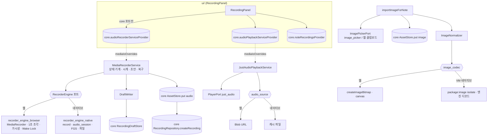
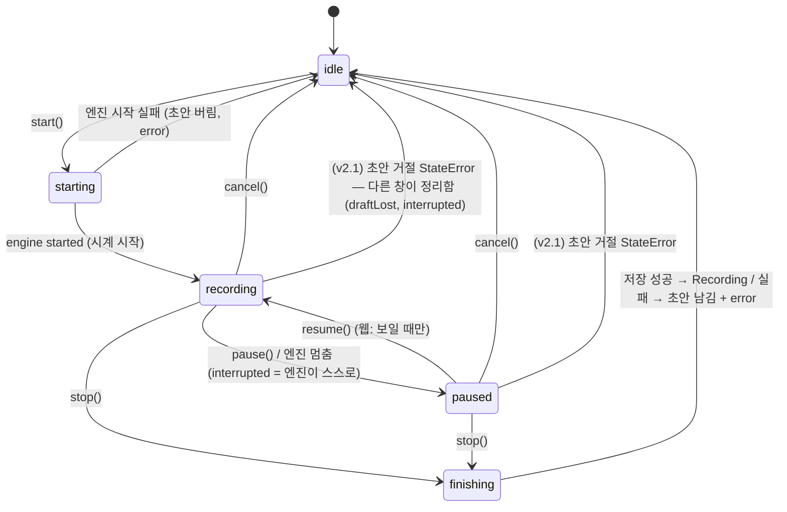

# 06 · PDF — PDF · 미디어 입출력 (2차 라운드 M5·M6·M7)

> 상태: **승인 · 계약 v2.3** (동시 개발 착수 2026-11-06 — C22-09 정리: 4·5장 계약 블록 18개를 v2.3 원문과 다시 대조해 표시 줄을 'v2.3'·현재 행 번호로 고침, v2.2가 바꾼 V8 판정 문장(C22-04)을 6.1 E10·6.8.7·6.17·10 #4에 맞춤, 00-review '최종 승인'의 PDF-F1~F3은 진행 기록 '## 2차 › 동시 개발'에서 추적. v2.3(C23-01~07)은 시그니처 변경 없음 — PDF 몫은 C23-07 `useInkTestFonts`·`WidgetsBinding` 주의로 이미 9.2·T23·T25b·T29에 있음) · 이전 상태: **승인** (최종 승인 2026-11-05 · 통합 계약 **v2.2** — [00-review.md '최종 승인'](00-review.md#최종-승인), 이 영역의 개발 중 반영 항목은 그 절의 '영역별 개발 중 반영' 표) · 승인한 판본: 수정 3회차. 그 전 상태: **수정 3회차** (통합 계약 **v2.1** 기준 — 00-overview 7장 최신판, 7.9 변경 이력은 v2.1 C21-01~35가 마지막이고 v2.2가 없음을 수정 3회차(2026-11-05)에 다시 확인) — 수정 1회차에 총괄 검토 [00-review.md](00-review.md) 3.6 PDF-M1~M14와 권장 S-2~S-9·S-12·S-14, 대리 검토 [reviews/pdf.md](reviews/pdf.md)를 반영했고, 수정 2회차에 총괄 재검토 지적 5건(정지 머리 패치의 복사 근거와 CP-PDF-13, `media.bitRate` 키, R16 예외 문장, `stop()`의 바쁨 판정, 내보내기 장부 범위)을, 수정 3회차에 총괄 재검토 지적 1건(네이티브 내보내기가 워커 isolate로 넘기는 사본이 계약 7.4.5 '네이티브 16 MB'와 어긋남 → CP-PDF-14, 같은 CP에 M-3 밖 입력의 넘침)을 반영했다(13절에 항목별 반영 내역 — 2회차는 13.4, 3회차는 13.5). 초안은 v2.0 기준이었다
>
> 작성 2026-11-05 · 수정 2026-11-05 · 영역 ID: **PDF** · 소유 경로: `packages/pdf_io/`, **`packages/media_io/`(새)** · 2차 작업 트리 `/home/user/wt2/pdf`(`area2/pdf`)
> 기준 문서: [00-overview.md](00-overview.md) 7장 '통합 계약 v2.1'(변경 이력 7.9 C21-01~35 중 PDF 몫: C21-01·02·04·05·08·09·13·14·16·19·20·22·23·24·25·26·28·29·30·32·33 — 이 문서와 다르면 **계약이 우선**) · 1차 계약 v1.5(1차 [00-overview.md](../00-overview.md) 7장 — 1차 통합 반영, 시그니처는 v1.4와 같음) · 마스터 기획서 [PLAN.md](../../PLAN.md) F-13·F-14·F-15·F-16, 5.1·5.2, 7.6, 10장 M5~M7 · 조사 [01-hooks](research/01-hooks.md)·[02-audio-stylus](research/02-audio-stylus.md)·[03-recognition](research/03-recognition.md)·[04-native](research/04-native.md) · 판정 [judgement.md](drafts/judgement.md) · 함께 읽은 2차 계획서 [01-infra](01-infra.md)·[02-core](02-core.md)·[03-ink](03-ink.md)·[04-editor](04-editor.md)(그쪽 계약 변경 제안에 대한 PDF 의견은 12.2)
> 바탕 코드(v2.1, CD2-01 — 읽기 전용): **1차 통합 HEAD** `/home/user/noteapp` 브랜치 `claude/note-app-planning-bk29xb` `18c5ae5`(PDF 통합 커밋 `9305235` 포함). (계약 v2.2 C22-08) 이 문서의 `18c5ae5`는 **`b6c9d0a`**로 읽는다 — 그 사이 8커밋은 `pdf_io`를 바꾸지 않았다. 2차 동시 개발 바탕은 계약 v2.3 커밋 `5843ec3`(R2-B1~R2-B6 포함, PDF R2-B4 `5636d4e`). `packages/pdf_io`는 1차 영역 끝 `98c193c`(`/home/user/wt/pdf`, T0~T19·T15b 완료, `progress/pdf.md` 보완 세션 1.1)와 `lib/`의 **주석 두 곳만** 다르고(`providers.dart`·`import/cover_thumbnail.dart` — 동작 변화 없음), 시험은 `test/integration/real_wiring_test.dart`(새, 409줄)·`test/unit/template_underlay_test.dart`(강화)가 더해졌다 [확인 — `git diff --stat 98c193c 18c5ae5 -- packages/pdf_io`, 그 뒤 HEAD `b6c9d0a`까지 `pdf_io` 변화 없음]. 통합 확인 수치(9305235 시점, `progress/pdf.md` '통합 단계'): VM 580개 통과 + 7 skip(`integration` 4파일·perf 3파일), Chrome 54개 통과 + 1 skip(웹 perf), `integration` 19개(core_gateway 6·ink_vectorizer 8·ink_thumbnail 2·real_wiring 3), perf 4개 · 이어받는 1차 계획서: `/home/user/wt/pdf/docs/plans/06-pdf.md`(v0.4 + 개발 중 반영 13.4, 이하 '1차 06-pdf'). 파일 경로·줄 번호 인용은 `lib/`가 같으므로 1차 작업 트리 기준 그대로 맞고, 기반 단계 시작 때 통합 HEAD에서 한 번 더 확인한다(개요 2.5). `media_io`는 새 패키지라 바탕 코드가 없다 — 조사 02의 시험 앱(`/tmp/claude-0/plan57-scratch/audio_probe/`)과 플러그인 소스(`~/.pub-cache/hosted/pub.dev/record_web-2.1.3/` 등)를 읽었다.
> 확인 환경: Flutter 3.47.9 / Dart 3.13.7(`/opt/flutter`), 헤드리스 Chrome. 이 문서의 [확인] 실험은 `/tmp/claude-0/plan57-scratch/pdf57/`에서 돌렸다: `compose_probe.py`·`render_check.py`·`append_probe.py`(pypdfium2 5.13.0 = PDFium 153.0.7999.0 — CID 한글 글꼴 넣기·텍스트 추출·JPEG inline·BGRA 알파·같은 페이지 두 번 덧붙이기), `ws/`(계약 확인 워크스페이스 `designA/ws` 복사본에 `media_io` 직접 의존 7개를 더한 `flutter pub get --offline`). 수정 1회차의 실험은 `/tmp/claude-0/plan57-scratch/pdf57-rev/webm/`에서 돌렸다: `rec.mjs`·`rec2.mjs`(Playwright + 헤드리스 Chrome 가짜 마이크로 MediaRecorder WebM 6개 녹음 — 일시정지 포함), `ebml.py`(EBML 구조·블록 타임코드·Opus TOC 해석), `dur.mjs`(머리만 고친 WebM의 `<audio>` 길이·`decodeAudioData` 길이) — 6.1 E9~E11.

**표기 규칙** (1차 06-pdf 표기 그대로 + 아래)

- 좌표: 노트 페이지 pt(원점 좌상단, y 아래). PDF 사용자 공간은 원점 좌하단·y 위(1차 06-pdf 6.11.3). 시간: 녹음 위치·`recordingOffsetMs`는 오디오 타임라인 ms(R-2), `startedAt`·`createdAt`은 벽시계 ms.
- `core.X` = `package:note_core/note_core.dart`, `ink.X` = `package:ink_engine/ink_engine.dart`, `rx.X` = pdfrx(1차 그대로). `media_io` 안에서는 `ja.X` = `package:just_audio/just_audio.dart`, `rec.X` = `package:record/record.dart`, `img.X` = `package:image/image.dart`(접두어 필수 — `Image`가 Flutter와 겹친다).
- '객체' = `core.PageObject`(도형·텍스트 상자·이미지·수식·모르는 객체). '요소' = 획 + 객체.
- 절 번호: 이 문서 안은 'n.m', 개요 2차 계약은 '7.x', 1차 계약은 '1차 7.x', 1차 PDF 계획서는 '1차 06-pdf n.m'.
- 코드 블록은 본문을 생략한 시그니처다. **4장·5장의 계약 블록은 개요 7장 원문을 글자 그대로 옮겼다**(주석 포함, 블록 위에 원문 행 번호). PDF가 정하는 세부는 블록 밖 표나 머리 주석이 `// PDF 확정 세부`인 블록에 따로 적는다 — 계약의 이름·시그니처와 충돌하지 않는 **추가**만 담고, 계약 반영이 필요한 것은 12.1의 계약 변경 제안(CP-PDF-n)으로 올린다.
- [확인] = 코드를 읽거나 명령을 실행해 확인함, [추측] = 확인하지 않은 판단(근거와 함께), 표기 없음 = PDF 설계 결정.
- 작업 번호는 1차 T0~T19에 이어 **T20부터** 쓴다. `pdf_io` 작업은 T20~T29, `media_io` 작업은 T30~T41.

## 목차

1. 목적과 범위 · 2. PLAN.md 요구사항 대응표 · 3. 소유 경로와 패키지 구조 · 4. 공개 API · 5. 사용하는 다른 영역의 계약 · 6. 설계 상세 · 7. 외부 패키지 · 8. 작업 분해 · 9. 테스트 계획 · 10. 완료 기준 · 11. 리스크와 대응 · 12. 총괄에게 묻는 질문 · 계약 변경 제안 · 13. 검토 반영 내역 · 부록 A. 확장 지점 · 자리 사용표 · 부록 B. 네이티브 · 권한 요구표

---

## 1. 목적과 범위

### 1.1 목적

1차 PDF는 "PDF 가져오기 → 배경 렌더 → 노트 안 텍스트 검색 → 필기 벡터 내보내기"를 맡았다. 2차는 패키지 둘을 맡는다.

**`pdf_io`(1차 패키지를 넓힘)**

1. **내보내기가 2차 페이지 내용 전부를 담는다**: 이미지 객체·이미지 배경 페이지(PDF 이미지 객체), 텍스트 상자(한글 글꼴을 넣은 **검색 가능한 PDF 텍스트 객체**, 글꼴이 덮지 못하면 래스터), 수식(300 dpi 래스터 — U17), 도형·점선(INK가 외곽선으로 준 벡터), 암기 테이프(항상 가림 — K-9). 순서는 INK 층 규칙 L-1 그대로(K-8). 레이저는 저장되지 않으므로 나오지 않는다.
2. **라이브러리 전역 PDF 텍스트 색인기**(1차 7.8에서 미룬 항목, M7-3): `PdfSearchIndexer`가 이 기기에 있는 PDF 에셋의 쪽마다 텍스트를 뽑아 CORE `SearchIndexWriter`(source `pdf`)에 쓴다. 앱 시작 때 `sourceRevs(pdf)` 한 번으로 따라잡고, 새 PDF가 들어오면 그것만 색인한다.
3. **`pdfIoOverrides()` v2**: INK 기본 배경 목록(`[image, template]`)을 PDF 빌더 뒤에 그대로 둔다 — 'PDF만 override' 규칙(1차 7.2.19)은 유지(C2-20).

**`media_io`(새 서비스 패키지 — 전부 PDF 소유, D1)**

4. **녹음 서비스**: CORE 포트 `AudioRecorderService` 구현. 웹은 `record_web`이 아니라 **MediaRecorder 자체 녹음기**(1초 조각을 `RecordingDraftStore`에 바로 저장 — 탭이 닫혀도 마지막 1초 이하만 잃음, P-A·D13), 네이티브는 `record`(AAC-LC/m4a 모노 64 kbps) + `audio_session` + 안드로이드 포그라운드 서비스(`flutter_foreground_task`). 녹음 시계는 단조 `Stopwatch`를 녹음기 상태 이벤트에 맞춰 멈추고 이어 간다(R-2, 7.4.8). (v2.1) `durationMs`는 **파일 안 타임라인**(WebM은 마지막 블록 타임코드 + 그 패킷 길이, Safari MP4는 상자의 길이)에서 계산하고 녹음 시계 값으로 패치하지 않는다(R-3·M-4). 같은 출처의 다른 탭이 진행 중 녹음을 건드리지 못하게 최근 갱신 초안은 복구 대상에서 빼고(일시정지 중에도 빈 조각으로 살아 있음을 표시), 가능하면 Web Locks를 쥔다(M-5, 7.4.2).
5. **재생 서비스**: CORE 포트 `AudioPlaybackService` 구현(`just_audio`, 0.5~2배속, 탐색, 프레임마다 읽어도 되는 위치 외삽).
6. **이미지 가져오기·정규화**: 사진·카메라·파일·(웹) 클립보드 → 디코드 → 긴 변 2048 px·8 MiB·JPEG/PNG(M-3) → `AssetStore.put`. (v2.1) 선택기·클립보드는 누름 처리 안에서 첫 `await` 전에 연다(7.2.10 — iPad Safari 사용자 동작 활성화). 녹음 스위치(`FEATURE_MEDIA`) 밖이라 `initializeMediaIo` 없이 동작한다(D17).
7. **녹음 패널 UI** `RecordingPanel`(에디터 하단 자리 `EditorExtensions.recordingPanel`): 녹음·일시정지·정지, 녹음 목록(이름·삭제·용량·'복구된 녹음' 배지), 재생 바(±10초·배속·탐색), 탭 재생 토글, 녹음 동의 안내(F-16), 웹 '가려지면 멈춤' 안내. 개발자 표시 줄(`mediaDevOverlayLinesProvider`).

설계 원칙 (1차 06-pdf 1.1의 원칙을 그대로 지키고 더함)

- **그리는 의미는 INK, PDF는 배치·자원·PDF 객체만**: 내보내기는 INK 벡터 v2(`InkPageVectors.underlay/annotations/cover`, 점선 미리 분할, 도형 외곽선)를 그대로 따른다. 수식 크기·글자 줄은 INK가 정한 값(`InkMathRenderer.layout`, `InkTextVector.lines`)을 쓰고 PDF가 다시 배치하지 않는다(K-6·K-8).
- **웹 JS 확장과 네이티브 FFI는 같은 명령 형식을 해석한다**(1차 06-pdf 6.11.5 확장): 새 명령(이미지·텍스트·글꼴 등록)도 한 형식이고, 같은 탐침 시험(`test/support/compose_probes.dart` v2)을 두 백엔드에 돌린다.
- **녹음은 잃지 않는 것이 먼저다**: 웹 조각은 쓰기가 끝날 때까지 메모리에 남기고(최대 8 MiB — 7.4.5), 정지 중 에셋·녹음 행 쓰기가 실패해도 **초안을 지우지 않는다**(다음 실행 때 복구). M-1 순서(에셋 → 녹음 행)를 어기지 않는다. (v2.1) 다른 탭의 진행 중 초안을 복구하지 않고(M-5), 정지·복구는 같은 바이트를 전체 크기로 두 벌 넘게 들지 않으며, 끝나지 않은 복구 시도가 2번 쌓인 초안은 자동 복구에서 빼 큰 복구가 매 실행 탭을 죽이는 반복을 막는다(M-4·M-7). 웹 정지 저장이 끝내 실패하면 마지막 수단으로 '파일로 내려받기'를 보인다(D19).
- **플랫폼 코드는 엔진 포트 뒤로**: 녹음 상태 기계·시계·초안 쓰기·복구는 순수 Dart(`MediaRecorderService`)이고, 플랫폼 차이는 `RecorderEngine`(웹 MediaRecorder / 네이티브 `record`) 하나에 모은다. 그래서 상태 전이·M-1·M-2·R-2를 VM에서 가짜 엔진으로 시험한다.
- **UI는 CORE 포트만 본다**: `RecordingPanel`은 `core.audioRecorderServiceProvider`·`core.audioPlaybackServiceProvider`·`core.noteRecordingsProvider`(+ 초안·설정 저장소)만 읽으므로 위젯 시험이 CORE `FakeAudioRecorder`·`FakeAudioPlayback`으로 돈다(7.4.6 '플러그인 가짜'). Chrome 시험·앱 스모크도 같은 CORE 가짜를 쓰고, `media_io` 가짜 플랫폼은 VM의 서비스 자체 시험용이다(v2.1 — 7.6).
- **(v2.1) 플랫폼·INK 결과는 포트 뒤에서 판정한다**: 내보내기 해석기는 수식·텍스트 래스터를 내부 포트(`PdfMathRasterizer`·`PdfTextRasterizer` — 기본 INK)로 받고, INK 벡터 값은 PDF 중간 표현(층별 목록)으로 한 번 옮긴 뒤 순수 함수로 `PdfPagePlan`을 만든다. 그래서 INK T36(수식 래스터)·T42(벡터 v2) 전에도 PDF 쪽 완료 조건을 VM에서 판정한다(PDF-M2).

### 1.2 이번 범위

| 묶음 | 패키지 | 내용 | 개요 3.1 | 등급 (3.4) |
|---|---|---|---|---|
| 객체 내보내기 | pdf_io | 이미지 객체(JPEG inline / PNG 비트맵·알파), 이미지 배경 페이지(`fit` contain·cover·fill), 텍스트 상자(CID 글꼴 `NoteSans` 넣기, 굵게, 회전, 배경색), 텍스트 래스터 대체(INK `InkTextLayout.rasterize` — CP-PDF-7), 수식 300 dpi 래스터(contain), 테이프(가림), 점선·도형(INK 벡터 그대로), 새 경고 3종, (v2.1) 래스터·디코드 한 장 ≤ 4 Mpx(PDF-M3), 수식·텍스트 래스터 포트와 INK 벡터 중간 표현(PDF-M2) | M5-2~5, M5-10·12, M7-5 | P-A |
| 합성 명령 v2 | pdf_io | 명령 `image`·`text`, 글꼴 등록, 한 페이지를 여러 조각으로 보내기(큰 이미지 하나씩 — 메모리 16 MB), 웹 `pdf_io_compose_ext.js` v2 + 네이티브 FFI 해석기 v2 | 같음 | P-A |
| 배경 목록 v2 | pdf_io | `pdfIoOverrides()` = `[pdf, ...ink.defaultPageBackgroundBuilders(ref)]` | M5-4 | P-A |
| 전역 PDF 색인 | pdf_io | `PdfSearchIndexer`(원문 생성자 — 문서 풀·일정 게이트는 패키지 안에서 주입, 따라잡기·새 에셋·**재구축 중 멈춤 → 끝나면 다시 판정**·유휴 실행·쪽 단위 글자 상자·`pdfPageAspect`), `pdfSearchIndexerProvider`, `SearchText.normalize` 일치 시험(C2-27) | M7-3 | P-A |
| 녹음 서비스 | media_io | 상태 기계·녹음 시계·초안 쓰기·정지(M-1)·취소·복구(`pendingDrafts`·`recoverDraft`), 웹 MediaRecorder 녹음기(MIME 선택·1초 조각·가려지면 멈춤·Wake Lock·WebM 길이 패치), 네이티브 `record` 녹음기(AAC-LC m4a). (v2.1) 파일 타임라인 길이(WebM 블록 타임코드·MP4 상자), 다른 탭 보호(최근 갱신 제외·일시정지 중 빈 조각·Web Locks·`append` 거절 → 멈춤), 복구 시도 횟수(`media.recoverAttempts`)·영구 실패 정리, 정지·복구 버퍼 두 벌 상한, 웹 '파일로 내려받기' | M6-1, M6-5 | P-A |
| 백그라운드 녹음 | media_io | 안드로이드 microphone 포그라운드 서비스·알림 권한, `audio_session` 세션 관리(녹음 `playAndRecord` → 정지 뒤 비활성) | M6-2 | **P-B** |
| 재생 서비스 | media_io | `just_audio`(웹 blob URL, 네이티브 캐시 파일), 원격 에셋 `ensureLocal`, 0.5~2배속·탐색·위치 외삽, iOS에서 webm 거르기(`unsupportedFormat`) | M6-3·M6-4 | P-A |
| 이미지 가져오기 | media_io | `supportedImageSources`, `importImageForNote`(사진·카메라·파일·웹 클립보드, 디코드·방향 굽기·축소·재인코딩·메타데이터 제거, 준비 중 표시, 오류 문구) | M5-3·M5-4 | P-A |
| 녹음 패널 | media_io | `RecordingPanel`(녹음 조작·목록·이름·삭제·용량·재생 바·탭 재생 토글·동의 안내·복구 배지·웹 경고), `mediaDevOverlayLinesProvider` | M6-1·M6-3·M6-5 | P-A |
| 시험 도우미 | media_io | `testing.dart`: `registerMediaWebPlugins()`, (v2.1 — VM 전용, `MockPlatformInterfaceMixin` 없음) `FakeRecordPlatform`, `FakeJustAudioPlatform`, `FakeImagePickerPlatform`·`installFakeMediaPlatforms`(CP-PDF-6) | — | P-A |
| Chrome 가짜 마이크 시험 | media_io | `media` 태그 — (v2.1) CORE `testing_web.dart`의 **실제 웹 저장소**: V8(녹음 → 에셋·녹음 행 → 재생·2배속·탐색, **파일 타임라인 길이 vs 시계**), V16(탭 닫힘 흉내 → 복구, 두 번째 녹음기는 녹음 중 초안을 내지 않음), M-2(가려지면 멈춤) | M6 | P-A |
| 성능 확인 | 둘 다 | 객체 내보내기·색인 속도, 웹 녹음 조각 쓰기 지연(perf 태그) | — | P-C |
| (v2.1) 큰 녹음 계측 | media_io | 86 MB 합성 초안의 정지·복구 경로 전체 크기 버퍼 수 계측(Chrome perf), 큰 녹음 정지 직후 같은 `Blob` 넘김 | M6 | P-B |

### 1.3 이후 범위 (이번에는 자리만 두거나 하지 않음)

- PDF 벡터 수식(조사 03 8.3 P2·P3 — U17은 래스터로 정함), 같은 이미지를 여러 페이지에 쓸 때 XObject 공유(이번에는 페이지마다 따로 들어감 — 6.2.10), 줄무늬 테이프의 PDF 줄무늬(단색 — INK 12.2 Q8), 텍스트 상자 글자 간격의 커닝 차이 보정(11장 #6).
- 스캔 PDF(텍스트 없는 쪽)의 OCR 색인, PDF 색인 끄기 설정·크기 예산(CORE Q7 — 이번에는 측정만).
- 웹(데스크톱 Chrome)에서 녹음한 webm을 m4a로 바꾸는 서버 변환(조사 02 Q3), 잠금 화면 재생 제어(3.1 M6-3 '이후'), 녹음 텍스트 변환(P2), 녹음 바이트 회수(에셋 GC — U13), 시계 보정 필드(R-3, 실기기 A-5 뒤).
- 네이티브 클립보드 이미지 붙여넣기(3.1 M5-3 '이후'), iOS 파일 앱에서 이미지 고르기(문서 선택기 — `file_picker`를 `media_io`에 넣어야 함), 이미지 자르기(3.6).
- 녹음 음질 설정 화면(`media.*` 설정 섹션 — INFRA Q11 답 '이번에는 없음'). (수정 2회차) 설정 키 `media.bitRate`(synced, 7.4.4 v2.1)는 이번에 정의하고 녹음기가 읽기만 한다 — 값을 쓰는 화면은 이후(4.6).

### 1.4 제외 (다른 영역 책임)

| 항목 | 담당 | PDF와의 접점 |
|---|---|---|
| 객체·녹음·초안·검색 색인의 모델·저장·질의(FTS5), `SearchText`, 정규화 판 바꿈 시 재구축 | CORE | PDF는 `SearchIndexWriter`(source pdf)·`RecordingDraftStore`·`RecordingRepository`·`AssetStore`를 부른다 |
| 객체·새 펜의 렌더 의미, 벡터 내보내기 v2, 수식 배치·래스터, `NoteSans` 글꼴 파일·적재·덮는 글자 표, 이미지 배경 빌더 | INK | PDF는 `InkVectorExport.exportPage` v2·`InkMathRenderer`·`InkFonts`·`defaultPageBackgroundBuilders`를 쓴다 |
| 펜 다운 녹음 시점(R-1·E-5), 재생 강조 `Ticker`, 필기 탭 재생(`seekMs`·`play`), 녹음 패널 자리(높이 40%·마이크 단추), 이미지 삽입·이미지 페이지 흐름(배치·명령) | EDITOR | 자리 너머로 `RecordingPanel`·`importImageForNote`가 쓰인다(X29) |
| 검색 결과 화면('노트 내용' 묶음, 위치로 열기) | LIBRARY | PDF 단위의 결과는 CORE가 `PageSearchHit`로 준다 |
| 모듈 시작·override 연결·자리 변환, 유휴 작업(`pdf.searchIndexer` 시작, `media.recoverDrafts`, `media.leaveGuard`), 기능 스위치 `FEATURE_MEDIA`, 매니페스트·Info.plist·배포 대상, `tool/chrome-fakemedia`, `media` 태그 실행·잠금 | INFRA | 부록 A·B가 INFRA의 입력이다 |
| 오디오·이미지 에셋 동기화(업로드 상한 300 MiB) | SYNC | 1차 에셋 파이프라인 그대로(실연결 뒤) |

### 1.5 1차 계약(v1.4) 대비 변경 중 PDF에 닿는 것 (개요 7.0.1)

| # | 변경 | PDF가 하는 일 | 이 문서 |
|---|---|---|---|
| C2-01 | `media_io` 패키지 추가(R8 `media_io: [note_core]`), 서비스 ↔ 피처 import 금지(규칙 4~6) | `media_io`는 `note_core`만 형제 의존. `pdf_io`(피처)와 `media_io`(서비스)는 서로 import하지 않는다(이미지 헤더 읽기를 두 패키지가 각자 가진다 — 6.2.4) | 3.3, 3.5 |
| C2-12 · C2-17 | 오디오 포트·`RecordingDraftStore`·`SearchIndexWriter` 등 새 CORE 인터페이스와 provider | 오디오 포트 두 개 구현, 초안·녹음·에셋·색인 작성기 호출 | 4.2, 6.4, 6.6~6.11 |
| C2-20 | `pdfIoOverrides()` 목록 `[pdf, template]` → `[pdf, ...defaultPageBackgroundBuilders(ref)]` | T20(기반 단계)에서 바꿈 | 6.3 |
| C2-21 | INK 벡터 v2(`underlay`·`annotations`·`cover`), `InkMathRenderer`·`InkFonts` | 객체 벡터화·해석기·내보내기 v2 | 6.2 |
| C2-27 | `PdfSearchIndexer`·`pdfSearchIndexerProvider`, PDF 정규화 = `SearchText.normalize` | 색인기 + 같은 입력 표 일치 시험 | 6.4 |
| C2-28 | X28·X29·X33, 동작 보장 M-1~M-3 (v2.1 + M-4) | 4.2·6장에서 지킨다 | 5.6 |
| C2-29 | `native_only_imports`에 `flutter_foreground_task`·`path_provider` | 두 패키지는 `*_native.dart`에서만 import | 3.5, 6.18 |
| C2-31 | 태그 `media`(Chrome 가짜 마이크), `tool/chrome-fakemedia` | `media_io/dart_test.yaml`에 선언(기본 skip), 시험 파일이 웹 플러그인 등록 | 9.4 |
| C2-32 | 메모리 예산 행 — (v2.1, D22) 웹 합계 296 MB로 다시 나눔: PDF 미리보기 **24**(1차 32에서 줄임)·타일 64·썸네일 16, 내보내기 중 이미지·래스터 임시 16 MB, 웹 녹음 메모리 조각 ≤ 8 MB, 한 장의 래스터·디코드 **≤ 4 Mpx** | 내보내기 조각 나누기(6.2.6)·래스터·디코드 픽셀 상한(6.2.4·6.2.5)·웹 조각 쓰기 상한(6.8.5)·미리보기 캐시 상한 24 MB(`PdfIoConfig` 기본값 — 6.2.10) | 6.2.10, 6.17 |
| C2-34 | 새 외부 의존(`record`·`just_audio`·`audio_session`·`flutter_foreground_task`·`image_picker`·`image_picker_ios` 간접 고정·`path_provider`·`image`) | `media_io` pubspec(R2-B1 INFRA) + 시험·웹용 직접 의존 **6개**(CP-PDF-9 v2.1 — `plugin_platform_interface` 제외, lock 변화 없음 [확인]) | 3.4, 7.2 |
| C2-39 | (v2.1) `note_core/testing_web.dart`(`openWebTestNoteStore`·`deleteWebTestNoteStore` — 브라우저 시험 전용 실제 웹 저장소) | V8·V16·V11 Chrome을 실제 웹 저장소로 돌린다. 두 패키지에 `tool/prepare_web_test.dart`(CORE 스크립트 `--out test/web` 호출) | 5.1.5, 8.3, 9.4 |
| C2-15 | `NoteStore` getter 4개(깨짐) | PDF 시험 가짜 2곳(`FakePdfNoteGateway` 안 저장소 흉내, `test/support`)은 `noSuchMethod`라 영향 없음(개요 7.0.2 [확인]). R2-B2 묶음 병합 뒤 `pdf_io` VM 시험을 한 번 돌려 확인한다 | 8.1 |

### 1.6 단계별 몫 요약

| 단계 | PDF 몫 | 작업 |
|---|---|---|
| 기반 단계 R2-B4 (개요 7.6) | `pdf_io`: `pdfIoOverrides()` v2 목록, `PdfSearchIndexer`(원문 생성자 그대로 — `start()` 아무것도 안 함)·provider, barrel v2. `media_io`: `initializeMediaIo`·`MediaIoConfig`·`mediaIoOverrides()`(빈 목록)·`supportedImageSources()`(빈 집합)·`importImageForNote`(`null`)·`RecordingPanel` 자리표시(제목 + 닫기)·`mediaDevOverlayLinesProvider`(빈 목록)·`testing.dart` 표면 | T20, T30 |
| 동시 개발 | 8.2 표 T21~T29(pdf_io — T25a·T25b 포함), T31a~T41(media_io — v2.1에서 T31·T32·T35·T36을 a·b로 나눔) | 8.2 |
| 통합 4단계 (개요 7.7.1) | `integration`(V11 객체 내보내기 — 1차 `real_wiring_test` 구성을 넓힘, V10 PDF 사각형, INK 값 → 중간 표현 변환 — 실제 CORE·INK), `media`(V8·V16 — Chrome 가짜 마이크 + 실제 웹 CORE 저장소), media 실제 CORE VM 시험 | 8.3 |

## 2. PLAN.md 요구사항 대응표

| PLAN 항목 | 요구 | PDF 설계 | 작업 | 확인 (컨테이너 / 실기기) |
|---|---|---|---|---|
| F-15 PDF로 저장 | 필기는 벡터, 원본 PDF 텍스트 유지 | 1차 그대로 + 도형·점선·테이프 벡터(INK 외곽선), 원본 PDF 쪽은 1차처럼 가져온 쪽 위에 덧그림 | T21~T26 | V11 / B-11·B-13 |
| F-15 (2차 내용) | 텍스트 상자·이미지·수식이 PDF에 나옴 | 텍스트 = CID 글꼴 텍스트 객체(검색 가능, 덮지 못하면 래스터), 이미지 = 이미지 객체, 수식 = 300 dpi 래스터(U17). (v2.1) 래스터·디코드 한 장 ≤ 4 Mpx(큰 상자·수식은 dpi를 낮춤) | T22~T26 | V11 / B-11, B-13 '다른 앱에서 텍스트 상자 글자 검색' |
| F-15 옵션 '필기 포함 여부(원본만)' | 원본만 내보내기 | `includeInk == false`면 획과 **객체 전부**를 뺀다(이미지 배경은 배경이라 남김 — 6.2.9) | T26 | `export_service_objects_test` |
| F-15 '대용량 노트는 백그라운드 생성 + 진행률' | 진행률 | 1차 진행률 그대로, 이미지·수식이 있는 쪽도 '쪽 수' 단위 | T26 | `export_service_objects_test` |
| F-13 페이지 종류 '이미지' | 이미지 페이지 | 이미지 가져오기(T35b)가 에셋을 만들고, 내보내기는 `ImageBackground.fit`으로 배치(T25a) | T25a, T35b | V11 / B-3 |
| 5.1 이미지 삽입 | 사진·카메라·스크린샷 붙여넣기 | `importImageForNote`(사진·카메라·파일·웹 클립보드 — 선택기·클립보드는 첫 `await` 전에, 녹음 스위치 밖 D17), 정규화 M-3 | T35a·T35b | `image_import_test`·Chrome `image_codec_browser_test` / B-3, APK |
| 5.1 검색 'PDF 텍스트 → 손글씨 순으로 확장', 1차 7.8 '라이브러리 전역 PDF 텍스트 검색' | 라이브러리 전역 PDF 검색 | `PdfSearchIndexer` → CORE `search_units`(source pdf), 결과는 CORE·LIBRARY | T27, T28 | V10 PDF 부분 / B-10 |
| F-16 녹음 시작·일시정지·정지, 여러 녹음 | 녹음 | `MediaRecorderService` + 웹·네이티브 엔진, 패널 조작·목록 | T31a~T33, T36a·T36b | V8 / B-8, A-3 |
| F-16 백그라운드 녹음 | 화면 꺼져도 계속 | 안드로이드 포그라운드 서비스, iOS `UIBackgroundModes: audio`(INFRA) + 세션 유지, 웹은 대체 동작(가려지면 멈춤·Wake Lock — M-2) | T33(P-B), T32b | M-2 `media` 시험 / A-3, B-9, C-2 |
| F-16 필기 연동 | 획마다 녹음 시점 | `offsetNowMs()` = 녹음 시계(일시정지 제외, R-2), 동기·저비용 | T31a | `recording_clock_test`·V8(파일 타임라인 vs 시계) / A-5 |
| F-16 재생 시 필기 강조, 필기 탭 재생 | 강조·탭 재생 | 재생기 `positionMs()`(외삽, 플랫폼 호출 없음), `seekMs`·`play`(EDITOR가 부름), 패널을 열면 최근 녹음을 재생 없이 열어 둠(R-5 v2.1 '패널이 열려 있으면 손가락 탭 재생' — 열기만 한 `ready`는 강조 초점 없음) | T34, T36a | `playback_service_test`·`recording_panel_test`('정지 직후 흐림 없음')·V8 / B-8·B-16 |
| F-16 재생 속도 0.5~2배, 10초 앞뒤 | 재생 바 | 패널 재생 바(±10초, 배속 6단계, 탐색 막대) | T34, T36a | `recording_panel_test` / B-8 |
| F-16 압축 후 동기화, 용량 표시, 녹음만 따로 삭제 | AAC/Opus, 용량, 삭제 | AAC-LC 64 kbps 모노(U8 — 1시간 약 29 MB), 웹 Chrome은 opus/webm + 경고, 목록에 녹음별·노트 합계 용량(`audioBytesOf`), 삭제는 소프트 삭제(U13) | T31a~T33, T36b | V8 / B-8 |
| F-16 녹음 시작 시 동의 안내 | 고정 문구 | 이 기기에서 처음 녹음할 때 확인 창(문구 7.4.4 고정) + 대기 상태 패널에 같은 문구 한 줄 | T36b | `recording_sheets_test` |
| 5.2 손글씨 검색 / 7.6 '유료 기능은 기능 스위치' | 기능 끄기 | (v2.1, D17) `FEATURE_MEDIA=false`는 **녹음만** 끈다 — INFRA가 오디오 override·녹음 패널·초안 복구·이탈 경고를 연결하지 않고(포트 기본값 '지원 안 함'), 이미지 가져오기(`supportedImageSources`·`importImageForNote`)는 스위치와 무관하게 연결된다 | (INFRA) | V15 |
| 7.2 리스크 '클라우드 비용(PDF·녹음 용량)' | 오디오 압축 | 64 kbps 모노 기본, 3시간 86 MB(상한 300 MiB 안 — (v2.1, D19) 연속 3시간이 지원 범위) | T33 | — |
| M6 완료 판정(PLAN 10장) | 녹음 · 백그라운드 · 재생 바, 획별 시점 → 강조·탭 재생 | 위 행들 + 끊김 대비(웹 조각 저장·복구, D13 — (v2.1) 다른 탭 보호·복구 시도 상한·버퍼 두 벌 상한) | T31a~T39 | V8·V16 / B-8·B-14 |

## 3. 소유 경로와 패키지 구조

### 3.1 `pdf_io` (1차 트리에 더하는 것: `[새]`·`[변경]`)

```text
packages/pdf_io/
├─ pubspec.yaml                  (변경 없음 — 새 외부 의존 없음, 3.2)
├─ dart_test.yaml                (변경 없음 — golden·pdfium·integration(skip)·perf(skip))
├─ README.md                     [변경] 객체 내보내기·전역 색인·탐침 시험 (T29)
├─ tool/prepare_web_test.dart    [변경] (v2.1) 1차 wasm 복사 + CORE `prepare_web_test.dart --out test/web` 호출(V11 Chrome 실제 웹 저장소 — C2-39)
├─ web/
│  └─ pdf_io_compose_ext.js      [변경] v2 명령: 글꼴 등록, image(JPEG inline·RGBA 비트맵), text(CID 글꼴), 조각 덧붙이기 (T23)
├─ lib/
│  ├─ pdf_io.dart                [변경] barrel v2 (4.1.6)
│  ├─ testing.dart               [변경] BoxInkVectorizer v2(planPage), FakePdfEngine 텍스트 쪽, RecordingComposeBackend v2(조각·글꼴 기록), PdfObjectFixtures (4.3.1)
│  └─ src/
│     ├─ init.dart               [변경] pdfIoOverrides v2 (T20)
│     ├─ tuning.dart             [변경] 객체·색인 상수 (4.5)
│     ├─ export/
│     │  ├─ vectors.dart         [변경] PdfPlanItem·PdfDrawItem 계열, PdfAffine, PdfPagePlan (4.1.3)
│     │  ├─ compose_plan.dart    [변경] PdfComposePageOps v2(images·texts·fonts), 명령 8·9 (4.1.4)
│     │  ├─ compose_encoder.dart [변경] encodeItems → 조각(parts), 글꼴 첫 사용 (6.2.6)
│     │  ├─ page_layers.dart     [새] (v2.1) PdfPageLayers(층별 중간 표현) + planFromLayers(순수 함수 → PdfPagePlan) (6.2.2)
│     │  ├─ object_resolver.dart [새] 참조 → 그릴 항목: 이미지 바이트·목표 크기 디코드·수식 래스터·텍스트/래스터 판정 (6.2.4)
│     │  ├─ raster_ports.dart    [새] (v2.1) 내부 포트 PdfMathRasterizer·PdfTextRasterizer + 기본(INK) 구현·픽셀 상한 계산 (6.2.4)
│     │  ├─ export_memory.dart   [새] (v2.1) ExportMemoryLedger — 들고 있는 RGBA·읽은 이미지 바이트·JPEG 캐시를 한 장부로 세고(합 ≤ 16 MiB — (수정 3회차) 네이티브 워커 사본은 합 밖 `copy`로 따로, CP-PDF-14), 캐시 쫓아내기·디코드 목표 크기가 이 장부를 본다(시험용 최고값) (6.2.10)
│     │  ├─ object_geometry.dart [새] frame·이미지·텍스트·fit 행렬 (6.2.3)
│     │  ├─ image_probe.dart     [새] JPEG/PNG/GIF/WebP 헤더(크기·알파·SOF 종류·성분 수·EXIF 방향) — media_io와 따로 가진다(3.5)
│     │  ├─ export_types.dart    [변경] 경고 3종 (4.1.5)
│     │  └─ export_service.dart  [변경] 객체 포함 파이프라인, 글꼴 준비, 경고 (6.2.2)
│     ├─ compose/
│     │  ├─ compose_backend.dart          [변경] PdfComposeJob 의미(조각 덧붙이기) (4.1.4)
│     │  ├─ compose_backend_native.dart   [변경] FFI 해석기 v2 (T22)
│     │  └─ compose_backend_browser.dart  [변경] 새 필드 전송·transfer 목록 (T23)
│     ├─ ink_adapter/
│     │  ├─ ink_vectorizer.dart  [변경] planPage = (v2.1) INK 값 → PdfPageLayers(layersFromInk) → planFromLayers (6.2.2)
│     │  └─ template_underlay.dart [변경] 이미지 배경 = 종이만 → 종이 + 배경 이미지 참조 (6.2.2)
│     ├─ search_index/           [새]
│     │  ├─ pdf_search_indexer.dart   PdfSearchIndexer(원문 생성자) + 같은 라이브러리의 src 전용 구성 함수 createPdfSearchIndexer (6.4, 4.1.1)
│     │  ├─ indexer_gate.dart         내부 IndexerGate + 앱 게이트(앱 보임·재구축 아님·가져오기/내보내기 없음·렌더 대기열 빔) — barrel 밖 (6.4.3)
│     │  └─ unit_builder.dart         쪽 텍스트 → SearchUnitDraft(글자 상자 비율 좌표) (6.4.1)
│     ├─ text/text_normalizer.dart    [변경] (v2.1, CP-10 승인) CORE SearchText.normalizeMapped에 위임 (6.4.5, T28)
│     ├─ ui/strings_ko.dart      [변경] 경고 문구 (6.16)
│     └─ providers.dart          [변경] pdfSearchIndexerProvider (4.4)
└─ test/
   ├─ support/compose_probes.dart        [변경] 탐침 v2(이미지 개수·텍스트 추출·픽셀) — 웹 안전
   ├─ support/object_fixtures.dart       [새] 객체 든 페이지·PNG 바이트 생성·고정 JPEG 표본(S-3)·큰 표본 3종(PDF-M3)
   ├─ support/fake_rasterizers.dart      [새] (v2.1) 단색 RGBA 가짜 PdfMathRasterizer·PdfTextRasterizer(요청 크기·호출 기록)
   ├─ unit/  pdfium/  web/  integration/  perf/   (9장의 새 파일)
```

- `pdf_io`는 이번에도 `note_core`·`ink_engine`만 형제 의존이다(7.1). `media_io`를 import하지 않는다(규칙 4 — `pdf_io`는 피처 패키지).
- `package:ink_engine` import는 1차처럼 `ink_adapter/` 세 파일·`init.dart`에 더해 `export/raster_ports.dart`(수식·텍스트 래스터 기본 구현)·`export/object_resolver.dart`(글꼴 바이트·`covers`)로 늘어난다(모두 `as ink`). INK API가 바뀌면 고칠 곳이 여섯 파일이다. (v2.1) 초안의 `text_raster.dart`(INK 6.10.2 표를 옮긴 래스터)는 CP-PDF-7 승인으로 두지 않는다 — `InkTextLayout.rasterize`가 R2-B3(INK T26a)부터 실제 동작이다.
- (v2.1) `export/page_layers.dart`는 `ink_engine`을 import하지 않는다(PDF 자기 타입만) — INK T42 전에도 VM에서 손으로 만든 중간 표현으로 시험된다(PDF-M2).

### 3.2 `pdf_io/pubspec.yaml`

1차 그대로다(1차 06-pdf 3.1). 새 외부 의존이 없다: PNG 디코드는 엔진(`ui.instantiateImageCodec` + `toByteData(rawStraightRgba)`), JPEG는 바이트 그대로, 글꼴 바이트는 `ink.InkFonts.noteSansBytes`, 수식 래스터는 `ink.InkMathRenderer.rasterize`.

### 3.3 `media_io` (새 — R2-B1에서 INFRA가 골격을 만들어 넘김, 01-infra 3.3)

```text
packages/media_io/
├─ pubspec.yaml                  (R2-B1 INFRA — 3.4 확정본, CP-PDF-9 6줄 포함)
├─ dart_test.yaml                [T30] tags: media(skip — Chrome 가짜 마이크), integration(skip)
├─ README.md                     [T30·T41] 진입점·웹/네이티브 경계·시험 명령(media 태그는 ws가 chrome-fakemedia를 씀)
├─ tool/prepare_web_test.dart    [T30] (v2.1) CORE `prepare_web_test.dart --out test/web` 호출 — `test/web`·`test/media`가 실제 웹 저장소(`openWebTestNoteStore`)를 쓰게 (C2-39, 02-core 6.18.1)
├─ THIRD_PARTY_NOTICES.md        [T41] record(BSD-3 — WebM 길이 패치·MIME 표를 참고해 새로 씀), just_audio(Apache-2.0/MIT), audio_session·flutter_foreground_task·image(MIT), image_picker(BSD-3)
├─ lib/
│  ├─ media_io.dart              barrel (웹 안전, 4.2.6)
│  ├─ testing.dart               test/에서만(웹 안전 진입점): registerMediaWebPlugins, (VM 전용) FakeRecordPlatform, FakeJustAudioPlatform, FakeImagePickerPlatform, installFakeMediaPlatforms (4.3.2)
│  └─ src/
│     ├─ init.dart               initializeMediaIo, MediaIoRuntime(내부), mediaIoOverrides
│     ├─ config.dart             MediaIoConfig
│     ├─ tuning.dart             MediaTuning — 모든 수치 (4.5.2)
│     ├─ errors.dart             MediaIoException, MediaErrorCode (내부 — 4.2.5)
│     ├─ platform/
│     │  ├─ platform_info.dart          kIsWeb + defaultTargetPlatform만 (7.4.1)
│     │  ├─ page_events.dart            포트: 가시성·pagehide·Wake Lock (6.8.4)
│     │  ├─ page_events_factory.dart    조건부 export
│     │  ├─ page_events_browser.dart    document.visibilityState·visibilitychange·pagehide·navigator.wakeLock
│     │  ├─ page_events_stub.dart       항상 보임, Wake Lock 없음
│     │  ├─ web_locks.dart              (v2.1) 포트: 녹음 잠금 쥐기·놓기·다른 쪽이 쥐었는지 (6.10.2)
│     │  ├─ web_locks_factory.dart      조건부 export
│     │  ├─ web_locks_browser.dart      navigator.locks(request·ifAvailable·query) — 없으면 '모름'
│     │  ├─ web_locks_stub.dart         항상 '모름'(시각 규칙만)
│     │  ├─ file_download.dart          (v2.1) 포트: 바이트를 파일로 내려받기(D19 마지막 수단) (6.10.4)
│     │  ├─ file_download_factory.dart  조건부 export
│     │  ├─ file_download_browser.dart  Blob + object URL + <a download>
│     │  └─ file_download_stub.dart     지원 안 함(네이티브는 초안이 파일로 남음)
│     ├─ record/
│     │  ├─ recorder_service.dart       MediaRecorderService implements core.AudioRecorderService (6.6)
│     │  ├─ recording_clock.dart        RecordingClock (6.7)
│     │  ├─ recorder_engine.dart        RecorderEngine 포트 + 엔진 이벤트 (6.6.2)
│     │  ├─ recorder_engine_factory.dart  조건부 export
│     │  ├─ recorder_engine_browser.dart  웹 MediaRecorder 녹음기 (6.8)
│     │  ├─ recorder_engine_native.dart   record + 파일 (6.9)
│     │  ├─ recorder_engine_stub.dart     지원 안 함(플러그인 없는 VM)
│     │  ├─ audio_session_native.dart     audio_session 세션 관리 (6.9.3, P-B)
│     │  ├─ foreground_service_native.dart  flutter_foreground_task (6.9.4, P-B)
│     │  ├─ draft_writer.dart           조각 순서 쓰기·메모리 상한·실패 재시도·일시정지 중 빈 조각·거절 감지 (6.8.5)
│     │  ├─ web_mime.dart               MIME 후보 표·고르기(순수) (6.8.1)
│     │  ├─ webm_timeline.dart          (v2.1) EBML 블록 타임라인 길이 계산 + 머리만 다시 쓰는 Duration 패치(순수) (6.8.7)
│     │  ├─ mp4_duration.dart           (v2.1, S-7) MP4/조각 MP4 상자에서 타임라인 길이(순수) (6.6.4)
│     │  ├─ buffer_ledger.dart          (v2.1) 정지·복구 경로의 전체 크기 버퍼 계측 훅 (6.6.5)
│     │  ├─ recover_attempts.dart       (v2.1) media.recoverAttempts 읽기·쓰기(초안별 시도 횟수) (6.10.3)
│     │  └─ recovery.dart               pendingDrafts·recoverDraft 직렬화·제외 규칙·영구 실패 분류 (6.10)
│     ├─ playback/
│     │  ├─ playback_service.dart       JustAudioPlaybackService implements core.AudioPlaybackService (6.11)
│     │  ├─ player_port.dart            just_audio 감싸기(시험 주입점)
│     │  ├─ audio_source_factory.dart   조건부 export
│     │  ├─ audio_source_browser.dart   Blob → object URL, revoke
│     │  ├─ audio_source_native.dart    캐시 파일(path_provider·dart:io), LRU 정리
│     │  ├─ audio_source_stub.dart
│     │  ├─ duration_probe.dart         디코더 길이 재기 — (v2.1) 네이티브 기본, 웹은 계산이 실패할 때만 (6.6.4)
│     │  └─ handoff_blob.dart           (v2.1, P-B) 정지 직후 같은 웹 Blob을 재생기로 넘김(한 번 쓰고 버림) (6.6.5)
│     ├─ image/
│     │  ├─ image_import.dart           supportedImageSources, importImageForNote (6.12)
│     │  ├─ image_picker_port.dart      image_picker 감싸기(시험 주입점)
│     │  ├─ image_header.dart           JPEG(SOF·EXIF 방향·APP1)/PNG(IHDR·알파)/GIF/WebP 헤더(순수)
│     │  ├─ image_normalizer.dart       빠른 길·느린 길 규칙(순수 + 코덱 포트)
│     │  ├─ image_codec.dart            코덱 포트
│     │  ├─ image_codec_factory.dart    조건부 export
│     │  ├─ image_codec_browser.dart    createImageBitmap + canvas toBlob, navigator.clipboard.read
│     │  └─ image_codec_io.dart         package:image(isolate) + 엔진 디코드 대체 (VM·네이티브)
│     ├─ ui/
│     │  ├─ recording_panel.dart        RecordingPanel (6.13)
│     │  ├─ record_controls.dart  playback_bar.dart  recordings_list.dart
│     │  ├─ sheets.dart                 동의·이름 바꾸기·삭제 확인·준비 중 (바닥 시트 — 7.4.10)
│     │  ├─ format.dart                 시간·용량 표시
│     │  └─ strings_ko.dart             MediaStringsKo (6.16)
│     ├─ dev/dev_overlay_lines.dart     mediaDevOverlayLinesProvider 본문 (6.14)
│     ├─ providers.dart                 내부 provider(상태 스트림·설정 키·복구 못 한 초안) (4.4)
│     ├─ testing/fake_platforms.dart    (v2.1) 세 가짜 플랫폼 — `extends …Platform`만(믹스인 없음) (4.3.2)
│     ├─ testing_web_factory.dart       조건부 export: testing_web_browser.dart(registerMediaWebPlugins 본문) / testing_web_stub.dart (4.3.2)
│     └─ testing_vm_factory.dart        (v2.1) 조건부 export: testing_vm_native.dart(임시 디렉터리 훅 — dart:io) / testing_vm_stub.dart (4.3.2)
└─ test/
   ├─ support/   fake_engines.dart(가짜 RecorderEngine·플레이어 포트·이미지 선택 포트·Web Locks·내려받기), ipad.dart(1차 PDF 도우미 복사), fixtures(작은 webm·m4a·JPEG EXIF 6, (v2.1) 6.1 E9의 Chrome opus 녹음 표본 — 일시정지 포함·잘린 끝), webm_builder.dart(손 표본: 클러스터·블록·크기 모름·TOC 지정)
   ├─ contract/  api_surface_test.dart
   ├─ unit/  widget/  web/(@TestOn('browser'))  media/(@Tags(['media']) Chrome)  integration/(@Tags(['integration']) VM)  perf/
```

### 3.4 `media_io/pubspec.yaml`

R2-B1에서 INFRA가 만든다 — 아래가 **확정본**이고 01-infra 3.3에 같은 내용이 있다 [확인]. 계약 7.5 v2.1의 CP-PDF-9 직접 의존 **6줄**(`plugin_platform_interface` 제외 — PDF-M1)과 CP1 간접 고정 2줄이 들어간다. 6줄은 모두 계약 lock에 이미 간접으로 있는 판이라 **lock 변화가 없다**(확인함: `/tmp/claude-0/plan57-scratch/pdf57/ws`에서 `flutter pub get --offline` → `pubspec.lock` diff 없음 — 7줄로 확인했고 한 줄을 빼는 것은 lock에 영향이 없다).

```yaml
name: media_io
description: Recording, playback and image import services (PDF area). Plugins stay here.
publish_to: none
resolution: workspace
environment: {sdk: ^3.13.0, flutter: 3.47.9}
dependencies:
  flutter: {sdk: flutter}
  flutter_web_plugins: {sdk: flutter}            # CP-PDF-9: registerMediaWebPlugins (testing.dart, web side)
  note_core: any
  flutter_riverpod: 3.4.3
  material_ui: 1.10.0
  web: 1.1.2                                     # *_browser.dart only
  meta: 1.19.0
  collection: 1.19.1
  image: 4.12.0
  record: 7.1.2                                  # native only (web recording = own MediaRecorder — D13)
  just_audio: 0.10.6
  audio_session: 0.2.4
  flutter_foreground_task: 11.0.3                # *_native.dart only (native_only_imports)
  image_picker: 1.2.4
  path_provider: 2.1.6                           # *_native.dart only (native_only_imports)
  image_picker_ios: 0.8.13+13                    # 간접 고정 (contract 7.5)
  shared_preferences_android: 2.5.3              # 간접 고정 (contract 7.5 v2.1 — CP1)
  shared_preferences_foundation: 2.6.0           # 간접 고정 (contract 7.5 v2.1 — CP1)
  record_web: 2.1.3                              # CP-PDF-9: registerMediaWebPlugins only (not used to record)
  just_audio_web: 0.4.16                         # CP-PDF-9: registerMediaWebPlugins
  record_platform_interface: 2.1.0               # CP-PDF-9: FakeRecordPlatform (testing.dart, VM)
  just_audio_platform_interface: 4.6.0           # CP-PDF-9: FakeJustAudioPlatform (testing.dart, VM)
  image_picker_platform_interface: 2.11.2        # CP-PDF-9: FakeImagePickerPlatform (testing.dart, VM)
  # plugin_platform_interface is NOT listed (contract 7.5 v2.1): MockPlatformInterfaceMixin is
  # @visibleForTesting — an analysis error in lib/ (invalid_use_of_visible_for_testing_member: error).
dev_dependencies:
  flutter_test: {sdk: flutter}
  fake_async: 1.3.3
```

- 추가 6개의 게시일(확인함, pub.dev API 2026-11-05): `record_web 2.1.3` 2026-09-11, `just_audio_web 0.4.16` 2025-05-13, `record_platform_interface 2.1.0` 2026-06-10, `just_audio_platform_interface 4.6.0` 2025-08-13, `image_picker_platform_interface 2.11.2` 2026-10-06 — 모두 게시 14일 규칙을 지킨다. 모두 최신판이다.
- `testing.dart`의 가짜 플랫폼 세 개가 `lib/`에 있으므로 이 의존은 `dev_dependencies`가 아니라 `dependencies`여야 한다(`depend_on_referenced_packages`). 웹 등록 함수는 조건부 export로 `*_browser.dart`에만 두어 VM 컴파일에 `dart:js_interop`이 들어오지 않게 한다(4.3.2).
- (v2.1, PDF-M1·CD2-20) **`plugin_platform_interface`를 직접 의존하지 않고 `MockPlatformInterfaceMixin`을 쓰지 않는다.** 그 믹스인은 `plugin_platform_interface 2.1.8`에서 `@visibleForTesting`이고(pub 캐시 126행 — 검토 M-1), 워크스페이스 `analysis_options.yaml` 16행이 `invalid_use_of_visible_for_testing_member: error`라 `lib/testing.dart`에서 쓰면 V2가 실패한다 [확인 — `/home/user/noteapp/analysis_options.yaml`]. 세 가짜는 `extends RecordPlatform`·`JustAudioPlatform`·`ImagePickerPlatform`만 한다 — 세 기반 클래스의 생성자가 `super(token: _token)`을 넘기므로(`record_platform_interface 2.1.0` 15행, `just_audio_platform_interface 4.6.0` 17행, `image_picker_platform_interface 2.11.2` 22행 [확인]) `instance =` 설정의 토큰 검사를 그대로 통과한다. 1차 `pdf_io/test/support/fake_file_picker.dart`의 `ScriptedFilePicker extends FilePickerPlatform`과 같은 방식이다 [확인].
- R16(피처 패키지에 플러그인 없음)은 `media_io`(서비스 패키지)에 적용되지 않는다. (수정 2회차) `pdf_io`는 R16 대상이고 예외는 계약 7.4.1 v2.1(C21-21) 원문 그대로다 — "`plugin_free_members` = `feature_editor`·`feature_library`·`ink_engine`·`note_core`(CP7) + `pdf_io`·`sync_engine`의 직접 의존에 `plugin_packages`가 없다. 기존 예외는 `pdf_io`의 `file_picker`(1차 `pdf_io`가 직접 의존하는 플러그인은 이것뿐 — `pdfrx`·`pdfium_dart`는 pubspec에 `flutter: plugin:`이 없다)와 `sync_engine`의 Firebase 플러그인." 이번 라운드 `pdf_io` pubspec은 1차 그대로라(3.2) 예외는 `file_picker` 하나로 남는다 [확인 — pub 캐시 `file_picker-13.3.2/pubspec.yaml` 39행에 `plugin:`이 있고 `pdfrx-2.11.0`·`pdfium_dart-0.4.1`에는 없음].

### 3.5 import 경계 (두 패키지 공통 — 1차 06-pdf 3 '원칙'에 더함)

| 규칙 | 내용 | 검사 |
|---|---|---|
| I-1 | `pdf_io`와 `media_io`는 서로 import하지 않는다(규칙 4). 둘이 다 필요한 작은 순수 함수(이미지 헤더 읽기)는 각자 가진다 — `pdf_io/lib/src/export/image_probe.dart`(크기·알파·SOF), `media_io/lib/src/image/image_header.dart`(+ EXIF·APP1 제거). 두 파일의 공통 부분은 같은 입력 표로 시험한다(`image_probe_test`·`image_header_test`가 같은 `test/support` 바이트 생성 코드를 각자 가짐) | R8 |
| I-2 | `media_io`에서 `dart:io`·`package:path_provider/`·`package:flutter_foreground_task/`는 `*_native.dart`에서만, `dart:js_interop`·`package:web/`은 `*_browser.dart`에서만. 플랫폼 파일은 조건부 export(`*_factory.dart`)로만 불러온다 | R4②·`native_only_imports`, `test/unit/no_platform_imports_test.dart`(1차 PDF와 같은 방식) |
| I-3 | `package:record/`는 `recorder_engine_native.dart`에서만, `package:audio_session/`은 `audio_session_native.dart`에서만 import한다(웹 녹음은 자체 구현 — D13. `record` 자체는 웹 구현이 있어 규칙상 금지는 아니지만 우리 웹 경로에 들어오지 않게) | `no_platform_imports_test` |
| I-4 | `package:just_audio/`는 `playback/player_port.dart`·`playback/duration_probe.dart`에서만, `package:image_picker/`는 `image/image_picker_port.dart`에서만 import한다(시험 주입점 한 곳) | `no_platform_imports_test` |
| I-5 | 플랫폼 판정은 `kIsWeb` + `defaultTargetPlatform`만(`platform/platform_info.dart`). `dart:io` `Platform`은 `*_native.dart`에서도 쓰지 않는다(7.4.1) | `no_platform_imports_test`(정규식 `Platform\.is`) |
| I-6 | Material은 `package:material_ui/material_ui.dart`만, 색은 `Theme.of(context).colorScheme`만(7.4.10). `media_io`에는 색 하드코딩 예외가 없다 | R7, `no_color_literal_test`(`Color(0x` 정규식) |
| I-7 | Riverpod은 `flutter_riverpod`, `Override`는 `flutter_riverpod/misc.dart`(1차 7.4.4), codegen 없음 | R9 |
| I-8 | `package:note_core`는 모든 파일에서 `as core`(1차 PDF 규칙과 같음 — `Page` 이름 충돌 방지) | 리뷰 |


## 4. 공개 API

PDF가 **제공**하는 표면이다. 4.0은 개요 7.2.12 원문 그대로다. 4.1~4.6은 원문이 본문을 생략했거나(`/* … */`) PDF에 맡긴 자리, 그리고 계약 밖 PDF 자체 공개 표면(1차 06-pdf 4장에 더하는 것)이다. 다른 영역이 쓰는 것은 4.0의 이름뿐이다(INFRA가 연결 — X28·X29·X33).

### 4.0 계약 7.2.12 (글자 그대로)

`// 계약 v2.3 7.2.12 원문 (00-overview.md 1812–1834행)`

```dart
// pdf_io — 규칙 / 추가
/// The ONLY override of ink.pageBackgroundBuildersProvider (v1.4 rule kept):
///   [pdfBackgroundLayerBuilder, ...ink.defaultPageBackgroundBuilders(ref)] (+ pdfIoConfigProvider).
List<Override> pdfIoOverrides({PdfIoConfig? config});
/// Library-wide PDF text index (1차 7.8 이후 항목): watches PDF assets / PdfBackground pages,
/// extracts with PdfTextService, writes core.SearchIndexWriter (source pdf, rects as page
/// fractions). Skips owners whose sourceRev is current. Idle-time, one PDF page per slice.
/// (v2.1) Pauses while SearchIndex.status.rebuilding is true (drops its queue) and re-judges every
/// asset afterwards. The public constructor stays as below — CP-PDF-1 rejected: the document pool
/// and the schedule gate are injected inside pdf_io (provider / src-only factory), no new public
/// type. dispose() is idempotent.
final class PdfSearchIndexer {
  PdfSearchIndexer(core.NoteStore store);
  void start();
  Future<void> dispose();
}
final pdfSearchIndexerProvider = Provider<PdfSearchIndexer>(/* started by INFRA PdfModule */);
// Export (06-pdf 6.11 확장, 내부): order = InkPageVectors L-1; ImageObject / image background →
// PDF image object (JPEG inline, PNG via bitmap); TextBoxObject → text object with embedded
// InkFonts.noteSans (searchable; falls back to raster when InkFonts.covers(text) is false, font
// loading fails or (v2.1, CP-PDF-8) InkTextVector.lines is empty; a text box background is a
// vector rect under the text); MathObject → raster 300 dpi (U17); tape → covered; laser → none.
// (v2.1) Every raster and image decode ≤ 4 Mpx (16 MiB RGBA, 7.4.5) — dpi / target size lowered.
```

`// 계약 v2.3 7.2.12 원문 (00-overview.md 1838–1874행)`

```dart
// package:media_io/media_io.dart — web-safe entry
Future<void> initializeMediaIo({MediaIoConfig config = const MediaIoConfig()});   // idempotent
@immutable
final class MediaIoConfig {
  const MediaIoConfig({this.bitRate = 64000, this.sampleRate = 44100, this.allowNonAacOnWeb = true,
      this.webDraftChunkMs = 1000, this.androidForegroundService = true});
  final int bitRate;                             // AAC-LC mono (U8)
  final int sampleRate;
  final bool allowNonAacOnWeb;                   // Chrome: opus/webm with a warning (crossPlatformPlayable false)
  final int webDraftChunkMs;                     // web: MediaRecorder timeslice; each chunk appended to RecordingDraftStore (loss ≤ 1 s)
  final bool androidForegroundService;           // microphone FGS while recording (M6-2)
}
/// Overrides core.audioRecorderServiceProvider and core.audioPlaybackServiceProvider.
List<Override> mediaIoOverrides({MediaIoConfig? config});

/// EditorImageImporter parts (INFRA wraps them).
Set<core.ImageImportSource> supportedImageSources();          // web: photos, camera, files (+ clipboard when navigator.clipboard.read exists)
/// Pick → decode → downscale to ImageImportLimits → re-encode (JPEG for photos, PNG when alpha)
/// → AssetStore.put(type: image). null = cancelled (or a handled error shown as a message).
/// (v2.1) Opens the system picker / clipboard read before its first await (7.2.10 rule); a long
/// normalization shows a preparing sheet (showModalBottomSheet — CP-PDF-11) after the pick.
/// Works without initializeMediaIo (image import is outside FEATURE_MEDIA — D17).
Future<core.ImportedImage?> importImageForNote(BuildContext context, core.ImageImportSource source);

/// Recording + playback panel for EditorExtensions.recordingPanel (INFRA adapts EditorPanelContext).
/// Record / pause / stop, recordings list (rename, delete, size), play / pause, ±10 s, speed
/// 0.5–2.0, scrubber, tap-to-seek toggle, consent notice on first record (F-16), web hidden-tab notice,
/// '복구된 녹음' badge on recordings made by recoverDraft().
class RecordingPanel extends ConsumerWidget {
  const RecordingPanel({super.key, required this.noteId, required this.tapToSeek,
      required this.onTapToSeekChanged, required this.onClose});
  final String noteId; final ValueListenable<bool> tapToSeek;
  final ValueChanged<bool> onTapToSeekChanged; final VoidCallback onClose;
}
/// Developer overlay lines: encoder support table, last recording MIME / duration / clock error (R-3).
final mediaDevOverlayLinesProvider = Provider<ValueListenable<List<String>>>(/* … */);
// testing.dart — 7.6 (v2.1: no MockPlatformInterfaceMixin; platform fakes are VM-only)
```

`// 계약 v2.3 7.2.12 원문 (00-overview.md 1877행)`

media_io 내부 결정(계약 아님, PDF 계획서에서 상세): 네이티브는 `record`(AAC-LC/m4a, 모노, `manageAudioSession(false)`) + `audio_session`으로 세션을 혼자 관리, 안드로이드는 `flutter_foreground_task`의 microphone 서비스(`*_native.dart`), 재생은 `just_audio`(네이티브 `setFilePath` — 에셋을 캐시 파일로, 웹 `setUrl(blob:)`). 웹 녹음은 처음부터(P-A, D13) MediaRecorder 조각을 `RecordingDraftStore`에 1초마다 쓰는 자체 녹음기(`*_browser.dart`, 약 300줄 — `record_web`의 MediaRecorder 위임 코드를 참고, `isTypeSupported`로 MIME 선택 — Safari AAC/mp4 우선, Chrome opus/webm + WebM 길이 보정)다. `record`는 네이티브에서만 부른다(`record_web`은 빌드에 들어가지만 웹 녹음에 쓰지 않는다). 탭이 닫혀(또는 앱이 죽어) 남은 초안은 다음 실행 때 앱 시작 뒤 유휴 시간에 INFRA `MediaModule`이 `audioRecorderServiceProvider`의 `pendingDrafts()` → 각각 `recoverDraft()`로 **묻지 않고** 녹음으로 만든다(media_io가 제목을 '복구된 녹음'으로 넣음). 필요 없으면 사용자가 녹음 목록에서 지운다. (v2.1) 복구 대상 판단은 `pendingDrafts()`만 따른다(진행 중 세션·최근 갱신 초안 제외 — 7.2.4). media는 초안마다 복구 시도 횟수를 기기 설정 `media.recoverAttempts`에 **시도 전에** 기록하고, 끝나지 않은 시도가 2번 쌓인 초안은 자동 복구에서 빼 패널·개발자 표시에 '복구하지 못한 녹음이 있어요'로 알린다(큰 복구가 매 실행 탭을 죽이는 반복 방지). 영구 실패(노트가 영구 삭제됨 등)는 분류해 정리한다. 정지·복구는 같은 바이트를 전체 크기로 여러 벌 들지 않는다(M-4). 웹 정지 저장이 끝내 실패하면 마지막 수단으로 '파일로 내려받기'를 보인다(D19). 같은 출처의 다른 탭이 진행 중 녹음을 건드리지 못하게 녹음하는 탭은 가능하면 Web Locks(`noteapp-rec-<draftId>`)를 쥔다(없으면 시각 규칙만). 웹에서 `visibilitychange`로 가려지면 먼저 `pause()`하고 `interrupted = true`, 녹음 중에는 Screen Wake Lock을 건다.

### 4.1 `pdf_io` — PDF 확정 세부

#### 4.1.1 `PdfSearchIndexer`

(v2.1, PDF-M9 — CP-PDF-1 기각, C21-16·CD2-17) 공개 표면은 4.0 원문 그대로다(`PdfSearchIndexer(store)`·`start()`·`dispose()`). 문서 풀과 일정 게이트는 **패키지 안에서** 넣는다 — 클래스와 같은 라이브러리(`lib/src/search_index/pdf_search_indexer.dart`)에 src 전용 구성 함수를 두고, barrel은 `export 'src/search_index/pdf_search_indexer.dart' show PdfSearchIndexer;`로 클래스만 내보낸다. 새 공개 타입은 없다(`PdfIndexerGate`를 내보내지 않음). 앱 셸의 색인기 시험은 INFRA 모듈 생성자 주입 이음새로 한다(7.3.3 '시험 이음새' — 01-infra `PdfModule(indexer: …)`).

```dart
// PDF 확정 세부 — 공개: 4.0 원문 그대로. 아래 둘은 src 전용(barrel 밖, 다른 패키지가 볼 수 없음).
final class PdfSearchIndexer {
  /// 원문 생성자: 자기 DefaultPdfDocumentPool(CorePdfNoteGateway(store) + PdfrxEngine.shared())과
  /// '항상 열림' 게이트(재구축 중에는 닫힘 — 아래)로 동작한다(INFRA·다른 영역이 부를 일은 없다).
  PdfSearchIndexer(core.NoteStore store);

  /// Idempotent; does nothing after dispose(). Waits while SearchIndex.status.rebuilding is true,
  /// then schedules the catch-up (one sourceRevs(pdf) query + listAssets(hasLocalBytes: true)) and
  /// listens to AssetStore.bytesArrived (a new PDF asset is queued) and SearchIndex.status
  /// (v2.1: rebuilding true ⇒ stop and drop the queue; false ⇒ catch-up again, re-judging every
  /// asset — 6.4.2).
  void start();

  /// Idempotent and safe to call again or after a failed start (01-infra R-3). Cancels the
  /// listeners, lets the slice in flight finish (≤ one PDF page) and returns; never waits for a
  /// CORE commit that is being retried (1차 7.2.9 v1.2 쓰기 Future 규칙).
  Future<void> dispose();
}

// lib/src/search_index/pdf_search_indexer.dart — same library as the class (src only)
/// pdfSearchIndexerProvider and the package's own tests build the indexer through this.
PdfSearchIndexer createPdfSearchIndexer(core.NoteStore store,
    {required PdfDocumentPool pool, required IndexerGate gate});

// lib/src/search_index/indexer_gate.dart (src only)
/// When the next slice may run (6.4.3). The app gate (AppIndexerGate) and the test gates
/// (always open / opened by hand) implement it. Not exported.
abstract interface class IndexerGate {
  Future<void> nextSlot();
}
```

| 멤버 | 규칙 |
|---|---|
| 색인 단위 | PDF 쪽 하나 = 소유자 `'<assetId>#<pdfPageIndex>'` 하나 = 단위 하나(본문 30,000 UTF-16 단위를 넘으면 줄 경계에서 나눈 여러 단위). `body` = PDFium 원문(`PdfPageTextData.text`, `\r\n` 포함), (v2.1, PDF-M13) `rects` = **원문 UTF-16 단위마다 상자 하나**(`rects.length == body.length` — 7.2.5 v2.1 'one per char of body'), 보이는 쪽(회전 적용) 너비·높이로 나눈 비율 [0, 1]. 글자 상자를 모르는 글자는 **`PageRect.zero` = 위치 모름**(CORE가 줄마다 합칠 때 건너뜀 — 7.2.5 원문 주석, 12.3 Q3 답). `pdfPageAspect` = 보이는 쪽 너비 / 높이(CP-3 승인 — 언제나 넣는다) |
| `sourceRev` | (v2.1, CP-PDF-2 승인) `'<assetId>:<SearchText.normalizerVersion>:x<PdfTuning.indexExtractorVersion>'` — 꼬리 `:x1`. CORE는 문자열 그대로 비교한다(≤ 200자 — 02-core 6.10.3) |
| 완료 판정 | 한 에셋의 쪽을 **1, 2, …, n−1, 그다음 0** 순서로 쓴다. 소유자 `#0`이 현재 `sourceRev`면 그 에셋은 끝난 것이다(6.4.2). (v2.1) 단, 재구축이 겹친 에셋('더러움' 표시 — 6.4.2)은 `#0`만 보고 건너뛰지 않는다 |
| 빈 쪽 | 텍스트가 없는 쪽(스캔) → `replaceUnits(…, [], sourceRev)` — 소유자 행은 남아 다시 하지 않는다(7.2.5 v2.1 '빈 목록도 소유자를 남김') |
| 읽을 수 없는 에셋 | 손상(`corrupt`)·암호 필요(`needsPassword`)는 `#0`에 빈 단위 + 현재 `sourceRev`를 써서 다시 시도하지 않고, 에셋마다 한 번 `reportPdfError`. 바이트 없음(`assetMissing`)은 쓰지 않고 넘어간다(바이트가 오면 `bytesArrived`로 다시 큐) |
| 동시성 | 한 번에 쪽 하나(텍스트 추출 → `replaceUnits` 완료 → 다음). 에셋 사이 순서는 큐 순서(따라잡기는 `Asset.createdAt` 내림차순 — 최근 PDF 먼저) |
| (v2.1) 재구축 | `status.rebuilding`이 참인 동안 쪽을 쓰지 않는다(게이트가 닫힘). 참이 되는 순간 큐를 비우고 진행 중 작업을 다음 쪽 경계에서 멈춘다. 거짓이 되면 `sourceRevs`를 다시 읽어 모든 에셋을 다시 판정한다(6.4.2) |

#### 4.1.2 `pdfIoOverrides()` v2

```dart
// PDF 확정 세부 — init.dart v2 (C2-20). 반환 목록은 1차처럼 정확히 두 개.
List<Override> pdfIoOverrides({PdfIoConfig? config}) => [
  pdfIoConfigProvider.overrideWithValue(config ?? PdfIoRuntime.config),
  ink.pageBackgroundBuildersProvider.overrideWith((ref) => <ink.PageBackgroundLayerBuilder>[
    ref.watch(pdfBackgroundLayerBuilderProvider),
    ...ink.defaultPageBackgroundBuilders(ref),        // [ImageBackgroundLayerBuilder, TemplateBackgroundLayerBuilder]
  ]),
];
```

- 1차 문장 '이 override만 넣은 컨테이너에서 목록을 읽어도 예외가 나지 않고 다른 것을 만들지 않는다'는 그대로 지킨다. INK의 `defaultPageBackgroundBuilders`가 `core.assetStoreProvider`를 지연으로 읽으므로(03-ink 6.11.4) 저장소 override 없는 컨테이너에서도 된다(T20 `init_v2_test`).

#### 4.1.3 내보내기 항목 v2 (`export/vectors.dart`)

```dart
// PDF 확정 세부 — 1차 06-pdf 4.9의 PdfVectorItem 계열 위에 더함. 웹 안전 수치(비트 연산 없음).
/// Everything a page plan holds, in paint order (L-1, 6.2.1). PdfDrawItem = ready to encode;
/// the *Ref items are resolved by the export service (6.2.4) and never reach the encoder.
sealed class PdfPlanItem { const PdfPlanItem(); }
sealed class PdfDrawItem extends PdfPlanItem { const PdfDrawItem(); }
sealed class PdfVectorItem extends PdfDrawItem { /* 1차 그대로 — path, colorArgb, opacity, blend, alpha255 */ }
// PdfFillItem, PdfStrokeItem: 1차 그대로

/// 2D affine, PDF order: x' = a·x + c·y + e, y' = b·x + d·y + f (note pt unless stated).
@immutable
final class PdfAffine {
  const PdfAffine(this.a, this.b, this.c, this.d, this.e, this.f);
  static const PdfAffine identity = PdfAffine(1, 0, 0, 1, 0, 0);
  /// Frame-local pt (origin = unrotated rect top-left) → note pt, rotating about the center.
  factory PdfAffine.frame(core.ElementFrame frame);
  final double a, b, c, d, e, f;
  PdfAffine then(PdfAffine outer);            // outer ∘ this (apply this first)
  ui.Offset apply(ui.Offset p);
  // ==, hashCode
}

/// Image pixels as PDFium takes them.
sealed class PdfImageData {
  const PdfImageData({required this.width, required this.height});
  final int width, height;
  int get byteLength;
}
/// JPEG bytes as stored (M-3: baseline/progressive, EXIF orientation already baked — 6.12).
final class PdfJpegData extends PdfImageData {
  const PdfJpegData(this.bytes, {required super.width, required super.height});
  final Uint8List bytes;
}
/// Straight (not premultiplied) RGBA8888, top row first. Any alpha < 255 → the PDF image gets
/// an SMask (확인함 — 6.1 E3).
final class PdfRgbaData extends PdfImageData {
  const PdfRgbaData(this.rgba, {required super.width, required super.height, required this.hasAlpha});
  final Uint8List rgba;
  final bool hasAlpha;
}

/// [matrix] maps the image's unit square (PDF image space: x right, y UP; (0, 1) = top-left
/// pixel) to note pt.
final class PdfImageItem extends PdfDrawItem {
  const PdfImageItem({required this.image, required this.matrix});
  final PdfImageData image;
  final PdfAffine matrix;
}
/// One text line = one PDF text object. [matrix] maps text space (origin = baseline start,
/// x right, y UP, 1 unit = 1 pt) to note pt. [fontId]: PdfComposeOpcodes.fontRegular / fontBold.
final class PdfTextItem extends PdfDrawItem {
  const PdfTextItem({required this.text, required this.fontId, required this.fontSize,
      required this.colorArgb, required this.matrix});
  final String text;
  final int fontId;
  final double fontSize;                       // pt
  final int colorArgb;                         // alpha byte used as fill alpha
  final PdfAffine matrix;
}

// --- references: resolved by the export service (6.2.4) ---
/// An image asset placed as an image object ([frame]) or as the page's image background ([fit]).
final class PdfAssetImageRef extends PdfPlanItem {
  const PdfAssetImageRef.object({required this.assetId, required core.ElementFrame this.frame})
      : fit = null, pageSize = null;
  const PdfAssetImageRef.background({required this.assetId, required core.ImageFit this.fit,
      required ui.Size this.pageSize}) : frame = null;
  final core.AssetId assetId;
  final core.ElementFrame? frame;
  final core.ImageFit? fit;
  final ui.Size? pageSize;
}
/// INK's text lines (frame-local pt, laid out with NoteSans). Empty when NoteSans was not loaded
/// at export time (CP-INK-9) → the resolver rasterizes the box.
typedef PdfTextLine = ({String text, double x, double baselineY, double width});
final class PdfTextBoxRef extends PdfPlanItem {
  const PdfTextBoxRef(this.object, this.lines);
  final core.TextBoxObject object;
  final List<PdfTextLine> lines;
}
final class PdfMathRef extends PdfPlanItem {
  const PdfMathRef(this.object);
  final core.MathObject object;
}

@immutable
final class PdfPagePlan {
  const PdfPagePlan(this.items);
  static const PdfPagePlan empty = PdfPagePlan([]);
  final List<PdfPlanItem> items;               // paint order (6.2.1)
  bool get isEmpty;
  bool get hasReferences;                      // any *Ref
}

/// Port to INK's vector export (default InkEngineVectorizer). (2차) planPage added.
abstract interface class PdfInkVectorizer {
  /// 1차 그대로 (strokes only).
  PdfPageVectors vectorize(core.Page page, List<core.Stroke> strokes,
      {required bool includeInk, required bool includeTemplate});
  /// (2차) The whole page in L-1 order (6.2.1). includeInk false → background only (paper,
  /// template, image background). Objects of [content] are drawn; UnknownObject is skipped.
  PdfPagePlan planPage(core.PageContent content, {required bool includeInk, required bool includeTemplate});
}
```

```dart
// PDF 확정 세부 — (v2.1, PDF-M2) 내부(barrel 밖). InkEngineVectorizer.planPage =
//   planFromLayers(layersFromInk(vectors, content), …). 두 단계를 나눠 순수 함수(planFromLayers)는
//   ink_engine 없이 VM에서 손으로 만든 PdfPageLayers로 시험하고, INK 값 → 중간 표현(layersFromInk)은
//   ink.InkVectorFixtures 값(R2-B3부터)으로 VM에서, 실제 exportPage 값(INK T42 뒤)으로 integration에서 본다.
// lib/src/export/page_layers.dart (no ink_engine import)
@immutable
final class PdfPageLayers {
  const PdfPageLayers({required this.pageSize, this.background = PdfPageBackgroundPart.none,
      this.underlay = const [], this.highlighter = const [], this.ink = const [],
      this.annotations = const [], this.cover = const []});
  final ui.Size pageSize;                       // note pt
  final PdfPageBackgroundPart background;       // paper / template underlay / image background / none (PDF page)
  final List<PdfAssetImageRef> underlay;        // L-1 2 — image objects, z order
  final List<PdfStrokeItem> highlighter;        // L-1 3 — 1차 highlighterGroups conversion
  final List<PdfFillItem> ink;                  // L-1 4 — strokes, shape fills / borders, dash pieces, z order
  final List<PdfPlanItem> annotations;          // L-1 5 — PdfTextBoxRef / PdfMathRef, z order
  final List<PdfFillItem> cover;                // L-1 6 — tape, solid
  // ==, hashCode
}
/// 배경 몫: paperArgb(흰색이면 null)·templateItems(1차 pdfPageUnderlay)·image(PdfAssetImageRef.background).
@immutable
final class PdfPageBackgroundPart { /* paperArgb, templateItems, image — 3 nullable fields */ static const none = …; }
/// Pure: L-1 order (6.2.1) + options (6.2.9). includeInk false → background only;
/// includeTemplate false → paper / template removed, image background kept.
PdfPagePlan planFromLayers(PdfPageLayers layers, {required bool includeInk, required bool includeTemplate});

// lib/src/ink_adapter/ink_vectorizer.dart (as ink)
/// INK values → PDF intermediate form: highlighterGroups/inkShapes by the 1차 conversion code,
/// underlay → PdfAssetImageRef.object(frame), annotations → PdfTextBoxRef(object, lines) /
/// PdfMathRef(object), cover → solid PdfFillItem, page background → PdfPageBackgroundPart.
PdfPageLayers layersFromInk(ink.InkPageVectors vectors, core.PageContent content,
    {required PdfPageBackgroundPart background});
```

#### 4.1.4 합성 명령 v2 (`export/compose_plan.dart`, `compose/compose_backend.dart`)

```dart
// PDF 확정 세부 — 1차 06-pdf 4.9·6.11.5 위에 더함 (모두 선택 인자 — 1차 호출 그대로 컴파일)
final class PdfComposePageOps {
  const PdfComposePageOps({required this.outputIndex, required this.verbs, required this.coords,
      required this.paints, this.images = const [], this.texts = const [], this.fonts = const {}});
  /* 1차: outputIndex, verbs, coords, paints, isEmpty, byteLength(이제 images·texts·fonts 포함) */
  final List<PdfImageData> images;             // `image` ops refer to these by index
  final List<String> texts;                    // `text` ops refer to these by index
  /// Fonts loaded into the output document BEFORE these ops run (fontId → TrueType bytes). A fontId
  /// is carried by the first part of the job that uses it, never again.
  final Map<int, Uint8List> fonts;
}

abstract final class PdfComposeOpcodes {
  /* 1차: moveTo 0, lineTo 1, cubicTo 2, close 3, endObject 7, paintStride 10, fillMode… */
  /// coords [imageIndex, a, b, c, d, e, f]: unit square → note pt (then note → user like paths).
  static const int image = 8;
  /// coords [textIndex, fontId, fontSize, r, g, b, alpha255, a, b, c, d, e, f]: text space → note pt.
  static const int text = 9;
  static const int imageArgs = 7, textArgs = 13;
  static const int fontRegular = 0, fontBold = 1;
}

abstract final class PdfComposeEncoder {
  /// 1차 그대로 — one part, paths only.
  static PdfComposePageOps encode({required int outputIndex, required PdfPageVectors vectors});
  /// (2차) [items] in paint order → parts of ONE page, in order. A part holds at most
  /// PdfTuning.exportChunkMaxBytes, except a single image larger than that (alone in its part —
  /// 7.4.5 '이미지 객체 임시 16 MB'). Fonts in [fontBytes] whose id is not in [sentFonts] ride on
  /// the first part that uses them; [sentFonts] is updated. Empty paths are skipped (1차).
  static List<PdfComposePageOps> encodeItems({required int outputIndex,
      required List<PdfDrawItem> items, required Map<int, Uint8List> fontBytes,
      required Set<int> sentFonts});
}
```

- `PdfComposeJob.addPages`의 1차 문장 'a page's ops never span two calls'를 **'한 페이지가 여러 조각으로 올 수 있고, 같은 `outputIndex`의 조각은 z 순서대로 오며 각 조각은 이미 그 페이지에 있는 것 위에 덧붙는다'**로 바꾼다(내부 의미 — 같은 페이지를 다시 열어 객체를 덧붙이고 `FPDFPage_GenerateContent`를 다시 불러도 앞의 객체가 남음을 확인함, 6.1 E4). 두 백엔드의 시그니처는 그대로다.

#### 4.1.5 내보내기 경고 v2 (`export/export_types.dart`)

```dart
// PDF 확정 세부 — sealed PdfExportWarning에 더함 (PDF 안에서만 switch — 결과 시트)
/// '{pages}쪽의 이미지는 이 기기에 원본이 없거나 읽지 못해 빠졌어요'
final class PdfExportMissingImages extends PdfExportWarning {
  const PdfExportMissingImages(this.notePageNumbers);
  final List<int> notePageNumbers;             // 1-based, ascending (1차 PdfExportBlankedMissingAsset과 같음)
}
/// '{pages}쪽의 텍스트 상자 일부는 그림으로 넣었어요 — PDF에서 검색되지 않아요'
final class PdfExportRasterizedText extends PdfExportWarning {
  const PdfExportRasterizedText(this.notePageNumbers);
  final List<int> notePageNumbers;
}
/// '{pages}쪽의 수식 일부를 그리지 못해 빠졌어요'
final class PdfExportSkippedFormulas extends PdfExportWarning {
  const PdfExportSkippedFormulas(this.notePageNumbers);
  final List<int> notePageNumbers;
}
```

- `PdfExportOptions.missingAssetPolicy == fail`이면 이미지 바이트가 없을 때도 1차 PDF 원본과 같이 `assetMissing`으로 실패한다(쪽 목록은 이미지가 빠진 쪽). 기본(`blankPage`)이면 이미지를 빼고 경고.
- 1차 `PdfExportOptions`에 새 필드를 더하지 않는다. `includeInk`(F-15 '필기 포함')가 획과 **객체 전부**를 함께 켜고 끈다(6.2.9).

#### 4.1.6 barrel v2 (`lib/pdf_io.dart`, R14 대상)

1차 4.15 목록에 더하는 이름: `PdfSearchIndexer`, `pdfSearchIndexerProvider`, `PdfPlanItem`, `PdfDrawItem`, `PdfAffine`, `PdfImageData`, `PdfJpegData`, `PdfRgbaData`, `PdfImageItem`, `PdfTextItem`, `PdfTextLine`, `PdfAssetImageRef`, `PdfTextBoxRef`, `PdfMathRef`, `PdfPagePlan`, `PdfExportMissingImages`, `PdfExportRasterizedText`, `PdfExportSkippedFormulas`(18개 — (v2.1, PDF-M9) 초안의 `PdfIndexerGate`는 내보내지 않는다). `PdfPageLayers`·`planFromLayers`·`layersFromInk`·`PdfMathRasterizer`·`PdfTextRasterizer`·`ExportMemoryLedger`·`createPdfSearchIndexer`·`IndexerGate`는 src 전용이다(`api_surface_test`가 barrel에 없음을 단언). [확인] pdfrx 2.11.0·pdfrx_engine 공개 이름 중 `PdfImage`·`PdfText*`·`PdfFont*`가 있어 그 이름들은 피했다(`PdfImageData`·`PdfTextItem`·`PdfTextLine`은 pdfrx에 없음). 9개 패키지 공개 진입점과의 겹침은 R2-B4 커밋 전 `ws check` R14로 다시 확인한다.

### 4.2 `media_io` — PDF 확정 세부

#### 4.2.1 `initializeMediaIo` · `MediaIoConfig`

| 항목 | 규칙 |
|---|---|
| `initializeMediaIo(config)` | 멱등, 10 ms 안, **플랫폼 기능이 없어도 예외를 던지지 않는다**(없는 기능은 `checkSupport() == unsupported`·빈 `supportedImageSources()`로 보인다). 첫 호출의 config를 `MediaIoRuntime.config`에 둔다. 다른 config로 두 번째 호출하면 디버그 assert(1차 `initializePdfIo`와 같은 규칙). 안드로이드 네이티브면 `FlutterForegroundTask.init(…)`(동기, P-B), 웹이면 MIME 후보 표(6.8.1)를 `MediaRecorder.isTypeSupported`로 한 번 재어 둔다. 네트워크·권한 요청 없음 |
| `MediaIoConfig` | 값 동등(`==`·`hashCode`, 1차 7.4.4). 생성자 assert: `bitRate` ∈ [32000, 128000], `sampleRate` ∈ {22050, 44100, 48000}, `webDraftChunkMs` ∈ [250, 5000]. 기본값은 원문(64 kbps 모노 AAC-LC — U8, 44.1 kHz, Chrome opus 허용, 1초 조각, 포그라운드 서비스 켬). (수정 2회차) `bitRate`는 설정 키 `media.bitRate`(synced)가 0이면 쓰는 **기본값**이다 — 녹음에 실제로 쓰는 값은 4.6의 규칙으로 고른다 |
| `allowNonAacOnWeb == false` | AAC MIME이 없는 브라우저에서 `checkSupport()`가 `unsupported`(패널 '이 브라우저에서는 녹음할 수 없어요') |
| `androidForegroundService == false` | 포그라운드 서비스를 띄우지 않는다(`backgroundCapable = false`) — 시험·문제 진단용 |

#### 4.2.2 `mediaIoOverrides()`

```dart
// PDF 확정 세부 — 반환 목록은 정확히 두 개 (X28 '오디오 provider의 유일한 override').
//   core.audioRecorderServiceProvider.overrideWith((ref) { final s = MediaRecorderService(…);
//       ref.onDispose(s.dispose); return s; })
//   core.audioPlaybackServiceProvider.overrideWith((ref) { final p = JustAudioPlaybackService(…);
//       ref.onDispose(p.dispose); return p; })
// config ?? MediaIoRuntime.config. 두 서비스는 core.noteStoreProvider · core.clockProvider ·
// core.remoteAssetFetcherProvider를 '처음 쓸 때'(start / pendingDrafts / recoverDraft / open)
// 읽는다 — 저장소 override가 없는 컨테이너에서 두 provider를 읽어도 예외가 없다(INFRA·EDITOR 시험).
// R2-B4(T30)에서는 []를 돌려준다(계약 7.6) → CORE 기본값 '지원 안 함'.
List<Override> mediaIoOverrides({MediaIoConfig? config});
```

#### 4.2.3 오디오 포트 구현 규칙 (CORE 7.2.4 포트 v2.1 + 02-core 6.8 위에서)

`MediaRecorderService implements core.AudioRecorderService` (내부 — barrel에 없음)

| 멤버 | 규칙 |
|---|---|
| `status` / `statusStream` | 구독 즉시 현재 값 1회 + 바뀔 때(같은 값은 내지 않음 — CORE 6.8.1). 녹음 중에는 `activeMs`를 조각마다(웹 1초)·네이티브는 `MediaTuning.statusTick`(1초)마다 갱신해 낸다. 패널의 시계 숫자는 자기 `Ticker`가 `offsetNowMs()`를 읽어 그린다(상태 스트림을 프레임마다 내지 않음). 새 상태는 CORE `RecorderStatus.copyWith`(CP-7 승인)로 만든다 |
| `checkSupport({requestPermission})` | 웹: `MediaRecorder`·`getUserMedia` 없음 또는 고를 MIME 없음 → `unsupported`. `requestPermission`이면 `getUserMedia` 한 번(얻은 스트림을 `MediaTuning.micStreamKeepAlive` 30초 동안 잡아 두어 `start`가 두 번 묻지 않게), `NotAllowedError` → `permissionDenied`. 아니면 `navigator.permissions.query('microphone')`가 `denied`일 때만 `permissionDenied`(질의가 없으면 `supported`). 네이티브: `AudioRecorder.hasPermission(request:)` false → `permissionDenied`, AAC 인코더 없음 → `unsupported`. `permissionPermanentlyDenied`는 이번에 만들지 않는다(구별할 수단이 없음 — 문구가 같다, 6.16) |
| `start(recordingId, noteId)` | 활성(`starting`·`recording`·`paused`·`finishing`)이면 `StateError`. `checkSupport()`가 `supported`가 아니면 `UnsupportedError`(계약 7.2.4 v2.1, CP-PDF-5 — CORE `UnsupportedAudioRecorder`·`FakeAudioRecorder`와 같은 종류). 순서: `idle → starting`(내보냄) → 초안 `begin` → (웹, v2.1) Web Locks `noteapp-rec-<draftId>` 쥐기(6.10.2 — 없거나 실패하면 시각 규칙만) → 엔진 시작(요청의 `bitRate` = 4.6 `media.bitRate` 규칙 — 설정은 `begin`과 함께 읽어 시작 시간이 늘지 않는다) → 엔진의 '녹음 시작' 이벤트에서 시계 시작·`recording`. 엔진 시작이 실패하면 잠금을 놓고 초안을 버리고 `idle` + `error`, 예외를 다시 던진다 |
| `pause()` / `resume()` | 사용자 동작: `interrupted = false`. 엔진이 스스로 멈춘 것(웹 가려짐, 네이티브 전화 등 중단, 마이크 끊김, 저장 밀림, (v2.1) 다른 창이 초안을 정리함)은 `paused` 또는 `idle` + `interrupted = true`(M-2 — 6.8.3·6.8.5). `resume()`은 `interrupted`를 지운다. 웹은 가려진 동안 `resume()`을 거절(`StateError` — 보이지 않는 탭에서 녹음하지 않음, M-2). (v2.1) 웹 `paused` 동안 `DraftWriter`가 조각 간격마다 **빈 조각**을 `append`해 초안의 `updatedAt`을 살려 둔다(6.8.5 — 다른 탭의 `pendingDrafts`가 '최근 갱신'으로 뺀다) |
| `offsetNowMs()` | `phase == recording`일 때만 녹음 시계 값(정수 ms, 단조 증가, 일시정지 제외 — R-2·M-1), 아니면 `null`. 동기·할당 없음(E-5) |
| `stop()` | 활성(`starting`·`recording`·`paused`·`finishing` — 서비스 안의 '바쁨', 6.6.1)이 아니면 `null`. 판정에 CORE `isActive`(`recording` 또는 `paused`, UI only)를 쓰지 않는다. (수정 2회차) `starting`이면 진행 중인 시작의 결과를 기다린 뒤 이어 간다 — 시작이 실패했으면 `null`(예외는 `start()` 호출자가 받음), 성공했으면 아래 정지 경로(시계가 0이면 초안을 버리고 `null`). `finishing`이면 진행 중인 정지의 **같은 `Future`**를 돌려준다(두 번째 정지를 만들지 않음). 어느 경우도 엔진이 녹음 중인 채로 `null`을 돌려주지 않는다. 순서는 6.6.3(엔진 정지 → 쓰기 큐 비움 → 바이트 → **파일 타임라인 길이**(웹 WebM 블록 타임코드·Safari MP4 상자, 네이티브 디코더 — R-3 v2.1, 6.6.4) → 머리만 다시 쓰는 길이 패치 → **`AssetStore.put(type: audio)` 먼저 → `createRecording`**(M-1) → 초안 버림 → 잠금 놓기 → `idle` → 녹음 반환). 정지·복구는 같은 바이트를 전체 크기로 두 벌 넘게 들지 않는다(M-4 — 6.6.5). **에셋·녹음 행 쓰기가 실패하면 초안을 버리지 않고** `idle` + `error`로 끝나며 `MediaIoException(saveFailed)`을 던진다(계약 v2.1 원문) — 다음 실행 때 `media.recoverDrafts`가 같은 `recordingId`로 복구한다. 웹이면 패널이 그 녹음을 '파일로 내려받기'(D19)로 꺼낼 수 있게 한다(6.10.4) |
| `cancel()` | 엔진 취소, 초안 버림(네이티브는 임시 파일도 지움), 잠금 놓기, 녹음 행 없음. 이미 쓴 획의 `recordingId`는 남는다(R-7) |
| `pendingDrafts()` | (v2.1 원문 + PDF) `RecordingDraftStore.listDrafts()`에서 ① 이 녹음기의 진행 중 세션(`starting`…`finishing`) 초안 ② 지금 복구 중인 초안 ③ `now − updatedAt < max(10 s, 5 × webDraftChunkMs)`인 초안 ④ (웹) 다른 문맥이 Web Locks `noteapp-rec-<draftId>`를 쥔 초안 ⑤ (PDF, 7.2.12 v2.1) `media.recoverAttempts`에 끝나지 않은 시도가 2번 쌓인 초안을 뺀 목록(6.10). ⑤로 빠진 초안은 패널·개발자 표시에 '복구하지 못한 녹음이 있어요'로 보인다. 시각은 `core.clockProvider` |
| `recoverDraft(draftId)` | 한 번에 하나(내부 직렬화). `pendingDrafts()`가 빼는 초안(①~⑤)을 직접 부르면 `StateError`(CORE 가짜와 같은 결과 — 02-core 6.8.1). 시도 횟수를 **시도 전에** `media.recoverAttempts`에 기록한다 → 바이트 = `readAll`(네이티브는 조각이 없으면 파일 — 6.9.5) → 비면 초안 버리고 `null` → 파일 타임라인 길이(실패하면 초안 `activeMs` + 개발자 표시 'duration from clock') → 머리 패치 → 에셋 → `createRecording(id: 초안의 recordingId, title: MediaTuning.recoveredTitle '복구된 녹음', startedAt: 초안의 startedAt)` → 초안 버림·시도 기록 지움 → 녹음. 같은 id의 녹음 행이 이미 있으면(앞선 복구가 행만 쓰고 끊긴 경우 — CORE `createRecording` 멱등, CP-7) 그 행을 돌려주고 초안을 버린다. **영구 실패**(노트가 없거나 영구 삭제됨 — `EntityNotFoundException`)는 초안·시도 기록을 정리하고 `null`, 그 밖 실패는 초안을 남기고 예외(INFRA가 기록하고 다음 초안으로 — 01-infra 6.5.2) |
| `dispose()` (provider 정리) | 녹음 중이면 **마무리하지 않는다**: 웹은 `requestData()`로 마지막 조각을 쓰고 트랙을 멈추고 잠금을 놓는다(같은 페이지의 새 녹음기·새 컨테이너가 복구할 수 있게 — 실제 탭 닫힘에서는 브라우저가 놓는다), 네이티브는 `record`를 멈추되 파일·초안 행을 남긴다 → 다음 실행 때 복구. 앱 종료 때 녹음을 잃지 않게 하는 쪽을 골랐다 |

`JustAudioPlaybackService implements core.AudioPlaybackService` (내부)

| 멤버 | 규칙 |
|---|---|
| `open(recording)` | 열린 것을 닫고 `loading`. (웹, v2.1 P-B) 방금 정지한 녹음의 넘김 `Blob`이 있으면 그것을 쓴다(6.6.5 — 바이트를 다시 읽지 않음). 아니면 에셋 메타(`getAsset`) → 바이트(`readBytes`) → 없고 `core.remoteAssetFetcherProvider`가 있으면 `ensureLocal` 뒤 다시(1차 P-2) → 그래도 없으면 `failed`(`error: MediaIoException(assetMissing)`). iOS 네이티브에서 `Asset.mimeType`이 webm·opus면 열지 않고 `failed` + `unsupportedFormat: true`. 웹은 `Blob(type: mimeType)` → object URL → (v2.1, S-7) `setUrl(url, preload: false)` — 길이는 `Recording.durationMs`(파일 타임라인 값)를 쓴다(iOS Safari가 사용자 동작 없이 메타데이터를 읽지 않을 수 있어 [추측] `open`이 `loading`에 머물지 않게). Dart 쪽 바이트 참조는 `Blob`을 만든 즉시 버린다. 네이티브는 캐시 파일 → `setFilePath`(길이 = 플레이어 값, 없으면 `recording.durationMs`). 플레이어가 형식 오류를 내면 `failed` + `unsupportedFormat: true`. 성공 → `ready`, `speed` = 직전 값 |
| `play()` | `ready`·`paused`·`completed`일 때. `completed`면 0으로 탐색 뒤 재생. **녹음기가 활성이면 아무것도 하지 않는다**(계약 7.2.4 v2.1, CP-PDF-10) |
| `pause()` / `seekMs(p)` / `setSpeed(s)` | `seekMs`는 [0, `durationMs`]로, `setSpeed`는 [0.5, 2.0]으로 자른다. 열린 것이 없으면 아무것도 하지 않음. (웹) `preload: false`로 연 뒤의 `seekMs`는 위치를 기억해 두었다가 첫 `play()`에서 적용한다 |
| `positionMs()` | `just_audio`의 `position`(Dart 외삽 — 플랫폼 호출 없음, 조사 02 5.1)을 정수 ms로, [0, `durationMs`]로 자름. `completed`면 `durationMs`, 열린 것이 없으면 0 |
| `close()` | 멈춤, 웹 object URL `revoke`, `idle`. 네이티브 캐시 파일은 남긴다(같은 에셋 다시 열 때 재사용 — 6.11.3) |

- (v2.1, PDF-M8) 패널이 녹음을 '열기만' 하는 경우(패널 열기·녹음 정지 직후)에는 `open`만 부르고 `seekMs`·`play`를 부르지 않는다 — EDITOR가 그 상태(`ready`, 연 뒤 재생·탐색 없음)에서는 재생 강조 초점을 넣지 않으므로(R-5 v2.1) 방금 쓴 필기가 흐려지지 않는다(6.13.3).

#### 4.2.4 이미지 가져오기

```dart
// PDF 확정 세부 — supportedImageSources() / importImageForNote 동작
// supportedImageSources():
//   web     → {photos, camera, files} + {clipboard} when navigator.clipboard.read and ClipboardItem exist
//   android, iOS → {photos, camera}          (files: iOS 문서 선택기는 이후 — 1.3)
//   그 밖(데스크톱 Flutter) → {}
//   initializeMediaIo 전에 불러도 된다(플랫폼만 봄). (v2.1, D17) FEATURE_MEDIA와 무관하다 — 그 스위치는
//   녹음만 끄고, INFRA는 이미지 가져오기 자리를 언제나 연결한다(7.3.3 v2.1).
// importImageForNote(context, source): (v2.1, PDF-M10 — 7.2.10 '자리 콜백 동기 시작', C21-14·16)
//   EDITOR가 누름 처리(onPressed) 안에서 동기적으로 부르고 에디터 본문 context를 넘긴다. 이 함수는
//   ① 첫 await 전에(동기 구간에서) ProviderScope.containerOf(context, listen: false)·
//      ScaffoldMessenger.maybeOf(context)·Navigator.of(context)를 잡고,
//   ② 같은 동기 구간에서 플랫폼 선택기를 연다 — 웹은 ImagePicker.pickImage 호출이 await 없이
//      image_picker_for_web getImageFromSource → getFiles → input.click()까지 동기로 간다 [확인 —
//      image_picker 1.2.4 72–88행, image_picker_for_web 3.1.1 49–57·164–176·343–347행] / 클립보드는
//      navigator.clipboard.read() 호출 자체 / 네이티브 pickImage. 돌아온 Future는 그 뒤에 기다린다
//      (iPad Safari는 사용자 동작 직후에만 선택기·클립보드를 연다 [추측 — B-3·B-11에서 확인]).
//   ③ 모든 await 뒤에 화면 일(스낵바·시트)을 하기 전 context.mounted를 확인하고, 잡아 둔 messenger·
//      navigator만 쓴다(await 뒤 context로 of()를 다시 부르지 않음 — use_build_context_synchronously).
//   null  = 사용자가 취소했거나, 처리한 오류를 스낵바 문구로 이미 보였다(6.16 표)
//   던짐 = 예상 밖 오류(프로그래밍 오류 등) → EDITOR가 E-7로 보고 + '이미지를 넣지 못했어요'
//   준비 중 시트: 선택이 **끝난 뒤** 정규화가 MediaTuning.importProgressDelay(400 ms)보다 오래 걸리면
//   material_ui showModalBottomSheet(isDismissible: false, enableDrag: false)로 '이미지를 준비하고
//   있어요…'를 보이고 끝나면 잡아 둔 navigator로 닫는다(7.4.10, CP-PDF-11). 선택 전에는 띄우지 않는다
//   (시트가 선택기보다 먼저 뜨면 사용자 동작 활성화를 잃는다).
```

| 결과 | 조건 | 사용자에게 |
|---|---|---|
| `ImportedImage(asset, pixelWidth, pixelHeight)` | 선택 → 정규화(6.12) → `AssetStore.put(type: image, mimeType: 'image/jpeg' \| 'image/png', fileName)` 완료 | — |
| `null` (조용히) | 선택 창 취소, 클립보드 읽기 취소 | 없음 |
| `null` + 스낵바 | 디코드 실패·지원 안 하는 형식, 재인코딩 뒤에도 8 MiB 초과, 클립보드에 이미지 없음, 클립보드 권한 거절, 카메라 없음, 저장(`put`) 실패 | 6.16 문구 |

#### 4.2.5 `RecordingPanel` 동작 요약 · 내부 오류 타입

- 패널은 `ConsumerWidget`(원문)이고 안쪽 상태는 내부 `ConsumerStatefulWidget`이 갖는다. 읽는 것: `core.audioRecorderServiceProvider`, `core.audioPlaybackServiceProvider`, `core.noteRecordingsProvider(noteId)`, `core.recordingRepositoryProvider`, `core.assetStoreProvider`(크기), `core.idGeneratorProvider`(녹음 id — R-1 '시작 전에'), `core.settingsRepositoryProvider`(`media.*` 키), (v2.1) `core.noteStoreProvider`의 `recordingDrafts`(복구하지 못한 초안 줄·내려받기 — 6.10.3·6.10.4). EDITOR 타입을 import하지 않는다(INFRA가 `EditorPanelContext` → 생성자 인자로 바꿈 — X29).
- 레이아웃·상태별 화면·동작은 6.13. 높이는 EDITOR 자리가 40%로 막고(04-editor 6.15.4), 패널은 그 안에서 넘치지 않게 목록만 스크롤한다.
- 내부 오류 `MediaIoException(MediaErrorCode code, {String? detail, Object? cause})` — `code`: `assetMissing`, `saveFailed`, `unsupportedFormat`, `decodeFailed`, `tooLarge`, `clipboardEmpty`, `clipboardDenied`, `cameraUnavailable`, `engineFailed`, (v2.1) `draftLost`(다른 창이 이 녹음 초안을 정리함 — `append`가 `StateError`, 6.8.5). barrel에 내보내지 않는다(다른 영역은 CORE 포트의 `status.error`를 `Object?`로만 다룬다). `userMessage`는 6.16 표.

#### 4.2.6 barrel (`lib/media_io.dart`, 웹 안전, R14 대상)

`initializeMediaIo`, `MediaIoConfig`, `mediaIoOverrides`, `supportedImageSources`, `importImageForNote`, `RecordingPanel`, `mediaDevOverlayLinesProvider` — **원문의 7개만**. 서비스 구현·엔진·오류 타입은 내보내지 않는다(다른 영역은 CORE 포트로만 쓴다 — 7.2.0 '플랫폼 코드는 서비스 패키지 한 곳').

### 4.3 시험 도우미

#### 4.3.1 `package:pdf_io/testing.dart` v2 (1차 06-pdf 4.14에 더함, test/에서만)

```dart
// PDF 확정 세부 — 1차 이름 그대로, 동작만 넓힘 + 새 이름 1개
final class BoxInkVectorizer implements PdfInkVectorizer {
  /* 1차 vectorize 그대로 */
  /// (2차) planPage: 획은 1차처럼 경계 상자, 객체는 PdfAssetImageRef.object / PdfTextBoxRef(lines =
  /// [(text, 0, fontSize, frame width)]) / PdfMathRef로, 이미지 배경은 PdfAssetImageRef.background로 낸다.
}
final class RecordingComposeBackend implements PdfComposeBackend {
  /* 1차 그대로 + 조각마다 images(종류·크기)·texts·fonts(id) 기록, 한 outputIndex의 조각 순서 기록 */
}
final class FakePdfEngine implements PdfEngine { /* 1차 그대로 — 쪽 텍스트는 1차 PdfFixtureText 재사용 */ }
/// (2차) 객체 든 페이지·이미지 바이트 (웹 안전 — PNG/JPEG는 package:image 없이 손으로 만든 작은 바이트).
abstract final class PdfObjectFixtures {
  /// (v2.1, 검토 S-3) Fixed JPEG samples (base64 constants made once with a tool — pdf_io has no
  /// package:image and dart:ui cannot encode JPEG; changing SOF sizes by hand breaks the entropy data).
  static Uint8List get jpegBaseline64x48;      // SOF0, 3 components (YCbCr)
  static Uint8List get jpegProgressive64x48;   // SOF2, 3 components
  static Uint8List get jpegGray64x48;          // SOF0, 1 component
  static Uint8List get jpegExif6_64x48;        // baseline + APP1 Exif orientation 6 spliced in
  static Uint8List get jpegAdobeCmyk64x48;     // APP14 Adobe, 4 components (S-9 → slow path)
  static Uint8List png({int width = 64, int height = 48, bool alpha = false});   // stored deflate, generated
  static core.PageContent pageWithObjects(core.Page page, {core.AssetId? imageAssetId});
}
```

- (v2.1, PDF-M3) 큰 표본 3종은 `testing.dart`가 아니라 `test/support/object_fixtures.dart`에 둔다(VM 전용 — `dart:io` `ZLibEncoder`로 단색 6000 × 4000 PNG를 작게 만든다): `bigPng6000x4000()`, 쪽 크기 텍스트 상자(500 × 700 pt — 300 dpi면 2083 × 2917 ≈ 6.1 Mpx), 큰 수식 frame(700 × 700 pt — 300 dpi면 2917² ≈ 8.5 Mpx). 수식·텍스트 래스터 가짜(`test/support/fake_rasterizers.dart` — 받은 크기 그대로 단색 RGBA, 호출 인자 기록)도 PDF 시험 전용이다.

#### 4.3.2 `package:media_io/testing.dart` (test/에서만)

`// 계약 v2.3 7.6 원문 발췌 (00-overview.md 2264–2273행 — 7.6 시험 도우미 블록의 media_io 부분)`

```dart
// package:media_io/testing.dart (test/ only) — (v2.1, CP-PDF-6 + PDF review M-1)
// registerMediaWebPlugins() — Chrome tests call it (flutter test --platform chrome does not run
//   the plugin registrant).
// VM only (assert !kIsWeb): FakeRecordPlatform extends RecordPlatform, FakeJustAudioPlatform
//   extends JustAudioPlatform, FakeImagePickerPlatform extends ImagePickerPlatform — plain
//   `extends` (the token check passes); NO MockPlatformInterfaceMixin (@visibleForTesting → an
//   analysis error in lib/). installFakeMediaPlatforms({bool micPermission = true}) →
//   MediaFakePlatforms. For media_io's own service tests; the web recorder is MediaRecorder, so
//   these have no effect in Chrome — Chrome tests and the app smoke override CORE's audio ports
//   with FakeAudioRecorder / FakeAudioPlayback (INFRA: through module injection arguments).
```

```dart
// PDF 확정 세부 — 원문(v2.1)의 이름 그대로. 진입점은 웹 안전이고(Chrome 시험이 registerMediaWebPlugins
// 때문에 import한다), 웹 등록 함수의 본문은 조건부 export(testing_web_browser.dart / testing_web_stub.dart),
// 임시 디렉터리 훅(dart:io)은 조건부 export(testing_vm_native.dart / testing_vm_stub.dart)에 둔다.
// 세 가짜 클래스는 lib/src/testing/fake_platforms.dart(순수 Dart — 플랫폼 인터페이스 패키지만 import).
/// Chrome: JustAudioPlugin.registerWith(webPluginRegistrar) + RecordPluginWeb.registerWith(…), once.
/// VM: does nothing. (flutter test --platform chrome does not run the plugin registrant — 조사 02 5.2.)
void registerMediaWebPlugins();

/// record's platform for VM tests of the native engine: scripted permission and encoder support,
/// the state events it emits (record / pause / stop — also unprompted, for interruptions), and the
/// file bytes stop() "finishes". Records every call (create, start(config, path), pause, stop …).
final class FakeRecordPlatform extends RecordPlatform {          // (v2.1) plain extends — no mixin
  FakeRecordPlatform({bool permission = true,
      Set<AudioEncoder> encoders = const {AudioEncoder.aacLc, AudioEncoder.opus}});
  static FakeRecordPlatform install({bool permission = true});   // RecordPlatform.instance = it
  Uint8List fileBytes;                          // written to the start(path) file at stop()
  void emitState(RecordState state);            // e.g. a system pause
  List<String> get calls;
}

/// just_audio's platform: duration per source (URL / path), a position you set, speed and seek
/// recorded; processing states ready / completed on demand; can fail a load (unsupported format).
final class FakeJustAudioPlatform extends JustAudioPlatform {    // (v2.1) plain extends — no mixin
  FakeJustAudioPlatform({Duration defaultDuration = const Duration(seconds: 2)});
  static FakeJustAudioPlatform install();
  void setPosition(Duration position);
  void complete();
  void failNextLoad();
  List<String> get calls;
}

/// (CP-PDF-6) image_picker's platform: a queue of picks (bytes + name) or null (= cancel).
final class FakeImagePickerPlatform extends ImagePickerPlatform { // (v2.1) plain extends — no mixin
  void enqueue(Uint8List? bytes, {String name = 'photo.jpg'});
}

/// (CP-PDF-6, v2.1 VM only) Installs the three fakes plus media_io's internal hooks (a temp
/// directory instead of path_provider — testing_vm_native.dart, a no-op foreground service), so the
/// REAL mediaIoOverrides() services run in a VM test. assert(!kIsWeb) — on the web the recorder is
/// media_io's own MediaRecorder engine and these fakes would have no effect. dispose() restores the
/// previous instances and deletes the temp directory.
MediaFakePlatforms installFakeMediaPlatforms({bool micPermission = true});
final class MediaFakePlatforms {
  FakeRecordPlatform get record; FakeJustAudioPlatform get player; FakeImagePickerPlatform get picker;
  void dispose();
}
```

- (v2.1, PDF-M11 — C21-30, CD2-17) **쓰는 곳 정리**: 세 가짜 플랫폼과 `installFakeMediaPlatforms`는 **VM 전용**이고 `media_io` 자신의 서비스·엔진 시험(`native_engine_test`·`playback_service_test`·`testing_fakes_test` 등)이 쓴다. 녹음 패널 위젯 시험, `media_io`의 Chrome 시험(마이크가 필요 없는 부분), INFRA 앱 스모크 V5·V6는 CORE `FakeAudioRecorder`·`FakeAudioPlayback`(+ `createFakeNoteStore()`)을 쓴다 — 패널은 CORE 포트만 보고(1.1), INFRA는 그 가짜를 `MediaModule` 생성자 주입 인자로 넣는다(01-infra 5.8 — `mediaOverrides`). 초안의 '8.3 7단계: `installFakeMediaPlatforms`로 실제 `mediaIoOverrides()`가 돈다' 문장은 지웠다. Chrome에서 실제 녹음기를 시험하는 것은 `media` 태그(가짜 마이크 — 9.4)뿐이다.
- `installFakeMediaPlatforms`의 `assert(!kIsWeb, …)` 문구: 'media_io platform fakes are VM-only; in Chrome override CORE audio ports with FakeAudioRecorder / FakeAudioPlayback'. 시험 `web/testing_registrar_browser_test`가 Chrome에서 `registerMediaWebPlugins()`만 되고 `installFakeMediaPlatforms()`는 `AssertionError`임을 단언한다(디버그 Chrome 시험이라 assert가 켜져 있다).

### 4.4 Riverpod provider

| provider | 패키지 | 정의 | 비고 |
|---|---|---|---|
| `pdfSearchIndexerProvider` | pdf_io (공개 — 원문) | `Provider<PdfSearchIndexer>((ref) { final i = createPdfSearchIndexer(ref.watch(core.noteStoreProvider), pool: ref.watch(pdfDocumentPoolProvider), gate: AppIndexerGate(ref)); ref.onDispose(i.dispose); return i; }, name: 'pdfSearchIndexerProvider')` — (v2.1, PDF-M9) src 전용 구성 함수로 주입, 공개 생성자 인자 없음 | 만들기만 하고 시작하지 않는다 — INFRA `PdfModule` 유휴 작업이 `start()`(X33). `dispose`는 멱등이라 INFRA 호출과 겹쳐도 안전(01-infra R-3). 앱 셸 시험은 이 provider를 override하지 않는다(`final class` — INFRA 모듈 주입 이음새) |
| `mediaDevOverlayLinesProvider` | media_io (공개 — 원문) | `Provider<ValueListenable<List<String>>>` — 녹음기·재생기 상태 스트림과 엔진 진단을 듣는 `ValueNotifier`, `ref.onDispose`에서 정리 | 6.14 |
| `_recorderStatusProvider` · `_playbackStatusProvider` | media_io (내부) | `StreamProvider.autoDispose`(각 `statusStream`) | 패널 |
| `_recordingSizeProvider` | media_io (내부) | `FutureProvider.autoDispose.family<int?, AssetId>`(`AssetStore.getAsset(id)?.size`) | 목록 용량 |
| `_noteAudioBytesProvider` | media_io (내부) | `FutureProvider.autoDispose.family<int, NoteId>`(`recordings.audioBytesOf`) — `noteRecordingsProvider`를 watch해 목록이 바뀌면 다시 | 합계 용량 |
| `_stuckDraftsProvider` | media_io (내부, v2.1) | `FutureProvider.autoDispose.family<List<RecordingDraft>, NoteId>` — 이 노트의 초안 중 `media.recoverAttempts` ≥ `MediaTuning.recoverMaxAttempts`(2)인 것(`recordingDrafts.listDrafts()` + 설정 키). 패널이 열릴 때·복구 시도 뒤 다시 | '복구하지 못한 녹음이 있어요' 줄(6.13.2) |

### 4.5 수치 상수

#### 4.5.1 `PdfTuning` 추가 (1차 4.13에 더함 — 모든 수치는 이 파일 한 곳)

| 상수 | 값 | 근거 |
|---|---|---|
| `mathRasterDpi` | 300 | U17 — (v2.1) 4 Mpx 상한 안에서만 300 dpi, 넘으면 낮춘다 |
| `textRasterDpi` | 300 | 텍스트 래스터 대체(6.2.5) — 같은 규칙 |
| `maxRasterPixels` | 4,194,304 (4 Mpx = 16 MiB RGBA) | (v2.1, PDF-M3 — 7.4.5 '한 장의 래스터·디코드 ≤ 4 Mpx') 수식·텍스트 래스터·엔진 디코드 한 장의 픽셀 수 상한. INK `InkTuning.maxRasterPixels`와 같은 값(03-ink 4.10) — 초안의 `maxRasterLongSidePx 4096`(긴 변만)을 대신한다 |
| `maxRasterSidePx` | 8192 | 텍스처 안전값(INK와 같음) |
| `exportDecodeLongSidePx` | 2048 | (v2.1, PDF-M3) 엔진 디코드 목표 크기(`targetWidth`/`targetHeight`의 긴 변) — `ImageImportLimits.maxLongSidePx`와 같음(동기화로 온 원본 해상도 이미지도 여기까지만 디코드) |
| `exportJpegInlineMaxBytes` | 8 × 1024 × 1024 | (v2.1) JPEG 빠른 길(바이트 그대로) 상한 — 넘으면 느린 길(목표 크기 디코드 → RGBA). `ImageImportLimits.maxBytes`와 같음 |
| `exportImageTempBytes` | 16 × 1024 × 1024 | 7.4.5 '내보내기 중 이미지·래스터 임시 16 MB' — (수정 2회차) Dart가 동시에 들고 있는 **RGBA + 읽은 이미지 바이트(디코드 입력·보내는 중 JPEG) + JPEG 캐시**의 합 상한(`ExportMemoryLedger`가 세고 지킨다 — 6.2.10). 캐시는 따로 상한을 두지 않고 이 합의 남는 자리만 쓴다. (수정 3회차) 네이티브 워커 사본은 이 합 밖의 `copy`로 따로 센다(CP-PDF-14 ①) |
| `exportMinDecodePixels` | 1,048,576 (1 Mpx = 4 MiB RGBA) | (수정 2회차) 느린 길 디코드 목표 픽셀 수의 하한. 목표 = min(`maxRasterPixels`, ⌊(`exportImageTempBytes` − 입력 바이트) ÷ 4⌋)이 이보다 작아지는 입력(> 12 MiB — M-3 밖, 이 앱이 만들지 않는 크기)만 장부 합을 넘긴다(`overBudget`, 6.2.10 — (수정 3회차) 계약 7.4.5 숫자 밖이라 'M-3 밖 입력의 예외'로 올림, CP-PDF-14 ②) |
| `exportFontLoadTimeout` | 5 s | `InkFonts.ensureLoaded()` 대기 상한 — 넘으면 모든 텍스트 상자 래스터 |
| `exportMathRasterTimeout` | 3 s | 수식 하나의 래스터 상한 — 넘으면 빼고 경고 |
| `indexSliceGap` | 150 ms | 색인 쪽 사이 최소 간격(6.4.3) |
| `indexMaxUnitCodeUnits` | 30,000 | 한 단위 본문 상한(4.1.1) |
| `indexExtractorVersion` | 1 | (v2.1, CP-PDF-2 승인) `sourceRev` 꼬리 `:x1` — 단위 규칙을 바꾸면 올린다 |
| `indexCatchUpBatch` | 50 | 따라잡기 때 한 번에 큐에 넣는 에셋 수 |

#### 4.5.2 `MediaTuning` (`media_io/lib/src/tuning.dart` — 모든 수치는 이 파일 한 곳)

| 상수 | 값 | 근거 |
|---|---|---|
| `statusTick` | 1 s | 네이티브 `activeMs` 상태 갱신 |
| `webRequestDataWatchdog` | 2.5 × `webDraftChunkMs` | 조각이 안 오면 `requestData()`(Safari 대비 — 6.8.2) |
| `webMemoryBacklogMaxBytes` | 8 × 1024 × 1024 | 7.4.5 '웹 녹음 메모리 조각 ≤ 8 MB' |
| `webStopFlushTimeout` | 3 s | 정지 때 마지막 `dataavailable` 대기 |
| `micStreamKeepAlive` | 30 s | `checkSupport(requestPermission)`으로 얻은 스트림 유지 |
| `micMuteLostMs` | 1,000 | (v2.1, 검토 S-6) 보이는 동안 트랙 `mute`가 이만큼 이어지면 마이크 끊김(6.8.3) |
| `micUnmuteGraceMs` | 3,000 | (v2.1, 검토 S-6) 다시 보이게 된 뒤 `unmute`를 기다리는 시간 |
| `durationProbeTimeout` | 5 s | 네이티브 디코더 길이 재기 상한(6.6.4) |
| `clockWarnErrorMs` | 150 | 시계 − 파일 길이 차가 이보다 크면 개발자 표시 경고(R-3, A-5) |
| `playbackSpeeds` | 0.5, 0.75, 1.0, 1.25, 1.5, 2.0 | F-16 |
| `seekStepMs` | 10,000 | F-16 '10초 앞뒤' |
| `playCacheMaxBytes` | 256 × 1024 × 1024 | 네이티브 재생 캐시 파일 LRU |
| `importProgressDelay` | 400 ms | 이미지 준비 중 시트를 띄우기 전 대기 |
| `jpegQualities` | 0.85, 0.75, 0.6 | 8 MiB를 넘으면 차례로(6.12.3) |
| `downscaleStep` | 0.85 | 가장 낮은 품질로도 넘으면 긴 변을 줄임 |
| `maxTitleLength` | 100 | `Recording.title`(7.2.4) |
| `recentDraftWindowMinMs` | 10,000 | (v2.1) `pendingDrafts` '최근 갱신' 창 = max(이 값, 5 × `webDraftChunkMs`)(7.2.4 v2.1) |
| `pausedKeepAliveMs` | = `webDraftChunkMs` | (v2.1) 일시정지 중 빈 조각 `append` 간격(창의 1/5 이하 — 6.8.5) |
| `recoverMaxAttempts` | 2 | (v2.1, 7.2.12) 끝나지 않은 복구 시도가 이만큼 쌓이면 자동 복구에서 뺌 |
| `stopHandoffMinBytes` | 32 × 1024 × 1024 | (v2.1, P-B) 이 크기 이상 웹 녹음은 정지 직후 같은 `Blob`을 재생기로 넘긴다(6.6.5) |
| `webmTailScanBytes` | 256 × 1024 | (v2.1) WebM 마지막 `Cluster`를 끝에서 찾는 범위(넘으면 처음부터 걷기 — 6.8.7) |
| `opusDefaultPacketMs` | 20 | (v2.1) Opus TOC를 읽지 못할 때의 패킷 길이 |
| `recoveredTitle` | `'복구된 녹음'` | 7.2.12 원문 |
| `androidChannelId` | `'noteapp_recording'` | 포그라운드 서비스 알림 채널 |
| `nativeRecordingDir` / `playCacheDir` | `'media_io/rec'` / `'media_io/play'` | 앱 지원 디렉터리 / 캐시 디렉터리 아래 |

### 4.6 설정 키 · 고정 문구 (`media.*` — 7.4.4 접두사, PDF 소유)

| 키 | 타입 · scope | 기본 | 쓰는 곳 |
|---|---|---|---|
| `media.consentShown` | bool · `device` | false | 이 기기에서 녹음 동의 안내 창을 본 적 있음(7.4.4 '녹음 동의 안내 본 여부는 device') |
| `media.playbackSpeed` | double · `device` | 1.0 | 마지막 재생 속도(다음 `open`에 적용) |
| `media.recoverAttempts` | jsonMap · `device` | `{}` | (v2.1 — 7.4.4·7.2.12) 초안별 복구 시도 횟수 `{draftId: n}`. `recoverDraft`가 **시도 전에** n + 1을 쓰고, 성공·영구 실패 정리 뒤 그 항목을 지운다. 없는 초안의 항목은 `pendingDrafts()` 때 정리한다. 패널의 [다시 시도]가 0으로 되돌린다(6.10.3) |
| `media.bitRate` | int · `synced` | 0 | (수정 2회차 — 7.4.4 v2.1 'media 녹음 비트레이트(synced)') 녹음 비트레이트(bps). **0 = 지정 없음 → `MediaIoConfig.bitRate`**(INFRA가 넘김, 기본 64 kbps — U8). 0이 아니고 [32000, 128000](4.2.1 assert 범위) 밖이면 무시하고 config 값을 쓴다(개발자 표시 `br=…(config, setting ignored)`). `start()`가 `starting` 동안 초안 `begin`과 **함께**(`Future.wait`) `core.settingsRepositoryProvider`의 `get(key)`로 읽어 `RecorderEngineRequest.bitRate`에 넣는다(6.6.2 — 이미 `begin`을 기다리는 구간이라 시작 시간이 늘지 않고, 저장소는 4.2.2처럼 '처음 쓸 때' 읽는다). 읽기가 실패하면 config 값으로 시작한다(설정 때문에 녹음을 막지 않음). 녹음 중에 바뀐 값은 다음 녹음부터다. 웹은 `audioBitsPerSecond`, 네이티브는 `RecordConfig.bitRate`로 간다(브라우저·기기가 자를 수 있음 — 실제 값은 개발자 표시) |

- 키 선언: `media_io/lib/src/providers.dart`의 내부 `MediaSettingKeys`에 `core.SettingKey.integer('media.bitRate', 0)`(scope 기본값 `synced` — 1차 `SettingKey.integer` 시그니처 [확인 — `note_core/lib/src/repo/settings_repository.dart` 34행]), 나머지 세 키도 같은 곳에 둔다.
- (수정 2회차) 수정 1회차까지는 '녹음 음질(비트레이트)은 이번에 설정 키로 두지 않는다'였는데 계약 7.4.4 v2.1이 media 키로 '녹음 비트레이트(synced)'를 확정했으므로 키를 정의한다. 기본값을 64000이 아니라 0(지정 없음)으로 둔 것은 키에 값이 없을 때 INFRA가 넘긴 `MediaIoConfig.bitRate`가 이기게 하기 위해서다(`SettingsRepository.get`은 값이 없으면 기본값을 돌려주므로 '없음'과 '64000'을 구별할 수 없다). **이번 라운드에 이 키를 쓰는 화면은 없다** — INFRA Q11('media_io가 설정 섹션을 내는가')의 답은 그대로 **내지 않음**이고, 음질 설정 화면은 이후(1.3)다. 그래도 키를 지금 읽어 두면 synced 키라 나중 판의 앱(다른 기기)이 쓴 값을 이 판도 따른다. 시험: `recorder_service_test`의 '설정 키 96000 → 엔진 요청 96000', '키 0·범위 밖(20000) → config 값', '녹음 중 키 변경 → 다음 녹음부터'(T31b).
- 녹음 동의 안내 문구는 7.4.4 고정값 그대로: "다른 사람의 목소리를 녹음할 때는 미리 동의를 받아 주세요." — `MediaStringsKo.consentNotice` 한 곳에만 두고, 시험이 이 문자열을 글자 그대로 단언한다.


## 5. 사용하는 다른 영역의 계약

아래 블록은 개요 7장 원문이다(블록 위에 행 번호). PDF가 그 계약에 기대는 방식과 동시 개발 중 쓰는 가짜를 각 절 끝 표에 적는다. 1차 계약(1차 7.2.x)에서 쓰던 것(`AssetStore`·`PdfNoteGateway`가 감싸는 CORE API, INK 1차 벡터·배경 확장 지점)은 1차 06-pdf 5장 그대로다.

### 5.1 CORE (`package:note_core`) — X19·X20·X23

#### 5.1.1 페이지 객체 (7.2.2 · 7.2.3) — 내보내기·색인이 읽는 것

`// 계약 v2.3 7.2.2 원문 (00-overview.md 466–494행)`

```dart
// lib/src/common/geometry.dart — (v2.0) added
@immutable
final class PagePoint {
  const PagePoint(this.x, this.y);               // pt, page coordinates, y down
  final double x, y;
  PagePoint transformed(Affine2 m);
}

/// (v2.0) Rotated box in page pt. [rect] is the UNROTATED box; [rotation] (rad, clockwise
/// on screen because y is down) turns it about rect's center.
@immutable
final class ElementFrame {
  const ElementFrame(this.rect, {this.rotation = 0});
  final PageRect rect;                           // width, height in [0, 14400] (a straight line's frame may be flat)
  final double rotation;                         // normalized to (-pi, pi]
  PagePoint get center;
  List<PagePoint> get corners;                   // tl, tr, br, bl after rotation
  PageRect get bounds;                           // AABB of corners
  /// Similarity transforms (move / uniform scale / rotate) are exact: center' = m(center),
  /// width·s, height·s, rotation + m.rotation, s = m.uniformScale. Other transforms are
  /// approximated the same way (EDITOR sends non-uniform resizes as UpdateObjects).
  ElementFrame transformed(Affine2 m);
  bool contains(PagePoint p, {double tolerance = 0});
  List<double> toJson();                         // [left, top, right, bottom, rotation]
  factory ElementFrame.fromJson(List<Object?> json);   // FormatException on bad input; (v2.1) never normalizes
  // (v2.1, CP-4) static const double maxSide = 14400 (= PageSize.maxSide; fromJson rejects larger);
  //   ElementFrame normalized() — sides clamped [0, maxSide] around the center, rotation folded
  //   into (-pi, pi]; ==, hashCode. PagePoint: ==, hashCode (no JSON of its own).
}
```

`// 계약 v2.3 7.2.2 원문 (00-overview.md 619–711행)`

```dart
// --- text boxes, images, math ---
enum TextAlignKind { start, center, end }

@immutable
final class TextBoxStyle {
  const TextBoxStyle({this.fontSizePt = 16, this.colorArgb = 0xFF1A1A1A, this.bold = false,
      this.align = TextAlignKind.start, this.lineHeight = 1.4, this.backgroundArgb});
  static const double minFontSize = 6, maxFontSize = 144;
  final double fontSizePt;
  final int colorArgb;                           // alpha 0xFF
  final bool bold;
  final TextAlignKind align;
  final double lineHeight;                       // [1.0, 3.0], multiple of fontSizePt
  final int? backgroundArgb;                     // null = transparent
  TextBoxStyle normalized();
  TextBoxStyle copyWith({double? fontSizePt, int? colorArgb, bool? bold, TextAlignKind? align,
      double? lineHeight, int? backgroundArgb, bool clearBackground = false});
  Map<String, Object?> toJson();
  factory TextBoxStyle.fromJson(Map<String, Object?> json);
}

final class TextBoxObject extends PageObject {
  TextBoxObject({required this.id, required this.pageId, required this.frame, required this.text,
      required this.style, required this.createdAt, int? updatedAt, this.deletedAt, this.version});
  @override String get type => 'text';
  /// frame.rect.width = wrap width; height = laid-out height written by EDITOR with
  /// INK InkTextLayout.measure (7.2.9). INK clips the text to the frame (K-6).
  @override final ElementFrame frame;
  final String text;                             // plain text, '\n' = line break, ≤ maxTextLength
  final TextBoxStyle style;
  @override PageRect get bounds => frame.bounds;
  TextBoxObject copyWith({ElementFrame? frame, String? text, TextBoxStyle? style, EpochMillis? updatedAt});
}

final class ImageObject extends PageObject {
  ImageObject({required this.id, required this.pageId, required this.frame, required this.assetId,
      required this.pixelWidth, required this.pixelHeight, required this.createdAt, int? updatedAt,
      this.deletedAt, this.version});
  @override String get type => 'image';
  @override final ElementFrame frame;            // aspect = pixel aspect unless the user unlocks it
  final AssetId assetId;                         // AssetType.image, mime image/jpeg | image/png (7.2.6)
  final int pixelWidth, pixelHeight;             // intrinsic size of the stored bytes
  @override PageRect get bounds => frame.bounds;
  @override Set<AssetId> get referencedAssets => {assetId};
  ImageObject copyWith({ElementFrame? frame, EpochMillis? updatedAt});
}

@immutable
final class MathStyle {
  const MathStyle({this.colorArgb = 0xFF1A1A1A, this.fontSizePt = 18});
  static const double minFontSize = 6, maxFontSize = 144;   // (v2.1, CP-5)
  final int colorArgb;
  final double fontSizePt;                       // [6, 144]; scaled by TransformElements
  MathStyle normalized();                        // (v2.1) alpha 0xFF, size clamped
  MathStyle copyWith({int? colorArgb, double? fontSizePt});   // (v2.1)
  Map<String, Object?> toJson();
  factory MathStyle.fromJson(Map<String, Object?> json);
}

final class MathObject extends PageObject {
  MathObject({required this.id, required this.pageId, required this.frame, required this.latex,
      required this.style, this.engineId, required this.createdAt, int? updatedAt, this.deletedAt,
      this.version});
  @override String get type => 'math';
  /// Laid out by INK InkMathRenderer at style.fontSizePt when inserted / edited; INK draws the
  /// formula contain-fitted into the frame (K-6), so devices with other metrics stay inside.
  @override final ElementFrame frame;
  final String latex;                            // ≤ maxLatexLength; INK validate() == null before insert
  final MathStyle style;
  final String? engineId;                        // provenance: 'manual', 'mathpix/…', 'claude/…'
  @override PageRect get bounds => frame.bounds;
  MathObject copyWith({ElementFrame? frame, String? latex, MathStyle? style, String? engineId,
      EpochMillis? updatedAt});
}

/// Object written by a newer app (or, v2.1 CP-6, a known type with an unknown enum name). It can
/// be selected, deleted and copied as a whole and is synced unchanged; it cannot be transformed or
/// edited. JSON round-trips key-for-key (C-12).
final class UnknownObject extends PageObject {
  /// (v2.1, CP-4) rawJson must carry id, pageId, type, createdAt, updatedAt (FormatException
  /// otherwise); kept as an unmodifiable deep copy; frame / deletedAt / version read from it.
  UnknownObject(Map<String, Object?> rawJson);
  @override final String type;
  final Map<String, Object?> rawJson;
  /// From rawJson['frame'] when decodable, else ElementFrame(PageRect(0, 0, 1, 1)).
  @override final ElementFrame frame;
  @override PageRect get bounds => frame.bounds;
  /// (v2.1) A string `assetId` key in rawJson is reported (so a later asset GC keeps it).
  @override Set<AssetId> get referencedAssets;
  /// (v2.1) rawJson with the meta keys (id, pageId, createdAt, updatedAt, deletedAt, version) set
  /// to the current values; every other key as read. ==, hashCode: deep equality of toJson().
  @override Map<String, Object?> toJson();
}
```

`// 계약 v2.3 7.2.3 원문 (00-overview.md 723–739행)`

```dart
final class PageContent {                                         // 추가
  PageContent({required this.page, required List<Stroke> strokes,
      List<PageObject> objects = const [], required this.revision});
  final List<PageObject> objects;              // active only, Stroke.compareOrder
  PageObject? objectById(ElementId id);
  PageElement? elementById(ElementId id);       // stroke or object
  int get objectCount;
  // page, strokes, revision, strokeById, strokeCount — v1.4
}
// PageContentChange.added/removed/updated: element ids (strokes AND objects) — v1.4 type, wider meaning

final class PageDraft {                                           // 추가
  const PageDraft({this.id, required this.size, required this.background,
      this.strokes = const [], this.objects = const []});
  final List<PageObject> objects;              // copied with new ids by InsertPages / DuplicatePages
  factory PageDraft.copyOf(PageContent content); // strokes AND objects
}
```

- PDF는 `PageContent.objects`(활성, `compareOrder` 순)를 `ink.InkPageContent.fromCore(objects:)`에 그대로 넘기고, INK가 층별로 나눈 벡터를 받는다(6.2.2). 객체를 직접 그리지 않는다 — 예외는 PDF 객체로만 만들 수 있는 두 가지(이미지 바이트, 텍스트 글리프)이고, 그 위치·크기도 INK가 준 `frame`·`lines`를 쓴다.
- `ShapeObject`는 INK가 `inkShapes`에 채우기·테두리 외곽선으로 넣으므로 PDF가 모양을 모른다(1차 코드 그대로 동작 — 03-ink 5.7). `UnknownObject`는 INK가 벡터에 넣지 않는다(CP-INK-10) — PDF도 넣지 않는다.

#### 5.1.2 녹음 · 초안 · 오디오 포트 (7.2.4)

`// 계약 v2.3 7.2.4 원문 (00-overview.md 800–851행)`

```dart
// Recording (v1.4 CORE 4.2) — 추가: title
final class Recording implements SyncEntity {
  const Recording({/* v1.4 fields */, this.title});
  final String? title;                           // trimmed 1..100 chars; null → UI shows '녹음 N' by startedAt order
  Recording copyWith({/* v1.4 */, String? title, bool clearTitle = false});
  // JSON: 'title' — (v2.1, CP-7) always written (null when unset); absent on read = null.
  // Old apps ignore it (no deployed old app before 실연결).
}

/// (v2.0) Local create / list API (v1.4 had only the remote-apply path).
abstract interface class RecordingRepository {
  Stream<List<Recording>> watchRecordings(NoteId noteId);   // active, startedAt asc
  Future<List<Recording>> recordingsOf(NoteId noteId);
  Future<Recording?> getRecording(RecordingId id);           // also deleted ones
  /// Called by media_io AFTER AssetStore.put(audio) returned (M-1). [id] was chosen at
  /// record start so strokes could link to it immediately. (v2.1, CP-7) Idempotent per id: a retry with the
  /// same id returns the existing row (recovery after a failed save does not duplicate).
  Future<Recording> createRecording({required RecordingId id, required NoteId noteId,
      required AssetId assetId, required int durationMs, required EpochMillis startedAt, String? title});
  Future<void> renameRecording(RecordingId id, String? title);
  /// Soft delete; no restore UI this round. Strokes keep recordingId (R-7). Asset bytes stay
  /// until asset GC (later, 3.2).
  Future<void> deleteRecording(RecordingId id);
  /// Σ Asset.size of the note's active recordings (재생 바 '용량').
  Future<int> audioBytesOf(NoteId noteId);
}

/// (v2.0) Crash-safe staging of an in-progress recording. Device-local: never synced, never in
/// backups, not in outbox. Chunks live in the asset blob store under a private prefix.
abstract interface class RecordingDraftStore {
  Future<RecordingDraft> begin({required RecordingId recordingId, required NoteId noteId,
      required String mimeType, required EpochMillis startedAt});
  /// Ordered append; each chunk ≤ 4 MiB; completes after the chunk is durable (write-Future rule).
  /// (v2.1) An empty chunk is allowed and only updates activeMs / updatedAt (keep-alive while
  /// paused). Unknown draftId → StateError (the draft was recovered or discarded elsewhere).
  Future<void> append(String draftId, Uint8List chunk, {required int activeMs});
  /// Leftovers after a crash / closed tab. (v2.1) A web draft whose chunks are stored but whose row
  /// was not yet durable is rebuilt from the meta the store writes next to the chunks at begin();
  /// a draft with a row and 0 chunks (native — media writes rows only) is normal and kept. Orphan
  /// cleanup removes only prefixes that have neither a row nor a meta.
  Future<List<RecordingDraft>> listDrafts();
  Future<Uint8List> readAll(String draftId);
  Future<void> discard(String draftId);
}
@immutable
final class RecordingDraft {
  const RecordingDraft({required this.draftId, required this.recordingId, required this.noteId,
      required this.mimeType, required this.startedAt, required this.chunkCount, required this.bytes,
      required this.activeMs, required this.updatedAt});
  final String draftId; final RecordingId recordingId; final NoteId noteId; final String mimeType;
  final EpochMillis startedAt; final int chunkCount, bytes, activeMs; final EpochMillis updatedAt;
}
```

`// 계약 v2.3 7.2.4 원문 (00-overview.md 855–939행)`

```dart
// lib/src/media/audio_ports.dart — (v2.0) pure Dart ports. Implemented by media_io, consumed
// by EDITOR (and media_io's own panel). One recorder and one player per app.
enum AudioSupport { supported, unsupported, permissionDenied, permissionPermanentlyDenied }
enum RecorderPhase { idle, starting, recording, paused, finishing }

@immutable
final class RecorderStatus {
  const RecorderStatus({this.phase = RecorderPhase.idle, this.recordingId, this.noteId,
      this.activeMs = 0, this.backgroundCapable = false, this.interrupted = false,
      this.mimeType, this.crossPlatformPlayable = true, this.error});
  final RecorderPhase phase;
  final RecordingId? recordingId;
  final NoteId? noteId;                          // the note the recording belongs to
  final int activeMs;                            // audio-timeline length so far (pauses excluded)
  final bool backgroundCapable;                  // native FGS / UIBackgroundModes; false on web
  final bool interrupted;                        // paused by the system / hidden tab, not the user
  final String? mimeType;                        // what is actually being written
  final bool crossPlatformPlayable;              // false for webm/opus (iOS native can't play it)
  final Object? error;
  bool get isActive;                             // recording || paused (UI only — recovery uses pendingDrafts)
  // ==, hashCode (1차 7.4.4), (v2.1, CP-7) copyWith
}

abstract interface class AudioRecorderService {
  RecorderStatus get status;
  Stream<RecorderStatus> get statusStream;       // emits current value on listen
  Future<AudioSupport> checkSupport({bool requestPermission = false});
  /// [recordingId] is generated by the caller (core.idGeneratorProvider) BEFORE start so the
  /// first stroke can link to it. Throws StateError when another recording is active and
  /// (v2.1, CP-PDF-5) UnsupportedError when checkSupport() != supported (fakes too).
  Future<void> start({required RecordingId recordingId, required NoteId noteId});
  Future<void> pause();
  Future<void> resume();
  /// Finishes the file, stores Asset(audio) then Recording (M-1). null when nothing was recorded.
  /// (v2.1, CP-PDF-5) If storing fails the draft is kept and stop() throws — the next start-up
  /// recovery finishes it with the same recordingId (createRecording is idempotent per id).
  Future<Recording?> stop();
  Future<void> cancel();                         // discards the draft; no Recording row
  /// Audio-timeline ms now (pauses excluded); null unless phase == recording. Synchronous and
  /// cheap — EDITOR calls it at pen down (R-1, R-2).
  int? offsetNowMs();
  /// (v2.1, CP6 = CP-PDF-3 + PDF review M-5) Drafts to recover. Excludes this app's active session
  /// (phase starting … finishing), drafts being recovered, and drafts updated within
  /// max(10 s, 5 × the chunk interval) — they may belong to another tab that is still recording
  /// (D19). The recovery decision uses this list only (callers do not look at status.isActive).
  Future<List<RecordingDraft>> pendingDrafts();
  Future<Recording?> recoverDraft(String draftId);
}

enum PlaybackPhase { idle, loading, ready, playing, paused, completed, failed }
@immutable
final class PlaybackStatus {
  const PlaybackStatus({this.phase = PlaybackPhase.idle, this.recordingId, this.durationMs = 0,
      this.speed = 1.0, this.unsupportedFormat = false, this.error});
  final PlaybackPhase phase; final RecordingId? recordingId; final int durationMs;
  final double speed;                            // [0.5, 2.0]
  final bool unsupportedFormat;                  // e.g. webm on iOS native
  final Object? error;
  // ==, hashCode, (v2.1, CP-7) copyWith. Unsupported* behaviour table: 02-core 6.8.2 (CP-7).
}
abstract interface class AudioPlaybackService {
  PlaybackStatus get status;
  Stream<PlaybackStatus> get statusStream;
  /// Bytes via AssetStore; when missing locally and remoteAssetFetcherProvider is set,
  /// ensureLocal first (P-2 pattern). Closes any open recording.
  Future<void> open(Recording recording);
  Future<void> play();                           // (v2.1, CP-PDF-10) no-op while the recorder is active
  Future<void> pause();
  Future<void> seekMs(int positionMs);           // clamped to [0, durationMs]
  Future<void> setSpeed(double speed);           // clamped to [0.5, 2.0]
  /// Extrapolated position (no platform call). Call every frame.
  int positionMs();
  Future<void> close();
}

// Defaults: web/VM without media_io → unsupported (no throw on read).
final audioRecorderServiceProvider = Provider<AudioRecorderService>(
    (ref) => const UnsupportedAudioRecorder(), name: 'audioRecorderServiceProvider');
final audioPlaybackServiceProvider = Provider<AudioPlaybackService>(
    (ref) => const UnsupportedAudioPlayback(), name: 'audioPlaybackServiceProvider');
final recordingRepositoryProvider = Provider<RecordingRepository>(/* store.recordings */);
final noteRecordingsProvider =
    StreamProvider.autoDispose.family<List<Recording>, NoteId>(/* watchRecordings */);
// testing.dart: FakeAudioRecorder (controllable clock, phases, interruptions),
//               FakeAudioPlayback (manual position, speed) — 1차 7.4.8 공용 가짜
```

`// 계약 v2.3 7.2.4 원문 (00-overview.md 942–953행)`

획 ↔ 녹음 연결 규칙(계약 문장, 조사 02 6·12.4 채택):

| # | 규칙 |
|---|---|
| R-1 | 펜 다운 순간 `recorder.status.phase == recording` **그리고** `status.noteId == 지금 노트`일 때만 `InkStrokeMeta(recordingId, offsetNowMs())`를 넘긴다. 일시정지 중·다른 노트에서 녹음 중에 쓴 획은 연결하지 않는다(사용자 질문 U12 기본값) |
| R-2 | `recordingOffsetMs`는 **오디오 타임라인 위치**(일시정지 제외)다. 벽시계 차(`createdAt − startedAt`)를 쓰지 않는다. media_io는 단조 `Stopwatch`를 녹음기 상태 이벤트에 맞춰 멈추고 이어 간다 |
| R-3 | `Recording.durationMs` = 저장된 파일 안의 오디오 타임라인 길이(디코더가 읽는 길이). (v2.1) 웹 WebM에는 Duration이 없으므로 media가 **마지막 블록의 타임코드 + 그 블록(패킷)의 길이**(`TimecodeScale` 반영. (v2.2, C22-04) 블록 길이는 Opus면 TOC의 프레임 크기 × 프레임 수 — Chrome은 20 ms × 3 = 60 ms)로 계산해 넣는다 — 녹음 시계 값으로 패치하지 않는다(파싱이 실패할 때만 시계 값 + 개발자 표시 'duration from clock'). 시계 활성 시간과의 차이는 개발자 표시에만 보인다(보정 필드는 실측 뒤 판단 — 조사 02 D9, 7.8 A-5) |
| R-4 | 재생 위치 p에서 획은 `recordingOffsetMs + t_last ≤ p`이면 '쓴 획', `offset ≤ p < offset + t_last`이면 '쓰는 중'이다(INK 7.2.9 재생 강조) |
| R-5 | 필기 탭 재생은 `seekMs(max(0, offset − preRollMs))` 후 재생, `preRollMs` 기본 1500(설정 `editor.playback.preRollMs`, synced). (v2.1) **탭 재생 상태**에서만 가로챈다: 설정 `tapToSeek` 켬 + 녹음기 `phase == idle` + ① 손가락 한 번 탭은 녹음 패널이 열려 있거나 재생기가 `playing`·`paused`일 때 ② 펜 탭(이동 ≤ 4 px·≤ 200 ms — 점만)은 재생기가 `playing`·`paused`일 때만. 판정은 획 세션 `end()` **전에** 하고 가로채면 `cancel()` — 가로채지 않은 펜 입력은 언제나 획이 된다(필기 손실 없음). 재생 강조 초점은 이 녹음을 연 뒤 한 번이라도 `playing`이었거나 `seekMs`가 불린 뒤에만 넣는다 — 열기만 한 `ready`(패널 열기·녹음 정지 직후 자동 열기)는 초점 없음(정지 직후 필기가 흐려지지 않게, PDF 검토 M-8) |
| R-6 | 부분 지우개 조각·붙여넣기·복제는 `recordingId/OffsetMs`를 유지한다(v1.4 그대로). **노트 복사**는 녹음 행도 새 id로 복사하고(에셋은 같은 해시), 복사된 획의 `recordingId`를 새 id로 바꾼다(CORE `copyNote` 동작 계약) |
| R-7 | `recordingId`가 가리키는 녹음 행이 없거나 삭제됐으면 '연결 없음'으로 다룬다(오류 아님). 녹음이 취소(`cancel`)되면 이미 쓴 획의 `recordingId`는 그대로 남고 연결 없음이 된다 |
| R-8 | 녹음 시작·정지·이름·삭제는 되돌리기 히스토리 밖이다(삭제는 확인 창) |

| CORE 계약 | PDF가 기대는 방식 |
|---|---|
| `RecordingDraftStore.begin` | 녹음 시작 때 한 번(웹 MIME = 실제 `MediaRecorder` MIME, 네이티브 `'audio/mp4'`). 같은 `recordingId` 초안이 이미 있으면 `StateError`(02-core 6.7.2) — `start`가 실패로 다룬다. (v2.1) 웹은 CORE가 블롭 쪽 meta를 행보다 먼저 쓰므로 행 반영 전에 탭이 닫혀도 초안이 `listDrafts`에 되살아난다(02-core 6.7.2 ②) |
| `append(…, activeMs:)` | 웹: 조각마다 **부른 순서대로**(CORE가 초안마다 사슬로 처리 — 02-core 6.7.2), Future는 조각과 행이 내구 저장된 뒤 완료. PDF 쪽 `DraftWriter`도 한 번에 하나만 보내고 다음을 기다린다(6.8.5). 네이티브는 부르지 않는다(조각 0 — 6.9.5). (v2.1 원문) **빈 조각**은 `activeMs`·`updatedAt`만 갱신한다 — 일시정지 중 살아 있음 표시. 모르는 `draftId`(다른 탭이 복구·정리함)는 `StateError` — 녹음을 멈추고 알린다(6.8.5) |
| `listDrafts` / `readAll` / `discard` | 복구(6.10): `readAll`이 0부터 끊김 없이 이어진 조각만 주므로 마지막 조각이 반쯤 쓰였어도 앞부분은 산다(잘린 마지막 EBML 요소는 타임라인 계산이 무시 — 6.8.7). `readAll`은 결과 한 벌만 만든다(02-core 6.7.3 — M-4의 첫 벌). meta로 되살린 초안은 `activeMs: 0`·`updatedAt = startedAt`이라 '최근 갱신'으로 영원히 빠지지 않는다. 조각 0 초안(네이티브 행만)은 정상이다 |
| `AssetStore.put(audio)` → `createRecording` | M-1 순서. CORE가 에셋 행이 없으면 `ArgumentError`(02-core 5.4)라 순서를 바꾸면 시험에서 드러난다. `createRecording`은 같은 id 재호출에 멱등(CP-7 승인 — 복구 재시도). (v2.1) 노트 행이 없거나 영구 삭제됐으면 `EntityNotFoundException`(02-core 6.6 — 휴지통 노트는 허용) → 복구는 **영구 실패**로 분류해 초안을 정리한다(6.10.3). `put`은 입력을 4 MiB 청크로 나눠 쓰며 전체를 복사하지 않는다(1차 T13) |
| `RecordingRepository.renameRecording` / `deleteRecording` / `audioBytesOf` / `noteRecordingsProvider` | 패널 목록·이름·삭제(소프트 — U13)·노트 합계 용량 |
| 오디오 포트 provider | `mediaIoOverrides()`만 덮어쓴다(X28). override가 없으면 CORE `Unsupported*`(패널 '이 기기에서 녹음할 수 없어요') |

#### 5.1.3 검색 색인 작성기 (7.2.5)

`// 계약 v2.3 7.2.5 원문 (00-overview.md 1030–1108행)`

```dart
enum SearchSource { ink, pdf, text, math }

@immutable
final class SearchUnitDraft {
  const SearchUnitDraft({required this.body, this.rects = const [], this.pdfPageAspect});
  final String body;                             // original text (CORE normalizes)
  /// source pdf: fractions [0,1] of the PDF page — one per char of body, or empty; PageRect.zero =
  /// position unknown (skipped when hit rects are merged per line). (v2.1) CORE may store them at
  /// reduced precision (≥ 1/65535 of the page) and outside SQLite (7.4.5 index size).
  final List<PageRect> rects;
  final double? pdfPageAspect;                   // (v2.1, CP-3) pdf only: PDF page width / height
}

/// For pdf_io (source pdf only). ink / text / math are indexed by CORE itself from
/// HandwritingText and PageObject rows (no other package writes them).
abstract interface class SearchIndexWriter {
  /// ownerKey for pdf: '<assetId>#<pdfPageIndex>' (one entry per PDF page, shared by every note
  /// that uses the asset). sourceRev for pdf: '<assetId>:<SearchText.normalizerVersion>' plus an
  /// optional pdf_io tail (':x<extractorVersion>', v2.1 CP-PDF-2); CORE compares it as a string.
  Future<String?> sourceRevOf(SearchSource source, String ownerKey);
  /// ownerKey → sourceRev of every owner of [source] (a feeder's start-up catch-up in one query).
  Future<Map<String, String>> sourceRevs(SearchSource source);
  /// (v2.1) An empty [units] list still records the owner with [sourceRev] (a scanned page, or the
  /// '#0 last' completion mark of pdf_io) — sourceRevOf / sourceRevs then return it.
  Future<void> replaceUnits(SearchSource source, String ownerKey, List<SearchUnitDraft> units,
      {required String sourceRev});
  Future<void> removeOwner(SearchSource source, String ownerKey);
}

@immutable
final class PageSearchHit {
  const PageSearchHit({required this.noteId, required this.pageId, required this.source,
      required this.snippet, required this.matchRange, this.rects = const [], required this.score});
  final NoteId noteId; final PageId pageId; final SearchSource source;
  final String snippet;                          // ≤ 80 chars of original text around the match
  final (int, int) matchRange;                   // [start, end) in snippet
  final List<PageRect> rects;                    // page pt of the note's Page.size (pdf converted)
  final double score;                            // higher = better; for ordering only
}

@immutable
final class SearchIndexStatus {
  const SearchIndexStatus({this.pendingOwners = 0, this.rebuilding = false, this.lastRebuildAt});
  final int pendingOwners; final bool rebuilding; final EpochMillis? lastRebuildAt;
}

abstract interface class SearchIndex implements SearchIndexWriter {
  /// normalize → bigram phrase query (FTS5) or LIKE fallback for 1-char queries; trashed notes
  /// excluded; results grouped by page, best score first. (v2.1) At most 2,000 candidates, most
  /// recent units first; candidates are judged without reading body excerpts or rects — only the
  /// returned hits read them. createFakeNoteStore uses the same judgement and order (CP-14).
  Future<List<PageSearchHit>> searchPages(String query, {int limit = 100, NoteId? withinNote});
  Stream<SearchIndexStatus> get status;
  /// Drops and rebuilds derived rows (also run when normalizerVersion changes).
  Future<void> rebuild({Set<SearchSource>? sources});
}
final searchIndexProvider = Provider<SearchIndex>(/* store.search */);

abstract final class SearchText {
  static const int normalizerVersion = 1;
  /// Hangul jamo composition → lowercase → whitespace folding. THE normalizer for titles
  /// (searchLibrary), PDF text, handwriting and text boxes (replaces common/text_normalize.dart's
  /// private copy and must equal pdf_io PdfTextNormalizer on the same input — test in PDF).
  static String normalize(String text);
  static String indexTerms(String normalized);  // syllable bigrams for Hangul words, words otherwise
  static String? matchQuery(String normalized); // FTS5 MATCH text; null → use LIKE fallback
  /// (v2.1, CP-10) normalize with a map back to source offsets (pdf_io highlight) — the same
  /// result text as normalize(); fields: 02-core 4.6.
  static SearchTextMapping normalizeMapped(String text);
}

// LibrarySearchResult (1차 7.2.9) — 추가
final class LibrarySearchResult {
  const LibrarySearchResult({required this.query, required this.folders, required this.notes,
      this.pages = const [], this.pagesTruncated = false});
  final List<PageSearchHit> pages;               // content hits (ink, pdf, text, math)
  final bool pagesTruncated;                     // (v2.1, CP-14) more pages than limit, or the 2,000-candidate cap was hit
}
// LibraryRepository.searchLibrary(query, {limit = 50}) now also fills pages (≤ 100).
```

| CORE 계약 | PDF가 기대는 방식 |
|---|---|
| `SearchIndexWriter.sourceRevs(pdf)` | 색인기 시작·재구축 뒤 따라잡기에서 한 번(P5) |
| `replaceUnits(pdf, '<assetId>#<i>', units, sourceRev:)` | 쪽마다 한 번. (v2.1, PDF-M13) `rects`는 보이는 쪽 비율 좌표로 **글자마다 하나**(`rects.length == body.length`), 위치를 모르는 글자는 `PageRect.zero`(CORE가 줄마다 합칠 때 건너뜀), `pdfPageAspect` = 보이는 쪽 너비/높이(CP-3). CORE는 1/65535 정밀도로 줄여 SQLite 밖(블롭 저장소)에 둔다(7.2.5 v2.1 — 저장 형식은 CORE 내부, 12.3 Q3 답). 빈 목록도 소유자 행을 남긴다(스캔 쪽·`#0` 완료 표시). CORE 검증: 소유자 키 `^[0-9a-f]{64}#[0-9]+$`, `sourceRev` ≤ 200자, 쪽당 단위 ≤ 10,000·본문 ≤ 200,000자(02-core 6.10.3) |
| `removeOwner` | 에셋을 지우는 데는 쓰지 않는다(에셋이 지워지지 않음 — GC 이후). 노트가 지워져도 단위는 남고 질의 때 `pages` 조인으로 빠진다(02-core 6.10.4). (v2.1) 재구축과 겹쳐 커밋된 `#0`(거짓 완료 표시)을 되돌릴 때만 부른다(6.4.2 ⑥) |
| `SearchIndex.status` · `rebuild` | (v2.1, PDF-M4) CORE는 `rebuild()` 시작 **전에** `rebuilding: true`, 마지막 작업 커밋 뒤 `false`를 낸다(02-core 6.10.5). 색인기는 true 동안 쓰지 않고(게이트), true가 되는 순간 큐를 비우고, false가 되면 `sourceRevs`로 모든 에셋을 다시 판정한다. 재구축과 겹친 쓰기가 있던 에셋은 `#0`만 보고 건너뛰지 않는다(6.4.2). CORE `rebuild({pdf})`는 pdf 단위·소유자·글자 상자 블롭을 지우기만 한다 |
| `SearchText.normalize` | `PdfTextNormalizer.normalizeQuery(x) == SearchText.normalize(x)`를 같은 입력 표로 시험(C2-27 — 6.4.5) |

#### 5.1.4 이미지 가져오기 · 에셋 (7.2.6)

`// 계약 v2.3 7.2.6 원문 (00-overview.md 1114–1142행)`

```dart
enum ImageImportSource { photos, camera, files, clipboard }

@immutable
final class ImportedImage {
  const ImportedImage({required this.asset, required this.pixelWidth, required this.pixelHeight});
  final Asset asset;                             // AssetType.image, already in AssetStore
  final int pixelWidth, pixelHeight;
}

abstract final class ImageImportLimits {
  static const int maxLongSidePx = 2048;         // larger photos are downscaled (media_io)
  static const int maxBytes = 8 * 1024 * 1024;   // after re-encoding
  static const Set<String> storedMimeTypes = {'image/jpeg', 'image/png'};   // HEIC/WebP/GIF converted
}

// AssetStorageUsage — 추가
final class AssetStorageUsage { /* v1.4 */ final Map<AssetType, int> bytesByType; }

// NoteStoreConfig — 추가
final class NoteStoreConfig { /* v1.4 */ final String? nativeAssetDirectoryPath; }   // file BlobStore root (native)

// NoteStore — 깨짐(CORE 구현만): new getters
abstract interface class NoteStore {
  /* v1.4 */
  RecordingRepository get recordings;
  RecordingDraftStore get recordingDrafts;
  HandwritingRepository get handwriting;
  SearchIndex get search;
}
```

- 네이티브 저장(공통-1): `nativeDatabasePath`와 `nativeAssetDirectoryPath`가 모두 있으면 CORE는 파일 DB + 파일 블롭 저장소(`*_native.dart`, 청크 4 MiB 파일)를 쓴다. 둘 중 하나라도 없으면 1차처럼 `storageUnavailable`. 앱 셸이 `path_provider`의 앱 지원 디렉터리로 두 경로를 넘긴다(INFRA).
- 이미지 에셋은 `ImageImportLimits.storedMimeTypes`만 저장한다(PDF 이미지 객체 입력 형식과 같게 — JPEG는 `FPDFImageObj_LoadJpegFileInline`, PNG는 비트맵). (v2.1, CP-11) 로컬 `AssetStore.put(type: image)`이 `storedMimeTypes` 밖이면 `ArgumentError`다(원격 `putDownloadedBytes`는 검사하지 않음 — PDF 내보내기는 그래도 다른 형식에 대비한다).
- (v2.1) 네이티브 블롭 루트 디렉터리가 없으면 CORE가 만든다(INFRA는 경로만 넘긴다). 앱 셸이 네이티브에서 두 경로를 모두 넘기는지는 INFRA 정적 시험이 본다(1차 셸은 넘기지 않아 1차 APK가 노트를 저장하지 못했다).

- `ImageImportLimits`는 `media_io`가 지킨다(M-3). (v2.1, CP-11 승인) 로컬 `AssetStore.put(type: image)`이 `storedMimeTypes` 밖이면 `ArgumentError`다 — `media_io`는 이미 JPEG·PNG만 넣으므로 바뀌는 것이 없다. 원격 `putDownloadedBytes`는 검사하지 않으므로 내보내기 해석기는 다른 형식·큰 원본에 대비한다(6.2.4 — 4 Mpx 목표 크기 디코드).

#### 5.1.5 동시 개발 중 쓰는 CORE 가짜 (개요 4.3 PDF 행)

| 시험 대상 | 개발 중 | 실제와 맞추는 시점 |
|---|---|---|
`// 계약 v2.3 7.6 원문 발췌 (00-overview.md 2195–2220행 — CORE 시험 도우미 중 PDF가 쓰는 것)`

```dart
/// Controllable recorder: no real time, no plugin. stop() writes Asset(audio, 'audio/mp4',
/// silent bytes) then Recording (M-1) into [store]. (v2.1) start() with support != supported
/// throws UnsupportedError (as the real recorder); recording writes drafts to
/// store.recordingDrafts; pendingDrafts() follows the 7.2.4 exclusion rule. With the real
/// in-memory CORE inside testWidgets, asset writes go through idb_shim timers — pump / runAsync.
final class FakeAudioRecorder implements AudioRecorderService {
  FakeAudioRecorder({required NoteStore store, AudioSupport support = AudioSupport.supported});
  void advance(Duration elapsed);        // recorder clock; offsetNowMs() follows (pauses excluded)
  void interrupt();                      // system / hidden-tab pause → interrupted = true
  int stopDurationErrorMs = 0;           // durationMs = clock + this (R-3)
  /// (v2.1, CP-8) Closed tab / killed app: in-memory state dropped, phase idle, the draft written
  /// so far stays for pendingDrafts() / recoverDraft() of a new recorder (V16 shape).
  Future<void> abandon();
}
final class FakeAudioPlayback implements AudioPlaybackService {
  FakeAudioPlayback();
  void setPositionMs(int positionMs);    // positionMs() returns it; seekMs() also sets it
  /// (v2.1, CP-8) Calls in order: 'open:<recordingId>', 'play', 'pause', 'seek:<ms>', 'speed:<x>', 'close'.
  List<String> get calls;
}

// package:note_core/testing_web.dart — (v2.1) browser tests only (test/web/, Chrome)
/// The REAL web store (IndexedDB + drift web worker) under a unique [name]; needs the files of
/// CORE's tool/prepare_web_test.dart. For PDF V8 / V16 / V11 and CORE's own browser tests.
Future<NoteStore> openWebTestNoteStore(String name);
Future<void> deleteWebTestNoteStore(String name);
```

| 시험 대상 | 개발 중 | 실제와 맞추는 시점 |
|---|---|---|
| 객체 내보내기 | `createFakeNoteStore()` v2 + `PageObjectFixtures`(7.6) — 객체 든 페이지, 이미지 에셋(`put`) | 통합 4단계 `integration` V11 — VM은 1차 `real_wiring_test`의 실제 연결(`openTestNoteStore`)을 넓힌 것, (v2.1) Chrome은 `openWebTestNoteStore`(실제 웹 저장소 — 8.3 4-b) |
| 색인기 | 가짜 저장소의 메모리 `SearchIndex`(`replaceUnits`·`sourceRevs`·`status` — (v2.1) 실제와 같은 판정·순서, CP-14) + 재구축 순서를 손으로 늦추는 시험용 감싸개(6.4.2) | `integration`(실제 CORE FTS5 — V10 PDF 사각형), CORE T33a·T33b 이정표 뒤 |
| 녹음 서비스 | 가짜 저장소의 `recordingDrafts`(v2.1: meta·빈 조각·`StateError` 규칙 포함)·`recordings`·`assets` + `fake_async` + 조절 가능한 `clockProvider`(최근 갱신 창). M-1 순서는 저장소를 감싼 호출 기록으로 단언 | `media_io/test/integration/`(VM 실제 CORE — `ArgumentError`로 순서 확인), `media` V8·V16(Chrome 실제 웹 저장소 — CORE T31 '실제 초안 저장소' 이정표 뒤. 그 전에는 `openWebTestNoteStore`가 v1 DB로 열리므로 초안 행이 없어 V16을 켜지 않는다 — 02-core 5.8 표) |
| 녹음 패널 | CORE `FakeAudioRecorder`·`FakeAudioPlayback`(v2.1 — `UnsupportedError`·초안·`abandon()`·`calls`) | 통합 7단계 INFRA V5·V6(CORE 가짜를 `MediaModule` 주입 인자로 — 01-infra 5.8, CD2-17) |
| R2-B2 전(기반 단계 앞당겨 작성) | CORE B2-α 계약 타입 커밋 해시를 작업 트리로 가져와 컴파일만 | — |

### 5.2 INK (`package:ink_engine`) — X26

`// 계약 v2.3 7.2.9 원문 (00-overview.md 1399–1482행)`

```dart
// --- backgrounds: 추가 / 규칙 ---
final class InkBackgroundSpec { /* v1.4 */ final core.ImageFit? imageFit; }   // kind == image
final class ImageBackgroundLayerBuilder
    implements PageBackgroundLayerBuilder, PageBackgroundStillRenderer {
  const ImageBackgroundLayerBuilder({required this.assets, required this.images});
  final core.AssetStore assets; final InkImageCache images;
}
/// Decoded image cache shared by image objects, image backgrounds and thumbnails.
/// Budget (v2.1, 7.4.5): web — shares the 96 MB raster ledger with the tiles; native 128 MB.
/// Decodes at the display bucket (no full-res decode). (v2.1) Entries drawn by live pictures are
/// counted and not evicted; a request over budget gets the next lower bucket (no evict / re-decode
/// loop); change notices name the asset, so only chunks that draw it are re-recorded. Budgets are
/// InkRenderConfig fields (CP-INK-5: imageCacheBytes, mathRasterCacheBytes).
final class InkImageCache { /* INK */ }
final inkImageCacheProvider = Provider<InkImageCache>(/* reads core.assetStoreProvider */);
/// The default list INK uses AND the list pdf_io must keep after its own builder.
List<PageBackgroundLayerBuilder> defaultPageBackgroundBuilders(Ref ref);   // [image, template]
// pageBackgroundBuildersProvider default (v2.0) = defaultPageBackgroundBuilders(ref).
// Rule kept: overridden ONLY through pdfIoOverrides() — which now returns
// [pdfBuilder, ...ink.defaultPageBackgroundBuilders(ref)].

// --- vector export v2 (paint order = L-1): 추가 ---
final class InkPageVectors {
  /* v1.4: highlighterGroups, inkShapes (now also ShapeObject outlines/fills and dashed strokes
     pre-split into dash segments — PDF needs no dash operator), bounds */
  final List<InkImageVector> underlay;          // image objects
  final List<InkAnnotationVector> annotations;  // text boxes, math (z order)
  final List<InkFillShape> cover;               // tape strokes (always covered in exports)
}
@immutable final class InkImageVector { final String assetId; final core.ElementFrame frame;
  final int pixelWidth, pixelHeight; }
sealed class InkAnnotationVector { core.ElementFrame get frame; }
final class InkTextVector extends InkAnnotationVector {
  final core.TextBoxObject object;
  final List<InkTextLine> lines;                // laid out with InkFonts.noteSans, frame-local pt
}
@immutable final class InkTextLine { final String text; final double x, baselineY, width; }
final class InkMathVector extends InkAnnotationVector { final core.MathObject object; }
// (v2.1, CP-INK-1) InkFillShape + `final String? objectId` — ShapeObject id for shape pieces (then
//   strokeId = object id, tool = core.PenTool.ballpoint placeholder), null for strokes.
// (v2.1, CP-INK-10) UnknownObject is never exported (screen / thumbnail placeholder only).
// (v2.1, CP-INK-9) PDF awaits InkFonts.ensureLoaded() before export; when fonts are not loaded
//   InkTextVector.lines is empty (→ PDF raster fallback).

// --- math, fonts, text layout: 추가 ---
abstract final class InkMathRenderer {
  /// null = renderable; else a short English error (unknown command …) for the LaTeX editor.
  static String? validate(String latex);
  static InkMathLayout? layout(String latex, {required double fontSizePt});   // size in pt
  /// Offscreen raster (thumbnails, PDF at 300 dpi, screen cache buckets). Web (CanvasKit) safe.
  /// (v2.1) Waits for asynchronously loaded glyph pictures (\sqrt, stretchy arrows / braces —
  /// flutter_svg) before capturing, bounded in count and time; returns null rather than an
  /// incomplete image. Requests are served one at a time. Output ≤ 4 Mpx (7.4.5): pixelsPerPt is
  /// lowered to fit.
  static Future<ui.Image?> rasterize(String latex, {required int colorArgb,
      required double fontSizePt, required double pixelsPerPt});
}
@immutable final class InkMathLayout { final Size sizePt; final double baselinePt; }
/// flutter_math_fork Math.tex with explicit textStyle (fontSize, color) — never SelectableMath.
class MathPreview extends StatelessWidget {
  const MathPreview({super.key, required this.latex, required this.fontSize, required this.color,
      this.onError});
}
abstract final class InkFonts {
  static const String noteSans = 'NoteSans';    // text boxes; packages/ink_engine/assets/fonts/
  static Future<void> ensureLoaded();           // lazy FontLoader — not in FontManifest (no startup download)
  static Future<Uint8List> noteSansBytes({bool bold = false});   // PDF embedding
  // (v2.1) both fail after InkTuning.fontLoadTimeoutMs (5 s) instead of waiting forever;
  // Chrome tests use useInkTestFonts() (7.6 — rootBundle does not answer there)
  static bool covers(String text);              // every char in the bundled subset?
}
abstract final class InkTextLayout {
  /// Height EDITOR writes into TextBoxObject.frame for the given width (same metrics INK paints with).
  static Future<Size> measure(String text, core.TextBoxStyle style, {required double widthPt});
  /// (v2.1) Same value as measure once InkFonts is loaded; null before (EDITOR live drafts).
  static Size? measureSync(String text, core.TextBoxStyle style, {required double widthPt});
  /// (v2.1, CP-INK-3) The paragraph style INK paints with. EDITOR's text editor uses exactly these
  /// with zero inner padding, so the text does not jump when the session ends (E-6).
  static TextStyle textStyleOf(core.TextBoxStyle style);
  static StrutStyle strutStyleOf(core.TextBoxStyle style);   // forceStrutHeight: true, height = lineHeight
  /// (v2.1, CP-PDF-7) Frame-size raster on a transparent background (box background not drawn),
  /// same 4 Mpx cap as InkMathRenderer.rasterize — PDF raster fallback.
  static Future<ui.Image?> rasterize(core.TextBoxObject object, {required double pixelsPerPt});
}
```

PDF가 이 표면에 기대는 방식(03-ink 5.7·4.10과 맞춤):

| INK 표면 | PDF 사용 | 기대 |
|---|---|---|
| `InkVectorExport.exportPage(InkPageContent.fromCore(page:, strokes:, objects:, revision: 0), options:)` | 페이지마다 한 번(6.2.2) | 목록마다 z 순서, 목록 사이 L-1(K-8). 1차 `highlighterGroups`·`inkShapes` 의미 그대로 — 도형·점선이 `inkShapes`에 들어와도 1차 변환 코드가 그대로 동작(03-ink 5.7 [확인]) |
| `InkPageVectors.underlay` | `PdfAssetImageRef.object(assetId, frame)` | `pixelWidth/Height`는 쓰지 않는다 — 바이트의 실제 크기를 헤더로 읽음(6.2.4) |
| `InkPageVectors.annotations` | `InkTextVector` → `PdfTextBoxRef(object, lines)`, `InkMathVector` → `PdfMathRef(object)` | `lines`는 `NoteSans`가 적재됐을 때만 채워진다(CP-INK-9 승인) → PDF는 내보내기 **시작 전에** `await InkFonts.ensureLoaded()`(상한 `exportFontLoadTimeout` — INK도 5초 상한으로 `TimeoutException`, C21-13). `lines`가 비면 래스터(7.2.12 v2.1 — CP-PDF-8 승인) |
| `InkPageVectors.cover` | 테이프 → 채우기 항목(단색) | 항상 가린 모양(K-9), 줄무늬는 단색(03-ink 12.2 Q8 — PDF 동의) |
| `InkMathRenderer.layout` / `rasterize` | 수식 contain 배치 크기, 300 dpi 래스터 — (v2.1) 내부 포트 `PdfMathRasterizer`의 기본 구현으로만 부른다(6.2.4) | `pixelsPerPt`는 기기 px / pt, (v2.1) 결과 **≤ 4 Mpx·긴 변 ≤ 8192**(INK가 낮춤 — 03-ink 4.10. PDF도 같은 식으로 미리 낮춰 넘긴다). SVG 기호(루트·늘어나는 괄호·화살표) 적재를 기다리고, 상한 안에 끝나지 않으면 `null`. 잘못된 LaTeX → `null`. **R2-B3에서는 늘 `null`이고 INK T36 이정표 뒤 실제 동작**(03-ink 4.13 — 5.2 끝 표) |
| `InkFonts.ensureLoaded` / `noteSansBytes(bold:)` / `covers(text)` | 글꼴 등록 바이트, 래스터 대체 판정 | `noteSansBytes`는 FontManifest 밖 패키지 에셋을 읽는다(웹 첫 로드에 받지 않음 — 7.4.5) |
| `InkTextLayout.rasterize(object, pixelsPerPt:)` (v2.1, CP-PDF-7 승인) | 텍스트 래스터 대체 — 내부 포트 `PdfTextRasterizer`의 기본 구현(6.2.5) | frame 로컬(회전 전) 크기, **투명 바탕**(배경색은 PDF가 벡터 사각형으로 아래에), frame으로 자름, 화면과 같은 문단, 4 Mpx·8192 상한으로 `pixelsPerPt`를 낮춤, 0 크기·실패 → `null`(03-ink 4.10 표). R2-B3(INK T26a)부터 실제 동작. 초안의 `text_raster.dart`(6.10.2 표 사본)는 두지 않는다 |
| `defaultPageBackgroundBuilders(ref)` | `pdfIoOverrides()` v2 목록의 뒤 | `core.assetStoreProvider`를 지연으로 읽음(CP-INK-6) — 저장소 없는 컨테이너에서도 목록 읽기 가능 |
| `ImageBackgroundLayerBuilder`의 `fit` 공식(03-ink 6.11.5) | 이미지 배경 내보내기 배치 | contain·cover·fill, `imageFit == null` → contain. PDF는 같은 공식을 `object_geometry.dart`에 두고 같은 입력 표로 시험(6.2.3) |

동시 개발 중 INK 가짜:

| 시점 | INK 상태 | PDF 시험 |
|---|---|---|
| R2-B3 뒤 ~ INK T36 / T42 | (03-ink 4.13 기반 단계 표 — v2.1 정정) 벡터 v2 목록은 **빈 목록**(T42), `InkMathRenderer.rasterize`는 **`null`**(T36), `InkFonts`·`InkTextLayout.measure`·`rasterize`는 **실제 동작**(T26a), `InkVectorFixtures`·`useInkTestFonts`는 실제(T24·T26a) | ① 중간 표현 → `PdfPagePlan`(`planFromLayers`)은 손으로 만든 `PdfPageLayers`로 VM(T24) ② INK 값 → 중간 표현(`layersFromInk`)은 `ink.InkVectorFixtures`로 만든 v2 값으로 VM(T24) ③ 해석기의 수식·텍스트 경로는 가짜 래스터 포트(단색 RGBA — `test/support/fake_rasterizers.dart`)로 VM·Chrome(T25b). 초안의 '`rasterize`는 R2-B3부터 실제'는 틀린 문장이라 지웠다(검토 M-2) |
| INK T36 이정표 뒤 | 실제 수식 래스터 | `integration/math_raster_real_test.dart`(실제 `InkMathRenderer.rasterize` + 기본 `PdfMathRasterizer` — 크기 ≤ 4 Mpx·잉크 픽셀 > 0·루트 표본)를 켬 |
| INK T42 이정표 뒤 | 실제 벡터 v2 | `integration/ink_vectorizer_v2_test.dart`(실제 `exportPage` → `layersFromInk` → `planFromLayers`)를 켬(03-ink 8.5 'T42 = PDF 객체 벡터화 시험 전환') |
| 통합 2단계 뒤 | 실제 INK + 실제 CORE | V11 |

`// 계약 v2.3 7.6 원문 발췌 (00-overview.md 2222–2240행 — INK 시험 도우미)`

```dart
// package:ink_engine/testing.dart — (v2.1) contract additions (INK 4.12 is the full list:
// createTestPageController(shapeFitter:), FakeInkShapeFitter, SyntheticInk.loopThenHold /
// pageContentWith, loadKatexFontsForTest (VM), debugSetInkFontSource, testPngBytes)
/// Installs the small bundled test font (base64 Hangul + Latin subset) as the InkFonts source.
/// Every Chrome test that touches InkFonts / InkTextLayout (EDITOR, LIBRARY, PDF, INFRA) calls it
/// in setUpAll. Web safe.
Future<void> useInkTestFonts();
/// Hand-built vector export values (PDF tests before INK T42). Each factory takes every public
/// field of its value type as a named argument with the same name and type.
abstract final class InkVectorFixtures {
  static InkPageVectors pageVectors({/* highlighterGroups, inkShapes, underlay, annotations, cover, bounds */});
  static InkFillShape fillShape({/* strokeId, tool, path, colorArgb, opacity, objectId */});
  static InkHighlighterGroup highlighterGroup({/* … */});
  static InkHighlighterLine highlighterLine({/* … */});
  static InkImageVector imageVector({/* assetId, frame, pixelWidth, pixelHeight */});
  static InkTextVector textVector({/* object, lines */});
  static InkTextLine textLine({/* text, x, baselineY, width */});
  static InkMathVector mathVector({/* object */});
}
```

- (v2.1) INK 공개 생성자 문제(`InkFillShape`는 1차에서 `_` 생성자 [확인 `vector_export.dart` 67–74])는 `InkVectorFixtures`로 풀렸다 — 각 팩토리가 값 타입의 공개 필드 전부를 받고 INK가 '`exportPage` 결과를 필드별로 다시 만들면 `==`'를 자기 시험으로 보장한다(03-ink 4.12). 그래서 PDF의 T24는 `BoxInkVectorizer`로 우회하지 않고 `layersFromInk`·`planFromLayers`를 직접 시험한다. 실제 `exportPage` 값과의 일치는 T42 뒤 `integration`이 한 번 더 본다.
- (v2.1, C21-26) PDF의 Chrome 시험 중 `InkFonts`·`InkTextLayout`을 쓰는 것(`web/object_resolver_browser_test`·`web/export_objects_v11_browser_test`·`web/compose_objects_browser_test`의 텍스트 부분)은 `setUpAll(useInkTestFonts)`를 부른다(Chrome의 `rootBundle`은 응답하지 않음). 그때 `noteSansBytes`는 시험 글꼴 바이트이므로 추출을 단언하는 문장은 INK `tool/fonts/test_font_chars.txt`의 글자 안에서 고른다(예: '한글 텍스트 상자 검색 hello' — 없는 글자는 INK에 '변경 요청'). 실제 글꼴(2,350자) 추출은 VM 시험이 본다.

### 5.3 EDITOR (직접 의존 없음 — INFRA가 연결) — X29

`// 계약 v2.3 7.2.10 원문 발췌 (00-overview.md 1545–1564행)`

```dart
typedef EditorPanelBuilder = Widget Function(BuildContext context, EditorPanelContext panel);
@immutable
class EditorPanelContext {
  const EditorPanelContext({required this.noteId, required this.tapToSeek,
      required this.setTapToSeek, required this.close});
  final String noteId;
  final ValueListenable<bool> tapToSeek;         // EDITOR owns the flag (finger tap on a recorded stroke → seek)
  final ValueChanged<bool> setTapToSeek;
  final VoidCallback close;
}

/// Image picking + normalization lives in media_io; EDITOR only calls this slot.
@immutable
class EditorImageImporter {
  const EditorImageImporter({required this.sources, required this.pick});
  final Set<core.ImageImportSource> sources;
  final Future<core.ImportedImage?> Function(BuildContext context, core.ImageImportSource source) pick;
}
final editorImageImporterProvider = Provider<EditorImageImporter?>((ref) => null,
    name: 'editorImageImporterProvider');      // null → image insert / image page hidden
```

- (v2.1) **자리 콜백의 시작과 `context`**: EDITOR는 `EditorSelectionMenuItem.onSelected`·`EditorInsertMenuItem.onSelected`·`EditorImageImporter.pick`을 사용자 누름 처리(`onPressed`) 안에서 **동기적으로** 부른다 — 돌아온 Future를 기다리는 일과 메뉴·시트 닫기는 그 뒤다. 넘기는 `context`는 메뉴가 아니라 **에디터 본문**의 것이고, 항목이 끝날 때까지 에디터가 열려 있으면 mounted다. 받는 쪽은 브라우저 API(파일 선택 input, `navigator.clipboard.read`·`writeText`)를 첫 `await` 전에 부르고, `ProviderScope.containerOf`·`ScaffoldMessenger`·`Navigator`도 첫 `await` 전에 잡는다. iPad Safari는 사용자 동작 직후에만 선택기·클립보드를 연다 [추측 — 7.8 B-3·B-11에서 확인].

| 자리 | PDF가 채우는 것 | 변환(INFRA) |
|---|---|---|
| `EditorExtensions.recordingPanel` | `RecordingPanel(noteId:, tapToSeek:, onTapToSeekChanged:, onClose:)` | `(context, panel) => RecordingPanel(noteId: panel.noteId, tapToSeek: panel.tapToSeek, onTapToSeekChanged: panel.setTapToSeek, onClose: panel.close)` |
| `editorImageImporterProvider` | `supportedImageSources()` · `importImageForNote` | `EditorImageImporter(sources: supportedImageSources(), pick: importImageForNote)` — 빈 집합이면 INFRA가 override하지 않는다(01-infra 13장) |
| `devOverlaySectionsProvider` | `mediaDevOverlayLinesProvider` | 섹션 id `media`(01-infra S2-4) |

- EDITOR가 기대하는 media 동작(04-editor 5.3·6.15): `pick`이 `null`이면 안내 없이 끝(→ PDF는 '처리한 오류'의 문구를 스스로 보이고 `null` — 4.2.4), 예외면 E-7. 패널은 7.4.10(테마 색·44×44·해요체·자체 `Navigator.push` 없음), 높이는 EDITOR가 40%로 막는다. `close`는 패널만 닫고 녹음은 계속된다.
- (v2.1, C21-14 — 위 원문 1550행) `EditorImageImporter.pick`은 EDITOR가 누름 처리 안에서 **동기적으로** 부르고 **에디터 본문 `context`**를 넘긴다. `importImageForNote`는 선택기·클립보드 호출과 `containerOf`·`ScaffoldMessenger`·`Navigator`를 첫 `await` 전에 하고, `await` 뒤에는 `context.mounted`를 확인한다(4.2.4·6.12.1 — PDF-M10).
- (v2.1, PDF-M8 — R-5 v2.1) **탭 재생 상태**는 EDITOR가 판정한다: 설정 `tapToSeek` 켬 + 녹음기 `phase == idle` + ① 손가락 한 번 탭은 **녹음 패널이 열려 있거나** 재생기가 `playing`·`paused`일 때 ② 펜 탭(이동 ≤ 4 px·≤ 200 ms)은 재생기가 `playing`·`paused`일 때만. 적중은 '열린 녹음'의 획만 보므로(04-editor 6.15.3 `hitTestRecorded(recordingId: 열린 녹음)`) 패널은 **열릴 때 이 노트의 가장 최근 녹음을 재생 없이 연다**(이미 이 노트 녹음이 열려 있으면 그대로 — 6.13.3, CD2-14 '자동 열기는 그대로'). 재생 강조 초점은 그 녹음을 연 뒤 한 번이라도 `playing`이었거나 `seekMs`가 불린 뒤에만 들어가므로(R-5 원문) 열기만 한 `ready`(패널 열기·녹음 정지 직후)에서는 필기가 흐려지지 않는다 — PDF는 그 상태에서 `seekMs`·`play`를 부르지 않는다(4.2.3 끝).

### 5.4 INFRA — X28 · X29 · X33, 7.3.3

`// 계약 v2.3 7.3.3 원문 발췌 (00-overview.md 1989–1996행)`

| provider (정의) | override 주체 (INFRA 모듈) | 값 | 시점 |
|---|---|---|---|
| `audioRecorderServiceProvider`, `audioPlaybackServiceProvider` (CORE) | `MediaModule` → `mediaIoOverrides()` | media_io 구현. 시작 실패 시 override 없음(기본 = 지원 안 함 → 녹음 패널은 '이 기기에서 녹음할 수 없어요') | 이번 |
| `ink.pageBackgroundBuildersProvider` (INK) | `PdfModule` → `pdfIoOverrides()` (v1.4 행 그대로) | `[pdf, image, template]`. PDF 시작 실패 시 override 없음 → 기본 `[image, template]` | 이번 |
| `editorExtensionsProvider` (EDITOR) | `FeatureWiringModule` (v1.4 행 확장) | + `selectionMenuItems`·`insertMenuItems`(recog 동작 변환), `recordingPanel`(media `RecordingPanel` 감쌈) | 이번 |
| `editorImageImporterProvider` (EDITOR) | `FeatureWiringModule` | `EditorImageImporter(sources: supportedImageSources(), pick: importImageForNote)` | 이번 |
| `devOverlaySectionsProvider` (EDITOR) | `FeatureWiringModule` (v1.4 행 확장) | + 미디어 섹션(`mediaDevOverlayLinesProvider`), 인식 색인기 상태 섹션 | 이번 |

override가 아닌 연결: `MediaModule`이 앱 시작 뒤 유휴 시간에 남은 녹음 초안을 복구하고(7.2.12, M-2), `PdfModule`이 `pdfSearchIndexerProvider`를, `RecognitionModule`이 `handwritingIndexerProvider`를 앱 시작 뒤 유휴 시간에 `start()`하고 종료 때 `dispose()`한다. 라우터는 `LibraryScreen.onOpenNoteAt`을 `AppRoutes.note(noteId, pageId:, focus:)`로 잇는다.

(v2.1, CP15 수정) **시점과 순서**: 녹음 이탈 경고(웹 `beforeunload`)는 유휴 작업이 아니라 시작 성공 화면 직후 바로 건다(구독 하나라 비용이 없다). 유휴 작업은 루트 화면 첫 프레임 3초 뒤, 앱이 보일 때(생명 주기 `resumed`·`inactive`·값 없음 — `hidden`·`paused`·`detached`면 기다림; 웹은 창 `blur`에도 `inactive`를 보낸다), 한 번에 하나씩 **데이터 보호 먼저**: `media.recoverDrafts` → `pdf.searchIndexer` → `recognition.indexer`. 종료는 scope가 사라질 때 역순이고 색인기 `dispose()`는 멱등이다. 시간 초과 뒤 늦게 끝난 비필수 모듈의 기여는 버리고 기록한다.

(v2.1) **시험 이음새**: 두 색인기는 `final class`라 provider override로 가짜를 넣지 않는다. 앱 셸 시험은 INFRA 모듈 생성자의 주입 인자(시작·종료 함수)로 횟수를 보고, 실제 색인기는 가짜 저장소로 '두 번 `dispose`해도 안전'만 본다. 앱 스모크(V5·V6)의 녹음기·재생기·이미지 선택기·인식기·수식 엔진 가짜도 모듈 주입 인자로 넣고, override의 출처·횟수는 실제 모듈 경로로 확인한다(Riverpod는 같은 provider 두 번 override를 막는다).

기능 스위치(D14, PLAN 7.6): INFRA `AppFeatures`가 `--dart-define=FEATURE_MEDIA=false`·`FEATURE_RECOGNITION=false`·`FEATURE_MATH_ENGINE=false`(기본 모두 true)와 개발자 메뉴 값을 읽어, 꺼진 모듈은 **시작하지도 연결하지도 않는다**(위 표의 해당 행 override 없음 → 각 자리의 기본값 '숨김·지원 안 함'). `FEATURE_MATH_ENGINE=false`는 `RecognitionConfig.mathEndpoint`를 null로 둔다(수식 객체·LaTeX 직접 입력은 남음). 유료가 될 기능은 이 스위치로 켜고 끈다. (v2.1, D17) `FEATURE_MEDIA=false`는 **녹음만** 끈다(오디오 override·녹음 패널·초안 복구·이탈 경고). `editorImageImporterProvider`(이미지 삽입·이미지 페이지 — P-A)는 스위치와 무관하게 연결한다(`importImageForNote`는 `initializeMediaIo` 없이 동작). `FEATURE_RECOGNITION=false`는 `recognitionOverrides()`를 빼므로 자동 도형 보정도 꺼진다(`inkShapeFitterProvider` 기본 `NoShapeFitter` — EDITOR는 그때 보정 토글을 숨김).

| INFRA 동작 (01-infra) | PDF가 보장하는 것 |
|---|---|
| `PdfModule`: `initializePdfIo` → `pdfIoOverrides()`, 유휴 작업 `pdf.searchIndexer`(데이터 보호 작업 `media.recoverDrafts` 다음 — 첫 프레임 3초 뒤·앱이 보일 때 `start()`, scope 정리 때 역순 `dispose()` — CD2-18) | `start()`·`dispose()` 멱등, 첫 프레임 전에 불려도 안전(그때는 게이트가 닫혀 기다림). (v2.1) 앱 셸 시험은 `pdfSearchIndexerProvider`를 override하지 않고 모듈 생성자 주입 이음새(`PdfModule(indexer: …)`)로 한다 — PDF는 시험 훅을 더 내지 않는다(CP-PDF-1 기각) |
| `MediaModule`: `initializeMediaIo(config)` → `mediaIoOverrides()`. 시작 실패 → override 없음 + 대체 기여(녹음 패널만 — '이 기기에서 녹음할 수 없어요') | `initializeMediaIo`는 기능 부족으로 던지지 않는다(4.2.1). 패널은 CORE `Unsupported*`만 있어도 그 문구를 보인다. (v2.1) V5·V6의 녹음기·재생기·이미지 선택기 가짜는 이 모듈의 주입 인자(CORE `FakeAudioRecorder`·`FakeAudioPlayback`, 가짜 importer)다 — `installFakeMediaPlatforms`를 쓰지 않는다(4.3.2) |
| 유휴 작업 `media.recoverDrafts`(가장 먼저): `pendingDrafts()` → 각각 `recoverDraft()`, 던지면 기록하고 다음 초안, 묻지 않음. (v2.1) `status.isActive`로 거르지 않는다(01-infra 6.5.2) | `pendingDrafts()`가 v2.1 제외 규칙(진행 중 세션 `starting`…`finishing`·복구 중·최근 갱신 max(10 s, 5 × 조각)·다른 문맥의 Web Locks·끝나지 않은 시도 2회)을 서비스 안에서 지킨다(4.2.3·6.10). `recoverDraft`는 멱등·직렬화, 시도 횟수는 media가 `media.recoverAttempts`에 센다 — **INFRA는 시도 횟수를 따로 세지 않는다**(검토 X-4) |
| `media.leaveGuard`: `statusStream` → 웹 `beforeunload` 확인 창 — (v2.1, CD2-18) 유휴 작업이 아니라 시작 성공 직후 바로 | 상태 스트림이 구독 즉시 현재 값을 낸다(CORE 6.8.1) |
| `FeatureWiringModule`: 패널·가져오기·개발자 섹션 변환 | 5.3 표 |
| `AppFeatures` `FEATURE_MEDIA=false` — (v2.1, D17) **녹음만** 끔(오디오 override·녹음 패널·초안 복구·이탈 경고). `editorImageImporterProvider`는 스위치와 무관하게 연결 | `supportedImageSources()`·`importImageForNote`는 `initializeMediaIo` 없이 동작한다(4.2.4). 스위치를 끈 빌드에서도 `media_io`가 이미지 가져오기 때문에 들어가고, `pdf_io`·EDITOR는 `media_io`를 import하지 않는다(3.5 I-1) |
| `tool/chrome-fakemedia`, `ws test -t media --platform chrome`(전역 잠금 — 01-infra W2-6) | `media` 시험은 `CHROME_EXECUTABLE`을 직접 바꾸지 않고 `ws`로만 돈다 |
| `native_requirements.yaml`·매니페스트·Info.plist | 부록 B가 입력 |

동시 개발 중 INFRA 쪽은 PDF에 가짜가 필요 없다(PDF는 앱 셸을 import하지 않음). INFRA가 PDF 쪽을 대신하는 방식은 01-infra 5.8 — (v2.1) `MediaModule` 주입 인자(CORE 오디오 가짜·가짜 importer), `PdfModule(indexer: 기록용 IndexerHandleReader)`. 가짜 `PdfSearchIndexer`는 없다(`final class` — 초안의 그 문장은 v2.1에서 정정됐다).

### 5.5 LIBRARY · SYNC

- LIBRARY: 직접 접점 없음. PDF 단위의 검색 결과는 CORE `PageSearchHit(source: pdf, rects: 노트 페이지 pt)`로 LIBRARY에 간다(X21). PDF는 결과 사각형이 1차 `searchNote`의 사각형과 같은지를 통합 시험으로 확인한다(V10 — 6.4.1).
- SYNC: 직접 접점 없음. 오디오(최대 64 kbps × 3시간 ≈ 86 MB)·이미지(≤ 8 MiB) 에셋은 1차 에셋 파이프라인(업로드 상한 300 MiB)으로 간다(7.2.8). 초안·색인은 기기 로컬이라 동기화되지 않는다.

### 5.6 동작 보장 — PDF가 지키는 것 (7.3.2)

`// 계약 v2.3 7.3.2 원문 발췌 (00-overview.md 1962행 · 1976–1979행)`

| # | 주체 | 보장 |
|---|---|---|
| M-1 | media | `stop()`은 에셋(`AssetStore.put`)을 먼저 쓰고 그다음 `createRecording`을 부른다. `offsetNowMs()`는 한 녹음 안에서 단조 증가하고 일시정지 구간을 빼며, `durationMs`는 파일 안 타임라인 길이다(R-2·R-3). (v2.1) 저장(`put`·`createRecording`)에 실패하면 초안을 지우지 않고 예외로 끝난다 — 다음 실행 복구가 같은 `recordingId`로 마무리한다 |
| M-2 | media | 웹에서 탭이 가려진 동안 녹음하지 않는다: 가려지는 즉시 `pause()`(`interrupted = true`), 돌아와도 자동 재개하지 않는다. 녹음 중 Screen Wake Lock. 웹 녹음 조각은 `webDraftChunkMs`(1초)마다 `RecordingDraftStore.append`로 쓰고, 탭이 닫히거나 새로 고침되면 다음 실행 때 INFRA가 `pendingDrafts()` → `recoverDraft()`로 **묻지 않고** 녹음으로 만든다(7.2.12 — 잃는 것은 마지막 1초 이하). (v2.1 정리) 돌아왔을 때의 '이어서 녹음할까요?' 안내(7.4.2)는 가려짐 일시정지에 대한 것이고 복구와 다르다 |
| M-3 | media | 이미지 에셋은 `ImageImportLimits`를 지킨다(긴 변 2048 px, 8 MiB, JPEG/PNG만) |
| M-4 | media | (v2.1) 웹 녹음의 `durationMs`는 파일 안 타임라인(WebM 블록 타임코드)에서 계산한다(R-3). 정지·복구는 같은 녹음 바이트를 전체 크기로 두 벌 넘게 동시에 들지 않는다(앞 단계 버퍼를 버리고, (v2.2, C22-05 — CP-PDF-13) 길이 보정은 머리만 새로 만들어 원본 나머지와 한 번 복사해 합친 뒤 원본을 바로 버린다 — `AssetStore.put`이 연속한 `Uint8List` 한 벌을 받으므로 그 순간만 두 벌). 다른 탭이 녹음 중인 초안을 복구하지 않는다(7.2.4 `pendingDrafts`) |

| # | 이 문서에서 지키는 곳 | 시험 |
|---|---|---|
| M-1 | 4.2.3 `stop()`, 6.6.3·6.6.4·6.7 | `recorder_service_test`('에셋 먼저 → 녹음 행', 일시정지 제외 단조 오프셋, `durationMs` = 파일 타임라인 값, 저장 실패 → 초안 남음·예외), V8(파일 타임라인 vs 시계 — 6.8.7), `integration/media_real_core_test`(순서를 바꾸면 CORE `ArgumentError`) |
| M-2 | 6.8.3·6.8.4, 6.10 | `recorder_engine_browser_test`(가려짐 → `pause`·`interrupted`, 돌아와도 재개 없음, 가려진 동안 `resume` 거절, Wake Lock 요청·해제), `media/visibility_pause_media_test`, V16 — 복구는 묻지 않는다(v2.1 정리) |
| M-3 | 6.12 | `image_normalizer_test`(긴 변 2048, 8 MiB, JPEG·PNG만, EXIF 방향 굽기), `image_codec_browser_test` |
| M-4 (v2.1) | 6.6.4·6.6.5·6.8.7·6.10 | `webm_timeline_test`(블록 타임코드 + 패킷 길이·잘린 끝·머리만 다시 씀), `stop_recover_buffers_test`(정지·복구 경로 전체 크기 버퍼 최고 ≤ 2), `recorder_service_test`('같은 저장소 서비스 둘 — 한쪽 녹음 중(일시정지 포함), 다른 쪽 `pendingDrafts` → 그 초안 없음'), V16 두 번째 녹음기, perf `media/big_recording_perf_media_test`(86 MB, P-B) |
| E-7 (EDITOR, PDF 쪽 규칙 — v2.1) | 4.2.4·6.12.1 | `image_import_test`('첫 await 전에 선택 포트 호출·`containerOf`·messenger 잡음', `context.mounted` 거짓이면 스낵바 없음), `web/image_codec_browser_test`(클립보드 읽기가 동기 구간에서 불림) |
| C-13 (CORE, PDF 쪽 규칙) | 6.4.4 | 색인 쓰기 실패는 색인기만 멈추고 다음 `start()`·`bytesArrived`에 다시 — 원천(에셋) 쓰기와 무관 |
| K-8·K-9 (INK, PDF 쪽 규칙) | 6.2.1 | `page_layers_test`(L-1 순서 — 순수), `layers_from_ink_test`(cover = 단색 가림), V11(테이프 가림·레이저 없음) |
| R-2 | 6.7 | `recording_clock_test` |


## 6. 설계 상세

1차 06-pdf 6장의 절은 여기서 바꾸는 것만 적는다. 각 절 제목에 이어받는 1차 절을 밝힌다.

### 6.1 사전 검증 결과 (계획 근거)

| # | 확인 | 결과 | 근거 |
|---|---|---|---|
| E1 | `FPDFText_LoadFont(doc, NoteSans-Regular.ttf 466,924 B, FPDF_FONT_TRUETYPE, cid = 1)` + `FPDFPageObj_CreateTextObj` + `FPDFText_SetText`(UTF-16LE) + `FPDFPageObj_Transform` → 저장 → 다시 열어 텍스트 추출 | **한글이 텍스트로 추출된다**: `'안녕 hello 회의록을 정리했다\r\n미분 방정식 ₩1,000 ①'`. 글꼴 적재 7.9 ms. 파일에 `/ToUnicode`·`/FontFile2` 있음(글꼴 통째로 들어감 — 압축되어 글꼴 하나 + 작은 이미지 2개 = 229,571 B). 글자 상자도 맞다('안' [73.1, 759.1, 86.2, 773.4] — 기준선 760), 2배 렌더에서 첫 줄 잉크 픽셀 2,873개 | [확인] `pdf57/compose_probe.py`·`render_check.py`, INK의 부분 집합 글꼴 `/tmp/claude-0/plan57-scratch/ink57/math_probe/assets/fonts/NoteSans-Regular.ttf` |
| E2 | 부분 집합 밖 글자(`똠`, 한자 `漢字`)를 같은 방법으로 | **조용히 빠진다**(추출 `'방각하 '` — 글리프가 없어 빈칸도 없음) → `InkFonts.covers(text) == false`면 그 상자를 래스터로(7.2.12 원문 규칙이 필요한 이유) | [확인] 같은 실험 |
| E3 | `FPDFImageObj_LoadJpegFileInline`(FILEACCESS 콜백) / BGRA 비트맵 `FPDFBitmap_CreateEx` + `FPDFImageObj_SetBitmap`(왼쪽 반 불투명·오른쪽 반 투명) | JPEG는 다시 인코딩하지 않고 `/DCTDecode`로 들어간다. 알파 있는 비트맵은 `/SMask`가 생기고 투명한 부분은 종이(흰색)로 렌더된다 | [확인] 같은 실험 |
| E4 | 같은 페이지를 `FPDF_LoadPage`로 두 번 열어 각각 경로를 넣고 `FPDFPage_GenerateContent` 두 번 | 두 객체가 모두 남는다(객체 2개, 각 위치 픽셀 색 맞음) → 한 페이지를 여러 조각으로 보내도 된다(4.1.4) | [확인] `pdf57/append_probe.py` |
| E5 | pdfrx 2.11.0 `pdfium.wasm` export 표 | `FPDFText_LoadFont`·`FPDFPageObj_CreateTextObj`·`FPDFText_SetText`·`FPDFFont_Close`·`FPDFPageObj_NewImageObj`·`FPDFImageObj_LoadJpegFileInline`·`FPDFImageObj_SetBitmap`·`FPDFImageObj_SetMatrix`·`FPDFBitmap_CreateEx`·`FPDFBitmap_Destroy`·`FPDFPageObj_SetFillColor`·`FPDFPageObj_Transform` 모두 있음(482개 중). `pdfium_dart 0.4.1` 바인딩에도 모두 있음(`FPDF_FILEACCESS` 구조체 포함) | [확인] `tools/wasm_exports.py`, `grep` |
| E6 | pdfrx 워커(`pdfium_worker.js`)의 함수 표 도우미 | `Pdfium.addFunction(fn, sig)`·`removeFunction`이 있고, pdfrx 자신이 `createDocumentFromJpegData`(2780–2900행)에서 `FPDF_FILEACCESS` + `addFunction(getBlock, 'iiiii')` + `LoadJpegFileInline`을 쓴다 → 우리 확장 JS가 같은 전역에서 같은 방식으로 쓸 수 있다(1차 V9 '같은 워커 전역') | [확인] 소스 |
| E7 | `media_io`에 직접 의존 7개(CP-PDF-9 초안) 추가 | `flutter pub get --offline` 성공, **`pubspec.lock` 변화 없음**. (v2.1) 확정은 6개(`plugin_platform_interface` 제외 — 3.4) — 한 줄을 빼는 것은 lock에 영향이 없다(그 패키지는 다른 플러그인이 간접으로 끌어옴) | [확인] `pdf57/ws` |
| E8 | (조사 02) Chrome MediaRecorder: `audio/webm;codecs=opus` 지원·AAC 미지원, `record_web`의 200 ms 조각·WebM 길이 보정, `flutter test --platform chrome`은 웹 플러그인 등록기를 돌리지 않음, 상태 이벤트 기준 활성 시간 vs 파일 길이 −3~+7 ms | 웹 녹음기 MIME 표·시험 등록 함수의 근거. (v2.1, 검토 M-6) '−3~+7 ms'는 `record_web`이 **자기 Stopwatch 값으로 패치한** 파일을 잰 것이라 시계가 시계를 잰 값이다 — V8 근거로 쓰지 않고 E10으로 바꾼다 | [확인 — 조사 02 3.2·5.2, `record_web` `media_recorder_delegate.dart` 203행] |
| E9 | (v2.1) 헤드리스 Chrome(가짜 마이크) MediaRecorder `audio/webm;codecs=opus`, 64 kbps, `start(1000)` — 6개 녹음(2 s, 3.3 s, 5 s, 1 s + 정지 1 s + 1 s, 0.7 s + 정지 0.5 s + 1.3 s, 1.5 s + 정지 1 s + 1.5 s)의 EBML 구조 | `EBML` → `Segment`(**크기 모름**) → `Info`(25 B: `TimecodeScale` 1,000,000·`MuxingApp`·`WritingApp` — **`Duration` 없음**) → `Tracks` → `Cluster`(**크기 모름**, 약 1초마다 — 타임코드 0·1019·2039…). `SeekHead`·`Cues`·`Void` 없음. 블록은 모두 `SimpleBlock`, Opus TOC config 27(20 ms 프레임)·code 3·프레임 수 3 → **패킷 하나 60 ms**, 블록 타임코드 간격 60 ms(한 번 59). **일시정지 구간은 타임코드에 없다**(1 s + 정지 1 s + 1 s = 34블록 = 2 s 녹음과 같음) | [확인] `pdf57-rev/webm/rec.mjs`·`rec2.mjs`·`ebml.py` |
| E10 | (v2.1) 같은 6개: 녹음 시계(`onstart`부터 `onstop`까지, 일시정지 제외 — 우리 시계와 같은 규칙) vs 파일 타임라인 | 시계 − 마지막 블록 시작 = **+1~+23 ms**, 마지막 블록 끝(시작 + 60 ms) − 시계 = **+37~+59 ms**. 마지막 패킷이 정지 시점 뒤를 무음으로 채운다 — 파일 끝은 시계보다 늘 0~60 ms 길다. v2.1 계약 V8 문장('파일 안 타임라인 길이 vs 누적 차 ≤ 50 ms')을 파일 끝으로 재면 6개 중 2개(+56·+59)가 넘는다 → CP-PDF-12 승인(계약 v2.2 C22-04 — V8 = 마지막 블록 시작 − 50 ms ≤ 시계 ≤ 파일 끝 + 50 ms, 6.8.7) | [확인] 같은 실험 |
| E11 | (v2.1) 머리만 고친 WebM: `Info`에 `Duration`(0x4489, float64 2040.0) 11바이트를 넣고 `Info` 크기 vint(1바이트)만 다시 씀 — 나머지 바이트 그대로 | 고치기 전 `<audio>.duration` = `Infinity`, 고친 뒤 **2.04 s**. `decodeAudioData` 길이는 둘 다 **2.0400 s**(= 34 × 60 ms = 마지막 블록 끝) → '디코더가 읽는 길이'(R-3) = 마지막 블록 타임코드 + 그 패킷 길이. 머리만 새로 만드는 패치로 충분하다(`Segment`·`Cluster` 크기 모름이라 다른 위치값이 없음) | [확인] `pdf57-rev/webm/dur.mjs` |

- E1~E4는 pypdfium2의 PDFium(153.0.7999.0)으로 확인했다. 앱이 쓰는 바이너리는 네이티브 chromium/8125·웹 chromium/7811(1차 progress T19)이라 같은 동작으로 본다 [추측 — 판이 가까움]. T22·T23의 탐침 시험이 실제 바이너리에서 같은 단언(텍스트 추출·SMask·이미지 수·두 번 덧붙이기)을 다시 한다.

### 6.2 PDF 내보내기 v2 (1차 06-pdf 6.11 확장)

#### 6.2.1 그리는 순서 — L-1 ↔ 페이지 계획

| L-1 층 | INK 출처 | `PdfPagePlan.items`(이 순서) | 옵션 |
|---|---|---|---|
| 1 background | `page.background` | 종이 채우기(흰색이 아니면)·속지(1차 `pdfPageUnderlay`), **이미지 배경**이면 종이 + `PdfAssetImageRef.background(fit)`, PDF 배경이면 없음(원본 쪽이 바닥) | `includeTemplates == false` → 종이·속지 뺌(1차). 이미지 배경은 남김 |
| 2 underlay | `vectors.underlay`(`InkImageVector`, z 순서) | `PdfAssetImageRef.object(frame)` | `includeInk == false` → 2~6 전부 뺌 |
| 3 highlighter | `vectors.highlighterGroups` | `PdfStrokeItem`(1차 변환 그대로) | |
| 4 ink | `vectors.inkShapes`(획·도형 채우기·도형 테두리·점선 조각, z 순서) | `PdfFillItem`(1차 변환 그대로) | |
| 5 annotation | `vectors.annotations`(z 순서) | `PdfTextBoxRef` / `PdfMathRef` | |
| 6 cover | `vectors.cover` | `PdfFillItem`(단색) | |
| 7 overlay | — | 없음(화면 전용: 선택·레이저·재생 강조·도형 미리보기) | |

- PDF 원본 쪽(`PdfComposeSourcePage`)도 2~6을 같은 순서로 덧그린다(1차처럼 원본 내용 위).
- 레이저 획은 저장되지 않으므로(E-3·K-9) 나오지 않는다. INK가 '저장된 레이저 획은 볼펜으로'(03-ink 6.21) 처리한 값은 그대로 받는다.

#### 6.2.2 파이프라인 (1차 6.11.2의 단계에 더함)

```text
exportNote(noteId, options):
 1. preparingExport — flush (1차) · fontsReady = await race(ink.InkFonts.ensureLoaded(), PdfTuning.exportFontLoadTimeout)
    (실패·시간 초과 → fontsReady = false: 이 내보내기의 텍스트 상자는 모두 래스터, 경고)
    (v2.1, 검토 S-12) 웹이고 fontsReady == false이고 ASCII 밖 글자가 든 텍스트 상자가 하나라도 있으면
    begin 전에 PdfIoException(exportFailed, detail: 'fonts-unavailable')로 멈춘다 — 대체 글꼴도 네트워크가
    없으면 한글 글리프가 두부(□)로 들어가기 때문이다. 결과 시트: '글꼴을 받지 못해 내보낼 수 없어요. 인터넷에
    연결한 뒤 다시 해 주세요.'(코드는 1차 exportFailed 그대로, 문구만 detail로 고름). 네이티브는 시스템 글꼴로 래스터
 2. 출력 페이지 계획 (1차 그대로 — PDF 배경 = 원본 쪽, 빈·속지·이미지 배경 = 빈 쪽)
 3. backend.begin(plan) (1차)
 4. 출력 페이지마다 (composing n/N):
      content = includeInk ? gateway.loadPage(page.id)     // 1차 그대로 — 원본만이면 읽지 않고
                           : PageContent(page: page, strokes: [], revision: 0)   // 배경(이미지 배경 포함)은 Page에 있음
      plan    = vectorizer.planPage(content, includeInk:, includeTemplate:)
                // (v2.1) = planFromLayers(layersFromInk(exportPage(…), content, background:), …) — 4.1.3
      for item in plan.items:                               // 항목 하나씩
        draws = item is PdfDrawItem ? [item] : await resolver.resolve(item, ctx)   // 6.2.4, 경고는 ctx에 모음
        assembler.add(outputIndex, draws)                   // 조각이 차면 바로 parts로 (6.2.6)
        // (v2.1, 검토 S-2) 항목 반복 **안에서** 바로 보낸다: 보낼 조각이 있고
        //   pending bytes ≥ PdfTuning.exportChunkMaxBytes 이거나 그 조각에 이미지·래스터가 들었으면
        //   await backend.addPages(assembler.takeParts()) → ledger.release(보낸 이미지)
        // (v2.1, PDF-M3 · 수정 2회차) 해석기가 낸 RGBA, 읽은 이미지 바이트, JPEG 캐시를 모두 ledger에 —
        //   셋의 합 ≤ exportImageTempBytes(16 MiB). 캐시는 남는 자리만 쓴다 (6.2.10)
      남은 조각 → 1차 묶음 규칙(웹 16쪽 / 네이티브 8쪽, exportChunkMaxBytes)으로 addPages
 5. finishingExport → finish (1차) → PdfExportResult(warnings: 1차 + 객체 경고 3종, 쪽 번호 오름차순)
```

- 취소·오류·진행률·바쁨(`busy`) 규칙은 1차 그대로다(모든 대기는 `cancel.raceCancel`, `begin` 뒤 오류는 `abort`). 해석기의 비동기 작업(바이트 읽기·디코드·래스터)도 취소 신호를 따른다.
- 일괄 내보내기(1차 6.11.11)는 노트마다 같은 파이프라인이다. 글꼴 적재(1단계)는 일괄 안에서 한 번만 기다린다(이미 적재됐으면 즉시).

#### 6.2.3 좌표 · 행렬 (`export/object_geometry.dart`)

노트 pt는 y 아래다. 모든 행렬은 '그 객체 공간 → 노트 pt'로 Dart에서 만들고, 해석기가 1차와 같이 마지막에 `M = D ∘ F`(노트 → PDF 사용자 공간, 1차 6.11.3)를 곱한다.

| 이름 | 식 | 쓰는 곳 |
|---|---|---|
| `PdfAffine.frame(F)` | `F = (rect l, t, w, h, θ)`, 중심 `c = (l + w/2, t + h/2)`. 로컬 `(x, y)` → `c + R(θ)·((x, y) − (w/2, h/2))`, `R(θ) = [[cos θ, −sin θ], [sin θ, cos θ]]`(y 아래라 θ > 0이 화면에서 시계 방향 — 7.2.2 `ElementFrame` 주석과 같음). 즉 `a = cos θ, b = sin θ, c = −sin θ, d = cos θ, e = cₓ − (w/2)cos θ + (h/2)sin θ, f = c_y − (w/2)sin θ − (h/2)cos θ` | 이미지·텍스트·수식·배경색 |
| 단위 정사각형 → 로컬 사각형 `r = (x₀, y₀, rw, rh)` | `U = [rw, 0, 0, −rh, x₀, y₀ + rh]` — PDF 이미지 공간(y 위, (0, 1) = 맨 윗줄)을 y 아래 사각형으로 | 이미지 객체(`r` = frame 전체), 수식(`r` = contain 사각형), 래스터 텍스트(`r` = frame 전체), 배경(`r` = fit 사각형, `F` = 단위 행렬) |
| 텍스트 공간 → 로컬 기준선 `(bx, by)` | `T = [1, 0, 0, −1, bx, by]` — 글자의 위(+y)가 화면 위(−y)로 | 텍스트 줄 |
| 이미지 배경 fit | 픽셀 `(pw, ph)`, 페이지 `(W, H)`. contain `k = min(W/pw, H/ph)`, cover `k = max(W/pw, H/ph)`, 사각형 `((W − pw·k)/2, (H − ph·k)/2, pw·k, ph·k)`. fill = `(0, 0, W, H)`. `fit == null` → contain | INK `ImageBackgroundLayerBuilder`(03-ink 6.11.5)와 같은 공식 — `object_geometry_test`가 같은 입력 표(가로·세로·정사각 × 세 fit)를 INK 공식 값과 비교 |
| 수식 contain | `(lw, lh)` = `InkMathRenderer.layout(latex, fontSizePt: style.fontSizePt).sizePt`, `s = min(fw/lw, fh/lh)`, 사각형 `((fw − lw·s)/2, (fh − lh·s)/2, lw·s, lh·s)` | 03-ink 6.12.4와 같은 공식(K-6) |

- cover 배경은 페이지 밖으로 나간다. PDF 뷰어는 페이지 상자(CropBox = MediaBox = 노트 페이지)로 자른다(PDF 명세 동작) — 화면도 페이지로 자르므로 같다.
- `θ`는 `ElementFrame.rotation`(라디안, (−π, π]). 수식·텍스트도 frame 회전을 그대로 따른다.

#### 6.2.4 객체 해석기 (`export/object_resolver.dart`)

`Future<List<PdfDrawItem>> resolve(PdfPlanItem ref, ResolveContext ctx)` — 결과가 빈 목록이면 그 객체는 빠지고 경고가 `ctx`에 쌓인다. (v2.1, PDF-M2) 해석기는 수식·텍스트 래스터를 **내부 포트**로만 받는다 — 기본은 INK, 시험은 단색 RGBA 가짜다. (v2.1, PDF-M3) 해석기가 만드는 RGBA 한 장은 **≤ `PdfTuning.maxRasterPixels`(4 Mpx = 16 MiB)**이고, 들고 있는 동안 `ExportMemoryLedger`에 잡힌다(6.2.10). (수정 2회차) 읽은 이미지 바이트(디코드 입력·조각에 실린 JPEG)와 JPEG 캐시도 같은 장부에 잡히고, 해석기는 무엇을 들기 전에 장부에 자리를 받는다 — 셋의 합이 `exportImageTempBytes`(16 MiB) 안이다.

```dart
// 내부 — lib/src/export/raster_ports.dart (barrel 밖). 기본 구현만 ink_engine을 import한다.
abstract interface class PdfMathRasterizer {
  /// Laid-out size in pt at object.style.fontSizePt; null = invalid LaTeX.
  ui.Size? layoutSize(core.MathObject object);
  /// RGBA of the laid-out formula at [pixelsPerPt] (transparent background); null = failed /
  /// timed out. Implementations must not return more than PdfTuning.maxRasterPixels.
  Future<PdfRgbaData?> rasterize(core.MathObject object, {required double pixelsPerPt});
}
abstract interface class PdfTextRasterizer {
  /// Frame-local (unrotated) RGBA of the box text, transparent background, no box background.
  Future<PdfRgbaData?> rasterize(core.TextBoxObject object, {required double pixelsPerPt});
}
/// Default: ink.InkMathRenderer.layout / rasterize → toByteData(rawStraightRgba) → image.dispose().
final class InkMathRasterizer implements PdfMathRasterizer { const InkMathRasterizer(); }
/// Default: ink.InkTextLayout.rasterize (CP-PDF-7) → same.
final class InkTextRasterizer implements PdfTextRasterizer { const InkTextRasterizer(); }
/// min(want, sqrt(maxRasterPixels / (w·h)), maxRasterSidePx / max(w, h)) — the INK rule (03-ink 4.10),
/// applied by PDF before the call so a fake rasterizer gets the same request.
double cappedPixelsPerPt(double wantPixelsPerPt, ui.Size sizePt);
// ObjectResolver({…, PdfMathRasterizer math = const InkMathRasterizer(),
//                 PdfTextRasterizer text = const InkTextRasterizer(), ExportMemoryLedger? ledger})
```

| 참조 | 해석 | 실패 |
|---|---|---|
| `PdfAssetImageRef` | 바이트 = `gateway.readAssetBytes(assetId)`(수정 2회차 — 읽은 바이트는 장부의 `encoded`로 잡는다. 같은 내보내기에서 다시 쓸 JPEG 바이트만 LRU 캐시에 두고, 캐시는 따로 상한 없이 **장부 합의 남는 자리만** 쓴다 — 6.2.10). 헤더(`image_probe.dart`): **JPEG 빠른 길** — SOF0·1·2, 8비트, (v2.1, 검토 S-9) **성분 1(회색)·3(YCbCr)만**(Adobe APP14·성분 4 CMYK는 브라우저·PDF 뷰어의 색 반전 처리가 달라 느린 길로), EXIF 방향 없음 또는 1, 바이트 ≤ `exportJpegInlineMaxBytes`(8 MiB) → `PdfJpegData`(바이트 그대로, 크기는 SOF — 픽셀을 들지 않으므로 픽셀 상한과 무관). **느린 길** — PNG·그 밖(다른 SOF·CMYK·EXIF 방향 ≠ 1·8 MiB 넘는 JPEG·GIF·WebP — `media_io`를 거치지 않고 동기화로 온 큰 원본 포함): (v2.1, PDF-M3) 헤더의 크기(모르면 `ui.ImageDescriptor.encoded`로 디코드 없이 크기 [추측 — T25a 시험에서 VM·Chrome 확인])로 **긴 변 ≤ `exportDecodeLongSidePx`(2048)**이고 (수정 2회차) **픽셀 수 ≤ max(`exportMinDecodePixels`, min(`maxRasterPixels`, ⌊(`exportImageTempBytes` − 입력 바이트) ÷ 4⌋))**인 목표 크기를 정해 `ui.instantiateImageCodec(bytes, targetWidth:, targetHeight:, allowUpscaling: false)` → `toByteData(rawStraightRgba)` → `PdfRgbaData(hasAlpha: 알파 < 255가 하나라도)`. 한 장 ≤ 4 Mpx(16 MiB)이고, 입력이 12 MiB 이하면 디코드 동안 입력 + 출력 RGBA가 함께 있어도 16 MiB 안이다(6.2.10 ③). 디코드한 `ui.Image`는 바이트를 복사한 즉시 `dispose()`, 입력 바이트는 코덱을 `dispose()`한 뒤 장부에서 놓고 참조를 버린다. 행렬 = `F ∘ U`(6.2.3) | 바이트 없음 → `missingAssetPolicy`(기본: 빼고 `PdfExportMissingImages`, `fail`: `assetMissing`). 디코드 실패 → 빼고 같은 경고 |
| `PdfMathRef` | `math.layoutSize(object)` → contain 사각형(배율 `s`) → `k = cappedPixelsPerPt(s × mathRasterDpi / 72, (lw, lh))` → `math.rasterize(object, pixelsPerPt: k)`(상한 `exportMathRasterTimeout`) → `PdfRgbaData(hasAlpha: true)`, 행렬 `F ∘ U(contain)`. 큰 수식 frame은 dpi가 낮아진다(700 × 700 pt면 300 → 약 211 dpi). 기본 구현의 INK `rasterize`는 SVG 기호 적재를 기다리고 상한 안에 못 끝나면 `null`(루트 없는 래스터가 PDF에 들어가지 않음 — 03-ink 6.12.2) | `layoutSize`·`rasterize`가 `null`(잘못된 LaTeX·적재 시간 초과)·시간 초과 → 빼고 `PdfExportSkippedFormulas` |
| `PdfTextBoxRef` | ① `style.backgroundArgb != null` → frame 네 모서리 다각형 `PdfFillItem`(색 알파 → 불투명도 — 7.2.12 v2.1 'a text box background is a vector rect under the text'). ② **텍스트 객체 길**: `ctx.fontsReady && lines.isNotEmpty && ink.InkFonts.covers(object.text)` 이고 글꼴 바이트(`noteSansBytes(bold: style.bold)` — 처음 필요할 때 한 번 읽어 `ctx.fontBytes`에)가 있으면, 줄마다(빈 줄·공백뿐인 줄 제외, 끝 `\n` 제외) `PdfTextItem(text, fontId: bold ? fontBold : fontRegular, fontSize: style.fontSizePt, colorArgb: style.colorArgb, matrix: F ∘ T(line.x, line.baselineY))`. ③ 아니면(덮지 못한 글자·`lines` 빈 목록·글꼴 실패 — CP-PDF-8 승인) **래스터 길**(6.2.5): `k = cappedPixelsPerPt(textRasterDpi / 72, (w, h))` → `text.rasterize(object, pixelsPerPt: k)` → 행렬 `F ∘ U(frame)`. 쪽 크기 상자(500 × 700 pt)는 300 → 약 249 dpi로 낮아져 4 Mpx 안에 든다 | 래스터가 `null`·예외 → 빼고 `PdfExportRasterizedText`와 함께 보고(`reportPdfError` 한 번) |

- 이미지 헤더 읽기(`image_probe.dart`)는 `media_io`의 `image_header.dart`와 같은 일을 하지만 패키지 경계(3.5 I-1) 때문에 따로 둔다. 필요한 것은 크기·알파 여부·SOF 종류·(v2.1) 성분 수·Adobe APP14 여부·EXIF 방향뿐이라 약 140줄이다.
- `ImageObject.pixelWidth/Height`(CORE)와 바이트의 실제 크기가 다르면(다른 기기의 정규화 판 차이) **실제 크기**를 쓴다. 배치는 어차피 frame이라 그림이 달라지지 않는다.
- (v2.1) 엔진 디코드의 내부 일시 메모리(코덱이 원본 크기로 디코드한 뒤 줄이는 경우 — 형식·플랫폼마다 다름 [추측])는 Dart가 들고 있는 바이트가 아니라 장부에 넣지 않는다(7.4.5 표 밖 '별도'의 CanvasKit 몫). (수정 2회차) 반대로 Dart가 드는 **디코드 입력 바이트**는 장부에 넣는다 — 동기화로 온 큰 PNG 원본처럼 입력이 수 MiB~수십 MiB일 수 있어서다. 6000 × 4000 PNG는 목표 크기 디코드로 Dart 쪽 RGBA가 2048 × 1365(약 10.7 MiB)다. 웹에서 이 일시 메모리가 문제가 되면 B-13에서 드러나고, 그때는 웹에서만 `createImageBitmap(blob, {resizeWidth, resizeHeight})`로 바꾼다(11장 #15).

#### 6.2.5 텍스트 객체 · 글꼴 · 래스터 대체

- **글꼴 등록**: 조각의 `fonts`(fontId → TrueType 바이트)를 그 조각의 명령보다 먼저 `FPDFText_LoadFont(doc, data, size, FPDF_FONT_TRUETYPE, cid = 1)`로 문서에 넣고 작업 안에서 handle을 기억한다. PDFium이 데이터를 복사하므로 원본 버퍼는 바로 푼다. `finish`·`abort` 때 `FPDFFont_Close`.
- **크기**: PDFium은 글꼴을 부분 집합으로 줄이지 않고 통째로 넣는다(E1). 한 PDF에 보통 글꼴 하나(압축 뒤 약 200 KB [추측 — E1 파일 크기에서 이미지 몫을 빼고 셈]), 굵게가 있으면 하나 더. 개인 노트 내보내기에서 받아들인다(12.3 Q7).
- **줄**: INK가 `NoteSans`로 배치한 줄(`InkTextLine` — frame 로컬 x·기준선·폭)을 그대로 쓴다. PDF가 줄을 다시 나누지 않는다.
- **알려진 차이**: ① Flutter 문단은 라틴 글자 쌍에 커닝(GPOS)을 적용하지만 PDF 텍스트 객체는 글리프 기본 폭으로 놓는다 → 라틴 줄의 끝이 조금 다를 수 있다 [추측 — 1% 안팎]. 한글 음절은 커닝이 거의 없다. ② PDFium 공개 API에는 객체 하나만 자르는 방법이 없어 텍스트를 frame으로 자르지 않는다. INK가 frame 아래에서 시작하는 줄은 빼고 주므로(03-ink 6.21) 넘치는 것은 마지막 줄의 아랫부분(글자 하강부) 정도다 — EDITOR가 `InkTextLayout.measure`로 frame 높이를 쓰므로 보통 넘치지 않는다.
- **래스터 대체**(v2.1, CP-PDF-7 승인): 내부 포트 `PdfTextRasterizer`의 기본 구현이 `ink.InkTextLayout.rasterize(object, pixelsPerPt: k)`를 부른다 — frame 로컬 크기 `⌈w·k⌉ × ⌈h·k⌉`, **투명 바탕**(배경색은 ①의 벡터로 이미 깔림), frame으로 자름, 화면과 같은 문단(03-ink 4.10·6.10). `k = cappedPixelsPerPt(textRasterDpi / 72, (w, h))`(4 Mpx·8192 — 6.2.4) → `PdfRgbaData` → 행렬 `F ∘ U(frame)`. 래스터는 덮지 못한 글자를 Flutter 대체 글꼴로 그린다(웹은 온라인일 때만 — 03-ink 6.10.1, 그래서 웹 + 글꼴 실패는 6.2.2 1단계에서 멈춘다). PDF가 문단 모양 표를 따로 갖지 않으므로 화면과 PDF 래스터가 어긋나지 않는다(초안의 `text_raster.dart` 삭제).
- 래스터로 넣은 상자는 PDF에서 검색되지 않는다 → 결과 시트 안내(`PdfExportRasterizedText`).

#### 6.2.6 명령 형식 v2 (1차 6.11.5에 더함)

| 명령 | `verbs` | `coords` | 해석 |
|---|---|---|---|
| (1차) `moveTo`·`lineTo`·`cubicTo`·`close`·`endObject` | 1차 | 1차 | 1차 |
| `image` (8) | 1바이트 | `[imageIndex, a, b, c, d, e, f]`(7) | `images[imageIndex]` → 이미지 객체, `SetMatrix(a…f)` → `Transform(M)` → 넣기 |
| `text` (9) | 1바이트 | `[textIndex, fontId, fontSize, r, g, b, alpha255, a, b, c, d, e, f]`(13) | `CreateTextObj(doc, font[fontId], fontSize)` → `SetText(texts[textIndex])` → `SetFillColor(r, g, b, alpha255)` → `Transform(a…f)` → `Transform(M)` → 넣기 |

- 이미지·텍스트 명령은 경로 객체 밖에서만 온다(열린 경로가 있으면 오류 — 1차 'ops end inside an object'와 같은 검사).
- **조각(part)**: 한 페이지의 항목을 순서대로 담다가 `byteLength`(verbs + coords×4 + paints×4 + 이미지 바이트 + 텍스트 2 B/글자 + 글꼴 바이트)가 `exportChunkMaxBytes`(8 MiB)를 넘기 전에 끊는다. 한 이미지가 그보다 크면(최대 4 Mpx RGBA = 16 MiB — (v2.1) 이미지 디코드·수식·텍스트 래스터 공통 상한) 그 이미지 하나가 조각 하나다. 조각들은 같은 `outputIndex`로 순서대로 가고, 해석기는 조각마다 페이지를 열고 덧붙이고 `GenerateContent` 후 닫는다(E4).
- **글꼴**: `fontBytes`에 있고 `sentFonts`에 없는 id는 그것을 처음 쓰는 조각의 `fonts`에 실린다. 일괄 내보내기에서도 노트마다 작업(문서)이 새로 열리므로 `sentFonts`는 작업마다 새로 시작한다.
- 웹 안전: 모든 수는 `Float32List`(1차) — 색은 1차처럼 채널 값, 글꼴 id·인덱스는 작은 정수라 Float32로 정확하다.

#### 6.2.7 웹 합성 확장 v2 (`web/pdf_io_compose_ext.js`, 1차 6.11.6 확장)

- 호환 검사에 `typeof Pdfium.addFunction === 'function' && typeof Pdfium.removeFunction === 'function'`을 더한다(없으면 1차처럼 `pdfio-incompatible-pdfrx` → `engineUnavailable`).
- 작업 상태에 `fonts: Map<fontId, FPDF_FONT>`를 더하고 `release(job)`이 `FPDFFont_Close`를 먼저 부른다.
- `interpretPage(job, ops)` 앞부분: `ops.fonts`(`[[fontId, ArrayBuffer], …]`)를 적재. 본문 `switch`에 `IMAGE`·`TEXT`:
  - `IMAGE` JPEG: `NewImageObj(dst)` → `FILEACCESS`(12바이트: `m_FileLen`, `m_GetBlock = Pdfium.addFunction(getBlock, 'iiiii')`, `m_Param = 0`) → 페이지 배열 포인터(`malloc(4)`) → `LoadJpegFileInline(pages, 1, obj, fa)` → `removeFunction`·`free`(pdfrx `createDocumentFromJpegData`와 같은 순서 — E6). RGBA: `malloc(w·h·4)`에 RGBA → BGRA로 바꿔 복사 → `FPDFBitmap_CreateEx(w, h, 4 /*FPDFBitmap_BGRA*/, ptr, w·4)` → `SetBitmap(pages, 1, obj, bmp)` → `FPDFBitmap_Destroy` → `free`.
  - `TEXT`: `malloc((len + 1)·2)`에 UTF-16 + NUL → `SetText` → `free`.
- 전송: 이미지 버퍼·글꼴 버퍼는 `transfer` 목록에 넣어 복사 없이 옮긴다(1차 `sources`와 같음). 텍스트는 문자열 배열(구조적 복제). (수정 2회차) 1차 `_buffer`는 버퍼 전체를 덮는 데이터면 구조적 복제(복사)로 보내므로 [확인 — 1차 `compose_backend_browser.dart` 323–335행], RGBA·JPEG 버퍼는 그 함수를 거치지 않고 transfer 목록에 직접 넣는다. 예외: JPEG 캐시에 남길 버퍼는 transfer하지 않고 구조적 복제로 보낸다 — transfer하면 Dart 버퍼가 떨어져 나가(detached) 캐시로 돌아올 수 없다. 그 사본은 보내는 동안 장부의 `encoded`로 센다(6.2.10).
- 1차 `interpretPage`의 '`verbs.length === 0`이면 건너뜀'은 '`verbs`도 `fonts`도 없으면'으로 바꾼다(글꼴만 실은 조각은 없지만 규칙을 맞춤).

#### 6.2.8 네이티브(VM) 합성 v2 (`compose/compose_backend_native.dart`, 1차 6.11.7 확장)

- 같은 단계를 `pdfium_dart` FFI로 한다. 해석은 pdfrx 워커 isolate의 동기 콜백 안이므로(1차 V4) `FPDF_FILEACCESS.m_GetBlock`은 `Pointer.fromFunction`으로 만든 정적 콜백이 '지금 적재 중인 JPEG 버퍼'(isolate 전역 하나 — 동기라 겹치지 않음)를 읽게 한다. 버퍼·구조체는 `package:ffi` `Arena`로 잡고 그 자리에서 푼다.
- 이미지·글꼴 바이트는 `TransferableTypedData`로 워커에 넘긴다(1차 `sources`와 같음). 텍스트는 Dart 문자열 → `Arena`의 `Uint16` 배열. (수정 3회차, CP-PDF-14 ①) `TransferableTypedData.fromList`는 한 번 복사한다. 원본은 내보내기 서비스가 `addPages`가 끝날 때까지 쥐고(해석한 항목이 원본을 들고, 장부는 `addPages` 뒤에 놓는다 — 6.2.2) 사본은 워커가 그 조각을 다 해석할 때까지 있으므로, **이미지가 든 조각을 보내는 동안 그 이미지가 두 벌**이다. 이미지가 든 조각은 항목 하나를 해석한 바로 뒤에 보내므로(6.2.10 ①) 한 번에 이미지 한 장이고 사본은 ≤ 16 MiB다. 이 사본은 서비스가 그 `addPages` 앞뒤로 장부의 예산 밖 종류 `copy`로 센다(6.2.10 '보내는 사본'). 수정 2회차의 '사본을 만든 즉시 원본 참조를 놓는다'는 원본을 서비스가 쥐고 있어 성립하지 않으므로 지웠다. 워커가 RGBA를 BGRA로 바꿔 PDFium에 넘기려고 `Arena`에 잡는 버퍼와 PDFium이 객체 안에 두는 이미지 데이터는 네이티브 힙이다 — 웹에서 wasm 힙에 옮겨 쓰는 복사(6.2.7)와 같은 자리라 장부 밖이다.
- 묶음 크기는 1차 그대로(8쪽, `exportChunkMaxBytes`). 큰 이미지는 조각 규칙(6.2.6)으로 한 번에 하나다.

#### 6.2.9 옵션 · 경고 · 오류 (1차 6.11.9 확장)

| 옵션·상황 | 1차 | 2차 |
|---|---|---|
| `includeInk == false`(원본만) | 획 없음 | 획 + **객체 전부** 없음(도형·텍스트·이미지 객체·수식·테이프). 이미지 배경은 '배경'이라 남긴다 — PDF 배경 쪽의 원본이 남는 것과 같은 이치 |
| `includeTemplates == false` | 빈·속지 쪽은 흰 쪽 | 그대로 + 이미지 배경 쪽은 종이 채우기만 빼고 이미지는 남김 |
| 이미지 바이트 없음 | — | `missingAssetPolicy` 기본 `blankPage`: 빼고 `PdfExportMissingImages`. `fail`: `assetMissing`(쪽 목록) |
| 수식 래스터 실패 | — | 빼고 `PdfExportSkippedFormulas` |
| 텍스트 래스터 대체 | — | 넣고 `PdfExportRasterizedText`(안내) |
| PDFium이 이미지 객체 적재 실패(`LoadJpegFileInline`·`SetBitmap` = 0) | — | Dart가 헤더를 미리 검사하므로 정상 바이트에서는 나지 않는다. 나면 1차 규칙대로 그 작업 전체가 `exportFailed`(원인 문자열 보존, 한 번 보고) |
| `UnknownObject` | — | 넣지 않는다(CP-INK-10), 경고 없음 |

- 결과 시트 문구는 6.16 표. 경고 쪽 목록은 1차 `PdfStringsKo.pageList`(10개 넘으면 '외 n쪽') 그대로.

#### 6.2.10 메모리 · 성능 (7.4.5, 1차 7.4.10 예산 그대로 + 행 하나)

- **이미지·래스터 임시 16 MB**(7.4.5 v2.1 — 수정 2회차에 범위를 정함): 7.4.5의 '내보내기 중 이미지·래스터 임시 16 MB'를 **Dart가 내보내기 동안 동시에 들고 있는 이미지 메모리 전부**로 읽는다 — ⓐ RGBA(해석기가 만든 디코드·래스터 — 그 조각을 보낼 때까지) ⓑ 읽은 이미지 바이트 `encoded`(느린 길은 디코드가 끝날 때까지, 빠른 길 JPEG는 그 조각을 보낼 때까지) ⓒ JPEG 캐시(같은 내보내기에서 다시 쓸 JPEG 바이트). 수정 1회차는 ⓐ만 장부에 넣고 ⓒ를 따로 16 MiB LRU로 두었으며 ⓑ는 어디에도 세지 않아, 실제 합이 16 MiB의 두 배를 넘을 수 있었고 T26의 `peakBytes ≤ 16 MiB` 단언이 그것을 보지 못했다(총괄 재검토). '16 MB = RGBA만'으로 읽고 나머지를 표 밖으로 두는 안은 웹 합계 296 MB(D22)에 없는 몫을 새로 만드는 것이라 고르지 않았다 — 이 읽기는 계약 문구 그대로다. (수정 3회차) 이 읽기로도 16 MiB 밖에 남는 몫이 둘 있다 — 네이티브가 워커 isolate로 넘기는 사본(아래 '보내는 사본')과 M-3 밖 큰 입력의 넘침(⑤). 둘 다 계약 7.4.5의 숫자(이 행은 웹·네이티브 모두 16 MB)와 다른 동작이라 **CP-PDF-14**로 올렸다(12.1).
- 합을 지키는 규칙:
  ① **순서** — 해석은 항목 하나씩이고 이미지·래스터가 든 조각은 항목 반복 안에서 바로 보내므로(6.2.2 — 검토 S-2), 다음 항목을 해석할 때 앞 조각의 ⓐ·ⓑ 몫은 이미 놓였다(`addPages` 완료 뒤 `release`).
  ② **캐시는 남는 자리만** — 장부는 무엇을 `hold`하기 전에 '합 + 새 바이트 ≤ 16 MiB'가 될 때까지 캐시를 오래된 것부터 쫓아낸다(캐시는 0까지 줄어든다). 빠른 길 JPEG가 조각에 실려 있는 동안 그 캐시 항목은 `encoded`로 옮겨 한 번만 세고, 보낸 뒤 자리가 있으면 캐시로 돌아온다.
  ③ **디코드 목표** — 느린 길은 입력 바이트를 든 채 출력 RGBA를 만들므로 목표 픽셀 수를 ⌊(16 MiB − 입력) ÷ 4⌋ 이하로 줄인다(6.2.4). `media_io`가 만든 이미지(≤ 8 MiB — M-3)는 출력이 2 Mpx 이상(예: 2048 × 1024)이고, 보통 PNG(2048 × 1536, 2~4 MiB)는 줄지 않는다(필요 3 Mpx — 입력 4 MiB면 정확히 3 Mpx까지 허용).
  ④ **한 장 상한** — 디코드·래스터 한 장 ≤ 4 Mpx(16 MiB). 텍스트·수식 래스터는 Dart 쪽 입력 바이트가 없어(INK가 그린 `ui.Image` → `toByteData` → 즉시 `dispose`) 한 장이 16 MiB여도 캐시를 비우면 들어간다. 초안의 '긴 변 4096'만으로는 쪽 크기 텍스트 상자(300 dpi ≈ 24 MiB)·큰 수식(4096² ≈ 64 MiB)·동기화로 온 원본 이미지(6000 × 4000 ≈ 96 MiB)에서 예산이 깨졌다(검토 M-3).
  ⑤ **넘침** — 입력이 12 MiB를 넘으면(M-3 밖: 이 앱의 가져오기는 8 MiB 이하만 만든다 — 다른 클라이언트·옛 판의 원본) ③의 목표가 `exportMinDecodePixels`(1 Mpx) 아래로 내려가므로 그 하한으로 디코드하고, 합(입력 + 4 MiB)이 16 MiB를 넘은 것을 장부가 `overBudget`으로 센다(개발자 표시 `export: over budget n`, 진행 기록 대상). 그 그림을 빼지 않는다 — 내보낸 PDF에서 사용자 그림이 사라지는 것보다 그 순간의 초과가 낫다. (수정 3회차) 이 초과는 계약 7.4.5 숫자 밖이므로 CP-PDF-14 ②('계약 전제(M-3) 밖 입력의 예외')로 올렸다. 그 순간의 합은 **입력 바이트 + 4 MiB**가 상한이다(캐시는 `makeRoom`이 0까지 비운 뒤다 — ②).
- (v2.1) **장부** `ExportMemoryLedger`(내부 — 수정 2회차에 계측 훅에서 상한 장부로 넓힘): `hold(kind, bytes)`·`release(handle)`·`makeRoom(bytes)`(캐시 쫓아내기), `kind` ∈ `rgba`·`encoded`·`cache`(예산 — 합 ≤ 16 MiB). (수정 3회차, CP-PDF-14 ①) 예산 밖 종류 `copy`(네이티브 워커 사본)는 `holdCopy(bytes)`로 따로 잡는다 — `makeRoom`·`peakBytes`·`overBudget`에 들어가지 않고 `peakCopyBytes`(그 최고값)·`peakTotalBytes`(네 종류 합의 최고값)로만 읽힌다. `peakBytes`(예산 세 종류 합의 최고값)·`peakCount`·`overBudget`·`peakCopyBytes`·`peakTotalBytes`를 시험이 읽는다(`export_service_objects_test` — 큰 표본 3종(6000 × 4000 PNG 에셋, 쪽 크기 텍스트 상자 래스터, 700 × 700 pt 수식)이 든 3쪽 노트에서 `peakBytes ≤ 16 MiB`, 각 RGBA ≤ 4 Mpx, 가짜 래스터가 받은 `pixelsPerPt`가 상한 식과 같음. (수정 2회차) 더해서 ⓐ 같은 6 MiB JPEG를 5쪽에 쓴 노트 → 읽기 1번(캐시 적중), 중간에 4 Mpx 래스터가 끼면 캐시가 비워져 그다음 쪽에서 다시 읽음, `peakBytes ≤ 16 MiB` ⓑ 6 MiB 잡음 PNG 2048² → 출력 ≤ 2.5 Mpx·`peakBytes ≤ 16 MiB` ⓒ 20 MiB 입력 PNG → 출력 1 Mpx·`overBudget == 1`·`peakBytes ≤ 24 MiB`(입력 + 4 MiB — CP-PDF-14 ②). (수정 3회차) ⓓ VM(= 네이티브 규칙)에서 4 Mpx 래스터가 든 쪽 → `peakCopyBytes == 16 MiB`·`peakTotalBytes ≤ 32 MiB`·`peakBytes ≤ 16 MiB` 그대로, 이미지·래스터가 없는 노트 → `peakCopyBytes == 0`). 비용이 정수 덧셈뿐이라 릴리스 빌드에도 그대로 둔다(시험 전용 분기 없음).
- **보내는 사본**(수정 2회차 · 수정 3회차에 정정 — CP-PDF-14 ①): 웹은 RGBA·캐시에 안 남길 JPEG를 transfer해(0 복사) `addPages`가 끝나면 장부에서 놓고, 캐시에 남길 JPEG만 구조적 복제로 보내며 그 사본을 보내는 동안 `encoded`로 센다 — 그래서 웹(7.4.5의 300 MB가 걸린 곳)의 합은 사본까지 16 MiB 안이고 `copy`는 언제나 0이다. 네이티브는 isolate로 넘길 때 `TransferableTypedData.fromList`가 한 번 복사하고 원본은 서비스가 `addPages`가 끝날 때까지 쥐므로(6.2.8), 이미지가 든 조각을 보내는 동안 그 이미지가 두 벌이다(4 Mpx RGBA면 32 MiB. 캐시에 남길 JPEG도 같다 — 원본은 그동안 `encoded`). 수정 2회차는 이 몫을 '복사하는 한순간'·'웹 예산과 무관'이라 하며 받아들였는데, 두 벌인 시간은 한순간이 아니라 그 `addPages` 한 번이고, 계약 7.4.5 표는 이 행을 **네이티브도 16 MB**로 정했으며 '별도'(DB 메모리 사본·CanvasKit·wasm 힙·재생 `Blob`)에 isolate 사본이 없다 — CP 없이 계약 숫자와 다르게 정한 것이었다(총괄 재검토). 그래서 이 사본을 **CP-PDF-14 ①**로 올려 7.4.5에 '네이티브는 워커 isolate로 넘기는 동안 그 조각의 사본(≤ 16 MiB)이 더 있을 수 있다(별도)'를 넣자고 했고, 장부는 이 몫을 예산 밖 `copy`로 따로 센다: 네이티브(`!kIsWeb`)에서 서비스가 이미지가 든 조각의 `addPages` 바로 앞에서 그 조각들의 이미지 바이트 합을 `holdCopy`하고, `addPages`가 돌아오면(오류·취소로 끝나도 `finally`에서) 놓는다. 한 번에 이미지 한 장이라(①의 순서) `peakCopyBytes ≤ 16 MiB`이고, 예산 합(≤ 16 MiB)과 더한 `peakTotalBytes`는 ≤ 32 MiB다(M-3 밖 넘침 ⑤가 있으면 max(32 MiB, 입력 + 4 MiB) — 넘침은 디코드 동안의 몫이라 보내는 동안의 사본과 겹치지 않는다). 사본까지 16 MiB 안에 두는 안(네이티브 한 장 상한 2 Mpx + 사본을 예산 안에서 셈)과 RGBA를 띠로 나눠 보내는 안(PDFium 비트맵 하나 = 객체 하나라 띠 사이 이음매가 생김)을 고르지 않은 이유는 12.1 CP-PDF-14에 적었다. 시험: `export_service_objects_test`(VM)는 기록용 백엔드여도 서비스가 `copy`를 잡으므로 같은 규칙을 단언하고(위 ⓓ), `pdfium/export_objects_e2e_test`(실 VM 백엔드)는 같은 세 값(`peakBytes`·`peakCopyBytes`·`peakTotalBytes`)을 기록한다.
- 장부 밖(7.4.5 '별도'): 엔진 코덱의 일시 메모리·`ui.Image`(6.2.4), 워커 쪽 wasm 힙에 옮겨 쓴 복사본(아래 '웹' 항목 — 조각 크기만큼 커졌다 돌아옴). (수정 3회차) 네이티브 워커가 PDFium에 넘기려고 `Arena`에 잡는 BGRA 버퍼와 PDFium 객체 안의 이미지 데이터(네이티브 힙 — 웹 wasm 힙 몫과 같은 자리, 6.2.8)도 장부 밖인데, 7.4.5 '별도'에 이름으로 없으므로 CP-PDF-14 ①의 둘째 문장에 함께 넣었다. 장부의 `copy`는 예산 밖이지만 장부가 센다(위).
- (v2.1, D22·C21-25) **미리보기 캐시 24 MB(웹)**: `PdfRenderBudget.web()`의 `previewBytes`를 32 → **24 MiB**로 바꾼다(합 112 → 104 MiB — 7.4.5 표 'PDF 미리보기 / 타일 / 썸네일 24 / 64 / 16'). 네이티브는 1차 그대로. 1차 시험 세 곳이 112를 단언하므로 T20에서 함께 고친다(`test/contract/api_surface_test.dart` 1135–1140행, `test/web/foundation_browser_test.dart` 85–87행, `test/perf/render_scroll_sim_test.dart` '≤ 112 MiB' → '≤ 104 MiB') [확인 — 1차 `lib/src/config.dart` 43–56행].
- 웹: 조각 버퍼는 워커로 옮겨지고(transfer) 객체를 넣은 뒤 `free`되므로 wasm 메모리는 조각 크기만큼만 커졌다 돌아온다. 글꼴 2개(약 0.9 MB)는 작업 동안 PDFium 문서 안에 있다.
- **같은 이미지 여러 번**: PDFium 공개 API로는 이미지 XObject를 객체끼리 나눌 수 없어 배치마다 따로 들어간다 → 1 MB 사진을 30쪽에 쓰면 PDF가 30 MB 커진다. 이번에는 받아들이고(개인 노트에서 드묾) 1.3 '이후'에 둔다.
- 성능 목표(perf 태그, 9.5): 50쪽 노트(쪽마다 텍스트 상자 4개·1600×1200 JPEG 1개·수식 1개·획 200개) 내보내기 VM ≤ 6 s, Chrome ≤ 15 s. 1차 목표(500쪽 VM ≤ 30 s 등)는 객체 없는 노트에서 그대로 지킨다(회귀 없음). iPad는 B-13 '탭 재로드 없음'.

### 6.3 `pdfIoOverrides()` v2 (1차 06-pdf 4.1·6.7 — C2-20)

- 4.1.2의 목록. 1차 '비필수 모듈' 규칙 그대로: `PdfModule` 시작이 실패하면 INFRA가 override를 넣지 않고, INK 기본 `[image, template]`이 남아 이미지 배경 페이지는 PDF 없이도 그려진다.
- 썸네일: INK 썸네일 렌더러는 목록의 첫 `ImageBackgroundLayerBuilder.images`를 이미지 객체 캐시로 쓴다(CP-INK-6) — PDF 빌더가 앞에 있어도 기본 목록을 뒤에 그대로 두므로 찾을 수 있다.
- 시험(T20): ① 반환 목록이 정확히 2개, ② 목록 = `[PdfBackgroundLayerBuilder, ImageBackgroundLayerBuilder, TemplateBackgroundLayerBuilder]`(타입 순서), ③ 저장소 override 없는 컨테이너에서 읽기 예외 없음·엔진·풀·게이트웨이를 만들지 않음(1차 시험 v2), ④ 이미지 배경 `InkBackgroundSpec`은 PDF 빌더가 아니라 이미지 빌더가 `handles`.

### 6.4 라이브러리 전역 PDF 텍스트 색인기 (`PdfSearchIndexer` — 새, M7-3)

#### 6.4.1 단위 · 사각형 (`search_index/unit_builder.dart`)

- **쪽 하나 = 단위 하나**(4.1.1). 이유: CORE 질의의 '여러 낱말 AND'가 단위 안에서 판정되므로 쪽 전체가 한 단위여야 같은 쪽의 두 낱말을 찾는다. 줄 단위로 나누면 줄을 넘는 낱말(하이픈 줄바꿈 — 1차 정규화 단계 1)도 놓친다.
- **글자 상자**: `PdfPageTextData.charRects`(보이는 쪽 pt, y 아래, 회전 적용 — 1차 4.3)를 보이는 쪽 너비·높이로 나눈다. 원문 UTF-16 단위와 1:1이므로 (v2.1, PDF-M13) **글자마다 상자 하나**(`rects.length == body.length` — 7.2.5 v2.1 원문 'one per char of body')이고, PDFium이 상자를 주지 못한 글자(폭 0·`\r\n` 등)는 **`PageRect.zero` = 위치 모름**으로 둔다(CORE가 일치 범위 상자를 줄마다 합칠 때 건너뜀 — 12.3 Q3 답). 그래서 검색 결과 사각형이 1차 노트 안 검색(`searchNote`)의 사각형과 같아진다 — 1차는 같은 `charRects`를 `PdfPageFit.pdfToNote`로 바꾸고, CORE는 비율을 노트 페이지에 contain·가운데로 펼친다(02-core 6.10.4). (v2.1, CP-3 승인) PDF는 `pdfPageAspect` = 보이는 쪽 너비/높이를 **언제나** 넣는다(크기를 바꾼 PDF 쪽에서도 정확 — V10 PDF 부분).
- **크기**: (v2.1, CD2-11) 저장 형식은 CORE 내부다 — 1/65535 정밀도로 줄여 SQLite 밖(블롭 저장소)에 둔다(약 4 B/글자 + 12 B/줄 — 02-core 6.10.3, 12.3 Q3 답). 그래서 2,500자 쪽이 약 11 KB, 500쪽 교재 약 5 MB가 블롭 저장소에 생기고 SQLite에는 원문·정규화·FTS만 들어간다. 목표(7.4.5 v2.1): 실제 모양 500쪽 색인이 DB 파일을 ≤ 12 MB 키우고 Chrome 저장소 다시 열기 시간 증가 ≤ 300 ms — 측정은 CORE V10 고정 자료와 PDF T27 perf(200쪽·500쪽 픽스처의 `replaceUnits` 바이트 합·시간)가 진행 기록에 남긴다. 넘으면 CORE가 범위 축소(노트가 쓰는 쪽만)를 총괄에 올린다(CD2-11 — 12.3 Q8 답).
- 쪽 본문이 `indexMaxUnitCodeUnits`(30,000)를 넘으면 그 앞의 마지막 `\n`에서 끊어 여러 단위로 나눈다(각 단위도 `rects.length == body.length`).

#### 6.4.2 따라잡기 · 완료 판정 · 재구축 (`search_index/pdf_search_indexer.dart`)

```text
start():                                   // 멱등
  listen assets.bytesArrived → 그 id의 Asset이 type == pdf면 enqueue(asset, done = ∅)
  listen search.status → onStatus
  if search.status.rebuilding: 기다린다(onStatus가 false를 받을 때 catchUp)      // (v2.1) 시작 때 이미 재구축 중
  else catchUp()

onStatus(s):                                // (v2.1, PDF-M4)
  if s.rebuilding && !wasRebuilding:
    rebuildEpoch += 1
    queue.clear()                           // 큐를 비운다
    stopAtNextPage = true                   // 진행 중 작업은 지금 쓰는 쪽(≤ 1쪽)이 끝나면 멈춤
    dirty.add(job?.assetId)                 // 진행 중이던 에셋은 '더러움'
  if !s.rebuilding && wasRebuilding: catchUp()
  wasRebuilding = s.rebuilding

catchUp():
  stopAtNextPage = false                                           // (v2.1) 재구축 뒤 다시 시작
  revs   = await search.sourceRevs(SearchSource.pdf)               // 쿼리 한 번 (P5)
  assets = (await assets.listAssets(hasLocalBytes: true)).where(type == pdf), createdAt 내림차순
  for a in assets:
    want = '${a.id}:${SearchText.normalizerVersion}:x${PdfTuning.indexExtractorVersion}'   // CP-PDF-2 승인
    if revs['${a.id}#0'] == want && a.id ∉ dirty: continue          // 끝난 에셋
    enqueue(a, done = { i | i ≠ 0 && revs['${a.id}#$i'] == want })   // 더러운 에셋도 쪽마다 다시 판정, #0은 언제나 다시 씀
  dirty.clear()

run loop (한 번에 하나):
  job = 큐 앞
  lease = pool.acquire(job.assetId)  (needsPassword·corrupt → 6.4.4)
  n = lease.document.info.pages.length
  for i in [1, 2, …, n−1, 0]:                                     // #0이 마지막 = 완료 표시
    if i ∈ job.done: continue
    await gate.nextSlot()                                          // 6.4.3 — 재구축 중이면 닫힘
    if stopAtNextPage: break                                       // (v2.1) 재구축이 시작됨 → 이 작업 버림
    text = await lease.document.loadText(i)                        // 1차 PdfEngineDocument
    units = UnitBuilder.build(text, displayedSize(i))              // 글자마다 상자, pdfPageAspect
    epoch = rebuildEpoch
    await search.replaceUnits(SearchSource.pdf, '${id}#$i', units, sourceRev: want)
    if epoch != rebuildEpoch || search.status.rebuilding:          // (v2.1) 재구축과 겹친 쓰기
      dirty.add(id)
      if i == 0: search.removeOwner(SearchSource.pdf, '${id}#0')     // 거짓 완료 표시를 바로 되돌림(기다리지 않음)
  lease.release()
```

- **'#0 마지막' 규칙**: 쪽 0의 소유자는 그 에셋의 나머지 쪽이 모두 쓰인 뒤에만 생긴다. 그래서 앱이 색인 중간에 닫혀도 다음 시작 때 `#0`이 없으므로 그 에셋을 다시 큐에 넣고, 이미 현재 `sourceRev`로 쓴 쪽은 건너뛴다. 별도 진행 기록(설정 키 등)이 필요 없다.
- **(v2.1, PDF-M4) 재구축과 겹칠 때**: CORE `rebuild({pdf})`는 쓰기 큐 작업으로 pdf 단위·소유자를 **지우기만** 한다(02-core 6.10.5). 초안에서는 색인기가 에셋 A의 쪽 1..k를 쓴 뒤 재구축이 그것을 지우고, 색인기가 나머지와 `#0`을 마저 쓰면 `A#0`이 현재 판이라 다음 따라잡기가 A를 건너뛰어 쪽 1..k가 **영구히 빠졌다**(검토 M-4). 이제 ① 게이트가 `!status.rebuilding`을 보고(6.4.3) ② `rebuilding`이 참이 되는 순간 큐를 비우고 진행 중 작업을 다음 쪽 경계에서 멈추며 ③ 거짓이 되면 `sourceRevs`를 다시 읽어 **모든 에셋을 다시 판정**한다. ④ 재구축과 겹친 쓰기(쓰기를 부른 뒤 `rebuildEpoch`가 바뀌었거나 끝날 때 재구축 중)가 있던 에셋은 '더러움'으로 표시해 `#0`만 보고 건너뛰지 않는다 — CORE는 `rebuild()`가 작업을 큐에 넣기 **전에** `rebuilding: true`를 내므로(02-core 6.10.5), 재구축 삭제 뒤에 커밋되는 쓰기는 끝나기 전에 반드시 그 신호를 본다. ⑤ 시작 때 이미 재구축 중이면 끝날 때까지 기다린다. ⑥ '더러움'은 메모리에만 있다. 앱이 재구축 중에 닫히면 다음 시작의 따라잡기는 `#0` 규칙으로만 판단하는데, 쪽 j(≠ 0) 쓰기가 겹쳤다면 그 에셋의 `#0`은 아직 없으므로 다시 큐에 들어가고, **`#0` 쓰기가 겹쳤다면 그 자리에서 `removeOwner(pdf, '<assetId>#0')`를 큐에 넣어**(재구축 삭제 뒤에 실행됨) 거짓 완료 표시를 지운다. 그래서 어느 시점에 닫혀도 '완료로 보이지만 쪽이 빠진' 에셋이 남지 않는다(그 `removeOwner`가 커밋되기 전에 닫히는 수 ms 창만 남는다 — 11장 #10의 대응과 같이 `indexExtractorVersion`을 올리면 전부 다시 색인된다).
- 정규화 판(`normalizerVersion`)이 바뀌면 CORE가 저장소를 열 때 전체 `rebuild()`를 예약하고(02-core 6.10.5) pdf 단위를 지운다 → 위 규칙으로 모두 다시 큐에 들어간다. 같은 판이면 `want`가 같아 아무것도 하지 않는다(멱등). 꼬리 `:x<extractorVersion>`이 바뀌면(PDF가 단위 규칙을 바꿀 때 — CP-PDF-2) CORE 재구축 없이 PDF 쪽에서 다시 색인된다.
- 같은 PDF를 여러 노트에 넣어도 에셋이 하나라 한 번만 색인한다(7.2.5 `ownerKey` 규칙). 노트에 가져오지 않은 쪽(가져오기 범위 밖)도 색인되지만 질의가 `pages` 조인으로 거르므로 결과에 나오지 않는다(12.3 Q8 — 받아들임, 크기 목표를 넘으면 범위 축소 — CD2-11).
- 큐에 같은 에셋이 두 번 들어오지 않는다(id 집합). 지금 색인 중인 에셋의 `bytesArrived`는 무시한다.

#### 6.4.3 일정 (`search_index/indexer_gate.dart`)

`AppIndexerGate.nextSlot()`(내부 — barrel 밖)은 다음이 모두 참일 때 끝난다.

| 조건 | 읽는 곳 | 이유 |
|---|---|---|
| (v2.1) 재구축 중 아님(`!status.rebuilding`) | `core.SearchIndex.status` | PDF-M4 — 재구축 삭제와 겹치는 쓰기를 만들지 않는다(원천 게이트 — 원문 생성자의 '항상 열림' 게이트도 이 조건은 본다) |
| 앱이 보임(`AppLifecycleState.resumed`) | `WidgetsBinding.instance.lifecycleState` + `AppLifecycleListener` | 앱이 뒤로 가면 멈춤(G-2와 같은 취지) |
| PDF 가져오기·내보내기 작업 없음 | `pdfImportJobProvider`·`pdfExportJobProvider`·`pdfBatchExportJobProvider`가 `Running`이 아님 | 같은 pdfrx 워커·문서 풀을 쓴다 |
| 렌더 대기열이 빔 | `pdfRenderStatsProvider` 값의 `queued + inflight == 0` | 화면 렌더가 먼저(1차 6.7.3 '보이는 것 먼저') |
| (v2.1, 검토 S-8 — 웹만) 화면이 연 다른 PDF 문서가 없음 | `pdfRenderStatsProvider`의 `openDocuments`(1차 `PdfRenderStats.openDocuments` = 풀의 `openCount` [확인 — 1차 `render_service.dart` 147·348행]) − 색인기 임대 1 == 0, 또는 화면이 연 문서가 지금 색인 중인 그 에셋 | 웹 wasm 메모리에 큰 문서 두 개가 함께 있지 않게. 이 조건으로 닫히면 색인기는 **임대를 놓고**(문서 닫힘) 기다렸다가 열리면 다시 빌린다(`done`이 쪽 진행을 기억하므로 처음부터 하지 않음). 네이티브는 이 조건이 없다 |
| 지난 조각부터 `indexSliceGap`(150 ms) 지남 | 내부 시계 | 메인 isolate에서 하는 일(상자 변환 ~2,000개, 메시지)이 프레임을 밀지 않게 |

- 조건이 바뀌면(리스너) 다시 판정하므로 바쁜 대기가 없다. 시험은 src 전용 `createPdfSearchIndexer(store, pool:, gate:)`에 '항상 열림' 또는 손으로 여는 가짜 게이트를 넣는다(4.1.1 — 같은 패키지 `test/`는 `src/`를 import할 수 있다).
- 예상 속도: 쪽마다 텍스트 추출 5~20 ms [추측 — 1차 `search_real_test` 감각] + CORE 커밋 ~10 ms + 간격 150 ms → 500쪽 약 90초, 화면을 쓰지 않을 때만. 결과는 쪽이 쓰이는 대로 검색에 나온다.

#### 6.4.4 오류

| 상황 | 처리 |
|---|---|
| `assetMissing`(바이트가 사라짐 — 정상적으로는 없음) | 그 에셋을 큐에서 뺀다. 쓰지 않으므로 바이트가 오면(`bytesArrived`) 다시 |
| `corrupt`·`needsPassword`·쪽 수 0 | `#0`에 빈 단위 + 현재 `sourceRev`(다시 시도하지 않음), `reportPdfError` 에셋마다 한 번 |
| 한 쪽 `loadText` 실패 | 그 쪽에 빈 단위 + 현재 `sourceRev`, 보고 한 번, 다음 쪽 계속 |
| `engineUnavailable` | 루프를 멈추고 큐를 비운다. 다음 `start()`(앱 다음 실행) 또는 `bytesArrived`에서 다시 |
| `replaceUnits`가 예외(블롭·DB 오류, `ArgumentError` 검증 실패) | 루프를 멈추고 보고. 큐를 비운다(다음 실행에 따라잡기가 이어 감 — `#0` 규칙). 원천 데이터와 무관(C-13) |
| `replaceUnits`가 끝나지 않음(CORE가 커밋 재시도 중 — 1차 쓰기 Future 규칙) | 기다린다(다음 쪽으로 가지 않음). `dispose()`는 기다리지 않고 끝낸다 |
| (v2.1) 재구축 시작 | 오류가 아니다 — 6.4.2의 멈춤·다시 판정 |

#### 6.4.5 정규화 일치 (C2-27)

- `test/unit/normalizer_equivalence_test.dart`(VM)와 `test/web/normalizer_equivalence_browser_test.dart`(Chrome): CORE `test/shared/search_text_cases.dart`의 입력 표(한글 NFD·자모·하이픈 줄바꿈·폭 없는 문자·NBSP·전각 공백·터키어 İ·그리스어 Σ·이모지·라틴 악센트 — 02-core 6.10.1)를 **복사해 두고** + 1차 `text_normalizer_test`의 벡터 전부에 대해 `PdfTextNormalizer.normalizeQuery(x) == core.SearchText.normalize(x)`. 표를 복사하는 이유: 다른 패키지의 `test/`를 import할 수 없다(1차 규칙). CORE 표가 바뀌면 진행 기록 '변경 요청'으로 맞춘다.
- (v2.1, CP-10 승인 — 7.2.5 원문 `SearchText.normalizeMapped`) `PdfTextNormalizer.normalize`가 그것에 위임하고(`PdfNormalizedText`는 그 결과를 감싼 타입으로 유지 — 1차 호출부 그대로), 1차 사본 `normalizePdfText`·`hangul_jamo.dart`를 지운다(T28). 정규화가 코드로도 하나가 된다. 위 일치 시험은 위임 뒤에도 남겨 회귀를 막는다.
- 노트 안 PDF 검색(1차 `searchNote`, 에디터 검색 패널)은 이번에도 쪽을 훑는 1차 방식 그대로다 — 색인이 아직 없을 때(가져온 직후)도 바로 되기 때문이다. 색인 기반으로 바꿀지는 실사용 뒤 판단한다.


### 6.5 `media_io` 구조 · 데이터 흐름 (새)



- 상태를 가진 객체는 둘(`MediaRecorderService`·`JustAudioPlaybackService`)이고 앱에 하나씩이다(7.2.4 'One recorder and one player per app'). 둘 다 provider 수명(`Provider`, `ref.onDispose`)이다.
- 엔진·플레이어·선택기·코덱·페이지 이벤트·디렉터리·포그라운드 서비스는 모두 포트 뒤에 있고, 시험은 `test/support/fake_engines.dart`의 가짜를 생성자로 넣는다(서비스의 공개 생성자는 내부라 barrel 밖).

### 6.6 녹음 서비스 — 상태 기계 (`record/recorder_service.dart`)

#### 6.6.1 상태



- 상태 하나 = `core.RecorderStatus` 값 하나(`phase`·`recordingId`·`noteId`·`activeMs`·`backgroundCapable`·`interrupted`·`mimeType`·`crossPlatformPlayable`·`error`). 새 상태는 CORE `RecorderStatus.copyWith`(CP-7 승인)로 만든다.
- `isActive`(CORE) = `recording || paused`(원문 v2.1 'UI only'). 서비스 안의 '바쁨'은 `starting`·`finishing`을 더한 것이고, 그동안의 `start()`는 `StateError`다. (수정 2회차) `stop()`도 이 바쁨으로 판정한다 — `starting`이면 시작 결과를 기다리고 `finishing`이면 진행 중인 정지의 같은 `Future`를 돌려준다(6.6.3 첫 줄). 복구 대상 판단에는 `isActive`를 쓰지 않는다 — `pendingDrafts()`가 `starting`…`finishing`을 뺀다(7.2.4 v2.1).

#### 6.6.2 엔진 포트 (`record/recorder_engine.dart`, 내부)

```dart
// 내부 — 시험 주입점. 플랫폼 구현은 *_browser.dart / *_native.dart / *_stub.dart (조건부 export).
abstract interface class RecorderEngine {
  Future<core.AudioSupport> checkSupport({required bool requestPermission});
  Future<RecorderEngineSession> start(RecorderEngineRequest request);
  Future<void> dispose();
}
@immutable
final class RecorderEngineRequest {
  final core.RecordingId recordingId; final core.NoteId noteId; final MediaIoConfig config;
  /// (수정 2회차) Effective bit rate for this recording: media.bitRate when non-zero and in
  /// [32000, 128000], else config.bitRate (4.6). Engines use this, not config.bitRate.
  final int bitRate;
  /// Web: every chunk goes here, in order (DraftWriter). Native: unused (file).
  final void Function(Uint8List chunk) onChunk;
}
abstract interface class RecorderEngineSession {
  String get mimeType;                          // actual (web: MediaRecorder.mimeType)
  bool get crossPlatformPlayable;
  bool get backgroundCapable;                   // web false, android = FGS running, iOS true
  Stream<RecorderEngineEvent> get events;       // started, paused(bySystem), resumed, failed(error)
  Future<void> pause();
  Future<void> resume();                        // web: StateError while hidden (M-2)
  void requestData();                           // web: flush the current chunk now; native: no-op
  /// Web: after the last chunk was handed to onChunk. Native: the finished file.
  Future<RecorderEngineResult> stop();
  Future<void> cancel();                        // discard (native: delete the file)
  /// App/scope teardown while recording: stop capturing WITHOUT finishing (web: requestData then
  /// stop tracks; native: stop the recorder, keep the file) → recoverable next launch (6.10).
  Future<void> abandon();
}
sealed class RecorderEngineEvent { const RecorderEngineEvent(); }
final class EngineStarted extends RecorderEngineEvent { … }
final class EnginePaused extends RecorderEngineEvent { const EnginePaused({required this.bySystem, this.reason}); final bool bySystem; final MediaErrorCode? reason; }
final class EngineResumed extends RecorderEngineEvent { … }
final class EngineFailed extends RecorderEngineEvent { const EngineFailed(this.error); final Object error; }
```

#### 6.6.3 정지 · 저장 (M-1)

```text
stop():
  // (수정 2회차) 판정 = 서비스 안의 '바쁨'(starting…finishing — 6.6.1·4.2.3). CORE isActive(recording || paused,
  // 'UI only')로 거르면 starting 중의 stop()이 null을 돌려주고 엔진은 그대로 녹음한다.
  if phase == finishing → return _stopping                // 진행 중인 정지의 같은 Future — 두 번째 정지 없음
  if phase == starting:
    try await _starting catch _ → return null             // 시작 실패 = 녹음 없음 (예외는 start() 호출자가 받음)
    if _stopping != null → return _stopping               // 함께 기다리던 다른 stop()이 먼저 정지를 시작함
  if phase ∉ {recording, paused} → return null             // idle (기다리는 사이 cancel·draftLost로 idle이 된 경우 포함)
  _stopping = _finish(); return _stopping                 // _stopping은 idle로 돌아갈 때 지운다
_finish():
  emit finishing
  result   = await session.stop()                 // 웹: 마지막 조각까지 onChunk / 네이티브: 파일 닫힘
  activeMs = clock.stop()
  await draftWriter.drain()                        // 웹: 큐에 남은 조각을 모두 append, unsaved는 한 번 더 다시 씀 (6.8.5)
  // ① 바이트 — 전체 크기 한 벌 (6.6.5)
  bytes = 웹 ? await drafts.readAll(draftId) : await nativeFile.read();  ledger.hold(bytes)
  if writer.unsaved.isNotEmpty:                    // (v2.1) 다시 써도 남은 경우만 — 비었으면 이어 붙이지 않음
    joined = concat(bytes, writer.unsaved); ledger.swap(bytes → joined); bytes = joined
  if activeMs == 0 || bytes.isEmpty → drafts.discard; locks.release; (네이티브 파일 지움); emit idle; return null
  // ② 길이 — 파일 안 타임라인 (6.6.4, R-3 v2.1)
  (durationMs, src) = timeline(bytes, mime) ?? (activeMs, 'clock')   // src ∈ webm | mp4 | probe | clock
  // ③ 머리만 다시 쓰는 길이 패치 (WebM, 6.8.7) — Dart에서 전체 복사 한 번뿐 (잠깐 2벌 → 1벌)
  //   (수정 2회차) Blob([head, 나머지])로 합치지 않는다: ④의 AssetStore.put은 연속한 Uint8List 한 벌을 받아
  //   그 전체로 SHA-256을 낸다 — Blob으로 합쳐도 put 앞에서 arrayBuffer()로 다시 한 벌을 읽어야 한다 (6.6.5 ②, CP-PDF-13)
  if mime is webm && (head = WebmTimeline.patchedHead(bytes, durationMs)) != null:
    patched = Uint8List(head.bytes.length + bytes.length − head.restOffset)
    patched.setRange(0, …, head.bytes); patched.setRange(…, bytes, head.restOffset)   // 머리 + 원본[restOffset..]
    ledger.swap(bytes → patched); bytes = patched          // 원본 참조를 바로 버림
  // ④ 저장 — M-1
  try:
    asset = await assets.put(bytes, type: audio, mimeType: mime, fileName: 이름)   // ① 에셋 먼저 (CORE는 4 MiB씩 씀)
    rec   = await recordings.createRecording(id, noteId, assetId: asset.id,
               durationMs, startedAt, title: null)                                // ② 녹음 행
  catch e → ledger.release(bytes); emit idle(error: e); dev.lastSaveFailed = e
            throw MediaIoException(saveFailed)    // 초안·잠금은 남김 — 다음 실행 복구, 웹은 '파일로 내려받기'(6.10.4)
  await drafts.discard(draftId); locks.release(draftId); (네이티브 파일 지움)
  // ⑤ (웹, P-B) bytes.length ≥ stopHandoffMinBytes면 handoff.put(asset.id, Blob([bytes])) — 재생기가 다시 읽지 않게
  ledger.release(bytes); bytes = null
  dev.lastRecording = (mime, durationMs, src, clockMs: activeMs)               // R-3 개발자 표시
  emit idle; return rec
```

- (수정 2회차) 첫 줄의 판정은 4.2.3 `stop()` 규칙('활성(`starting`·`recording`·`paused`·`finishing`)이 아니면 `null`')과 6.6.1('`isActive`는 UI only, 서비스 안의 바쁨은 `starting`·`finishing`을 더한 것')을 그대로 따른다. 수정 1회차의 `if !isActive → return null`은 `starting` 중(권한 창이 떠 있거나 엔진이 아직 '시작' 이벤트를 내지 않음)에 누른 정지가 `null`로 끝나고 엔진은 그 뒤 `recording`으로 넘어가 녹음이 계속되는 틈이었고, `finishing` 중 두 번째 `stop()`도 `null`을 받아 '저장된 녹음'을 기다리던 쪽(패널)이 실패로 볼 수 있었다. 시험(T31b): '`starting`에서 `stop()` → 시작이 끝난 뒤 정지 — 엔진 `stop` 1회, 조절 시계가 0이면 초안 버림·`null`, 시계를 1초 진행했으면 녹음 1개', '`starting`에서 `stop()`, 시작 실패 → `null`·엔진 호출 없음', '`finishing` 중 `stop()` 두 번 → 같은 녹음·`put` 1회', '`starting`에서 `stop()` 둘 → 정지 1회'.
- 파일 이름: `녹음-<startedAt 지역 시각 yyyyMMdd-HHmm>.m4a`(웹 webm이면 `.webm`). `Asset.fileName`은 표시·내보내기용일 뿐이다.
- 1·2 사이에서 끊기면(앱 종료) 에셋만 있고 녹음 행이 없다 → 초안이 남아 있으므로 다음 실행 복구가 같은 바이트로 `put`(같은 해시 → 같은 에셋, 1차 C-5)하고 녹음 행을 만든다. 2 뒤 `discard` 전에 끊기면 복구가 `createRecording` 멱등(CP-7 승인)으로 같은 행을 받고 초안을 버린다. 어느 경우도 녹음이 두 개 생기지 않는다. 같은 바이트·같은 패치 규칙이므로 복구가 만든 에셋도 같은 해시다.

#### 6.6.4 길이 재기 — 파일 안 타임라인 (R-3 v2.1)

| 형식 | 방법 | 실패하면 |
|---|---|---|
| 웹 WebM(Chrome) | `WebmTimeline.measure(bytes)`(6.8.7, 순수 Dart) = 마지막 블록의 절대 타임코드 + 그 패킷 길이(Opus TOC — 6.1 E9·E11: 디코더 길이와 같음). **녹음 시계 값으로 패치하지 않는다**(검토 M-6) | 시계 값(`activeMs` — 복구는 초안 `activeMs`) + 개발자 표시 'duration from clock' |
| 웹 MP4(Safari) | (v2.1, 검토 S-7) `Mp4Duration.measure(bytes)`(`record/mp4_duration.dart`, 순수 Dart 약 120줄): `moov/mvhd.duration ÷ timescale`가 0이 아니면 그것, 아니면 `moov/mvex/mehd.fragment_duration`, 아니면 모든 `moof/traf/trun` 표본 길이 합(`tfhd`·`trex`의 기본 표본 길이 반영) ÷ `mdhd.timescale`. Safari MediaRecorder가 조각 MP4를 낸다고 본다 [추측 — 조사 02 D2, B-8에서 개발자 표시 `src=mp4`로 확인] | 같음(웹은 디코더로 재지 않는다 — iOS Safari가 사용자 동작 없는 시작 직후 복구에서 메타데이터를 읽지 않을 수 있고 [추측], 길이 재기용 `Blob`이 한 벌 더 생긴다) |
| 네이티브 m4a | 별도 `ja.AudioPlayer()` → `setFilePath(path)`가 돌려주는 길이 → `dispose()`(파일이 이미 디스크에 있어 메모리 복사가 없다). `record`가 `moov`를 쓰므로 디코더 길이가 곧 파일 타임라인이다. 상한 `durationProbeTimeout`(5초) | 길이가 `null`·0·무한이면 시계 값 + 'duration from clock' |

- 재생기(`JustAudioPlaybackService`)의 플레이어와 따로 쓴다 — 사용자가 재생 중이어도 정지가 재생을 끊지 않게.
- 개발자 표시 `last:` 줄은 `file − clock`과 길이 출처(`src=webm|mp4|probe|clock`)를 낸다. Chrome은 마지막 패킷의 무음 채움 때문에 `file − clock`이 늘 0~+60 ms다(6.1 E10) — A-5 보정 판단은 이 몫을 빼고 본다.

#### 6.6.5 정지·복구의 버퍼 (v2.1, PDF-M7 — M-4 '두 벌 넘게 들지 않음')

계획서가 받아들인 연속 3시간(64 kbps ≈ 86 MB — D19 지원 범위)을 웹에서 정지하면 초안은 `readAll`(86 MB) → 이어 붙이기 → 패치(전체 복사) → 길이 재기 `Blob` → `put` → 재생기 `readBytes`(86 MB) + `Blob`(86 MB)이 짧은 시간에 겹쳐 300 MB 예산을 넘을 수 있었다(검토 M-7). 단계마다 드는 것을 정한다.

| 단계 | Dart가 드는 전체 크기 버퍼 | 규칙 |
|---|---|---|
| `readAll` | 1 (CORE가 조각을 하나씩 읽어 결과 버퍼 하나로 — 02-core 6.7.3) | — |
| `unsaved` 이어 붙이기 | 잠깐 2 → 1 | ① (P-A) **`unsaved`가 비었으면 하지 않는다**. `drain()`이 먼저 다시 쓰므로 정상 경로에서는 늘 비어 있다 |
| 길이 계산 | 1 | 같은 버퍼를 읽기만 한다(끝 256 KiB를 먼저 봄 — 6.8.7) |
| 머리 패치 | 잠깐 2 → 1 | ② (P-A) 머리(수십 바이트)만 새로 만들고 `head + 원본[restOffset..]`을 Dart에서 **한 번** 복사한 뒤 원본 참조를 바로 버린다. 패치할 것이 없으면(MP4·네이티브) 복사하지 않는다. (수정 2회차) 계약 M-4 괄호의 '`Blob`으로 합침'과 다른 이유는 아래 문단 — CP-PDF-13 |
| `AssetStore.put` | 1 | CORE가 4 MiB 청크로 나눠 쓴다(전체 복사 없음 — 1차 T13) |
| 재생기로 넘김 | 잠깐 1 + 브라우저 `Blob` 1 → `Blob`만 | ③ (P-B) `≥ stopHandoffMinBytes`(32 MiB)면 정지 직후 자동 `open`이 `readBytes`로 다시 읽지 않고 같은 `Blob`을 쓴다(`handoff_blob.dart` — 한 번 쓰고 버림). P-B가 잘리면 그 크기 이상은 정지 직후 자동 `open`을 하지 않는다(패널이 첫 재생·목록 탭 때 연다 — 6.13.3) |
| 복구 | 위 1~5행과 같음, 넘김 없음 | 복구는 재생기를 열지 않는다 |

- (수정 2회차, CP-PDF-13) **머리 패치를 `Blob([새 머리, 원본 나머지])`로 하지 않는 이유**: 패치한 바이트를 받는 곳이 `AssetStore.put(Uint8List bytes, …)`이고(7.2.6 — 1차 표면 그대로), CORE는 그 연속한 한 벌 전체로 SHA-256을 낸 뒤 4 MiB 청크로 나눠 쓴다 [확인 — `note_core/lib/src/assets/asset_store.dart` 39–44행, `asset_store_impl.dart` 87행 `sha256Hex(bytes)`]. 그래서 패치한 바이트 **한 벌이 Dart에 반드시 있어야** 한다. `Blob`으로 합치면 ⓐ 원본(Dart 1) + `Blob`(브라우저가 조각을 복사 — 1) = 2벌, ⓑ 원본을 버린 뒤 `put`에 넘기려고 `blob.arrayBuffer()`로 다시 읽으면 `Blob` 1 + 새 버퍼 1 = 다시 2벌이라, 최고값은 같고 전체 복사가 한 번 더(비동기 읽기) 늘며 `Blob`이 GC 전까지 남는다. Dart 복사는 '잠깐 2 → 1'로 M-4의 보장('같은 녹음 바이트를 전체 크기로 두 벌 넘게 동시에 들지 않는다')을 그대로 지킨다. `Blob`이 맞는 곳은 받는 쪽이 `Blob`을 받는 재생기 넘김(③ — `Blob([bytes])`)뿐이다. 계약 M-4 괄호 문구를 이 방식으로 고치자고 12.1 **CP-PDF-13**으로 올린다. 승인 전에도 이 방식으로 구현한다 — 원문 괄호의 방식은 `Blob`(또는 조각 목록)을 받는 CORE `AssetStore` 새 표면(계약 7.2.6 변경 — 해시도 조각을 이어 가며 내야 함) 없이는 구현할 수 없고, 보장 문장은 두 방식이 같이 지키며 `BufferLedger` `peakCount ≤ 2` 단언이 그 보장을 확인한다. 기각되면(괄호 방식 고수) CORE에 `put` 변형이 필요하므로 총괄 판단을 받는다.
- 검토했지만 고르지 않은 안: 첫 조각을 초안에 쓰기 전에 `Info` 뒤에 `Void`(0xEC) 11바이트 이상을 미리 끼워 두면 정지 때 `Void` 자리에 `Duration`을 **제자리**로 써 복사 없이 1벌로 끝난다. 그러나 `DraftWriter`가 첫 조각의 EBML을 해석해 고쳐 써야 하고(조각 경계가 `Tracks` 중간에 올 수 있는지 확인되지 않음 [추측]), 초안 바이트가 MediaRecorder 출력과 달라져 6.1 E9 표본 대조가 어려워진다. '잠깐 2'로 M-4를 이미 지키므로 이번에는 하지 않고, B-13(iPad 3시간)에서 문제가 되면 다시 본다(11장 #19).
- `ledger`(`record/buffer_ledger.dart`)는 위 표의 버퍼를 `hold`·`swap`·`release`로 세는 계측 훅이다(`peakCount`·`peakBytes`, 비용은 정수 덧셈). 시험: VM `stop_recover_buffers_test`(1 MiB 합성 WebM 초안의 정지·복구 경로 — `peakCount ≤ 2`, 끝난 뒤 0, 저장 실패 경로도 0으로 돌아옴 — P-A), Chrome perf `media/big_recording_perf_media_test`(86 MB 합성 초안 — `test/support/webm_builder.dart`로 클러스터·블록을 만든 해독 불가 표본 — 의 정지·복구 경로 `peakCount ≤ 2`·시간, `performance.memory`가 있으면 기록 — P-B, 9.5).
- ④ (P-A) 큰 복구가 매 실행 탭을 죽이는 반복은 시도 횟수 상한으로 막는다(6.10.3). ⑤ 3시간 행은 6.17 표에 있다.

### 6.7 녹음 시계 (`record/recording_clock.dart` — R-2, 7.4.8)

```dart
// 내부 — 계약 7.4.8: 단조 Stopwatch를 녹음기 상태 이벤트에 맞춰 멈추고 이어 감. package:clock 쓰지 않음.
final class RecordingClock {
  RecordingClock({Stopwatch Function() stopwatch = Stopwatch.new});
  void start();      // EngineStarted
  void pause();      // EnginePaused
  void resume();     // EngineResumed
  int stop();        // total active ms
  int get elapsedMs; // monotonic; no allocation (offsetNowMs reads it)
}
```

- 시작·멈춤·재개는 **엔진 이벤트**가 올 때 한다(사용자 호출 시점이 아님). (v2.1) 근거를 실제 파일 타임라인으로 바꿨다: 헤드리스 Chrome에서 이벤트 기준 시계(일시정지 제외)는 마지막 블록 시작보다 +1~+23 ms, 파일 끝보다 37~59 ms 짧다(6.1 E10 — 마지막 60 ms 패킷의 무음 채움). 조사 02의 '−3~+7 ms'는 시계로 패치한 파일을 잰 값이라 근거로 쓰지 않는다(검토 M-6).
- 시험: `fake_async`는 `Stopwatch`를 바꾸지 않으므로 `FakeStopwatch`(`fakeAsync.elapsed`를 읽음)를 팩토리로 넣는다. 시작·일시정지·재개·시스템 멈춤·정지에서 `offsetNowMs`가 일시정지 구간을 빼고 단조 증가하는지(M-1), `phase != recording`이면 `null`인지.
- 개발자 표시(R-3): 정지 때 `시계 − 파일 길이`를 남기고 `|차| > clockWarnErrorMs`(150 ms)면 경고 줄. 보정은 하지 않는다(시계 보정 필드는 A-5 실측 뒤 — 3.1 M6-4).

### 6.8 웹 녹음기 (`record/recorder_engine_browser.dart` — D13, P-A)

`record_web`의 `MediaRecorderDelegate`(281줄)를 참고해 새로 쓴다(약 350줄 + MIME 표·WebM 패치). `record`의 웹 경로는 쓰지 않는다.

#### 6.8.1 MIME 고르기 (`record/web_mime.dart`, 순수)

| 순서 | 후보 | 조건 | `crossPlatformPlayable` | 확장자 |
|---|---|---|---|---|
| 1 | `audio/mp4;codecs=mp4a.40.2` | `isTypeSupported` | true | `.m4a` |
| 2 | `audio/mp4;codecs=mp4a` | 〃 | true | `.m4a` |
| 3 | `audio/mp4` | 〃, **그리고 4·5(webm)를 지원하지 않는 브라우저일 때만**(코덱을 안 밝힌 mp4 — Safari 옛 판 대비) | true(시작 뒤 실제 `recorder.mimeType`에 `opus`가 있으면 false로 바꿈) | `.m4a` |
| 4 | `audio/webm;codecs=opus` | 〃, `config.allowNonAacOnWeb` | false | `.webm` |
| 5 | `audio/webm` | 〃, `allowNonAacOnWeb` | false | `.webm` |

- 리눅스 Chrome은 1·2 거짓, 3 참(그런데 opus를 mp4에 넣음 — 조사 02 3.2), 4 참이다. 3의 조건(webm 미지원) 때문에 Chrome은 4(`audio/webm;codecs=opus`)를 고른다 — 조사 02가 길이·탐색·2배속을 실측한 형식이고, WebM 길이 패치(6.8.7)도 이 형식에 맞춘 것이다. iPad Safari는 1을 고를 것으로 본다 [추측 — 실기기 B-8에서 개발자 표시 `enc:` 줄로 확인, 조사 02 D1].
- `options.audioBitsPerSecond = request.bitRate`((수정 2회차) `media.bitRate` 규칙을 거친 값 — 4.6). 오디오 제약: `{channelCount: 1, echoCancellation: false, noiseSuppression: false, autoGainControl: false}`(네이티브 `record` 기본값과 같은 '원음' — 강의 녹음에서 브라우저 처리가 말소리를 깎지 않게 [추측 — 실기기 B-8에서 들어 보고 바꿀 수 있게 `MediaTuning` 한 곳]).

#### 6.8.2 조각 · 감시 타이머

- `recorder.start(config.webDraftChunkMs)` → `dataavailable`마다 `event.data`(Blob) → `arrayBuffer()` → `onChunk(Uint8List)`.
- 감시: 녹음 중 `webRequestDataWatchdog`(2.5초) 동안 조각이 없으면 `requestData()`를 부른다. 시간 조각을 무시하고 정지 때만 데이터를 주는 브라우저 판이 있다는 보고가 있어 [추측] 그때도 2.5초마다 조각이 생기게 한다. 감시가 세 번 연속 필요했으면 개발자 표시에 'timeslice ignored'.
- `pause()` 때도 `requestData()`(멈춘 동안 탭이 닫혀도 멈추기 전까지는 저장됨).

#### 6.8.3 가시성 (M-2)

| 사건 | 동작 |
|---|---|
| `visibilitychange` → `hidden`(녹음 중) | `requestData()` → `recorder.pause()` → `EnginePaused(bySystem: true, reason: hiddenTab)` → 서비스 `paused` + `interrupted = true` |
| `visibilitychange` → `visible` | 아무것도 하지 않는다(자동 재개 없음 — M-2). 패널이 '화면을 벗어나 녹음이 멈췄어요. 이어서 녹음할까요?' + [이어서 녹음] |
| 가려진 동안 `resume()` | `StateError`(보이지 않는 탭에서 녹음하지 않음) |
| `pagehide`(탭 닫힘·새로 고침·이동) | `requestData()`(최선 노력 — IndexedDB 쓰기가 끝나지 못하면 마지막 1초 이하를 잃음, M-2 허용) |
| 오디오 트랙 `ended`, 또는 (v2.1, 검토 S-6) **보이는 동안** `mute`가 `MediaTuning.micMuteLostMs`(1초) 넘게 이어짐 | `mute` 감시는 `recording`이고 문서가 보일 때만 켠다. iOS Safari는 앱이 뒤로 갈 때 캡처 트랙을 `mute`했다가 돌아오면 `unmute`하는 경우가 있으므로 [추측 — B-9], 가려짐 일시정지 중의 `mute`는 무시하고, 보이게 된 뒤에는 `MediaTuning.micUnmuteGraceMs`(3초) 동안 `unmute`를 기다린 다음에 판정한다(앱을 전환할 때마다 녹음을 새로 시작해야 하는 일이 없게). 판정되면 `EnginePaused(bySystem: true, reason: microphoneLost)`. 같은 `MediaRecorder`는 다른 스트림으로 옮길 수 없으므로 이 녹음은 **이어서 녹음할 수 없다** — 패널이 '마이크가 끊겨 이어서 녹음할 수 없어요. 정지해서 저장해 주세요.'와 [정지]만 보인다 |

- 이벤트 원천은 포트(`platform/page_events.dart`)라 Chrome 시험이 `document.visibilityState`를 `Object.defineProperty`로 바꾸고 `visibilitychange`를 보내 흉내 낸다(실제 탭 숨김은 헤드리스에서 못 함).
- 앱 전체의 웹 이탈 확인 창(`beforeunload`)은 INFRA `media.leaveGuard`가 상태 스트림으로 건다(01-infra 6.17) — 녹음기는 걸지 않는다.

#### 6.8.4 Screen Wake Lock

- `recording`이 될 때 `navigator.wakeLock?.request('screen')`, `paused`·정지·취소 때 `release()`. 지원하지 않거나 거절되면 무시하고 개발자 표시에 'wake lock: none'(iPad Safari 동작은 실기기 B-9 — 조사 02 D4).
- 시스템이 잠금을 풀면(`release` 이벤트) 녹음 중이고 보일 때 한 번 다시 요청한다.

#### 6.8.5 조각 쓰기 (`record/draft_writer.dart`)

- 큐(FIFO)에 조각을 넣고 **한 번에 하나만** `drafts.append(draftId, chunk, activeMs: clock.elapsedMs)`를 기다린다(CORE도 초안마다 순서대로 처리하지만, 동시에 여러 개를 띄우지 않아 메모리·순서를 PDF 쪽에서 분명히 한다).
- (v2.1, PDF-M5) **일시정지 중 살아 있음 표시**: `paused`(사용자·가려짐·저장 밀림 모두)인 동안 `MediaTuning.pausedKeepAliveMs`(= 조각 간격 1초)마다 **빈 조각**(`Uint8List(0)`)을 `append`한다 — CORE는 빈 조각에 `activeMs`·`updatedAt`만 갱신한다(7.2.4 v2.1 원문, 02-core 6.7.2). 그래서 녹음하는 탭의 초안은 언제나 '최근 갱신'(창 max(10 s, 5 × 조각 간격) = 10 s)이고 다른 탭의 `pendingDrafts()`가 그것을 뺀다. 녹음 중에는 MediaRecorder 조각(1초, Safari 감시 타이머로도 2.5초 안)이 같은 일을 한다. 빈 조각은 큐 뒤에 붙지 않고 큐가 비었을 때만 보낸다(밀린 조각이 있으면 그것이 곧 `updatedAt`을 갱신).
- 메모리 상한 `webMemoryBacklogMaxBytes`(8 MiB — 7.4.5): (v2.1, 검토 S-5) 큐에 쌓인 바이트 **+ `unsaved`**가 넘으면 녹음을 `paused`(`interrupted = true`, `reason: storageBacklog`)로 멈추고 패널이 '저장이 밀려 녹음을 멈췄어요'를 보인다. 64 kbps면 8 MiB는 약 17분치라 정상적으로는 닿지 않는다.
- `append`가 **예외**로 끝나면(블롭 쓰기 실패 — 저장 공간 등. 커밋 재시도는 예외가 아니라 미완료 — 1차 규칙) 그 조각을 `unsaved`에 남기고 상태 `error`에 `storageFailed`를 싣는다. (v2.1, 검토 S-5) **다음 조각 때마다 `unsaved`를 먼저 다시 쓴다**(조각 ≤ 4 MiB 유지 — CORE `append` 상한) — 일시적 IndexedDB 오류가 지나가면 `unsaved`가 비고 `error`가 지워진다. 정지 때 `drain()`이 한 번 더 다시 쓰고, 그래도 남으면 `readAll` + `unsaved`를 이어 저장한다(6.6.3 — 드문 경로). 탭이 닫히면 남은 `unsaved`는 잃는다(경고 문구가 그 위험을 알림).
- (v2.1, PDF-M5 — 7.4.2 v2.1) **`append`가 `StateError`(모르는 `draftId`)**면 같은 출처의 다른 탭(또는 창)이 이 초안을 복구·정리한 것이다. 다시 시도하지 않고 엔진을 멈추고(트랙 정지·Wake Lock·잠금 해제) 서비스를 `idle` + `interrupted = true` + `error: MediaIoException(draftLost)`로 보낸다. 패널은 '다른 창에서 이 녹음을 정리했어요. 지금까지의 녹음은 그 창의 녹음 목록에 있어요.'를 보인다(6.16). 메모리에 남은 조각(복구된 지점 뒤 1초 이하)은 버린다 — WebM 머리가 없는 꼬리라 단독으로는 재생되지 않는다.
- `drain()`: 큐가 빌 때까지 기다린다. 정지 경로에서만 부르고 상한은 두지 않는다 — CORE 커밋 재시도 중이면 '저장하는 중…'이 계속 보인다(1차 PDF 진행 창의 '저장 지연'과 같은 처리). 이 동안 `updatedAt`이 10초 넘게 갱신되지 않을 수 있다 — Web Locks가 있으면 그것이 다른 탭의 복구를 막고(6.10.2), 없으면 같은 출처 두 탭 + 긴 커밋 재시도가 겹칠 때만 남는 위험이다(7.4.2 '범위 밖 + 최소 보호', 11장 #16).

#### 6.8.6 정지 · 시작 실패

- 정지: `recorder.stop()` → 마지막 `dataavailable` → `stop` 이벤트(상한 `webStopFlushTimeout` 3초 — 넘으면 받은 데까지) → 트랙 정지 → Wake Lock 해제 → 결과.
- 시작 실패(`NotAllowedError` → 권한, `NotFoundError` → 마이크 없음, `NotReadableError` → 다른 앱이 사용 중): `starting → idle` + `error`, 패널 문구(6.16).
- `checkSupport(requestPermission: true)`로 얻은 스트림은 `micStreamKeepAlive`(30초) 안의 `start`가 재사용해 권한 창이 두 번 뜨지 않는다. 30초가 지나면 트랙을 멈춘다(마이크 표시등이 꺼짐).

#### 6.8.7 WebM 타임라인 길이 · 머리 패치 (`record/webm_timeline.dart`, 순수 Dart — v2.1, PDF-M6)

Chrome MediaRecorder의 WebM은 생방송형이라 `Segment > Info > Duration`이 없다(6.1 E9) → `<audio>`가 길이를 `Infinity`로 읽고 탐색이 느리다(E11). 초안은 이 자리에 **녹음 시계 값**을 넣고 그 파일을 디코더로 재서 `durationMs`로 썼는데, 그러면 R-3의 '디코더 길이'와 V8의 '파일 길이'가 시계 그 자체라 V8이 아무것도 확인하지 않았다(검토 M-6, 계약 C-6). v2.1은 길이를 **파일 안의 오디오 타임라인**에서 계산한다(R-3 원문).

```text
WebmTimeline.measure(bytes) → ({int lastBlockStartMs, int endMs, int packetMs})?   // null = 구조를 못 찾음
  1. EBML 머리 건너뜀 → Segment(0x18538067, 크기 모름 허용) → Info(0x1549A966)에서 TimecodeScale(0x2AD7B1, 기본 1,000,000 ns)
     Tracks(0x1654AE6B)에서 오디오 트랙 번호·CodecID(0x86 'A_OPUS')·DefaultDuration(0x23E383, 있으면)
  2. 마지막 Cluster(0x1F43B675) 찾기: 끝에서 webmTailScanBytes(256 KiB) 안의 마지막 Cluster ID 후보마다
     그 자리부터 끝까지 앞으로 파싱해 검증(Timecode 0xE7 → SimpleBlock 0xA3 / BlockGroup 0xA0 순으로 맞아야 함).
     후보가 모두 실패하면 Segment 처음부터 걷는다(크기 모름 Cluster는 자식 요소를 차례로 건너며 다음 Cluster ID에서 끝).
  3. 그 Cluster의 마지막 '완전한' 블록: 잘린 마지막 요소(크기가 파일 끝을 넘음 — 복구의 반쯤 쓴 조각)는 버리고 그 앞 블록.
     블록 시각 = (Cluster Timecode + 블록 상대 타임코드 int16) × TimecodeScale
  4. 그 블록의 패킷 길이: BlockGroup의 BlockDuration(0x9B)이 있으면 그것 → A_OPUS면 TOC(RFC 6716 3.1 — config로 프레임
     2.5/5/10/20/40/60 ms, code 0 = 1개, 1·2 = 2개, 3 = 다음 바이트 하위 6비트 개수) → DefaultDuration → opusDefaultPacketMs(20)
  5. endMs = round((블록 시각 + 패킷 길이) / 1 ms)                     // 6.1 E11: decodeAudioData 길이와 같음
WebmTimeline.patchedHead(bytes, durationMs) → ({Uint8List bytes, int restOffset})?
  Info 끝에 Duration(0x4489, float64, TimecodeScale 단위) 11바이트를 넣거나(있으면 값만 바꿈) Info 크기 vint를 다시 쓴
  '머리'(파일 처음 ~ Info 끝)를 만든다. restOffset = 원본의 Info 끝. Segment 크기가 '모름'이면 그대로, 알려져 있으면
  같은 vint 길이로 더한 값을 쓴다. SeekHead·Cues가 있으면(Chrome은 없음 — E9) 위치값이 밀리므로 Info 바로 뒤
  Void(0xEC) ≥ 11바이트를 줄여 흡수하고, 없으면 패치하지 않는다(null — 개발자 표시 'duration patch skipped').
```

- **`durationMs` = `endMs`**(마지막 블록 끝 = 디코더가 읽는 길이 — 6.1 E11). 패치는 그 값을 `Duration`에 넣는다. 파싱이 실패할 때만 시계 값을 쓰고 개발자 표시에 'duration from clock'을 남긴다(R-3 원문).
- 정지(6.6.3)와 복구(6.10) 둘 다 같은 함수다. 복구는 잘린 마지막 조각 때문에 초안 `activeMs`(마지막 `append` 때 값)보다 이 계산이 정확하다.
- 웹 MP4(Safari)는 패치하지 않는다(조각 MP4 머리에 길이가 없어도 Safari가 조각에서 길이를 계산한다고 본다 [추측 — 조사 02 D2]). 길이는 `Mp4Duration.measure`(6.6.4).
- **V8 판정(CP-PDF-12)**: 6.1 E10에서 Chrome은 마지막 패킷(60 ms)을 정지 시점 뒤까지 무음으로 채워 `endMs − 시계 = +37~+59 ms`였다. 계약 V8 원문('파일 안 타임라인 길이 vs `offsetNowMs` 누적 차 ≤ 50 ms')을 `endMs`로 재면 6개 중 2개가 넘는다. 시계가 파일 타임라인과 맞는지를 보는 뜻은 그대로 두고, 패킷 단위를 반영한 판정식 **`lastBlockStartMs − 50 ≤ 시계 ≤ endMs + 50`**(시계가 마지막 패킷 구간 ±50 ms 안 — 실측 여유: 아래쪽 51~73 ms, 위쪽 87~109 ms)이 계약 v2.2 C22-04로 승인됐다(7.7.2 V8). T39 `record_playback_media_test`는 이 식으로 **단언**하고, 두 값(`endMs − 시계`, `시계 − lastBlockStartMs`)과 옛 식 '`|endMs − 시계| ≤ 50 ms`'의 참·거짓은 단언하지 않고 진행 기록에 남긴다(PDF-F1).
- 시험(T32a): `unit/webm_timeline_test.dart` — 손 표본(`test/support/webm_builder.dart`: 크기 모름 Segment·Cluster, 크기 아는 Cluster, TimecodeScale 1 ms·1 µs, SimpleBlock·BlockGroup + BlockDuration, Opus TOC code 0·1·3, 잘린 마지막 블록, Cluster가 256 KiB보다 긴 경우(처음부터 걷기), Duration 있음·없음, SeekHead + Void, SeekHead만) 각각의 `endMs`·`lastBlockStartMs`·`patchedHead` 바이트·`restOffset`, 패치 뒤 다시 `measure`해도 같은 값. 6.1 E9의 Chrome 녹음 6개를 `test/support/fixtures/chrome_opus_*.webm`(각 13~37 KB, 가짜 마이크 음 — 사람 목소리 아님)으로 넣어 `endMs`가 실험 값(예: 2 s 녹음 = 2040 ms)과 같은지. Chrome `media` 시험이 실제 녹음으로 같은 계산을 다시 한다(V8).

### 6.9 네이티브 녹음기 (`record/recorder_engine_native.dart`)

#### 6.9.1 설정 · 파일

```dart
// 내부 — record 7.1.2
rec.RecordConfig(encoder: rec.AudioEncoder.aacLc, numChannels: 1, sampleRate: config.sampleRate,
    bitRate: request.bitRate /* (수정 2회차) media.bitRate 규칙 — 4.6 */, audioInterruption: rec.AudioInterruptionMode.pause,
    iosConfig: const rec.IosRecordConfig(categoryOptions: [rec.IosAudioCategoryOption.defaultToSpeaker,
        rec.IosAudioCategoryOption.allowBluetooth, rec.IosAudioCategoryOption.allowBluetoothA2DP]));
// path = <getApplicationSupportDirectory()>/media_io/rec/<recordingId>.m4a   (path_provider — *_native.dart)
```

- 임시 디렉터리 대신 **앱 지원 디렉터리**에 쓴다(iOS가 앱이 꺼진 동안 tmp를 비울 수 있어 복구 가능성을 줄인다).
- `setOnConfigChanged`로 실제 적용된 설정(기기가 비트레이트를 자를 수 있음 — `record` 7.1.0)을 받아 개발자 표시에 남긴다.
- 정지: `stop()`이 돌려준 경로의 파일을 `dart:io` `File.readAsBytes`(3시간 86 MB도 한 번 — 네이티브 메모리 여유)로 읽는다. `mimeType = 'audio/mp4'`, `crossPlatformPlayable = true`.

#### 6.9.2 상태 이벤트 · 중단

- `onStateChanged()`의 `record`/`pause`/`stop`을 엔진 이벤트로 바꾼다. 우리가 부르지 않았는데 `pause`가 오면(iOS 전화·Siri, 안드로이드 오디오 포커스 잃음 — `AudioInterruptionMode.pause`) `EnginePaused(bySystem: true, reason: systemInterruption)`.
- 자동 재개는 하지 않는다(웹과 같은 규칙 — 사용자가 패널에서 [이어서 녹음]).

#### 6.9.3 오디오 세션 (`record/audio_session_native.dart`, P-B)

- iOS: `AudioRecorder.ios?.manageAudioSession(false)` 뒤 녹음 시작 전에 `AudioSession.instance` → `configure(AudioSessionConfiguration(avAudioSessionCategory: playAndRecord, avAudioSessionCategoryOptions: defaultToSpeaker | allowBluetooth | allowBluetoothA2dp, avAudioSessionMode: spokenAudio))` → `setActive(true)`. 정지·취소 뒤 `setActive(false, avAudioSessionSetActiveOptions: notifyOthersOnDeactivation)`(다른 앱 음악이 다시 나오게 — 조사 02 7.1). 재생은 `open` 때 `AudioSessionConfiguration.speech()`(6.11.1).
- 안드로이드: `audio_session`의 `androidAudioAttributes: AndroidAudioAttributes(contentType: speech, usage: media)`만 재생에. 녹음 쪽은 `record`가 다룬다.
- P-B가 잘리면: iOS는 `record` 기본(세션 직접 관리 — 정지 뒤 비활성화하지 않음)으로 돌아가 녹음은 되지만 다른 앱 음악 재개가 안 될 수 있다(C-2에서 확인할 항목).

#### 6.9.4 안드로이드 포그라운드 서비스 (`record/foreground_service_native.dart`, P-B — M6-2)

| 단계 | 동작 |
|---|---|
| `initializeMediaIo` | `FlutterForegroundTask.init(androidNotificationOptions: AndroidNotificationOptions(channelId: 'noteapp_recording', channelName: '녹음', channelImportance: NotificationChannelImportance.LOW, priority: NotificationPriority.LOW, onlyAlertOnce: true), iosNotificationOptions: const IOSNotificationOptions(showNotification: false), foregroundTaskOptions: ForegroundTaskOptions(eventAction: ForegroundTaskEventAction.nothing(), autoRunOnBoot: false, allowWakeLock: true, allowWifiLock: false, allowAutoRestart: false, stopWithTask: true))` — 동기, 안드로이드 네이티브만 |
| `start` 직전 | 마이크 권한(`hasPermission(request: true)`)이 있는 상태에서, 앱이 앞에 있을 때(사용자가 누른 직후 — 안드로이드 14 규칙, 조사 02 4.2): 알림 권한이 `denied`면 이번 실행에서 한 번 `requestNotificationPermission()`(거절해도 서비스는 돈다 — 알림만 안 보임) → `startService(serviceTypes: [ForegroundServiceTypes.microphone], notificationTitle: '필기노트 녹음 중', notificationText: '탭하면 노트로 돌아가요', callback: null)` |
| 실패 | `ServiceRequestFailure` → 녹음은 앞에서만 계속(`backgroundCapable = false`), 개발자 표시 'FGS failed: …'. 녹음 시작을 막지 않는다 |
| 정지·취소·`abandon` | `stopService()` |

- `allowAutoRestart: false`·`stopWithTask: true`: 앱이 작업 목록에서 지워지면 서비스도 끝난다(녹음 엔진이 함께 죽으므로 서비스만 남을 이유가 없다). 01-infra Q7의 초기값 `stopWithTask="true"`와 같다.
- 부팅 자동 시작을 쓰지 않으므로 `RebootReceiver`·`RECEIVE_BOOT_COMPLETED`는 INFRA가 매니페스트 병합에서 뺀다(부록 B).

#### 6.9.5 네이티브 초안 행 · 복구 (CORE Q4의 답)

- 네이티브는 조각을 초안 저장소에 쓰지 않는다(`record`가 파일에 직접 쓰고, AAC를 조각으로 저장할 쉬운 방법이 없음). 대신 시작 때 `drafts.begin(mimeType: 'audio/mp4')`으로 **행만**(조각 0) 남겨 '녹음 중이었음'을 기록한다.
- 앱이 죽으면 다음 실행의 `recoverDraft`가 조각 0을 보고 `…/media_io/rec/<recordingId>.m4a`를 찾는다 → 있으면 길이 재기(6.6.4) → 재생할 수 있으면(길이 > 0) 에셋·녹음 행('복구된 녹음') → 없거나 못 읽으면 파일·초안을 지우고 `null`. AAC/MPEG-4는 끝에 `moov`가 써져야 열리므로 강제 종료된 파일은 대부분 열리지 않을 것이다 [추측] — 그래서 네이티브의 끊김 대비는 '포그라운드 서비스로 죽지 않게'가 주이고, 복구는 '되면 다행'이다(11장 #9).
- 앱 지원 디렉터리 `media_io/rec/`에 초안 행이 없는 파일이 남아 있으면 `initializeMediaIo` 뒤 첫 `pendingDrafts()` 때 지운다.

### 6.10 초안 복구 (`record/recovery.dart` — M-2·M-4, D13·D19, 7.2.12 '묻지 않고')

#### 6.10.1 흐름

```text
pendingDrafts():                                            // (v2.1 원문 + PDF) 6.10.2·6.10.3
  all = drafts.listDrafts();  attempts = recoverAttempts.read()  (없는 초안의 항목은 지움)
  return all − {이 녹음기의 진행 중 세션(starting…finishing) 초안}
             − {지금 복구 중인 draftId}
             − {now − d.updatedAt < max(recentDraftWindowMinMs, 5 × webDraftChunkMs) 인 d}   // 다른 탭이 녹음 중일 수 있음
             − {(웹) 다른 문맥이 Web Locks 'noteapp-rec-<draftId>'를 쥔 d}
             − {attempts[d.draftId] ≥ recoverMaxAttempts(2) 인 d}                          // 6.10.3 — '복구하지 못한 녹음'
recoverDraft(id): (직렬화 — 한 번에 하나)
  d = 초안 목록에서 id (없으면 null) ; d가 위 제외 대상이면 StateError(CORE 가짜와 같음 — 02-core 6.8.1)
  await recoverAttempts.increment(id)                       // (v2.1) **시도 전에** 기록 — 이 시도가 탭을 죽여도 남는다
  bytes = await drafts.readAll(id)  (네이티브이고 비면 6.9.5 파일) ; ledger.hold(bytes)
  bytes가 비면 → discard, attempts 지움, null
  (durationMs, src) = timeline(bytes, d.mimeType) ?? (d.activeMs, 'clock')      // 6.6.4 — 정지와 같은 계산
  webm이면 머리 패치(6.8.7 — 두 벌은 그 순간뿐, 6.6.5)
  try:
    asset = put(audio) ; rec = createRecording(id: d.recordingId, noteId: d.noteId, assetId, durationMs,
                                               startedAt: d.startedAt, title: '복구된 녹음')   (같은 id 행이 있으면 그 행)
  on EntityNotFoundException (노트가 없거나 영구 삭제됨) → 영구 실패: discard(id), attempts 지움, dev.dropped++, null
  on 그 밖 → 초안·attempts 남김, rethrow                     // INFRA가 기록하고 다음 초안 (01-infra 6.5.2)
  discard(id) ; attempts 지움 ; dev.recovered++ ; ledger.release ; return rec
```

- INFRA 유휴 작업 `media.recoverDrafts`가 앱 시작 3초 뒤·앱이 보일 때·데이터 보호 작업으로 **맨 먼저** 부른다(01-infra 6.5.2, CD2-18). 사용자에게 묻지 않고(7.3.2 M-2 v2.1 정리 — CP-PDF-4 승인), 결과는 녹음 목록의 배지로만 보인다(7.2.12). 녹음 중 쓴 획은 같은 `recordingId`를 가리키므로 복구 즉시 탭 재생·강조가 동작한다(V16 '원래 recordingId 유지').
- '복구된 녹음' 배지 = `Recording.title == MediaTuning.recoveredTitle`. 사용자가 이름을 바꾸면 배지가 사라진다(녹음 행에 '복구됨' 필드가 계약에 없음 — 12.3 Q4 답 '제목 비교').
- 영구 실패의 다른 경우: 바이트가 비었음(위), 네이티브 파일이 없거나 열리지 않음(6.9.5). 둘 다 초안을 정리한다. 노트 영구 삭제 때는 CORE가 그 노트의 초안을 함께 버리므로(02-core 6.7.2) 보통은 여기까지 오지 않는다 — 삭제와 복구가 겹친 경우의 정리다.

#### 6.10.2 다른 탭 보호 (v2.1, PDF-M5 — 7.4.2 '같은 출처 두 탭', D19)

같은 출처를 Safari 탭 두 개로 열거나 녹음 중인 탭을 둔 채 다른 탭을 새로 고치면, 두 번째 탭의 `media.recoverDrafts`가 첫 탭이 1초마다 `append` 중인 초안을 녹음으로 만들고 `discard`할 수 있었다 — 첫 탭의 다음 `append`는 `StateError`가 되고 그 뒤 녹음을 모두 잃는다(검토 M-5). 두 탭은 범위 밖(안내 — D19)이지만 최소 보호를 넣는다.

| 보호 | 규칙 | 없을 때 |
|---|---|---|
| 최근 갱신 제외 | `pendingDrafts()`는 `now − updatedAt < max(10 s, 5 × webDraftChunkMs)` 초안을 뺀다(계약 원문). 녹음 중 1초 조각·일시정지 중 빈 조각(6.8.5)이 `updatedAt`을 늘 10초 안으로 둔다 | — (언제나 켜짐) |
| Web Locks | 녹음하는 탭이 `navigator.locks.request('noteapp-rec-<draftId>', {mode: 'exclusive'}, () => 정지·취소·버림까지 풀리지 않는 Promise)`를 쥔다(`start` 직후 — 4.2.3). `pendingDrafts()`는 `navigator.locks.query()`의 `held` 이름으로 다른 문맥이 쥔 초안을 뺀다(같은 문맥의 진행 중 세션은 이미 ①로 빠짐). Safari 15.4+·Chrome 69+ [추측 — 판 번호는 MDN 기준, B-14에서 확인] | 시각 규칙만(개발자 표시 `locks=none`) |
| 쓰기 거절 감지 | 그래도 초안이 정리되면 `append` `StateError` → 녹음을 멈추고 '다른 창에서 이 녹음을 정리했어요' 안내(6.8.5) | — |

- 잠금은 탭이 닫히거나 새로 고쳐지면 브라우저가 놓는다. 서비스 `dispose()`(같은 페이지에서 provider 정리 — V16 흉내)는 직접 놓는다(4.2.3).
- 네이티브는 앱 인스턴스가 하나라 이 문제가 없다(최근 갱신 규칙은 그대로 적용되지만 진행 중 세션은 ①로 이미 빠진다).
- 시험: VM `recorder_service_test` '같은 저장소를 쓰는 서비스 둘'(가짜 엔진 + 가짜 저장소 + 조절 시계: A 녹음 중 → B `pendingDrafts()`에 없음, A 일시정지 15초 → B에 여전히 없음(빈 조각), A를 버림(정리 없이) → 시계 10초 넘게 → B에 있음 → B `recoverDraft` → A의 다음 `append` `StateError` → A `idle`·`draftLost`), 가짜 Web Locks 포트('다른 문맥이 쥠' → 시각과 무관하게 뺌). Chrome V16(실제 웹 저장소)에 '두 번째 녹음기는 녹음 중 초안을 내지 않음'.

#### 6.10.3 복구 시도 횟수 (v2.1, PDF-M7 ④ — `media.recoverAttempts`, 7.2.12·7.4.4)

- 큰 녹음(3시간 86 MB)의 복구가 iPad Safari 탭을 죽이면 초안이 그대로 남아 **다음 실행 3초 뒤 같은 복구가 같은 크기로 다시 돌고** 매 실행 탭이 죽는 반복이 될 수 있었다(검토 M-7). 그래서 `recoverDraft`는 시도 횟수를 **시도 전에** 기기 설정 `media.recoverAttempts`(`{draftId: n}`, device)에 쓴다. 성공·영구 실패 정리 뒤 그 항목을 지운다. 끝나지 않은 시도(탭이 죽음)나 일시적 실패가 **2번** 쌓인 초안은 `pendingDrafts()`가 뺀다 — 자동 복구에서 빠진다.
- 빠진 초안은 패널 상황 줄 '복구하지 못한 녹음이 있어요'(6.13.2)와 개발자 표시 `drafts: … stuck=1`로 보인다. 패널의 [다시 시도]는 그 초안의 횟수를 0으로 되돌리고 `pendingDrafts()` → `recoverDraft()`를 한 번 부른다(사용자가 다른 탭을 닫은 뒤 등). [⋯] 시트에 (웹) [파일로 내려받기]와 [지우기](확인 시트 — '이 녹음을 지울까요? 되돌릴 수 없어요.' → `discard`)를 둔다.
- INFRA는 시도 횟수를 따로 세지 않는다(01-infra 6.5.2 — 검토 X-4). CORE `FakeAudioRecorder`는 이 규칙을 갖지 않는다(PDF 내부 규칙 — 패널 시험은 설정 키를 직접 써서 그 상태를 만든다).

#### 6.10.4 웹 '파일로 내려받기' (v2.1, D19 — 검토 S-5)

- 웹에서 정지 저장이 실패했거나(상태 `error: saveFailed`) 복구하지 못한 초안이 있으면, 패널이 [파일로 내려받기]를 보인다. 두 단계다 — ① [파일로 내려받기]를 누르면 그 초안을 `recordingDrafts.readAll` → (WebM이면 머리 패치) → `Blob(type: mimeType)` → object URL을 준비하고(바이트 참조는 `Blob`을 만든 즉시 버림) 단추가 [저장하기]로 바뀐다 ② [저장하기] 누름 처리 안에서 **동기적으로** `platform/file_download_browser.dart`가 `<a download="녹음-<시각>.webm|.m4a">`를 클릭한다(바이트를 읽는 `await` 뒤에 클릭하면 iPad Safari가 사용자 동작으로 보지 않을 수 있어서 [추측 — B-14]). 저장한 뒤·패널을 닫을 때 URL을 `revoke`한다. 내려받은 뒤에도 초안은 지우지 않는다(사용자가 [지우기]로 정한다).
- 네이티브에는 없다(초안·파일이 앱 지원 디렉터리에 남고 다음 실행에 다시 복구된다).

### 6.11 재생 서비스 (`playback/playback_service.dart`)

#### 6.11.1 플레이어 · 세션

- `PlayerPort`가 `ja.AudioPlayer` 하나를 처음 `open` 때 만든다(`handleInterruptions: true`, `handleAudioSessionActivation: true` — `just_audio` 기본). 네이티브는 `open` 때 `AudioSession.instance.configure(AudioSessionConfiguration.speech())`(P-B — 잘리면 기본 세션).
- 속도 바꿈은 플랫폼이 음높이를 지킨다(iOS TimeDomain, 안드로이드 ExoPlayer, 웹 `playbackRate` — 조사 02 5.1). 직전 속도는 `media.playbackSpeed`(device)에 남겨 다음 `open`에 쓴다.

#### 6.11.2 상태 대응

| `just_audio` | `PlaybackPhase` |
|---|---|
| `open` 처리 중 / `loading`·`buffering`(재생 전) | `loading` |
| `ready` + `playing == false` | `ready`(처음) / `paused`(재생한 뒤) |
| `ready`·`buffering` + `playing == true` | `playing` |
| `completed` | `completed` |
| 오류(`PlayerException`) | `failed`(`unsupportedFormat`은 형식 오류 코드일 때) |
| 닫힘 | `idle` |

#### 6.11.3 음원 (`audio_source_*.dart`)

| 플랫폼 | 방법 | 정리 |
|---|---|---|
| 웹 | (v2.1, P-B) 정지 직후의 넘김 `Blob`이 있으면 그것, 아니면 `Blob([bytes], {type: Asset.mimeType})`(만든 즉시 Dart 바이트 참조를 버림) → `URL.createObjectURL` → `setUrl(url, preload: false)`(S-7 — 길이는 `Recording.durationMs`) | `close`·다른 `open` 때 `revokeObjectURL`, 넘김 `Blob`은 한 번 쓰면 버림 |
| 네이티브 | `<getApplicationCacheDirectory()>/media_io/play/<assetId>.<ext>`가 없으면 한 번 쓴다(에셋 id = 내용 해시라 있으면 그대로 재사용) → `setFilePath` | `initializeMediaIo` 뒤 첫 `open` 때 캐시 합이 `playCacheMaxBytes`(256 MiB)를 넘으면 오래 안 쓴 것부터 지움 |

- `StreamAudioSource`는 쓰지 않는다(웹은 base64 data URL로 바뀌어 30 MB 녹음이 40 MB 문자열이 됨 — 조사 02 5.3).

#### 6.11.4 재생할 수 없는 형식

- iOS 네이티브에서 `Asset.mimeType`에 `webm` 또는 `opus`가 있으면 열지 않고 `failed` + `unsupportedFormat: true`(AVPlayer가 WebM을 못 엶 — 조사 02 3.4). 패널은 '이 녹음은 이 기기에서 재생할 수 없어요(데스크톱 Chrome에서 녹음함)'.
- 그 밖 플랫폼은 열어 보고, 플레이어가 형식 오류를 내면 같은 처리(Safari 판에 따라 webm 재생 여부가 다름 — 조사 02 3.3).

#### 6.11.5 위치 · 녹음과의 관계

- `positionMs()`는 `player.position`(Dart 외삽)을 읽을 뿐이라 EDITOR `Ticker`가 매 프레임 불러도 된다(K-7 쪽 요구). 시험은 `FakeJustAudioPlatform.setPosition`으로 외삽 기준을 바꾸고 `fake_async`로 시간을 흘린다.
- 녹음기가 활성인 동안 `play()`는 아무것도 하지 않는다(계약 7.2.4 v2.1 — CP-PDF-10 승인). 패널은 녹음을 시작할 때 재생 중이면 먼저 `pause()`한다. EDITOR는 녹음기가 `idle`이 아니면 탭을 가로채지 않으므로(R-5 v2.1) 녹음 중에는 탭 재생 자체가 일어나지 않는다(04-editor 6.15.3).

### 6.12 이미지 가져오기 · 정규화 (`image/` — M-3)

#### 6.12.1 흐름

```text
importImageForNote(context, source):                      // EDITOR가 onPressed 안에서 동기적으로 부름 (7.2.10 v2.1)
  // ── 동기 구간: 첫 await 전 (PDF-M10) ──
  container = ProviderScope.containerOf(context, listen: false)
  messenger = ScaffoldMessenger.maybeOf(context) ; navigator = Navigator.of(context)
  store     = container.read(core.noteStoreProvider)
  pickFuture = picker.pick(source)                        // 웹: input.click()까지 동기 / 클립보드: navigator.clipboard.read() 호출
  // ── 여기부터 await ──
  picked = await pickFuture                               // null → return null (취소, 문구 없음)
  if !context.mounted → return null                       // 에디터가 닫힘 — 스낵바·시트 없음, 저장도 하지 않음
  t = Timer(importProgressDelay, () => 준비 중 시트 열기(navigator, enableDrag: false, isDismissible: false))
                                                          // 선택이 끝난 **뒤**에만, 400 ms 넘으면만 보임
  try:
    n = await normalizer.normalize(picked.bytes)          // 6.12.2~6.12.3, 실패 → MediaIoException
    asset = await store.assets.put(n.bytes, type: image, mimeType: n.mime, fileName: 이름)
    return ImportedImage(asset: asset, pixelWidth: n.width, pixelHeight: n.height)
  on MediaIoException → if context.mounted: messenger?.showSnackBar(6.16) ; return null
  finally: t.cancel() ; 시트가 열렸으면 navigator로 닫기
```

- 저장소는 첫 `await` 전에 `ProviderScope.containerOf(context, listen: false)`로 `core.noteStoreProvider`를 읽어 둔다(전역 함수라 `ref`가 없음 — `context`는 에디터 본문이므로 앱 `ProviderScope` 안이다 — 7.2.10 v2.1 '에디터 본문 `context`'). `await` 뒤에는 `context`로 `of()`를 다시 부르지 않고 잡아 둔 `messenger`·`navigator`만 쓴다 — `use_build_context_synchronously`(flutter_lints, `--fatal-infos`에서 실패 — 00-review 2.4 S-10 승격)를 지키는 모양이다.
- (v2.1, D17) 이 흐름은 `initializeMediaIo`·녹음 서비스를 쓰지 않는다 — `FEATURE_MEDIA=false` 빌드에서도 이미지 삽입·이미지 페이지가 된다(V15).
- 시험(T35b `unit/image_import_test.dart`): 가짜 선택 포트가 '호출된 시점'을 기록해 **`importImageForNote`가 돌려준 Future를 기다리기 전에(같은 동기 구간에서)** `pick`이 불렸음을 단언, `containerOf`를 위한 `ProviderScope`가 없으면 즉시(첫 `await` 전) 실패, 선택 뒤 위젯을 떼면(`context.mounted == false`) 스낵바·시트·`put` 없음, 400 ms 넘는 정규화에서만 시트(`enableDrag: false`) — 선택 전에는 시트 없음.

#### 6.12.2 빠른 길 — 다시 인코딩하지 않음

| 입력 | 조건 | 저장 |
|---|---|---|
| JPEG | SOF0·1·2, 8비트, (v2.1, 검토 S-9) **성분 1(회색)·3(YCbCr)**(Adobe APP14·성분 4 CMYK는 느린 길 — 브라우저와 PDF 뷰어의 CMYK 반전 처리가 다르다), 긴 변 ≤ 2048, ≤ 8 MiB, EXIF 방향 없음 또는 1 | **APP1(Exif·XMP) 구간을 바이트째 지운 JPEG**(무손실 — 위치 정보 등 메타데이터 제거), `image/jpeg` |
| PNG | 긴 변 ≤ 2048, ≤ 8 MiB | 그대로, `image/png` |

#### 6.12.3 느린 길 — 디코드 → 방향 굽기 → 축소 → 인코딩

| 플랫폼 | 디코드 | 인코딩 |
|---|---|---|
| 웹(`image_codec_browser.dart`) | `createImageBitmap(blob, {imageOrientation: 'from-image'})`(브라우저가 HEIC·WebP·GIF를 디코드 — iPad Safari는 HEIC 가능 [추측 — B-3]) → 목표 크기로 `OffscreenCanvas`(없으면 `<canvas>`)에 그림 | 알파가 있으면 `image/png`, 없으면 `image/jpeg`(`convertToBlob`/`toBlob`, 품질 0.85) |
| VM·네이티브(`image_codec_io.dart`) | `compute`(isolate)에서 `img.decodeImage` → `img.bakeOrientation` → `img.copyResize(긴 변 2048, 평균 보간)`. `package:image`가 못 읽는 형식(HEIC 등)은 엔진 `ui.instantiateImageCodec`(플랫폼 디코더) → RGBA → 같은 축소 | `img.encodeJpg(quality: 85)` / `img.encodePng()` |

- 알파 판정: 디코드한 RGBA에 255 미만 알파가 하나라도 있으면 PNG. 원본이 PNG인데 축소만 필요하면 PNG로 다시(스크린숏 글자가 JPEG로 뭉개지지 않게). 원본이 JPEG·HEIC면 JPEG.
- 8 MiB를 넘으면 품질 `jpegQualities`(0.85 → 0.75 → 0.6), 그래도 넘으면(또는 PNG면) 긴 변 × `downscaleStep`(0.85)으로 줄여 다시 — 최대 6번, 그래도 넘으면 `tooLarge`.
- 움직이는 GIF는 첫 장면만. EXIF 방향 굽기는 웹은 브라우저, VM·네이티브는 `bakeOrientation`. 엔진 디코드 대체 경로가 EXIF를 적용하는지는 [추측] — T35a 시험(EXIF 6 JPEG를 `package:image`가 읽게 해 회전된 크기 확인)과 B-3에서 본다.
- 네이티브 선택기는 `pickImage(source, maxWidth: 2048, maxHeight: 2048, imageQuality: 90, requestFullMetadata: false)`라 iOS·안드로이드가 먼저 줄이고(HEIC는 JPEG로 — `image_picker` 동작 [추측 — B-3·APK]), 대부분 빠른 길로 끝난다. 웹 선택기는 `maxWidth`를 주지 않는다(`image_picker_for_web`의 캔버스 축소와 우리 축소가 겹치지 않게).

#### 6.12.4 출처별

| 출처 | 웹 | 네이티브 |
|---|---|---|
| `photos` | `pickImage(ImageSource.gallery)`(file input `accept=image/*` — iPad는 사진 보관함·사진 찍기·파일 선택 메뉴) | `pickImage(ImageSource.gallery)`(iOS PHPicker, 안드로이드 사진 선택기 — 권한 없음, 7.4.3) |
| `camera` | `pickImage(ImageSource.camera)`(`capture` 속성) | `pickImage(ImageSource.camera)` — 카메라 없음 → `cameraUnavailable` |
| `files` | `photos`와 같은 file input(iPad에서 '파일 선택'을 고름) | 지원 안 함(1.3) |
| `clipboard` | `navigator.clipboard.read()` → 첫 항목에서 `image/png`·`image/jpeg`·`image/webp`·`image/gif` 중 하나를 `getType` → 바이트. 이미지 없음 → `clipboardEmpty`, `NotAllowedError` → `clipboardDenied`('붙여넣기를 허용한 뒤 다시 눌러 주세요') | 지원 안 함(3.1 '이후') |

- Safari의 `clipboard.read()`는 사용자 동작(탭) 직후여야 하고 '붙여넣기' 확인 단추가 뜰 수 있다 [추측 — B-3·B-11]. (v2.1) EDITOR가 누름 처리 안에서 `pick`을 동기적으로 부르고(메뉴 닫기는 그 뒤 — 7.2.10 v2.1), `importImageForNote`가 첫 `await` 전에 `navigator.clipboard.read()`를 호출하므로 사용자 동작 안이다. 그래도 거절되면 위 문구로 다시 누르게 한다(12.3 Q6 — 받아들임).

#### 6.12.5 이름

- `fileName` = 선택한 파일 이름(확장자는 저장 형식으로 바꿈), 없으면(카메라·클립보드) `이미지-<yyyyMMdd-HHmmss>.jpg|png`.

### 6.13 녹음 패널 (`ui/` — M6-1·3·5)

#### 6.13.1 배치 (에디터 아래, 높이 ≤ 화면 40% — EDITOR가 막음)

```text
┌──────────────────────────────────────────────────────────────────────────────┐
│ [● 녹음] / [❚❚ 일시정지][▶ 이어서]  [■ 정지]   12:34  ● 녹음 중   ⓘ웹 경고   [✕] │  ← 녹음 줄
│ (알림 띠) 화면을 벗어나 녹음이 멈췄어요. 이어서 녹음할까요?   [이어서 녹음]       │  ← 상황별 한 줄
│ [⟲10] [▶] [10⟳]  ───────●──────────  03:12 / 45:00   [1.0×]   [☝ 필기 탭 재생] │  ← 재생 줄(녹음이 열려 있을 때)
│ ─────────────────────────────────────────────────────────────────────────── │
│ ▶ 녹음 2   11월 5일 14:02 · 45:00 · 20.6 MB                               [⋯] │  ← 목록(스크롤)
│   복구된 녹음  [복구됨]  11월 5일 09:10 · 12:20 · 5.6 MB                   [⋯] │
│   녹음 1   ⚠ 아이패드 앱에서는 재생되지 않을 수 있어요 · 03:00 · 1.4 MB     [⋯] │
│ 이 노트의 녹음 3개 · 27.6 MB                                                   │
└──────────────────────────────────────────────────────────────────────────────┘
```

- 좁은 폭(< 600 논리 px — 분할 화면·세로 폰 크기)에서는 재생 줄의 배속·탭 재생 단추를 아래 줄로 내린다. 모든 단추 ≥ 44×44(1차 7.4.11), 아이콘 단추는 `Semantics` 이름('녹음 시작', '10초 뒤로' …).
- 목록 이름: `title` 또는 `startedAt` 순서로 '녹음 N'(7.2.4 주석). 시각은 지역 시간, 길이는 `durationMs`, 크기는 `Asset.size`(바이트가 이 기기에 없어도 메타데이터 값 — CORE `audioBytesOf`와 같은 규칙).
- [⋯] 바닥 시트: '이름 바꾸기'(입력란, 1~100자 다듬기, 빈 값 = 기본 이름), '삭제'(확인 시트 — '이 녹음을 지울까요? 녹음과 함께 쓴 필기는 그대로 남아요.' — R-7·R-8·U13). 시트는 `material_ui` `showModalBottomSheet`, 높이 ≤ 50%(7.4.10).

#### 6.13.2 상태별 화면

| 녹음기 상태 | 녹음 줄 | 상황 줄 | 재생 줄 |
|---|---|---|---|
| `checkSupport` 결과 `unsupported` | 녹음 단추 비활성 | '이 기기에서 녹음할 수 없어요' (웹: '이 브라우저에서는 녹음할 수 없어요') | 목록 재생은 됨 |
| `permissionDenied` | 녹음 단추(누르면 다시 요청) | 네이티브: '마이크 권한이 없어요. 설정 → 필기노트 → 마이크에서 허용해 주세요.' / 웹: '브라우저에서 이 사이트의 마이크 사용을 허용해 주세요.' | 됨 |
| `idle` | [● 녹음] | 동의 문구(고정) 한 줄 | 됨 |
| `starting` / `finishing` | 진행 표시 | '녹음을 준비하고 있어요…' / '녹음을 저장하고 있어요…' | 비활성 |
| `recording`(이 노트) | [❚❚][■], 시계, 빨간 점 | 웹이고 `crossPlatformPlayable == false`면 '이 브라우저 녹음은 아이패드 앱에서 재생되지 않을 수 있어요' | 재생 단추 비활성('녹음 중에는 재생할 수 없어요') |
| `paused` + `interrupted`(가려짐) | [▶ 이어서][■] | '화면을 벗어나 녹음이 멈췄어요. 이어서 녹음할까요?' [이어서 녹음] | 비활성 |
| `paused` + 마이크 끊김 | [■]만 | '마이크가 끊겨 이어서 녹음할 수 없어요. 정지해서 저장해 주세요.' | 비활성 |
| `paused` + 저장 밀림 | [■] | '저장이 밀려 녹음을 멈췄어요' | 비활성 |
| 다른 노트에서 녹음 중 | 녹음 단추 비활성 + [■ 그 녹음 정지] | '다른 노트에서 녹음 중이에요' | 됨(이 노트 녹음) |
| `error`(정지 저장 실패) | [● 녹음] | '녹음을 저장하지 못했어요. 앱을 다시 열면 복구해요.' + (웹, v2.1 D19) [파일로 내려받기](6.10.4) | 됨 |
| (v2.1) `idle` + `draftLost`(다른 창이 초안을 정리함) | [● 녹음] | '다른 창에서 이 녹음을 정리했어요. 지금까지의 녹음은 그 창의 녹음 목록에 있어요.' | 됨 |
| (v2.1) 복구하지 못한 초안이 있음(시도 2회 — 6.10.3) | (녹음 상태 그대로) | '복구하지 못한 녹음이 있어요' + [다시 시도] [⋯](웹: 파일로 내려받기 · 지우기) — 다른 행과 함께 보일 수 있다(맨 아래 한 줄) | 됨 |

#### 6.13.3 동작

- **열 때**: 재생기에 이 노트의 녹음이 열려 있지 않으면(녹음 중이 아닐 때) 목록의 가장 최근 녹음을 **재생하지 않고** `open`한다. (v2.1, PDF-M8 — R-5 v2.1·CD2-14 '패널의 자동 열기는 그대로') EDITOR의 탭 재생 상태는 '설정 켬 + 녹음기 `idle` + 손가락 한 번 탭은 패널이 열려 있거나 재생기가 `playing`·`paused`일 때, 펜 탭은 `playing`·`paused`일 때만'이고, 적중은 열린 녹음의 획만 본다(04-editor 6.15.3) — 그래서 패널을 열면 바로 손가락 탭으로 그 녹음의 필기에서 재생할 수 있다. 열기만 한 상태(`ready`, 연 뒤 재생·탐색 없음)에서는 EDITOR가 재생 강조 초점을 넣지 않으므로 필기가 흐려지지 않는다. 패널은 이 열기에서 `seekMs`·`play`를 부르지 않고, 탐색 막대도 열릴 때 위치를 쓰지 않는다(값 표시만). 목록이 비면 아무것도 열지 않는다.
- **녹음 시작**: ① 이 기기에서 처음이면(`media.consentShown == false`) 동의 시트(고정 문구 + [취소][녹음 시작]) → 확인 때 키를 true로 ② `checkSupport(requestPermission: true)` → `supported`가 아니면 6.13.2 문구 ③ 재생 중이면 `pause()` ④ `recordingId = ref.read(core.idGeneratorProvider).newId()` → `start(recordingId:, noteId:)`. 
- **정지**: `stop()` → 돌려받은 녹음을 재생기에 연다(재생·탐색은 안 함 — 위와 같은 이유로 방금 쓴 필기가 흐려지지 않는다, R-5 v2.1). (v2.1, P-B) 크기 ≥ `stopHandoffMinBytes`(32 MiB)면 서비스가 넘긴 같은 `Blob`으로 연다(6.6.5 ③); P-B가 잘리면 그 크기 이상은 자동으로 열지 않고 첫 재생·목록 탭 때 연다. 예외(`saveFailed`)는 상황 줄 문구 + (웹) 내려받기.
- **탭 재생 토글**: `tapToSeek`(EDITOR 소유 값)를 `ValueListenableBuilder`로 보이고 누르면 `onTapToSeekChanged(!value)`. 패널은 값을 저장하지 않는다(EDITOR가 `editor.settings.device`에 — 04-editor CP-E7).
- **재생 줄**: 탐색 막대는 끄는 동안 위치만 바꾸고 놓을 때 `seekMs`. ±10초는 `seekStepMs`. 배속 단추는 바닥 시트 대신 6단계 순환(0.5 → 0.75 → 1.0 → 1.25 → 1.5 → 2.0 → 0.5) — 한 번 누르기로 바꿀 수 있게. 위치 숫자는 `Ticker`가 `positionMs()`를 읽어 200 ms마다 갱신.
- **삭제**: 열린 녹음을 지우면 재생기를 `close()`. 녹음 중인 녹음은 목록에 아직 없다(정지 뒤 행이 생김).
- **닫기 [✕]**: `onClose()` — 녹음은 계속된다(EDITOR 마이크 단추에 빨간 점).

#### 6.13.4 시험 (`widget/recording_panel_test.dart` 외)

- iPad Pro 13" 세로 1032×1376·가로 1376×1032(DPR 2), 패널을 높이 40%(약 550 / 412 논리 px) `SizedBox`에 넣고 넘침 없음(`tester.takeException() == null`), 1차 PDF 도우미 `expectTapTargetGuidelines`(iOS 탭 대상·라벨 가이드라인).
- CORE `FakeAudioRecorder`(`advance`·`interrupt`·`abandon`)·`FakeAudioPlayback`(`setPositionMs`·`calls`) + `createFakeNoteStore()` + `PageObjectFixtures` 없이 녹음 행만. 6.13.2 표의 행마다 한 시험, 6.13.3 동작마다 한 시험. 동의 문구는 글자 그대로 단언.
- (v2.1, PDF-M8) **'정지 직후 흐림 없음'**(EDITOR `widget/playback_highlight_test`의 같은 이름 시나리오와 짝): 패널을 열고 녹음 → 획을 쓴 셈으로 `advance(3 s)` → 정지 → `FakeAudioPlayback.calls == ['open:<그 녹음 id>']`(정지 직후 열기만 — `seek:`·`play` 없음)이고 `positionMs() == 0`·phase `ready`. '패널 열기 직후'도 같은 단언(최근 녹음 `open`만). EDITOR 쪽 시험은 그 상태에서 초점 `null`(흐림 없음)을 본다 — 두 시험이 같은 호출 순서를 전제로 한다.
- (v2.1) 복구하지 못한 초안 줄: 설정 `media.recoverAttempts`에 2를 써 둔 초안 → 줄 보임 → [다시 시도] → 횟수 0으로 되돌림 + `pendingDrafts`·`recoverDraft` 호출 순서. `draftLost` 문구, 웹 [파일로 내려받기] 두 단계(가짜 내려받기 포트 — 준비 → [저장하기] 누름 안에서 동기 호출).
- 글자 골든은 두지 않는다(7.4.6 '글자 골든은 Ahem만' — 패널은 문구·배치 단언으로 충분).

### 6.14 개발자 표시 (`dev/dev_overlay_lines.dart`)

`mediaDevOverlayLinesProvider`의 줄(영어 약어 + 숫자 — 개발자용, 1차 PDF 렌더 통계 섹션과 같은 모양):

| 줄 | 예 | 근거 |
|---|---|---|
| 녹음기 | `rec: recording 00:12.3 audio/mp4;codecs=mp4a.40.2 br=64k(config) bg=no intr=no` ((수정 2회차) `br=` 출처는 `config`·`setting`·`config, setting ignored` — 4.6) | 상태 |
| 인코더 | `enc: aacLc=yes opus=yes` (웹: `mp4a=no mp4=yes webm/opus=yes`) | 조사 02 12.7 '진단 화면' |
| 마지막 녹음 | `last: audio/webm file=2040ms clock=2001ms diff=+39ms src=webm` (`src=webm\|mp4\|probe\|clock` — `clock`이면 'duration from clock', `\|diff\|>150` 경고. Chrome은 마지막 패킷 채움 때문에 +0~60 ms가 정상 — 6.6.4) | R-3 v2.1, A-5 |
| 초안 | `drafts: 1 (12 chunks, 96 KB) recovered=1 stuck=0 dropped=0 backlog=0 B unsaved=0 locks=held` (`locks=none` — Web Locks 없음) | M-2·M-4, V16, 6.10 |
| (v2.1) 버퍼 | `buf: peak=2 (172 MB) now=0` — 정지·복구 경로의 전체 크기 버퍼(6.6.5) | M-4, B-13 |
| 웹 보조 | `web: wakeLock=held watchdog=0 hidden-pauses=1` | B-9 |
| 네이티브 보조 | `fgs: running notif=granted session=playAndRecord config=64k/44.1k/1ch` | A-3 |
| 재생 | `play: playing 1.5x 03:12.4/45:00.0 src=blob` | B-8 |

### 6.15 웹과 네이티브 차이

| 항목 | 웹(iPad Safari · Chrome) | 안드로이드 | iOS(TestFlight 뒤) | 컨테이너 시험 |
|---|---|---|---|---|
| 녹음 엔진 | 자체 MediaRecorder(1초 조각 → 초안) | `record` 파일(+ 초안 행만) | 같음 | VM 가짜 엔진, Chrome 가짜 마이크(`media`) |
| 형식 | Safari AAC/mp4, Chrome opus/webm(+ 경고·길이 패치) | AAC-LC m4a | AAC-LC m4a | Chrome opus만 실제 |
| 뒤로 갔을 때 | 즉시 일시정지(`interrupted`), 자동 재개 없음 | 포그라운드 서비스로 계속(P-B) | `UIBackgroundModes: audio`로 계속 | 가시성 흉내(Chrome) |
| 화면 꺼짐 | Wake Lock으로 막음 | 계속 | 계속 | Chrome Wake Lock 호출 |
| 끊김 복구 | 조각에서 복구(마지막 ≤ 1초 손실), (v2.1) 다른 탭 보호(최근 갱신·Web Locks), 시도 2회 상한, 마지막 수단 '파일로 내려받기' | 파일이 열리면 복구(대부분 안 됨 [추측]), 시도 2회 상한 | 같음 | V16(Chrome 실제 웹 저장소), VM 네이티브 경로 가짜 |
| (v2.1) 녹음 길이 | WebM 블록 타임코드 / MP4 상자 | 디코더(파일) | 디코더(파일) | Chrome 실제 WebM, VM 손 표본 |
| 재생 음원 | Blob URL | 캐시 파일 | 캐시 파일(webm은 못 엶) | VM 가짜 플랫폼, Chrome 실제 |
| 이미지 선택 | file input(+ `capture`), 클립보드 | 사진 선택기·카메라 | PHPicker·카메라 | VM 가짜 선택기, Chrome 코덱 |
| 이미지 정규화 | 브라우저 디코드·캔버스 인코딩 | `package:image`(isolate) + 엔진 대체 | 같음 | VM·Chrome 둘 다 |
| PDF 합성 | 전용 워커(JS 확장) | FFI(pdfrx 워커 isolate) | 같음 | VM 실제 PDFium, Chrome 실제 wasm |

### 6.16 오류 처리 · 문구 (`ui/strings_ko.dart` — 해요체, 1차 7.4.5)

| 상황 | 문구 | 어디 |
|---|---|---|
| 녹음 동의(고정, 7.4.4) | 다른 사람의 목소리를 녹음할 때는 미리 동의를 받아 주세요. | 동의 시트·대기 줄 |
| 지원 안 함 | 이 기기에서 녹음할 수 없어요 / 이 브라우저에서는 녹음할 수 없어요 | 패널 |
| 권한(네이티브 / 웹) | 마이크 권한이 없어요. 설정 → 필기노트 → 마이크에서 허용해 주세요. / 브라우저에서 이 사이트의 마이크 사용을 허용해 주세요. | 패널 |
| 마이크 없음 / 사용 중 | 마이크를 찾지 못했어요 / 다른 앱이 마이크를 쓰고 있어요 | 패널 |
| 가려져 멈춤 | 화면을 벗어나 녹음이 멈췄어요. 이어서 녹음할까요? | 패널 |
| 마이크 끊김 | 마이크가 끊겨 이어서 녹음할 수 없어요. 정지해서 저장해 주세요. | 패널 |
| 저장 밀림 / 저장 실패 | 저장이 밀려 녹음을 멈췄어요 / 녹음을 저장하지 못했어요. 앱을 다시 열면 복구해요. | 패널 |
| (v2.1) 다른 창이 정리함 | 다른 창에서 이 녹음을 정리했어요. 지금까지의 녹음은 그 창의 녹음 목록에 있어요. | 패널(7.4.2 v2.1) |
| (v2.1) 복구 못 함 / 다시 시도 | 복구하지 못한 녹음이 있어요 / 다시 시도 | 패널 |
| (v2.1) 내려받기 | 파일로 내려받기 / 저장하기 / 이 녹음을 지울까요? 되돌릴 수 없어요. | 패널·시트(웹) |
| 웹 형식 경고 | 이 브라우저 녹음은 아이패드 앱에서 재생되지 않을 수 있어요 | 녹음 줄·목록 |
| 재생 불가 | 이 녹음은 이 기기에서 재생할 수 없어요 | 재생 줄 |
| 원본 없음(재생) | 이 녹음 파일이 아직 이 기기에 없어요 | 재생 줄 |
| 녹음 중 재생 | 녹음 중에는 재생할 수 없어요 | 재생 단추 안내 |
| 이미지: 형식 / 너무 큼 / 디코드 | 이 형식의 이미지는 넣을 수 없어요 / 이미지가 너무 커서 넣을 수 없어요 / 이미지를 읽지 못했어요 | 스낵바 |
| 이미지: 클립보드 없음 / 거절 / 카메라 없음 / 저장 | 클립보드에 이미지가 없어요 / 붙여넣기를 허용한 뒤 다시 눌러 주세요 / 카메라를 쓸 수 없어요 / 이미지를 저장하지 못했어요 | 스낵바 |
| 이미지 준비 중 | 이미지를 준비하고 있어요… | 바닥 시트 |
| PDF 경고(4.1.5) | {쪽}의 이미지는 이 기기에 원본이 없거나 읽지 못해 빠졌어요 / {쪽}의 텍스트 상자 일부는 그림으로 넣었어요 — PDF에서 검색되지 않아요 / {쪽}의 수식 일부를 그리지 못해 빠졌어요 | 내보내기 결과 시트(1차 `warningLines`) |
| (v2.1, 검토 S-12) PDF 글꼴 없음(웹) | 글꼴을 받지 못해 내보낼 수 없어요. 인터넷에 연결한 뒤 다시 해 주세요. | 내보내기 오류(`exportFailed`, detail `fonts-unavailable` — 6.2.2) |

- 예상 밖 오류는 `FlutterError.reportError(library: 'media_io')`(PDF는 1차 `reportPdfError`) 후 위 문구 중 가장 가까운 것을 보인다. 오류 문자열에 녹음·이미지 바이트·파일 경로를 넣지 않는다(1차 '암호·내용 로그 금지'와 같은 취지).

### 6.17 성능 · 메모리 목표

| 항목 | 목표 | 확인 |
|---|---|---|
| `offsetNowMs()` | 할당 없음, 1 µs 안팎(VM) | `recording_clock_test`(10만 번 호출 시간 — perf 태그) |
| 웹 조각 쓰기 | `append` 대기 중앙값 ≤ 30 ms(Chrome DDC — CORE 6.7.3 예산), 큐 길이 평소 0~1 | `media/record_playback_media_test` 기록 |
| 웹 녹음 메모리 | 큐 + `unsaved` ≤ 8 MiB(7.4.5), 정지 때 `readAll` 한 번(녹음 크기만큼 — 30분 약 14 MB) | `draft_writer_test` |
| (v2.1) 웹 정지·복구 버퍼 — 30분 | 전체 크기 버퍼 동시 ≤ 2벌(14 MB × 2 = 28 MB 잠깐), 정지 → 녹음 행 ≤ 1.5 s(Chrome) | `stop_recover_buffers_test`(P-A), `media/record_playback_media_test` 기록 |
| (v2.1, D19) 웹 정지·복구 버퍼 — **3시간 86 MB** | 동시 ≤ 2벌(172 MB 잠깐 — 앱 캐시 합계와 별개의 일시 몫), 정지 직후 재생기는 같은 `Blob`(다시 읽지 않음 — P-B), 복구가 탭을 죽여도 2회 뒤 자동 복구에서 빠짐 | perf `media/big_recording_perf_media_test`(86 MB 합성 초안 — P-B), B-13 |
| 시계 오차 | (v2.1) Chrome 녹음: 시계가 파일의 마지막 패킷 구간 ±50 ms 안(`lastBlockStart − 50 ≤ 시계 ≤ 파일 끝 + 50` — 계약 v2.2 C22-04, 6.8.7)·옛 식 '`\|파일 길이 − 시계\| ≤ 50 ms`'의 결과도 기록, 실기기 A-5 기록 | V8 |
| 이미지 정규화 | VM 4000×3000 JPEG → 2048 긴 변 ≤ 2 s(isolate), Chrome 같은 입력 ≤ 1 s | `image_normalizer_test`·`image_codec_browser_test`(perf 기록) |
| 재생 열기 | 30분 녹음(14 MB) 웹 `open` → `ready` ≤ 1 s(Chrome) | `media/record_playback_media_test` |
| 객체 내보내기 | 6.2.10 | perf |
| 색인 | 200쪽 픽스처 VM 전체 ≤ 30 s(간격 0), BLOB 바이트 합 기록 | `pdfium/search_indexer_real_test`(perf 부분) |

- 메모리 예산(7.4.5 v2.1 — 웹 합계 296 MB ≤ 300 MB, D22): PDF 미리보기 **24 MB**(1차 32에서 줄임 — `PdfRenderBudget.web()`, 6.2.10)·타일 64·썸네일 16, PDF 내보내기 중 이미지·래스터 임시 16 MB(한 장 ≤ 4 Mpx, (수정 2회차) RGBA·읽은 이미지 바이트·JPEG 캐시의 합 — 6.2.10), 웹 녹음 메모리 조각 8 MB. 표 밖: 7.4.5 '별도'인 재생 Blob(녹음 크기 — 30분 14 MB, 3시간 86 MB), (수정 3회차) CP-PDF-14로 7.4.5에 넣자고 한 두 예외 — 네이티브 내보내기의 워커 사본(≤ 16 MiB, 이미지가 든 조각을 보내는 동안)과 M-3 밖 큰 입력의 디코드 넘침(합이 입력 + 4 MiB까지, 그 순간만), 그리고 7.4.5 표에 행이 없는 일시 몫 — 정지·복구의 일시 버퍼(위 표 — 상한은 7.3.2 M-4의 두 벌), 이미지 가져오기 중 디코드 한 장(12 MP HEIC 원본이면 일시 48 MB — 가져오는 순간만). 개발자 표시의 앱 캐시 합계가 B-13의 기준(≤ 300 MB)이다.

### 6.18 플랫폼 분리 (조건부 export — 7.4.1, 1차 06-pdf 6.15)

| 포트(웹 안전 파일) | `*_browser.dart`(`dart.library.js_interop`) | `*_native.dart`(`dart.library.io`) | `*_stub.dart` |
|---|---|---|---|
| `recorder_engine_factory.dart` | MediaRecorder 녹음기 | `record` 녹음기 | 지원 안 함 |
| `audio_source_factory.dart` | Blob URL | 캐시 파일 | 바이트 없음 오류 |
| `image_codec_factory.dart` | 브라우저 디코드·캔버스·클립보드 | `image_codec_io.dart`(`package:image` + 엔진 — `dart:io` 없음이라 이름은 `_io`, VM 시험도 이것) | — |
| `page_events_factory.dart` | 가시성·`pagehide`·Wake Lock | 항상 보임(앱 수명 주기는 엔진이 다룸) | 같음 |
| `testing_web_factory.dart`(testing.dart 전용) | `registerMediaWebPlugins` 본문 | 아무것도 안 함 | 아무것도 안 함 |
| (v2.1) `testing_vm_factory.dart`(testing.dart 전용) | — (VM 전용 — `assert`) | `testing_vm_native.dart`: 임시 디렉터리 훅(`dart:io`) | 아무것도 안 함 |
| (v2.1) `web_locks_factory.dart` | `navigator.locks` | 없음('모름' — 시각 규칙만) | 같음 |
| (v2.1) `file_download_factory.dart` | `Blob` + `<a download>` | 지원 안 함 | 같음 |
| (`pdf_io`) `compose_backend_factory.dart` | 1차 그대로 | 1차 그대로 | 1차 그대로 |

- `image_codec_io.dart`는 `dart:io`를 쓰지 않으므로 조건부가 아니라 웹이 아닐 때의 기본이다(VM 시험·네이티브 공통). `flutter_foreground_task`·`path_provider`·`audio_session`·`record`는 `*_native.dart`에만(3.5 I-2·I-3).


## 7. 외부 패키지

### 7.1 `pdf_io` (개요 7.5 — 변경 없음)

1차 고정 그대로다(1차 06-pdf 7장): `pdfrx 2.11.0`(정확한 고정 — 확장 JS가 워커 내부에 기댐, 이번에 `Pdfium.addFunction`·`removeFunction`까지), `pdfium_dart 0.4.1`, `ffi 2.2.0`, `file_picker 13.3.2`, `web 1.1.2`, `crypto 3.0.8`, `collection 1.19.1`, `meta 1.19.0`, `flutter_riverpod 3.4.3`, `material_ui 1.10.0`, dev `fake_async 1.3.3`. 새 의존 없음(3.2). 형제: `note_core`, `ink_engine`.

- pdfrx를 올릴 때(이번 라운드 없음) 확인할 것: `pdfium_worker.js`의 `Pdfium.addFunction`·`removeFunction`·`functions` 표·`encodePdf`, wasm export에 6.1 E5 함수들. 호환 검사가 하나라도 빠지면 `engineUnavailable`로 막힌다(6.2.7).

### 7.2 `media_io` (개요 7.5 표의 자기 행 + 추가 요청)

| 패키지 | 버전 | 라이선스 | 웹 | 쓰는 파일 | 비고 |
|---|---|---|---|---|---|
| `record` | 7.1.2 | BSD-3 | 구현 있음(쓰지 않음 — D13) | `recorder_engine_native.dart` | 연합: `record_android 2.2.0`·`record_ios 2.1.1`·`record_web 2.1.3` … 7.0부터 안드로이드 백그라운드 서비스 없음 → FGS |
| `just_audio` | 0.10.6 | MIT(조사 02: Apache-2.0/MIT) | `just_audio_web 0.4.16` | `player_port.dart`·`duration_probe.dart` | 위치 외삽(조사 02 5.1) |
| `audio_session` | 0.2.4 | MIT | 설정만 보관 | `audio_session_native.dart` | P-B |
| `flutter_foreground_task` | 11.0.3 | MIT | 없음 | `foreground_service_native.dart` | `native_only_imports`, `shared_preferences 2.5.6`을 끌어옴(간접 고정 — 01-infra CP1) |
| `image_picker` | 1.2.4 | BSD-3 | `image_picker_for_web 3.1.1` | `image_picker_port.dart` | `image_picker_ios 0.8.13+13`(간접 고정 — 계약 7.5) |
| `path_provider` | 2.1.6 | BSD-3 | 없음 | `*_native.dart` | `native_only_imports` |
| `image` | 4.12.0 | MIT | 순수 Dart | `image_codec_io.dart` | 1차 루트 dev와 같은 판 |
| `web` · `flutter_riverpod` · `material_ui` · `meta` · `collection` | 1차 값 | — | — | — | `web`은 `*_browser.dart`에서만 |
| **추가(CP-PDF-9 v2.1 — 6개)** `flutter_web_plugins` | SDK | BSD-3 | — | `testing_web_browser.dart` | `webPluginRegistrar` |
| `record_web` | 2.1.3 | BSD-3 | — | `testing_web_browser.dart` | `RecordPluginWeb.registerWith`만(7.4.6 문장) |
| `just_audio_web` | 0.4.16 | MIT | — | `testing_web_browser.dart` | `JustAudioPlugin.registerWith` |
| `record_platform_interface` | 2.1.0 | BSD-3 | — | `testing.dart` | `FakeRecordPlatform` |
| `just_audio_platform_interface` | 4.6.0 | MIT | — | `testing.dart` | `FakeJustAudioPlatform` |
| `image_picker_platform_interface` | 2.11.2 | BSD-3 | — | `testing.dart` | `FakeImagePickerPlatform`(CP-PDF-6) |
| dev `fake_async` | 1.3.3 | BSD-3 | — | test | 1차 값 |

- 추가 6개(계약 7.5 v2.1 — CP-PDF-9 승인)는 모두 계약 lock에 간접으로 있는 판이고 게시 14일이 지났다(3.4, 6.1 E7). (v2.1, PDF-M1) 초안의 `plugin_platform_interface 2.1.8` 행은 지웠다 — `MockPlatformInterfaceMixin`을 쓰지 않으므로 직접 의존이 필요 없다(3.4).
- 넣지 않음(개요 7.5와 같음): `permission_handler`(권한은 7.4.3 — 영구 거절도 문구로), `audioplayers`·`flutter_sound`, `super_clipboard`(웹 클립보드는 `navigator.clipboard` 직접), `just_audio_background`(잠금 화면 제어 — 이후).

### 7.3 라이선스 고지

- `media_io/THIRD_PARTY_NOTICES.md`(T41): 위 표의 패키지와 라이선스, 그리고 `record_web`의 WebM 길이 보정·MIME 표를 **참고해 새로 쓴** 사실(코드는 옮기지 않음 — 옮기게 되면 BSD-3 고지 원문을 함께 둔다). 앱 정보 화면의 라이선스 목록은 Flutter가 패키지 `LICENSE`를 모아 보인다(INFRA).
- `pdf_io`: 변경 없음(1차 PDFium 고지). PDF 내보내기에 들어가는 `NoteSans`(OFL 1.1)의 고지는 INK·INFRA 몫이다(7.4.5 — OFL은 문서에 글꼴을 넣는 것을 허용).

## 8. 작업 분해

순서대로 진행한다. 각 작업은 '완료 조건' 열의 시험이 모두 통과하면 끝이다. 위치·태그(1차 06-pdf 8장 규칙 + 2차): `test/web/` = Chrome(`@TestOn('browser')`), `test/pdfium/` = `pdfium`(실 PDFium VM), `test/media/` = `media`(Chrome 가짜 마이크, 기본 skip — `ws test -t media --platform chrome`), `test/integration/` = `integration`(기본 skip), `test/perf/` = `perf`(기본 skip). 태그는 **문자열 리터럴로만** 쓴다(R15).

### 8.1 기반 단계 몫 (R2-B4 — 개요 7.6)

| # | 작업 | 내용 | 선행 | 완료 조건 |
|---|---|---|---|---|
| T20 | `pdf_io` 기반 v2 | `pdfIoOverrides()` v2(4.1.2 — `defaultPageBackgroundBuilders` 사용), `PdfSearchIndexer`(**원문 생성자 그대로** — `start()` 아무것도 안 함, `dispose()` 멱등) + src 전용 `createPdfSearchIndexer`·`IndexerGate`(barrel 밖 — v2.1, PDF-M9) + `pdfSearchIndexerProvider`, barrel v2 이름 전부(4.1.6 — 18개, 새 타입은 최종 시그니처, 본문 `UnimplementedError` 허용. 단 `PdfAffine`·값 동등·`PdfPagePlan.isEmpty`는 동작), `PdfInkVectorizer.planPage`(기본 구현은 1차 `vectorize` 결과를 감싼 것 + 이미지 배경 참조). (v2.1, D22) `PdfRenderBudget.web()` 미리보기 32 → 24 MiB와 그것을 단언하는 1차 시험 세 곳(6.2.10). `tool/prepare_web_test.dart`에 CORE 스크립트 `--out test/web` 호출(C2-39). R2-B2 묶음 뒤 1차 시험 전부가 그대로 통과하는지(C2-15 — 가짜가 `noSuchMethod`) | R2-B2 묶음, R2-B3 | `test/contract/api_surface_test.dart` v2(4.1.6 18개, 1차 이름 그대로, **`PdfIndexerGate`·`createPdfSearchIndexer`·`IndexerGate`·`PdfPageLayers`가 barrel에 없음**, `PdfSearchIndexer`의 공개 생성자가 `(NoteStore)` 하나), `test/unit/init_v2_test.dart`(6.3 ①~④), 1차 VM·Chrome 시험 전부(웹 예산 단언 104 MiB로 갱신) |
| T30 | `media_io` 기반 | 원문 7개 이름(4.2.6) 최종 시그니처: `initializeMediaIo`(멱등, 아무것도 안 함), `MediaIoConfig`(값 동등·assert), `mediaIoOverrides()` = `[]`, `supportedImageSources()` = `{}`, `importImageForNote` = `null`, `RecordingPanel` 자리표시(제목 '녹음' + 닫기 단추 → `onClose`), `mediaDevOverlayLinesProvider` = 빈 목록. `testing.dart` 표면(4.3.2 — `registerMediaWebPlugins` 동작, 가짜 플랫폼 세 개는 **`extends`만**(믹스인 없음)·VM 전용 `assert`·기본 동작, 임시 디렉터리 훅은 `testing_vm_factory.dart` 조건부), `dart_test.yaml`(`media`·`integration` skip — R15), `tool/prepare_web_test.dart`, `no_platform_imports_test` | R2-B1(골격·pubspec — CP-PDF-9 6줄), R2-B2 | `test/contract/api_surface_test.dart`(barrel = 7개, testing.dart 이름), `test/unit/init_test.dart`(멱등·다른 config assert·`mediaIoOverrides()`만 넣은 컨테이너에서 오디오 provider 읽기 예외 없음 = CORE 기본값), `test/widget/recording_panel_placeholder_test.dart`, `test/unit/no_platform_imports_test.dart`(+ `lib/`에 `MockPlatformInterfaceMixin`·`package:plugin_platform_interface/` 없음), `test/web/testing_registrar_browser_test.dart`(Chrome — 두 번 불러도 됨, `installFakeMediaPlatforms()`는 `AssertionError`), 루트 `flutter analyze --fatal-infos` 0(검토 M-1의 실패가 없음) |

- T20·T30은 개요 7.6 순서대로 R2-B3(INK) 뒤 R2-B5·B6과 병렬로 `main`에 들어간다. 작업 트리에서는 CORE B2-α 계약 타입 커밋 해시·INK T24 해시 뒤 미리 쓴다(7.6.2 v2.1).

### 8.2 동시 개발 단계

(v2.1, 검토 S-4) 한 세션을 넘기 쉬운 작업(초안 T25·T31·T32·T35·T36)을 나누고, 순수 함수(`page_layers`·`webm_timeline`·`mp4_duration`·`image_header`·`image_normalizer`·`RecordingClock`·`DraftWriter`)를 앞 작업으로 뗐다 — 그 작업들은 서로 기다리지 않아 병렬로 나아갈 수 있다.

`pdf_io`

| # | 작업 | 선행 | 등급 | 완료 조건 (컨테이너에서 도는 시험 파일) |
|---|---|---|---|---|
| T21 | 항목·명령 형식 v2: `PdfPlanItem`·`PdfDrawItem` 계열·`PdfAffine`(6.2.3 공식), `PdfComposePageOps` v2·명령 8·9, `PdfComposeEncoder.encodeItems`(조각 나누기·글꼴 첫 사용·바이트 계산), `RecordingComposeBackend` v2 | T20 | P-A | `unit/affine_test.dart`(frame 회전 0·90°·−30°·180°의 모서리 4개가 `ElementFrame.corners`와 ±1e-6, 단위 정사각형 → 사각형, 텍스트 뒤집기), `unit/compose_encoder_v2_test.dart`(1차 시험 그대로 + image/text 명령 배치·인자 수, 8 MiB 경계에서 조각 나뉨, 16 MiB RGBA 하나 = 조각 하나, 글꼴이 처음 쓰는 조각에만, 빈 경로 건너뜀, 열린 경로 뒤 image → `ArgumentError`), `web/pure_logic_browser_test.dart` v2(같은 단언 Chrome) |
| T22 | 네이티브 해석기 v2(FFI): 글꼴 등록·`FPDFFont_Close`, JPEG inline(`FILEACCESS` 콜백), RGBA → BGRA 비트맵, 텍스트 객체, 같은 페이지 조각 덧붙이기. 탐침 v2(`compose_probes.dart` — 이미지 객체 수·SMask·텍스트 추출·픽셀) | T21 | P-A | `pdfium/compose_objects_native_test.dart`(E1~E4를 실제 바이너리로: 한글·영문 텍스트 추출 = 넣은 문자열, 굵게 글꼴 따로, 회전 30° 텍스트의 글자 상자 위치, JPEG `/DCTDecode`·크기, PNG 알파 → SMask·투명 픽셀이 종이색, 조각 두 번 덧붙임 → 객체 모두, 원본 PDF 쪽(회전 90° 원본) 위 이미지 위치, 작업 `abort` 뒤 글꼴·문서 해제 = `debugNativeComposeJobCount() == 0`) |
| T23 | 웹 해석기 v2: `pdf_io_compose_ext.js` v2(호환 검사 + `addFunction`·이미지·텍스트·글꼴), `BrowserPdfComposeBackend` 새 필드 전송·transfer | T21 | P-A | `web/compose_objects_browser_test.dart`(T22와 **같은 탐침·같은 단언**을 Chrome 워커로 — (v2.1) 글꼴 바이트는 `setUpAll(useInkTestFonts)` 뒤의 시험 글꼴, 추출 문장은 시험 글꼴 글자 안에서 — 5.2), `web/compose_browser_test.dart`(1차 그대로 통과), 호환 검사 실패 흉내(`addFunction` 없는 가짜 워커 전역) → `engineUnavailable` |
| T24 | (v2.1, PDF-M2) 객체 벡터화 — 두 단계: ① 순수 `PdfPageLayers`·`planFromLayers`(6.2.1 순서·옵션 6.2.9) ② `layersFromInk`(INK 값 → 중간 표현: 1차 변환 코드로 형광펜·잉크, underlay → 이미지 참조, annotations → 텍스트·수식 참조, cover → 단색) + `InkEngineVectorizer.planPage` = ② → ①, `template_underlay` v2 | T21 | P-A | `unit/page_layers_test.dart`(**손으로 만든 `PdfPageLayers`** — `ink_engine` 없이: 층 순서 = L-1, `includeInk == false` → 배경만, `includeTemplates == false` → 종이·속지 없음·이미지 배경 있음, PDF 배경 쪽은 배경 항목 없음, 빈 층), `unit/layers_from_ink_test.dart`(**`ink.InkVectorFixtures`로 만든 v2 값** — R2-B3부터: 이미지 벡터 → `PdfAssetImageRef.object(frame)`, 텍스트 벡터(줄 있음·빈 목록) → `PdfTextBoxRef`, 수식 → `PdfMathRef`, cover → 단색 채우기·불투명도 1, 도형 조각(`objectId` 있음)도 잉크 층, 형광펜·잉크는 1차 결과와 같음), `integration/ink_vectorizer_v2_test.dart`(실제 `exportPage` — **INK T42 이정표 뒤 켬**: 도형 사각형·점선 획·테이프·텍스트 상자·수식·이미지가 든 페이지 → 항목 종류·순서·frame) |
| T25a | (v2.1, S-4) 이미지 해석: `image_probe.dart`(크기·알파·SOF·성분 수·APP14·EXIF), JPEG 빠른 길(성분 1·3, ≤ 8 MiB), 느린 길 목표 크기 디코드(긴 변 2048 — **4 Mpx**, PDF-M3 · (수정 2회차) 입력 바이트만큼 목표 픽셀을 줄임·하한 1 Mpx), 바이트 LRU(장부의 남는 자리만 — 수정 2회차), 배경 fit, `ExportMemoryLedger`(RGBA·`encoded`·`cache` 세 종류 — 6.2.10) | T21, T24 | P-A | `unit/image_probe_test.dart`(고정 JPEG 표본 5종(S-3)·PNG 알파·팔레트·잘린 바이트), `unit/object_resolver_image_test.dart`(가짜 게이트웨이: 바이트 없음 → 경고·`fail` 정책 예외, 기준선·점진·회색 JPEG는 바이트 그대로, EXIF 6·**Adobe CMYK**·8 MiB 넘는 JPEG는 느린 길, PNG 알파 판정, 배경 fit 3종 사각형 = INK 공식 표, **6000 × 4000 PNG → RGBA 2048 × 1365·장부 최고 ≤ 16 MiB**(VM — `dart:io` zlib 표본), (수정 2회차) **6 MiB 잡음 PNG 2048² → 출력 ≤ 2.5 Mpx·장부 최고 ≤ 16 MiB**, **20 MiB 입력 → 1 Mpx·`overBudget == 1`·장부 최고 ≤ 24 MiB**(입력 + 4 MiB — CP-PDF-14 ②), 캐시: 자리가 모자라면 오래된 것부터 쫓아냄·조각에 실린 동안 `encoded`로 한 번만 셈), `unit/export_memory_test.dart`(수정 2회차: `hold`·`release`·`makeRoom` 합·최고값·`overBudget`), `web/object_resolver_browser_test.dart`(Chrome: 엔진 목표 크기 디코드 결과 크기, `ImageDescriptor`로 크기 읽기) |
| T25b | (v2.1, PDF-M2·M3) 수식·텍스트 해석: 내부 포트 `PdfMathRasterizer`·`PdfTextRasterizer` + 기본 INK 구현(`InkMathRasterizer`·`InkTextRasterizer`), `cappedPixelsPerPt`, 텍스트 길/래스터 길·배경색, 수식 contain·시간 상한, `test/support/fake_rasterizers.dart` | T25a | P-A | `unit/raster_ports_test.dart`(상한 식: 쪽 크기 상자 500 × 700 pt → 3.46 px/pt·≤ 4 Mpx, 700 × 700 pt 수식 → 2.93 px/pt, 작은 상자는 300 dpi 그대로, 가늘고 긴 상자 → 긴 변 8192), `unit/object_resolver_text_math_test.dart`(**단색 RGBA 가짜 래스터**: 글꼴 미적재·`covers` 거짓·`lines` 빔 → 래스터 + 경고, 배경색 → 채우기 항목 먼저, 수식 `null`·시간 초과 → 빼고 경고, 가짜가 받은 `pixelsPerPt` = 상한 식 값, 큰 표본 3종의 각 RGBA ≤ 4 Mpx), `web/object_resolver_text_browser_test.dart`(Chrome, `useInkTestFonts`: 기본 `InkTextRasterizer`가 비어 있지 않음·≤ 4 Mpx, 수식은 가짜로), `integration/math_raster_real_test.dart`(실제 `InkMathRenderer.rasterize` — **INK T36 이정표 뒤 켬**: 300 dpi 크기·잉크 > 0·큰 수식 ≤ 4 Mpx·루트 표본) |
| T26 | 내보내기 서비스 v2: 글꼴 준비(`ensureLoaded` 상한, (v2.1, S-12) 웹 + 글꼴 실패 + 한글 상자 → 시작 전 멈춤), 항목 하나씩 해석·**이미지·래스터 조각은 항목 반복 안에서 바로 보냄**(S-2), 장부, 옵션 의미(6.2.9), 경고 3종 → 결과 시트 문구, 진행률·취소 | T22~T25b | P-A | `unit/export_service_objects_test.dart`(`ExportWorld` v2: 객체 든 3쪽 노트 → 조각 수·순서·글꼴 한 번, `includeInk` 거짓 → 객체 없음, 이미지 없는 에셋 → 경고 쪽 목록, 취소가 해석 중에도 즉시, 진행률 n/N 단조, (v2.1) **큰 표본 3종(6000 × 4000 PNG 에셋·쪽 크기 텍스트 상자·700 × 700 pt 수식)이 든 노트 → 장부 `peakBytes ≤ 16 MiB`** — (수정 2회차) `peakBytes`는 RGBA·읽은 이미지 바이트·JPEG 캐시의 합이다, (수정 2회차) **같은 6 MiB JPEG 5쪽 + 중간에 4 Mpx 래스터 → 읽기 2번·`peakBytes ≤ 16 MiB`**, (수정 3회차, CP-PDF-14 ①) **그 4 Mpx 래스터 쪽 → `peakCopyBytes == 16 MiB`·`peakTotalBytes ≤ 32 MiB`**(VM = 네이티브 규칙 — 서비스가 이미지가 든 조각의 `addPages` 동안 `copy`를 잡음), 이미지·래스터 없는 노트 → `peakCopyBytes == 0`, 이미지가 든 항목 뒤 다음 항목 해석 전에 `addPages`가 불림(기록용 백엔드의 호출 순서), 웹 흉내 + `fontsReady` 거짓 + 한글 상자 → `exportFailed`·`fonts-unavailable`·`begin` 없음), `widget/export_flow_test.dart` v2(결과 시트 경고 줄 3종·글꼴 없음 문구, iPad 13" 가이드라인), `pdfium/export_objects_e2e_test.dart`(가짜 저장소 + 손으로 만든 계획 → 실 PDFium으로 PDF → pdfrx로 다시 열어 텍스트·이미지 수, (수정 3회차) 장부 `peakBytes`·`peakCopyBytes`·`peakTotalBytes` 기록) |
| T27 | 전역 PDF 색인기: 원문 생성자 + src 구성 함수, 따라잡기(`sourceRevs` 한 번)·'#0 마지막' 완료·큐·`bytesArrived`·**재구축 중 멈춤·큐 비움·다시 판정·더러운 에셋·겹친 `#0` 되돌림**(PDF-M4)·게이트(재구축·웹 다른 문서 임대 — S-8)·단위(글자마다 상자·`PageRect.zero`·`pdfPageAspect`·`sourceRev` 꼬리 `:x1`)·오류(6.4.4)·`dispose` 멱등 | T20 | P-A | `unit/search_indexer_test.dart`(가짜 저장소 메모리 색인 + `FakePdfEngine` 텍스트 + 재구축 순서를 손으로 늦추는 감싸개: 새 에셋 → 쪽 1..n−1 그다음 0, 중간에 `dispose` → 다음 `start`가 남은 쪽만, `#0` 현재 판이면 건너뜀, 판이 바뀌면 다시, (v2.1) **에셋 중간에 재구축 → 재구축 중 쓰기 없음 → 끝난 뒤 모든 쪽 존재**, **`#0` 쓰기가 재구축 삭제 뒤 커밋 → `removeOwner` → 그 뒤 새 색인기 `start`도 다시 판정해 모든 쪽 존재**, 시작 때 이미 재구축 중이면 기다림, 손상·암호 → `#0` 빈 단위·보고 한 번, `engineUnavailable` → 멈춤, `replaceUnits` 미완료 동안 다음 쪽 안 감, 게이트 닫힘 동안 진행 없음, 웹 흉내에서 다른 문서가 열리면 임대를 놓고 닫히면 이어 감, `dispose` 두 번·`start` 전 `dispose`), `unit/unit_builder_test.dart`(비율 좌표·회전 90° 쪽·**상자 없는 글자 = `PageRect.zero`**·`rects.length == body.length`·`pdfPageAspect` = 보이는 쪽 비·30,000자 넘는 쪽 줄 경계 분할·빈 쪽), `pdfium/search_indexer_real_test.dart`(1차 픽스처 PDF 실 PDFium: 본문 = 1차 `pageText`, 상자 수 = 본문 길이) |
| T28 | 정규화 일치(C2-27) + (v2.1, CP-10 승인) `PdfTextNormalizer`의 CORE `normalizeMapped` 위임·1차 사본 삭제 | R2-B2(CORE B2-β `SearchText`) | P-A | `unit/normalizer_equivalence_test.dart`·`web/normalizer_equivalence_browser_test.dart`(6.4.5 입력 표), 1차 `text_normalizer_test`·`search_service_test`·`search_real_test` 그대로 |
| T29 | 통합 준비·문서: (v2.1, PDF-M14) **1차 `integration/real_wiring_test.dart`의 실제 연결 구성**(`openTestNoteStore`·`pdfIoOverrides()`·`inkPageThumbnailRendererProvider`·실 PDFium·네이티브 합성 백엔드·`InkEngineVectorizer`)을 `test/support/real_wiring.dart`로 꺼내 V11이 그대로 쓴다, `integration` 시험(V11 VM·V10 PDF 사각형), Chrome V11(`openWebTestNoteStore` + `useInkTestFonts`), perf, README | T26, T27 | P-A(통합 시험) · P-C(perf) | `integration/export_objects_v11_test.dart`·`integration/search_indexer_core_test.dart`·`web/export_objects_v11_browser_test.dart`(통합 단계에서 실행 — 8.3), 1차 `real_wiring_test` 3개가 꺼낸 도우미로 그대로 통과, `perf/compose_objects_perf_test.dart`·`web/perf_compose_objects_test.dart`(perf, 6.2.10 목표), README 명령 |

`media_io`

| # | 작업 | 선행 | 등급 | 완료 조건 (컨테이너에서 도는 시험 파일) |
|---|---|---|---|---|
| T31a | (v2.1, S-4) 녹음 부품(순수): `RecordingClock`(6.7), `DraftWriter`(6.8.5 — 순서·한 번에 하나·**일시정지 중 빈 조각**·**`unsaved` 재시도**·큐 + `unsaved` 8 MiB·**`StateError` 감지**·`drain`), `BufferLedger`(6.6.5), `RecoverAttempts`(`media.recoverAttempts` 읽기·쓰기·정리) | T30 | P-A | `unit/recording_clock_test.dart`(`FakeStopwatch` + `fake_async`: 시작·멈춤·재개·시스템 멈춤·정지, 단조·일시정지 제외, `recording`이 아니면 `null`), `unit/draft_writer_test.dart`(순서·한 번에 하나, 일시정지 동안 1초마다 빈 조각(큐가 빌 때만), 8 MiB(큐 + `unsaved`) 넘으면 멈춤, `append` 예외 → `unsaved` → 다음 조각 때 다시 써서 비움·`error` 지움, `StateError` → `draftLost` 신호·더 쓰지 않음, `drain`), `unit/buffer_ledger_test.dart`(`hold`·`swap`·`release` 최고값), `unit/recover_attempts_test.dart`(시도 전 기록·지움·없는 초안 정리·[다시 시도] 0) |
| T31b | 녹음 서비스 상태 기계 + 정지(6.6.3 — 타임라인·머리 패치·버퍼 규칙) + 복구(6.10 — 제외 규칙 ①~⑤·시도 횟수·영구 실패) + Web Locks 포트(가짜), 가짜 엔진(`test/support/fake_engines.dart`) | T31a, T32a, R2-B2 | P-A | `unit/recorder_service_test.dart`(가짜 엔진 + 가짜 저장소 + 조절 시계: 상태 순서, 활성 중 `start` → `StateError`, 지원 안 함 → `UnsupportedError`, 엔진 시작 실패 → 초안 버림, **M-1**(저장소 감싼 호출 기록: `put` → `createRecording` → `discard`), 저장 실패 → 초안 남음·`saveFailed`·장부 0, `durationMs` = 타임라인 값(시계 아님), `unsaved` 빔 → 이어 붙이지 않음, `cancel` → 녹음 행 없음, (v2.1) **'같은 저장소를 쓰는 서비스 둘'**(6.10.2: A 녹음 중·일시정지 15초 → B `pendingDrafts`에 없음, A 버림 + 10초 → B에 있음 → B 복구 → A `draftLost`), 가짜 잠금 '다른 문맥이 쥠' → 뺌, 시도 2회 → 뺌·직접 부르면 `StateError`, 복구 중 노트 영구 삭제(`EntityNotFoundException`) → 초안·기록 정리·`null`, 그 밖 실패 → 초안 남음·예외, `recoverDraft` 제목 '복구된 녹음'·원래 id·두 번 불러도 녹음 하나·빈 초안 → `null`, `dispose` 중 녹음 → 초안 남음·잠금 놓음, (수정 2회차) **`stop()` 바쁨 판정**(`starting`에서 정지 → 시작 뒤 정지·시작 실패 → `null`·엔진 호출 없음·`finishing` 중 두 번 → 같은 녹음·`put` 1회·`starting`에서 둘 → 정지 1회 — 6.6.3), **`media.bitRate`**(96000 → 엔진 요청 96000, 0·범위 밖 → config 값, 녹음 중 변경 → 다음 녹음부터, 설정 읽기 실패 → config 값으로 시작 — 4.6)), `unit/stop_recover_buffers_test.dart`(1 MiB 합성 WebM 초안의 정지·복구 경로 장부 `peakCount ≤ 2`·끝나면 0 — M-4 P-A) |
| T32a | (v2.1, PDF-M6·S-7) 길이 계산(순수): `webm_timeline.dart`(6.8.7 — 끝 256 KiB 탐색·처음부터 걷기·잘린 끝·Opus TOC·머리 패치), `mp4_duration.dart`(6.6.4), `test/support/webm_builder.dart`, Chrome 녹음 표본 6개(6.1 E9) | T30 | P-A | `unit/webm_timeline_test.dart`(6.8.7 끝 문단의 손 표본 전부 + Chrome 표본 6개의 `endMs` = 실험 값), `unit/mp4_duration_test.dart`(손으로 만든 `moov/mvhd` 있음·0, `mvex/mehd`, 조각 `moof/traf/trun` 표본 길이 합(`tfhd`·`trex` 기본값), 잘린 마지막 `moof`) |
| T32b | 웹 녹음기(6.8): MIME 표·조각·감시 타이머·가시성(**`mute`/`unmute` 순서** — S-6)·`pagehide`·Wake Lock·트랙 끊김·정지·시작 실패·스트림 재사용, `page_events_browser.dart`, `web_locks_browser.dart`, `file_download_browser.dart` | T31b | P-A | `unit/web_mime_test.dart`(후보 표 — 지원 집합별 결과·`allowNonAacOnWeb`·실제 MIME으로 `crossPlatformPlayable` 갱신), `web/recorder_engine_browser_test.dart`(마이크 없이: MIME 고르기가 실제 Chrome 값, 가시성 흉내 → `EnginePaused(bySystem)`·가려진 동안 `resume` 거절, **가려짐 중 `mute` 무시·보인 뒤 3초 안 `unmute` → 이어서 녹음 가능**, Wake Lock 요청·해제 호출, 감시 타이머 `requestData`, 실제 `navigator.locks`로 쥐기·`query`·놓기), `web/file_download_browser_test.dart`(object URL·`<a download>` 만들기·`revoke`), `media/visibility_pause_media_test.dart`(가짜 마이크: 녹음 → 가려짐 → 일시정지·조각 저장됨 → 보임 → 재개 없음 → 사용자 재개 → 정지 → 타임라인 길이 = 가려진 동안 제외) |
| T33 | 네이티브 녹음기(6.9.1·6.9.2·6.9.5) [P-A] + 오디오 세션(6.9.3)·포그라운드 서비스(6.9.4) [P-B] | T31b | P-A / P-B | `unit/native_engine_test.dart`(`FakeRecordPlatform` + 가짜 디렉터리: 설정값(AAC-LC·모노·64k·pause 모드), 파일 경로 = 지원 디렉터리 `media_io/rec/<id>.m4a`, 시스템 pause → `bySystem`, 정지 → 파일 바이트 → 에셋, 권한 거절 → `permissionDenied`, 초안 행 조각 0, 남은 파일 복구 성공·실패(가짜 길이 0) → 지움), `unit/foreground_service_test.dart`(가짜 FGS 포트: 안드로이드에서만 `startService`가 `record.start`보다 먼저, 실패해도 녹음 계속·`backgroundCapable` 거짓, 정지·취소·`abandon` → `stopService`, 알림 권한 한 번만 요청), `unit/audio_session_test.dart`(가짜 세션 포트: iOS `manageAudioSession(false)`·녹음 전 `playAndRecord`·정지 뒤 비활성 + 다른 앱 알림) |
| T34 | 재생 서비스(6.11): `PlayerPort`·상태 대응·음원(웹 Blob — (v2.1, S-7) `preload: false`·길이 = `Recording.durationMs` / 네이티브 캐시 LRU)·원격 `ensureLocal`·형식 거르기·위치·속도 기억·녹음 중 `play` 무시, `duration_probe.dart`(네이티브), (P-B) 정지 넘김 `Blob`(`handoff_blob.dart`) | T30, R2-B2 | P-A (넘김 P-B) | `unit/playback_service_test.dart`(`FakeJustAudioPlatform`: `open` 상태 순서, 바이트 없음 + `test/support`의 가짜 `RemoteAssetFetcher`(`media_io`는 `pdf_io` 시험 도우미를 쓸 수 없음 — 규칙 4) → 받은 뒤 열림 / 없음 → `failed`, iOS(`debugDefaultTargetPlatformOverride`) + webm → `unsupportedFormat`, `seekMs`·`setSpeed` 자르기, `positionMs` 외삽·`completed` = 길이, `play`가 녹음 중 무시, `close` 뒤 `idle`, `media.playbackSpeed` 다음 `open`에 적용), `unit/audio_source_native_test.dart`(캐시 파일 한 번 쓰기·재사용·256 MiB LRU), `web/playback_browser_test.dart`(Chrome: Blob URL 만들기·`revoke`·`registerMediaWebPlugins` 뒤 짧은 표본 열기, `preload: false`로 연 뒤 `durationMs` = 녹음 행 값·`play` 전 `seekMs`가 첫 재생에 적용, (P-B) 넘김 `Blob`이 있으면 `readBytes` 호출 없음) |
| T35a | (v2.1, S-4) 이미지 헤더·정규화(순수 + 코덱 포트): `image_header.dart`(EXIF·APP1·성분 수·APP14), `image_normalizer.dart`(빠른 길·느린 길·품질 단계·축소), `image_codec_io.dart` | T30 | P-A | `unit/image_header_test.dart`, `unit/image_normalizer_test.dart`(`package:image`로 만든 표본: 4000×3000 JPEG → 2048×1536, EXIF 6 → 돌린 크기·방향 1, APP1 제거 뒤 GPS 없음·픽셀 같음, **CMYK(APP14) JPEG → 느린 길 RGB**, 알파 PNG → PNG, 불투명 큰 PNG → PNG 축소, 12 MB 잡음 JPEG → 품질 단계로 ≤ 8 MiB, 디코드 불가 → `decodeFailed`) |
| T35b | 이미지 가져오기 흐름(6.12.1 — **동기 시작·`context.mounted`·선택 뒤 시트**, PDF-M10): 선택 포트·웹 코덱·클립보드·준비 중 시트·문구, `supportedImageSources` 실제 | T35a, R2-B2 | P-A | `unit/image_import_test.dart`(가짜 선택 포트: 6.12.1 끝 문단의 동기 시작 단언, `context.mounted` 거짓 → 스낵바·시트·`put` 없음, 취소 → `null`·스낵바 없음, 성공 → `put(type: image, mime)`·`ImportedImage` 크기, 오류 문구 표 전부, 400 ms 넘으면 선택 뒤에만 시트(`enableDrag: false`)), `web/image_codec_browser_test.dart`(Chrome: 캔버스 축소·JPEG/PNG 결과 크기·알파 판정, `clipboard` 소스 유무 판정, 클립보드 읽기 함수가 `await` 없이 호출됨(JS 쪽 호출 기록)), `unit/supported_sources_test.dart`(플랫폼별 집합 — `initializeMediaIo` 없이) |
| T36a | (v2.1, S-4) 녹음 패널 ①: 녹음 줄·상황 줄·재생 줄·**열 때·정지 뒤 '열기만'**(PDF-M8)·탭 재생 토글·좁은 폭 | T31b, T34 | P-A | `widget/recording_panel_test.dart`(6.13.2 표의 녹음·재생 행마다, 6.13.3 동작마다 — CORE `FakeAudioRecorder`·`FakeAudioPlayback`, iPad 세로·가로, 40% 상자에서 넘침 없음, 탭 대상 가이드라인, **'정지 직후 흐림 없음'·'패널 열기 직후'**(`calls`가 `open:`만 — 6.13.4)) |
| T36b | 녹음 패널 ②: 목록·시트(동의·이름·삭제)·용량·배지, (v2.1) `draftLost` 줄, **복구하지 못한 초안 줄**·[다시 시도]·[지우기], 웹 **[파일로 내려받기] 두 단계** | T36a, T31a | P-A | `widget/recording_list_test.dart`(이름 규칙 '녹음 N'·`title`·배지·webm 경고·크기·합계), `widget/recording_sheets_test.dart`(동의 시트 고정 문구 글자 그대로·`media.consentShown` 기록, 이름 1~100자·빈 값 = 기본, 삭제 확인 → `deleteRecording`·열린 녹음이면 `close`), `widget/recording_stuck_drafts_test.dart`(6.13.4 끝 문단) |
| T37 | 개발자 표시 줄(6.14 — v2.1 `src=`·`stuck`·`locks`·`buf` 줄), `initializeMediaIo` 완성(웹 MIME 표·FGS init·남은 파일 정리 예약), `mediaIoOverrides()` 실제 두 override(4.2.2) | T31b~T35b | P-A | `unit/dev_overlay_lines_test.dart`(상태 바뀜 → 줄 바뀜, 시계 차 > 150 ms 경고, 복구 수·`stuck`·길이 출처), `unit/init_test.dart` v2(실제 override 두 개·저장소 없는 컨테이너에서 읽기 예외 없음·`initializeMediaIo` 10 ms 안) |
| T38 | `testing.dart` 완성(VM 전용): `FakeRecordPlatform`·`FakeJustAudioPlatform`·`FakeImagePickerPlatform`(`extends`만)·`installFakeMediaPlatforms`(CP-PDF-6, 임시 디렉터리 훅 조건부) | T33~T35b | P-A | `unit/testing_fakes_test.dart`(가짜 플랫폼만으로 실제 `mediaIoOverrides()` 서비스가 녹음 → 정지 → 녹음 행 → 열기 → 재생, 이미지 가져오기 → 에셋; `dispose` 뒤 이전 인스턴스 복원·임시 디렉터리 지움) |
| T39 | `media` 태그 시험(Chrome 가짜 마이크) — (v2.1, PDF-M12) **CORE `testing_web.dart` `openWebTestNoteStore`의 실제 웹 저장소**: V8, V16 | T32b, T34, CORE T31 이정표 | P-A | `media/record_playback_media_test.dart`(V8: 2초 녹음·가운데 1초 일시정지 → 정지 → 에셋 + `Recording` 행 → 재생·2배속 기울기 1.9~2.1·`seekMs(700)` 뒤 위치 ±50 ms, **파일 타임라인 vs 시계** — `lastBlockStart − 50 ≤ 시계 ≤ 파일 끝 + 50`(계약 v2.2 C22-04 — CP-PDF-12 승인) 단언 + 옛 식 '`\|파일 끝 − 시계\| ≤ 50 ms`' 결과 기록(6.8.7, PDF-F1), `durationMs` = 타임라인 계산 값, 저장된 WebM에 `Duration` 있음, Chrome 표본 webm 저장(fixture 갱신용 — 환경 변수가 있을 때만)), `media/draft_recovery_media_test.dart`(V16: 3초 녹음 중 서비스를 `dispose` 없이 버림(탭 닫힘 흉내 — 잠금도 놓음) → 최근 갱신 창(10초)이 지나도록 `clockProvider`를 진행 → 같은 이름의 저장소로 새 컨테이너 → `pendingDrafts()` 1개 → `recoverDraft()` → 에셋 + 행, 길이 ≥ 2초(타임라인), 원래 `recordingId`, 제목 '복구된 녹음'; **두 번째 녹음기는 녹음 중(최근 갱신) 초안을 내지 않음**), 시작·끝에 `deleteWebTestNoteStore` |
| T40 | 실제 CORE 시험(VM) | T31b, T37 | P-A | `integration/media_real_core_test.dart`(`openTestNoteStore`: 가짜 엔진으로 녹음 → 정지 → 에셋·행, 순서를 바꾼 시험용 서비스는 CORE `ArgumentError`(M-1을 CORE가 막음), 초안이 저장소를 닫았다 열어도 남음 → 복구, 빈 조각 `append`가 실제 CORE `updatedAt`을 갱신, 노트 영구 삭제 뒤 복구 → 영구 실패 정리, `audioBytesOf`) |
| T41 | README·THIRD_PARTY_NOTICES·perf(웹 조각 쓰기 지연·이미지 정규화 시간), (v2.1, P-B) 큰 녹음 계측 | T39 | P-C (큰 녹음 P-B) | `perf/media_perf_test.dart`·`web/media_perf_browser_test.dart`(perf — 6.17 목표 기록), `media/big_recording_perf_media_test.dart`(86 MB 합성 초안 정지·복구 — 장부 `peakCount ≤ 2`·시간, 6.6.5), README 명령 |

- 순서: `pdf_io`는 T21 → (T22 ∥ T23 ∥ T24) → T25a → T25b → T26, T27·T28은 T20 뒤 아무 때나, T29는 마지막. `media_io`는 (T31a ∥ T32a ∥ T35a) → T31b → (T32b ∥ T33 ∥ T34 ∥ T35b) → T36a → T36b → T37 → T38 → T39 → T40 → T41. 두 패키지는 서로 기다리지 않는다.
- 잘라야 할 때(개요 3.4): P-C(T41 perf, T29의 perf)부터, 그다음 P-B(T33의 오디오 세션·포그라운드 서비스 — 잘리면 6.9.3 끝 문단의 대체 동작, T34의 정지 넘김 `Blob` — 잘리면 32 MiB 이상은 정지 직후 자동 열기 없음(6.13.3), T41의 큰 녹음 계측). 웹 녹음기(T32b)·길이 계산(T32a)·복구·다른 탭 보호·시도 횟수·버퍼 두 벌 규칙(T31a·T31b·T39)은 P-A라 자르지 않는다(D13·D19).
- 다른 영역 진행분을 기다리는 곳(7.6.2 이정표): T24 `integration/ink_vectorizer_v2_test`는 INK T42 뒤, T25b `integration/math_raster_real_test`는 INK T36 뒤, T39는 CORE T31(실제 초안 저장소) 뒤, T29의 `search_indexer_core_test`는 CORE T33a·T33b(검색 색인) 뒤. 그 전에는 각 시험 파일이 `skip:`에 기다리는 이정표를 적어 둔다(태그는 `integration`·`media` 그대로).

### 8.3 통합 단계 몫 (개요 7.7.1 4단계)

| 단계 | 시험 | 기준 |
|---|---|---|
| 4-a | `dart run tool/ws.dart test --run-skipped -t integration --package pdf_io` | `integration/export_objects_v11_test.dart`(**V11** VM: (v2.1, PDF-M14) 1차 `real_wiring_test`의 실제 연결 구성(`test/support/real_wiring.dart`)으로 실제 CORE + 실제 INK + 실제 PDFium — 객체 4종 + 이미지 페이지 + 테이프 + 점선이 든 노트 → 내보내기 → pdfrx로 다시 열어 텍스트 상자 한글이 텍스트로 추출, 이미지 객체 수 = 이미지 객체 + 이미지 배경 수, 수식 래스터 1개, 점선 조각 경로 수 = INK 벡터 조각 수, 테이프 덮개 1개), `integration/search_indexer_core_test.dart`(**V10 PDF 부분**: 가져온 PDF 노트 → 색인 → `searchPages` 결과 사각형이 1차 `searchNote`의 같은 일치 사각형과 ±0.5 pt, (v2.1) 크기를 바꾼 PDF 쪽도 `pdfPageAspect`로 같음, `PageRect.zero` 글자가 든 일치도 사각형이 줄마다 하나), `integration/ink_vectorizer_v2_test.dart`, `integration/math_raster_real_test.dart`, **1차 `integration` 4개**(`core_gateway_test` 6·`ink_vectorizer_test` 8·`ink_thumbnail_test` 2·`real_wiring_test` 3 = 19개 — 9305235 시점) |
| 4-b | 같은 V11을 Chrome에서 | `web/export_objects_v11_browser_test.dart`(`integration` 태그, Chrome — (v2.1, PDF-M12) **CORE `openWebTestNoteStore`(실제 웹 저장소)** + 실제 INK·wasm, `setUpAll(useInkTestFonts)` — 한글 추출 문장은 시험 글꼴 글자 안에서) |
| 4-c | `dart run tool/ws.dart test --run-skipped -t media --platform chrome --package media_io` | **V8**·**V16**(T39 — 실제 웹 저장소) — 전역 잠금으로 한 번에 하나(7.4.6 v2.1 — `/tmp/noteapp-heavy-tests.lock`, `ws`가 `chrome-fakemedia` 래퍼를 자동으로 씀), 시작·끝 시각을 진행 기록에 |
| 4-d | `dart run tool/ws.dart test --run-skipped -t integration --package media_io` | T40 |
| 7(INFRA) | V5·V6 앱 스모크 v2 | (v2.1, CD2-17) 녹음기·재생기·이미지 선택기 가짜는 INFRA `MediaModule` 주입 인자(CORE `FakeAudioRecorder`·`FakeAudioPlayback`, 가짜 importer)다 — `installFakeMediaPlatforms`를 쓰지 않는다(초안 문장 정정, 4.3.2). PDF는 실패 원인 분석을 돕는다 |

### 8.4 작업량 (개요 2.4 추정 17 대비)

| 묶음 | 작업 | 단위 |
|---|---|---|
| 합성 명령·해석기(웹 JS + FFI) | T21·T22·T23 | 3 |
| 객체 벡터화·해석기·내보내기 | T24·T25a·T25b·T26 | 3 (초안 2.5 + 중간 표현·래스터 포트·장부·큰 표본 0.5) |
| 전역 색인·정규화·통합 준비 | T27·T28·T29 | 2.25 (+ 재구축 규칙·웹 임대 0.25) |
| 녹음 서비스·웹 녹음기·네이티브 | T31a·T31b·T32a·T32b·T33 | 5 (초안 4 + 타임라인·MP4 길이·다른 탭 보호·시도 횟수·버퍼 장부 1) |
| 재생·이미지 | T34·T35a·T35b | 2.75 (+ 동기 시작·`preload`·넘김 0.25) |
| 패널·개발자 표시·시험 도우미·media 시험·문서 | T36a·T36b·T37~T41 | 3.5 (+ 복구 못 한 초안 줄·내려받기·실제 웹 저장소 0.5) |
| 합계 | | **19.5** (개요 추정 17 + 2.5 — v2.1이 더한 '잃지 않음' 규칙(M-4·7.4.2)과 검토 M-2·M-3·M-4의 몫. 줄여야 하면 8.2 끝의 P-B·P-C 순서) |

## 9. 테스트 계획

### 9.1 VM (기본 실행 — `ws test --package pdf_io|media_io`)

| 묶음 | 파일 | 무엇을 |
|---|---|---|
| 순수 계산 | `affine_test`, `compose_encoder_v2_test`, `image_probe_test`, `unit_builder_test`, (v2.1) `page_layers_test`·`raster_ports_test`, `web_mime_test`, (v2.1) `webm_timeline_test`·`mp4_duration_test`·`buffer_ledger_test`·`recover_attempts_test`, `image_header_test`, `recording_clock_test`, `draft_writer_test` | 수식·형식·표 — 플랫폼 없음. `page_layers_test`는 `ink_engine` 없이 손으로 만든 중간 표현으로 돈다(PDF-M2) |
| 서비스(가짜 포트) | `layers_from_ink_test`(INK `InkVectorFixtures`), `object_resolver_image_test`·`object_resolver_text_math_test`(단색 RGBA 가짜 래스터), `export_service_objects_test`(장부 16 MiB), `search_indexer_test`(재구축), `recorder_service_test`(서비스 둘·시도 횟수·영구 실패), `stop_recover_buffers_test`, `native_engine_test`, `foreground_service_test`, `audio_session_test`, `playback_service_test`, `audio_source_native_test`, `image_normalizer_test`, `image_import_test`(동기 시작), `supported_sources_test`, `dev_overlay_lines_test`, `testing_fakes_test`, `init_v2_test`·`init_test` | 상태 전이·순서(M-1)·오류·경고. CORE `createFakeNoteStore()` v2·`FakeAudioRecorder`·`FakeAudioPlayback`(v2.1), 1차 PDF 가짜(`FakePdfEngine`·`FakePdfNoteGateway`·`RecordingComposeBackend`), media 가짜 플랫폼(VM 전용) |
| 실 PDFium(`pdfium` 태그 — 기본 실행에 포함, 1차 규칙) | `compose_objects_native_test`, `export_objects_e2e_test`, `search_indexer_real_test` | E1~E4를 앱 바이너리로 |
| 위젯 | `export_flow_test` v2, `recording_panel_test`('정지 직후 흐림 없음'), `recording_list_test`, `recording_sheets_test`, (v2.1) `recording_stuck_drafts_test`, `recording_panel_placeholder_test` | iPad 13" 세로·가로, 탭 대상 가이드라인(1차 `test/support/ipad.dart` — `media_io`는 같은 도우미를 자기 `test/support`에 복사). (v2.1) 초안의 `widget/text_raster_test`는 INK `unit/text/text_raster_test`(03-ink T26a)로 옮겨 갔다 — PDF는 포트 상한만 본다 |
| 경계 | `no_platform_imports_test`(두 패키지 — v2.1: `lib/`에 `MockPlatformInterfaceMixin` 없음), `api_surface_test`(두 패키지 — `PdfIndexerGate` 등 src 전용 이름이 barrel에 없음) | 3.5 I-1~I-8, barrel |

- 1차 시험(통합 HEAD `18c5ae5` 기준 VM 580개 + 7 skip, Chrome 54개 + 1 skip — 머리말)은 그대로 돌고, T20에서 웹 미리보기 예산(112 → 104 MiB)을 단언하는 세 곳만 고친다(6.2.10).

### 9.2 Chrome (`ws test --platform chrome --package …`)

(v2.1, C21-26) `InkFonts`·`InkTextLayout`을 쓰는 Chrome 시험은 모두 `setUpAll(useInkTestFonts)`를 부른다(아래 ★). 두 패키지의 `tool/prepare_web_test.dart`가 CORE 스크립트를 `--out test/web`으로 불러 `openWebTestNoteStore`가 쓸 파일을 둔다(C2-39 — `ws test --platform chrome`이 멤버의 준비 스크립트를 먼저 돌림).

| 파일 | 무엇을 |
|---|---|
| `pdf_io/test/web/compose_objects_browser_test.dart` ★ | T22와 같은 탐침 — 웹 워커 해석기 v2 |
| `pdf_io/test/web/object_resolver_browser_test.dart`, (v2.1) `object_resolver_text_browser_test.dart` ★, `normalizer_equivalence_browser_test.dart`, `pure_logic_browser_test.dart` v2 | 웹 런타임 계산 차이(dart2js 수치), 엔진 목표 크기 디코드, 기본 텍스트 래스터 포트 ≤ 4 Mpx(수식은 가짜 — KaTeX 적재 없이) |
| `media_io/test/web/recorder_engine_browser_test.dart` | 마이크 없이 되는 웹 녹음기 부분(MIME·가시성 흉내·`mute` 순서·Wake Lock·감시 타이머·실제 `navigator.locks`) |
| `media_io/test/web/image_codec_browser_test.dart`, `playback_browser_test.dart`, `testing_registrar_browser_test.dart`, (v2.1) `file_download_browser_test.dart` | 캔버스 코덱·클립보드 판정(동기 호출)·Blob 음원(`preload: false`)·등록 함수(가짜 플랫폼은 `AssertionError`)·내려받기 |

### 9.3 골든

- 새 골든 없음. 1차 `pdf_io` 배경 상태 골든은 그대로 돈다. 패널은 글자가 많아 Ahem 골든의 값이 작고(7.4.6), 문구·배치 단언으로 대신한다. PDF 출력은 골든 대신 탐침(텍스트 추출·픽셀 표본)으로 본다(1차와 같음).

### 9.4 통합 태그

| 태그 | 파일 | 실행 |
|---|---|---|
| `integration` | `pdf_io`: `export_objects_v11_test`(1차 `real_wiring_test` 구성)·`search_indexer_core_test`·`ink_vectorizer_v2_test`(INK T42 뒤)·`math_raster_real_test`(INK T36 뒤) + **1차 4개**(`core_gateway_test`·`ink_vectorizer_test`·`ink_thumbnail_test`·`real_wiring_test` — 19개), `web/export_objects_v11_browser_test`(실제 웹 저장소 ★); `media_io`: `media_real_core_test` | 통합 4단계(8.3) |
| `media` | `media_io/test/media/record_playback_media_test`(V8)·`draft_recovery_media_test`(V16 — 두 번째 녹음기 포함)·`visibility_pause_media_test`(M-2) — (v2.1) 모두 `openWebTestNoteStore`의 **실제 웹 저장소**, 시험마다 고유 이름 + 끝에 `deleteWebTestNoteStore` | `ws test -t media --platform chrome`(7.4.6 v2.1 — `tool/chrome-fakemedia` 자동, 전역 잠금 `/tmp/noteapp-heavy-tests.lock`). 체크포인트·통합 때만 |

- `media` 시험 파일은 맨 위에서 `registerMediaWebPlugins()`를 부르고(시험 바인딩이 웹 플러그인 등록기를 돌리지 않음 — 조사 02 5.2), 녹음은 우리 웹 녹음기(MediaRecorder 직접)라 `record_web` 등록은 재생 쪽(`just_audio_web`)을 위해서만 실제로 필요하다.
- 가짜 마이크는 일정한 음을 내므로 '녹음이 비어 있지 않음'·길이·탐색만 단언하고 음 내용은 보지 않는다.
- (v2.1, PDF-M12) V16을 메모리 저장소로 돌리면 IndexedDB·drift 웹 워커의 내구성(행 반영 지연·meta 되살림)을 보지 않아 늘 통과하는 시험이 된다(검토 X-6②) — 그래서 CORE `testing_web.dart`를 쓴다. CORE T31(실제 초안 저장소) 이정표 전에는 `skip`으로 둔다(5.1.5).

### 9.5 성능 (`perf` 태그, 기본 skip — P-C, 큰 녹음 계측은 P-B)

| 파일 | 목표(6.2.10·6.17) |
|---|---|
| `pdf_io/test/perf/compose_objects_perf_test.dart` · `web/perf_compose_objects_test.dart` | 50쪽 객체 노트 VM ≤ 6 s, Chrome ≤ 15 s. 1차 500쪽 목표 회귀 없음 |
| `pdf_io/test/pdfium/search_indexer_real_test.dart`(perf 묶음) | 200쪽·500쪽 ≤ 30 s / 75 s(간격 0), `replaceUnits` 바이트 합·시간 기록(CD2-11 목표의 PDF 쪽 입력) |
| `media_io/test/perf/media_perf_test.dart` · `web/media_perf_browser_test.dart` | `offsetNowMs` 10만 번, 이미지 정규화 시간, 웹 `append` 지연 중앙값 |
| (v2.1, P-B) `media_io/test/media/big_recording_perf_media_test.dart` | 86 MB 합성 초안(3시간 분량)의 정지·복구 — 장부 `peakCount ≤ 2`·시간, `performance.memory` 기록(6.6.5) |

### 9.6 실기기 체크리스트 (개요 7.8의 PDF 항목 + 이 영역이 더하는 확인)

A. **안드로이드 APK** (기기가 있을 때 — U2)

| # | 확인 | 기대 | 근거 |
|---|---|---|---|
| A-3 | 녹음 → 홈으로·화면 끔 5분 → 돌아와 정지 | 길이·재생 정상, 알림 '필기노트 녹음 중', 개발자 표시 `fgs: running` | M6-2, 6.9.4 |
| A-5 | 녹음 10회 시계 오차 | 개발자 표시 `last: diff` 기록, 150 ms 넘게 일정하면 보정 필드 검토 | R-3, 6.7 |
| A-6 | 가로·세로·분할 화면 녹음 패널 | 넘침 없음, 좁은 폭 배치 | 6.13.1 |
| PA-1 | 사진 선택기·카메라로 이미지(삼성 HEIC 포함) → PDF 내보내기 | 이미지 방향·크기 맞음, PDF에서 이미지 보임 | 6.12, 6.2 |
| PA-2 | 알림 권한 거절 상태에서 녹음 | 녹음은 되고 알림만 없음 | 6.9.4 |
| PA-3 | 녹음 중 앱 강제 종료 → 다시 열기 | (기대 낮음) 복구되면 '복구된 녹음', 안 되면 목록에 없음·잔여 파일 지워짐 | 6.9.5 |

B. **iPad 웹(Safari, 홈 화면 앱)** — (v2.1, 3.7) Firebase Hosting이 생긴 뒤 통합 미리보기 배포 직후(U24)

| # | 확인 | 기대 | 근거 |
|---|---|---|---|
| B-3 | 사진 보관함·카메라·파일·스크린숏 붙여넣기로 이미지(HEIC 포함), 이미지 페이지 | 방향 맞음, 준비 중 시트(큰 사진 — 선택 **뒤**에만), 붙여넣기 거절 시 문구. (v2.1) 메뉴에서 한 번 눌러 선택기·붙여넣기가 바로 열림(사용자 동작 활성화 — 7.2.10) | 6.12, 12.3 Q6 |
| B-8 | 녹음 30분(앞에 둔 채) → 재생·배속·±10초·탐색 | 개발자 표시 `enc:`에 `mp4a=yes`(AAC), 파일 MIME `audio/mp4`, 길이 정상(`last: … src=mp4` — 6.6.4). (v2.1, 7.8 B-8) **패널 열기 직후 재생 바에 길이가 보임**(S-7 — `preload: false`), **녹음 정지 직후 필기가 흐려지지 않음**(R-5 — EDITOR와 함께) | M6, 6.8.1, 6.6.4, 6.13.3 |
| B-9 | 녹음 중 앱 전환·화면 잠금 | 즉시 일시정지·돌아오면 안내, 녹음 중 화면 꺼지지 않음(Wake Lock). (v2.1, 검토 S-6) **앱 전환 → 돌아와 이어서 녹음 → 정지 → 한 파일로 재생**(마이크 끊김으로 잘못 판정하지 않음) | M-2, 6.8.3·6.8.4 |
| B-11 | 수식·텍스트 상자 PDF 내보내기 → 파일 앱 미리보기 | 수식 선명(300 dpi), 텍스트 상자 글자 선택·검색 가능 | 6.2.5 |
| B-13 | 복합(PDF 200쪽 + 이미지 20 + 녹음 30분) 내보내기·재생 | 탭 재로드 없음, 개발자 표시 앱 캐시 합계 ≤ 300 MB, 내보낸 PDF를 다른 앱에서 열어 텍스트 상자 글자 검색. (v2.1) 쪽 크기 텍스트 상자·큰 수식이 든 노트 내보내기에서도 재로드 없음(4 Mpx — 6.2.10). 가능하면 연속 녹음 1시간 이상 정지·재생(개발자 표시 `buf: peak ≤ 2`) | 6.2.10, 6.6.5, 6.17 |
| B-14 | 녹음 중 탭 닫기(또는 새로 고침) → 다시 열기 | '복구된 녹음'이 목록에, 길이가 닫기 직전까지(오차 ≤ 1초), 녹음 중 쓴 획의 탭 재생 | 6.10, V16 |
| PB-3 | (v2.1) 같은 주소를 Safari 탭 두 개로 열고 한 탭에서 녹음(중간에 일시정지 1분) → 다른 탭을 새로 고침 | 다른 탭이 그 녹음을 복구하지 않음(목록에 '복구된 녹음' 없음), 녹음 탭은 계속·정지 뒤 한 파일. 개발자 표시 `locks=held`(Web Locks 있음) | 6.10.2, 7.4.2 |
| PB-4 | (v2.1, D19) 저장 공간을 거의 채운 상태에서 녹음 정지(만들기 어려우면 생략 — 같은 경로를 `recorder_service_test`·`recording_stuck_drafts_test`가 본다) | '녹음을 저장하지 못했어요' + [파일로 내려받기] → [저장하기] → 파일 앱 '다운로드'에 녹음 파일, 재생됨 | 6.10.4 |
| PB-1 | 라이브러리 검색으로 PDF 본문 찾기(교재 200쪽 가져온 뒤 1~2분) | 결과에 'PDF' 묶음, 누르면 그 쪽·위치 | 6.4 |
| PB-2 | 부분 집합 밖 글자(예: 한자)가 든 텍스트 상자 내보내기 | 그림으로 들어감 + 결과 시트 안내 | 6.2.5 |

C. **TestFlight 뒤** — 2차 완료 조건 아님

| # | 확인 |
|---|---|
| C-2 | 백그라운드 녹음(앱 전환·잠금), 녹음 → 재생 전환 때 세션·스피커, 정지 뒤 다른 앱 음악 재개(6.9.3) |
| PC-1 | 데스크톱 Chrome에서 녹음한 webm을 iPad 앱에서 열면 '재생할 수 없어요'(6.11.4) |

## 10. 완료 기준

1. 8.1·8.2의 P-A 작업 전부의 완료 조건 시험이 VM·Chrome에서 통과한다. P-B(T33의 세션·포그라운드 서비스)는 통과하거나, 일정상 잘랐으면 진행 기록에 '잘림'과 대체 동작(6.9.3 끝 문단)을 적는다.
2. `ws check` 위반 0(R1~R16 — 3.5 I-1·I-2 포함), 루트 `flutter analyze --fatal-infos` 0, `dart format` 변경 없음.
3. 1차 `pdf_io` 시험(통합 HEAD `18c5ae5` 기준 VM 580·Chrome 54·`integration` 19 — 머리말) 전부가 그대로 통과한다(회귀 없음 — 웹 미리보기 예산 단언 세 곳만 104 MiB로 고침, 6.2.10). 1차 perf 목표가 객체 없는 노트에서 그대로다(스크롤 모의는 ≤ 104 MiB).
4. 통합 4단계에서 V8·V10(PDF 부분)·V11(VM·Chrome)·V16과 `media_io` `integration`이 통과한다(8.3). V8의 판정식은 계약 v2.2 C22-04(CP-PDF-12 승인 — 마지막 블록 시작 − 50 ms ≤ 시계 ≤ 파일 끝 + 50 ms)이고 두 값은 진행 기록에 남긴다(6.8.7, PDF-F1). V8·V16·V11 Chrome은 실제 웹 저장소(`openWebTestNoteStore`)로 돈다.
4a. (v2.1) 계측 단언: 내보내기 장부 `peakBytes ≤ 16 MiB`((수정 2회차) RGBA·읽은 이미지 바이트·JPEG 캐시의 합 — 큰 표본 3종·같은 JPEG 여러 쪽, T25a·T26. M-3 밖 큰 입력은 `overBudget`으로 세고 기록 — (수정 3회차, CP-PDF-14) 그때 `peakBytes ≤ 입력 + 4 MiB`, 네이티브 워커 사본은 예산 밖에서 따로 `peakCopyBytes ≤ 16 MiB`·`peakTotalBytes ≤ 32 MiB`(넘침 없는 표본)), 정지·복구 장부 `peakCount ≤ 2`(VM — T31b, P-A). 86 MB 계측(P-B)은 돌렸으면 결과를, 잘랐으면 '잘림'을 진행 기록에 적는다.
5. 기반 단계 T20·T30의 완료 조건과 개요 R2-B4 완료 조건('`api_surface_test`, `pdfIoOverrides()`만 넣은 컨테이너에서 provider read 예외 없음')이 통과한다.
6. 부록 A·B가 INFRA `native_requirements.yaml`·연결 코드와 일치한다(V12 — INFRA 시험).
7. 진행 기록(`docs/plans/progress/pdf.md` '2차' 절)에 각 작업 커밋, `media` 시험 시작·끝 시각, 계약 변경 요청, 실기기 확인 결과(사용자 몫)를 남긴다.

## 11. 리스크와 대응

| # | 리스크 | 영향 | 대응 |
|---|---|---|---|
| 1 | iPad Safari MediaRecorder가 시간 조각(`timeslice`)을 무시하거나 조각 MP4를 덜 만듦 | 탭이 닫히면 녹음 손실(D13의 목적이 무너짐) | 감시 타이머 `requestData()`(6.8.2), 일시정지·`pagehide`에도 `requestData()`. B-14에서 확인. 안 되면 웹 녹음 중 '탭을 닫지 마세요' 문구를 패널에 더하고(개요 위험 7의 대체) 다음 라운드에 AudioWorklet PCM → AAC 인코딩을 검토 |
| 2 | Safari 조각 MP4의 길이를 플레이어가 무한·0으로 읽음 | 재생 바·강조가 이상함 | (v2.1) 길이는 플레이어가 아니라 `Mp4Duration`이 상자에서 계산하고(6.6.4), 웹 재생기는 `preload: false` + `Recording.durationMs`로 재생 바를 그린다(S-7). B-8에서 확인. 탐색이 계속 문제면 MP4 `mvhd`/`mehd` 길이 패치(WebM 머리 패치와 같은 방식)를 P-B로 더함 |
| 3 | 웹 `getUserMedia` 원음 제약(에코·소음 처리 끔)이 강의실에서 듣기 나쁨 | 녹음 품질 | 제약은 `MediaTuning` 한 곳 — B-8 실기기 청취 뒤 바꿈 |
| 4 | Safari `clipboard.read()`가 메뉴가 닫힌 뒤 호출을 거절 | 스크린숏 붙여넣기가 안 됨 | 거절 문구로 다시 누르게(6.12.4). 계속 안 되면 EDITOR와 '⌘V 붙여넣기 이벤트의 `clipboardData`'를 웹 전용으로 받는 방법을 다음 라운드에(12.3 Q6) |
| 5 | PDFium CID 글꼴 동작이 앱 바이너리(8125·7811)에서 다름 | 텍스트 객체가 깨짐 | T22·T23 탐침이 실제 바이너리에서 E1을 반복. 실패하면 텍스트 상자 전부를 래스터로(이미 있는 대체 경로 — `PdfTuning`에 끄기 스위치 없이 해석기 규칙 한 줄) + 계약 7.2.12 문장 변경 요청 |
| 6 | 커닝·글자 폭 차이로 PDF 텍스트 줄 끝이 화면과 조금 다름 | 미세한 어긋남 | 줄 시작 위치는 INK 값이라 줄이 겹치지 않음. 실기기 B-11에서 보고, 크면 INK에 `kern` 끄기를 요청(문단 모양을 바꾸는 일이라 INK·EDITOR 합의) |
| 7 | 내보내기에 이미지 객체가 많은 노트에서 웹 워커 wasm 메모리 증가 | 내보내기 실패 | 조각 ≤ 8 MiB·이미지 하나씩(6.2.6), 1차 웹 큰 원본 경고(150 MB)는 그대로. B-13 |
| 8 | 같은 이미지가 여러 쪽에 있으면 PDF가 커짐(XObject 공유 불가) | 파일 크기 | 받아들임(1.3). 크면 결과 시트에 크기가 보임 |
| 9 | 네이티브 강제 종료 시 m4a가 마무리되지 않아 복구 불가 | 앱이 죽으면 그 녹음 손실 | 포그라운드 서비스(안드로이드)·`UIBackgroundModes`(iOS)로 죽지 않게가 주. 복구는 최선 노력(6.9.5). 자주 문제면 다음 라운드에 '30초마다 파일을 끊어 새 파일로' 방식 검토(CORE Q4 권장 30초 조각과 같은 방향) |
| 10 | 색인기가 큰 PDF에서 글자 상자를 많이 씀 — (v2.1) CORE가 1/65535 정밀도로 SQLite 밖에 두어 500쪽 ≈ 5 MB(6.4.1) | 기기 저장 공간·웹 IndexedDB 할당·DB 다시 열기 시간 | 측정(T27 perf)·CORE V10 고정 자료로 7.4.5 목표(DB ≤ 12 MB·다시 열기 +300 ms) 확인. 넘으면 CORE가 범위 축소를 올리고(CD2-11), PDF는 단위 규칙을 바꾼 판(`indexExtractorVersion` 2 — CP-PDF-2 승인)으로 다시 색인할 수 있다 |
| 11 | 색인기·렌더·내보내기가 같은 pdfrx 워커를 다툼 | 스크롤이 버벅임 | 게이트(6.4.3): 렌더 대기열이 비고 가져오기·내보내기가 없을 때만, 쪽 사이 150 ms |
| 12 | `record`·`just_audio`·`flutter_foreground_task`의 네이티브 동작을 컨테이너에서 못 돌림 | 실기기에서 처음 드러나는 문제 | 엔진 포트 + 가짜 플랫폼으로 Dart 쪽은 전부 시험, 네이티브 설정은 INFRA 정적 시험(V12), APK는 CI(V14). 확인은 A-3·C-2 |
| 13 | CORE·INK 진행분이 늦어 객체 벡터화 시험이 늦게 실제 값으로 바뀜 | 통합 때 몰림 | 기반 단계 값·가짜로 변환·해석을 먼저 끝내고, INK T42·CORE DB v2가 들어오는 대로 `integration`을 앞당겨 돌림(진행 기록) |
| 14 | (v2.1 — 해소) 다른 영역 제안(CP-7·CP-8·CP-10·CP-INK-3·CP-INK-9)의 승인 여부 | — | 모두 승인됐다(00-review 2.2). 초안의 '승인 전' 우회 문장은 지웠다 |
| 15 | (v2.1) 엔진 목표 크기 디코드가 내부에서 원본 크기로 디코드한 뒤 줄이는 형식·플랫폼 [추측] | 동기화로 온 큰 PNG 내보내기 순간 웹 메모리가 잠깐 큼 | Dart 쪽 RGBA는 ≤ 4 Mpx(6.2.4)이고 (수정 2회차) RGBA·디코드 입력 바이트·JPEG 캐시의 합이 장부로 ≤ 16 MiB다(6.2.10 — 엔진 코덱 내부 몫만 장부 밖). B-13에서 드러나면 웹에서만 `createImageBitmap(blob, {resizeWidth, resizeHeight})`로 바꾼다 |
| 16 | (v2.1) 같은 출처 두 탭 + Web Locks 없는 브라우저 + CORE 커밋 재시도가 10초 넘게 이어짐 | 다른 탭이 진행 중 초안을 복구할 수 있음 | 두 탭은 범위 밖(D19). 쓰기 거절 감지로 녹음을 멈추고 알리며, 그때까지의 녹음은 다른 탭의 '복구된 녹음'으로 남는다(6.8.5·6.10.2) |
| 17 | (v2.1) 계약 V8 원문 판정식이 Chrome 패킷 채움(0~60 ms)과 맞지 않음(6.1 E10) | V8이 6번 중 2번 실패할 수 있음 | CP-PDF-12로 판정식을 '마지막 패킷 구간 ±50 ms'로 정리하자고 올렸다. 결정 전에는 두 값을 모두 기록 |
| 18 | (v2.1) iPad Safari의 조각 MP4 상자 구조가 가정과 다름 [추측] | 웹 MP4 길이를 시계 값으로 대신함 | `Mp4Duration`이 `mvhd`·`mehd`·`trun` 세 경로를 차례로 보고, 실패하면 시계 + 개발자 표시 `src=clock`. B-8에서 `src=mp4`를 확인하고, 아니면 실기기 파일을 표본으로 받아 고친다 |
| 19 | (수정 2회차) 3시간 웹 녹음(86 MB) 정지·복구의 머리 패치 순간 2벌(172 MB 잠깐 — 6.6.5)이 iPad Safari 탭을 죽임 [추측] | 그 정지가 끝나지 않음(초안은 남아 복구 대상) | 복구 시도 상한(6.10.3)으로 매 실행 반복을 막고 [파일로 내려받기]로 꺼낼 수 있다. B-13에서 드러나면 첫 조각에 `Void`를 미리 넣어 두는 제자리 패치(6.6.5 '고르지 않은 안' — 1벌)를 P-B로 넣는다 |

## 12. 총괄에게 묻는 질문 · 계약 변경 제안

### 12.1 계약 변경 제안 (승인 전까지 계약 원문대로 구현 — 7.4.9)

| # | 7장 | 제안 | 분류 | 영향 | 이유 | v2.1 판정 |
|---|---|---|---|---|---|---|
| CP-PDF-1 | 7.2.12 `PdfSearchIndexer` | 생성자에 선택 인자 `{PdfDocumentPool? pool, PdfIndexerGate? gate}`와 새 공개 타입 `PdfIndexerGate`(4.1.1) | 추가 | INFRA(호출은 provider가 하므로 코드 변화 없음) | 화면 렌더와 같은 문서 풀을 써야 같은 PDF가 두 번 열리지 않고(웹 wasm 메모리), 앱이 보일 때·렌더가 한가할 때만 돌게 하는 일정을 provider가 넣을 수 있다. 원문 `PdfSearchIndexer(store)`는 그대로 컴파일된다 | **기각**(C21-16, CD2-17) — 공개 생성자·`PdfIndexerGate` 공개 없이 패키지 내부 주입으로 같은 효과(4.1.1 — PDF-M9) |
| CP-PDF-2 | 7.2.5 `SearchIndexWriter` 주석 | pdf `sourceRev` 형식을 '`<assetId>:<normalizerVersion>` + PDF가 붙이는 선택 꼬리(`:x<extractorVersion>`)'로. CORE는 이 값을 문자열로만 비교한다는 문장 | 규칙 | CORE(해석하지 않으므로 코드 변화 없음) | 단위 규칙(쪽 단위 → 줄 단위 등)을 PDF가 바꿀 때 CORE 재구축 없이 PDF 쪽에서 다시 색인할 수 있다(11장 #10) | **승인**(C21-09) — 꼬리 `:x1`(4.1.1) |
| CP-PDF-3 | 7.2.4 `pendingDrafts()` | 'Excludes the draft of the recording in progress and drafts being recovered' 문장(01-infra CP6과 같음) | 규칙 | INFRA·EDITOR | 유휴 복구가 진행 중인 녹음을 녹음 행으로 만드는 경쟁을 계약에서 막는다 | **수정해서 승인**(= INFRA CP6, C21-08) — `starting`…`finishing`·복구 중·최근 갱신까지 확장(4.2.3) |
| CP-PDF-4 | 7.3.2 M-2 | '다음 실행 때 `pendingDrafts()`로 복구를 묻는다' → '다음 실행 때 INFRA가 `pendingDrafts()` → `recoverDraft()`로 묻지 않고 녹음으로 만든다(7.2.12)'(02-core CP-12 ②와 같음) | 규칙(문구) | INFRA·PDF | 같은 장 안의 문장 충돌 | **승인**(C21-19) — M-2 '묻지 않고'로 정리 |
| CP-PDF-5 | 7.2.4 `AudioRecorderService.stop()` 주석 · M-1 | '저장(`put` 또는 `createRecording`)에 실패하면 초안을 지우지 않고 예외로 끝난다 — 다음 실행 복구가 같은 `recordingId`로 마무리한다', 그리고 `start()`가 `checkSupport() != supported`면 `UnsupportedError` | 규칙 | EDITOR(패널은 media), INFRA(복구) | '잃지 않음'을 계약 문장으로. EDITOR·INFRA가 실패 의미를 추측하지 않게 | **승인**(C21-08) |
| CP-PDF-6 | 7.6 `media_io/testing.dart` | `FakeImagePickerPlatform`·`installFakeMediaPlatforms({bool micPermission})`·`MediaFakePlatforms` 추가(4.3.2) | 추가 | INFRA(V5·V6 앱 스모크가 '실제 모듈 + 가짜 플랫폼'으로 이미지 가져오기까지) | 개요 V5가 '이미지 선택기 … 각 패키지 `testing.dart` 가짜로 override'를 요구하는데 원문 `testing.dart`에 이미지 선택 가짜가 없다 | **수정해서 승인**(C21-30) — 믹스인 없음·VM 전용·INFRA V5는 모듈 주입 인자(4.3.2) |
| CP-PDF-7 | 7.2.9 `InkTextLayout` | `static Future<ui.Image?> rasterize(core.TextBoxObject object, {required double pixelsPerPt})`(frame 크기, 투명 바탕, 배경색 없음, 긴 변 4096) 추가 — `InkMathRenderer.rasterize`와 같은 모양 | 추가 | INK | PDF 래스터 대체가 INK와 같은 문단 모양을 쓰게(두 곳에 6.10.2 표를 두지 않게). CP-INK-3이 승인되면 그것으로도 되지만 '그리는 의미는 INK' 원칙에는 이것이 맞다 | **승인**(C21-13) — INK T26a에서 실제 동작(6.2.5) |
| CP-PDF-8 | 7.2.12 내보내기 주석 | 'falls back to raster when InkFonts.covers(text) is false or font loading fails' → '… **or `InkTextVector.lines` is empty** (fonts not loaded at export — CP-INK-9); a text box background is a vector rect under the text' | 규칙 | INK(CP-INK-9와 짝) | 래스터로 가는 조건을 빠짐없이 | **승인**(C21-16) |
| CP-PDF-9 | 7.5 | `media_io` 직접 의존 7줄 추가(`flutter_web_plugins` SDK, `record_web 2.1.3`, `just_audio_web 0.4.16`, `record_platform_interface 2.1.0`, `just_audio_platform_interface 4.6.0`, `image_picker_platform_interface 2.11.2`, `plugin_platform_interface 2.1.8`) — lock 변화 없음(6.1 E7) | 규칙(표 추가) | INFRA(R2-B1 pubspec) | `testing.dart`의 웹 등록·가짜 플랫폼이 `lib/`에 있어 `dependencies`여야 한다(`depend_on_referenced_packages`) | **수정해서 승인**(C21-28) — 6개(`plugin_platform_interface` 제외 — 3.4) |
| CP-PDF-10 | 7.2.4 `AudioPlaybackService.play()` | '녹음기가 활성인 동안 `play()`는 아무것도 하지 않는다' 문장 | 규칙 | EDITOR(탭 재생이 녹음 중에 소리를 내지 않음을 알게) | 녹음에 스피커 소리가 섞이지 않게. EDITOR 탭 재생 조건(6.3.5 ③)은 녹음 중 여부를 보지 않는다 | **승인**(C21-08) |
| CP-PDF-11 | 7.2.12 `importImageForNote` 주석 | '정규화가 길면 `showModalBottomSheet`로 준비 중 표시를 띄운다(자리 UI 규칙 7.4.10)' | 규칙(문구) | EDITOR | EDITOR가 `pick` 대기 중 자기 진행 표시를 따로 두지 않게(04-editor 6.12.2와 맞춤) | **승인**(C21-16) |
| CP-PDF-12 | 7.2.4 R-3 · 7.7.2 V8 | (수정 1회차에 새로) ① R-3의 '마지막 블록의 타임코드 + 프레임 길이'에서 '프레임 길이' = **그 블록(패킷)의 길이**(Opus는 TOC 프레임 크기 × 프레임 수 — Chrome은 20 ms × 3 = 60 ms)로 문구를 분명히 한다. ② V8의 '파일 안 타임라인 길이 vs `offsetNowMs` 누적 차 ≤ 50 ms'를 **'`offsetNowMs` 누적이 파일의 마지막 패킷 구간 ±50 ms 안(마지막 블록 시작 − 50 ms ≤ 시계 ≤ 파일 끝 + 50 ms)'**으로 바꾼다 | 규칙(문구) | CORE(R-3 주석), 총괄(V8) | 헤드리스 Chrome 실측 6회(6.1 E9~E11): `decodeAudioData` 길이 = 마지막 블록 끝이고, 마지막 패킷이 정지 시점 뒤를 무음으로 채워 파일 끝 − 시계 = +37~+59 ms였다(시계 − 마지막 블록 시작 = +1~+23 ms). 원문 판정식은 2/6 실패한다 — 시계가 파일 타임라인과 맞는지를 보는 뜻은 그대로이고, 패킷 단위만 반영한다. 승인 전에는 두 값을 모두 기록하고 원문 단언 결과를 진행 기록에 남긴다(6.8.7) | (판정 대기) |
| CP-PDF-13 | 7.3.2 M-4 | (수정 2회차에 새로) M-4 괄호 '(앞 단계 버퍼를 버리고, 길이 보정은 머리만 새로 만들어 `Blob`으로 합침)'을 **'(앞 단계 버퍼를 버리고, 길이 보정은 머리만 새로 만들어 원본 나머지와 한 번 복사해 합친 뒤 원본을 바로 버린다 — `AssetStore.put`이 연속한 `Uint8List` 한 벌을 받으므로 그 순간만 두 벌)'**로 바꾼다. 보장 문장('같은 녹음 바이트를 전체 크기로 두 벌 넘게 동시에 들지 않는다')은 그대로 | 규칙(문구) | 총괄(7.3.2 문구). 다른 영역 코드 변화 없음(CORE `AssetStore` 표면 그대로) | `put(Uint8List bytes, …)`(7.2.6 — 1차 표면)은 그 한 벌 전체로 SHA-256을 낸다 [확인 — `note_core` `asset_store_impl.dart` 87행]. `Blob`으로 합치면 `put` 앞에서 `arrayBuffer()`로 다시 한 벌을 읽어야 해 최고값이 같고(2벌) 전체 복사가 한 번 더 는다. 괄호 방식을 지키려면 `Blob`·조각 목록을 받는 `AssetStore` 새 표면이 필요하다. 00-review PDF-M7의 '`Blob([새 머리, 원본 나머지])`'도 같은 근거로 이 문구를 따른다고 본다(6.6.5) | (판정 대기) — 승인 전에도 Dart 한 번 복사로 구현(보장 문장은 두 방식이 같이 지키고 `BufferLedger` `peakCount ≤ 2`가 확인)하고, 기각되면 CORE 표면 변경을 총괄에 묻는다 |
| CP-PDF-14 | 7.4.5 메모리 예산 | (수정 3회차에 새로) 표 아래 '(v2.1) 한 장의 래스터·디코드는 **픽셀 수 상한 4 Mpx**…' 항목 뒤에 한 항목을 더한다: **'PDF 내보내기 중 이미지·래스터 임시(16 MB)는 Dart가 내보내기 동안 함께 드는 이미지 메모리 — 디코드·래스터 RGBA, 읽은 이미지 바이트, 같은 내보내기의 JPEG 캐시 — 의 합이다. 예외 둘: ① 네이티브는 이미지가 든 조각을 워커 isolate로 넘기는 동안 그 조각의 사본(`TransferableTypedData` — 한 번에 한 조각, ≤ 16 MiB)이 더 있을 수 있다(별도). 워커가 PDFium에 넘기려고 잡는 네이티브 버퍼는 웹의 wasm 힙처럼 별도다. ② 계약 전제(M-3) 밖의 큰 이미지 바이트(12 MiB 초과 — 이 앱의 가져오기가 만들지 않는 크기)는 그 그림을 디코드하는 동안 이 행의 합이 입력 바이트 + 4 MiB(1 Mpx RGBA)까지 커질 수 있다 — 그림을 빼지 않고 PDF가 개발자 표시에 센다.'** | 규칙(문구) | 총괄(7.4.5 문구). 다른 영역 코드 변화 없음. 웹 합계 296 MB에 늘 있는 몫은 생기지 않는다(①은 네이티브만, ②는 M-3 밖 입력을 디코드하는 그 순간만) | ① `TransferableTypedData.fromList`는 한 번 복사하고 원본은 내보내기 서비스가 `addPages`가 끝날 때까지 쥐므로(6.2.2·6.2.8), 4 Mpx RGBA 한 장이면 그동안 32 MiB다. 7.4.5 '별도'(DB 메모리 사본·CanvasKit·wasm 힙·재생 `Blob`)에 이 사본이 없어, 수정 2회차의 '웹 예산과 무관'은 표의 '네이티브 16 MB'와 어긋났다. 사본까지 16 MiB 안에 두는 대안 — 네이티브 한 장 상한을 2 Mpx로 낮추고 사본을 예산 안에서 셈 — 은 네이티브 PDF만 화질을 낮춘다(쪽 크기 텍스트 상자 500 × 700 pt 249 → 176 dpi, 700 × 700 pt 수식 211 → 149 dpi, 가져온 2048 × 1536 PNG → 1672 × 1254). 메모리가 더 넉넉한 쪽에서 같은 노트가 웹보다 거칠게 나오고, 해석기 시험(T25a·T25b)의 기대값이 VM(네이티브 규칙)·Chrome으로 나뉜다. RGBA를 띠로 나눠 보내는 안은 PDFium 비트맵 하나 = 객체 하나라 띠 사이 이음매가 생긴다. ② 입력 바이트만으로 16 MiB를 넘는 그림은 디코드 전에 이미 이 행 밖이라 숫자를 지키려면 그림을 빼야 한다 — 내보낸 PDF에서 사용자 그림이 사라지는 것보다 그 순간의 초과가 낫다(6.2.10 ⑤). ①의 대안(2 Mpx)으로도 ②는 풀리지 않으므로 둘을 한 CP로 묶었다 | (판정 대기 — T26 완료 전 판정 요청) 승인 전에도 ①·②대로 구현하고 장부가 `copy`(예산 밖)·`overBudget`으로 따로 센다(6.2.10). 두 몫은 PDF 안의 일시 메모리라 다른 영역의 표면·시험에 닿지 않고, 계약 원문 쪽 구현은 기각 때 작게 바꿀 수 있다: ①이 기각되면 위 대안(네이티브 한 장 2 Mpx — `PdfTuning` 상수 하나, `copy`를 예산 안에 넣고 보내기 전 `makeRoom` — 장부 규칙 한 줄)으로 T26 안에서 바꾸고 T25b의 VM 기대값을 고친다. ②가 기각되면 12 MiB 넘는 입력을 빼고 `PdfExportMissingImages`로 알리는 쪽(해석기 분기 한 줄)을 따른다 |

판정(총괄 기입 — 최종 승인 2026-11-05, 계약 v2.2): **CP-PDF-12 승인**(C22-04 — R-3 '그 블록(패킷)의 길이', V8 판정식 '마지막 블록 시작 − 50 ms ≤ 시계 ≤ 파일 끝 + 50 ms'. 6.8.7의 '승인 전에는 두 값을 모두 기록'은 이제 '두 값을 기록하고 새 판정식으로 단언'이다), **CP-PDF-13 승인**(C22-05 — 7.3.2 M-4 괄호를 제안 문구로), **CP-PDF-14 승인**(C22-06 — 7.4.5에 제안 항목을 그대로 더함. 기각 때의 대안(네이티브 2 Mpx·12 MiB 넘는 입력 빼기)은 쓰지 않는다).

### 12.2 다른 영역 제안에 대한 PDF 의견

(v2.1) 아래 제안은 모두 총괄이 판정했다(00-review 2.2): 02-core CP-3·CP-7·CP-8·CP-10·CP-11·CP-12, 03-ink CP-INK-1·6·9·10, 01-infra CP1·CP10·CP6(수정 — `pendingDrafts` 제외 범위를 `starting`…`finishing`·최근 갱신까지)·CP15(수정 — 순서를 우선순위로: 데이터 보호 먼저 `media.recoverDrafts` → `pdf.searchIndexer`, CD2-18), 04-editor CP-E7 승인. PDF 의견과 어긋난 판정은 없다. 아래 표는 초안 때의 의견 기록으로 남긴다.

| 제안 | PDF 의견 |
|---|---|
| 02-core CP-3 `SearchUnitDraft.pdfPageAspect` | **찬성** — PDF가 보이는 쪽 너비/높이를 넣는다(6.4.1) |
| 02-core CP-7 `Unsupported*` 표·`copyWith`·`createRecording` 멱등·초안 규칙 | **찬성** — 복구 재시도 멱등에 기댄다(6.6.3·6.10). 승인 전에는 `getRecording(id)`을 먼저 보고 있으면 그것을 쓴다 |
| 02-core CP-8 `FakeAudioRecorder.abandon()`·`FakeAudioPlayback.calls` | **찬성** — 패널 시험이 '복구된 녹음' 모양을 가짜로 만들 수 있다 |
| 02-core CP-10 `SearchText.normalizeMapped` | **찬성** — PDF 정규화 사본을 지운다(6.4.5) |
| 02-core CP-11 `AssetStore.put(image)` 형식 검사 | **찬성** — `media_io`는 이미 JPEG·PNG만 넣는다. 내보내기 해석기는 그래도 다른 형식에 대비한다(동기화로 들어오는 경우) |
| 02-core CP-12 ② M-2 문구 | **찬성**(= CP-PDF-4) |
| 02-core Q3 PDF 색인 단위 | **쪽 단위 + 글자 상자**(6.4.1) |
| 02-core Q4 네이티브 초안 | 조각은 쓰지 않고 **행만**(조각 0) + 파일 복구 시도(6.9.5) |
| 02-core Q8 `rebuild({pdf})` | **동의** — 상태 감시로 다시 채운다(6.4.2) |
| 03-ink CP-INK-1 `InkFillShape.objectId` | 찬성(PDF는 읽지 않음 — 영향 없음) |
| 03-ink CP-INK-6 썸네일 이미지 캐시 문장 | 찬성 — `pdfIoOverrides()`가 기본 목록을 유지(6.3) |
| 03-ink CP-INK-9 글꼴 적재 후 내보내기 | **찬성** — 내보내기 1단계에서 `ensureLoaded`를 기다림(6.2.2), CP-PDF-8과 짝 |
| 03-ink CP-INK-10 `UnknownObject` 벡터 제외 | 찬성 |
| 03-ink Q8 줄무늬 테이프 단색 | 동의 |
| 01-infra CP1 `shared_preferences_*` 간접 고정 | 찬성 — `media_io` pubspec에 두 줄(3.4) |
| 01-infra CP6 `pendingDrafts` | 찬성(= CP-PDF-3) |
| 01-infra CP10 `media` 태그 자동 래퍼·전역 잠금 | 찬성 — `media_io` 시험은 `ws`로만 돈다 |
| 01-infra CP15 유휴 작업 시점·`dispose` 멱등 | 찬성 — 두 색인기·복구가 그 환경을 가정한다 |
| 01-infra Q7 FGS `stopWithTask` | `stopWithTask="true"`, `allowAutoRestart: false`(6.9.4) |
| 01-infra Q11 media 설정 섹션 | 이번에는 없음(4.6). (수정 2회차) 설정 키 `media.bitRate`(synced, 7.4.4 v2.1)는 정의하고 녹음기가 읽기만 한다 — INFRA가 화면·기본값을 더할 일은 없다(기본은 그대로 `MediaIoConfig.bitRate`) |
| 04-editor CP-E7 `tapToSeek` 키 | 찬성 — 패널은 값을 저장하지 않고 콜백만 부른다(6.13.3) |

### 12.3 질문

| # | 질문 | 기본값 (답이 없으면) | 총괄 답(00-review 3.6) |
|---|---|---|---|
| Q1 | 네이티브 녹음의 끊김 대비를 '행만 + 파일 복구 시도'(6.9.5)로 이번 라운드를 마쳐도 되는가(30초마다 파일 끊기는 다음 라운드) | 그렇게 한다 | 그렇게 한다 |
| Q2 | `media` V8·V16과 V11 Chrome을 **실제 웹 CORE 저장소**로 돌리려면 CORE의 브라우저 시험용 열기 도우미(지금은 CORE `test/web/web_store_support.dart` — 패키지 밖에서 못 씀)가 필요하다. CORE가 `testing.dart`(또는 `testing_web.dart`)로 공개할 수 있는가 | 없으면 가짜 저장소(메모리)로 돌리고, 실제 저장소 내구성은 CORE 자체 시험과 B-14가 맡는다 | CORE `testing_web.dart`로 공개(CORE-M9) → V8·V16·V11 Chrome을 실제 웹 저장소로(PDF-M12) |
| Q3 | CORE `search_units.rects` BLOB은 Float32인가(PDF 쪽 단위 글자 상자 크기 계산 — 6.4.1), 그리고 일치 상자를 줄마다 합칠 때 `Rect.zero`(위치 모르는 글자)를 건너뛰는가 | Float32·건너뜀으로 가정(CORE 확인 필요) | 저장 형식은 CORE 내부(줄인 정밀도·SQLite 밖), `PageRect.zero`는 건너뜀 → 6.4.1 |
| Q4 | '복구된 녹음' 배지를 제목 비교로 정해도 되는가(이름을 바꾸면 사라짐). 계속 보이게 하려면 `Recording`에 필드(계약 변경)가 필요 | 제목 비교 | 제목 비교 |
| Q5 | 녹음 동의 안내를 '이 기기에서 처음 녹음할 때 확인 창 + 대기 상태에 문구 한 줄'로 하는 것이 F-16 '녹음 시작 시 안내'에 맞는가(매번 창을 띄우는 것보다 덜 귀찮음) | 그렇게 한다 | 그렇게 한다 |
| Q6 | iPad Safari 스크린숏 붙여넣기가 메뉴를 거쳐 거절되면 '다시 눌러 주세요' 문구로 받아들이는가(⌘V 붙여넣기 이벤트 경로는 EDITOR와 다음 라운드) | 받아들임 | 기본값 |
| Q7 | PDF에 `NoteSans`를 통째로 넣는 것(텍스트 상자가 있는 PDF가 글꼴 하나당 약 200 KB 커짐 — 6.2.5) | 받아들임 | 기본값 |
| Q8 | 전역 PDF 색인이 노트에 가져오지 않은 쪽까지 색인하는 것(에셋 단위 — 결과에는 나오지 않음, 6.4.2) | 받아들임 | 받아들임 — 색인 크기 목표를 넘으면 범위 축소(CD2-11) |
| Q9 | 텍스트 상자에 부분 집합 밖 글자가 하나라도 있으면 그 상자 전체를 래스터로(검색 안 됨) — 글자 단위로 섞는 것은 하지 않음 | 상자 단위 래스터 | 기본값 |
| Q10 | 웹 녹음 입력의 에코·소음 처리를 끈 '원음'으로 시작하는 것(6.8.1) | 끈다(실기기 뒤 조정) | 기본값 |
| Q11 | 데스크톱 Chrome 녹음(opus/webm)을 허용하고 경고만 하는 것(U8) — iPad 앱(TestFlight 뒤)에서 재생 안 됨 | 허용 + 경고 | 기본값 |
| Q12 | 재생 속도 단추를 6단계 순환으로 두는 것(목록 시트 대신) | 순환 | 기본값 |

- 대리 검토 질문의 답(00-review 3.6): Q-1 같은 출처 두 탭은 **범위 밖 + 최소 보호**(6.10.2) · Q-2 웹 정지 저장 실패 때 '파일로 내려받기' **된다**(D19 — 6.10.4) · Q-3 정지 직후 흐림은 **EDITOR 쪽**(초점 시점)에서 풀고 PDF 패널의 자동 열기는 그대로(6.13.3) · Q-4 연속 **3시간까지 지원 범위**, 86 MB 계측은 P-B(6.6.5·6.17).

## 13. 검토 반영 내역

수정 1회차(2026-11-05). 기준: 총괄 검토 [00-review.md](00-review.md) 3.6(PDF-M1~M14·권장·질문 답)과 2장 공통 결정(CD2-01~25), 대리 검토 [reviews/pdf.md](reviews/pdf.md)(M-1~M-8·S-1~S-14·X-1~X-7·C-1~C-6·Q-1~Q-4), 계약 v2.1(00-overview 7장 — 변경 이력 C21-01~35 중 PDF 몫: 머리말). 초안은 v2.0 기준이었다. 수정 2회차(2026-11-05)는 총괄 재검토가 짚은 5건을 13.4에 적었다(계약은 그대로 v2.1 — 7.9에 v2.1 뒤 변경 없음). 수정 3회차(2026-11-05)는 총괄 재검토가 짚은 1건(6.2.8·6.2.10 '보내는 사본' ↔ 계약 7.4.5 '네이티브 16 MB')을 13.5에 적었다(계약은 그대로 v2.1 — 바꿀 문장은 CP-PDF-14로 올림).

### 13.1 반드시 고칠 것 (PDF-M1~M14)

| # | 근거 | 무엇을 어떻게 바꿨나 | 위치 |
|---|---|---|---|
| 공통 | CD2-01, C21-01·02 | 상태 줄을 '수정 1회차 · 계약 v2.1'로, 1차 계약 기준을 v1.5로, **바탕 코드를 1차 통합 HEAD `18c5ae5`**로 바꿨다. `pdf_io`는 1차 영역 끝 `98c193c`와 `lib/`의 주석 두 곳만 다르다는 것을 `git diff --stat`으로 확인해 줄 번호 인용이 그대로 맞음을 적었다. 계약 블록 18개를 v2.1 원문으로 **글자 그대로** 교체했다(13.3) | 머리말, 4.0, 4.3.2, 5.1~5.6 |
| PDF-M1 | 검토 M-1, CD2-20, C21-28·30 | 가짜 플랫폼 세 개(`FakeRecordPlatform`·`FakeJustAudioPlatform`·`FakeImagePickerPlatform`)를 **`extends …Platform`만**으로 바꾸고 `MockPlatformInterfaceMixin`을 지웠다. 세 기반 클래스의 생성자가 `super(token: _token)`을 넘김을 pub 캐시에서 확인해(`record_platform_interface` 15행·`just_audio_platform_interface` 17행·`image_picker_platform_interface` 22행) 토큰 검사가 통과하는 근거로 적었고, 1차 `ScriptedFilePicker extends FilePickerPlatform`과 같은 방식임을 밝혔다. `plugin_platform_interface` 직접 의존을 pubspec·7.2 표에서 빼 **CP-PDF-9를 6개**로 줄였다(INFRA 3.3 확정본과 같은 pubspec을 그대로 옮김). T30 완료 조건에 `flutter analyze --fatal-infos` 0·`no_platform_imports_test`의 '`lib/`에 믹스인 없음' 단언을 넣었다 | 3.3, 3.4, 4.3.2, 6.1 E7, 7.2, 8.1 T30, 9.1 |
| PDF-M2 | 검토 M-2·X-1, C21-13·30 | ① 해석기 내부 포트 **`PdfMathRasterizer`·`PdfTextRasterizer`**(기본 = INK `InkMathRenderer`·`InkTextLayout.rasterize`, 시험 = `test/support/fake_rasterizers.dart`의 **단색 RGBA**)를 두고 T25b 단위·Chrome 시험을 가짜로 판정, 실제 INK 수식 래스터는 `integration/math_raster_real_test`(INK T36 뒤)로 옮겼다. ② T24를 **'INK 값 → PDF 중간 표현(`PdfPageLayers` — 층별 목록)'(`layersFromInk`)과 '중간 표현 → `PdfPagePlan`'(`planFromLayers`, 순수 — `ink_engine` import 없음)**으로 나눠 순수 함수는 손으로 만든 중간 표현으로 VM에서, INK 값 변환은 **INK `InkVectorFixtures`**(R2-B3부터)로 VM에서, 실제 `exportPage` 값은 `integration`(INK T42 뒤)에서 본다. ③ 5.2의 '`rasterize`는 R2-B3부터 실제 동작' 문장을 03-ink 4.13 표대로 정정했다(`rasterize` = `null` → T36, 벡터 v2 = 빈 목록 → T42, `InkFonts`·`InkTextLayout.rasterize` = 실제 → T26a). `BoxInkVectorizer` 우회 문장을 지웠다 | 1.1, 3.1, 4.1.3, 5.2, 6.2.2, 6.2.4, 8.2 T24·T25b, 9.1 |
| PDF-M3 | 검토 M-3·C-5, CD2-10, C21-16·25 | 래스터·디코드 한 장 **≤ 4 Mpx**(`PdfTuning.maxRasterPixels` 4,194,304 — INK와 같은 값)·긴 변 ≤ 8192로 바꾸고 초안의 `maxRasterLongSidePx 4096`을 지웠다. 텍스트·수식은 `cappedPixelsPerPt`로 dpi를 frame에 맞춰 낮추고(쪽 크기 상자 300 → 약 249 dpi, 700 pt 수식 → 약 211 dpi), 엔진 디코드는 헤더 크기로 **`instantiateImageCodec(targetWidth/targetHeight)` 긴 변 2048**(`exportDecodeLongSidePx`)로 한다 — 동기화로 온 큰 원본도. JPEG 빠른 길은 바이트만 들므로 8 MiB(`exportJpegInlineMaxBytes`)로 자른다. 계측 훅 `ExportMemoryLedger`를 두고 T25a·T25b·T26에 **큰 표본 3종**(6000 × 4000 PNG 에셋, 500 × 700 pt 텍스트 상자, 700 × 700 pt 수식 frame)과 **`peakBytes ≤ 16 MiB`** 단언을 넣었다. (수정 2회차) 장부 범위를 RGBA·읽은 이미지 바이트·JPEG 캐시의 합으로 넓혔다(13.4 #5) | 4.5.1, 6.2.4, 6.2.5, 6.2.6, 6.2.10, 8.2 T25a·T25b·T26, 10 |
| PDF-M4 | 검토 M-4, C21-16 | 색인기 게이트에 **`!status.rebuilding`**을 더하고, 재구축이 켜지는 순간 **큐를 비우고 진행 중 작업을 다음 쪽 경계에서 멈추며**, 끝나면 `sourceRevs`로 **모든 에셋을 다시 판정**하고, 시작 때 이미 재구축 중이면 기다리게 했다. CORE가 `rebuild()` 작업을 큐에 넣기 전에 `rebuilding: true`를 낸다는 02-core 6.10.5 문장에 기대어, 재구축과 겹쳐 커밋된 쓰기의 에셋을 '더러움'으로 표시해 `#0`만 보고 건너뛰지 않게 하고, 겹친 쓰기가 `#0`이면 그 자리에서 `removeOwner(pdf, '<id>#0')`로 거짓 완료 표시를 지운다(앱이 그 사이 닫혀도 쪽이 빠진 '완료' 에셋이 남지 않게 — 검토 안보다 한 단계 더). T27에 '에셋 중간 재구축 → 끝난 뒤 모든 쪽 존재', '`#0` 쓰기가 재구축 삭제 뒤 커밋', '시작 때 재구축 중' 시험을 넣었다 | 4.1.1, 5.1.3, 6.4.2, 6.4.3, 6.4.4, 8.2 T27 |
| PDF-M5 | 검토 M-5·C-4·X-6③, CD2-13, C21-08·22 | `pendingDrafts`가 계약 원문 제외(진행 중 세션 `starting`…`finishing`·복구 중·**최근 갱신 max(10 s, 5 × `webDraftChunkMs`)**)에 PDF 규칙(다른 문맥의 Web Locks·시도 2회)을 더한다. `DraftWriter`가 **일시정지 중 조각 간격마다 빈 조각을 `append`**해 `updatedAt`을 살려 둔다(CORE가 빈 조각에 `updatedAt`도 갱신 — 02-core 6.7.2 확인). 녹음하는 탭이 가능하면 **Web Locks `noteapp-rec-<draftId>`**를 쥐고 `pendingDrafts`가 `navigator.locks.query()`로 확인한다(없으면 시각 규칙만). **`append` `StateError` → 녹음 멈춤 + '다른 창에서 이 녹음을 정리했어요…'**(`draftLost`). 시험: `recorder_service_test` **'같은 저장소를 쓰는 서비스 둘'**(녹음 중·일시정지 15초·버린 뒤 10초·복구 뒤 `draftLost`), 가짜 잠금, V16 두 번째 녹음기 | 1.1, 4.2.3, 4.2.5, 4.5.2, 6.8.5, 6.10.1, 6.10.2, 6.13.2, 6.16, 8.2 T31a·T31b·T32b·T39, 9.6 PB-3 |
| PDF-M6 | 검토 M-6·C-6, C21-08·32 | `webm_duration.dart`를 **`webm_timeline.dart`**로 바꿔 길이를 **파일 안 타임라인**(마지막 `Cluster` `Timecode` + 마지막 블록 상대 타임코드 + 그 패킷 길이, `TimecodeScale` 반영)으로 계산하고 그 값으로 **머리만** 패치한다. 파싱이 실패할 때만 시계 값 + 개발자 표시 'duration from clock'. 복구(잘린 마지막 조각)도 같은 계산이다. 근거를 실험으로 확인했다(6.1 E9~E11 — 헤드리스 Chrome 6회: `Segment`·`Cluster` 크기 모름, `Duration` 없음, Opus 패킷 60 ms(20 ms × 3), 일시정지는 타임코드에 없음, 머리만 고친 파일이 `<audio>` 2.04 s, `decodeAudioData` = 마지막 블록 끝). V8을 '타임라인 vs 시계'로 바꿨다. 실측에서 마지막 패킷의 무음 채움 때문에 `파일 끝 − 시계 = +37~+59 ms`라 계약 V8 원문 판정식(≤ 50 ms)이 6회 중 2회 넘는 것을 찾아 **CP-PDF-12**(판정식을 '마지막 패킷 구간 ±50 ms'로, R-3 '프레임 길이' = 패킷 길이)를 올렸다. 승인 전에는 두 값을 모두 기록한다 | 1.1, 6.1 E8~E11, 6.6.4, 6.7, 6.8.7, 6.14, 6.17, 8.2 T32a·T39, 11 #17, 12.1 |
| PDF-M7 | 검토 M-7, CD2-13, C21-16·24 | 정지·복구 버퍼 규칙(6.6.5)을 새로 썼다: ① 빈 `unsaved`면 이어 붙이지 않음(`drain`이 먼저 다시 씀) ② 머리만 새로 만들어 `head + 원본[rest..]`을 한 번 복사하고 원본 참조를 바로 버림 — 단계마다 앞 버퍼 참조를 버림, 길이 계산은 같은 버퍼를 읽기만(디코더 길이용 `Blob` 없음) ③ (P-B) **≥ 32 MiB 녹음은 정지 직후 같은 `Blob`을 재생기로 넘김**(`handoff_blob.dart`), 잘리면 그 크기 이상은 자동 열기 없음 ④ 복구 시도 횟수 **`media.recoverAttempts`**(초안별, device — **시도 전에** 기록, 성공·영구 실패 뒤 지움, **2회 → 자동 복구 제외 + 패널·개발자 표시 '복구하지 못한 녹음이 있어요'**, [다시 시도]·[지우기]·웹 [파일로 내려받기]) ⑤ 영구 실패(노트 없음·영구 삭제 — CORE `EntityNotFoundException`, 빈 바이트, 네이티브 파일 없음)는 분류해 정리한다. 6.17에 **30분·3시간 행**을 넣고, 계측 훅 `BufferLedger`로 VM `peakCount ≤ 2`(P-A)와 Chrome 86 MB 합성 초안 계측(P-B)을 두었다. (수정 2회차) ②가 계약 M-4 괄호·00-review PDF-M7의 '`Blob`으로 합침'과 다른 근거를 적고 CP-PDF-13을 올렸다(13.4 #1) | 4.2.3, 4.5.2, 4.6, 6.6.3, 6.6.5, 6.10.1, 6.10.3, 6.13, 6.14, 6.17, 8.2 T31a·T31b·T34·T41, 9.5, 10 4a |
| PDF-M8 | 검토 M-8·X-5, CD2-14, C21-08 | 패널의 자동 열기(패널 열기·정지 직후)는 **유지**하고(EDITOR가 초점 시점을 바꿈 — 04-editor 6.15.2 활성 규칙 확인), 그 열기에서 `seekMs`·`play`를 부르지 않으며 탐색 막대도 열릴 때 위치를 쓰지 않는다고 적었다. 6.13.3·5.3의 'EDITOR 탭 재생 조건(04-editor 6.3.5 ③)' 문장을 **R-5 v2.1**(설정 켬 + 녹음기 `idle` + 손가락: 패널 열림 또는 `playing`·`paused` / 펜 점: `playing`·`paused`만, 적중은 열린 녹음의 획)으로 바꿨다. `recording_panel_test`에 **'정지 직후 흐림 없음'**(EDITOR `playback_highlight_test`와 같은 시나리오 — `FakeAudioPlayback.calls == ['open:<id>']`, 위치 0·`ready`)과 '패널 열기 직후'를 넣었다 | 2, 4.2.3 끝, 5.3, 6.13.3, 6.13.4, 8.2 T36a, 9.6 B-8 |
| PDF-M9 | C21-16, CD2-17 | CP-PDF-1 기각을 반영했다: 공개 표면은 `PdfSearchIndexer(store)` 원문 그대로, 문서 풀·게이트는 같은 라이브러리의 src 전용 구성 함수 **`createPdfSearchIndexer(store, pool:, gate:)`**와 내부 `IndexerGate`·`AppIndexerGate`로 provider가 넣는다. **`PdfIndexerGate`를 내보내지 않고**(barrel 19 → 18개) `api_surface_test`가 src 전용 이름이 barrel에 없음을 단언한다. T20 '최종 시그니처' 문장을 '원문 생성자 그대로'로 고쳤다. 앱 셸 시험은 INFRA `PdfModule(indexer: …)` 주입 이음새(가짜 `PdfSearchIndexer` 없음) | 3.1, 4.1.1, 4.1.6, 4.4, 5.4, 6.4.3, 8.1 T20, 부록 A |
| PDF-M10 | C21-14·16, 검토 S-10 승격 | `importImageForNote`를 **첫 `await` 전 동기 구간**에서 `ProviderScope.containerOf(context, listen: false)`·`ScaffoldMessenger.maybeOf`·`Navigator.of`를 잡고 선택기(웹 `input.click()`까지 동기 — `image_picker 1.2.4`·`image_picker_for_web 3.1.1` 소스로 확인)·클립보드(`navigator.clipboard.read()` 호출)를 여는 흐름으로 다시 썼다. `await` 뒤에는 `context.mounted`를 확인하고 잡아 둔 messenger·navigator만 쓴다(`use_build_context_synchronously`). **준비 중 시트는 선택 뒤**에만(`enableDrag: false`·`isDismissible: false`). 녹음 스위치 밖(D17 — `initializeMediaIo` 없이 동작) | 1.1, 2, 4.2.4, 5.3, 5.4, 5.6, 6.12.1, 6.12.4, 8.2 T35b, 부록 A |
| PDF-M11 | C21-30, 검토 S-11 승격·C-3·X-3 | `installFakeMediaPlatforms`를 **VM 전용**(`assert(!kIsWeb)` + 문구)으로 하고, 임시 디렉터리 훅(`dart:io`)을 조건부 파일 `testing_vm_factory.dart`(`testing_vm_native.dart`/`testing_vm_stub.dart`)로 나눠 `testing.dart`가 웹 안전 진입점으로 남게 했다. Chrome 시험·패널 시험·INFRA 앱 스모크 V5·V6는 CORE `FakeAudioRecorder`·`FakeAudioPlayback`(INFRA는 `MediaModule` 주입 인자)을 쓴다고 4.3.2 끝 문단을 정리했고, 8.3 7단계의 '`installFakeMediaPlatforms`로 실제 `mediaIoOverrides()`' 문장을 지웠다. `testing_registrar_browser_test`가 Chrome에서 `AssertionError`를 단언한다 | 3.3, 4.3.2, 5.1.5, 5.4, 6.18, 8.1 T30, 8.2 T38, 8.3 |
| PDF-M12 | C21-08·05·26·32 | V8·V16·V11 Chrome을 **CORE `testing_web.dart` `openWebTestNoteStore`의 실제 웹 저장소**로 돌린다(두 패키지 `tool/prepare_web_test.dart`가 CORE 스크립트 `--out test/web` 호출, 시험마다 고유 이름 + `deleteWebTestNoteStore`). V16에 **'두 번째 녹음기는 녹음 중(최근 갱신) 초안을 내지 않음'**을 넣고, 탭 닫힘 흉내는 잠금도 놓게 했다. CORE T31(실제 초안 저장소) 이정표 전에는 `skip`. **Chrome 시험은 `setUpAll(useInkTestFonts)`**(V11 한글 추출 문장은 INK 시험 글꼴 글자 목록 안에서) | 1.2, 1.5 C2-39, 3.1, 3.3, 5.1.5, 5.2 끝, 8.2 T23·T29·T39, 8.3 4-b·4-c, 9.2, 9.4 |
| PDF-M13 | C21-09·23·25 | 글자 사각형은 **글자마다 하나**(`rects.length == body.length`), 위치 모르는 글자는 **`PageRect.zero`**, **`pdfPageAspect`**를 언제나 넣음, `sourceRev`에 꼬리 **`:x1`**(CP-PDF-2 승인)을 4.1.1·6.4.1·T27에 적고 크기 계산을 CORE 저장 형식(1/65535·SQLite 밖 — 500쪽 ≈ 5 MB)으로 고쳤다. 부록 B의 `NSPhotoLibraryUsageDescription`을 **INFRA 확정 문구**('…사진 보관함에 접근해야 해요.')로 맞췄다. 웹 예산을 v2.1로 — **미리보기 24 MB**(`PdfRenderBudget.web()` 32 → 24 MiB, 합 112 → 104 MiB, 1차 단언 세 곳 갱신을 T20에)·**내보내기 임시 16 MB**(한 장 4 Mpx) — 6.17·6.2.10에 반영했다(검토가 적은 '6.22'는 이 문서에 없는 절이라 6.2.10으로 읽었다) | 1.5 C2-32, 4.1.1, 5.1.3, 6.2.10, 6.4.1, 6.17, 8.1 T20, 8.2 T27, 부록 B |
| PDF-M14 | CD2-01, 검토 S-13 | 1차 통합을 반영했다: `integration` **4개**(`core_gateway`·`ink_vectorizer`·`ink_thumbnail`·`real_wiring` — 19개), V11은 1차 `real_wiring_test`의 실제 연결 구성을 `test/support/real_wiring.dart`로 꺼내 그대로 쓴다(새 하네스를 만들지 않음 — 1차 `real_wiring_test` 3개도 그 도우미로 통과), 시험 수를 통합 뒤 값(VM 580 + 7 skip, Chrome 54 + 1 skip, `integration` 19, perf 4 — 9305235 시점)으로 고쳤다 | 머리말, 1.6, 8.2 T29, 8.3 4-a, 9.1, 9.4, 10 3 |

### 13.2 권장 · 영역 간 · 계약 · 질문 (대리 검토)

| # | 반영 여부 · 내용 | 위치 |
|---|---|---|
| S-1 | 반영(PDF-M9): 공개 생성자 인자 없이 src 전용 구성 함수로 주입, `PdfIndexerGate` 비공개 | 4.1.1 |
| S-2 | 반영: 이미지·래스터가 든 조각은 항목 반복 **안에서** 바로 `await addPages`, 다음 항목 해석은 그 뒤 — 의사 코드에 넣고 T26이 호출 순서로 단언 | 6.2.2, 6.2.10, 8.2 T26 |
| S-3 | 반영: `PdfObjectFixtures.jpeg({…})`를 고정 상수 표본 5개(기준선·점진·회색·EXIF 6·Adobe CMYK)로 바꿈. PNG는 생성기 유지 | 4.3.1 |
| S-4 | 반영: T25 → T25a·T25b, T31 → T31a·T31b, T32 → T32a·T32b, T35 → T35a·T35b, T36 → T36a·T36b. 순수 함수 작업(T31a·T32a·T35a)을 앞에 두어 병렬로 | 8.2 |
| S-5 | 반영(D19 승인): `unsaved`를 다음 조각 때마다 다시 쓰고, 큐 + `unsaved`를 8 MiB 상한에 넣음, 웹 정지 저장 실패의 마지막 수단 '파일로 내려받기'(두 단계 — 사용자 동작 안에서 저장) | 6.8.5, 6.10.4, 6.13.2 |
| S-6 | 반영: `mute` 감시는 `recording`·보이는 동안만, 가려짐 중 `mute`는 무시, 보인 뒤 `unmute`를 3초(`micUnmuteGraceMs`) 기다린 다음 판정. B-9에 '앱 전환 → 이어서 녹음 → 한 파일로 재생' | 6.8.3, 4.5.2, 9.6 B-9 |
| S-7 | 반영: 웹 `open`은 `setUrl(url, preload: false)`(`just_audio 0.10.6` 775–779행 확인) + 길이 = `Recording.durationMs`, `play` 전 `seekMs`는 첫 재생에 적용. 웹 길이는 디코더로 재지 않고 WebM 타임라인·**MP4 상자**(`mp4_duration.dart` — 새)로 계산. B-8에 '패널 열기 직후 재생 바 길이' | 4.2.3, 6.6.4, 6.11.3, 8.2 T32a·T34, 9.6 B-8 |
| S-8 | 반영: 웹 게이트에 '화면이 연 다른 PDF 문서 없음'(`PdfRenderStats.openDocuments` − 색인기 임대 — 1차 `render_service.dart` 147·348행 확인), 닫히면 임대를 놓고 기다렸다가 다시 빌림. Q8(에셋 전체 색인)은 받아들임(총괄 답) | 6.4.3, 8.2 T27 |
| S-9 | 반영: JPEG 빠른 길을 성분 1·3으로 한정, Adobe APP14·CMYK는 느린 길(내보내기·가져오기 둘 다) | 6.2.4, 6.12.2, 8.2 T25a·T35a |
| S-10 | 반영 — PDF-M10으로 승격 | 13.1 |
| S-11 | 반영 — PDF-M11로 승격 | 13.1 |
| S-12 | 반영: 웹 + 글꼴 적재 실패 + ASCII 밖 글자가 든 텍스트 상자 → `begin` 전에 `exportFailed`(detail `fonts-unavailable`) + '글꼴을 받지 못해 내보낼 수 없어요…'. 1차 오류 코드를 늘리지 않았다(`PdfErrorCode`는 다른 영역이 볼 수 있는 공개 enum — 문구만 detail로). 네이티브는 시스템 글꼴 래스터 + 경고 | 6.2.2, 6.16, 8.2 T26 |
| S-13 | 반영 — PDF-M14 | 13.1 |
| S-14 | 반영: 1.5 C2-28의 '5.7' → '5.6'. 녹음 동의 안내(Q5)는 총괄 답 '그렇게 한다' | 1.5, 12.3 |
| X-1 (INK) | 닫힘: `InkVectorFixtures`(R2-B3)·`InkTextLayout.rasterize`(T26a)·4 Mpx 상한이 03-ink에 들어감을 확인해 그대로 쓴다. INK 이정표 T36·T42를 기다리는 시험은 `integration`으로 | 5.2 |
| X-2 (INFRA) | 닫힘: 01-infra 3.3 `media_io` pubspec이 이 문서 3.4 확정본(6줄)과 같음을 확인 | 3.4 |
| X-3 (INFRA) | 닫힘: V5·V6 가짜 = `MediaModule` 주입 인자(CORE 가짜), 가짜 플랫폼은 VM 전용, 색인기는 `PdfModule(indexer:)` 이음새 | 4.3.2, 5.4, 8.3 |
| X-4 (INFRA) | 닫힘: `FEATURE_MEDIA` = 녹음만(D17) — 이미지 가져오기는 스위치 밖. 복구 시도 횟수는 media가 세고 INFRA는 세지 않음을 5.4에 적음(01-infra 6.5.2와 같음) | 2, 4.2.4, 5.4, 부록 A |
| X-5 (EDITOR) | 닫힘: EDITOR가 초점 시점을 바꿈(R-5 v2.1·EDITOR-M8), PDF는 '열기만'을 지킴. CP-PDF-10(녹음 중 `play` 무시)은 EDITOR 6.15.3에 반영됨 확인 | 5.3, 6.11.5, 6.13.3 |
| X-6 (CORE) | 닫힘: ① `FakeAudioRecorder.start` → `UnsupportedError`(v2.1 원문) ② `testing_web.dart`(PDF-M12) ③ 빈 조각 `append`가 `updatedAt` 갱신(v2.1 원문, 02-core 6.7.2) ④ CP-3·CP-7·CP-10 모두 승인 — 초안의 '승인 전' 우회 문장 삭제 | 5.1.2, 5.1.5, 11 #14 |
| X-7 (LIBRARY·SYNC) | 변경 없음(직접 접점 없음 — 3시간 86 MB는 SYNC 상한 300 MiB 안) | 5.5 |
| C-1 | 닫힘(v2.1 M-2 '묻지 않고' 정리 — CP-PDF-4 승인) | 5.6, 6.10.1 |
| C-2 | 닫힘(PDF-M9) | 4.1.1 |
| C-3 | 닫힘(v2.1 7.6 `media_io/testing.dart` 주석 — 원문을 4.3.2에 옮김) | 4.3.2 |
| C-4 | 닫힘(v2.1 7.2.4 `pendingDrafts` 주석·`isActive` 'UI only') | 4.2.3, 6.6.1 |
| C-5 | 닫힘(v2.1 7.4.5 4 Mpx — PDF-M3) | 6.2.4, 6.2.10 |
| C-6 | 닫힘(v2.1 R-3·V8) + 실측으로 판정식 보완 제안 **CP-PDF-12**(새) | 6.8.7, 12.1 |
| Q-1~Q-4 | 총괄 답을 12.3 끝에 적었다(두 탭 범위 밖 + 최소 보호 / 내려받기 된다 / EDITOR 쪽 / 3시간 지원, 계측 P-B) | 12.3 |
| 이 영역 Q1~Q12 | 총괄 답을 12.3 표 끝 열에 적었다(Q2 → PDF-M12, Q3 → PDF-M13, Q8 → CD2-11) | 12.3 |

### 13.3 계약 원문 대조

- 4·5장의 계약 블록 18개(7.2.2 둘·7.2.3·7.2.4 셋·7.2.5·7.2.6·7.2.9·7.2.10 발췌·7.2.12 셋·7.3.2 발췌·7.3.3 발췌·7.6 셋 — media_io·CORE·INK 시험 도우미)를 v2.1 원문 행 번호로 다시 옮겼다. 표시 줄(`// 계약 v2.1 … (00-overview.md n–m행)`)의 행 번호로 원문을 잘라 빈 줄·코드 울타리를 뺀 줄이 블록과 같은지 스크립트로 대조했다 — **18개 모두 차이 없음** [확인 — `/tmp/claude-0/plan57-scratch/pdf57-rev/verify.py`]. 7.3.3·7.3.2·7.2.10은 PDF에 닿는 행·문단만 발췌했다(새로 넣은 것: 7.3.3 `editorExtensionsProvider`·`devOverlaySectionsProvider` 행·'시점과 순서'·'시험 이음새' 문단, 7.3.2 M-4, 7.2.10 '자리 콜백의 시작과 `context`', 7.6 CORE·INK 시험 도우미).
- 계약 밖 PDF 확정 세부(머리 주석 `// PDF 확정 세부`, 내부 표기)는 원문 이름·시그니처와 충돌하지 않는 추가만 담았다. 계약 문장을 바꾸자는 것은 12.1 CP-PDF-12, (수정 2회차) CP-PDF-13, (수정 3회차) CP-PDF-14 셋이다. 수정 2회차에 같은 스크립트를 다시 돌려 18개 블록이 그대로 원문과 같음을 확인했다(2회차는 계약 블록을 고치지 않았다 — 7.3.2 M-4 블록도 원문 그대로 두고 문구 변경은 CP로만 올림). 수정 3회차에도 같은 스크립트로 18개 블록이 원문과 같음을 확인했다 — 3회차도 계약 블록을 고치지 않았다(7.4.5는 이 문서에 블록으로 옮기지 않은 절이고, 바꿀 문장은 CP-PDF-14로만 올림).

### 13.4 수정 2회차 (총괄 재검토 5건)

| # | 지적 | 무엇을 어떻게 바꿨나 | 위치 |
|---|---|---|---|
| 1 | PDF-M7 / 계약 7.3.2 M-4 — 정지 머리 패치가 Dart에서 `head + 원본[restOffset..]`을 한 번 복사(잠깐 2벌, 3시간이면 172 MB)하는데 계약 M-4 괄호·00-review PDF-M7은 '`Blob([새 머리, 원본 나머지])`'이고 근거·CP가 없었다 | **Dart 한 번 복사를 유지하고 근거를 적었다**: 패치한 바이트를 받는 `AssetStore.put(Uint8List bytes, …)`(7.2.6 — 1차 표면)이 연속한 한 벌 전체로 SHA-256을 낸 뒤 4 MiB 청크로 쓰므로 패치한 바이트 한 벌이 Dart에 반드시 있어야 한다 [확인 — `note_core` `asset_store.dart` 39–44행·`asset_store_impl.dart` 87행]. `Blob`으로 합치면 `put` 앞에서 `arrayBuffer()`로 다시 한 벌을 읽어야 해 최고값은 같은 2벌이고 전체 복사가 한 번 더 는다 — `Blob`은 받는 쪽이 `Blob`을 받는 재생기 넘김(③)에만 쓴다. 의사 코드 ③을 `setRange` 두 번의 명시적 복사 + 이유 주석으로 바꿨다. 계약 문구를 맞추려고 **CP-PDF-13**(M-4 괄호를 '머리만 새로 만들어 원본 나머지와 한 번 복사해 합친 뒤 원본을 바로 버림 — `put`이 `Uint8List` 한 벌을 받으므로 그 순간만 두 벌'로)을 올렸다. 승인 전에도 이 방식으로 구현한다(보장 문장은 두 방식이 같이 지키고 `BufferLedger` `peakCount ≤ 2`가 확인, 괄호 방식은 CORE `AssetStore` 새 표면 없이는 구현할 수 없음). 복사 없는 대안(첫 조각에 `Void`를 미리 넣는 제자리 패치)을 검토하고 고르지 않은 이유를 적었으며, iPad 3시간에서 문제가 되면 쓰도록 리스크 #19에 걸었다 | 6.6.3 ③, 6.6.5 표·문단 둘, 11 #19, 12.1 CP-PDF-13, 13.1 PDF-M7, 13.3 |
| 2 | 계약 7.4.4 v2.1은 media 키로 '녹음 비트레이트(synced)'를 확정했는데 4.6 끝 문단은 '녹음 음질(비트레이트)은 이번에 설정 키로 두지 않는다'였다 | CP로 빼지 않고 **키를 정의했다**: `media.bitRate`(int · `synced`, 기본 0 = 지정 없음 → `MediaIoConfig.bitRate`). 기본을 64000이 아닌 0으로 둔 것은 `SettingsRepository.get`이 '값 없음'과 기본값을 구별하지 못해, 값이 없을 때 INFRA가 넘긴 config가 이기게 하려는 것이다. `start()`가 `starting` 동안 초안 `begin`과 함께 읽고(시작 시간이 늘지 않음, 읽기 실패 → config 값), [32000, 128000] 밖이면 무시하며, 녹음 중 변경은 다음 녹음부터다. 내부 `RecorderEngineRequest.bitRate`를 더해 웹 `audioBitsPerSecond`·네이티브 `RecordConfig.bitRate`가 이 값을 쓰고, 개발자 표시 `rec:` 줄에 `br=…(config/setting)`을 낸다. 이번 라운드에 키를 쓰는 화면은 없다(INFRA Q11 답 '설정 섹션 없음'은 그대로 — 1.3 '이후'). 4.6 끝 문단을 이 결정과 이유로 바꿨고 시험은 T31b | 1.3, 4.2.1, 4.2.3 `start`, 4.6, 6.6.2, 6.8.1, 6.9.1, 6.14, 8.2 T31b, 12.2 Q11 |
| 3 | 3.4 끝 '`pdf_io`의 플러그인(`file_picker`·`pdfium_dart`)은 1차 예외 목록 그대로'가 계약 7.4.1 v2.1(C21-21 — 예외는 `file_picker` 하나, `pdfrx`·`pdfium_dart`는 플러그인이 아님)과 어긋났다 | 그 문장을 계약 7.4.1 v2.1 원문 인용(`plugin_free_members`, 예외는 `file_picker` 하나, `pdfrx`·`pdfium_dart`는 `flutter: plugin:` 없음)으로 바꾸고, 이번 라운드 `pdf_io` pubspec이 1차 그대로라 예외가 하나로 남는다고 적었다 [확인 — pub 캐시 `file_picker-13.3.2` pubspec 39행 `plugin:`, `pdfrx-2.11.0`·`pdfium_dart-0.4.1`에는 없음]. 부록 B `pdf_io` 행에도 '직접 의존 플러그인은 `file_picker` 하나, `pdfium_flutter`는 `pdfrx`가 끌어오는 간접 플러그인'을 덧붙였다(`plugin_packages`는 해석된 플러그인 전부라 간접도 목록에 남는다 — 7.4.1) | 3.4, 부록 B |
| 4 | 6.6.3 `stop()` 첫 줄 `if !isActive → return null`이 4.2.3('활성(starting·recording·paused·finishing)이 아니면 null')·6.6.1('isActive는 UI only')과 어긋나, `starting` 중 `stop()`이 `null`을 돌려주고 엔진은 계속 돌았다 | 판정을 서비스 안의 **바쁨**(`starting`…`finishing`)으로 고쳤다: `finishing` → 진행 중인 정지의 같은 `Future`, `starting` → 시작 결과를 기다린 뒤 실패면 `null`·성공이면 정지 경로(시계 0이면 초안 버림·`null`), 기다리는 사이 다른 `stop()`이 정지를 시작했으면 그 `Future`, `idle`(기다리는 사이 `cancel`·`draftLost`로 된 경우 포함) → `null`. 4.2.3 `stop()` 행에 같은 규칙과 'CORE `isActive`를 쓰지 않음'을 적고, 6.6.3 아래에 이유 문단과 시험 4개(T31b)를 더했다 | 4.2.3 `stop()`, 6.6.1, 6.6.3 의사 코드·문단, 8.2 T31b |
| 5 | PDF-M3 예산 — JPEG 바이트 LRU(따로 16 MiB)와 디코드 입력 바이트가 `ExportMemoryLedger` 밖이라 실제 임시 메모리가 16 MiB의 두 배를 넘을 수 있었고 T26 `peakBytes ≤ 16 MiB`가 그것을 보지 못했다 | 두 안 중 **장부에 넣어 합을 16 MiB 안에 두는 안**을 골랐다('16 MB = RGBA만'으로 읽으면 웹 합계 296 MB(D22)에 없는 몫이 새로 생긴다 — 계약 문구 변경 없음). 장부 = `rgba`·`encoded`(읽은 이미지 바이트 — 느린 길은 디코드가 끝날 때까지, 빠른 길 JPEG는 조각을 보낼 때까지)·`cache` 세 종류의 합 ≤ `exportImageTempBytes`. 캐시는 고정 상한을 없애고 **남는 자리만** 쓴다(`makeRoom`이 오래된 것부터 쫓아냄, 조각에 실린 동안은 `encoded`로 한 번만 셈). 느린 길 디코드 목표 픽셀 = max(`exportMinDecodePixels` 1 Mpx(새 상수), min(4 Mpx, ⌊(16 MiB − 입력) ÷ 4⌋)) — 입력 ≤ 12 MiB면 디코드 중 입력 + 출력도 16 MiB 안이다(이 앱이 만드는 이미지는 ≤ 8 MiB — M-3). 그보다 큰 입력(M-3 밖)은 1 Mpx로 디코드하고 초과를 `overBudget`으로 센다(그림을 빼지 않음). 워커로 보내는 사본도 정했다: 웹은 RGBA·캐시에 안 남길 JPEG를 transfer(0 복사 — 1차 `_buffer`는 버퍼 전체면 구조적 복제라 거치지 않음)하고 캐시에 남길 JPEG만 구조적 복제 + `encoded`로 세어 웹 합은 사본까지 16 MiB 안이다. 네이티브는 `TransferableTypedData.fromList` 복사 순간만 한 장이 두 벌 겹칠 수 있어(4 Mpx면 32 MiB — 웹 예산과 무관) 받아들이고 실 VM 백엔드 시험이 기록한다. → (수정 3회차에 정정) 이 문장은 계약 7.4.5 '네이티브 16 MB'와 어긋나 CP-PDF-14로 올렸고, 두 벌인 시간을 '`addPages` 한 번'으로 바로잡았다(13.5 #1). 장부 밖은 엔진 코덱 내부 몫·`ui.Image`·워커 wasm 힙의 복사본뿐(7.4.5 '별도')이라고 적었다. 시험: T25a(6 MiB 잡음 PNG → ≤ 2.5 Mpx, 20 MiB 입력 → `overBudget`, 캐시 쫓아내기, `export_memory_test`), T26(같은 JPEG 5쪽 + 4 Mpx 래스터 → 읽기 2번·`peakBytes ≤ 16 MiB`), 완료 기준 4a의 `peakBytes` 뜻 | 3.1 트리, 4.5.1, 6.2.2, 6.2.4 머리·표·문단, 6.2.7 전송, 6.2.8, 6.2.10, 6.17, 8.2 T25a·T26, 10 4a, 11 #15 |
| 공통 | 상태 줄 | '수정 2회차 · 계약 v2.1(7.9의 마지막이 v2.1 C21-01~35임을 다시 확인)'로 고치고 2회차 반영 범위를 적었다. 계약 블록 18개는 고치지 않았고 대조 스크립트로 원문과 같음을 다시 확인했다(13.3) | 머리말, 13.3 |

### 13.5 수정 3회차 (총괄 재검토 1건)

| # | 지적 | 무엇을 어떻게 바꿨나 | 위치 |
|---|---|---|---|
| 1 | 수정 2회차 5번을 고치면서 생긴 계약 불일치 — 6.2.8·6.2.10 '보내는 사본'·13.4 #5가 네이티브 `TransferableTypedData.fromList` 사본(4 Mpx RGBA면 32 MiB)을 '웹 예산과 무관'이라며 받아들였는데, 계약 7.4.5 표(00-overview 2037행)는 '내보내기 중 이미지·래스터 임시'를 **네이티브도 16 MB**로 정했고 '별도'(DB 메모리 사본·CanvasKit·wasm 힙·재생 `Blob`)에 isolate 사본이 없다. 13.3의 '계약 문장을 바꾸자는 것은 CP-PDF-12·13 둘'과도 맞지 않았다. 6.2.10 ⑤의 넘침(M-3 밖 입력 → `peakBytes ≤ 24 MiB`)도 같은 숫자 밖이었다 | 검토가 낸 두 길 중 **①(CP-PDF-14)**을 골랐다. ②(네이티브 한 장 2 Mpx로 사본까지 16 MiB 안)는 네이티브 PDF만 화질이 떨어지고(쪽 크기 텍스트 상자 249 → 176 dpi, 700 × 700 pt 수식 211 → 149 dpi, 가져온 2048 × 1536 PNG → 1672 × 1254) 해석기 시험 기대값이 VM·Chrome으로 나뉘며, ⑤의 넘침은 입력 바이트만으로 16 MiB를 넘어 ②로도 풀리지 않으므로 어차피 CP가 필요했다. **CP-PDF-14**(12.1)를 올렸다 — 7.4.5에 한 항목: 이 행 = Dart가 함께 드는 RGBA·읽은 이미지 바이트·JPEG 캐시의 합, 예외 ① 네이티브 워커 isolate 사본(이미지가 든 조각을 보내는 동안, ≤ 16 MiB — 별도)과 PDFium에 넘기는 네이티브 버퍼(웹 wasm 힙처럼 별도) ② M-3 밖 큰 입력(> 12 MiB)은 디코드 동안 입력 + 4 MiB까지(검토 권고대로 ⑤를 같은 CP에). 본문: 6.2.10 '보내는 사본'에서 '웹 예산과 무관'을 지우고 계약 숫자와 어긋났던 사실과 CP를 적었으며, 두 벌인 시간을 '복사하는 한순간'에서 **'그 조각의 `addPages` 한 번'**으로 바로잡았다(원본은 해석한 항목이 쥐고 장부는 `addPages` 뒤에 놓는다 — 6.2.2). 6.2.8의 '사본을 만든 즉시 원본 참조를 놓는다'(성립하지 않음)를 지우고 같은 내용으로 고쳤다. 장부에 **예산 밖 종류 `copy`**(`holdCopy` — 네이티브에서 서비스가 이미지가 든 조각의 `addPages` 앞뒤로 잡고 놓음, 웹은 0)와 `peakCopyBytes`·`peakTotalBytes`를 더해, `peakBytes`(예산)는 그대로 ≤ 16 MiB이고 사본은 따로 ≤ 16 MiB·합 ≤ 32 MiB로 단언한다(6.2.10 ⓓ, T26 `export_service_objects_test`, e2e는 기록). ⑤에 CP-PDF-14 ②와 상한 '입력 + 4 MiB'를 적었다. 승인 전에도 이렇게 구현하되 판정을 T26 완료 전에 요청했고, 기각 때의 대안(①: 네이티브 2 Mpx + `copy`를 예산 안에서 `makeRoom`, ②: 12 MiB 넘는 입력을 빼고 경고)과 바꿀 곳을 CP 행에 적었다. 같은 문맥에서 6.17 메모리 문단이 계약 '별도'에 없는 몫(정지·복구 버퍼·가져오기 디코드)까지 '7.4.5 별도'라 부르던 것을 '7.4.5 별도'(재생 `Blob`) / 'CP-PDF-14'(네이티브 사본·M-3 밖 넘침) / '7.4.5 표에 행이 없는 일시 몫'(정지·복구 버퍼 — 상한은 7.3.2 M-4, 가져오기 디코드)으로 나눠 적었다. 13.3 문장을 'CP-PDF-12·13·14 셋'으로 고치고 13.4 #5에 정정 표시를 달았다(2회차 기록은 지우지 않음) | 3.1 트리, 4.5.1 `exportImageTempBytes`·`exportMinDecodePixels`, 6.2.8, 6.2.10 첫 항목·⑤·장부·보내는 사본·장부 밖, 6.17, 8.2 T25a·T26, 10 4a, 12.1 CP-PDF-14, 13.3, 13.4 #5 |
| 공통 | 상태 줄 | '수정 3회차 · 계약 v2.1(7.9의 마지막이 v2.1 C21-01~35이고 v2.2가 없음을 다시 확인)'으로 고치고 3회차 반영 범위를 적었다. 계약 블록 18개는 고치지 않았고 대조 스크립트로 원문과 같음을 다시 확인했다(13.3) | 머리말, 13.3 |

---

## 부록 A. 확장 지점 · 자리 사용표 (개요 6장 13절)

PDF가 **채우는** 자리:

| 자리 (소유) | 채우는 값 | id · 위치 | 비었을 때(기능 스위치·시작 실패) |
|---|---|---|---|
| `core.audioRecorderServiceProvider`·`core.audioPlaybackServiceProvider` (CORE) | `mediaIoOverrides()`의 두 override — 유일한 override(X28) | `MediaModule` | CORE `Unsupported*` → 패널 '이 기기에서 녹음할 수 없어요', 탭 재생 없음 |
| `ink.pageBackgroundBuildersProvider` (INK) | `[pdf, ...ink.defaultPageBackgroundBuilders(ref)]` — 유일한 override(1차 규칙) | `PdfModule` | INK 기본 `[image, template]` |
| `EditorExtensions.recordingPanel` (EDITOR) | `RecordingPanel` | `FeatureWiringModule` 변환(5.3) | 마이크 단추 숨김(E-7) — `FEATURE_MEDIA=false`도 이 경우 |
| `editorImageImporterProvider` (EDITOR) | `EditorImageImporter(sources: supportedImageSources(), pick: importImageForNote)` — (v2.1) `pick`은 누름 처리 안에서 동기 시작·에디터 본문 `context`(7.2.10) | `FeatureWiringModule` — (v2.1, D17) `FEATURE_MEDIA`와 무관하게 연결 | `supportedImageSources()`가 빈 집합일 때만(데스크톱 Flutter) 이미지 메뉴·이미지 페이지·붙여넣기 숨김 |
| `devOverlaySectionsProvider` (EDITOR) | 섹션 `media` ← `mediaDevOverlayLinesProvider`, (1차) `pdf.render` | `FeatureWiringModule` | 섹션 없음 |
| `core.SearchIndexWriter` (CORE — 부르는 자리) | source `pdf`만 | `PdfSearchIndexer`(INFRA 유휴 작업 `pdf.searchIndexer`가 시작) | PDF 결과 없음(제목·텍스트 상자·수식·손글씨 검색은 됨) |
| `core.RecordingDraftStore`·`RecordingRepository`·`AssetStore` (CORE — 부르는 자리) | 녹음 저장·복구 | `MediaRecorderService` | — |

PDF가 **여는** 자리:

| 자리 | 종류 | 채우는 쪽 | 규칙 |
|---|---|---|---|
| `pdfSearchIndexerProvider` | 시작·종료 대상 | INFRA `PdfModule` 유휴 작업(`start`/`dispose`) | 둘 다 멱등(01-infra R-3) |
| `mediaDevOverlayLinesProvider` | 개발자 표시 줄 | INFRA가 섹션으로 감쌈 | 읽기만 |
| (v2.1) 색인기 시험 이음새 | — (공개 자리 없음) | 앱 셸 시험은 INFRA `PdfModule(indexer: …)` 주입 이음새(7.3.3 v2.1). `pdf_io` 안의 일정 게이트·문서 풀은 src 전용 `createPdfSearchIndexer`·`IndexerGate`(barrel 밖 — CP-PDF-1 기각) | — |
| `PdfInkVectorizer`(1차 — `planPage` 추가) | INK 벡터 변환 포트 | 기본 `InkEngineVectorizer`, 시험 `BoxInkVectorizer` | PDF 안에서만 |

## 부록 B. 네이티브 · 권한 요구표 (개요 6장 14절 — 01-infra 4.3.2 `native_requirements.yaml`의 입력)

`media_io`가 끌어오는 플러그인(`.flutter-plugins-dependencies` 이름)과 요구 — 01-infra 4.3.2 초기값을 **확정**한다(변경 없음 + 아래 보충).

```yaml
# 01-infra 4.3.2 형식 — PDF(media_io) 행 확정본
plugins:
  record_android:  {area: PDF, android_permissions: [RECORD_AUDIO]}          # 병합되지만 명시(검사용)
  record_ios:      {area: PDF, ios_plist_keys: [NSMicrophoneUsageDescription]}
  just_audio:      {area: PDF}
  audio_session:   {area: PDF, ios_background_modes: [audio]}                # 백그라운드 녹음(M6-2) — 실제 필요는 record 녹음 유지
  flutter_foreground_task:
    area: PDF
    android_permissions: [FOREGROUND_SERVICE, FOREGROUND_SERVICE_MICROPHONE, POST_NOTIFICATIONS]
    android_services:
      - {name: com.pravera.flutter_foreground_task.service.ForegroundService,
         foregroundServiceType: microphone, exported: 'false', stopWithTask: 'true'}
    android_removed:
      - {tag: receiver, name: com.pravera.flutter_foreground_task.service.RebootReceiver}
      - {tag: uses-permission, name: android.permission.RECEIVE_BOOT_COMPLETED}
  image_picker_ios:     {area: PDF, ios_plist_keys: [NSPhotoLibraryUsageDescription, NSCameraUsageDescription]}
  image_picker_android: {area: PDF}
plugins_without_requirements: [path_provider_android, path_provider_foundation,
  shared_preferences_android, shared_preferences_foundation]    # flutter_foreground_task·path_provider가 끌어옴
```

| 항목 | 값 | 근거 |
|---|---|---|
| iOS 배포 대상 | 앱 15.5(ML Kit 때문 — INFRA). `media_io` 플러그인 최소: `record_ios` 12.0, `just_audio`·`audio_session` 12.0, `image_picker_ios` 15.0, `flutter_foreground_task` 12.0(iOS 쪽은 쓰지 않음) | 조사 04 3.2 |
| iOS SwiftPM | 모두 SwiftPM 지원(CocoaPods 전용 아님 — V12 'CocoaPods 전용 = ML Kit 둘뿐'에 영향 없음) | 조사 04 3.2 |
| Info.plist 문구 — (v2.1, PDF-M13 — 7.4.3 v2.1) **INFRA 확정 문구**(키·문구는 INFRA 소유, 01-infra 표) | `NSMicrophoneUsageDescription` = "노트에 녹음을 붙이려면 마이크가 필요해요.", `NSPhotoLibraryUsageDescription` = "**사진을 노트에 넣으려면 사진 보관함에 접근해야 해요.**"(초안의 '…열어야 해요'를 INFRA 문구로 맞춤), `NSCameraUsageDescription` = "사진을 찍어 노트에 넣으려면 카메라가 필요해요.", `UIBackgroundModes` = `[audio]` | 7.4.3 v2.1, 01-infra 2425–2428행, 조사 04 4.5 |
| 안드로이드 minSdk / compileSdk | 24(Flutter 기본) / 36 — `record_android` minSdk 24, `flutter_foreground_task` compileSdk 35, `image_picker_android` Flutter 값 | 조사 04 3.2 |
| 안드로이드 권한 | `RECORD_AUDIO`(병합), `FOREGROUND_SERVICE`·`FOREGROUND_SERVICE_MICROPHONE`·`POST_NOTIFICATIONS`·`WAKE_LOCK`(병합 — `allowWakeLock: true`), 사진 권한 **없음**(사진 선택기), 카메라 권한 없음(시스템 카메라 앱 인텐트 — `image_picker`) | 조사 04 3.3, 7.4.3 |
| 서비스 속성 | `foregroundServiceType="microphone"`, `exported="false"`, `stopWithTask="true"`(앱 작업이 지워지면 서비스도 끝 — 6.9.4) | 01-infra Q7 |
| 런타임 요청 | 마이크: `record.hasPermission(request: true)`(녹음 단추를 누를 때), 알림(안드로이드 13+): `requestNotificationPermission()` 실행마다 최대 한 번, 사진: 없음. `permission_handler` 쓰지 않음 | 7.4.3 |
| 웹 | `getUserMedia`는 HTTPS(Firebase Hosting)·`localhost`에서만. (v2.1) Web Locks(`navigator.locks`)·`<a download>`는 권한이 필요 없다(보안 문맥에서만 — HTTPS·`localhost`). 호스팅에 CSP를 두게 되면 `media-src blob:`·`img-src blob: data:`·`worker-src`(1차 PDF 워커 그대로) 필요 — 지금 CSP 없음(INFRA 확인). `record_web`의 `record.worklet.js`는 빌드에 들어가지만 쓰지 않는다(D13) | 조사 02 2.3 |
| 디렉터리 | 앱 지원 디렉터리 `media_io/rec/`(네이티브 녹음 파일 — 백업 대상이어도 됨, 녹음이 끝나면 지움), 캐시 디렉터리 `media_io/play/`(재생 캐시 — 백업 제외가 자연스러움) | 6.9.1·6.11.3 |
| `pdf_io` | 1차 그대로(`pdfium_flutter`·`file_picker` — 요구 없음). (수정 2회차) 직접 의존 플러그인은 `file_picker` 하나(R16 예외 — 3.4)이고 `pdfium_flutter`는 `pdfrx`가 끌어오는 간접 플러그인이다 [확인 — `pdfrx-2.11.0` pubspec 18행, `pdfium_flutter-0.4.1` pubspec 28행 `plugin:`] | 1차, 7.4.1 |
