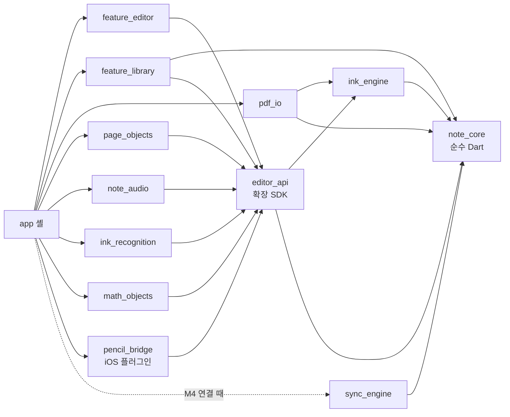

# 2차 라운드 동시 개발 개요 — 초안 B (기능 모듈 중심)

> 상태: **초안** (2차 라운드 설계자 B, 2026-11-05) — 총괄의 비교·검토 전이다. 기준: 1차 [00-overview.md](../../00-overview.md) 7장 통합 계약 v1.4, [00-review.md](../../00-review.md), 마스터 기획서 [PLAN.md](../../../PLAN.md) F-03·F-10~F-16·5장·10장 M5~M7 · 조사: [01-hooks](../research/01-hooks.md) · [02-audio-stylus](../research/02-audio-stylus.md) · [03-recognition](../research/03-recognition.md) · [04-native](../research/04-native.md)
>
> **관점**: 새 기능을 독립 패키지(이하 '모듈')로 만들고, 에디터·필기 엔진·앱 셸에는 **확장 지점**(도구 등록, 요소 렌더러 등록, 선택 메뉴·툴바·하단 막대·붙여넣기·획 보조 등록, 타임라인 포트)으로 꽂는다. 기존 7개 패키지는 '계약 수준의 자리 추가'와 그 자리를 실제로 움직이는 구현만 맡는다. 동기화·백업·PDF가 알아야 하는 **데이터 형태는 CORE**에 두고(1차 원칙 유지), **행동(렌더·편집·도구·엔진·플랫폼 코드)은 모듈**에 둔다.

표기

| 표시 | 뜻 |
|---|---|
| 추가 | 공개 진입점에 새 타입·멤버·선택 인자를 더한다. 기존 호출은 그대로 컴파일된다 |
| 깨짐 | 기존 공개 시그니처·위치·의미가 바뀌거나, sealed/enum 값 추가로 다른 패키지의 exhaustive switch가 깨진다. 5.15에 전부 모은다 |
| 규칙 | 시그니처는 같고 계약 문장(override 소유·예산·동작)만 바뀐다 |
| [조사 01 R7] | 근거가 된 조사 문서·항목. 조사의 [확인]/[추측] 구분을 그대로 이어받는다 |

---

## 1. 목적 · 범위

### 1.1 목적과 진행 순서

`docs/PLAN.md` M5(편집 강화) · M6(녹음) · M7(인식)을 1차와 같은 방식으로 **동시에** 개발한다. 1차 7.8에서 미룬 항목 중 M5와 맞닿은 것(올가미 회전·색 변경 UI, 제스처 동작 변경, 이미지 페이지)과, 같은 색인으로 풀리는 '라이브러리 전역 PDF 텍스트 검색'도 넣는다.

진행 순서(1차 1절과 같고 0단계만 더함)

0. **선행 조건**: 1차 통합 완료(1차 7.7 V1~V6 통과, `main`에 7개 영역 병합). 2차 작업 트리는 그 `main`에서 갈라진다.
1. 이 개요(총괄 확정본 `m5-7/00-overview.md`)와 영역 계획서 `m5-7/NN-<id>.md` 작성
2. 총괄 검토(`m5-7/00-review.md`) → 계약 v2.0 확정 → 영역 수정·승인
3. 기반 단계(6절): 새 패키지 골격 · 계약 코드 · 확장 지점 자리 · 가짜 구현
4. 영역별 동시 개발(작업 트리 `area2/<id>`)
5. 통합(7절) → 미리보기 배포 → iPad 웹 확인 → 안드로이드 APK 확인 → (계정 뒤) TestFlight

### 1.2 기능별 범위 — 이번 범위 / 웹 / 네이티브 전용 / 실기기 확인 시점

'완료 판정'은 언제나 컨테이너에서 도는 테스트(7.2 V 기준)다. 실기기 확인은 합격 판정(사용자)이며, 확인 시점이 '계정 뒤'인 항목도 이번 라운드에 코드·테스트는 끝낸다.

| # | 기능 (PLAN) | 이번 범위 | iPad Safari(웹) | 네이티브 전용 부분 | 실기기 확인 시점 | 이후로 미룸 |
|---|---|---|---|---|---|---|
| 1 | 올가미 고급 — 회전·색 변경·굵기·잘라내기·붙여넣기·복제 (5.1 M5) | 전부, 획 + 페이지 요소 혼합 선택 | ✔ | — | 미리보기 배포 직후 iPad 웹 | 맨 앞/뒤 정렬(z 순서 필드) |
| 2 | 텍스트 상자 (5.1) | 생성·편집(한글 IME)·크기·색·정렬·굵게, 이동·크기·회전, PDF 텍스트 객체 출력, 검색 색인 | ✔ (IME는 **조기 실기기 확인** 필수 — 8.1 위험 1) | — | OBJECTS 첫 주에 시제품을 미리보기 채널로 | 부분 서식(일부만 굵게), 글꼴 여러 종, 목록·표 |
| 3 | 이미지 삽입 (5.1) | 사진 보관함·카메라·파일 선택, 웹 붙여넣기(스크린샷), 이동·크기·회전·투명도, PDF 이미지 객체 출력 | ✔ (Safari 파일 입력이 '사진 찍기'까지 제공) | 네이티브 클립보드 이미지 붙여넣기 | iPad 웹 / APK | 자르기 UI(데이터 자리 `crop`만 둠), 네이티브 붙여넣기 |
| 4 | 이미지 페이지 (F-13, 1차 7.8) | 페이지 추가 시트 '이미지', 배경 렌더·썸네일·PDF 출력 | ✔ | — | iPad 웹 | — |
| 5 | 도형 도구 (F-11) | 직선·화살표·사각형·원/타원·삼각형·다각형·별, 선 색·굵기·선 스타일, 채우기, 크기·회전·꼭짓점 이동 | ✔ | — | iPad 웹 | 그리드 스냅·자(P1) |
| 6 | 자동 도형 보정 (F-11) | 펜을 댄 채 500 ms 멈춤 → 직선·원·타원·삼각형·사각형(회전 포함)·다각형 5~8 | ✔ (순수 Dart) | — | iPad 웹 — 문턱값을 실제 획으로 다시 맞춤 [조사 03 4.2] | 화살표·별 자동 판정 |
| 7 | 제스처 사용자 지정 (F-12, 1차 7.8) | 2·3손가락 탭, 손가락 길게 누르기, 펜 버튼, Pencil 더블탭·스퀴즈의 동작 선택 | ✔ | — | iPad 웹 | 두 손가락 드래그·핀치 바꾸기 |
| 8 | S펜 측면 버튼 · 지우개 끝 (F-12) | 누른 채 쓰는 동안 임시 지우개(기본) + 동작 선택, 웹 '닿음' 판정 규칙 [조사 02 8.4] | 안드로이드 Chrome에서만 해당 | 안드로이드 APK(플러그인 불필요) | 안드로이드 기기가 있으면 APK(Q2) | — |
| 9 | Apple Pencil 더블탭·스퀴즈 (+배럴 롤·호버 자세) (F-12, F-03) | Dart 쪽 동작 매핑·설정·이벤트 디코딩 + iOS 플러그인 `pencil_bridge` Swift 작성 + macOS CI 컴파일 | ✘ (웹 API 없음) | iOS 전부 | **계정 뒤 TestFlight**(또는 무료 Apple ID 사이드로드 — Q4) | — |
| 10 | 붓펜·캘리그래피·점선/파선 (F-03) | 렌더·펜별 설정(펜촉 각·점선 간격)·PDF 벡터 | ✔ (캘리그래피는 고정 펜촉 각) | 배럴 롤로 펜촉 각(iOS) | iPad 웹 / 롤은 TestFlight | — |
| 11 | 레이저 포인터 (F-03) | 저장하지 않음(1차 E-3), 1.5초 뒤 사라짐 | ✔ | — | iPad 웹 | 발표 모드(외부 화면) |
| 12 | 암기 테이프 (F-03, 5.2) | 가림·탭해서 보기·페이지 전체 보기/가리기, 썸네일·PDF는 가린 채 | ✔ | — | iPad 웹 | 드러냄 상태 저장(Q12) |
| 13 | 녹음·일시정지·정지·여러 녹음·이름·삭제 (F-16) | 전부 | ✔ 앞에 있을 때(Safari = AAC/mp4) | — | iPad 웹(실기기 D1~D4) | — |
| 14 | 백그라운드 녹음 (F-16) | 코드·설정까지(안드로이드 포그라운드 서비스, iOS 배경 오디오). 웹은 탭이 숨으면 **앱이 먼저 일시정지** + 안내, 녹음 조각을 1초마다 초안 저장소에 써서 탭이 닫혀도 남김(A-2) | ✘ | 전부 | 안드로이드 APK / iOS는 TestFlight | — |
| 15 | 재생 바 — 0.5~2배속, 10초 앞뒤 (F-16) | 전부 | ✔ | — | iPad 웹 | 잠금 화면 재생 제어 |
| 16 | 획별 녹음 시점 → 재생 시 강조, 필기 탭 → 그 시점부터 재생 (F-16) | 전부(녹음기 위치 기준 시계 [조사 02 6.2]) | ✔ | — | iPad 웹 | 시계 보정 필드(Q14) |
| 17 | 녹음 압축·동기화·용량·녹음만 삭제·동의 안내 (F-16) | AAC-LC 모노 64 kbps(Chrome은 opus + 경고), 용량 표시, 소프트 삭제, 동의 안내. 동기화는 데이터 경로만 | ✔ | — | iPad 웹 | 바이트 회수(에셋 GC), 실제 동기화(M4) |
| 18 | 손글씨 → 텍스트 — 올가미 변환·후보·직접 편집·텍스트 상자로/클립보드로 (F-10) | 인식기 포트·ML Kit 어댑터·줄 나누기·변환 화면 | 변환 메뉴는 '앱에서 쓸 수 있어요' 안내(인식 안 함) [조사 03 R5] | ML Kit(안드로이드·iOS) | **안드로이드 APK에서 한국어·혼용 품질 실험이 첫 실기기 작업** [조사 03 R1] / iPad 네이티브는 TestFlight | 웹 서버 OCR(W2) |
| 19 | 손글씨 검색 색인 (5.2, M7) | FTS5 음절 바이그램 색인(CORE), 인식 결과 동기화 엔티티, 색인기 | 동기화된 결과로 검색 — **M4 뒤부터**. 이번 라운드 웹은 텍스트 상자·PDF 텍스트만 찾는다 | 인식은 네이티브 | APK | — |
| 20 | 라이브러리 전역 PDF 텍스트 검색 (1차 7.8 미룸) | 같은 색인에 PDF 공급 | ✔ | — | iPad 웹 | — |
| 21 | 수식 객체 — 렌더·LaTeX 직접 편집·LaTeX 복사·이동·크기·색 (F-14) | 전부(엔진 없이 쓰는 경로) | ✔ | — | iPad 웹 | PDF 벡터 수식(래스터로 시작 — Q9) |
| 22 | 수식 인식 엔진 비교 구조 → 손글씨 수식 → LaTeX (F-14) | 엔진 포트·가짜 엔진·HTTP 호출 어댑터·서버 함수 코드(에뮬레이터 시험)·평가 도구·쓰기 멈춤 뒤 미리보기 흐름 | 흐름은 웹 포함 전 플랫폼 같음 | — | **Firebase 프로젝트 + 엔진 계정 뒤**(Q5) | 엔진 결정, 획마다 실시간 미리보기 |
| 23 | 네이티브 저장(파일 DB·파일 블롭) (선행) | CORE + INFRA | — | 전부 | 안드로이드 APK | — |
| 24 | 안드로이드 APK 고정 서명·`INTERNET`·앱 이름·권한 선언 / iOS 배포 대상 15.5·Podfile·Info.plist / iOS 컴파일 확인 워크플로 (선행) | INFRA | — | 전부 | APK, iOS는 컴파일만 | TestFlight 서명 실전(계정 뒤) |
| 25 | 동기화 실연결·로그인 화면 (M4) | **제외** — 1.5 | — | — | — | 조건부 후속 라운드 |

### 1.3 1차 7.8에서 미룬 항목 처리

| 1차 7.8 항목 | 2차 처리 | 담당 |
|---|---|---|
| 올가미 회전·색 변경 UI | 이번 — INK 계산(`SelectionGeometry.rotate`·`snapAngle`·`InkSelection.recolor`)은 이미 있다 [조사 01 3.6] | EDITOR |
| 제스처 동작 변경 | 이번 — `GestureSettings`에 동작 매핑을 **추가**(옛 bool 키 유지) [조사 01 R9] | EDITOR |
| 이미지 페이지 | 이번 — 이미지 배경 빌더는 OBJECTS 모듈이 만들고, 배경 빌더 목록 조립은 INFRA로 옮긴다(5.12) | OBJECTS, PDF, INFRA |
| 다른 노트의 페이지 복사 (F-13) | 이번 — LIBRARY가 '페이지 추가' 시트 원천을 확장 지점으로 기여(노트·페이지 고르기 시트). 요소도 함께 복사 | LIBRARY, CORE |
| 라이브러리 전역 PDF 텍스트 검색·색인 | 이번 — CORE 색인(5.3.6) + PDF 공급 + LIBRARY 묶음 | CORE, PDF, LIBRARY |
| 동기화 실연결 | 제외(1.5). 대신 새 엔티티 종류와 '모르는 종류 보류'를 **실연결 전에** 넣는다 [조사 01 R2] | SYNC |
| 다중 탭 리더 선출, tombstone 정리, 고아 에셋 GC | 이후 유지. 녹음 삭제는 소프트 삭제만, 녹음 초안(완성 전 조각)의 정리는 AUDIO 모듈 내부 | — |
| 백업 내보내기 | 1차 완료. v2에서 새 종류(요소·모듈 기록·녹음 제목)를 포함 | CORE |

### 1.4 이번 범위에서 제외

- 동기화 실연결(앱 연결·로그인 화면·Firebase 배포·App Check) — 1.5
- 웹(iPad Safari)에서의 손글씨 인식(서버 OCR — 조사 03 W2), 수식 엔진 실제 호출·엔진 결정, 획마다 실시간 수식 미리보기
- 요소 z 순서 바꾸기(맨 앞/뒤), 이미지 자르기 UI, 텍스트 부분 서식, 그리드 스냅·자, 발표 모드, 화살표·별 자동 판정
- 에셋 바이트 회수(GC), 녹음 텍스트 변환(P2)
- TestFlight 실제 업로드(계정 뒤 — 워크플로·안내서는 갱신)

### 1.5 동기화 실연결(M4)을 넣지 않는 판단

이번 라운드에 넣지 않는다. 근거:

1. Firebase 프로젝트가 없어 실연결을 **완료 판정할 수 없다**. 컨테이너는 `gstatic`이 막혀 `firebase_core_web` 경로도 시험할 수 없다 [조사 04 6.5].
2. 앱에 Firebase 네이티브 SDK(SwiftPM)가 들어오는 순간 ML Kit(CocoaPods 전용)와의 혼합 모드 중복 라이브러리 문제가 이번 라운드로 들어온다 [조사 04 요약 9]. 두 위험을 한 라운드에 겹치지 않는다.
3. 새 엔티티 종류(요소·모듈 기록)는 **배포된 옛 앱이 없을 때** 넣는 것이 가장 싸다 [조사 01 7절]. 이번 라운드에 종류를 모두 확정하고, 실연결은 그 뒤에 한다.

대신 (a) SYNC는 새 종류·'모르는 종류 보류'·시나리오 시험을 가짜 서버로 끝내고, (b) INFRA는 `functions/` 에뮬레이터 시험을 CI에 넣고, (c) 사용자가 라운드 중에 Firebase 프로젝트를 만들면 2차 통합 직후 **'M4 연결' 짧은 후속 라운드**(INFRA + SYNC 2개 영역, 로그인 화면 + 연결 + 실기기 2대 확인 + iOS 혼합 모드 확인)를 연다(Q3).

---

## 2. 영역 지도

### 2.1 영역 표

기존 7개 영역은 1차 소유 경로를 그대로 갖고, 새 영역 4개가 새 패키지를 갖는다. EDITOR는 확장 지점 전용 패키지 `editor_api`를 새로 갖고, INFRA는 iOS 펜 플러그인 `pencil_bridge`를 새로 갖는다. **소유 경로는 겹치지 않는다**(한 패키지 = 한 영역, `functions/`도 한 영역).

| ID | 이름 | 계획서 | 소유 경로 | 맡는 기능 (2차) | 1차 소유 영역과의 관계 |
|---|---|---|---|---|---|
| CORE | 문서 모델 · 저장 v2 | `m5-7/02-core.md` | `packages/note_core/` | 페이지 객체 엔티티(텍스트·이미지·도형·수식 **데이터 형태**), 객체 편집 명령, 녹음 저장소 API·제목, 모듈 기록 엔티티, 검색 색인(FTS5 바이그램)·정규화 함수, DB 스키마 v2·마이그레이션, 네이티브 파일 블롭, 노트 복사·휴지통·백업의 새 종류 처리 | 1차 CORE 그대로(같은 패키지). 데이터 형태만 늘리고 '행동'은 모듈로 보낸다 |
| INK | 필기 엔진 v2 | `m5-7/03-ink.md` | `packages/ink_engine/` | **요소 렌더러 등록 지점**과 요소 층 호스팅(화면·타일·썸네일·벡터 내보내기), 요소 포함 적중·올가미·선택·지우개, 미리보기 요소, 재생 강조 API, 획 스냅숏(자동 도형용), 새 펜 5종 렌더(붓펜·캘리그래피·점선·레이저·테이프), 요소 래스터 내보내기 | 1차 INK 그대로. 요소의 그리기 자체는 모듈 렌더러가 한다 |
| EDITOR | 에디터 확장 지점 · 편집 강화 | `m5-7/04-editor.md` | `packages/feature_editor/`, **`packages/editor_api/`(신규)** | `editor_api`(모듈용 확장 SDK: 도구·툴바 동작·하단 막대·선택 메뉴·요소 편집기·붙여넣기·획 보조·타임라인 포트·`EditorHost`·스타일러스 부가 이벤트), 에디터의 호스트 구현, 요소 공통 선택·이동·크기·회전, 올가미 고급 UI, 제스처 동작 매핑·설정, 펜 버튼(S펜·Pencil), 새 펜 노출·펜별 설정, 처음 보여 줄 위치(검색 결과) | 1차 EDITOR + 확장 지점 패키지를 떼어 냄(1차 `EditorExtensions` 등은 `editor_api`로 이사 — 5.15) |
| LIBRARY | 내용 검색 · 페이지 가져오기 | `m5-7/05-library.md` | `packages/feature_library/` | 검색 결과에 '노트 내용'(손글씨·텍스트 상자·PDF) 묶음과 페이지·위치로 열기, '다른 노트의 페이지' 페이지 추가 원천(에디터 확장 지점 기여) | 1차 LIBRARY 그대로. `editor_api`에 의존이 새로 생김 |
| PDF | 요소 · 이미지 페이지 내보내기 · PDF 색인 공급 | `m5-7/06-pdf.md` | `packages/pdf_io/` | PDF 합성에 이미지 객체·텍스트 객체(글꼴 넣기) 명령 추가(웹 JS + 네이티브), 요소·테이프·이미지 배경 페이지 출력, 배경 빌더 provider 분리, 라이브러리 전역 PDF 텍스트 색인 공급, 정규화 함수 CORE로 통일 | 1차 PDF 그대로 |
| SYNC | 새 엔티티 종류 | `m5-7/07-sync.md` | `packages/sync_engine/` | `pageObject`·`moduleRecord` 종류(코덱·병합 단위·범위·정렬·게이트·되살림·영구 삭제 보호), `Recording.title`, 모르는 종류 기록 보류, 시나리오 시험 | 1차 SYNC 그대로 |
| INFRA | 연결 · 네이티브 빌드 · 플랫폼 | `m5-7/01-infra.md` | 1차 경로 전부(루트 파일, `app/`, `.github/`, `tool/`, `docs/guides/`) + **`packages/pencil_bridge/`(신규)** | 모듈 연결(override 표 v2, 기여 합치기, 설정 화면 조립, 기능 스위치), 네이티브 저장 경로, 안드로이드 매니페스트·서명·APK, iOS 배포 대상·Podfile·Info.plist, `ios-compile.yml`, 네이티브 설정 정적 검사·플러그인 요구 스캐너, iOS 펜 플러그인, 서버 함수 CI 잡, 웹 자산 예산, 안내서 | 1차 INFRA + 펜 플러그인 패키지 |
| OBJECTS | 페이지 요소 | `m5-7/08-objects.md` | `packages/page_objects/` | 텍스트 상자·이미지·도형의 렌더러·도구·편집기, 이미지 선택·축소·디코드 캐시·웹 붙여넣기, 이미지 페이지(배경 빌더·추가 원천), 자동 도형 판정 `fitShape`와 획 보조, 한글 글꼴 지연 적재 | 신규(1차에 없음) |
| AUDIO | 녹음 · 재생 | `m5-7/09-audio.md` | `packages/note_audio/` | 녹음기(웹·네이티브)·오디오 세션·포그라운드 서비스·화면 꺼짐 방지·숨김 시 일시정지, 녹음 시계, 녹음 초안 저장·복구, 완성 → 에셋 + `Recording`, 재생기·속도·탐색, 녹음 버튼·재생 막대·목록, 타임라인 포트(획 시점·재생 강조·탭 탐색), 동의 안내 | 신규 |
| RECOG | 손글씨 인식 · 색인 | `m5-7/10-recog.md` | `packages/ink_recognition/` | 인식기 포트·ML Kit 어댑터(네이티브)·가짜·웹 '지원 안 함', 줄 나누기, 인식 결과 모듈 기록(`hwr`), 색인기(변경 페이지 재인식 + 결과 → CORE 색인), 모델 받기 관리, '텍스트로 변환' 화면, 실기기 품질 실험 도구 | 신규 |
| MATH | 수식 | `m5-7/11-math.md` | `packages/math_objects/`, **`functions/`**(저장소 루트, Node) | 수식 렌더러(`flutter_math_fork`)·편집기(LaTeX + 미리보기)·수식 입력 도구, 수식 인식기 포트·가짜·HTTP 호출 어댑터, '수식으로 변환' 선택 메뉴, 서버 함수 `recognizeMath`(엔진 어댑터·입력 검사·소유자 허용 목록, 에뮬레이터 시험), 엔진 비교 평가 도구 | 신규 |

### 2.2 작업량 균형

1차 영역 하나가 개발 세션 8~10회였다. 크기는 그 기준의 추정이다 [추측 — 1차 진행 기록의 세션 수 기준].

| 크기 | 영역 | 주된 작업 (작업 수 추정) | 예상 세션 |
|---|---|---|---|
| 상 | CORE | 객체 엔티티·명령·세션, 스키마 v2·마이그레이션, 녹음·모듈 기록 저장소, 검색 색인, 네이티브 블롭, 복사·휴지통·백업, 가짜 저장소 v2 (12) | 8~9 |
| 상 | INK | 등록 지점·요소 층(위젯 층 + 타일 안 그리기), 적중·올가미·선택·지우개, 썸네일·벡터, 새 펜 5종, 재생 강조, 테이프·레이저 (16) | 9~10 |
| 상 | EDITOR | `editor_api`·호스트 구현·도구 라우팅, 요소 공통 선택·변형·편집기 규약, 올가미 고급, 제스처·펜 버튼·Pencil, 새 펜 노출, 타임라인 포트 소비 (16) | 9~10 |
| 상 | OBJECTS | 텍스트(글꼴·IME 편집기·내보내기), 이미지(선택·축소·캐시·붙여넣기·페이지), 도형(도구·편집·렌더), 자동 도형 (12) | 8~9 |
| 중상 | AUDIO | 녹음기 2종·세션·포그라운드, 시계, 초안 저장·복구, 재생기, 에디터 기여 3종, Chrome 가짜 마이크 시험 (11) | 6~8 |
| 중상 | INFRA | 연결 v2, 안드로이드·iOS 네이티브 설정, 서명·워크플로 2개, 정적 검사·스캐너, 펜 플러그인, 서버 함수 CI, 예산·안내서 (12) | 6~8 |
| 중 | PDF | 이미지·텍스트 합성 명령(JS + FFI), 요소·테이프·이미지 페이지 출력, 빌더 provider, PDF 색인 공급 (7) | 5~6 |
| 중 | SYNC | 새 종류 2개 전 경로, 보류 규칙, 시나리오 시험 (7) | 4~6 |
| 중 | RECOG | 포트·ML Kit·모델 관리, 줄 나누기, 결과 기록·색인기, 변환 화면, 실험 도구 (8) | 5~6 |
| 중 | MATH | 렌더러·편집기·도구, 엔진 포트·어댑터, 서버 함수, 평가 도구 (8) | 5~6 |
| 중하 | LIBRARY | 내용 검색 묶음·열기, 다른 노트 페이지 가져오기 (5) | 3~4 |

균형 조정: LIBRARY에 '다른 노트 페이지 복사'를 맡겨 하가 되지 않게 했고, 펜 플러그인(작음)은 네이티브 설정을 가진 INFRA가 맡는다. 상 4개(CORE·INK·EDITOR·OBJECTS)는 서로의 가짜로 시작할 수 있게 기반 단계에서 동작하는 단순 구현을 먼저 둔다(6절).

### 2.3 패키지 의존 방향 (계약 5.1)



모듈 패키지(`page_objects`·`note_audio`·`ink_recognition`·`math_objects`·`pencil_bridge`)는 `editor_api`(→ `ink_engine` → `note_core`)만 보고, `feature_editor`·다른 모듈·`pdf_io`·`feature_library`를 import하지 않는다. `feature_editor`는 어떤 모듈도 import하지 않는다(모듈이 없어도 에디터가 돈다). 모듈 사이 연결은 ① CORE 데이터(예: 인식 결과 → `TextBoxData` 객체), ② `EditorHost`(예: 변환 뒤 `beginEditObject`), ③ INK 등록 지점뿐이다.

### 2.4 작업 트리 · 브랜치

- 작업 트리 `/home/user/wt2/<id>`, 브랜치 `area2/<id>`(1차 `area/<id>`와 섞이지 않게). 계획 단계 작업 트리는 `/home/user/wt/plan57`(`area/plan57`).
- 새 영역도 1차처럼 진행 기록 `docs/plans/progress/<id>.md`(2차는 `docs/plans/m5-7/progress/<id>.md`)를 자기 작업 트리에서만 고친다.

---

## 3. 영역 간 의존 그래프와 동시 개발 가능성

### 3.1 계약 의존 — 누가 누구의 계약을 쓰나

| 소비 영역 ↓ / 제공 → | CORE | INK | EDITOR(`editor_api`) | 그 밖 |
|---|---|---|---|---|
| INK | `PageObject`·데이터 타입, `PageContent.objects`, 명령, `AssetStore` | — | — | — |
| EDITOR | 객체 명령, `PageContent.objects`, `Recording` 필드 | 등록 지점, 선택·적중(요소), 미리보기, 재생 강조, 스냅숏, 테이프 | — | — |
| OBJECTS | `TextBoxData`·`ImageData`·`ShapeData`, `ImageBackground`, `AssetStore.put` | `PageObjectRenderer`, `InkObjectExportItem`, 배경 빌더 | 도구·툴바 동작·붙여넣기·획 보조·요소 편집기·`EditorHost` | — |
| AUDIO | `RecordingRepository`, `AssetStore.put`, `idGeneratorProvider` | `InkStrokeMeta`, `InkPlaybackFocus` | 툴바 동작·하단 막대·타임라인 포트 | — |
| RECOG | `ModuleRecordRepository`, `SearchIndex`, `TextBoxData`, `NoteStore.changes` | (선택) `InkRasterExport` | 선택 메뉴·`EditorHost.beginEditObject` | — |
| MATH | `MathData`, 명령 | `PageObjectRenderer`, `InkRasterExport` | 도구·요소 편집기·선택 메뉴 | — |
| LIBRARY | `contentSearchProvider`, `PageDraft.copyOf`(요소 포함) | (간접) | 페이지 추가 원천 `EditorMenuItem` + `EditorMenuContext.host` | — |
| PDF | `PageObject`, `ImageBackground`, `SearchIndex`, `normalizeSearchText` | `exportPageWithObjects`·`InkObjectExportItem`·테이프 층 | — | — |
| SYNC | `EntityKind` 2종, 엔티티 JSON 키 | — | — | — |
| INFRA | 네이티브 경로 설정 | 등록 provider 2개 | `EditorExtensions.merge`, 슬롯 provider | 모든 모듈의 연결 함수, PDF 빌더 provider |

### 3.2 가짜로 개발하는 표

| 영역 | 개발 중 쓰는 가짜 / 단순 구현 | 출처(기반 단계) |
|---|---|---|
| CORE | 없음(기반) | — |
| INK | CORE `createFakeNoteStore` v2, 시험용 렌더러 `TestBoxObjectRenderer`(색 사각형) | B2, B3(INK 자신의 `testing.dart`) |
| EDITOR | 실제 INK(B3 단순 구현부터), CORE 가짜, **시험용 플러그인 묶음**(`editor_api/testing.dart`의 `TestToolSpec`·`TestSelectionItem`·`FakeTimelinePort`) | B2·B3·B4 |
| OBJECTS | CORE 가짜, INK B3(등록 지점이 실제로 그림), `FakeEditorHost`, 에디터 실물 시험 도우미 `pumpEditorWithExtensions`(EDITOR `testing.dart`, 시험 전용 의존), 가짜 이미지 선택기(자체) | B2·B3·B4 |
| AUDIO | CORE 가짜(`RecordingRepository`), `FakeEditorHost`, 자체 `FakeAudioRecorder`·`FakeAudioPlayer`·`FakeDraftStore`, Chrome 가짜 마이크(실물 웹 경로) | B2·B4·B8 |
| RECOG | CORE 가짜(모듈 기록·색인 — 가짜 색인은 LIKE 의미), `FakeEditorHost`, 자체 `FakeHandwritingRecognizer`, 합성 손글씨 생성기 | B2·B4·B8 |
| MATH | CORE 가짜, INK B3, `FakeEditorHost`, 자체 `FakeMathRecognizer`, Firebase 에뮬레이터(`demo-noteapp`) | B2·B3·B4·B8 |
| LIBRARY | CORE 가짜 `contentSearchProvider`, `FakeEditorHost` | B2·B4 |
| PDF | INK B3 `exportPageWithObjects`(시험 렌더러의 경로·이미지·텍스트 항목을 실제로 냄), CORE 가짜 | B2·B3 |
| SYNC | CORE `openTestNoteStore` v2(통합 단계), 동시 개발 중에는 자체 `FakeLocalStore`에 새 종류 | B2 |
| INFRA | 모든 영역의 기반 단계 자리표시 구현 | B1~B9 |

### 3.3 임계 경로와 시작 시점

```text
B1 INFRA 골격 ─▶ B2 CORE 계약·가짜 ─┬─▶ B3 INK 등록 지점 ─┬─▶ B4 EDITOR editor_api·호스트 ─┬─▶ B7 LIBRARY 자리·기여
                                   │                      │                                └─▶ B8 모듈 4개 + B8' 펜 플러그인 ─▶ B9 INFRA 연결
                                   │                      └─▶ B6 PDF 빌더 분리
                                   └─▶ B5 SYNC 종류 자리
```

- 동시 개발 중의 긴 경로는 **CORE 스키마 v2 + 색인**(실제 DB 위 통합 시험의 전제)과 **EDITOR 호스트 구현**(모듈의 실물 에디터 시험의 전제)이다. 둘 다 기반 단계에서 가짜·단순 구현을 먼저 두므로 모듈은 첫날부터 시작한다.
- 모듈의 실물 에디터 시험(`pumpEditorWithExtensions`)은 EDITOR 작업 E-2.2·E-2.3이 커밋된 뒤 '작업 트리 간 체크포인트'(EDITOR가 `area2/editor`를 원격에 올린 커밋)를 모듈이 **시험 의존으로만** 끌어와 돌린다. 그 전에는 `FakeEditorHost`로만 판정한다.
- 실기기 확인이 일찍 필요한 두 가지 — ① 텍스트 상자 한글 IME(iPad Safari), ② ML Kit 한국어 품질(안드로이드 APK) — 는 해당 모듈의 **첫 작업**으로 둔다. ②는 INFRA의 네이티브 저장·서명 APK가 선행 조건이라 INFRA I-2.2·I-2.3을 INFRA 첫 작업으로 둔다.

---

## 4. 동시 개발 방식 · 환경 제약 · 계획서 목차

1차 4~6절을 그대로 따른다(계약 우선, 소유 경로만 수정, 가짜로 시험, 기반 단계 먼저, 통합 단계). 바뀌거나 더하는 것만 적는다.

- **환경**: Flutter 3.47.9 / Dart 3.13.7, 리눅스 컨테이너(CPU 4, 메모리 15GB), 헤드리스 Chrome 가능, Android SDK·`dl.google.com` 없음(APK·Gradle은 CI에서만) [조사 04 요약 1], iOS 빌드 하위 명령 없음(macOS CI에서만). 사용자: iPad Pro 13"(Pencil 종류 미확인), 실기기 시험 가능, Mac·유료 Apple 계정·Firebase 프로젝트 없음.
- **동시 실행 부하**: 영역이 11개라 무거운 시험이 겹친다. 각 영역은 평소 `ws test --affected-since`·패키지 단위 시험만 돌리고, 전체 `ws test`·Chrome 전체는 체크포인트 때만 돌린다. Chrome 가짜 마이크 시험(`media` 태그)과 Firebase 에뮬레이터 시험은 한 번에 하나만(영역 진행 기록에 시작·끝 시각을 남김).
- **계획서 목차**: 1차 6절 12항목 + **13. 확장 지점 사용표**(모듈: 어떤 자리를 어떤 id로 채우는가 / 기존 패키지: 어떤 자리를 새로 여는가) + **14. 네이티브·권한 요구표**(INFRA 정적 검사의 입력, 5.13.3).

---

## 5. 통합 계약 v2.0 (초안)

> **계약 v2.0 초안.** 1차 7장 v1.4 위에 덮어쓴다. 여기 적지 않은 것은 v1.4 그대로다. v1.4 → v2.0의 '깨짐' 목록은 5.15. 코드 블록은 시그니처 계약이다(본문 생략). 이 초안의 이름은 총괄 확정 때 바뀔 수 있다.

### 5.1 패키지 구조와 의존 방향

1차 7.1 표에 아래 행을 더하고, `feature_library` 행의 허용 의존에 `editor_api`를 더한다.

| 패키지 | 소유 | 종류 | 허용 의존(형제) | 공개 진입점 |
|---|---|---|---|---|
| `editor_api` | EDITOR | Flutter 패키지 | `note_core`, `ink_engine` | `editor_api.dart`, `testing.dart`(시험 전용) |
| `feature_editor` | EDITOR | Flutter 패키지 | `note_core`, `ink_engine`, **`editor_api`** | `feature_editor.dart`, **`testing.dart`**(신규 — 모듈 시험용 실물 에디터 도우미) |
| `feature_library` | LIBRARY | Flutter 패키지 | `note_core`, **`editor_api`** | (같음) |
| `page_objects` | OBJECTS | Flutter 패키지 | `note_core`, `ink_engine`, `editor_api` | `page_objects.dart`, `testing.dart` |
| `note_audio` | AUDIO | Flutter 패키지 | `note_core`, `ink_engine`, `editor_api` | `note_audio.dart`, `testing.dart` |
| `ink_recognition` | RECOG | Flutter 패키지(주 라이브러리 중 `src/core/`는 순수 Dart) | `note_core`, `ink_engine`, `editor_api` | `ink_recognition.dart`, `testing.dart` |
| `math_objects` | MATH | Flutter 패키지 | `note_core`, `ink_engine`, `editor_api` | `math_objects.dart`, `testing.dart` |
| `pencil_bridge` | INFRA | Flutter 플러그인(iOS 구현만, 다른 플랫폼은 Dart에서 '지원 안 함') | `editor_api` | `pencil_bridge.dart` |
| `functions/` | MATH | Node 22 TypeScript(워크스페이스 멤버 아님) | — | Firebase callable `recognizeMath` |

규칙(1차 7.1 규칙 1~3에 더함)

4. **모듈 패키지**(위 표의 신규 5개)는 서로 import하지 않고, `feature_editor`·`feature_library`·`pdf_io`·`sync_engine`도 import하지 않는다. `feature_editor`·`feature_library`·`pdf_io`는 모듈을 import하지 않는다. 모듈 ↔ 기존 패키지 연결은 소비하는 쪽의 등록 지점·자리 provider를 앱 셸이 채워서 한다(1차 규칙 1의 연장).
5. 모듈의 `test/`는 `package:feature_editor/testing.dart`를 **dev 의존으로만** 쓸 수 있다(실물 에디터 위 시험). `lib/`에서는 안 된다(R8 `allowed_dependencies`에 `dev_only` 구분 추가 — INFRA).
6. 모듈은 '연결 함수'(5.9)만 공개하고, 내부 포트·구현은 `src/`에 둔다. 다른 영역이 모듈의 타입을 직접 쓰는 일은 앱 셸 연결 말고는 없다.

### 5.2 소유 원칙 추가와 소유표 v2

#### 5.2.0 원칙 추가

- **데이터는 CORE, 행동은 모듈.** 동기화·백업·PDF·휴지통이 알아야 하는 엔티티의 필드와 JSON 형식은 CORE가 정의한다(페이지 객체의 종류별 데이터 포함). 그 데이터를 그리고 고치고 만드는 코드는 모듈이 갖는다.
- **확장 지점의 소유 = 소비하는 쪽.** 에디터의 자리는 EDITOR(`editor_api`), 렌더러·배경 등록 지점은 INK, 라이브러리 화면의 자리는 LIBRARY가 정의한다. 모듈은 그 타입을 구현해 연결 함수로 내놓고, 앱 셸만 합쳐서 넣는다.
- **확장 기여의 id**: `<모듈>.<이름>` 형식으로 워크스페이스 전체에서 유일(예: `objects.text`, `audio.record`, `recog.toText`, `math.tool`, `library.copyPages`). 같은 종류 목록 안의 id 중복은 `EditorExtensions.merge`가 `ArgumentError`로 막고 INFRA 스모크가 확인한다.
- **설정 키 접두사**: `objects.`, `audio.`, `recog.`, `math.`(1차 7.2.9의 `<영역>.` 규칙 연장). `pencil_bridge`는 설정 키를 두지 않는다.

#### 5.2.1 소유표 — v2.0 추가분

| 타입 · 인터페이스 | 소유 패키지 | 사용 영역 | 정의 |
|---|---|---|---|
| `PageObject`, `ObjectFrame`, `PageObjectData`(+ `TextBoxData`·`ImageData`·`ShapeData`·`MathData`·`UnknownObjectData`), 관련 enum, `PageObjectLimits` | note_core | INK, EDITOR, PDF, SYNC, 모듈 전부 | 5.3.1 |
| `AddObjects`·`RemoveObjects`·`UpdateObjects`, `ClearPage(includeObjects:)`, `PageContent.objects`, `PageDraft.objects` | note_core | EDITOR, INK, 모듈, LIBRARY | 5.3.2·5.3.3 |
| `Recording`(+`title`), `RecordingRepository`, `noteRecordingsProvider` | note_core | AUDIO, SYNC | 5.3.4 |
| `ModuleRecord`, `ModuleRecordRepository`, `ModuleRecordCodes` | note_core | RECOG, SYNC | 5.3.5 |
| `SearchIndex`, `SearchOwner`, `SearchUnit`, `ContentSearchHit`·`ContentSearchResult`, `SearchSources`, `normalizeSearchText`, `contentSearchProvider` | note_core | RECOG, PDF, LIBRARY | 5.3.6 |
| `NoteStoreConfig.nativeBlobDirectory`, `AssetStorageUsage.bytesByType` | note_core | INFRA, AUDIO | 5.3.7 |
| `PageObjectRenderer`, `InkObjectTraits`, `InkObjectLayer`, 컨텍스트 3종, `InkObjectExportItem` 계열, `UnknownObjectRenderer`, `pageObjectRenderersProvider` | ink_engine | 모듈(구현), PDF(소비), INFRA(연결) | 5.6.1 |
| `InkPlaybackFocus`, `InkPlaybackStyle`, `InkElementHit`, `InkRasterExport`, `StrokeSession.snapshotPoints`, 테이프 API, `InkSample.barrelRoll` | ink_engine | EDITOR, AUDIO, MATH, RECOG | 5.6.2 |
| `EditorExtensions`(이사 + 확장), `EditorMenuItem`·`EditorMenuContext`(이사), `DevOverlaySection`(이사), `EditorHost`, 도구·툴바 동작·하단 막대·선택 메뉴·요소 편집기·붙여넣기·획 보조 타입, `EditorTimelinePort`, 스타일러스 부가 이벤트(이사 + 확장), 슬롯 provider 4개 | editor_api | 모듈, LIBRARY, INFRA, feature_editor | 5.7.1 |
| `EditorScreen.initialFocusRectPt`, `GestureSettings` v2·`EditorGesture`·`EditorAction`, `pumpEditorWithExtensions` | feature_editor | INFRA, 모듈(시험) | 5.7.2 |
| `LibraryScreen.onOpenNoteAt`, `libraryEditorContribution` | feature_library | INFRA | 5.8.1 |
| `pdfBackgroundLayerBuilderProvider`, `startPdfTextIndexing` | pdf_io | INFRA | 5.8.2 |
| 모듈 연결 함수 | 각 모듈 | INFRA | 5.9 |

### 5.3 CORE 정의 (note_core)

#### 5.3.1 페이지 객체 — 엔티티 하나, 종류는 데이터로

결정 [조사 01 R1 채택]: 텍스트 상자·이미지·도형·수식은 **`EntityKind.pageObject` 하나**와 테이블 하나로 넣고 종류는 `type`으로 가른다. 모르는 `type`은 원본을 보존하는 `UnknownObjectData`로 읽어 자리표시로 그리고 그대로 저장·동기화한다(다음 라운드에 종류가 늘어도 옛 앱이 깨지지 않음). 위치(`frame`)·내용(`content`)·모양(`style`)을 서로 다른 JSON 키(= 병합 단위)로 둬서, 두 기기가 같은 상자를 하나는 옮기고 하나는 글을 고쳐도 둘 다 살아남는다 [조사 01 3.4 '필드 버전'].

```dart
// lib/src/model/stroke.dart  (PageElement is sealed: PageObject lives in this library, e.g. `part 'page_object.dart';`)

/// Rect of an object before rotation + rotation around its centre. Page pt, y down.
@immutable
final class ObjectFrame {
  const ObjectFrame({required this.x, required this.y, required this.width, required this.height,
      this.rotation = 0});
  final double x, y;            // top-left of the UNROTATED rect, clamped to [-32000, 32000]
  final double width, height;   // [PageObjectLimits.minSidePt, PageObjectLimits.maxSidePt]
  final double rotation;        // rad, normalized to (-pi, pi], quantized 1e-4
  ({double x, double y}) get center;
  List<({double x, double y})> get corners;   // rotated, clockwise from top-left
  PageRect get bounds;                         // axis-aligned bounds of the rotated rect
  /// Centre mapped by m, width/height *= m.uniformScale, rotation += m.rotation.
  ObjectFrame transformed(Affine2 m);
  bool containsPoint(double x, double y, {double tolerance = 0});   // rotated rect test
  ObjectFrame copyWith({double? x, double? y, double? width, double? height, double? rotation});
  Map<String, Object?> toJson();               // {"x","y","w","h","r"}
  factory ObjectFrame.fromJson(Map<String, Object?> json);        // ints accepted (7.4.6)
}

abstract final class PageObjectLimits {
  static const double minSidePt = 1.0, maxSidePt = 14400;
  static const int maxTextLength = 20000;      // String.length
  static const int maxLatexLength = 4000;
  static const int maxShapePoints = 64;
  static const double minFontSizePt = 4, maxFontSizePt = 200;
  static const int maxObjectsPerPage = 2000;   // CORE rejects AddObjects beyond it (ArgumentError)
}

/// Non-stroke page element (M5 / M7). ONE entity kind for every object type.
final class PageObject extends PageElement {
  PageObject({required this.id, required this.pageId, required this.frame, required this.data,
      required this.createdAt, int? updatedAt, this.deletedAt, this.version});
  @override final ElementId id;
  @override final PageId pageId;
  final ObjectFrame frame;
  final PageObjectData data;
  @override final EpochMillis createdAt;      // z-order key with id (Stroke.compareOrder)
  @override final EpochMillis updatedAt;
  @override final EpochMillis? deletedAt;
  @override final Hlc? version;
  @override EntityKind get kind => EntityKind.pageObject;
  String get type => data.type;
  /// Derived, never serialized: frame.bounds.inflate(data.outsetPt). Renderers draw inside it (K-7).
  @override PageRect get bounds;
  Set<AssetId> get referencedAssets => data.referencedAssets;
  /// frame.transformed(m); when scaleContent, data.scaled(m.uniformScale) (font size, stroke width).
  PageObject transformed(Affine2 m, {bool scaleContent = true});
  /// Paste / duplicate / page copy: new id (+ page), createdAt given by the caller.
  PageObject duplicateAs({required ElementId id, PageId? pageId, required EpochMillis createdAt});
  PageObject copyWith({ObjectFrame? frame, PageObjectData? data, EpochMillis? updatedAt,
      EpochMillis? deletedAt, bool clearDeletedAt = false, Hlc? version});
  int get estimatedBytes;                      // history budget (EntityDelta)
  @override Map<String, Object?> toJson();     // 5.4.1
  factory PageObject.fromJson(Map<String, Object?> json);
}

/// Type-specific part of a PageObject. Serialized as two JSON keys: content + style.
sealed class PageObjectData {
  const PageObjectData();
  String get type;                             // wire name: text | image | shape | math
  Map<String, Object?> contentJson();
  Map<String, Object?> styleJson();
  Set<AssetId> get referencedAssets;           // image: {assetId}; others: {}
  double get outsetPt;                         // drawing beyond the frame (shape stroke, arrow heads)
  PageObjectData scaled(double factor);        // selection resize with scaleContent
  PageObjectData recolored(int colorArgb);     // lasso colour change (image / unknown: unchanged)
  /// Unknown type, unknown content enum value or invalid content → UnknownObjectData (raw kept).
  /// Invalid / unknown style values → defaults (content wins over style).
  static PageObjectData decode(String type, Map<String, Object?> content, Map<String, Object?> style);
}

enum TextAlignKind { start, center, end }
final class TextBoxData extends PageObjectData {
  const TextBoxData({required this.text, this.fontSizePt = 16, this.colorArgb = 0xFF1A1A1A,
      this.align = TextAlignKind.start, this.fontKey = 'sans', this.bold = false,
      this.backgroundArgb});
  final String text;                // plain text, '\n' = line break, ≤ maxTextLength
  final double fontSizePt;
  final int colorArgb;              // alpha 0xFF (7.3.2 K-5 같은 규칙)
  final TextAlignKind align;
  final String fontKey;             // 'sans' only in v2.0 (OBJECTS bundled font); unknown → 'sans'
  final bool bold;
  final int? backgroundArgb;        // null = transparent
  // type 'text'; content {text}; style {fontSize, color, align, font, bold, bg}
}

final class ImageData extends PageObjectData {
  const ImageData({required this.assetId, required this.pixelWidth, required this.pixelHeight,
      this.crop, this.opacity = 1.0});
  final AssetId assetId;            // Asset.type == image
  final int pixelWidth, pixelHeight;
  final PageRect? crop;             // normalized [0,1] of the image; null = whole (UI later)
  final double opacity;             // [0.05, 1]
  // type 'image'; content {assetId, pxW, pxH, crop?}; style {opacity}
}

enum ShapeKind { line, arrow, rectangle, ellipse, triangle, polygon, star }
enum ShapeDash { solid, dashed, dotted }
enum ShapeArrowHeads { none, end, start, both }
final class ShapeData extends PageObjectData {
  const ShapeData({required this.kind, required this.points, this.closed = true,
      this.strokeArgb = 0xFF1A1A1A, this.strokeWidth = 2.0, this.strokeOpacity = 1.0,
      this.dash = ShapeDash.solid, this.fillArgb, this.fillOpacity = 1.0,
      this.arrowHeads = ShapeArrowHeads.none});
  final ShapeKind kind;
  /// Vertices in frame-normalized coordinates (0..1 of width / height, before rotation), so
  /// move / resize / rotate change only `frame`. ellipse / rectangle: empty (the frame itself).
  final List<({double x, double y})> points;   // ≤ maxShapePoints
  final bool closed;
  final int strokeArgb; final double strokeWidth, strokeOpacity;   // width [0.1, 30] pt
  final ShapeDash dash;
  final int? fillArgb; final double fillOpacity;
  final ShapeArrowHeads arrowHeads;
  // type 'shape'; content {kind, pts, closed}; style {stroke, width, opacity, dash, fill, fillOpacity, heads}
}

final class MathData extends PageObjectData {
  const MathData({required this.latex, this.displayMode = true, this.colorArgb = 0xFF1A1A1A,
      this.fontSizePt = 20});
  final String latex;               // ≤ maxLatexLength; may fail to parse (shown as error box)
  final bool displayMode;
  final int colorArgb; final double fontSizePt;
  // type 'math'; content {latex, display}; style {color, fontSize}
}

/// A type this app does not know (newer app) — kept verbatim, drawn as a placeholder,
/// can be moved / deleted, never edited.
final class UnknownObjectData extends PageObjectData {
  const UnknownObjectData({required this.type, required this.rawContent, required this.rawStyle});
  @override final String type;
  final Map<String, Object?> rawContent, rawStyle;
}
```

- z 순서: 같은 INK 층 안에서 `Stroke.compareOrder`(createdAt → id). 층은 렌더러가 정한다(5.6.1 — 기본: 이미지 = 형광펜 아래, 도형 = 필기 층, 텍스트·수식·모르는 종류 = 필기 위). 맨 앞/뒤 정렬은 이번 범위 밖이다 [조사 01 R3].
- 객체를 다른 페이지로 옮기는 것은 `RemoveObjects` + `AddObjects`(새 id)다. `pageId`는 바꿀 수 없다(획과 같음).

#### 5.3.2 편집 명령 — 추가분

```dart
// v1 EditCommand family (7.2.7) + these. One user gesture = one execute (unchanged).
final class AddObjects extends EditCommand { AddObjects(this.pageId, this.objects); /* version == null */ }
final class RemoveObjects extends EditCommand { RemoveObjects(this.pageId, this.objectIds); /* unknown / deleted ids ignored */ }
/// Full replacement of frame / data for existing ids (CORE diffs JSON keys → only changed
/// keys get a new HLC). Unknown / deleted ids ignored. type must not change (ArgumentError).
final class UpdateObjects extends EditCommand { UpdateObjects(this.pageId, this.objects); }
// Changed meaning (규칙):
// TransformElements(pageId, elementIds, transform, scaleStrokeWidth = true)
//   — now also transforms PageObjects: PageObject.transformed(m, scaleContent: scaleStrokeWidth).
//     UnknownObjectData moves (frame) but never scales content.
// ClearPage(pageId, {filter = StrokeFilter.all, bool includeObjects = false})   — 추가 인자
// InsertPages / DuplicatePages / PageDraft.copyOf — objects are copied with new ids (5.3.3).
// SetPageBackground with ImageBackground — unchanged (used from M5).
```

명령 조합(계약 예시 — EDITOR·모듈이 같은 규칙으로 만든다)

| 사용자 동작 | 명령 (execute 1회 = 되돌리기 1단계) |
|---|---|
| 잘라내기(혼합 선택) | `CompositeCommand([RemoveStrokes, RemoveObjects], label: '잘라내기')` (앱 클립보드에 먼저 복사) |
| 붙여넣기·복제 | `CompositeCommand([AddStrokes, AddObjects])` — 획 `createdAt + i`, 객체 `duplicateAs` |
| 색 변경(혼합 선택) | `CompositeCommand([RestyleStrokes(colorArgb), UpdateObjects(data.recolored)])` |
| 손글씨 → 텍스트 상자, 올가미 → 수식 | `CompositeCommand([RemoveStrokes(원본), AddObjects([새 객체])])` |
| 자동 도형 보정 | 획을 저장하지 않고(`StrokeSession.cancel`) `AddObjects([도형])` 1회 |
| 텍스트 편집 완료 | 새 상자 `AddObjects`, 기존 상자 `UpdateObjects`(편집 중에는 명령 없음 — 미리보기만) |

#### 5.3.3 노트 세션 · 페이지 내용 · 초안

```dart
final class PageContent {
  // v1: page, strokes, revision, strokeById
  final List<PageObject> objects;              // v2: active objects, Stroke.compareOrder
  PageObject? objectById(ElementId id);
  PageElement? elementById(ElementId id);      // stroke or object
}
final class PageDraft {
  // v1: id?, size, background, strokes
  final List<PageObject> objects;              // v2, default const []
  /// v2: copies strokes AND objects under new ids (createdAt kept, recording links kept).
  factory PageDraft.copyOf(PageContent content);
}
```

- N-1~N-7(1차 7.2.8)은 객체에도 그대로 적용된다. `PageContentChange.added/removed/updated`는 획·객체 id를 함께 담는다(이미 id 집합이라 일반형 [조사 01 3.2]).
- 읽기 전용 노트(N-4)에서는 객체 명령도 `ReadOnlyNoteException`.

#### 5.3.4 녹음 — 엔티티 보강과 저장소

```dart
final class Recording implements SyncEntity {
  // v1 fields (id, noteId, assetId, durationMs, startedAt, createdAt, updatedAt, deletedAt, version)
  final String? title;          // v2: 1..100 chars after trim; null = UI shows the start time
}

/// Local writes of recordings (M6). Not part of undo history. Writes follow 7.2.9 Future rule.
abstract interface class RecordingRepository {
  Stream<List<Recording>> watchRecordings(NoteId noteId);   // active, startedAt asc; emits once on listen
  Future<List<Recording>> getRecordings(NoteId noteId);
  Future<Recording?> getRecording(RecordingId id);           // includes soft-deleted
  /// Called by AUDIO after the audio asset exists. [id] was generated at record start so that
  /// strokes written during recording already carry it (Stroke.recordingId).
  /// durationMs = decoded file length (A-2). Throws EntityNotFoundException for a missing note,
  /// ArgumentError when the asset is missing or not AssetType.audio.
  Future<Recording> createRecording({required RecordingId id, required NoteId noteId,
      required AssetId assetId, required int durationMs, required EpochMillis startedAt, String? title});
  Future<void> renameRecording(RecordingId id, String? title);
  /// Soft delete ('녹음만 삭제'). Linked strokes keep recordingId (UI treats a missing / deleted
  /// recording as no link). Asset bytes stay until asset GC (later).
  Future<void> deleteRecording(RecordingId id);
}
final recordingRepositoryProvider = Provider<RecordingRepository>(
    (ref) => ref.watch(noteStoreProvider).recordings, name: 'recordingRepositoryProvider');
final noteRecordingsProvider = StreamProvider.family<List<Recording>, NoteId>(/* retry: noRetry */);
```

#### 5.3.5 모듈 기록 — 모듈이 내용을 정하는 동기화 데이터

결정: 인식 결과처럼 **모듈만 해석하는 노트 하위 데이터**는 CORE·SYNC가 내용을 모르는 일반 엔티티 하나로 저장·동기화한다(R7의 '결과 동기화'를 모듈 관점으로 일반화). 이번 라운드의 쓰임은 손글씨 인식 결과(`hwr`) 하나다.

```dart
final class ModuleRecord implements SyncEntity {
  const ModuleRecord({required this.id, required this.noteId, this.pageId, required this.module,
      required this.schema, required this.data, required this.createdAt, required this.updatedAt,
      this.deletedAt, this.version});
  /// Deterministic: ModuleRecord.idFor(module, pageId ?? noteId) == '$module-$scopeId'.
  /// Two devices writing the same (module, page) produce ONE entity → field LWW, no duplicates.
  @override final String id;
  final NoteId noteId;
  final PageId? pageId;
  final String module;                 // ^[a-z][a-z0-9]{1,11}$, listed in ModuleRecordCodes
  final int schema;                    // module data version (≥ 1)
  final Map<String, Object?> data;     // JSON-safe; UTF-8 JSON ≤ 256 KiB (ArgumentError)
  @override final EpochMillis? deletedAt; @override final Hlc? version;
  final EpochMillis createdAt, updatedAt;
  @override EntityKind get kind => EntityKind.moduleRecord;
  static String idFor(String module, String scopeId);
}
abstract final class ModuleRecordCodes {
  static const String handwriting = 'hwr';     // RECOG: per-page recognition result (schema 1)
  static const List<String> all = [handwriting];
}
/// Not part of undo history. A reader that sees schema > the module's known schema must not
/// overwrite the record (keep it, treat as 'needs newer app' for that page).
abstract interface class ModuleRecordRepository {
  Future<ModuleRecord?> get(String id);
  Stream<ModuleRecord?> watch(String id);
  Future<List<ModuleRecord>> listForNote(NoteId noteId, {required String module});
  Future<List<ModuleRecord>> listAll({required String module, int limit = 500, String? afterId});
  Future<void> put(ModuleRecord record);       // upsert by id (outbox: changed keys only)
  Future<void> delete(String id);              // soft delete
}
final moduleRecordRepositoryProvider = Provider<ModuleRecordRepository>(/* store.moduleRecords */);
```

- `hwr` 기록의 `data`(schema 1, RECOG 소유 — 계약에는 크기 판단용 요지만): `{"engine": "mlkit-digital-ink/19.0.0", "lang": "ko", "strokesHash": "<sha-256 of sorted strokeId:version>", "lines": [{"strokeIds": [...], "rect": [x, y, w, h], "text": "...", "alts": ["...", ...], "confirmed": false}]}`. 한 페이지 30줄·후보 5개·획 300개 기준 약 20 KiB [추측 — 계산].
- 노트 복사(`copyNote`·`duplicateNoteForRecovery`)는 모듈 기록을 **복사하지 않는다**(내용 속 획 id를 CORE가 다시 매길 수 없음 — 모듈이 다시 만든다). 노트 영구 삭제는 함께 지운다.

#### 5.3.6 검색 색인 — 기기 로컬, 언제든 다시 만듦

결정 [조사 03 R8 채택]: CORE가 `search_units` + FTS5 테이블 하나를 갖고, 한국어는 **Dart가 만든 음절 바이그램을 `unicode61` 테이블에 넣는** 방식으로 색인한다(2·3글자·낱말 중간·영문 접두사·여러 낱말 AND 모두 찾음, 1음절은 LIKE 대체 — 조사 03 9.2 실험). 색인은 파생 데이터라 동기화하지 않는다.

```dart
abstract final class SearchSources {
  static const String ink = 'ink';     // RECOG feeds from ModuleRecord(hwr)
  static const String text = 'text';   // CORE indexes TextBoxData itself, inside the write transaction
  static const String pdf = 'pdf';     // PDF feeds per (assetId, pdfPageIndex)
}
@immutable final class SearchOwner {
  const SearchOwner({required this.source, required this.key, this.noteId, this.pageId});
  final String source; final String key;   // ink: pageId · text: objectId · pdf: '<assetId>#<index>'
  final NoteId? noteId; final PageId? pageId;   // null for pdf (resolved through PdfBackground at query)
}
@immutable final class SearchUnit {
  const SearchUnit({required this.text, this.rects = const []});
  final String text;                   // raw; CORE normalizes
  /// ink / text: page pt. pdf: normalized [0,1] of the PDF page (CORE maps with Page.size).
  final List<PageRect> rects;
}
@immutable final class ContentSearchHit {
  final NoteId noteId; final PageId pageId; final String source;
  final String snippet;                // ≤ 80 chars around the match, from the stored body
  final List<PageRect> matchRects;     // page pt of the note page (line / char rects)
}
@immutable final class ContentSearchResult { final String query; final List<ContentSearchHit> hits; final bool truncated; }

abstract interface class SearchIndex {
  /// Replaces every unit of [owner] in ONE commit, records [sourceRev].
  Future<void> putUnits(SearchOwner owner, List<SearchUnit> units, {required String sourceRev});
  Future<void> removeOwner(String source, String key);
  /// key → sourceRev of [source] (feeders compare with their own revision to find stale owners).
  Future<Map<String, String>> sourceRevs(String source);
  Future<void> clearSource(String source);
  /// Active notes / pages only (trash excluded). Ordered by note updatedAt desc, then page order.
  Future<ContentSearchResult> search(String query, {Set<String>? sources, int limit = 100});
}
/// THE normalizer for titles, PDF text, handwriting and text boxes: Hangul jamo composition,
/// lower case, whitespace folding (1차 CORE common/text_normalize + PDF PdfTextNormalizer 통합).
String normalizeSearchText(String text);
final searchIndexProvider = Provider<SearchIndex>(/* store.searchIndex */);
final contentSearchProvider = FutureProvider.autoDispose.family<ContentSearchResult, String>(/* */);
```

- 질의 규칙(CORE 내부, 계약 요약): 정규화 → 공백으로 낱말 → 2음절 이상 한글 낱말은 바이그램 구 질의, 1음절·라틴은 접두사 질의, 낱말끼리 AND. 질의 전체가 1음절이면 `body LIKE` 대체 경로.
- `text` 원천은 CORE가 객체 쓰기(로컬·원격 적용)와 같은 트랜잭션에서 갱신한다(지연 없음). `ink`·`pdf`는 공급자가 `sourceRevs`로 낡음을 찾아 채운다(앱 시작 때 따라잡기 포함).
- 스키마·정규화 규칙이 바뀌면 CORE가 색인을 지우고 `kv`에 '다시 만들기 필요'를 남긴다. 공급자는 빈 `sourceRevs`를 보고 다시 채운다.

#### 5.3.7 저장소 묶음 · 설정 · 에셋 — 추가분

```dart
abstract interface class NoteStore {
  // v1 members + :
  RecordingRepository get recordings;
  ModuleRecordRepository get moduleRecords;
  SearchIndex get searchIndex;
}
final class NoteStoreConfig {
  // v1 + : native file blob store directory (asset chunks + thumbnails). null on native →
  // memory blob store (v1 behaviour, tests). Ignored on web.
  final String? nativeBlobDirectory;
}
final class AssetStorageUsage {
  // v1: assetCount, totalBytes, thumbnailBytes + :
  final Map<AssetType, int> bytesByType;       // '녹음 용량' 표시
}
// EntityKind: + pageObject, + moduleRecord   (깨짐 — 5.15)
// kDatabaseSchemaVersion = 2 (규칙), kNoteSchemaVersion = 1 (유지 — 5.4.3)
```

### 5.4 저장 형식 · 마이그레이션

#### 5.4.1 JSON 키 (동기화·백업 형식, 1차 7.4.6 규칙 그대로)

| 엔티티 | 키 | 병합 단위(SYNC) | 바꿀 수 없음 |
|---|---|---|---|
| `pageObject` | `id`, `pageId`, `type`, `frame`, `content`, `style`, `createdAt`, `updatedAt`, `deletedAt`, `version` | `frame` · `content` · `style` 각각, `deletedAt`(1차 규칙) | `id`, `pageId`, `type`, `createdAt` |
| `moduleRecord` | `id`, `noteId`, `pageId`, `module`, `schema`, `data`, `createdAt`, `updatedAt`, `deletedAt`, `version` | `{schema, data}` 한 묶음 | `id`, `noteId`, `pageId`, `module`, `createdAt` |
| `recording` | v1 키 + `title` | v1 단위 + `title` | (v1 그대로) |

예시:

```json
{"id":"0193…","pageId":"0193…","type":"shape",
 "frame":{"x":120.0,"y":80.0,"w":200.0,"h":120.0,"r":0.0},
 "content":{"kind":"triangle","pts":[[0.5,0.0],[1.0,1.0],[0.0,1.0]],"closed":true},
 "style":{"stroke":4279900698,"width":2.0,"opacity":1.0,"dash":"solid","fill":null,"fillOpacity":1.0,"heads":"none"},
 "createdAt":1762300000000,"updatedAt":1762300000000,"deletedAt":null,"version":"…"}
```

- 키 이름 고정표(종류별 `content`·`style` 키, 5.3.1 주석)는 CORE `entity_json` 골든과 SYNC 'JSON 키 대조' 시험(1차 T16)이 함께 검사한다.
- 이진 키는 없다(SYNC `blobKeys` 변화 없음). 이미지 바이트는 에셋, 인식 결과는 JSON.

#### 5.4.2 DB 스키마 v2 (CORE 내부 — 계약은 '무엇을 저장하는가'까지)

| 테이블 | 열(요지) | 색인 |
|---|---|---|
| `page_objects` | `id` PK, `page_id`, `note_id`(비정규화 — 영구 삭제·복사), `type`, `frame_json`, `content_json`, `style_json`, `min_x`·`min_y`·`max_x`·`max_y`(bounds), `created_at`, `updated_at`, `deleted_at`, `version`, `field_versions` | `(page_id)`, `(note_id)` |
| `module_records` | `id` PK, `note_id`, `page_id`, `module`, `schema`, `data_json`, 시간·`version`·`field_versions` | `(note_id, module)`, `(page_id)` |
| `recordings` | + `title TEXT NULL` | — |
| `search_owners` | `(source, owner_key)` PK, `note_id`, `page_id`, `source_rev` | `(note_id)` |
| `search_units` | `id INTEGER` PK, `source`, `owner_key`, `ordinal`, `body`(정규화 원문), `rects` BLOB | `UNIQUE(source, owner_key, ordinal)` |
| `search_fts` | `CREATE VIRTUAL TABLE search_fts USING fts5(g, content='', tokenize='unicode61')`, rowid = `search_units.id` | — |

#### 5.4.3 마이그레이션 v1 → v2와 노트 형식

- `kDatabaseSchemaVersion` 1 → 2. 단계 하나(`kSchemaSteps[2]`)가 한 트랜잭션에서 위 테이블을 만들고 `recordings.title`을 더하고 `kv`에 `search.rebuild = 1`을 남긴다. 웹(`sqlite3.wasm` 3.54.1)·네이티브 모두 FTS5가 있다 [조사 01 4.1 확인].
- `drift_dev make-migrations`가 만든 v1 스냅숏으로 **1차 코드가 만든 v1 DB 고정 자료**를 열어 v2로 올리는 시험(데이터 보존·외래 데이터 없음·FTS 생성)을 CORE가 둔다(V8).
- 옛 앱이 v2 DB를 열면 `NoteStoreOpenFailure.newerSchema` → 앱이 열리지 않는다(1차 동작). 웹 live 채널 되돌리기 금지 규칙과 백업 안내는 8.1 위험 4.
- **노트 형식 버전 `kNoteSchemaVersion`은 1로 둔다** [조사 01 Q3 기본안]. 객체가 든 노트를 옛 앱이 읽기 전용으로 만들 이유가 없다(한 사용자가 모든 기기를 갱신, 옛 앱은 배포되지 않음).
- 노트 복사(`copyNote`·`duplicateNoteForRecovery`): 페이지 객체는 새 id로 복사, 녹음 행은 **새 id로 복사하고 복사된 획의 `recordingId`를 새 id로 바꾼다**(에셋은 해시라 공유) [조사 01 Q7 기본안], 모듈 기록은 복사하지 않음(5.3.5).
- 휴지통 영구 삭제: 노트의 `page_objects`·`module_records`·`search_owners/units`를 함께 지운다. 이미지 객체가 가리키던 에셋은 남는다(GC 이후).
- 백업 JSON(1차 `exportBackupJson`): 종류 순서 `folders, notes, pages, pageObjects, strokes, penPresets, settings, assets, recordings, moduleRecords`. 색인은 넣지 않는다.

### 5.5 동기화 문서 매핑 (sync_engine)

원격 문서 구조(`users/{uid}/changes/{chunkId}`, 코덱 v1 이진 페이로드)와 Firestore·Storage 규칙은 바뀌지 않는다(문서 필드에 종류가 없음 [조사 01 3.11]). 코덱의 종류 표·병합 규칙만 늘린다.

| 손댈 곳 (SYNC) | `pageObject` | `moduleRecord` | `recording` |
|---|---|---|---|
| 범위(`SyncScopes`) | 노트 범위 | 노트 범위 | (v1 노트 범위) |
| 정렬(`kindOrder`) | `page` 바로 뒤 | `recording` 뒤 | — |
| 병합 단위(`FieldUnits`) | `frame` / `content` / `style` | `{schema, data}` | + `title` |
| outbox·`EntityChange` 힌트(CORE) | `noteId`·`pageId` 항상 | `noteId` 항상, `pageId`는 있을 때 | (v1) |
| 게이트(영구 삭제 노트의 하위 기록) | 획과 같음(청크 범위·페이지로 노트 해석) | `noteId` | (v1) |
| 영구 삭제 보호(`purge_guard`) | 추가 | 추가 | (v1) |
| 페이지 되살림 | 상대가 모르는 **객체**가 있어도 되살림 근거 | 근거 아님(파생 데이터) | — |
| 고아 규칙(CORE, 1차 v1.2) | 원격 고아 객체는 그 페이지 행을 가져오는 커밋의 batch에 실림 | — | — |
| lib 범위로 온 기록 특례 | 획과 같은 페이지 → 노트 조회 | — | — |

- **모르는 종류 보류(규칙 + SYNC 내부)**: 코덱이 모르는 `kind`를 만나면 청크 전체를 버리지 않고(1차 동작 [조사 01 3.11]) **그 기록만** 보류 저장소에 원문으로 남기고 나머지는 적용한다. 보류 기록은 앱이 새 판으로 바뀐 뒤(코덱 종류 표가 늘어난 뒤) 다시 디코드한다(1차 6.6.5 `fmt` 보류와 같은 '나중에 다시 받기'). 이번 라운드 새 종류는 실연결 전이라 `fmt`는 1로 둔다.
- 시나리오 시험(가짜 서버) 추가: 같은 텍스트 상자 이동 vs 글 수정(둘 다 남음), 객체 삭제 vs 수정, 객체가 든 페이지 삭제 vs 다른 기기의 객체 추가(되살림), 노트 영구 삭제 + 객체, `hwr` 기록 두 기기 동시 쓰기(id 같음 → 하나로 수렴), 모르는 종류 섞인 청크(나머지 적용·보류 뒤 재적용).

### 5.6 INK 정의 (ink_engine)

#### 5.6.1 요소 렌더러 등록 지점 · 요소 층

층 순서(화면·썸네일·PDF 공통 — PLAN 7.3을 구체화):
`배경` → `요소(belowHighlighter: 이미지)` → `형광펜` → `필기(획 + ink 층 요소: 도형, createdAt 순)` → `요소(aboveInk: 텍스트·수식·모르는 종류)` → `가림(테이프)` → `오버레이(선택·레이저·재생 강조·미리보기)`.

```dart
enum InkObjectLayer { belowHighlighter, ink, aboveInk }

@immutable
final class InkObjectTraits {
  const InkObjectTraits({required this.layer, this.erasable = false, this.lassoSelectable = true});
  final InkObjectLayer layer;
  final bool erasable;            // eraser removes the whole object (shapes: true)
  final bool lassoSelectable;
}

@immutable
final class InkObjectViewContext {   // screen widgets (layers belowHighlighter / aboveInk)
  final double viewScale;            // logical px per pt (7.2.15 v1.1 meaning)
  final double deviceScale;          // viewScale × ancestorScale × devicePixelRatio (resolution only)
  final bool isScaling;              // pinch in progress → cheap rendering allowed
  final int paperColorArgb;
  final bool isPreview;              // drawn from setPreviewObjects
}
@immutable
final class InkObjectPaintContext {  // canvas painting (ink layer tiles, thumbnails, previews)
  final double pxPerPt;
  final int paperColorArgb;
  final bool isThumbnail, isPreview;
}
@immutable
final class InkObjectResources {
  const InkObjectResources({required this.assets});
  final core.AssetStore assets;      // image bytes; renderers may cache decoded images (5.13.8 budget)
}

/// Draws, hit-tests and exports page objects of the types it handles. Implemented by modules
/// (OBJECTS: text / image / shape, MATH: math); the first renderer in the list that handles an
/// object wins. All geometry is FRAME-LOCAL: origin = frame top-left, unrotated, pt; INK applies
/// position, rotation and view scale.
abstract interface class PageObjectRenderer {
  bool handles(core.PageObject object);
  InkObjectTraits traitsOf(core.PageObject object);
  /// Screen for layers belowHighlighter / aboveInk: a widget of frame size × viewScale.
  /// No pointer handling, paints only inside frame + data.outsetPt (K-7).
  Widget build(BuildContext context, core.PageObject object, InkObjectViewContext ctx);
  /// Loads what paint() / export() need (decode, font, layout). Idempotent; cached by the
  /// renderer per (object.id, object.version). INK awaits it for thumbnails and export.
  Future<void> prepare(core.PageObject object, InkObjectResources resources);
  /// Synchronous canvas paint. Ink-layer objects on screen (raster tiles), every layer in
  /// thumbnails. Before prepare() completes: a neutral placeholder (never throws).
  void paint(Canvas canvas, core.PageObject object, InkObjectPaintContext ctx);
  Future<List<InkObjectExportItem>> export(core.PageObject object, InkObjectResources resources);
  /// Precise hit (INK has already tested the rotated frame + outset + tolerance).
  bool hitTest(core.PageObject object, Offset localPoint, double tolerancePt);
}
/// Dashed placeholder box with the type name; handles every object → always LAST in the list.
final class UnknownObjectRenderer implements PageObjectRenderer { const UnknownObjectRenderer(); }

/// Read by inkPageControllerProvider, inkPageThumbnailRendererProvider and callers of
/// InkPageThumbnail / InkVectorExport (same pattern as pageBackgroundBuildersProvider, v1.2).
/// Overridden ONLY by INFRA FeatureWiringModule (5.12).
final pageObjectRenderersProvider = Provider<List<PageObjectRenderer>>(
    (ref) => const [UnknownObjectRenderer()], name: 'pageObjectRenderersProvider');

// --- export items (frame-local pt) ---
sealed class InkObjectExportItem { const InkObjectExportItem(); }
final class InkObjectPathItem extends InkObjectExportItem {
  final InkVectorPath path; final int? fillArgb; final double fillOpacity;
  final int? strokeArgb; final double strokeWidth, strokeOpacity; final List<double>? dash; final InkCap cap;
}
final class InkObjectImageItem extends InkObjectExportItem {
  final Rect rect; final Uint8List encoded; final String mimeType;   // image/jpeg | image/png
  final double opacity;
}
final class InkObjectTextItem extends InkObjectExportItem {
  final List<InkTextRun> runs; final InkExportFont font;              // searchable PDF text
}
@immutable final class InkTextRun { final String text; final Offset baselineOrigin; final double fontSizePt; final int colorArgb; final double opacity; }
@immutable final class InkExportFont { final String id; final Uint8List bytes; }   // TTF/OTF; PDF embeds once per id
@immutable final class InkObjectExport {
  final core.PageObject object; final InkObjectLayer layer;
  final core.Affine2 frameToPage;                   // position + rotation
  final List<InkObjectExportItem> items;
}
```

```dart
// --- page content & controller (additions) ---
final class InkPageContent {
  factory InkPageContent.fromCore({required core.Page page, required List<core.Stroke> strokes,
      List<core.PageObject> objects = const [], required int revision});   // 추가 인자
  List<core.PageObject> get objects;
}
final class InkPageController extends ChangeNotifier {
  // v1 members + :
  InkSelection select(Set<String> strokeIds, {Set<String> objectIds = const {}});
  InkElementHit? hitTestElement(Offset pagePoint, {double tolerance = 4.0,
      core.StrokeFilter filter = core.StrokeFilter.all, bool includeObjects = true});
  Set<String> objectIdsInRect(Rect pageRect);
  /// Transient objects drawn on this page (tool drags, auto-shape preview, text editing).
  /// An entry whose id equals a committed object REPLACES it on screen. Empty = none.
  void setPreviewObjects(List<core.PageObject> objects);
  void setPlaybackFocus(InkPlaybackFocus? focus);                       // 5.6.2
  bool toggleTapeReveal(String strokeId);                               // false: not a tape stroke
  void setAllTapesRevealed(bool revealed);
  Set<String> get revealedTapeIds;                                      // device memory only
}
sealed class InkElementHit { const InkElementHit(); }
final class InkStrokeHit extends InkElementHit { final InkStroke stroke; }
final class InkObjectHit extends InkElementHit { final core.PageObject object; }
final class InkSelection {
  // v1 + : objectIds, objects; delete / duplicate / recolor / transform include objects.
  Set<String> get objectIds;
}
final class LassoOptions { /* v1 + */ final bool includeObjects; /* default true: object centre inside lasso */ }
@immutable final class InkEdit {
  // v1 fields + (defaults empty):
  final List<core.PageObject> addedObjects;   // duplicateStrokes with objects
  final Set<String> removedObjectIds;         // erase / delete
  final Set<String> targetObjectIds;          // transform / recolor
  /// v2: returns a CompositeCommand of the stroke command and AddObjects / RemoveObjects /
  /// UpdateObjects when objects are involved (one gesture = one execute, unchanged).
  core.EditCommand toCommand();
}
```

- 지우개: 획 지우개·부분 지우개 모두 `erasable` 객체(도형)는 **통째로** 지운다. 텍스트·이미지·수식은 지우개로 지워지지 않는다(Q19).
- 요소 층은 화면에서 `Positioned` + `Transform.rotate` 위젯으로 그린다. ink 층 객체는 획과 같은 래스터 타일에 `paint`로 그리고, 객체 `version`이 바뀌면 그 bounds의 타일만 다시 만든다(1차 K-4 diff 규칙).
- 썸네일(`InkPageThumbnailRenderer`)은 모든 층의 객체를 `prepare` → `paint`로 합성한다. 준비 실패는 그 객체만 자리표시로 그린다(썸네일 전체 null이 아님).

#### 5.6.2 재생 강조 · 획 스냅숏 · 래스터 내보내기 · 새 펜

```dart
enum InkPlaybackStyle { dimUnwritten, highlightRecent }
@immutable
final class InkPlaybackFocus {
  const InkPlaybackFocus({required this.recordingId, required this.positionMs,
      this.style = InkPlaybackStyle.dimUnwritten, this.recentWindowMs = 2000});
  final String recordingId;
  final int positionMs;          // recorder timeline, same scale as Stroke.recordingOffsetMs
  final InkPlaybackStyle style;
  final int recentWindowMs;      // strokes started in (pos − window, pos] get the emphasis
}
// A stroke with stroke.recordingId == focus.recordingId is 'written' when
// recordingOffsetMs ≤ positionMs. dimUnwritten: unwritten strokes drawn at InkTuning
// .playbackDimOpacity; both styles: recent strokes outlined with InkTuning.playbackEmphasisArgb.
// Strokes of other recordings / without recording: unchanged. (K-6)

final class StrokeSession implements InkGestureSession {
  // v1 + :
  /// Points of the stroke so far (page pt, quantized like a finished stroke, no taper /
  /// simplification). Cheap (≤ 1 ms for 2,000 points). For EDITOR stroke assists (auto shape).
  core.StrokePoints snapshotPoints();
}
final class InkSample { /* v1 + */ final double? barrelRoll; /* rad, iOS Pencil Pro via EDITOR */ }
abstract final class InkSampleAdapter {
  static InkSample fromPointerEvent(PointerEvent event, {required Offset pagePosition,
      double? barrelRoll});                                             // 추가 인자
}

abstract final class InkRasterExport {
  /// PNG of the given elements inside [rectPt] of one page (math recognition input, image copy).
  static Future<Uint8List> renderElements({required core.Page page,
      List<core.Stroke> strokes = const [], List<core.PageObject> objects = const [],
      required core.PageRect rectPt, required double pxPerPt, bool paintPaper = true,
      required List<PageObjectRenderer> renderers, required core.AssetStore assets});
}
abstract final class InkVectorExport {
  // v1 exportStrokes / exportPage + :
  static Future<InkPageVectors> exportPageWithObjects(InkPageContent content,
      {required List<PageObjectRenderer> renderers, required InkObjectResources resources,
       InkExportOptions options = const InkExportOptions()});
}
final class InkPageVectors {
  // v1: highlighterGroups, inkShapes, bounds + (defaults empty):
  final List<InkObjectExport> belowHighlighterObjects;
  /// Ink layer in z order: InkFillShape (strokes) and InkObjectExport (ink-layer objects).
  /// When empty, consumers use v1 inkShapes (no objects).
  final List<Object> inkLayerOrdered;
  final List<InkObjectExport> aboveInkObjects;
  final List<InkFillShape> coverShapes;          // tape, drawn last (covered in PDF)
}
// Background: InkBackgroundSpec gains `final core.ImageFit? imageFit;` (kind == image).
```

새 펜 (`PenTool`의 P1 5종은 이미 저장·동기화된다 [조사 01 3.1]. 렌더 의미와 extras 키를 INK가 확정한다.)

| 펜 | 렌더 의미 (INK) | `InkStyleExtras` 키 | 층 | 저장 |
|---|---|---|---|---|
| `brush` | 필압 이득·끝 가늘어짐이 큰 별도 프로필 | — | ink | 획 |
| `calligraphy` | 진행 방향과 펜촉 각의 차로 굵기 계수를 **입력 시점에** 굽힘(1차 '보이는 그대로 저장' 원칙). 펜촉 각 = `nibAngleDeg`, iOS Pencil Pro는 `InkSample.barrelRoll`이 있으면 그 값 | `nibAngleDeg`(기본 45, CORE 기본값과 같은 키) | ink | 획 |
| `dashed` | 중심선을 `dash`(굵기 배수 [켜짐, 꺼짐])로 나눈 원형 캡 조각 | `dash`(기본 `[4, 3]`) | ink | 획 |
| `laser` | `end()`가 `null`(InkEdit 없음), 오버레이에 `InkTuning.laserFadeMs`(1500) 뒤 사라지는 자취 | — | 오버레이 | **저장 안 함**(E-3) |
| `tape` | 사각 캡 불투명 띠, 가림 층. 드러낸 테이프는 테두리만 | — | `InkLayer.cover`(신규 값) | 획. 드러냄 상태는 저장 안 함(Q12) |

```dart
// --- pen style helpers (v2 additions; keys owned by INK, values stored by CORE in StrokeStyle.extras) ---
abstract final class InkStyleExtras {
  static const String highlighterStraightening = 'hlStraight';   // v1
  static const String nibAngleDeg = 'nibAngleDeg';               // calligraphy, double deg [0, 180), default 45
  static const String dash = 'dash';                             // dashed, [on, off] × width, each [0.5, 20], default [4, 3]
}
extension StrokeStyleInk on core.StrokeStyle {
  // v1 members + :
  double get nibAngleDeg;                      // default 45 when missing / invalid
  core.StrokeStyle withNibAngleDeg(double deg);
  List<double> get dashPattern;                // default [4, 3]
  core.StrokeStyle withDashPattern(List<double> pattern);
}
enum InkLayer { highlighter, ink, cover }       // cover: tape (v2)
```

`StrokeStyle.defaultsFor`의 P1 5종(1차 7.2.4 표의 'CORE 6.2.2 값 유지')을 v2에서 값으로 확정한다 — 출발값은 지금 CORE 값이고 INK가 B3 전에 렌더를 보고 한 번 조정할 수 있다(조정하면 이 표를 고친다).

| tool | colorArgb | width | opacity | smoothing | extras |
|---|---|---|---|---|---|
| brush | `0xFF1F1F1F` | 2.0 | 1.0 | 0.5 | — |
| calligraphy | `0xFF1F1F1F` | 2.5 | 1.0 | 0.5 | `{'nibAngleDeg': 45}` |
| dashed | `0xFF1F1F1F` | 1.0 | 1.0 | 0.5 | `{'dash': [4, 3]}` |
| laser | `0xFFFF3B30` | 3.0 | 1.0 | 0.5 | — |
| tape | `0xFF7E57C2` | 14.0 | 1.0 | 0.3 | — |

- K-1(렌더 외곽 ⊆ `Stroke.bounds`)은 새 펜에도 성립해야 한다(공식은 바꾸지 않음 — 캘리그래피는 굵기 계수 ≤ 4 범위로, 점선은 원형 캡, 테이프는 사각 캡 ≤ 0.75·w [조사 01 3.1]).
- 색 하드코딩 예외(1차 7.4.11)에 `InkTuning.playbackEmphasisArgb`·`playbackDimOpacity`·레이저 색을 더한다(종이 위 표시 색).

### 5.7 EDITOR 정의

#### 5.7.1 `editor_api` — 모듈용 확장 SDK

1차 `feature_editor` 공개 API 중 확장 지점 타입을 **이사**하고(이름·의미 그대로), 새 자리를 더한다. `feature_editor`는 이사한 이름을 다시 내보내지 않는다(R14 — 이름 겹침 없음).

```dart
// package:editor_api/editor_api.dart — EDITOR owns. No editor internals, no plugins.
// Moved from feature_editor (v1, unchanged): EditorMenuContext, EditorMenuItem,
// EditorExtensions (+ fields below), editorExtensionsProvider, DevOverlaySection,
// devOverlaySectionsProvider, StylusExtraEvent family, StylusExtrasSource, NoStylusExtras,
// stylusExtrasProvider.

@immutable
class EditorExtensions {
  const EditorExtensions({this.moreMenuItems = const [], this.addPageSources = const [],
      this.appBarTrailing,                                            // v1 (appBarTrailing still unused)
      this.tools = const [], this.toolbarActions = const [], this.bottomBars = const [],
      this.selectionMenuItems = const [], this.objectEditors = const [],
      this.pasteHandlers = const [], this.strokeAssists = const []});
  final List<EditorToolSpec> tools;                        // OBJECTS: shape, text · MATH: math
  final List<EditorToolbarAction> toolbarActions;          // OBJECTS: insert image · AUDIO: record
  final List<EditorBottomBarSpec> bottomBars;              // AUDIO: playback bar
  final List<EditorSelectionMenuItem> selectionMenuItems;  // RECOG: to text · MATH: to math
  final List<PageObjectEditor> objectEditors;              // OBJECTS: text, shape · MATH: math
  final List<EditorPasteHandler> pasteHandlers;            // OBJECTS: system image paste
  final List<EditorStrokeAssist> strokeAssists;            // OBJECTS: auto shape
  /// Concatenates every list in [parts] order; appBarTrailing = last non-null.
  /// ArgumentError on a duplicate id inside one list kind.
  static EditorExtensions merge(List<EditorExtensions> parts);
}
class EditorMenuContext {
  // v1 fields + :
  final EditorHost? host;                 // v2: non-null when invoked inside the editor
}

/// What a module may do inside an open editor. Implemented by feature_editor; FakeEditorHost
/// in editor_api/testing.dart. All page geometry in page pt (7.2.17 focusRectPt meaning).
abstract interface class EditorHost {
  String get noteId;
  bool get isReadOnly;                    // N-4: modules disable their actions
  String? get currentPageId;
  core.PageContent? pageContentIfLoaded(String pageId);
  core.IdGenerator get ids;
  core.EpochMillis now();
  /// The ONLY way modules change the note (one user gesture = one call, E-1/E-4). Shows the
  /// same error snack bar as built-in tools and returns null when the command was rejected.
  core.CommandReceipt? execute(core.EditCommand command);
  EditorSelectionSnapshot? get selection;
  void select(String pageId, {Set<String> strokeIds = const {}, Set<String> objectIds = const {}});
  void clearSelection();
  String get activeToolId;                // built-in: 'pen', 'eraser', 'lasso'; modules: their spec id
  void activateTool(String toolId);
  /// Opens the PageObjectEditor that handles this object (after creation / conversion).
  void beginEditObject(String pageId, String objectId);
  EditorPageTransform? transformOf(String pageId);     // null when the page is not mounted
  void setPreviewObjects(String pageId, List<core.PageObject> objects);   // INK previews (5.6.1)
  /// Widget anchored to page geometry; follows scroll / zoom / rotation; closed automatically
  /// when the page unmounts or the note closes (E-6).
  EditorOverlayHandle showPageOverlay({required String pageId, required core.ObjectFrame frame,
      required WidgetBuilder builder, bool modalBarrier = false});
  Future<T?> showSheet<T>(WidgetBuilder builder);
  void showMessage(String text);          // snack bar, 해요체 (7.4.5)
}
abstract interface class EditorPageTransform {
  double get viewScale;                   // logical px per pt
  Offset pageToGlobal(Offset pagePt);
  Offset globalToPage(Offset globalPx);
}
abstract interface class EditorOverlayHandle { bool get isOpen; void move(core.ObjectFrame frame); void close(); }
@immutable
class EditorSelectionSnapshot {
  final String pageId;
  final List<core.Stroke> strokes;
  final List<core.PageObject> objects;
  final core.PageRect bounds;
}

// --- tools (registered, shown in the toolbar after the built-in ones, ordered by `order`) ---
enum EditorPointerKind { pen, finger, mouse }
@immutable
class EditorPagePointer {
  final String pageId; final Offset pagePoint; final Offset globalPosition;
  final EditorPointerKind kind; final double pressure; final int timestampUs;
}
@immutable
class EditorToolSpec {
  const EditorToolSpec({required this.id, required this.label, required this.icon,
      required this.createController, this.optionsBuilder, this.order = 100});
  final String id; final String label; final IconData icon;
  /// Created when the tool becomes active, disposed when another tool is chosen.
  final EditorToolController Function(EditorHost host) createController;
  /// Tool popup (second tap on the active tool button), Column only.
  final Widget Function(BuildContext context, EditorHost host)? optionsBuilder;
  final int order;
}
/// Receives only DRAWING pointers (pen; finger when finger drawing is on; mouse). Pinch,
/// scroll, palm rejection and the gesture map stay with EDITOR.
abstract class EditorToolController {
  EditorToolGesture? onPointerDown(EditorPagePointer pointer);   // null = ignore this pointer
  void dispose();
}
abstract class EditorToolGesture {
  void onMove(EditorPagePointer pointer);  // every coalesced move (E-1)
  void onEnd(EditorPagePointer pointer);
  void onCancel();                         // palm / second finger / tool change
}

// --- toolbar actions & bottom bars ---
enum EditorToolbarSlot { insertMenu, trailing }
@immutable
class EditorToolbarAction {
  final String id; final String label; final IconData icon; final EditorToolbarSlot slot;
  final Future<void> Function(BuildContext context, EditorHost host) onPressed;
  /// Optional custom widget instead of the icon button (e.g. recording timer). ≥ 44×44.
  final Widget Function(BuildContext context, EditorHost host)? builder;
  final bool Function(EditorHost host)? isEnabled;
}
@immutable
class EditorBottomBarSpec {
  final String id;
  final ValueListenable<bool> Function(EditorHost host) visible;
  final Widget Function(BuildContext context, EditorHost host) builder;   // height ≤ 96 logical px
}

// --- selection menu, object editors, paste, stroke assists ---
@immutable
class EditorSelectionMenuItem {
  final String id; final String label; final IconData icon;
  final bool Function(EditorSelectionSnapshot selection) isVisible;
  final Future<void> Function(BuildContext context, EditorHost host, EditorSelectionSnapshot selection) onSelected;
}
@immutable class EditorObjectHandle { const EditorObjectHandle(this.id, this.pagePoint); final String id; final Offset pagePoint; }
/// Type-specific editing. EDITOR owns generic move / resize / rotate of every object (frame
/// handles + TransformElements); editors add content editing and extra handles.
abstract interface class PageObjectEditor {
  bool handles(core.PageObject object);
  /// Double tap / '편집' in the selection menu / host.beginEditObject. Uses host overlays and
  /// ends with ONE host.execute (UpdateObjects / AddObjects / RemoveObjects) or none.
  void beginEdit(EditorHost host, core.PageObject object, {bool isNew = false});
  List<EditorObjectHandle> extraHandles(core.PageObject object);        // shape vertices
  /// Preview while dragging an extra handle; EDITOR commits UpdateObjects at the end.
  core.PageObject dragHandle(core.PageObject object, String handleId, Offset pagePoint);
}
abstract interface class EditorPasteHandler {
  /// Asked in order on '붙여넣기' / Cmd+V when the app clipboard has nothing newer.
  Future<bool> tryPaste(BuildContext context, EditorHost host, {required String pageId, required Offset pagePoint});
}
@immutable
class EditorStrokeHold {
  final String pageId; final core.StrokePoints points; final core.StrokeStyle style;
  final core.EpochMillis createdAt;
}
abstract interface class EditorStrokeAssist {
  String get id;
  Duration get holdDuration;              // OBJECTS default 500 ms (setting)
  double get holdRadiusPx;
  /// Pen held still during a pen stroke. Non-null → EDITOR shows them as preview, and on pen
  /// up cancels the stroke session and executes AddObjects(result) once.
  List<core.PageObject>? onHold(EditorStrokeHold hold);
}

// --- recording timeline (AUDIO) ---
abstract interface class EditorTimelinePort {
  /// Called synchronously at pen down BEFORE beginStroke (E-5); null when not recording.
  ink.InkStrokeMeta? strokeMetaNow(String noteId);
  /// EDITOR forwards the value to every mounted InkPageController (setPlaybackFocus).
  ValueListenable<ink.InkPlaybackFocus?> playbackFocus(String noteId);
  /// While true, a tap (no drag) on a stroke with a recording link seeks instead of drawing.
  ValueListenable<bool> tapToSeek(String noteId);
  void seekToStroke(String noteId, {required String recordingId, required int offsetMs});
}
final editorTimelinePortProvider = Provider<EditorTimelinePort?>(
    (ref) => null, name: 'editorTimelinePortProvider');

// --- stylus extras (moved + extended; native events only — S Pen uses PointerEvent.buttons) ---
enum StylusPreferredAction { ignore, switchEraser, switchPrevious, showColorPalette,
  showInkAttributes, showContextualPalette, runSystemShortcut, unknown }   // UIKit 1:1
enum StylusSqueezePhase { began, changed, ended, cancelled }
final class StylusDoubleTap extends StylusExtraEvent {
  const StylusDoubleTap({this.preferredAction = StylusPreferredAction.unknown, this.hoverPosition});
}
final class StylusSqueeze extends StylusExtraEvent {
  const StylusSqueeze({this.phase = StylusSqueezePhase.ended,
      this.preferredAction = StylusPreferredAction.unknown, this.hoverPosition});
}
final class StylusBarrelRoll extends StylusExtraEvent { const StylusBarrelRoll(this.angle); }   // v1
final class StylusHoverPose extends StylusExtraEvent {   // v2: native iOS (Flutter hover has no height)
  const StylusHoverPose({required this.position, this.zOffset, this.altitude, this.azimuth, this.roll});
}
@immutable
class StylusCapabilities {
  const StylusCapabilities({this.doubleTap = false, this.squeeze = false, this.barrelRoll = false,
      this.hoverPose = false, this.prefersPencilOnlyDrawing = false});
}
abstract interface class StylusExtrasSource {
  bool get isSupported;
  StylusCapabilities get capabilities;    // v2 (깨짐 — 구현체 2개뿐)
  Stream<StylusExtraEvent> get events;
}
```

`package:editor_api/testing.dart`(시험 전용): `FakeEditorHost`(가짜 CORE 세션 위, `execute` 기록·미리보기·오버레이·메시지 기록, 페이지 변환은 배율 1 고정), `TestToolSpec`, `TestSelectionItem`, `FakeTimelinePort`, `FakeStylusExtrasSource`.

#### 5.7.2 `feature_editor` — 공개 API 변경분

```dart
class EditorScreen extends ConsumerStatefulWidget {
  // v1 + :
  /// Bring this rect (page pt of initialPageId) into view and flash it once (search results).
  final Rect? initialFocusRectPt;
}
enum EditorGesture { twoFingerTap, threeFingerTap, fingerLongPress, penButtonHold,
  pencilDoubleTap, pencilSqueeze }
enum EditorAction { none, undo, redo, contextMenu, toggleEraser, previousTool, lasso,
  toolPalette, colorPalette, eraserWhileHeld, lassoWhileHeld, followSystem }
@immutable
class GestureSettings {
  // v1 bool fields kept (false → that gesture does nothing, whatever actions say) + :
  final Map<EditorGesture, EditorAction> actions;   // missing key = default table below
  EditorAction actionFor(EditorGesture gesture);
  static Set<EditorAction> allowedFor(EditorGesture gesture);
  // JSON: v1 keys + "actions": {"twoFingerTap": "undo", ...}; unknown names ignored.
}
// package:feature_editor/testing.dart (test/ of modules only, 5.1 rule 5):
Future<EditorTestHandles> pumpEditorWithExtensions(WidgetTester tester, {required NoteStore store,
    required String noteId, EditorExtensions extensions = const EditorExtensions(),
    List<Override> overrides = const []});
```

| 제스처 | 기본 동작 | 고를 수 있는 동작 |
|---|---|---|
| 두 손가락 탭 | `undo` | none, undo, redo, toggleEraser, previousTool, toolPalette |
| 세 손가락 탭 | `redo` | 위와 같음 |
| 손가락 길게 누르기 | `contextMenu` | none, contextMenu, lasso |
| 펜 측면 버튼(누른 채 쓰기) | `eraserWhileHeld` | none, eraserWhileHeld, lassoWhileHeld |
| Pencil 더블탭 | `followSystem`(iPadOS 설정 '더블탭'을 따름. `unknown`이면 `toggleEraser`) | none, followSystem, toggleEraser, previousTool, toolPalette, colorPalette |
| Pencil 스퀴즈 | `followSystem`(`unknown`이면 `toolPalette`, 단계 `ended`에서 실행) | 위와 같음 |

- 펜 버튼 판정(EDITOR 내부 규칙, 계약 문장): 네이티브는 `PointerDownEvent` = 닿음, 웹은 `buttons & kStylusContact != 0` = 닿음, 버튼 = `buttons & kPrimaryStylusButton != 0`, `invertedStylus` = 지우개 [조사 02 12.5]. 웹에서 버튼을 먼저 누른 공중 `down`으로 획을 시작하지 않는다.
- 내부 도구 선택 저장(`editor.toolSelection`, device)은 enum 대신 도구 id 문자열을 저장한다. 모르는 id(모듈이 꺼짐)는 `pen`으로 읽는다.

### 5.8 LIBRARY · PDF 변경

#### 5.8.1 feature_library

```dart
class LibraryScreen extends ConsumerStatefulWidget {
  // v1 + : content search hits open the page; null → onOpenNote(noteId)
  final void Function(String noteId, String pageId, Rect? focusRectPt)? onOpenNoteAt;
}
/// '페이지 추가' 시트의 '다른 노트의 페이지' 원천 (editor_api EditorMenuItem, id 'library.copyPages').
/// Picks pages of another note and inserts PageDraft.copyOf(...) after the current page
/// through menu.host.execute(InsertPages(...)) — one undo step.
EditorExtensions libraryEditorContribution();
```

검색 화면: 기존 '폴더 (n)'·'노트 (n)' 묶음 뒤에 '노트 내용 (n)'(원천 아이콘: 손글씨·텍스트·PDF, 노트별로 묶고 페이지 번호·조각글) 묶음을 더한다(1차 05-library 45 '묶음 추가가 쉽게' 구조).

#### 5.8.2 pdf_io

```dart
/// v2: PDF's background builder is no longer injected by pdfIoOverrides(); INFRA composes the
/// builder list (5.12). pdfIoOverrides() keeps overriding pdfIoConfigProvider only. (깨짐)
final pdfBackgroundLayerBuilderProvider = Provider<ink.PageBackgroundLayerBuilder>(/* */);
/// Feeds SearchSources.pdf for every PDF asset (new imports at once, existing ones in the
/// background after start-up, stale = missing sourceRev == asset id). Idempotent.
Future<void> startPdfTextIndexing(ProviderContainer container);   // or a Ref-based form — PDF 계획서가 확정
```

- 내보내기 합성: `InkVectorExport.exportPageWithObjects`의 층 순서대로 — 배경 → `belowHighlighterObjects` → 형광펜 → `inkLayerOrdered` → `aboveInkObjects` → `coverShapes`. 새 합성 명령: 이미지 객체(`FPDFImageObj_LoadJpegFileInline`/`SetBitmap` + `FPDFPageObj_NewImageObj`), 텍스트 객체(`FPDFText_LoadFont`(CID, 글꼴 id별 1회) + `FPDFPageObj_CreateTextObj` + `FPDFText_SetText`) — 웹 JS 확장과 네이티브 FFI 둘 다 [조사 01 4.2 — export 확인, 실행은 미확인]. 텍스트 명령이 실패하면 그 항목만 래스터 이미지로 대체(R11).
- 이미지 배경 페이지: `ImageBackground`의 에셋을 `fit`대로 페이지 크기 이미지 객체로(1차 '빈 페이지' 자리 교체).
- 정규화: PDF 검색의 `PdfTextNormalizer`는 CORE `normalizeSearchText`를 부른다(같은 결과 보장).

### 5.9 새 모듈 공개 API (연결 표면)

모듈의 공개 API는 **앱 셸이 연결에 쓰는 것뿐**이다. 내부 포트(녹음기·재생기·인식기·엔진)는 각 계획서 4절에 적고 계약에는 올리지 않는다.

```dart
// package:page_objects (OBJECTS)
List<ink.PageObjectRenderer> pageObjectRenderers();     // text, image, shape (in this order)
EditorExtensions pageObjectsContribution();             // tools objects.shape / objects.text,
    // toolbar objects.image, objectEditors (text, shape), paste objects.paste, assist objects.autoShape,
    // addPageSources objects.imagePage
final imageBackgroundLayerBuilderProvider = Provider<ink.PageBackgroundLayerBuilder>(/* + still */);
class PageObjectsSettingsSection extends ConsumerWidget { /* 기본 글자 크기, 자동 도형 켜기·멈춤 시간 */ }
/// Pure Dart auto-shape fit (web safe), exposed for tests / tools.
ShapeFit? fitShape(core.StrokePoints points, {ShapeTuning tuning = const ShapeTuning()});

// package:note_audio (AUDIO)
List<Override> noteAudioOverrides({NoteAudioPlatform platform});   // recorder / player / draft store per platform
EditorExtensions noteAudioContribution();               // toolbar audio.record, bottom bar audio.playback
final noteAudioTimelinePortProvider = Provider<EditorTimelinePort>(/* */);
Future<void> recoverAudioDrafts(ProviderContainer container);       // app start: unfinished recordings
class NoteAudioSettingsSection extends ConsumerWidget { /* 음질(비트레이트), 탭 재생 앞당김 */ }
List<DevOverlaySection> noteAudioDevSections();         // MIME, 인코더 지원, 시계 오차

// package:ink_recognition (RECOG)
List<Override> inkRecognitionOverrides({required InkRecognitionPlatform platform});   // ML Kit | unsupported
EditorExtensions inkRecognitionContribution();          // selection recog.toText, recog.copyText
Future<void> startHandwritingIndexing(ProviderContainer container); // native: recognize stale pages; all: feed SearchIndex
class InkRecognitionSettingsSection extends ConsumerWidget { /* 켜기, 모델 받기·지우기, 다시 색인 */ }

// package:math_objects (MATH)
ink.PageObjectRenderer mathObjectRenderer();
EditorExtensions mathObjectsContribution();             // tool math.tool, editor math, selection math.fromInk
List<Override> mathObjectsOverrides({MathEngineConfig config});      // none | fake | http(endpoint, token source)
class MathSettingsSection extends ConsumerWidget { /* 엔진, 외부 전송 동의, 이번 달 사용량 */ }

// package:pencil_bridge (INFRA)
StylusExtrasSource pencilStylusExtrasSource();   // editor_api type   // iOS native: UIPencilInteraction; else NoStylusExtras
```

### 5.10 영역 간 인터페이스 목록 — 추가분 (1차 7.3.1 X1~X17 뒤)

| # | 제공 | 소비 | 인터페이스 | 핵심 규칙 |
|---|---|---|---|---|
| X18 | CORE | INK, EDITOR, 모듈 | `PageObject`·데이터 5종, 객체 명령, `PageContent.objects` | 5.3.1~5.3.3, K-7 |
| X19 | CORE | AUDIO | `RecordingRepository`, `AssetStore.put(type: audio)` | A-1·A-2 |
| X20 | CORE | RECOG | `ModuleRecordRepository`, `SearchIndex`, `NoteStore.changes` | R-2, 크기 ≤ 256 KiB |
| X21 | CORE | PDF, LIBRARY | `SearchIndex`·`normalizeSearchText`, `contentSearchProvider` | 5.3.6 |
| X22 | CORE | SYNC | `EntityKind.pageObject`·`moduleRecord`, JSON 키 | 5.4.1·5.5 |
| X23 | INK | 모듈(구현), INFRA(연결) | `PageObjectRenderer`, `pageObjectRenderersProvider` | 프레임 로컬 좌표, `UnknownObjectRenderer`가 마지막 |
| X24 | INK | PDF | `exportPageWithObjects`, `InkObjectExportItem`, `coverShapes` | 층 순서 5.6.1 |
| X25 | INK | EDITOR | 요소 선택·적중·미리보기·재생 강조·스냅숏·테이프·`barrelRoll` | K-6 |
| X26 | INK | MATH, RECOG | `InkRasterExport.renderElements` | 웹 안전 |
| X27 | EDITOR(`editor_api`) | 모듈, LIBRARY | `EditorExtensions` v2, `EditorHost`, 도구·동작·막대·메뉴·편집기·붙여넣기·보조 | E-4~E-7 |
| X28 | EDITOR(`editor_api`) | AUDIO | `EditorTimelinePort`, `editorTimelinePortProvider` | E-5 |
| X29 | EDITOR(`editor_api`) | INFRA(`pencil_bridge`) | `StylusExtrasSource` v2 | `capabilities` |
| X30 | EDITOR | INFRA | `EditorScreen.initialFocusRectPt`, 설정 섹션(제스처·펜 버튼은 입력 섹션 안) | — |
| X31 | LIBRARY | INFRA | `onOpenNoteAt`, `libraryEditorContribution` | 라우트 `?page=&focus=` |
| X32 | PDF | INFRA | `pdfBackgroundLayerBuilderProvider`, `startPdfTextIndexing` | 빌더 목록은 INFRA가 조립 |
| X33 | OBJECTS | INFRA | `pageObjectRenderers`, `pageObjectsContribution`, `imageBackgroundLayerBuilderProvider`, 설정 섹션 | — |
| X34 | AUDIO | INFRA | `noteAudioOverrides`, `noteAudioContribution`, `noteAudioTimelinePortProvider`, `recoverAudioDrafts`, 설정·개발자 섹션 | — |
| X35 | RECOG | INFRA | `inkRecognitionOverrides`, `inkRecognitionContribution`, `startHandwritingIndexing`, 설정 섹션 | 웹 = unsupported |
| X36 | MATH | INFRA | `mathObjectRenderer`, `mathObjectsContribution`, `mathObjectsOverrides`, 설정 섹션, `functions/` | 동의 전 외부 호출 없음 |

### 5.11 동작 보장 — 추가분 (1차 7.3.2 뒤)

| # | 주체 | 보장 |
|---|---|---|
| K-6 | INK | `setPlaybackFocus`·`setPreviewObjects`·레이저 자취는 기본 래스터 타일을 다시 만들지 않는다(오버레이·전용 캐시). 재생 중 프레임당 오버레이 다시 그리기 ≤ 1회 |
| K-7 | 렌더러(모듈) + INK | 객체의 렌더 결과 ⊆ `PageObject.bounds`(= 회전 프레임 bounds + `outsetPt`). INK는 위젯 층을 프레임 + 바깥 여백으로 자르고, 각 렌더러는 픽셀 단언 시험을 둔다 |
| K-8 | INK, CORE, SYNC | 모르는 객체 종류는 자리표시로 보이고, 이동·삭제만 되며, 내용은 원문 그대로 저장·전송된다 |
| E-4 | EDITOR | 모듈 도구·편집기·선택 메뉴도 '제스처 1회 = `host.execute` 1회'. 호스트는 한 포인터 제스처 안의 두 번째 `execute`를 개발 빌드에서 `assert`로 잡는다 |
| E-5 | EDITOR | 펜 다운 때 `strokeMetaNow`를 `beginStroke` **전에 동기로** 한 번 부르고 그 값을 `InkStrokeMeta`로 넘긴다. 레이저·지우개·올가미·모듈 도구에는 부르지 않는다 |
| E-6 | EDITOR | 모듈 오버레이는 페이지가 내려가거나(1차 E-2) 노트가 닫히거나 다른 도구로 바뀌면 닫히고 `EditorToolGesture.onCancel`·오버레이 `builder` 정리가 불린다 |
| E-7 | EDITOR | 확장 기여가 던진 예외는 `FlutterError.reportError` + '실행하지 못했어요' 스낵바(1차 `EditorMenuItem` 규칙을 모든 기여로) |
| A-1 | AUDIO | `recordingOffsetMs` = 녹음기 타임라인 위치(일시정지 구간 제외, 단조 시계 — 조사 02 6.2). 일시정지 중 쓴 획은 녹음에 연결하지 않는다(Q13 기본) |
| A-2 | AUDIO | `Recording.durationMs` = 완성 파일을 재생기가 연 길이. 녹음 중 탭·앱이 닫혀도 마지막 조각(≤ 1초 분량)까지 초안에 남고 다음 실행 때 복구를 묻는다. 그래서 웹 녹음기는 `record_web`(조각을 메모리에만 모음 [조사 02 4.3]) 대신 그 MediaRecorder 위임 코드를 참고한 **자체 구현**(`*_browser.dart`, 약 300줄)이다 |
| R-1 | RECOG | 웹에서는 인식 플러그인을 부르지 않는다(`RecognizerUnsupported`). 인식 결과는 기기 안 엔진에서만 만든다 |
| R-2 | RECOG | `hwr` 기록 id는 `ModuleRecord.idFor('hwr', pageId)`. 사용자가 확정한 줄은 자동 재인식이 덮어쓰지 않는다 |
| M-1 | MATH | 외부 엔진 호출은 사용자가 설정에서 동의한 뒤에만, 선택한 영역(이미지·획)만 보낸다. LaTeX는 넣기 전에 렌더러 해석을 시도하고, 실패하면 오류 상자로 보이되 저장은 허용한다 |
| C-11 | CORE | `text` 색인은 객체 쓰기(로컬·원격)와 같은 트랜잭션. 색인 실패가 편집 커밋을 막지 않는다(색인만 '다시 만들기 필요'로 표시) |
| S-3 | SYNC | 모르는 `kind` 기록은 그 기록만 보류, 같은 청크의 나머지는 적용 |

### 5.12 앱 셸 연결(override) 소유표 v2

1차 7.3.3 표에서 바뀌거나 더하는 행. **표에 없는 provider를 앱 코드에서 override하지 않는다**(1차 규칙 그대로).

| provider (정의) | override 주체 (INFRA 모듈) | 값 | 바뀜 |
|---|---|---|---|
| `noteStoreProvider` (CORE) | `CoreModule` | 네이티브: `nativeDatabasePath`·`nativeBlobDirectory` = `path_provider` 앱 지원 폴더 아래(`*_native.dart`) | 값 보강 |
| `ink.pageBackgroundBuildersProvider` (INK) | **`FeatureWiringModule`**(1차: `PdfModule` → `pdfIoOverrides`) | `[pdfBackgroundLayerBuilder(PDF 시작 성공 시), imageBackgroundLayerBuilder, TemplateBackgroundLayerBuilder()]` | 깨짐(규칙) |
| `pdfIoConfigProvider` (PDF) | `PdfModule` → `pdfIoOverrides()` | 1차 그대로 | — |
| `ink.pageObjectRenderersProvider` (INK) | `FeatureWiringModule` | `[...pageObjectRenderers(), mathObjectRenderer(), UnknownObjectRenderer()]` | 신규 |
| `editorExtensionsProvider` (`editor_api`) | `FeatureWiringModule` | `EditorExtensions.merge([pdf(1차 변환), pageObjectsContribution(), noteAudioContribution(), inkRecognitionContribution(), mathObjectsContribution(), libraryEditorContribution()])` | 값 보강(정의 위치 이사) |
| `editorTimelinePortProvider` (`editor_api`) | `AudioModule` | `ref.watch(noteAudioTimelinePortProvider)` | 신규 |
| `stylusExtrasProvider` (`editor_api`) | `FeatureWiringModule` | `pencilStylusExtrasSource()`(iOS 네이티브), 그 밖 기본값 | 신규(1차: override 없음) |
| `devOverlaySectionsProvider` (`editor_api`) | `FeatureWiringModule` | PDF 렌더 통계 + `noteAudioDevSections()` + 인식 통계 | 값 보강 |
| 모듈 내부 provider | `AudioModule` → `noteAudioOverrides()`, `RecognitionModule` → `inkRecognitionOverrides()`, `MathModule` → `mathObjectsOverrides()` | 플랫폼별 구현(웹/네이티브) | 신규 |

- 모듈 순서: `core` → `pdf`(비필수) → `objects` → `audio`(비필수) → `recognition`(비필수) → `math`(비필수) → `featureWiring`(정적) → (M4) `sync`. '비필수' 모듈 시작이 실패하면 그 기여를 빼고 앱은 뜬다(1차 PDF 규칙과 같음).
- 시작 뒤 작업(1회): `recoverAudioDrafts`, `startHandwritingIndexing`, `startPdfTextIndexing` — 첫 화면 표시 **뒤**에 예약한다(PLAN 5.4 앱 시작 2초).
- 기능 스위치(PLAN 7.6): INFRA `AppFeatures`(`--dart-define=FEATURE_<NAME>=false`와 개발자 메뉴)로 모듈 단위로 연결을 뺀다. 수식 인식처럼 유료가 될 기능은 이 스위치로 켜고 끈다.

### 5.13 공통 규칙 — 추가분

#### 5.13.1 모듈 패키지

- 공개 진입점은 5.9의 연결 표면 + `testing.dart`. `ws check` R14(진입점 export 이름 겹침 없음)는 새 패키지 6개를 포함한 13개 진입점에 적용한다.
- 모듈은 자기 기능의 문구 상수 파일·설정 키·개발자 표시 섹션을 스스로 갖는다. 화면 문구는 해요체(1차 7.4.5).
- 모듈 UI는 `EditorHost.showSheet`·`showPageOverlay`·`showMessage`로만 띄운다(자체 `Navigator.push`·전역 `Overlay` 금지 — 에디터 수명과 묶기 위함).

#### 5.13.2 네이티브 플러그인 · 플랫폼 분기

- 네이티브 전용 플러그인(`package:google_mlkit_*`, `package:flutter_foreground_task/`, `package:path_provider/`)은 `*_native.dart`에서만 import하고 조건부 import로만 불러온다(1차 7.4.3 규칙 연장). INFRA `workspace_rules.yaml` `native_only_imports`에 더한다 [조사 04 9.6].
- 웹 구현이 있는 플러그인(`record`, `just_audio`, `audio_session`, `image_picker`)은 일반 파일에서 써도 되지만, **모듈 내부 포트 뒤에서만** 쓰고 시험은 포트의 가짜로 한다. 실제 구현은 앱 셸이 `*Overrides()`로만 넣는다.
- 플랫폼 판정은 `kIsWeb`·`defaultTargetPlatform`으로, 모듈의 플랫폼 어댑터 한 곳에서만 한다(`dart:io` `Platform` 금지 — `apple_pencil_double_tap`이 웹에서 실패한 원인 [조사 02 9.2]).
- 이름 겹침: ML Kit는 `import '…' as mlkit;`(`Ink`가 `material_ui`와 겹침 [조사 04 7.1]). ML Kit `StrokePoint`는 CORE와 겹친다.
- 웹 시험에서는 `flutter test --platform chrome`이 플러그인 등록기를 돌리지 않으므로 시험 파일이 `RecordPluginWeb.registerWith(webPluginRegistrar)` 등을 직접 부른다 [조사 02 5.2].
- 각 모듈은 `capabilities`(이 기기에서 되는 것)를 내고, 안 되는 기능의 진입점은 숨기지 않고 '이 기기에서는 쓸 수 없어요' 안내로 바꾼다(웹의 '텍스트로 변환' 등).

#### 5.13.3 권한

| 권한 | 받는 방법 | 선언(INFRA) | 거부 시 |
|---|---|---|---|
| 마이크 | `AudioRecorder.hasPermission(request: true)` | iOS `NSMicrophoneUsageDescription`, 안드로이드 `RECORD_AUDIO`(플러그인 병합) | '설정 › 필기노트 › 마이크를 켜 주세요' 안내 |
| 백그라운드 녹음 | iOS `UIBackgroundModes: audio`, 안드로이드 포그라운드 서비스(type `microphone`) | `FOREGROUND_SERVICE`·`FOREGROUND_SERVICE_MICROPHONE`·서비스 선언, 부팅 수신기는 `tools:node="remove"` | 앞에 있을 때만 녹음된다는 안내 |
| 알림(안드로이드 13+) | `FlutterForegroundTask.requestNotificationPermission()` | `POST_NOTIFICATIONS`(병합) | 서비스 없이 앞에서만 녹음 |
| 사진·카메라 | 시스템 선택기(권한 대화상자 없음) | iOS `NSPhotoLibraryUsageDescription`·`NSCameraUsageDescription` | — |
| 인터넷 | — | 안드로이드 `main` 매니페스트 `INTERNET`(지금 없음 [조사 04 요약 4]) | — |

- `permission_handler`는 넣지 않는다 [조사 02 7.2, 조사 04 5].
- 각 모듈 계획서 14절 '네이티브·권한 요구표'가 INFRA `native_config_test`의 입력이다(모듈이 요구를 적고, INFRA가 선언하고, 시험이 둘을 대조).

#### 5.13.4 웹 대체 동작

| 기능 | 웹(iPad Safari)에서의 동작 |
|---|---|
| 백그라운드 녹음 | 탭이 숨으면(`visibilitychange`) 앱이 먼저 일시정지, 돌아오면 '이어서 녹음' 안내. 녹음 중 Screen Wake Lock. 오디오 트랙 `mute`/`ended` 감시 |
| Chrome 녹음 | AAC 불가 → opus/webm 저장 + 'iPad 앱에서 재생되지 않을 수 있어요' 표시(Q7). `Asset.mimeType`에 실제 MIME |
| 손글씨 인식 | 하지 않음. 변환 메뉴는 안내, 검색은 동기화된 결과로(M4 뒤) |
| Pencil 더블탭·스퀴즈·롤·호버 자세 | 없음(`NoStylusExtras`). 설정 화면은 해당 항목을 '이 기기에서는 쓸 수 없어요'로 |
| 캘리그래피 | 고정 펜촉 각 |
| 이미지 붙여넣기 | `paste` 이벤트·`navigator.clipboard.read()`(Safari는 붙여넣기 말풍선) |
| 수식 인식 | 네이티브와 같은 경로(서버) — 이번 라운드는 가짜/에뮬레이터만 |

#### 5.13.5 외부 전송 · 동의

- 노트 내용(획·이미지)을 기기 밖으로 보내는 기능은 수식 인식 하나다(이번 라운드는 실제 호출 없음). 설정 `math.consent`(synced) 동의 전에는 엔진 호출 경로가 닫혀 있다(M-1). 손글씨 인식(ML Kit)은 기기 안이라 해당 없음.
- 서버 함수(`functions/`, MATH): Node 22, 정확한 버전 고정(5.14), 지역 `asia-northeast3`, `onCall` + 로그인 필수 + 소유자 UID 허용 목록 + `maxInstances: 2` + `defineSecret`, 에뮬레이터 프로젝트 `demo-noteapp`, `enforceAppCheck: false`(사이드로드 APK가 Play Integrity를 통과하지 못할 수 있음 [조사 04 6.6]). 배포는 Blaze 전환 뒤(Q5).

#### 5.13.6 시간 · 녹음 시계

- 녹음 시계는 단조 `Stopwatch`(시험은 시계 팩토리 주입 + `fake_async`). `package:clock`의 `clock.stopwatch()`는 단조가 아니라 쓰지 않는다 [조사 02 6.2].
- `Recording.startedAt` = 녹음 시작 벽시계(CORE `clockProvider`), 획의 `createdAt`은 1차 그대로(펜 다운 벽시계). 둘의 차로 녹음 위치를 계산하지 않는다(A-1).

#### 5.13.7 글꼴 · 웹 자산 예산 (7.4.9·7.4.10 보강)

| 자산 | 크기 | 적재 | 소유 |
|---|---|---|---|
| 한글 글꼴(텍스트 상자 + PDF 텍스트) | OFL 계열 1종, 한글 11,172자 + 라틴 부분 집합, 보통·굵게 2벌 — 크기는 OBJECTS가 측정(Q6) | **지연 적재**: `flutter: assets:`로 넣고(글꼴 선언 아님 → 시작 때 받지 않음) 첫 텍스트 상자 표시 때 `FontLoader` | OBJECTS(파일), INFRA(예산표) |
| KaTeX 글꼴 20개 | 640,372 B(gzip 370,984 B) [조사 03 8.2] | `flutter_math_fork`가 글꼴로 선언 → **시작 때 전부** 받음 | MATH(의존), INFRA(예산표). 초과하면 포크 + 지연 적재(Q10) |
| `record_web` worklet | 패키지 에셋 자동 포함(wav 경로만) | 필요 시 | AUDIO |

- `main.dart.js` 크기·첫 로드 바이트를 B9·통합 때 측정해 1차 01-infra 6.13 예산표에 더한다(V13).

#### 5.13.8 메모리 예산 (iPad Safari 한 탭, 1차 7.4.10에 더함 — 합계 ≤ 300 MB 유지)

| 영역 | 항목 | 웹 기본 예산 |
|---|---|---|
| OBJECTS | 이미지 디코드 캐시(화면 배율 크기로 디코드, LRU) | 48 MB |
| MATH | 수식 래스터 캐시 | 8 MB |
| INK | 요소 층 위젯·ink 층 객체는 기존 타일 예산 안 | (96 MB 안) |
| AUDIO | 재생 blob URL 하나만 유지(다 쓰면 `revokeObjectURL`), 녹음 조각은 즉시 초안 저장소로 | ≤ 8 MB |

- 넣는 이미지는 긴 변 2560 px·JPEG 85로 줄여 저장한다(네이티브·웹 모두 `image_picker`의 `maxWidth`·`imageQuality`, 붙여넣기는 브라우저 캔버스) [추측 — 값은 OBJECTS가 실측으로 확정].

#### 5.13.9 테스트 — 추가분

| 항목 | 규칙 |
|---|---|
| 태그 | `media`(Chrome 가짜 마이크, AUDIO — `dart_test.yaml`에 선언, 기본 실행에 포함하되 INFRA의 가짜 미디어 Chrome 래퍼로), `emulator`(Firebase 에뮬레이터, MATH `functions/`는 npm 쪽이라 Dart 태그 아님 — Dart 쪽 HTTP 어댑터 시험만 `emulator` 태그, 기본 skip) |
| 가짜 | `FakeEditorHost`(editor_api), 모듈별 엔진·녹음기 가짜(각 `testing.dart`), CORE `createFakeNoteStore` v2(객체·녹음·모듈 기록·가짜 색인) |
| 실물 에디터 시험 | 모듈마다 `pumpEditorWithExtensions`로 '도구 선택 → 합성 펜 입력 → 명령 1회 → 되돌리기'를 1개 이상(통합 단계에서 반드시, 동시 개발 중에는 EDITOR 체크포인트 뒤) |
| 실기기 자료 | 도형·수식 획 고정 자료(JSON)만 저장소에 넣는다(Q20). 손글씨 문장 표본은 넣지 않는다 |
| 네이티브 플러그인 | 채널 인자 변환·이벤트 디코딩만 VM 시험(`pencil_bridge`, ML Kit 어댑터). 실제 동작은 실기기 체크리스트 |

#### 5.13.10 계약 변경 절차 — `editor_api`

- `editor_api`는 모듈 5개 + LIBRARY가 동시에 구현하는 SDK라 변경 비용이 가장 크다. 동시 개발 중 바꿀 때는 1차 7.4.12 절차에 더해 **추가만**(새 선택 인자·새 목록 필드) 허용하고, 기존 멤버 의미 변경은 통합 단계까지 미룬다(그 전에는 모듈이 우회).

### 5.14 외부 패키지 버전 고정표 — 추가분

확인: 2026-11-05 pub.dev(조사 02·03·04) + 이 초안의 패키지 구성(새 멤버 6개, 아래 버전)으로 1차 잠금 파일 위에서 `flutter pub get --offline` 해석 성공(`/tmp/claude-0/plan57-scratch/designB/ws`). 기존 잠금 변화는 **`xml` 7.1.0 → 7.0.1 한 건**(원인 `flutter_math_fork` → `flutter_svg 2.3.2` → `vector_graphics_compiler 1.3.4`의 `xml <=7.0.1` [조사 04 11절과 같음]), 새로 잠기는 패키지 44개.

| 패키지 | 버전 | 쓰는 멤버 | 비고 |
|---|---|---|---|
| `record` | 7.1.2 | note_audio | 네이티브 녹음(웹은 AUDIO 자체 MediaRecorder 녹음기 — A-2. `record_web`은 빌드에 들어가지만 쓰지 않음). 7.0부터 안드로이드 서비스 없음 |
| `just_audio` | 0.10.6 | note_audio | 위치 외삽(매 프레임 읽기 무비용) |
| `audio_session` | 0.2.4 | note_audio | 세션은 모듈이 혼자 관리, `record`는 `manageAudioSession(false)` |
| `flutter_foreground_task` | 11.0.3 | note_audio | `*_native.dart`만, 안드로이드에서만 호출 |
| `path_provider` | 2.1.6 | app, note_audio | `*_native.dart`만(웹 구현 없음). 1차 잠금에 이미 간접으로 있음 |
| `image_picker` | 1.2.4 | page_objects | 간접 `image_picker_ios 0.8.13+14`는 게시 7일(2026-10-29) — 통합 전 다시 확인 |
| `google_mlkit_digital_ink_recognition` | 0.16.1 | ink_recognition | `*_native.dart`만, `as mlkit`. iOS 15.5 + CocoaPods |
| `flutter_math_fork` | 0.7.4 | math_objects | `Math.tex`만, `textStyle` 필수, `SelectableMath` 금지 [조사 03 8.2] |
| `http` | 1.6.0 | math_objects | callable 규약 HTTP 호출(에뮬레이터·나중 실서버). 이미 간접으로 잠겨 있음 |
| `idb_shim` | 2.11.2 | +note_audio | 웹 녹음 초안(별도 DB 이름) |
| `web` | 1.1.2 | +page_objects, note_audio | `*_browser.dart`만 |
| `flutter_riverpod` 3.4.3 · `material_ui` 1.10.0 · `meta` 1.19.0 · `collection` 1.19.1 · `clock` 1.1.3 | (1차 값) | 새 Flutter 멤버 | `pencil_bridge`는 `flutter_riverpod`·`plugin_platform_interface 2.1.8`만 |
| npm(`functions/`) | `firebase-functions` 7.4.0, `firebase-admin` 14.5.0, dev `typescript` 6.0.3, `@types/node` 22.20.5 | MATH | `package-lock.json` 커밋, `npm ci`. 도구 `firebase-tools` 15.34.2(1차 고정값) [조사 04 6.4] |

넣지 않음(이유): `permission_handler`(불필요·compileSdk 37), `cloud_functions`(Firebase 네이티브 SDK가 iOS 혼합 모드 문제를 이번 라운드로 끌어옴 — M4 연결 때), `audioplayers`·`flutter_sound`(녹음 없음·MPL·SwiftPM 없음), `stylet`·`apple_pencil_double_tap`(참고 구현만), `super_clipboard`(갱신 멈춤), `one_dollar_unistroke_recognizer`(정확도), `flutter_tex`(WebView).

### 5.15 v1.4 → v2.0 깨지는 변경 목록

| # | 변경 | 영향 영역 | 대응 |
|---|---|---|---|
| B-1 | `EntityKind`에 `pageObject`·`moduleRecord` | CORE·SYNC의 exhaustive switch | 의도된 컴파일 실패(1차 주석대로). SYNC는 5.5 표 전부 |
| B-2 | `PageElement`에 `PageObject` 하위 타입 | CORE 내부 switch(다른 패키지에 없음 [조사 01 3.2]) | — |
| B-3 | `EditorExtensions`·`EditorMenuItem`·`EditorMenuContext`·`editorExtensionsProvider`·`DevOverlaySection`·`devOverlaySectionsProvider`·스타일러스 타입·`stylusExtrasProvider`가 `feature_editor` → `editor_api`로 이사 | INFRA(import), EDITOR | 이름·의미 같음. INFRA `FeatureWiringModule` import만 바꿈 |
| B-4 | `pdfIoOverrides()`가 배경 빌더 provider를 더 이상 override하지 않음 + `pdfBackgroundLayerBuilderProvider` | PDF, INFRA | 1차 7.2.16·7.2.19·7.3.3 문장 교체(5.12) |
| B-5 | `StylusExtrasSource.capabilities` | EDITOR(`NoStylusExtras`), INFRA(`pencil_bridge`) | 구현체 둘뿐 |
| B-6 | `StylusExtraEvent`에 `StylusHoverPose`(sealed) | 구독자(지금 없음) | — |
| B-7 | `InkLayer.cover` 값 | INK 외부의 `InkLayer` switch — 2026-11-05 PDF·EDITOR 작업 트리에 `InkLayer.` 사용 없음(`grep` 확인) | 영향 없음(통합 전 다시 확인) |
| B-8 | `kDatabaseSchemaVersion` 2 | 웹 live 채널 되돌리기 | 8.1 위험 4 |
| B-9 | `TransformElements`·`ClearPage`·`PageDraft.copyOf`·`DuplicatePages`의 의미가 객체로 넓어짐(규칙) | EDITOR·PDF·LIBRARY(사용처 확인) | 시그니처 같음, 시험 추가 |

---

## 6. 기반 단계 (2차 — 동시 개발 시작 전 `main`에 커밋)

1차 7.6과 같은 방식이다. 각 단계 담당이 자기 경로만 커밋하고, 모든 단계 뒤 `ws check`·`flutter analyze --fatal-infos`·`ws test`가 통과해야 다음 단계로 간다. 기반 단계의 구현은 **단순하지만 동작해야** 한다(다른 영역이 그 위에서 시험을 짤 수 있게).

| 단계 | 담당 | 경로 | 내용 | 완료 조건 |
|---|---|---|---|---|
| B1 | INFRA | 루트 `pubspec.yaml`·`pubspec.lock`, 새 멤버 6개의 `pubspec.yaml`·`README.md`·빈 진입점·스모크 시험, `tool/workspace_rules.yaml`, `tool/` | 워크스페이스에 `editor_api`·`page_objects`·`note_audio`·`ink_recognition`·`math_objects`·`pencil_bridge` 추가. 5.14의 **모든** 새 외부 의존을 정확한 버전으로 미리 넣고 lock 재생성(`xml` 하향 1건 기록). R8 `allowed_dependencies`(5.1 표 + `dev_only` 구분), `native_only_imports` 추가, R14 대상 13개 진입점. Chrome 가짜 미디어 래퍼(`tool/chrome-fakemedia`)와 `ws test`의 `media` 태그 처리 | `flutter pub get --enforce-lockfile`, `ws check`, `ws test`, `dart test tool/test` |
| B2 | CORE | `packages/note_core/lib/**`, `test/**` | 5.3 계약 파일 전부 + **동작 구현**: `PageObject`·`ObjectFrame`·데이터 5종(JSON·`decode`의 모르는 종류 보존·`bounds`·`transformed`·`scaled`·`recolored`), 객체 명령과 해석기(가짜 세션 경로), `TransformElements`·`ClearPage`·`PageDraft.copyOf`의 객체 처리, `Recording.title`, `RecordingRepository`·`ModuleRecord`·`ModuleRecordRepository`·`SearchIndex` 타입, `normalizeSearchText`(1차 제목 정규화와 같은 결과), `EntityKind` 2값, provider. `createFakeNoteStore` v2(객체·녹음·모듈 기록·**가짜 색인 = 정규화 후 LIKE**), `PageObjectFixtures`. 실제 DB 경로는 새 종류에서 `UnsupportedError('CORE T…')` 허용(스키마 v2는 동시 개발 몫) | CORE 기존 시험 + 새 타입 시험, `api_surface_test`(진입점 4개) |
| B3 | INK | `packages/ink_engine/lib/**`, `test/**` | 5.6 표면 전부를 단순 구현으로: 등록 지점·`UnknownObjectRenderer`, `testing.dart`의 `TestBoxObjectRenderer`(색 사각형 — 경로·이미지·텍스트 내보내기 항목을 하나씩 실제로 냄), `InkPageContent.objects`, 요소 층(모든 층을 위젯으로 — 타일 안 그리기는 동시 개발 몫), 프레임 기준 적중·올가미·선택·`InkEdit` 객체 필드·`toCommand` 합성, `setPreviewObjects`, `setPlaybackFocus`(값 저장 + 단순 흐리게), `snapshotPoints`, 테이프 드러냄 상태 집합, `InkSample.barrelRoll`, `InkRasterExport`(단순), `exportPageWithObjects`, `imageFit`, `InkLayer.cover` | 스모크 + `api_surface_test`·`export_list_test` |
| B4 | EDITOR | `packages/editor_api/**`, `packages/feature_editor/lib/**`, `test/**` | `editor_api` 생성: 1차 확장 타입 이사(이름 그대로) + 5.7.1 새 타입·슬롯 provider + `testing.dart`(`FakeEditorHost` 등). `feature_editor`는 `editor_api`를 쓰고 이사한 이름을 내보내지 않음. `EditorHost` 기본 구현(`execute`·선택·변환·미리보기·시트·메시지·오버레이 단순판), 도구 등록(툴바에 표시, 펜 포인터를 도구 컨트롤러로), `GestureSettings` v2 모델(JSON), 스타일러스 v2 타입, `EditorScreen.initialFocusRectPt`(인자만), `feature_editor/testing.dart`의 `pumpEditorWithExtensions` | 위젯 시험: `TestToolSpec`이 `host.execute(AddObjects)` → 화면에 객체 → 되돌리기 1단계 |
| B5 | SYNC | `packages/sync_engine/lib/**`, `test/**` | 새 종류가 컴파일되게: 코덱 종류 표·`FieldUnits`·`SyncScopes`·`kindOrder`·게이트·영구 삭제 보호의 자리(본문 `UnimplementedError('SYNC T…')` 허용 — 보류 규칙 포함), `Recording.title` 단위 | 기존 SYNC 시험 + 'JSON 키 대조'에 새 종류 |
| B6 | PDF | `packages/pdf_io/lib/**`, `test/**` | `pdfBackgroundLayerBuilderProvider`, `pdfIoOverrides()`에서 빌더 override 제거, `startPdfTextIndexing`(아무것도 안 함) | `api_surface_test`, `init_test` 갱신 |
| B7 | LIBRARY | `packages/feature_library/lib/**`, `test/**` | `onOpenNoteAt` 인자, 검색 화면이 `contentSearchProvider`(가짜) 묶음을 그림, `libraryEditorContribution()`(자리표시 원천 — '준비 중') | 스모크 위젯 시험 |
| B8 | OBJECTS · AUDIO · RECOG · MATH | 각 `packages/<name>/**`, MATH는 `functions/**` | 5.9 연결 표면 전부를 자리표시 구현으로(렌더러는 단순 상자, 기여는 '준비 중' 동작, `*Overrides()`는 가짜), `testing.dart` 가짜(`FakeAudioRecorder`·`FakeAudioPlayer`·`FakeDraftStore`·`FakeHandwritingRecognizer`·`FakeMathRecognizer`·`FakeImagePicker`), `dart_test.yaml`(태그 선언), `no_platform_imports_test`. MATH: `functions/` 골격(`package.json` 고정 버전·`package-lock.json`·`tsconfig`·가짜 엔진 `recognizeMath`·`npm test`) | 각 `api_surface_test` + 스모크. MATH: `npm ci && npm test` |
| B8' | INFRA | `packages/pencil_bridge/**` | Dart 표면(`pencilStylusExtrasSource()` — 웹·안드로이드는 `NoStylusExtras`), 이벤트 디코딩 + 가짜 채널 시험, Swift 파일 자리(컴파일은 CI) | VM 시험 |
| B9 | INFRA | `app/lib/**`, `app/test/**`, `.github/workflows/ci.yml` | 5.12 override 표 v2 전부를 자리표시 모듈로 연결, 기여 합치기, 설정 화면에 새 섹션 4개, `AppFeatures`, 네이티브 저장 경로(`*_native.dart`), 라우트 `?page=&focus=`, CI에 `functions/` 잡(`npm ci && npm test` + 에뮬레이터) | 전체: `ws check` 0, `analyze` 0, `ws test`, `ws test --platform chrome`, `dart test tool/test`, `cd app && flutter build web --release`. `extension_wiring_test`(override 1회씩, 기여 id 유일, 선택 모듈을 모두 끄고도 시작). **`main.dart.js` 크기·첫 로드 바이트 기록** |

순서: B1 → B2 → {B3, B5} → {B4, B6}(B3 뒤) → B7(B4 뒤) → B8·B8'(B2·B3·B4 뒤, 넷 병렬) → B9. 1차 C12-08처럼 각 영역은 B2의 계약 타입 커밋 뒤 자기 작업 트리에서 미리 써도 되지만 `main` 커밋·완료 조건은 앞 단계 완료 뒤다.

기반 단계 시험 도우미 (계약 — 바꿀 때 7.4.12 절차)

```dart
// package:note_core/testing.dart (v2 additions)
NoteStore createFakeNoteStore({/* v1 args */});   // + objects, recordings, module records, fake SearchIndex
abstract final class PageObjectFixtures {
  static PageObject textBox({required String pageId, String text = '안녕 hello', ObjectFrame? frame, int createdAt = 1});
  static PageObject image({required String pageId, required AssetId assetId, ObjectFrame? frame, int createdAt = 1});
  static PageObject shape({required String pageId, ShapeKind kind = ShapeKind.rectangle, ObjectFrame? frame, int createdAt = 1});
  static PageObject math({required String pageId, String latex = r'\frac{a}{b}', ObjectFrame? frame, int createdAt = 1});
  static PageObject unknown({required String pageId, String type = 'sticker', ObjectFrame? frame});
}
// package:editor_api/testing.dart
final class FakeEditorHost implements EditorHost {
  FakeEditorHost({required core.NoteSession session, required String noteId, String? currentPageId,
      bool readOnly = false, double viewScale = 1.0});
  final List<core.EditCommand> executed;            // every execute() in order
  final Map<String, List<core.PageObject>> previews;
  final List<String> messages;
  final List<FakeOverlayRecord> overlays;           // pageId, frame, isOpen
  String activeToolId;
}
// package:ink_engine/testing.dart (v2 addition)
final class TestBoxObjectRenderer implements PageObjectRenderer {
  const TestBoxObjectRenderer({this.types = const {'text', 'image', 'shape', 'math'}, this.colorArgb = 0xFF4CAF50});
}
```

---

## 7. 통합 순서와 검증 기준

### 7.1 순서

1. **CORE** 병합(스키마 v2·마이그레이션) → lock 재생성 → `ws check`·`analyze`·`ws test`(VM·Chrome)
2. **INK** 병합 → 같은 검사 + INK 골든·벤치(객체 200개 페이지)
3. **EDITOR**(`editor_api` + `feature_editor`) 병합
4. **SYNC · PDF · LIBRARY**(순서 무관, 하나씩, 매번 같은 검사)
5. **OBJECTS · AUDIO · RECOG · MATH**(순서 무관, 하나씩) — 각 모듈의 `integration` 태그 시험(실제 CORE v2 + 실물 에디터 `pumpEditorWithExtensions`)을 병합 직후 돌린다
6. **INFRA** 병합(연결 v2 + `pencil_bridge` + 네이티브 설정) → `AppScreenBuilders.production()`·모듈 연결을 실제 구현으로
7. 통합 태그 시험 전체(`ws test --run-skipped -t integration`) + 7.2 V 기준
8. GitHub 체크포인트 푸시 → `android.yml`(서명 APK) 1회, `ios-compile.yml` 1회(수동·확인 입력)
9. 미리보기 배포 → iPad 웹 체크리스트(7.3 W) → 안드로이드 APK 체크리스트(7.3 A, 기기가 있으면) → (계정 뒤) TestFlight 체크리스트(7.3 T) → PLAN.md M5~M7 체크리스트 갱신(총괄)

### 7.2 컨테이너 검증 기준 (전부 통과해야 '통합 완료')

| # | 기준 |
|---|---|
| V1 | `flutter pub get --enforce-lockfile`, `ws check`(R1~R15, 13개 멤버, `native_only_imports`·`dev_only` 포함) 위반 0 |
| V2 | 루트 `flutter analyze --fatal-infos` 0건, `dart format` 변경 없음 |
| V3 | `ws test`(VM, 골든 포함) · `ws test --platform chrome`(`media` 포함 — 가짜 미디어 래퍼) · `dart test tool/test` 전부 통과, 통합 태그 시험 통과 |
| V4 | `cd app && flutter build web --release` 성공, `web-assets verify` 통과 |
| V5 | 1차 INFRA 스모크(획 1개 저장·되돌리기) 그대로 통과 |
| V6 | V5를 Chrome(`test/web/`)으로 |
| V7 | **앱 스모크 v2**(`app/test/integration/app_smoke_v2_test.dart`, 실제 모듈 + 메모리 CORE, 녹음기·선택기·인식기·수식 엔진은 각 모듈 가짜로 override): 새 노트 → 텍스트 상자 입력 → 도형 도구 사각형 → 합성 '멈춤'으로 자동 도형 → 이미지(가짜 선택기) → 올가미 전체 선택 → 90° 회전·색 변경·잘라내기·붙여넣기 → 녹음(가짜) 중 획 3개 → 정지 → 재생 위치 진행에 따라 강조 대상 바뀜 → 획 탭 → 그 시점 탐색 → 검색에서 텍스트 상자 글자 찾음 → 결과 열기(페이지·위치) → PDF 내보내기 구조 확인(이미지·텍스트 객체 수) → 되돌리기 사슬. 7.3.3 v2의 override가 모두 실제 구현이고 한 번씩 |
| V8 | DB 마이그레이션: 1차 코드가 만든 v1 고정 자료 DB를 v2로 → 데이터·필드 버전·outbox 보존, FTS 질의 동작(VM, 그리고 Chrome에서 `sqlite3.wasm`으로 한 번) |
| V9 | 검색: 한국어 2·3글자·낱말 중간·영문 접두사·여러 낱말 AND·1음절 대체 경로가 텍스트 상자·PDF·손글씨 기록(가짜 `hwr`) 세 원천에서 VM·Chrome 모두 맞음. 5,000쪽 색인 질의 VM ≤ 20 ms |
| V10 | AUDIO Chrome 가짜 마이크 통합(`media`): 녹음 → 초안 → 완성 → 에셋 + `Recording`(길이 = 파일) → 2배속 재생 → 탐색 → 시계 오차 ≤ 50 ms |
| V11 | SYNC: 새 종류 시나리오(5.5) + 모르는 종류 보류 + T16 방식 실제 CORE v2 두 개 수렴(`pageObject`·`moduleRecord`·`recording.title`) |
| V12 | 네이티브 정적 검사: `native_config_test`(매니페스트 권한·서비스·라벨·`INTERNET`, Info.plist 키, pbxproj 배포 대상 3곳 ≥ 15.5, Podfile 플랫폼 줄, 서명 분기) + `ws native-reqs` 위반 0(플러그인 minSdk·compileSdk·iOS 대상, CocoaPods 전용 플러그인 목록 = ML Kit 2개) |
| V13 | 웹 예산: `main.dart.js`·첫 로드 바이트 기록, 한글 글꼴이 `FontManifest.json`에 없음(지연 적재), KaTeX 글꼴 합계 예산 안 |
| V14 | `functions/`: `npm ci && npm test` + 에뮬레이터(`functions,auth`, `demo-noteapp`)에서 비로그인 → `UNAUTHENTICATED`, 잘못된 입력 → `INVALID_ARGUMENT`, 정상 → 가짜 LaTeX, MATH HTTP 어댑터의 Dart VM 호출 시험 통과 |
| V15 | 기능 스위치: 선택 모듈(오디오·인식·수식)을 모두 끈 빌드로 V5 통과, 모듈을 켠 빌드와 끈 빌드의 화면 차이가 기여 항목뿐 |
| V16 | (GitHub) `android.yml` 서명 APK 생성, `ios-compile.yml` 성공 1회(Pencil 플러그인·ML Kit pod·배포 대상 15.5 포함) |

### 7.3 실기기 체크리스트

**W. iPad Safari(미리보기 채널 → 합격 뒤 live)** — 이번 라운드 합격 판정의 중심

| # | 확인 |
|---|---|
| W1 | 텍스트 상자 한글 입력: 조합 중 커서·백스페이스·자모 분리 없음, 영문 혼합, 크기·색·정렬·굵게, 회전된 상자 편집, 앱 전환 뒤 보존(**OBJECTS 첫 주 시제품으로 먼저**) |
| W2 | 이미지: 사진 보관함·카메라·파일, 스크린샷 붙여넣기, 이동·크기·회전·투명도, 이미지 페이지 추가·썸네일 |
| W3 | 도형 도구 7종 + 자동 도형: 종류별 10회 성공률 기록, 실패 획은 개발자 메뉴 '마지막 획 JSON'으로 내보내 고정 자료로 |
| W4 | 올가미: 회전 스냅(15°), 색·굵기 변경, 잘라내기·붙여넣기(페이지·노트 사이), 복제, 획 + 요소 혼합 선택 |
| W5 | 새 펜: 붓펜·캘리그래피(고정 각)·점선·레이저(1.5초)·테이프(탭해서 보기, 전체 보기/가리기), PDF로 낸 모습 |
| W6 | 제스처 매핑 바꾸기가 바로 적용, 길게 누르기 메뉴 |
| W7 | 녹음(조사 02 D1~D4): AAC 지원 값·MIME, mp4 길이·탐색, 앱 전환·화면 잠금 때 동작과 '이어서 녹음', Wake Lock, 재생 강조·탭 재생·0.5~2배속·±10초, 이름·삭제, 동의 안내 |
| W8 | 검색: 텍스트 상자·PDF 내용 검색, 결과 → 페이지·위치로 열고 깜빡임 |
| W9 | 수식: LaTeX 직접 입력·렌더·이동·크기·색·LaTeX 복사, 첫 로드 시간(KaTeX 글꼴) |
| W10 | 복합: PDF 200쪽 + 이미지 20개 + 녹음 30분 노트에서 스크롤·필기·재생·내보내기 → 탭 재로드 없음, 개발자 표시 캐시 합계 ≤ 300 MB, 내보낸 PDF를 다른 앱에서 열어 텍스트 검색됨 |
| W11 | 1차 → 2차 갱신: live 데이터 백업 내보내기 → 2차 배포 → 노트·획·설정 그대로(8.1 위험 4) |

**A. 안드로이드 APK(고정 키 서명 release, 기기가 있을 때 — Q2)**

| # | 확인 |
|---|---|
| A1 | 파일 DB·파일 블롭: 재시작·덮어 설치 뒤 노트 보존 |
| A2 | S펜(조사 02 D6·D7): 닿은 채·띄운 채 버튼, Air command 켬/끔, 누른 채 임시 지우개 |
| A3 | 백그라운드 녹음: 화면 끔 10분·앱 전환·알림·권한 거부 안내, 정지 뒤 파일 길이 |
| A4 | ML Kit(조사 03 R1): `ko`·`en` 모델 받기(Wi-Fi), 한국어·혼용 30줄 문자 오류율(`ko` 단독 vs `ko`+`en` 선택), 줄당 인식 시간 → 혼용 전략 결정 |
| A5 | 손글씨 색인 → 검색, 올가미 '텍스트로 변환'(후보·직접 편집·텍스트 상자로) |
| A6 | 녹음 시계 오차 10회(조사 02 D9) → 보정 필드 필요 여부(Q14) |
| A7 | 큰 화면 동작(분할·회전, targetSdk 36) |

**T. TestFlight(Apple 계정 뒤 — 또는 무료 Apple ID 사이드로드, Q4)**

| # | 확인 |
|---|---|
| T1 | Pencil 더블탭·스퀴즈(시스템 설정 따르기), 호버 자세, 배럴 롤 → 캘리그래피 각(Pencil Pro일 때) |
| T2 | iOS 백그라운드 녹음(잠금·다른 앱), 녹음 → 재생 세션 전환·스피커 출력·다른 앱 음악 재개(조사 02 D5) |
| T3 | ML Kit iOS(15.5, CocoaPods) 인식이 안드로이드와 같은 수준 |
| T4 | 네이티브 필기 지연(PLAN 20 ms)을 새 펜과 요소가 많은 페이지에서 |
| T5 | PHPicker·카메라 이미지 넣기 |

---

## 8. 위험과 사용자에게 물을 것

### 8.1 위험

| # | 위험 | 영향 | 대응 | 담당 |
|---|---|---|---|---|
| 1 | iPad Safari에서 Flutter 웹 텍스트 입력의 한글 조합 문제 | 텍스트 상자가 웹에서 쓸 수 없음 | OBJECTS 첫 작업을 IME 시제품 + 미리보기 배포로(W1). 문제가 크면 웹 전용 편집기를 `HtmlElementView` 기반 `<textarea>`로 바꾸는 대체안(`*_browser.dart`)을 계획서에 미리 둔다 | OBJECTS, INFRA(배포) |
| 2 | **`editor_api`·`EditorHost`가 부족하거나 잘못 설계됨**(이 관점 고유) | 모듈이 막히거나 우회 코드가 생기고, 통합 때 API를 크게 고침 | B4에서 EDITOR가 시험용 도구를 같은 API로 만들어 검증, 동시 개발 중 변경은 추가만(5.13.10), 총괄이 주 1회 '확장 API 검토 체크포인트'(모듈들의 '변경 요청'을 모아 한 번에 처리), 모듈은 `FakeEditorHost`와 실물 에디터 도우미 둘 다로 시험 | EDITOR, 총괄 |
| 3 | 요소 층(위젯) + 타일 그리기로 인한 성능 저하, iPad Safari 이미지 메모리 | 스크롤 끊김, 탭 재로드 | 요소 위젯은 보이는 페이지만, 이미지는 화면 배율로 디코드 + 48 MB LRU, INK 벤치(객체 200개 페이지 60 fps 목표 기록), W10 복합 확인 | INK, OBJECTS |
| 4 | 스키마 v2는 되돌릴 수 없음(옛 앱이 `newerSchema`로 열리지 않음) | 웹 live 채널을 1차 빌드로 되돌리면 앱이 안 열림 | 2차는 미리보기 채널(다른 출처 = 다른 데이터)에서 먼저 합격, live 배포 전 백업 내보내기 안내, live는 v2 뒤 되돌리지 않음(INFRA 안내서 + 배포 워크플로 확인 입력) | INFRA, CORE |
| 5 | ML Kit 한국어 품질 미확인, iOS ML Kit의 CocoaPods 의존(trunk 2026-12-02 읽기 전용) | 인식 기능 가치·iOS 유지 | 인식기는 포트 뒤(엔진 교체 가능), 안드로이드 실험을 먼저(A4), iOS는 컴파일 확인(V16)으로 조기 감지, 감시 항목 | RECOG, INFRA |
| 6 | Safari 녹음 신뢰성(숨김 시 무음, 조각난 mp4 길이) | 녹음 손실·시점 어긋남 | 숨김 시 앱이 먼저 일시정지, 조각을 1초마다 초안 저장소(IndexedDB)로, W7을 미리보기 배포 첫날에 | AUDIO |
| 7 | `flutter_math_fork` 갱신 멈춤, KaTeX 글꼴 시작 적재, `xml` 하향 | 웹 첫 로드·유지 | 포크 대안(순수 Dart), 예산 측정(V13), 하향은 잠금 1건으로 기록 | MATH, INFRA |
| 8 | 영역 11개 동시 개발 — 4 CPU 컨테이너에서 시험 경합, 병합 단계 증가 | 개발·통합 지연 | 평소 `--affected-since`·패키지 단위, 무거운 시험은 한 번에 하나, 통합 순서 고정(7.1), 모듈 4개는 서로 독립이라 병합 충돌이 거의 없음 | 전 영역, 총괄 |
| 9 | 모듈 기록(`ModuleRecord`)의 `data` 한 덩어리 LWW | 두 기기가 같은 페이지를 동시에 인식하면 한쪽 결과만 남음 | 파생 데이터라 손실이 작음, 사용자 확정 줄은 기기 사이에서도 '확정 우선' 병합을 RECOG가 쓰기 전에 읽어 합침, 크기 상한 256 KiB | RECOG, CORE |
| 10 | 새 종류 동기화를 실제 Firestore로 시험하지 못함(M4 전) | M4 때 발견 | 가짜 서버 시나리오 + (선택) Firestore 에뮬레이터 시험(조사 04 요약 14 — 내려받기 확인됨) | SYNC |
| 11 | 색인 공급이 늦거나 빠짐(공급자가 앱 시작 뒤에야 붙음) | 검색 결과 누락 | `sourceRevs` 따라잡기, `text`는 CORE 트랜잭션 안, 다시 만들기 표시 | CORE, RECOG, PDF |
| 12 | 화면과 PDF의 텍스트 줄바꿈 차이 | 내보낸 PDF 글자 겹침 | 같은 글꼴 바이트·같은 배치 결과(줄별 기준점)를 렌더러가 내보냄, 실패 항목은 래스터 대체 | OBJECTS, PDF |
| 13 | macOS 러너 비용(10배) | Actions 시간 초과 | `ios-compile.yml` 수동·확인 입력·월 2회 이하, 캐시 | INFRA |
| 14 | 사용자 펜슬이 USB-C면 더블탭·스퀴즈·롤·필압 없음 | M5 펜 버튼 기능을 기기에서 못 씀 | `capabilities`로 설정 항목을 숨기지 않고 안내, 기능은 그대로 둠 | EDITOR |
| 15 | 안드로이드 사이드로드 정책(2027 전 세계 개발자 인증) | 시험 APK 설치 경로 | 감시 항목, ADB·취미 개발자 등록 경로 안내서에 | INFRA |

### 8.2 사용자에게 물을 것 (기본값 포함)

| # | 질문 | 왜 | 기본값(답이 없으면) |
|---|---|---|---|
| Q1 | Apple Pencil 종류(Pro / USB-C / 2세대)와 iPad 정확한 모델명 | 더블탭·스퀴즈·롤 확인 가능 여부(PLAN 11장 1) | Pencil Pro 기준으로 만들고, 없는 기능은 `capabilities`로 안내 |
| Q2 | S펜이 되는 안드로이드 태블릿이 있는가(모델은) | S펜 버튼·백그라운드 녹음·ML Kit 실기기 판정 | 없으면 코드·위젯 시험까지, 체크리스트 A는 기기가 생길 때. ML Kit는 안드로이드 에뮬레이터 수동 잡을 INFRA 선택 작업으로 |
| Q3 | Firebase 프로젝트를 언제 만들 것인가, 2차 직후 'M4 연결' 짧은 라운드를 열까 | 실연결·서버 함수 배포·웹 손글씨 검색의 전제 | 2차에는 넣지 않음. 프로젝트가 생기면 2차 통합 직후 M4 짧은 라운드 |
| Q4 | Apple 개발자 계정 가입 시점. 그 전에 무료 Apple ID + Sideloadly(PC·케이블 필요, 7일마다 재설치)를 쓸 의향 | 네이티브 Pencil·녹음·ML Kit을 언제 손으로 보는가 | 계정을 기다림. 그 전에는 `ios-compile.yml` 컴파일 확인만 |
| Q5 | 수식 엔진 비교용 계정·비용(Mathpix 설정비 $19.99, Anthropic API 키), Blaze 전환, 손글씨 이미지를 외부로 보내는 것에 동의 | 엔진 실제 호출·결정 | 이번 라운드 실제 호출 없음(가짜·에뮬레이터·LaTeX 직접 입력). 후보: Mathpix(스트로크) vs Claude Haiku/Sonnet 5.5(이미지) |
| Q6 | 한글 글꼴 번들(종류·보통/굵게·지연 적재) | 텍스트 상자·PDF 텍스트·웹 크기 | Noto Sans KR 부분 집합 보통 + 굵게, 지연 적재 |
| Q7 | Chrome(AAC 불가)에서의 녹음 허용 | webm은 iPad 네이티브에서 재생 불가 | 허용 + 경고 표시 |
| Q8 | 녹음 음질 기본값(32/48/64 kbps 모노) | 용량(1시간 14~29 MB)·동기화 비용 | 64 kbps 모노 |
| Q9 | PDF 내보내기에서 수식을 래스터(300 dpi)로 내도 되는가 | 벡터 수식은 비용 큼 | 래스터 |
| Q10 | 웹 첫 로드에 KaTeX 글꼴(gzip 약 371 KB)을 더해도 되는가 | 1차 웹 예산 | 더함, 예산 넘으면 포크 + 지연 적재 |
| Q11 | 손글씨 자동 인식(검색 색인용) 기본값 | 모델 약 40 MB, 배터리 | 꺼짐. 설정에서 켜기, 첫 '텍스트로 변환' 때 안내 |
| Q12 | 암기 테이프 드러냄 상태 저장 | INK 상태 위치 | 저장 안 함(열 때마다 가림), 썸네일·PDF는 가린 채 |
| Q13 | 녹음 일시정지 중 쓴 획의 녹음 연결 | `recordingOffsetMs` 규칙 | 연결 안 함 |
| Q14 | `Recording`에 시계 보정 필드를 지금 둘지 | 계약 변경 비용 | 두지 않음. 실기기 측정(A6) 뒤 판단 |
| Q15 | 노트 복사 때 녹음도 복사할지 | 복사본 재생 | 복사(새 id, 에셋 공유, 획 연결 다시 매김) |
| Q16 | 펜 버튼 기본 동작: S펜 = 누른 채 임시 지우개, Pencil 더블탭·스퀴즈 = iPadOS 설정 따르기 | PLAN F-12 기본값과의 관계 | 예(시스템 설정이 '알 수 없음'이면 PLAN 기본값: 지우개 전환 / 도구 팔레트) |
| Q17 | 안드로이드 서명 키 방식(시크릿 4개 등록 vs 개발용 키 커밋)과 최종 앱 ID(`dev.noteapp.noteapp` 유지?) | 덮어 설치·노트 보존, 바꾸면 다른 앱 | 시크릿 방식, 앱 ID는 사용자 답 전까지 유지 |
| Q18 | macOS 러너 월 허용 횟수, 저장소 공개 여부 | Actions 시간 | 월 2회 이하, 비공개 유지 |
| Q19 | 지우개가 도형을 지우는가(텍스트·이미지·수식은 안 지움) | 지우개 규칙 | 예 |
| Q20 | 실기기 도형·수식 획 표본을 시험 고정 자료로 저장소에 넣어도 되는가 | 문턱값 회귀 시험 | 도형·수식만, 손글씨 문장은 넣지 않음 |
| Q21 | 레이저 포인터 지속 시간·범위 | — | 1.5초, 현재 페이지만 |

---

## 9. 이 관점(기능 모듈 중심)의 자체 평가

### 9.1 장점

| # | 장점 | 근거 |
|---|---|---|
| 1 | **새 기능 코드가 기존 패키지 밖에 있어 동시 개발 충돌이 작다** | 새 기능 4묶음이 새 패키지 4개(+펜 플러그인)로 가고, 기존 패키지 변경은 5.3~5.8의 자리 추가와 그 자리의 구현이다. 모듈 4개는 서로 의존이 없어 병합 순서가 자유롭다 |
| 2 | **플러그인·플랫폼 코드가 경계 안에 갇힌다** | `record`·ML Kit·포그라운드 서비스·`image_picker`·`flutter_math_fork`가 모듈 안에만 있고 `feature_editor` 시험은 플러그인 없이 돈다 [조사 01 R6·조사 03 7.1과 같은 방향]. 웹 대체 동작도 모듈 하나에서 결정된다 |
| 3 | **기능 스위치·수익화와 맞는다** | 모듈 연결을 빼면 기능이 통째로 빠진다(V15). 수식 인식처럼 유료가 될 기능을 PLAN 7.6대로 켜고 끄기 쉽다 |
| 4 | **엔진·플랫폼 교체가 쉽다** | 인식기·수식 엔진·녹음기·펜 이벤트가 모두 모듈 내부 포트 뒤에 있다. PLAN F-14 '교체 가능한 구조'를 패키지 경계로 강제한다 |
| 5 | **다음 라운드 확장 비용이 낮다** | 스티커·자·북마크 같은 다음 기능은 `editor_api`·렌더러 등록·모듈 기록·`UnknownObjectData`를 그대로 쓴다. 옛 앱도 새 객체 종류를 깨지 않고 보존한다(K-8) |
| 6 | **책임 단위 = 시험 단위** | 모듈마다 가짜 호스트 + 실물 에디터 도우미 + 가짜 엔진으로 컨테이너 완료 판정이 닫힌다. 실기기 항목도 모듈 단위로 갈린다 |

### 9.2 단점 · 비용

| # | 단점 | 정도 | 완화 |
|---|---|---|---|
| 1 | **확장 SDK를 미리 맞게 설계하기 어렵다.** 텍스트 IME 오버레이·도형 꼭짓점 핸들·자동 도형의 '멈춤' 같은 상호작용은 에디터 내부(카메라·제스처 중재·팜 리젝션)와 깊이 얽혀 있어 `EditorHost`가 새는 추상화가 되기 쉽다 | 큼 | 위험 2의 대응. 그래도 통합 때 API 수정이 생길 가능성이 크다 |
| 2 | **기존 패키지의 작업량은 생각만큼 줄지 않는다.** 데이터는 CORE, 그리기 호스팅은 INK, 상호작용 호스팅은 EDITOR가 해야 해서 CORE·INK·EDITOR가 여전히 '상'이다. 모듈 관점이 줄이는 것은 '기능 로직'이지 '자리 구현'이 아니다 | 중 | 2.2 균형표. 기반 단계에서 자리의 단순 구현을 먼저 둬 모듈이 기다리지 않게 함 |
| 3 | **영역·패키지·연결이 많다.** 영역 11개, 새 패키지 6개, override 행 +6, 진입점 13개(R14), 병합 단계 5개 증가. INFRA 연결 표·설정 조립이 커진다 | 중 | 연결 함수 형식 통일(5.9), `extension_wiring_test`(V15·B9) |
| 4 | **간접층 비용**: 같은 기능이 렌더러 등록 → INK 층 → 위젯/타일로 흐르고, 편집이 에디터 → 호스트 → 모듈 → 호스트로 왕복한다. 디버깅 경로가 길다 | 소~중 | 개발자 표시에 등록된 기여 목록·렌더러 선택 결과를 보이게(INK·EDITOR) |
| 5 | **UX 일관성**: 모듈마다 자기 시트·팝업을 만든다 | 중 | 호스트의 시트·메시지·오버레이만 쓰게 강제(5.13.1), 공통 문구·아이콘 규칙은 EDITOR가 `editor_api`에 상수로 |
| 6 | **일반 엔티티(`ModuleRecord`)의 약한 타입 안전성** — CORE·SYNC는 내용을 모르고 병합 단위가 거칠다 | 소 | 이번 쓰임은 파생 데이터(`hwr`) 하나, 크기 상한, 모듈 스키마 번호 |
| 7 | 1차 공개 이름 이사(`editor_api`)·빌더 조립 이동처럼 **기존 계약을 깨는 변경**이 9건(5.15) 생긴다 | 소 | 대부분 import·연결 위치 변경이고 INFRA·PDF·EDITOR 세 영역에 몰린다 |

### 9.3 다른 관점(기존 영역 중심)과의 비교 — 총괄이 고를 때 볼 지표

| 지표 | 이 초안(B, 모듈 중심) | 기존 영역 중심(새 기능을 EDITOR·INK·CORE 안에) |
|---|---|---|
| 동시 개발 영역 수 / 병합 단계 | 11 / 11 | 7(+α) / 7 |
| EDITOR 작업량 | 상(호스트·SDK) — 기능 로직은 모듈로 | 최상(도형·텍스트·이미지·녹음 UI·변환 UI가 모두 EDITOR) — 병목 |
| 공개 계약 표면 | 큼(`editor_api` + 등록 지점) | 작음(내부 호출) |
| 플러그인 격리·웹 시험 | 강함 | EDITOR가 플러그인 포트를 많이 가져야 함 |
| 통합 때 API 수정 위험 | 큼(9.2-1) | 작음 |
| 다음 라운드 확장 | 쉬움 | 기존 패키지가 계속 커짐 |

### 9.4 혼합안 제안(총괄 판단용)

이 초안을 그대로 쓰지 않을 경우, 비용 대비 효과가 큰 부분만 골라 쓰는 순서를 제안한다.

1. **꼭 가져갈 것**: CORE의 단일 `pageObject` 엔티티 + `UnknownObjectData`, SYNC '모르는 종류 보류', INK 렌더러 등록 지점, 녹음·인식·수식의 **플러그인 격리 모듈**(AUDIO·RECOG·MATH), `pencil_bridge`, 네이티브 선행 작업. 이것들은 관점과 무관하게 이득이다.
2. **조정할 수 있는 것**: OBJECTS의 상호작용(도구·편집기)을 EDITOR 안으로 되돌리고 OBJECTS는 렌더러·이미지 처리·`fitShape`만 갖게 하면 `EditorHost`의 표면이 크게 준다(도구 등록·요소 편집기 규약이 빠짐). 대신 EDITOR가 '최상'이 된다.
3. **영역 수 줄이기**: RECOG + MATH를 한 영역(패키지 2개 소유)으로 합치면 10개 영역, LIBRARY의 '다른 노트 페이지'를 EDITOR로 옮기면 LIBRARY는 1~2세션짜리가 된다(이 경우 LIBRARY 영역을 통합 준비 담당으로).

---

## 부록 A. 조사 권장안 반영표

| 조사 · 권장안 | 이 초안 |
|---|---|
| 01 R1 요소 = `EntityKind` 하나 + `type`, 모르는 종류 보존 | 채택(5.3.1) |
| 01 R2 실연결 전 '모르는 종류 보류' | 채택(5.5, S-3) |
| 01 R3 INK가 요소 렌더·적중·선택 기하, 층 규칙, 정렬 제외 | **수정 채택**: 렌더는 모듈 렌더러, 적중·선택·층 호스팅은 INK(5.6.1) |
| 01 R4 재생 강조는 오버레이 API | 채택(`setPlaybackFocus`, K-6) |
| 01 R5 녹음 시점 = 녹음기 위치, 녹음 행은 완성 뒤, 초안은 임시 저장 | 채택. 초안 저장소는 CORE가 아니라 **AUDIO 모듈 소유**(A-2) |
| 01 R6 플러그인은 새 패키지 + 소비자 쪽 자리 | 채택(이 관점의 중심) |
| 01 R7 인식 결과 동기화 엔티티, 색인 기기 로컬 | 채택. 엔티티는 일반형 `ModuleRecord`(5.3.5) |
| 01 R8 S펜 이번, Pencil은 Dart 매핑 + 플러그인 초안 | 채택(+ macOS CI 컴파일) |
| 01 R9 `GestureSettings` bool 유지 + 매핑 추가 | 채택(5.7.2) |
| 01 R10 네이티브 저장 선행 | 채택(CORE `nativeBlobDirectory` + INFRA) |
| 01 R11 한글 글꼴 번들 | 채택 + 지연 적재(5.13.7, Q6) |
| 01 R12 이미지 배경 빌더를 INK 기본 목록에 | **수정**: 빌더는 OBJECTS, 목록 조립은 INFRA(5.12) |
| 02 12.1 `record`·`just_audio`·`audio_session`·`flutter_foreground_task` | 채택(5.14) |
| 02 12.2 오디오 모듈 + 소비자 포트, 펜 플러그인 | 채택(AUDIO, `EditorTimelinePort`, `pencil_bridge`) |
| 02 12.3 AAC-LC 모노 64 kbps, Chrome opus | 채택(Q7·Q8) |
| 02 12.4 녹음 시계 | 채택(5.13.6, A-1) |
| 02 12.5 스타일러스 계약 확장 | 채택(5.7.1) |
| 02 12.6 웹 끊김 대비(조각 저장) | **이번에 함**(A-2 — 기본안 '미룸'을 바꿈: 탭 닫힘 손실이 녹음 기능의 신뢰를 깨므로). 웹 녹음기는 자체 구현 |
| 03 R1 ML Kit + 안드로이드 실기기 판정 먼저 | 채택(A4) |
| 03 R2 혼용 A + D, B 가능 구조 | 채택(RECOG 계획서) |
| 03 R3 줄 단위·줄 나누기 순수 Dart | 채택 |
| 03 R4 자동 도형 = 순수 Dart 기하(INK 소유) | **수정**: OBJECTS 소유 `fitShape` + EDITOR 획 보조 자리 + INK `snapshotPoints` |
| 03 R5 웹은 인식 안 함 | 채택(R-1) |
| 03 R6 수식 엔진 교체형, Mathpix 1순위·Claude 비교 | 채택(MATH) |
| 03 R7 이번은 어댑터·가짜·객체·서버 코드까지 | 채택 |
| 03 R8 CORE `search_units` + FTS5 바이그램, PDF 전역 색인 같이 | 채택(5.3.6) |
| 03 R9 `Math.tex`만, KaTeX 예산 | 채택(5.13.7) |
| 03 R10 새 의존 | 채택, 단 `cloud_functions`는 M4로 미루고 `http` 사용 |
| 04 1~3 APK 고정 서명·매니페스트, `ios-compile.yml`, iOS 15.5·Podfile·Info.plist | 채택(INFRA) |
| 04 5 SwiftPM 혼합 유지, M4 때 확인 | 채택(1.5) |
| 04 6~7 네이티브 전용 경계, 정적 검사·스캐너 | 채택(5.13.2, V12) |
| 04 8~9 서버 함수 골격, 앱은 포트 | 채택. 소유는 MATH(`functions/`) |
| 04 10 TestFlight 안내서 갱신 | 채택(INFRA) |
| 04 11 `permission_handler` 제외 | 채택 |

## 부록 B. 영역별 작업 초안 (계획서 8절의 출발점)

| 영역 | 작업 |
|---|---|
| CORE | C-2.1 객체 엔티티·데이터 · C-2.2 객체 명령·해석기·히스토리 · C-2.3 세션·페이지 내용(원격 포함) · C-2.4 스키마 v2·마이그레이션·v1 고정 자료 시험 · C-2.5 동기화 창구의 새 종류(outbox 힌트·`applyRemote`·고아·영구 삭제) · C-2.6 노트 복사·복구 복제·백업 · C-2.7 녹음 저장소 · C-2.8 모듈 기록 저장소 · C-2.9 검색 색인(바이그램·FTS5·대체 경로·`text` 내부 색인·다시 만들기) · C-2.10 네이티브 파일 블롭 · C-2.11 에셋 종류별 용량 · C-2.12 가짜 저장소 v2 마무리·성능 시험 |
| INK | K-2.1 등록 지점·자리표시 렌더러 · K-2.2 요소 층(위젯 층·ink 층 타일 그리기·무효화) · K-2.3 미리보기 요소 · K-2.4 요소 적중·올가미·선택·변형 미리보기·`InkEdit` · K-2.5 지우개와 도형 · K-2.6 썸네일 요소 합성 · K-2.7 벡터 내보내기(층 순서·가림) · K-2.8 래스터 내보내기 · K-2.9 붓펜 · K-2.10 캘리그래피(+롤) · K-2.11 점선 · K-2.12 레이저 · K-2.13 테이프 · K-2.14 재생 강조 · K-2.15 스냅숏·`imageFit` · K-2.16 K-1·K-7 불변식 시험·벤치 |
| EDITOR | E-2.1 `editor_api`(이사·새 타입·시험 도구) · E-2.2 `EditorHost` 구현 · E-2.3 도구 등록·포인터 라우팅·도구 id 저장 · E-2.4 툴바 동작·하단 막대 · E-2.5 요소 공통 선택·이동·크기·회전·요소 편집기 규약 · E-2.6 올가미 고급(회전·색·굵기·잘라내기·붙여넣기·복제, 요소 포함 앱 클립보드) · E-2.7 선택 메뉴 확장 · E-2.8 붙여넣기 처리기·Cmd+V · E-2.9 획 보조(멈춤 감지·미리보기·커밋) · E-2.10 제스처 동작 매핑·설정 UI · E-2.11 펜 버튼(S펜 웹 규칙·지우개 끝·Pencil 이벤트 구독·롤 전달) · E-2.12 새 펜 노출·펜별 설정·테이프 탭·레이저 · E-2.13 타임라인 포트 소비 · E-2.14 처음 위치·깜빡임 · E-2.15 페이지 지우기(요소 포함 선택지)·읽기 전용 · E-2.16 실물 에디터 시험 도우미·통합 시험 |
| LIBRARY | L-2.1 '노트 내용' 검색 묶음·조각글 · L-2.2 결과 열기(`onOpenNoteAt`) · L-2.3 '다른 노트의 페이지' 원천(노트·페이지 고르기 시트, 요소 포함 복사) · L-2.4 실제 CORE 계약 시험 · L-2.5 iPad 크기·접근성 시험 |
| PDF | P-2.1 이미지 합성 명령(JS·FFI) · P-2.2 텍스트 합성 명령·글꼴 넣기·래스터 대체 · P-2.3 요소·테이프 층 출력 · P-2.4 이미지 배경 페이지 · P-2.5 빌더 provider 분리 · P-2.6 PDF 텍스트 색인 공급·따라잡기 · P-2.7 정규화 통일·통합 시험 |
| SYNC | S-2.1 `pageObject` 전 경로 · S-2.2 `moduleRecord` 전 경로 · S-2.3 `Recording.title` · S-2.4 모르는 종류 보류 · S-2.5 시험 도구(가짜 저장소·기기·정규 덤프) · S-2.6 시나리오 시험 · S-2.7 실제 CORE v2 통합 시험 |
| INFRA | I-2.1 워크스페이스·규칙 · I-2.2 네이티브 저장 경로 · I-2.3 안드로이드 매니페스트·고정 서명·`android.yml` · I-2.4 iOS 대상 15.5·Podfile·Info.plist · I-2.5 `ios-compile.yml` · I-2.6 `native_config_test`·`ws native-reqs` · I-2.7 `pencil_bridge`(Swift + Dart) · I-2.8 연결 v2·설정 조립·기능 스위치 · I-2.9 CI(`functions/` 잡·가짜 미디어 Chrome) · I-2.10 웹 예산 측정 · I-2.11 안내서(APK·TestFlight·기기 체크리스트) · I-2.12 앱 스모크 v2 |
| OBJECTS | O-2.1 IME 시제품(첫 작업) · O-2.2 한글 글꼴 지연 적재·텍스트 배치 공용 함수 · O-2.3 텍스트 렌더러 · O-2.4 텍스트 도구·편집기·스타일 · O-2.5 이미지 선택·축소·저장·디코드 캐시 · O-2.6 이미지 렌더러·웹 붙여넣기 · O-2.7 이미지 페이지(빌더·원천) · O-2.8 도형 렌더러·도구·스타일 · O-2.9 도형 편집기(꼭짓점) · O-2.10 `fitShape`·획 보조·합성 1,400개 시험 · O-2.11 설정 섹션 · O-2.12 실물 에디터 통합 시험 |
| AUDIO | A-2.1 포트·녹음 시계 · A-2.2 웹 녹음기 자체 구현(MediaRecorder·MIME 선택·1초 조각·숨김 일시정지·Wake Lock·트랙 감시) · A-2.3 네이티브 녹음기(세션·포그라운드 서비스) · A-2.4 초안 저장·복구 · A-2.5 완성(에셋·`Recording`·길이·오차 기록) · A-2.6 재생기(속도·탐색) · A-2.7 노트별 녹음 상태·목록·이름·삭제·동의 · A-2.8 에디터 기여(녹음 버튼·재생 막대·타임라인 포트) · A-2.9 강조 계산(정렬·이분 탐색) · A-2.10 설정·개발자 섹션 · A-2.11 Chrome 가짜 마이크 통합 시험 |
| RECOG | R-2.1 포트·가짜·웹 '지원 안 함' · R-2.2 ML Kit 어댑터·모델 관리 · R-2.3 줄 나누기·합성 손글씨 · R-2.4 `hwr` 기록 형식·낡음 판정·확정 줄 병합 · R-2.5 색인기(재인식 예약·색인 공급·따라잡기) · R-2.6 '텍스트로 변환' 화면 · R-2.7 설정·개발자 섹션 · R-2.8 APK 품질 실험 도구(첫 실기기 작업) |
| MATH | M-2.1 수식 렌더러(래스터 캐시) · M-2.2 편집기(LaTeX + 미리보기)·LaTeX 복사 · M-2.3 수식 입력 도구 · M-2.4 엔진 포트·가짜·HTTP 어댑터·동의 게이트 · M-2.5 '수식으로 변환' · M-2.6 `functions/`(입력 검사·허용 목록·엔진 어댑터·에뮬레이터 시험) · M-2.7 평가 도구·고정 자료 형식 · M-2.8 설정 섹션 |
